# 074 语法

快速机器解析：语音为单模型转写，未进行独立交叉校对或人工复核；画面每秒采样并按变化选帧，短时文字和标记可能遗漏。截图时间约有 1 秒误差。图片有损压缩；遇到疑点请按时间查看 Google Drive 原视频。

## 00:00:00–00:00:30

Hello everyone, welcome to Capsule Academy. This is Leo. Today we are going to learn New Concept English Book Two Lesson Seventy Four Grammar. Hope you gonna enjoy it.本课呃就是第四单元第二课，完全就是复习，对吧？每个单元第二课都是在复习。早在二十六课，其实我们已经没有什么可讲的了，完全就是以练代讲，提一句就好了。而本课复习的是

### 画面 00:00:00

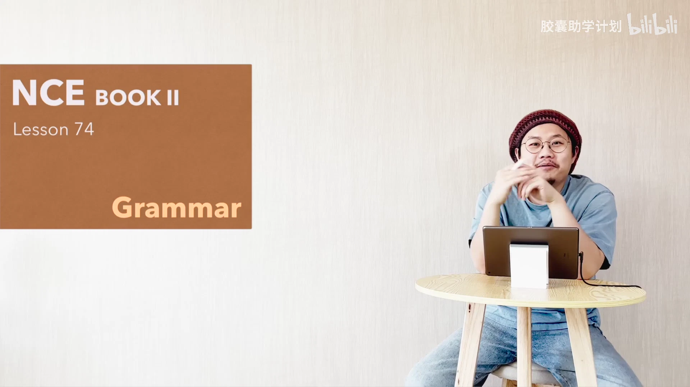

文字识别：bibil / 胶囊助学计划 / NCE / BOOKII / Lesson 74 / Grammar

### 画面 00:00:02

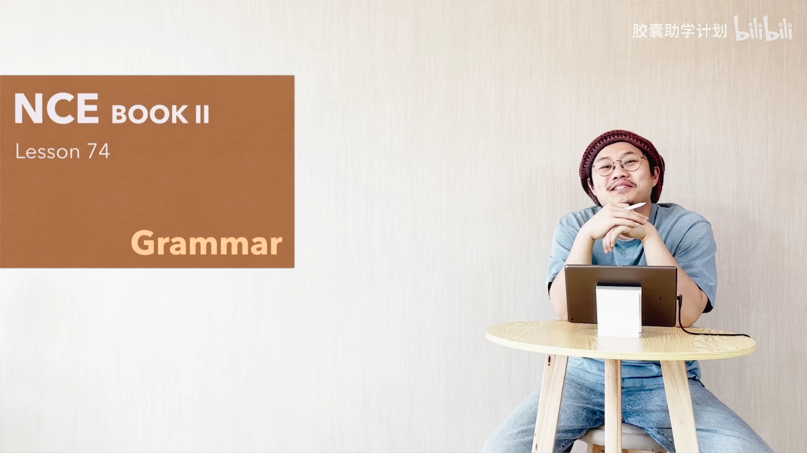

文字识别：bilbil / 胶囊助学计划 / NCE / BOOKII / Lesson 74 / Grammar

### 画面 00:00:04

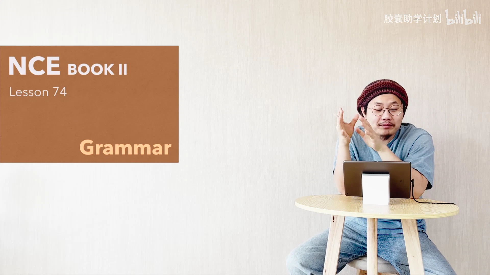

文字识别：bilbil / 胶囊助学计划 / NCE / BOOKII / Lesson 74 / Grammar

### 画面 00:00:06

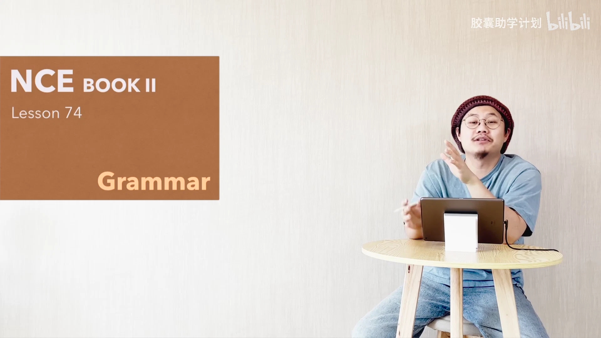

文字识别：bilbil / 胶囊助学计划 / NCE / BOOKII / Lesson 74 / Grammar

### 画面 00:00:09

文字识别：胶囊助学计划 bibi / • / •

### 画面 00:00:13

文字识别：胶囊助学计划 / 胶囊助学计划

### 画面 00:00:15

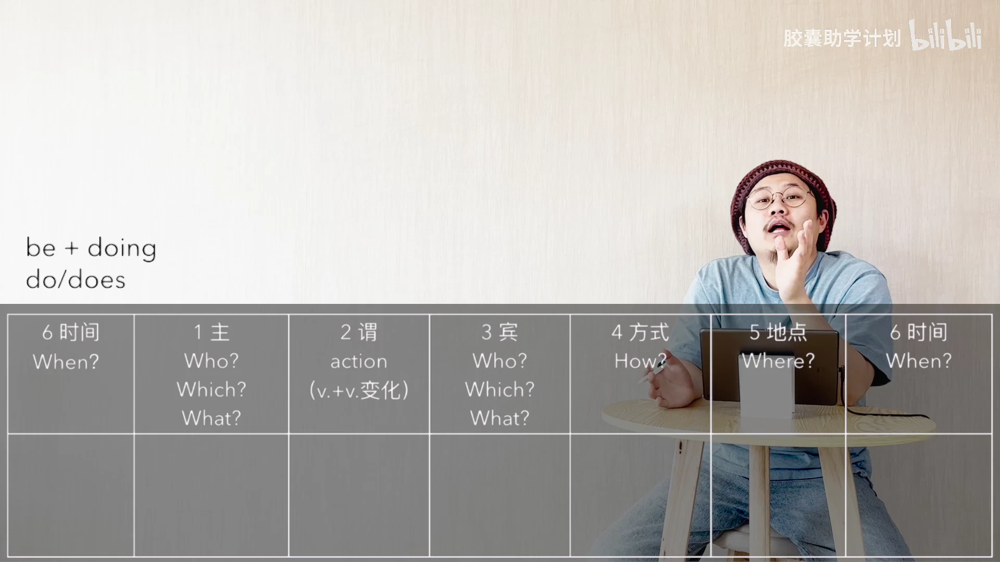

文字识别：biibii / 胶囊助学计划 / be + doing / do/does / 6时间 / 1主 / 2谓 / 3宾 / 4方式 / 5地点 / 6时间 / When? / Who? / action / Who? / How? / Where? / When? / Which? / (v.+v.变化) / Which? / What? / What?

## 00:00:30–00:01:00

两个时态：现在进行时跟一般过去时，哎哎，跟一般现在时。OK，那这两个时态呢？我们提一下，叫做现在进行时，最常见的含义无非就是表示现在一个动作正在进行，这是咱们之前学过的。如果您忘了，就回到第二课，对吧？回到每个单元第二课回去看一下。呃，这个用法你肯定记得。第二个用法呢，它甚至可以表示，比如说表将来。我最我举一个例

### 画面 00:00:45

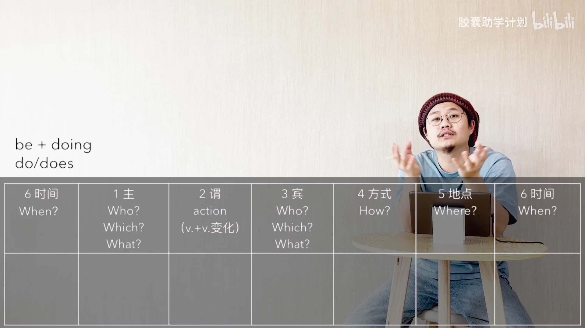

文字识别：biibii / 胶囊助学计划 / be + doing / do/does / 6时间 / 1主 / 2谓 / 3宾 / 4方式 / 5地点 / 6时间 / When? / Who? / action / Who? / How? / Where? / When? / Which? / (v.+v.变化) / Which? / What? / What?

## 00:01:00–00:01:30

子，比如说 I am meeting Leo tonight，表示较短的将来，对吧？啊，你后边一定要加时间，你不加时间，别人就会理解为这个动作正在发生。比如说，呃，I'm seeing Leo this afternoon，啊，今天下午我要去见 Leo，对吧？比如说 I'm having lunch with Leo this weekend，说这周末我要和 Leo 一起吃饭，不是正在吃饭，这是时间还没到来呢，对吧？所以如果用

### 画面 00:01:15

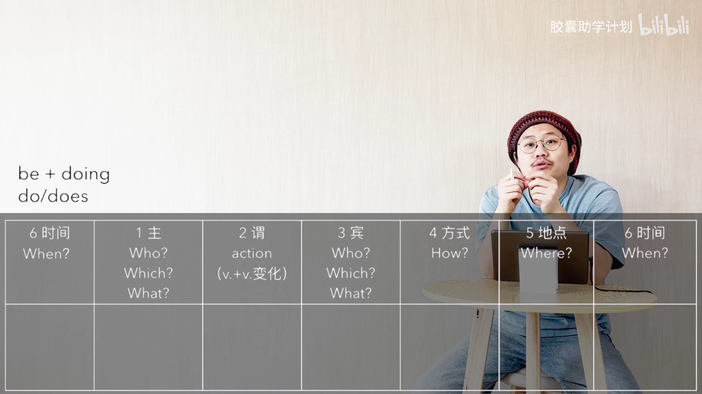

文字识别：bilbil / 胶囊助学计划 / be + doing / do/does / 6时间 / 1主 / 2谓 / 3宾 / 4方式 / 5地点 / 6时间 / When? / Who? / action / Who? / How? / Where? / When? / Which? / (v.+v.变化) / Which? / What? / What?

## 00:01:30–00:02:00

现在进行时表示将来呢，后边儿你要加个时间。而第二个常用用法，第三个常用用法呢，就是这个动作它甚至不用现在一定正在进行。比如说，说，呃，I'm learning uh how to drive a car recently啊，我最近在学如何开车。我现在在给大家上课，并没有真的再去学如何开车，但是我最近在学开车这件事儿，对吧？最近，哎，正在最

### 画面 00:01:45

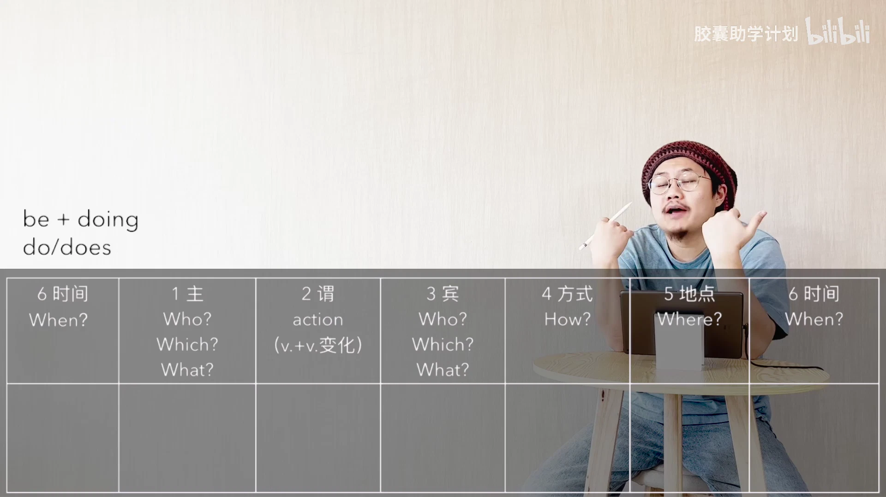

文字识别：bibil / 胶囊助学计划 / be + doing / do/does / 6时间 / 1主 / 2谓 / 3宾 / 4方式 / 5地点 / 6时间 / When? / Who? / action / Who? / How? / Where? / When? / Which? / (v.+v.变化) / Which? / What? / What?

## 00:02:00–00:02:30

近正在发生的，他不用说说我说话的当下正在发生，听明白了吧？OK，好，呃，所以这个全可以用 I'm is 二加 do，do does 呢就比较简单了，就表示生活习惯啊。这个从新一开始四十呃七课咱们就开始学，一直学到今天，我们就不多说了啊。在这儿我就是简单的呃回顾一下，接下来我们以练代讲，pattern drill，对吧？呃，我们先看这两句话，

### 画面 00:02:15

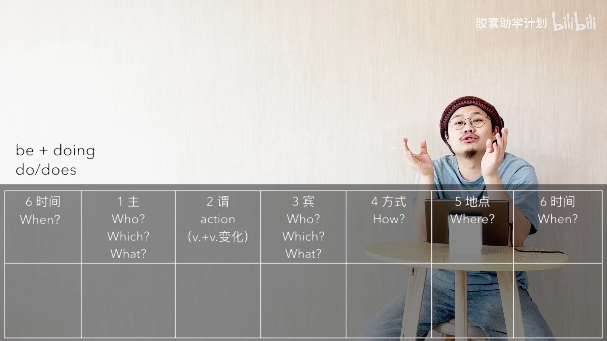

文字识别：biibii / 胶囊助学计划 / be + doing / do/does / 6时间 / 1主 / 2谓 / 3宾 / 4方式 / 5地点 / 6时间 / When? / Who? / action / Who? / How? / Where? / When? / Which? / (v.+v.变化) / Which? / What? / What?

### 画面 00:02:23

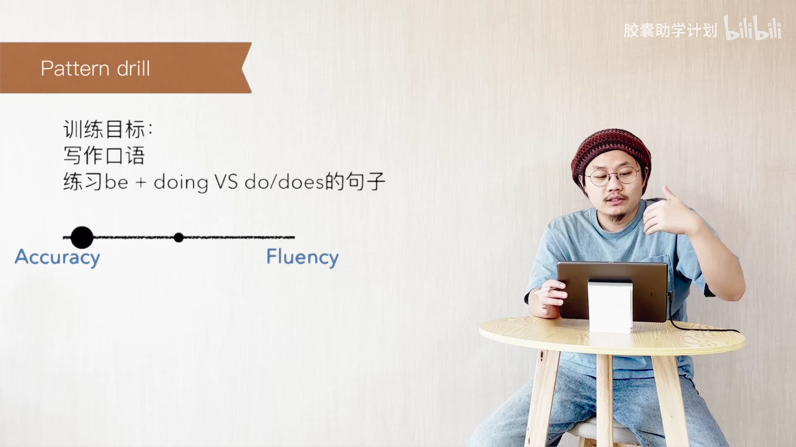

文字识别：bilbili / 胶囊助学计划 / Pattern drill / 训练目标： / 写作口语 / 练习be + doing VSdo/does的句子 / Accuracy / Fluency

### 画面 00:02:25

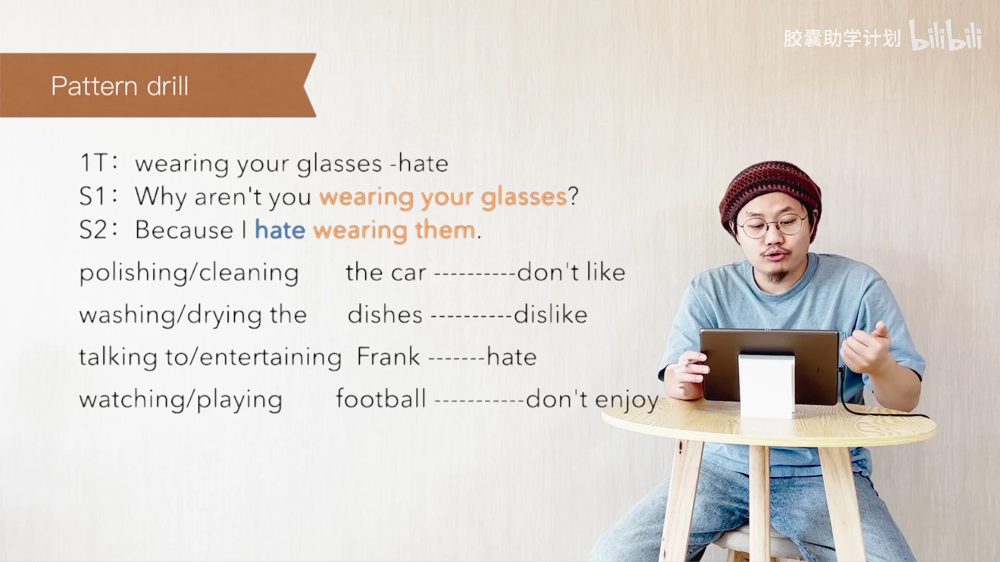

文字识别：bibii / 胶囊助学计划 / Pattern drill / 1T: wearing your glasses -hate / S1: Why aren't you wearing your glasses? / S2: Because I hate wearing / them. / polishing/cleaning / the car / ----don't like / washing/drying the / dishes / ------dislike / talking to/entertaining / Frank / (------hate / watching/playing / football / ----don't enjoy

### 画面 00:02:29

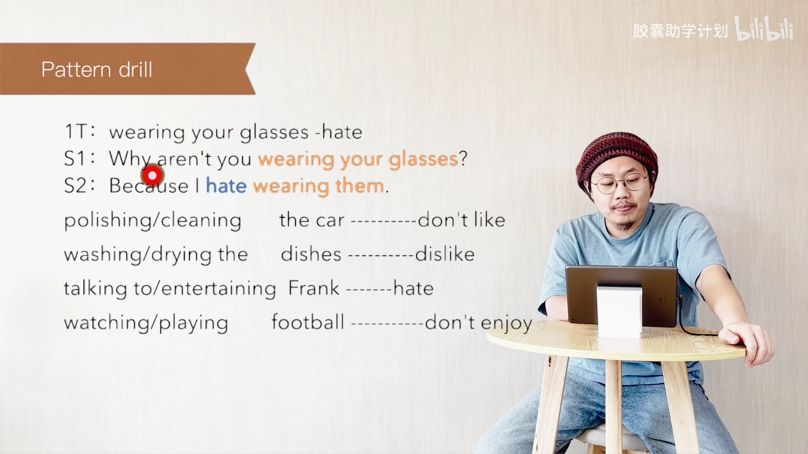

文字识别：biibil / 胶囊助学计划 / Pattern drill / 1T： / wearing your glasses -hate / S1: / Why aren't you / wearing your glasses? / S2:Because I hate / wearing / them. / polishing/cleaning / the( / car / ------don't like / --- / washing/drying the / dishes / -----dislike / talking to/entertaining / Frank / ------hate / watching/playing / football / -----don't enjoy

## 00:02:30–00:03:00

Why aren't you wearing your glasses? Why啥没有戴着眼镜? Because I hate wearing the. 这地方注意一下，他把两个 wearing 放到一起了，想尝试蒙你一下。你一定要明白，Why aren't you wearing your glasses? 是现在进行时，是 be doing。而这里为什么 hate 加了 doing 呢？这个首先我们有两种理解方式。第一种理解方式是 hate 加 doing something。哎，就跟咱们学过的 enjoy 加 doing something，

### 画面 00:02:55

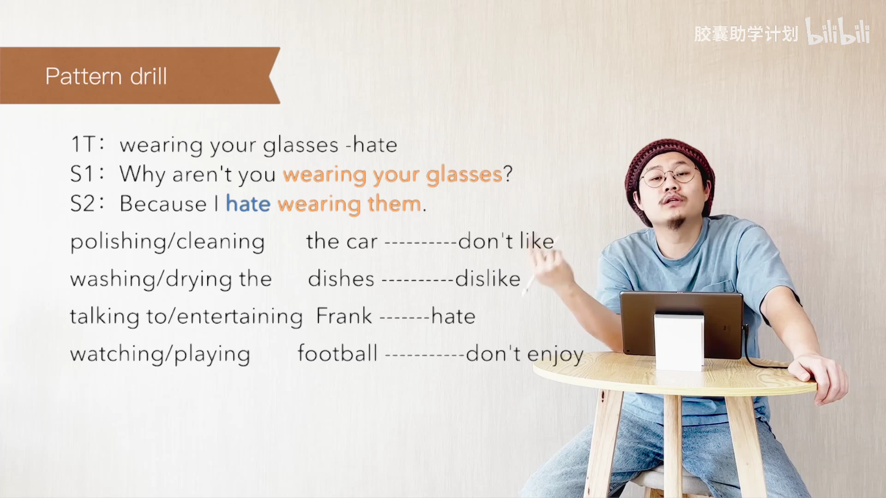

文字识别：bibili / 胶囊助学计划 / Pattern drill / 1T: wearing your glasses -hate / S1: Why aren't you wearing your glasses? / S2: Because Ihate wearing / them. / polishing/cleaning / the car / -------don't like / washing/drying the / dishes / ------dislike / talking to/entertaining / Frank / ------hate / watching/playing / football / -----don't enjoy

## 00:03:00–00:03:30

continue加doing something啊，love加doing something都可以啊。呃，第二个理解方式呢，你可以把它当做呃动名词对吧？动名词去理解。我们二十课就学过。然后呢，主谓宾啊，宾这个地方用的是wearing对吧？哎，就动名词了，给它动名词化了对吧？所以它不是这个现在进行时，注意一下。底下的记着往里去带啊。第二个，So John

### 画面 00:03:08

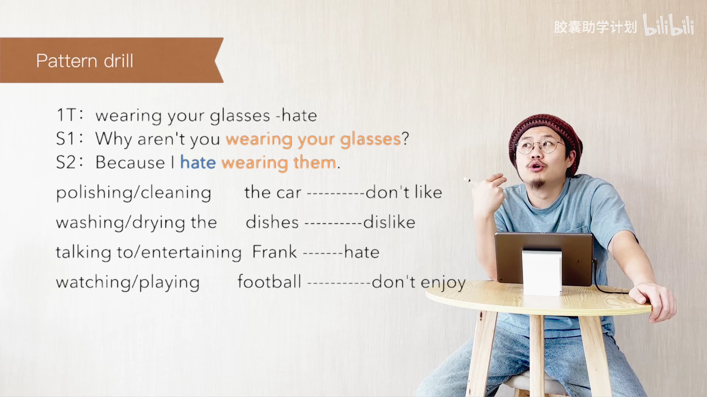

文字识别：biibili / 胶囊助学计划 / Pattern drill / 1T: wearing your glasses -hate / S1:\ / Why aren't you v /  wearing your glasses? / S2:Because I hate / wearing / them. / polishing/cleaning / the car / --------don't like / washing/drying the / dishes / ---dislike / talking to/entertaining / Frank / ------hate / watching/playing / football / ---don't enjoy

### 画面 00:03:23

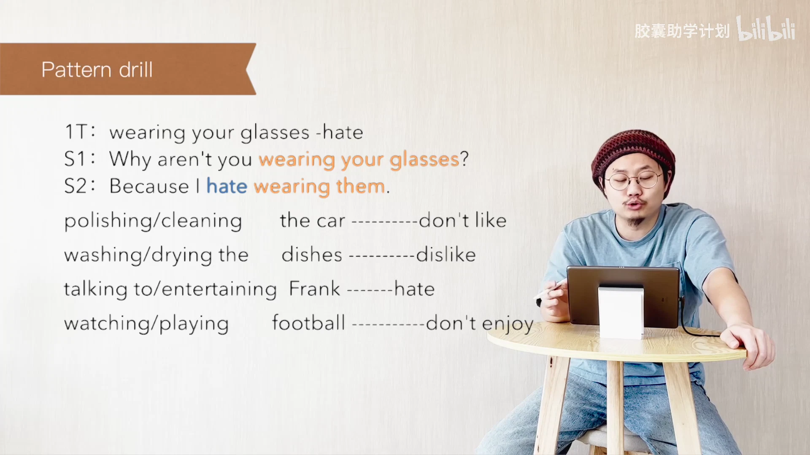

文字识别：bilbili / 胶囊助学计划 / Pattern drill / 1T： / wearing your glasses -hate / S1: / Why aren't you v /  wearing your glasses? / S2: Because Ihate wearing / them. / polishing/cleaning / the car / ------don't like / washing/drying the / dishes / -------dislike / talking to/entertaining / Frank / ------hate / watching/playing / football / -----don't enjoy

### 画面 00:03:27

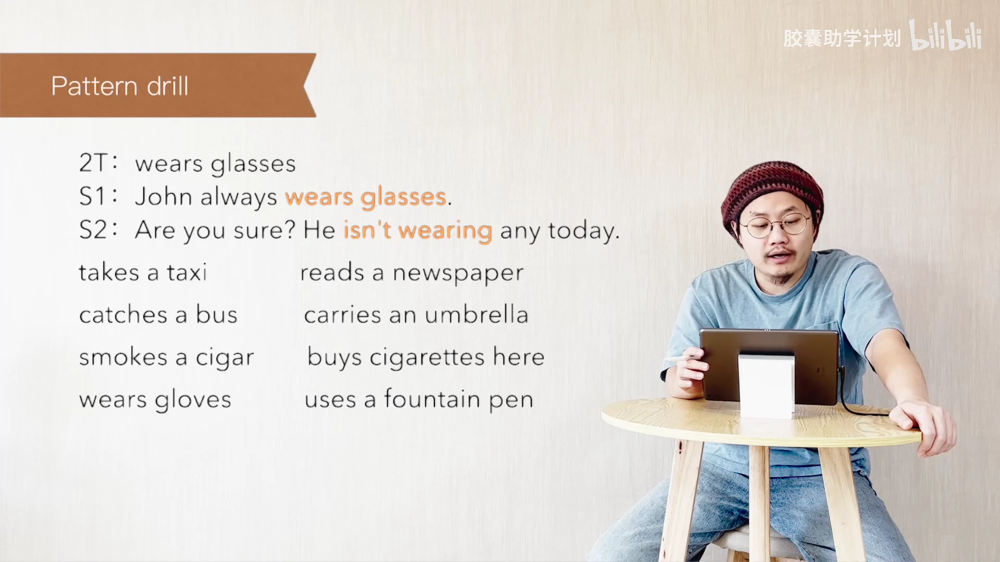

文字识别：biibii / 胶囊助学计划 / Pattern drill / 2T: wears glasses / S1: John always wears glasses. / S2: Are you sure? He isn't wearing any today. / takes a taxi / reads a newspaper / catches a bus / carries an umbrella / smokes a cigar / buys cigarettes here / wears gloves / uses a fountain pen

### 画面 00:03:29

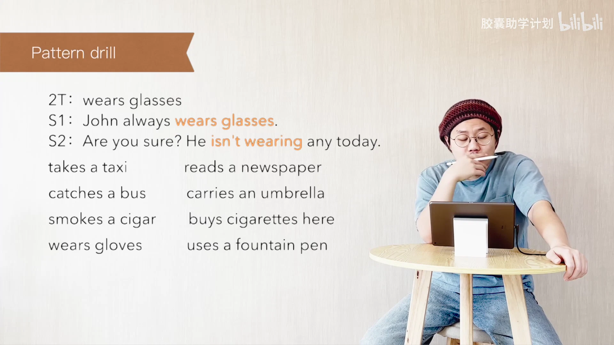

文字识别：biibili / 胶囊助学计划 / Pattern drill / 2T: wears glasses / S1: John always wears glasses. / S2: Are you sure? He isn't wearing any today. / takes a taxi / reads a newspaper / catches a bus / Carries an umbrella / smokes a cigar / buys cigarettes here / wears gloves / uses a fountain pen

## 00:03:30–00:04:00

always wears glasses. 生活习惯，一般现在时。Are you sure he isn't wearing any today? 他今天又没有在戴，对吧？哎，现在进行时，没什么说的，往里带啊，全是复习嘛。I see. I'm using your pen. Do you mind? 我正在用你的笔，你介意吗？呃，No, it's all right. I don't need it right now. Yes, I do. I want to use it myself. 啊，这是两个不

### 画面 00:03:45

文字识别：胶囊助学计划bilil / Pattern drill / 3T:pen -No/Yes / S1: I'm using your pen. Do you mind? / S2: No, it's all right.I don't need it just now. / Yes, I do.I want to use it myself. / computer -No/Yes / hammer -No/Yes / dictionary -Yes/No / knife -Yes/No / ladder -Yes/No / pencil -Yes/No / mirror -No/Yes / ruler -No/Yes

## 00:04:00–00:04:30

answers. Ah, no, no problem. I don't need it. Ah, yes, I mind because I need to use it myself. Okay. The fourth one says, "What's she doing?" She's doing? I don't know what she's doing. I can't see anything. She's doing? She's doing? I don't know what she's doing. I can't see anything. She's doing? She's doing? I don't know what she's doing. I can't see anything. She's doing? She's doing? I don't know what she's doing. I can't see anything. She's doing? She's doing? I don't know what she's doing. I can't see anything. She's doing? She's doing? I don't know what she's doing. I can't see anything. She's doing? She's doing? I don't know what she's doing. I can't see anything. She's doing? She's doing? I don't know what she's doing. I can't see

### 画面 00:04:04

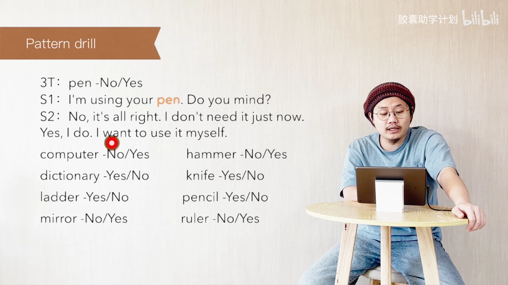

文字识别：胶囊助学计划biibil / Pattern drill / 3T:pen -No/Yes / S1: I'm using your pen. Do you mind? / S2: No, it's all right.I don't need it just now. / Yes, I do.I want to use it myself. / computer -No/Yes / hammer -No/Yes / dictionary -Yes/No / knife -Yes/No / ladder -Yes/No / pencil -Yes/No / mirror -No/Yes / ruler -No/Yes

### 画面 00:04:07

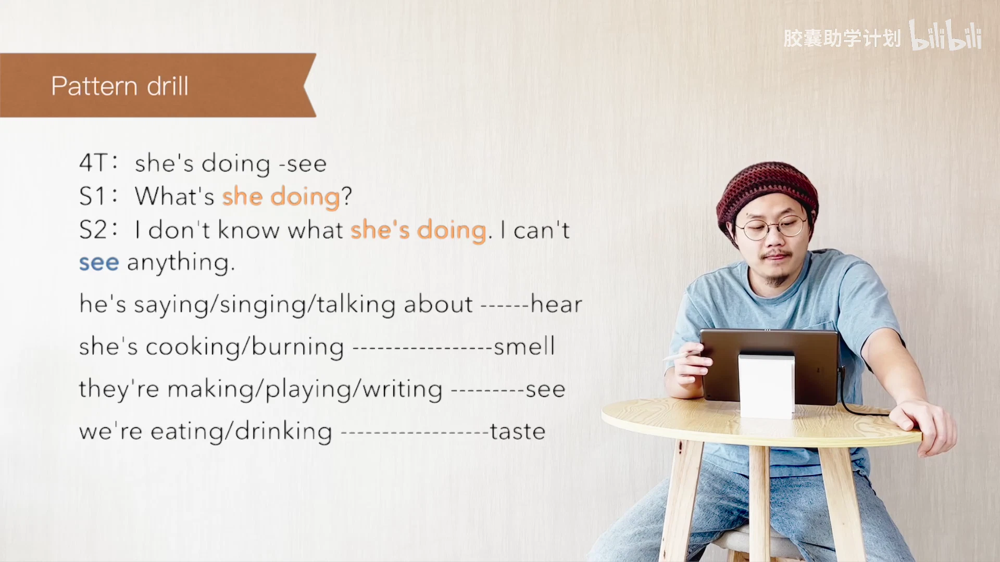

文字识别：bilbil / 胶囊助学计划 / Pattern drill / 4T: she's doing -see / S1: What's she doing? / S2: I don't know what she's doing.I can't / see anything. / he's saying/singing/talking about --hear / she's cooking/burning / ----smell / they're making/playing/writing / ---------see / we're eating/drinking / ----taste

## 00:04:30–00:05:00

OK，那不多说了，Recap本课就学了这么点东西，交作业，Pattern Drill，然后尝试回忆，您把我刚才说那些再给自己过一遍。然后呢，中级红皮书没写的，真的到现在赶紧可以写了。我们争取在学三册之前把中级红皮书其实呃大多数能写的都给他写了，还是好的啊。尤其是利用第四单元这个时候。OK，那以上就是本期视频的全部内容了。如果各位喜欢我们的视频呢，欢迎各位关注、订阅、一键三连，

### 画面 00:04:30

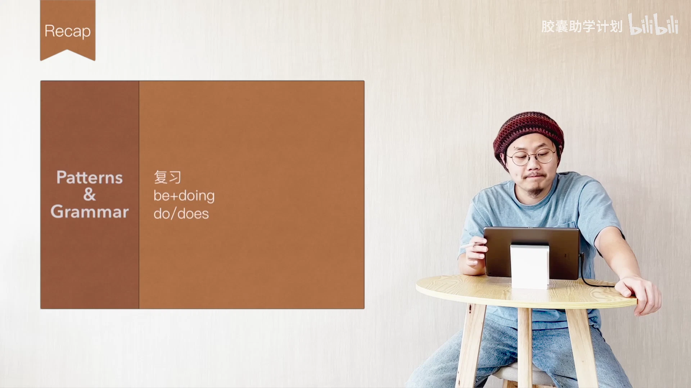

文字识别：bibii / 胶囊助学计划 / Recap / Patterns / 复习 / ＆ / be+doing / Grammar / do/does

### 画面 00:04:32

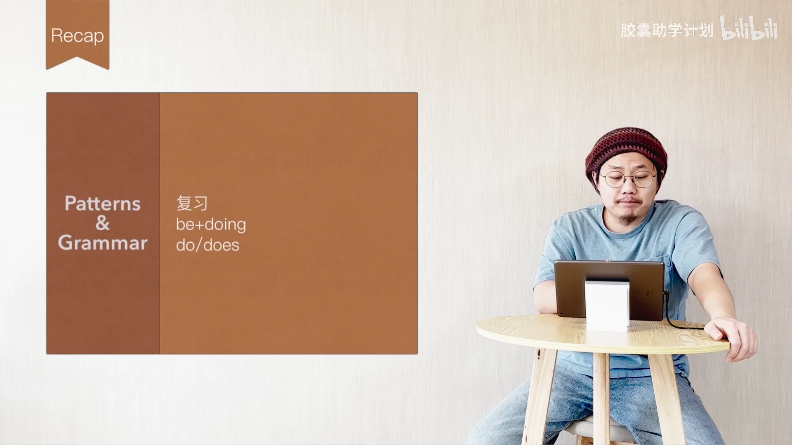

文字识别：bilbl / 胶囊助学计划 / Recap / Patterns / 复习 / ＆ / be+doing / Grammar / do/does

### 画面 00:04:34

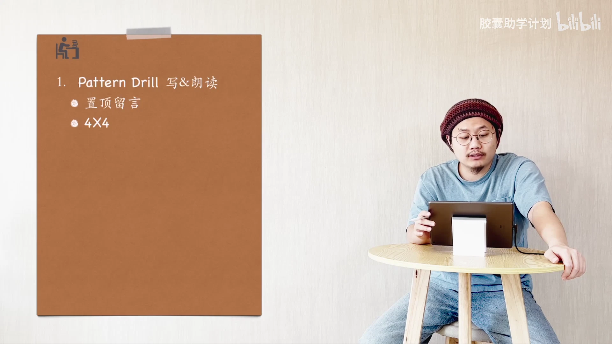

文字识别：bilibii / 胶囊助学计划 / Pattern Drill 写&朗读 / 1. / 置顶留言 / 4X4

### 画面 00:04:36

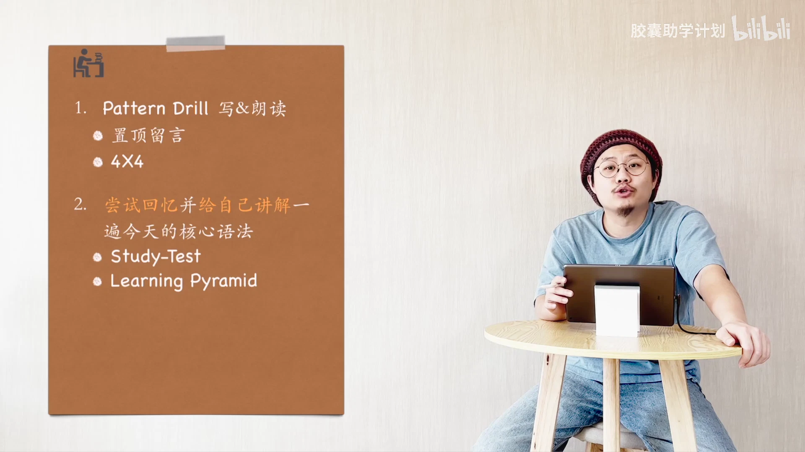

文字识别：bilbil / 胶囊助学计划 / Pattern Drill写&朗读 / 置顶留言 / 4×4 / 尝试回忆并给自己讲解一 / 遍今天的核心语法 / Study-Test / Learning Pyramid

### 画面 00:04:38

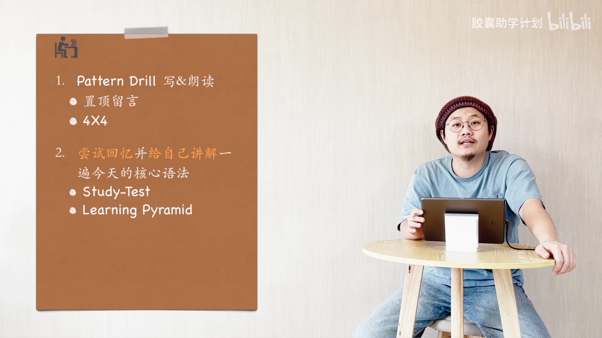

文字识别：bilbil / 胶囊助学计划 / Pattern Drill 写&朗读 / 置顶留言 / 4X4 / 尝试回忆并给自己讲解一 / 遍今天的核心语法 / Study-Test / Learning Pyramid

### 画面 00:04:40

文字识别：bibii / 胶囊助学计划 / Pattern Drill写&朗读 / 置顶留言 / 4×4 / 尝试回忆并给自己讲解一 / 遍今天的核心语法 / Study-Test / Learning Pyramid / 尝试翻阅红皮书（中级） / 通过目录或索引(Index) / 查找到本课语法

### 画面 00:04:42

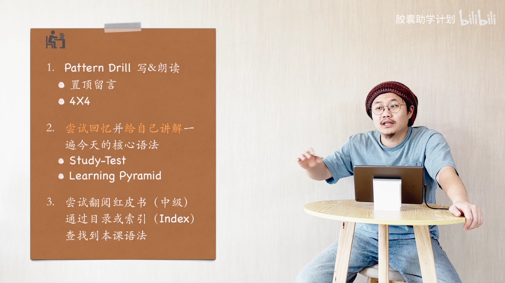

文字识别：bilbii / 胶囊助学计划 / 1.f / Pattern Drill写&朗读 / 置顶留言 / 4×4 / 尝试回忆并给自己讲解一 / 遍今天的核心语法 / Study-Test / Learning Pyramid / 尝试翻阅红皮书（中级） / 通过目录或索引(Index) / 查找到本课语法

### 画面 00:04:44

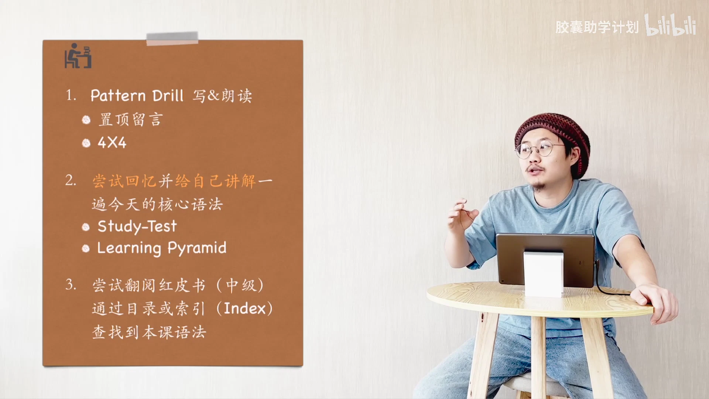

文字识别：bilibi / 胶囊助学计划 / 1. f / Pattern Drill写&朗读 / 置顶留言 / 4×4 / 尝试回忆并给自己讲解一 / 遍今天的核心语法 / Study-Test / Learning Pyramid / 尝试翻阅红皮书（中级） / 通过目录或索引(Index) / 查找到本课语法

### 画面 00:04:46

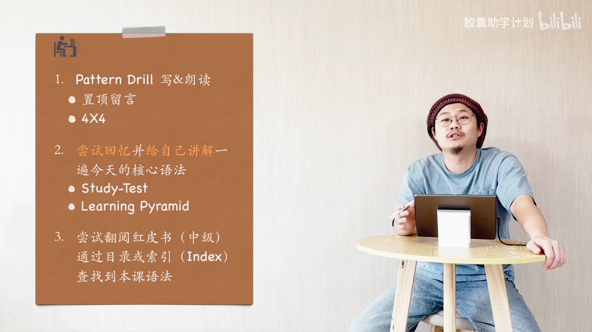

文字识别：bilibili / 胶囊助学计划 / Pattern Drill写&朗读 / 1. / 置顶留言 / 4×4 / 尝试回忆并给自己讲解一 / 遍今天的核心语法 / Study-Test / Learning Pyramid / 尝试翻阅红皮书（中级） / 通过目录或索引(Index) / 查找到本课语法

### 画面 00:04:48

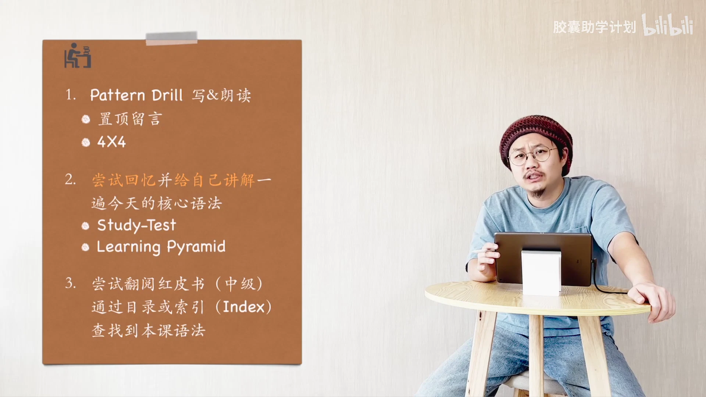

文字识别：Bilbili / 胶囊助学计划 / Pattern Drill写&朗读 / 置顶留言 / 4×4 / 尝试回忆并给自己讲解一 / 遍今天的核心语法 / Study-Test / Learning Pyramid / 尝试翻阅红皮书（中级） / 通过目录或索引 (Index) / 查找到本课语法

### 画面 00:04:50

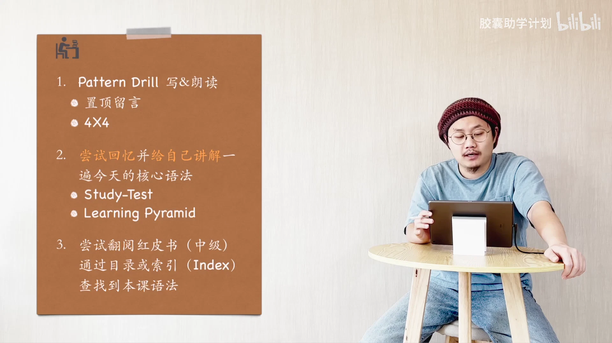

文字识别：bilbil / 胶囊助学计划 / 1. / Pattern Drill写&朗读 / 置顶留言 / 4×4 / 尝试回忆并给自己讲解一 / 遍今天的核心语法 / Study-Test / Learning Pyramid / 尝试翻阅红皮书（中级） / 通过目录或索引(Index) / 查找到本课语法

### 画面 00:04:52

文字识别：bibili / 胶囊助学计划 / 1. / Pattern Drill写&朗读 / 置顶留言 / 4×4 / 尝试回忆并给自己讲解一 / 遍今天的核心语法 / Study-Test / Learning Pyramid / 尝试翻阅红皮书（中级） / 通过目录或索引(Index) / 查找到本课语法

### 画面 00:04:54

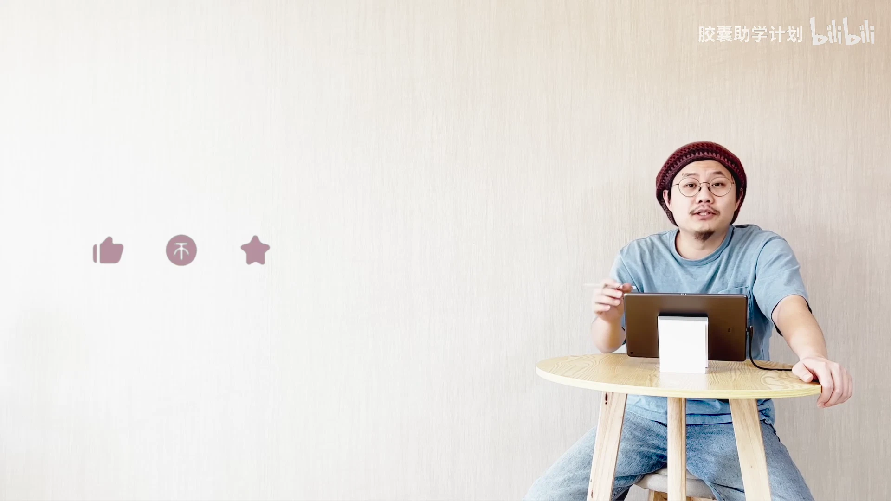

文字识别：Bilbi / 胶囊助学计划 / 不

### 画面 00:04:58

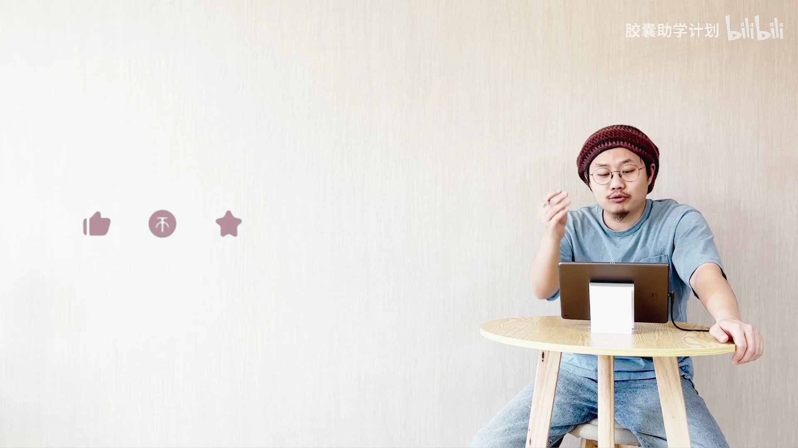

文字识别：胶囊助学计划blibi / 不

## 00:05:00–00:05:17

分享给那些需要的朋友，来帮助我们快速成长。See you next time.

### 画面 00:05:05

### 画面 00:05:07

文字识别：聖動字計物 / CAPSULEACADEMY / 胶囊助学计划 / 『 / 小红书 / Lecturer / □ / Leo / OE

### 画面 00:05:10

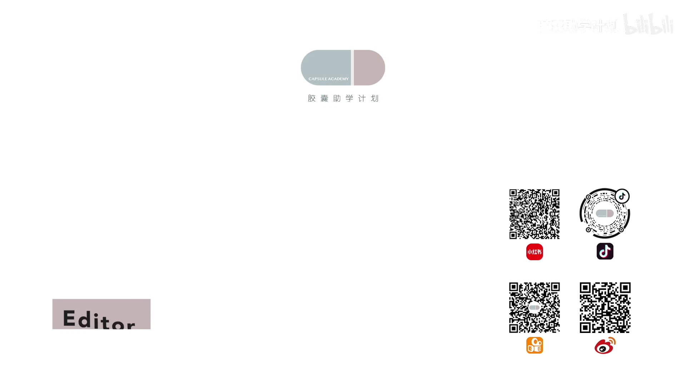

文字识别：CAPSULEACADEMY / 胶囊助学计划 / 小红书 / □ / Editor / OE

### 画面 00:05:13

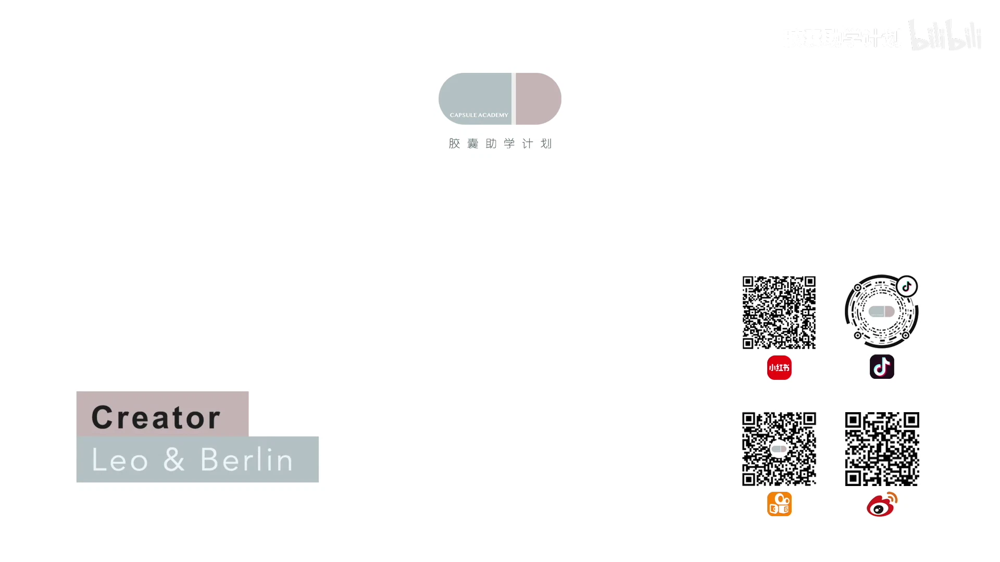

文字识别：臺聖珈字計划 / CAPSULEACADEMY / 胶囊助学计划 / 小红书 / Creator / Leo & Berlin

### 画面 00:05:15

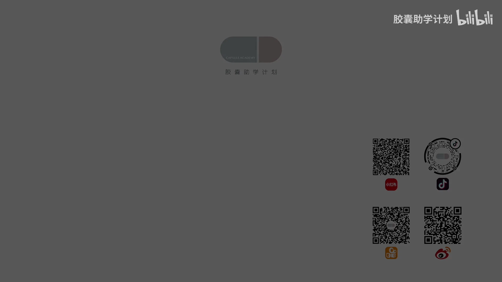

文字识别：bilbili / 胶囊助学计划 / 胶囊助学计划 / 小红书 / 品

### 画面 00:05:17

文字识别：bilibili / 胶囊助学计划

