# 074 练习

快速机器解析：语音为单模型转写，未进行独立交叉校对或人工复核；画面每秒采样并按变化选帧，短时文字和标记可能遗漏。截图时间约有 1 秒误差。图片有损压缩；遇到疑点请按时间查看 Google Drive 原视频。

## 00:00:00–00:00:30

Hello, everyone. Welcome to Capsule Academy. This is Leo. Today, we're going to learn New Concept English Book Two, Lesson Seventy Four Practices. That注意啊，进行如下练习唯一的前提就是文章咱们必须跟读至熟读成诵，否则请勿开始。Hope you gonna enjoy it. 第一题，Comprehension，我问您答，听力口语练习啊。First one, Where did the bus stop?

### 画面 00:00:00

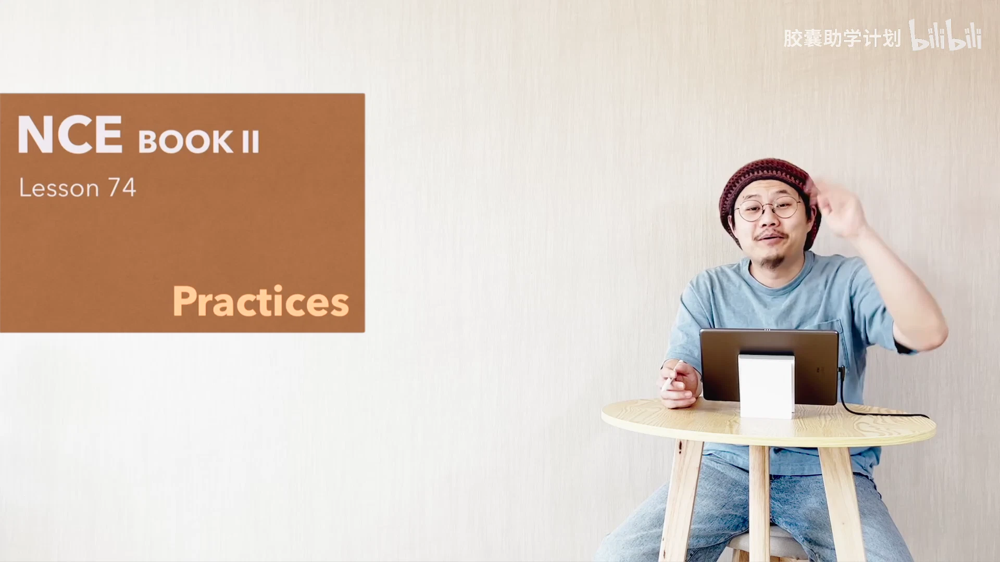

文字识别：bilbi / 胶囊助学计划 / NCE / BOOKII / Lesson 74 / Practices

### 画面 00:00:02

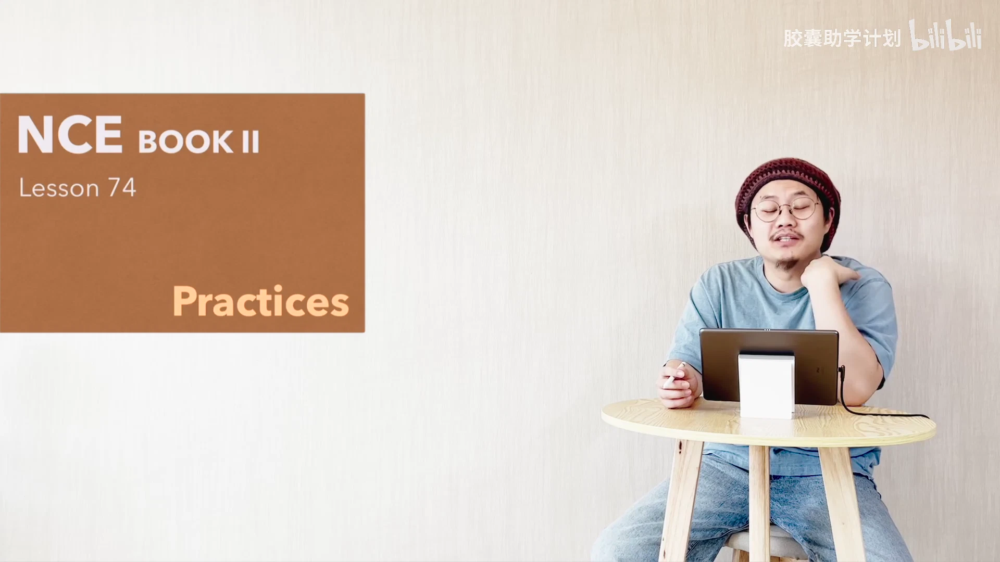

文字识别：biibii / 胶囊助学计划 / NCE / BOOKII / Lesson 74 / Practices

### 画面 00:00:05

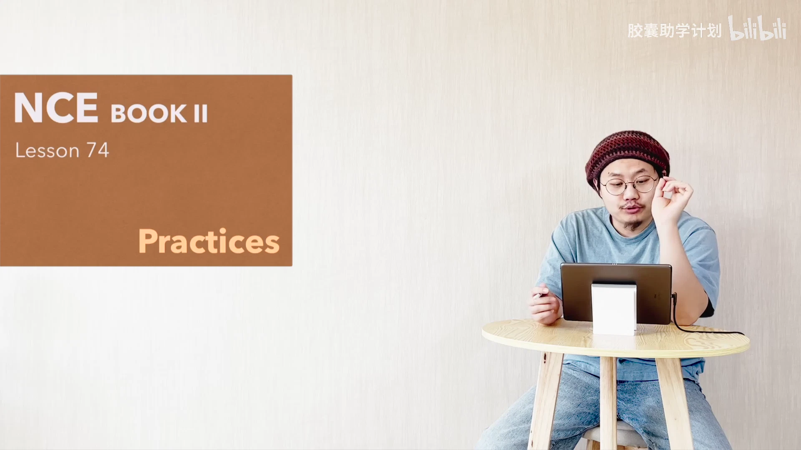

文字识别：biibi / 胶囊助学计划 / NCE / BOOKII / Lesson 74 / Practices

### 画面 00:00:08

文字识别：bilbili / 胶囊助学计划 / 进行如下练习唯一前提 / 文章跟读至熟读成诵 / 否则请勿开始

### 画面 00:00:10

文字识别：bilbili / 胶囊助学计划 / 进行如下练习唯一前提 / 文章跟读至熟读成诵 / 否则请勿开始

### 画面 00:00:13

文字识别：bilbil / 胶囊助学计划 / 进行如下练习唯一前提 / 文章跟读至熟读成诵 / 否则请勿开始

### 画面 00:00:17

文字识别：胶囊助学计划 bii / •

### 画面 00:00:21

文字识别：胶囊助学计划レ / 胶囊助学计划

### 画面 00:00:23

文字识别：bilibili / 胶囊助学计划 / Comprehension / 训练目标： / 听懂一般疑问句＆特殊疑问句

### 画面 00:00:25

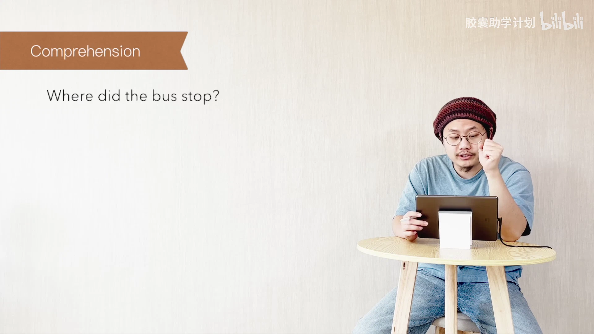

文字识别：bilbili / 胶囊助学计划 / Comprehension / Where did the bus stop?

## 00:00:30–00:01:00

By a dry riverbed. Was it a new one? No, it wasn't. Who got off? A party of famous actors and actresses. How were they dressed? In dark glasses and old clothes. Why had they dressed like this?

### 画面 00:00:55

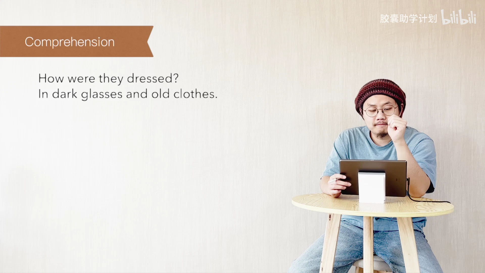

文字识别：bilbii / 胶囊助学计划 / Comprehension / How were they dressed? / In dark glasses and old clothes.

## 00:01:00–00:01:30

because they didn't want to be recognized. What did they soon discover? That disguises can sometimes be too perfect. Did Gloria Graham approve of their picnicking place? Yes, she did. Did Brinkley Myers agree with her? Yes, he did.

### 画面 00:01:00

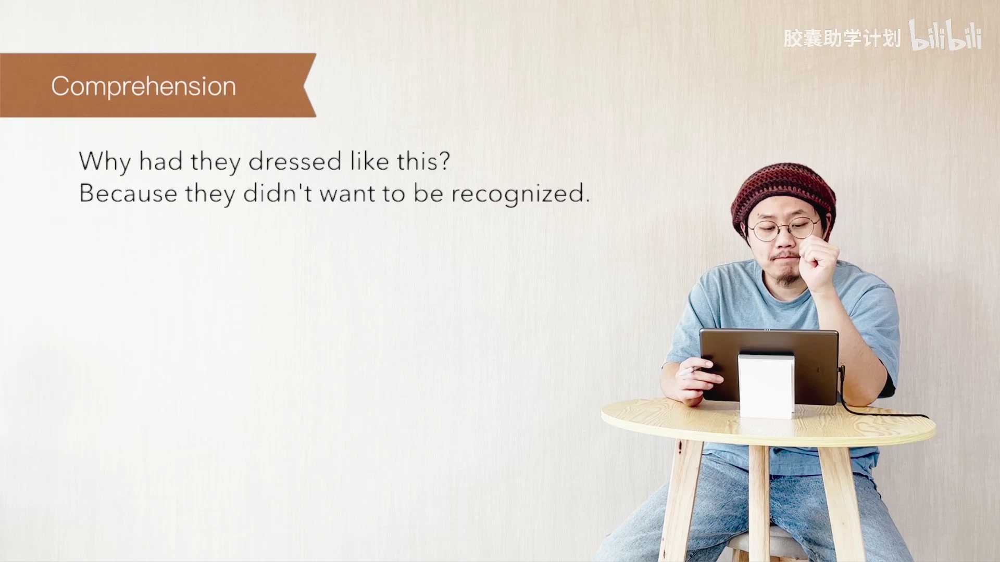

文字识别：bilbili / 胶囊助学计划 / Comprehension / Why had they dressed like this? / Because they didn't want to be recognized.

### 画面 00:01:05

文字识别：bilbii / 胶囊助学计划 / Comprehension / What did they soon discover?

### 画面 00:01:21

文字识别：bilbil / 胶囊助学计划 / Comprehension / Did Gloria Gleam approve of their picnicking / place? / Yes, she did.

### 画面 00:01:28

文字识别：bilbil / 胶囊助学计划 / Comprehension / Did Brinksley Meers agree with her? / Yes, he did.

## 00:01:30–00:02:00

What were his advantages? There weren't any newspapermen or film fans. What had Rockall Sliner and Merlin Graves done during this conversation? They had carried two food baskets into the shade of some trees. When did the sheriff appear?

### 画面 00:01:34

文字识别：bilbii / 胶囊助学计划 / Comprehension / What were its advantages? / There weren't any newspaper men or film / fans.

### 画面 00:01:40

文字识别：bilibii / 胶囊助学计划 / Comprehension / What had Rockwall Slinger and Merlin / Greeves done during this conversation?

### 画面 00:01:50

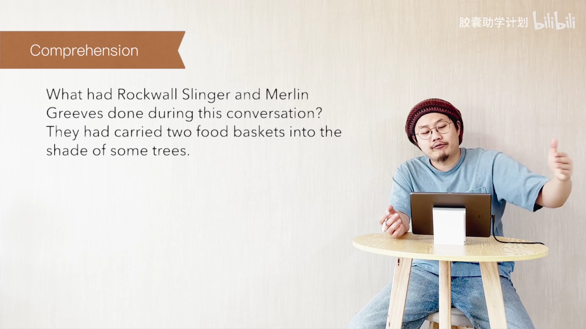

文字识别：bilbii / 胶囊助学计划 / Comprehension / What had Rockwall Slinger and Merlin / Greeves done during this conversation? / They had carried two food baskets into the / shade of some trees.

### 画面 00:01:53

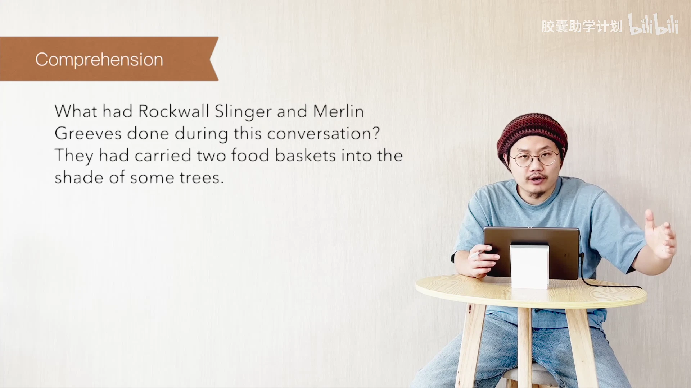

文字识别：biibili / 胶囊助学计划 / Comprehension / What had Rockwall Slinger and Merlin / Greeves done during this conversation? / They had carried two food baskets into the / shade of some trees.

### 画面 00:01:55

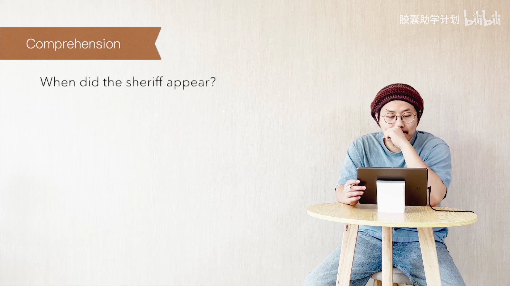

文字识别：bilbil / 胶囊助学计划 / Comprehension / When did the sheriff appear?

## 00:02:00–00:02:30

when they had made themselves comfortable. What did he point out to them? A notice saying no camping. Did Rocco expect the sheriff to recognize him? Yes, he did. Asking questions, 四句型转换啊，第一个, As many fishermen were stopped by a dry riverbed, did提前动词换回原形, What kind

### 画面 00:02:07

文字识别：Bilbili / 胶囊助学计划 / Comprehension / What did he point out to them? / A notice saying,'No Camping'.

### 画面 00:02:11

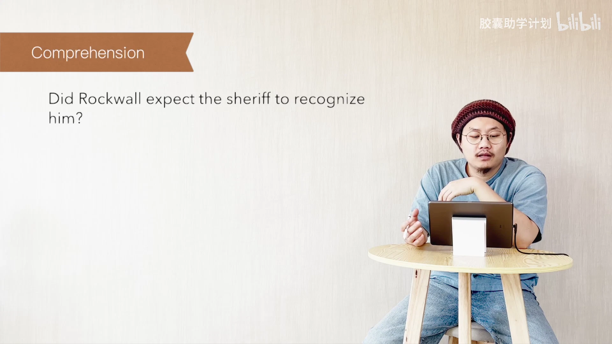

文字识别：bilbili / 胶囊助学计划 / Comprehension / Did Rockwall expect the sheriff to recognize / him?

### 画面 00:02:19

文字识别：bilbil / 胶囊助学计划 / Asking questions / 训练目标： / 会说一般疑问句＆特殊疑问句 / Accuracy / Fluency

### 画面 00:02:23

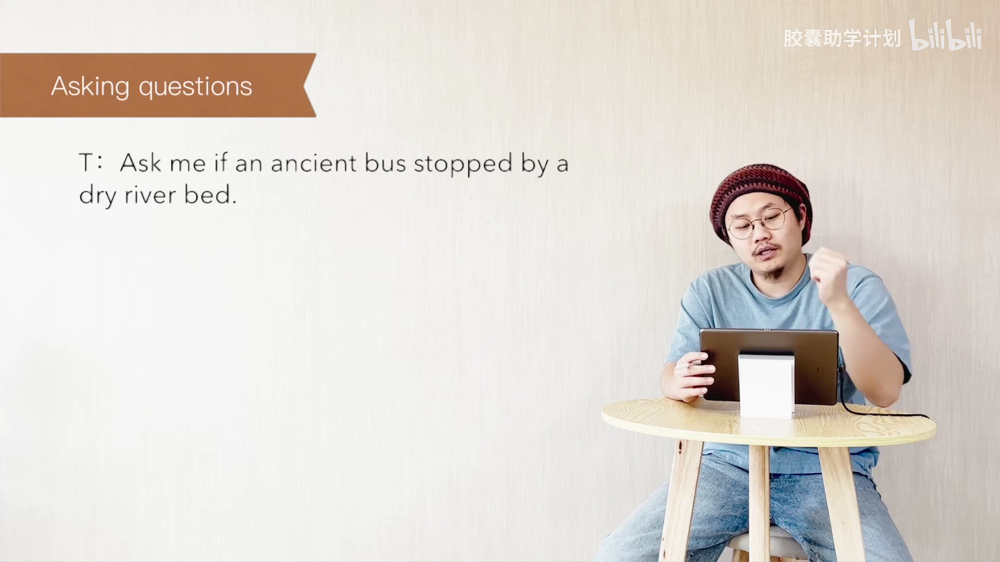

文字识别：biibili / 胶囊助学计划 / Asking questions / T: Ask me if an ancient bus stopped by a / dry river bed.

### 画面 00:02:25

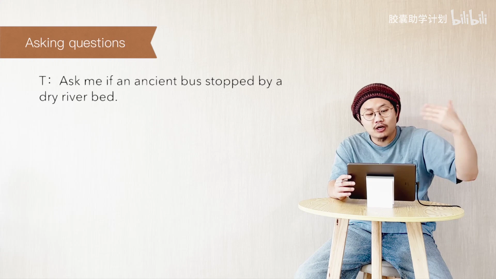

文字识别：bilibii / 胶囊助学计划 / Asking questions / T: Ask me if an ancient bus stopped by a / dry river bed.

### 画面 00:02:27

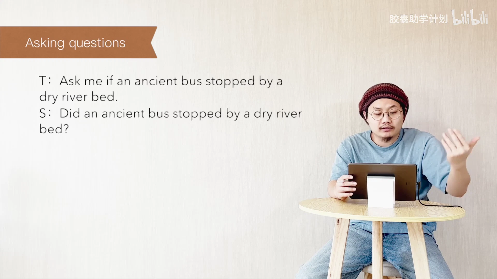

文字识别：bibii / 胶囊助学计划 / Asking questions / T: Ask me if an ancient bus stopped by a / dry river bed. / S: Did an ancient bus stopped by a dry river / bed?

## 00:02:30–00:03:00

of? 你对 Asian 提问可以，对吧？比如说 What kind of bus? 注意，你看它是主语的一部分，所以我依旧没变一般疑问句。Stop by a dry a dry riverbed. Very good. 那 Where 就对那个 by a dry riverbed 提问，对吧？它停在哪儿啊？这个得变一般疑问句。A party of famous actors and actresses got off. 你看这个主语好长，是吧？主语好长啊，所以你看从这个角度上来说

### 画面 00:02:32

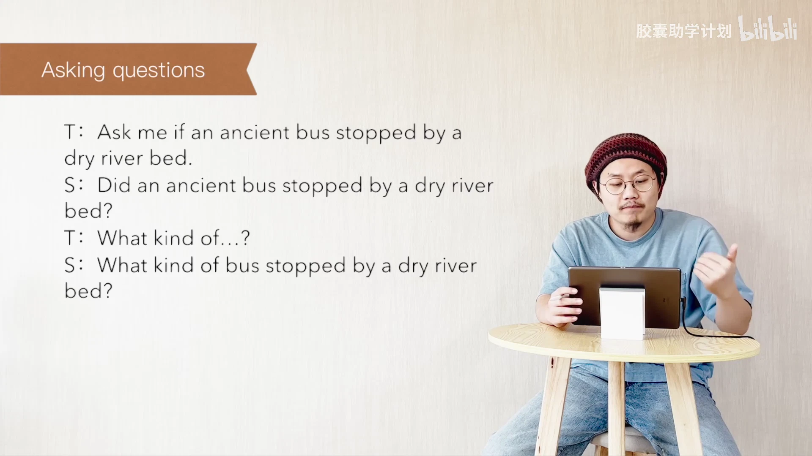

文字识别：Bilbili / 胶囊助学计划 / Asking questions / T: Ask me if an ancient bus stopped by a / dry river bed. / S: Did an ancient bus stopped by a dry river / bed? / T: What kind of...? / S: What kind of bus stopped by a dry river / bed?

### 画面 00:02:42

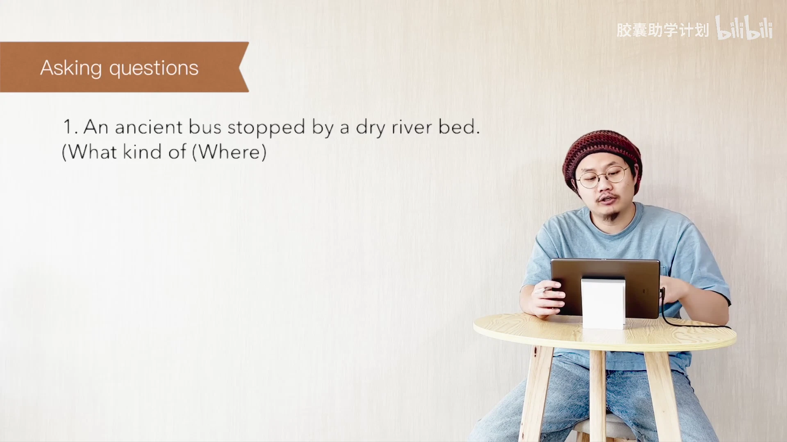

文字识别：bilbi / 胶囊助学计划 / Asking questions / 1. An ancient bus stopped by a dry river bed. / (What kind of (Where)

### 画面 00:02:45

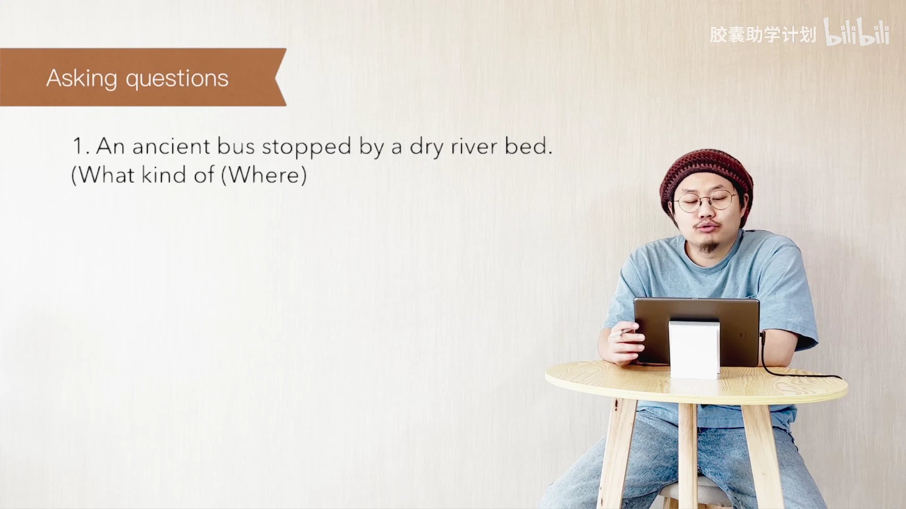

文字识别：bilibii / 胶囊助学计划 / Asking questions / 1. An ancient bus stopped by a dry river bed. / (What kind of (Where)

### 画面 00:02:55

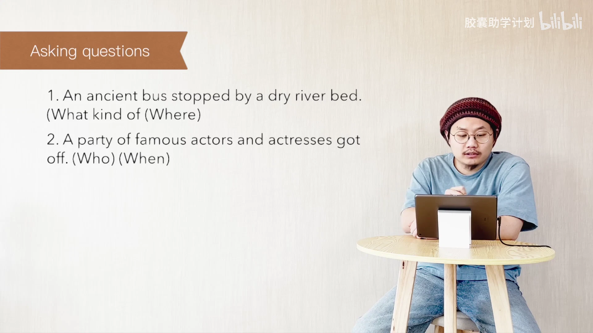

文字识别：biltbili / 胶囊助学计划 / Asking questions / 1. An ancient bus stopped by a dry river bed. / (What kind of (Where) / 2.A party of famous actors and actresses got / off.(Who)(When)

### 画面 00:02:58

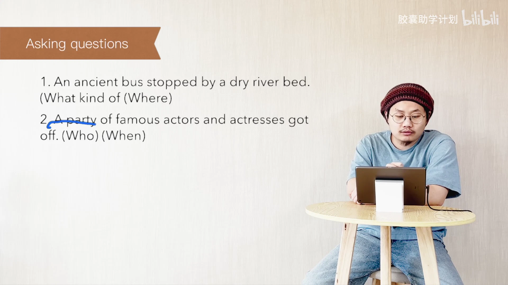

文字识别：bilibili / 胶囊助学计划 / Asking questions / 1. An ancient bus stopped by a dry river bed. / (What kind of (Where) / 2Aparty of famous actors and actresses got / off.(Who)(When)

## 00:03:00–00:03:30

又是那样啊，就是我们比如说原来学的主语从句，为什么是 it seems that 后边加一句话，那跟头重脚轻没关系？那你这句话不也头重脚轻吗？啊，这个脚不就这么一点，不就 got off 两个单词吗？啊，就就是英语习惯，别硬加解释，对吧？啊，这里把 did 提前就可以了啊， did 提前就可以了。互对主语提问，问对整句话提问。说 they were dressed in dark glasses and old clothes. Were 提前，那 how were they dressed？对吧？

### 画面 00:03:00

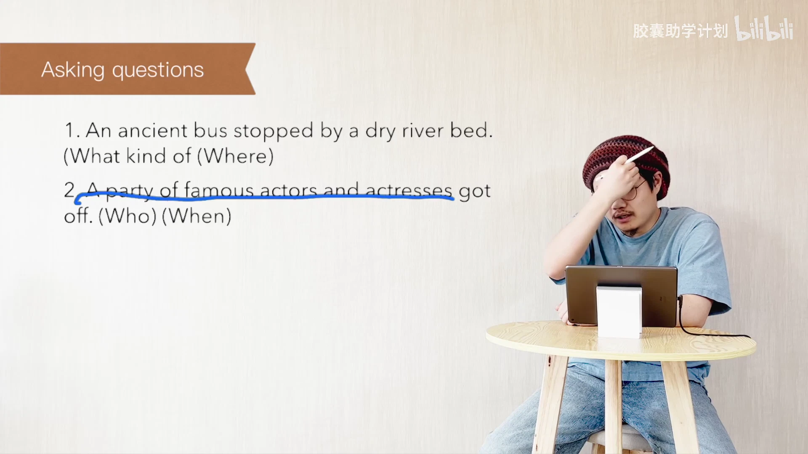

文字识别：bilbili / 胶囊助学计划 / Asking questions / 1. An ancient bus stopped by a dry river bed. / (What kind of (Where) / 2Aparty of famous actors and actresses got / off.(Who)(When)

### 画面 00:03:03

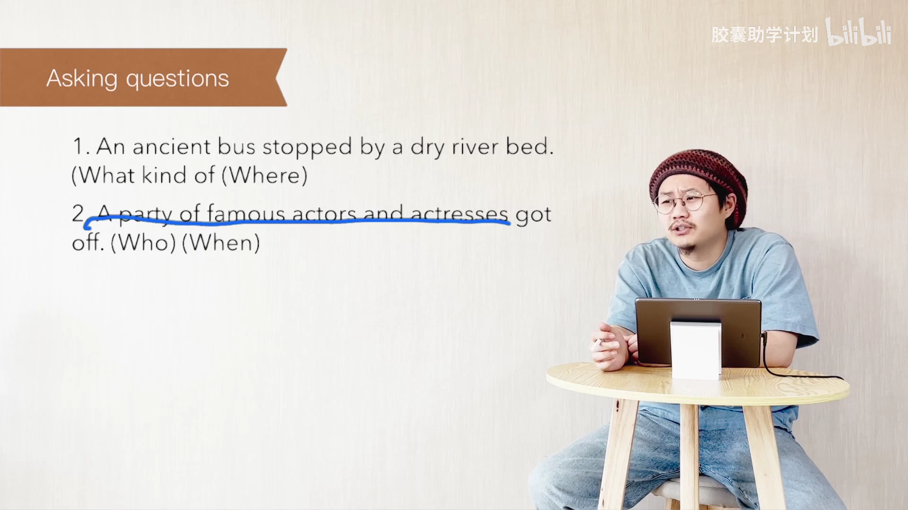

文字识别：bibili / 胶囊助学计划 / Asking questions / 1. An ancient bus stopped by a dry river bed. / (What kind of (Where) / 2Aparty of famous actors and actresses got / off.(Who)(When)

### 画面 00:03:06

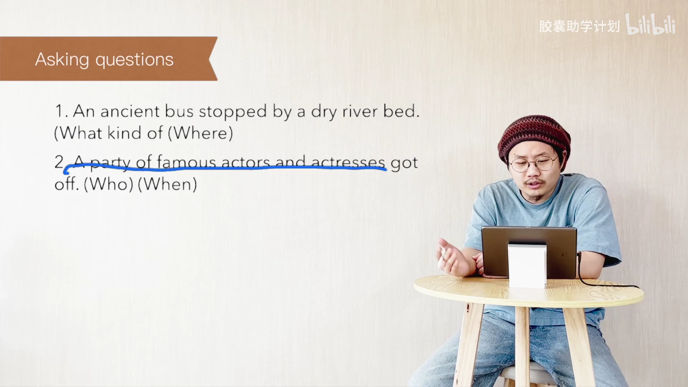

文字识别：biibili / 胶囊助学计划 / Asking questions / 1. An ancient bus stopped by a dry river bed. / (What kind of (Where) / 2 Aparty of famous actors and actresses got / off.(Who)(When)

### 画面 00:03:10

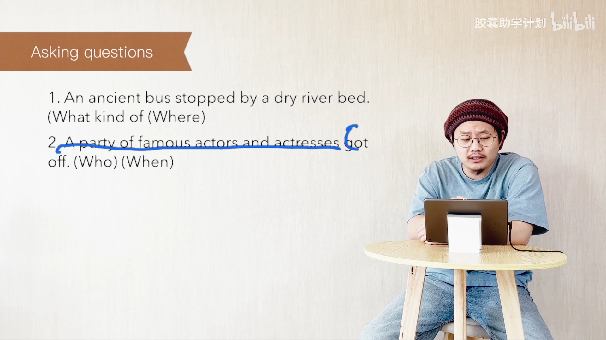

文字识别：bilbili / 胶囊助学计划 / Asking questions / 1. An ancient bus stopped by a dry river bed. / (What kind of (Where) / off.(Who)(When)

### 画面 00:03:22

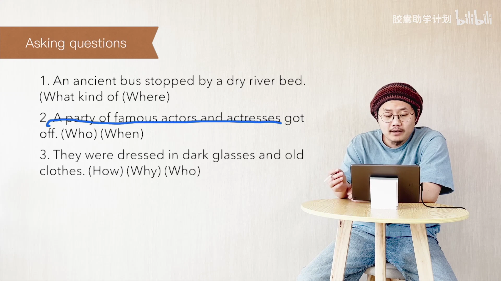

文字识别：biibili / 胶囊助学计划 / Asking questions / 1. An ancient bus stopped by a dry river bed. / (What kind of (Where) / 2Aparty of famous actors and actresses got / off. (Who)(When) / 3. They were dressed in dark glasses and old / clothes.(How) (Why) (Who)

### 画面 00:03:27

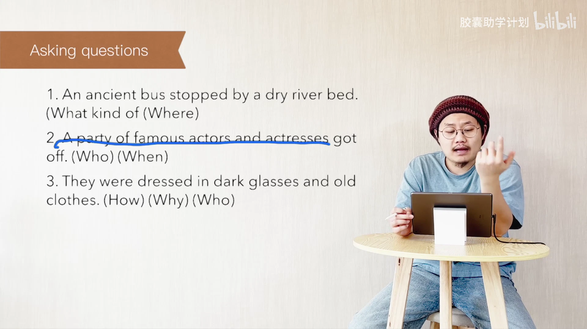

文字识别：胶囊助学计划bi出 / Asking questions / 1. An ancient bus stopped by a dry river bed. / (What kind of (Where) / 2 Aparty of famous actors and actresses got / off.(Who)(When) / 3. They were dressed in dark glasses and old / clothes.(How)(Why)(Who)

## 00:03:30–00:04:00

哎，外加整句话互对主语提问。呃，They'd come for a picnic.这个撇d，你根据上下文也能知道它是had，对吧？They had come.啊，为什么要上下文了呢？不是用看后边的come了呢？因为原型跟过去分词都是come，你分不清的，对吧？啊，他们已经来了，对吧？他们来就目的就是来野餐一下，所以had提前。What对a picnic提问，外加整句啊？他为啥来这儿野餐呢？They had

### 画面 00:03:42

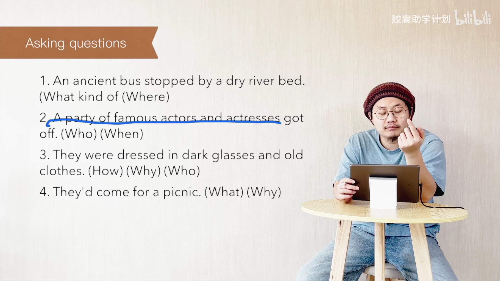

文字识别：胶囊助学计划bib出 / Asking questions / 1. An ancient bus stopped by a dry river bed. / (What kind of (Where) / 2 Aparty of famous actors and actresses got / off.(Who)(When) / 3. They were dressed in dark glasses and old / clothes.(How)(Why)(Who) / 4.They'd come for a picnic. (What) (Why)

### 画面 00:03:52

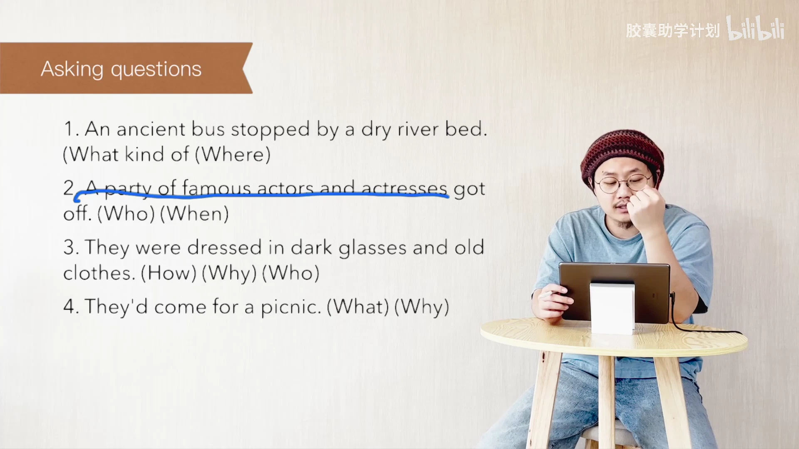

文字识别：胶囊助学计划biibi出 / Asking questions / 1.An ancient bus stopped by a dry river bed. / (What kind of (Where) / 2 Aparty of famous actors and actresses got / off. (Who)(When) / 3. They were dressed in dark glasses and old / clothes.(How)(Why)(Who) / 4.They'd come for a picnic. (What) (Why)

### 画面 00:03:55

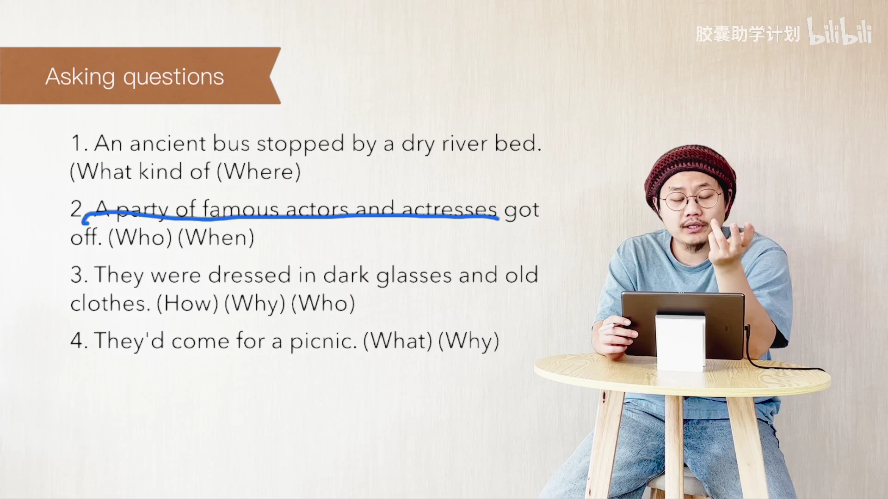

文字识别：Bilbi / 胶囊助学计划 / Asking questions / 1. An ancient bus stopped by a dry river bed. / (What kind of (Where) / 2A party of famous actors and actresses got / off. (Who)(When) / 3. They were dressed in dark glasses and old / clothes. (How) (Why) (Who) / 4.They'd come for a picnic. (What) (Why)

### 画面 00:03:57

文字识别：Bilbili / 胶囊助学计划 / Asking questions

### 画面 00:03:59

文字识别：bilibii / 胶囊助学计划 / Asking questions / 5. They had taken special precautions so that / no one should recognize them. (Why)

## 00:04:00–00:04:30

taken special precautions so that no one should recognize him. 哎，以便是吧？哎，没有人能识别出来他们啊。希望没有人能识别出来他们。Had提前，Why对后边整个提问嘛，对吧？Disguises can sometimes be too perfect. 你看提前嘛，他说这个伪装有的时候可能过于的完美了。啊，过于的完美的意思就是到最后也没看出来。我说我是谁，你都没看出来。那看提前，

### 画面 00:04:13

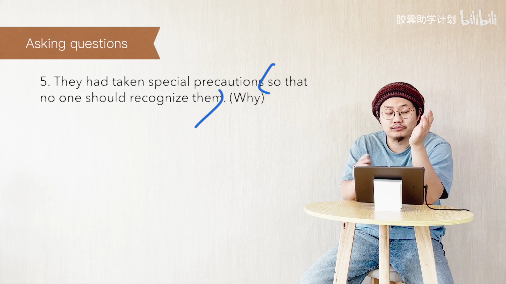

文字识别：Bilbii / 胶囊助学计划 / Asking questions / 5. They had taken special / I precautione so that / no one should recognize / them).(Why)

### 画面 00:04:19

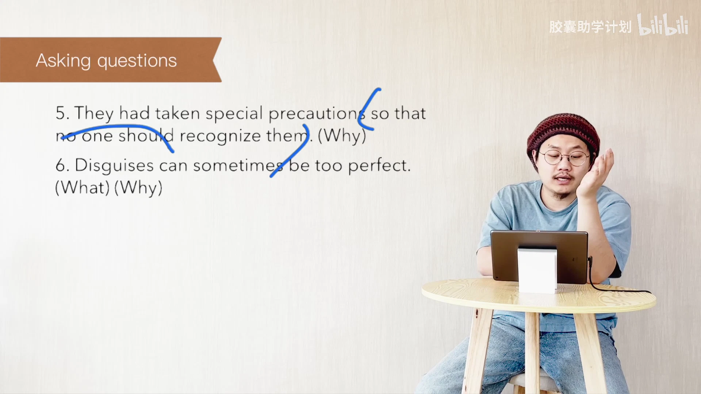

文字识别：biibili / 胶囊助学计划 / Asking / questions / 5. They had taken special / precautione so that / ro one / should recognize / them. / (Why) / 6. Disguises can sometimey be too perfect. / (What)(Why)

### 画面 00:04:21

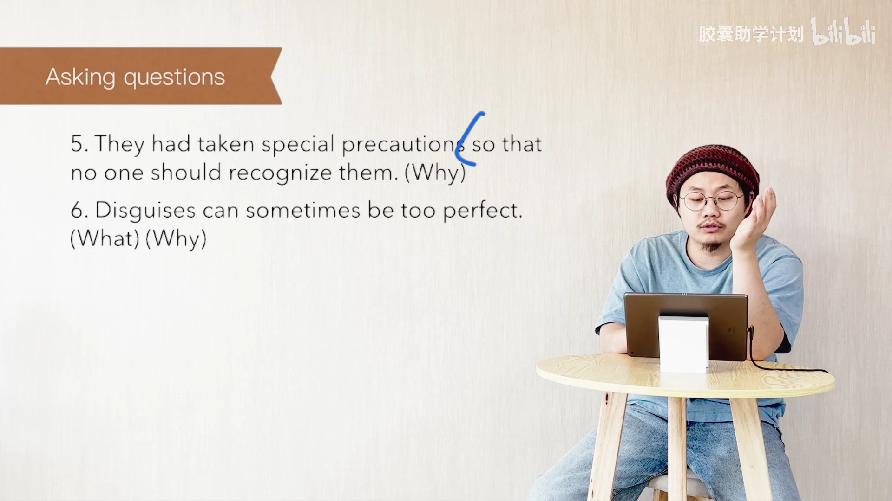

文字识别：biibili / 胶囊助学计划 / Asking questions / 5. They had taken special precautiong so that / no one should recognize them.(Why) / 6. Disguises can sometimes be too perfect. / (What)(Why)

### 画面 00:04:24

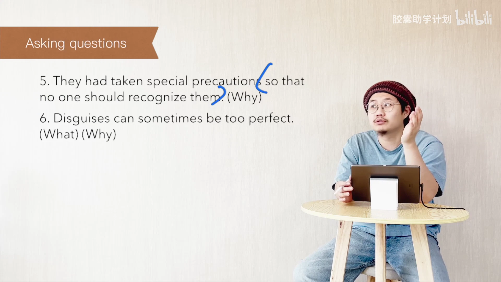

文字识别：bilbil / 胶囊助学计划 / Asking questions / 5. They had taken special precautiong so that / no one should recognize /  them?(Why) / 6. Disguises can sometimes be too perfect. / (What) (Why)

### 画面 00:04:27

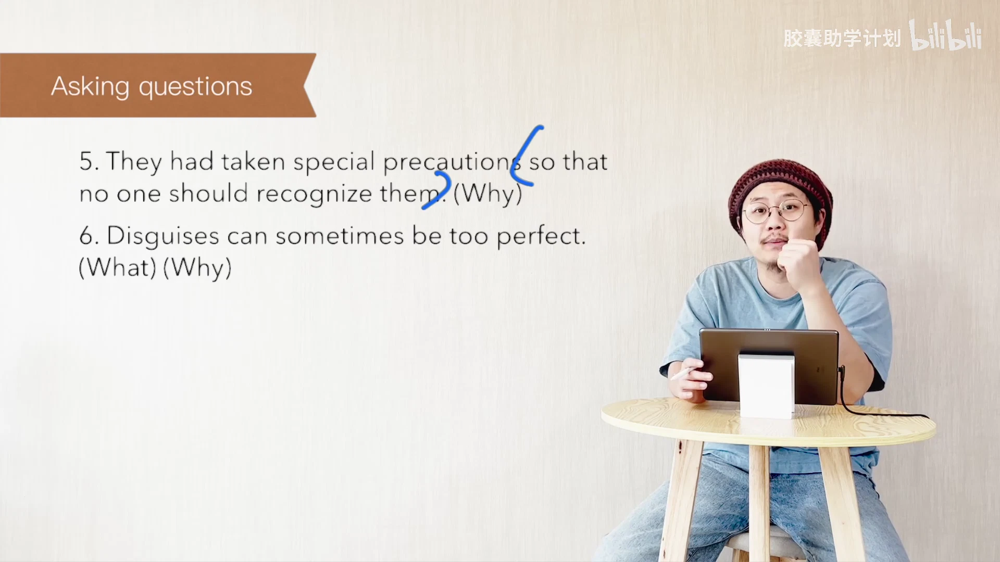

文字识别：bilbii / 胶囊助学计划 / Asking questions / 5. They had taken special precautiong so that / no one should recognize /  them?(Why) / 6. Disguises can sometimes be too perfect. / (What) (Why)

## 00:04:30–00:05:00

what 你肯定对 disguises 问嘛，对吧？然后 when 加整句就可以了。 It was a wonderful place for picnic. Was 提前 what kind of place was it? They got out their food. Did 提前 what did they get out? 哎，他们拿出了什么呢？食物啊。 Tell the story. 老习惯，我之前说过很多次，他不练我们的 accuracy，更练啊。虽然 accuracy 不能一点没有，更练我们的 fluency，更练我们的这个流利性，对

### 画面 00:04:41

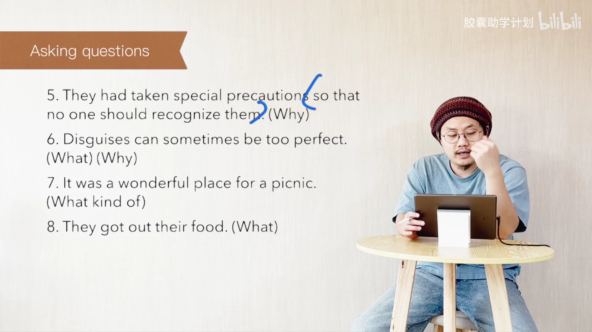

文字识别：胶囊助学计划ilb出 / Asking questions / 5. They had taken special precautione so that / no one should recognize them?(Why) / 6. Disguises can sometimes be too perfect. / (What) (Why) / 7. It was a wonderful place for a picnic. / (What kind of) / 8. They got out their food. (What)

### 画面 00:04:47

文字识别：bilbili / 胶囊助学计划 / Tell the story / 训练目标： / 口语复述能力 / Accuracy / Fluency

### 画面 00:04:51

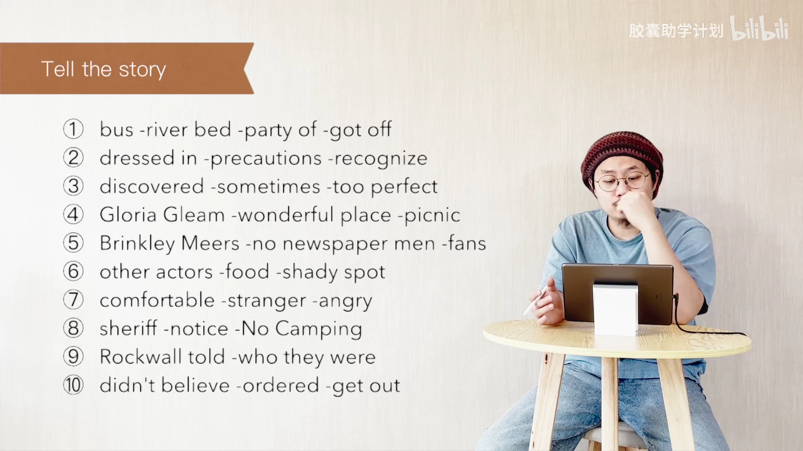

文字识别：胶囊助学计划biibil / Tell the story / ① bus -river bed -party of -got off / dressed in -precautions -recognize / 2 / discovered -sometimes -too perfect / Gloria Gleam -wonderful place -picnic / Brinkley Meers -no newspaper men -fans / other actors -food -shady spot / 6 / comfortable -stranger -angry / sheriff -notice -No Camping / 8 / 9F / Rockwall told -who they were / ①⑩ didn't believe -ordered -get out

### 画面 00:04:55

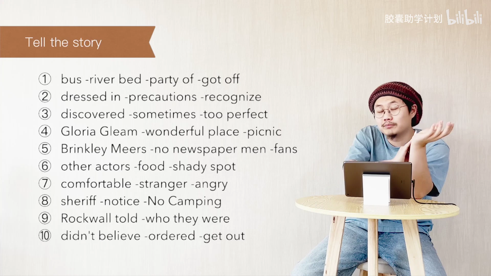

文字识别：胶囊助学计划biii / Tell the story / ① bus -river bed -party of -got off / dressed in -precautions -recognize / 2 / discovered -sometimes -too perfect / Gloria Gleam -wonderful place -picnic / Brinkley Meers -no newspaper men -fans / other actors -food -shady spot / 6 / comfortable -stranger -angry / sheriff -notice -No Camping / 8 / 9F / Rockwall told -who they were / ⑩ didn't believe -ordered -get out

## 00:05:00–00:05:30

吧？所以我们可以错一点点在这件题上，但是你不能太卡。这跟我们说汉语是一样的。我拿讲课的时候汉语都会说错，对吧？但是不能太慢啊，还是要流利性会更重要一点。OK，嗯，sample writing写完来这对答案，别忘了sample writing第四个单元是有两个哟，对吧？这个你要认真去写。写完这个，你对那些长难句的写法，你就会觉得很舒服，很舒服了啊。这个其实不用我们教，我们在每一个语法的

### 画面 00:05:01

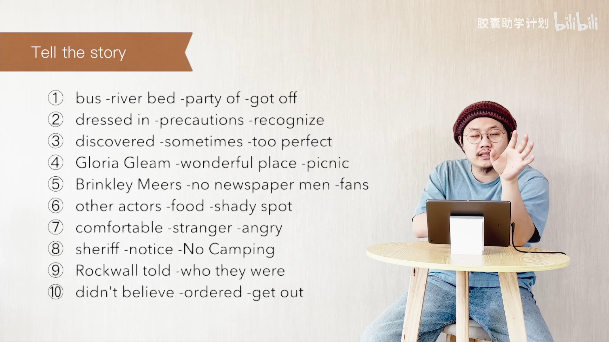

文字识别：胶囊助学计划bilbi / Tell the story / ① bus -river bed -party of -got off / dressed in -precautions -recognize / discovered -sometimes -too perfect / Gloria Gleam -Wonderful place -picnic / Brinkley Meers -no newspaper men -fans / other actors -food -shady spot / 6 / comfortable -stranger -angry / sheriff -notice -No Camping / 8 / ⑨ Rockwalltold -who they were / ①⑩ didn't believe -ordered -get out

### 画面 00:05:14

文字识别：bilbil / 胶囊助学计划 / Summary writing: Key / 训练目标： / 写作复述能力

### 画面 00:05:16

文字识别：胶囊助学计划bibi山 / Summary writing: Key / After an ancient bus had stopped by a dry / river bed, a party of famous film stars / descended. They were dressed in dark / glasses and old clothes so as not to be / recognized. Two of the actors carried some / picnic things to a shady spot and everyone / sat down. Just then a sheriff arrived and told / them rudely that they must leave because / camping was not allowed. Even when they / told him who they were, he did not believe / them.

### 画面 00:05:19

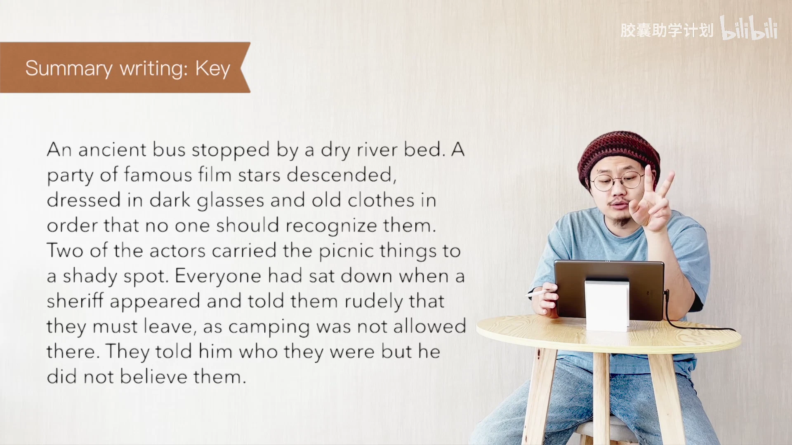

文字识别：胶囊助学计划ilbi / Summary writing: Key / An ancient bus stopped by a dry river bed. A / party of famous film stars descended, / dressed in dark glasses and old clothes in / order that no one should recognize them. / Two of the actors carried the picnic things to / a shady spot. Everyone had sat down when a / sheriff appeared and told them rudely that / they must leave, as camping was not allowed / there. They told him who they were but he / did not believe them.

## 00:05:30–00:06:00

地方已经教会你了。你现在无非就是要单独再去看一下，好吧？然后 topic for discussion 三道题老习惯啊。If you were famous, would you try to hide from the public? Why not? If you are famous, you

### 画面 00:05:34

文字识别：bilbil / 胶囊助学计划 / Topics for discussion / 训练目标： / 完全自由的对话 / Accuracy / Fluency

### 画面 00:05:36

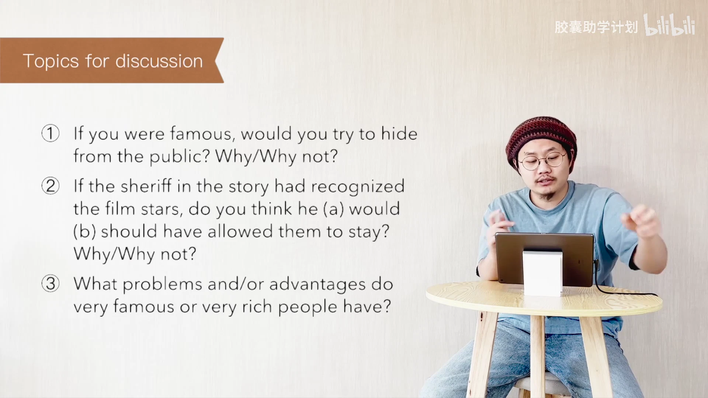

文字识别：胶囊助学计划bi / Topics for discussion / If you were famous, would you try to hide / from the public? Why/Why not? / If the sheriff in the story had recognized / the film stars, do you think he (a) would / (b) should have allowed them to stay? / Why/Why not? / What problems and/or advantages do / very famous or very rich people have?

### 画面 00:05:40

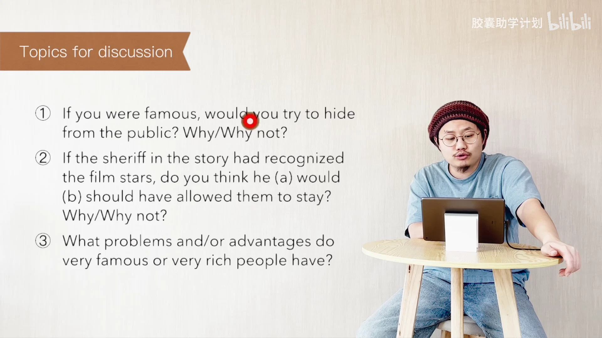

文字识别：胶囊助学计划i山 / Topics for discussion / If you were famous, would you try to hide / from the public? Why/Why not? / If the sheriff in the story had recognized / the film stars, do you think he (a) would / (b) should have allowed them to stay? / Why/Why not? / What problems and/or advantages do / very famous or very rich people have?

### 画面 00:05:44

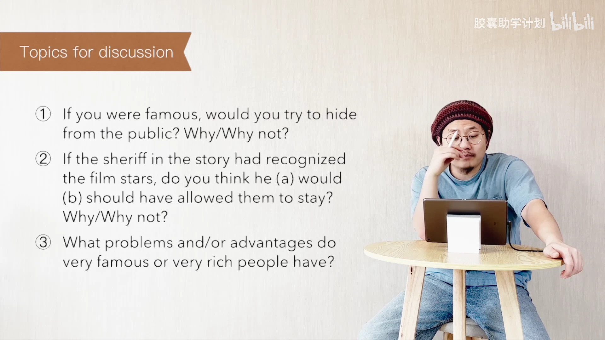

文字识别：胶囊助学计划bib出 / Topics for discussion / If you were famous, would you try to hide / from the public? Why/Why not? / If the sheriff in the story had recognized / the film stars, do you think he (a) would / (b) should have allowed them to stay? / Why/Why not? / What problems and/or advantages do / very famous or very rich people have?

## 00:06:00–00:06:30

a have allowed them to stay? Why not?他说如果这个警察呀，在故事当中，警察认出了这些电影明星，你认为他会或者应该哎让他们继续在这待着吗？注意这两个的区别是应然跟实然，对吧？哎，就是实际上would实际上会怎么样？那应该是should have怎么怎么样，对吧？然后啊，下一个说What problems and or do advantages do very

### 画面 00:06:14

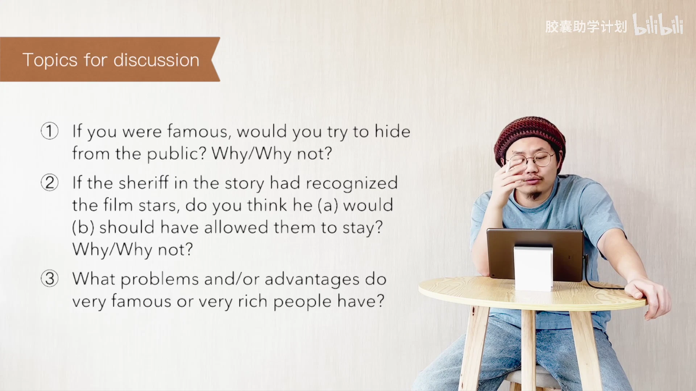

文字识别：胶囊助学计划bii / Topics for discussion / If you were famous, would you try to hide / from the public? Why/Why not? / If the sheriff in the story had recognized / the film stars, do you think he (a) would / (b) should have allowed them to stay? / Why/Why not? / What problems and/or advantages do / very famous or very rich people have?

### 画面 00:06:28

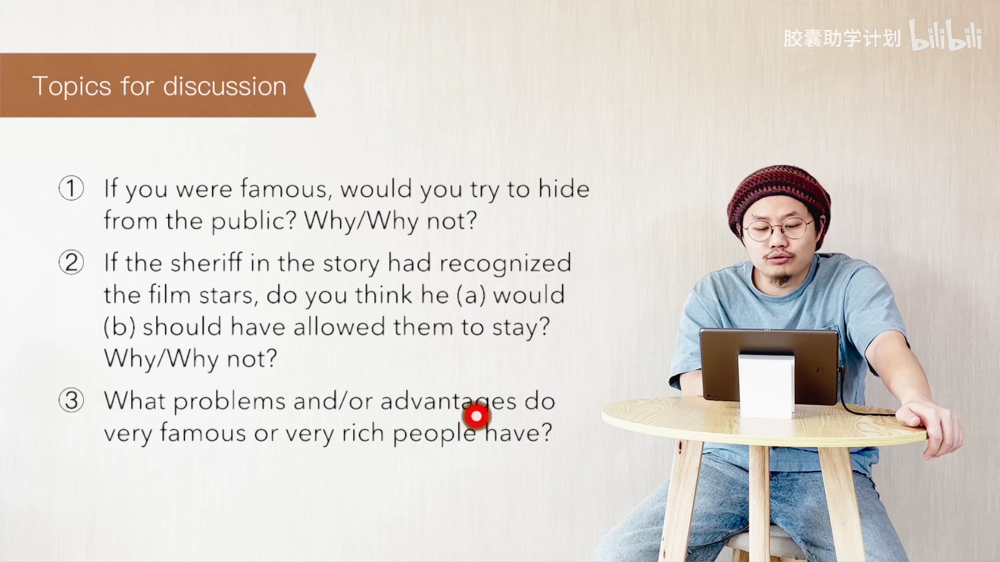

文字识别：胶囊助学计划blb出 / Topics for discussion / If you were famous, would you try to hide / from the public? Why/Why not? / If the sheriff in the story had recognized / the film stars, do you think he (a) would / (b) should have allowed them to stay? / Why/Why not? / What problems and/or advantages do / very famous or very rich people have?

## 00:06:30–00:07:00

famous or very p, uh, rich people have? This is a Chinese-English teaching recording. Transcribe the exact words in their original spoken languages. Never translate. Preserve repetitions, questions and examples. Do advantages do very famous or very p, uh, rich people have? This is a Chinese-English teaching recording. Transcribe the exact words in their original spoken languages. Never translate. Preserve repetitions, questions and examples.

### 画面 00:06:42

文字识别：biibili / 胶囊助学计划 / 1.Ask me if写&朗读

### 画面 00:06:44

文字识别：bibili / 胶囊助学计划 / 1.Ask me if写&朗读 / 摘要写作写&答案

### 画面 00:06:46

文字识别：bilbili / 胶囊助学计划 / 1. / Ask me if写&朗读 / 摘要写作写&答案 / 3.Tell the story 口语复述

### 画面 00:06:48

文字识别：biibili / 胶囊助学计划 / 1.Askme if写&朗读 / 摘要写作写&答案 / 3.Tell the story 口语复述 / 4.重复间隔（置顶留言)

### 画面 00:06:50

文字识别：biibii / 胶囊助学计划 / 1.Ask me if写&朗读 / 摘要写作写&答案 / 3.Tell the story 口语复述 / .重复间隔（置顶留言） / 4.

### 画面 00:06:52

文字识别：bibli / 胶囊助学计划 / 1.Ask me if写&朗读 / 摘要写作写&答案 / 3.Tell the story 口语复述 / 4. / 4.重复间隔（置顶留言）

### 画面 00:06:54

文字识别：biibii / 胶囊助学计划 / 13

### 画面 00:06:59

文字识别：Bilbl / 胶囊助学计划 / 不

## 00:07:00–00:07:20

关注、订阅、一键三连，分享给那些需要的朋友，来帮助我们快速成长。See you next time.

### 画面 00:07:07

文字识别：助字計划

### 画面 00:07:09

文字识别：CAPSULEACADEMY / 胶囊助学计划 / 小红书 / Lecturer / □ / Leo / OE

### 画面 00:07:12

文字识别：CAPSULEACADEMY / 胶囊助学计划 / 小红书

### 画面 00:07:15

文字识别：CAPSULEACADEMY / 胶囊助学计划 / 『 / 小红书 / Creator / Leo & Berlin / OE

### 画面 00:07:17

文字识别：Bilbili / 胶囊助学计划 / CAPSULEACADEMY / 胶囊助学计划 / 小红书 / 8 / OE

### 画面 00:07:19

文字识别：bilibili / 胶囊助学计划

