# 075 单词 语法

快速机器解析：语音为单模型转写，未进行独立交叉校对或人工复核；画面每秒采样并按变化选帧，短时文字和标记可能遗漏。截图时间约有 1 秒误差。图片有损压缩；遇到疑点请按时间查看 Google Drive 原视频。

## 00:00:00–00:00:30

Hello everyone, welcome to Capsule Academy. This is Leo. Today we're going to learn new concept English Book Two Lesson Seventy Five Words and Grammar. 那老习惯进入正式课程之前呢，咱们看几个小的问题。第一，如何表达发送信号？第二，如何表达把火给踩灭了？第三，如何表达抵达现场？那带着这三个问题，Hope you gonna enjoy.

### 画面 00:00:00

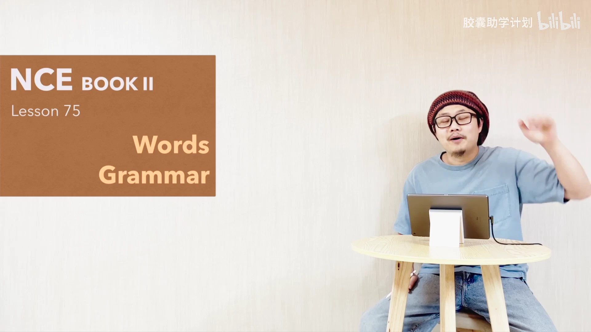

文字识别：bilbii / 胶囊助学计划 / NCE / BOOK"I / Lesson 75 / Words / Grammar

### 画面 00:00:02

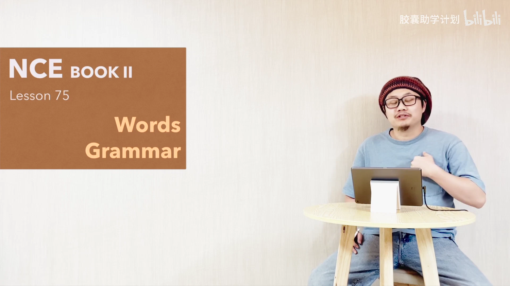

文字识别：biibii / 胶囊助学计划 / NCE / BOOK II / Lesson 75 / Words / Grammar

### 画面 00:00:05

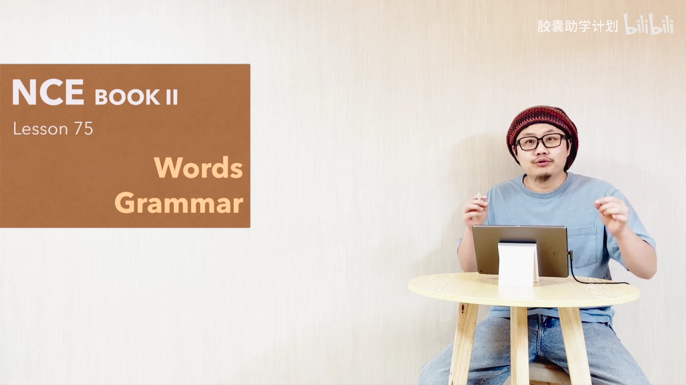

文字识别：biibii / 胶囊助学计划 / NCE / BOOK I"I / Lesson 75 / Words / Grammar

### 画面 00:00:07

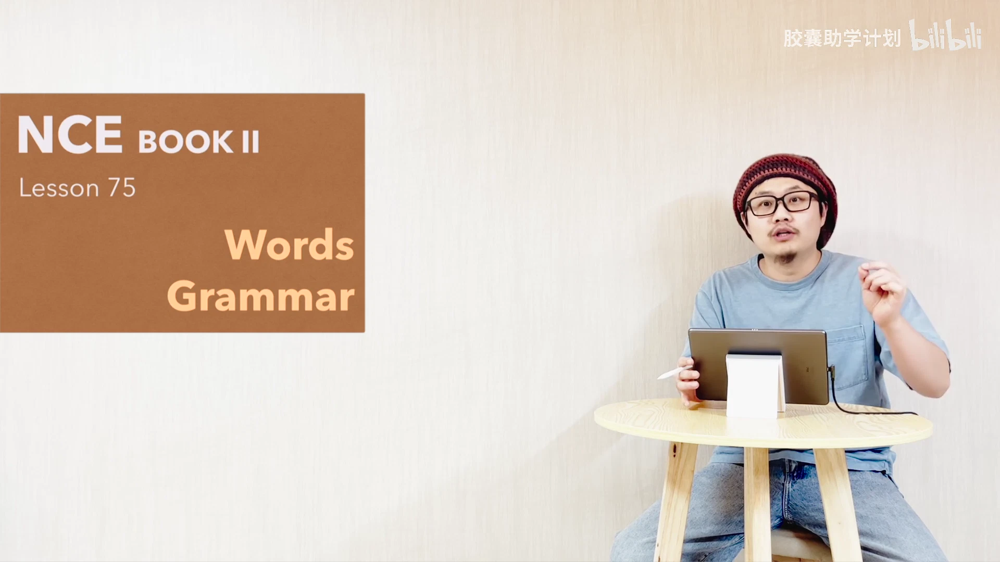

文字识别：biibii / 胶囊助学计划 / NCE / BOOKII / Lesson 75 / Words / Grammar

### 画面 00:00:12

文字识别：biibii / 胶囊助学计划

### 画面 00:00:14

文字识别：bilbili / 胶囊助学计划 / ①如何表达“发送信号”？

### 画面 00:00:16

文字识别：bilbili / 胶囊助学计划 / ①如何表达“发送信号”? / 如何表达“踩灭火”?

### 画面 00:00:18

文字识别：bibii / 胶囊助学计划 / ①如何表达“发送信号”? / 如何表达“踩灭火”？

### 画面 00:00:20

文字识别：bilbili / 胶囊助学计划 / ①如何表达“发送信号”? / 如何表达“踩灭火”? / 如何表达“抵达现场”?

### 画面 00:00:22

文字识别：bilbili / 胶囊助学计划 / ①如何表达“发送信号” / 如何表达“踩灭火”? / 如何表达“抵达现场”

### 画面 00:00:25

文字识别：bilbii / 胶囊助学计划 / ①如何表达“发送信号”? / 如何表达“踩灭火”? / 如何表达“抵达现场”

### 画面 00:00:27

文字识别：胶囊助学计划bil出

### 画面 00:00:29

文字识别：胶囊助学计划册出 / 胶囊助学计划

## 00:00:30–00:01:00

好，我们先看本课的单词啊。第一个 thick thick 这个这个音啊，就是我们现在音标写成这个样子的。希望您还记得要咬一下舌啊，这样的一个音，对吧？然后给它连起来叫做 thick thick。 OK， thick 指的是厚啊，它是个形容词。那你想拿它去造句就比较容易了，你形容词加名词或者形容词单独去用，对吧？比如说你看这句话说 The ice can't be thick enough

### 画面 00:00:31

文字识别：单词造句指南 / 网：v.+v.变化 / 胶囊助学计划 / bilbili / 四句型转换 / 方式/地点/时间 / 结合习惯用法 / 其他单词+词性 / 原文摘抄+变 / 6123456 / / θ I k / / thick adj.

### 画面 00:00:33

文字识别：单词造句指南 / 网：v.+v.变化 / 胶囊助学计划 / bibii / 四句型转换 / 方式/地点/时间 / 结合习惯用法 / 其他单词+词性 / 原文摘抄+变 / 6123456 / / θ I k / / thick adj.

### 画面 00:00:35

文字识别：单词造句指南 / 网：v.+v.变化 / 胶囊助学计划 / bilbli / 四句型转换 / 方式/地点/时间 / 结合习惯用法 / 其他单词+词性 / 原文摘抄+变 / 6123456 / / θ 1 k / / thick adj.

### 画面 00:00:37

文字识别：单词造句指南 / 网：v.+v.变化 / 胶囊助学计划 / bilbili / 四句型转换 / 方式/地点/时间 / 结合习惯用法 / 其他单词+词性 / 原文摘抄+变 / 6123456 / / θ I k / / thick adj.

### 画面 00:00:39

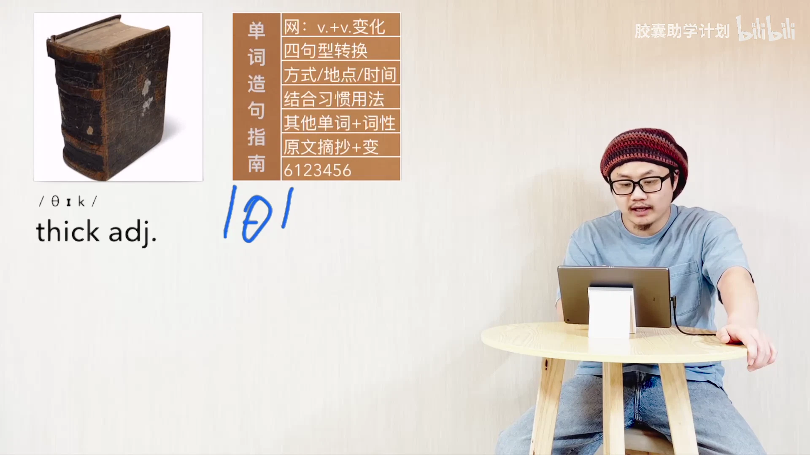

文字识别：单词造句指南 / 网：v.+v.变化 / 胶囊助学计划 / bilbii / 四句型转换 / 方式/地点/时间 / 结合习惯用法 / 其他单词+词性 / 原文摘抄+变 / 6123456 / / θ 1 k / / D / thick adj.

### 画面 00:00:41

文字识别：单词造句指南 / 网：v.+v.变化 / 胶囊助学计划 / bibii / 四句型转换 / 方式/地点/时间 / 结合习惯用法 / 其他单词+词性 / 原文摘抄+变 / 6123456 / 01 / 1 θ 1 k / / thick adj.

### 画面 00:00:43

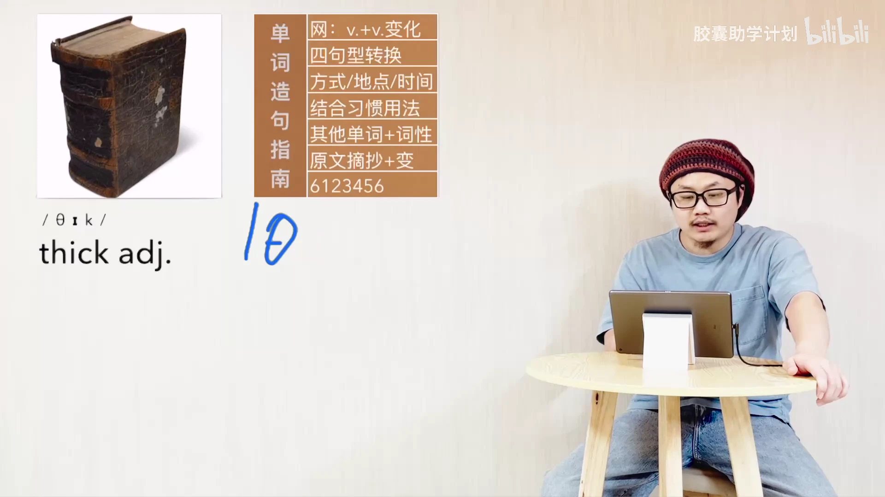

文字识别：单词造句指南 / 网：v.+v.变化 / 胶囊助学计划 / bibili / 四句型转换 / 方式/地点/时间 / 结合习惯用法 / 其他单词+词性 / 原文摘抄+变 / 6123456 / / θ Ⅰ k / / thick adj.

### 画面 00:00:45

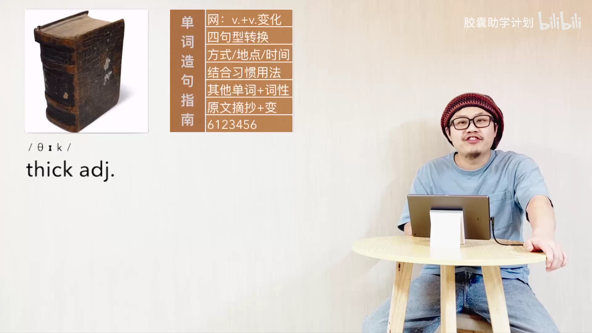

文字识别：单词造句指南 / 网：v.+v.变化 / 胶囊助学计划 / bilbili / 四句型转换 / 方式/地点/时间 / 结合习惯用法 / 其他单词+词性 / 原文摘抄+变 / 6123456 / 1 θ Ⅰ k / / thick adj.

### 画面 00:00:47

文字识别：单词造句指南 / 网：v.+v.变化 / 胶囊助学计划 / bilbili / 四句型转换 / 方式/地点/时间 / 结合习惯用法 / 其他单词+词性 / 原文摘抄+变 / 6123456 / 1 θ Ⅰ k 1 / thick adj.

### 画面 00:00:49

文字识别：单词造句指南 / 网：v.+v.变化 / 胶囊助学计划 / bilbili / 四句型转换 / 方式/地点/时间 / 结合习惯用法 / 其他单词+词性 / 原文摘抄+变 / 6123456 / 1 θ 1 k 1 / thick adj.

### 画面 00:00:51

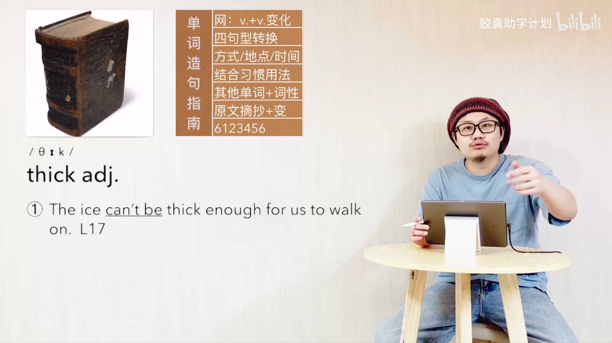

文字识别：单词造句指南 / 网：v.+v.变化 / 胶囊助学计划 / biibii / 四句型转换 / 方式/地点/时间 / 结合习惯用法 / 其他单词+词性 / 原文摘抄+变 / 6123456 / 1 θ Ⅰ k 1 / thick adj. / ) The ice can't be thick enough for us to walk / on. L17

### 画面 00:00:53

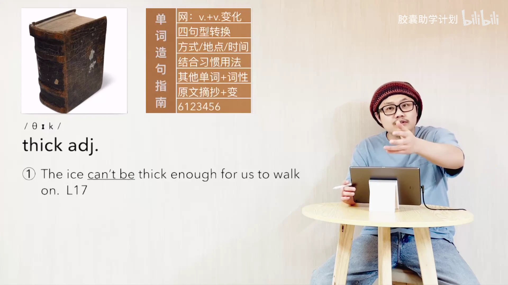

文字识别：单词造句指南 / 网：v.+v.变化 / 胶囊助学计划 / bilbili / 四句型转换 / 方式/地点/时间 / 结合习惯用法 / 其他单词+词性 / 原文摘抄+变 / 6123456 / 1 θ 1 k 1 / thick adj. / ① The ice can't be thick enough for us to walk / on. L17

### 画面 00:00:55

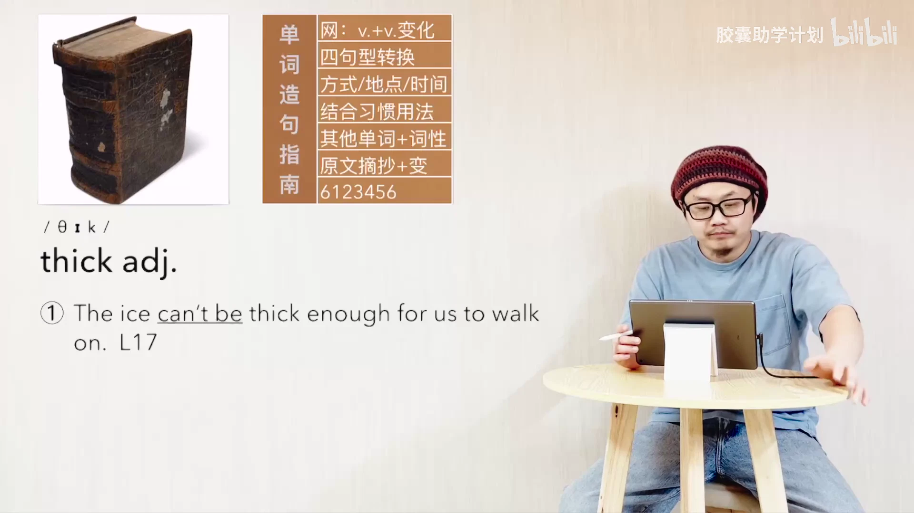

文字识别：单词造句指南 / 网：v.+v.变化 / 胶囊助学计划 / bilbili / 四句型转换 / 方式/地点/时间 / 结合习惯用法 / 其他单词+词性 / 原文摘抄+变 / 6123456 / / θ Ⅰ k 1 / thick adj. /  The ice can't be thick enough for us to walk / 1 / on. L17

### 画面 00:00:57

文字识别：单词造句指南 / 网：v.+v.变化 / 胶囊助学计划 / bilbili / 四句型转换 / 方式/地点/时间 / 结合习惯用法 / 其他单词+词性 / 原文摘抄+变 / 6123456 / 1 θ Ⅰ k / / thick adj. / ① The ice can't be thick enough for us to walk / on. L17

### 画面 00:00:59

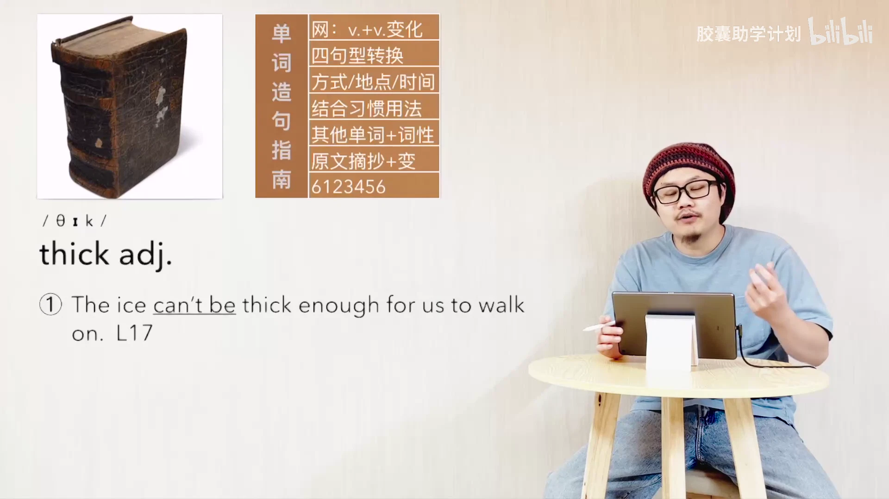

文字识别：单词造句指南 / 网：v.+v.变化 / 胶囊助学计划 / Bilbili / 四句型转换 / 方式/地点/时间 / 结合习惯用法 / 其他单词+词性 / 原文摘抄+变 / 6123456 / 1 θ Ⅰ k 1 / thick adj. /  The ice can't be thick enough for us to walk / 1 / on. L17

## 00:01:00–00:01:30

for us to walk on. This ice, ah,一定还没有足够的厚，对于我们来说，在上面去走，对吧？哎，就是不够厚，你别上上面去走啊！Can't be加形容词，一定不怎么怎么样。OK，是一个推测。Next one说，The fog must have been too thick to drive to Beijing.说这个雾啊太厚了。哎，其实什么叫雾厚呢？就是我们至少北方话大多数就雾太大了啊，

### 画面 00:01:01

文字识别：单词造句指南 / 网：v.+v.变化 / 胶囊助学计划 / bibili / 四句型转换 / 方式/地点/时间 / 结合习惯用法 / 其他单词+词性 / 原文摘抄+变 / 6123456 / / θ Ⅰ k / / thick adj. / ① The ice can't be thick enough for us to walk / on. L17

### 画面 00:01:03

文字识别：单词造句指南 / 网：v.+v.变化 / 胶囊助学计划 / bibili / 四句型转换 / 方式/地点/时间 / 结合习惯用法 / 其他单词+词性 / 原文摘抄+变 / 6123456 / 1 θ 1 k 1 / thick adj. /  The ice can't be thick enough for us to walk / on. L17

### 画面 00:01:05

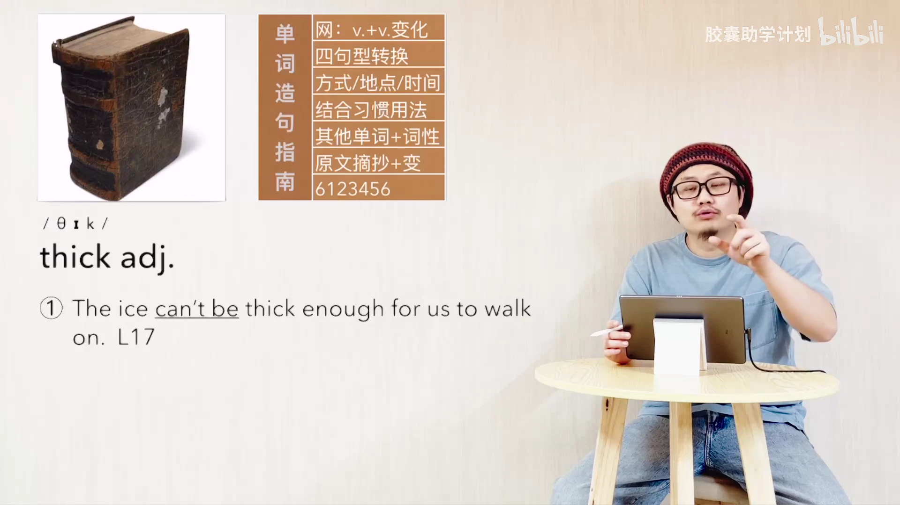

文字识别：单词造句指南 / 网：v.+v.变化 / 胶囊助学计划 / bilbili / 四句型转换 / 方式/地点/时间 / 结合习惯用法 / 其他单词+词性 / 原文摘抄+变 / 6123456 / / θ 1 k / / thick adj. /  The ice can't be thick enough for us to walk / 1 / on. L17

### 画面 00:01:08

文字识别：单词造句指南 / 网：v.+v.变化 / 胶囊助学计划 / bilbili / 四句型转换 / 方式/地点/时间 / 结合习惯用法 / 其他单词+词性 / 原文摘抄+变 / 6123456 / / θ 1 k / / thick adj. /  The ice can't be thick enough for us to walk / 1 / on. L17

### 画面 00:01:10

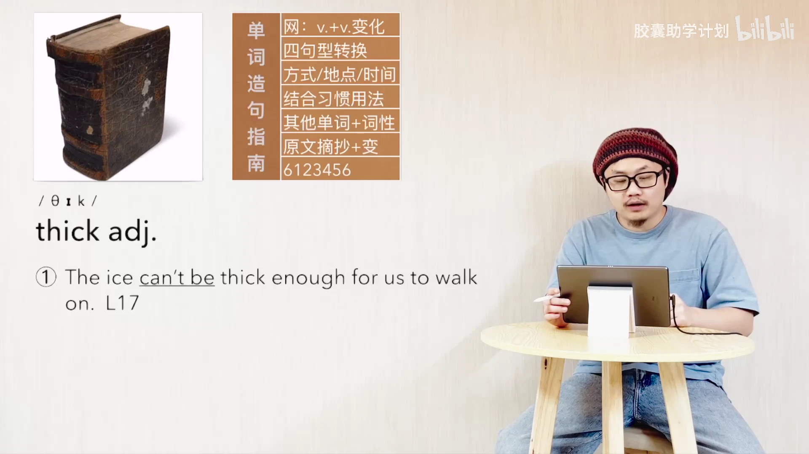

文字识别：单词造句指南 / 网：v.+v.变化 / 胶囊助学计划 / bibili / 四句型转换 / 方式/地点/时间 / 结合习惯用法 / 其他单词+词性 / 原文摘抄+变 / 6123456 / 1 θ 1 k 1 / thick adj. /  The ice can't be thick enough for us to walk / 1 / on. L17

### 画面 00:01:12

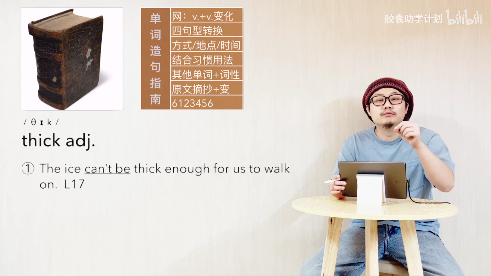

文字识别：单词造句指南 / 网：v.+v.变化 / 胶囊助学计划 / bilbili / 四句型转换 / 方式/地点/时间 / 结合习惯用法 / 其他单词+词性 / 原文摘抄+变 / 6123456 / 1 θ Ⅰ k 1 / thick adj. /  The ice can't be thick enough for us to walk / on. L17

### 画面 00:01:14

文字识别：单词造句指南 / 网：v.+v.变化 / 胶囊助学计划 / bilbili / 四句型转换 / 方式/地点/时间 / 结合习惯用法 / 其他单词+词性 / 原文摘抄+变 / 6123456 / / θ Ⅰ k / / thick adj. /  The ice can't be thick enough for us to walk / 1 / on. L17

### 画面 00:01:16

文字识别：单词造句指南 / 网：v.+v.变化 / 胶囊助学计划 / bilibii / 四句型转换 / 方式/地点/时间 / 结合习惯用法 / 其他单词+词性 / 原文摘抄+变 / 6123456 / / θ 1 k / / thick adj. / ① The ice can't be thick enough for us to walk / on. L17 / The fog must have been too thick to drive / to Beijing. L17

### 画面 00:01:18

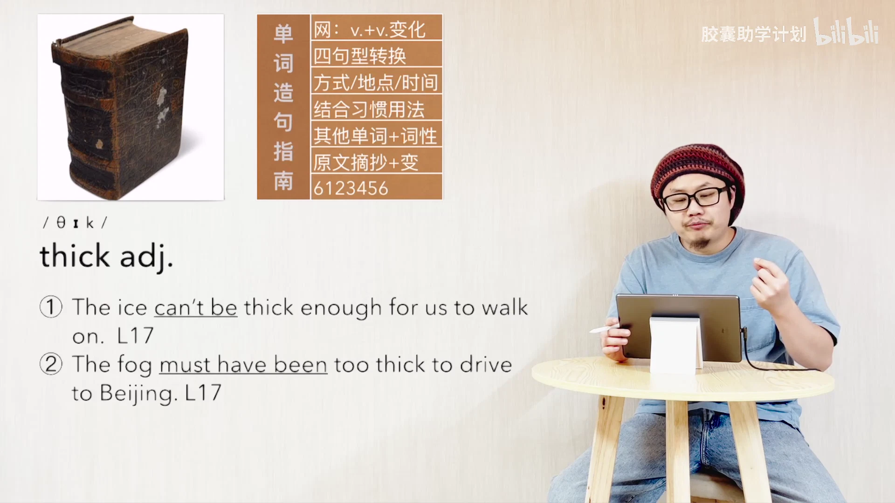

文字识别：单词造句指南 / 网：v.+v.变化 / 胶囊助学计划 / bilbii / 四句型转换 / 方式/地点/时间 / 结合习惯用法 / 其他单词+词性 / 原文摘抄+变 / 6123456 / / θ Ⅰ k / / thick adj. / ① The ice can't be thick enough for us to walk / on. L17 / The fog must have been too thick to drive / to Beijing. L17

### 画面 00:01:20

文字识别：单词造句指南 / 网：v.+v.变化 / 胶囊助学计划 / bilibii / 四句型转换 / 方式/地点/时间 / 结合习惯用法 / 其他单词+词性 / 原文摘抄+变 / 6123456 / 1 θ 1 k / / thick adj. / ① The ice can't be thick enough for us to walk / on. L17 / The fog must have been too thick to drive / to Beijing. L17

### 画面 00:01:22

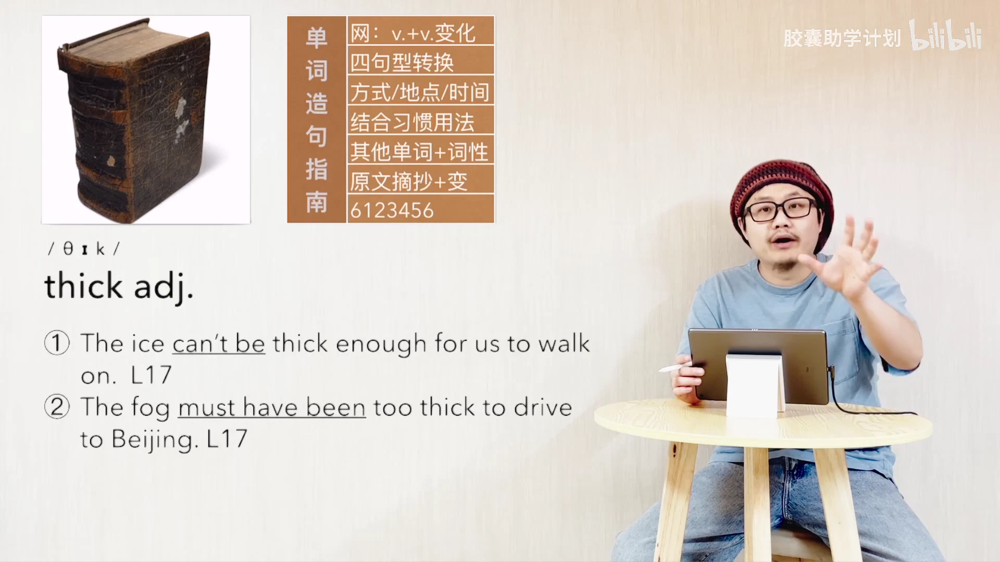

文字识别：单词造句指南 / 网：v.+v.变化 / 胶囊助学计划 / bilbili / 四句型转换 / 方式/地点/时间 / 结合习惯用法 / 其他单词+词性 / 原文摘抄+变 / 6123456 / / θ 1 k / / thick adj. / ① The ice can't be thick enough for us to walk / on. L17 / The fog must have been too thick to drive / to Beijing. L17

### 画面 00:01:24

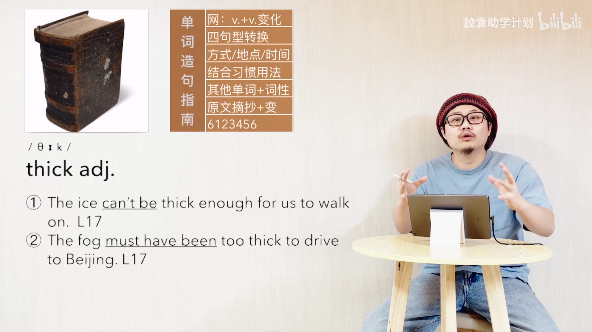

文字识别：单词造句指南 / 网：v.+v.变化 / 胶囊助学计划 / bilbili / 四句型转换 / 方式/地点/时间 / 结合习惯用法 / 其他单词+词性 / 原文摘抄+变 / 6123456 / 1 θⅠ k 1 / thick adj. / ① The ice can't be thick enough for us to walk / on. L17 / The fog must have been too thick to drive / to Beijing. L17

### 画面 00:01:26

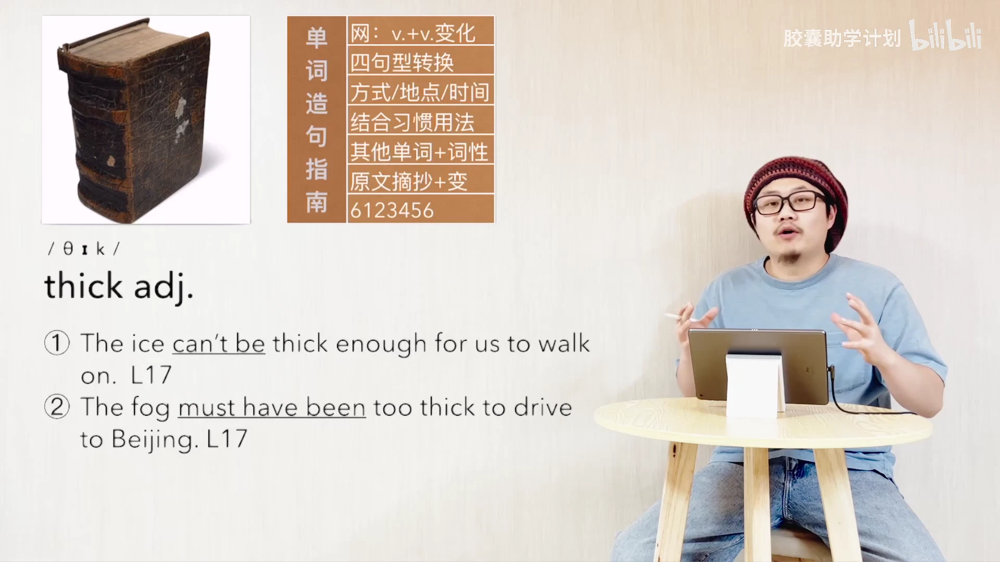

文字识别：单词造句指南 / 网：v.+v.变化 / 胶囊助学计划 / bilbili / 四句型转换 / 方式/地点/时间 / 结合习惯用法 / 其他单词+词性 / 原文摘抄+变 / 6123456 / 1 θ 1 k / / thick adj. / ① The ice can't be thick enough for us to walk / on. L17 / The fog must have been too thick to drive / to Beijing. L17

### 画面 00:01:29

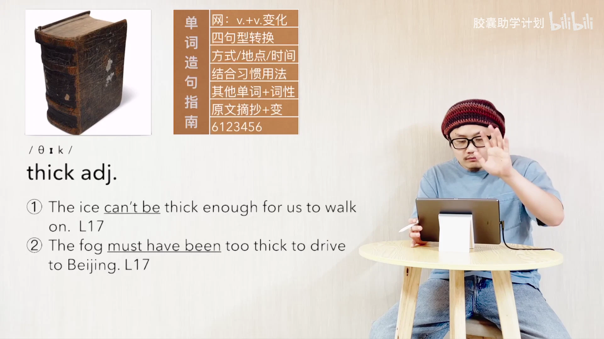

文字识别：单词造句指南 / 网：v.+v.变化 / 胶囊助学计划 / biibii / 四句型转换 / 方式/地点/时间 / 结合习惯用法 / 其他单词+词性 / 原文摘抄+变 / 6123456 / 1 θ 1 k / / thick adj. / ① The ice can't be thick enough for us to walk / on. L17 / The fog must have been too thick to drive / to Beijing. L17

## 00:01:30–00:02:00

太而不能啊，too thick to do something，对吧？哎，呃，太大了，以至于没办法开车去北京。Next one说，cleaning thick snow is one of my source of income。这可能是一个小孩子说的话，尤其是西方国家。小的时候，如果咱们看过那有一个电影《小鬼当家》，那个里边那个小男主不就是cleaning thick snow嘛，对吧？哎，叫做打扫这个厚的雪是我收入来源的主要，呃，是我的这个收入来源

### 画面 00:01:31

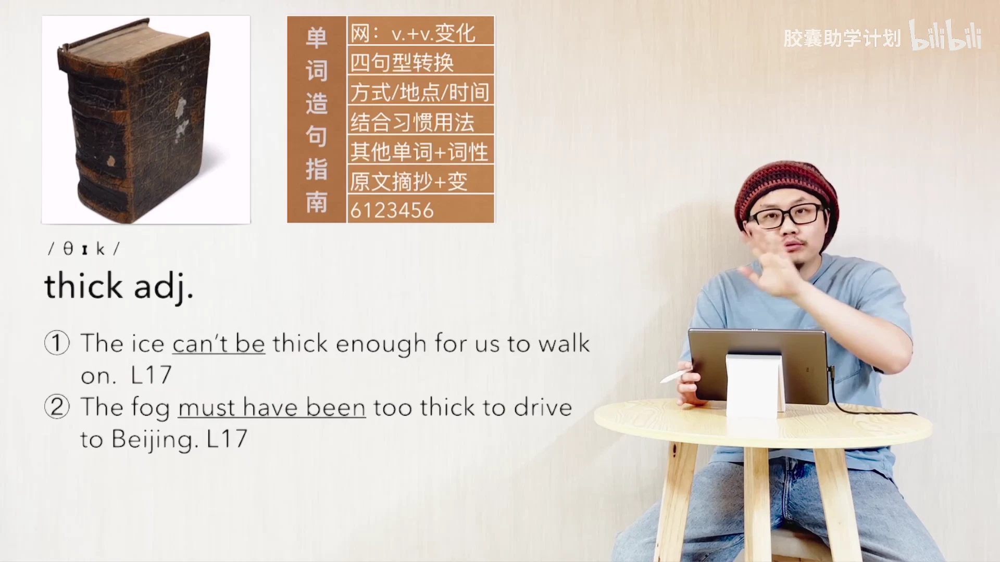

文字识别：单词造句指南 / 网：v.+v.变化 / 胶囊助学计划 / bibili / 四句型转换 / 方式/地点/时间 / 结合习惯用法 / 其他单词+词性 / 原文摘抄+变 / 6123456 / 1 θ Ⅰ k / / thick adj. / ① The ice can't be thick enough for us to walk / on. L17 / The fog must have been too thick to drive / to Beijing. L17

### 画面 00:01:34

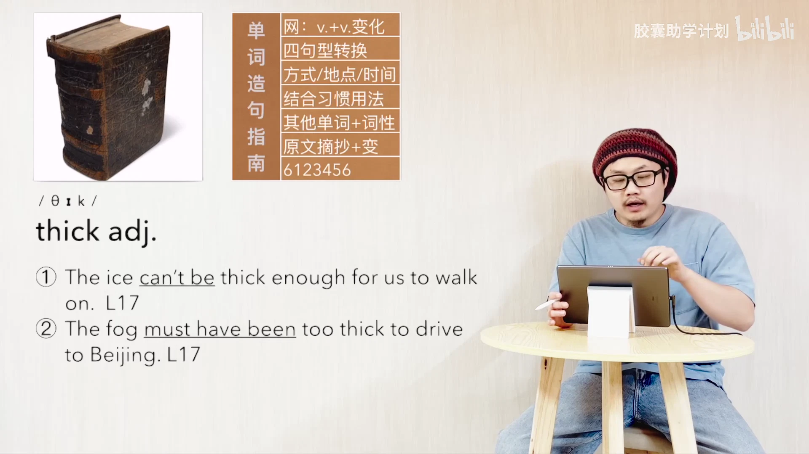

文字识别：单词造句指南 / 网：v.+v.变化 / 胶囊助学计划 / biibli / 四句型转换 / 方式/地点/时间 / 结合习惯用法 / 其他单词+词性 / 原文摘抄+变 / 6123456 / / θ 1 k / / thick adj. / ① The ice can't be thick enough for us to walk / on. L17 / The fog must have been too thick to drive / to Beijing. L17

### 画面 00:01:36

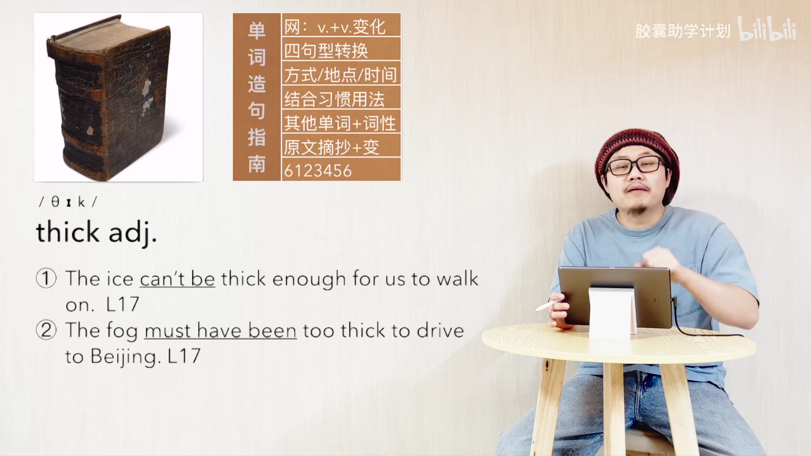

文字识别：单词造句指南 / 网：v.+v.变化 / 胶囊助学计划 / bilbili / 四句型转换 / 方式/地点/时间 / 结合习惯用法 / 其他单词+词性 / 原文摘抄+变 / 6123456 / 1 θ1 k 1 / thick adj. / ① The ice can't be thick enough for us to walk / on. L17 / The fog must have been too thick to drive / to Beijing. L17

### 画面 00:01:38

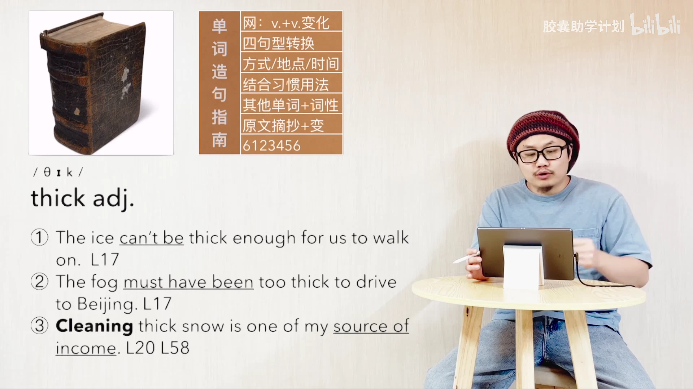

文字识别：单词造句指南 / 网：v.+v.变化 / 胶囊助学计划 / bilbili / 四句型转换 / 方式/地点/时间 / 结合习惯用法 / 其他单词+词性 / 原文摘抄+变 / 6123456 / 1 θ 1 k 1 / thick adj. / ① The ice can't be thick enough for us to walk / on. L17 / The fog must have been too thick to drive / to Beijing. L17 / Cleaning thick snow is one of my source of / income.L20 L58

### 画面 00:01:40

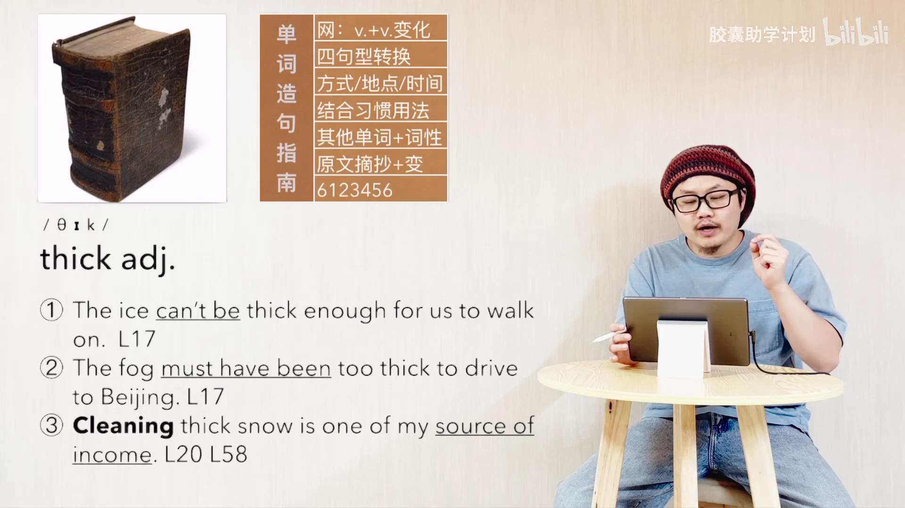

文字识别：单词造句指南 / 网：v.+v.变化 / 胶囊助学计划 / Biltbili / 四句型转换 / 方式/地点/时间 / 结合习惯用法 / 其他单词+词性 / 原文摘抄+变 / 6123456 / / θ1 k / / thick adj. / ① The ice can't be thick enough for us to walk / on. L17 / The fog must have been too thick to drive / to Beijing. L17 / Cleaning thick snow is one of my source of / income.L20 L58

### 画面 00:01:42

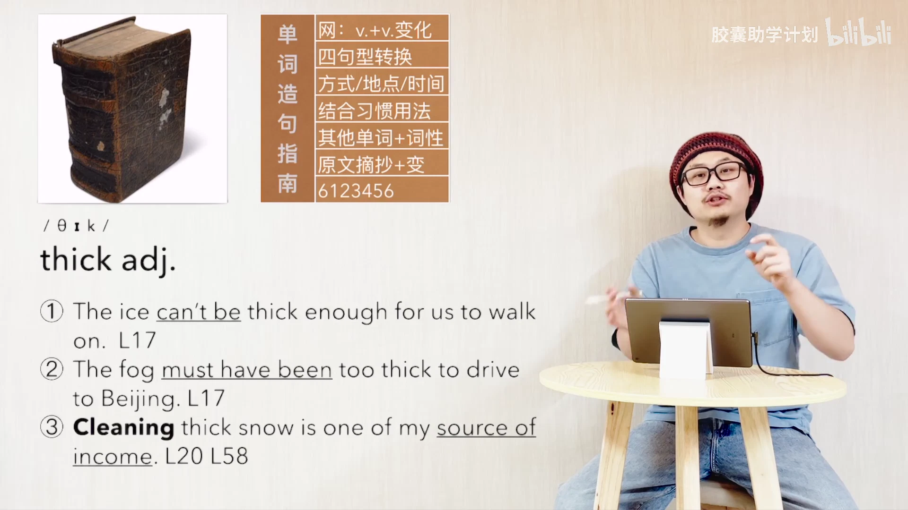

文字识别：胶囊助学计划bilii / 单词造句指南 / 网：v.+v.变化 / 四句型转换 / 方式/地点/时间 / 结合习惯用法 / 其他单词+词性 / 原文摘抄+变 / 6123456 / 1 θ1 k 1 / thick adj. / ① The ice can't be thick enough for us to walk / on. L17 / The fog must have been too thick to drive / to Beijing. L17 / Cleaning thick snow is one of my source of / income.L20 L58

### 画面 00:01:45

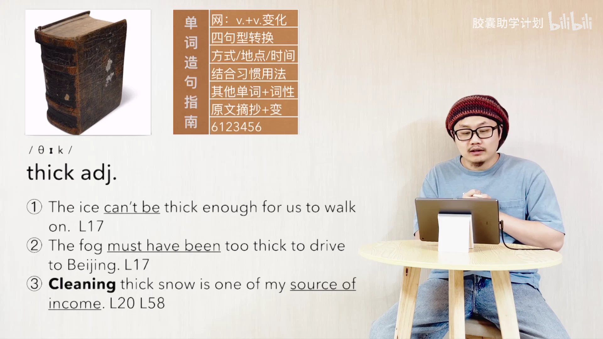

文字识别：单词造句指南 / 网：v.+v.变化 / 胶囊助学计划 / Biltbili / 四句型转换 / 方式/地点/时间 / 结合习惯用法 / 其他单词+词性 / 原文摘抄+变 / 6123456 / / θⅠ k 1 / thick adj. / ① The ice can't be thick enough for us to walk / on. L17 / The fog must have been too thick to drive / to Beijing. L17 / Cleaning thick snow is one of my source of / income. L20 L58

### 画面 00:01:47

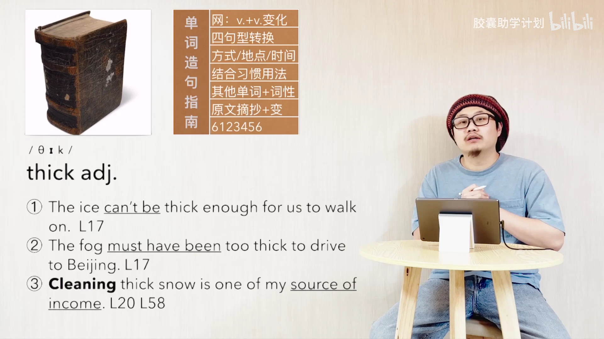

文字识别：单词造句指南 / 网：v.+v.变化 / 胶囊助学计划 / Biltbili / 四句型转换 / 方式/地点/时间 / 结合习惯用法 / 其他单词+词性 / 原文摘抄+变 / 6123456 / 1 θ 1 k 1 / thick adj. / ① The ice can't be thick enough for us to walk / on. L17 / The fog must have been too thick to drive / to Beijing. L17 / Cleaning thick snow is one of my source of / income.L20 L58

### 画面 00:01:50

文字识别：胶囊助学计划bilbi / 单词造句指南 / 网：v.+v.变化 / 四句型转换 / 方式/地点/时间 / 结合习惯用法 / 其他单词+词性 / 原文摘抄+变 / 6123456 / 1 θ Ⅰ k 1 / thick adj. / ① The ice can't be thick enough for us to walk / on. L17 / The fog must have been too thick to drive / to Beijing. L17 / Cleaning thick snow is one of my source of / income. L20 L58

### 画面 00:01:53

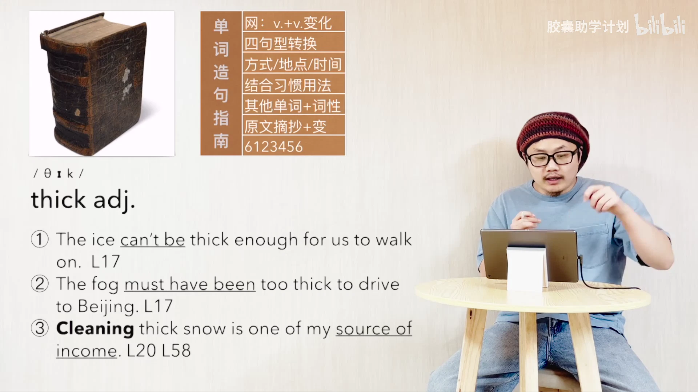

文字识别：胶囊助学计划bilbil / 单词造句指南 / 网：v.+v.变化 / 四句型转换 / 方式/地点/时间 / 结合习惯用法 / 其他单词+词性 / 原文摘抄+变 / 6123456 / 1 θ1 k / / thick adj. / ① The ice can't be thick enough for us to walk / on. L17 / The fog must have been too thick to drive / to Beijing. L17 / Cleaning thick snow is one of my source of / income.L20 L58

### 画面 00:01:55

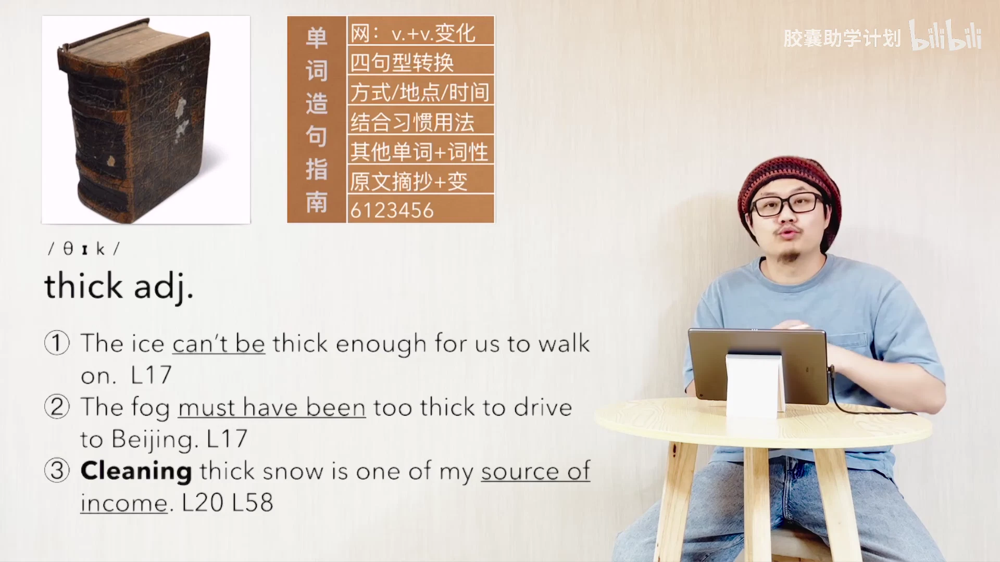

文字识别：胶囊助学计划bilii / 单词造句指南 / 网：v.+v.变化 / 四句型转换 / 方式/地点/时间 / 结合习惯用法 / 其他单词+词性 / 原文摘抄+变 / 6123456 / 1 θ Ⅰ k 1 / thick adj. / ① The ice can't be thick enough for us to walk / on. L17 / The fog must have been too thick to drive / to Beijing. L17 / Cleaning thick snow is one of my source of / income. L20 L58

## 00:02:00–00:02:30

之一啊，one of my source of income。这个咱们之前学过啊，再读一遍这个单词 thick。OK，那我们看下一个单词，下一个单词跟我读一下，叫做 signal。signal signal，但注意它是名词，对吧？我们配的图是 S O S，什么？就是信号啊，发出信号，名词 S O S 就是求救信号啊。那这个 signal 呢，就是信号的意思。那它最常见，我们要造句，肯定要是跟动词连起来。那发送一个信号，

### 画面 00:02:00

文字识别：胶囊助学计划bili / 单词造句指南 / 网：v.+v.变化 / 四句型转换 / 方式/地点/时间 / 结合习惯用法 / 其他单词+词性 / 原文摘抄+变 / 6123456 / 1 θ Ⅰ k 1 / thick adj. / ① The ice can't be thick enough for us to walk / on. L17 / The fog must have been too thick to drive / to Beijing. L17 / Cleaning thick snow is one of my source of / income. L20 L58

### 画面 00:02:02

文字识别：单词造句指南 / 网：v.+v.变化 / 胶囊助学计划 / bilbili / 四句型转换 / 方式/地点/时间 / 结合习惯用法 / 其他单词+词性 / 原文摘抄+变 / 6123456 / / θ Ⅰ k 1 / thick adj. / ① The ice can't be thick enough for us to walk / on. L17 / The fog must have been too thick to drive / to Beijing. L17 / Cleaning thick snow is one of my source of / income.L20 L58

### 画面 00:02:05

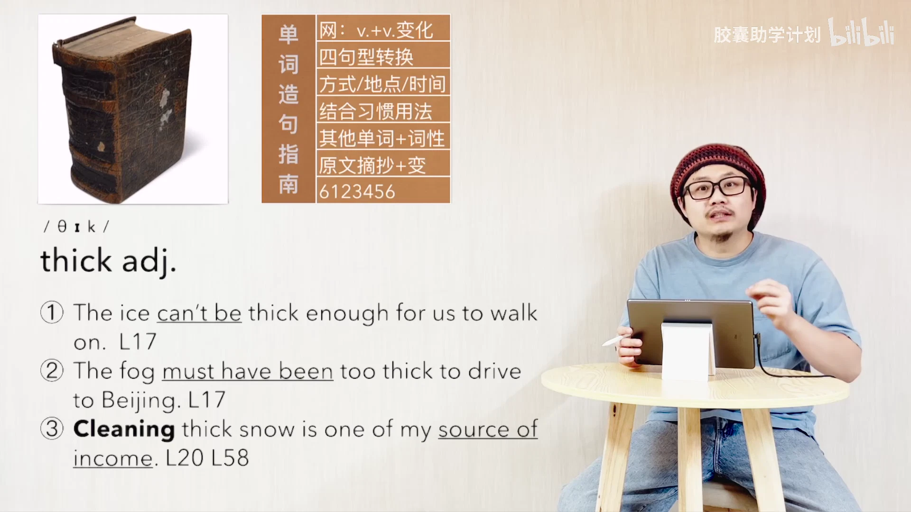

文字识别：单词造句指南 / 网：v.+v.变化 / 胶囊助学计划 / bilbii / 四句型转换 / 方式/地点/时间 / 结合习惯用法 / 其他单词+词性 / 原文摘抄+变 / 6123456 / 1 θⅠ k 1 / thick adj. / ① The ice can't be thick enough for us to walk / on. L17 / The fog must have been too thick to drive / to Beijing. L17 / Cleaning thick snow is one of my source of / income.L20 L58

### 画面 00:02:08

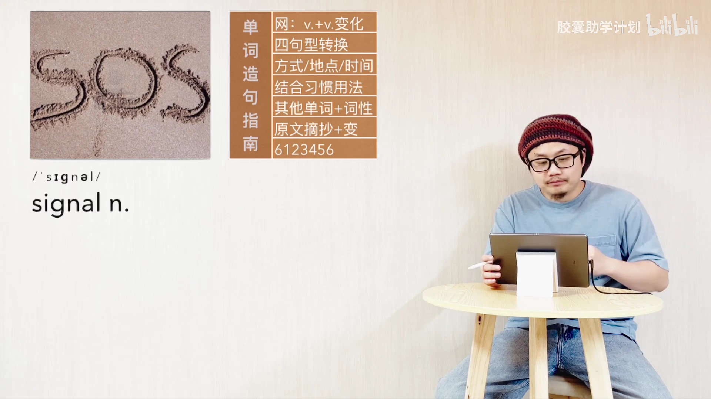

文字识别：单词造句指南 / 网：v.+v.变化 / 胶囊助学计划 / bilbili / 四句型转换 / 方式/地点/时间 / 结合习惯用法 / 其他单词+词性 / 原文摘抄+变 / 6123456 / /'signal/ / signal n.

### 画面 00:02:10

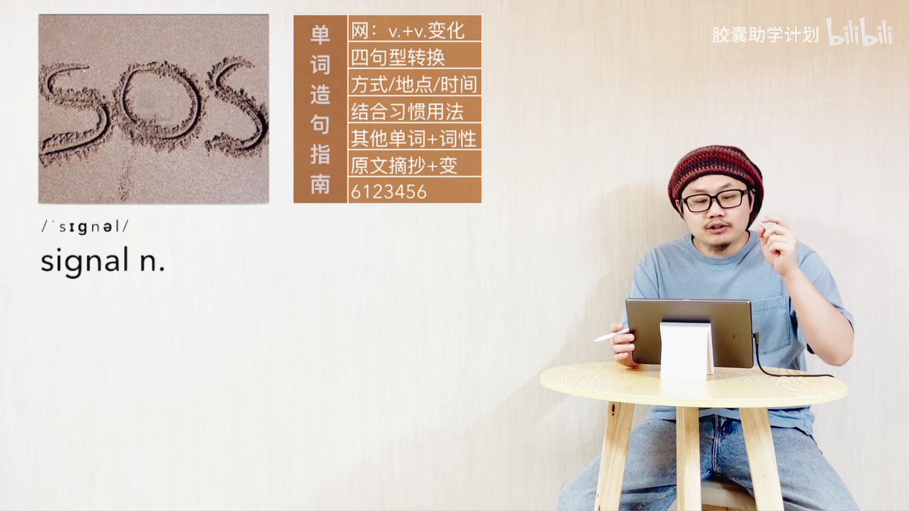

文字识别：单词造句指南 / 网：v.+v.变化 / 胶囊助学计划 / bibili / 四句型转换 / 方式/地点/时间 / 结合习惯用法 / 其他单词+词性 / 原文摘抄+变 / 6123456 / /'signal/ / signal n.

### 画面 00:02:13

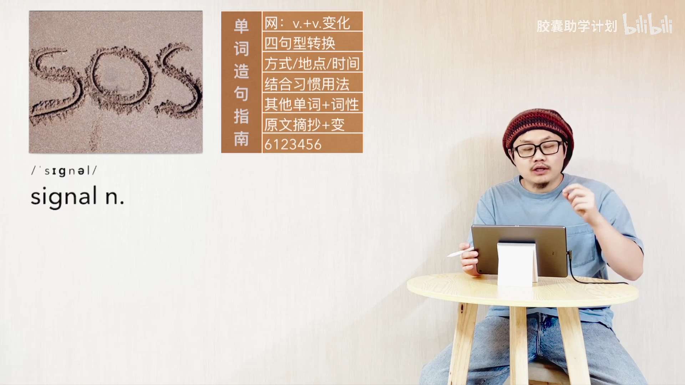

文字识别：单词造句指南 / 网：v.+v.变化 / 胶囊助学计划 / Bilbili / 四句型转换 / 方式/地点/时间 / 结合习惯用法 / 其他单词+词性 / 原文摘抄+变 / 6123456 / /'signal/ / signal n.

### 画面 00:02:15

文字识别：单词造句指南 / 网：v.+v.变化 / 胶囊助学计划 / bilbii / 四句型转换 / 方式/地点/时间 / 结合习惯用法 / 其他单词+词性 / 原文摘抄+变 / 6123456 / /'signal/ / signal n.

### 画面 00:02:17

文字识别：单词造句指南 / 网：v.+v.变化 / 胶囊助学计划 / bilbili / 四句型转换 / 方式/地点/时间 / 结合习惯用法 / 其他单词+词性 / 原文摘抄+变 / 6123456 / /'signal/ / signal n.

### 画面 00:02:19

文字识别：单词造句指南 / 网：v.+v.变化 / 胶囊助学计划 / bibili / 四句型转换 / 方式/地点/时间 / 结合习惯用法 / 其他单词+词性 / 原文摘抄+变 / 6123456 / /'signal/ / signal n.

### 画面 00:02:21

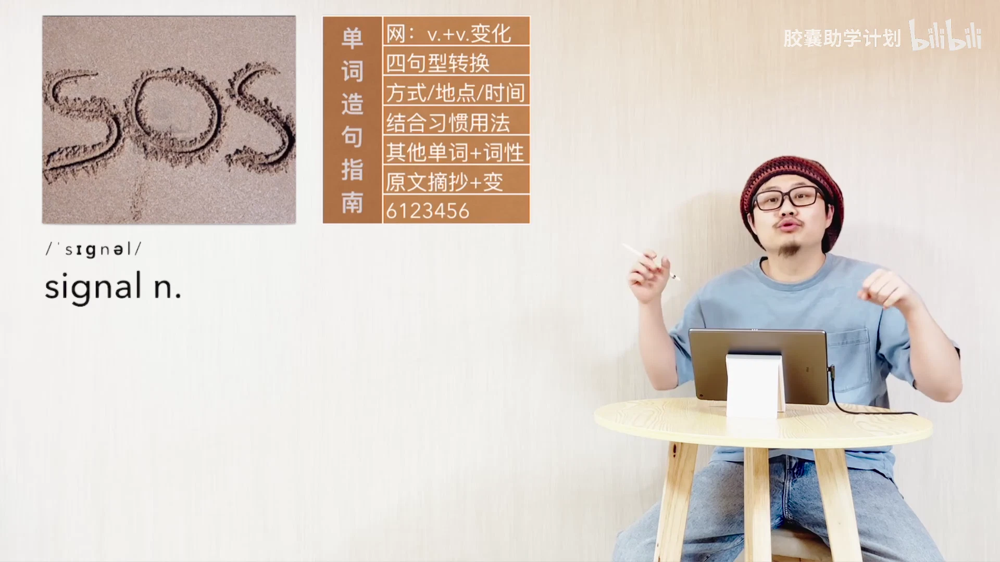

文字识别：单词造句指南 / 网：v.+v.变化 / 胶囊助学计划 / bibii / 四句型转换 / 方式/地点/时间 / 结合习惯用法 / 其他单词+词性 / 原文摘抄+变 / 6123456 / /'signal/ / signal n.

### 画面 00:02:23

文字识别：单词造句指南 / 网：v.+v.变化 / 胶囊助学计划 / bilbili / 四句型转换 / 方式/地点/时间 / 结合习惯用法 / 其他单词+词性 / 原文摘抄+变 / 6123456 / /'signal/ / signal n.

### 画面 00:02:25

文字识别：单词造句指南 / 网：v.+v.变化 / 胶囊助学计划 / Bilbili / 四句型转换 / 方式/地点/时间 / 结合习惯用法 / 其他单词+词性 / 原文摘抄+变 / 6123456 / /'signal/ / signal n. / send a signal

### 画面 00:02:27

文字识别：单词造句指南 / 网：v.+v.变化 / 胶囊助学计划 / bilbili / 四句型转换 / 方式/地点/时间 / 结合习惯用法 / 其他单词+词性 / 原文摘抄+变 / 6123456 / /'signal/ / signal n. / send a signal

## 00:02:30–00:03:00

send这个单词各位非常熟悉，叫做send a signal，发送一个信号。接下来想拿它去造句，跟其他的习惯用法去联合起来是比较容易的一件事情，对吧？比如说，our captain ordered us to send a signal. Order somebody to do something.啊，命令某人做某事儿。再来说，it is impossible for us to send a signal in this thick fog day.刚才咱们学了thick fog，对

### 画面 00:02:30

文字识别：单词造句指南 / 网：v.+v.变化 / 胶囊助学计划 / bilbili / 四句型转换 / 方式/地点/时间 / 结合习惯用法 / 其他单词+词性 / 原文摘抄+变 / 6123456 / /'signal/ / signal n. / send a signal

### 画面 00:02:32

文字识别：单词造句指南 / 网：v.+v.变化 / 胶囊助学计划 / Bilbili / 四句型转换 / 方式/地点/时间 / 结合习惯用法 / 其他单词+词性 / 原文摘抄+变 / 6123456 / /'signal/ / signal n. / send a signal

### 画面 00:02:35

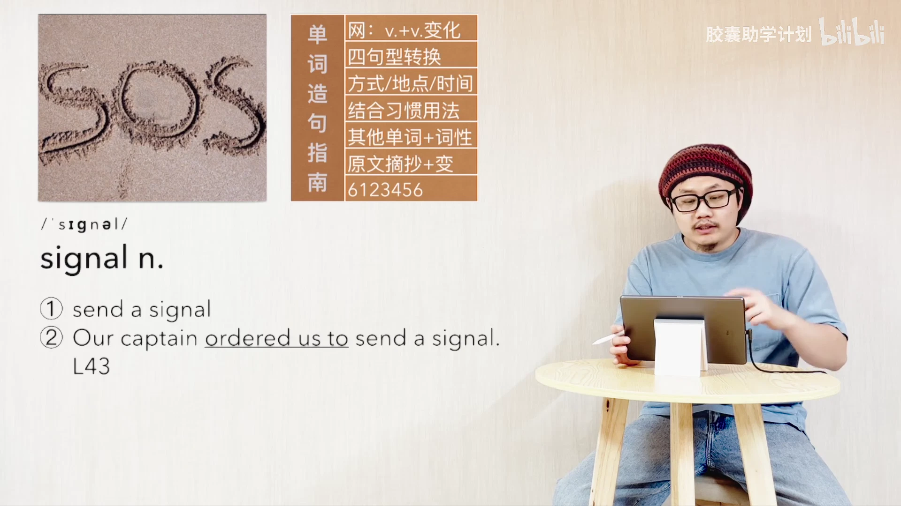

文字识别：单词造句指南 / 网：v.+v.变化 / 胶囊助学计划 / bibii / 四句型转换 / 方式/地点/时间 / 结合习惯用法 / 其他单词+词性 / 原文摘抄+变 / 6123456 / /'signal/ / signal n. / send a signal / Our captain ordered us to send a signal. / 2 / L43

### 画面 00:02:37

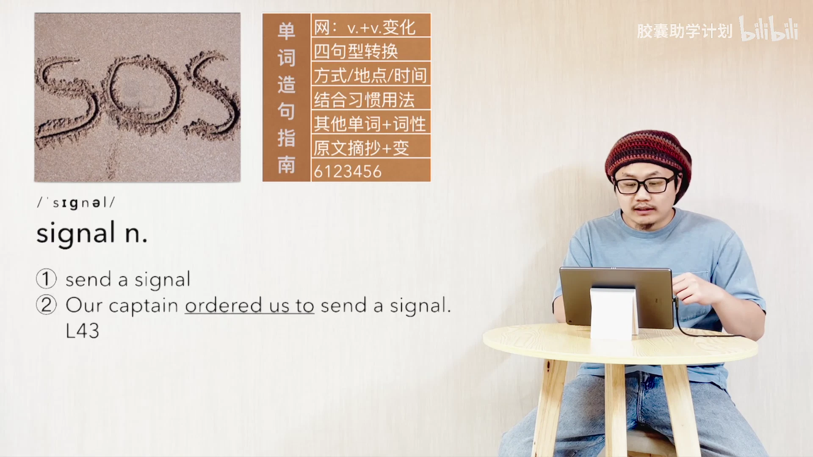

文字识别：单词造句指南 / 网：v.+v.变化 / 胶囊助学计划 / blbii / 四句型转换 / 方式/地点/时间 / 结合习惯用法 / 其他单词+词性 / 原文摘抄+变 / 6123456 / /'signal/ / signal n. / send a signal / Our captain ordered us to send a signal. / 2 / L43

### 画面 00:02:40

文字识别：单词造句指南 / 网：v.+v.变化 / 胶囊助学计划 / bilbli / 四句型转换 / 方式/地点/时间 / 结合习惯用法 / 其他单词+词性 / 原文摘抄+变 / 6123456 / /'signal/ / signal n. / send a signal / Our captain ordered us to send a signal. / L43

### 画面 00:02:42

文字识别：单词造句指南 / 网：v.+v.变化 / 胶囊助学计划 / blibili / 四句型转换 / 方式/地点/时间 / 结合习惯用法 / 其他单词+词性 / 原文摘抄+变 / 6123456 / /'signal/ / signal n. / send a signal / Our captain ordered us to send a signal. / L43

### 画面 00:02:44

文字识别：单词造句指南 / 网：v.+v.变化 / 胶囊助学计划 / bilbli / 四句型转换 / 方式/地点/时间 / 结合习惯用法 / 其他单词+词性 / 原文摘抄+变 / 6123456 / /'signal/ / signal n. / send a signal / Our captain ordered us to send a signal. / 2 / L43

### 画面 00:02:46

文字识别：单词造句指南 / 网：v.+v.变化 / 胶囊助学计划 / blibili / 四句型转换 / 方式/地点/时间 / 结合习惯用法 / 其他单词+词性 / 原文摘抄+变 / 6123456 / /'signal/ / signal n. / send a signal / Our captain ordered us to send a signal. / 2 / L43

### 画面 00:02:49

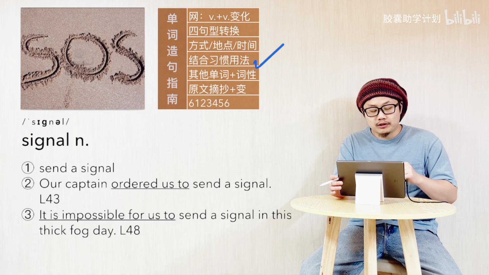

文字识别：胶囊助学计划bilbi / 单词造句指南 / 网：v.+v.变化 / 四句型转换 / 方式/地点/时间 / 结合习惯用法 / 其他单词+词性 / 原文摘抄+变 / 6123456 / /'signal/ / signal n. / ① send a signal / ② Our captain ordered us to send a signal. / L43 / It is impossible for us to send a signal in this / thick fog day. L48

### 画面 00:02:51

文字识别：胶囊助学计划bilii / 单词造句指南 / 网：v.+v.变化 / 四句型转换 / 方式/地点/时间 / 结合习惯用法 / 其他单词+词性 / 原文摘抄+变 / 6123456 / /'signal/ / signal n. / ① send a signal / ② Our captain ordered us to send a signal. / L43 / It is impossible for us to send a signal in this / thick fog day. L48

### 画面 00:02:55

文字识别：单词造句指南 / 网：v.+v.变化 / 胶囊助学计划 / bilbil / 四句型转换 / 方式/地点/时间 / 结合习惯用法 / 其他单词+词性 / 原文摘抄+变 / 6123456 / /'signal/ / signal n. / ① send a signal / ② Our captain ordered us to send a signal. / L43 / It is impossible for us to send a signal in this / thick fog day. L48

### 画面 00:02:57

文字识别：胶囊助学计划bili / 单词造句指南 / 网：v.+v.变化 / 四句型转换 / 方式/地点/时间 / 结合习惯用法 / 其他单词+词性 / 原文摘抄+变 / 6123456 / /'signal/ / signal n. / ① send a signal / ② Our captain ordered us to send a signal. / L43 / It is impossible for us to send a signal in this / thick fog day. L48

### 画面 00:02:59

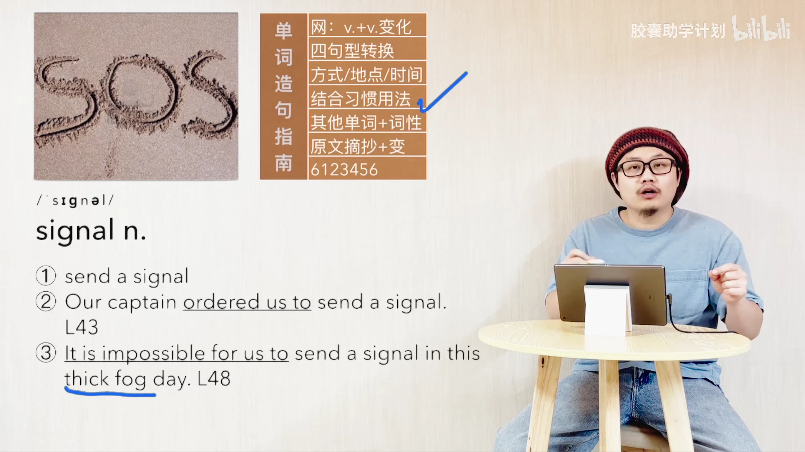

文字识别：胶囊助学计划bilbi / 单词造句指南 / 网：v.+v.变化 / 四句型转换 / 方式/地点/时间 / 结合习惯用法 / 其他单词+词性 / 原文摘抄+变 / 6123456 / /'signal/ / signal n. / ① send a signal / ② Our captain ordered us to send a signal. / L43 / It is impossible for us to send a signal in this / thick fog day. L48

## 00:03:00–00:03:30

吧？哎，说在这个大雾天儿，对于我们来说，想发出信号是太难、太困难的一件事情了，对吧？这个信号穿不过这个雾。 Next one，说 Why did you inquire about how to send a signal? Inquire about something，询问关于某件事情。 Okay，这是咱们三十九课学过的。接下来呢，咱们注意力集中，听一个电影片段啊。 I was hoping you would send a signal so people would realize what was down here. Okay， next one，下一个单词跟我读一下，叫

### 画面 00:03:01

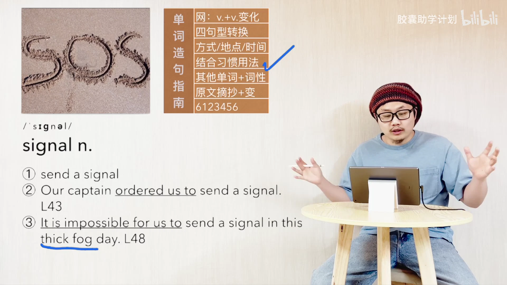

文字识别：胶囊助学计划bilb / 单词造句指南 / 网：v.+v.变化 / 四句型转换 / 方式/地点/时间 / 结合习惯用法 / 其他单词+词性 / 原文摘抄+变 / 6123456 / /'signal/ / signal n. / ① send a signal / ② Our captain ordered us to send a signal. / L43 / It is impossible for us to send a signal in this / thick fog day. L48

### 画面 00:03:05

文字识别：胶囊助学计划blbi / 单词造句指南 / 网：v.+v.变化 / 四句型转换 / 方式/地点/时间 / 结合习惯用法 / 其他单词+词性 / 原文摘抄+变 / 6123456 / /'signal/ / signal n. / ① send a signal / ② Our captain ordered us to send a signal. / L43 / It is impossible for us to send a signal in this / thick fog day. L48

### 画面 00:03:08

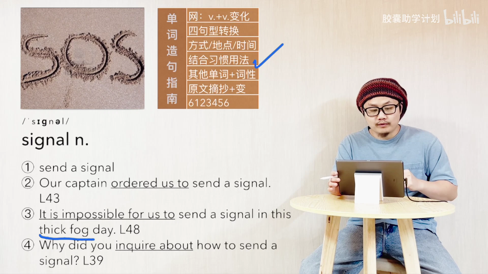

文字识别：单词造句指南 / 网：v.+v.变化 / 胶囊助学计划 / biibii / 四句型转换 / 方式/地点/时间 / 结合习惯用法 / 其他单词+词性 / 原文摘抄+变 / 6123456 / /'signal/ / signal n. / ① send a signal / ② Our captain ordered us to send a signal. / L43 / It is impossible for us to send a signal in this / thick fog day. L48 / Why did you inquire about how to send a / signal? L39

### 画面 00:03:10

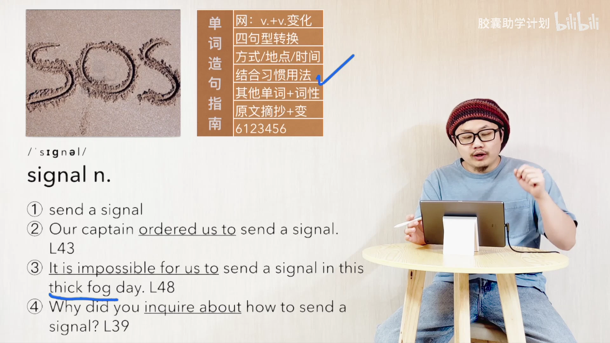

文字识别：单词造句指南 / 网：v.+v.变化 / 胶囊助学计划 / 四句型转换 / 方式/地点/时间 / 结合习惯用法 / 其他单词+词性 / 原文摘抄+变 / 6123456 / /'signal/ / signal n. / ① send a signal / ② Our captain ordered us to send a signal. / L43 / It is impossible for us to send a signal in this / thick fog day. L48 / Why did you inquire about how to send a / signal? L39

### 画面 00:03:15

文字识别：单词造句指南 / 网：v.+v.变化 / 胶囊助学计划 / bilbili / 四句型转换 / 方式/地点/时间 / 结合习惯用法 / 其他单词+词性 / 原文摘抄+变 / 6123456 / /'signal/ / signal n. / ① send a signal / ② Our captain ordered us to send a signal. / L43 / It is impossible for us to send a signal in this / thick fog day. L48 / Why did you inquire about how to send a / signal? L39

### 画面 00:03:17

文字识别：单词造句指南 / 网：v.+v.变化 / 胶囊助学计划 / Bilbili / 四句型转换 / 方式/地点/时间 / 结合习惯用法 / 其他单词+词性 / 原文摘抄+变 / 6123456 / /'signal/ / signal n. / ① send a signal / ② Our captain ordered us to send a signal. / L43 / It is impossible for us to send a signal in this / thick fog day. L48 / Why did you inquire about how to send a / signal? L39

### 画面 00:03:19

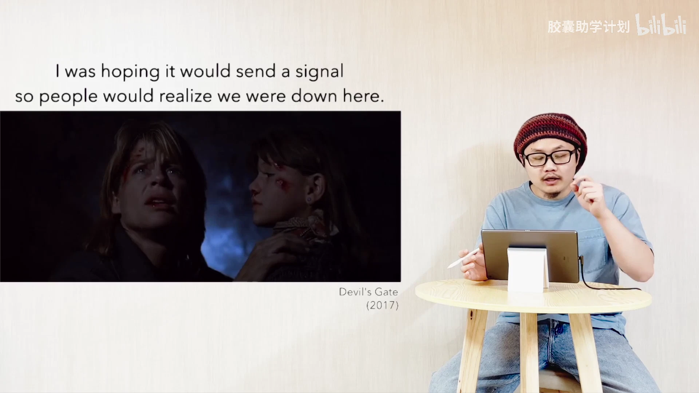

文字识别：bilbili / 胶囊助学计划 / I was hoping it would send a signal / so people /  would realize we were / down here. / Devil's Gate / (2017)

### 画面 00:03:23

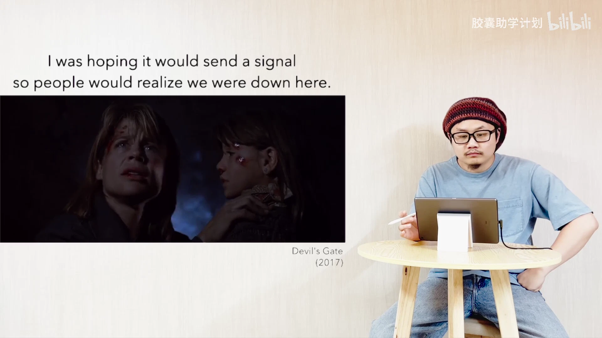

文字识别：bilbili / 胶囊助学计划 / I was hoping it would send a signal / so people /  would realize we were  / down here. / Devil's Gate / (2017)

### 画面 00:03:25

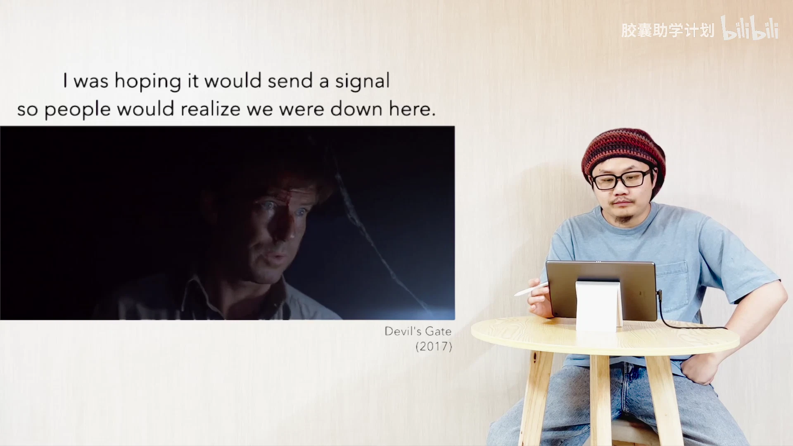

文字识别：bibii / 胶囊助学计划 / I was hoping it would send a signal / so people /  would realize we were / down here. / Devil's Gate / (2017)

### 画面 00:03:27

文字识别：单词造句指南 / 网：v.+v.变化 / 胶囊助学计划 / bilbili / 四句型转换 / 方式/地点/时间 / 结合习惯用法 / 其他单词+词性 / 原文摘抄+变 / 6123456 / / st æemp/ / stamp v. / stamp out

### 画面 00:03:29

文字识别：单词造句指南 / 网：v.+v.变化 / 胶囊助学计划 / bibili / 四句型转换 / 方式/地点/时间 / 结合习惯用法 / 其他单词+词性 / 原文摘抄+变 / 6123456 / / st æemp/ / stamp V.s / stamp out

## 00:03:30–00:04:00

做stamp. Stamp后边这个p，哎，轻轻读出来就可以了。Stamp, stamp最基本的意思就是踩的意思。那stamp out，哎，就是踩灭啊。比如说，说I saw you stamp out the fire.哎，我看到了你踩灭这个火的全过程。那saw somebody do something，三十五课咱们学的那课咱们还学过叫see somebody doing something，对吧？那还两者的区别。首先，红皮书里面我们上课讲过，红皮书我让各

### 画面 00:03:31

文字识别：单词造句指南 / 网：v.+v.变化 / 胶囊助学计划 / bilbii / 四句型转换 / 方式/地点/时间 / 结合习惯用法 / 其他单词+词性 / 原文摘抄+变 / 6123456 / / st æemp/ / stamp v.s / stamp out

### 画面 00:03:35

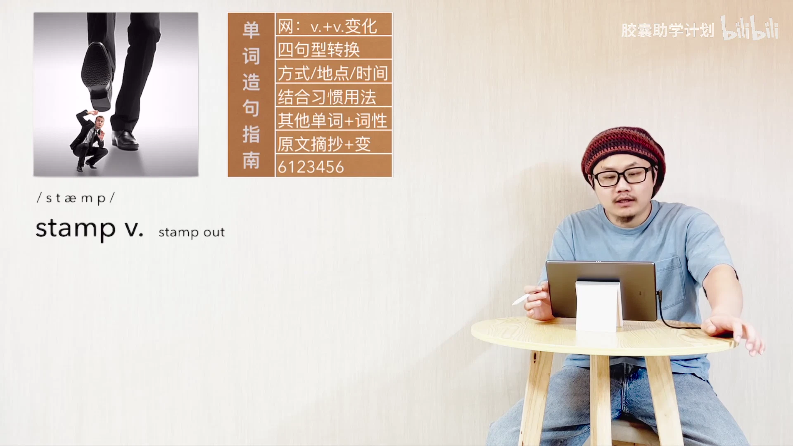

文字识别：单词造句指南 / 网：v.+v.变化 / 胶囊助学计划 / bilbili / 四句型转换 / 方式/地点/时间 / 结合习惯用法 / 其他单词+词性 / 原文摘抄+变 / 6123456 / / st æemp/ / stamp v. / stamp out

### 画面 00:03:38

文字识别：单词造句指南 / 网：v.+v.变化 / 胶囊助学计划 / bilbili / 四句型转换 / 方式/地点/时间 / 结合习惯用法 / 其他单词+词性 / 原文摘抄+变 / 6123456 / / st æemp/ / stamp v. / stamp out

### 画面 00:03:40

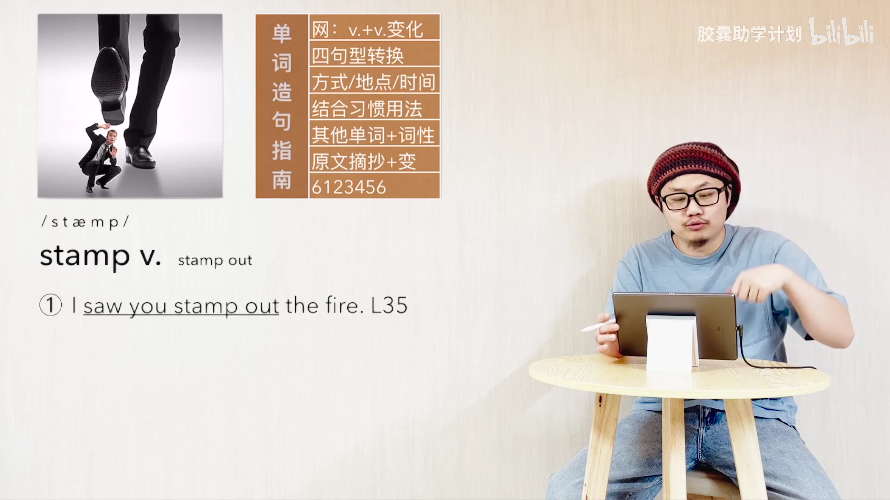

文字识别：单词造句指南 / 网：v.+v.变化 / 胶囊助学计划 / bilbili / 四句型转换 / 方式/地点/时间 / 结合习惯用法 / 其他单词+词性 / 原文摘抄+变 / 6123456 / / st æemp/ / stamp V. stamp out / ①I saw you stamp out the fire. L35

### 画面 00:03:43

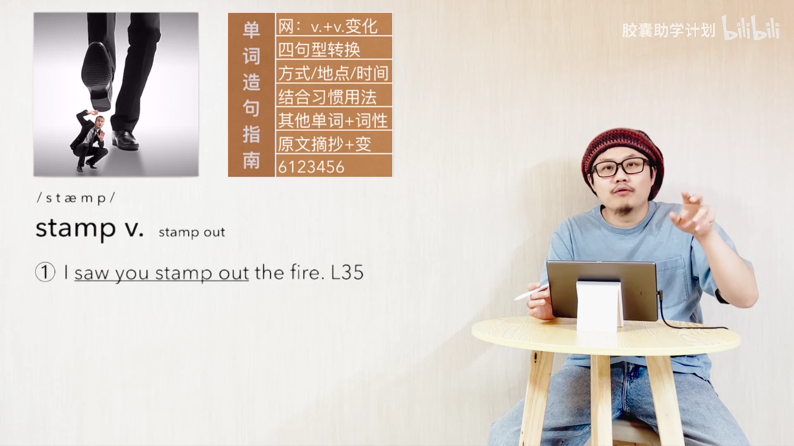

文字识别：单词造句指南 / 网：v.+v.变化 / 胶囊助学计划 / bilbili / 四句型转换 / 方式/地点/时间 / 结合习惯用法 / 其他单词+词性 / 原文摘抄+变 / 6123456 / / st æemp/ / stamp V. stamp out / ①I saw you stamp out the fire. L35

### 画面 00:03:45

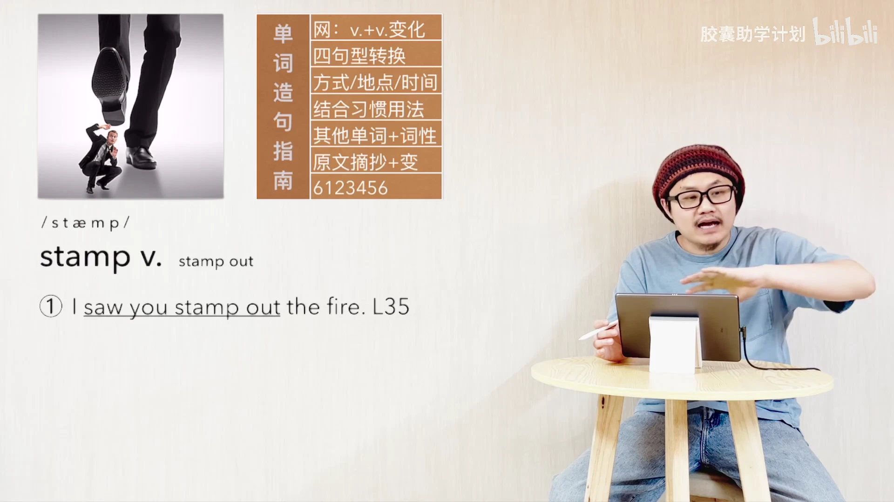

文字识别：单词造句指南 / 网：v.+v.变化 / 胶囊助学计划 / bibili / 四句型转换 / 方式/地点/时间 / 结合习惯用法 / 其他单词+词性 / 原文摘抄+变 / 6123456 / / st æemp/ / stamp V. / • stamp out / ①I saw you stamp out the fire. L35

### 画面 00:03:50

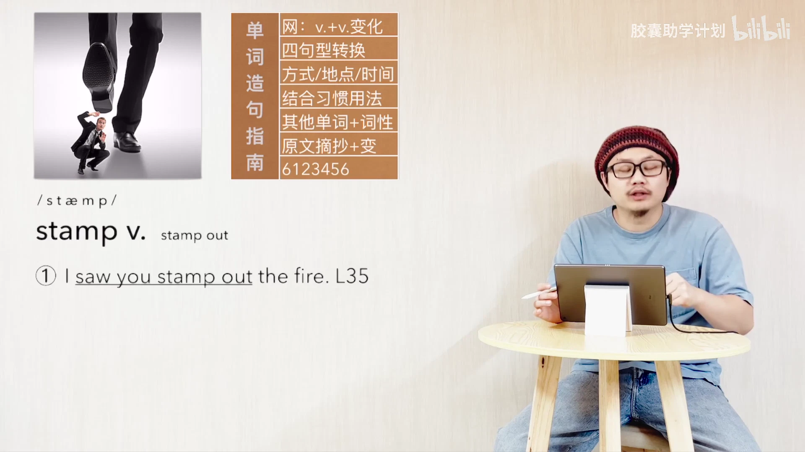

文字识别：单词造句指南 / 网：v.+v.变化 / 胶囊助学计划 / bibili / 四句型转换 / 方式/地点/时间 / 结合习惯用法 / 其他单词+词性 / 原文摘抄+变 / 6123456 / / st æemp/ / stamp V. stamp out / ①I saw you stamp out the fire. L35

### 画面 00:03:53

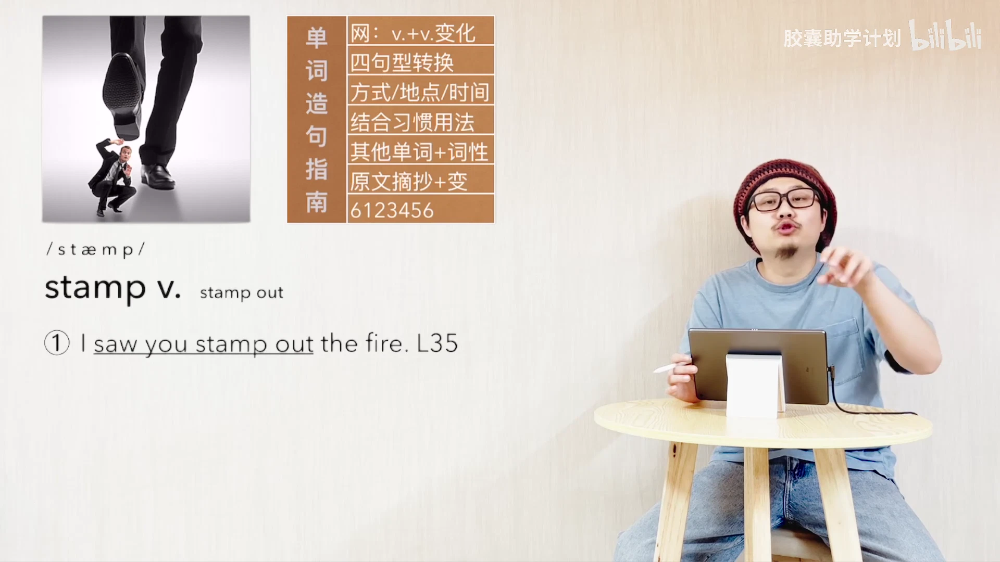

文字识别：单词造句指南 / 网：v.+v.变化 / 胶囊助学计划 / bilbili / 四句型转换 / 方式/地点/时间 / 结合习惯用法 / 其他单词+词性 / 原文摘抄+变 / 6123456 / / st æemp/ / stamp V. stamp out / ①I saw you stamp out the fire. L35

### 画面 00:03:55

文字识别：单词造句指南 / 网：v.+v.变化 / 胶囊助学计划 / bilibii / 四句型转换 / 方式/地点/时间 / 结合习惯用法 / 其他单词+词性 / 原文摘抄+变 / 6123456 / / st æemp/ / stamp V.stamp out / ①I saw you stamp out the fire. L35

### 画面 00:03:57

文字识别：单词造句指南 / 网：v.+v.变化 / 胶囊助学计划 / bilbili / 四句型转换 / 方式/地点/时间 / 结合习惯用法 / 其他单词+词性 / 原文摘抄+变 / 6123456 / / st æemp/ / stamp V. stamp out / ① I saw you stamp out the fire. L35

## 00:04:00–00:04:30

位写过，对吧？如果您又忘了，那我们再回顾一下，叫做 see somebody do something 是全过程， see somebody doing something 指的是这个那个看见正在进行的一瞬间。接下来我们看一下原文，原文给了这样一句话，叫做 she stamp out the letter S O S in the snow。好，这句话就结束了。然后呢，我跟你说，那呃原文咱写不出来，你来个四旬经转换，里面的每一句话都是您自己造的句子，对吧？好，那这句

### 画面 00:04:00

文字识别：单词造句指南 / 网：v.+v.变化 / 胶囊助学计划 / bibii / 四句型转换 / 方式/地点/时间 / 结合习惯用法 / 其他单词+词性 / 原文摘抄+变 / 6123456 / / st æemp/ / stamp V.s / stamp out / ①I saw you stamp out the fire. L35

### 画面 00:04:05

文字识别：单词造句指南 / 网：v.+v.变化 / 胶囊助学计划 / bibili / 四句型转换 / 方式/地点/时间 / 结合习惯用法 / 其他单词+词性 / 原文摘抄+变 / 6123456 / / st æemp/ / stamp V. stamp out / ①I saw you stamp out the fire. L35

### 画面 00:04:09

文字识别：单词造句指南 / 网：v.+v.变化 / 胶囊助学计划 / bilbili / 四句型转换 / 方式/地点/时间 / 结合习惯用法 / 其他单词+词性 / 原文摘抄+变 / 6123456 / / st æemp/ / stamp V. stamp out / ①I saw you stamp out the fire. L35

### 画面 00:04:11

文字识别：单词造句指南 / 网：v.+v.变化 / 胶囊助学计划 / bilibii / 四句型转换 / 方式/地点/时间 / 结合习惯用法 / 其他单词+词性 / 原文摘抄+变 / 6123456 / / st æm p/ / stamp V. stamp out / ①I saw you stamp out the fire. L35 / ② [Story]: She stamped out the letter "SOS"in / the snow. did/who/what/when/where/why/ / how...

### 画面 00:04:13

文字识别：单词造句指南 / 网：v.+v.变化 / 胶囊助学计划 / bilibii / 四句型转换 / 方式/地点/时间 / 结合习惯用法 / 其他单词+词性 / 原文摘抄+变 / 6123456 / / st æmp/ / stamp V. stamp out / ①I saw you stamp out the fire. L35 / ② [Story]: She stamped out the letter "SOS"in / the snow. did/who/what/when/where/why/ / how...

### 画面 00:04:15

文字识别：单词造句指南 / 网：v.+v.变化 / 胶囊助学计划 / biibli / 四句型转换 / 方式/地点/时间 / 结合习惯用法 / 其他单词+词性 / 原文摘抄+变 / 6123456 / / stæmp/ / stamp V. stamp out / ①I saw you stamp out the fire. L35 / ② [Story]: She stamped out the letter "SOS"in / the snow. did/who/what/when/where/why/ / how...

### 画面 00:04:20

文字识别：单词造句指南 / 网：v.+v.变化 / 胶囊助学计划 / biibli / 四句型转换 / 方式/地点/时间 / 结合习惯用法 / 其他单词+词性 / 原文摘抄+变 / 6123456 / / stæmp/ / stamp V. stamp out / ①I saw you stamp out the fire. L35 / ② [Story]: She stamped out the letter "SOS" in / the snow. did/who/what/when/where/why/ / how...

### 画面 00:04:22

文字识别：胶囊助学计划bi出 / 单词造句指南 / 网：v.+v.变化 / 四句型转换 / 方式/地点/时间 / 结合习惯用法 / 其他单词+词性 / 原文摘抄+变 / 6123456 / / st aæem p / / stamp V. stamp out / ①I saw you stamp out the fire. L35 / ② [Story]: She stamped out the letter "SOS" in / the snow. did/who/what/when/where/why/ / how.

### 画面 00:04:25

文字识别：胶囊助学计划bilii / 单词造句指南 / 网：v.+v.变化 / 四句型转换 / 方式/地点/时间 / 结合习惯用法 / 其他单词+词性 / 原文摘抄+变 / 6123456 / / st æmp/ / stamp V. stamp out / ①I saw you stamp out the fire. L35 / ② [Story]: She stamped out the letter "SOS" in / the snow. did/who/what/when/where/why/ / how.

## 00:04:30–00:05:00

话就不是踩灭火了，就是踩出啊，踩出了一个呃三个字母 S O S 的三个字母对吧？有求救的字母。Next one，咱再造一句话说，As soon as he stepped out of the bedroom, someone rang the bell. 那你看这里的 stepped out of the bedroom 是什么意思啊？不是 stepped out 啊，是 stepped out of the bedroom 是吧？走出了这个这个呃卧室。你看他

### 画面 00:04:30

文字识别：胶囊助学计划bilbil / 单词造句指南 / 网：v.+v.变化 / 四句型转换 / 方式/地点/时间 / 结合习惯用法 / 其他单词+词性 / 原文摘抄+变 / 6123456 / / st æmp/ / stamp V. stamp out / ①I saw you stamp out the fire. L35 / ② [Story]: She stamped out the letter "SOS" in / the snow. did/who/what/when/where/why/ / how.

### 画面 00:04:35

文字识别：单词造句指南 / 网：v.+v.变化 / 胶囊助学计划 / biltbili / 四句型转换 / 方式/地点/时间 / 结合习惯用法 / 其他单词+词性 / 原文摘抄+变 / 6123456 / / stæmp/ / stamp V. stamp out / ① I saw you stamp out the fire. L35 / ② [Story]: She stamped out the letter "SOS" in / the snow.did/who/what/when/where/why/ / how.

### 画面 00:04:39

文字识别：胶囊助学计划bili / 单词造句指南 / 网：v.+v.变化 / 四句型转换 / 方式/地点/时间 / 结合习惯用法 / 其他单词+词性 / 原文摘抄+变 / 6123456 / / st æmp/ / stamp V. stamp out / ① I saw you stamp out the fire. L35 / ② [Story]: She stamped out the letter"SOS"in / the snow.did/who/what/when/where/why/ / howi / As soon as he stamped out of the / bedroom, someone rang the bell. L14 L51

### 画面 00:04:41

文字识别：胶囊助学计划bibi / 单词造句指南 / 网：v.+v.变化 / 四句型转换 / 方式/地点/时间 / 结合习惯用法 / 其他单词+词性 / 原文摘抄+变 / 6123456 / / stæmp/ / stamp V. stamp out / ①I saw you stamp out the fire. L35 / ② [Story]: She stamped out the letter"SOS"in / the snow. did/who/what/when/where/why/ / how / As soon as he stamped out of the / bedroom, someone rang the bell. L14 L51

### 画面 00:04:45

文字识别：胶囊助学计划bilii / 单词造句指南 / 网：v.+v.变化 / 四句型转换 / 方式/地点/时间 / 结合习惯用法 / 其他单词+词性 / 原文摘抄+变 / 6123456 / / stæmp/ / stamp V. stamp out / ①I saw you stamp out the fire. L35 / ② [Story]: She stamped out the letter "SOS"in / the snow. did/who/what/when/where/why/ / how. / As soon as he stamped out of the / bedroom, someone rang the bell. L14 L51

### 画面 00:04:48

文字识别：胶囊助学计划bilii / 单词造句指南 / 网：v.+v.变化 / 四句型转换 / 方式/地点/时间 / 结合习惯用法 / 其他单词+词性 / 原文摘抄+变 / 6123456 / / stæmp/ / stamp V. stamp out / ①I saw you stamp out the fire. L35 / ② [Story]: She stamped out the letter "SOS"in / the snow.did/who/what/when/where/why/ / howi / As soon as he stamped out of the / bedroom, someone rang the bell. L14 L51

### 画面 00:04:50

文字识别：胶囊助学计划bli / 单词造句指南 / 网：v.+v.变化 / 四句型转换 / 方式/地点/时间 / 结合习惯用法 / 其他单词+词性 / 原文摘抄+变 / 6123456 / / stæmp/ / stamp V. stamp out / ①I saw you stamp out the fire. L35 / ② [Story]: She stamped out the letter "SOS" in / the snow.did/who/what/when/where/why/ / how. / As soon as he stamped out of the / bedroom, someone rang the bell. L14 L51

### 画面 00:04:56

文字识别：胶囊助学计划bilii / 单词造句指南 / 网：v.+v.变化 / 四句型转换 / 方式/地点/时间 / 结合习惯用法 / 其他单词+词性 / 原文摘抄+变 / 6123456 / / stæemp/ / stamp V. stamp out / ①I saw you stamp out the fire. L35 / ② [Story]: She stamped out the letter "SOS"in / the snow. did/who/what/when/where/why/ / Lhow. / As soon as he stamped out of the / bedroom, someone rang the bell. L14 L51

## 00:05:00–00:05:30

这里还用的不是走，他是 stand 啊，其实什么意思？有点那种带着小情绪，比如说怒气冲冲的啊，咚咚咚咚啊，踩着地板，踩着地面，很生气的跺着脚就出去了，对吧？还是这样一种感觉。As soon as he stamped out of the bedroom，啊，其实就是 he went out of the bedroom，啊，如果我们不加上那种呃副词的感受的话，OK，就不去形容这个动词就 went 就可以了，OK。

### 画面 00:05:01

文字识别：胶囊助学计划bili / 单词造句指南 / 网：v.+v.变化 / 四句型转换 / 方式/地点/时间 / 结合习惯用法 / 其他单词+词性 / 原文摘抄+变 / 6123456 / / stæmp/ / stamp V. stamp out / ①I saw you stamp out the fire. L35 / ② [Story]: She stamped out the letter "SOS" in / the snow. did/who/what/when/where/why/ / how / As soon as he stamped out of the / bedroom, someone rang the bell. L14 L51

### 画面 00:05:06

文字识别：胶囊助学计划blii / 单词造句指南 / 网：v.+v.变化 / 四句型转换 / 方式/地点/时间 / 结合习惯用法 / 其他单词+词性 / 原文摘抄+变 / 6123456 / / stæmp/ / stamp V. stamp out / ①I saw you stamp out the fire. L35 / ② [Story]: She stamped out the letter "SOS"in / the snow. did/who/what/when/where/why/ / Lhow. / As soon as he stamped out of the / bedroom, someone rang the bell. L14 L51

### 画面 00:05:10

文字识别：胶囊助学计划bilii / 单词造句指南 / 网：v.+v.变化 / 四句型转换 / 方式/地点/时间 / 结合习惯用法 / 其他单词+词性 / 原文摘抄+变 / 6123456 / / stæmp/ / stamp V. stamp out / ①I saw you stamp out the fire. L35 / ② [Story]: She stamped out the letter "SOS"in / the snow.did/who/what/when/where/why/ / Lhow. / As soon as he stamped out of the / bedroom, someone rang the bell. L14 L51

### 画面 00:05:14

文字识别：胶囊助学计划biliil / 单词造句指南 / 网：v.+v.变化 / 四句型转换 / 方式/地点/时间 / 结合习惯用法 / 其他单词+词性 / 原文摘抄+变 / 6123456 / / stæmp/ / stamp V. stamp out / ①I saw you stamp out the fire. L35 / ② [Story]: She stamped out the letter "SOS"in / the snow. did/who/what/when/where/why/ / how. / As soon as he stamped out of the / bedroom, someone rang the bell. L14 L51

### 画面 00:05:16

文字识别：单词造句指南 / 网：v.+v.变化 / 胶囊助学计划 / bibil / 四句型转换 / 方式/地点/时间 / 结合习惯用法 / 其他单词+词性 / 原文摘抄+变 / 6123456 / / st æmp/ / stamp V. stamp out / ①I saw you stamp out the fire. L35 / ② [Story]: She stamped out the letter "SOS"in / the snow.did/who/what/when/where/why/ / Lhow. / As soon as he stamped out of the / bedroom, someone rang the bell. L14 L51

### 画面 00:05:20

文字识别：胶囊助学计划biii / 单词造句指南 / 网：v.+v.变化 / 四句型转换 / 方式/地点/时间 / 结合习惯用法 / 其他单词+词性 / 原文摘抄+变 / 6123456 / / stæmp/ / stamp V. stamp out / ①I saw you stamp out the fire. L35 / ② [Story]: She stamped out the letter "SOS"in / the snow.did/who/what/when/where/why/ / how. / As soon as he stamped out of the / bedroom, someone rang the bell. L14 L51

### 画面 00:05:23

文字识别：胶囊助学计划blbi / 单词造句指南 / 网：v.+v.变化 / 四句型转换 / 方式/地点/时间 / 结合习惯用法 / 其他单词+词性 / 原文摘抄+变 / 6123456 / / stæmp/ / stamp V. stamp out / ①I saw you stamp out the fire. L35 / ② [Story]: She stamped out the letter "SOS"in / the snow.did/who/what/when/where/why/ / how. / As soon as he stamped out of the / bedroom, someone rang the bell. L14 L51

### 画面 00:05:26

文字识别：胶囊助学计划bili / 单词造句指南 / 网：v.+v.变化 / 四句型转换 / 方式/地点/时间 / 结合习惯用法 / 其他单词+词性 / 原文摘抄+变 / 6123456 / / stæmp/ / stamp V. stamp out / ①I saw you stamp out the fire. L35 / ② [Story]: She stamped out the letter "SOS"in / the snow.did/who/what/when/where/why/ / how. / As soon as he stamped out of the / bedroom, someone rang the bell. L14 L51

## 00:05:30–00:06:00

那再读一遍这个单词stamp，OK，very good。下一个单词哎，helicopter连起来helicopter，helicopter，直升飞机哒哒哒哒哒哒哒，对吧？helicopter，helicopter。想去造句的话，你看，注意它的词性是一个名词。六一二三四五六当中最常见的位置一三五，对吧？它可以作为一个地点，比如说我把我的手机忘在这个helicopter里面了，对吧？没有问题的，或者

### 画面 00:05:30

文字识别：胶囊助学计划bilii / 单词造句指南 / 网：v.+v.变化 / 四句型转换 / 方式/地点/时间 / 结合习惯用法 / 其他单词+词性 / 原文摘抄+变 / 6123456 / / s t æmp/ / stamp V. stamp out / ①I saw you stamp out the fire. L35 / ② [Story]: She stamped out the letter "SOS"in / the snow. did/who/what/when/where/why/ / how. / As soon as he stamped out of the / bedroom, someone rang the bell. L14 L51

### 画面 00:05:33

文字识别：单词造句指南 / 网：v.+v.变化 / 胶囊助学计划 / bilbili / 四句型转换 / 方式/地点/时间 / 结合习惯用法 / 其他单词+词性 / 原文摘抄+变 / 6123456 / /'helikopta/ / helicopter n.

### 画面 00:05:35

文字识别：单词造句指南 / 网：v.+v.变化 / 胶囊助学计划 / bilbil / 四句型转换 / 方式/地点/时间 / 结合习惯用法 / 其他单词+词性 / 原文摘抄+变 / 6123456 / /'helrkppta/ / helicopter n.

### 画面 00:05:37

文字识别：单词造句指南 / 网：v.+v.变化 / 胶囊助学计划 / bilbii / 四句型转换 / 方式/地点/时间 / 结合习惯用法 / 其他单词+词性 / 原文摘抄+变 / 6123456 / /'helrkppta/ / helicopter n.

### 画面 00:05:39

文字识别：单词造句指南 / 网：v.+v.变化 / 胶囊助学计划 / bibili / 四句型转换 / 方式/地点/时间 / 结合习惯用法 / 其他单词+词性 / 原文摘抄+变 / 6123456 / /'helikppta/ / helicopter n.

### 画面 00:05:41

文字识别：单词造句指南 / 网：v.+v.变化 / 胶囊助学计划 / bilbili / 四句型转换 / 方式/地点/时间 / 结合习惯用法 / 其他单词+词性 / 原文摘抄+变 / 6123456 / /'helikppta/ / helicopter n.

### 画面 00:05:43

文字识别：单词造句指南 / 网：v.+v.变化 / 胶囊助学计划 / bilbili / 四句型转换 / 方式/地点/时间 / 结合习惯用法 / 其他单词+词性 / 原文摘抄+变 / 6123456 / /'helikppta/ / helicopter n.

### 画面 00:05:45

文字识别：单词造句指南 / 网：v.+v.变化 / 胶囊助学计划 / bilbili / 四句型转换 / 方式/地点/时间 / 结合习惯用法 / 其他单词+词性 / 原文摘抄+变 / 6123456 / /'helikppta/ / helicopter n.

### 画面 00:05:49

文字识别：单词造句指南 / 网：v.+v.变化 / 胶囊助学计划 / bilbili / 四句型转换 / 方式/地点/时间 / 结合习惯用法 / 其他单词+词性 / 原文摘抄+变 / 6123456 / /'helrkppta/ / helicopter n.

### 画面 00:05:51

文字识别：单词造句指南 / 网：v.+v.变化 / 胶囊助学计划 / biibili / 四句型转换 / 方式/地点/时间 / 结合习惯用法 / 其他单词+词性 / 原文摘抄+变 / 6123456 / /'helikppta/ / helicopter n.

### 画面 00:05:54

文字识别：单词造句指南 / 网：v.+v.变化 / 胶囊助学计划 / bilbili / 四句型转换 / 方式/地点/时间 / 结合习惯用法 / 其他单词+词性 / 原文摘抄+变 / 6123456 / /'helikppta/ / helicopter n.

### 画面 00:05:56

文字识别：单词造句指南 / 网：v.+v.变化 / 胶囊助学计划 / bilbili / 四句型转换 / 方式/地点/时间 / 结合习惯用法 / 其他单词+词性 / 原文摘抄+变 / 6123456 / /'helikppta/ / helicopter n.

### 画面 00:05:58

文字识别：单词造句指南 / 网：v.+v.变化 / 胶囊助学计划 / bilbili / 四句型转换 / 方式/地点/时间 / 结合习惯用法 / 其他单词+词性 / 原文摘抄+变 / 6123456 / /'helikppta/ / helicopter n.

## 00:06:00–00:06:30

helicopter，呃，这个上面有一个什么什么东西都没有问题啊。那我们再造一个句子，比如说She's been studying helicopter for nearly thirty years.啊，这里的studying就不是学习，我们给它翻译成研究。说他已经研究这个直升飞机啊，将近三十年了。五十课咱们学的Have been doing，对吧？Next one，说It takes him ten years to learn how to drive a helicopter.说这花了他将近十年的时间去学习如何驾驶一

### 画面 00:06:00

文字识别：单词造句指南 / 网：v.+v.变化 / 胶囊助学计划 / bilbili / 四句型转换 / 方式/地点/时间 / 结合习惯用法 / 其他单词+词性 / 原文摘抄+变 / 6123456 / /'helikppta/ / helicopter n.

### 画面 00:06:05

文字识别：单词造句指南 / 网：v.+v.变化 / 胶囊助学计划 / bilbili / 四句型转换 / 方式/地点/时间 / 结合习惯用法 / 其他单词+词性 / 原文摘抄+变 / 6123456 / /'helikppta/ / helicopter n. /  She's been studying helicopter for nearly / thirty years. L52

### 画面 00:06:10

文字识别：单词造句指南 / 网：v.+v.变化 / 胶囊助学计划 / bibili / 四句型转换 / 方式/地点/时间 / 结合习惯用法 / 其他单词+词性 / 原文摘抄+变 / 6123456 / /helikppta/ / helicopter n. /  She's been studying helicopter for nearly / thirty years. L52

### 画面 00:06:15

文字识别：单词造句指南 / 网：v.+v.变化 / 胶囊助学计划 / bibili / 四句型转换 / 方式/地点/时间 / 结合习惯用法 / 其他单词+词性 / 原文摘抄+变 / 6123456 / /'helikppta/ / helicopter n. /  She's been studying helicopter for nearly / thirty years. L52

### 画面 00:06:17

文字识别：单词造句指南 / 网：v.+v.变化 / 胶囊助学计划 / bilbili / 四句型转换 / 方式/地点/时间 / 结合习惯用法 / 其他单词+词性 / 原文摘抄+变 / 6123456 / /'helikppta/ / helicopter n. /  She's been studying helicopter for nearly / thirty years. L52

### 画面 00:06:19

文字识别：单词造句指南 / 网：v.+v.变化 / 胶囊助学计划 / bilbili / 四句型转换 / 方式/地点/时间 / 结合习惯用法 / 其他单词+词性 / 原文摘抄+变 / 6123456 / /'helikppta/ / helicopter n. /  She's been studying helicopter for nearly / thirty years. L52

### 画面 00:06:21

文字识别：单词造句指南 / 网：v.+v.变化 / 胶囊助学计划 / bibii / 四句型转换 / 方式/地点/时间 / 结合习惯用法 / 其他单词+词性 / 原文摘抄+变 / 6123456 / /helikppta/ / helicopter n. / ① She's been studying helicopter for nearly / thirty years. L52 / It takes him ten years to learn how to drive / a helicopter. L50

### 画面 00:06:25

文字识别：单词造句指南 / 网：v.+v.变化 / 胶囊助学计划 / bilibii / 四句型转换 / 方式/地点/时间 / 结合习惯用法 / 其他单词+词性 / 原文摘抄+变 / 6123456 / /helikopta/ / helicopter n. / ① She's been studying helicopter for nearly / thirty years. L52 / It takes him ten years to learn how to drive / a helicopter. L50

## 00:06:30–00:07:00

辆直升飞机？It takes somebody some time to do something.五十课咱们学的。Next one, so he is fairly confident that he could drive this helicopter.他很自信的事情是，他觉得他能驾驶这辆直升飞机。五十五课学的，fairly confident that，对吧？包括你看，confident既然这个形容词出现了，我们再回顾一下confidence那个名词。OK，再读一遍这个单词helicopter. Very good.

### 画面 00:06:30

文字识别：单词造句指南 / 网：v.+v.变化 / 胶囊助学计划 / bilibili / 四句型转换 / 方式/地点/时间 / 结合习惯用法 / 其他单词+词性 / 原文摘抄+变 / 6123456 / /helikopta/ / helicopter n. / ① She's been studying helicopter for nearly / thirty years. L52 / It takes him ten years to learn how to drive / a helicopter. L50

### 画面 00:06:33

文字识别：单词造句指南 / 网：v.+v.变化 / 胶囊助学计划 / bilibili / 四句型转换 / 方式/地点/时间 / 结合习惯用法 / 其他单词+词性 / 原文摘抄+变 / 6123456 / /'helikppta/ / helicopter n. / D She's been studying helicopter for nearly / thirty years. L52 / It takes him ten years to learn how to drive / a helicopter. L50

### 画面 00:06:35

文字识别：胶囊助学计划bilii / 单词造句指南 / 网：v.+v.变化 / 四句型转换 / 方式/地点/时间 / 结合习惯用法 / 其他单词+词性 / 原文摘抄+变 / 6123456 / / 'helI kppta/ / helicopter n. / ① She's been studying helicopter for nearly / thirty years. L52 / It takes him ten years to learn how to drive / a helicopter. L50 / He's fairly confident that he could drive this / helicopter. L55

### 画面 00:06:37

文字识别：单词造句指南 / 网：v.+v.变化 / 胶囊助学计划 / bilbili / 四句型转换 / 方式/地点/时间 / 结合习惯用法 / 其他单词+词性 / 原文摘抄+变 / 6123456 / / 'helI kppta/ / helicopter n. / ① She's been studying helicopter for nearly / thirty years. L52 / It takes him ten years to learn how to drive / a helicopter. L50 / He's fairly confident that he could drive this / helicopter. L55

### 画面 00:06:40

文字识别：单词造句指南 / 网：v.+v.变化 / 胶囊助学计划 / bilbili / 四句型转换 / 方式/地点/时间 / 结合习惯用法 / 其他单词+词性 / 原文摘抄+变 / 6123456 / / 'helI kppta/ / helicopter n. / ① She's been studying helicopter for nearly / thirty years. L52 / It takes him ten years to learn how to drive / a helicopter. L50 / He's fairly confident that he could drive this / helicopter. L55

### 画面 00:06:42

文字识别：单词造句指南 / 网：v.+v.变化 / 胶囊助学计划 / bilbii / 四句型转换 / 方式/地点/时间 / 结合习惯用法 / 其他单词+词性 / 原文摘抄+变 / 6123456 / / helI kppta/ / helicopter n. / ① She's been studying helicopter for nearly / thirty years. L52 / It takes him ten years to learn how to drive / a helicopter. L50 / He's fairly confident that he could drive this / helicopter. L55

### 画面 00:06:45

文字识别：胶囊助学计划bilii / 单词造句指南 / 网：v.+v.变化 / 四句型转换 / 方式/地点/时间 / 结合习惯用法 / 其他单词+词性 / 原文摘抄+变 / 6123456 / / helI kopta/ / helicopter n. / ① She's been studying helicopter for nearly / thirty years. L52 / It takes him ten years to learn how to drive / a helicopter. L50 / He's fairly confident that he could drive this / helicopter. L55

### 画面 00:06:47

文字识别：单词造句指南 / 网：v.+v.变化 / 胶囊助学计划 / bilbili / 四句型转换 / 方式/地点/时间 / 结合习惯用法 / 其他单词+词性 / 原文摘抄+变 / 6123456 / / 'heli kppta/ / helicopter n. / ① She's been studying helicopter for nearly / thirty years. L52 / It takes him ten years to learn how to drive / a helicopter. L50 / He's fairly confident that he could drive this / helicopter. L55

### 画面 00:06:50

文字识别：单词造句指南 / 网：v.+v.变化 / 胶囊助学计划 / Bilbili / 四句型转换 / 方式/地点/时间 / 结合习惯用法 / 其他单词+词性 / 原文摘抄+变 / 6123456 / /  helI kopta/ / helicopter n. / ① She's been studying helicopter for nearly / thirty years. L52 / It takes him ten years to learn how to drive / a helicopter. L50 / He's fairly confident that he could drive this / helicopter. L55

### 画面 00:06:52

文字识别：胶囊助学计划bili / 单词造句指南 / 网：v.+v.变化 / 四句型转换 / 方式/地点/时间 / 结合习惯用法 / 其他单词+词性 / 原文摘抄+变 / 6123456 / / 'helI kppta/ / helicopter n. / ① She's been studying helicopter for nearly / thirty years. L52 / It takes him ten years to learn how to drive / a helicopter. L50 / He's fairly confident that he could drive this / helicopter. L55

### 画面 00:06:55

文字识别：胶囊助学计划bilbii / 单词造句指南 / 网：v.+v.变化 / 四句型转换 / 方式/地点/时间 / 结合习惯用法 / 其他单词+词性 / 原文摘抄+变 / 6123456 / / 'helI kppta/ / helicopter n. / ① She's been studying helicopter for nearly / thirty years. L52 / It takes him ten years to learn how to drive / a helicopter. L50 / He's fairly confident that he could drive this / helicopter. L55

### 画面 00:06:58

文字识别：单词造句指南 / 网：v.+v.变化 / 胶囊助学计划 / bilbii / 四句型转换 / 方式/地点/时间 / 结合习惯用法 / 其他单词+词性 / 原文摘抄+变 / 6123456 / / s i : n / / SCene n. arrive on the scene

## 00:07:00–00:07:30

下一个单词 scene scene 啊 scene 现场。你比如说，我们如果看这种什么警匪片儿啊，类似于对吧？说警察抵达现场叫 arrive on the scene。哎，注意一下，看这个小的短语，原文也出现了，我们拿出来直接用，非常棒的一个短语，arrive on the scene，抵达现场，到达现场。那我们再有这样一句话，说 before the police arrived on the scene, they had already escaped。说在警

### 画面 00:07:00

文字识别：单词造句指南 / 网：v.+v.变化 / 胶囊助学计划 / bilbili / 四句型转换 / 方式/地点/时间 / 结合习惯用法 / 其他单词+词性 / 原文摘抄+变 / 6123456 / / s i : n / / SCene n. arrive on the scene

### 画面 00:07:03

文字识别：单词造句指南 / 网：v.+v.变化 / 胶囊助学计划 / bilbili / 四句型转换 / 方式/地点/时间 / 结合习惯用法 / 其他单词+词性 / 原文摘抄+变 / 6123456 / / s i : n / / SCene n. arrive on the scene

### 画面 00:07:05

文字识别：单词造句指南 / 网：v.+v.变化 / 胶囊助学计划 / bilbili / 四句型转换 / 方式/地点/时间 / 结合习惯用法 / 其他单词+词性 / 原文摘抄+变 / 6123456 / / s i : n / / SCene n. arrive on the scene

### 画面 00:07:07

文字识别：单词造句指南 / 网：v.+v.变化 / 胶囊助学计划 / bilbili / 四句型转换 / 方式/地点/时间 / 结合习惯用法 / 其他单词+词性 / 原文摘抄+变 / 6123456 / / s i : n / / SCene n. arrive on the scene

### 画面 00:07:10

文字识别：单词造句指南 / 网：v.+v.变化 / 胶囊助学计划 / bibili / 四句型转换 / 方式/地点/时间 / 结合习惯用法 / 其他单词+词性 / 原文摘抄+变 / 6123456 / / s i : n / / SCene n. arrive on the scene

### 画面 00:07:13

文字识别：单词造句指南 / 网：v.+v.变化 / 胶囊助学计划 / bilbili / 四句型转换 / 方式/地点/时间 / 结合习惯用法 / 其他单词+词性 / 原文摘抄+变 / 6123456 / / s i : n / / SCene n. arrive on the scene

### 画面 00:07:15

文字识别：单词造句指南 / 网：v.+v.变化 / 胶囊助学计划 / bilbili / 四句型转换 / 方式/地点/时间 / 结合习惯用法 / 其他单词+词性 / 原文摘抄+变 / 6123456 / / s i : n / / SCene n. arrive on the scene

### 画面 00:07:20

文字识别：单词造句指南 / 网：v.+v.变化 / 胶囊助学计划 / bilbili / 四句型转换 / 方式/地点/时间 / 结合习惯用法 / 其他单词+词性 / 原文摘抄+变 / 6123456 / / s i : n / / SCene n. arrive on the scene

### 画面 00:07:22

文字识别：单词造句指南 / 网：v.+v.变化 / 胶囊助学计划 / biibili / 四句型转换 / 方式/地点/时间 / 结合习惯用法 / 其他单词+词性 / 原文摘抄+变 / 6123456 / / s i : n / / SCene n. arrive on the scene / Before the police arrived on the scene, / they had already escaped.

### 画面 00:07:24

文字识别：单词造句指南 / 网：v.+v.变化 / 胶囊助学计划 / bibii / 四句型转换 / 方式/地点/时间 / 结合习惯用法 / 其他单词+词性 / 原文摘抄+变 / 6123456 / / s i : n / / SCene n. arrive on the scene / Before the police arrived on the scene, / they had already escaped.

### 画面 00:07:26

文字识别：单词造句指南 / 网：v.+v.变化 / 胶囊助学计划 / blibili / 四句型转换 / 方式/地点/时间 / 结合习惯用法 / 其他单词+词性 / 原文摘抄+变 / 6123456 / / s i: n / / SCene n. arrive on the scene / Before the police arrived on the scene, / they had already escaped.

## 00:07:30–00:08:00

察到达现场之前，这帮人已经逃跑了。好，我想问一个问题，这个答案你要去四十九课。如果您不知道，去四十九课去找啊。这个说明您忘了，就是这里的place可不可以被省略成把before去掉，把the place去掉，给它变成arriving on the scene they had already escaped。能？为什么能？你不要告诉我能就行了啊。不能？为什

### 画面 00:07:30

文字识别：单词造句指南 / 网：v.+v.变化 / 胶囊助学计划 / bilbili / 四句型转换 / 方式/地点/时间 / 结合习惯用法 / 其他单词+词性 / 原文摘抄+变 / 6123456 / / s i : n / / SCene n. arrive on the scene / Before the police arrived on the scene, / they had already escaped.

### 画面 00:07:35

文字识别：单词造句指南 / 网：v.+v.变化 / 胶囊助学计划 / bilbili / 四句型转换 / 方式/地点/时间 / 结合习惯用法 / 其他单词+词性 / 原文摘抄+变 / 6123456 / / s i : n / / SCene n. arrive on the scene / Before the police arrived on the scene, / they had already escaped.

### 画面 00:07:37

文字识别：单词造句指南 / 网：v.+v.变化 / 胶囊助学计划 / bilbli / 四句型转换 / 方式/地点/时间 / 结合习惯用法 / 其他单词+词性 / 原文摘抄+变 / 6123456 / / s i : n / / L49 / SCene n. arrive on the scene / Before the police arrived on the scene, / they had already escaped.

### 画面 00:07:39

文字识别：单词造句指南 / 网：v.+v.变化 / 胶囊助学计划 / bibili / 四句型转换 / 方式/地点/时间 / 结合习惯用法 / 其他单词+词性 / 原文摘抄+变 / 6123456 / / s i : n / / L49 / SCene n. arrive on the scene / Before the police arrived on the scene, / they had already escaped.

### 画面 00:07:41

文字识别：单词造句指南 / 网：v.+v.变化 / 胶囊助学计划 / bilbl / 四句型转换 / 方式/地点/时间 / 结合习惯用法 / 其他单词+词性 / 原文摘抄+变 / 6123456 / / s i : n / / L49 / SCene n. arrive on the scene / Before the police arrived on the scene, / they had already escaped.

### 画面 00:07:43

文字识别：单词造句指南 / 网：v.+v.变化 / 胶囊助学计划 / biltbili / 四句型转换 / 方式/地点/时间 / 结合习惯用法 / 其他单词+词性 / 原文摘抄+变 / 6123456 / / s i : n / / L49 / SCene n. arrive on the scene / Before the police arrived on the scene, / they had ready escaped.

### 画面 00:07:46

文字识别：单词造句指南 / 网：v.+v.变化 / 胶囊助学计划 / bilbl / 四句型转换 / 方式/地点/时间 / 结合习惯用法 / 其他单词+词性 / 原文摘抄+变 / 6123456 / / s i : n / / L49 / SCene n. arrive on the scene / Before the police arrived on the scene, / they had already escaped.

### 画面 00:07:50

文字识别：单词造句指南 / 网：v.+v.变化 / 胶囊助学计划 / biibii / 四句型转换 / 方式/地点/时间 / 结合习惯用法 / 其他单词+词性 / 原文摘抄+变 / 6123456 / / s i : n / / L49 / SCene n. arrive on the scene / Before the police arrived on the scene, / they had already escaped.

### 画面 00:07:56

文字识别：单词造句指南 / 网：v.+v.变化 / 胶囊助学计划 / bilbii / 四句型转换 / 方式/地点/时间 / 结合习惯用法 / 其他单词+词性 / 原文摘抄+变 / 6123456 / / s i : n / / L49 / SCene n. arrive on the scene / Before the police arrived on the scene, / they had already escaped.

## 00:08:00–00:08:30

么不能？你一定要告诉我为什么不能？这个是很关键的这个语法。OK，好，如果您能解答出来，这个语法其实就七七八八的就你很熟悉了啊。Next one,说The police who first arrive on the scene recognized the woman.第一个到达现场的这个警察啊，比如说我们加个戏，在人群当中认出了这个女人。OK, next one说We should have arrived on the scene early.说我们本应该早一点就到达

### 画面 00:08:00

文字识别：单词造句指南 / 网：v.+v.变化 / 胶囊助学计划 / bibii / 四句型转换 / 方式/地点/时间 / 结合习惯用法 / 其他单词+词性 / 原文摘抄+变 / 6123456 / / s i :n / / L49 / SCene n. arrive on the scene / Before the police arrived on the scene, / they had already escaped.

### 画面 00:08:02

文字识别：单词造句指南 / 网：v.+v.变化 / 胶囊助学计划 / bibii / 四句型转换 / 方式/地点/时间 / 结合习惯用法 / 其他单词+词性 / 原文摘抄+变 / 6123456 / / s i : n / / L49 / SCene n. arrive on the scene / Before the police arrived on the scene, / they had already escaped.

### 画面 00:08:04

文字识别：单词造句指南 / 网：v.+v.变化 / 胶囊助学计划 / blbii / 四句型转换 / 方式/地点/时间 / 结合习惯用法 / 其他单词+词性 / 原文摘抄+变 / 6123456 / / s i : n / / L49 / SCene n. arrive on the scene / Before the police arrived on the scene, / they had already escaped.

### 画面 00:08:06

文字识别：单词造句指南 / 网：v.+v.变化 / 胶囊助学计划 / biibii / 四句型转换 / 方式/地点/时间 / 结合习惯用法 / 其他单词+词性 / 原文摘抄+变 / 6123456 / / s i : n / / L49 / SCene n. arrive on the scene / Before the police arrived on the scene, / they had already escaped. / The police (who first arrived on the scene) / recognized the woman. L28

### 画面 00:08:09

文字识别：单词造句指南 / 网：v.+v.变化 / 胶囊助学计划 / biibii / 四句型转换 / 方式/地点/时间 / 结合习惯用法 / 其他单词+词性 / 原文摘抄+变 / 6123456 / / s i : n / / L49 / SCene n. arrive on the scene / Before the police arrived on the scene, / they had already escaped. / The police (who first arrived on the scene) / recognized the woman. L28

### 画面 00:08:11

文字识别：胶囊助学计划biiil / 单词造句指南 / 网：v.+v.变化 / 四句型转换 / 方式/地点/时间 / 结合习惯用法 / 其他单词+词性 / 原文摘抄+变 / 6123456 / / s i :n / / L49 / SCene n. arrive on the scene / Before the police arrived on the scene, / they had already escaped. / The police (who first arrived on the scene) / recognized the woman. L28

### 画面 00:08:15

文字识别：单词造句指南 / 网：v.+v.变化 / 胶囊助学计划 / bilbl / 四句型转换 / 方式/地点/时间 / 结合习惯用法 / 其他单词+词性 / 原文摘抄+变 / 6123456 / / s i : n / / L49 / SCene n. arrive on the scene / Before the police arrived on the scene, / they had already escaped. / The police (who first arrived on the scene) / recognized the woman. L28

### 画面 00:08:19

文字识别：单词造句指南 / 网：v.+v.变化 / 胶囊助学计划 / bilibili / 四句型转换 / 方式/地点/时间 / 结合习惯用法 / 其他单词+词性 / 原文摘抄+变 / 6123456 / / s i : n / / L49 / SCene n. arrive on the scene / Before the police arrived on the scene, / they had already escaped. / The police (who first arrived on the scene) / recognized the woman. L28

### 画面 00:08:21

文字识别：单词造句指南 / 网：v.+v.变化 / 胶囊助学计划 / bilbl / 四句型转换 / 方式/地点/时间 / 结合习惯用法 / 其他单词+词性 / 原文摘抄+变 / 6123456 / / s i : n / / L49 / SCene n. arrive on the scene / Before the police arrived on the scene, / they had already escaped. / The police (who first arrived on the scene) / recognized the woman. L28

### 画面 00:08:23

文字识别：胶囊助学计划bilbii / 单词造句指南 / 网：v.+v.变化 / 四句型转换 / 方式/地点/时间 / 结合习惯用法 / 其他单词+词性 / 原文摘抄+变 / 6123456 / / s i : n / / L49 / SCene n. arrive on the scene / Before the police arrived on the scene, / they had already escaped. / The police (who first arrived on the scene) / recognized the woman. L28 / We should have arrived on the scene / early. L65

### 画面 00:08:25

文字识别：单词造句指南 / 网：v.+v.变化 / 胶囊助学计划 / biibii / 四句型转换 / 方式/地点/时间 / 结合习惯用法 / 其他单词+词性 / 原文摘抄+变 / 6123456 / / s i : n / / L49 / SCene n. arrive on the scene / Before the police arrived on the scene, / they had already escaped. / The police (who first arrived on the scene) / recognized the woman. L28 / We should have arrived on the scene / early. L65

### 画面 00:08:27

文字识别：单词造句指南 / 网：v.+v.变化 / 胶囊助学计划 / biltbili / 四句型转换 / 方式/地点/时间 / 结合习惯用法 / 其他单词+词性 / 原文摘抄+变 / 6123456 / / s i : n / / L49 / SCene n. arrive on the scene / Before the police arrived on the scene, / they had already escaped. / The police (who first arrived on the scene) / recognized the woman. L28 / We should have arrived on the scene / early. L65

## 00:08:30–00:09:00

这个现场的，but we didn't. 注意 should have done，总是有这种 I didn't， we didn't， she didn't 的这样一个含义在里面，就是我当时并没有这么去做，好吧？好，那再读一遍这个单词，seen， very good。那接下来这句话很有意思，是吧？哎，我们看一下这句话，那 pay for your service，在这儿我就多提一句，叫支付你的，哎，付钱给你，购买你的服务，

### 画面 00:08:30

文字识别：胶囊助学计划biil / 单词造句指南 / 网：v.+v.变化 / 四句型转换 / 方式/地点/时间 / 结合习惯用法 / 其他单词+词性 / 原文摘抄+变 / 6123456 / / s i : n / / L49 / SCene n. arrive on the scene / Before the police arrived on the scene, / they had already escaped. / The police (who first arrived on the scene) / recognized the woman. L28 / We should have arrived on the scene / early. L65

### 画面 00:08:35

文字识别：胶囊助学计划bilii / 单词造句指南 / 网：v.+v.变化 / 四句型转换 / 方式/地点/时间 / 结合习惯用法 / 其他单词+词性 / 原文摘抄+变 / 6123456 / / s i : n / / L49 / SCene n. arrive on the scene / Before the police arrived on the scene, / they had already escaped. / The police (who first arrived on the scene) / recognized the woman. L28 / We should have arrived on the scene / early. L65

### 画面 00:08:40

文字识别：胶囊助学计划biii / 单词造句指南 / 网：v.+v.变化 / 四句型转换 / 方式/地点/时间 / 结合习惯用法 / 其他单词+词性 / 原文摘抄+变 / 6123456 / / s i :n / / L49 / SCene n. arrive on the scene / Before the police arrived on the scene, / they had already escaped. / The police (who first arrived on the scene) / recognized the woman. L28 / We should have arrived on the scene / early. L65

### 画面 00:08:44

文字识别：胶囊助学计划bilbi / 单词造句指南 / 网：v.+v.变化 / 四句型转换 / 方式/地点/时间 / 结合习惯用法 / 其他单词+词性 / 原文摘抄+变 / 6123456 / / s i : n / / L49 / SCene n. arrive on the scene / Before the police arrived on the scene, / they had already escaped. / The police (who first arrived on the scene) / recognized the woman. L28 / We should have arrived on the scene / early. L65

### 画面 00:08:46

文字识别：胶囊助学计划bilbi / 单词造句指南 / 网：v.+v.变化 / 四句型转换 / 方式/地点/时间 / 结合习惯用法 / 其他单词+词性 / 原文摘抄+变 / 6123456 / / s i : n / / L49 / SCene n. arrive on the scene / Before the police arrived on the scene, / they had already escaped. / The police (who first arrived on the scene) / recognized the woman. L28 / We should have arrived on the scene / early. L65

### 画面 00:08:48

文字识别：A one hundred and ten dollars a month / bitbili / 胶囊助学计划 / we pay for your service, / and I'm the first to arrive on the scene. / Remote / (1993)

### 画面 00:08:50

文字识别：A one hundred and ten dollars a month / blibili / 胶囊助学计划 / we pay for your service, / and I'm the first to arrive on the scene. / Remote / (1993)

### 画面 00:08:53

文字识别：A one hundred and ten dollars a month / bilibili / 胶囊助学计划 / we pay for your service, / and I'm the first to arrive on the scene. / Remote / (1993)

### 画面 00:08:55

文字识别：A one hundred and ten dollars a month / biibili / 胶囊助学计划 / we pay for your service, / and I'm the first to arrive on the scene. / Remote / (1993)

### 画面 00:08:57

文字识别：A one hundred and ten dollars a month / bilbii / 胶囊助学计划 / we pay for your service, / and I'm the first to arrive on the scene. / Remote / (1993)

## 00:09:00–00:09:30

哎，注意力集中，咱看一下。哎，每个月给你这么多钱，然而我们竟然是首先到达现场的，这不合适吧？来，next one，下一个单词叫 survivor，哎，survivor，survive，指的是幸存下来，survivor，幸存下来的人，e r 或 o r 表示做这件事的人，对吧？幸存者

### 画面 00:09:00

文字识别：A one hundred and ten dollars a month / bibili / 胶囊助学计划 / we pay for your service, / and I'm the first to arrive on the scene. / Remote / (1993)

### 画面 00:09:03

文字识别：A one hundred and ten dollars a month / biibili / 胶囊助学计划 / we pay for your service, / and I'm the first to arrive on the scene. / Remote / (1993)

### 画面 00:09:05

文字识别：A one hundred and ten dollars a month / bilbil / 胶囊助学计划 / we pay for your service, / and I'm the first to arrive on the scene. / Remote / (1993)

### 画面 00:09:07

文字识别：A one hundred and ten dollars a month / bilibili / 胶囊助学计划 / we pay for your service, / and I'm the first to arrive on the scene. / Remote / (1993)

### 画面 00:09:09

文字识别：A one hundred and ten dollars a month / bilbili / 胶囊助学计划 / we pay for your service, / and I'm the first to arrive on the scene. / Remote / (1993)

### 画面 00:09:11

文字识别：A one hundred and ten dollars a month / biibii / 胶囊助学计划 / we pay for your service, / and I'm the first to arrive on the scene. / Remote / (1993)

### 画面 00:09:14

文字识别：单词造句指南 / 网：v.+v.变化 / 胶囊助学计划 / bilbili / 四句型转换 / 方式/地点/时间 / 结合习惯用法 / 其他单词+词性 / 原文摘抄+变 / 6123456 / /sa'valva/ / survivor n.

### 画面 00:09:16

文字识别：单词造句指南 / 网：v.+v.变化 / 胶囊助学计划 / bilbili / 四句型转换 / 方式/地点/时间 / 结合习惯用法 / 其他单词+词性 / 原文摘抄+变 / 6123456 / /sa'vaiva/ / survivor n.

### 画面 00:09:18

文字识别：单词造句指南 / 网：v.+v.变化 / 胶囊助学计划 / bilbili / 四句型转换 / 方式/地点/时间 / 结合习惯用法 / 其他单词+词性 / 原文摘抄+变 / 6123456 / /sa'vaiva/ / survivor n.

### 画面 00:09:20

文字识别：单词造句指南 / 网：v.+v.变化 / 胶囊助学计划 / bilbii / 四句型转换 / 方式/地点/时间 / 结合习惯用法 / 其他单词+词性 / 原文摘抄+变 / 6123456 / /sa'valva/ / survivor n.

### 画面 00:09:23

文字识别：单词造句指南 / 网：v.+v.变化 / 胶囊助学计划 / bilbii / 四句型转换 / 方式/地点/时间 / 结合习惯用法 / 其他单词+词性 / 原文摘抄+变 / 6123456 / /sa'vaiva/ / survivor n.

### 画面 00:09:25

文字识别：单词造句指南 / 网：v.+v.变化 / 胶囊助学计划 / bilbili / 四句型转换 / 方式/地点/时间 / 结合习惯用法 / 其他单词+词性 / 原文摘抄+变 / 6123456 / /sa'valva/ / survivor n.

### 画面 00:09:27

文字识别：单词造句指南 / 网：v.+v.变化 / 胶囊助学计划 / bibili / 四句型转换 / 方式/地点/时间 / 结合习惯用法 / 其他单词+词性 / 原文摘抄+变 / 6123456 / /sa'vaiva/ / survivor n.

## 00:09:30–00:10:00

啊，那像这个图里边这个人撞车了啊，后边是一辆报废的汽车，那他人竟然没什么事儿。Survivor，玩一个一个名词想去造句，而且还是表示什么什么人，这个您应该是熟门熟路了。比如说，The survivors need to stay out of the limelight。说这些幸存者呀，他们需要远离聚光灯，直到他们自己愿意的时候，您再去采访他，否则不要打打这个打乱他平静的生活，对吧？

### 画面 00:09:30

文字识别：单词造句指南 / 网：v.+v.变化 / 胶囊助学计划 / bilbili / 四句型转换 / 方式/地点/时间 / 结合习惯用法 / 其他单词+词性 / 原文摘抄+变 / 6123456 / /sa'valva/ / survivor n.

### 画面 00:09:32

文字识别：单词造句指南 / 网：v.+v.变化 / 胶囊助学计划 / bilbili / 四句型转换 / 方式/地点/时间 / 结合习惯用法 / 其他单词+词性 / 原文摘抄+变 / 6123456 / /sa'valva/ / survivor n.

### 画面 00:09:35

文字识别：单词造句指南 / 网：v.+v.变化 / 胶囊助学计划 / bilibii / 四句型转换 / 方式/地点/时间 / 结合习惯用法 / 其他单词+词性 / 原文摘抄+变 / 6123456 / /sa'vaiva/ / survivor n.

### 画面 00:09:37

文字识别：单词造句指南 / 网：v.+v.变化 / 胶囊助学计划 / bilbili / 四句型转换 / 方式/地点/时间 / 结合习惯用法 / 其他单词+词性 / 原文摘抄+变 / 6123456 / /sa'vaiva/ / survivor n.

### 画面 00:09:39

文字识别：单词造句指南 / 网：v.+v.变化 / 胶囊助学计划 / bilbili / 四句型转换 / 方式/地点/时间 / 结合习惯用法 / 其他单词+词性 / 原文摘抄+变 / 6123456 / /sa'vaiva/ / survivor n. /  The survivors need to stay out of the / 1 / limelight. L74

### 画面 00:09:41

文字识别：单词造句指南 / 网：v.+v.变化 / 胶囊助学计划 / bilbili / 四句型转换 / 方式/地点/时间 / 结合习惯用法 / 其他单词+词性 / 原文摘抄+变 / 6123456 / /sa'valva/ / survivor n. /  The survivors need to stay out of the / 1 / limelight. L74

### 画面 00:09:45

文字识别：单词造句指南 / 网：v.+v.变化 / 胶囊助学计划 / biibili / 四句型转换 / 方式/地点/时间 / 结合习惯用法 / 其他单词+词性 / 原文摘抄+变 / 6123456 / /sa'valva/ / survivor n. /  The survivors need to stay out of the / 1 / limelight. L74

### 画面 00:09:50

文字识别：单词造句指南 / 网：v.+v.变化 / 胶囊助学计划 / bilbili / 四句型转换 / 方式/地点/时间 / 结合习惯用法 / 其他单词+词性 / 原文摘抄+变 / 6123456 / /sa'valva/ / survivor n. /  The survivors need to stay out of the / 1 / limelight. L74

### 画面 00:09:53

文字识别：单词造句指南 / 网：v.+v.变化 / 胶囊助学计划 / bilbili / 四句型转换 / 方式/地点/时间 / 结合习惯用法 / 其他单词+词性 / 原文摘抄+变 / 6123456 / /sa'valva/ / survivor n. / ) The survivors need to stay out of the / 1 / limelight. L74

### 画面 00:09:55

文字识别：单词造句指南 / 网：v.+v.变化 / 胶囊助学计划 / bilbili / 四句型转换 / 方式/地点/时间 / 结合习惯用法 / 其他单词+词性 / 原文摘抄+变 / 6123456 / /sa'valva/ / survivor n. / ) The survivors need to stay out of the / limelight. L74

### 画面 00:09:57

文字识别：单词造句指南 / 网：v.+v.变化 / 胶囊助学计划 / bilbili / 四句型转换 / 方式/地点/时间 / 结合习惯用法 / 其他单词+词性 / 原文摘抄+变 / 6123456 / /sa'valva/ / survivor n. /  The survivors need to stay out of the / 1 / limelight. L74

## 00:10:00–00:10:30

哎，不要去呃骚扰别人。Next one说，they talk to the survivors over and over again。好，你看这里其实用到了两个习惯用法。第一个，哎，你看我造这一句话，我就想六一二三四五六当中我用在哪儿？也许不是这样想的，但是我至少先结合一下之前的习惯用法。首先，talk to somebody，talk with somebody是一个很常见的。主语随便来一个，那我还要复习之前学的东西，我再加一个over and over again啊，他们一遍又一遍的和这些幸存

### 画面 00:10:00

文字识别：单词造句指南 / 网：v.+v.变化 / 胶囊助学计划 / biibili / 四句型转换 / 方式/地点/时间 / 结合习惯用法 / 其他单词+词性 / 原文摘抄+变 / 6123456 / /sa'valva/ / survivor n. / ① The survivors need to stay out of the / limelight. L74 / They talked to the survivors over and over / again. L73 did/who/why...

### 画面 00:10:02

文字识别：单词造句指南 / 网：v.+v.变化 / 胶囊助学计划 / bilbili / 四句型转换 / 方式/地点/时间 / 结合习惯用法 / 其他单词+词性 / 原文摘抄+变 / 6123456 / /sa'valva/ / survivor n. / ① The survivors need to stay out of the / limelight. L74 / They talked to the survivors over and over / again. L73 did/who/why...

### 画面 00:10:05

文字识别：biltbii / 单词造句指南 / 网：v.+v.变化 / 胶囊助学计划 / 四句型转换 / 方式/地点/时间 / 结合习惯用法 / 其他单词+词性 / 原文摘抄+变 / 6123456 / /sa'valva/ / survivor n. / ① The survivors need to stay out of the / limelight. L74 / They talked to the survivors over and over / again. L73 did/who/why...

### 画面 00:10:08

文字识别：biltbili / 单词造句指南 / 网：v.+v.变化 / 胶囊助学计划 / 四句型转换 / 方式/地点/时间 / 结合习惯用法 / 其他单词+词性 / 原文摘抄+变 / 6123456 / /sa'valva/ / survivor n. / ① The survivors need to stay out of the / limelight. L74 / They talked to the survivors over and over / again. L73 did/who/why...

### 画面 00:10:10

文字识别：单词造句指南 / 网：v.+v.变化 / 胶囊助学计划 / bilbii / 四句型转换 / 方式/地点/时间 / 结合习惯用法 / 其他单词+词性 / 原文摘抄+变 / 6123456 / /sa'valva/ / survivor n. / ① The survivors need to stay out of the / limelight. L74 / They talked to the survivors over and over / again. L73 did/who/why...

### 画面 00:10:13

文字识别：单词造句指南 / 网：v.+v.变化 / 胶囊助学计划 / biibii / 四句型转换 / 方式/地点/时间 / 结合习惯用法 / 其他单词+词性 / 原文摘抄+变 / 6123456 / /sa'valva/ / survivor n. / ① The survivors need to stay out of the / limelight. L74 / They talked to the survivors over and over / again. L73 did/who/why...

### 画面 00:10:15

文字识别：单词造句指南 / 网：v.+v.变化 / 胶囊助学计划 / bibii / 四句型转换 / 方式/地点/时间 / 结合习惯用法 / 其他单词+词性 / 原文摘抄+变 / 6123456 / /sa'vaIva/ / survivor n. / ① The survivors need to stay out of the / limelight. L74 / They talked to the survivors over and over / again. L73 did/who/why...

### 画面 00:10:21

文字识别：单词造句指南 / 网：v.+v.变化 / 胶囊助学计划 / bibii / 四句型转换 / 方式/地点/时间 / 结合习惯用法 / 其他单词+词性 / 原文摘抄+变 / 6123456 / /sa'vaIva/ / survivor n. / ① The survivors need to stay out of the / limelight. L74 / They talked to the survivors over and over / again. L73 did/who/why...

### 画面 00:10:25

文字识别：单词造句指南 / 网：v.+v.变化 / 胶囊助学计划 / biibii / 四句型转换 / 方式/地点/时间 / 结合习惯用法 / 其他单词+词性 / 原文摘抄+变 / 6123456 / /sa'vaiva/ / survivor n. / ① The survivors need to stay out of the / limelight. L74 / They talked to the survivors aver and over / again. L73 did/who/why...

## 00:10:30–00:11:00

者去进行一个对话啊，对吧？Okay, 然后词性转换，完事儿一个。接下来下一句话说，All the survivors burst into tears when they finally met their family. 很合理，对吧？当他们最终见到他们的家人的时候，这些幸存者痛哭流涕啊，突然间就哭出来了。再读一遍这个单词，survivor. 那咱注意力集中听一个电影片段啊，I'm Legend. 啊，威尔史密斯演的这个也挺有意思一个电影。一个一句话，我们听一下。

### 画面 00:10:30

文字识别：单词造句指南 / 网：v.+v.变化 / 胶囊助学计划 / biibili / 四句型转换 / 方式/地点/时间 / 结合习惯用法 / 其他单词+词性 / 原文摘抄+变 / 6123456 / /sa'vaIva/ / survivor n. / ① The survivors need to stay out of the / limelight. L74 / They talked to the survivors over and over / again. L73 did/who/why...

### 画面 00:10:32

文字识别：单词造句指南 / 网：v.+v.变化 / 胶囊助学计划 / bilibli / 四句型转换 / 方式/地点/时间 / 结合习惯用法 / 其他单词+词性 / 原文摘抄+变 / 6123456 / /sa'valva/ / survivor n. / ① The survivors need to stay out of the / limelight. L74 / They talked to the survivors over and over / again. L73 did/who/why...

### 画面 00:10:34

文字识别：单词造句指南 / 网：v.+v.变化 / 胶囊助学计划 / blbli / 四句型转换 / 方式/地点/时间 / 结合习惯用法 / 其他单词+词性 / 原文摘抄+变 / 6123456 / /sa'vaIva/ / survivor n. / ① The survivors need to stay out of the / limelight. L74 / They talked to the survivors over and over / again. L73 did/who/why...

### 画面 00:10:36

文字识别：胶囊助学计划bil / 单词造句指南 / 网：v.+v.变化 / 四句型转换 / 方式/地点/时间 / 结合习惯用法 / 其他单词+词性 / 原文摘抄+变 / 6123456 / /sa'vaiva/ / survivor n. / ① The survivors need to stay out of the / limelight. L74 / They talked to the survivors over and over / again. L73 did/who/why... / All the survivors burst into tears when they / finally met their family. L72

### 画面 00:10:39

文字识别：胶囊助学计划bibil / 单词造句指南 / 网：v.+v.变化 / 四句型转换 / 方式/地点/时间 / 结合习惯用法 / 其他单词+词性 / 原文摘抄+变 / 6123456 / /sa'valva/ / survivor n. / ① The survivors need to stay out of the / limelight. L74 / They talked to the survivors over and over / again. L73 did/who/why... / All the survivors burst into tears when they / finally met their family. L72

### 画面 00:10:41

文字识别：胶囊助学计划bibi / 单词造句指南 / 网：v.+v.变化 / 四句型转换 / 方式/地点/时间 / 结合习惯用法 / 其他单词+词性 / 原文摘抄+变 / 6123456 / /sa'valva/ / survivor n. / ① The survivors need to stay out of the / limelight. L74 / They talked to the survivors over and over / again. L73 did/who/why... / All the survivors burst into tears when they / finally met their family. L72

### 画面 00:10:43

文字识别：胶囊助学计划bilii / 单词造句指南 / 网：v.+v.变化 / 四句型转换 / 方式/地点/时间 / 结合习惯用法 / 其他单词+词性 / 原文摘抄+变 / 6123456 / /sa'valva/ / survivor n. / ① The survivors need to stay out of the / limelight. L74 / They talked to the survivors over and over / again. L73 did/who/why... / All the survivors burst into tears when they / finally met their family. L72

### 画面 00:10:45

文字识别：胶囊助学计划bilii / 单词造句指南 / 网：v.+v.变化 / 四句型转换 / 方式/地点/时间 / 结合习惯用法 / 其他单词+词性 / 原文摘抄+变 / 6123456 / /sa'valva/ / survivor n. / ① The survivors need to stay out of the / limelight. L74 / They talked to the survivors over and over / again. L73 did/who/why... / All the survivors burst into tears when they / finally met their family. L72

### 画面 00:10:48

文字识别：单词造句指南 / 网：v.+v.变化 / 胶囊助学计划bi出 / 四句型转换 / 方式/地点/时间 / 结合习惯用法 / 其他单词+词性 / 原文摘抄+变 / 6123456 / /sa'vaiva/ / survivor n. / ① The survivors need to stay out of the / limelight. L74 / They talked to the survivors over and over / again. L73 did/who/why... / All the survivors burst into tears when they / finally met their family. L72

### 画面 00:10:50

文字识别：胶囊助学计划bibi / 单词造句指南 / 网：v.+v.变化 / 四句型转换 / 方式/地点/时间 / 结合习惯用法 / 其他单词+词性 / 原文摘抄+变 / 6123456 / /sa'valva/ / survivor n. / ① The survivors need to stay out of the / limelight. L74 / They talked to the survivors over and over / again. L73 did/who/why... / All the survivors burst into tears when they / finally met their family. L72

### 画面 00:10:52

文字识别：bibili / 胶囊助学计划 / I am a survivor living in New York City. / IAm Legend / (2007)

### 画面 00:10:59

文字识别：biibili / 胶囊助学计划 / I am a survivor living in New York City. / IAm Legend / (2007)

## 00:11:00–00:11:30

I am a survivor living in New York City. OK，啊，我是一个住在纽约市的幸存者。玩一个，接下来呢，本课单词结束了，语法没有新的语法，还是复习，复习的知识点也无比的简单，就是 was, were 和 did。换一句话来说，是咱们从新概念一册六十七课开始就接触到的一个时态，叫做一般过去式，

### 画面 00:11:05

文字识别：biibili / 胶囊助学计划 / I am a survivor living in New York City. / IAm Legend / (2007)

### 画面 00:11:09

文字识别：biibii / 胶囊助学计划 / was/were / did / 6时间 / 1主 / 2谓 / 3宾 / 4方式 / 5地点 / 6时间 / When? / Who? / action / Who? / How? / Where? / When? / Which? / (v.+v.变化) / Which? / What? / What?

## 00:11:30–00:12:00

对吧？所以整篇文章我们一会儿会不停的出现像这样的语法，因为过于的简单了，所以我们永远是以练代讲，对吧？到今天基本上不需要你。如果还竟然还不会，那我很怀疑你怎么竟然学到这一课的，对吧？那咱不都说了，pattern drill老习惯。我说 S1 S2是什么？各位下课自己去带一下，以练代讲，这个事儿就搞定了啊。第一个，Did he really enter for a race? He entered for

### 画面 00:11:33

文字识别：bilbili / 胶囊助学计划 / Pattern drill / 训练目标： / 写作口语 / 练习包含一般过去时的句子 / Accuracy / Fluency

### 画面 00:11:35

文字识别：bilbili / 胶囊助学计划 / Pattern drill / 训练目标： / 写作口语 / 练习包含一般过去时的句子 / Accuracy / Fluency

### 画面 00:11:44

文字识别：bibii / 胶囊助学计划 / Pattern drill / 训练目标： / 写作口语 / 练习包含一般过去时的句子 / Accuracy / Fluency

### 画面 00:11:46

文字识别：bilbili / 胶囊助学计划 / Pattern drill / 1T: enter for a race -win / S1: Did he really enter for a race? / S2: He entered for several and he even won one! / Write a story/book / k---publish/sell / see a thief/murderer------catch/arrest / design a boat/plane / e -----build/fly / take an exam/a test --get through/pass

### 画面 00:11:51

文字识别：bibili / 胶囊助学计划 / Pattern drill / 1T: enter for a race -win / S1: Did he really enter for a race? / S2: He entered for several and he even won one! / write a story/book---publish/sell / see a thief/murderer------catch/arrest / design a boat/plane / = ---bild/fly / take an exam/a test -get through/pass

## 00:12:00–00:12:30

several, and he won one.哎，他就是他确实参加了数个，一般过去时。然后他甚至还赢了一个，对吧？还获奖了，对吧？人家还这个，比如说得了个第一、第二、第三，对吧？冠亚季军。往里面去带 S E S 二啊，都是一般过去时。接下来说 Why did you punish that boy yesterday? I didn't punish him. No one did.说你昨天为什么要惩罚那个小男孩？我没有惩罚他呀，没有人惩罚他了呀。这个 did 就是，其实就是

### 画面 00:12:15

文字识别：bibii / 胶囊助学计划 / Pattern drill / 1T: enter for a race -win / S1: Did he really enter for a race? / S2: He entered for several and he even won one! / write a story/book--publish/sell / see a thief/murderer------catch/arrest / design a boat/plane / e -----build/fly / take an exam/a test --get through/pass

### 画面 00:12:17

文字识别：biibili / 胶囊助学计划 / Pattern drill / 2T:punish that boy / S1: Why did you punish that boy yesterday? / S2: I didn't punish him. No one did. / arrest that woman / break the window / buy that house / fly that plane / invite those people / accept his excuse / do that job / steal the money

## 00:12:30–00:13:00

punished him 的一个缩写形式，对吧？ Okay，那你看这里是否定句和特殊疑问句，上一句话是一般疑问句和肯定句，对吧？你都在复习啊。下一个说，You look hot. What have you been doing？那你看起来好热，你之前一直干嘛呢？你看之前一直干嘛呢？你看这个其实它把一般过去时跟五十二课咱们学过的现在完成进行时也很好的联系到一起了。我之前一直在做这件事情，然后在当下停止了，对

### 画面 00:12:36

文字识别：bilbili / 胶囊助学计划 / Pattern drill / 2T:punish that boy / S1: Why did you punish that boy yesterday? / S2: I didn't punish him. No one did. / arrest that woman / break the window / buy that house / fly that plane / invite those people / accept his excuse / do that job / steal the money

### 画面 00:12:39

文字识别：bilbili / 胶囊助学计划 / Pattern drill / 2T:punish that boy / S1: Why did you punish that boy yesterday? / S2: I didn't punish him. No one did. / arrest that woman / break the window / buy that house / fly that plane / invite those people / accept his excuse / do that job / steal the money

### 画面 00:12:41

文字识别：bilbii / 胶囊助学计划 / Pattern drill / 3T: hot-climbing / S1: You look hot. What've you been doing? / S2: I went climbing this morning / and got / very / hot. / thirsty -running / cold -fishing / dirty -riding / hungry -skiing / tired -swimming / sunburnt-walking / angry -shopping / excited -sailing

### 画面 00:12:45

文字识别：bilbili / 胶囊助学计划 / Pattern drill / 3T:hot-climbing / S1: You look hot. What've you been doing? / S2: I went climbing this morning / and got / very / hot. / thirsty -running / cold -fishing / dirty -riding / hungry -sking / tired -swimming / sunburnt -walking / angry -shopping / excited -sailing

### 画面 00:12:49

文字识别：biltbili / 胶囊助学计划 / Pattern drill / 3T: hot-climbing / S1: You look hot. What've you been doing? / S2: I went climbing this morning a / and got / very / hot. / thirsty -running / cold -fishing / dirty -riding / hungry -sking / tired -swimming / sunburnt -walking / angry -shopping / excited -sailing

### 画面 00:12:58

文字识别：biibili / 胶囊助学计划 / Pattern drill / 3T: hot-climbing / S1: You look hot. What've you been doing? / S2:I went climbing t /  this morning / and / dgot / very / hot. / thirsty -running / cold -fishing / dirty -riding / hungry -sking / tired -swimming / sunburnt -walking / angry -shopping / excited -sailing

## 00:13:00–00:13:30

当下有一个影响。What have you been doing? You look,你当下的影响是you look hot,你看起来浑身冒汗，好热呀。他给的答案是I went climbing this morning and got very hot.啊，我今天早上攀岩去了，挺有意思。这个我还干过，是吧？呃，然后说现在特别的热啊，还是一般过去时和现在完成进行时两个时态的联合。哎，第四个说Did you remember to thank your host?说Yes, I thanked him as politely

### 画面 00:13:07

文字识别：bilbili / 胶囊助学计划 / Pattern drill / 3T:hot-climbing / S1: You look hot. What've you been doing? / S2: I went climbing this morning and got / very / hot. / thirsty -running / cold -fishing / dirty -riding / hungry -skiing / tired -swimming / sunburnt -walking / angry -shopping / excited -sailing

### 画面 00:13:19

文字识别：biibii / 胶囊助学计划 / Pattern drill / 3T:hot-climbing / S1: You look hot. What've you been doing? / S2: I went climbing this morning / and / dgot / very / hot. / thirsty -running / cold -fishing / dirty -riding / hungry -sking / tired -swimming / sunburnt-walking / angry -shopping / excited -sailing

### 画面 00:13:22

文字识别：bilbili / 胶囊助学计划 / Pattern drill / 3T: hot-climbing / S1: You look hot. What've you been doing? / S2: I went climbing this morning / and got / very / hot. / thirsty -running / cold -fishing / dirty -riding / hungry -sking / tired -swimming / sunburnt-Walking / angry -shopping / excited -sailing

### 画面 00:13:24

文字识别：biibii / 胶囊助学计划 / Pattern drill / 4T: thank your host ---politely / S1: Did you remember to thank your host? / S2: Yes.I thanked him as politely as I could. / send/deliver my message / ----quickly / wrap up/pack up the parcel / --carefully / return/take back my library book ----soon / dust/tidy up your room / ---well

### 画面 00:13:28

文字识别：bibili / 胶囊助学计划 / Pattern drill / 4T: thank your host ---politely / S1: Did you remember to thank your host? / S2: Yes.I thanked him as politely as I could. / send/deliver my message / ---quickly / wrap up/pack up the parcel / --arefully / return/take back my library book --soon / dust/tidy up your room / ----well

## 00:13:30–00:14:00

as I could. 说你有记得去感谢你的这个主，这这个这叫什么？就是呃，招待你的这个主人吗？对吧？说 Yes, I thanked him. I 是我感谢他了. As proudly as I could. 说我尽可能的，哎，说同样的怎么样？有礼貌，像我能的那样，就是呃，越有礼，就是我尽可能有礼貌的去感谢了他，对吧？尽我最大可能，记得往里面去带。不都说了啊？那你像什么？As quickly

### 画面 00:13:35

文字识别：biibili / 胶囊助学计划 / Pattern drill / 4T: thank your host ---politely / S1: Did you remember to thank your host? / S2: Yes.I thanked him as politely as I could. / send/deliver my message / --quickly / wrap up/pack up the parcel / -arefully / return/take back my library book ----soon / dust/tidy up your room / ---well

### 画面 00:13:49

文字识别：bibii / 胶囊助学计划 / Pattern drill / 4T: thank your host ---politely / S1: Did you remember to thank your host? / S2: Yes.I thanked him as politely as I could. / send/deliver my message / ---quickly / wrap up/pack up the parcel / --arefully / return/take back my library book ----soon / dust/tidy up your room / ---well

## 00:14:00–00:14:30

as I could就是尽快，as carefully as I could就是尽可能的小心，as soon as I could跟quickly是一样的，as well as could就是尽可能的好，对吧？呃，Recap本课除了单词、expression和这个小的语法，都算是本课的一个小的重点。家庭作业呢，老习惯这些我们看一下，对吧？跟之前没有任何区别。造句啊，听电影片段啊，置顶留言呢。然后因为它还有语法呢，我们还有这样三个作业。Pendrive，您别忘了

### 画面 00:14:09

文字识别：bibili / 胶囊助学计划 / Pattern drill / 4T: thank your host --politely / S1: Did you remember to thank your host? / S2: Yes.I thanked him as politely as I could. / send/deliver my message / ---quickly / wrap up/pack up the parcel / --carefully / return/take back my library book --soon / dust/tidy up your room / ---well

### 画面 00:14:11

文字识别：bilibili / 胶囊助学计划 / Recap / Words / send a signal / Expression / stamp / out the fire / arrive / on / the / scene / Patterns / ＆ / was/were/did / Grammar

### 画面 00:14:13

文字识别：bilibii / 胶囊助学计划 / Recap / Words / send a signal / Expression / stamp / out the fire / arrive / on / the / scene / Patterns / & / was/were/did / Grammar

### 画面 00:14:15

文字识别：bibii / 胶囊助学计划 / Recap / Words / send a signal / Expression / stamp / out the fire / arrive / ont / the scene / Patterns / ＆ / was/were/did / Grammar

### 画面 00:14:17

文字识别：bibii / 胶囊助学计划 / Recap / Words / send a signal / Expression / stamp / out the fire / arrive / on / the / scene / Patterns / was/were/did / Grammar

### 画面 00:14:19

文字识别：bilbili / 胶囊助学计划 / 单词造句/对话 / 【单词造句指南】 / 每个5句 / 反复听电影片段，直到能 / 听出关键短语/句子

### 画面 00:14:21

文字识别：bilbili / 胶囊助学计划 / 单词造句/对话 / 【单词造句指南】 / 每个5句 / 反复听电影片段，直到能 / 听出关键短语/句子 / 3.重复间隔（置顶留言）

### 画面 00:14:23

文字识别：bilbili / 胶囊助学计划 / 单词造句/对话 / 【单词造句指南】 / 每个5句 / 反复听电影片段，直到能 / 听出关键短语/句子 / 3.重复间隔（置顶留言）

### 画面 00:14:25

文字识别：bilbili / 胶囊助学计划 / 单词造句/对话 / 【单词造句指南】 / 每个5句 / 反复听电影片段，直到能 / 听出关键短语/句子 / 3.重复间隔（置顶留言）

### 画面 00:14:27

文字识别：bibili / 胶囊助学计划 / 1. / Pattern Drill写&朗读 / 置顶留言 / 4×4 / 尝试回忆并给自己讲解一 / 遍今天的核心语法 / Study-Test / Learning Pyramid / 尝试翻阅红皮书（中级） / 通过目录或索引(Index) / 查找到本课语法

### 画面 00:14:29

文字识别：bilbil / 胶囊助学计划 / 1. / Pattern Drill写&朗读 / 置顶留言 / 4×4 / 尝试回忆并给自己讲解一 / 遍今天的核心语法 / Study-Test / Learning Pyramid / 尝试翻阅红皮书（中级） / 通过目录或索引(Index) / 查找到本课语法

## 00:14:30–00:15:00

写，对吧？然后回顾这个语法，其实就是一般过去时，简单三言两语，您应该就能给自己讲完。红皮书如果到今天还没写的，哎，那我觉得第四单元您就可以做这样的事儿，扫尾，把初级跟中级我们买过的两本红皮书都认认真真的给他做了。OK，那以上呢就是本期视频的全部内容了。如果各位喜欢我们的课程呢，欢迎各位关注、订阅、一键三连，分享给那些需要的朋友，来帮

### 画面 00:14:31

文字识别：blbii / 胶囊助学计划 / Pattern Drill 写&朗读 / 1. / 置顶留言 / 4×4 / 尝试回忆并给自己讲解一 / 遍今天的核心语法 / Study-Test / Learning Pyramid / 尝试翻阅红皮书（中级） / 通过目录或索引(Index) / 查找到本课语法

### 画面 00:14:33

文字识别：bitbili / 胶囊助学计划 / Pattern Drill写&朗读 / 1. / 置顶留言 / 4×4 / 尝试回忆并给自己讲解一 / 遍今天的核心语法 / Study-Test / Learning Pyramid / 尝试翻阅红皮书（中级） / 通过目录或索引(Index) / 查找到本课语法

### 画面 00:14:35

文字识别：bilbili / 胶囊助学计划 / Pattern Drill写&朗读 / 1. / 置顶留言 / 4×4 / 尝试回忆并给自己讲解一 / 遍今天的核心语法 / Study-Test / Learning Pyramid / 尝试翻阅红皮书（中级） / 通过目录或索引(Index) / 查找到本课语法

### 画面 00:14:39

文字识别：bilbili / 胶囊助学计划 / Pattern Drill写&朗读 / 1. / 置顶留言 / 4×4 / 尝试回忆并给自己讲解一 / 遍今天的核心语法 / Study-Test / Learning Pyramid / 尝试翻阅红皮书（中级） / 通过目录或索引(Index) / 查找到本课语法

### 画面 00:14:41

文字识别：bilbli / 胶囊助学计划 / Pattern Drill写&朗读 / 1. / 置顶留言 / 4×4 / 尝试回忆并给自己讲解一 / 遍今天的核心语法 / Study-Test / Learning Pyramid / 尝试翻阅红皮书（中级） / 通过目录或索引(Index) / 查找到本课语法

### 画面 00:14:43

文字识别：bilbili / 胶囊助学计划 / Pattern Drill写&朗读 / 置顶留言 / 4×4 / 尝试回忆并给自己讲解一 / 遍今天的核心语法 / Study-Test / Learning Pyramid / 尝试翻阅红皮书（中级） / 通过目录或索引(Index) / 查找到本课语法

### 画面 00:14:45

文字识别：blibili / 胶囊助学计划 / Pattern Drill 写&朗读 / 1. / 置顶留言 / 4×4 / 尝试回忆并给自己讲解一 / 遍今天的核心语法 / Study-Test / Learning Pyramid / 尝试翻阅红皮书（中级） / 通过目录或索引(Index) / 查找到本课语法

### 画面 00:14:47

文字识别：bilbili / 胶囊助学计划 / Pattern Drill 写&朗读 / 1. / 置顶留言 / 4×4 / 尝试回忆并给自己讲解一 / 遍今天的核心语法 / Study-Test / Learning Pyramid / 尝试翻阅红皮书（中级） / 通过目录或索引(Index) / 查找到本课语法

### 画面 00:14:49

文字识别：bilbili / 胶囊助学计划

### 画面 00:14:59

文字识别：bibili / 胶囊助学计划

## 00:15:00–00:15:16

助我们快速成长。See you next time.

### 画面 00:15:03

### 画面 00:15:05

文字识别：CAPSULEACADEMY / 胶囊助学计划 / 小红书 / Lecturer / Leo / OE

### 画面 00:15:08

文字识别：臺聖珈字計切 / CAPSULEACADEMY / 胶囊助学计划 / 『 / 小红书 / OE

### 画面 00:15:11

文字识别：聖洲学計切 / CAPSULEACADEMY / 胶囊助学计划 / 小红书 / Creator / Leo & Berlin / OE

### 画面 00:15:13

文字识别：bilbili / 胶囊助学计划 / CAPSULEACADEMY / 胶囊助学计划 / 小红书 / OE

### 画面 00:15:15

文字识别：bilbili / 胶囊助学计划

