# 075 文章

快速机器解析：语音为单模型转写，未进行独立交叉校对或人工复核；画面每秒采样并按变化选帧，短时文字和标记可能遗漏。截图时间约有 1 秒误差。图片有损压缩；遇到疑点请按时间查看 Google Drive 原视频。

## 00:00:00–00:00:30

Hello, everyone. Welcome to Capsule Academy. This is Leo. Today, we're going to learn New Concept English Book Two, Lesson Seventy Five, Story. Hope you're gonna enjoy.哎，我们上来先看标题SOS。哎，希望您是知道的，对吧？这是一个国际通用的求救符号啊，三个字母。然后，How did the woman get help？她是如何获得帮助的？咱们单看这些，好像大概的意

### 画面 00:00:00

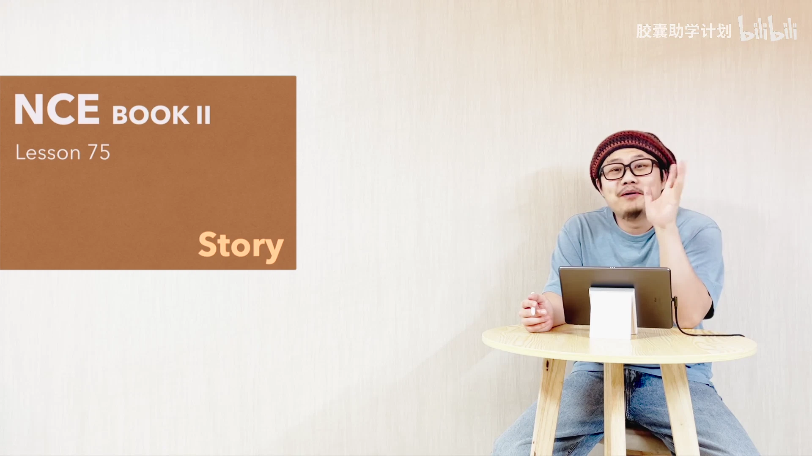

文字识别：bibili / 胶囊助学计划 / NCE / BOOKII / Lesson 75 / Story

### 画面 00:00:04

文字识别：bilbili / 胶囊助学计划 / NCE / BOOKII / Lesson 75 / Story

### 画面 00:00:06

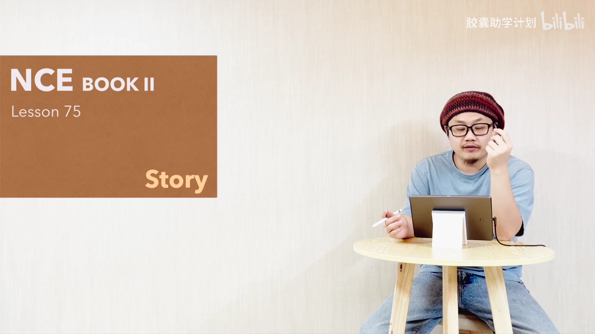

文字识别：bilbil / 胶囊助学计划 / NCE / BOOKII / Lesson 75 / Story

### 画面 00:00:09

文字识别：胶囊助学计划bil出 / • / •

### 画面 00:00:13

文字识别：虞助学计划州 / 胶囊助学计划

### 画面 00:00:15

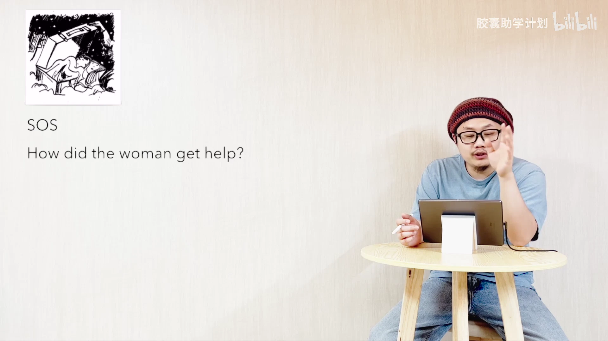

文字识别：biibili / 胶囊助学计划 / SOS / How did the woman get help?

## 00:00:30–00:01:00

思就是一个女人好像出了问题，然后通过求救获得了帮助，对吧？好，那我们看文章吧。文章还行，依旧不是很难，没有新的语法，几乎都是在复习。那我们就注意力集中，一起看一下啊。顺带着还是啊，从第四单元开始一直到第三册，咱们一直要处理的一件事情就是英语长难句。When a light passenger plane flew, of course, some time ago, it crashed in the mountains, and its pilot was

### 画面 00:00:31

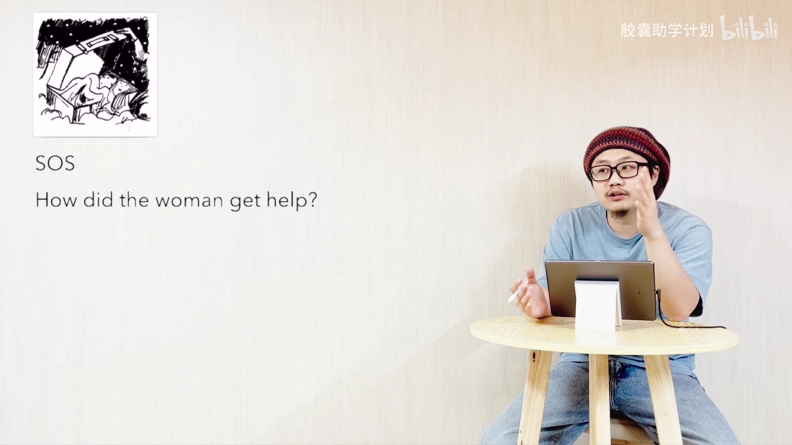

文字识别：bibili / 胶囊助学计划 / SOS / How did the woman get help?

### 画面 00:00:35

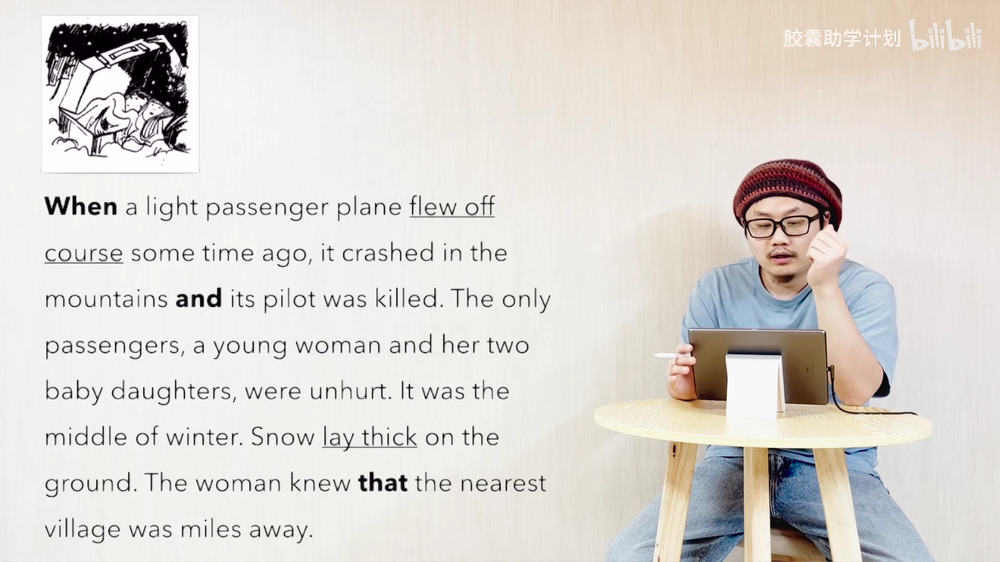

文字识别：胶囊助学计划bil出 / when a light passenger plane flew off / course some time ago, it crashed in the / mountains and its pilot was killed. The only / passengers, a young woman and her two / baby daughters, were unhurt. It was the / middle of winter. Snow lay thick on the / ground. The woman knew that the nearest / village was miles away.

### 画面 00:00:37

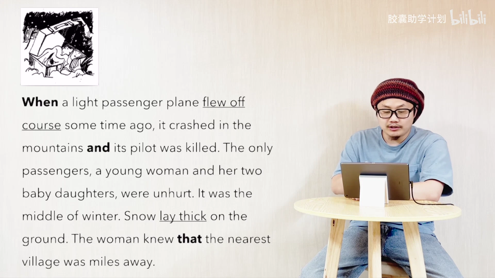

文字识别：胶囊助学计划bili出 / When a light passenger plane flew off / course some time ago, it crashed in the / mountains and its pilot was killed. The only / passengers, a young woman and her two / baby daughters, were unhurt. It was the / middle of winter. Snow lay thick on the / ground. The woman knew that the nearest / village was miles away.

### 画面 00:00:39

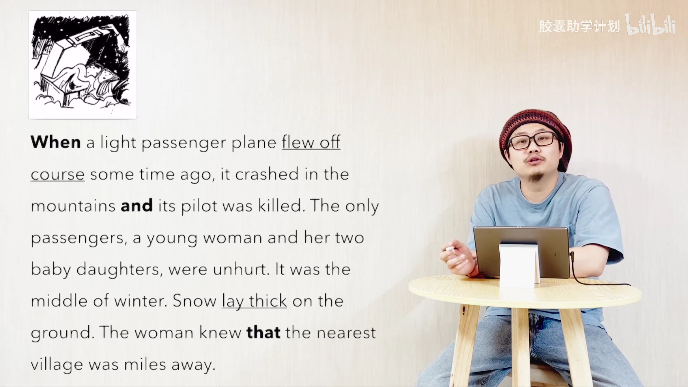

文字识别：胶囊助学计划bili出 / When a light passenger plane flew off / course some time ago, it crashed in the / mountains and its pilot was killed. The only / passengers, a young woman and her two / baby daughters, were unhurt. It was the / middle of winter. Snow lay thick on the / ground. The woman knew that the nearest / village was miles away.

### 画面 00:00:42

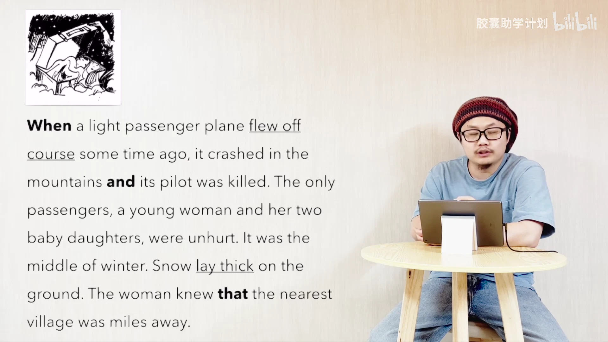

文字识别：胶囊助学计划bi / When a light passenger plane flew off / course some time ago, it crashed in the / mountains and its pilot was killed. The only / passengers, a young woman and her two / baby daughters, were unhurt. It was the / middle of winter. Snow lay thick on the / ground. The woman knew that the nearest / village was miles away.

## 00:01:00–00:01:30

killed.首先，像这句话来说，你说它算不算长难句？其实就不太算啊。原因是它的断句还是比较简单的啊。When引导的一句话，逗号后边一句话，and后边一句话，对吧？一共就三句话，而且这个句式非常的整齐。我们就一句话一句话处理一下。当一个轻型的载客飞机，对吧？哎，轻型的客机啊，这个light肯定是轻型的意思，轻型这个客机，

### 画面 00:01:12

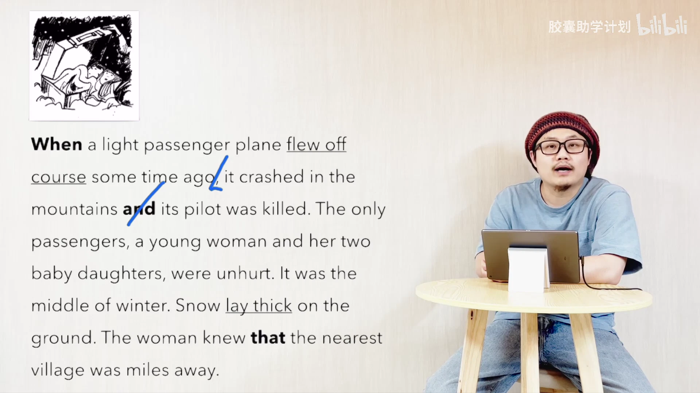

文字识别：胶囊助学计划blb山 / When a light passenger plane flew off / course some time ag it crashed in the / mountains ay/d its pilot was killed. The only / passengers, a young woman and her two / baby daughters, were unhurt. It was the / middle of winter. Snow lay thick on the / ground. The woman knew that the nearest / village was miles away.

## 00:01:30–00:02:00

flew, of course. 注意 flew, fly 的过去式，对吧？飞啊，怎么样的？ Of course, 啊，这个叫偏离跑道，对吧？这个之前咱们也见过，我印象当中是在老爷车比赛那课咱见过，是吧？这个飞离航线. Some time ago, 一段时间之前啊，就一段时间之前，这个一个轻型的客机飞离了航线，然后怎么样了呢？ It crashed in the mountains. 说这辆这架轻型

### 画面 00:01:42

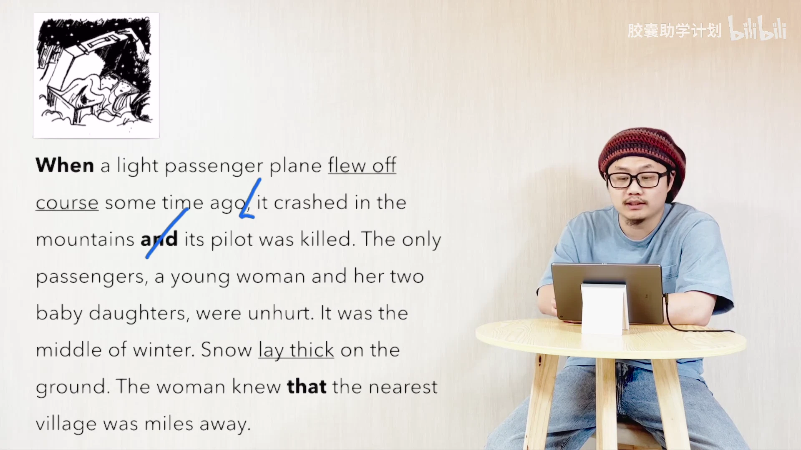

文字识别：胶囊助学计划bib出 / when a light passenger plane flew off / course some time ag it crashed in the / mountains ay/d its pilot was killed. The only / passengers, a young woman and her two / baby daughters, were unhurt. It was the / middle of winter. Snow lay thick on the / ground. The woman knew that the nearest / village was miles away.

## 00:02:00–00:02:30

的客机就坠毁在了山里，然后 its pilot was killed. 说他的驾驶员被弄死了啊？什么叫被弄死了？就是在这个坠毁的过程当中死了，对吧？死亡了啊就可以了。只不过他用的是个被动啊。 The only passengers, a young woman and her two baby daughters, were unhurt. 好了，你看这句话其实看着挺长，其实很简单，就是 the only passengers

### 画面 00:02:12

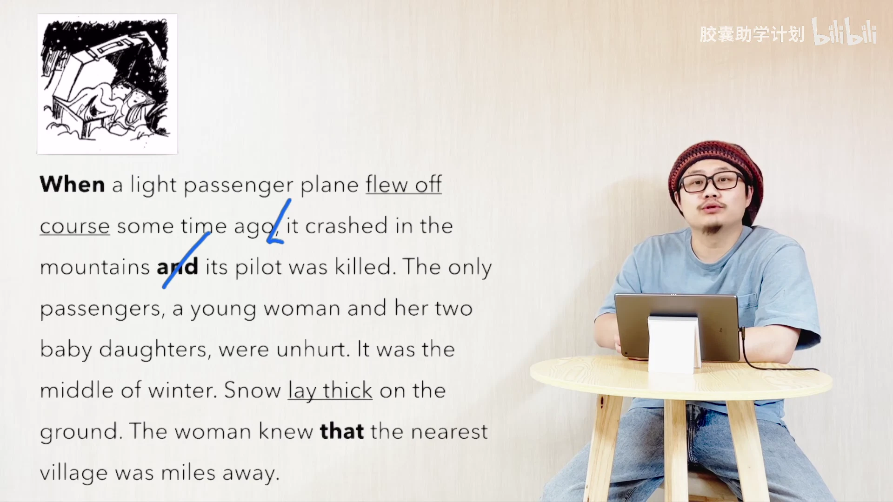

文字识别：胶囊助学计划bi / When a light passenger plane flew off / course some time ag it crashed in the / mountains ay/d its pilot was killed. The only / passengers, a young woman and her two / baby daughters, were unhurt. It was the / middle of winter. Snow lay thick on the / ground. The woman knew that the nearest / village was miles away.

## 00:02:30–00:03:00

were unhurt，对吧？只不过他这个唯一的乘客的这个同位语齁长啊， young woman and her two baby daughters，一个年轻的女人和她的两个宝宝女儿，啊，什么叫宝宝女儿？就是很小的孩子啊，小宝宝，哎，然后并且告诉你性别啊，是女性，啊，那这句话倒不是很难。下一句话说 it was the middle，呃， it was the middle of winter，也不难，说是当时是，因为用的 was嘛，

### 画面 00:02:42

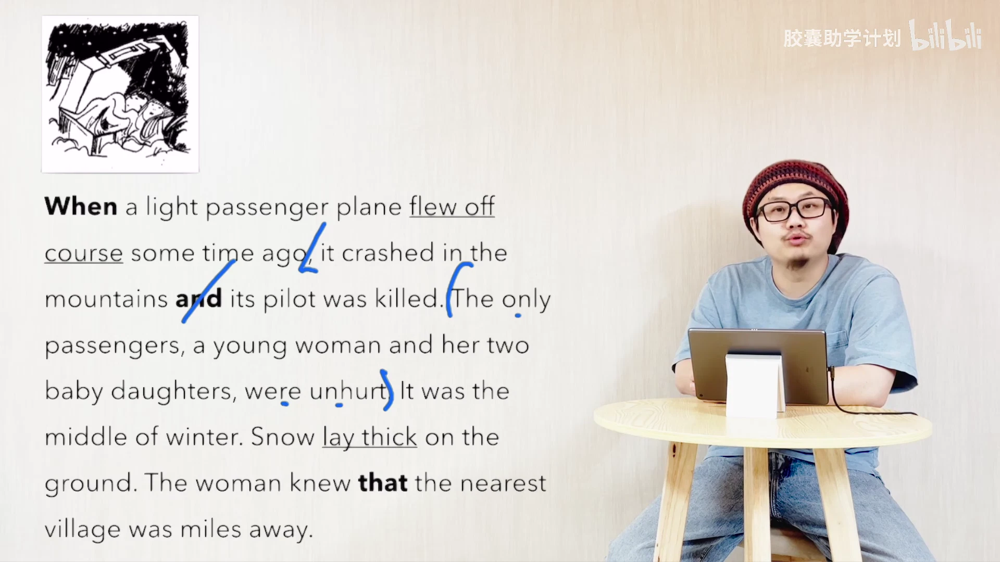

文字识别：胶囊助学计划bii / When a light passenger plane flew off / course some time ag/it crashed in the / mountains ayd its pilot was killed. The only / passengers, a young woman and her two / baby daughters, were unhur it was the / middle of winter. Snow lay thick on the / ground. The woman knew that the nearest / village was miles away.

## 00:03:00–00:03:30

啊，你看我们在这儿回顾一下， flew 过去式， crashed 过去式，一般过去式的被动还是过去式，对吧？然后 was 过去式，啊， it was the middle of winter 过去式，说白了就是我们其实一般一般过去时这个时态出现的频率还是很高的，对吧？各位学到今天，完全可以去看一下我之前录的那种，呃，语法单项，比如说这个时态单项那样的一些视频，对吧？你整合起来去看，其实你会发现一般过去时出现频率很高。

### 画面 00:03:12

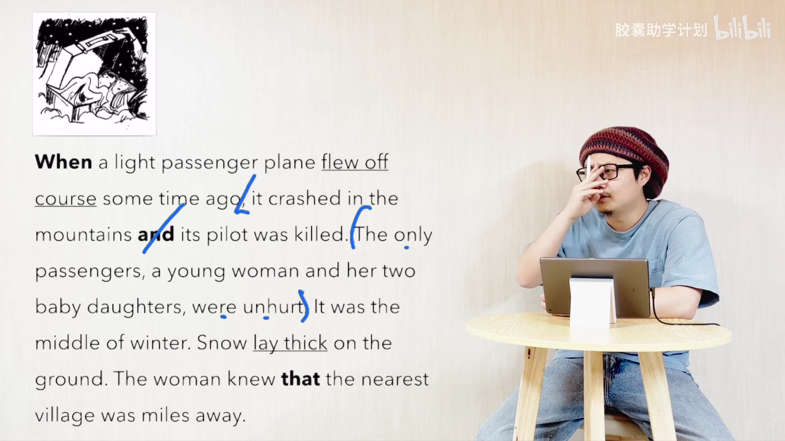

文字识别：胶囊助学计划bili出 / when a light passenger plane flew off / course some time ag/it crashed in the / mountains ayd its pilot was killed. The only / passengers, a young woman and her two / baby daughters, were unhury It was the / middle of winter. Snow lay thick on the / ground. The woman knew that the nearest / village was miles away.

## 00:03:30–00:04:00

为什么？因为我们一般讲过去的故事啊。从前有座山，山里有个庙，庙里有个和尚和老道。像所以像这样所有像这样的故事，我们最长的时态必然是一般过去时啊。说当时是正值隆冬啊，为什么翻译成隆冬呢？其实就是冬天的中间嘛，就是最冷的那几天，你可以理解为对吧？哎，冬至啊，隆冬。Snow lay thick on the ground.这里边就只有一个小单词题句叫lay，它的

### 画面 00:03:42

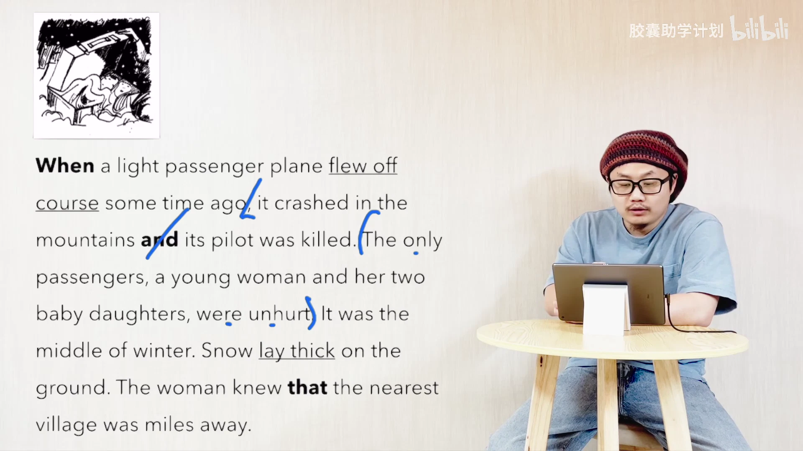

文字识别：胶囊助学计划bi / When a light passenger plane flew off / course some time ag/it crashed in the / mountains ayd its pilot was killed.(The only / passengers, a young woman and her two / baby daughters, were unhurty It was the / middle of winter. Snow lay thick on the / ground. The woman knew that the nearest / village was miles away.

### 画面 00:03:57

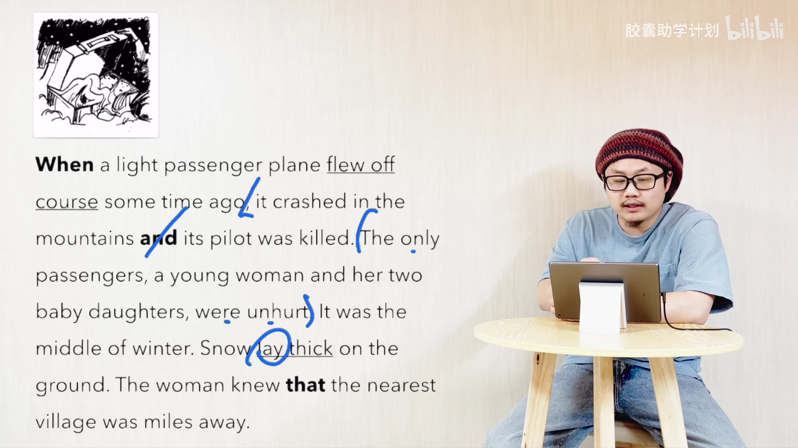

文字识别：胶囊助学计划bi出 / when a light passenger plane flew off / course some time ag/it crashed in the / mountains ayd its pilot was killed. The only / passengers, a young woman and her two / baby daughters, were unhur It was the / middle of winter. Snow aythick on the / ground. The woman knew that the nearest / village was miles away.

### 画面 00:03:59

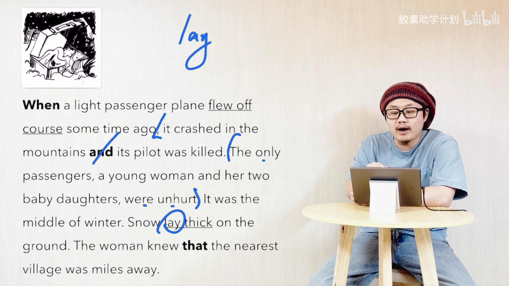

文字识别：胶囊助学计划ii / an / when a light passenger plane flew off / course some time aggit crashed in the / mountains ayd its pilot was killed.The only / passengers, a young woman and her two / baby daughters, were unhurl It was the / middle of winter. Snow aythick on the / ground. The woman knew that the nearest / village was miles away.

## 00:04:00–00:04:30

原型是 lie。 lie 的含义有很多，这个以后我们会慢慢去讲，但本课它不是重点，我们知道它含义就可以了。就它属于保持一种什么样的状态？说这个雪呀，保持的状态是什么？就很厚。所以其实我们一般不会给它翻译成汉语，叫做雪保持的状态叫很厚，就是雪很厚。其实说白了呢，这个地方的 lay，注意后边的 thick 是个形容词，所以这个地方的 lay 啊，原型 lie，

### 画面 00:04:01

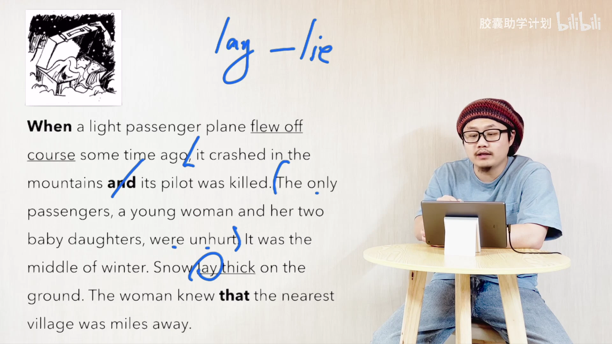

文字识别：胶囊助学计划b出 / -/ie / When a light passenger plane flew off / course some time ag/it crashed in the / mountains ayd its pilot was killed.The only / passengers, a young woman and her two / baby daughters, were unhur it was the / middle of winter. Snow aythick on the / ground. The woman knew that the nearest / village was miles away.

### 画面 00:04:13

文字识别：胶囊助学计划ii出 / When a light passenger plane flew off / course some time aggit crashed in the / mountains ayd its pilot was killed.(The only / passengers, a young woman and her two / baby daughters, were unhur It was the / middle of winter. Snow aythick on the / ground. The woman knew that the nearest / village was miles away.

## 00:04:30–00:05:00

它是一个我们所谓叫系动词，但这个词我没有怎么去讲，或者我几乎没有讲，因为一讲很多同学会懵。但是有一些同学呢又学过，所以我没办法，我折中一下，我给你两个方案。第一个方案你不用管，你就知道，反正你甭管什么系动词啊，什么后边表语啊那些玩意儿，你不用想。我就告诉你， lie 这个单词后边可以加上这样的形容词，表示处于这样的一个状态当中，对吧？所以 snow lay thick，就是雪处于一个什么状态

### 画面 00:04:43

文字识别：胶囊助学计划b出 / when a light passenger plane flew off / course some time aggit crashed in the / mountains ayd its pilot was killed. The only / passengers, a young woman and her two / baby daughters, were unhurt It was the / middle of winter. Snowaythick on the / ground. The woman knew that the nearest / village was miles away.

## 00:05:00–00:05:30

呢？处于一个很厚的状态，就类似于 snow was thick. Was were 不是表状态吗？对吧？它不是一个具体的动词，你知道这儿就行了。另外一部分同学呢，那你不知道从哪学的，对吧？因为每个人在学我的课之前，你都学过别人的课吗？别的老师给你讲过呢？没办法，我提一句，就这个玩意儿叫系动词。系动词有很多，它不是只有 am is ah was were 的，对吧？还有一些这样的动词，比如说 get grow 啊，然后这个 lie 啊 lay 啊这样的一些

### 画面 00:05:13

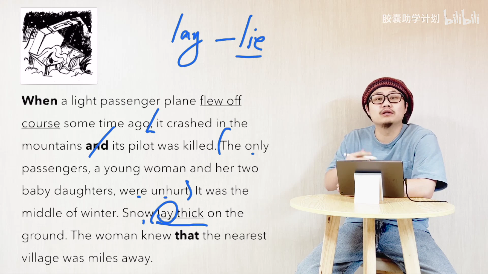

文字识别：胶囊助学计划biii出 / 1℃ / When a light passenger plane flew off / course some time ag/it crashed in the / mountains ayd its pilot was killed.fThe only / passengers, a young woman and her two / baby daughters, were unhurt it was the / middle of winter. Snowaythick on the / ground. The woman knew that the nearest / village was miles away.

## 00:05:30–00:06:00

动词，对吧？这你没办法，那你就记，你如果非要记，你就知道到后边加形容词啊。两种我觉得都行。所以它的含义就是雪很厚。On the ground，叫在地面上。The woman knew that the nearest village was miles away. 说这个女的知道，知道的是一件事儿。一给 that 后边一个宾语从句就出来了。知道的是什么呢？The nearest village was miles away. 说最近的这个村落实际上是几英里之

### 画面 00:05:43

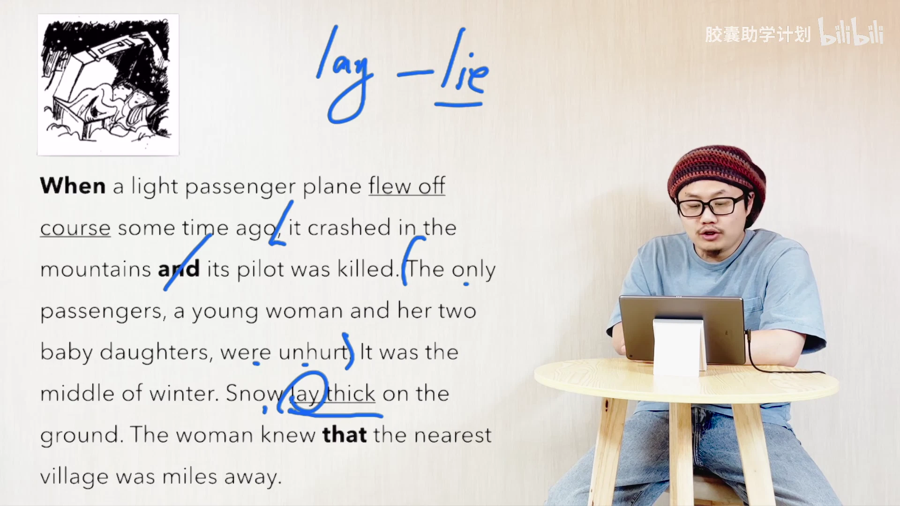

文字识别：胶囊助学计划biii出 / a / When a light passenger plane flew off / course some time ag/it crashed in the / mountains ayd its pilot was killed.fThe only / passengers, a young woman and her two / baby daughters, were unhur It was the / middle of winter. Snow aythick on the / ground. The woman knew that the nearest / village was miles away.

## 00:06:00–00:06:30

外的，对吧？ Continue. When it grew dark, you注意你看这里的grow dark其实就是刚才我们说的系动词，或者你另一个角度，你不把它当系动词，你就记住叫做grow这个单词后边可以加形容词就可以了。比如说，it grew dark，对吧？叫做天气变黑了，这个是一个习惯用法，是其实课咱们就学过。She turned a suitcase into a bed and put the children inside

### 画面 00:06:00

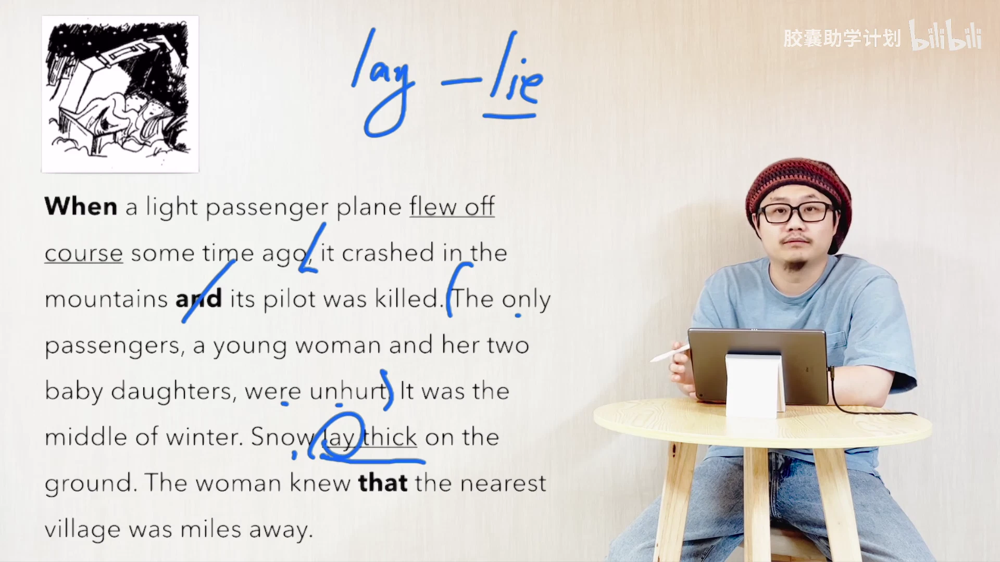

文字识别：胶囊助学计划b / a / When a light passenger plane flew off / course some time ag/it crashed in the / mountains ayd its pilot was killed.The only / passengers, a young woman and her two / baby daughters, were unhurt It was the / middle of winter. Snowaythick on the / ground. The woman knew that the nearest / village was miles away.

### 画面 00:06:02

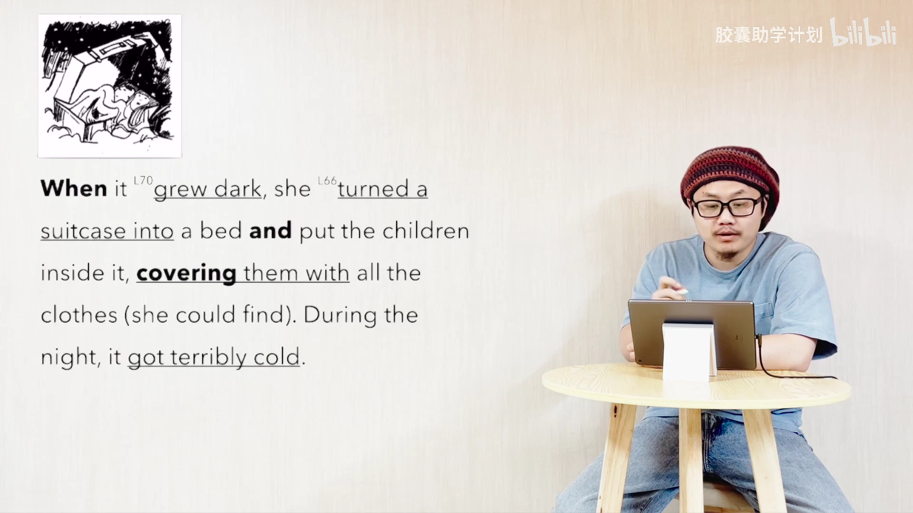

文字识别：胶囊助学计划ilb出 / When it 17°g / "grew dark, she l66turned a / suitcase into a bed and put the children / inside it, covering them with all the / clothes (she could find). During the / night, it got terribly cold.

## 00:06:30–00:07:00

it, covering them with all the clothes she could find.你看这句话，我觉得就可以算难度比较简单的长难句吧。咱给它断断句。首先有逗号，有逗号往往就可以断句，对吧？然后加前面又是一个完整的句子。然后第二个有个and，前后可以分开。这儿有个逗号，前后可以分开。这儿有个定从，咱不分开的了啊，因为剩不了几个单词了。说When it grew dark,说当天变黑的

### 画面 00:06:32

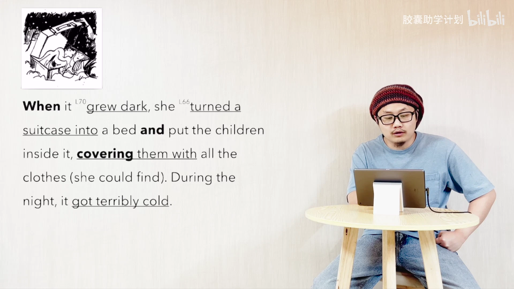

文字识别：胶囊助学计划bi出 / When it 17°g / "grew dark, she l6turned a / suitcase into a bed and put the children / inside it, covering them with allthe / clothes (she could find). During the / night, it got terribly cold.

### 画面 00:06:37

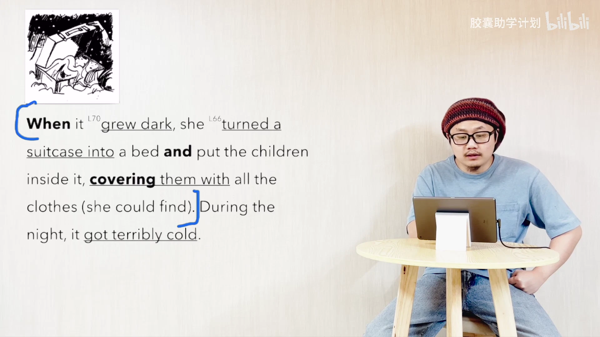

文字识别：胶囊助学计划bl山 / When it 7°g / "grew dark, she l66turned a / suitcase into a bed and put the children / inside it, covering them with all the / clothes (she could find)]During the / night, it got terribly cold.

### 画面 00:06:44

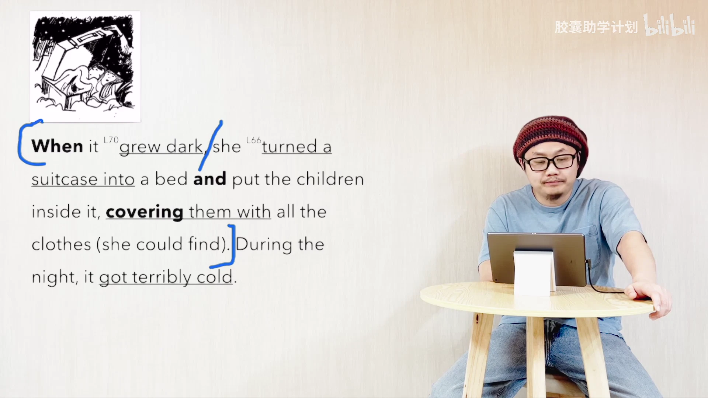

文字识别：胶囊助学计划bii / When it 17°g / "grew dark/she 6turned a / suitcase into a bed and put the children / inside it, covering them with allthe / clothes (she could find)]During the / night, it got terribly cold.

### 画面 00:06:51

文字识别：Bilbili / 胶囊助学计划 / When it 7g / "grew dark/she [6turned a / suitcase into a bed a/d put the children / inside it/covering them with all the / clothes (she could find)]During the / night, it got terribly cold.

## 00:07:00–00:07:30

turned A into B, turning A into B. Sixty-six, we've learned. They turned a young woman into a bed. They turned a suitcase into a bed. A suitcase is what we call a suitcase. They turned a suitcase into a bed. Because the baby's daughters, the little baby

### 画面 00:07:15

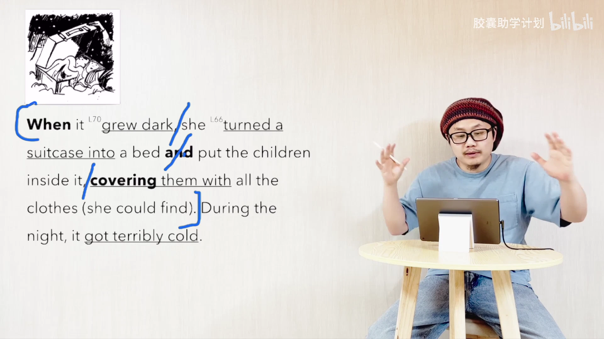

文字识别：胶囊助学计划bi / When it 17°g / grew darkshe 6turned a / suitcase into a bed ayd put the children / inside itcovering them with all the / clothes (she could find)]During the / night, it got terribly cold.

### 画面 00:07:23

文字识别：biibili / 胶囊助学计划 / When it 7g / "grewW dark she 6turned a / suitcase into a bed ad put the children / inside it/covering them with all the / clothes (she could find)]puring the / night, it got terribly cold.

## 00:07:30–00:08:00

里边去了，放到这个行李箱里边去了。到这儿都没有问题，只是后边这句话叫 "Covering them with all the clothes she could find"。这句话语法知识基本上二十八课和四十九课您学会了，学扎实了，瞬间我一讲你就会了啊！没学知识，没学扎实，我在这儿也给你讲不明白啊。Covering 主语 she 主动被动主动分词做状语完事儿了，对吧？哎，她怎么样呢？哎，覆盖这两个孩子，就这个年轻的

### 画面 00:07:53

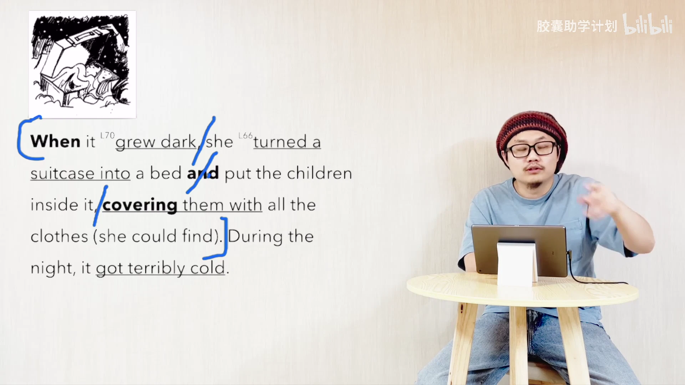

文字识别：胶囊助学计划b / When it 7°grew darkshe 6turned a / suitcase into a bed ayd put the children / inside it/covering them with all the / clothes (she could find)]During the / night, it got terribly cold.

### 画面 00:07:56

文字识别：胶囊助学计划bi / When it [7°g / "grew dark she “turned a / suitcase into a bed ayd put the children / inside itcovering them with all the / clothes (she could find)]During the / night, it got terribly cold.

## 00:08:00–00:08:30

女子，就妈妈啊！我这么说了，妈妈覆盖着这两个孩子，用什么呢？用的是所有的衣服啊！这是一个习惯用法，叫 cover somebody with something。啊，往往是用某物覆盖住了某人。然后后边呢，用的是 all the clothes，所有的衣服 she could find。你只看到了这三个单词，然后呢，前面还有一个 cover，covering，然后还有个逗号，所以说这明显不是一个完整的句子啊。

### 画面 00:08:14

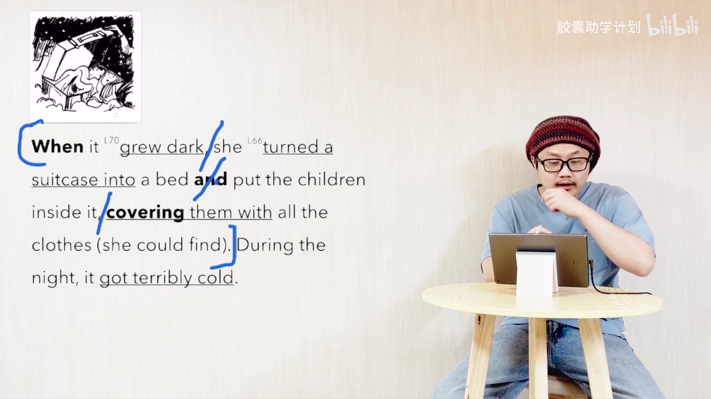

文字识别：胶囊助学计划bilii / When it 7°g / 'grew darkshe L6turned a / suitcase into a bed ayd put the children / inside itcovering them with all the / clothes (she could find)]During the / night, it got terribly cold.

## 00:08:30–00:09:00

那他能找到的所有的衣服，对吧？是个定语从句，这地方省略了一个 that，你可以理解为，所以就是这个年轻的女性覆盖着这两个孩子，用的是所有她能找到的衣服，定从，对吧？找到的衣服，哎，定从。During the night, it got terribly cold.呃呃，晚上呢变得无比的冷。所以你看，如果你还记得新一，咱们就学 I got very angry.

### 画面 00:08:44

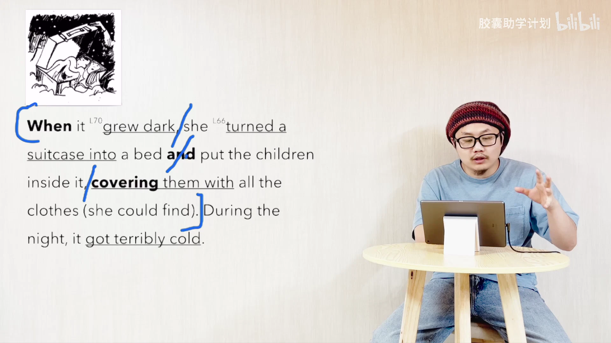

文字识别：bilibii / 胶囊助学计划 / When it 7°g / grew darkshe L6turned a / suitcase into a bed ayd put the children / inside itcovering them with all the / clothes (she could find)]During the / night, it got terribly cold.

## 00:09:00–00:09:30

哎，第一课咱们就学 I got very angry. 那个 got 其实就是你看 angry 是形容词嘛，它就是个系动词，只是我们当时没有提这个概念。我发现后来在一些留言当中，学员总去问，那我就提一句啊，满足一下各位这个愿望啊。然后它后边加了一个形容词，所以我其实处理的方式就是你记住 get 后边可以加形容词，我们当个习惯用法去造句就完了，对吧？你非要理解它是个系动词呢，那也行啊。它变得非常的冷，

### 画面 00:09:07

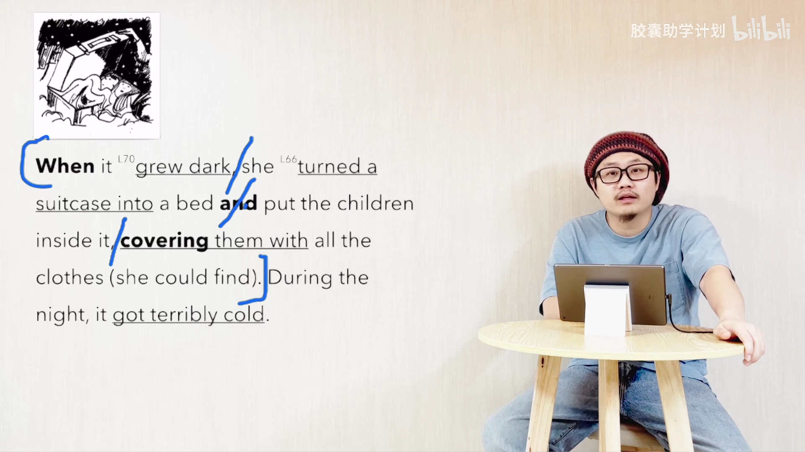

文字识别：biibli / 胶囊助学计划 / When it 70g / 'grew darkshe [6turned a / suitcase into a bed ayd put the children / inside itcovering them with all the / clothes (she could find)]puring the / night, it got terribly cold.

### 画面 00:09:19

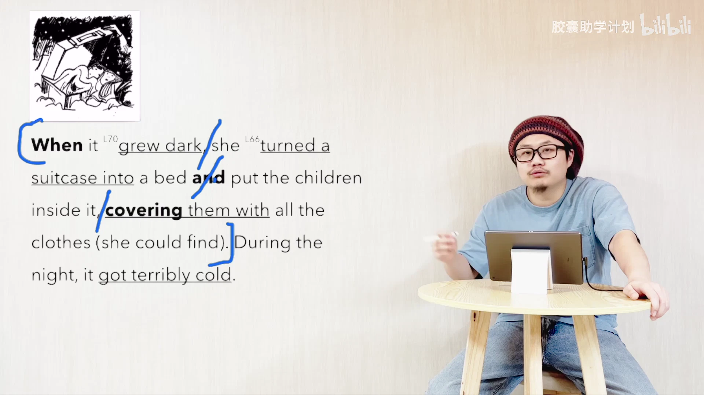

文字识别：bibili / 胶囊助学计划 / When it [7°g / "grew dark she 6turned a / suitcase into a bed ad put the children / inside itcovering them with all the / clothes (she could find)]During the / night, it got terribly cold.

### 画面 00:09:26

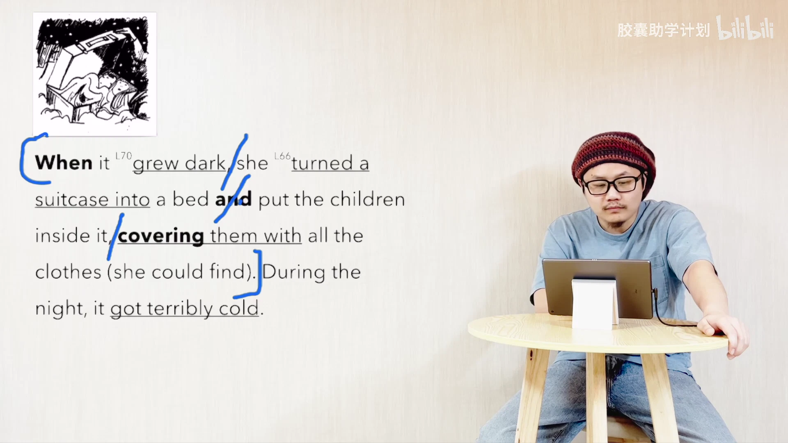

文字识别：胶囊助学计划bi山 / When it 7°g / 'grew dark she 6turned a / suitcase into a bed ayd put the children / inside it/covering them with all the / clothes (she could find)]During the / night, it got terribly cold.

## 00:09:30–00:10:00

那它指的是天气嘛？就天儿变得非常的冷，这个也符合咱们的逻辑。山里边还下着大雪呢，对吧？晚上变得非常的冷。The woman kept as close as she could to the children, and even tried to get into the cage herself, but it was too small.啊，这句话也不算长难句，一个and一个but看到了，这句话就直接被拆成三句了，对吧？第一句话叫做The woman kept as close as she could to the children.这个保持保持的距离，

### 画面 00:09:33

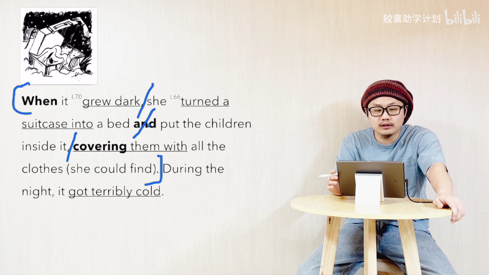

文字识别：biibili / 胶囊助学计划 / When it 70g / 'grew dark she l6turned a / suitcase into a bed ayd put the children / inside it/covering them with all the / clothes (she could find)]During the / night, it got terribly cold.

### 画面 00:09:38

文字识别：胶囊助学计划bi出 / The woman kept as near as she could to / the children and even tried to get into the / case herself, but it was too small. Early / next morning, she 4heard planes passing / overhead and wondered how she could / send a signal.

### 画面 00:09:54

文字识别：胶囊助学计划bi出 / The woman kept as near as she could to / the children and even tried to get into the / case herself, but it was too small. Early / next morning, she 4"heard planes passing / overhead and wondered how she could / send a signal.

## 00:10:00–00:10:30

呃，对孩子们保持距离很近啊。Keep near to the children. You别管这个，别管这个as，别管这as she could，就是keep kept near to the children，啊，和孩子们保持的距离很近，对吧？好，然后呢，那加上这个as near as she could，在我们的pattern句型当中不是刚学过吗？As quickly as she could叫尽可能的快，as near as she could就是尽可能的近，对吧？说妈妈和这些孩子们的距离保持

### 画面 00:10:08

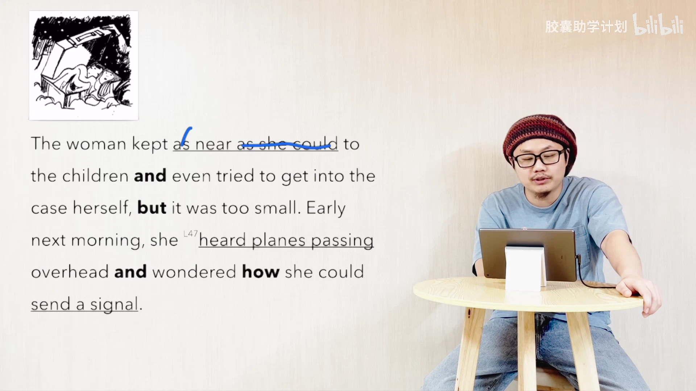

文字识别：胶囊助学计划bi出 / The woman kept as near as she could to / the children and even tried to get into the / case herself, but it was too small. Early / next morning, she 47heard planes passing / overhead and wondered how she could / send a signal.

### 画面 00:10:16

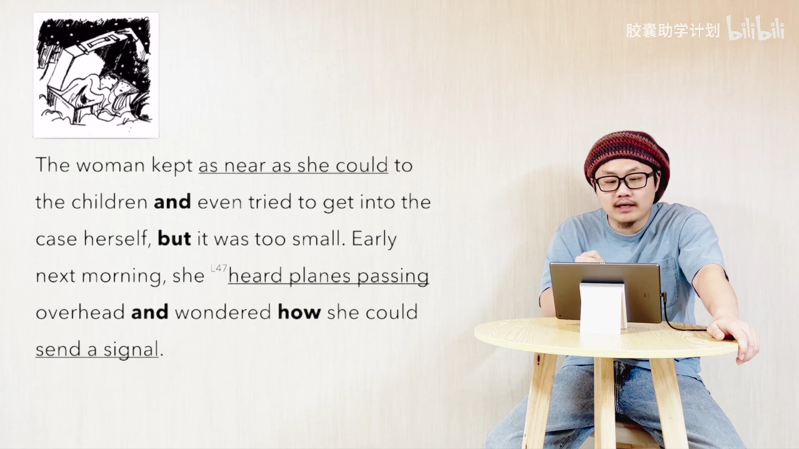

文字识别：胶囊助学计划i出 / The woman kept as near as she could to / the children and even tried to get into the / case herself, but it was too small. Early / next morning, she 4"heard planes passing / overhead and wondered how she could / send a signal.

### 画面 00:10:18

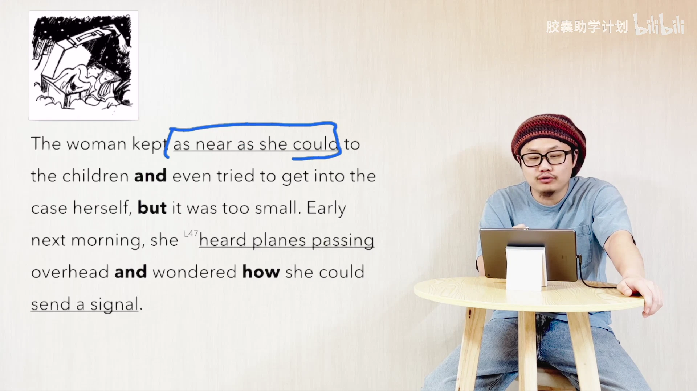

文字识别：胶囊助学计划bi出 / The woman kept / as near as she could / to / the children and even tried to get into the / case herself, but it was too small. Early / next morning, she [47heard planes passing / overhead and wondered how she could / send a signal.

### 画面 00:10:20

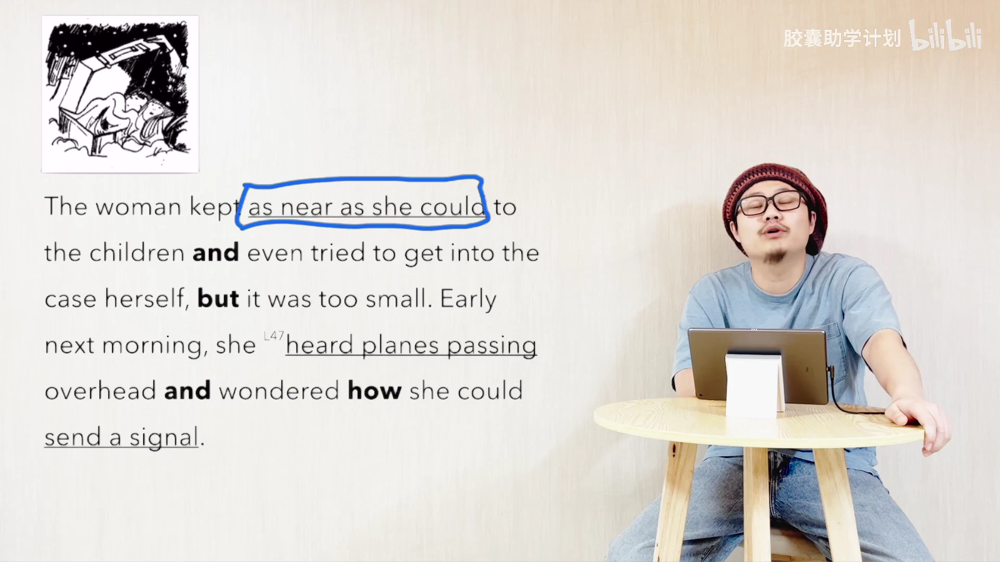

文字识别：胶囊助学计划bibi / The woman kept / as near as she could / to / the children and even tried to get into the / case herself, but it was too small. Early / next morning, she 4*heard planes passing / overhead and wondered how she could / send a signal.

### 画面 00:10:26

文字识别：胶囊助学计划bi出 / The woman keptas near as she could to / the children and even tried to get into the / case herself, but it was too small. Early / next morning, she 47heard planes passing / overhead and wondered how she could / send a signal.

## 00:10:30–00:11:00

尽可能的近，哎，就贴着，紧紧贴着。翻译成汉语意义的话，and even tried to get into the case herself.然后甚至尝试就钻到这个箱子里边去，哎，她自己也甚至尝试钻到这箱子里面去。但是呢，it was too small.但是怎么样呢？太小了，进不去。那it指的是那个case，suitcase. Early next morning, she heard planes passing overhead

### 画面 00:10:56

文字识别：胶囊助学计划bibi / The woman kept as near as she could to / the children and even tried to get into the / case herself, but it was too small. Early / next morning, she 47heard planes passing / overhead and wondered how she Could / send a signal.

## 00:11:00–00:11:30

and wondered how she could send a signal.这句话要算长难句吗？也行，太简单了。主要是 early next morning，就是早第二天早一些时候。他四十七课咱们学过，三十五课咱们学的是 see somebody doing something。四十七课咱们学过叫 hear somebody doing something，对吧？那你也可以是 something嘛。他听到了飞机 passing overhead， pass 飞过 overhead。你看 head，这是 head overhead 就在头上，对吧？头顶上方，他听到了飞

### 画面 00:11:23

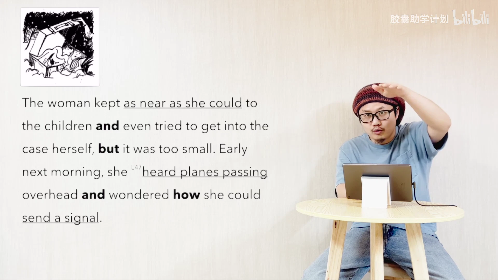

文字识别：胶囊助学计划bi出 / The woman kept as near as she could to / the children and even tried to get into the / Case herself, but it was too small. Early / next morning, she 47heard planes passing / overhead and wondered how she could / send a signal.

### 画面 00:11:27

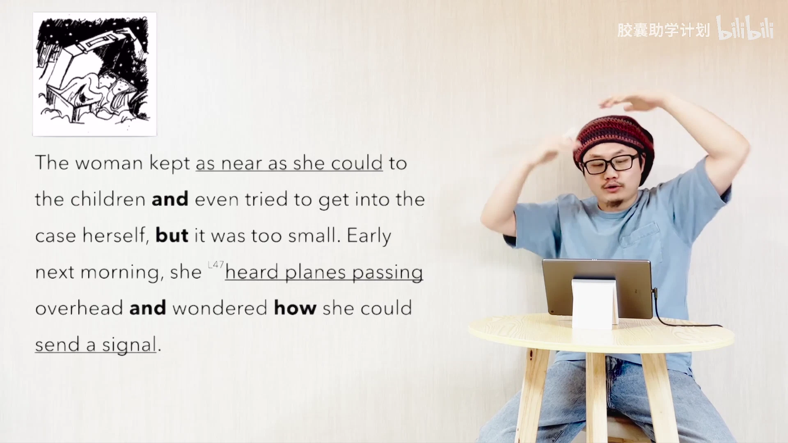

文字识别：胶囊助学计划bi出 / The woman kept as near as she could to / the children and even tried to get into the / Case herself, but it was too small. Early / next morning, she 47heard planes passing / overhead and wondered how she could / send a signal.

### 画面 00:11:29

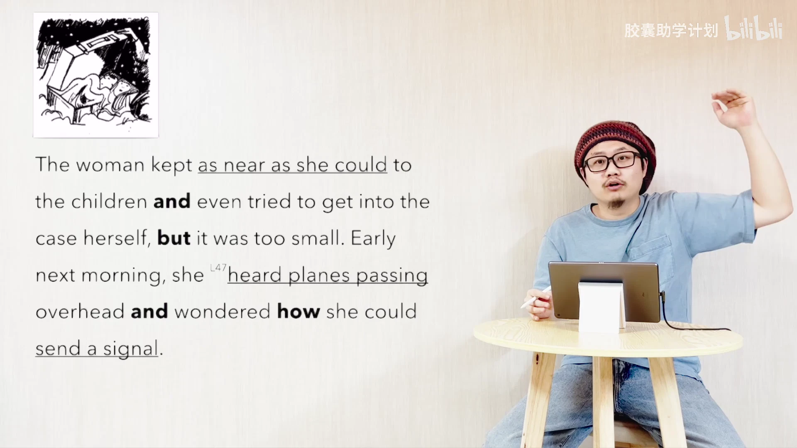

文字识别：胶囊助学计划bi出 / The woman kept as near as she could to / the children and even tried to get into the / Case herself, but it was too small. Early / next morning, she 4heard planes passing / overhead and wondered how she could / send a signal.

## 00:11:30–00:12:00

机在飞过啊，正在飞过。然后 wondered，然后感到很好奇，对吧？呃，感到一些疑惑啊，他就去想，哎，就是干嘛呢？他如何 she could send a signal？如何才才能发送出来一个信号？Send a signal，在单词部分咱们讲过，不多说。Then she had an idea，然后她有了一个想法。She stamped out the letters S O S in the snow。这句话我们在单

### 画面 00:11:32

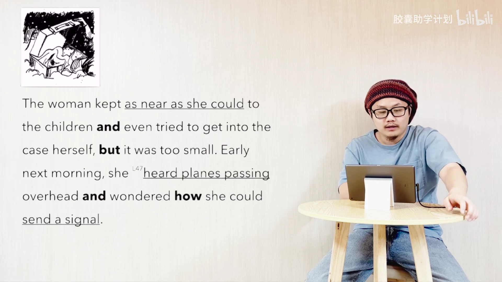

文字识别：胶囊助学计划i出 / The woman kept as near as she could to / the children and even tried to get into the / case herself, but it was too small. Early / next morning, she 4heard planes passing / overhead and wondered how she could / send a signal.

### 画面 00:11:49

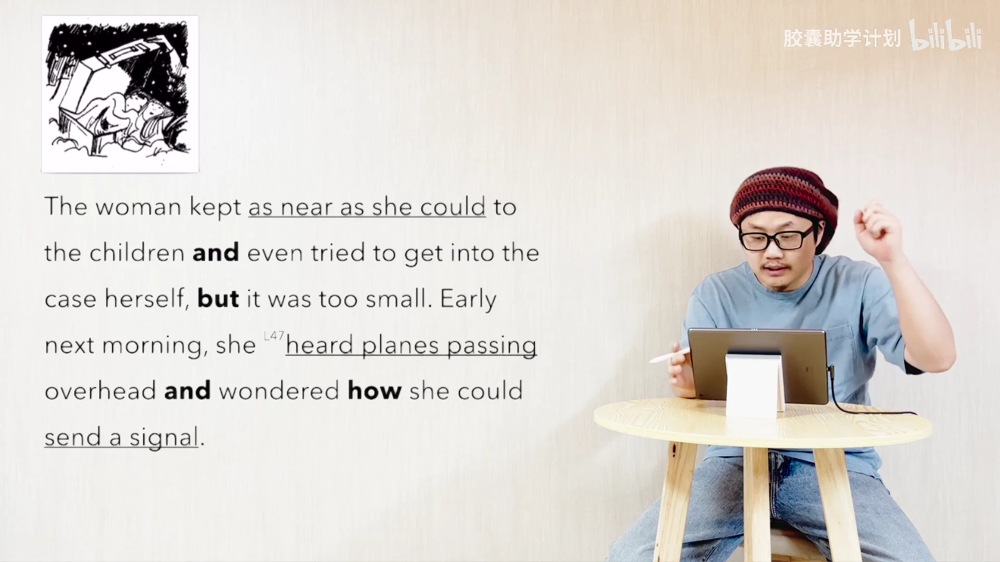

文字识别：胶囊助学计划bib出 / The woman kept as near as she could to / the children and even tried to get into the / case herself, but it was too small. Early / next morning, she 4heard planes passing / overhead and wondered how she could / send a signal.

### 画面 00:11:51

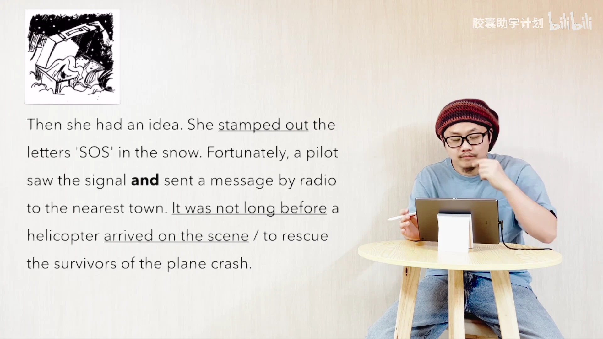

文字识别：胶囊助学计划bilb山 / Then she had an idea. She stamped out the / letters 'SOS' in the snow. Fortunately, a pilot / saw the signal and sent a message by radio / to the nearest town. It was not long before a / helicopter arrived on the scene / to rescue / the survivors of the plane crash.

### 画面 00:11:55

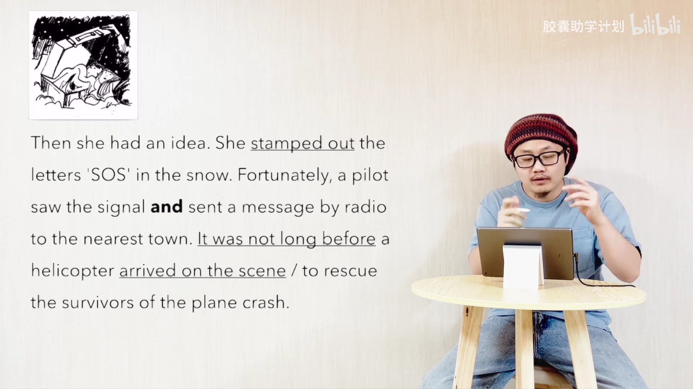

文字识别：胶囊助学计划biii / Then she had an idea. She stamped out the / letters 'SOS' in the snow. Fortunately, a pilot / saw the signal and sent a message by radio / to the nearest town. It was not long before a / helicopter arrived on the scene / to rescue / the survivors of the plane crash.

## 00:12:00–00:12:30

词呃造句部分清清楚楚的解释过了，在这儿就复习一下。他踩出了S O S的字母在雪里面。Fortunately,哎，unfortunately咱们学过U N，你又知道表前缀，fortunately就是不哎幸运的。A pilot saw the signal and sent a message by radio to the nearest town.说很幸运的是，一个这个飞行员看到

### 画面 00:12:16

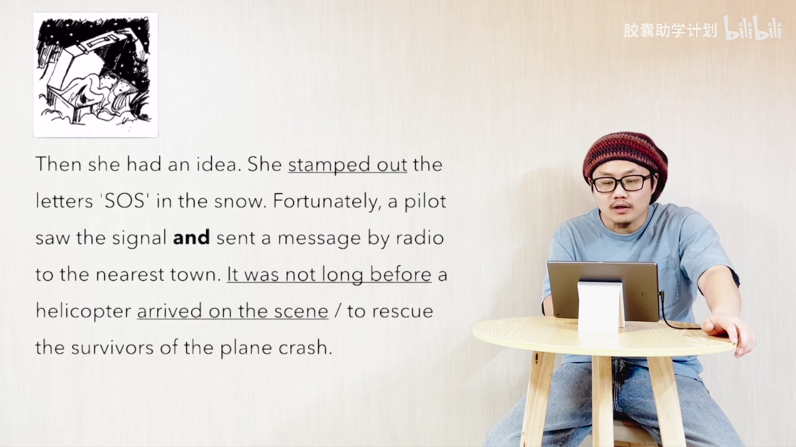

文字识别：胶囊助学计划bilb山 / Then she had an idea. She stamped out the / letters 'SOS' in the snow. Fortunately, a pilot / saw the signal and sent a message by radio / to the nearest town. It was not long before a / helicopter arrived on the scene / to rescue / the survivors of the plane crash.

## 00:12:30–00:13:00

到了这个这个信号，然后呢，发送了一个消息 by radio，就是用无线电发送了消息 to the nearest town，去了最近的这个小镇上发送了这样一个消息。接下来，这是一个习惯用法，叫 It was not long before a helicopter arrived on the scene to rescue the survivor of the plane crash。这句话虽然它真不能从定义上很难说它是个

### 画面 00:12:30

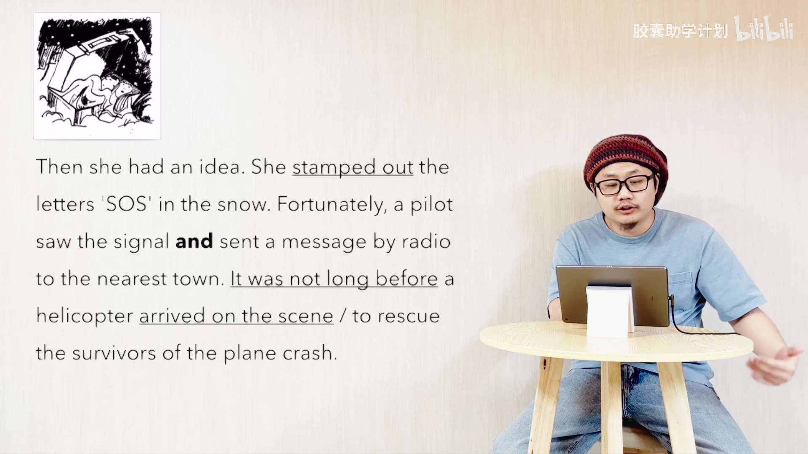

文字识别：胶囊助学计划biibi / Then she had an idea. She stamped out the / letters 'SOS' in the snow. Fortunately, a pilot / saw the signal and sent a message by radio / to the nearest town. It was not long before a / helicopter arrived on the scene / to rescue / the survivors of the plane crash.

### 画面 00:12:47

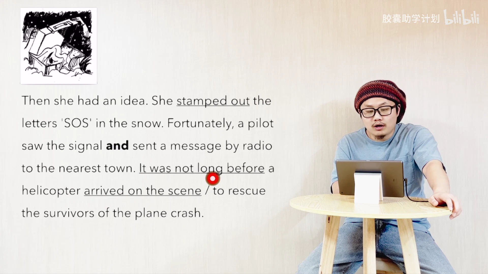

文字识别：胶囊助学计划bilbi / Then she had an idea. She stamped out the / letters 'SOS' in the snow. Fortunately, a pilot / saw the signal and sent a message by radio / to the nearest town. It was not long before a / helicopter arrived on the scene / to rescue / the survivors of the plane crash.

## 00:13:00–00:13:30

长难句，但是我给各位拆一下，拆完了之后对于您来说更容易理解。我们先看第一句，叫 It was not long，不是很长，时间不长，不久。在什么之前呢？A helicopter arrived on the scene，叫做一个直升飞机到达现场。直升飞机到达现场之前，这个时间并不长。那是指的哪什么时间呢？就是他 send

### 画面 00:13:02

文字识别：胶囊助学计划bi出 / Then she had an idea. She stamped out the / letters 'SOS' in the snow. Fortunately, a pilot / saw the signal and sent a message by radio / to the nearest town. It was not long/before a / helicopter arrived on the scene / to rescue / the survivors of the plane crash.

### 画面 00:13:06

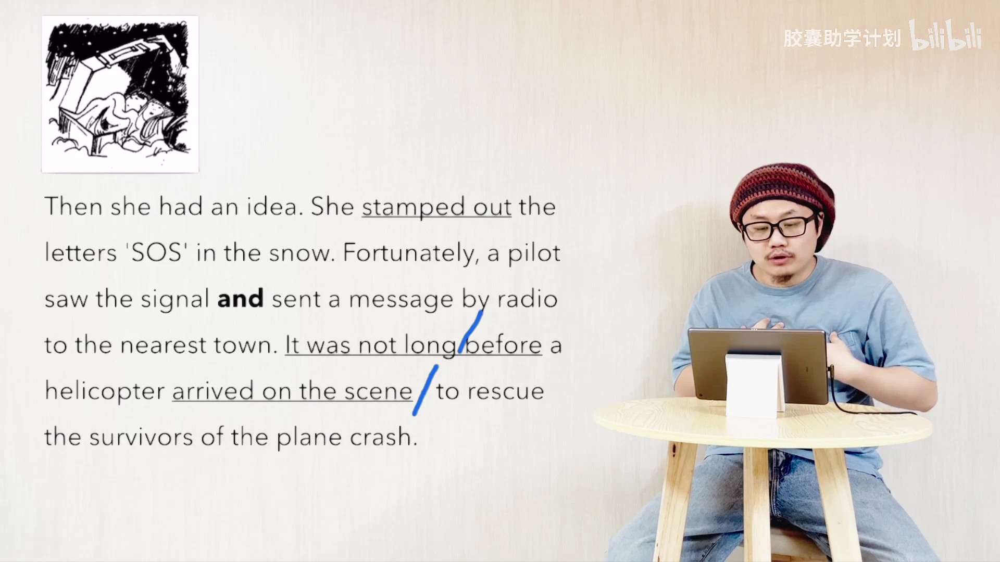

文字识别：胶囊助学计划bibil / Then she had an idea. She stamped out the / letters 'SOS' in the snow. Fortunately, a pilot / saw the signal and sent a message by radio / to the nearest town. It was not long/before a / helicopter arrived on the scene / to rescue / the survivors of the plane crash.

### 画面 00:13:10

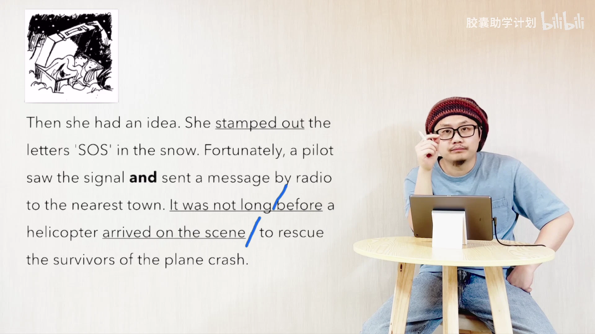

文字识别：胶囊助学计划bib山 / Then she had an idea. She stamped out the / letters 'SOS' in the snow. Fortunately, a pilot / saw the signal and sent a message by radio / to the nearest town. It was not long/before a / helicopter arrived on the scene / to rescue / the survivors of the plane crash.

### 画面 00:13:24

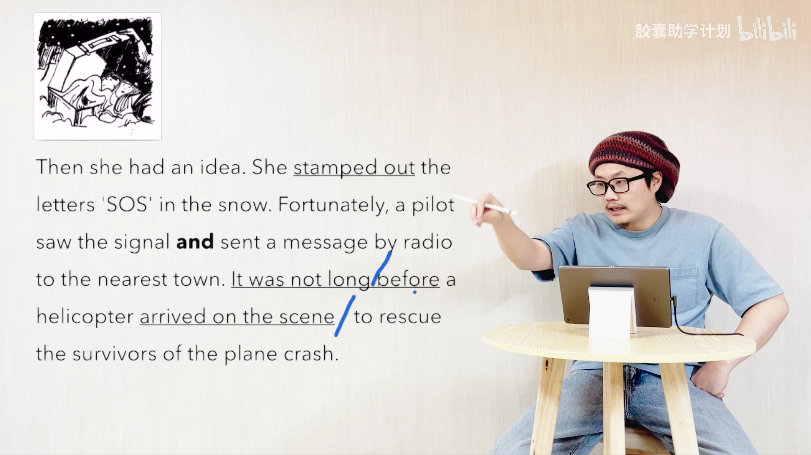

文字识别：胶囊助学计划bibi出 / Then she had an idea. She stamped out the / letters 'SOS' in the snow. Fortunately, a pilot / saw the signal and sent a message by radio / to the nearest town. It was not longbefore a / helicopter arrived on the scene / to rescue / the survivors of the plane crash.

### 画面 00:13:28

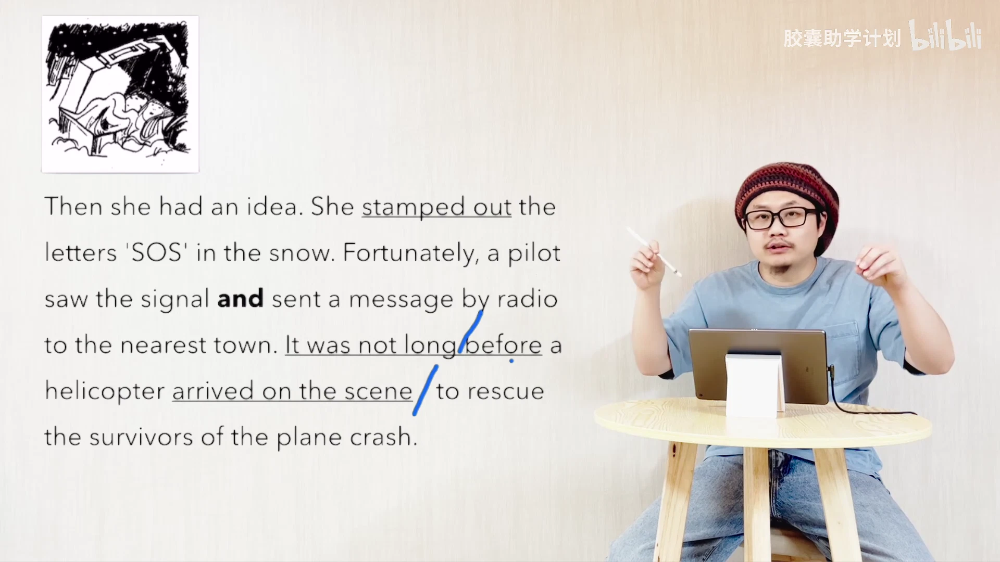

文字识别：胶囊助学计划bl / Then she had an idea. She stamped out the / letters 'SOS' in the snow. Fortunately, a pilot / saw the signal and sent a message by radio / to the nearest town. It was not long/before a / helicopter arrived on the scene / to rescue / the survivors of the plane crash.

## 00:13:30–00:14:00

a signal to the nearest town，这是时间点 A，一直到飞机直升飞机到达现场，这是时间点 B。A 和 B 之间这个时间 it was not long，这个时间并不长。在什么之前？在直升飞机抵达现场之前。然后后边一个 to 表目的，什么目的呢？To rescue the survivor of the plane crash，这就是很字面的意思了，去拯救 A A of B 啊，飞机这个坠

### 画面 00:13:46

文字识别：胶囊助学计划bib出 / Then she had an idea. She stamped out the / letters 'SOS' in the snow. Fortunately, a pilot / saw the signal and sent a message by radio / to the nearest town. It was not long/before a / helicopter arrived on the scene / to rescue / the survivors of the plane crash.

### 画面 00:13:51

文字识别：胶囊助学计划bib出 / Then she had an idea. She stamped out the / letters 'SOS' in the snow. Fortunately, a pilot / saw the signal and sent a message by radio / to the nearest town. It was not long/before a / helicopter arrived on the scene / to rescue / the survivors of the plane crash.

## 00:14:00–00:14:30

毁的幸存者其实就是这一个妈妈和这两个小宝宝，对吧？呃，飞机的 pilot was killed. 文章在我看来还行，没有太难的语法。然后这个单词习惯用法呢，该有很正很正常，对吧？然后习惯用法，咱们该造句造句啊。第一个 fly of course 叫偏离航线啊，也不是太难。我们造个句子，比如说 the pilot was instructed to fly of course. 他被命令要求他远离航线，

### 画面 00:14:03

文字识别：胶囊助学计划bilibi出 / Then she had an idea. She stamped out the / letters 'SOS' in the snow. Fortunately, a pilot / saw the signal and sent a message by radio / to the nearest town. It was not long/before a / helicopter arrived on the scene / to rescue / the survivors of the plane crash.

### 画面 00:14:07

文字识别：胶囊助学计划bii出 / Then she had an idea. She stamped out the / letters 'SOS' in the snow. Fortunately, a pilot / saw the signal and sent a message by radio / to the nearest town. It was not long before a / helicopter arrived on the scene / to rescue / the survivors of the plane crash.

### 画面 00:14:09

文字识别：bilbii / 胶囊助学计划 / 习惯用法造句 / fly off course / cover sb./sth. with a. / get adj. / It was not long / before..

### 画面 00:14:11

文字识别：bilbii / 胶囊助学计划 / 习惯用法造句 / fly off course / cover sb./sth. with a. / get adj. / It was not long / before..

### 画面 00:14:13

文字识别：bilbii / 胶囊助学计划 / 习惯用法造句 / fly off course / cover sb./sth. with a. / get adj. / It was not long / before..

### 画面 00:14:15

文字识别：bibii / 胶囊助学计划 / 习惯用法造句 / fly off course / cover sb./sth. with a. / get adj. / It was not long / before..

### 画面 00:14:17

文字识别：bilibii / 胶囊助学计划 / 习惯用法造句 / fly off course / cover sb./sth. with a. / get adj. / It was not long / before..

### 画面 00:14:19

文字识别：网：v.+v.变化 / 胶囊助学计划 / biibii / 习惯用法造句指南 / 四句型转换 / 方式/地点/时间 / 其他习惯用法 / 其他单词+词性 / 原文摘抄+变 / 6123456 / fly off course

### 画面 00:14:21

文字识别：网：v.+v.变化 / 胶囊助学计划 / bibii / 习惯用法造句指南 / 四句型转换 / 方式/地点/时间 / 其他习惯用法 / 其他单词+词性 / 原文摘抄+变 / 6123456 / fly off course

### 画面 00:14:23

文字识别：网：v.+v.变化 / 胶囊助学计划 / bilbili / 习惯用法造句指南 / 四句型转换 / 方式/地点/时间 / 其他习惯用法 / 其他单词+词性 / 原文摘抄+变 / 6123456 / fly off course /  The pilot was instructed to fly off course. / L69

### 画面 00:14:25

文字识别：bilbili / 网：v.+v.变化 / 胶囊助学计划 / 习惯用法造句指南 / 四句型转换 / 方式/地点/时间 / 其他习惯用法 / 其他单词+词性 / 原文摘抄+变 / 6123456 / fly off course /  The pilot was instructed to fly off course. / L69

### 画面 00:14:29

文字识别：bilibii / 网：v.+v.变化 / 胶囊助学计划 / 习惯用法造句指南 / 四句型转换 / 方式/地点/时间 / 其他习惯用法 / 其他单词+词性 / 原文摘抄+变 / 6123456 / fly off course /  The pilot was instructed to fly off course. / L69

## 00:14:30–00:15:00

对吧？Next one说，No matter what happens, you should not fly. Of course,无论发生了什么，你都不应该远离，飞离你的航线。Next one说，If the plan六十四课又复习，If the plan hadn't flown, of course, they wouldn't have been killed.他们就不会被杀死了，他们就不会死了，对吧？Fly of course.下一个叫Cover somebody or something with A用A覆盖了这个某人或某

### 画面 00:14:31

文字识别：网：v.+v.变化 / 胶囊助学计划 / blbii / 习惯用法造句指南 / 四句型转换 / 方式/地点/时间 / 其他习惯用法 / 其他单词+词性 / 原文摘抄+变 / 6123456 / fly off course /  The pilot was instructed to fly off course. / L69 /  No matter what happens, you should not / fly off course. L68

### 画面 00:14:33

文字识别：网：v.+v.变化 / 胶囊助学计划 / blbii / 习惯用法造句指南 / 四句型转换 / 方式/地点/时间 / 其他习惯用法 / 其他单词+词性 / 原文摘抄+变 / 6123456 / fly off course /  The pilot was instructed to fly off course. / L69 /  No matter what happens, you should not / fly off course. L68

### 画面 00:14:35

文字识别：网：v.+v.变化 / 胶囊助学计划 / bilbili / 习惯用法造句指南 / 四句型转换 / 方式/地点/时间 / 其他习惯用法 / 其他单词+词性 / 原文摘抄+变 / 6123456 / fly off course /  The pilot was instructed to fly off course. / L69 /  No matter what happens, you should not / fly off course. L68

### 画面 00:14:38

文字识别：网：v.+v.变化 / 胶囊助学计划 / bilbil / 习惯用法造句指南 / 四句型转换 / 方式/地点/时间 / 其他习惯用法 / 其他单词+词性 / 原文摘抄+变 / 6123456 / fly off course /  The pilot was instructed to fly off course. / L69 /  No matter what happens, you should not / fly off course. L68

### 画面 00:14:40

文字识别：网：v.+v.变化 / 胶囊助学计划 / bilbii / 习惯用法造句指南 / 四句型转换 / 方式/地点/时间 / 其他习惯用法 / 其他单词+词性 / 原文摘抄+变 / 6123456 / fly off course /  The pilot was instructed to fly off course. / L69 /  No matter what happens, you should not / fly off course. L68 /  If the plane hadn't flown off course, they / wouldn't have been killed. L64

### 画面 00:14:42

文字识别：网：v.+v.变化 / 胶囊助学计划 / biibili / 习惯用法造句指南 / 四句型转换 / 方式/地点/时间 / 其他习惯用法 / 其他单词+词性 / 原文摘抄+变 / 6123456 / fly off course /  The pilot was instructed to fly of course. / L69 /  No matter what happens, you should not / fly off course. L68 /  If the plane hadn't flown off course, they / wouldn't have been killed. L64

### 画面 00:14:45

文字识别：网：v.+v.变化 / 胶囊助学计划 / bilbili / 习惯用法造句指南 / 四句型转换 / 方式/地点/时间 / 其他习惯用法 / 其他单词+词性 / 原文摘抄+变 / 6123456 / fly off course /  The pilot was instructed to fly off course. / L69 /  No matter what happens, you should not / fly off course. L68 /  If the plane hadn't flown off course, they / wouldn't have been killed. L64

### 画面 00:14:49

文字识别：胶囊助学计划bilbil / 网：v.+v.变化 / 习惯用法造句指南 / 四句型转换 / 方式/地点/时间 / 其他习惯用法 / 其他单词+词性 / 原文摘抄+变 / 6123456 / fly off course /  The pilot was instructed to fly off course. / L69 / No matter what happens, you should not / fly off course. L68 /  If the plane hadn't flown off course, they / wouldn't have been killed. L64

### 画面 00:14:51

文字识别：网：v.+v.变化 / 胶囊助学计划 / Bilbili / 习惯用法造句指南 / 四句型转换 / 方式/地点/时间 / 其他习惯用法 / 其他单词+词性 / 原文摘抄+变 / 6123456 / fly off course /  The pilot was instructed to fly off course. / L69 /  No matter what happens, you should not / fly off course. L68 /  If the plane hadn't flown off course, they / wouldn't have been killed. L64

### 画面 00:14:53

文字识别：网：v.+v.变化 / 胶囊助学计划 / bilbili / 习惯用法造句指南 / 四句型转换 / 方式/地点/时间 / 其他习惯用法 / 其他单词+词性 / 原文摘抄+变 / 6123456 / cover sb./sth. with a.

### 画面 00:14:55

文字识别：网：v.+v.变化 / 胶囊助学计划 / bilbili / 习惯用法造句指南 / 四句型转换 / 方式/地点/时间 / 其他习惯用法 / 其他单词+词性 / 原文摘抄+变 / 6123456 / cover sb./sth. with a.

### 画面 00:14:57

文字识别：网：v.+v.变化 / 胶囊助学计划 / bilbili / 习惯用法造句指南 / 四句型转换 / 方式/地点/时间 / 其他习惯用法 / 其他单词+词性 / 原文摘抄+变 / 6123456 / cover sb./sth. with a.

### 画面 00:14:59

文字识别：网：v.+v.变化 / 胶囊助学计划 / bilbili / 习惯用法造句指南 / 四句型转换 / 方式/地点/时间 / 其他习惯用法 / 其他单词+词性 / 原文摘抄+变 / 6123456 / cover sb./sth. with a.

## 00:15:00–00:15:30

物。然后我们造一个句子，比如说 My mom insisted on covering me with blanket. 有一种冷叫妈觉得你冷，对吧？就是我妈坚持要用这个毯子把我给盖上，covering me with a blanket. Next one, say if you had covered yourself with a blanket, you wouldn't have got a cold. 说如果六十四个虚拟语气，说如果你当时啊用一个毯子把你自己给盖上，

### 画面 00:15:01

文字识别：biltbili / 网：v.+v.变化 / 胶囊助学计划 / 习惯用法造句指南 / 四句型转换 / 方式/地点/时间 / 其他习惯用法 / 其他单词+词性 / 原文摘抄+变 / 6123456 / cover sb./sth. with a. /  My mom insisted on covering me with a / blanket. L68

### 画面 00:15:03

文字识别：bibil / 网：v.+v.变化 / 胶囊助学计划 / 习惯用法造句指南 / 四句型转换 / 方式/地点/时间 / 其他习惯用法 / 其他单词+词性 / 原文摘抄+变 / 6123456 / cover sb./sth. with a. /  My mom insisted on covering me with a / blanket. L68

### 画面 00:15:05

文字识别：网：v.+v.变化 / 胶囊助学计划 / Lilbii / 习惯用法造句指南 / 四句型转换 / 方式/地点/时间 / 其他习惯用法 / 其他单词+词性 / 原文摘抄+变 / 6123456 / cover sb./sth. with a. /  My mom insisted on covering me with a / blanket. L68

### 画面 00:15:07

文字识别：bilbl / 网：v.+v.变化 / 胶囊助学计划 / 习惯用法造句指南 / 四句型转换 / 方式/地点/时间 / 其他习惯用法 / 其他单词+词性 / 原文摘抄+变 / 6123456 / cover sb./sth. with a. /  My mom insisted on covering me with a / blanket. L68

### 画面 00:15:10

文字识别：bilbili / 网：v.+v.变化 / 胶囊助学计划 / 习惯用法造句指南 / 四句型转换 / 方式/地点/时间 / 其他习惯用法 / 其他单词+词性 / 原文摘抄+变 / 6123456 / cover sb./sth. with a. /  My mom insisted on covering me with a / blanket. L68

### 画面 00:15:13

文字识别：bitbili / 网：v.+v.变化 / 胶囊助学计划 / 习惯用法造句指南 / 四句型转换 / 方式/地点/时间 / 其他习惯用法 / 其他单词+词性 / 原文摘抄+变 / 6123456 / cover sb./sth. with a. /  My mom insisted on covering me with a / blanket. L68

### 画面 00:15:15

文字识别：bibili / 网：v.+v.变化 / 胶囊助学计划 / 习惯用法造句指南 / 四句型转换 / 方式/地点/时间 / 其他习惯用法 / 其他单词+词性 / 原文摘抄+变 / 6123456 / cover sb./sth. with a. /  My mom insisted on covering me with a / blanket. L68

### 画面 00:15:17

文字识别：网：v.+v.变化 / 胶囊助学计划 / bilbili / 习惯用法造句指南 / 四句型转换 / 方式/地点/时间 / 其他习惯用法 / 其他单词+词性 / 原文摘抄+变 / 6123456 / cover sb./sth. with a. /  My mom insisted on covering me with a / blanket. L68 /  If you had covered yourself with a / blanket, you wouldn't have got a cold. L64

### 画面 00:15:20

文字识别：网：v.+v.变化 / 胶囊助学计划 / bilbili / 习惯用法造句指南 / 四句型转换 / 方式/地点/时间 / 其他习惯用法 / 其他单词+词性 / 原文摘抄+变 / 6123456 / cover sb./sth. with a. /  My mom insisted on covering me with a / blanket. L68 /  If you had covered yourself with a / blanket, you wouldn't have got a cold. L64

### 画面 00:15:25

文字识别：网：v.+v.变化 / 胶囊助学计划 / bilbili / 习惯用法造句指南 / 四句型转换 / 方式/地点/时间 / 其他习惯用法 / 其他单词+词性 / 原文摘抄+变 / 6123456 / cover sb./sth. with a. /  My mom insisted on covering me with a / blanket. L68 /  If you had covered yourself with a / blanket, you wouldn't have got a cold. L64

### 画面 00:15:28

文字识别：网：v.+v.变化 / 胶囊助学计划 / bilbili / 习惯用法造句指南 / 四句型转换 / 方式/地点/时间 / 其他习惯用法 / 其他单词+词性 / 原文摘抄+变 / 6123456 / cover sb./sth. with a. /  My mom insisted on covering me with a / blanket. L68 /  If you had covered yourself with a / blanket, you wouldn't have got a cold. L64

## 00:15:30–00:16:00

你就不会怎么样了呢？感冒了，对吧？ Next one, you should have covered yourself with a blanket. 说你本应该六十五课咱们学的不多说了。 Okay, 那注意力集中，咱听一个电影片段啊。 First, you're going to cover me with a cloth so I can't see. Then, 下一个单词我刚才说了 get 加形容词，其实第一课咱们就学了，对吧？就说过了，只是呢当时没没没这么全。 Get cold 变

### 画面 00:15:30

文字识别：网：v.+v.变化 / 胶囊助学计划 / bibili / 习惯用法造句指南 / 四句型转换 / 方式/地点/时间 / 其他习惯用法 / 其他单词+词性 / 原文摘抄+变 / 6123456 / cover sb./sth. with a. /  My mom insisted on covering me with a / blanket. L68 /  If you had covered yourself with a / blanket, you wouldn't have got a cold. L64

### 画面 00:15:32

文字识别：网：v.+v.变化 / 胶囊助学计划 / bilbii / 习惯用法造句指南 / 四句型转换 / 方式/地点/时间 / 其他习惯用法 / 其他单词+词性 / 原文摘抄+变 / 6123456 / cover sb./sth. with a. /  My mom insisted on covering me with a / blanket. L68 /  If you had covered yourself with a / blanket, you wouldn't have got a cold. L64

### 画面 00:15:34

文字识别：网：v.+v.变化 / 胶囊助学计划 / bilbili / 习惯用法造句指南 / 四句型转换 / 方式/地点/时间 / 其他习惯用法 / 其他单词+词性 / 原文摘抄+变 / 6123456 / cover sb./sth. with a. /  My mom insisted on covering me with a / blanket. L68 /  If you had covered yourself with a / blanket, you wouldn't have got a cold. L64 /  You should have covered yourself with a / blanket. L65

### 画面 00:15:36

文字识别：网：v.+v.变化 / 胶囊助学计划 / biibii / 习惯用法造句指南 / 四句型转换 / 方式/地点/时间 / 其他习惯用法 / 其他单词+词性 / 原文摘抄+变 / 6123456 / cover sb./sth. with a. /  My mom insisted on covering me with a / blanket. L68 /  If you had covered yourself with a / blanket, you wouldn't have got a cold. L64 /  You should have covered yourself with a / blanket. L65

### 画面 00:15:38

文字识别：网：v.+v.变化 / 胶囊助学计划 / blibili / 习惯用法造句指南 / 四句型转换 / 方式/地点/时间 / 其他习惯用法 / 其他单词+词性 / 原文摘抄+变 / 6123456 / cover sb./sth. with a. /  My mom insisted on covering me with a / blanket. L68 /  If you had covered yourself with a / blanket, you wouldn't have got a cold. L64 /  You should have covered yourself with a / blanket. L65

### 画面 00:15:40

文字识别：网：v.+v.变化 / 胶囊助学计划 / blbili / 习惯用法造句指南 / 四句型转换 / 方式/地点/时间 / 其他习惯用法 / 其他单词+词性 / 原文摘抄+变 / 6123456 / cover sb./sth. with a. /  My mom insisted on covering me with a / blanket. L68 /  If you had covered yourself with a / blanket, you wouldn't have got a cold. L64 /  You should have covered yourself with a / blanket. L65

### 画面 00:15:42

文字识别：bilbili / 胶囊助学计划 / First, you're gonna cover me with / a cloth so I can't see you. / Terror Train / (1980)

### 画面 00:15:45

文字识别：biibili / 胶囊助学计划 / First, you're gonna cover me with / a cloth so I can't see you. / Terror Train / (1980)

### 画面 00:15:47

文字识别：bilbili / 胶囊助学计划 / First, you're gonna cover me with / a cloth so I can't see you. / Terror Train / (1980)

### 画面 00:15:50

文字识别：习惯用法造句指南 / 网：v.+v.变化 / 胶囊助学计划 / biibii / 四句型转换 / 方式/地点/时间 / 其他习惯用法 / 其他单词+词性 / 原文摘抄+变 / 6123456 / get adj.

### 画面 00:15:52

文字识别：习惯用法造句指南 / 网：v.+v.变化 / 胶囊助学计划 / biibii / 四句型转换 / 方式/地点/时间 / 其他习惯用法 / 其他单词+词性 / 原文摘抄+变 / 6123456 / get adj.

### 画面 00:15:54

文字识别：网：v.+v.变化 / 胶囊助学计划 / bilibili / 习惯用法造句指南 / 四句型转换 / 方式/地点/时间 / 其他习惯用法 / 其他单词+词性 / 原文摘抄+变 / 6123456 / get adj. / get cold/hot/warm/dark/angry/old/better/ / worse...

### 画面 00:15:56

文字识别：网：v.+v.变化 / 胶囊助学计划 / bibili / 习惯用法造句指南 / 四句型转换 / 方式/地点/时间 / 其他习惯用法 / 其他单词+词性 / 原文摘抄+变 / 6123456 / get adj. / get cold/hot/warm/dark/angry/old/better/ / worse...

### 画面 00:15:58

文字识别：网：v.+v.变化 / 胶囊助学计划 / biibii / 习惯用法造句指南 / 四句型转换 / 方式/地点/时间 / 其他习惯用法 / 其他单词+词性 / 原文摘抄+变 / 6123456 / get adj. / get cold/hot/warm/dark/angry/old/better/ / worse...

## 00:16:00–00:16:30

冷了；get hot,变热了；get warm,变温暖了；get dark,变天黑了；get angry,变变愤怒了；get old,变老了；get better,变好了；get worse,变坏了。那不就随便造句吗？Let's hope she gets better soon.让我们一起来希望一下，她很快就可以变好啊，身体变好。It's getting dark. Look, it's getting dark.瞧，天儿变黑了。To cover yourself with a blanket, or

### 画面 00:16:00

文字识别：网：v.+v.变化 / 胶囊助学计划 / bilbili / 习惯用法造句指南 / 四句型转换 / 方式/地点/时间 / 其他习惯用法 / 其他单词+词性 / 原文摘抄+变 / 6123456 / get adj. / get cold/hot/warm/dark/angry/old/better/ / worse...

### 画面 00:16:05

文字识别：网：v.+v.变化 / 胶囊助学计划 / bilbili / 习惯用法造句指南 / 四句型转换 / 方式/地点/时间 / 其他习惯用法 / 其他单词+词性 / 原文摘抄+变 / 6123456 / get adj. / get cold/hot/warm/dark/angry/old/better/ / worse...

### 画面 00:16:10

文字识别：biibii / 网：v.+v.变化 / 胶囊助学计划 / 习惯用法造句指南 / 四句型转换 / 方式/地点/时间 / 其他习惯用法 / 其他单词+词性 / 原文摘抄+变 / 6123456 / get adj. / get cold/hot/warm/dark/angry/old/better/ / worse...

### 画面 00:16:12

文字识别：biltbili / 网：v.+v.变化 / 胶囊助学计划 / 习惯用法造句指南 / 四句型转换 / 方式/地点/时间 / 其他习惯用法 / 其他单词+词性 / 原文摘抄+变 / 6123456 / get adj. / get cold/hot/warm/dark/angry/old/better/ / worse... / Let's hope she gets better soon.

### 画面 00:16:14

文字识别：bilbli / 网：v.+v.变化 / 胶囊助学计划 / 习惯用法造句指南 / 四句型转换 / 方式/地点/时间 / 其他习惯用法 / 其他单词+词性 / 原文摘抄+变 / 6123456 / get adj. / get cold/hot/warm/dark/angry/old/better/ / worse... /  Let's hope she gets better soon.

### 画面 00:16:16

文字识别：bilibii / 网：v.+v.变化 / 胶囊助学计划 / 习惯用法造句指南 / 四句型转换 / 方式/地点/时间 / 其他习惯用法 / 其他单词+词性 / 原文摘抄+变 / 6123456 / get adj. / get cold/hot/warm/dark/angry/old/better/ / worse... /  Let's hope she gets better soon.

### 画面 00:16:19

文字识别：网：v.+v.变化 / 胶囊助学计划 / biibii / 习惯用法造句指南 / 四句型转换 / 方式/地点/时间 / 其他习惯用法 / 其他单词+词性 / 原文摘抄+变 / 6123456 / get adj. / get cold/hot/warm/dark/angry/old/better/ / worse... /  Let's hope she gets better soon.

### 画面 00:16:21

文字识别：网：v.+v.变化 / 胶囊助学计划 / bitbili / 习惯用法造句指南 / 四句型转换 / 方式/地点/时间 / 其他习惯用法 / 其他单词+词性 / 原文摘抄+变 / 6123456 / get adj. / get cold/hot/warm/dark/angry/old/better/ / worse... /  Let's hope she gets better soon.

### 画面 00:16:23

文字识别：网：v.+v.变化 / 胶囊助学计划 / bilbili / 习惯用法造句指南 / 四句型转换 / 方式/地点/时间 / 其他习惯用法 / 其他单词+词性 / 原文摘抄+变 / 6123456 / get adj. / get cold/hot/warm/dark/angry/old/better/ / worse... /  Let's hope she gets better soon. /  It's getting dark.

### 画面 00:16:25

文字识别：网：v.+v.变化 / 胶囊助学计划 / bilbil / 习惯用法造句指南 / 四句型转换 / 方式/地点/时间 / 其他习惯用法 / 其他单词+词性 / 原文摘抄+变 / 6123456 / get adj. / get cold/hot/warm/dark/angry/old/better/ / worse... /  Let's hope she gets better soon. /  It's getting dark.

### 画面 00:16:27

文字识别：网：v.+v.变化 / 胶囊助学计划 / bilibili / 习惯用法造句指南 / 四句型转换 / 方式/地点/时间 / 其他习惯用法 / 其他单词+词性 / 原文摘抄+变 / 6123456 / get adj. / get cold/hot/warm/dark/angry/old/better/ / worse... /  Let's hope she gets better soon. / ■ It's getting dark. /  Cover yourself with a blanket or you'll get / cold.

## 00:16:30–00:17:00

you will get cold. 我把两个习惯用法揣到一块儿去了. Cover somebody with something, 啊，你拿毯子把自己盖上点儿吧，要么你就肯定冻着，啊，这这么冷，对吧？那注意力集中，咱听一下这个电影片段啊. You know it's starting to get dark out here. Very good. 然后接下来下一个，咱直接当习惯用法叫 It was not long before, 啊，在某件事情之不久，某件事情发生了，啊，就这个样子。比如说 It was not long before 加

### 画面 00:16:30

文字识别：网：v.+v.变化 / 胶囊助学计划 / blibli / 习惯用法造句指南 / 四句型转换 / 方式/地点/时间 / 其他习惯用法 / 其他单词+词性 / 原文摘抄+变 / 6123456 / get adj. / get cold/hot/warm/dark/angry/old/better/ / worse... /  Let's hope she gets better soon. / ■ It's getting dark. /  Cover yourself with a blanket or you'll get / cold.

### 画面 00:16:32

文字识别：网：v.+v.变化 / 胶囊助学计划 / bilibili / 习惯用法造句指南 / 四句型转换 / 方式/地点/时间 / 其他习惯用法 / 其他单词+词性 / 原文摘抄+变 / 6123456 / get adj. / get cold/hot/warm/dark/angry/old/better/ / worse... /  Let's hope she gets better soon. /  It's getting dark. /  Cover yourself with a blanket or you'll get / cold.

### 画面 00:16:35

文字识别：网：v.+v.变化 / 胶囊助学计划 / bilbili / 习惯用法造句指南 / 四句型转换 / 方式/地点/时间 / 其他习惯用法 / 其他单词+词性 / 原文摘抄+变 / 6123456 / get adj. / get cold/hot/warm/dark/angry/old/better/ / worse... / Let's hope she gets better soon. / ■ It's getting dark. /  Cover yourself with a blanket or you'll get / cold.

### 画面 00:16:39

文字识别：网：v.+v.变化 / 胶囊助学计划 / bilbili / 习惯用法造句指南 / 四句型转换 / 方式/地点/时间 / 其他习惯用法 / 其他单词+词性 / 原文摘抄+变 / 6123456 / get adj. / get cold/hot/warm/dark/angry/old/better/ / worse... /  Let's hope she gets better soon. / ■ It's getting dark. /  Cover yourself with a blanket or you'll get / cold.

### 画面 00:16:41

文字识别：biibli / 胶囊助学计划 / You know, it's starting to get dark out here. / Love's Unending Legacy / (2007)

### 画面 00:16:44

文字识别：bilibili / 胶囊助学计划 / You know, it's starting to get dark out here. / Love's Unending Legacy / (2007)

### 画面 00:16:46

文字识别：bibili / 胶囊助学计划 / You know, it's starting to get dark out here. / Love's Unending Legacy / (2007)

### 画面 00:16:48

文字识别：bilbili / 网：v.+v.变化 / 胶囊助学计划 / 习惯用法造句指南 / 四句型转换 / 方式/地点/时间 / 其他习惯用法 / 其他单词+词性 / 原文摘抄+变 / 6123456 / It was not long before...

### 画面 00:16:50

文字识别：网：v.+v.变化 / 胶囊助学计划 / bibili / 习惯用法造句指南 / 四句型转换 / 方式/地点/时间 / 其他习惯用法 / 其他单词+词性 / 原文摘抄+变 / 6123456 / It was not long before...

### 画面 00:16:53

文字识别：biibii / 网：v.+v.变化 / 胶囊助学计划 / 习惯用法造句指南 / 四句型转换 / 方式/地点/时间 / 其他习惯用法 / 其他单词+词性 / 原文摘抄+变 / 6123456 / It was not long before...

### 画面 00:16:55

文字识别：网：v.+v.变化 / 胶囊助学计划 / bilbili / 习惯用法造句指南 / 四句型转换 / 方式/地点/时间 / 其他习惯用法 / 其他单词+词性 / 原文摘抄+变 / 6123456 / It was not long before...

### 画面 00:16:57

文字识别：网：v.+v.变化 / 胶囊助学计划 / bibili / 习惯用法造句指南 / 四句型转换 / 方式/地点/时间 / 其他习惯用法 / 其他单词+词性 / 原文摘抄+变 / 6123456 / It was not long before... /  It was not long before they began to / complain of the noise. L59

### 画面 00:16:59

文字识别：网：v.+v.变化 / 胶囊助学计划 / bilbili / 习惯用法造句指南 / 四句型转换 / 方式/地点/时间 / 其他习惯用法 / 其他单词+词性 / 原文摘抄+变 / 6123456 / It was not long before... /  It was not long before they began to / complain of the noise. L59

## 00:17:00–00:17:30

一句话，they began to complain of the noise.不久，他们就开始去抱怨这个，哎，这个噪音了，对吧？这个声音了。所以这个地方你不要一个单词一个单词翻译。It was not long before后边加一句话，就是不久某件事情发生了的意思。再来，It was not long before he found himself a new wife as beautiful as his first one.对吧？比如说他第一个妻子没了，后来续了个弦，说没有多久他就给他自己找了一个新的老婆，哎，

### 画面 00:17:01

文字识别：网：v.+v.变化 / 胶囊助学计划 / bilbili / 习惯用法造句指南 / 四句型转换 / 方式/地点/时间 / 其他习惯用法 / 其他单词+词性 / 原文摘抄+变 / 6123456 / It was not long before... /  It was not long before they began to / complain of the noise. L59

### 画面 00:17:03

文字识别：网：v.+v.变化 / 胶囊助学计划 / bilbili / 习惯用法造句指南 / 四句型转换 / 方式/地点/时间 / 其他习惯用法 / 其他单词+词性 / 原文摘抄+变 / 6123456 / It was not long before... /  It was not long before they began to / complain of the noise. L59

### 画面 00:17:05

文字识别：网：v.+v.变化 / 胶囊助学计划 / bibili / 习惯用法造句指南 / 四句型转换 / 方式/地点/时间 / 其他习惯用法 / 其他单词+词性 / 原文摘抄+变 / 6123456 / It was not long before... /  It was not long before they began to / complain of the noise. L59

### 画面 00:17:08

文字识别：网：v.+v.变化 / 胶囊助学计划 / bitbili / 习惯用法造句指南 / 四句型转换 / 方式/地点/时间 / 其他习惯用法 / 其他单词+词性 / 原文摘抄+变 / 6123456 / It was not long before... /  It was not long before they began to / complain of the noise. L59

### 画面 00:17:10

文字识别：网：v.+v.变化 / 胶囊助学计划 / biibii / 习惯用法造句指南 / 四句型转换 / 方式/地点/时间 / 其他习惯用法 / 其他单词+词性 / 原文摘抄+变 / 6123456 / It was not long before... /  It was not long before they began to / complain of the noise. L59

### 画面 00:17:14

文字识别：网：v.+v.变化 / 胶囊助学计划 / bilbili / 习惯用法造句指南 / 四句型转换 / 方式/地点/时间 / 其他习惯用法 / 其他单词+词性 / 原文摘抄+变 / 6123456 / It was not long before... /  It was not long before they began to / complain of the noise. L59

### 画面 00:17:16

文字识别：网：v.+v.变化 / 胶囊助学计划 / bilbii / 习惯用法造句指南 / 四句型转换 / 方式/地点/时间 / 其他习惯用法 / 其他单词+词性 / 原文摘抄+变 / 6123456 / It was not long before... /  It was not long before they began to / complain of the noise. L59 /  It was not long before he found himself / a new wife as beautiful as his first one. L32

### 画面 00:17:18

文字识别：网：v.+v.变化 / 胶囊助学计划 / bilibili / 习惯用法造句指南 / 四句型转换 / 方式/地点/时间 / 其他习惯用法 / 其他单词+词性 / 原文摘抄+变 / 6123456 / It was not long before... /  It was not long before they began to / complain of the noise. L59 /  It was not long before he found himself / a new wife as beautiful as his first one. L32

### 画面 00:17:20

文字识别：网：v.+v.变化 / 胶囊助学计划 / bilibili / 习惯用法造句指南 / 四句型转换 / 方式/地点/时间 / 其他习惯用法 / 其他单词+词性 / 原文摘抄+变 / 6123456 / It was not long before... /  It was not long before they began to / complain of the noise. L59 /  It was not long before he found himself / a new wife as beautiful as his first one. L32

### 画面 00:17:22

文字识别：网：v.+v.变化 / 胶囊助学计划 / bilbii / 习惯用法造句指南 / 四句型转换 / 方式/地点/时间 / 其他习惯用法 / 其他单词+词性 / 原文摘抄+变 / 6123456 / It was not long before... /  It was not long before they began to / complain of the noise. L59 /  It was not long before he found himself / a new wife as beautiful as his first one. L32

### 画面 00:17:24

文字识别：网：v.+v.变化 / 胶囊助学计划 / bibii / 习惯用法造句指南 / 四句型转换 / 方式/地点/时间 / 其他习惯用法 / 其他单词+词性 / 原文摘抄+变 / 6123456 / It was not long before... /  It was not long before they began to / complain of the noise. L59 /  It was not long before he found himself / a new wife as beautiful as his first one. L32

### 画面 00:17:26

文字识别：网：v.+v.变化 / 胶囊助学计划 / bilbili / 习惯用法造句指南 / 四句型转换 / 方式/地点/时间 / 其他习惯用法 / 其他单词+词性 / 原文摘抄+变 / 6123456 / It was not long before... /  It was not long before they began to / complain of the noise. L59 /  It was not long before he found himself / a new wife as beautiful as his first one. L32

### 画面 00:17:28

文字识别：网：v.+v.变化 / 胶囊助学计划 / bilibili / 习惯用法造句指南 / 四句型转换 / 方式/地点/时间 / 其他习惯用法 / 其他单词+词性 / 原文摘抄+变 / 6123456 / It was not long before... /  It was not long before they began to / complain of the noise. L59 /  It was not long before he found himself / a new wife as beautiful as his first one. L32

## 00:17:30–00:18:00

跟她第一个一样的漂亮. Okay, next one. So it was not long before he broke the record.没有多不久他就怎么样了呢？打破了这个记录啊! Broke the record. Very good.那recap本课习惯用法这四个对吧？哎，除了文章以外，这习惯用法您肯定得去造句了。文章呢，该熟读成诵，熟读成诵。然后这个置顶留言有重复间隔的学习材料。以上啊，就是本期视频的全部内

### 画面 00:17:30

文字识别：网：v.+v.变化 / 胶囊助学计划 / blibii / 习惯用法造句指南 / 四句型转换 / 方式/地点/时间 / 其他习惯用法 / 其他单词+词性 / 原文摘抄+变 / 6123456 / It was not long before... /  It was not long before they began to / complain of the noise. L59 /  It was not long before he found himself / a new wife as beautiful as his first one. L32

### 画面 00:17:32

文字识别：网：v.+v.变化 / 胶囊助学计划 / bilbil / 习惯用法造句指南 / 四句型转换 / 方式/地点/时间 / 其他习惯用法 / 其他单词+词性 / 原文摘抄+变 / 6123456 / It was not long before... /  It was not long before they began to / complain of the noise. L59 /  It was not long before he found himself / a new wife as beautiful as his first one. L32 /  It was not long before he broke the / record. L36

### 画面 00:17:34

文字识别：习惯用法造句指南 / 网：v.+v.变化 / 胶囊助学计划 / biibii / 四句型转换 / 方式/地点/时间 / 其他习惯用法 / 其他单词+词性 / 原文摘抄+变 / 6123456 / It was not long before... /  It was not long before they began to / complain of the noise. L59 /  It was not long before he found himself / a new wife as beautiful as his first one. L32 /  It was not long before he broke the / record. L36

### 画面 00:17:36

文字识别：网：v.+v.变化 / 胶囊助学计划 / bilibili / 习惯用法造句指南 / 四句型转换 / 方式/地点/时间 / 其他习惯用法 / 其他单词+词性 / 原文摘抄+变 / 6123456 / It was not long before... /  It was not long before they began to / complain of the noise. L59 /  It was not long before he found himself / a new wife as beautiful as his first one. L32 /  It was not long before he broke the / record. L36

### 画面 00:17:38

文字识别：网：v.+v.变化 / 胶囊助学计划 / bilbii / 习惯 / 四句型转换 / 伙用法造句指南 / 方式/地点/时间 / 其他习惯用法 / 其他单词+词性 / 原文摘抄+变 / 6123456 / It was not long before... /  It was not long before they began to / complain of the noise. L59 /  It was not long before he found himself / a new wife as beautiful as his first one. L32 /  It was not long before he broke the / record. L36

### 画面 00:17:40

文字识别：网：v.+v.变化 / 胶囊助学计划 / bilbili / 习惯用法造句指南 / 四句型转换 / 方式/地点/时间 / 其他习惯用法 / 其他单词+词性 / 原文摘抄+变 / 6123456 / It was not long before... /  It was not long before they began to / complain of the noise. L59 /  It was not long before he found himself / a new wife as beautiful as his first one. L32 /  It was not long before he broke the / record. L36

### 画面 00:17:42

文字识别：网：v.+v.变化 / 胶囊助学计划 / bilbli / 习惯用法造句指南 / 四句型转换 / 方式/地点/时间 / 其他习惯用法 / 其他单词+词性 / 原文摘抄+变 / 6123456 / It was not long before... /  It was not long before they began to / complain of the noise. L59 /  It was not long before he found himself / a new wife as beautiful as his first one. L32 /  It was not long before he broke the / record. L36

### 画面 00:17:44

文字识别：bilbili / 胶囊助学计划 / Recap / fly off course / get adj. / Expression / It was not long before. / cover sb./sth. with a.

### 画面 00:17:46

文字识别：bilbili / 胶囊助学计划 / Recap / fly off c ourse / get adj. / Expression / It was not long before. / cover sb./sth. with a.

### 画面 00:17:48

文字识别：bilbii / 胶囊助学计划 / Recap / fly off course / get adj. / Expression / It was not long before. / cover sb./sth. with a.

### 画面 00:17:50

文字识别：bilbili / 胶囊助学计划 / 1. / 习惯用法造句/对话 / 【习惯用法造句指南】 / 每个5句

### 画面 00:17:52

文字识别：bilbil / 胶囊助学计划 / 1. / 习惯用法造句/对话 / 【习惯用法造句指南】 / 每个5句 / 文章跟读至熟读成诵 / 内化单词+语法+习惯用法 / 听力+口语+写作练习

### 画面 00:17:54

文字识别：bilbili / 胶囊助学计划 / 1. / 习惯用法造句/对话 / 【习惯用法造句指南】 / 每个5句 / 文章跟读至熟读成诵 / 内化单词+语法+习惯用法 / 听力+口语+写作练习 / 3. / 重复间隔（置顶留言）

### 画面 00:17:56

文字识别：bilibili / 胶囊助学计划 / 不

## 00:18:00–00:18:23

容了。如果各位喜欢我们的课程呢，欢迎各位关注、订阅、一键三连，分享给那些需要的朋友，来帮助我们快速成长。See you next time.

### 画面 00:18:10

文字识别：胶囊助学计划W

### 画面 00:18:12

文字识别：助字計划 / CAPSULEACADEMY / 胶囊助学计划 / 小红书 / Lecturer / Leo / OE

### 画面 00:18:15

文字识别：運珈字計切 / CAPSULEACADEMY / 胶囊助学计划 / 小红书 / Berlin / OE

### 画面 00:18:18

文字识别：CAPSULEACADEMY / 胶囊助学计划 / 『 / 小红书 / Creator / □ / Leo & Berlin / OE

### 画面 00:18:20

文字识别：胶囊助学计划 / CAPSULEACADEMY / 胶囊助学计划 / 小红书 / OE

### 画面 00:18:22

文字识别：bilbili / 胶囊助学计划

