# 075 练习

快速机器解析：语音为单模型转写，未进行独立交叉校对或人工复核；画面每秒采样并按变化选帧，短时文字和标记可能遗漏。截图时间约有 1 秒误差。图片有损压缩；遇到疑点请按时间查看 Google Drive 原视频。

## 00:00:00–00:00:30

Hello everyone, welcome to Capsule Academy. This is Leo. Today we're going to learn New Concept English Book Two Lesson Seventy Five Practices. That注意进行如下练习，唯一的前提就是文章必须熟读成诵，否则请勿开始。Hope you gonna enjoy. 第一题 comprehension，老习惯，咱们练听力和口语。我问您答啊，来了。 When did the plane

### 画面 00:00:00

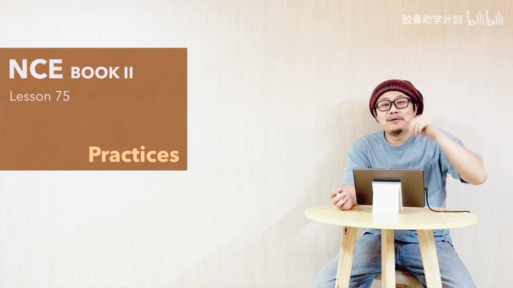

文字识别：bilbili / 胶囊助学计划 / NCE / BOOKI"I / Lesson 75 / Practices

### 画面 00:00:02

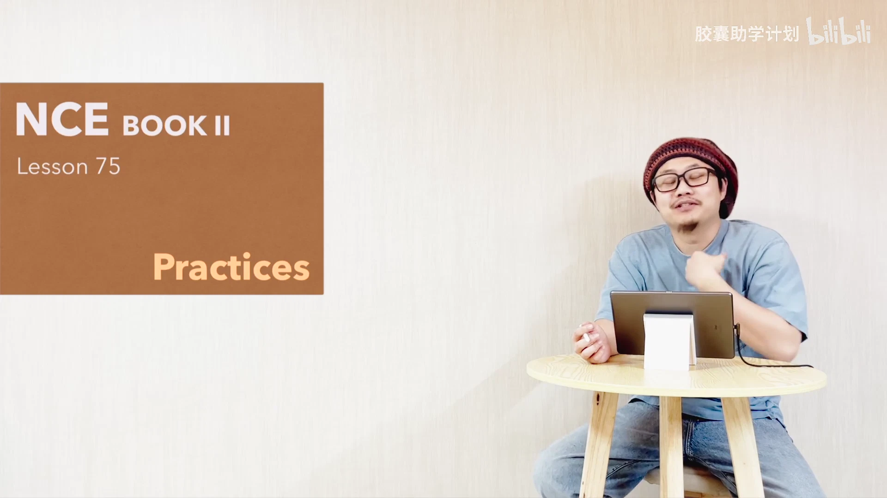

文字识别：bilbili / 胶囊助学计划 / NCE / BOOKII / Lesson 75 / Practices

### 画面 00:00:04

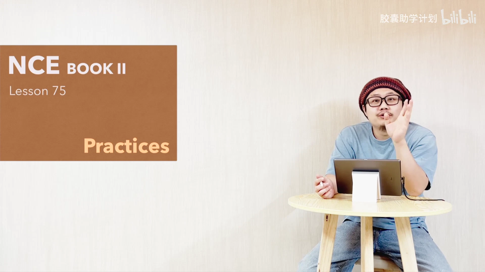

文字识别：biibili / 胶囊助学计划 / NCE / BOOKII / Lesson 75 / Practices

### 画面 00:00:06

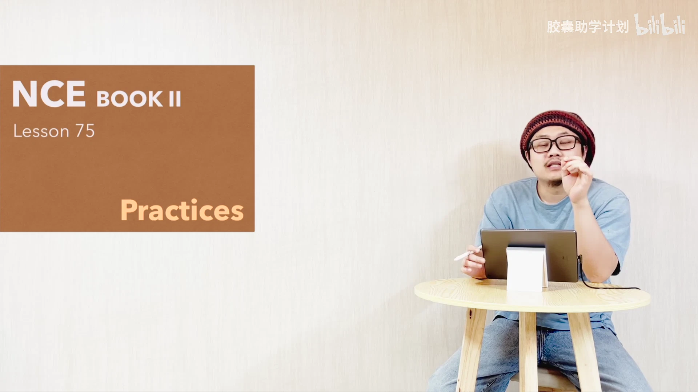

文字识别：biibii / 胶囊助学计划 / NCE / BOOKII / Lesson 75 / Practices

### 画面 00:00:08

文字识别：bilbili / 胶囊助学计划 / 进行如下练习唯一前提 / 文章跟读至熟读成诵 / 否则请勿开始

### 画面 00:00:10

文字识别：bilbili / 胶囊助学计划 / 进行如下练习唯一前提 / 文章跟读至熟读成诵 / 否则请勿开始

### 画面 00:00:13

文字识别：bibili / 胶囊助学计划 / 进行如下练习唯一前提 / 文章跟读至熟读成诵 / 否则请勿开始

### 画面 00:00:15

文字识别：bilbili / 胶囊助学计划 / 进行如下练习唯一前提 / 文章跟读至熟读成诵 / 否则请勿开始

### 画面 00:00:17

文字识别：胶囊助学计划 bii

### 画面 00:00:19

文字识别：胶囊助学计划册鼎 / 胶囊助学计划

### 画面 00:00:21

文字识别：bilibii / 胶囊助学计划 / Comprehension / 训练目标： / 听懂一般疑问句＆特殊疑问句

### 画面 00:00:23

文字识别：bilbili / 胶囊助学计划 / Comprehension / 训练目标： / 听懂一般疑问句＆特殊疑问句

### 画面 00:00:27

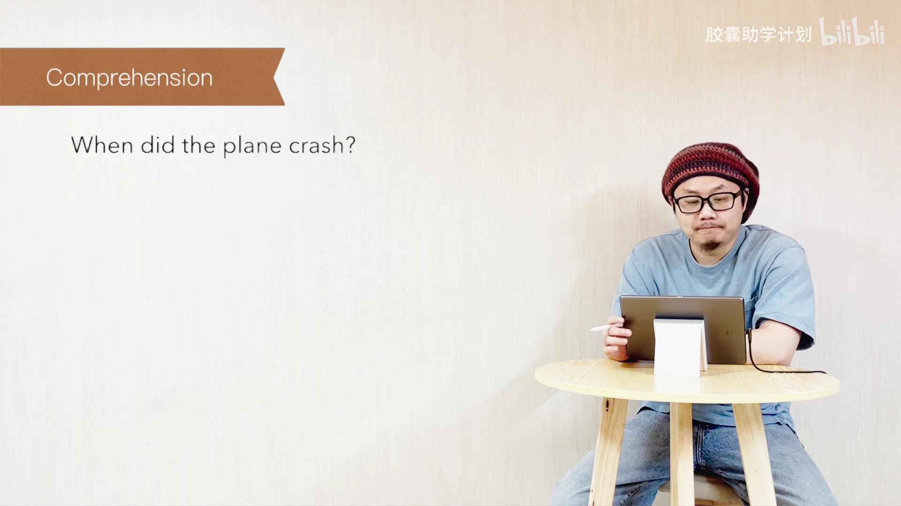

文字识别：bilbili / 胶囊助学计划 / Comprehension / When did the plane crash?

### 画面 00:00:29

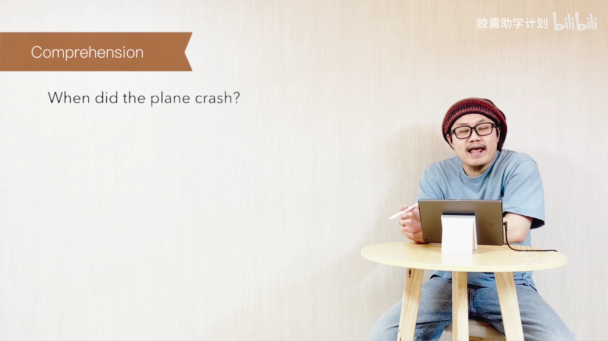

文字识别：bilbili / 胶囊助学计划 / Comprehension / When did the plane crash?

## 00:00:30–00:01:00

crash? Some time ago. Where did it crash? In the mountains. Who was killed? The pilot. How many passengers were there? Three. Were they injured or unhurt? Unhurt. What time of the year was it?

### 画面 00:00:31

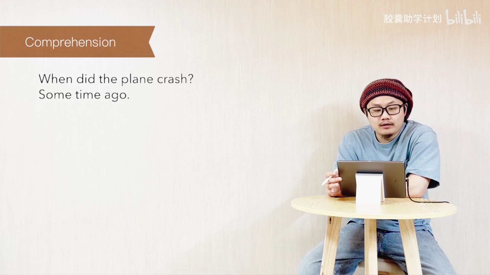

文字识别：bilbili / 胶囊助学计划 / Comprehension / When did the plane crash? / Some time ago.

### 画面 00:00:35

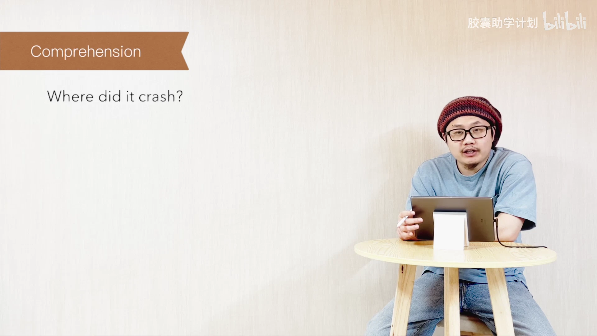

文字识别：bilbili / 胶囊助学计划 / Comprehension / Where did it crash?

### 画面 00:00:46

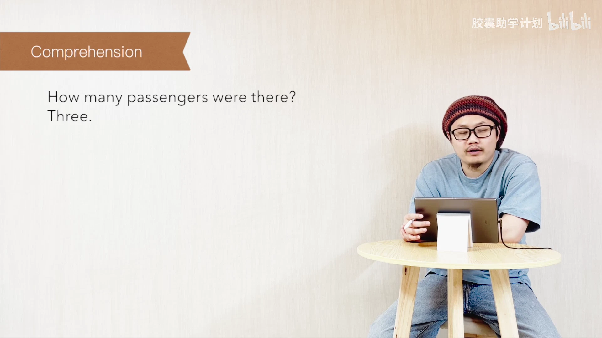

文字识别：bilibili / 胶囊助学计划 / Comprehension / How many passengers were there? / Three.

## 00:01:00–00:01:30

In the middle of the winter,或者mid winter,啊. How far away was the nearest village? Miles away. What did the woman use for a bed? A suitcase. Who slept inside it? Two baby girls,啊或者two baby daughters,啊.

### 画面 00:01:16

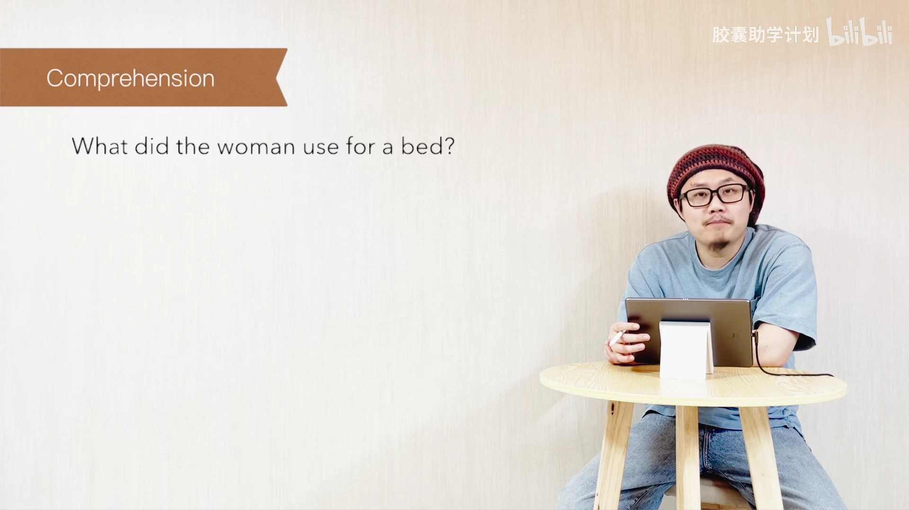

文字识别：bitbli / 胶囊助学计划 / Comprehension / What did the woman use for a bed?

### 画面 00:01:29

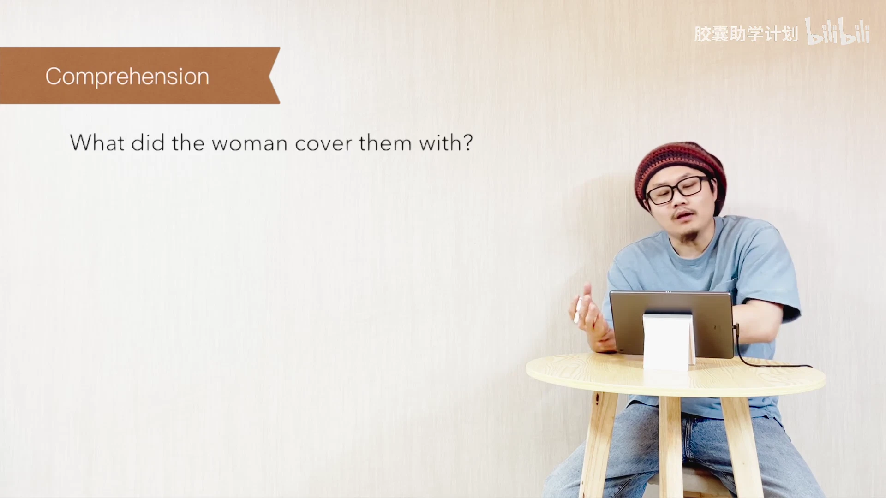

文字识别：bilbili / 胶囊助学计划 / Comprehension / What did the woman cover them with?

## 00:01:30–00:02:00

So what did the woman cover them with? All the clothes she could find. Why did she keep as close as possible to her two babies? It was terribly cold. Why couldn't she get inside the case? It was too small. When did she hear the plans? Early next

### 画面 00:01:31

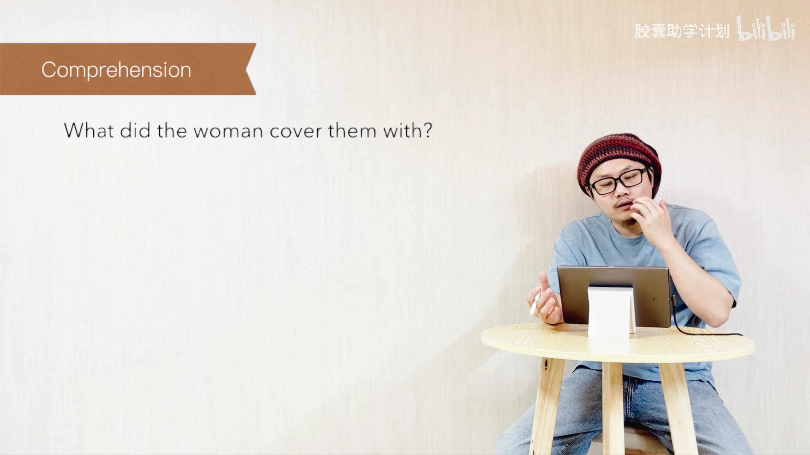

文字识别：bilbili / 胶囊助学计划 / Comprehension / What did the woman cover them with?

### 画面 00:01:34

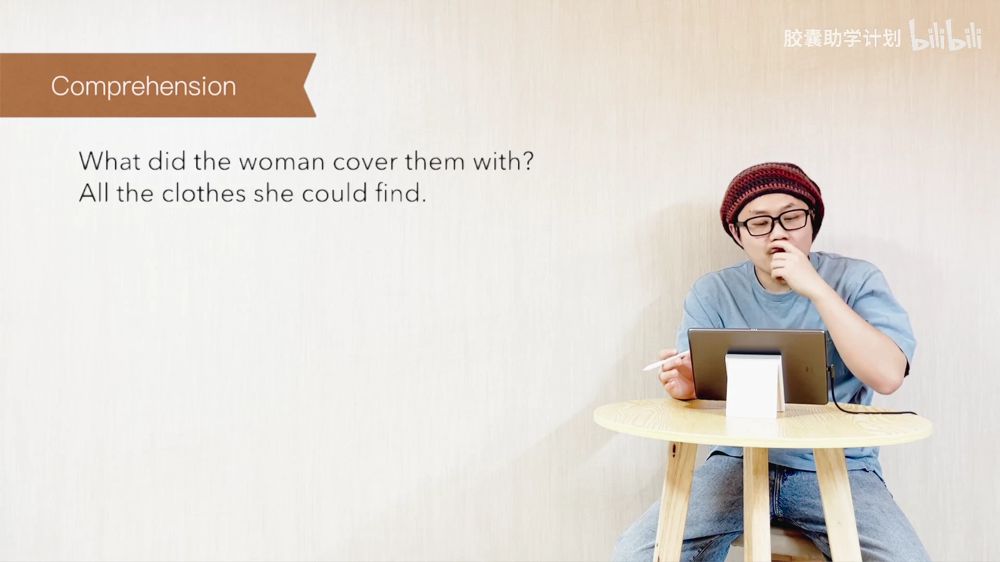

文字识别：blibli / 胶囊助学计划 / Comprehension / What did the woman cover them with? / All the clothes she could find.

### 画面 00:01:36

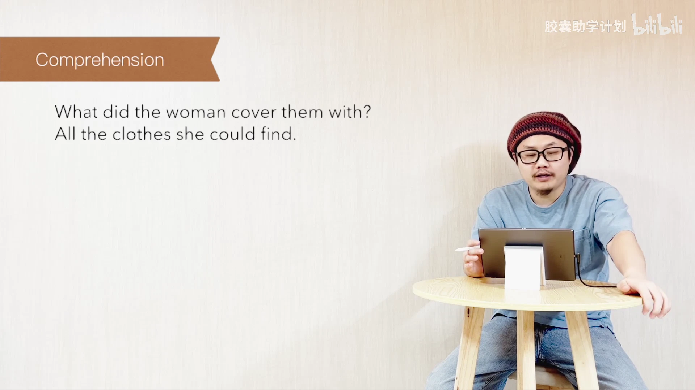

文字识别：biibili / 胶囊助学计划 / Comprehension / What did the woman cover them with? / All the clothes she could find.

### 画面 00:01:38

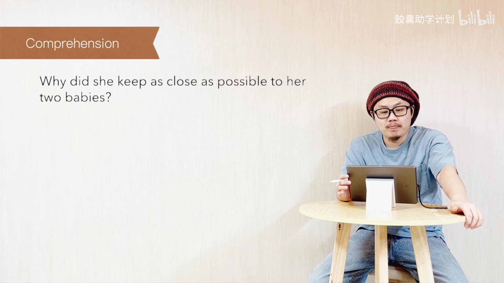

文字识别：bilibili / 胶囊助学计划 / Comprehension / Why did she keep as close as possible to her / two babies?

### 画面 00:01:58

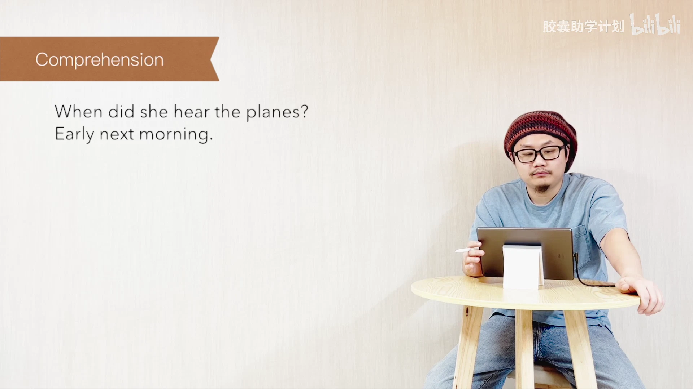

文字识别：biibili / 胶囊助学计划 / Comprehension / When did she hear the planes? / Early next morning.

## 00:02:00–00:02:30

morning, what did she wonder? How she could send a signal? How did she solve her problem? She stamped out the letters as O S in the snow. Okay, asking questions, 四句型啊。第一个例子, asking if a light passenger plane flew, of course. 啊, did 提前一般过去式, 动词换回原形. What kind of plan, 对吧? 它对的是 a

### 画面 00:02:11

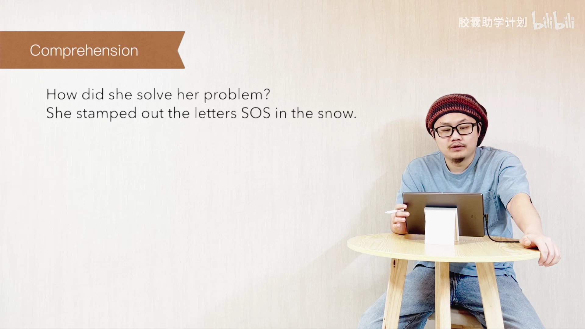

文字识别：bilbili / 胶囊助学计划 / Comprehension / How did she solve her problem? / She stamped out the letters SOS in the snow.

### 画面 00:02:16

文字识别：bilbili / 胶囊助学计划 / Asking questions / 训练目标： / 会说一般疑问句＆特殊疑问句 / Accuracy / Fluency

### 画面 00:02:18

文字识别：Bilbili / 胶囊助学计划 / Asking / questions

### 画面 00:02:20

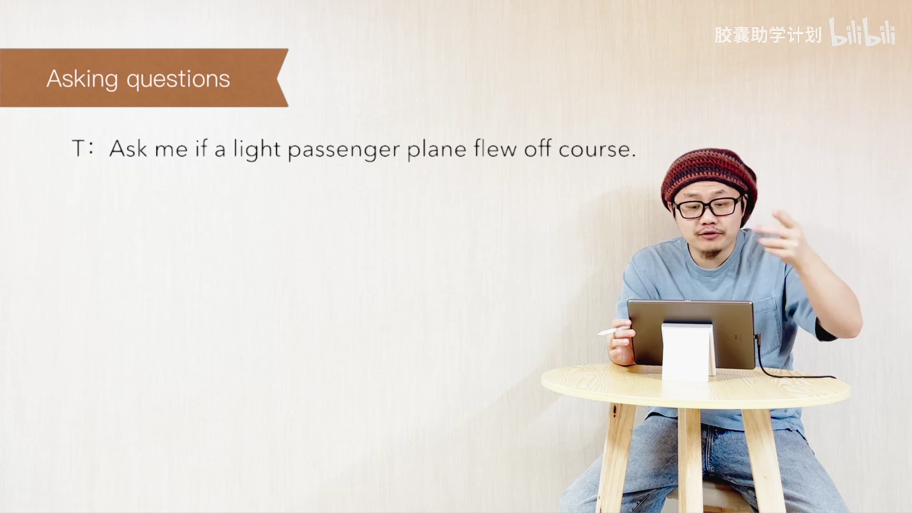

文字识别：bilbili / 胶囊助学计划 / Asking questions / T: Ask me if a light passenger plane flew off course.

### 画面 00:02:25

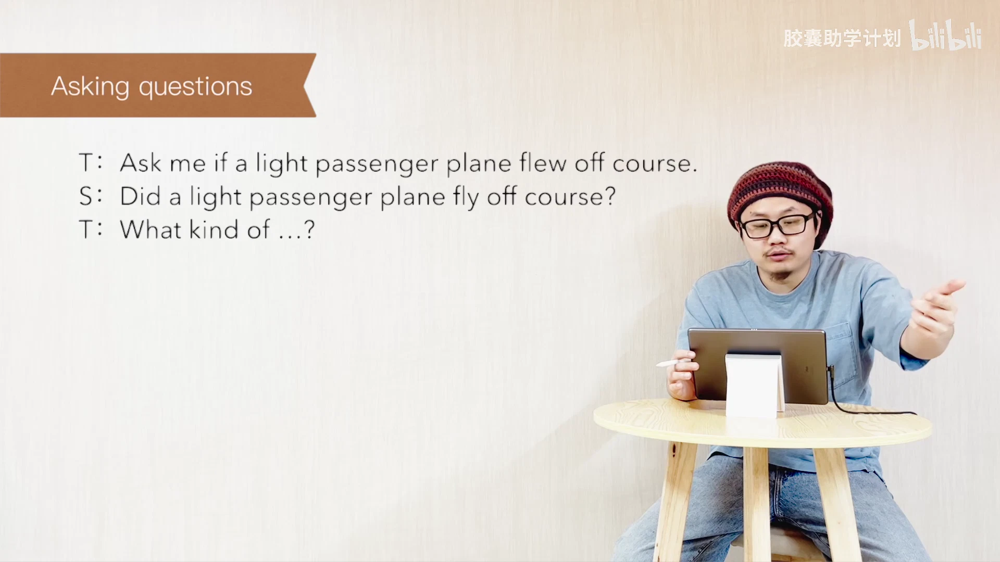

文字识别：bilbii / 胶囊助学计划 / Asking questions / T: Ask me if a light passenger plane flew off course. / S: Did a light passenger plane fly of course? / T: What kind of ...?

### 画面 00:02:29

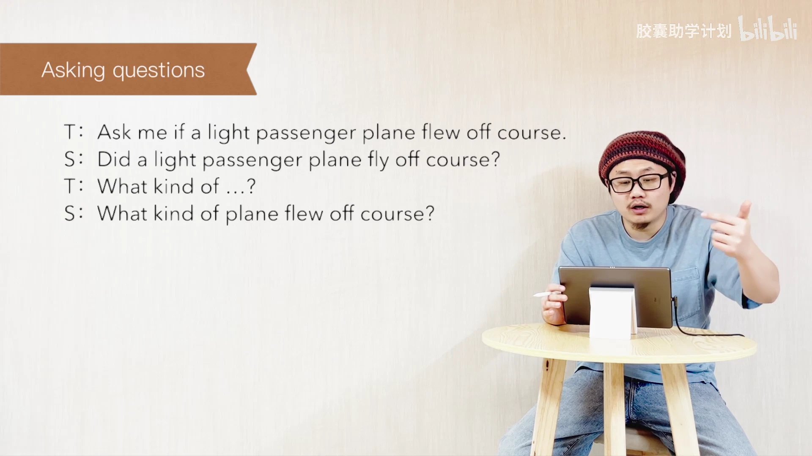

文字识别：biibili / 胶囊助学计划 / Asking questions / T: Ask me if a light passenger plane flew off course. / S: Did a light passenger plane fly off course? / T: What kind of ...? / S: What kind of plane flew off course?

## 00:02:30–00:03:00

light passenger提问，对吧？什么类型的？那你看，它是对主语的一部分提问，咱们就不变一般疑问句了。所以答案叫 What kind of plane flew, of course? 第二个, it crashed in the mountains. Did 提前, where 对 in the mountains 提问, its pilot was killed. 一般过去是被动，那注意它是被动，所以是 was 提前，而不是 did 提前。这个我觉得同学还是容易混。或对主语提问, is pilot 对这两个单词提问.

### 画面 00:02:37

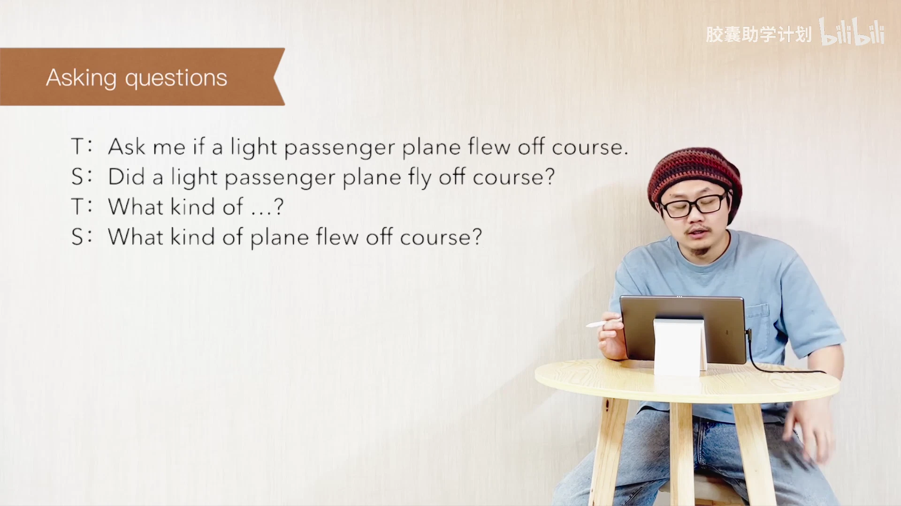

文字识别：bilbili / 胶囊助学计划 / Asking questions / T: Ask me if a light passenger plane flew off course. / S: Did a light passenger plane fly of course? / T: What kind of ...? / S: What kind of plane flew off course?

### 画面 00:02:41

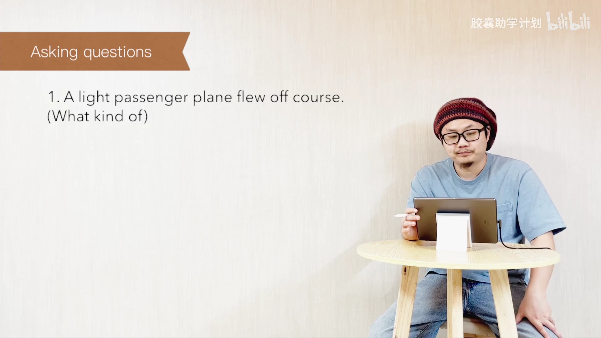

文字识别：bilbili / 胶囊助学计划 / Asking / questions / 1.A light passenger plane flew off course. / (What kind of)

### 画面 00:02:43

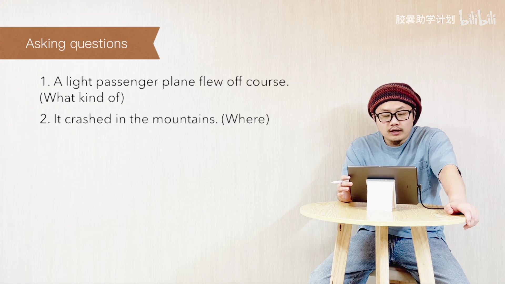

文字识别：bilbii / 胶囊助学计划 / Asking questions / 1.A light passenger plane flew off course. / (What kind of) / 2. It crashed in the mountains. (Where)

### 画面 00:02:49

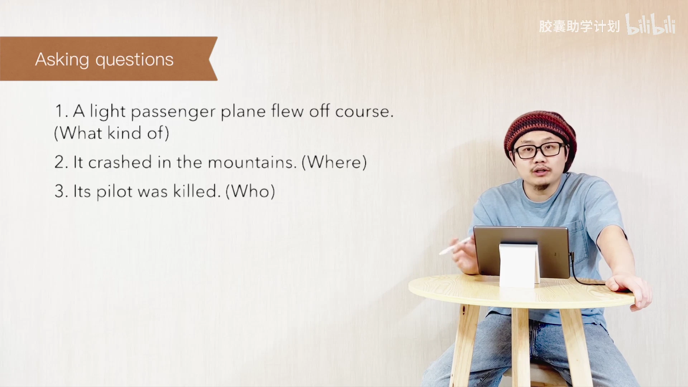

文字识别：bilbili / 胶囊助学计划 / Asking questions / 1.A light passenger plane flew off course. / (What kind of) / 2. It crashed in the mountains. (Where) / 3. Its pilot was killed. (Who)

### 画面 00:02:51

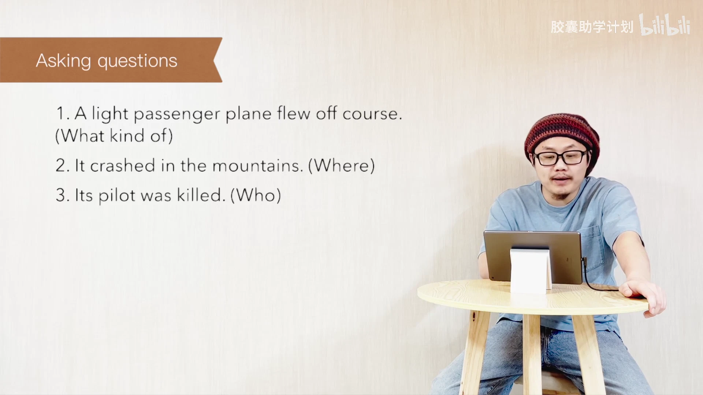

文字识别：bilbili / 胶囊助学计划 / Asking questions / 1.A light passenger plane flew off course. / (What kind of) / 2. It crashed in the mountains. (Where) / 3. Its pilot was killed. (Who)

### 画面 00:02:55

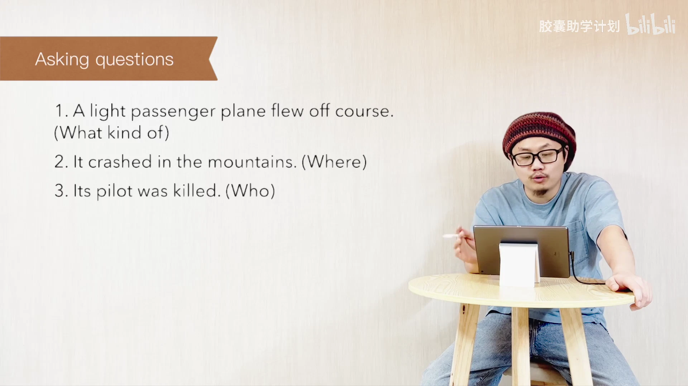

文字识别：bilbii / 胶囊助学计划 / Asking questions / 1.A light passenger plane flew off course. / (What kind of) / 2. It crashed in the mountains. (Where) / 3. Its pilot was killed. (Who)

### 画面 00:02:57

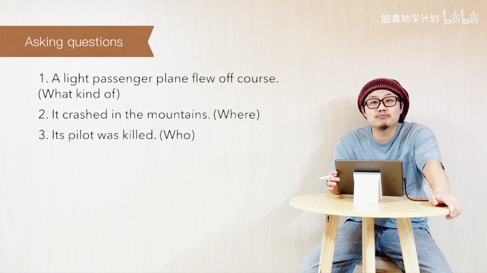

文字识别：bilbili / 胶囊助学计划 / Asking questions / 1.A light passenger plane flew off course. / (What kind of) / 2. It crashed in the mountains. (Where) / 3. Its pilot was killed. (Who)

## 00:03:00–00:03:30

There were three passengers. There be句型，对吧？你把were往前一提就行了。How many对这个three提问，所以答案是How many passengers were there? The young woman and her two baby daughters were unhurt.这个主语很长，你把were往前一提，Who对主语提问啊？第六个，It was the middle of the winter. Was提前，那What time of year was it？完事儿了。呃，

### 画面 00:03:01

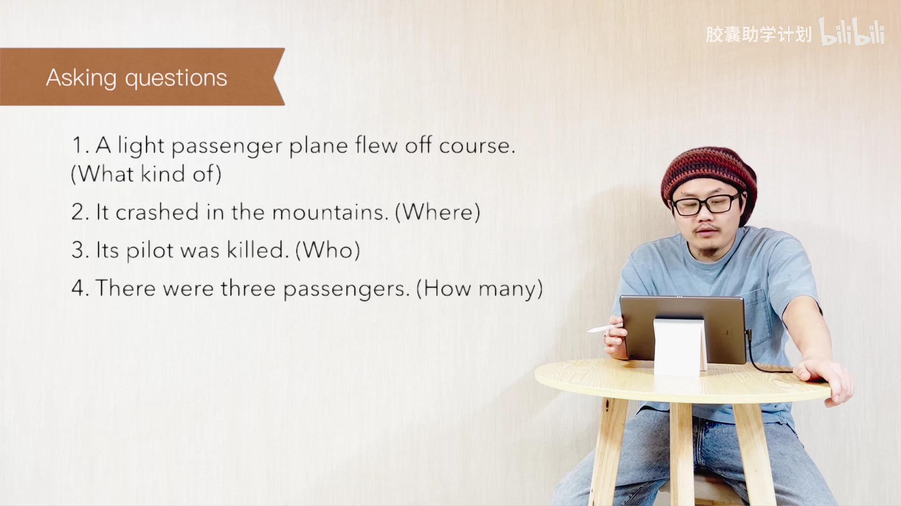

文字识别：bilbili / 胶囊助学计划 / Asking questions / 1.A light passenger plane flew off course. / (What kind of) / 2. It crashed in the mountains. (Where) / 3. Its pilot was killed. (Who) / 4. There were three passengers. (How many)

### 画面 00:03:21

文字识别：bilbili / 胶囊助学计划 / Asking / questions

## 00:03:30–00:04:00

snow lay thick on the ground. did提前，lay换成lie, l i e对吧？那what你对snow提问嘛？主语提问直接踢掉。The nearest village was miles away. was提前，how far对miles away提问。She turned a suitcase into a bed. did提前对吧？那what did she turn into a bed？对吧？What did she turn a suitcase into？啊，我觉得也许都行，对吧？你对a suitcase或

### 画面 00:03:37

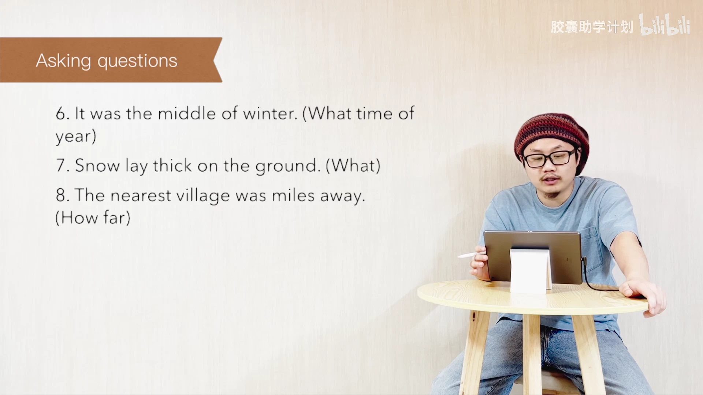

文字识别：bilbili / 胶囊助学计划 / Asking questions / 6. It was the middle of winter. (What time of / year) / 7. Snow lay thick on the ground. (What) / 8. The nearest village was miles away. / (How far)

## 00:04:00–00:04:30

对 a bed 提问问题不大。She put the children inside it. 注意这里用的是可不是原形，用的是过去式，因为如果不是过去式，这必须用三单，对吧？它不可能用原形，所以是过去式啊。嗯，你 did 提前啊？Where 对 inside it 提问？呃，tell the story 练习的流练程度啊，对吧？这个流利程度我们就不多说了啊，这个自己去看到这个去说就行了。然后呢，写作能力别忘了这个

### 画面 00:04:01

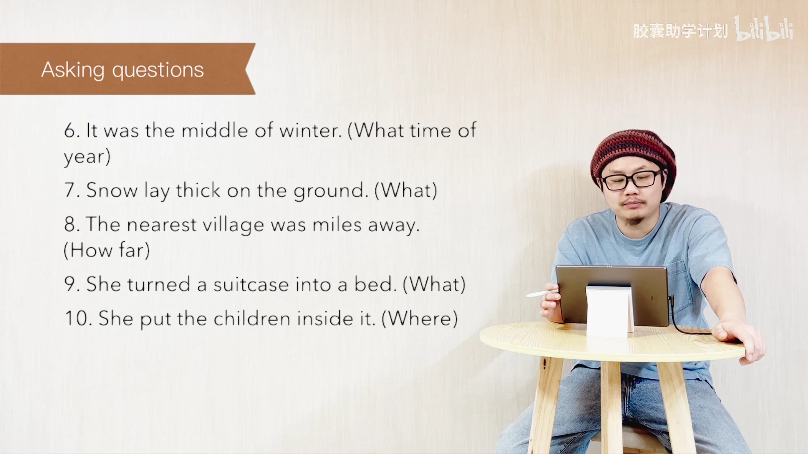

文字识别：胶囊助学计划bi出 / Asking questions / 6. It was the middle of winter. (What time of / year) / 7. Snow lay thick on the ground. (What) / 8. The nearest village was miles away. / (How far) / 9. She turned a suitcase into a bed. (What) / 10. She put the children inside it. (Where)

### 画面 00:04:04

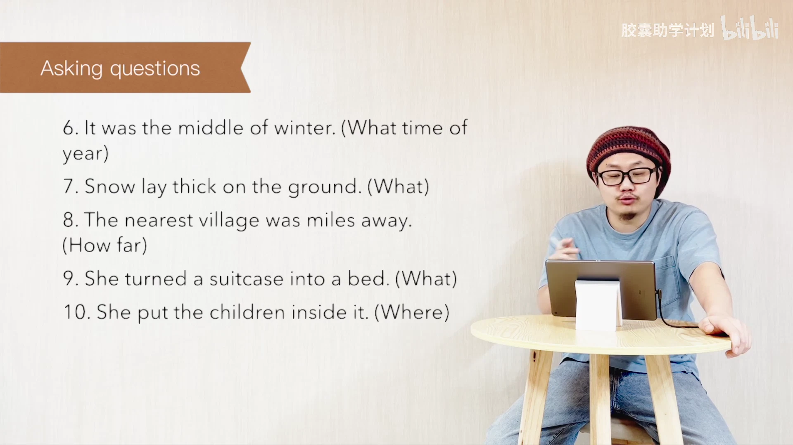

文字识别：胶囊助学计划bili出 / Asking questions / 6. It was the middle of winter. (What time of / year) / 7. Snow lay thick on the ground. (What) / 8. The nearest village was miles away. / (How far) / 9. She turned a suitcase into a bed. (What) / 10. She put the children inside it. (Where)

### 画面 00:04:06

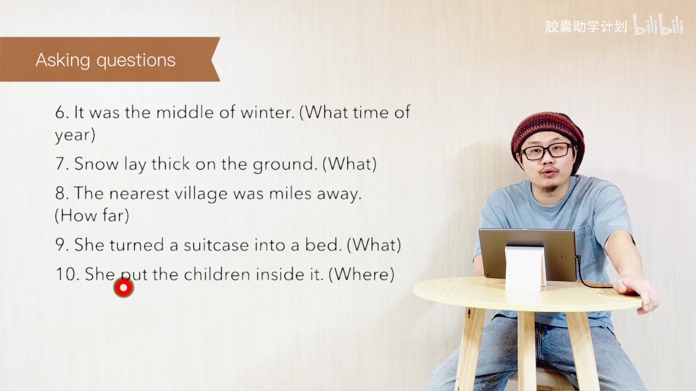

文字识别：胶囊助学计划ilb出 / Asking questions / 6. It was the middle of winter. (What time of / year) / 7. Snow lay thick on the ground. (What) / 8. The nearest village was miles away. / (How far) / 9. She turned a suitcase into a bed. (What) / 10. She put the children inside it. (Where)

### 画面 00:04:11

文字识别：biibii / 胶囊助学计划 / Asking questions / 6. It was the middle of winter. (What time of / year) / 7. Snow lay thick on the ground. (What) / 8. The nearest village was miles away. / (How far) / 9. She turned a suitcase into a bed. (What) / 10. She put the children inside it. (Where)

### 画面 00:04:13

文字识别：biibii / 胶囊助学计划 / Asking questions / 6. It was the middle of winter. (What time of / year) / 7. Snow lay thick on the ground. (What) / 8. The nearest village was miles away. / (How far) / 9. She turned a suitcase into a bed. (What) / 10. She put the children inside it. (Where)

### 画面 00:04:16

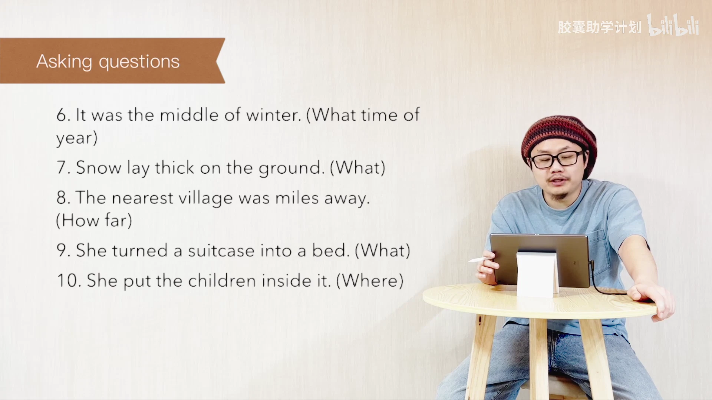

文字识别：biibili / 胶囊助学计划 / Asking questions / 6. It was the middle of winter. (What time of / year) / 7. Snow lay thick on the ground. (What) / 8. The nearest village was miles away. / (How far) / 9. She turned a suitcase into a bed. (What) / 10. She put the children inside it. (Where)

### 画面 00:04:18

文字识别：bibil / 胶囊助学计划 / Tell the story / 训练目标： / 口语复述能力 / Accuracy / Fluency

### 画面 00:04:20

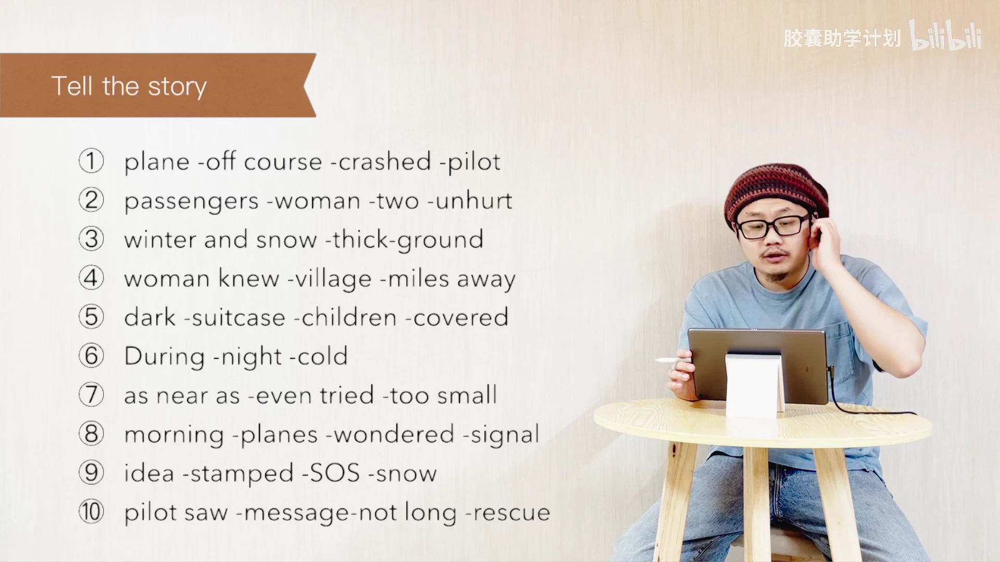

文字识别：胶囊助学计划i山 / Tell the story / ) plane -off course -crashed -pilot / passengers -woman -two -unhurt / winter and snow -thick-ground / woman knew -village -miles away / dark -suitcase -children -covered / During -night -cold / as near as -even tried -too small / morning -planes -wondered -signal / 8 / idea -stamped -SOS -snow / 9 / ① pilot saw -message-not long -rescue

### 画面 00:04:27

文字识别：bilbili / 胶囊助学计划 / Summary writing: Key / 训练目标： / 写作复述能力

### 画面 00:04:29

文字识别：胶囊助学计划山 / Summary writing: Key / A plane crashed in the mountains, but the / only passengers, a young woman and her / two baby daughters, were not hurt. / It was midwinter and extremely cold, so the / woman put the children in a case, covered / them with clothes and kept close to them all / night. When she heard planes early next / morning, she stamped out SOS in the snow. / This was seen by a pilot, who sent a radio / message, and they were soon rescued by a / helicopter.

## 00:04:30–00:05:00

单元啊，变得更加的夸张了一点点。有两个不同的文章。我的个人建议是，如果您真的没有时间写，你至少要看一下这两个答案，对照着他给的那些连词，因为在这儿是帮助我们提升我们写作能力一个非常重要的点啊。我反复提了好几次了，希望您去做。这是第一个，然后这是第二个，不多说。Topic for discussion，老习惯，我迅速过一遍，这个事儿就结束了。练习。In what other ways could the woman have tried

### 画面 00:04:31

文字识别：胶囊助学计划bl出 / Summary writing: Key / A plane crashed in the mountains, but the / only passengers, a young woman and her / two baby daughters, were not hurt. / It was midwinter and extremely cold, so the / woman put the children in a case, covered / them with clothes and kept close to them all / night. When she heard planes early next / morning, she stamped out SOS in the snow. / This was seen by a pilot, who sent a radio / message, and they were soon rescued by a / helicopter.

### 画面 00:04:37

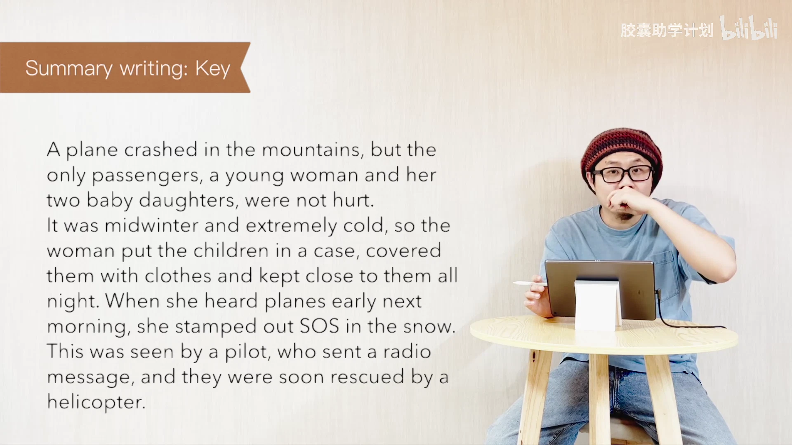

文字识别：胶囊助学计划bilb出 / Summary writing: Key / A plane crashed in the mountains, but the / only passengers, a young woman and her / two baby daughters, were not hurt. / It was midwinter and extremely cold, so the / woman put the children in a case, covered / them with clothes and kept close to them all / night. When she heard planes early next / morning, she stamped out SOS in the snow. / This was seen by a pilot, who sent a radio / message, and they were soon rescued by a / helicopter.

### 画面 00:04:40

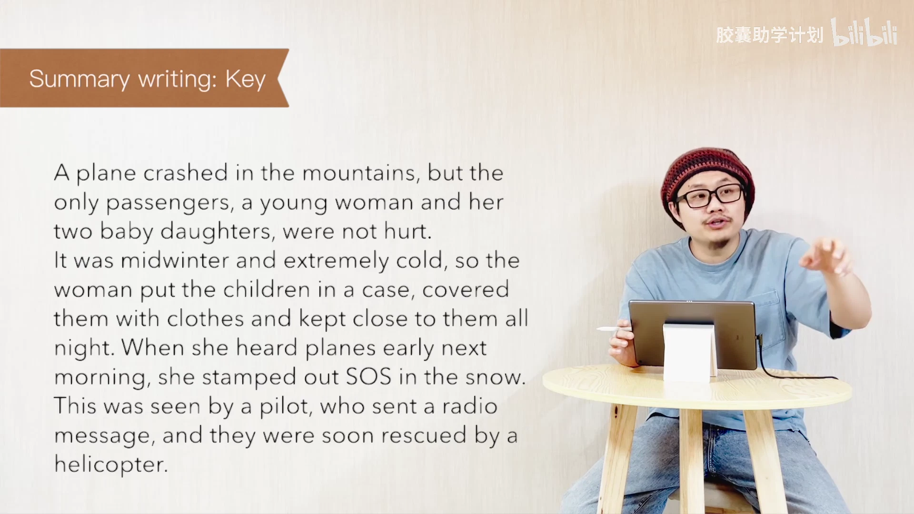

文字识别：胶囊助学计划bib出 / Summary writing: Key / A plane crashed in the mountains, but the / only passengers, a young woman and her / two baby daughters, were not hurt. / It was midwinter and extremely cold, so the / woman put the children in a case, covered / them with clothes and kept close to them all / night. When she heard planes early next / morning, she stamped out SOs in the snow. / This was seen by a pilot, who sent a radio / message, and they were soon rescued by a / helicopter.

### 画面 00:04:44

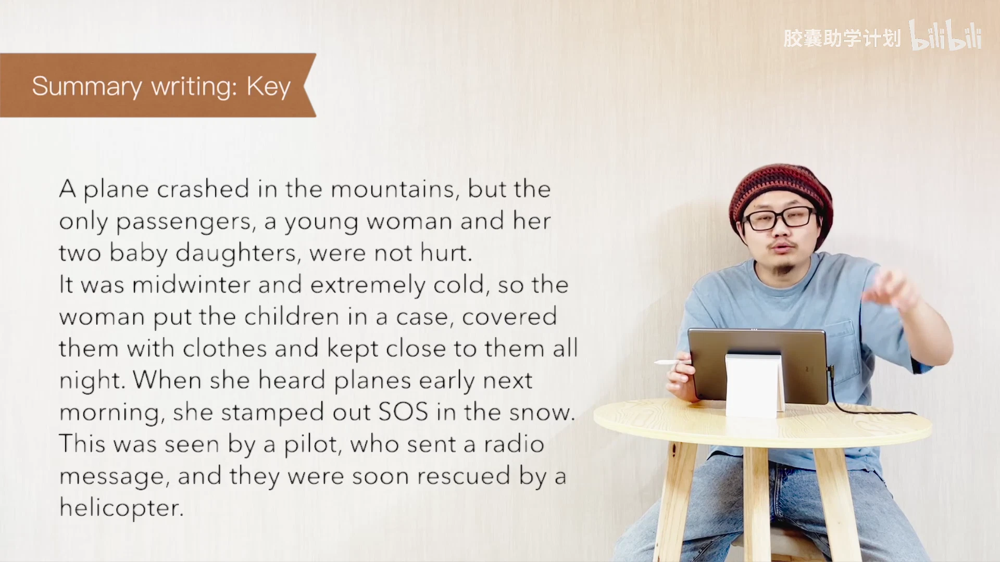

文字识别：胶囊助学计划bibi / Summary writing: Key / A plane crashed in the mountains, but the / only passengers, a young woman and her / two baby daughters, were not hurt. / It was midwinter and extremely cold, so the / woman put the children in a case, covered / them with clothes and kept close to them all / night. When she heard planes early next / morning, she stamped out SOS in the snow. / This was seen by a pilot, who sent a radio / message, and they were soon rescued by a / helicopter.

### 画面 00:04:47

文字识别：胶囊助学计划bi出 / Summary writing: Key / A plane crashed in the mountains, but the / only passengers, a young woman and her / two baby daughters, were not hurt. / It was midwinter and extremely cold, so the / woman put the children in a case, covered / them with clothes and kept close to them all / night. When she heard planes early next / morning, she stamped out SOs in the snow. / This was seen by a pilot, who sent a radio / message, and they were soon rescued by a / helicopter.

### 画面 00:04:50

文字识别：胶囊助学计划bilbil / Summary writing: Key / When a plane crashed in the mountains, the / only passengers, a young woman and her / two baby daughters, were not hurt. / However, it was midwinter and extremely / cold. After putting the children in a case and / covering them with clothes, the woman kept / close to them all night.On hearing planes / early next morning, the woman stamped out / SOs in the snow, which was seen by a pilot. / A message was sent and they were soon / rescued by a helicopter.

### 画面 00:04:52

文字识别：bilbili / 胶囊助学计划 / Topics for discussion / 训练目标： / 完全自由的对话 / Accuracy / Fluency

### 画面 00:04:54

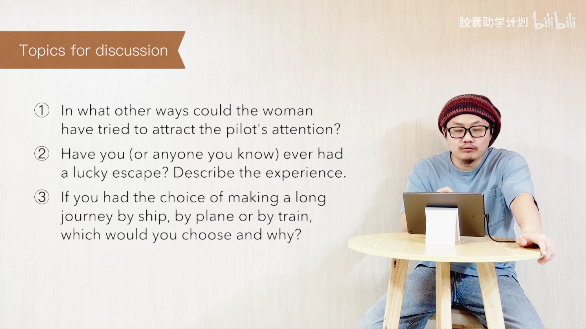

文字识别：胶囊助学计划i出 / Topics for discussion / In what other ways could the woman / have tried to attract the pilot's attention? / Have you (or anyone you know) ever had / a lucky escape? Describe the experience. / If you had the choice of making a long / 3 / journey by ship, by plane or by train, / which would you choose and why?

### 画面 00:04:57

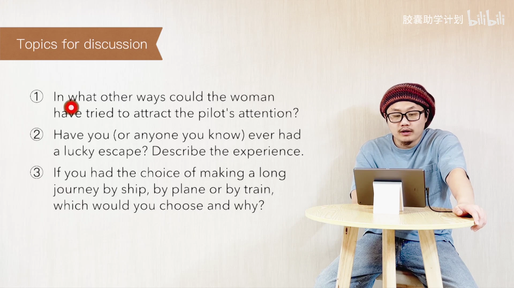

文字识别：胶囊助学计划bilil / Topics for discussion / In what other ways could the woman / hae tried to attract the pilot's attention? / Have you (or anyone you know) ever had / 2 / a lucky escape? Describe the experience. / If you had the choice of making a long / journey by ship, by plane or by train, / which would you choose and why?

## 00:05:00–00:05:30

to attract the pilot's attention? This woman,有没有什么其他的方式去吸引救她的那个直升飞机的驾驶员的注意力呢？Have you or anyone you know ever had a lucky escape? Describe the experience.你有没有这种说很幸运的逃脱的经历？或者你你认识的人也行。哎，聊一聊。最后一个，If you had the choice of making a long journey by ship, by plane, or by train, which would

### 画面 00:05:04

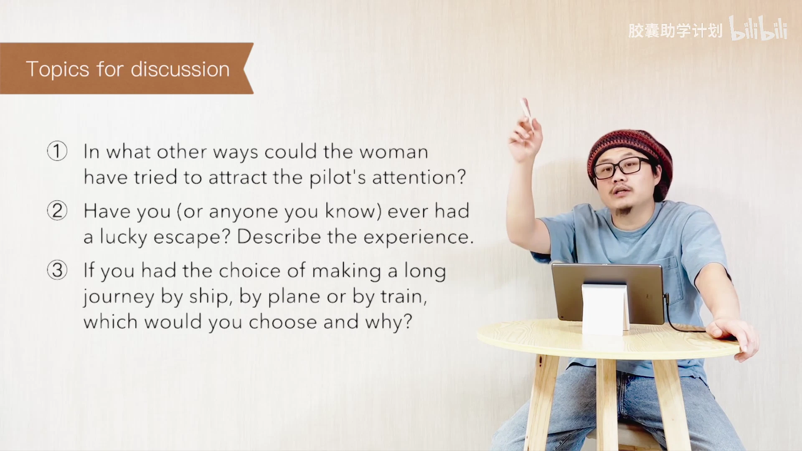

文字识别：胶囊助学计划bil出 / Topics for discussion / In what other ways could the woman / have tried to attract the pilot's attention? / Have you (or anyone you know) ever had / a lucky escape? Describe the experience. / If you had the choice of making a long / 3 / journey by ship, by plane or by train, / which would you choose and why?

### 画面 00:05:09

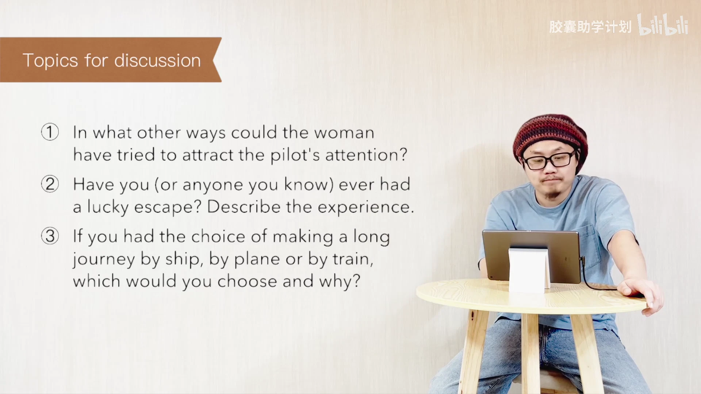

文字识别：胶囊助学计划bil出 / Topics for discussion / In what other ways could the woman / have tried to attract the pilot's attention? / Have you (or anyone you know) ever had / a lucky escape? Describe the experience. / If you had the choice of making a long / 3 / journey by ship, by plane or by train, / which would you choose and why?

## 00:05:30–00:06:00

choose and why?说如果你要长距离航行，你是愿意坐轮渡还是飞机还是火车？你选哪个？为啥？就典型的雅思托福真题嘛，是吧？OK，家庭作业，Ask me if先写再朗读，真要写作别忘了有两个tell the story口语继续复述，然后咱们看置顶留言可以找到重复间隔的学习材料。那以上呢就是本期视频的全部内容了。如果各位喜欢我们的课程呢，欢迎各位关注订阅，一键三

### 画面 00:05:39

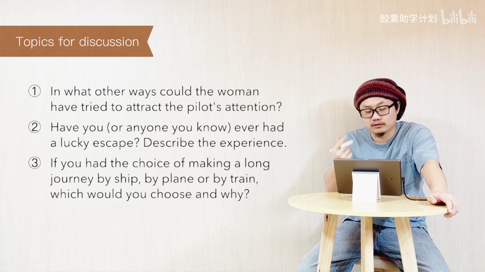

文字识别：bibili / 胶囊助学计划 / Topics for discussion / In what other ways could the woman / have tried to attract the pilot's attention? / Have you (or anyone you know) ever had / a lucky escape? Describe the experience. / If you had the choice of making a long / journey by ship, by plane or by train, / which would you choose and why?

### 画面 00:05:41

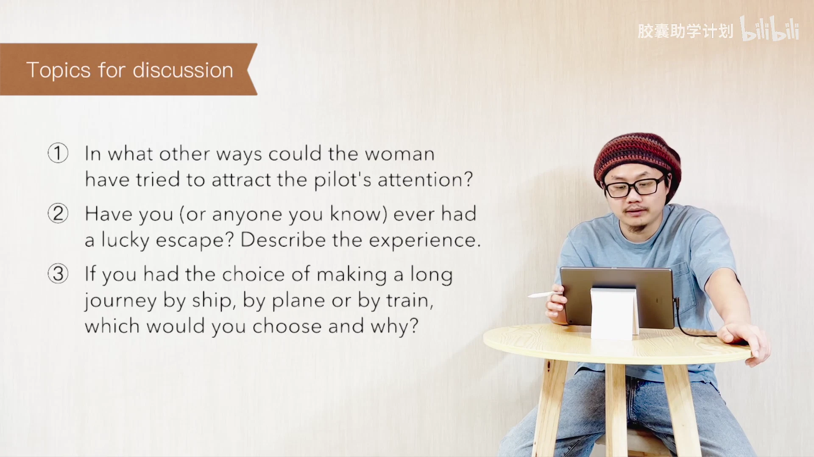

文字识别：胶囊助学计划bilb出 / Topics for discussion / In what other ways could the woman / have tried to attract the pilot's attention? / Have you (or anyone you know) ever had / a lucky escape? Describe the experience. / If you had the choice of making a long / journey by ship, by plane or by train, / which would you choose and why?

### 画面 00:05:43

文字识别：biibli / 胶囊助学计划 / 1.Ask me if写&朗读

### 画面 00:05:45

文字识别：bilibili / 胶囊助学计划 / 1.Ask me if写&朗读 / 2. / 摘要写作写&答案

### 画面 00:05:47

文字识别：bilbil / 胶囊助学计划 / 1.Ask me if写&朗读 / 摘要写作写&答案 / 3.Tell the story 口语复述

### 画面 00:05:49

文字识别：bilbili / 胶囊助学计划 / 1.Ask me if写&朗读 / 摘要写作写&答案 / 3.Tell the story 口语复述 / 重复间隔（置顶留言） / 4.

### 画面 00:05:51

文字识别：bilbili / 胶囊助学计划 / 1.Ask me if写&朗读 / 摘要写作写&答案 / 3.Tell the story 口语复述 / ·重复间隔（置顶留言） / 4.

### 画面 00:05:53

文字识别：bibili / 胶囊助学计划 / 不

## 00:06:00–00:06:18

连、分享给那些需要的朋友，来帮助我们快速成长。See you next time.

### 画面 00:06:06

### 画面 00:06:08

文字识别：酬字針制 / CAPSULEACADEMY / 胶囊助学计划 / 『 / 小红书 / Lecturer / Leo / OE

### 画面 00:06:11

文字识别：臺珈字計切 / CAPSULEACADEMY / 胶囊助学计划 / 小红书 / □ / 口 / Editor / OE

### 画面 00:06:14

文字识别：珈学針物 / CAPSULEACADEMY / 胶囊助学计划 / 小红书 / Creator / Leo & Berlin / OE

### 画面 00:06:16

文字识别：bilbili / 胶囊助学计划 / 胶囊助学计划 / 小红书 / OE

### 画面 00:06:18

文字识别：bilibili / 胶囊助学计划

