# 076 单词

快速机器解析：语音为单模型转写，未进行独立交叉校对或人工复核；画面每秒采样并按变化选帧，短时文字和标记可能遗漏。截图时间约有 1 秒误差。图片有损压缩；遇到疑点请按时间查看 Google Drive 原视频。

## 00:00:00–00:00:30

Hi, everyone. Welcome to Capsule Academy. This is Leo. Today, we're going to learn New Concept English Book Two, Lesson Seventy Six Words. 那老习惯进入正式课程之前，咱们看几个小的问题。第一，如何表达布告栏、公告栏啊？接下来呢，如何表达主要原因？最后一个，如何表达这个主意极好？那带着这三个问题，Hope you gonna enjoy.

### 画面 00:00:00

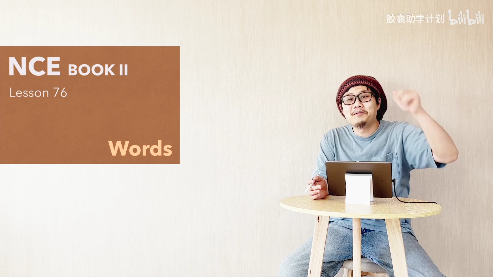

文字识别：bilbil / 胶囊助学计划 / NCE / BOOKII / Lesson 76 / Words

### 画面 00:00:02

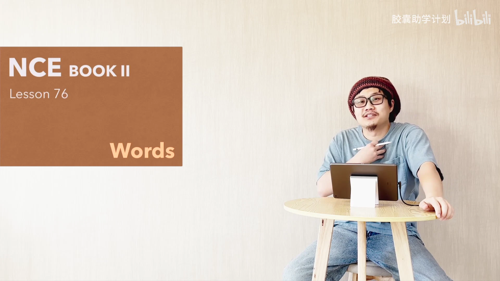

文字识别：bilbii / 胶囊助学计划 / NCE / BOOKII / Lesson 76 / Words

### 画面 00:00:04

文字识别：bilibii / 胶囊助学计划 / NCE / BOOKII / Lesson 76 / Words

### 画面 00:00:06

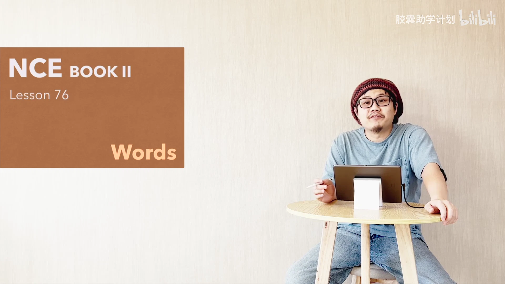

文字识别：bilbii / 胶囊助学计划 / NCE / BOOKII / Lesson 76 / Words

### 画面 00:00:08

文字识别：bilibii / 胶囊助学计划

### 画面 00:00:10

文字识别：Bilbili / 胶囊助学计划 / 布告栏”？

### 画面 00:00:12

文字识别：bilbili / 胶囊助学计划 / ①如何表达“布告栏”?

### 画面 00:00:14

文字识别：biibili / 胶囊助学计划 / ①如何表达“布告栏”? / 2

### 画面 00:00:16

文字识别：bibili / 胶囊助学计划 / ①如何表达“布告栏”？ / 如何表达“主要原因

### 画面 00:00:18

文字识别：bibili / 胶囊助学计划 / ①如何表达“布告栏”? / 如何表达“主要原因

### 画面 00:00:20

文字识别：bibil / 胶囊助学计划 / ①如何表达“布告栏”？ / 如何表达“主要原因 / 如何表达“主意极好”?

### 画面 00:00:22

文字识别：bilbili / 胶囊助学计划 / ①如何表达“布告栏”？ / 如何表达“主要原因 / 如何表达“主意极好”?

### 画面 00:00:24

文字识别：Bilbili / 胶囊助学计划 / ①如何表达“布告栏”？ / 如何表达“主要原因 / 如何表达“主意极好”?

### 画面 00:00:26

文字识别：胶囊助学计划bi

### 画面 00:00:29

文字识别：交囊助学计划 / 胶囊助学计划

## 00:00:30–00:01:00

本文呃文章非常有趣啊，那随之而来的好像总有一个代价一样，就是单词特别的多。我们放慢脚步，有点耐心，一个单词一个单词的看一下。第一个单词叫做 fool，OK，那 fool 呢就是笨、蠢、傻，哎哎傻蛋啊，就是 fool，OK，愚蠢。那它是个名词，首先您要知道一个节日，就我们所谓 April

### 画面 00:00:31

文字识别：单词造句指南 / 网：v.+v.变化 / 胶囊助学计划 / bibil / 四句型转换 / 0 / 方式/地点/时间 / 结合习惯用法 / 其他单词+词性 / APRIL / 原文摘抄+变 / 6123456 / /fu:l/ / fool n.

### 画面 00:00:35

文字识别：单词造句指南 / 网：v.+v.变化 / 胶囊助学计划 / bilbili / 四句型转换 / 0 / 方式/地点/时间 / 结合习惯用法 / 其他单词+词性 / APRIL / 原文摘抄+变 / 6123456 / /fu:l/ / fool n.

### 画面 00:00:40

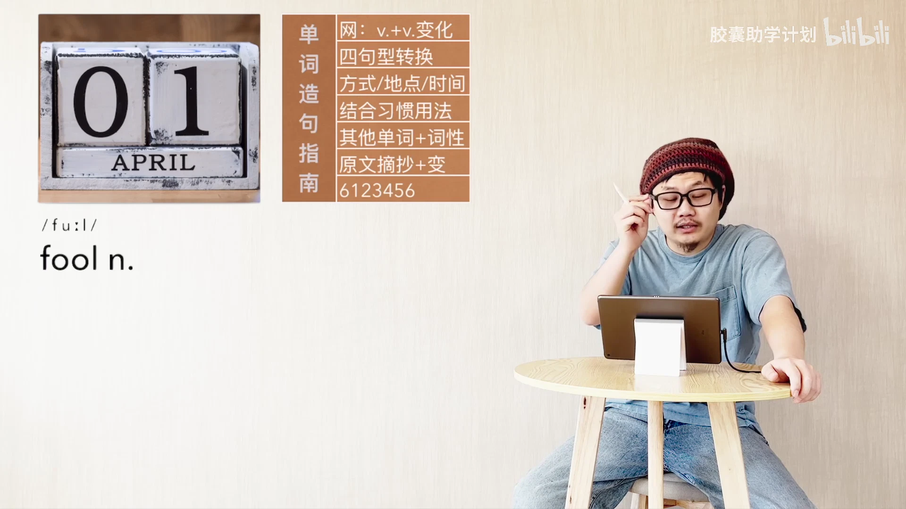

文字识别：单词造句指南 / 网：v.+v.变化 / 胶囊助学计划 / bilbii / 四句型转换 / 0 / 方式/地点/时间 / 结合习惯用法 / 其他单词+词性 / APRIL / 原文摘抄+变 / 6123456 / /fu:l/ / fool n.

### 画面 00:00:45

文字识别：单词造句指南 / 网：v.+v.变化 / 胶囊助学计划 / bibil / 四句型转换 / 0 / 方式/地点/时间 / 结合习惯用法 / 其他单词+词性 / APRIL / 原文摘抄+变 / 6123456 / /fu:l/ / fool n.

### 画面 00:00:51

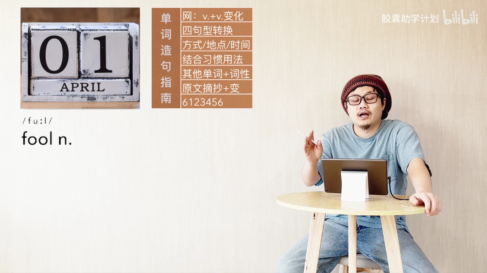

文字识别：单词造句指南 / 网：v.+v.变化 / 胶囊助学计划 / bilbili / 四句型转换 / 0 / 方式/地点/时间 / 结合习惯用法 / 其他单词+词性 / APRIL / 原文摘抄+变 / 6123456 / /fu:l/ / fool n.

### 画面 00:00:54

文字识别：单词造句指南 / 网：v.+v.变化 / 胶囊助学计划 / bibili / 四句型转换 / 0 / 方式/地点/时间 / 结合习惯用法 / 其他单词+词性 / APRIL / 原文摘抄+变 / 6123456 / /fu:l/ / fool n.

### 画面 00:00:56

文字识别：单词造句指南 / 网：v.+v.变化 / 胶囊助学计划 / bilbii / 四句型转换 / 0 / 方式/地点/时间 / 结合习惯用法 / 其他单词+词性 / APRIL / 原文摘抄+变 / 6123456 / /fu:l/ / fool n. / ① April Fool's Day…

## 00:01:00–00:01:30

Fool's Day，对吧？四月一号愚人节，那它在口语当中很常用的一个短语，两个单词组合到一起叫做 you fool。哎，啊，你这个愚蠢的人啊，你这个蠢蛋。Don't be too hard on us。哎，不要对我们那么的怎么样？哎，就是过于的严苛、严厉啊。You fool。OK，这个咱们不多说了，直接看一个电影片段啊。

### 画面 00:01:01

文字识别：单词造句指南 / 网：v.+v.变化 / 胶囊助学计划 / bibil / 四句型转换 / 0 / 方式/地点/时间 / 结合习惯用法 / 其他单词+词性 / APRIL / 原文摘抄+变 / 6123456 / /fu:l/ / fool n. / ① April Fool's Day.

### 画面 00:01:05

文字识别：单词造句指南 / 网：v.+v.变化 / 胶囊助学计划 / bibil / 四句型转换 / 方式/地点/时间 / O / 结合习惯用法 / 其他单词+词性 / APRIL / 原文摘抄+变 / 6123456 / /fu:l/ / fool n. / ① April Fool's Day... /  You fool. Don't be too hard on us! L74 / 2）

### 画面 00:01:07

文字识别：单词造句指南 / 网：v.+v.变化 / 胶囊助学计划 / bilbili / 四句型转换 / 0 / 方式/地点/时间 / 结合习惯用法 / 其他单词+词性 / APRIL / 原文摘抄+变 / 6123456 / /fu:l/ / fool n. / ① April Fool's Day... / You fool. Don't be too hard on us! L74

### 画面 00:01:10

文字识别：单词造句指南 / 网：v.+v.变化 / 胶囊助学计划 / bibii / 四句型转换 / 0 / 方式/地点/时间 / 结合习惯用法 / 其他单词+词性 / APRIL / 原文摘抄+变 / 6123456 / /fu:l/ / fool n. / ① April Fool's Day... / ② You fool. Don't be too hard on us! L74

### 画面 00:01:15

文字识别：单词造句指南 / 网：v.+v.变化 / 胶囊助学计划 / bilbili / 四句型转换 / 0 / 方式/地点/时间 / 结合习惯用法 / 其他单词+词性 / APRIL / 原文摘抄+变 / 6123456 / /fu:l/ / fool n. / ① April Fool's Day... / 2) /  You fool. Don't be too hard on us! L74

### 画面 00:01:18

文字识别：单词造句指南 / 网：v.+v.变化 / 胶囊助学计划 / bilbili / 四句型转换 / 0 / 方式/地点/时间 / 结合习惯用法 / 其他单词+词性 / APRIL / 原文摘抄+变 / 6123456 / /fu:l/ / fool n. / ① April Fool's Day... / ) You fool. Don't be too hard on us! L74 / 2）

### 画面 00:01:20

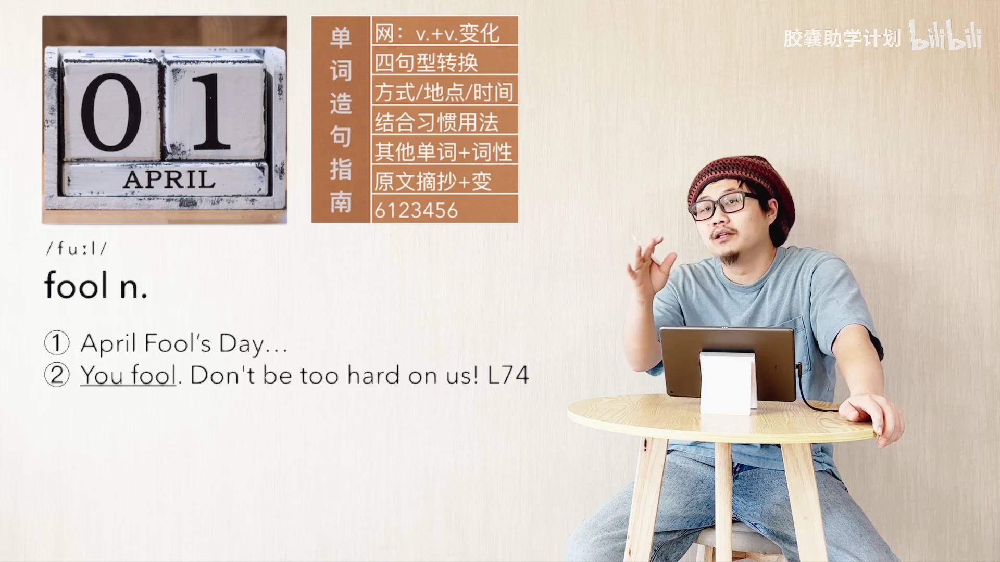

文字识别：单词造句指南 / 网：v.+v.变化 / 胶囊助学计划 / bibi / 四句型转换 / 0 / 方式/地点/时间 / 结合习惯用法 / 其他单词+词性 / APRIL / 原文摘抄+变 / 6123456 / /fu:l/ / fool n. / ① April Fool's Day... /  You fool. Don't be too hard on us! L74 / 2）

### 画面 00:01:25

文字识别：单词造句指南 / 网：v.+v.变化 / 胶囊助学计划 / bibi / 四句型转换 / 0 / 方式/地点/时间 / 结合习惯用法 / 其他单词+词性 / APRIL / 原文摘抄+变 / 6123456 / /fu:l/ / fool n. / ① April Fool's Day... / ) You fool. Don't be too hard on us! L74 / 2）

### 画面 00:01:27

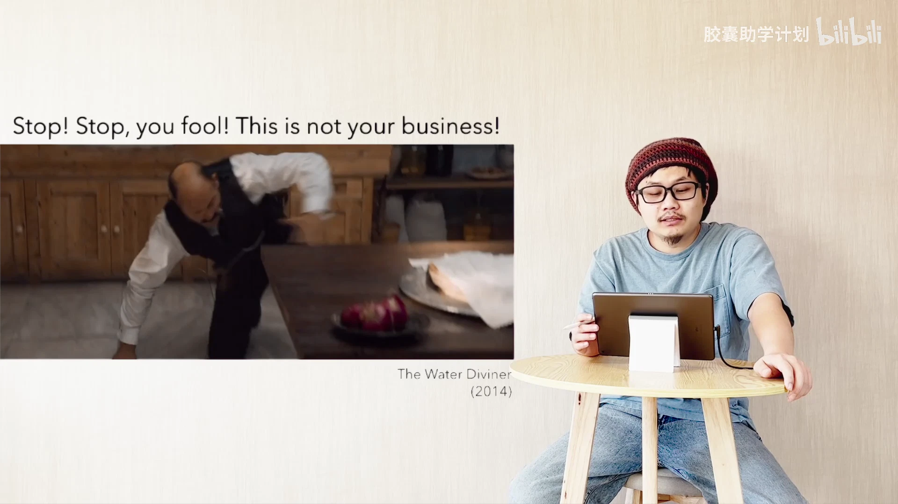

文字识别：biibil / 胶囊助学计划 / Stop! Stop, you fool! This is not your business! / The Water Diviner / (2014)

## 00:01:30–00:02:00

这个其实还有很多 for 能引导的习惯用法，这个我们以后慢慢再说啊。我们不做太多的拓展，您在这儿能把它的基本意思和这个用法，口语当中很常用的，哎，能学到就可以了。那注意力集中啊，咱听这个电影片段。OK，那正好还呼应了一下第一节课 None of your business，哎，这不是你的，不关你的事儿，对吧？注意力集中啊。 Stop! Stop, you fool! This is not your business. Next one, 下一个单词

### 画面 00:01:30

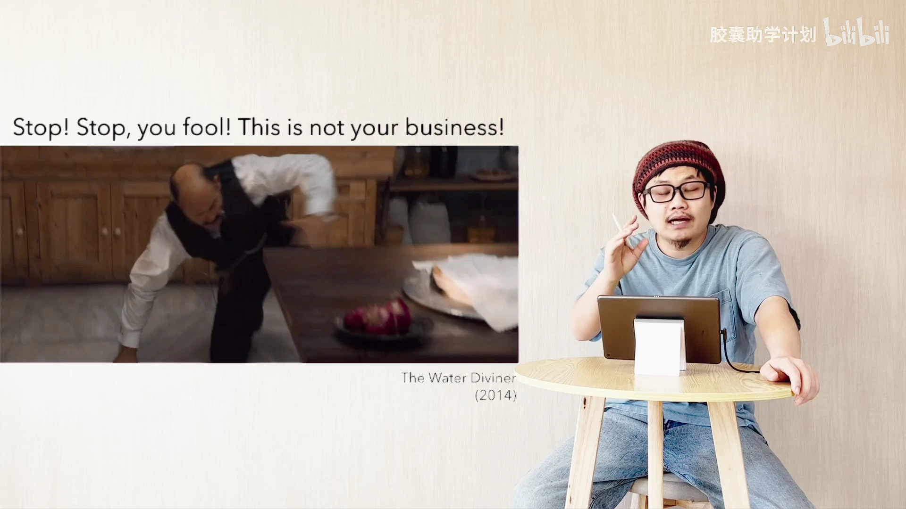

文字识别：bibi / 胶囊助学计划 / Stop! Stop, you fool! This is not your business! / The Water Diviner / (2014)

### 画面 00:01:54

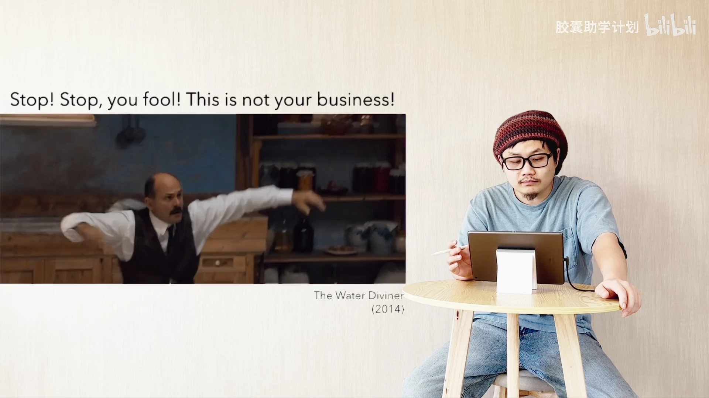

文字识别：biibii / 胶囊助学计划 / Stop! Stop, you fool! This is not your business! / The Water Diviner / (2014)

### 画面 00:01:56

文字识别：胶囊助学计划bi出 / Stop! Stop, you fool! This is not your business! / The Water Diviner / (2014)

### 画面 00:01:58

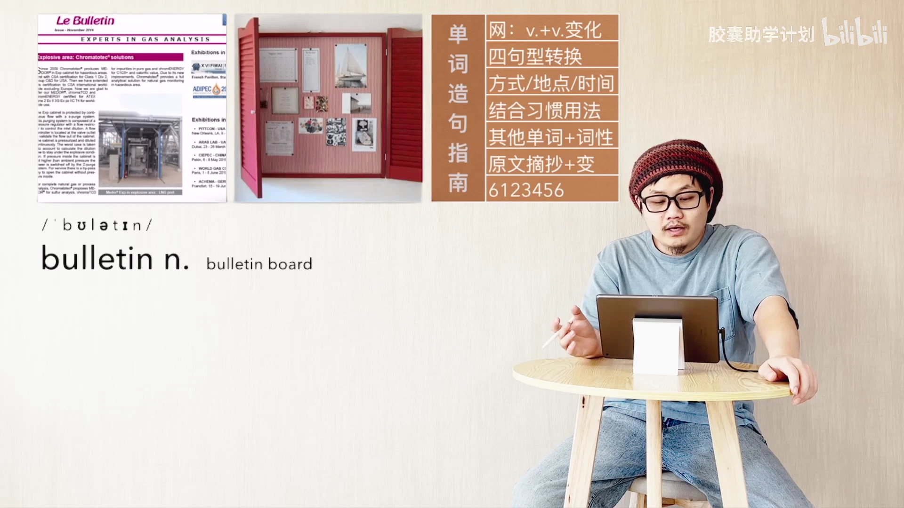

文字识别：Le Bulletin / 单词造句指南 / 网：v.+v.变化 / 胶囊助学计划 / bilbii / bwe2064 / EXPERTS IN GAS ANALYSIS / Exhibitions in / 四句型转换 / xplosive area: Chromatotec'solutions / XVIFIMAI! / ton tor Class 1 Dv 2 / ME= / lor 1 / C1CO+ad / Due to Is  / 方式/地点/时间 / ADIPEC / 20 / 2E30 E  CT4 Wo / de une / 结合习惯用法 / a / Exhibitions in / Niew Oreans, LA.8 / PETTCON-USA / 其他单词+词性 / ARAD LAB.UA / Dubas. 23-25 Mch / Pekin, -0May 201 / CEPEC-CHEE / 原文摘抄+变 / Paris 1-5 Ane 201 / WORLD GAS CX / re inoide / Franctot, 15-19Jan / ·ACHEMA-GER / 6123456 / /bulatin/ / bulletin n. bulletin board

## 00:02:00–00:02:30

bulletin, bulletin, bulletin这个单词有两个意思，一个是咱们文文章当中啊给的叫做新闻简报啊简讯，第二个呢叫bulletin board这个东西呃，我至少在呃澳澳大读书的时候还是挺常见的啊，他们很多的那个学院楼里面都会有自己学院的一些简讯，对吧？比如像art faculty啊，这个艺术学院他们就很多演出的

### 画面 00:02:00

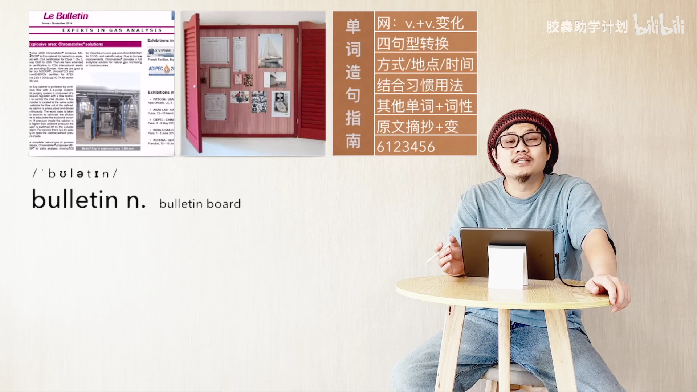

文字识别：Le Bulletin / 单词造句指南 / 网：v.+v.变化 / 胶囊助学计划 / bilbili / ae-Novennd / EXPERTS IN GAS ANALYSIS / Exhibitions in / 四句型转换 / Expiosive area: Chromatotec'solutions / 2000 / O / ton tor Class 1 Dw 2 / 1ME / tor / C100 and / rbes in pur gas ane comENERGY / Du to  / XVIFIMAI / 方式/地点/时间 / ADIPEC / 20 / 2Ea I20 Ex pE IC T4 NwoAS / de sse / 结合习惯用法 / cu tow wth a B-qonge syete / aa / Exhibitions in /  be 0or / hiew Oreans, LA. B- / PETTCON-USA / 其他单词+词性 / w to stay indet the / Duhal.23-20Mch / Peain, 0 -8 May 201 / .CHEPEC-CHA / ARABLAB.UA / 原文摘抄+变 / re inside / 1pres- / AE / Paris T- 5 Ane 201 / Franoot,15-19aan / .ACHEMA-GER / WORLD GAS C / 6123456 / /bulatin/ / bulletin n. bulltin board

### 画面 00:02:02

文字识别：Le Bulletin / 单词造句指南 / 网：v.+v.变化 / 胶囊助学计划 / bilbili / ae-Noven / e2014 / EXPERTS IN GAS ANALYSIS / Exhibitions in / 四句型转换 / Expiosive area: Chromatotec'solutions / O / ton tor Class 1 Dw 2 / ME / analytes sohlion tor nar / tor / C1O0 and / Du o mn / Freneh Pavillon, Sta / XVIFIMAI! / 方式/地点/时间 / ADIPEC / 20 / 2E20 Ex peE C T4  WoNS / de vse / 结合习惯用法 / afa / Exhibitions in / Y b0 00r / hiew Oreans, LA, 8- / PETTCON-USA / 其他单词+词性 / ARABLAB.UA / Duba. 23-20 Moch / Peain, 0-0May 201 / .CAEPEC-CHOA / 原文摘抄+变 / Paris 1- 5 Ane 201 / WORLD GAS CC / Franoot,15-19an / .ACHEMA-GER / 6123456 /  tr suhr ans. comaTCO / /'bulatin/ / bulletin n. bulletin board

### 画面 00:02:05

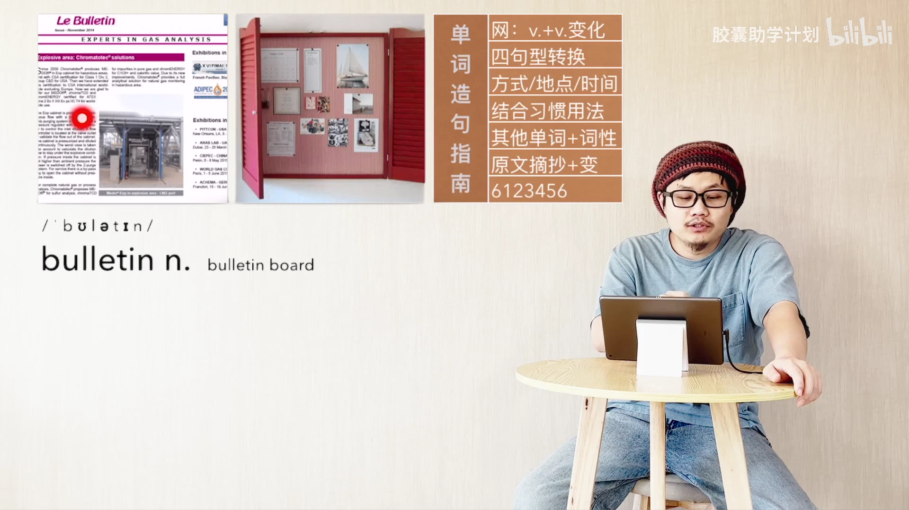

文字识别：Le Bulletin / 单词造句指南 / 网：v.+v.变化 / 胶囊助学计划 / bilbili / 2014 / EXPERTS IN GAS ANALYSIS / Exhibitions in / 四句型转换 / Explosive area: Chromatotec'solutions / 2000 / hon bor Class 1 Dy 2 / ME /  C1C0 and / Freneh Pavilon, Sta / XVIFIMAI / 方式/地点/时间 / ADIPEC / 20 / 2 E 20 E SE IC T4 wons / de use. / censted for ATEX / 结合习惯用法 / Exhibitions in / Niew Oreans, LA. B / PITTCON-USA / 其他单词+词性 / ·ARAB LAB.UA / Duba. 23-20 Mach / Pekin, 0 - 0 May 201t / .CHEPEC-CHA / 原文摘抄+变 / re naide / ar / piete / ral / df pres- / Paris, 1-5 Ane 201 / Frandot. 15-19aar / ·ACHEMA.GERE / WORLD GAS CX / 6123456 / /bulatin/ / bulletin n. bulletin board

### 画面 00:02:08

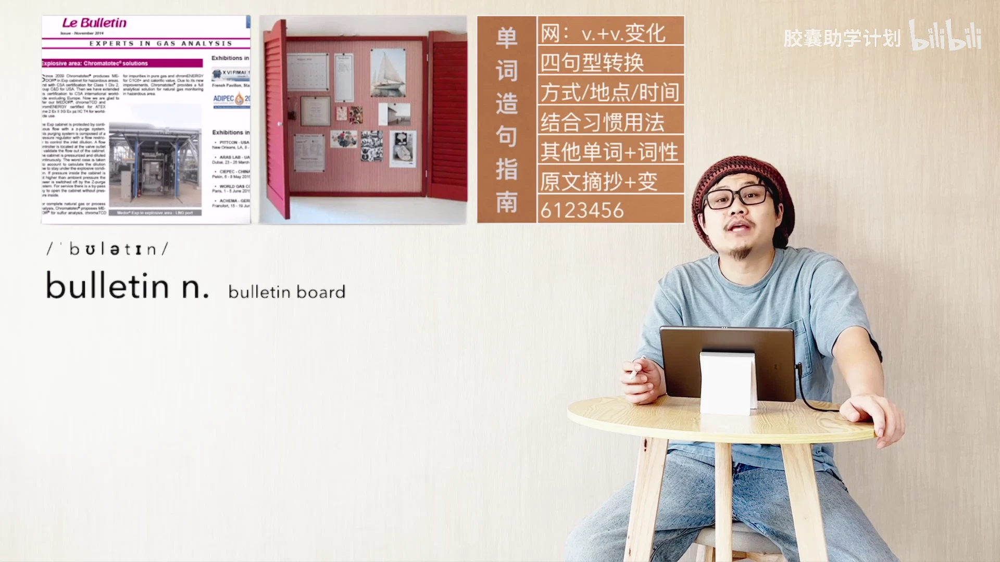

文字识别：Le Bulletin / 单词造句指南 / 网：v.+v.变化 / 胶囊助学计划 / bilbil / 2014 / EXPERTS IN GAS ANALYSIS / Exhibitions in / 四句型转换 / xplosive area: Chromatotec'solutions / XVIFIMAI! / oarinDp / O / ton hr Class1 D 2 / ME= / Ror1 / C100 and / Freneh Pavilon, Sta / 方式/地点/时间 / ADIPEC / 2 / 2Ex20 Ex pE IC T4 r wons / de sse. / 结合习惯用法 / idafa / Exhibitions in / r bo eor / Niew Creans, LA. B- / PITTCON·USA / 其他单词+词性 / ·ARABLAB.UA / 100 / Duba. 21-20 1ch / Peain,6.0May 201 / .CIEPEC-CHA / 原文摘抄+变 / Paris. 1-5 Ane 201 / WORLD GAS CC / Frandot,15-19ar / ·ACHEMA-GERE / 6123456 /  tor suaer analyses. enmaTCD / /'bulatin/ / bulletin n. bulletin board

### 画面 00:02:10

文字识别：Le Bulletin / 单词造句指南 / 网：v.+v.变化 / 胶囊助学计划 / bibil / asue-Nove / e2064 / EXPERTS IN GAS ANALYSIS / Exhibitions in / 四句型转换 / Expiosive area: Chromatotec'solutions / XVIFIMAI1 / ton tor Class 1 Dw 2 / ME / analyfcai solulion tor narl / lor1 / C1C0+and / urites in gur gas ane dromENERGy / Freneh Pavilon, Sta / 方式/地点/时间 / orttealon to CSA  / ADIPEC / 20 / 2E20E 1CT4WON / de ase. / 结合习惯用法 / dafa / Exhibitions in / r be cor / Niew Oreans, LA. B- / PITTCON·USA / 其他单词+词性 / ·ARAB LAB.UA / w tu stay snude / Duta. 21-20 Moch / Pekin, 0-0 May 201 / .CIEPEC-CHEA / 原文摘抄+变 / Panis, 1-5 Ane 201 / WORLD GAS CX / re inoide / pliets / Francot. 15-19aan / ·ACHEMA-GERE / 6123456 / /'bulatin/ / bulletin n. bulletin board

### 画面 00:02:14

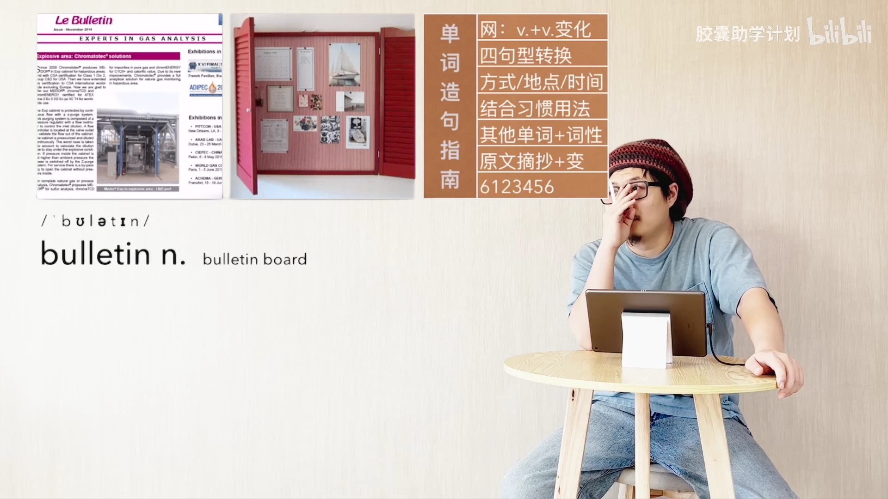

文字识别：Le Bulletin / 单词造句指南 / 网：v.+v.变化 / 胶囊助学计划 / bibii / 2014 / EXPERTS IN GAS ANALYSIS / Exhibitions in / 四句型转换 / Explosive area: Chromatotec'solutions / XVIFIMAI1 / O / ton tor Class 1Dy 2 / ME= / lor / C1C0 ane / Du o  / 方式/地点/时间 / nttaon to CSA  / ADIPEC / 20 / 2E20E 1CT4 W / de vase / 结合习惯用法 / dofa / Exhibitions in / r bo 0or / Piew Oreans, LA, B- / PITTCON-USA / 其他单词+词性 / ·ARAB LAB.UA / Duta. 23-20 Mch / Peain, 0 -0 May 201 / .CIEPEC-CHOA / 原文摘抄+变 / Panis, 1- 5 Ane 201 / WORLD GAS CX / Frandtot, 15-19An / .ACSHEMA.GER / 6123456 / /'bulatin/ / bulletin n. bulletin board

### 画面 00:02:16

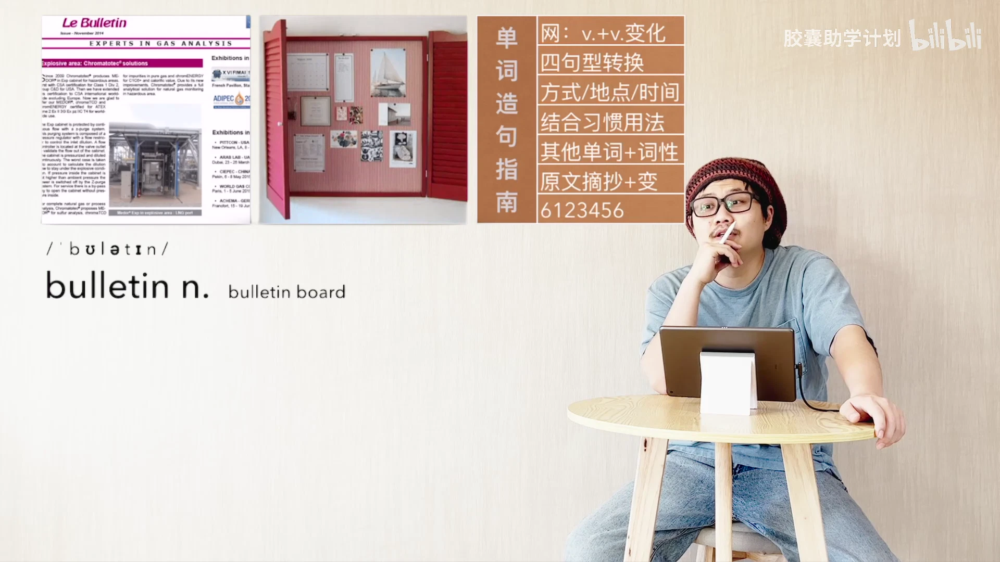

文字识别：Le Bulletin / 单词造句指南 / 网：v.+v.变化 / 胶囊助学计划 / bilbili / e-N0owenbe 2014 / EXPERTS IN GAS ANALYSIS / Exhibitions in / 四句型转换 / Expiosive area:Chromatotec'solutions / O / ton kor Class 1 Dv 2 / ME / Rori / C100+a / urtes in gure pas ane dhromENeRGY / Lon for natural / Du ko I / Freneh Pavillon, Sta / XVIFIMAI / 方式/地点/时间 / rdovs area. / ADIPEC / 20 / e2E20 E E IC T4 WoNS / de use. / 结合习惯用法 / dofa / Exhibitions in / Niem Oreans. LA. B- / PITTCON-USA / 其他单词+词性 / . ARAB LAB.UA / Duba. 23-20 4ah / w o stay sndet   / Peain, 6. May 201 / ·CIEPEC-CHNA / 原文摘抄+变 / Paris. T. 5 Ane 201 / WORLD GAS CX / 3E / Franoot. 15-19An / .ACHEMA.GER / 6123456 / /'bulatin/ / bulletin n. bulletin board

### 画面 00:02:20

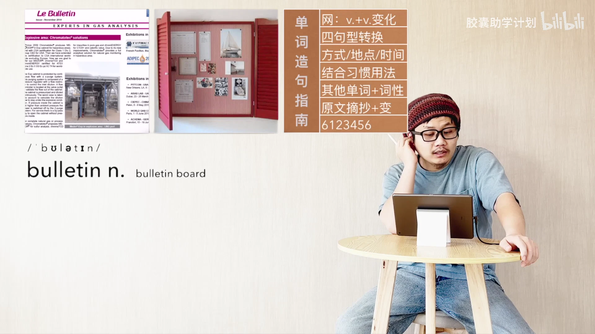

文字识别：Le Bulletin / 单词造句指南 / 网：v.+v.变化 / 胶囊助学计划 / biibii / Asue-Novenne / 2014 / EXPERTS IN GAS ANALYSIS / Exhibitions in / 四句型转换 / Explosive area: Chromatotec'solutions / 2000 / ton tor Clase 1 Ow 2. / MEa / kor 1 / C100+ad / D o m / mENERGY / Freneh Pavilon, Sta / XVIFIMAI1 / 方式/地点/时间 / ADIPEC / 20 / 2E20E 1CT4WO / de use. / ENERGY Oerted for ATEX / 结合习惯用法 / dafa / Exhibitions in / Niew Oreans, LA.8- / PITTCON-USA / 其他单词+词性 / ·ARAB LAD.UA / w to say srvdet e / Peain, 6.0 May 201 / Duta, 23-20 Mach / .CEPEC-CHUA / 原文摘抄+变 / WORLD GAS CC / Paris, 1-5 Ane 201 / re insife. / pief / Francot, 15–19ar / .ACHEMA-GER / 6123456 / /'bulatin/ / bulletin n. bulletin board

### 画面 00:02:24

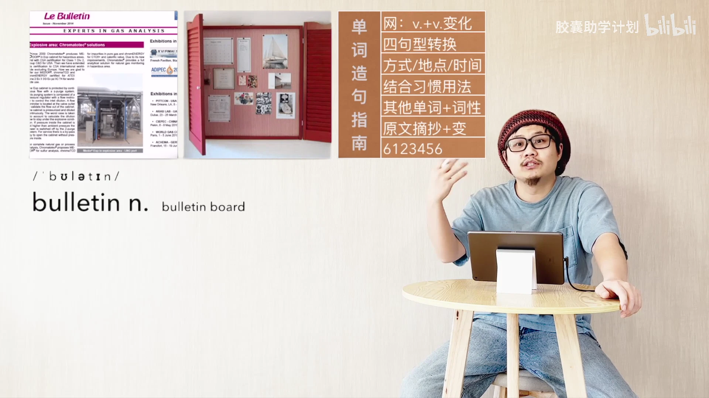

文字识别：Le Bulletin / 单词造句指南 / 网：v.+v.变化 / 胶囊助学计划 / bibili / asue-Niovemd / ar2014 / EXPERTS IN GAS ANALYSIS / Exhibitions in / 四句型转换 / Expiosive area: Chromatotec'solutions / XVIFIMAI / ton tor Class 1 Dv 2 / MEo / C100and / Due to  / Freneh Pavillon, Sta / 方式/地点/时间 / ADIPEC / 2 / 2E20E1CT4 / de vse. / 结合习惯用法 /  Epcabie is proected y cor / adafa / Exhibitions in / r to eon / Niew Oreans, LA. B / PITTCON-USA / 其他单词+词性 / ·ARABLAD.UA / Duta. 23-20 Mach / Peain, 6.0 May 201 / .CIEPEC-CHA / 原文摘抄+变 / WORLD GAS CC / re insife. / prves- / Paris, 1-5 Ane 201 / Frandot. 15-19An / .ACHEMA-GER / 6123456 / /'bulatin/ / bulletin n. bulletin board

### 画面 00:02:28

文字识别：Le Bulletin / 单词造句指南 / 网：v.+v.变化 / 胶囊助学计划 / bilbil / 2014 / EXPERTS IN GAS ANALYSIS / 四句型转换 / Explosive area: Chromatotec'solutions / Exhibitions in / XVIFIMAI1 / DoORinD / ton hor Class 1 Dw 2 / ME / C1C0 and / Freneh Pavillon, Sta / 方式/地点/时间 / ADIPEC / 20 / 220E 1CT4WS / de use / 结合习惯用法 / Exhibitions in / r bo 0or / Niew Orieans, LA. 8- / ·PITTCON-USA / 其他单词+词性 / ARAB LAB.UA / w to stay srede / Duta. 21-20 Mth / Pekin, 0.0May 201 / .CEPEC-CHA / 原文摘抄+变 / Paris 1- 5 Ane 201 / WORLD GAS CC / Frandot. 15-19-aan / ACSHEMA-GER / 6123456 / /'bulatin/ / bulletin n. bulletin board

## 00:02:30–00:03:00

的那些信息，或者那种 seminar 啊，等等一些 workshop 啊，那些信息，它叫做 bulletin board，就是这种公告栏，对吧？所以 bulletin 你至少知道有两个常见的意思。那我们去造个句子啊，说 we've just read the notice on the bulletin board。说我们刚刚读了这个在公告栏上面的这个 notice。上一节课咱们刚学叫就这个通知对吧？公告。四句型转换不多说，接下来 the

### 画面 00:02:30

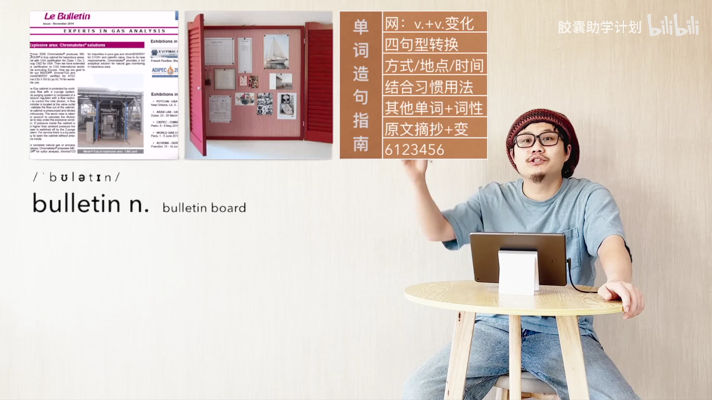

文字识别：Le Bulletin / 单词造句指南 / 网：v.+v.变化 / 胶囊助学计划 / bilbili / EXPERTS IN GAS ANALYSIS / Exhibitions in / 四句型转换 / Explosive area: Chromatotec'solutions / XVIFIMAI / hon hor Class 1 Dw 2 / MEo / tor / C100 ad / tes in pure gas ane dhromENERGY / Du to  / Freneh Pavillon, Sta / 方式/地点/时间 / ADIPEC / 20 / 2EI 20 E pe IC T4 wods / de use / 结合习惯用法 / dafa / Exhibitions in / r a0 0or / Ninw Orieans, LA.8. / PETTCON-USA / 其他单词+词性 / ARADLAB.UA / Duba. 23-20 Moth / Peain, 6+8 May 2011 / .CHEPEC-CHA / 原文摘抄+变 / re inaide / pliets / preS- / ME / Paris 1-5 Ane 201 / Francon,15-19aa / .ACHEMA-GER / WORLD GAS CX / 6123456 / /'bulatin/ / bulletin n. bulltin board

### 画面 00:02:34

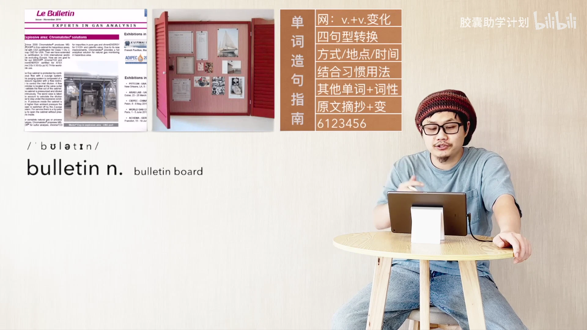

文字识别：Le Bulletin / 单词造句指南 / 网：v.+v.变化 / 胶囊助学计划 / bilbili / 2014 / EXPERTS IN GAS ANALYSIS / Exhibitions in / 四句型转换 / Expiosive area:Chromatotec'solutions / XVIFIMAI / hon tor Class 1 Dw 2. / MEo / tori / C100 ad / Du to  / Freneh Pavillon, Sta / 方式/地点/时间 / rdous anea. / ADIPEC / 2 / e2Ea I 30 E pE1C T4 wons / de use. / 结合习惯用法 / dafa / Exhibitions in / r be cor / Niew Oreans, LA.8- / PETTCON-USA / 其他单词+词性 / ARADLAB.UA / w to stay irdet the  / Duba. 23-20 MAth / Peain,6.8 May 2011 / .CAEPEC-CHNA / 原文摘抄+变 / WORLD GAS CX / Pain 1-5 Ane 201 / pliets / ME / Franoot. 15-19An / .ACHEMA-GER / 6123456 / /'bulatin/ / bulletin n. bulletin board

### 画面 00:02:36

文字识别：Le Bulletin / 单词造句指南 / 网：v.+v.变化 / 胶囊助学计划 / bilbili / e2014 / EXPERTS IN GAS ANALYSIS / Exhibitions in / 四句型转换 / Explosive area:Chromatotec'solutions / oainDp / O / ton tor Class 1 Dw 2 / ME= / lor1 / C1C0+ and / rtes in gur gas ane dronENERGY / Freneh Pavillon, Sta / XVIFIMAI / 方式/地点/时间 / ADIPEC / 20 / 2E20 E  1C T4 WO / de use. / 结合习惯用法 / dofa / Exhibitions in / r be 0or / NiewOreans,LA8 / PITTCON-USA / 其他单词+词性 / ·ARAB LAB.UA / Duta. 23-25 Mch / ww lo stay snude / Pekin, 0 -0 May 201 / ·CHEPEC-CHA / 原文摘抄+变 / Paris, 1- 5 Ane 201 / WORLD GAS CX /  tor suter analyss. eromaTCD / re inside / Francot, 15-19ar / .ACHEMA-GER / 6123456 / /'bulatin/ / bulletin n. bulltin board

### 画面 00:02:40

文字识别：Le Bulletin / 单词造句指南 / 网：v.+v.变化 / 胶囊助学计划 / bilbili / asue-Noveme / 2064 / EXPERTS IN GAS ANALYSIS / Exhibitions in / 四句型转换 / xpiosive area:Chromatotec'solutions / XVIFIMAI! / ton tor Class 1 Dw 2 / ME / Ror1 /  C1C0 and / Du to m / Freneh Pavillon, Sta / 方式/地点/时间 / ADIPEC / 20 / de use. / 2E20 E E CT4 / 结合习惯用法 / dofa / Exhibitions in / PITTCON-USA / 其他单词+词性 / Niew Oreans, LA.8- / ·ARAB LAB.UA / 0:0 / Duta. 23-20 Mch / Peain, 6-I May 201t / ·CIEPEC-CHA / 原文摘抄+变 / Paris. 1- 5 Aane 201 / WORLD GAS CC / re inside / piets1 / Frandot. 15–19aan / ·ACHEMA.GER / 6123456 / /'bulatin/ / bulletin n. bulletin board

### 画面 00:02:42

文字识别：Le Bulletin / 2014 / 单词造句指南 / 网：v.+v.变化 / 胶囊助学计划 / bibi / EXPERTS IN GAS ANALYSIS / Exhibitions in / 四句型转换 / Explosive area: Chromatotec'solutions / XVIFIMAI! / in hazardous area. / r C100+an / analytesi scuton for naral / French Pavion, Sta / ADIPEC / 20 / 方式/地点/时间 / 2E20E ICT4WO / de une. / 结合习惯用法 / on to w  2gurg  / udofa / Exhibitions in / Niew Ornans, LA.B. / PITTCON·USA / 其他单词+词性 / Duba. 23-25 Mh / ARAB LAB·UA / Peain, . May 201 / .CAEPEC-CHU / 原文摘抄+变 / Paris. 1. 5 Ane 20 / WORLD GAS C / pietsnsatunal / Frandot. 15–19aan / ·ACHEMA-GER / 6123456 / /'bulatin/ / bulletin n. bulletin board / ① We've just read the notice on / the bulletin board. have/what/why/where..

### 画面 00:02:45

文字识别：Le Bulletin / 单词造句指南 / 网：v.+v.变化 / 胶囊助学计划 / bilbi / assue-Niowenb / b2014 / EXPERTS IN GAS ANALYSIS / Exhibitions in / 四句型转换 / xplosive area: Chromatotec'solutions / XVIFIMAI / ton br Class1 Dw 2 / BOr C1C0+ and / 方式/地点/时间 / omar / ADIPEC / 20 / 220 E pE C T4 wons / de use. / 结合习惯用法 / oun fow wth a surge sy / Exhibitions in / PETTCON·UNA / 其他单词+词性 / Niew Oreans, LA.- / Duba. 23-25 Mth / .ARABLAB.UA / Peain, 6. May 201 / .CEPEC-CHU / 原文摘抄+变 / utpret- / Paris 1- 5 Aune 201 / WORLD GAS CC / Franctot. 15-19 an / ·ACHEMA-GER / 6123456 / /bulatin/ / bulletin n. bulltin board / ① We've just read the notice on / the bulletin board. have/what/why/where..

### 画面 00:02:50

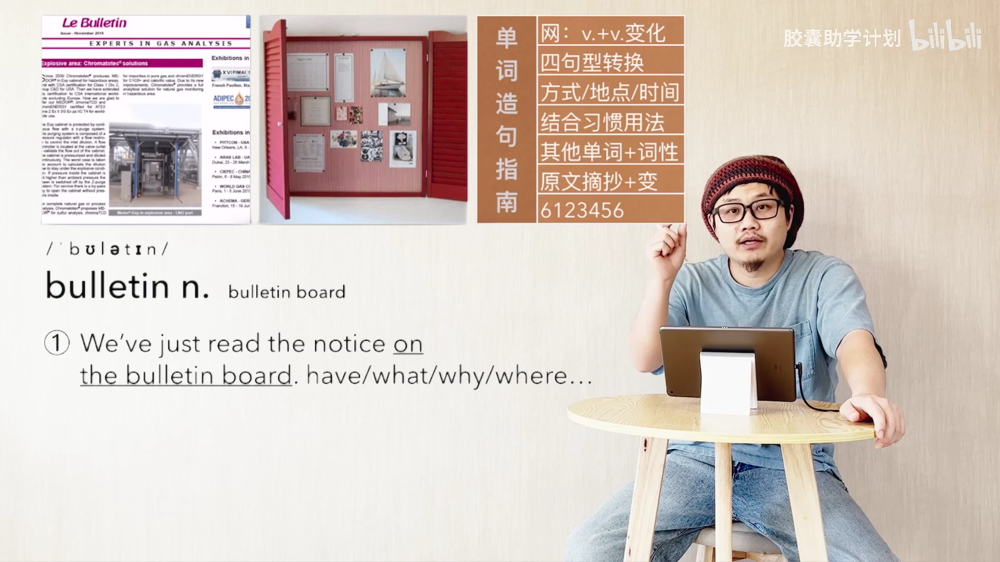

文字识别：Le Bulletin / 单词造句指南 / 网：v.+v.变化 / 胶囊助学计划 / bilbili / asaue-Noveenber 2014 / EXPERTS IN GAS ANALYSIS / Exhibitions in / 四句型转换 / xplosive area: Chromatotec'solutions / ton tor Class IDv 2 / xesME / r C1C0a / Sor i / XVIFIMAI1 / 方式/地点/时间 / ADIPEC / 2 / 2E30 E E1CT4S wOS / dn une / ENERGY cented fox ATEX / 结合习惯用法 / Exhibitions in /  a0 00r / NiewOreans,LA.. / PETTCON·UNA / 其他单词+词性 / Duba. 23-26 Mach / . ARAB LAB-UA / Pekin,0-0 May 201 / .CEPEC-CHEU / 原文摘抄+变 / pret- / Paris 1- 5 ane 201 / WORLD GAS CX / Franctot, 15-19ar / ·ACHEMA.GER / 6123456 / /'bulatin/ / bulletin n. bulletin board / ① We've just read the notice on / the bulletin board. have/what/why/where...

### 画面 00:02:55

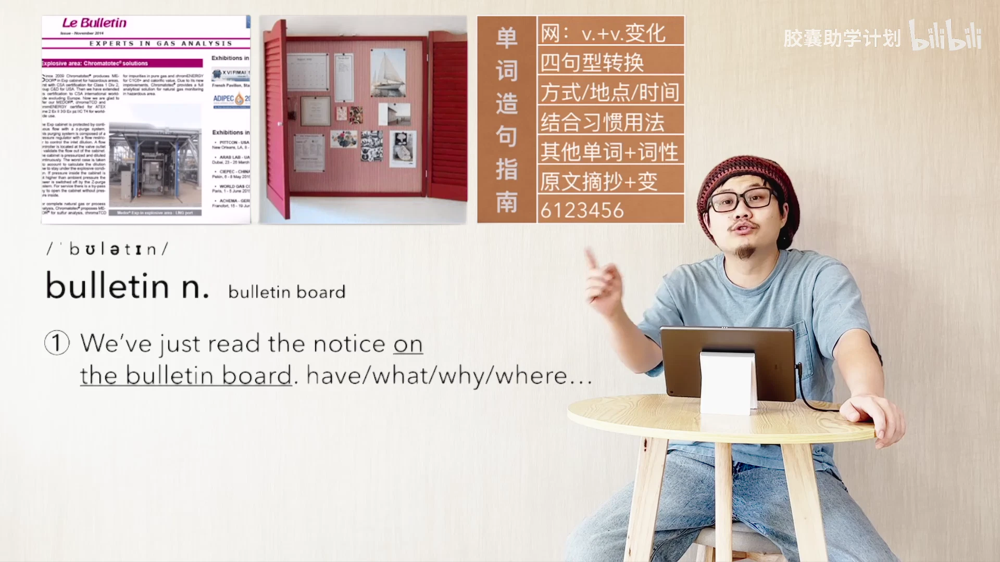

文字识别：Le Bulletin / 单词造句指南 / 网：v.+v.变化 / 胶囊助学计划 / bilbii / assue- Niovenb / EXPERTS IN GAS ANALYSIS / Exhibitions in / 四句型转换 / xplosive area: Chromatotec'solutions / XVIFIMAI / Sor C100and / 方式/地点/时间 / ADIPEC / 2E 20 E pE C T4  wonS / de use. / mENERGY cented tor ATEX / 结合习惯用法 / Exhibitions in /  ao 0or / i   vahve oytet / Piew Oreans, LA. B- / PETTCON.UNA / 其他单词+词性 / Duba, 23-25 Mwth / . ARAD LAB-UA / Peain.6. May 201 / .CAEPEC-CHEU / 原文摘抄+变 / te / pres- / Paris 1- 5 aune 201 / WORLD GAS CX /  r shr anas. emaTCD / Frandot,15- 19ar / ·ACHEMA-GER / 6123456 / /'bulatin/ / bulletin n. bulltin board / ① We've just read the notice on / the bulletin board. have/what/why/where..

### 画面 00:02:57

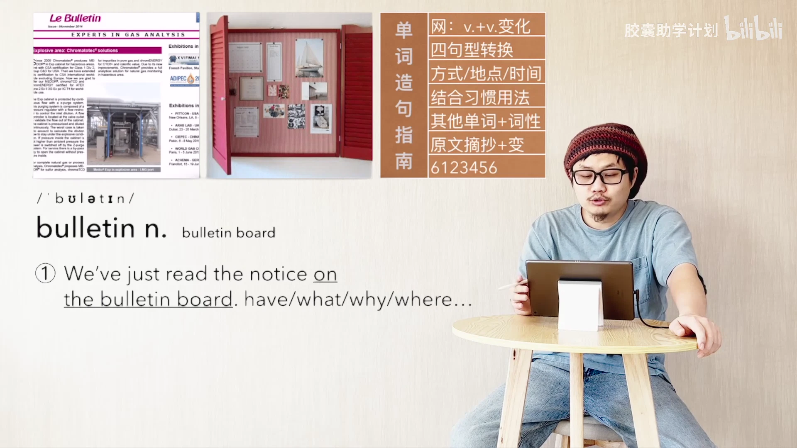

文字识别：Le Bulletin / 单词造句指南 / 网：v.+v.变化 / 胶囊助学计划 / bilbii / Asue-Niowem / 2014 / EXPERTS IN GAS ANALYSIS / Exhibitions in / 四句型转换 / xplosive area: Chromatotec'solutions / XVIFIMAI / SOr C1C0+ and / Freneh Pavilon, Sta / 方式/地点/时间 / ADIPEC / 20 / 2E30 E E1CT4 wos / de une. / 结合习惯用法 / ou fow wn a Fgurge tyg / ndoa / Exhibitions in / o 0ont / PETTCON-UIA / 其他单词+词性 / Niew Oreans, LAB- / . ARAD LAB.UA / Duba. 23-25 Mwrh / d / Peain0.8 May 201 / .CEPEC-CHEU / 原文摘抄+变 / pre9- / Paris 1- 5 ane 201 / WORLD GAS CX / Francot. 15-19Am / ·ACHEMA-GERE / 6123456 / /bulatin/ / bulletin n. bulletin board / ① We've just read the notice on / the bulletin board. have/what/why/where..

## 00:03:00–00:03:30

board was covered with messages.哎，充满了什么什么东西，对吧？那您看到这里，实际上我们第一句话做了地点，第二句话做了主语，对吧？那做主语的时候能想到，往往可能是被动的。Next one说，Let's make it official and put it on the bulletin board.说咱们把它正式定一下。OK，其实一课咱们学过的，make it official，来一个。那再读一遍这个单词bulletin，记住，再说一遍。

### 画面 00:03:00

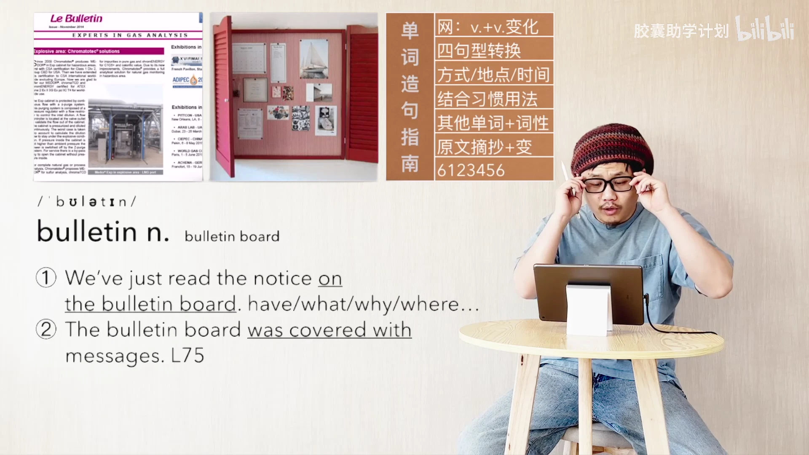

文字识别：Le Bulletin / 单词造句指南 / 网：v.+v.变化 / 胶囊助学计划 / bilbil / Aaaue- Nioven / ae2014 / EXPERTS IN GAS ANALYSIS / xplosive area: Chromatotec'solutions / Exhibitions in / 四句型转换 / XVIFIMAI / Sor C1C0+ and / bon for paural / Freneh Pavilion, Sta / 方式/地点/时间 / ADIPEC / 2E20E EICT4 WS / de une. / 结合习惯用法 / on fo w  Ioge ty / Exhibitions in / FETTCON.USA / 其他单词+词性 / Niew Onsans, LA.B / ad and dule / .ARABLAB.UA / Duba, 23-25 March /   stay inder   / Peain, 6. May 201t / .CEPEC-CHU / 原文摘抄+变 / Pais 1- 5 Ane 201 /  WORLD GAS CC / gas or gm / Francon. 15-19Ar / .ACHEMA.GER / 6123456 / /'bulatin/ / bulletin n. bulletin board / ① We've just read the notice on / the bulletin board. have/what/why/where.. / The bulletin board was covered with / messages. L75

### 画面 00:03:03

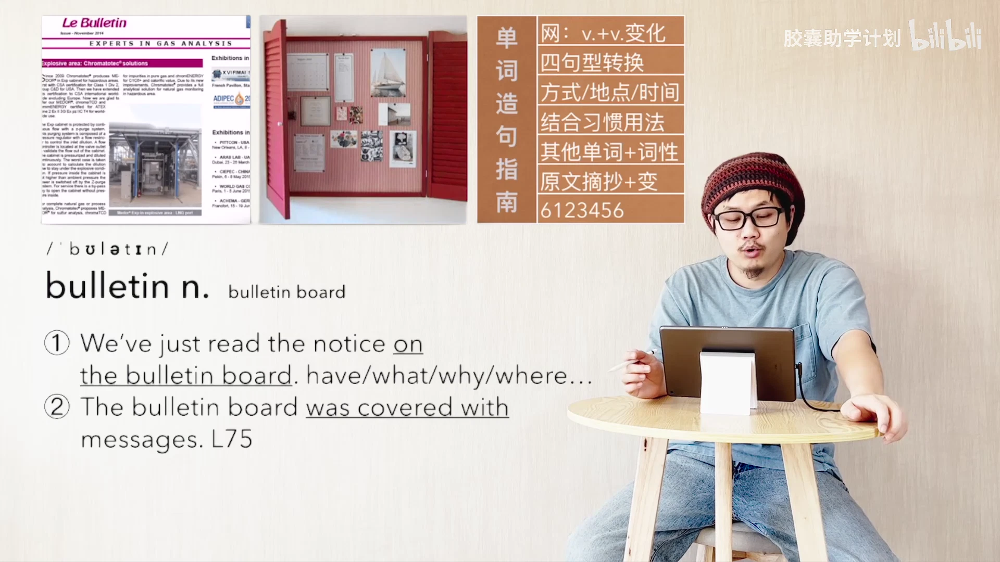

文字识别：Le Bulletin / 单词造句指南 / 网：v.+v.变化 / 胶囊助学计划 / bilbil / Asaue-Niowennd / we2014 / EXPERTS IN GAS ANALYSIS / 四句型转换 / xplosive area: Chromatotec'solutions / Exhibitions in / XVIFIMAI / sME. / Bor C1C5+ and / utes in porw gas and dhee / Freneh Pavilon, Sta / 方式/地点/时间 / ADIPEC / F2E 20E R1CT4 / de une. / 结合习惯用法 / oun tow weth a I-purge synt / Exhibitions in /  0on / FEITTCON.USA / Niew Oreans, LAB. / 其他单词+词性 / .ARABLAB.UA / Duta. 23.20 Marth / Peain, 6.8 May 201t / .CEPEC -CHU / 原文摘抄+变 / res- / Paris, 1-5 aone 2011 / WORLD GAS CX / Frarctort, 15-19ar / ACHEMA-GER / 6123456 / /bulatin/ / bulletin n. bulltin board / ① We've just read the notice on / the bulletin board. have/what/why/where.. / The bulletin board was covered with / messages. L75

### 画面 00:03:05

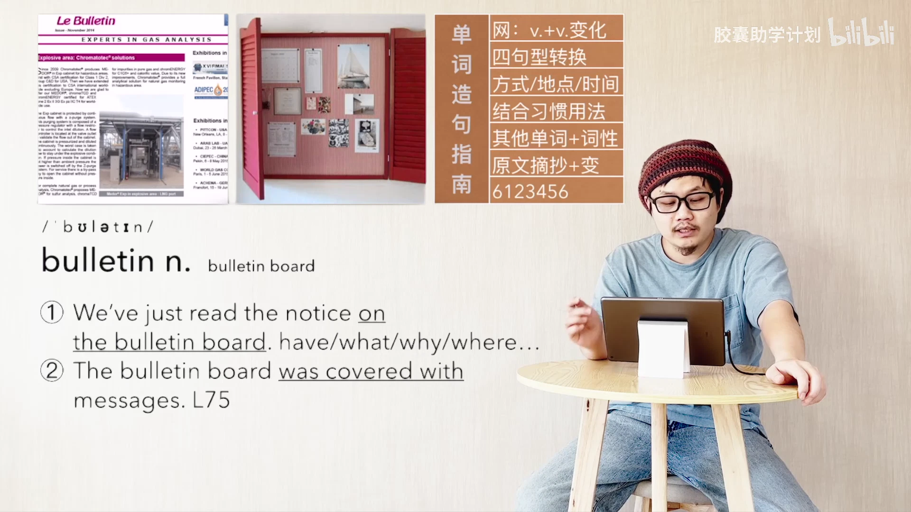

文字识别：Le Bulletin / 单词造句指南 / 网：v.+v.变化 / 胶囊助学计划 / biibili / asiue-Nowenb2014 / EXPERTS IN GAS ANALYSIS / Exhibitions in / 四句型转换 / xplosive area: Chromatotec'solutions / XVIFIMAI! / ONSME. / oe C1CO+ and c / Freneh Pavillon, Sta / 方式/地点/时间 / ADIPEC / 20 / 2E 20 RICT4B W0 / de une. / 结合习惯用法 / we Eo / Exhibitions in /  o oon / PETTCON·USA / Niew Oreans, LA,B- / 其他单词+词性 / .ARAB LABUA / Dua. 2)-25 Marth / Pelin, 6 ·0 May 201t / ·CEPEC-CHU / 原文摘抄+变 / utpret- / Paris 1-8aone 201 / WORLD GAS CX / gas or gn / Francot, 15-19ar / .ACSEMA.GER / 6123456 / /bulatin/ / bulletin n. bulletin board / ① We've just read the notice on / the bulletin board. have/what/why/where... / The bulletin board was covered with / messages.L75

### 画面 00:03:07

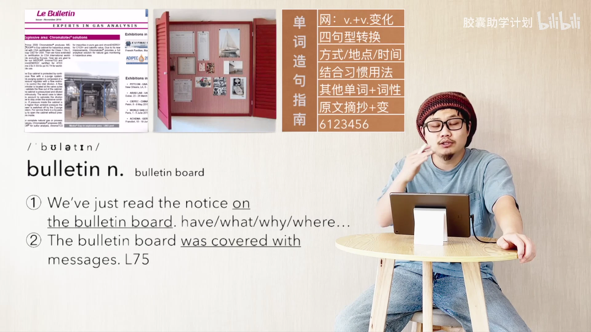

文字识别：Le Bulletin / 单词造句指南 / 网：v.+v.变化 / 胶囊助学计划 / bilbil / aaue-Noweb 2014 / EXPERTS IN GAS ANALYSIS / Exhibitions in / 四句型转换 / xplosive area: Chromatotec'solutions / XVIFIMAI! / Sor C1C6+ an / tor in / Freneh Pavilon, Stn / 方式/地点/时间 / ADIPEC / 20 / 2E 20 E e IC T4 Wo / de une. / ENERGY oNted tor ATEX / 结合习惯用法 / on fo w  sguge t / ndofa / Exhibitions in /  eond / PITCON-USA / 其他单词+词性 / Niew Oreans, LA, B- / . ARABLAB.UA / Duta. 23-25 Math /  to stry inder Be / Peain, 6-0 May 201t / .CEPEC-CHEU / 原文摘抄+变 / ut pret- / Paris 1-5 ane 201 / WORLD GAS CC / tr Wr na cmaTCD / gas or m / Francot. 15-19a / .ACHEMA.GER / 6123456 / /bulatin/ / bulletin n. bulletin board / ① We've just read the notice on / the bulletin board. have/what/why/where... / The bulletin board was covered with / messages. L75

### 画面 00:03:10

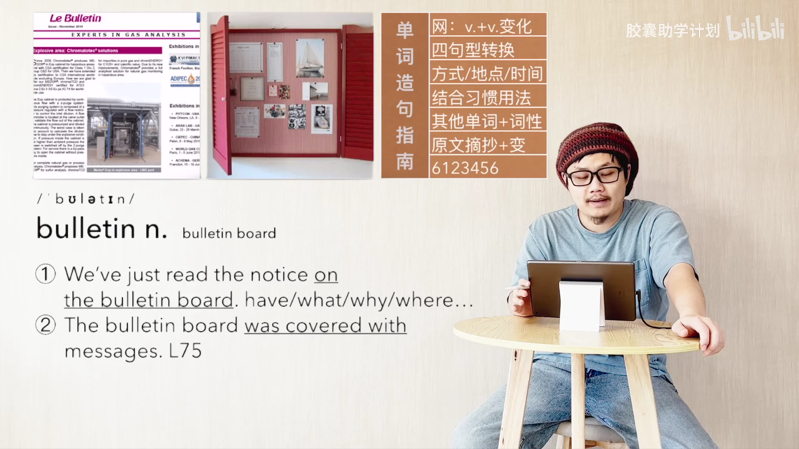

文字识别：Le Bulletin / 单词造句指南 / 网：v.+v.变化 / 胶囊助学计划 / bibii / aae-Noveb 2014 / EXPERTS IN GAS ANALYSIS / xplosive area: Chromatotec'solutions / Exhibitions in / 四句型转换 / XVIFIMAI / esME / Sor C1C0+ and / ctes in pur gas and che / Son for naural / MONERGY / Freneh Pavilion, Sta / 方式/地点/时间 / ADIPEC / 2E 20 E E IC T4 Wo / de une. / 结合习惯用法 / om to w  bprge S / e Eg / ndofa / Exhibitions in /  o don / PETTCON.USA / 其他单词+词性 / Niew Oreans, LA.B / .ARAB LAB UA / Duba, 23.25 March / Pehin, 6. May 201t / .CEPEC-CHE / 原文摘抄+变 / put pret- / Pain, 1- 5 An 201 / WORLD GAS C / gas or m / Francot, 15-19aur / .ACHEMA.GER / 6123456 / /'bulatin/ / bulletin n. bulletin board / ① We've just read the notice on / the bulletin board. have/what/why/where... / The bulletin board was covered with / messages. L75

### 画面 00:03:12

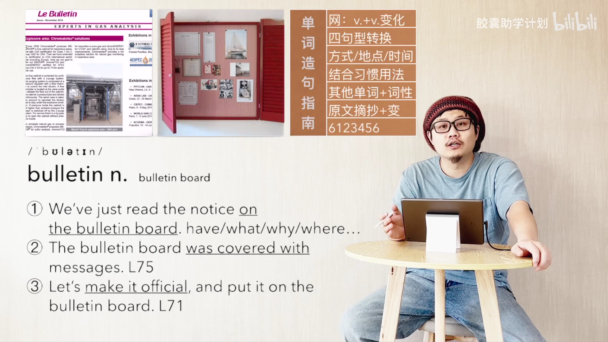

文字识别：Le Bulletin / 单词造句指南 / 网：v.+v.变化 / 胶囊助学计划ii / aue-Nowenb 2014 / EXPERTS IN GAS ANALYSIS / Exhibitions in / 四句型转换 / Explosive area: Chromatotec'solutions / XVIFIMAI / o C1CO+ and / French Pavillon, Sta / 方式/地点/时间 / ADIPEC / 20 / ENERGY Cnte r ATEX / 2 30 E1CT4 / de une. / 结合习惯用法 / Exhibitions in / .PETTCON-USA / 其他单词+词性 / Ninw Oreans,.LAB. / e cabonet is press / . ARABLAB.UA / Duba. 23-25 Marh / Pehin, 6. May 201t / CEPEC-CHN / 原文摘抄+变 / Pais, 1-5 aone 201) / WORLD GAS C / esME / Franoort, 15-19a / .ACHEMA.GER / 6123456 / /'bulatin/ / bulletin n. bulletin board / ① We've just read the notice on / the bulletin board. have/what/why/where.. / The bulletin board was covered with / messages. L75 / Let's make it official, and put it on the / bulletin board. L71

### 画面 00:03:15

文字识别：Le Bulletin / 单词造句指南 / 网：v.+v.变化 / 胶囊助学计划 / bibii / sue-Niowenber 2014 / EXPERTS IN GAS ANALYSIS / Exhibitions in / 四句型转换 / xplosive area: Chromatotec'solutions / XVIFIMAI / or C1CD+ and  / tor i / Freneh Pavillon, Stn / 方式/地点/时间 / ADIPEC / 2 / Ne2E 30 EICT4 wO / de vte. / 结合习惯用法 / eEp cabire is procted by oort / on tow w  sgurge sy / odola / Exhibitions in / PETTCOW-USA / 其他单词+词性 / Niew Oneans, LA.B. / e cabinet is pres / Duba. 23-25 Morch / ·ARABLAB.UA / Peain, 6. May 201t / .CAEPEC-CHBU / 原文摘抄+变 / Pais 1- 5 aone 2011 / WORLD GAS CC / Franctont, 15- 19a / .ACHEMA.GER / 6123456 / /bulatin/ / bulletin n. bulletin board / ① We've just read the notice on / the bulletin board. have/what/why/where... / The bulletin board was covered with / messages.L75 / Let's make it official, and put it on the / bulletin board. L71

### 画面 00:03:18

文字识别：Le Bulletin / 单词造句指南 / 网：v.+v.变化 / 胶囊助学计划ilbi / 2usoe-Nowenber 2014 / EXPERTS IN GAS ANALYSIS / Exhibitions in / 四句型转换 / xplosive area: Chromatotec'solutions / XVIFIMAI / Nor C1CO+ and  / French Pavillon, Stn / 方式/地点/时间 / ADIPEC / 20 / 2E 30E4 1CT4WoS / de une. / 结合习惯用法 / on to w  bgurge s / e Ep cabirer is proed by cort / adofa / Exhibitions in / e 0on / .PETTCOW-USA / 其他单词+词性 / Niew Oneans, LA.B- / Duba. 23-25 Morch / .ARABLAB.UA / n the cat / ma Zqurge / Pekin, 6.8 May 2011 / .CEPEC.CHU / WORLD GAS CX / 原文摘抄+变 / esME / Fracont, 15- 19 / .ACHEMA.GER / 6123456 / /'bulatin/ / bulletin n. bulletin board / ① We've just read the notice on / the bulletin board. have/what/why/where... / The bulletin board was covered with / messages.L75 / Let's make it official, and put it on the / bulletin board. L71

### 画面 00:03:20

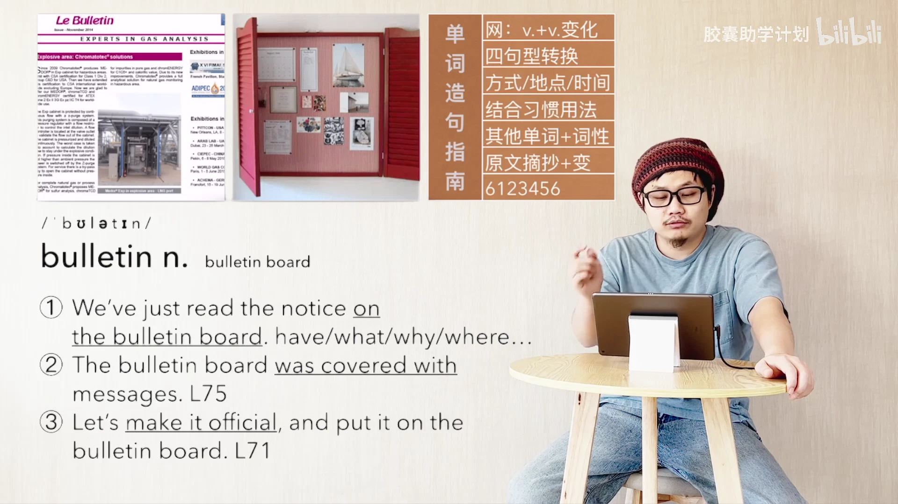

文字识别：Le Bulletin / 单词造句指南 / 网：v.+v.变化 / 胶囊助学计划ili / sue-Nioweenber 2014 / EXPERTS IN GAS ANALYSIS / Exhibitions in / 四句型转换 / xplosive area: Chromatotec'solutions / XVIFIMAI / No CICO+ and  / tor im / Freneh Pavillon, Sta / 方式/地点/时间 / ADIPEC / 20 / e2E 2O eICT4  / de use / 结合习惯用法 / e Ep cabiner is protected by cont / on ho   uge t / odoa / Exhibitions in / ao 6ond / PETTCOW-USA / 其他单词+词性 / Niew Oneans, LA.B- / e catinet is poess / .ARABLAB-UA / Duba. 23-20 Marc / Peain,6.8 May 201 / .CEPEC.CHEU / 原文摘抄+变 / nthe cad / Pais 1-5 An 201) / .WORLD GAS C / plete nahui pas or pn / sMB / mea UNO ort / Francont, 15- 19 r / ·ACHEMA GER / 6123456 / /'bulatin/ / bulletin n. bulletin board / ① We've just read the notice on / the bulletin board. have/what/why/where... / The bulletin board was covered with / messages. L75 / Let's make it official, and put it on the / bulletin board. L71

### 画面 00:03:22

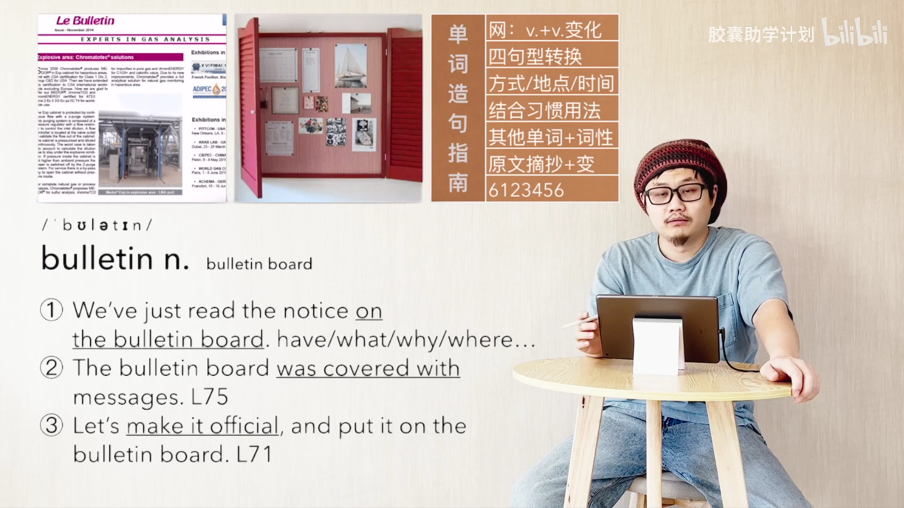

文字识别：Le Bulletin / 单词造句指南 / 网：v.+v.变化 / 胶囊助学计划bilbil / sse- Nowecnbr 2014 / EXPERTS IN GAS ANALYSIS / Exhibitions in / 四句型转换 / xplosive area: Chromatotec'solutions / XVIFIMAI / Nor CICO+ and  / tor i / French Pavillon, Sta / 方式/地点/时间 / ADIPEC / 20 / 2E 30 ICT4W / de une / 结合习惯用法 /  E cabire is pocted by oort / on ho m a tpurge ty / Exhibitions in /  ao oon / PETTCOW-USA / 其他单词+词性 / Niew Oneans, LA.B. / .ARABLAB.UA / Dubal. 23-25 March / Peain,6.8 May 201 / .CEPEC-CHEU / 原文摘抄+变 / nthe cn / Pais 1- 5 Ane 201 / WORLD GAS CX / asME /  LNO Be / Franctont, 15- 19 ar / ·ACHEMA.GER / 6123456 / /bulatin/ / bulletin n. bulltin board / ① We've just read the notice on / the bulletin board. have/what/why/where.. / The bulletin board was covered with / messages. L75 / Let's make it official, and put it on the / bulletin board. L71

### 画面 00:03:25

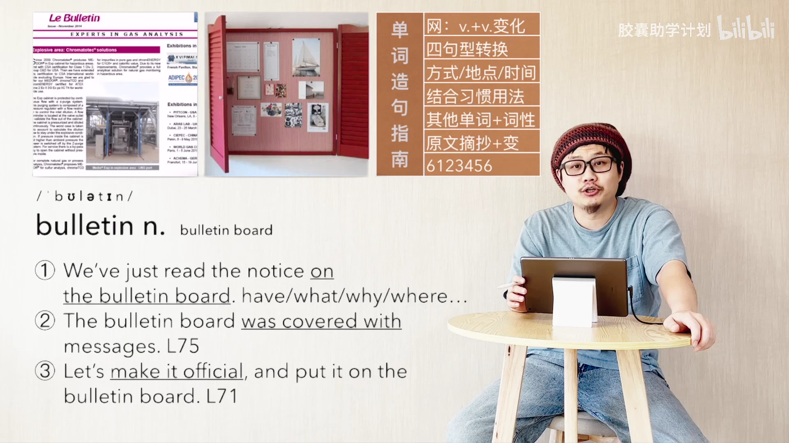

文字识别：Le Bulletin / 单词造句指南 / 网：v.+v.变化 / 胶囊助学计划ibl / Asaue- Nioweend / br2014 / EXPERTS IN GAS ANALYSIS / Exhibitions in / 四句型转换 / Explosive area: Chromatotec'solutions / XVIFIMAI / Nor C1C5+ and / Freneh Pavillon, Sta / 方式/地点/时间 / ADIPEC / 20 / e2E30D4 1CT4 / de une. / 结合习惯用法 / e Ep cabirer is prote by on / on fo w  Iprg sy / adda / Exhibitions in / PETTCON.USA / 其他单词+词性 / Niew Oreans,LA.B- / e catinet is pres / .ARAB LABUA / Duba. 23-25 March / Peain, 6 -0 May 201t / .CEPEC-CHeU / 原文摘抄+变 / Far / Pais 1-8 hne 2011 / WORLD GAS CX / sM / ea UNO poxt / Fracont, 15- 19 A / .ACHEMA.GER / 6123456 / /'bulatin/ / bulletin n. bulltin board / ① We've just read the notice on / the bulletin board. have/what/why/where... / The bulletin board was covered with / messages.L75 / Let's make it official, and put it on the / bulletin board. L71

### 画面 00:03:29

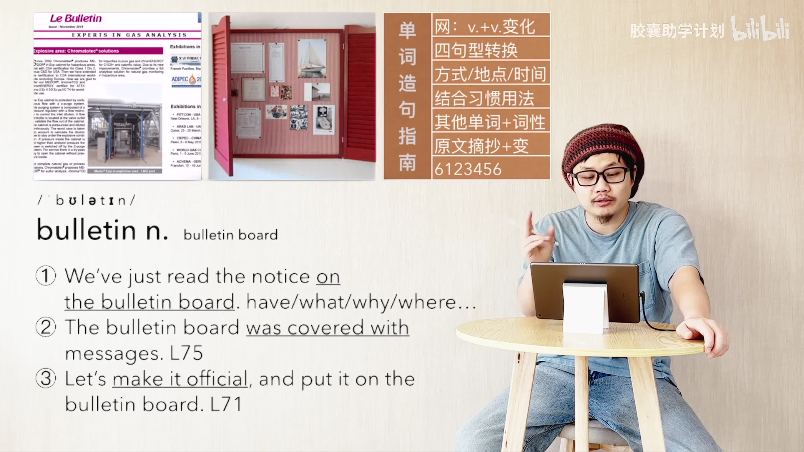

文字识别：Le Bulletin / 单词造句指南 / 网：v.+v.变化 / 胶囊助学计划bibl / saue- Nioveed / b2014 / EXPERTS IN GAS ANALYSIS / xplosive area: Chromatotec'solutions / Exhibitions in / 四句型转换 / XVIFIMAI / oe C1CD and  / tor im / Freneh Pavillon, Sta / 方式/地点/时间 / ADIPEC / 20 / 2204 CT4 / de une. / 结合习惯用法 / Exhibitions in / PETTCON UEA / 其他单词+词性 / Niew Oreans, LA.B- / e catinelis poes / .ARAB LAB-UA / Duba. 23-20 March / Peain,6.0May 201 / .CEPEC-CHeU / 原文摘抄+变 / Pais. 1-5 ane 2011 / WORLD GAS C / ea ENG Bt / Francont, 15- 19.A / ·ACHEMA GER / 6123456 / /bulatin/ / bulletin n. bulltin board / ① We've just read the notice on / the bulletin board. have/what/why/where... / The bulletin board was covered with / messages.L75 / Let's make it official, and put it on the / bulletin board. L71

## 00:03:30–00:04:00

虽然在这儿我们基本上都是拿 bulletin board 去造句的，但是你一定要啊记住，它有一个额外的含义，就是新闻简报啊。 Next one, 注意力集中，咱们听一下电影片段。 It's been on the bulletin board for weeks. 哎，呃，这个 It's 是 It has been on the bulletin board，是吧？现在完成时，从过去持续到现在，持续了多长时间了呢？ For weeks，数周了。 Next one，下一个单词叫

### 画面 00:03:31

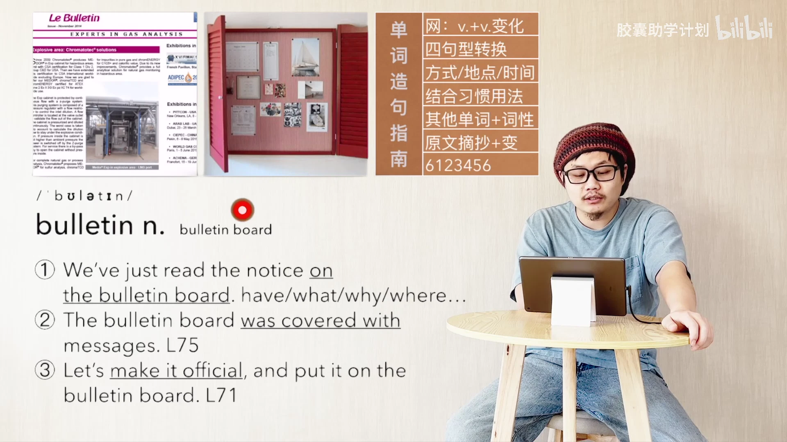

文字识别：Le Bulletin / 单词造句指南 / 网：v.+v.变化 / 胶囊助学计划 / bilbili / dusue- Nioweenl / bor2014 / EXPERTS IN GAS ANALYSIS / Exhibitions in / 四句型转换 / Explosive area: Chromatotec'solutions / XVIFIMAI1 / Freneh Pavillon, Stn / 方式/地点/时间 / ADIPEC / 20 / 2E30 1CT4 w / de vne. / 结合习惯用法 / E cabire is poce by cor / on to w  sgrge s / edola / Exhibitions in /  ao 0ond / FETTCON-USA / 其他单词+词性 / Ninw Oraans. LA.8. / e catsinet is pr / .ARABLAB-UA / Duba. 23·25 Mwch / Pekin, 6.8 May 201 / .CEPEC-CHEU / 原文摘抄+变 / Paik. 1-5 ane 2011 / WORLD GAS CX / Franctont, 15- 19An / ，ACHEMA.GER / 6123456 / /'bulatin/ / bulletin n. bulletin board / ① We've just read the notice on / the bulletin board. have/what/why/where.. / The bulletin board was covered with / messages.L75 / Let's make it official, and put it on the / bulletin board. L71

### 画面 00:03:35

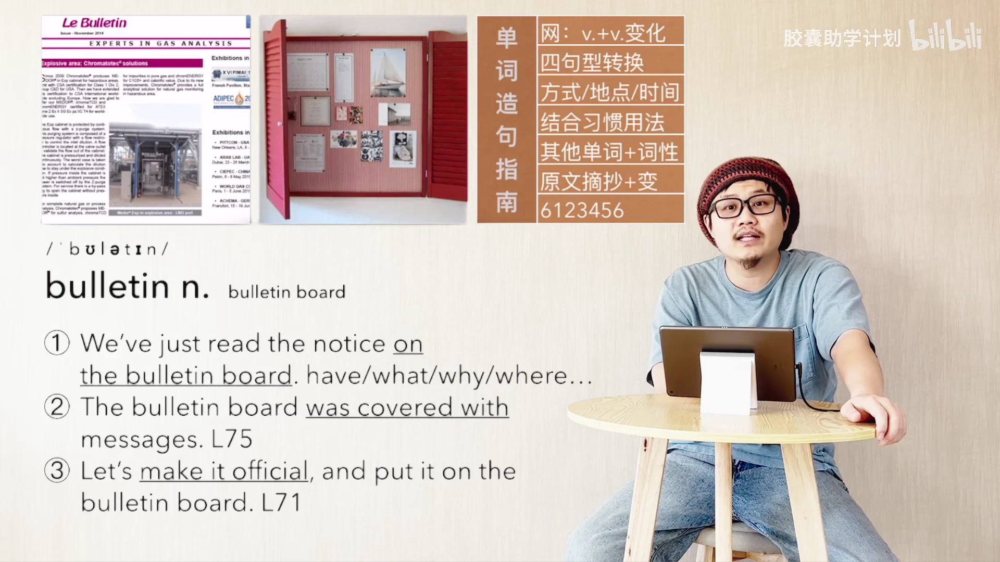

文字识别：Le Bulletin / 单词造句指南 / 网：v.+v.变化 / 胶囊助学计划 / Bilbii / aaue-Noveenber 2014 / EXPERTS IN GAS ANALYSIS / Exhibitions in / 四句型转换 / Explosive area: Chromatotec'solutions / XVIFIMAI / or C1Cb+ and  / for im / Freneh Pavillon, Sta / 方式/地点/时间 / ADIPEC / 20 / 2E 30E eIC T4 w0 / de une. / 结合习惯用法 / Epcaier isproedbyor / o to w  g  / Exhibitions in /  o oon / PETTCON-USA / 其他单词+词性 / Ninw Oraans,.LA.B. / ecabinet is pres / .ARABLAB-UA / Duba. 23-25 March / Pelin, 6.E May 201t / .CEPEC-CHOU / 原文摘抄+变 / 1thec / ee by / Paik 1-6 aune 2011 / WORLD GAS CX / sME / a LNG port / Prancont, 15- 19ar / .ACHEMA.GER / 6123456 / /'bulatin/ / bulletin n. bulletin board / ① We've just read the notice on / the bulletin board. have/what/why/where.. / The bulletin board was covered with / messages. L75 / Let's make it official, and put it on the / bulletin board. L71

### 画面 00:03:38

文字识别：胶囊助学计划bibi / It's been on the bulletin board for weeks. / How to Get Ahead in Advertising / (1989)

### 画面 00:03:40

文字识别：胶囊助学计划bib出 / It's been on the bulletin board for weeks. / How to Get Ahead in Advertising / (1989)

### 画面 00:03:43

文字识别：胶囊助学计划il出 / It's been on the bulletin board for weeks. / How to Get Ahead in Advertising / (1989)

### 画面 00:03:45

文字识别：胶囊助学计划i出 / It's been on the bulletin board for weeks. / How to Get Ahead in Advertising / (1989)

### 画面 00:03:48

文字识别：胶囊助学计划i出 / It's been on the bulletin board for weeks. / How to Get Ahead in Advertising / (1989)

### 画面 00:03:50

文字识别：胶囊助学计划i出 / It's been on the bulletin board for weeks. / How to Get Ahead in Advertising / (1989)

### 画面 00:03:55

文字识别：胶囊助学计划ilbl / It's been on the bulletin board for weeks. / How to Get Ahead in Advertising / (1989)

### 画面 00:03:57

文字识别：单词造句指南 / 网：v.+v.变化 / 胶囊助学计划 / bilbil / 四句型转换 / 方式/地点/时间 / 结合习惯用法 / 其他单词+词性 / 原文摘抄+变 / 6123456 / /a'naunsa/ / announcer n.

### 画面 00:03:59

文字识别：单词造句指南 / 网：v.+v.变化 / 胶囊助学计划 / bilbii / 四句型转换 / 方式/地点/时间 / 结合习惯用法 / 其他单词+词性 / 原文摘抄+变 / 6123456 / /anaunsa/ / announcer n.

## 00:04:00–00:04:30

做看音标announcer. Announcer,这个announcer后边加了er,你大概就能猜出来它是呃做某件事情的人. Announce这个单词本身是一个动词,你可以理解为叫做通知,对吧?通知.然后这个announcer呢,指的是我们这个播报员啊,我们的这个广播或电视当中的这个播报员.当然,它还有更多的意思,比如说在电视当中的个解说员也可以叫

### 画面 00:04:01

文字识别：单词造句指南 / 网：v.+v.变化 / 胶囊助学计划 / bibi / 四句型转换 / 方式/地点/时间 / 结合习惯用法 / 其他单词+词性 / 原文摘抄+变 / 6123456 / /anaunsa/ / announcer n.

### 画面 00:04:05

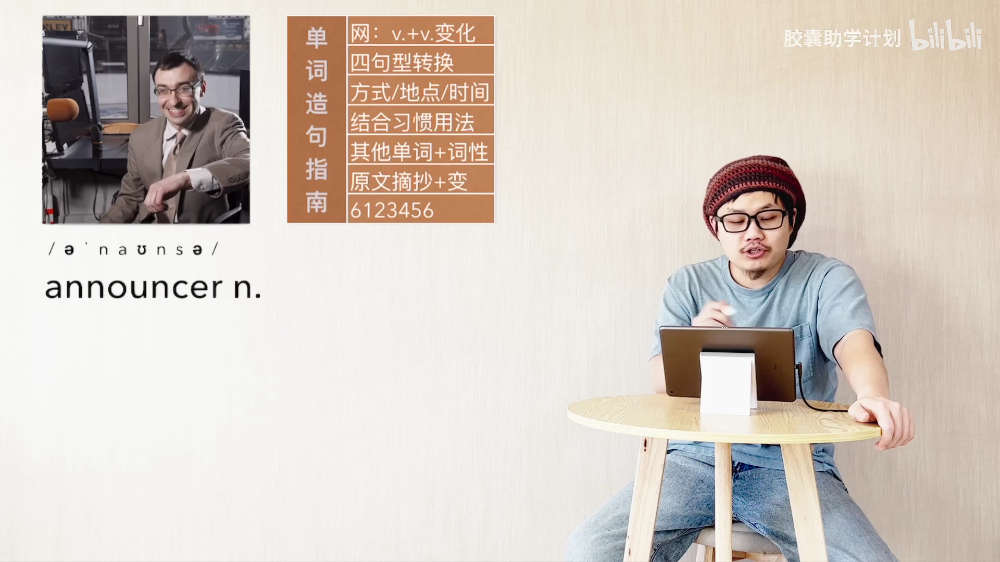

文字识别：单词造句指南 / 网：v.+v.变化 / 胶囊助学计划 / bilbili / 四句型转换 / 方式/地点/时间 / 结合习惯用法 / 其他单词+词性 / 原文摘抄+变 / 6123456 / /anaunsa/ / announcer n.

### 画面 00:04:07

文字识别：单词造句指南 / 网：v.+v.变化 / 胶囊助学计划 / bilbili / 四句型转换 / 方式/地点/时间 / 结合习惯用法 / 其他单词+词性 / 原文摘抄+变 / 6123456 / /a'naunsa/ / announcer n.

### 画面 00:04:10

文字识别：单词造句指南 / 网：v.+v.变化 / 胶囊助学计划 / bibi / 四句型转换 / 方式/地点/时间 / 结合习惯用法 / 其他单词+词性 / 原文摘抄+变 / 6123456 / /anaunsa/ / announcer n.

### 画面 00:04:13

文字识别：单词造句指南 / 网：v.+v.变化 / 胶囊助学计划 / bibili / 四句型转换 / 方式/地点/时间 / 结合习惯用法 / 其他单词+词性 / 原文摘抄+变 / 6123456 / /anaunsa/ / announcer n.

### 画面 00:04:15

文字识别：单词造句指南 / 网：v.+v.变化 / 胶囊助学计划 / bilbili / 四句型转换 / 方式/地点/时间 / 结合习惯用法 / 其他单词+词性 / 原文摘抄+变 / 6123456 / /anaunsa/ / announcer n.

### 画面 00:04:20

文字识别：单词造句指南 / 网：v.+v.变化 / 胶囊助学计划 / bibili / 四句型转换 / 方式/地点/时间 / 结合习惯用法 / 其他单词+词性 / 原文摘抄+变 / 6123456 / /anaunsa/ / announcer n.

### 画面 00:04:24

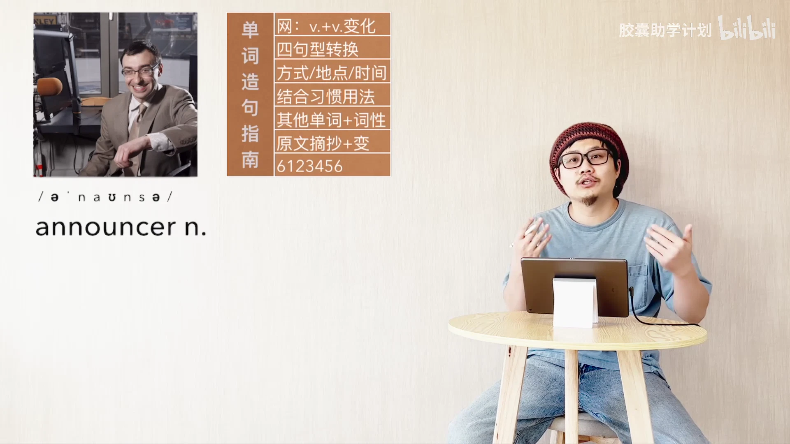

文字识别：单词造句指南 / 网：v.+v.变化 / 胶囊助学计划 / bilbili / 四句型转换 / 方式/地点/时间 / 结合习惯用法 / 其他单词+词性 / 原文摘抄+变 / 6123456 / /a'naunsa/ / announcer n.

### 画面 00:04:26

文字识别：单词造句指南 / 网：v.+v.变化 / 胶囊助学计划 / bibili / 四句型转换 / 方式/地点/时间 / 结合习惯用法 / 其他单词+词性 / 原文摘抄+变 / 6123456 / /a'naunsa/ / announcer n.

### 画面 00:04:29

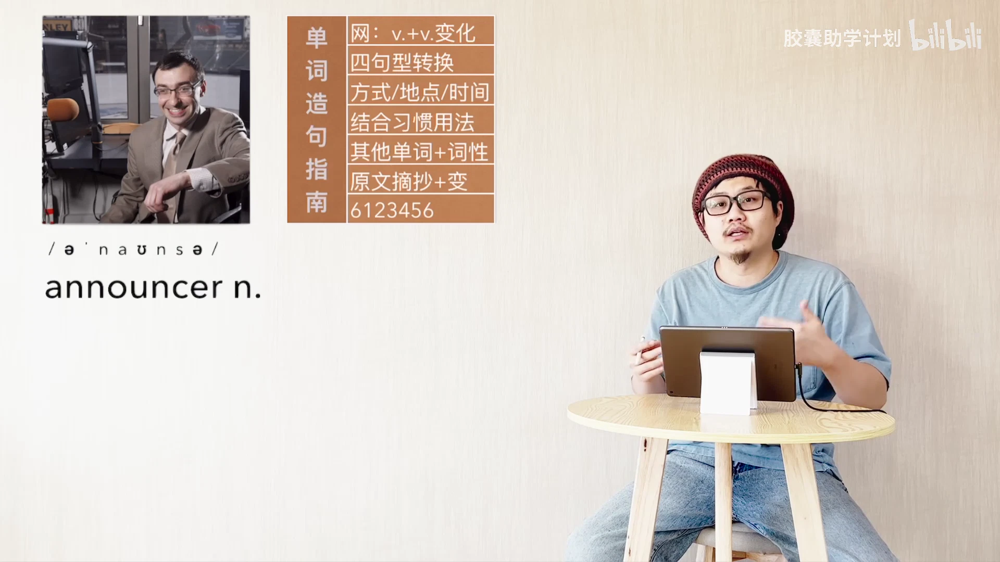

文字识别：单词造句指南 / 网：v.+v.变化 / 胶囊助学计划 / bilbili / 四句型转换 / 方式/地点/时间 / 结合习惯用法 / 其他单词+词性 / 原文摘抄+变 / 6123456 / /anaunsa/ / announcer n.

## 00:04:30–00:05:00

announcer，对吧？就是基本上就是宣告某些事情的这样的一个人啊。那看这句话说，it was not long before。刚学，哎，不久后怎么样了呢？The announcer told us the plane had flown off course。哎，不久后，播报员告诉我们说飞机远离了航线。Next one， the announcer tried to stay out the out of the limelight after work。对啊，那他上班的时候啊，经常

### 画面 00:04:31

文字识别：单词造句指南 / 网：v.+v.变化 / 胶囊助学计划 / bilbili / 四句型转换 / 方式/地点/时间 / 结合习惯用法 / 其他单词+词性 / 原文摘抄+变 / 6123456 / /anaunsa/ / announcer n.

### 画面 00:04:34

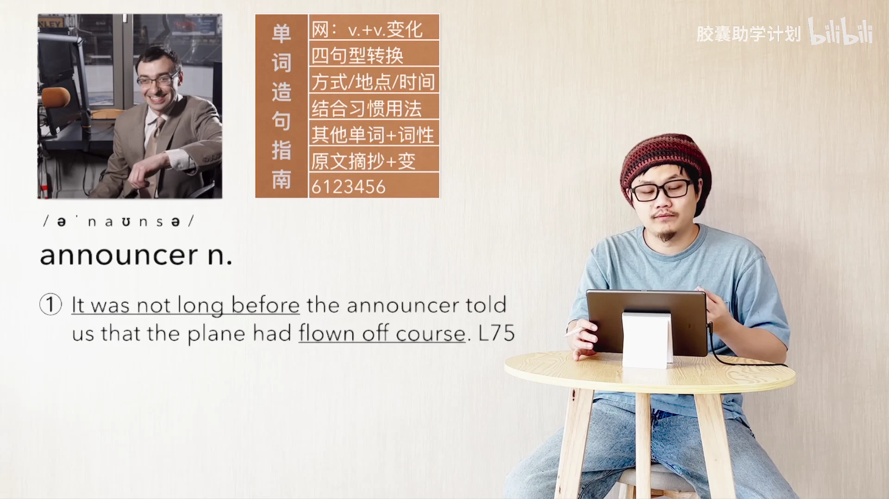

文字识别：单词造句指南 / 网：v.+v.变化 / 胶囊助学计划 / bibili / 四句型转换 / 方式/地点/时间 / 结合习惯用法 / 其他单词+词性 / 原文摘抄+变 / 6123456 / /a'naunsa/ / announcer n. / It was not long before the announcer told / us that the plane had flown off course. L75

### 画面 00:04:36

文字识别：单词造句指南 / 网：v.+v.变化 / 胶囊助学计划 / bibil / 四句型转换 / 方式/地点/时间 / 结合习惯用法 / 其他单词+词性 / 原文摘抄+变 / 6123456 / /a'naunsa/ / announcer n. / It was not long before the announcer told / us that the plane had flown off course. L75

### 画面 00:04:40

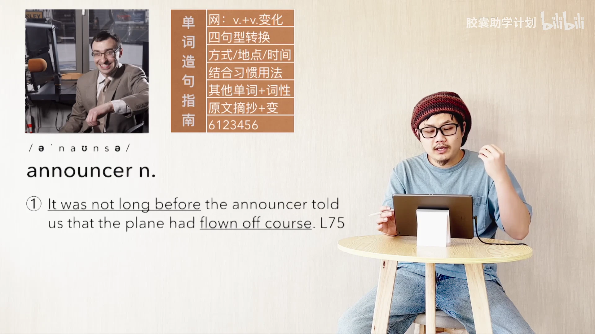

文字识别：单词造句指南 / 网：v.+v.变化 / 胶囊助学计划 / bibili / 四句型转换 / 方式/地点/时间 / 结合习惯用法 / 其他单词+词性 / 原文摘抄+变 / 6123456 / /anaunsa/ / announcer n. / It was not long before the announcer told / us that the plane had flown off course. L75

### 画面 00:04:46

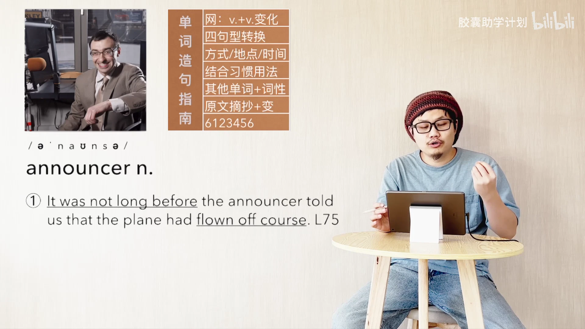

文字识别：单词造句指南 / 网：v.+v.变化 / 胶囊助学计划 / Biibii / 四句型转换 / 方式/地点/时间 / 结合习惯用法 / 其他单词+词性 / 原文摘抄+变 / 6123456 / /anaunsa/ / announcer n. / It was not long before the announcer told / us that the plane had flown off course. L75

### 画面 00:04:50

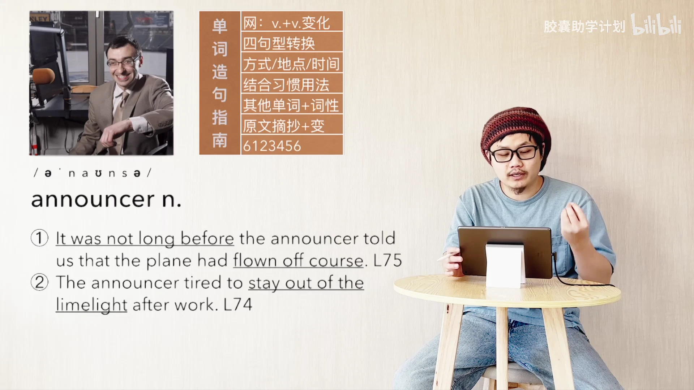

文字识别：胶囊助学计划bilbil / 单词造句指南 / 网：v.+v.变化 / 四句型转换 / 方式/地点/时间 / 结合习惯用法 / 其他单词+词性 / 原文摘抄+变 / 6123456 / /anaunsa/ / announcer n. / It was not long before the announcer told / us that the plane had flown off course. L75 / The announcer tired to stay out of the / limelight after work. L74

### 画面 00:04:53

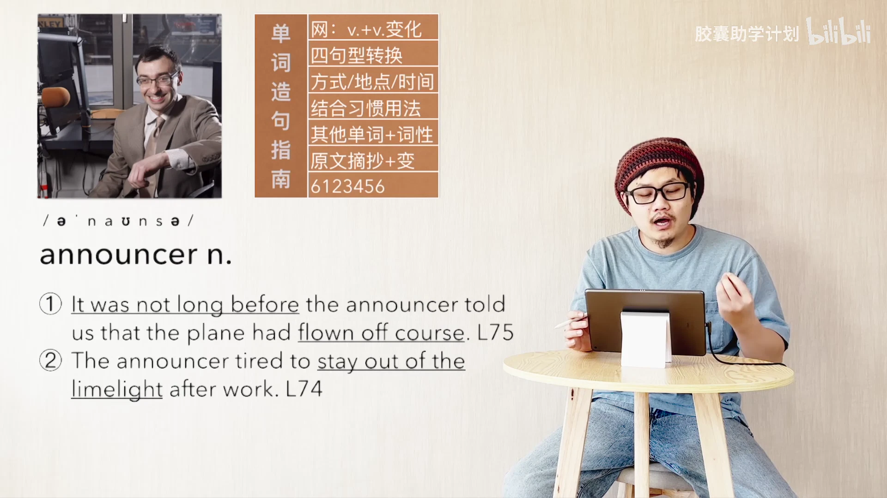

文字识别：单词造句指南 / 网：v.+v.变化 / 胶囊助学计划bibil / 四句型转换 / 方式/地点/时间 / 结合习惯用法 / 其他单词+词性 / 原文摘抄+变 / 6123456 / /anaunsa/ / announcer n. / It was not long before the announcer told / us that the plane had flown off course. L75 / The announcer tired to stay out of the / limelight after work. L74

### 画面 00:04:55

文字识别：单词造句指南 / 网：v.+v.变化 / 胶囊助学计划 / Bilbili / 四句型转换 / 方式/地点/时间 / 结合习惯用法 / 其他单词+词性 / 原文摘抄+变 / 6123456 / /anaunsa / / announcer n. / It was not long before the announcer told / us that the plane had flown off course. L75 / The announcer tired to stay out of the / limelight after work. L74

### 画面 00:04:57

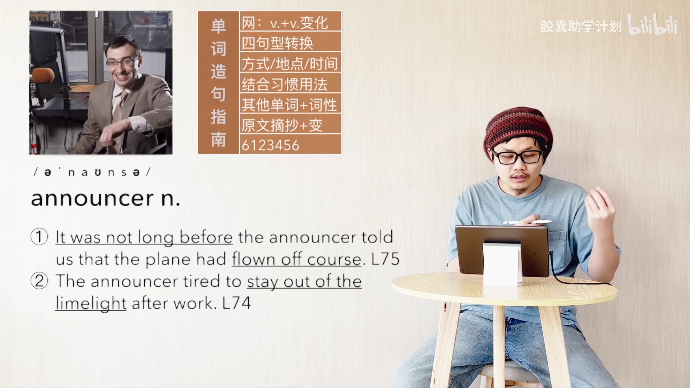

文字识别：胶囊助学计划biil / 单词造句指南 / 网：v.+v.变化 / 四句型转换 / 方式/地点/时间 / 结合习惯用法 / 其他单词+词性 / 原文摘抄+变 / 6123456 / /anaunsa/ / announcer n. / It was not long before the announcer told / us that the plane had flown off course. L75 / The announcer tired to stay out of the / limelight after work. L74

## 00:05:00–00:05:30

是这个在这个聚光灯底下的。那下班了，他可能想享受自己私人的生活。Continue下一个单词，看一下音标，叫做 macaroni。好，macaroni。那 macaroni 就我们所谓通心粉，对吧？哎，这个意面当中的一种吧。我呃，这个这个我不是美食家，我也不敢判断。但我确实知道 macaroni 就是通心粉，通心粉就长成这个样子。它算不算意面？我这个还真不太知道啊。那我们看一下这句话，

### 画面 00:05:00

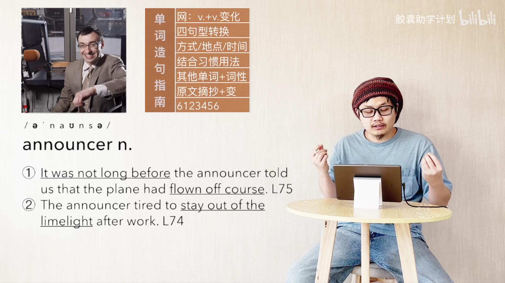

文字识别：单词造句指南 / 网：v.+v.变化 / 胶囊助学计划 / bibii / 四句型转换 / 方式/地点/时间 / 结合习惯用法 / 其他单词+词性 / 原文摘抄+变 / 6123456 / /anaunsa / / announcer n. / It was not long before the announcer told / us that the plane had flown off course. L75 / The announcer tired to stay out of the / limelight after work. L74

### 画面 00:05:02

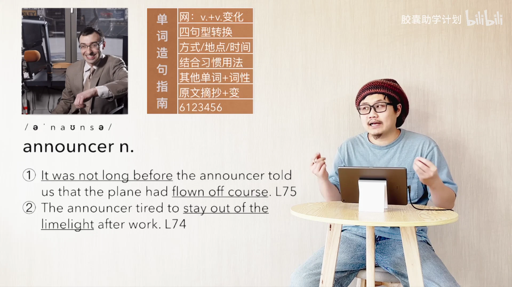

文字识别：单词造句指南 / 网：v.+v.变化 / 胶囊助学计划bibi / 四句型转换 / 方式/地点/时间 / 结合习惯用法 / 其他单词+词性 / 原文摘抄+变 / 6123456 / /a'naunsa/ / announcer n. / It was not long before the announcer told / us that the plane had flown off course. L75 / The announcer tired to stay out of the / limelight after work. L74

### 画面 00:05:05

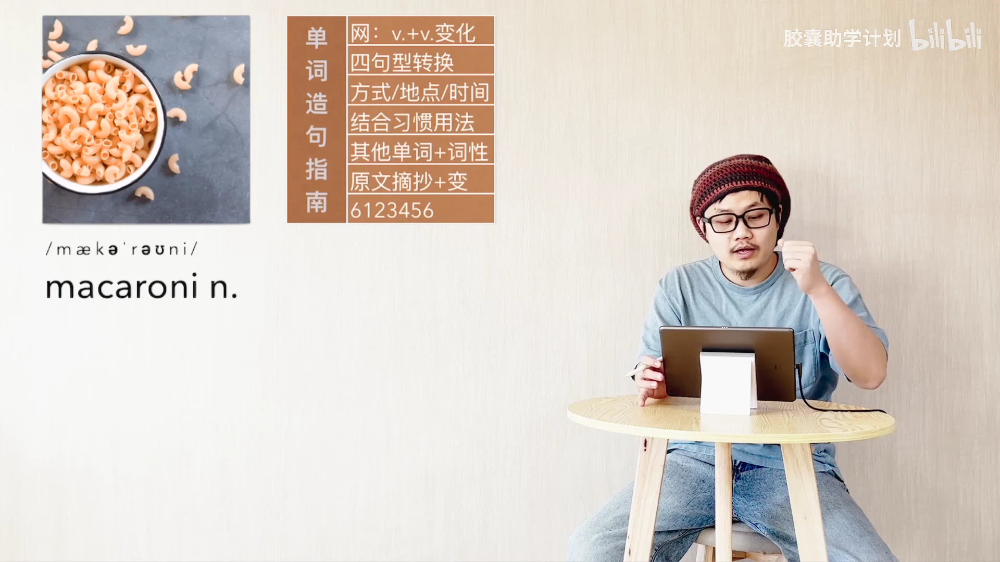

文字识别：单词造句指南 / 网：v.+v.变化 / 胶囊助学计划 / bilbili / 四句型转换 / 方式/地点/时间 / 结合习惯用法 / 其他单词+词性 / 原文摘抄+变 / 6123456 / /mæeka'rauni/ / macaroni n.

### 画面 00:05:07

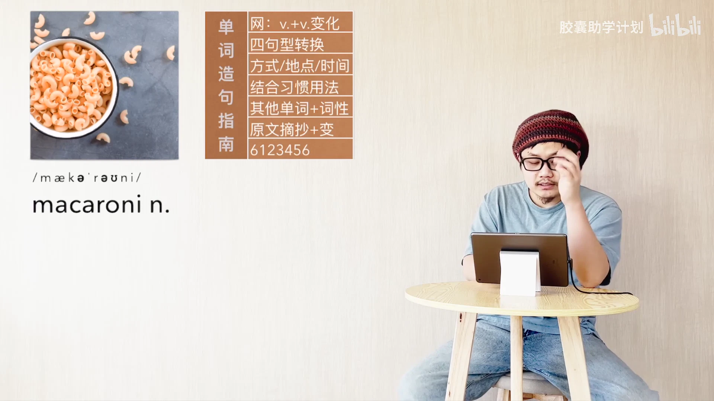

文字识别：单词造句指南 / 网：v.+v.变化 / 胶囊助学计划 / bilbili / 四句型转换 / 方式/地点/时间 / 结合习惯用法 / 其他单词+词性 / 原文摘抄+变 / 6123456 / /mæeka'rauni/ / macaroni n.

### 画面 00:05:10

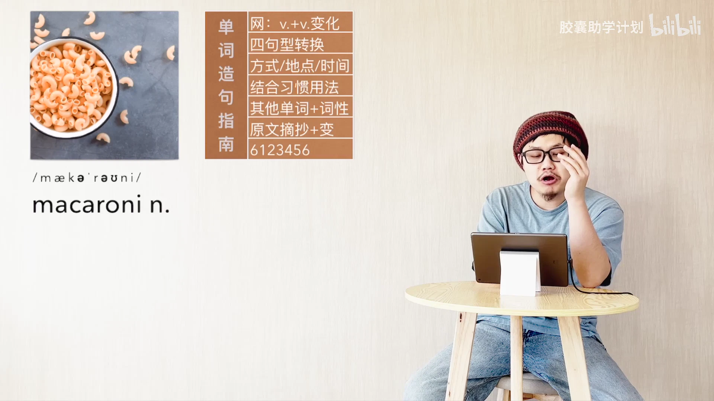

文字识别：单词造句指南 / 网：v.+v.变化 / 胶囊助学计划 / Bibili / 四句型转换 / 方式/地点/时间 / 结合习惯用法 / 其他单词+词性 / 原文摘抄+变 / 6123456 / /mæeka'rauni/ / macaroni n.

### 画面 00:05:13

文字识别：单词造句指南 / 网：v.+v.变化 / 胶囊助学计划 / bilbii / 四句型转换 / 方式/地点/时间 / 结合习惯用法 / 其他单词+词性 / 原文摘抄+变 / 6123456 / /mæeka'rauni/ / macaroni n.

### 画面 00:05:15

文字识别：单词造句指南 / 网：v.+v.变化 / 胶囊助学计划 / bibili / 四句型转换 / 方式/地点/时间 / 结合习惯用法 / 其他单词+词性 / 原文摘抄+变 / 6123456 / /mæeka'rauni/ / macaroni n.

### 画面 00:05:19

文字识别：单词造句指南 / 网：v.+v.变化 / 胶囊助学计划 / bilbii / 四句型转换 / 方式/地点/时间 / 结合习惯用法 / 其他单词+词性 / 原文摘抄+变 / 6123456 / /mæeka'rauni/ / macaroni n.

### 画面 00:05:21

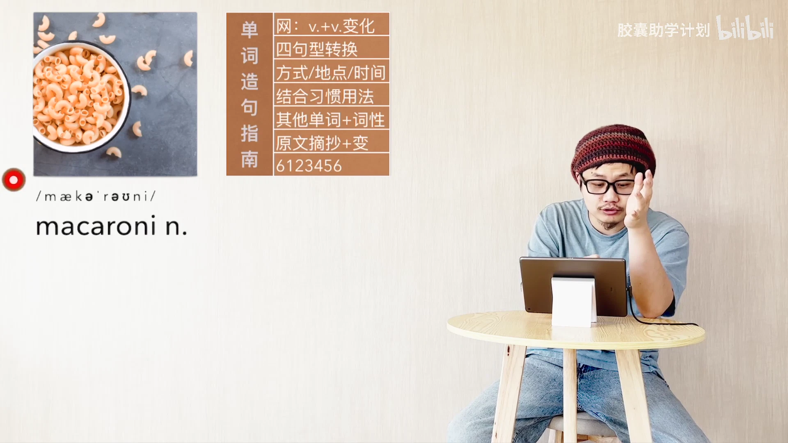

文字识别：单词造句指南 / 网：v.+v.变化 / 胶囊助学计划 / bibili / 四句型转换 / 方式/地点/时间 / 结合习惯用法 / 其他单词+词性 / 原文摘抄+变 / 6123456 / /mæeka'rauni/ / macaroni n.

### 画面 00:05:24

文字识别：单词造句指南 / 网：v.+v.变化 / 胶囊助学计划 / bibii / 四句型转换 / 方式/地点/时间 / 结合习惯用法 / 其他单词+词性 / 原文摘抄+变 / 6123456 / /maæeka'rauni/ / macaroni n.

### 画面 00:05:26

文字识别：单词造句指南 / 网：v.+v.变化 / 胶囊助学计划 / bibili / 四句型转换 / 方式/地点/时间 / 结合习惯用法 / 其他单词+词性 / 原文摘抄+变 / 6123456 / /mæeka'rauni/ / macaroni n.

### 画面 00:05:28

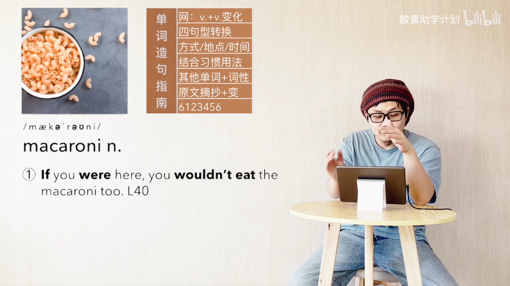

文字识别：单词造句指南 / 网：v.+v.变化 / 胶囊助学计划 / bilbii / 四句型转换 / 方式/地点/时间 / 结合习惯用法 / 其他单词+词性 / 原文摘抄+变 / 6123456 / /mæeka'rauni/ / macaroni n. / If you were here, you wouldn't eat the / macaroni too. L40

## 00:05:30–00:06:00

说If you were here, you wouldn't eat the macaroni too.说如果你在这儿，你也不会吃这个这个通心粉的，对吧？Okay, next one.说Please make yourself comfortable, and I will cook some macaroni for you.说哎，让你自己舒服一点，对吧？哎，让自己放松下来，make yourself comfortable.然后我给你做一些通心粉. Next one.说The macaroni my mom cooked last night was brilliant and put every macaroni to

### 画面 00:05:30

文字识别：单词造句指南 / 网：v.+v.变化 / 胶囊助学计划 / bilbili / 四句型转换 / 方式/地点/时间 / 结合习惯用法 / 其他单词+词性 / 原文摘抄+变 / 6123456 / /mæka'rauni/ / macaroni n. / If you were here, you wouldn't eat the / macaroni too. L40

### 画面 00:05:32

文字识别：单词造句指南 / 网：v.+v.变化 / 胶囊助学计划 / bibili / 四句型转换 / 方式/地点/时间 / 结合习惯用法 / 其他单词+词性 / 原文摘抄+变 / 6123456 / /mæka'rauni/ / macaroni n. / If you were here, you wouldn't eat the / macaroni too.L40

### 画面 00:05:35

文字识别：单词造句指南 / 网：v.+v.变化 / 胶囊助学计划 / bibili / 四句型转换 / 方式/地点/时间 / 结合习惯用法 / 其他单词+词性 / 原文摘抄+变 / 6123456 / /mæeka'rauni/ / macaroni n. / If you were here, you wouldn't eat the / macaroni too. L40

### 画面 00:05:38

文字识别：单词造句指南 / 网：v.+v.变化 / 胶囊助学计划 / bibii / 四句型转换 / 方式/地点/时间 / 结合习惯用法 / 其他单词+词性 / 原文摘抄+变 / 6123456 / /mæeka'rauni/ / macaroni n. / If you were here, you wouldn't eat the / macaroni too. L40

### 画面 00:05:40

文字识别：单词造句指南 / 网：v.+v.变化 / 胶囊助学计划ibl / 四句型转换 / 方式/地点/时间 / 结合习惯用法 / 其他单词+词性 / 原文摘抄+变 / 6123456 / /maæeka'rauni/ / macaroni n. / If you were here, you wouldn't eat the / macaroni too. L40 / Please make yourself comfortable, and I will / cook some macaroni for you. L74

### 画面 00:05:43

文字识别：胶囊助学计划biiil / 单词造句指南 / 网：v.+v.变化 / 四句型转换 / 方式/地点/时间 / 结合习惯用法 / 其他单词+词性 / 原文摘抄+变 / 6123456 / /mæeka'rauni/ / macaroni n. / If you were here, you wouldn't eat the / macaroni too.L40 / Please make yourself comfortable, and I will / cook some macaroni for you. L74

### 画面 00:05:45

文字识别：单词造句指南 / 网：v.+v.变化 / 胶囊助学计划 / bibii / 四句型转换 / 方式/地点/时间 / 结合习惯用法 / 其他单词+词性 / 原文摘抄+变 / 6123456 / /mæeka'rauni/ / macaroni n. / If you were here, you wouldn't eat the / macaroni too. L40 / Please make yourself comfortable, and I will / cook some macaroni for you. L74

### 画面 00:05:49

文字识别：单词造句指南 / 网：v.+v.变化 / 胶囊助学计划 / Bilbili / 四句型转换 / 方式/地点/时间 / 结合习惯用法 / 其他单词+词性 / 原文摘抄+变 / 6123456 / /mæeka'rauni/ / macaroni n. / If you were here, you wouldn't eat the / macaroni too. L40 / Please make yourself comfortable, and I will / cook some macaroni for you. L74

### 画面 00:05:51

文字识别：单词造句指南 / 网：v.+v.变化 / 胶囊助学计划 / bilbili / 四句型转换 / 方式/地点/时间 / 结合习惯用法 / 其他单词+词性 / 原文摘抄+变 / 6123456 / /mæeka'rauni/ / macaroni n. / If you were here, you wouldn't eat the / macaroni too. L40 / Please make yourself comfortable, and I will / cook some macaroni for you. L74

### 画面 00:05:53

文字识别：单词造句指南 / 网：v.+v.变化 / 胶囊助学计划 / bibii / 四句型转换 / 方式/地点/时间 / 结合习惯用法 / 其他单词+词性 / 原文摘抄+变 / 6123456 / /mæeka'rauni/ / macaroni n. / If you were here, you wouldn't eat the / macaroni too. L40 / Please make yourself comfortable, and I will / cook some macaroni for you. L74 / The macaroni (my mom cooked last night) / was brilliant and put every macaroni to / shame. L28 L73

### 画面 00:05:55

文字识别：胶囊助学计划bilil / 单词造句指南 / 网：v.+v.变化 / 四句型转换 / 方式/地点/时间 / 结合习惯用法 / 其他单词+词性 / 原文摘抄+变 / 6123456 / /mæeka'rauni/ / macaroni n. / If you were here, you wouldn't eat the / macaroni too. L40 / Please make yourself comfortable, and I will / cook some macaroni for you. L74 / The macaroni (my mom cooked last night) / was brilliant and put every macaroni to / shame. L28 L73

## 00:06:00–00:06:30

shame.哎，这里面连续用到了定语从句，对吧？我妈妈昨天晚上做的那个特别的棒。然后呢，是其他的所有通心粉都相形见绌了，对吧？哎，都不怎么地了，显得都很很一般了，对吧？Macaroni，通心粉。那注意力集中吧，咱听一下这个电影片段啊。I haven't liked macaroni and cheese since I was like ten. Very good. 下一个单词叫做 leading。那 leading 这个单词它是形容词，它很

### 画面 00:06:01

文字识别：胶囊助学计划ibil / 单词造句指南 / 网：v.+v.变化 / 四句型转换 / 方式/地点/时间 / 结合习惯用法 / 其他单词+词性 / 原文摘抄+变 / 6123456 / /mæeka'rauni/ / macaroni n. / If you were here, you wouldn't eat the / macaroni too. L40 / Please make yourself comfortable, and I will / cook some macaroni for you. L74 / The macaroni (my mom cooked last night) / was brilliant and put every macaroni to / shame. L28 L73

### 画面 00:06:07

文字识别：胶囊助学计划bibil / 单词造句指南 / 网：v.+v.变化 / 四句型转换 / 方式/地点/时间 / 结合习惯用法 / 其他单词+词性 / 原文摘抄+变 / 6123456 / /maæeka'rauni/ / macaroni n. / If you were here, you wouldn't eat the / macaroni too. L40 / Please make yourself comfortable, and I will / cook some macaroni for you. L74 / The macaroni (my mom cooked last night) / was brilliant and put every macaroni to / shame. L28 L73

### 画面 00:06:09

文字识别：单词造句指南 / 网：v.+v.变化 / 胶囊助学计划ilbil / 四句型转换 / 方式/地点/时间 / 结合习惯用法 / 其他单词+词性 / 原文摘抄+变 / 6123456 / /mæeka'rauni/ / macaroni n. / If you were here, you wouldn't eat the / macaroni too. L40 / Please make yourself comfortable, and I will / cook some macaroni for you. L74 / The macaroni (my mom cooked last night) / was brilliant and put every macaroni to / shame. L28 L73

### 画面 00:06:11

文字识别：单词造句指南 / 网：v.+v.变化 / 胶囊助学计划bilbil / 四句型转换 / 方式/地点/时间 / 结合习惯用法 / 其他单词+词性 / 原文摘抄+变 / 6123456 / /mæeka'rauni/ / macaroni n. / If you were here, you wouldn't eat the / macaroni too. L40 / Please make yourself comfortable, and I will / cook some macaroni for you. L74 / The macaroni (my mom cooked last night) / was brilliant and put every macaroni to / shame. L28 L73

### 画面 00:06:15

文字识别：biibii / 胶囊助学计划 / I haven't liked macaroni and cheese / since I was like ten. / 50/50 / (2011)

### 画面 00:06:23

文字识别：biibili / 胶囊助学计划 / I haven't liked macaroni and cheese / since I was like ten. / 50/50 / (2011)

### 画面 00:06:25

文字识别：单词造句指南 / 网：v.+v.变化 / 胶囊助学计划 / bilbili / 四句型转换 / 方式/地点/时间 / 结合习惯用法 / 其他单词+词性 / 原文摘抄+变 / 6123456 / /  li:din/ / leading adj. + / cause(s)

### 画面 00:06:27

文字识别：单词造句指南 / 网：v.+v.变化 / 胶囊助学计划 / bilbi / 四句型转换 / 方式/地点/时间 / 结合习惯用法 / 其他单词+词性 / 原文摘抄+变 / 6123456 / /  li:din/ / leading adj. + / cause(s)

## 00:06:30–00:07:00

Transcribe the exact words in their original spoken languages. Never translate. Preserve repetitions, questions and examples. Leading这个单词它是形容词，它很常见的和这个cause会连到一起，叫做主要的原因啊，首当其冲的原因，对吧？Leading就像这个图中红色小人一样，主要的，首当其冲的leading cause。比如说，我们可以造一句话叫Smoking is one of the leading causes of lung cancer啊。所以说，抽烟呢是最主要的什么的主要原因呢？哎，肺癌的最主要的原因啊。那这实际上这个smoking之所以加ing是

### 画面 00:06:30

文字识别：单词造句指南 / 网：v.+v.变化 / 胶囊助学计划 / bilbi / 四句型转换 / 方式/地点/时间 / 结合习惯用法 / 其他单词+词性 / 原文摘抄+变 / 6123456 / / li:din/ / leading adj. + / cause(s)

### 画面 00:06:34

文字识别：单词造句指南 / 网：v.+v.变化 / 胶囊助学计划 / bilbi / 四句型转换 / 方式/地点/时间 / 结合习惯用法 / 其他单词+词性 / 原文摘抄+变 / 6123456 / / li:din/ / leading adj. + / cause(s)

### 画面 00:06:36

文字识别：单词造句指南 / 网：v.+v.变化 / 胶囊助学计划 / bibii / 四句型转换 / 方式/地点/时间 / 结合习惯用法 / 其他单词+词性 / 原文摘抄+变 / 6123456 / /li:drn/ / leading adj. + / cause(s)

### 画面 00:06:39

文字识别：单词造句指南 / 网：v.+v.变化 / 胶囊助学计划 / bilbii / 四句型转换 / 方式/地点/时间 / 结合习惯用法 / 其他单词+词性 / 原文摘抄+变 / 6123456 / / li:din/ / leading adj. + / cause(s)

### 画面 00:06:41

文字识别：单词造句指南 / 网：v.+v.变化 / 胶囊助学计划 / bilbii / 四句型转换 / 方式/地点/时间 / 结合习惯用法 / 其他单词+词性 / 原文摘抄+变 / 6123456 / / li:din/ / leading adj. + / cause(s)

### 画面 00:06:43

文字识别：单词造句指南 / 网：v.+v.变化 / 胶囊助学计划 / bibili / 四句型转换 / 方式/地点/时间 / 结合习惯用法 / 其他单词+词性 / 原文摘抄+变 / 6123456 / / li:din/ / leading adj. + / cause(s) / Smoking is one of the leading causes / of lung cancer. L20

### 画面 00:06:45

文字识别：单词造句指南 / 网：v.+v.变化 / 胶囊助学计划 / bilbi / 四句型转换 / 方式/地点/时间 / 结合习惯用法 / 其他单词+词性 / 原文摘抄+变 / 6123456 / / li:din/ / leading adj. + / cause(s) / Smoking is one of the leading causes / of lung cancer. L20

### 画面 00:06:50

文字识别：单词造句指南 / 网：v.+v.变化 / 胶囊助学计划 / bibi / 四句型转换 / 方式/地点/时间 / 结合习惯用法 / 其他单词+词性 / 原文摘抄+变 / 6123456 / / .li:din/ / leading adj. + / cause(s) / Smoking is one of the leading causes / of lung cancer. L20

### 画面 00:06:56

文字识别：单词造句指南 / 网：v.+v.变化 / 胶囊助学计划 / bilbii / 四句型转换 / 方式/地点/时间 / 结合习惯用法 / 其他单词+词性 / 原文摘抄+变 / 6123456 / / li:din/ / leading adj. + / cause(s) / Smoking is one of the leading causes / of lung cancer. L20

### 画面 00:06:58

文字识别：胶囊助学计划bibi / 单词造句指南 / 网：v.+v.变化 / 四句型转换 / 方式/地点/时间 / 结合习惯用法 / 其他单词+词性 / 原文摘抄+变 / 6123456 / /  li:din/ / leading adj. + cause(s) / 1 / 6moking is one of the leading causes / of lung cancer. L20 / Breast cancer is the leading cause of death / for American women in their forties.

## 00:07:00–00:07:30

二十个咱们学的动名词。 Next one, say breast cancer is the leading cause of death for American women in their forties. So, uh, this this breast cancer, right? Is the main cause of death, the main cause of death for American women in their forties. So, uh, this this breast cancer, right? Is the main cause of death, the main cause of death for American women in their forties. So, uh, this this breast cancer, right? Is the main cause of death, the main cause of death for American women in their forties. So, uh, this this breast cancer, right? Is the main cause of death, the main

### 画面 00:07:00

文字识别：单词造句指南 / 网：v.+v.变化 / 胶囊助学计划 / biibii / 四句型转换 / 方式/地点/时间 / 结合习惯用法 / 其他单词+词性 / 原文摘抄+变 / 6123456 / /  li:din/ / leading adj. + cause(s) / Smoking is one of the leading causes / of lung cancer. L20 / Breast cancer is the leading Cause of death / for American women in their forties.

### 画面 00:07:04

文字识别：胶囊助学计划bibi / 单词造句指南 / 网：v.+v.变化 / 四句型转换 / 方式/地点/时间 / 结合习惯用法 / 其他单词+词性 / 原文摘抄+变 / 6123456 / / li:din/ / leading adj. + cause(s) / Smoking is one of the leading causes / of lung cancer. L20 / Breast cancer is the leading cause of death / for American women in their forties.

### 画面 00:07:06

文字识别：胶囊助学计划bilil / 单词造句指南 / 网：v.+v.变化 / 四句型转换 / 方式/地点/时间 / 结合习惯用法 / 其他单词+词性 / 原文摘抄+变 / 6123456 / / 'li:din/ / leading adj. + cause(s) / Smoking is one of the leading causes / of lung cancer. L20 / Breast cancer is the leading cause of death / for American women in their forties.

### 画面 00:07:10

文字识别：单词造句指南 / 网：v.+v.变化 / 胶囊助学计划 / bibii / 四句型转换 / 方式/地点/时间 / 结合习惯用法 / 其他单词+词性 / 原文摘抄+变 / 6123456 / / li:din/ / leading adj. + cause(s) / Smoking is one of the leading causes / of lung cancer. L20 / Breast cancer is the leading cause of death / for American women in their forties.

### 画面 00:07:13

文字识别：胶囊助学计划bli / 单词造句指南 / 网：v.+v.变化 / 四句型转换 / 方式/地点/时间 / 结合习惯用法 / 其他单词+词性 / 原文摘抄+变 / 6123456 / /  li:din/ / leading adj. + cause(s) / Smoking is one of the leading causes / of lung cancer. L20 / Breast cancer is the leading Cause of death / for American women in their forties.

### 画面 00:07:15

文字识别：单词造句指南 / 网：v.+v.变化 / 胶囊助学计划 / bibi / 四句型转换 / 方式/地点/时间 / 结合习惯用法 / 其他单词+词性 / 原文摘抄+变 / 6123456 / / li:din/ / leading adj. + cause(s) / Smoking is one of the leading causes / of lung cancer. L20 / Breast cancer is the leading causeOf death / for American women in their forties.

### 画面 00:07:20

文字识别：单词造句指南 / 网：v.+v.变化 / 胶囊助学计划ibi / 四句型转换 / 方式/地点/时间 / 结合习惯用法 / 其他单词+词性 / 原文摘抄+变 / 6123456 / / .li:drn/ / leading adj. + cause(s) / Smoking is one of the leading causes / of lung cancer. L20 / Breast cancer is the leading cause of death / for American women in their forties.

### 画面 00:07:22

文字识别：单词造句指南 / 网：v.+v.变化 / 胶囊助学计划 / bilbili / 四句型转换 / 方式/地点/时间 / 结合习惯用法 / 其他单词+词性 / 原文摘抄+变 / 6123456 / /.li:din/ / leading adj. + cause(s) / Smoking is one of the leading causes / of lung cancer. L20 / Breast cancer is the leading cause of death / for American women in their forties.

### 画面 00:07:25

文字识别：单词造句指南 / 网：v.+v.变化 / 胶囊助学计划bilbil / 四句型转换 / 方式/地点/时间 / 结合习惯用法 / 其他单词+词性 / 原文摘抄+变 / 6123456 / /  li:din/ / leading adj. + cause(s) / Smoking is one of the leading causes / of lung cancer. L20 / Breast cancer is the leading cause of death / for American women in their forties.

### 画面 00:07:28

文字识别：单词造句指南 / 网：v.+v.变化 / 胶囊助学计划ibi / 四句型转换 / 方式/地点/时间 / 结合习惯用法 / 其他单词+词性 / 原文摘抄+变 / 6123456 / /  li:drn/ / leading adj. + cause(s) /  Smoking is one of the leading causes / of lung cancer. L20 / Breast cancer is the leading cause of death / for American women in their forties. / My father became a leading authority on / 3 / volcanoes.

## 00:07:30–00:08:00

说，My father became a leading authority on volcanoes. 说我父亲呢变成了一个什么呢？ Leading authority，哎，一个非常主要的权威啊，在哎这个火山这件事情上。 OK，那再读一遍这个单词，leading， very good。 那接下来呢，咱们这个看一下一个电影片段啊，说这个离婚的主要原因很多都是因为孩子。 OK， Did you know that the leading

### 画面 00:07:30

文字识别：单词造句指南 / 网：v.+v.变化 / 胶囊助学计划ibl / 四句型转换 / 方式/地点/时间 / 结合习惯用法 / 其他单词+词性 / 原文摘抄+变 / 6123456 / /  li:din/ / leading adj. + cause(s) / Smoking is one of the leading causes / of lung cancer. L20 / Breast cancer is the leading cause of death / for American women in their forties. / My father became a leading authority on / volcanoes.

### 画面 00:07:34

文字识别：胶囊助学计划bibi / 单词造句指南 / 网：v.+v.变化 / 四句型转换 / 方式/地点/时间 / 结合习惯用法 / 其他单词+词性 / 原文摘抄+变 / 6123456 / /  li:drn/ / leading adj. +cause(s) / Smoking is one of the leading causes / of lung cancer. L20 / Breast cancer is the leading cause of death / for American women in their forties. / My father became a leading authority on / 3 / volcanoes.

### 画面 00:07:36

文字识别：胶囊助学计划bii / 单词造句指南 / 网：v.+v.变化 / 四句型转换 / 方式/地点/时间 / 结合习惯用法 / 其他单词+词性 / 原文摘抄+变 / 6123456 / /  li:drn/ / leading adj. +cause(s) / Smoking is one of the leading causes / of lung cancer. L20 / Breast cancer is the leading cause of death / for American women in their forties. / My father became a leading authority on / 3 / volcanoes.

### 画面 00:07:40

文字识别：胶囊助学计划bilbil / 单词造句指南 / 网：v.+v.变化 / 四句型转换 / 方式/地点/时间 / 结合习惯用法 / 其他单词+词性 / 原文摘抄+变 / 6123456 / /  li:drn/ / leading adj. +cause(s) / Smoking is one of the leading causes / of lung cancer. L20 / Breast cancer is the leading cause of death / for American women in their forties. / My father became a leading authority on / 3 / volcanoes.

### 画面 00:07:47

文字识别：胶囊助学计划bilbil / 单词造句指南 / 网：v.+v.变化 / 四句型转换 / 方式/地点/时间 / 结合习惯用法 / 其他单词+词性 / 原文摘抄+变 / 6123456 / /  li:drn/ / leading adj. +cause(s) / Smoking is one of the leading causes / of lung cancer. L20 / Breast cancer is the leading cause of death / for American women in their forties. / My father became a leading authority on / volcanoes.

### 画面 00:07:49

文字识别：bilbili / 胶囊助学计划 / Did you know that the leading cause / of divorce is children? / Bad Milo / (2013)

## 00:08:00–00:08:30

cause of divorce is children? Very good. 下一个单词叫 grower. 哎， grower 这个单词依旧很有意思。我觉得如果你认识 grow，那 grower 这个单词应该就瞬间会了。 grow 种植加 er 表示做这件事的人，对吧？比如说， as a vegetable grower，作为一个蔬菜的种植者。 He is busy with his land all the time. 他总是在忙着

### 画面 00:08:00

文字识别：胶囊助学计划bibil / Did you know that the leading cause / of divorce is children? / Bad Milo / (2013)

### 画面 00:08:02

文字识别：胶囊助学计划 / Did you know that the leading cause / of divorce is children? / Bad Milo / (2013)

### 画面 00:08:04

文字识别：单词造句指南 / 网：v.+v.变化 / 胶囊助学计划 / bilbil / 四句型转换 / 方式/地点/时间 / 结合习惯用法 / 其他单词+词性 / 原文摘抄+变 / 6123456 / /graua/ / grower n.

### 画面 00:08:06

文字识别：单词造句指南 / 网：v.+v.变化 / 胶囊助学计划 / bilbil / 四句型转换 / 方式/地点/时间 / 结合习惯用法 / 其他单词+词性 / 原文摘抄+变 / 6123456 / /graua/ / grower n.

### 画面 00:08:10

文字识别：单词造句指南 / 网：v.+v.变化 / 胶囊助学计划 / bilbili / 四句型转换 / 方式/地点/时间 / 结合习惯用法 / 其他单词+词性 / 原文摘抄+变 / 6123456 / /graua/ / grower n.

### 画面 00:08:15

文字识别：单词造句指南 / 网：v.+v.变化 / 胶囊助学计划 / biibii / 四句型转换 / 方式/地点/时间 / 结合习惯用法 / 其他单词+词性 / 原文摘抄+变 / 6123456 / /grａua/ / grower n.

### 画面 00:08:18

文字识别：单词造句指南 / 网：v.+v.变化 / 胶囊助学计划 / bilbil / 四句型转换 / 方式/地点/时间 / 结合习惯用法 / 其他单词+词性 / 原文摘抄+变 / 6123456 / /'graua/ / grower n. / ① As a vegetable grower, he is busy with his / land all the time. L70

### 画面 00:08:20

文字识别：单词造句指南 / 网：v.+v.变化 / 胶囊助学计划 / bilbii / 四句型转换 / 方式/地点/时间 / 结合习惯用法 / 其他单词+词性 / 原文摘抄+变 / 6123456 / /'graua/ / grower n. / ① As a vegetable groger, he is busy with his / land all the time. L70

### 画面 00:08:25

文字识别：单词造句指南 / 网：v.+v.变化 / 胶囊助学计划 / bilbil / 四句型转换 / 方式/地点/时间 / 结合习惯用法 / 其他单词+词性 / 原文摘抄+变 / 6123456 / /graua/ / grower n. / ① As a vegetable grower, he is busy with his / land all the time. L70

## 00:08:30–00:09:00

land. Ah, as a vegetable grower. Next one, my father would do anything to prevent me from becoming a vegetable grower. Ah, in our Confucian culture, this is a very common thing, right? Ah, uh, all things are inferior, only reading is high. You have read so many books, and then you go back to farming. Even if you are actually starting a business, uh, maybe some of the older generations will do this. Something called would do anything to prevent

### 画面 00:08:31

文字识别：单词造句指南 / 网：v.+v.变化 / 胶囊助学计划 / bilbi / 四句型转换 / 方式/地点/时间 / 结合习惯用法 / 其他单词+词性 / 原文摘抄+变 / 6123456 / /'graua/ / grower n. / ① As a vegetable grower, he is busy with his / land all the time. L70

### 画面 00:08:33

文字识别：单词造句指南 / 网：v.+v.变化 / 胶囊助学计划 / Bilbli / 四句型转换 / 方式/地点/时间 / 结合习惯用法 / 其他单词+词性 / 原文摘抄+变 / 6123456 / /grａua/ / grower n. / ① As a vegetable grower, he is busy with his / land all the time. L70 / My father would do anything to prevent me / from becoming a vegetable grower. L68

### 画面 00:08:35

文字识别：单词造句指南 / 网：v.+v.变化 / 胶囊助学计划 / bilbil / 四句型转换 / 方式/地点/时间 / 结合习惯用法 / 其他单词+词性 / 原文摘抄+变 / 6123456 / /graua/ / grower n. / ① As a vegetable grower, he is busy with his / land all the time. L70 / My father would do anything to prevent me / from becoming a vegetable grower. L68

### 画面 00:08:43

文字识别：单词造句指南 / 网：v.+v.变化 / 胶囊助学计划 / bilbii / 四句型转换 / 方式/地点/时间 / 结合习惯用法 / 其他单词+词性 / 原文摘抄+变 / 6123456 / /graua/ / grower n. / ① As a vegetable grower, he is busy with his / land all the time. L70 / My father would do anything to prevent me / from becoming a vegetable grower. L68

### 画面 00:08:45

文字识别：单词造句指南 / 网：v.+v.变化 / 胶囊助学计划 / Bibi / 四句型转换 / 方式/地点/时间 / 结合习惯用法 / 其他单词+词性 / 原文摘抄+变 / 6123456 / /'graua/ / grower n. / ① As a vegetable grower, he is busy with his / land all the time. L70 / My father would do anything to prevent me / from becoming a vegetable grower. L68

### 画面 00:08:51

文字识别：单词造句指南 / 网：v.+v.变化 / 胶囊助学计划 / bilbl / 四句型转换 / 方式/地点/时间 / 结合习惯用法 / 其他单词+词性 / 原文摘抄+变 / 6123456 / /graua/ / grower n. / ① As a vegetable grower, he is busy with his / land all the time. L70 / My father would do anything to prevent me / from becoming a vegetable grower. L68

### 画面 00:08:53

文字识别：单词造句指南 / 网：v.+v.变化 / 胶囊助学计划 / bitbili / 四句型转换 / 方式/地点/时间 / 结合习惯用法 / 其他单词+词性 / 原文摘抄+变 / 6123456 / /graua/ / grower n. / ① As a vegetable grower, he is busy with his / land all the time. L70 / My father would do anything to prevent me / from becoming a vegetable grower. L68

### 画面 00:08:56

文字识别：bibili / 单词造句指南 / 网：v.+v.变化 / 胶囊助学计划 / 四句型转换 / 方式/地点/时间 / 结合习惯用法 / 其他单词+词性 / 原文摘抄+变 / 6123456 / /'graua/ / grower n. / ① As a vegetable grower, he is busy with his / land all the time. L70 / My father would do anything to prevent me / from becoming a vegetable grower. L68

## 00:09:00–00:09:30

me from becoming a vegetable grower. Ah,一说孩子出去上大学，回来又回来种地了。啊，这事儿好像乍一听有点丢人。所以 prevent me from becoming. Okay. Ah,这是儒家文化一个特点，万般皆下品，唯有读书高。啊，Next one. So the vegetable grower,哎，蔬菜种植者managed to set up his camp under the tree.这没什么可说的。六十七课manage to do,然后set up somebody's camp,建立了一个营地。啊，

### 画面 00:09:00

文字识别：单词造句指南 / 网：v.+v.变化 / 胶囊助学计划 / bibii / 四句型转换 / 方式/地点/时间 / 结合习惯用法 / 其他单词+词性 / 原文摘抄+变 / 6123456 / /graua/ / grower n. / ① As a vegetable grower, he is busy with his / land all the time. L70 / My father would do anything to prevent me / from becoming a vegetable grower. L68

### 画面 00:09:04

文字识别：单词造句指南 / 网：v.+v.变化 / 胶囊助学计划 / bibii / 四句型转换 / 方式/地点/时间 / 结合习惯用法 / 其他单词+词性 / 原文摘抄+变 / 6123456 / /graua/ / grower n. / ① As a vegetable grower, he is busy with his / land all the time. L70 / My father would do anything to prevent me / from becoming a vegetable grower. L68

### 画面 00:09:06

文字识别：单词造句指南 / 网：v.+v.变化 / 胶囊助学计划 / bilibii / 四句型转换 / 方式/地点/时间 / 结合习惯用法 / 其他单词+词性 / 原文摘抄+变 / 6123456 / /graua/ / grower n. / ① As a vegetable grower, he is busy with his / land all the time. L70 / My father would do anything to prevent me / from becoming a vegetable grower. L68

### 画面 00:09:10

文字识别：单词造句指南 / 网：v.+v.变化 / 胶囊助学计划 / Biltbii / 四句型转换 / 方式/地点/时间 / 结合习惯用法 / 其他单词+词性 / 原文摘抄+变 / 6123456 / /graua/ / grower n. / ① As a vegetable grower, he is busy with his / land all the time. L70 / My father would do anything to prevent me / from becoming a vegetable grower. L68

### 画面 00:09:13

文字识别：单词造句指南 / 网：v.+v.变化 / 胶囊助学计划 / Bilbil / 四句型转换 / 方式/地点/时间 / 结合习惯用法 / 其他单词+词性 / 原文摘抄+变 / 6123456 / /graua/ / grower n. / ① As a vegetable grower, he is busy with his / land all the time. L70 / My father would do anything to prevent me / 2 / from becoming a vegetable grower. L68 / The vegetable grower managed to set up / his camp under the tree. L67

### 画面 00:09:15

文字识别：胶囊助学计划Lilbil / 单词造句指南 / 网：v.+v.变化 / 四句型转换 / 方式/地点/时间 / 结合习惯用法 / 其他单词+词性 / 原文摘抄+变 / 6123456 / /graua/ / grower n. / ① As a vegetable grower, he is busy with his / land all the time. L70 / My father would do anything to prevent me / 2 / from becoming a vegetable grower. L68 / The vegetable grower managed to set up / his camp under the tree. L67

### 画面 00:09:19

文字识别：胶囊助学计划bib / 单词造句指南 / 网：v.+v.变化 / 四句型转换 / 方式/地点/时间 / 结合习惯用法 / 其他单词+词性 / 原文摘抄+变 / 6123456 / /graua/ / grower n. / ① As a vegetable grower, he is busy with his / land all the time. L70 / My father would do anything to prevent me / from becoming a vegetable grower. L68 / The vegetable grower managed to set up / his camp under the tree. L67

### 画面 00:09:21

文字识别：胶囊助学计划biii / 单词造句指南 / 网：v.+v.变化 / 四句型转换 / 方式/地点/时间 / 结合习惯用法 / 其他单词+词性 / 原文摘抄+变 / 6123456 / /'graual / grower n. / ① As a vegetable grower, he is busy with his / land all the time. L70 / My father would do anything to prevent me / 2 / from becoming a vegetable grower. L68 / The vegetable grower managed to set up / his camp under the tree. L67

### 画面 00:09:24

文字识别：单词造句指南 / 网：v.+v.变化 / 胶囊助学计划bibil / 四句型转换 / 方式/地点/时间 / 结合习惯用法 / 其他单词+词性 / 原文摘抄+变 / 6123456 / /graual / grower n. / ① As a vegetable grower, he is busy with his / land all the time. L70 / My father would do anything to prevent me / from becoming a vegetable grower. L68 / The vegetable grower managed to set up / his camp under the tree.67

### 画面 00:09:26

文字识别：胶囊助学计划Libil / 单词造句指南 / 网：v.+v.变化 / 四句型转换 / 方式/地点/时间 / 结合习惯用法 / 其他单词+词性 / 原文摘抄+变 / 6123456 / /graua/ / grower n. / ① As a vegetable grower, he is busy with his / land all the time. L70 / My father would do anything to prevent me / from becoming a vegetable grower. L68 / The vegetable grower managed to set up / his camp under the tree. L67

### 画面 00:09:29

文字识别：胶囊助学计划bibl / 单词造句指南 / 网：v.+v.变化 / 四句型转换 / 方式/地点/时间 / 结合习惯用法 / 其他单词+词性 / 原文摘抄+变 / 6123456 / /graual / grower n. / ① As a vegetable grower, he is busy with his / land all the time. L70 / My father would do anything to prevent me / from becoming a vegetable grower. L68 / The vegetable grower managed to set up / his camp under the tree. L67

## 00:09:30–00:10:00

再读一遍那个单词 grower。Next one，下一个单词啊，splendid，splendid。我记得有一些年，好像中国有一个呃，我叫什么什么环传是吧？叫我不说全名了，这个应该很多人知道啊。我印象当中有一段网络用语，总说那个什么什么是极好的是吧？splendid是吧？哎，极好的主意，splendid idea，极好的呃这个例子，

### 画面 00:09:31

文字识别：单词造句指南 / 网：v.+v.变化 / 胶囊助学计划 / bibii / 四句型转换 / 方式/地点/时间 / 结合习惯用法 / 其他单词+词性 / 原文摘抄+变 / 6123456 / /'graua/ / grower n. / ① As a vegetable grower, he is busy with his / land all the time. L70 / My father would do anything to prevent me / from becoming a vegetable grower. L68 / The vegetable grower managed to set up / his camp under the tree. L67

### 画面 00:09:33

文字识别：单词造句指南 / 网：v.+v.变化 / 胶囊助学计划 / biibii / 四句型转换 / 方式/地点/时间 / 结合习惯用法 / 其他单词+词性 / 原文摘抄+变 / 6123456 / /'splendid/ / splendid adj. + idea/example/view/garden..

### 画面 00:09:35

文字识别：单词造句指南 / 网：v.+v.变化 / 胶囊助学计划 / bilbili / 四句型转换 / 方式/地点/时间 / 结合习惯用法 / 其他单词+词性 / 原文摘抄+变 / 6123456 / / 'splendid/ / splendid adj. + idea/example/view/garden..

### 画面 00:09:40

文字识别：单词造句指南 / 网：v.+v.变化 / 胶囊助学计划 / Bilbii / 四句型转换 / 方式/地点/时间 / 结合习惯用法 / 其他单词+词性 / 原文摘抄+变 / 6123456 / /'splendid/ / splendid adj. + idea/example/view/garden..

### 画面 00:09:45

文字识别：单词造句指南 / 网：v.+v.变化 / 胶囊助学计划 / bibii / 四句型转换 / 方式/地点/时间 / 结合习惯用法 / 其他单词+词性 / 原文摘抄+变 / 6123456 / /'splendid/ / splendid adj. + idea/example/view/garden..

### 画面 00:09:50

文字识别：单词造句指南 / 网：v.+v.变化 / 胶囊助学计划 / bilbii / 四句型转换 / 方式/地点/时间 / 结合习惯用法 / 其他单词+词性 / 原文摘抄+变 / 6123456 / / 'splendid/ / splendid adj. + idea/example/view/garden..

### 画面 00:09:55

文字识别：单词造句指南 / 网：v.+v.变化 / 胶囊助学计划 / bilbili / 四句型转换 / 方式/地点/时间 / 结合习惯用法 / 其他单词+词性 / 原文摘抄+变 / 6123456 / / 'splendid/ / splendid adj. + idea/example/view/garden..

### 画面 00:09:59

文字识别：单词造句指南 / 网：v.+v.变化 / 胶囊助学计划 / Bibili / 四句型转换 / 方式/地点/时间 / 结合习惯用法 / 其他单词+词性 / 原文摘抄+变 / 6123456 / /'splendid/ / splendid adj. + idea/example/view/garden..

## 00:10:00–00:10:30

splendid example 啊，view 观点 garden 花园，哎，小主什么什么是极好的 splendid。我们造个句子，比如说你这是一个极好的主意，what a splendid idea。在讲 brilliant 这个单词的时候，我希望你还记得是吧？我们当时造了一个句子叫 what a brilliant idea，其实意思差不多。 Okay， next one，说 I've noticed that you have a splendid garden。我注意到你有一个非常棒的院子。

### 画面 00:10:03

文字识别：单词造句指南 / 网：v.+v.变化 / 胶囊助学计划 / Bibii / 四句型转换 / 方式/地点/时间 / 结合习惯用法 / 其他单词+词性 / 原文摘抄+变 / 6123456 / /'splendid/ / splendid adj. + idea/example/view/garden..

### 画面 00:10:06

文字识别：单词造句指南 / 网：v.+v.变化 / 胶囊助学计划 / bilbili / 四句型转换 / 方式/地点/时间 / 结合习惯用法 / 其他单词+词性 / 原文摘抄+变 / 6123456 / /'splendid/ / splendid adj. + idea/example/view/garden..

### 画面 00:10:09

文字识别：单词造句指南 / 网：v.+v.变化 / 胶囊助学计划 / blbii / 四句型转换 / 方式/地点/时间 / 结合习惯用法 / 其他单词+词性 / 原文摘抄+变 / 6123456 / /'splendid/ / splendid adj. + idea/exampl/view/garden… / ①What a splendid/brilliant idea!

### 画面 00:10:11

文字识别：单词造句指南 / 网：v.+v.变化 / 胶囊助学计划 / biibii / 四句型转换 / 方式/地点/时间 / 结合习惯用法 / 其他单词+词性 / 原文摘抄+变 / 6123456 / /'splendid/ / splendid adj. + idea/example/view/garden.… / What a splendid/brilliant idea!

### 画面 00:10:13

文字识别：单词造句指南 / 网：v.+v.变化 / 胶囊助学计划 / biibli / 四句型转换 / 方式/地点/时间 / 结合习惯用法 / 其他单词+词性 / 原文摘抄+变 / 6123456 / /'splendid/ / splendid adj. + idea/example/view/garden.… / ① What a splendid/brilliant idea!

### 画面 00:10:16

文字识别：单词造句指南 / 网：v.+v.变化 / 胶囊助学计划 / Bibii / 四句型转换 / 方式/地点/时间 / 结合习惯用法 / 其他单词+词性 / 原文摘抄+变 / 6123456 / /'splendid/ / splendid adj. + idea/example/view/garden.… / ① What a splendid/brilliant idea!

### 画面 00:10:20

文字识别：单词造句指南 / 网：v.+v.变化 / 胶囊助学计划 / Bibili / 四句型转换 / 方式/地点/时间 / 结合习惯用法 / 其他单词+词性 / 原文摘抄+变 / 6123456 / /'splendid/ / splendid adj. + idea/example/view/garden. / ① What a splendid/brilliant idea!

### 画面 00:10:23

文字识别：单词造句指南 / 网：v.+v.变化 / 胶囊助学计划 / bilbili / 四句型转换 / 方式/地点/时间 / 结合习惯用法 / 其他单词+词性 / 原文摘抄+变 / 6123456 / /'splendid/ / splendid adj. + idea/example/view/garden.. / ① What a splendid/brilliant idea! / l've noticed that you have a splendid / garden. L67

### 画面 00:10:25

文字识别：单词造句指南 / 网：v.+v.变化 / 胶囊助学计划 / bilibii / 四句型转换 / 方式/地点/时间 / 结合习惯用法 / 其他单词+词性 / 原文摘抄+变 / 6123456 / /'splendid/ / splendid adj. + idea/example/view/garde.. / ① What a splendid/brilliant idea! / l've noticed that you have a splendid / garden. L67

## 00:10:30–00:11:00

Continue,说I'm really happy to work for such a splendid company.说我非常的开心去为如此棒哎如此好的一个splendid company如此棒的一个公司去工作。Work for什么什么company或work for somebody.第四课咱们学的啊，再读一遍这个单词splendid. Next one, stock. Stock这个东西呢，就是那个梗啊。这个我

### 画面 00:10:30

文字识别：单词造句指南 / 网：v.+v.变化 / 胶囊助学计划 / bilbili / 四句型转换 / 方式/地点/时间 / 结合习惯用法 / 其他单词+词性 / 原文摘抄+变 / 6123456 / /'splendid/ / splendid adj. + idea/example/view/garden. / ① What a splendid/brilliant idea! /  I've noticed that you have a splendid / 2 / garden. L67 /  I'm really happy to work for such a splendid / 3 / company. L4

### 画面 00:10:33

文字识别：胶囊助学计划ilbi / 单词造句指南 / 网：v.+v.变化 / 四句型转换 / 方式/地点/时间 / 结合习惯用法 / 其他单词+词性 / 原文摘抄+变 / 6123456 / /splendid/ / splendid adj. + idea/example/view/garden. / ① What a splendid/brilliant idea! /  I've noticed that you have a splendid / 2 / garden. L67 /  I'm really happy to work for such a splendid / company. L4

### 画面 00:10:36

文字识别：胶囊助学计划bibil / 单词造句指南 / 网：v.+v.变化 / 四句型转换 / 方式/地点/时间 / 结合习惯用法 / 其他单词+词性 / 原文摘抄+变 / 6123456 / / splendid / / splendid adj. + idea/example/view/garden. / ① What a splendid/brilliant idea! /  I've noticed that you have a splendid / 2 / garden. L67 /  I'm really happy to work for such a splendid / 3 / company. L4

### 画面 00:10:40

文字识别：胶囊助学计划bilbili / 单词造句指南 / 网：v.+v.变化 / 四句型转换 / 方式/地点/时间 / 结合习惯用法 / 其他单词+词性 / 原文摘抄+变 / 6123456 / /'splendid/ / splendid adj. + idea/example/view/garden. / ① What a splendid/brilliant idea! /  I've noticed that you have a splendid / 2 / garden. L67 /  I'm really happy to work for such a splendid / company. L4

### 画面 00:10:45

文字识别：胶囊助学计划bibil / 单词造句指南 / 网：v.+v.变化 / 四句型转换 / 方式/地点/时间 / 结合习惯用法 / 其他单词+词性 / 原文摘抄+变 / 6123456 / / 'splendid/ / splendid adj. + idea/example/view/garden…. / ① What a splendid/brilliant idea! /  I've noticed that you have a splendid / 2 / garden. L67 /  I'm really happy to work for such a splendid / 3 / company. L4

### 画面 00:10:50

文字识别：胶囊助学计划li / 单词造句指南 / 网：v.+v.变化 / 四句型转换 / 方式/地点/时间 / 结合习惯用法 / 其他单词+词性 / 原文摘抄+变 / 6123456 / /'splendid/ / splendid adj. + idea/example/view/garden. / ① What a splendid/brilliant idea! /  I've noticed that you have a splendid / 2 / garden. L67 /  I'm really happy to work for such a splendid / 3 / company. L4

### 画面 00:10:54

文字识别：单词造句指南 / 网：v.+v.变化 / 胶囊助学计划 / bilbil / 四句型转换 / 方式/地点/时间 / 结合习惯用法 / 其他单词+词性 / 原文摘抄+变 / 6123456 / /sto:k/ / stalk n.

### 画面 00:10:59

文字识别：单词造句指南 / 网：v.+v.变化 / 胶囊助学计划 / bilbili / 四句型转换 / 方式/地点/时间 / 结合习惯用法 / 其他单词+词性 / 原文摘抄+变 / 6123456 / /sto:k/ / stalk n.

## 00:11:00–00:11:30

刚啊，这个一个木字旁一个更啊，它和我们那个网络用语那个梗啊，几乎是一个字儿。我刚发现是吧？啊，stock就是比如说我们植物的这个梗啊。那比如说，我造一句话啊：There are many baby corns on one corn stock。所以有许多的哎，baby corns。corn是什么？corn就是玉米嘛，对吧？我们北方叫玉薯，是吧？有一部分呃，

### 画面 00:11:01

文字识别：单词造句指南 / 网：v.+v.变化 / 胶囊助学计划 / bibii / 四句型转换 / 方式/地点/时间 / 结合习惯用法 / 其他单词+词性 / 原文摘抄+变 / 6123456 / /sto:k/ / stalk n.

### 画面 00:11:03

文字识别：单词造句指南 / 网：v.+v.变化 / 胶囊助学计划 / bilbii / 四句型转换 / 方式/地点/时间 / 结合习惯用法 / 其他单词+词性 / 原文摘抄+变 / 6123456 / /sto:k/ / stalk n.

### 画面 00:11:05

文字识别：单词造句指南 / 网：v.+v.变化 / 胶囊助学计划 / bilbii / 四句型转换 / 方式/地点/时间 / 结合习惯用法 / 梗 / 其他单词+词性 / 原文摘抄+变 / 6123456 / /sto:k/ / stalk n.

### 画面 00:11:07

文字识别：单词造句指南 / 网：v.+v.变化 / 胶囊助学计划 / bilbii / 四句型转换 / 方式/地点/时间 / 结合习惯用法 / 梗 / 其他单词+词性 / 原文摘抄+变 / 6123456 / /sto:k/ / stalk n.

### 画面 00:11:09

文字识别：单词造句指南 / 网：v.+v.变化 / 胶囊助学计划 / bilbii / 四句型转换 / 方式/地点/时间 / 结合习惯用法 / 校 / 其他单词+词性 / 原文摘抄+变 / 6123456 / /sto:k/ / stalk n.

### 画面 00:11:11

文字识别：单词造句指南 / 网：v.+v.变化 / 胶囊助学计划 / bilbili / 四句型转换 / 方式/地点/时间 / 结合习惯用法 / 梗 / 其他单词+词性 / 原文摘抄+变 / 6123456 / /sto:k/ / stalk n.

### 画面 00:11:13

文字识别：单词造句指南 / 网：v.+v.变化 / 胶囊助学计划 / Bibili / 四句型转换 / 方式/地点/时间 / 结合习惯用法 / 梗 / 其他单词+词性 / 原文摘抄+变 / 6123456 / /sto:k/ / stalk n. /  There are many baby corns on one corn / 1 / stalk.

### 画面 00:11:15

文字识别：单词造句指南 / 网：v.+v.变化 / 胶囊助学计划 / bilbii / 四句型转换 / 方式/地点/时间 / 结合习惯用法 / 其他单词+词性 / 原文摘抄+变 / 6123456 / /sto:k/ / stalk n. / ) There are many baby corns on one corn / stalk.

### 画面 00:11:17

文字识别：单词造句指南 / 网：v.+v.变化 / 胶囊助学计划 / bilbi / 四句型转换 / 方式/地点/时间 / 结合习惯用法 / 梗 / 其他单词+词性 / 原文摘抄+变 / 6123456 / /sto:k/ / stalk n. / ) There are many baby corns on one corn / 1 / stalk.

### 画面 00:11:20

文字识别：单词造句指南 / 网：v.+v.变化 / 胶囊助学计划 / bilbii / 四句型转换 / 方式/地点/时间 / 结合习惯用法 / 梗 / 其他单词+词性 / 原文摘抄+变 / 6123456 / /sto:k/ / stalk n. /  There are many baby corns on one corn / stalk.

### 画面 00:11:24

文字识别：单词造句指南 / 网：v.+v.变化 / 胶囊助学计划 / Bibili / 四句型转换 / 方式/地点/时间 / 结合习惯用法 / 梗 / 其他单词+词性 / 原文摘抄+变 / 6123456 / /sto:k/ / stalk n. / ) There are many baby corns on one corn / 1 / stalk.

### 画面 00:11:26

文字识别：单词造句指南 / 网：v.+v.变化 / 胶囊助学计划 / Bibili / 四句型转换 / 方式/地点/时间 / 结合习惯用法 / 梗 / 其他单词+词性 / 原文摘抄+变 / 6123456 / /sto:k/ / stalk n. /  There are many baby corns on one corn / 1 / stalk.

### 画面 00:11:29

文字识别：单词造句指南 / 网：v.+v.变化 / 胶囊助学计划 / Bibii / 四句型转换 / 方式/地点/时间 / 结合习惯用法 / 校梗 / 其他单词+词性 / 原文摘抄+变 / 6123456 / /sto:k/ / stalk n. / There are many baby corns on one corn / stalk.

## 00:11:30–00:12:00

东北包括这个河北啊，华北平原上叫玉薯啊，也叫玉米。那 baby corns 就是很小很小的这个玉米啊，就比如说刚长出来不多大的啊玉米，在一个玉米的梗上，哎，就会有很多很多。如果各位去见过的话，对吧？哎，如果你去见过的话， next one 说 we should have cut down all the baby 啊 all the corn stalks，说我们本应该砍掉所有的这些玉米的根

### 画面 00:11:31

文字识别：单词造句指南 / 网：v.+v.变化 / 胶囊助学计划 / Biibili / 四句型转换 / 方式/地点/时间 / 结合习惯用法 / 梗 / 其他单词+词性 / 原文摘抄+变 / 6123456 / /sto:k/ / stalk n. / There are many baby corns on one corn / stalk.

### 画面 00:11:35

文字识别：单词造句指南 / 网：v.+v.变化 / 胶囊助学计划 / bilbii / 四句型转换 / 方式/地点/时间 / 结合习惯用法 / 梗 / 其他单词+词性 / 原文摘抄+变 / 6123456 / /sto:k/ / stalk n. / There are many baby corns on one corn / 1 / stalk.

### 画面 00:11:40

文字识别：单词造句指南 / 网：v.+v.变化 / 胶囊助学计划 / bibii / 四句型转换 / 方式/地点/时间 / 结合习惯用法 / 梗 / 其他单词+词性 / 原文摘抄+变 / 6123456 / /sto:k/ / stalk n. / へ / ) There are many baby corns on one corn / stalk.

### 画面 00:11:44

文字识别：单词造句指南 / 网：v.+v.变化 / 胶囊助学计划 / bibli / 四句型转换 / 方式/地点/时间 / 结合习惯用法 / 梗 / 其他单词+词性 / 原文摘抄+变 / 6123456 / /sto:k/ / stalk n. / ) There are many baby corns on one corn / stalk.

### 画面 00:11:47

文字识别：单词造句指南 / 网：v.+v.变化 / 胶囊助学计划 / Bibili / 四句型转换 / 方式/地点/时间 / 结合习惯用法 / 梗 / 其他单词+词性 / 原文摘抄+变 / 6123456 / /sto:k/ / stalk n. / 1 / ) There are many baby corns on one corn / stalk.

### 画面 00:11:50

文字识别：胶囊助学计划bi / 单词造句指南 / 网：v.+v.变化 / 四句型转换 / 方式/地点/时间 / 结合习惯用法 / 其他单词+词性 / 原文摘抄+变 / 6123456 / /sto:k/ / stalk n. / ① There are many baby corns on one corn / stalk. / We should have cut down all the corn / stalks. L67

### 画面 00:11:54

文字识别：单词造句指南 / 网：v.+v.变化 / 胶囊助学计划 / Bibli / 四句型转换 / 方式/地点/时间 / 结合习惯用法 / 梗 / 其他单词+词性 / 原文摘抄+变 / 6123456 / /sto:k/ / stalk n. / ① There are many baby corns on one corn / stalk. / We should have cut down all the corn / stalks. L67

### 画面 00:11:56

文字识别：单词造句指南 / 网：v.+v.变化 / 胶囊助学计划 / bilbili / 四句型转换 / 方式/地点/时间 / 结合习惯用法 / 梗 / 其他单词+词性 / 原文摘抄+变 / 6123456 / /sto:k/ / stalk n. / ① There are many baby corns on one corn / stalk. / We should have cut down all the corn / stalks. L67

## 00:12:00–00:12:30

茎啊，这个在我很小很小的时候回农村老家啊，那个时候我印象当中，农村老家还没有煤气呀，什么呃天然气啊这些东西都没有。那个时候烧的就是 corn stalk。每到冬天，一定会秋收的时候把这些东西都哎收到家里面去，然后给它呃积攒起来，然后到冬天的时候，那当然夏天其实也是烧这些啊，哎就会去烧这个 corn stalks.

### 画面 00:12:00

文字识别：单词造句指南 / 网：v.+v.变化 / 胶囊助学计划 / bilbii / 四句型转换 / 方式/地点/时间 / 结合习惯用法 / 其他单词+词性 / 原文摘抄+变 / 6123456 / /sto:k/ / stalk n. / ① There are many baby corns on one corn / stalk. / We should have cut down all the Corn / stalks. L67

### 画面 00:12:02

文字识别：胶囊助学计划biibil / 单词造句指南 / 网：v.+v.变化 / 四句型转换 / 方式/地点/时间 / 结合习惯用法 / 便 / 其他单词+词性 / 原文摘抄+变 / 6123456 / /sto:k/ / stalk n. / ① There are many baby corns on one corn / stalk. / We should have cut down all the corn / stalks. L67

### 画面 00:12:05

文字识别：单词造句指南 / 网：v.+v.变化 / 胶囊助学计划 / bibii / 四句型转换 / 方式/地点/时间 / 结合习惯用法 / 梗 / 其他单词+词性 / 原文摘抄+变 / 6123456 / /sto:k/ / stalk n. /  There are many baby corns on one corn / 1 / stalk. / We should have cut down all the corn / stalks. L67

### 画面 00:12:10

文字识别：单词造句指南 / 网：v.+v.变化 / 胶囊助学计划 / bibili / 四句型转换 / 方式/地点/时间 / 结合习惯用法 / 梗 / 其他单词+词性 / 原文摘抄+变 / 6123456 / /sto:k/ / stalk n. / ① There are many baby corns on one corn / stalk. / We should have cut down all the Corn / stalks. L67

### 画面 00:12:15

文字识别：单词造句指南 / 网：v.+v.变化 / 胶囊助学计划 / Bibli / 四句型转换 / 方式/地点/时间 / 结合习惯用法 / 梗 / 其他单词+词性 / 原文摘抄+变 / 6123456 / /sto:k/ / stalk n. / ① There are many baby corns on one corn / stalk. / We should have cut down all the corn / stalks. L67

### 画面 00:12:21

文字识别：胶囊助学计划i / 单词造句指南 / 网：v.+v.变化 / 四句型转换 / 方式/地点/时间 / 结合习惯用法 / 梗 / 其他单词+词性 / 原文摘抄+变 / 6123456 / /sto:k/ / stalk n. / ① There are many baby corns on one corn / stalk. / We should have cut down all the Corn / stalks. L67

### 画面 00:12:25

文字识别：单词造句指南 / 网：v.+v.变化 / 胶囊助学计划bibl / 四句型转换 / 方式/地点/时间 / 结合习惯用法 / 梗 / 其他单词+词性 / 原文摘抄+变 / 6123456 / /sto:k/ / stalk n. / ① There are many baby corns on one corn / stalk. / We should have cut down all the corn / stalks. L67

## 00:12:30–00:13:00

Okay,好. Next one.那所以我造了一句话。我说 Chinese farmers.那我爷爷就是半个农民，对吧？哎，呃，他既是一个读书人，也是一个农民啊。这是当时很多的一个呃呃，就就是这样的一个状态啊。所以我造了一句话，有感而发，叫做 Chinese farmers used to collect corn stalks.说中国的农民过去常常都会收集 corn stalks，收集玉

### 画面 00:12:32

文字识别：单词造句指南 / 网：v.+v.变化 / 胶囊助学计划bibl / 四句型转换 / 方式/地点/时间 / 结合习惯用法 / 梗 / 其他单词+词性 / 原文摘抄+变 / 6123456 / /sto:k/ / stalk n. / ① There are many baby corns on one corn / stalk. / We should have cut down all the corn / stalks. L67 / Chinese farmers used to collect corn stalks. / L31

### 画面 00:12:34

文字识别：单词造句指南 / 网：v.+v.变化 / 胶囊助学计划bibl / 四句型转换 / 方式/地点/时间 / 结合习惯用法 / 其他单词+词性 / 原文摘抄+变 / 6123456 / /sto:k/ / stalk n. / ① There are many baby corns on one corn / stalk. / We should have cut down all the corn / stalks. L67 / Chinese farmers used to collect corn stalks. / L31

### 画面 00:12:36

文字识别：胶囊助学计划bibl / 单词造句指南 / 网：v.+v.变化 / 四句型转换 / 方式/地点/时间 / 结合习惯用法 / 便 / 其他单词+词性 / 原文摘抄+变 / 6123456 / /sto:k/ / stalk n. / ① There are many baby corns on one corn / stalk. / We should have cut down all the corn / stalks. L67 / Chinese farmers used to collect corn stalks. / L31

### 画面 00:12:38

文字识别：胶囊助学计划ibl / 单词造句指南 / 网：v.+v.变化 / 四句型转换 / 方式/地点/时间 / 结合习惯用法 / 其他单词+词性 / 原文摘抄+变 / 6123456 / /sto:k/ / stalk n. / ① There are many baby corns on one corn / stalk. / We should have cut down all the corn / stalks. L67 / Chinese farmers used to collect corn stalks. / L31

### 画面 00:12:40

文字识别：单词造句指南 / 网：v.+v.变化 / 胶囊助学计划bibl / 四句型转换 / 方式/地点/时间 / 结合习惯用法 / 其他单词+词性 / 原文摘抄+变 / 6123456 / /sto:k/ / stalk n. / ① There are many baby corns on one corn / stalk. / We should have cut down all the Corn / stalks. L67 / Chinese farmers used to collect corn stalks. / L31

### 画面 00:12:45

文字识别：单词造句指南 / 网：v.+v.变化 / 胶囊助学计划blbl / 四句型转换 / 方式/地点/时间 / 结合习惯用法 / 校 / 其他单词+词性 / 原文摘抄+变 / 6123456 / /sto:k/ / stalk n. / ① There are many baby corns on one corn / stalk. / We should have cut down all the corn / stalks. L67 / Chinese farmers used to collect corn stalks. / L31

### 画面 00:12:50

文字识别：胶囊助学计划biil / 单词造句指南 / 网：v.+v.变化 / 四句型转换 / 方式/地点/时间 / 结合习惯用法 / 其他单词+词性 / 原文摘抄+变 / 6123456 / /sto:k/ / stalk n. / ① There are many baby corns on one corn / stalk. / We should have cut down all the corn / stalks. L67 / Chinese farmers used to collect corn stalks. / L31

### 画面 00:12:55

文字识别：单词造句指南 / 网：v.+v.变化 / 胶囊助学计划iibl / 四句型转换 / 方式/地点/时间 / 结合习惯用法 / 其他单词+词性 / 原文摘抄+变 / 6123456 / /sto:k/ / stalk n. / ① There are many baby corns on one corn / stalk. / We should have cut down all the corn / stalks. L67 / Chinese farmers used to collect corn stalks. / L31

### 画面 00:12:57

文字识别：单词造句指南 / 网：v.+v.变化 / 胶囊助学计划bi出 / 四句型转换 / 方式/地点/时间 / 结合习惯用法 / 便 / 其他单词+词性 / 原文摘抄+变 / 6123456 / /sto:k/ / stalk n. / ① There are many baby corns on one corn / stalk. / We should have cut down all the Corn / stalks. L67 / Chinese farmers used to collect corn stalks. / L31

## 00:13:00–00:13:30

米梗啊。OK啊，不多说了啊。就本课这个单词，嗯，像这两个单词，gather and thresh。首先，gather，你基本上其实呃，get together啊，什么gather under the tower clock啊，这我们在新一都学过。gather对于各位来说就是收集，所以它本课说了一个叫做gather crop，crop是庄稼的意思，对吧？一个统称，你可以理解为。好，那gather crop就是收集这些庄稼。那这个thresh，也是

### 画面 00:13:00

文字识别：单词造句指南 / 网：v.+v.变化 / 胶囊助学计划iibl / 四句型转换 / 方式/地点/时间 / 结合习惯用法 / 便 / 其他单词+词性 / 原文摘抄+变 / 6123456 / /sto:k/ / stalk n. / ① There are many baby corns on one corn / stalk. / We should have cut down all the Corn / stalks. L67 / Chinese farmers used to collect corn stalks. / L31

### 画面 00:13:03

文字识别：单词造句指南 / 网：v.+v.变化 / 胶囊助学计划 / Bibili / 四句型转换 / 方式/地点/时间 / 结合习惯用法 / 其他单词+词性 / 原文摘抄+变 / 6123456 / /'gæǒal / /θre∫ / / gather v. thresh v.

### 画面 00:13:05

文字识别：单词造句指南 / 网：v.+v.变化 / 胶囊助学计划 / Bibili / 四句型转换 / 方式/地点/时间 / 结合习惯用法 / 其他单词+词性 / 原文摘抄+变 / 6123456 / /'gæǒal / /θre∫/ / gather v. thresh v.

### 画面 00:13:08

文字识别：单词造句指南 / 网：v.+v.变化 / 胶囊助学计划 / Bibii / 四句型转换 / 方式/地点/时间 / 结合习惯用法 / 其他单词+词性 / 原文摘抄+变 / 6123456 / /'gæǒal / /θre∫/ / gather v. thresh v.

### 画面 00:13:10

文字识别：单词造句指南 / 网：v.+v.变化 / 胶囊助学计划 / Bibili / 四句型转换 / 方式/地点/时间 / 结合习惯用法 / 其他单词+词性 / 原文摘抄+变 / 6123456 / /'gæǒal / /θre∫/ / gather v. thresh v.

### 画面 00:13:12

文字识别：单词造句指南 / 网：v.+v.变化 / 胶囊助学计划 / Bibili / 四句型转换 / 方式/地点/时间 / 结合习惯用法 / 其他单词+词性 / 原文摘抄+变 / 6123456 / /'gæǒal / /θre∫ / / gather v. thresh v.

### 画面 00:13:15

文字识别：单词造句指南 / 网：v.+v.变化 / 胶囊助学计划 / Bibili / 四句型转换 / 方式/地点/时间 / 结合习惯用法 / 其他单词+词性 / 原文摘抄+变 / 6123456 / /'gæǒal / /θre∫/ / gather v. thresh v.

### 画面 00:13:17

文字识别：单词造句指南 / 网：v.+v.变化 / 胶囊助学计划 / Bibii / 四句型转换 / 方式/地点/时间 / 结合习惯用法 / 其他单词+词性 / 原文摘抄+变 / 6123456 / /'gæǒal / /θre∫/ / gather v. thresh v.

### 画面 00:13:19

文字识别：单词造句指南 / 网：v.+v.变化 / 胶囊助学计划 / Bibili / 四句型转换 / 方式/地点/时间 / 结合习惯用法 / 其他单词+词性 / 原文摘抄+变 / 6123456 / /'gæǒal / /θre∫/ / gather v. thresh v.

### 画面 00:13:21

文字识别：单词造句指南 / 网：v.+v.变化 / 胶囊助学计划 / Bibii / 四句型转换 / 方式/地点/时间 / 结合习惯用法 / 其他单词+词性 / 原文摘抄+变 / 6123456 / /'gæǒal / /θre∫/ / gather v. thresh v. / ① gather crop.…..

### 画面 00:13:24

文字识别：单词造句指南 / 网：v.+v.变化 / 胶囊助学计划 / biibii / 四句型转换 / 方式/地点/时间 / 结合习惯用法 / 其他单词+词性 / 原文摘抄+变 / 6123456 / /'gæǒal / /θre∫/ / gather v. thresh v. / ① gather crop...

### 画面 00:13:26

文字识别：单词造句指南 / 网：v.+v.变化 / 胶囊助学计划 / Bibili / 四句型转换 / 方式/地点/时间 / 结合习惯用法 / 其他单词+词性 / 原文摘抄+变 / 6123456 / /'gæǒal / /θre∫/ / gather v. thresh v. / ① gather crop...

### 画面 00:13:29

文字识别：单词造句指南 / 网：v.+v.变化 / 胶囊助学计划 / Lilbii / 四句型转换 / 方式/地点/时间 / 结合习惯用法 / 其他单词+词性 / 原文摘抄+变 / 6123456 / /'gæǒal / /θre∫ / / gather v. thresh v. / ① gather crop...

## 00:13:30–00:14:00

一样的叫 thresh crop，这个 thresh 是什么呢？这个实话实说我也不是非常懂，我也不是农学方面的专家。然后呢，小的时候确实也没见过，但隐约听别人说过。专门去查了一下，就是打谷子。现在应该是不需要人为去这么打了，让它掉下来应该是啊。现在可能是机器直接就剥离了，是吧？应该就不需要人手工的了。OK，但是它基本就是我找到了一个图，图

### 画面 00:13:31

文字识别：单词造句指南 / 网：v.+v.变化 / 胶囊助学计划 / biibii / 四句型转换 / 方式/地点/时间 / 结合习惯用法 / 其他单词+词性 / 原文摘抄+变 / 6123456 / / 'gæǒa/ / /θre∫ / / gather v. thresh v. / ① gather crop... / thresh crop...

### 画面 00:13:35

文字识别：单词造句指南 / 网：v.+v.变化 / 胶囊助学计划 / bilbil / 四句型转换 / 方式/地点/时间 / 结合习惯用法 / 其他单词+词性 / 原文摘抄+变 / 6123456 / /'gæǒal / /θre∫/ / gather v. thresh v. / ① gather crop.….. / thresh crop...

### 画面 00:13:37

文字识别：单词造句指南 / 网：v.+v.变化 / 胶囊助学计划 / Bibili / 四句型转换 / 方式/地点/时间 / 结合习惯用法 / 其他单词+词性 / 原文摘抄+变 / 6123456 / / 'gæǒa/ / /θre∫/ / gather v. thresh v. / ① gather crop.….. / thresh crop...

### 画面 00:13:40

文字识别：单词造句指南 / 网：v.+v.变化 / 胶囊助学计划 / bibii / 四句型转换 / 方式/地点/时间 / 结合习惯用法 / 其他单词+词性 / 原文摘抄+变 / 6123456 / /'gæǒal / /θre∫/ / gather v. thresh v. / 1 / gather crop... / thresh crop...

### 画面 00:13:44

文字识别：单词造句指南 / 网：v.+v.变化 / 胶囊助学计划 / bibii / 四句型转换 / 方式/地点/时间 / 结合习惯用法 / 其他单词+词性 / 原文摘抄+变 / 6123456 / /'gæǒal / /θre∫/ / gather v. thresh v. / ① gather crop.….. / thresh crop...

### 画面 00:13:46

文字识别：单词造句指南 / 网：v.+v.变化 / 胶囊助学计划 / bilbii / 四句型转换 / 方式/地点/时间 / 结合习惯用法 / 其他单词+词性 / 原文摘抄+变 / 6123456 / /'gæǒa/ / /θre∫/ / gather v. thresh v. / ① gather crop.….. / thresh crop...

### 画面 00:13:49

文字识别：单词造句指南 / 网：v.+v.变化 / 胶囊助学计划 / Bibili / 四句型转换 / 方式/地点/时间 / 结合习惯用法 / 其他单词+词性 / 原文摘抄+变 / 6123456 / /'gæǒal / /θre∫/ / gather v. thresh v. / ① gather crop.….. / thresh crop...

### 画面 00:13:51

文字识别：单词造句指南 / 网：v.+v.变化 / 胶囊助学计划 / bibii / 四句型转换 / 方式/地点/时间 / 结合习惯用法 / 其他单词+词性 / 原文摘抄+变 / 6123456 / /'gæǒal / /θre∫ / / gather v. thresh v. / ① / gather crop.….. / thresh crop...

### 画面 00:13:54

文字识别：单词造句指南 / 网：v.+v.变化 / 胶囊助学计划 / Bibili / 四句型转换 / 方式/地点/时间 / 结合习惯用法 / 其他单词+词性 / 原文摘抄+变 / 6123456 / /'gæǒal / /θre∫ / / gather v. thresh v. / ① / gather crop.….. / thresh crop...

### 画面 00:13:56

文字识别：单词造句指南 / 网：v.+v.变化 / 胶囊助学计划 / Bibii / 四句型转换 / 方式/地点/时间 / 结合习惯用法 / 其他单词+词性 / 原文摘抄+变 / 6123456 / / 'gæǒa/ / /θre∫/ / gather v. thresh v. / ① / gather crop... / thresh crop...

### 画面 00:13:59

文字识别：单词造句指南 / 网：v.+v.变化 / 胶囊助学计划 / Bibili / 四句型转换 / 方式/地点/时间 / 结合习惯用法 / 其他单词+词性 / 原文摘抄+变 / 6123456 / /'gæǒa/ / /θre∫/ / gather v. thresh v. / ① / gather crop... / thresh crop...

## 00:14:00–00:14:30

中大概显示的就就是thresh crop的意思。所以这个东西其实对于各位来说可能挑战。我相信啊，很多同学可能挑战并不在于它的英文，而是汉语到底什么叫打庄稼、打谷子，对吧？OK，那这两个单词呢？因为第一个单词我们之前学过，而第二个单词呢过于的呃呃呃狭小化了，我们都不用过多的去造句了啊，我就不多提了。下一个单词，下一个单词叫

### 画面 00:14:01

文字识别：单词造句指南 / 网：v.+v.变化 / 胶囊助学计划 / bibii / 四句型转换 / 方式/地点/时间 / 结合习惯用法 / 其他单词+词性 / 原文摘抄+变 / 6123456 / /'gæǒal / /θre∫ / / gather v. thresh v. / ① gather crop... / thresh crop...

### 画面 00:14:03

文字识别：单词造句指南 / 网：v.+v.变化 / 胶囊助学计划 / Bibii / 四句型转换 / 方式/地点/时间 / 结合习惯用法 / 其他单词+词性 / 原文摘抄+变 / 6123456 / / 'gæǒa/ / /θre∫/ / gather v. thresh v. / ① gather crop.….. / thresh crop...

### 画面 00:14:05

文字识别：单词造句指南 / 网：v.+v.变化 / 胶囊助学计划 / bibli / 四句型转换 / 方式/地点/时间 / 结合习惯用法 / 其他单词+词性 / 原文摘抄+变 / 6123456 / /'gæǒal / /θre∫ / / gather v. thresh v. / ① gather crop.….. / thresh crop...

### 画面 00:14:09

文字识别：单词造句指南 / 网：v.+v.变化 / 胶囊助学计划 / Bibili / 四句型转换 / 方式/地点/时间 / 结合习惯用法 / 其他单词+词性 / 原文摘抄+变 / 6123456 / /'gæǒal / /θre∫/ / gather v. thresh v. / ① / gather crop... / thresh crop...

### 画面 00:14:11

文字识别：单词造句指南 / 网：v.+v.变化 / 胶囊助学计划 / biibii / 四句型转换 / 方式/地点/时间 / 结合习惯用法 / 其他单词+词性 / 原文摘抄+变 / 6123456 / / 'gæǒa/ / /θre∫/ / gather v. thresh v. / ① gather crop... / thresh crop...

### 画面 00:14:13

文字识别：单词造句指南 / 网：v.+v.变化 / 胶囊助学计划 / Bibli / 四句型转换 / 方式/地点/时间 / 结合习惯用法 / 其他单词+词性 / 原文摘抄+变 / 6123456 / /'gæǒal / /θre∫/ / gather v. thresh v. / ① gather crop.….. / thresh crop...

### 画面 00:14:15

文字识别：单词造句指南 / 网：v.+v.变化 / 胶囊助学计划 / Bibii / 四句型转换 / 方式/地点/时间 / 结合习惯用法 / 其他单词+词性 / 原文摘抄+变 / 6123456 / /'gæǒal / /θre∫/ / gather v. thresh v. / ① / gather crop... / thresh crop...

### 画面 00:14:18

文字识别：单词造句指南 / 网：v.+v.变化 / 胶囊助学计划 / bilbii / 四句型转换 / 方式/地点/时间 / 结合习惯用法 / 其他单词+词性 / 原文摘抄+变 / 6123456 / /'gæǒal / /θre∫/ / gather v. thresh v. / ① / gather crop... / thresh crop...

### 画面 00:14:20

文字识别：单词造句指南 / 网：v.+v.变化 / 胶囊助学计划 / bibii / 四句型转换 / 方式/地点/时间 / 结合习惯用法 / 其他单词+词性 / 原文摘抄+变 / 6123456 / /'gæǒal / /θre∫/ / gather v. thresh v. / ① gather crop... / thresh crop...

### 画面 00:14:23

文字识别：单词造句指南 / 网：v.+v.变化 / 胶囊助学计划 / Bibili / 四句型转换 / 方式/地点/时间 / 结合习惯用法 / 其他单词+词性 / 原文摘抄+变 / 6123456 / /'gæǒal / /θre∫/ / gather v. thresh v. / ① / gather crop... / thresh crop...

### 画面 00:14:25

文字识别：单词造句指南 / 网：v.+v.变化 / 胶囊助学计划 / bilbili / 四句型转换 / 方式/地点/时间 / 结合习惯用法 / 其他单词+词性 / 原文摘抄+变 / 6123456 / /'prauses/ / process v.

### 画面 00:14:27

文字识别：单词造句指南 / 网：v.+v.变化 / 胶囊助学计划 / bilbili / 四句型转换 / 方式/地点/时间 / 结合习惯用法 / 其他单词+词性 / 原文摘抄+变 / 6123456 / /'prauses/ / process v.

## 00:14:30–00:15:00

process. Process叫加工啊。你比如说，你看这个，我觉得在我的概念当中，就像是 thresh crop，只不过不是 by hand，是 by machine，啊，是用机器而不是用手去打这个谷子，对吧？叫 process，叫做处理。那它最常见的这个是我在二零一九年啊那个时候研究这个健身，同时不也得研究营养学嘛？然后就学会了一个单词，在

### 画面 00:14:30

文字识别：单词造句指南 / 网：v.+v.变化 / 胶囊助学计划 / bilbili / 四句型转换 / 方式/地点/时间 / 结合习惯用法 / 其他单词+词性 / 原文摘抄+变 / 6123456 / /'prauses/ / process v.

### 画面 00:14:35

文字识别：单词造句指南 / 网：v.+v.变化 / 胶囊助学计划 / bilbili / 四句型转换 / 方式/地点/时间 / 结合习惯用法 / 其他单词+词性 / 原文摘抄+变 / 6123456 / /'prauses/ / process v.

### 画面 00:14:40

文字识别：单词造句指南 / 网：v.+v.变化 / 胶囊助学计划 / bilbili / 四句型转换 / 方式/地点/时间 / 结合习惯用法 / 其他单词+词性 / 原文摘抄+变 / 6123456 / /'prauses/ / process v.

### 画面 00:14:45

文字识别：单词造句指南 / 网：v.+v.变化 / 胶囊助学计划 / bilbili / 四句型转换 / 方式/地点/时间 / 结合习惯用法 / 其他单词+词性 / 原文摘抄+变 / 6123456 / /'prauses/ / process v.

### 画面 00:14:48

文字识别：单词造句指南 / 网：v.+v.变化 / 胶囊助学计划 / bilbil / 四句型转换 / 方式/地点/时间 / 结合习惯用法 / 其他单词+词性 / 原文摘抄+变 / 6123456 / /'prauses/ / process v.

### 画面 00:14:50

文字识别：单词造句指南 / 网：v.+v.变化 / 胶囊助学计划 / bilbil / 四句型转换 / 方式/地点/时间 / 结合习惯用法 / 其他单词+词性 / 原文摘抄+变 / 6123456 / /'prauses/ / process v. / processed food...

### 画面 00:14:52

文字识别：单词造句指南 / 网：v.+v.变化 / 胶囊助学计划 / bilbili / 四句型转换 / 方式/地点/时间 / 结合习惯用法 / 其他单词+词性 / 原文摘抄+变 / 6123456 / /'prauses/ / process v. / processed food..

### 画面 00:14:54

文字识别：单词造句指南 / 网：v.+v.变化 / 胶囊助学计划 / bibili / 四句型转换 / 方式/地点/时间 / 结合习惯用法 / 其他单词+词性 / 原文摘抄+变 / 6123456 / /'prauses/ / process v. / processed food...

### 画面 00:14:56

文字识别：单词造句指南 / 网：v.+v.变化 / 胶囊助学计划 / bilbili / 四句型转换 / 方式/地点/时间 / 结合习惯用法 / 其他单词+词性 / 原文摘抄+变 / 6123456 / /'prauses/ / process v. / processed food...

### 画面 00:14:59

文字识别：单词造句指南 / 网：v.+v.变化 / 胶囊助学计划 / bibili / 四句型转换 / 方式/地点/时间 / 结合习惯用法 / 其他单词+词性 / 原文摘抄+变 / 6123456 / /'prauses/ / process v. / processed food..

## 00:15:00–00:15:30

那之前还真不会，叫 processed food，但是非常常见，叫做加工过的食物啊。比如说，呃，你买一块牛肉，新鲜的牛肉，那什么叫 processed beef 呢？就是你把这块牛肉，你在超市买来的时候，它它是已经给你腌制好的啊，已经放了一些呃肉料啊、盐呢、酱油啊，人家自己调的一些东西啊，包括一些新鲜的蔬菜啊，都给你放到那儿了。这叫 processed food 啊，我们常吃的

### 画面 00:15:01

文字识别：单词造句指南 / 网：v.+v.变化 / 胶囊助学计划 / bilbil / 四句型转换 / 方式/地点/时间 / 结合习惯用法 / 其他单词+词性 / 原文摘抄+变 / 6123456 / /'prauses/ / process v. / processed food...

### 画面 00:15:04

文字识别：单词造句指南 / 网：v.+v.变化 / 胶囊助学计划 / bibili / 四句型转换 / 方式/地点/时间 / 结合习惯用法 / 其他单词+词性 / 原文摘抄+变 / 6123456 / /'prauses/ / process v. / processed food...

### 画面 00:15:06

文字识别：单词造句指南 / 网：v.+v.变化 / 胶囊助学计划 / bilbil / 四句型转换 / 方式/地点/时间 / 结合习惯用法 / 其他单词+词性 / 原文摘抄+变 / 6123456 / /'prauses/ / process v. / processed food...

### 画面 00:15:09

文字识别：单词造句指南 / 网：v.+v.变化 / 胶囊助学计划 / bilbii / 四句型转换 / 方式/地点/时间 / 结合习惯用法 / 其他单词+词性 / 原文摘抄+变 / 6123456 / /'prauses/ / process v. / processed food...

### 画面 00:15:11

文字识别：单词造句指南 / 网：v.+v.变化 / 胶囊助学计划 / bilbii / 四句型转换 / 方式/地点/时间 / 结合习惯用法 / 其他单词+词性 / 原文摘抄+变 / 6123456 / /'prauses/ / process v. / processed food...

### 画面 00:15:15

文字识别：单词造句指南 / 网：v.+v.变化 / 胶囊助学计划 / bibii / 四句型转换 / 方式/地点/时间 / 结合习惯用法 / 其他单词+词性 / 原文摘抄+变 / 6123456 / /'prauses/ / process v. / processed food...

### 画面 00:15:20

文字识别：单词造句指南 / 网：v.+v.变化 / 胶囊助学计划 / bilbili / 四句型转换 / 方式/地点/时间 / 结合习惯用法 / 其他单词+词性 / 原文摘抄+变 / 6123456 / /'prauses/ / process v. / processed food...

### 画面 00:15:23

文字识别：单词造句指南 / 网：v.+v.变化 / 胶囊助学计划 / bibili / 四句型转换 / 方式/地点/时间 / 结合习惯用法 / 其他单词+词性 / 原文摘抄+变 / 6123456 / /'prauses/ / process v. / processed food...

### 画面 00:15:25

文字识别：单词造句指南 / 网：v.+v.变化 / 胶囊助学计划 / bilbili / 四句型转换 / 方式/地点/时间 / 结合习惯用法 / 其他单词+词性 / 原文摘抄+变 / 6123456 / /'prauses/ / process v. / processed food..

### 画面 00:15:27

文字识别：单词造句指南 / 网：v.+v.变化 / 胶囊助学计划 / bibili / 四句型转换 / 方式/地点/时间 / 结合习惯用法 / 其他单词+词性 / 原文摘抄+变 / 6123456 / /'prauses/ / process v. / processed food...

## 00:15:30–00:16:00

eat the wheat, uh, this this processed food, right? Uh, pickled any kind of vacuum-packed food, it's called processed food, called processed food, it's called processed food. Processed food, that you see, we first make a sentence. Its basic meaning is processing, right? I say the crop is being processed at the factory right now. Say this crop is being processed at the factory right now. Say this crop is being processed at the factory right now. Say this crop is being processed at the factory right now. Say this crop is being processed at the factory right now. Say this crop is being processed at the factory right now. Say this crop is being processed at the

### 画面 00:15:30

文字识别：单词造句指南 / 网：v.+v.变化 / 胶囊助学计划 / bilbii / 四句型转换 / 方式/地点/时间 / 结合习惯用法 / 其他单词+词性 / 原文摘抄+变 / 6123456 / /'prauses/ / process v. / processed food...

### 画面 00:15:34

文字识别：单词造句指南 / 网：v.+v.变化 / 胶囊助学计划 / bibii / 四句型转换 / 方式/地点/时间 / 结合习惯用法 / 其他单词+词性 / 原文摘抄+变 / 6123456 / /'prauses/ / process v. / processed food...

### 画面 00:15:36

文字识别：单词造句指南 / 网：v.+v.变化 / 胶囊助学计划 / bibii / 四句型转换 / 方式/地点/时间 / 结合习惯用法 / 其他单词+词性 / 原文摘抄+变 / 6123456 / /'prauses/ / process v. / processed food...

### 画面 00:15:40

文字识别：单词造句指南 / 网：v.+v.变化 / 胶囊助学计划 / bibii / 四句型转换 / 方式/地点/时间 / 结合习惯用法 / 其他单词+词性 / 原文摘抄+变 / 6123456 / /'prauses/ / process v. / processed food...

### 画面 00:15:42

文字识别：单词造句指南 / 网：v.+v.变化 / 胶囊助学计划 / bilbil / 四句型转换 / 方式/地点/时间 / 结合习惯用法 / 其他单词+词性 / 原文摘抄+变 / 6123456 / /'prauses/ / process v. / 1 / processed food... / The crop is being processed at the factory / right now. L10

### 画面 00:15:45

文字识别：单词造句指南 / 网：v.+v.变化 / 胶囊助学计划 / Bibii / 四句型转换 / 方式/地点/时间 / 结合习惯用法 / 其他单词+词性 / 原文摘抄+变 / 6123456 / /'prauses/ / process v. / processed food... / 1 / The crop is being processed at the factory / right now. L10

### 画面 00:15:48

文字识别：单词造句指南 / 网：v.+v.变化 / 胶囊助学计划 / bilbil / 四句型转换 / 方式/地点/时间 / 结合习惯用法 / 其他单词+词性 / 原文摘抄+变 / 6123456 / /'prauses/ / process v. / 1 / processed food... / The crop is being processed at the factory / right now. L10

### 画面 00:15:50

文字识别：单词造句指南 / 网：v.+v.变化 / 胶囊助学计划 / Blbl / 四句型转换 / 方式/地点/时间 / 结合习惯用法 / 其他单词+词性 / 原文摘抄+变 / 6123456 / /'prauses/ / process v. / processed food... / The crop is being processed at the factory / right now. L10

### 画面 00:15:55

文字识别：单词造句指南 / 网：v.+v.变化 / 胶囊助学计划 / bibii / 四句型转换 / 方式/地点/时间 / 结合习惯用法 / 其他单词+词性 / 原文摘抄+变 / 6123456 / /'prauses/ / process v. / 1 / processed food... / The crop is being processed at the factory / right now. L10

### 画面 00:15:57

文字识别：单词造句指南 / 网：v.+v.变化 / 胶囊助学计划 / Bibii / 四句型转换 / 方式/地点/时间 / 结合习惯用法 / 其他单词+词性 / 原文摘抄+变 / 6123456 / /'prauses/ / process v. / processed food... / 1 / The crop is being processed at the factory / right now. L10

## 00:16:00–00:16:30

Next one, 这个是各位需要知道的，对吧？很多人其实我们买东西的时候，并不看它那个食品的那个叫 information, 呃，这个这个汉语应该叫什么？就是告诉你，比如说含多少盐，多少糖，对吧？那个东西啊。而 remember 它记住, processed food is usually full of salt and sugar. 好，我们首先用到了 before of, 所加工过的食物往往是充满了大量的糖跟盐，对吧？你比如

### 画面 00:16:00

文字识别：单词造句指南 / 网：v.+v.变化 / 胶囊助学计划 / Bilbili / 四句型转换 / 方式/地点/时间 / 结合习惯用法 / 其他单词+词性 / 原文摘抄+变 / 6123456 / /'prauses/ / process v. / 1 / processed food... / The crop is being processed at the factory / right now. L10 / Remember, processed food is usually full of / salt and sugar. L7

### 画面 00:16:02

文字识别：单词造句指南 / 网：v.+v.变化 / 胶囊助学计划 / bibi / 四句型转换 / 方式/地点/时间 / 结合习惯用法 / 其他单词+词性 / 原文摘抄+变 / 6123456 / /'prauses/ / process v. / 1 / processed food... / The crop is being processed at the factory / right now. L10 / Remember, processed food is usually full of / salt and sugar. L7

### 画面 00:16:05

文字识别：胶囊助学计划ibl / 单词造句指南 / 网：v.+v.变化 / 四句型转换 / 方式/地点/时间 / 结合习惯用法 / 其他单词+词性 / 原文摘抄+变 / 6123456 / /'prauses/ / process v. / 1 / processed food... / The crop is being processed at the factory / right now. L10 / Remember, processed food is usually full of / salt and sugar. L7

### 画面 00:16:08

文字识别：单词造句指南 / 网：v.+v.变化 / 胶囊助学计划 / bibi / 四句型转换 / 方式/地点/时间 / 结合习惯用法 / 其他单词+词性 / 原文摘抄+变 / 6123456 / /'prauses/ / process v. / 1 / processed food... / The crop is being processed at the factory / right now. L10 / Remember, processed food is usually full of / salt and sugar. L7

### 画面 00:16:10

文字识别：单词造句指南 / 网：v.+v.变化 / 胶囊助学计划bibi / 四句型转换 / 方式/地点/时间 / 结合习惯用法 / 其他单词+词性 / 原文摘抄+变 / 6123456 / /'prauses/ / process v. / 1 / processed food... / The crop is being processed at the factory / right now. L10 / Remember, processed food is usually full of / salt and sugar. L7

### 画面 00:16:15

文字识别：单词造句指南 / 网：v.+v.变化 / 胶囊助学计划bili / 四句型转换 / 方式/地点/时间 / 结合习惯用法 / 其他单词+词性 / 原文摘抄+变 / 6123456 / /'prauses/ / process v. / processed food... / The crop is being processed at the factory / right now. L10 / Remember, processed food is usually full of / salt and sugar. L7

### 画面 00:16:20

文字识别：单词造句指南 / 网：v.+v.变化 / 胶囊助学计划 / Bilbii / 四句型转换 / 方式/地点/时间 / 结合习惯用法 / 其他单词+词性 / 原文摘抄+变 / 6123456 / /'prauses/ / process v. / processed food... / 1 / The crop is being processed at the factory / right now. L10 / Remember, processed food is usually full of / salt and sugar. L7

### 画面 00:16:26

文字识别：单词造句指南 / 网：v.+v.变化 / 胶囊助学计划 / bilbii / 四句型转换 / 方式/地点/时间 / 结合习惯用法 / 其他单词+词性 / 原文摘抄+变 / 6123456 / /'prauses/ / process v. / 1 / processed food... / The crop is being processed at the factory / right now. L10 / Remember, processed food is usually full of / salt and sugar. L7

## 00:16:30–00:17:00

说，我经常看到有的人可能说，哎，我要我要这个减肥啊，但是吃了很多小零食，是吧？说，哎，我要做饭的时候少放盐，但是又吃了很多的，比如说某些这个这个很甜的啊，水果干。其实你仔细去看，它里边加的盐都非常的多，对吧？就是你可能纳闷说，为什么甜它还要加盐呢？啊，它就为了让它更甜，所以要加盐，对吧？所以你那个盐往往是超标的。如果你吃了很多 processed food，那

### 画面 00:16:30

文字识别：单词造句指南 / 网：v.+v.变化 / 胶囊助学计划 / bilbii / 四句型转换 / 方式/地点/时间 / 结合习惯用法 / 其他单词+词性 / 原文摘抄+变 / 6123456 / /prauses/ / process v. / 1 / processed food... / The crop is being processed at the factory / right now. L10 / Remember, processed food is usually full of / salt and sugar. L7

### 画面 00:16:33

文字识别：单词造句指南 / 网：v.+v.变化 / 胶囊助学计划ili / 四句型转换 / 方式/地点/时间 / 结合习惯用法 / 其他单词+词性 / 原文摘抄+变 / 6123456 / /prauses/ / process v. / 1 / processed food... / The crop is being processed at the factory / right now. L10 / Remember, processed food is usually full of / salt and sugar. L7

### 画面 00:16:35

文字识别：单词造句指南 / 网：v.+v.变化 / 胶囊助学计划 / 四句型转换 / 方式/地点/时间 / 结合习惯用法 / 其他单词+词性 / 原文摘抄+变 / 6123456 / /'prauses/ / process v. / 1 / processed food... / The crop is being processed at the factory / right now. L10 / Remember, processed food is usually full of / salt and sugar. L7

### 画面 00:16:38

文字识别：胶囊助学计划biibi / 单词造句指南 / 网：v.+v.变化 / 四句型转换 / 方式/地点/时间 / 结合习惯用法 / 其他单词+词性 / 原文摘抄+变 / 6123456 / /'prauses/ / process v. / processed food... / The crop is being processed at the factory / right now. L10 / Remember, processed food is usually full of / salt and sugar. L7

### 画面 00:16:40

文字识别：单词造句指南 / 网：v.+v.变化 / 胶囊助学计划 / bibli / 四句型转换 / 方式/地点/时间 / 结合习惯用法 / 其他单词+词性 / 原文摘抄+变 / 6123456 / /'prauses/ / process v. / 1 / processed food... / The crop is being processed at the factory / right now. L10 / Remember, processed food is usually full of / salt and sugar. L7

### 画面 00:16:42

文字识别：单词造句指南 / 网：v.+v.变化 / 胶囊助学计划 / Bibil / 四句型转换 / 方式/地点/时间 / 结合习惯用法 / 其他单词+词性 / 原文摘抄+变 / 6123456 / /'prauses/ / process v. / 1 / processed food... / The crop is being processed at the factory / right now. L10 / Remember, processed food is usually full of / salt and sugar. L7

### 画面 00:16:45

文字识别：单词造句指南 / 网：v.+v.变化 / 胶囊助学计划 / bibi / 四句型转换 / 方式/地点/时间 / 结合习惯用法 / 其他单词+词性 / 原文摘抄+变 / 6123456 / /'prauses/ / process v. / 1 / processed food... / The crop is being processed at the factory / right now. L10 / Remember, processed food is usually full of / salt and sugar. L7

### 画面 00:16:47

文字识别：单词造句指南 / 网：v.+v.变化 / 胶囊助学计划 / bilbili / 四句型转换 / 方式/地点/时间 / 结合习惯用法 / 其他单词+词性 / 原文摘抄+变 / 6123456 / /'prauses/ / process v. / 1 / processed food... / The crop is being processed at the factory / right now. L10 / Remember, processed food is usually full of / salt and sugar. L7

### 画面 00:16:50

文字识别：单词造句指南 / 网：v.+v.变化 / 胶囊助学计划 / bilbili / 四句型转换 / 方式/地点/时间 / 结合习惯用法 / 其他单词+词性 / 原文摘抄+变 / 6123456 / /'prauses/ / process v. / 1 / processed food... / The crop is being processed at the factory / right now. L10 / Remember, processed food is usually full of / salt and sugar. L7

### 画面 00:16:52

文字识别：单词造句指南 / 网：v.+v.变化 / 胶囊助学计划 / biibili / 四句型转换 / 方式/地点/时间 / 结合习惯用法 / 其他单词+词性 / 原文摘抄+变 / 6123456 / /'prauses/ / process v. / processed food... / 1 / The crop is being processed at the factory / right now. L10 / Remember, processed food is usually full of / salt and sugar. L7

### 画面 00:16:54

文字识别：bilibii / 单词造句指南 / 网：v.+v.变化 / 胶囊助学计划 / 四句型转换 / 方式/地点/时间 / 结合习惯用法 / 其他单词+词性 / 原文摘抄+变 / 6123456 / /'prauses/ / process v. / 1 / processed food... / The crop is being processed at the factory / right now. L10 / Remember, processed food is usually full of / salt and sugar. L7

### 画面 00:16:57

文字识别：单词造句指南 / 网：v.+v.变化 / 胶囊助学计划 / bibii / 四句型转换 / 方式/地点/时间 / 结合习惯用法 / 其他单词+词性 / 原文摘抄+变 / 6123456 / /'prauses/ / process v. / processed food... / The crop is being processed at the factory / right now. L10 / Remember, processed food is usually full of / salt and sugar. L7

## 00:17:00–00:17:30

next one. 那我们再造一句话说, we should be responsible for our own health and eat less processed food. 说我们应该 be responsible for 对什么什么负责，对我们自己的健康负责，然后少吃一些加工过的食物，对吧？或者过度加工的食物。 OK，啊，各种炸的东西啊。 下一个单词就跟英语没关系，您记就记，不记就拉倒啊。就跟那个呃，

### 画面 00:17:00

文字识别：胶囊助学计划bi / 单词造句指南 / 网：v.+v.变化 / 四句型转换 / 方式/地点/时间 / 结合习惯用法 / 其他单词+词性 / 原文摘抄+变 / 6123456 / /'prauses/ / process v. / 1 / processed food... / The crop is being processed at the factory / 2 / right now. L10 / Remember, processed food is usually full of / salt and sugar. L7 /  We should be responsible for our own / health and eat less processed food. L71

### 画面 00:17:05

文字识别：单词造句指南 / 网：v.+v.变化 / 胶囊助学计划illl / 四句型转换 / 方式/地点/时间 / 结合习惯用法 / 其他单词+词性 / 原文摘抄+变 / 6123456 / /'prauses/ / process v. / 1 / processed food... / The crop is being processed at the factory / 2 / right now. L10 / Remember, processed food is usually full of / salt and sugar. L7 / ④ We should be responsible for our own / health and eat less processed food. L71

### 画面 00:17:10

文字识别：单词造句指南 / 网：v.+v.变化 / 胶囊助学计划bilbil / 四句型转换 / 方式/地点/时间 / 结合习惯用法 / 其他单词+词性 / 原文摘抄+变 / 6123456 / /'prauses/ / process v. / 1 / processed food... / The crop is being processed at the factory / 2 / right now. L10 / Remember, processed food is usually full of / salt and sugar. L7 / ④ We should be responsible forour own / health and eat less processed food. L71

### 画面 00:17:15

文字识别：单词造句指南 / 网：v.+v.变化 / 胶囊助学计划Libil / 四句型转换 / 方式/地点/时间 / 结合习惯用法 / 其他单词+词性 / 原文摘抄+变 / 6123456 / /'prauses/ / process v. / 1 / processed food... / The crop is being processed at the factory / 2 / right now. L10 / Remember, processed food is usually full of / salt and sugar. L7 / ④ We should be responsible for our own / health and eat less processed food. L71

### 画面 00:17:20

文字识别：单词造句指南 / 网：v.+v.变化 / 胶囊助学计划bilbil / 四句型转换 / 方式/地点/时间 / 结合习惯用法 / 其他单词+词性 / 原文摘抄+变 / 6123456 / /'prauses/ / process v. / 1 / processed food... / The crop is being processed at the factory / 2 / right now. L10 / Remember, processed food is usually full of / salt and sugar. L7 / ④ We should be responsible for our own / health and eat less processed food. L71

### 画面 00:17:22

文字识别：bibil / 单词造句指南 / 网：v.+v.变化 / 胶囊助学计划 / 四句型转换 / 方式/地点/时间 / 结合习惯用法 / 其他单词+词性 / 原文摘抄+变 / 6123456 / /'si:njo:/ / Signor n.

### 画面 00:17:25

文字识别：单词造句指南 / 网：v.+v.变化 / 胶囊助学计划 / bilbili / 四句型转换 / 方式/地点/时间 / 结合习惯用法 / 其他单词+词性 / 原文摘抄+变 / 6123456 / /'si:njo:/ / Signor n.

### 画面 00:17:27

文字识别：单词造句指南 / 网：v.+v.变化 / 胶囊助学计划 / bilbili / 四句型转换 / 方式/地点/时间 / 结合习惯用法 / 其他单词+词性 / 原文摘抄+变 / 6123456 / /'si:njo:/ / Signor n.

## 00:17:30–00:18:00

你好是吧？一个很多外国人可能都会你好啊啊，很多这个学会英语的人可能也会什么grazia是吧？啊grazia，然后你像这个叫senor啊senor，它是一个意大利语啊，就是你不用管它，就你就知道它的意思就是sir就是先生啊就可以了。呃，您不用专门记它，原文会出现一次。present这个单词现在我们十三课就学过一个非常重要的短语叫at present叫做现在就跟now一样对吧？造句

### 画面 00:17:30

文字识别：bilbii / 单词造句指南 / 网：v.+v.变化 / 胶囊助学计划 / 四句型转换 / 方式/地点/时间 / 结合习惯用法 / 其他单词+词性 / 原文摘抄+变 / 6123456 / /'si:njo:/ / Signor n.

### 画面 00:17:32

文字识别：bibii / 单词造句指南 / 网：v.+v.变化 / 胶囊助学计划 / 四句型转换 / 方式/地点/时间 / 结合习惯用法 / 其他单词+词性 / 原文摘抄+变 / 6123456 / /'si:njo:/ / Signor n.

### 画面 00:17:34

文字识别：bibii / 单词造句指南 / 网：v.+v.变化 / 胶囊助学计划 / 四句型转换 / 方式/地点/时间 / 结合习惯用法 / 其他单词+词性 / 原文摘抄+变 / 6123456 / /'si:njo:/ / Signor n.

### 画面 00:17:36

文字识别：bibili / 单词造句指南 / 网：v.+v.变化 / 胶囊助学计划 / 四句型转换 / 方式/地点/时间 / 结合习惯用法 / 其他单词+词性 / 原文摘抄+变 / 6123456 / /'si:njo:/ / Signor n.

### 画面 00:17:40

文字识别：单词造句指南 / 网：v.+v.变化 / 胶囊助学计划 / bibii / 四句型转换 / 方式/地点/时间 / 结合习惯用法 / 其他单词+词性 / 原文摘抄+变 / 6123456 / /'si:njo:/ / Signor n.

### 画面 00:17:43

文字识别：单词造句指南 / 网：v.+v.变化 / 胶囊助学计划 / bilbil / 四句型转换 / 方式/地点/时间 / 结合习惯用法 / 其他单词+词性 / 原文摘抄+变 / 6123456 / /'si:njo:/ / Signor n.

### 画面 00:17:45

文字识别：单词造句指南 / 网：v.+v.变化 / 胶囊助学计划 / bibili / 四句型转换 / 方式/地点/时间 / 结合习惯用法 / 其他单词+词性 / 原文摘抄+变 / 6123456 / /'si:njo:/ / Signor n.

### 画面 00:17:50

文字识别：单词造句指南 / 网：v.+v.变化 / 胶囊助学计划 / bilbili / 四句型转换 / 方式/地点/时间 / 结合习惯用法 / 其他单词+词性 / 原文摘抄+变 / 6123456 / /'prezant/ / present adj.

### 画面 00:17:52

文字识别：单词造句指南 / 网：v.+v.变化 / 胶囊助学计划 / bibili / 四句型转换 / 方式/地点/时间 / 结合习惯用法 / 其他单词+词性 / 原文摘抄+变 / 6123456 / /'prezant/ / present adj.

### 画面 00:17:54

文字识别：单词造句指南 / 网：v.+v.变化 / 胶囊助学计划 / bilbili / 四句型转换 / 方式/地点/时间 / 结合习惯用法 / 其他单词+词性 / 原文摘抄+变 / 6123456 / /'prezant/ / present adj. / at present ... L13

### 画面 00:17:56

文字识别：单词造句指南 / 网：v.+v.变化 / 胶囊助学计划 / bilbii / 四句型转换 / 方式/地点/时间 / 结合习惯用法 / 其他单词+词性 / 原文摘抄+变 / 6123456 / /'prezant/ / present adj. / at present ... L13

### 画面 00:17:59

文字识别：单词造句指南 / 网：v.+v.变化 / 胶囊助学计划 / Bibli / 四句型转换 / 方式/地点/时间 / 结合习惯用法 / 其他单词+词性 / 原文摘抄+变 / 6123456 / /'prezant/ / present adj. / at present ... L13 / 1 / ) I can't use my office at present, for it is / 2 / being repaired. L10

## 00:18:00–00:18:30

吧。那个单词因为见过很多次了，我就不多废话了。I can't use my office right now. I at right now at present，对吧？一个意思啊。For it is being repaired. Okay. Next one. So are you talking? Are you taking? Sorry, taking any other drugs或者是medicines at present？你现在有在吃其他的药吗？对吧？Next one. At present moment, nobody is aware of it.说在

### 画面 00:18:01

文字识别：单词造句指南 / 网：v.+v.变化 / 胶囊助学计划 / Bibli / 四句型转换 / 方式/地点/时间 / 结合习惯用法 / 其他单词+词性 / 原文摘抄+变 / 6123456 / /'prezant/ / present adj. / at present ... L13 / 1 / ) I can't use my office at present, for it is / 2 / being repaired. L10

### 画面 00:18:05

文字识别：单词造句指南 / 网：v.+v.变化 / 胶囊助学计划 / Bibii / 四句型转换 / 方式/地点/时间 / 结合习惯用法 / 其他单词+词性 / 原文摘抄+变 / 6123456 / /'prezant/ / present adj. / 1 / at present ... L13 / ) I can't use my office at present, for it is / 2 / being repaired. L10

### 画面 00:18:07

文字识别：单词造句指南 / 网：v.+v.变化 / 胶囊助学计划 / Bibli / 四句型转换 / 方式/地点/时间 / 结合习惯用法 / 其他单词+词性 / 原文摘抄+变 / 6123456 / /'prezant/ / present adj. / at present ... L13 / 1 / ) I can't use my office at present, for it is / 2 / being repaired. L10

### 画面 00:18:10

文字识别：单词造句指南 / 网：v.+v.变化 / 胶囊助学计划 / Bibli / 四句型转换 / 方式/地点/时间 / 结合习惯用法 / 其他单词+词性 / 原文摘抄+变 / 6123456 / /'prezant/ / present adj. / 1 / at present ... L13 / ) I can't use my office at present, for it is / 2 / being repaired. L10

### 画面 00:18:15

文字识别：胶囊助学计划li / 单词造句指南 / 网：v.+v.变化 / 四句型转换 / 方式/地点/时间 / 结合习惯用法 / 其他单词+词性 / 原文摘抄+变 / 6123456 / /'prezant/ / present adj. / 1 / at present ... L13 / 2 / ② I can't use my office at present, for it is / being repaired. L10 / Are you taking any other drugs/ / medicines at present?

### 画面 00:18:19

文字识别：单词造句指南 / 网：v.+v.变化 / 胶囊助学计划 / biibili / 四句型转换 / 方式/地点/时间 / 结合习惯用法 / 其他单词+词性 / 原文摘抄+变 / 6123456 / /'prezant/ / present adj. / 1 / at present ... L13 / 2 / )I can't use my office at present, for it is / being repaired. L10 / Are you taking any other drugs/ / medicines at present?

### 画面 00:18:21

文字识别：单词造句指南 / 网：v.+v.变化 / 胶囊助学计划 / bibli / 四句型转换 / 方式/地点/时间 / 结合习惯用法 / 其他单词+词性 / 原文摘抄+变 / 6123456 / /'prezant/ / present adj. / 1 / at present ... L13 / 2 /  I can't use my office at present, for it is / being repaired. L10 / Are you taking any other drugs/ / medicines at present?

### 画面 00:18:25

文字识别：胶囊助学计划li / 单词造句指南 / 网：v.+v.变化 / 四句型转换 / 方式/地点/时间 / 结合习惯用法 / 其他单词+词性 / 原文摘抄+变 / 6123456 / /'prezant/ / present adj. / ① / at present ... L13 / ② I can't use my office at present, for it is / being repaired. L10 / Are you taking any other drugs/ / 3 / medicines at present? / ④ At present moment, nobody is aware of it. / L70

### 画面 00:18:27

文字识别：单词造句指南 / 网：v.+v.变化 / 胶囊助学计划 / Bilbii / 四句型转换 / 方式/地点/时间 / 结合习惯用法 / 其他单词+词性 / 原文摘抄+变 / 6123456 / /'prezant/ / present adj. / ① at present ... L13 / ② I can't use my office at present, for it is / being repaired. L10 / Are you taking any other drugs/ / 3 / medicines at present? / ④ At present moment, nobody is aware of it. / L70

## 00:18:30–00:19:00

现在这一刻，没有人很清楚的意识到它，对吧？没有人有对它有意识啊。Nobody is aware of it.这个be aware of啊，包括还有一个叫做be unaware of啊，都是咱们一起学的嘛。这个单词不多说了啊。下一个单词，下一个单词。如果你是一个品牌的这个比较了解，这个单词我相信你可能都认得啊。叫做有一牌子不就叫这个嘛？叫做champion啊，

### 画面 00:18:30

文字识别：单词造句指南 / 网：v.+v.变化 / 胶囊助学计划blbil / 四句型转换 / 方式/地点/时间 / 结合习惯用法 / 其他单词+词性 / 原文摘抄+变 / 6123456 / /'prezant/ / present adj. / at present ... L13 / ② I can't use my office at present, for it is / being repaired. L10 / Are you taking any other drugs/ / 3 / medicines at present? / ④ At present moment, nobody is aware of it. / L70

### 画面 00:18:34

文字识别：胶囊助学计划bibi / 单词造句指南 / 网：v.+v.变化 / 四句型转换 / 方式/地点/时间 / 结合习惯用法 / 其他单词+词性 / 原文摘抄+变 / 6123456 / /'prezant/ / present adj. / ① / at present ... 13 / ② I can't use my office at present, for it is / being repaired. L10 / Are you taking any other drugs/ / 3 / medicines at present? / D At present moment, nobody is aware of it. / 4 / L70

### 画面 00:18:36

文字识别：胶囊助学计划bibi / 单词造句指南 / 网：v.+v.变化 / 四句型转换 / 方式/地点/时间 / 结合习惯用法 / 其他单词+词性 / 原文摘抄+变 / 6123456 / /'prezant/ / present adj. / 1 / at present ... L13 / ② I can't use my office at present, for it is / being repaired. L10 / Are you taking any other drugs/ / 3 / medicines at present? / ④ At present moment, nobody is aware of it. / L70

### 画面 00:18:41

文字识别：胶囊助学计划iibil / 单词造句指南 / 网：v.+v.变化 / 四句型转换 / 方式/地点/时间 / 结合习惯用法 / 其他单词+词性 / 原文摘抄+变 / 6123456 / /'prezant/ / present adj. / 1 / at present ... L13 / ② I can't use my office at present, for it is / being repaired. L10 / Are you taking any other drugs/ / 3 / medicines at present? / D At present moment, nobody is aware of it. / 4 / L70

### 画面 00:18:43

文字识别：胶囊助学计划bilbii / 单词造句指南 / 网：v.+v.变化 / 四句型转换 / 方式/地点/时间 / 结合习惯用法 / 其他单词+词性 / 原文摘抄+变 / 6123456 / /'prezant/ / present adj. / at present ... L13 / ② I can't use my office at present, for it is / being repaired. L10 / Are you taking any other drugs/ / 3 / medicines at present? / ④ At present moment, nobody is aware of it. / L70

### 画面 00:18:45

文字识别：胶囊助学计划ilbil / 单词造句指南 / 网：v.+v.变化 / 四句型转换 / 方式/地点/时间 / 结合习惯用法 / 其他单词+词性 / 原文摘抄+变 / 6123456 / /'prezant/ / present adj. / ① / at present ... L13 / ② I can't use my office at present, for it is / being repaired. L10 / Are you taking any other drugs/ / 3 / medicines at present? / ④ At present moment, nobody is aware of it. / L70

### 画面 00:18:47

文字识别：单词造句指南 / 网：v.+v.变化 / 胶囊助学计划 / bibili / 四句型转换 / 方式/地点/时间 / 结合习惯用法 / 其他单词+词性 / 原文摘抄+变 / 6123456 / / 't ∫æmpi an / / champion n.

### 画面 00:18:50

文字识别：单词造句指南 / 网：v.+v.变化 / 胶囊助学计划 / bibii / 四句型转换 / 方式/地点/时间 / 结合习惯用法 / 其他单词+词性 / 原文摘抄+变 / 6123456 / / 't ∫æmpi an / / champion n.

### 画面 00:18:53

文字识别：单词造句指南 / 网：v.+v.变化 / 胶囊助学计划 / Bibili / 四句型转换 / 方式/地点/时间 / 结合习惯用法 / 其他单词+词性 / 原文摘抄+变 / 6123456 / / 't ∫æm pi an / / champion n.

### 画面 00:18:55

文字识别：单词造句指南 / 网：v.+v.变化 / 胶囊助学计划 / bilbi / 四句型转换 / 方式/地点/时间 / 结合习惯用法 / 其他单词+词性 / 原文摘抄+变 / 6123456 / / 't ∫æmpi an / / champion n.

### 画面 00:18:57

文字识别：单词造句指南 / 网：v.+v.变化 / 胶囊助学计划 / bibii / 四句型转换 / 方式/地点/时间 / 结合习惯用法 / 其他单词+词性 / 原文摘抄+变 / 6123456 / / 't ∫æmpi an / / champion n.

### 画面 00:18:59

文字识别：单词造句指南 / 网：v.+v.变化 / 胶囊助学计划 / bibili / 四句型转换 / 方式/地点/时间 / 结合习惯用法 / 其他单词+词性 / 原文摘抄+变 / 6123456 / / 't ∫æmpi an / / champion n.

## 00:19:00–00:19:30

champion champion 冠军啊啊！就包括有一首歌说 We are the champion，是吧？我唱歌跑调，但大概就是这个意思，叫 champion，是吧？我们是这个冠军。那你把刚才那个单词连起来，叫 present champion，叫做呃目前的啊现在的冠军啊当下的冠军，这个就很容易造句了。比如说 I am a huge fan of the present champion。哎，我我是现在这个冠军的狂热粉丝，是吧？比如

### 画面 00:19:01

文字识别：单词造句指南 / 网：v.+v.变化 / 胶囊助学计划 / bilbili / 四句型转换 / 方式/地点/时间 / 结合习惯用法 / 其他单词+词性 / 原文摘抄+变 / 6123456 / / 't ∫æmpi an / / champion n.

### 画面 00:19:03

文字识别：单词造句指南 / 网：v.+v.变化 / 胶囊助学计划 / Bibili / 四句型转换 / 方式/地点/时间 / 结合习惯用法 / 其他单词+词性 / 原文摘抄+变 / 6123456 / / 't ∫æmpi an / / champion n.

### 画面 00:19:05

文字识别：单词造句指南 / 网：v.+v.变化 / 胶囊助学计划 / bilbili / 四句型转换 / 方式/地点/时间 / 结合习惯用法 / 其他单词+词性 / 原文摘抄+变 / 6123456 / / 't ∫æmpi an / / champion n.

### 画面 00:19:09

文字识别：单词造句指南 / 网：v.+v.变化 / 胶囊助学计划 / bilbii / 四句型转换 / 方式/地点/时间 / 结合习惯用法 / 其他单词+词性 / 原文摘抄+变 / 6123456 / / 't ∫æmpian / / champion n. / ① the present champion

### 画面 00:19:12

文字识别：单词造句指南 / 网：v.+v.变化 / 胶囊助学计划 / Bibili / 四句型转换 / 方式/地点/时间 / 结合习惯用法 / 其他单词+词性 / 原文摘抄+变 / 6123456 / / 't ∫æmpian / / champion n. / ① the present champion ..

### 画面 00:19:15

文字识别：单词造句指南 / 网：v.+v.变化 / 胶囊助学计划 / Bilbii / 四句型转换 / 方式/地点/时间 / 结合习惯用法 / 其他单词+词性 / 原文摘抄+变 / 6123456 / / 't ∫æmpian / / champion n. / ① the present champion ..

### 画面 00:19:19

文字识别：单词造句指南 / 网：v.+v.变化 / 胶囊助学计划 / bibili / 四句型转换 / 方式/地点/时间 / 结合习惯用法 / 其他单词+词性 / 原文摘抄+变 / 6123456 / / 't ∫æmpi an / / champion n. / ① the present champion / I am a huge fan of the present champion. / 2 / L74

### 画面 00:19:21

文字识别：单词造句指南 / 网：v.+v.变化 / 胶囊助学计划 / bibii / 四句型转换 / 方式/地点/时间 / 结合习惯用法 / 其他单词+词性 / 原文摘抄+变 / 6123456 / / 't ∫æm pi an / / champion n. / ① the present champion / I am a huge fan of the present champion. / L74

### 画面 00:19:25

文字识别：单词造句指南 / 网：v.+v.变化 / 胶囊助学计划 / bibili / 四句型转换 / 方式/地点/时间 / 结合习惯用法 / 其他单词+词性 / 原文摘抄+变 / 6123456 / / 't ∫æmpi an / / champion n. / ① the present champion / I am a huge fan of the present champion. / L74

## 00:19:30–00:20:00

说，Oh, ah, you can do that too. Ah, said the present champion. 注意后边有三个关键单词 with a sneer. 所以第一句话我们还要再重新读一遍，说啊，You can do that too, right? 要阴阳怪气一点啊，要祖安一点，阴阳人一点，对不对？哎，就给他读的阴阳怪气一点。为什么？因为后边有一个叫做 with a sneer. There you go. Next one, say they are all put to shame by the present champion. 这个七十三课逃课那

### 画面 00:19:30

文字识别：胶囊助学计划Liil / 单词造句指南 / 网：v.+v.变化 / 四句型转换 / 方式/地点/时间 / 结合习惯用法 / 其他单词+词性 / 原文摘抄+变 / 6123456 / / 't ∫æ mpian / / champion n. / ① the present champion / .. / ② I am a huge fan of the present champion. / L74 / ③ "Oh, you can do that too." said the present / 3 / champion with a sneer. L74

### 画面 00:19:34

文字识别：胶囊助学计划biil / 单词造句指南 / 网：v.+v.变化 / 四句型转换 / 方式/地点/时间 / 结合习惯用法 / 其他单词+词性 / 原文摘抄+变 / 6123456 / /'t ∫æm pian / / champion n. / ① the present champion / ② I am a huge fan of the present champion. / L74 / ③ "Oh, you can do that too." said the present / 3 / champion with a sneer. L74

### 画面 00:19:36

文字识别：胶囊助学计划biibil / 单词造句指南 / 网：v.+v.变化 / 四句型转换 / 方式/地点/时间 / 结合习惯用法 / 其他单词+词性 / 原文摘抄+变 / 6123456 / / 't ∫æm pian / / champion n. / ① the present champion / ② I am a huge fan of the present champion. / L74 /  "Oh, you can do that too." said the present / 3 / champion with a sneer. L74

### 画面 00:19:40

文字识别：胶囊助学计划bii / 单词造句指南 / 网：v.+v.变化 / 四句型转换 / 方式/地点/时间 / 结合习惯用法 / 其他单词+词性 / 原文摘抄+变 / 6123456 / /'t ∫æmpian / / champion n. / ① the present champion / .. / ② I am a huge fan of the present champion. / L74 /  "Oh, you can do that too." said the present / 3 / champion with a sneer. L74

### 画面 00:19:46

文字识别：胶囊助学计划bibii / 单词造句指南 / 网：v.+v.变化 / 四句型转换 / 方式/地点/时间 / 结合习惯用法 / 其他单词+词性 / 原文摘抄+变 / 6123456 / / 't ∫æmpian / / champion n. / ① the present champion / .. / ② I am a huge fan of the present champion. / L74 /  "Oh, you can do that too." said the present / 3 / champion with a sneer. L74

### 画面 00:19:51

文字识别：胶囊助学计划bli / 单词造句指南 / 网：v.+v.变化 / 四句型转换 / 方式/地点/时间 / 结合习惯用法 / 其他单词+词性 / 原文摘抄+变 / 6123456 / / 't ∫æm pian / / champion n. / ① the present champion / ② I am a huge fan of the present champion. / L74 /  "Oh, you can do that too." said the present / 3 / champion with a sneer. L74

### 画面 00:19:55

文字识别：胶囊助学计划lbi / 单词造句指南 / 网：v.+v.变化 / 四句型转换 / 方式/地点/时间 / 结合习惯用法 / 其他单词+词性 / 原文摘抄+变 / 6123456 / / 't ∫æ mpian / / champion n. / ① the present champion / ② I am a huge fan of the present champion. / L74 / ③ "Oh, you can do that too." said the present / 3 / champion with a sneer. L74 / They are all put to shame by the present / champion.L73

### 画面 00:19:57

文字识别：胶囊助学计划ii / 单词造句指南 / 网：v.+v.变化 / 四句型转换 / 方式/地点/时间 / 结合习惯用法 / 其他单词+词性 / 原文摘抄+变 / 6123456 / /'t ∫æ mpian / / champion n. / ① the present champion / ② I am a huge fan of the present champion. / L74 / ③ "Oh, you can do that too." said the present / champion with a sneer. L74 / They are all put to shame by the present / champion. L73

## 00:20:00–00:20:30

learned in the class. We learned in the class. All the other competitors are how? Be put to shame. They are all very ordinary. They are all compared to the current champion. The strength is too far. Champion. Pay attention. Let's listen to a movie clip. Wow, this is my husband Bill. He is a bowling champion. Okay, one more. The next word is studio.

### 画面 00:20:00

文字识别：胶囊助学计划iil / 单词造句指南 / 网：v.+v.变化 / 四句型转换 / 方式/地点/时间 / 结合习惯用法 / 其他单词+词性 / 原文摘抄+变 / 6123456 / / 't ∫æm pian / / champion n. / ①the present champion / . / ② I am a huge fan of the present champion. / L74 / ③ "Oh, you can do that too." said the present / champion with a sneer. L74 / They are all put to shame by the present / champion. L73

### 画面 00:20:03

文字识别：胶囊助学计划biil / 单词造句指南 / 网：v.+v.变化 / 四句型转换 / 方式/地点/时间 / 结合习惯用法 / 其他单词+词性 / 原文摘抄+变 / 6123456 / / ' t ∫æmpian / / champion n. / ① the present champion / ② I am a huge fan of the present champion. / L74 / ③ "Oh, you can do that too." said the present / champion with a sneer. L74 / They aro / all put to shame by the present / champion.L73

### 画面 00:20:06

文字识别：胶囊助学计划bibil / 单词造句指南 / 网：v.+v.变化 / 四句型转换 / 方式/地点/时间 / 结合习惯用法 / 其他单词+词性 / 原文摘抄+变 / 6123456 / / 't ∫æ mpian / / champion n. / ①the present champion / ② I am a huge fan of the present champion. / L74 / ③ "Oh, you can do that too."' said the present / 3 / champion with a sneer. L74 / They are all put to shame by the present / champion.L73

### 画面 00:20:08

文字识别：胶囊助学计划bii / 单词造句指南 / 网：v.+v.变化 / 四句型转换 / 方式/地点/时间 / 结合习惯用法 / 其他单词+词性 / 原文摘抄+变 / 6123456 / /'t ∫æ mpian / / champion n. / ① the present champion / .. / ② I am a huge fan of the present champion. / L74 / ③ "Oh, you can do that too." said the present / champion with a sneer. L74 / They are all put to shame by the present / champion. L73

### 画面 00:20:10

文字识别：胶囊助学计划ibil / 单词造句指南 / 网：v.+v.变化 / 四句型转换 / 方式/地点/时间 / 结合习惯用法 / 其他单词+词性 / 原文摘抄+变 / 6123456 / / ' t ∫æ mpian / / champion n. / ① the present champion / .. / ② I am a huge fan of the present champion. / L74 / ③ "Oh, you can do that too."' said the present / 3 / champion with a sneer. L74 / They are all put to shame by the present / champion.L73

### 画面 00:20:13

文字识别：胶囊助学计划bilbii / 单词造句指南 / 网：v.+v.变化 / 四句型转换 / 方式/地点/时间 / 结合习惯用法 / 其他单词+词性 / 原文摘抄+变 / 6123456 / /'t ∫æ mpian / / champion n. / ① the present champion /  .. / ② I am a huge fan of the present champion. / L74 / ③ "Oh, you can do that too." said the present / champion with a sneer. L74 / They are all put to shame by the present / champion. L73

### 画面 00:20:15

文字识别：单词造句指南 / 网：v.+v.变化 / 胶囊助学计划ibl / 四句型转换 / 方式/地点/时间 / 结合习惯用法 / 其他单词+词性 / 原文摘抄+变 / 6123456 / /'t ∫æ mpian / / champion n. / ① the present champion /  .. / ② I am a huge fan of the present champion. / L74 / ③ "Oh, you can do that too." said the present / champion with a sneer. L74 / They are all put to shame by the present / champion. L73

### 画面 00:20:17

文字识别：bibili / 胶囊助学计划 / Well, this is my husband Bill. / He's a bowling champion. / Edward Scissorhands / (1990)

### 画面 00:20:20

文字识别：bibii / 胶囊助学计划 / Well, this is my husband Bill. / He's a bowling champion. / Edward Scissorhands / (1990)

### 画面 00:20:22

文字识别：Bilbl / 胶囊助学计划 / Well, this is my husband Bill. / He's a bowling champion. / Edward Scissorhands / (1990)

### 画面 00:20:24

文字识别：bibii / 胶囊助学计划 / Well, this is my husband Bill. / He's a bowling champion. / Edward Scissorhands / (1990)

### 画面 00:20:26

文字识别：单词造句指南 / 网：v.+v.变化 / 胶囊助学计划 / bilbil / 四句型转换 / 方式/地点/时间 / 结合习惯用法 / 其他单词+词性 / 原文摘抄+变 / 6123456 / /'stju:diau/ / studio n.

### 画面 00:20:28

文字识别：单词造句指南 / 网：v.+v.变化 / 胶囊助学计划 / bilbil / 四句型转换 / 方式/地点/时间 / 结合习惯用法 / 其他单词+词性 / 原文摘抄+变 / 6123456 / /'stju:diau/ / studio n.

## 00:20:30–00:21:00

studio studio studio 最基本的意思就是工作室啊，包括也有录音棚啊，都可以叫做 studio。你比如说，most of the scenes were filmed in a studio，对吧？哎，说大多数的场景都是被在这个工作室当中拍摄出来的。哎，你比如说好莱坞很多大片儿，对吧？比如说阿凡阿凡阿凡达，对吧？哎，我就差点想说阿凡提阿凡达，对吧？它很多都是在 in a studio 里面

### 画面 00:20:30

文字识别：单词造句指南 / 网：v.+v.变化 / 胶囊助学计划 / bilbili / 四句型转换 / 方式/地点/时间 / 结合习惯用法 / 其他单词+词性 / 原文摘抄+变 / 6123456 / /'stju:diau/ / studio n.

### 画面 00:20:33

文字识别：单词造句指南 / 网：v.+v.变化 / 胶囊助学计划 / bilbii / 四句型转换 / 方式/地点/时间 / 结合习惯用法 / 其他单词+词性 / 原文摘抄+变 / 6123456 / /'stju:diau/ / studio n.

### 画面 00:20:35

文字识别：单词造句指南 / 网：v.+v.变化 / 胶囊助学计划 / bilbili / 四句型转换 / 方式/地点/时间 / 结合习惯用法 / 其他单词+词性 / 原文摘抄+变 / 6123456 / /'stju:diau/ / studio n.

### 画面 00:20:37

文字识别：单词造句指南 / 网：v.+v.变化 / 胶囊助学计划 / bilbil / 四句型转换 / 方式/地点/时间 / 结合习惯用法 / 其他单词+词性 / 原文摘抄+变 / 6123456 / /'stju:diau/ / studio n.

### 画面 00:20:39

文字识别：单词造句指南 / 网：v.+v.变化 / 胶囊助学计划 / bilbili / 四句型转换 / 方式/地点/时间 / 结合习惯用法 / 其他单词+词性 / 原文摘抄+变 / 6123456 / /'stju:diau/ / studio n. / Most of the scenes were filmed in a studio. / L10

### 画面 00:20:41

文字识别：单词造句指南 / 网：v.+v.变化 / 胶囊助学计划 / Bibili / 四句型转换 / 方式/地点/时间 / 结合习惯用法 / 其他单词+词性 / 原文摘抄+变 / 6123456 / /'stju:diau/ / studio n. / Most of the scenes were filmed in a studio. / L10

### 画面 00:20:45

文字识别：单词造句指南 / 网：v.+v.变化 / 胶囊助学计划 / bibil / 四句型转换 / 方式/地点/时间 / 结合习惯用法 / 其他单词+词性 / 原文摘抄+变 / 6123456 / /'stju:diau/ / studio n. / Most of the scenes were filmed in a studio. / L10

### 画面 00:20:49

文字识别：单词造句指南 / 网：v.+v.变化 / 胶囊助学计划 / bilbil / 四句型转换 / 方式/地点/时间 / 结合习惯用法 / 其他单词+词性 / 原文摘抄+变 / 6123456 / /'stju:diau/ / studio n. / ① Most of the scenes were filmed in a studio. / L10 / It was not long before they could buy a new / studio. L75

### 画面 00:20:51

文字识别：单词造句指南 / 网：v.+v.变化 / 胶囊助学计划 / bibii / 四句型转换 / 方式/地点/时间 / 结合习惯用法 / 其他单词+词性 / 原文摘抄+变 / 6123456 / /'stju:diau/ / studio n. / ① Most of the scenes were filmed in a studio. / L10 / It was not long before they could buy a new / studio. L75

### 画面 00:20:55

文字识别：单词造句指南 / 网：v.+v.变化 / 胶囊助学计划 / biibii / 四句型转换 / 方式/地点/时间 / 结合习惯用法 / 其他单词+词性 / 原文摘抄+变 / 6123456 / /'stju:diau/ / studio n. / ① Most of the scenes were filmed in a studio. / L10 / It was not long before they could buy a new / studio. L75

### 画面 00:20:58

文字识别：单词造句指南 / 网：v.+v.变化 / 胶囊助学计划 / Bibli / 四句型转换 / 方式/地点/时间 / 结合习惯用法 / 其他单词+词性 / 原文摘抄+变 / 6123456 / /'stju:diau/ / studio n. / ① Most of the scenes were filmed in a studio. / L10 / It was not long before they could buy a new / studio. L75

## 00:21:00–00:21:30

拍摄，它不是实景拍摄，上哪儿找实景去，对吧？Next one,说It was not long before they could buy a new studio.没有不久，他们就A有钱去买了一个新的工作室。Next one,说The studio which he just bought last week burned down.哎，sad story,是吧？哎，上周刚刚买过的那个studio burned down，焚毁了。There you go,这是咱们七十一个学过的啊。再读一遍这个单词studio。

### 画面 00:21:00

文字识别：单词造句指南 / 网：v.+v.变化 / 胶囊助学计划 / Bibili / 四句型转换 / 方式/地点/时间 / 结合习惯用法 / 其他单词+词性 / 原文摘抄+变 / 6123456 / /'stju:diau/ / studio n. /  Most of the scenes were filmed in a studio. / L10 / It was not long before they could buy a new / studio. L75

### 画面 00:21:02

文字识别：单词造句指南 / 网：v.+v.变化 / 胶囊助学计划 / biibii / 四句型转换 / 方式/地点/时间 / 结合习惯用法 / 其他单词+词性 / 原文摘抄+变 / 6123456 / /'stju:diau/ / studio n. / ① Most of the scenes were filmed in a studio. / L10 / It was not long before they could buy a new / studio. L75

### 画面 00:21:05

文字识别：单词造句指南 / 网：v.+v.变化 / 胶囊助学计划 / bibii / 四句型转换 / 方式/地点/时间 / 结合习惯用法 / 其他单词+词性 / 原文摘抄+变 / 6123456 / /'stju:diau/ / studio n. /  Most of the scenes were filmed in a studio. / L10 / It was not long before they could buy a new / studio. L75

### 画面 00:21:10

文字识别：单词造句指南 / 网：v.+v.变化 / 胶囊助学计划 / biibii / 四句型转换 / 方式/地点/时间 / 结合习惯用法 / 其他单词+词性 / 原文摘抄+变 / 6123456 / /'stju:diau/ / studio n. / ① Most of the scenes were filmed in a studio. / L10 / It was not long before they could buy a new / studio. L75

### 画面 00:21:13

文字识别：单词造句指南 / 网：v.+v.变化 / 胶囊助学计划 / Bilbili / 四句型转换 / 方式/地点/时间 / 结合习惯用法 / 其他单词+词性 / 原文摘抄+变 / 6123456 / /'stju:diau/ / studio n. / ① Most of the scenes were filmed in a studio. / L10 / It was not long before they could buy a new / studio. L75 / The studio (which he just bought last week) / burnt down. L28 L71

### 画面 00:21:15

文字识别：单词造句指南 / 网：v.+v.变化 / 胶囊助学计划 / Bitbili / 四句型转换 / 方式/地点/时间 / 结合习惯用法 / 其他单词+词性 / 原文摘抄+变 / 6123456 / /'stju:diau/ / studio n. / ① Most of the scenes were filmed in a studio. / L10 / It was not long before they could buy a new / studio. L75 / The studio (which he just bought last week) / burnt down. L28 L71

### 画面 00:21:19

文字识别：单词造句指南 / 网：v.+v.变化 / 胶囊助学计划 / Bilbili / 四句型转换 / 方式/地点/时间 / 结合习惯用法 / 其他单词+词性 / 原文摘抄+变 / 6123456 / /'stju:diau/ / studio n. / ① Most of the scenes were filmed in a studio. / L10 / It was not long before they could buy a new / studio. L75 / The studio (which he just bought last week) / burnt down. L28 L71

### 画面 00:21:21

文字识别：单词造句指南 / 网：v.+v.变化 / 胶囊助学计划 / Bibii / 四句型转换 / 方式/地点/时间 / 结合习惯用法 / 其他单词+词性 / 原文摘抄+变 / 6123456 / /'stju:diau/ / studio n. / ① Most of the scenes were filmed in a studio. / L10 / It was not long before they could buy a new / studio.l / The studio (which he just bought last week) / burnt down. L28 L71

### 画面 00:21:24

文字识别：单词造句指南 / 网：v.+v.变化 / 胶囊助学计划 / bilbili / 四句型转换 / 方式/地点/时间 / 结合习惯用法 / 其他单词+词性 / 原文摘抄+变 / 6123456 / /'stju:diau/ / studio n. / ① Most of the scenes were filmed in a studio. / L10 / It was not long before they could buy a new / studio. L75 / The studio (which he just bought last week) / burnt down. L28 L71

### 画面 00:21:26

文字识别：单词造句指南 / 网：v.+v.变化 / 胶囊助学计划bibil / 四句型转换 / 方式/地点/时间 / 结合习惯用法 / 其他单词+词性 / 原文摘抄+变 / 6123456 / /'stju:diau/ / studio n. / ① Most of the scenes were filmed in a studio. / L10 / It was not long before they could buy a new / studio. L75 / The studio (which he just bought last week) / burnt down. L28 L71

### 画面 00:21:29

文字识别：bilbii / 胶囊助学计划 / No, the owner of the studio / told me he's had a lot of offers over the years / but he won't sell it. / Caos & Consequences / (2011)

## 00:21:30–00:22:00

注意力集中，咱听个电影片段吧。No, the owner of the studio told me he's had a lot of offers over the years, but he won't sell it. 哎，我觉得这个电影片段各位可以多听几遍，单词应该是都认得的，我没有看到哪个陌生的单词，但依旧你可能听不出来，你听好多好多遍，慢慢耳朵才能越来越熟啊。行了，Recap，除了单词以外，三个小的习惯用法啊，呃，单词该造句造句，电影片段该反复听反复听。置顶留言有咱们重复间隔的学习

### 画面 00:21:33

文字识别：bilibii / 胶囊助学计划 / No, the owner of the studio / told me he's had a lot of offers over the years / but he won't sell it. / Caos & Consequences / (2011)

### 画面 00:21:35

文字识别：胶囊助学计划bi出 / No, the owner of the studio / told me he's had a lot of offers over the years / but he won't sell it. / Caos & Consequences / (2011)

### 画面 00:21:37

文字识别：胶囊助学计划bib山 / No, the owner of the studio / told me he's had a lot of offers over the years / but he won't sell it. / Caos & Consequences / (2011)

### 画面 00:21:39

文字识别：胶囊助学计划bib出 / No, the owner of the studio / told me he's had a lot of offers over the years / but he won't sell it. / Caos & Consequences / (2011)

### 画面 00:21:49

文字识别：bilbil / 胶囊助学计划 / Recap / Words / on thel / bulletin board / Expression / leading cause of / What a splendid/brilliant idea!

### 画面 00:21:51

文字识别：bilbil / 胶囊助学计划 / Recap / Words / on thek / bulletin board / Expression / leading cause of / What a splendid/brilliant idea!

### 画面 00:21:53

文字识别：bilibii / 胶囊助学计划 / Recap / Words / on the bulletin board / Expression / leading cause of / What a splendid/brilliant idea!

### 画面 00:21:55

文字识别：bibii / 胶囊助学计划 / 单词造句/对话 / 【单词造句指南】 / 每个5句 / 反复听电影片段，直到能 / 听出关键短语/句子

### 画面 00:21:57

文字识别：bilibii / 胶囊助学计划 / 单词造句/对话 / 【单词造句指南】 / 每个5句 / 反复听电影片段，直到能 / 听出关键短语/句子 / 3.重复间隔（置顶留言）

### 画面 00:21:59

文字识别：blbii / 胶囊助学计划 / 单词造句/对话 / 【单词造句指南】 / 每个5句 / 反复听电影片段，直到能 / 听出关键短语/句子 / 3.重复间隔（置顶留言）

## 00:22:00–00:22:25

材料。那以上呢就是本期视频的全部内容了。如果各位喜欢我们的课程呢，欢迎各位关注、订阅、一键三连，分享给那些需要的朋友，来帮助我们快速成长。See you next time.

### 画面 00:22:01

文字识别：biibii / 胶囊助学计划 / 不

### 画面 00:22:06

文字识别：bilbi / 胶囊助学计划 / 不

### 画面 00:22:13

文字识别：CAPSULEACADEMY / 胶囊助学计划 / 小红书

### 画面 00:22:15

文字识别：CAPSULEACADEMY / 胶囊助学计划 / 小红书 / turer / Leo

### 画面 00:22:21

文字识别：CAPSULEACADEMY / 胶囊助学计划 / 小红书 / Creator / □ / Leo & Berlin / OE

### 画面 00:22:23

文字识别：bilbili / 胶囊助学计划

### 画面 00:22:24

文字识别：bilbili / 胶囊助学计划

