# 076 语法

快速机器解析：语音为单模型转写，未进行独立交叉校对或人工复核；画面每秒采样并按变化选帧，短时文字和标记可能遗漏。截图时间约有 1 秒误差。图片有损压缩；遇到疑点请按时间查看 Google Drive 原视频。

## 00:00:00–00:00:30

Hello everyone, welcome to Capsule Academy. This is Leo. Today we're going to learn New Concept English Book Two Lesson Seventy Six Grammar. Hope you can enjoy.好，就像我们第四单元第一课七十三课说过的那样，整个第四单元几乎没有什么语法，就算有，基本上也全是在复习，对吧？那本课我们就要复习两个语法知识点，第一个叫 have done，第二个叫 have been

### 画面 00:00:00

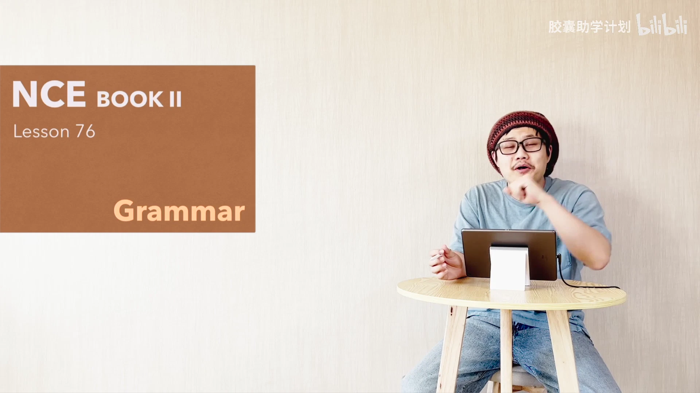

文字识别：biibii / 胶囊助学计划 / NCE / BOOKII / Lesson 76 / Grammar

### 画面 00:00:02

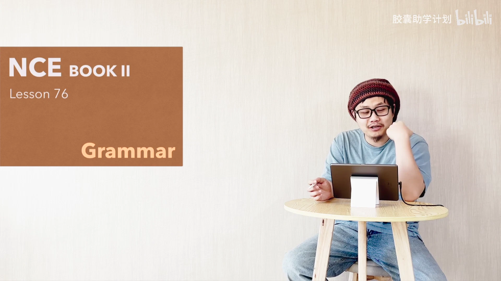

文字识别：bilbil / 胶囊助学计划 / NCE / BOOKII / Lesson 76 / Grammar

### 画面 00:00:04

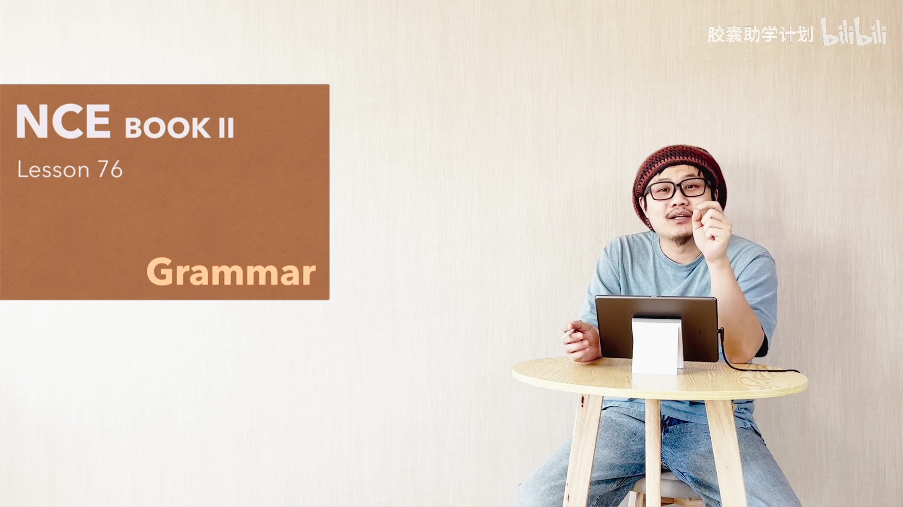

文字识别：bilbil / 胶囊助学计划 / NCE / BOOKII / Lesson 76 / Grammar

### 画面 00:00:06

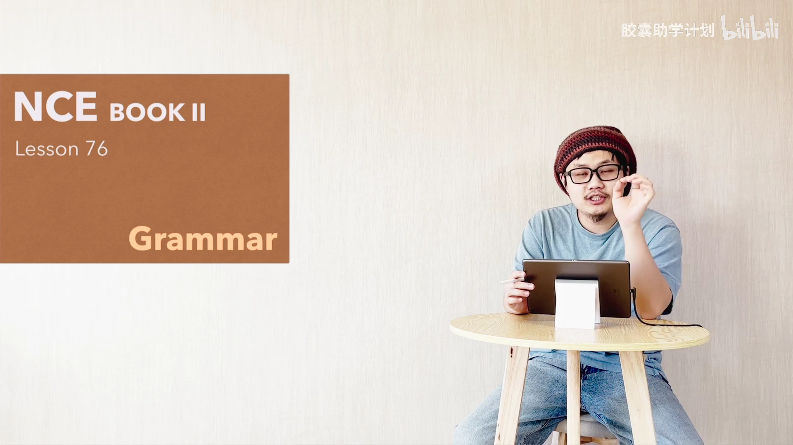

文字识别：bilbili / 胶囊助学计划 / NCE / BOOKII / Lesson 76 / Grammar

### 画面 00:00:08

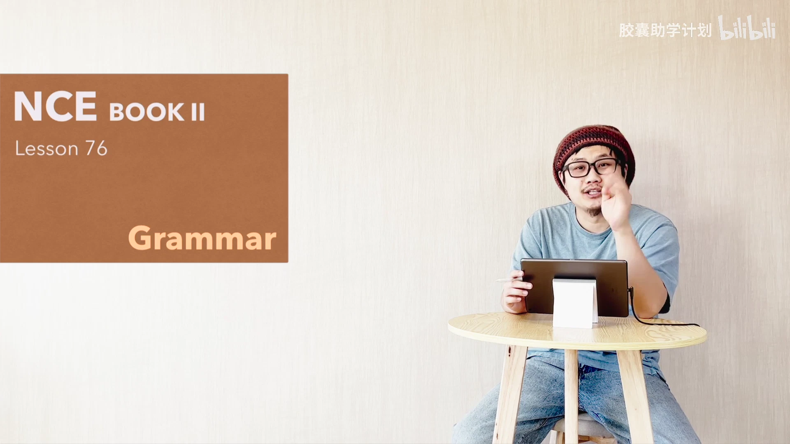

文字识别：bilbi / 胶囊助学计划 / NCE / BOOKII / Lesson 76 / Grammar

### 画面 00:00:10

文字识别：胶囊助学计划 bii

### 画面 00:00:13

### 画面 00:00:15

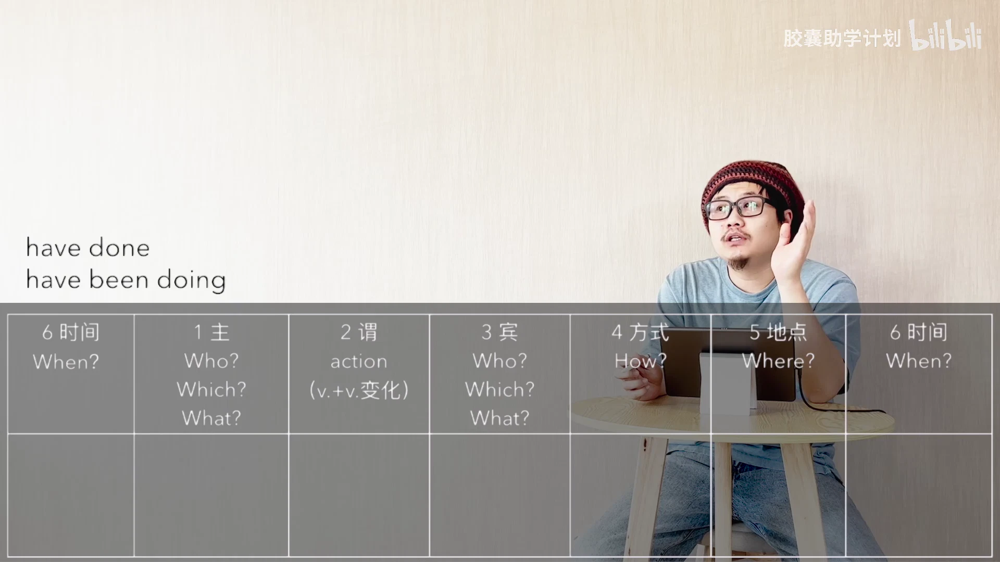

文字识别：bilibii / 胶囊助学计划 / have / done / have / been doing / 6时间 / 1主 / 2谓 / 3宾 / 4方式 / 5地点 / 6时间 / When? / Who? / action / Who? / How? / Where? / When? / Which? / (v.+v.变化) / Which? / What? / What?

## 00:00:30–00:01:00

doing。啊， have done 走在新一八十三课就学过了， have been doing 是咱们新二五十二课才开始学。但是呢，这两个时态非常的呃有很多相似的点，对吧？然后呢， have done 叫现在完成时， have been doing 叫现在完成进行时。讲之前我多提一句，如果两本红皮书初级和中级的这个部分您还没有开始写，我觉得学到这一课完全可以开始写了，不要等学到三册再说。当然三册我依旧会提啊，就

### 画面 00:00:45

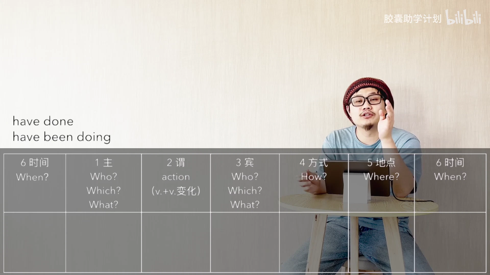

文字识别：bilbili / 胶囊助学计划 / have / done / have / been doing / 6时间 / 1主 / 2谓 / 3宾 / 4方式 / 5地点 / 6时间 / When? / Who? / action / Who? / How? / Where? / When? / Which? / (v.+v.变化) / Which? / What? / What?

## 00:01:00–00:01:30

这个是你欠的账，该该还赶紧还了。第四单元啊，呃，我们没有什么太多，我想带着各位复习了，因为这个之前复习过太多次了，单词造句啊，习惯用法造句，不停的复习，我基本就是以练代讲啊，直接上来咱们就练就完了，对吧？直接实战啊，跟我读，How long have they been gathering the harvest? For three weeks, but they haven't finished yet. 啊，这两句话以后我就不读了，我直

### 画面 00:01:13

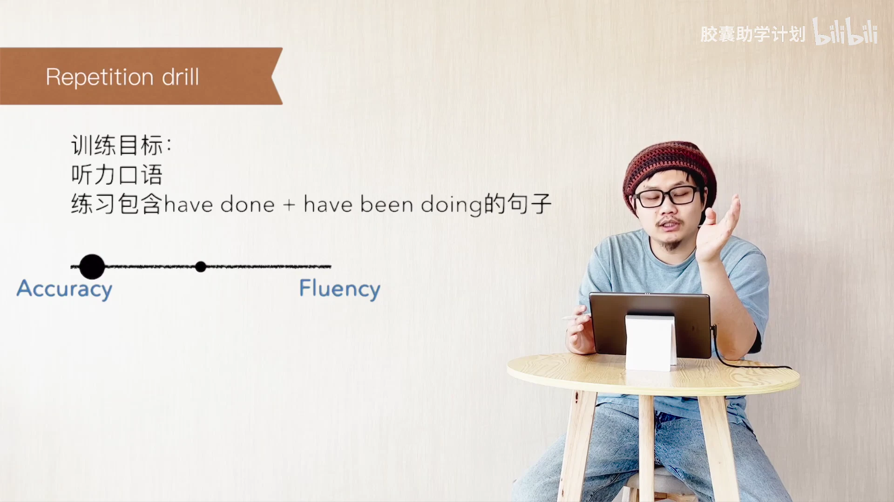

文字识别：Bibili / 胶囊助学计划 / Repetition drill / 训练目标： / 听力口语 / 练习包含have done + have been doing的句子 / Accuracy / Fluency

### 画面 00:01:15

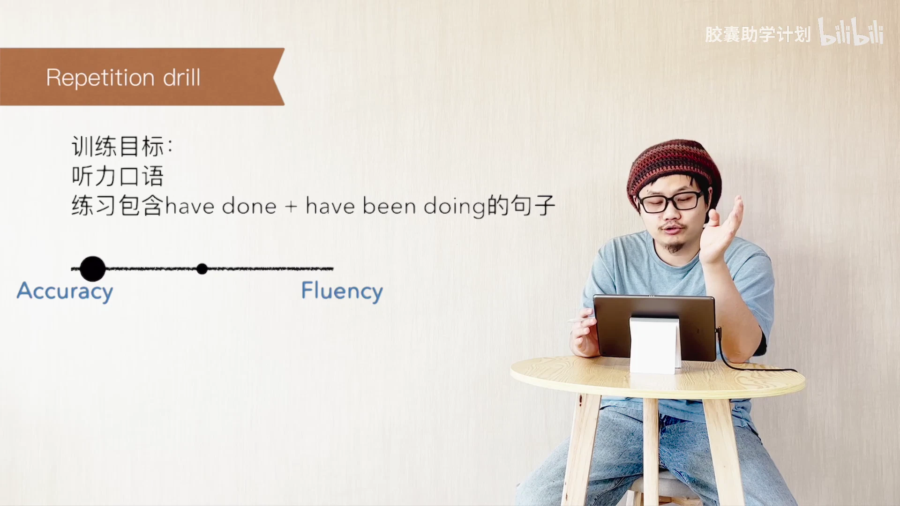

文字识别：bilbil / 胶囊助学计划 / Repetition drill / 训练目标： / 听力口语 / 练习包含have done + have been doing的句子 / Accuracy / Fluency

### 画面 00:01:17

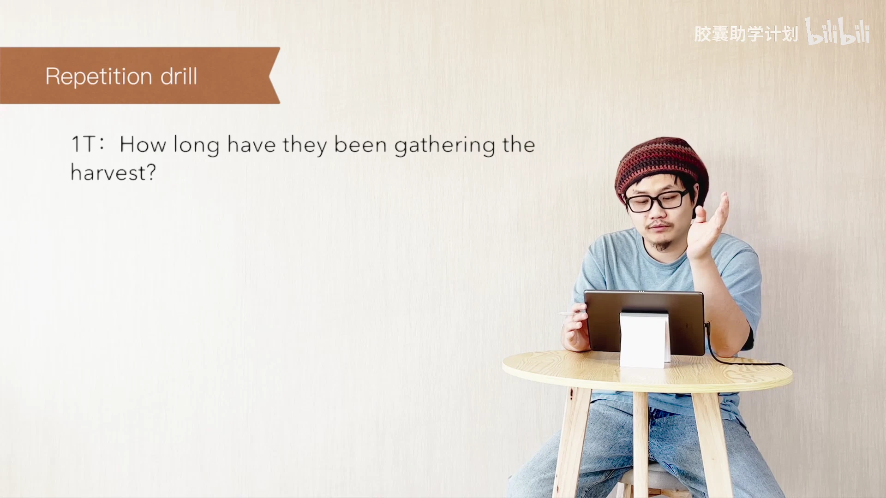

文字识别：bilbii / 胶囊助学计划 / Repetition drill / 1T: How long have they been gathering the / harvest?

### 画面 00:01:19

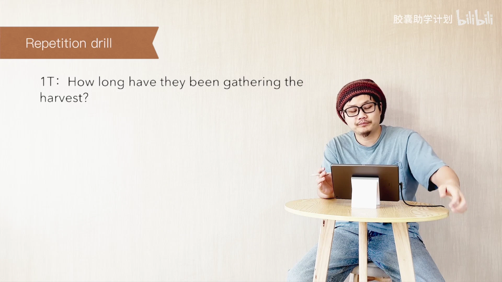

文字识别：bilbili / 胶囊助学计划 / Repetition drill / 1T: How long have they been gathering the / harvest?

### 画面 00:01:21

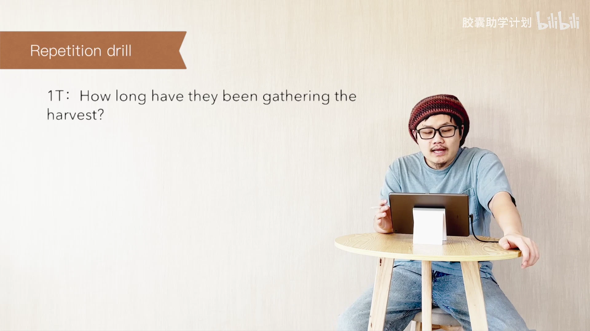

文字识别：bilbii / 胶囊助学计划 / Repetition drill / 1T: How long have they been gathering the / harvest?

### 画面 00:01:24

文字识别：bilbili / 胶囊助学计划 / Repetition drill / 1T: How long have they been gathering the / harvest? / For three weeks, but they haven't finished / yet.

### 画面 00:01:27

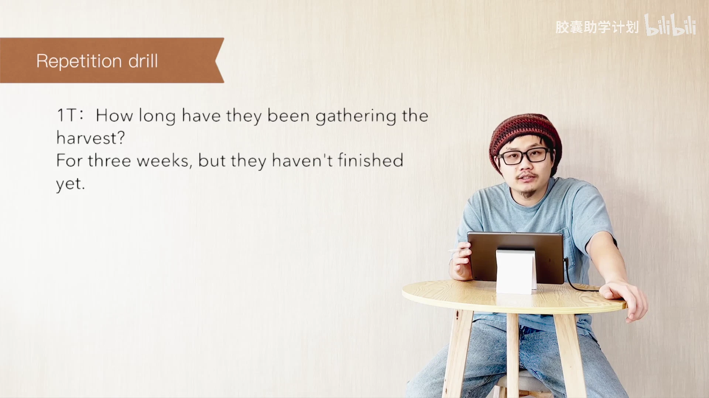

文字识别：Bilbili / 胶囊助学计划 / Repetition drill / 1T: How long have they been gathering the / harvest? / For three weeks, but they haven't finished / yet.

### 画面 00:01:29

文字识别：bilibili / 胶囊助学计划 / Repetition drill / 1T: How long have they been gathering the / harvest? / For three weeks, but they haven't finished / yet.

## 00:01:30–00:02:00

接给你最后一句话，跟我读一下就行了。前两句话就是我们一起看一下，最重要的是底下这句话，接下来全是这个套路啊，叫做 They've been gathering the harvest for three weeks, but they haven't finished yet. Repeat after me. Ah,所有的repeat after me，我不可能在录视频的时候给您留时间，自己暂停跟着我读一遍啊，不要忘，我总在提醒各位，说他们已经收集这个这个harvest，其实在这

### 画面 00:01:31

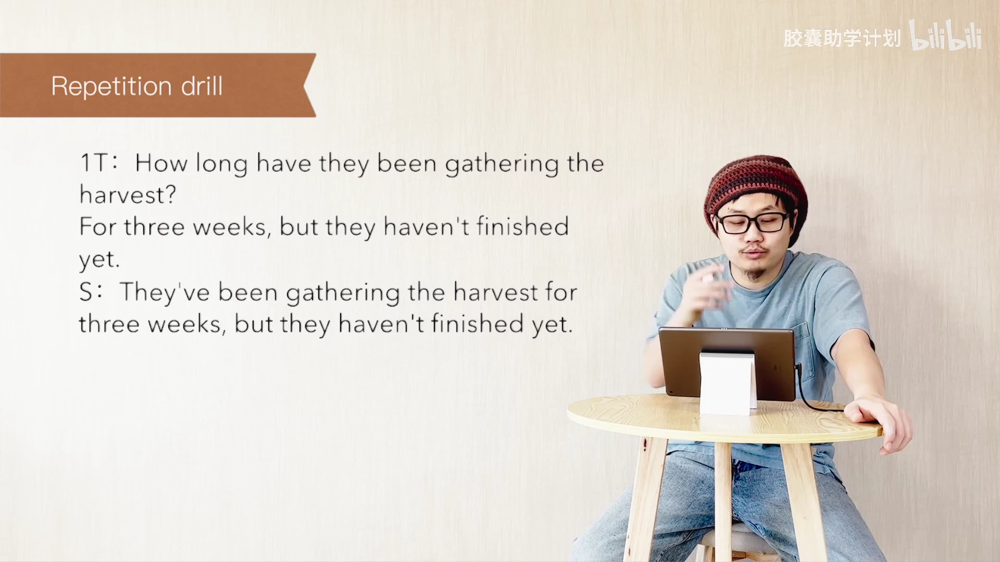

文字识别：胶囊助学计划bilbi / Repetition drill / 1T: How long have they been gathering the / harvest? / For three weeks, but they haven't finished / yet. / S: They've been gathering the harvest for / three weeks, but they haven't finished yet.

### 画面 00:01:33

文字识别：胶囊助学计划Blbi / Repetition drill / 1T: How long have they been gathering the / harvest? / For three weeks, but they haven't finished / yet. / S: They've been gathering the harvest for / three weeks, but they haven't finished yet.

### 画面 00:01:35

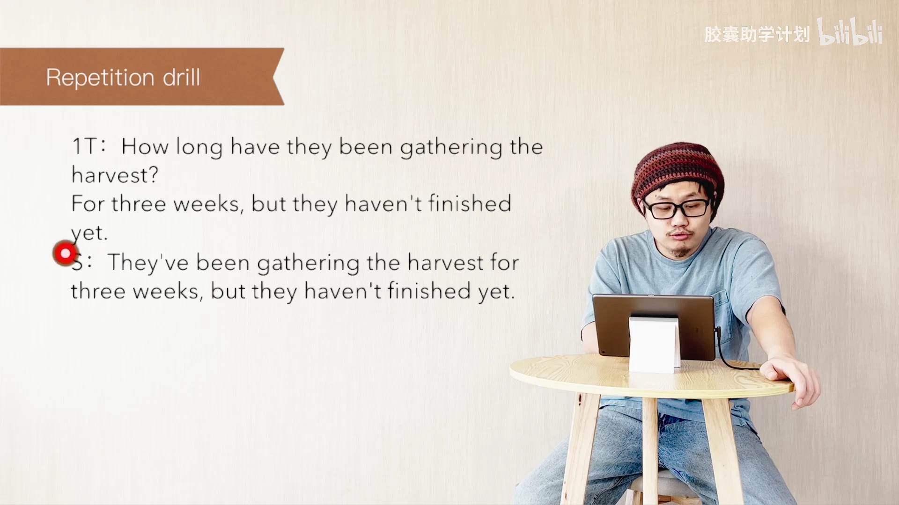

文字识别：胶囊助学计划bilbi / Repetition drill / 1T: How long have they been gathering the / harvest? / For three weeks, but they haven't finished / yet. / Os: They've been gathering the harvest for / three weeks, but they haven't finished yet.

### 画面 00:01:40

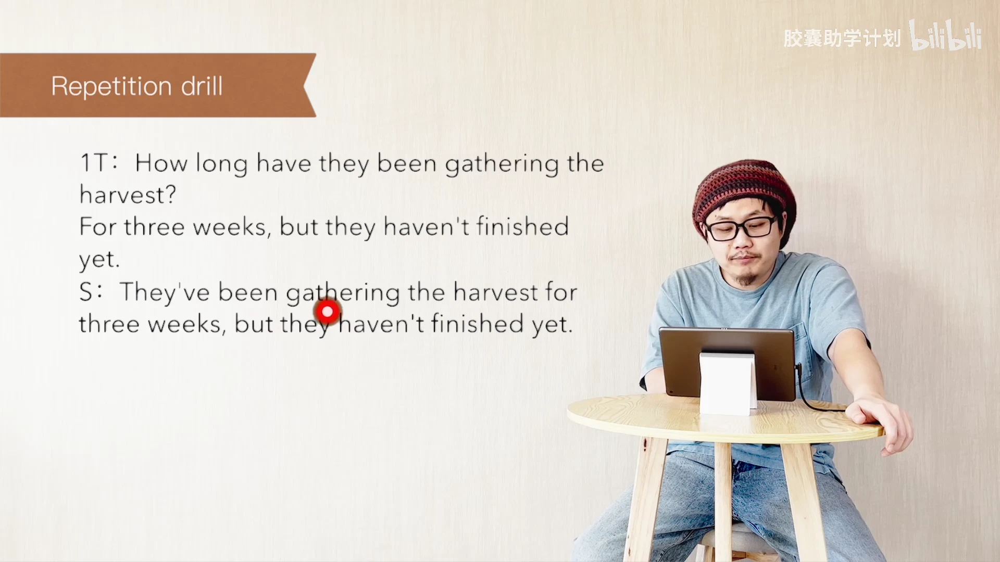

文字识别：胶囊助学计划bi / Repetition drill / 1T: How long have they been gathering the / harvest? / For three weeks, but they haven't finished / yet. / S: They've been gathering the harvest for / three weeks, but they haven't finished yet.

### 画面 00:01:46

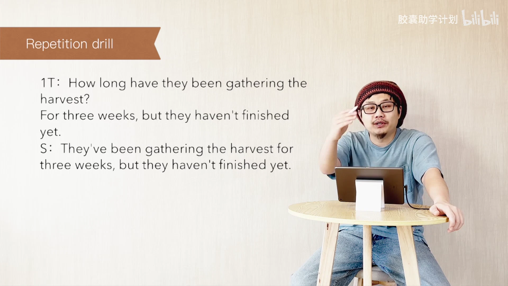

文字识别：胶囊助学计划bi出 / Repetition drill / 1T: How long have they been gathering the / harvest? / For three weeks, but they haven't finished / yet. / S: They've been gathering the harvest for / three weeks, but they haven't finished yet.

### 画面 00:01:50

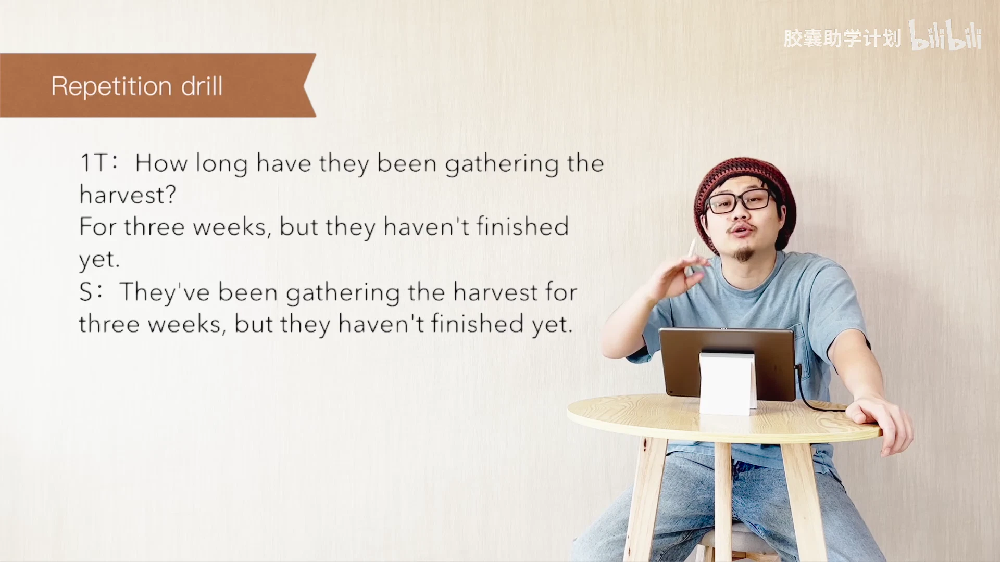

文字识别：胶囊助学计划ilbi / Repetition drill / 1T: How long have they been gathering the / harvest? / For three weeks, but they haven't finished / yet. / S: They've been gathering the harvest for / three weeks, but they haven't finished yet.

### 画面 00:01:52

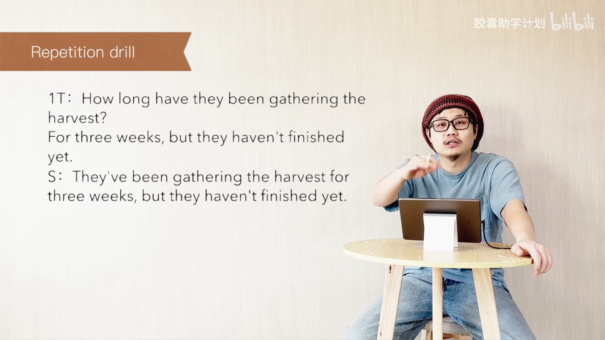

文字识别：胶囊助学计划bibl / Repetition drill / 1T: How long have they been gathering the / harvest? / For three weeks, but they haven't finished / yet. / S: They've been gathering the harvest for / three weeks, but they haven't finished yet.

### 画面 00:01:54

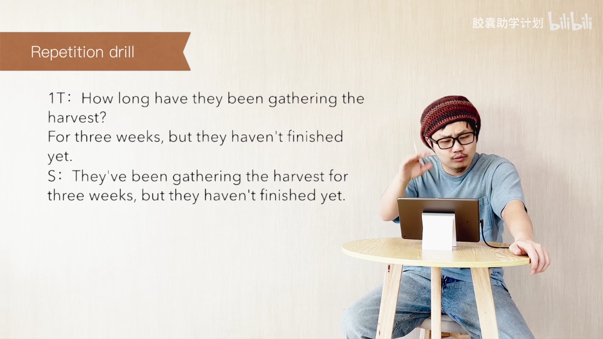

文字识别：胶囊助学计划bibi / Repetition drill / 1T: How long have they been gathering the / harvest? / For three weeks, but they haven't finished / yet. / S: They've been gathering the harvest for / three weeks, but they haven't finished yet.

### 画面 00:01:56

文字识别：胶囊助学计划blb山 / Repetition drill / 1T: How long have they been gathering the / harvest? / For three weeks, but they haven't finished / yet. / S: They've been gathering the harvest for / three weeks, but they haven't finished yet.

### 画面 00:01:59

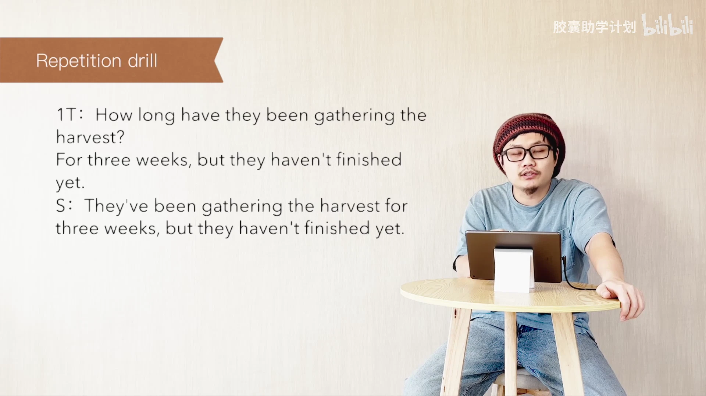

文字识别：胶囊助学计划Lilb / Repetition drill / 1T: How long have they been gathering the / harvest? / For three weeks, but they haven't finished / yet. / S: They've been gathering the harvest for / three weeks, but they haven't finished yet.

## 00:02:00–00:02:30

teaching recording. Transcribe the exact words in their original spoken languages. Never translate. Preserve repetitions, questions and examples.

### 画面 00:02:01

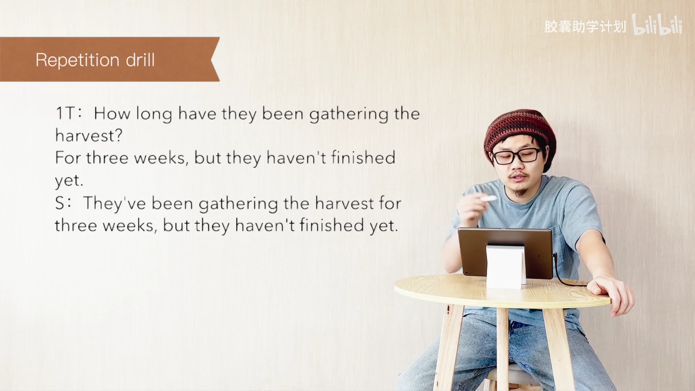

文字识别：胶囊助学计划bi / Repetition drill / 1T: How long have they been gathering the / harvest? / For three weeks, but they haven't finished / yet. / S: They've been gathering the harvest for / three weeks, but they haven't finished yet.

### 画面 00:02:05

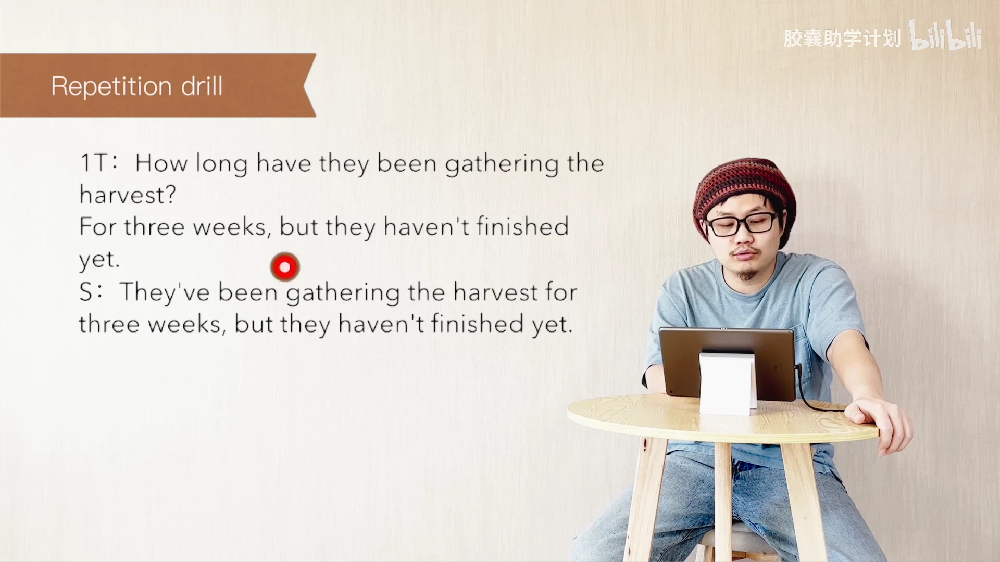

文字识别：胶囊助学计划biiil / Repetition drill / 1T: How long have they been gathering the / harvest? / For three weeks, but they haven't finished / yet. / S: They've been gathering the harvest for / three weeks, but they haven't finished yet.

### 画面 00:02:09

文字识别：胶囊助学计划bilbil / Repetition drill / 1T: How long have they been gathering the / harvest? / For three weeks, but they haven't finished / yet. / S: They've been gathering the harvest for / three weeks, but they haven't finished yet.

### 画面 00:02:11

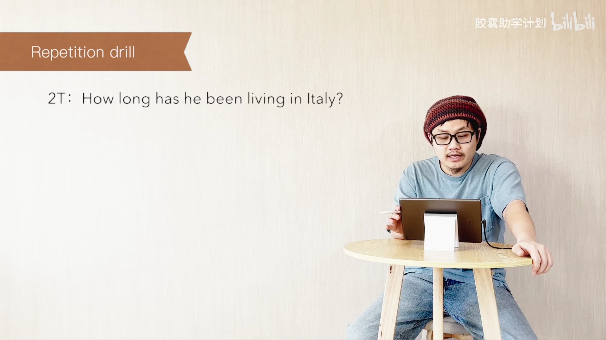

文字识别：biibili / 胶囊助学计划 / Repetition drill / 2T: How long has he been living in Italy?

### 画面 00:02:15

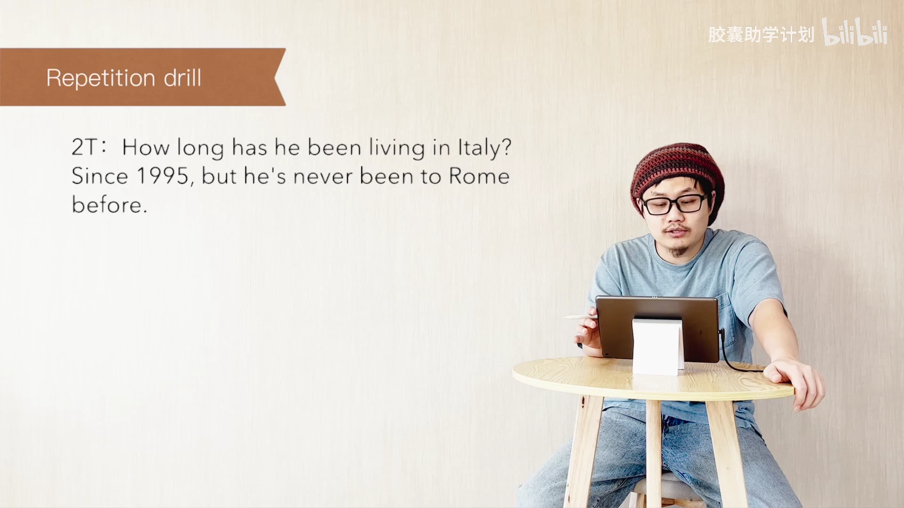

文字识别：bilibli / 胶囊助学计划 / Repetition drill / 2T: How long has he been living in Italy? / Since 1995, but he's never been to Rome / before.

### 画面 00:02:17

文字识别：bibili / 胶囊助学计划 / Repetition drill / 2T: How long has he been living in Italy? / Since 1995, but he's never been to Rome / before. / S: He's been living in Italy since 1995, but / he's never been to Rome before.

### 画面 00:02:19

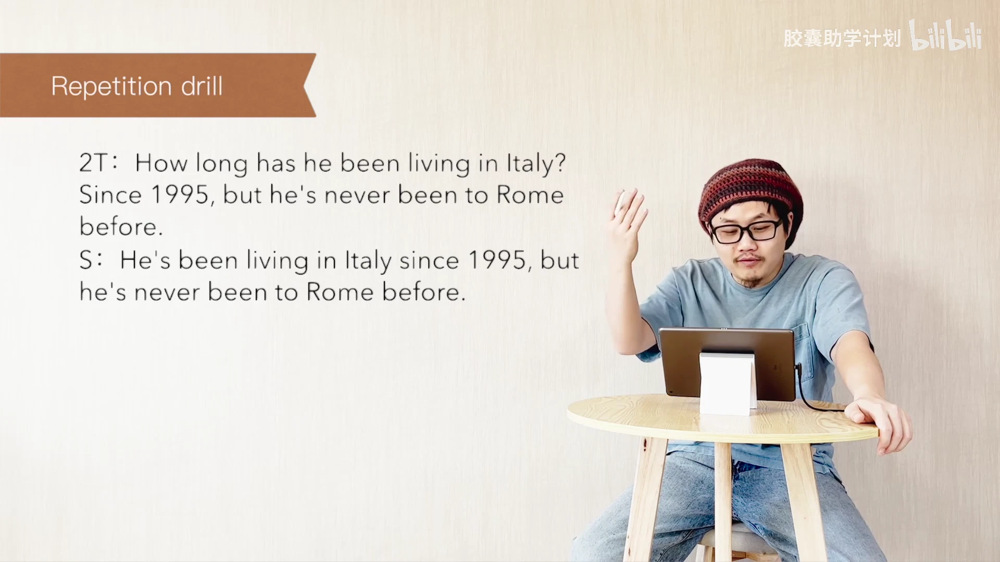

文字识别：Bilbili / 胶囊助学计划 / Repetition drill / 2T: How long has he been living in Italy? / Since 1995, but he's never been to Rome / before. / S: He's been living in Italy since 1995, but / he's never been to Rome before.

### 画面 00:02:21

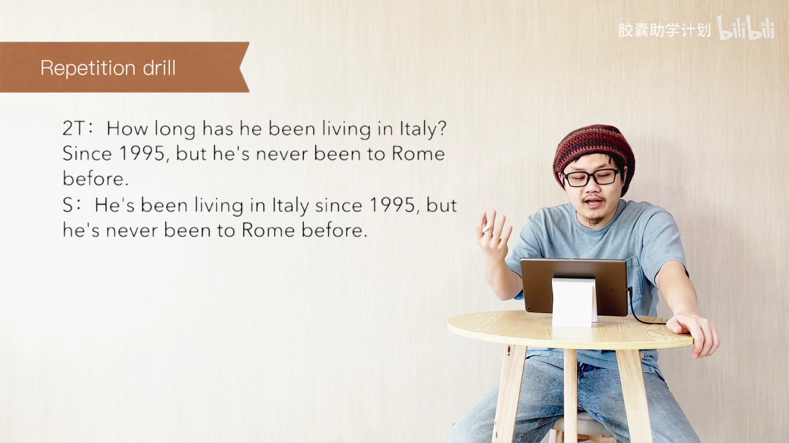

文字识别：胶囊助学计划bi / Repetition drill / 2T: How long has he been living in Italy? / Since 1995, but he's never been to Rome / before. / S: He's been living in Italy since 1995, but / he's never been to Rome before.

### 画面 00:02:25

文字识别：bibii / 胶囊助学计划 / Repetition drill / 2T: How long has he been living in Italy? / Since 1995, but he's never been to Rome / before. / S: He's been living in Italy since 1995, but / he's never been to Rome before.

### 画面 00:02:27

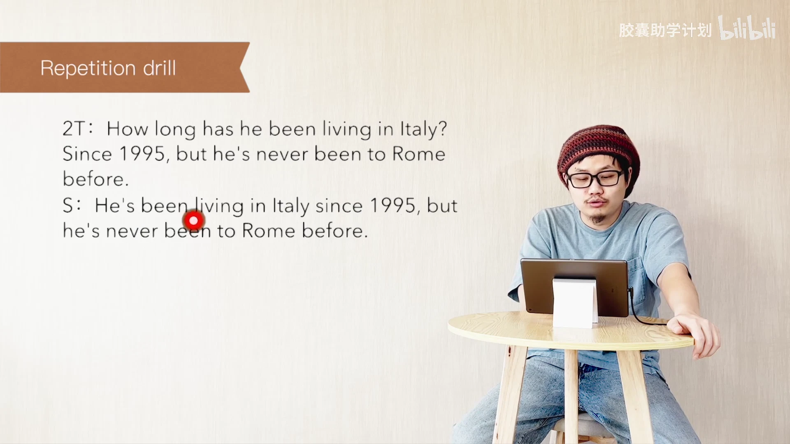

文字识别：bibii / 胶囊助学计划 / Repetition drill / 2T: How long has he been living in Italy? / Since 1995, but he's never been to Rome / before. / S: He's been living in Italy since 1995, but / he's never been to Rome before.

## 00:02:30–00:03:00

啊，但是比如说人家可能在大南面或在大北边，对吧？哎，科莫湖呢那儿住着呢，但是从来这就一直没去过罗马。Okay, next one. So how long has she been looking for a new house? Ah,她找这房子找多长时间了？For three years, but she hasn't found one so far yet.啊，套路都是一样的啊，就是把两个时态撂到一起了。跟我读一下。She's been looking for a new house for three years,

### 画面 00:02:30

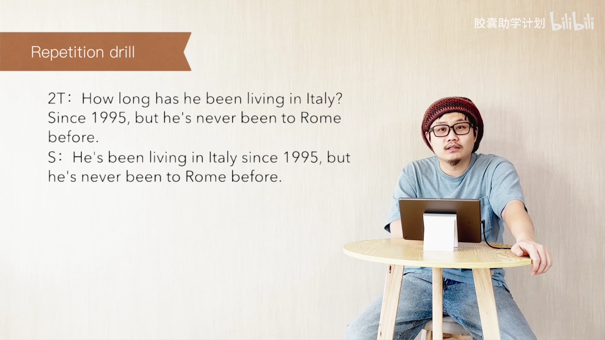

文字识别：bibii / 胶囊助学计划 / Repetition drill / 2T: How long has he been living in Italy? / Since 1995, but he's never been to Rome / before. / S: He's been living in Italy since 1995, but / he's never been to Rome before.

### 画面 00:02:34

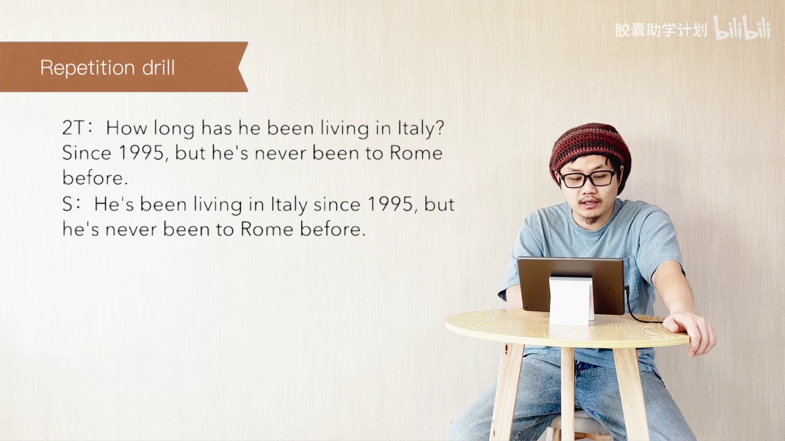

文字识别：biibili / 胶囊助学计划 / Repetition drill / 2T: How long has he been living in Italy? / Since 1995, but he's never been to Rome / before. / S: He's been living in Italy since 1995, but / he's never been to Rome before.

### 画面 00:02:36

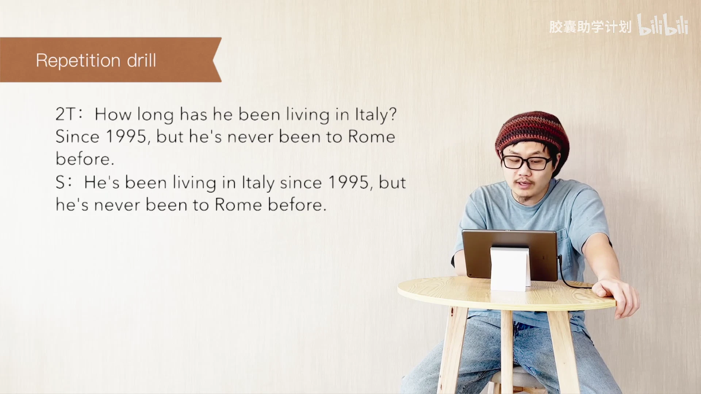

文字识别：bilibii / 胶囊助学计划 / Repetition drill / 2T: How long has he been living in Italy? / Since 1995, but he's never been to Rome / before. / S: He's been living in Italy since 1995, but / he's never been to Rome before.

### 画面 00:02:39

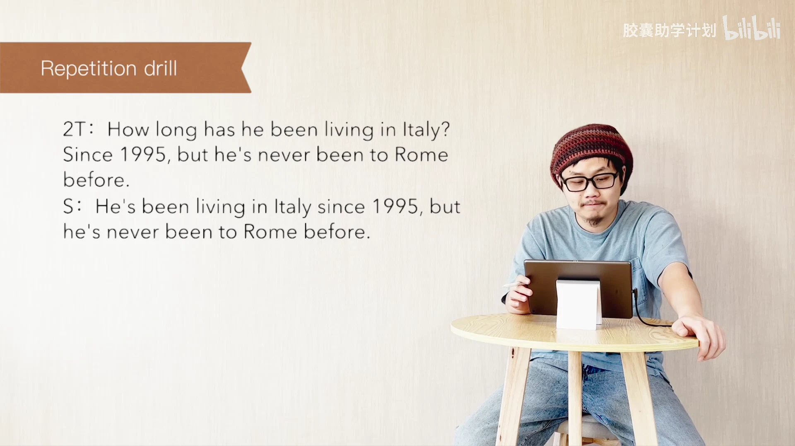

文字识别：bilbii / 胶囊助学计划 / Repetition drill / 2T: How long has he been living in Italy? / Since 1995, but he's never been to Rome / before. / S: He's been living in Italy since 1995, but / he's never been to Rome before.

### 画面 00:02:41

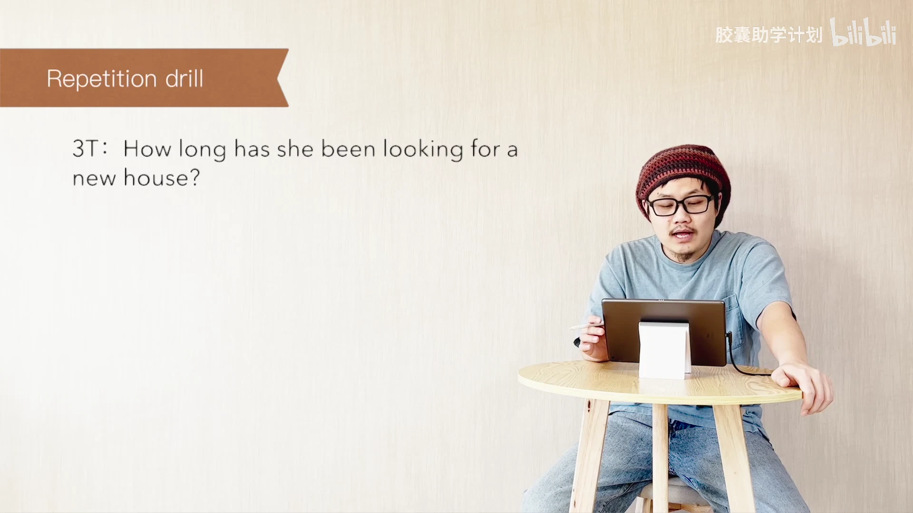

文字识别：bilibili / 胶囊助学计划 / Repetition drill / 3T: How long has she been looking for a / new house?

### 画面 00:02:48

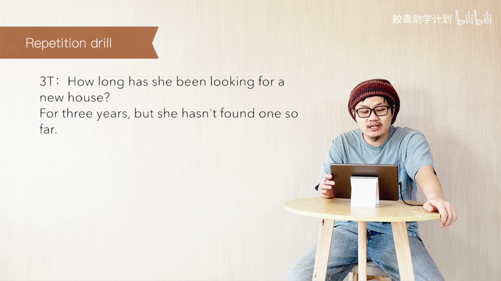

文字识别：biibili / 胶囊助学计划 / Repetition drill / 3T: How long has she been looking for a / new house? / For three years, but she hasn't found one so / far.

### 画面 00:02:50

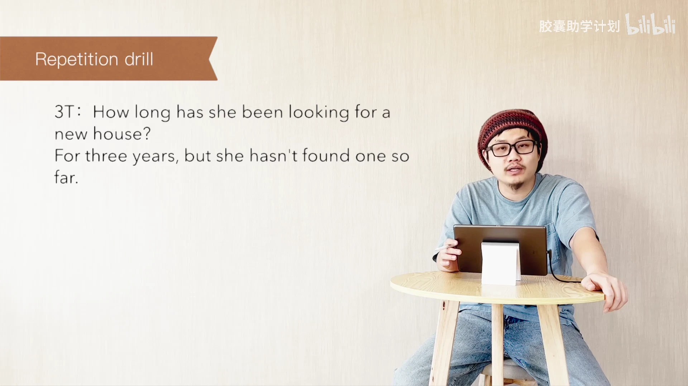

文字识别：biibli / 胶囊助学计划 / Repetition drill / 3T: How long has she been looking for a / new house? / For three years, but she hasn't found one so / far.

### 画面 00:02:52

文字识别：胶囊助学计划Lilbi / Repetition drill / 3T: How long has she been looking for a / new house? / For three years, but she hasn't found one so / far. / S: She's been looking for a new house for / three years, but she hasn't found one so far.

### 画面 00:02:54

文字识别：胶囊助学计划bi / Repetition drill / 3T: How long has she been looking for a / new house? / For three years, but she hasn't found one so / far. / S: She's been looking for a new house for / three years, but she hasn't found one so far.

### 画面 00:02:56

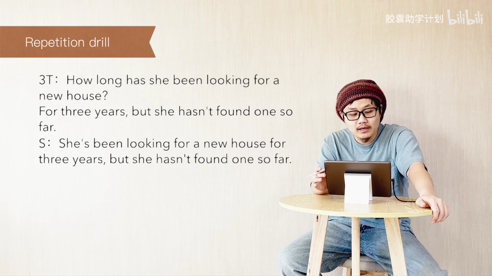

文字识别：胶囊助学计划bil出 / Repetition drill / 3T: How long has she been looking for a / new house? / For three years, but she hasn't found one so / far. / S: She's been looking for a new house for / three years, but she hasn't found one so far.

### 画面 00:02:58

文字识别：胶囊助学计划bi / Repetition drill / 3T: How long has she been looking for a / new house? / For three years, but she hasn't found one so / far. / S: She's been looking for a new house for / three years, but she hasn't found one so far.

## 00:03:00–00:03:30

but she hasn't found one so far. 下一个，直接读最后一句啊. He's been collecting records for for years, but he hasn't collected any new ones lately. He's been going there since 1996, but he hasn't been there recently. 最近没去。那一九九六年就一直在去，但最近没去。

### 画面 00:03:00

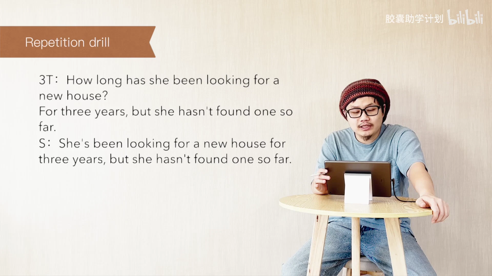

文字识别：胶囊助学计划bi山 / Repetition drill / 3T: How long has she been looking for a / new house? / For three years, but she hasn't found one so / far. / S: She's been looking for a new house for / three years, but she hasn't found one so far.

### 画面 00:03:03

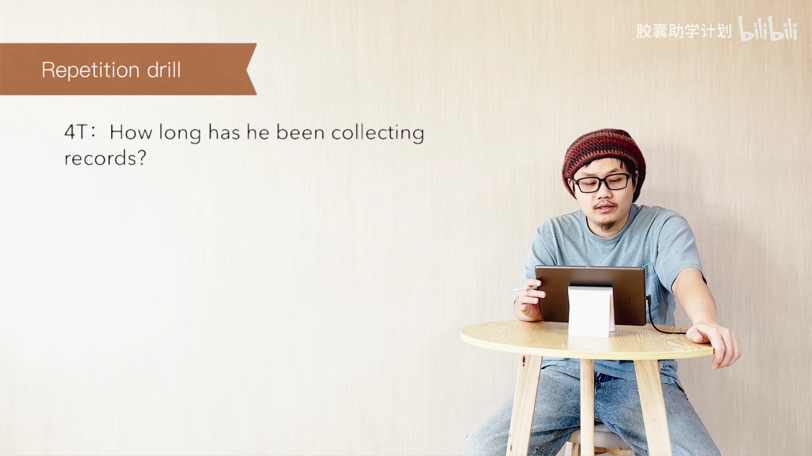

文字识别：bilbii / 胶囊助学计划 / Repetition drill / 4T: How long has he been collecting / records?

### 画面 00:03:05

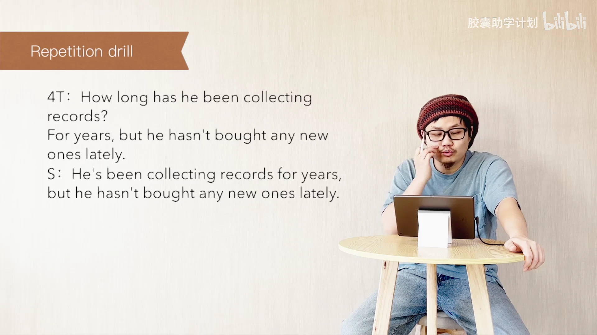

文字识别：胶囊助学计划i / Repetition drill / 4T: How long has he been collecting / records? / For years, but he hasn't bought any new / ones lately. / S: He's been collecting records for years, / but he hasn't bought any new ones lately.

### 画面 00:03:09

文字识别：Bilbii / 胶囊助学计划 / Repetition drill / 4T: How long has he been collecting / records? / For years, but he hasn't bought any new / ones lately. / S: He's been collecting records for years, / but he hasn't bought any new ones lately.

### 画面 00:03:11

文字识别：bibil / 胶囊助学计划 / Repetition drill / 4T: How long has he been collecting / records? / For years, but he hasn't bought any new / ones lately. / S: He's been collecting records for years, / but he hasn't bought any new ones lately.

### 画面 00:03:14

文字识别：bib山 / 胶囊助学计划 / Repetition drill / 4T: How long has he been collecting / records? / For years, but he hasn't bought any new / ones lately. / S: He's been collecting records for years, / but he hasn't bought any new ones lately.

### 画面 00:03:16

文字识别：胶囊助学计划bli / Repetition drill / 4T: How long has he been collecting / records? / For years, but he hasn't bought any new / ones lately. / S: He's been collecting records for years, / but he hasn't bought any new ones lately.

### 画面 00:03:18

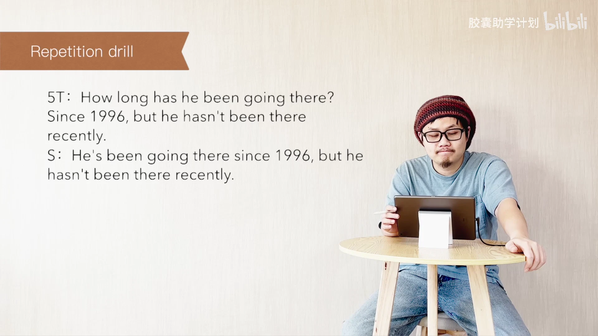

文字识别：biibili / 胶囊助学计划 / Repetition drill / 5T: How long has he been going there? / Since 1996, but he hasn't been there / recently. / S: He's been going there since 1996, but he / hasn't been there recently.

### 画面 00:03:20

文字识别：biibii / 胶囊助学计划 / Repetition drill / 5T: How long has he been going there? / Since 1996, but he hasn't been there / recently. / S: He's been going there since 1996, but he / hasn't been there recently.

### 画面 00:03:22

文字识别：bilibii / 胶囊助学计划 / Repetition drill / 5T: How long has he been going there? / Since 1996, but he hasn't been there / recently. / S: He's been going there since 1996, but he / hasn't been there recently.

### 画面 00:03:25

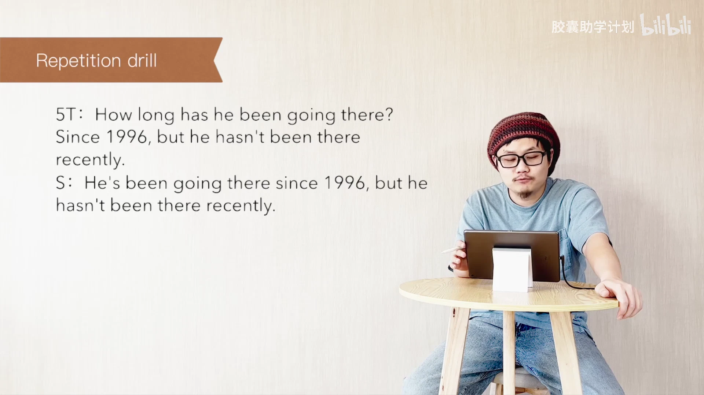

文字识别：biibii / 胶囊助学计划 / Repetition drill / 5T: How long has he been going there? / Since 1996, but he hasn't been there / recently. / S: He's been going there since 1996, but he / hasn't been there recently.

### 画面 00:03:29

文字识别：bilibii / 胶囊助学计划 / Repetition drill / 6T: How long has he been eating at this / restaurant?

## 00:03:30–00:04:00

He's been eating at this restaurant for months, but he never complained about the food before.他在这儿吃了数个月，但以前从来没有抱怨过这个食物。She's been waiting for three hours, but the doctor hasn't seen her yet. They've been repairing his cars since this morning, but they haven't finished yet.

### 画面 00:03:31

文字识别：胶囊助学计划bilbi / Repetition drill / 6T: How long has he been eating at this / restaurant? / For months, but he's never complained / about the food before. / S: He's been eating at this restaurant for / months, but he's never complained about / the food before.

### 画面 00:03:35

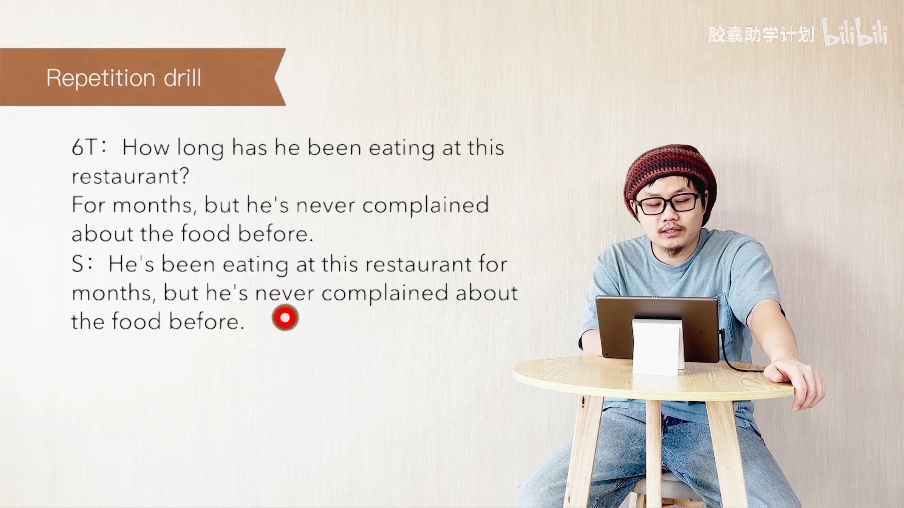

文字识别：胶囊助学计划blbi / Repetition drill / 6T: How long has he been eating at this / restaurant? / For months, but he's never complained / about the food before. / S: He's been eating at this restaurant for / months, but he's never complained about / the food before.

### 画面 00:03:39

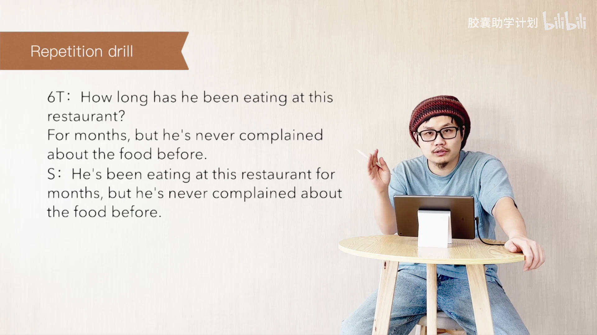

文字识别：胶囊助学计划bilbi / Repetition drill / 6T: How long has he been eating at this / restaurant? / For months, but he's never complained / about the food before. / S: He's been eating at this restaurant for / months, but he's never complained about / the food before.

### 画面 00:03:41

文字识别：胶囊助学计划bibl / Repetition drill / 6T: How long has he been eating at this / restaurant? / For months, but he's never complained / about the food before. / S: He's been eating at this restaurant for / months, but he's never complained about / the food before.

### 画面 00:03:43

文字识别：bilibili / 胶囊助学计划 / Repetition drill / 7T: How long has she been waiting?

### 画面 00:03:45

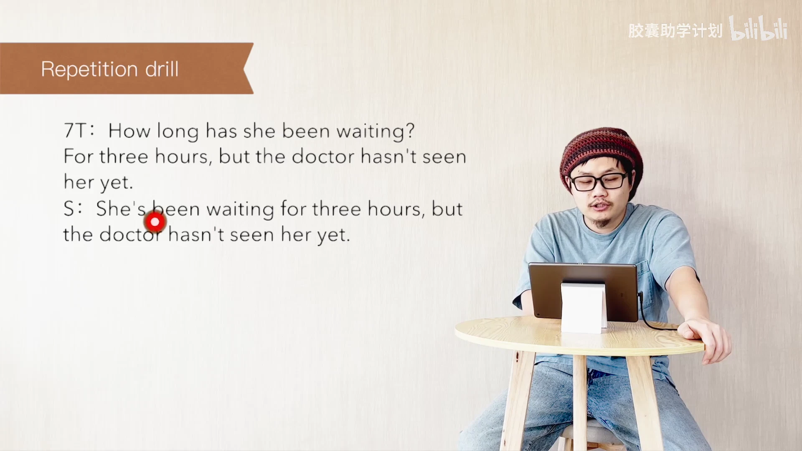

文字识别：bilibii / 胶囊助学计划 / Repetition drill / 7T: How long has she been waiting? / For three hours, but the doctor hasn't seen / her yet. / S: She's been waiting for three hours, but / the doctor hasn't seen her yet.

### 画面 00:03:52

文字识别：bilbii / 胶囊助学计划 / Repetition drill / 8T: How ong have they l / been repairing / his / car?

### 画面 00:03:54

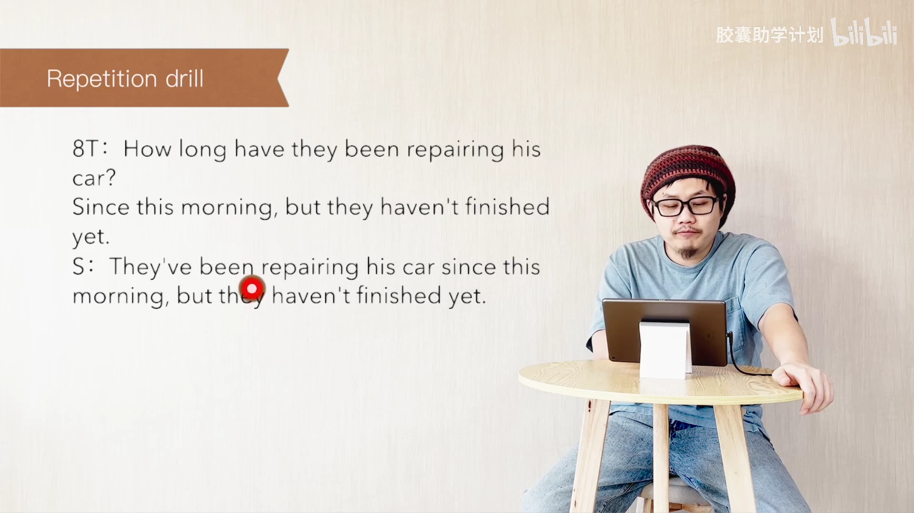

文字识别：bibii / 胶囊助学计划 / Repetition drill / 8T: How long have they been repairing his / Car? / Since this morning, but they haven't finished / yet. / S: They've been repairing his car since this / morning, but thd / haven't finished yet.

### 画面 00:03:56

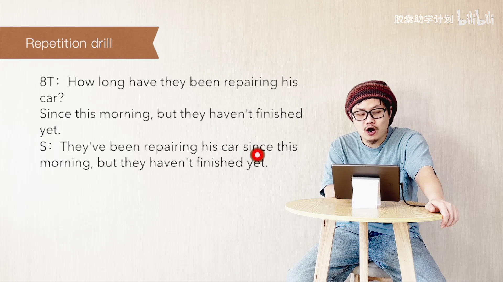

文字识别：bilbii / 胶囊助学计划 / Repetition drill / 8T: How long have they been repairing his / car? / Since this morning, but they haven't finished / yet. / S: They've been repairing his car since this / morning, but they haven't finished yet.

### 画面 00:03:58

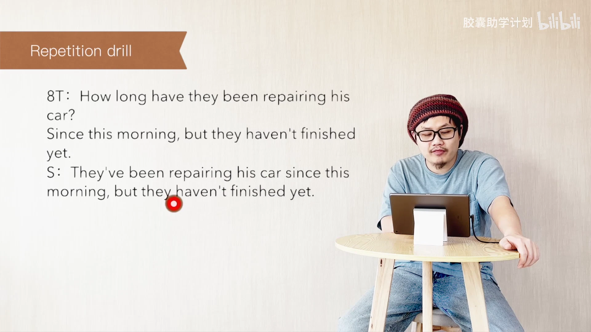

文字识别：Bilbii / 胶囊助学计划 / Repetition drill / 8T: How long have they been repairing his / car? / Since this morning, but they haven't finished / yet. / S: They've been repairing his car since this / morning, but theyhaven't finished yet.

## 00:04:00–00:04:30

It's been raining for two minutes, but no one has answered it yet. They've been entering the competition since 1996, but up to now they've never won a prize. Okay, pattern drill.刚才练的是现在完成时和现在完成进行时。Pattern drill还是这些，只不过也会出现别的时

### 画面 00:04:00

文字识别：biili / 胶囊助学计划 / Repetition drill / 8T: How long have they been repairing his / car? / Since this morning, but they haven't finished / yet. / S: They've been repairing his car since this / morning, but they haven't finished yet.

### 画面 00:04:02

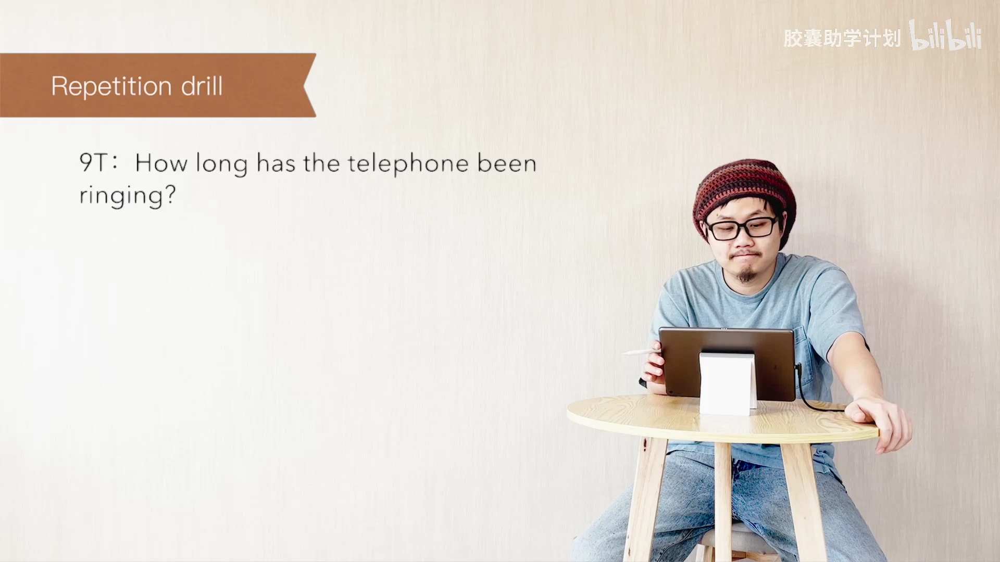

文字识别：bilbili / 胶囊助学计划 / Repetition drill / 9T: How long has the telephone been / ringing?

### 画面 00:04:04

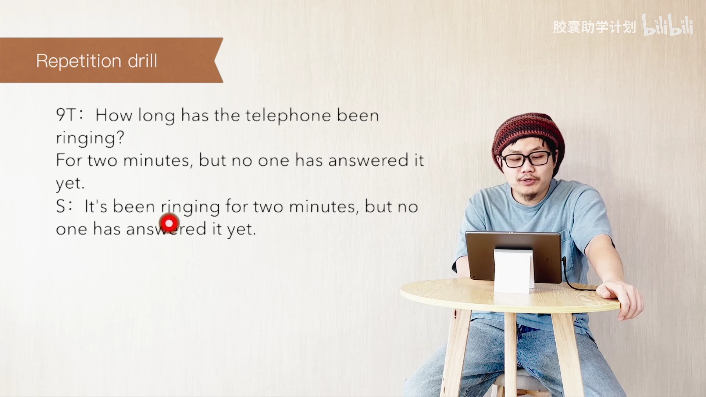

文字识别：胶囊助学计划bi / Repetition drill / 9T: How long has the telephone been / ringing? / For two minutes, but no one has answered it / yet. / S: It's been ringing for two minutes, but no / one has ansvered it yet.

### 画面 00:04:06

文字识别：Bilbil / 胶囊助学计划 / Repetition drill / 9T: How long has the telephone been / ringing? / For two minutes, but no one has answered it / yet. / S: It's been ringing for two minutes, but no / one has answered it yet.

### 画面 00:04:08

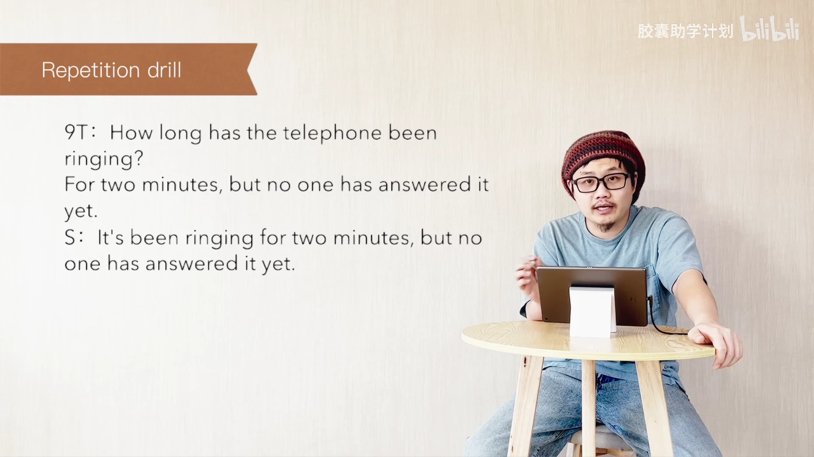

文字识别：bilibii / 胶囊助学计划 / Repetition drill / 9T: How long has the telephone been / ringing? / For two minutes, but no one has answered it / yet. / S: It's been ringing for two minutes, but no / one has answered it yet.

### 画面 00:04:10

文字识别：Bilbili / 胶囊助学计划 / Repetition drill

### 画面 00:04:12

文字识别：bilbii / 胶囊助学计划 / Repetition drill / 10T: How long have they been entering the / competition? / Since 1996, but up till now they've never / won a prize. / S: They've been entering the competition / since 1996, but up till now they've never won / a prize.

### 画面 00:04:15

文字识别：胶囊助学计划i出 / Repetition drill / 10T: How long have they been entering the / competition? / Since 1996, but up till now they've never / won a prize. / S: They've been entering the competition / since 1996, but up till now they've never won / a prize.

### 画面 00:04:18

文字识别：胶囊助学计划bi / Repetition drill / 10T: How long have they been entering the / competition? / Since 1996, but up till now they've never / won a prize. / S: They've been entering the competition / since 1996, but up till now they've never won / a prize.

### 画面 00:04:20

文字识别：Bibii / 胶囊助学计划 / Repetition drill / 10T: How long have they been entering the / competition? / Since 1996, but up till now they've never / won a prize. / S: They've been entering the competition / since 1996, but up till now they've never won / a prize.

### 画面 00:04:22

文字识别：blbli / 胶囊助学计划 / Pattern drill / 训练目标： / 写作口语 / 练习包含have done + have been doing的句子 / Accuracy / Fluency

### 画面 00:04:24

文字识别：bilbii / 胶囊助学计划 / Pattern drill / 训练目标： / 写作口语 / 练习包含have done + have been doing的句子 / Accuracy / Fluency

### 画面 00:04:26

文字识别：bibili / 胶囊助学计划 / Pattern drill / 训练目标： / 写作口语 / 练习包含have done + have been doing的句子 / Accuracy / Fluency

### 画面 00:04:28

文字识别：Bibii / 胶囊助学计划 / Pattern drill / 1T:grow a beard / S1: He's growing a beard. / S2: Whatever for? He hasn't grown one / before, has he? / have an operation / make a film / give a speech / enter a competition / write a book / employ a secretary / buy a dog / build a garage

## 00:04:30–00:05:00

态啊。比如说，he's growing a beard，正在蓄须啊。Whatever for? He hasn't grown one before, has he?以前从来没留过胡子吧，对吧？哎，第二个，What do you think of his beard?你觉得哎，怎么围绕他胡子来是吧？好多同学也是啊，总围绕着我胡子聊，对吧？就是就有的同学想让我剪，我总想让我留，我也不懂，是吧？你为什么总管别人呢？啊，What do you think of his beard? Ah, it's none of your business.

### 画面 00:04:30

文字识别：bibii / 胶囊助学计划 / Pattern drill / 1T:grow a beard / S1: He's growing a beard. / S2: Whatever for? He hasn't grown one / before, has he? / have an operation / make a film / give a speech / enter a competition / write a book / employ a secretary / buy a dog / build a garage

### 画面 00:04:33

文字识别：Bibii / 胶囊助学计划 / Pattern drill / 1T:grow a beard / S1: He's growing a beard. / S2: Whatever for? He hasn't grown one / before, has he? / have an operation / make a film / give a speech / enter a competition / write a book / employ a secretary / buy a dog / build a garage

### 画面 00:04:35

文字识别：Bilbili / 胶囊助学计划 / Pattern drill / 1T: grow a beard / S1: He's growing a beard. / S2: Whatever for? He hasn't grown one / before, has he? / have an operation / make a film / give a speech / enter a competition / write a book / employ a secretary / buy a dog / build a garage

### 画面 00:04:40

文字识别：bibii / 胶囊助学计划 / Pattern drill / 1T: grow a beard / S1: He's growing a beard. / S2: Whatever for? He hasn't grown one / before, has he? / have an operation / make a film / give a speech / enter a competition / write a book / employ a secretary / buy a dog / build a garage

### 画面 00:04:42

文字识别：bibi / 胶囊助学计划 / Pattern drill / 2T: his beard -grow / S1: Whatoo you think of his beard? / S2: It's allright, but he hasn't been growing / it for long, has he? / my English -learn / his boat -sail / her car-drive / her pupils -teach / his glasses -wear / my violin -play / their work- do / my camera -use

### 画面 00:04:45

文字识别：bilbii / 胶囊助学计划 / Pattern drill / 2T: his beard -grow / S1: What do you think of his beard? / S2: It's all right, but he hasn't been growing / it for long, has he? / my English -learn / his boat -sail / her car-drive / her pupils -teach / his glasses -wear / my violin -play / their work- do / my camera -use

### 画面 00:04:50

文字识别：bilbil / 胶囊助学计划 / Pattern drill / 2T: his beard -grow / S1: What do you think of his beard? / S2: It's all right, but he hasn't been growing / it for long, has he? / my English -learn / his boat -sail / her car-drive / her pupils -teach / his glasses -wear / my violin -play / their work- do / my camera -use

### 画面 00:04:55

文字识别：ibii / 胶囊助学计划 / Pattern drill / 2T: his beard -grow / S1: What do you think of his beard? / S2: It's allright, but he hasn't been growing / it for long, has he? / my English -learn / his boat -sail / her car-drive / her pupils -teach / his glasses -wear / my violin -play / their work- do / my camera -use

## 00:05:00–00:05:30

to answer this sentence. It's all right, but it hasn't been growing it for long, has he? Ah, he has a long beard, right? Okay. He has been telephoning me all morning. You pay attention. If we see this sentence, first, has been doing, we judge it. Second, all morning, the time is still morning, right? Don't exaggerate. Exaggerate may be a difficult word, but it is also very common. Don't exaggerate. Don't exaggerate. He has only telephoned you

### 画面 00:05:00

文字识别：bilbii / 胶囊助学计划 / Pattern drill / 2T: his beard -grow / S1: What do you think of his beard? / S2: It's all right, but he hasn't been growing / it for long, has he? / my English -learn / his boat -sail / her car-drive / her pupils -teach / his glasses -wear / my violin -play / their work- do / my camera -use

### 画面 00:05:02

文字识别：bibii / 胶囊助学计划 / Pattern drill / 2T: his beard -grow / S1: What do you think of his beard? / S2: It's all right, but he hasn't been growing / it for long, has he? / my English -learn / his boat -sail / her car-drive / her pupils -teach / his glasses -wear / my violin -play / their work- do / my camera -use

### 画面 00:05:04

文字识别：bibii / 胶囊助学计划 / Pattern drill / 2T: his beard -grow / S1: What do you think of his beard? / S2: It's all right, but he hasn't been growing / it for long, has he? / my English -learn / his boat -sail / her car-drive / her pupils -teach / his glasses -wear / my violin -play / their work- do / my camera -use

### 画面 00:05:06

文字识别：bilbii / 胶囊助学计划 / Pattern drill / 2T: his beard -grow / S1: What do you think of his beard? / S2: It's all right, but he hasn't been growing / it for long, has he? / my English -learn / his boat -sail / her car-drive / her pupils -teach / his glasses -wear / my violin -play / their work- do / my camera -use

### 画面 00:05:09

文字识别：Bibi / 胶囊助学计划 / Pattern drill / 2T: his beard -grow / S1: What do you think of his beard? / S2: It's all right, but he hasn't been growing / it for long, has he? / my English -learn / his boat -sail / her car-drive / her pupils -teach / his glasses -wear / my violin -play / their work- do / my camera -use

### 画面 00:05:11

文字识别：Bilbii / 胶囊助学计划 / Pattern drill / 3T: telephone me / S1: He's been telepboning me all morning. / S2: Don't exaggerate! He's only telephoned / you twice. / interrupt me / complain / drop asleep / repeat himself / shout at me / ring the doorbell / rush in and out / ask me for coffee

### 画面 00:05:14

文字识别：Biibii / 胶囊助学计划 / Pattern drill / 3T: telephone me / S1: He's been telephoning me all morning. / S2: Don't exaggerate! He's only telephoned / you twice. / interrupt me / complain / drop asleep / repeat himself / shout at me / ring the doorbell / rush in and out / ask me for coffee

### 画面 00:05:16

文字识别：Biibii / 胶囊助学计划 / Pattern drill / 3T: telephone me / S1: He's been telephoning me all morning. / S2: Don't exaggerate! He's only telephoned / you twice. / interrupt me / complain / drop asleep / repeat himself / shout at me / ring the doorbell / rush in and out / ask me for coffee

### 画面 00:05:20

文字识别：Bilbii / 胶囊助学计划 / Pattern drill / 3T: telephone me / S1: He's been telephoning me all morning. / S2: Don't exaggerate! He's only telephoned / you twice. / interrupt me / complain / drop asleep / repeat himself / shout at me / ring the doorbell / rush in and out / ask me for coffee

### 画面 00:05:25

文字识别：biibii / 胶囊助学计划 / Pattern drill / 3T: telephone me / S1: He's been telephoning me all morning. / S2: Don't exaggerate! He's only telephoned / you twice. / interrupt me / complain / drop asleep / repeat himself / shout at me / ring the doorbell / rush in and out / ask me for coffee

## 00:05:30–00:06:00

twice.他只给你打了两回电话。往里面去带啊。第四个说，Have you been reading magazines all the time I've been away?说我不在的时间，你一直都在读杂志吗？No, I haven't.呃，read any since you left.他说自从你离开，我就一直也没在读了。OK，好，不多说了。Recap，复习一下这两个单词啊，复习一下这两个这个语法。我们基本是以练代讲，这各位过一遍就完事儿了，不会再细

### 画面 00:05:30

文字识别：Bilbii / 胶囊助学计划 / Pattern drill / 3T: telephone me / S1: He's been telephoning me all morning. / S2: Don't exaggerate! He's only telephoned / you twice. / interrupt me / complain / drop asleep / repeat himself / shout at me / ring the doorbell / rush in and out / ask me for coffee

### 画面 00:05:33

文字识别：Bilbii / 胶囊助学计划 / Pattern drill / 3T: telephone me / S1: He's been telephoning me all morning. / S2: Don't exaggerate! He's only telephoned / you twice. / interrupt me / complain / drop asleep / repeat himself / shout at me / ring the doorbell / rush in and out / ask me for coff ee

### 画面 00:05:35

文字识别：biibii / 胶囊助学计划 / Pattern drill / 4T: read magazines / S1: Have you been reading magazines all / the time l've been away? / S2: No, I haven't read any since you left. / write letters smoke cigarettes / do housework / drink tea / listen to music eat chocolates / paint pictures answer questions

### 画面 00:05:40

文字识别：Biibili / 胶囊助学计划 / Pattern drill / 4T: read magazines / S1: Have you been reading magazines all / the time l've been away? / S2: No, I haven't read any since you left. / write letters smoke cigarettes / do housework / drink tea / listen to music eat chocolates / paint pictures answer questions

### 画面 00:05:45

文字识别：Bibii / 胶囊助学计划 / Pattern drill / 4T:read magazines / S1: / Have you been reading magazines all / the time l've been away? / S2: No, I haven't read any since you left. / write letters smoke cigarettes / do housework / drink tea / listen to music eat chocolates / paint pictures answer questions

### 画面 00:05:49

文字识别：bibii / 胶囊助学计划 / Pattern drill / 4T: read magazines / S1: / Have you been reading magazines all / the time l've been away? / S2: No, I haven't read any since you left. / write letters smoke cigarettes / do housework / drink tea / listen to music / eat chocolates / paint pictures answer questions

### 画面 00:05:51

文字识别：bilibili / 胶囊助学计划 / Recap / Patterns / have done / have been doing / Grammar

### 画面 00:05:53

文字识别：bilbii / 胶囊助学计划 / Recap / Patterns / have done / have been doing / Grammar

### 画面 00:05:55

文字识别：Bilbili / 胶囊助学计划 / Recap / Patterns / have done / ＆ / have been doing / Grammar

### 画面 00:05:57

文字识别：Bilbili / 胶囊助学计划 / Recap / Patterns / have done / have been doing / Grammar

### 画面 00:05:59

文字识别：Bibili / 胶囊助学计划 / Recap / Patterns / have done / ＆ / have been doing / Grammar

## 00:06:00–00:06:30

细讲了啊。这些如果您忘了的话，就是往前面去翻，对吧？包括红皮书啊。那家庭作业拍完之后写完，朗读尝试回忆。哎，最重要的是语法，如果还没写的，不要只写中级，把初级的那些也给他补上。那书咱都买了啊，尤其是您跟我学过一册的同学啊。那以上就是本期视频的全部内容了。如果各位喜欢我的课程呢，欢迎各位关注、订阅、一键三连，分享给那些需要的朋友，来帮助我们快速

### 画面 00:06:01

文字识别：Bilbii / 胶囊助学计划 / Recap / Patterns / have done / ＆ / have been doing / Grammar

### 画面 00:06:03

文字识别：bilbii / 胶囊助学计划 / Recap / Patterns / have done / ＆ / have been doing / Grammar

### 画面 00:06:05

文字识别：胶囊助学计划

### 画面 00:06:07

文字识别：Bilibii / 胶囊助学计划 / Pattern Drill写&朗读 / 置顶留言 / 4×4 / 尝试回忆并给自己讲解一 / 遍今天的核心语法 / Study-Test / Learning Pyramid

### 画面 00:06:09

文字识别：Bibii / 胶囊助学计划 / Pattern Drill 写&朗读 / 1. f / 置顶留言 / 4×4 / 尝试回忆并给自己讲解一 / 遍今天的核心语法 / Study-Test / Learning Pyramid / 尝试翻阅红皮书（中级） / 通过目录或索引(Index) / 查找到本课语法

### 画面 00:06:11

文字识别：Bibili / 胶囊助学计划 / 1. / Pattern Drill写&朗读 / 置顶留言 / 4×4 / 尝试回忆并给自己讲解一 / 遍今天的核心语法 / Study-Test / Learning Pyramid / 尝试翻阅红皮书（中级） / 通过目录或索引(Index) / 查找到本课语法

### 画面 00:06:13

文字识别：biibii / 胶囊助学计划 / Pattern Drill写&朗读 / 1. / 置顶留言 / 4×4 / 尝试回忆并给自己讲解一 / 遍今天的核心语法 / Study-Test / Learning Pyramid / 尝试翻阅红皮书（中级） / 通过目录或索引(Index) / 查找到本课语法

### 画面 00:06:15

文字识别：Bibii / 胶囊助学计划 / Pattern Drill 写&朗读 / 置顶留言 / 4×4 / 尝试回忆并给自己讲解一 / 遍今天的核心语法 / Study-Test / Learning Pyramid / 尝试翻阅红皮书（中级） / 通过目录或索引(Index) / 查找到本课语法

### 画面 00:06:17

文字识别：bibii / 胶囊助学计划 / Pattern Drill写&朗读 / 1. / 置顶留言 / 4×4 / 尝试回忆并给自己讲解一 / 遍今天的核心语法 / Study-Test / Learning Pyramid / 尝试翻阅红皮书（中级） / 通过目录或索引(Index) / 查找到本课语法

### 画面 00:06:19

文字识别：bibi / 胶囊助学计划

### 画面 00:06:23

文字识别：胶囊助学计划ibil / 不

### 画面 00:06:26

文字识别：胶囊助学计划ibi / 不

## 00:06:30–00:06:44

成长。See you next time.

### 画面 00:06:32

### 画面 00:06:34

文字识别：更動字計划 / CAPSULEACADEMY / 胶囊助学计划 / 『 / 小红书 / Lecturer / Leo / OE

### 画面 00:06:37

文字识别：臺聖珈字計切 / CAPSULEACADEMY / 胶囊助学计划 / 小红书 / □ / Editor / OE

### 画面 00:06:40

文字识别：CAPSULEACADEMY / 胶囊助学计划 / 『 / 小红书 / Creator / □ / Leo & Berlin / OE

### 画面 00:06:42

文字识别：bilibili / 胶囊助学计划 / 胶囊助学计划 / 足衛品 / 小红书

### 画面 00:06:44

文字识别：bilibili / 胶囊助学计划

