# 076 文章

快速机器解析：语音为单模型转写，未进行独立交叉校对或人工复核；画面每秒采样并按变化选帧，短时文字和标记可能遗漏。截图时间约有 1 秒误差。图片有损压缩；遇到疑点请按时间查看 Google Drive 原视频。

## 00:00:00–00:00:30

Hello everyone, welcome to Capsule Academy. This is Leo. Today we're going to learn New Concept English Book Two, Lesson Seventy Six, Story. Hope you gonna enjoy. We,们先看标题叫 April Fool's Day, 四月一号愚人节，对吧？然后他说 What was the joke? 说这个玩笑到底在哪儿呢？啊，是什么呢？好，那我们就看文章才能知道呗，对吧？哎，这篇文章我觉得特别有意思啊！当年上课给我同学讲的时

### 画面 00:00:00

文字识别：bilbi / 胶囊助学计划 / NCE / BOOKII / Lesson 76 / Story

### 画面 00:00:02

文字识别：bilbli / 胶囊助学计划 / NCE / BOOKII / Lesson 76 / Story

### 画面 00:00:04

文字识别：blibii / 胶囊助学计划 / NCE / BOOKII / Lesson 76 / Story

### 画面 00:00:06

文字识别：bilbii / 胶囊助学计划 / NCE / BOOKII / Lesson 76 / Story

### 画面 00:00:09

文字识别： biibii / 胶囊助学计划 / •

### 画面 00:00:13

文字识别：虞助学计划一淵 / 胶囊助学计划

### 画面 00:00:15

文字识别：Bilbili / 胶囊助学计划 / APRIL / 1 / April Fool's Day / What was the joke?

### 画面 00:00:25

文字识别：(in broadcasting) to change to a / 胶囊助学计划bi / different person or place for the next / part of a broadcast / APRIL / 1 / 'To end our special news bulletin,' said the / voice of the television announcer, 'we're / going over to the macaroni fields of / Calabria. Macaroni has been grown in this / area for over six hundred years.

### 画面 00:00:28

文字识别：(in broadcasting) to change to a / 胶囊助学计划bil / different person or place for the next / part of a broadcast / APRIL / 1 / 'To end our special news bulletin,' said the / voice of the television announcer, 'we're / going over to the macaroni fields of / Calabria. Macaroni has been grown in this / area for over six hundred years.

## 00:00:30–00:01:00

候，我觉得特别开心。我们一起看一下这句话，线下课的时候说：“To end our special news bulletin,” said the voice of the television announcer, “We are going over to the macaroni fields of Calabria.” 好，首先这第一句话看似挺长，其实你像这个玩意儿，它都给你该断句都给你断上句了，已经是吧？给你断句该基本都给你断好了。第一句话叫做呃，来结束我们

### 画面 00:00:30

文字识别：(in broadcasting) to change to a / 胶囊助学计划ii / different person or place for the next / part of a broadcast / APRIL / 1 / 'To end our special news bulletin,' said the / voice of the television announcer, 'we're / going over to the macaroni fields of / Calabria. Macaroni has been grown in this / area for over six hundred years.

### 画面 00:00:32

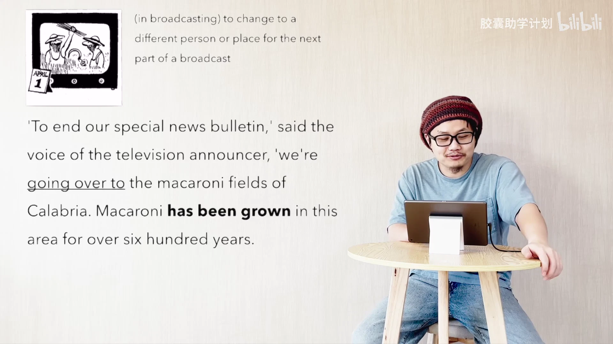

文字识别：(in broadcasting) to change to a / 胶囊助学计划bibil / different person or place for the next / part of a broadcast / APRIL / 1 / 'To end our special news bulletin,' said the / voice of the television announcer, 'we're / going over to the macaroni fields of / Calabria. Macaroni has been grown in this / area for over six hundred years.

### 画面 00:00:45

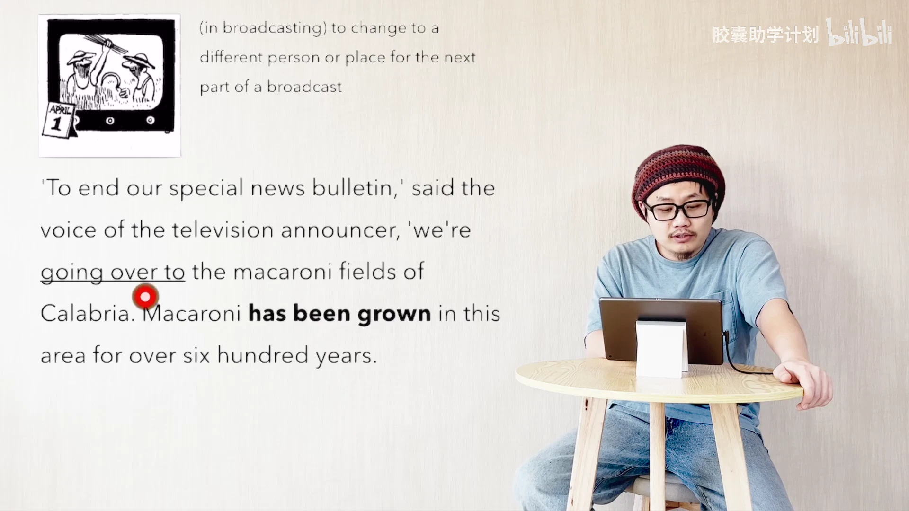

文字识别：(in broadcasting) to change to a / 胶囊助学计划bibi / different person or place for the next / part of a broadcast / APRIL / 1 / 'To end our special news bulletin,' said the / voice of the television announcer, 'we're / going over to the macaroni fields of / Calabria. Macaroni has been grown in this / area for over six hundred years.

### 画面 00:00:48

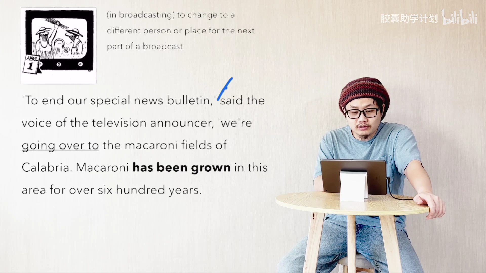

文字识别：(in broadcasting) to change to a / 胶囊助学计划bibi / different person or place for the next / part of a broadcast / APRIL / 1 / 'To end our special news bulletin,'said the / voice of the television announcer, 'we're / going over to the macaroni fields of / Calabria. Macaroni has been grown in this / area for over six hundred years.

### 画面 00:00:51

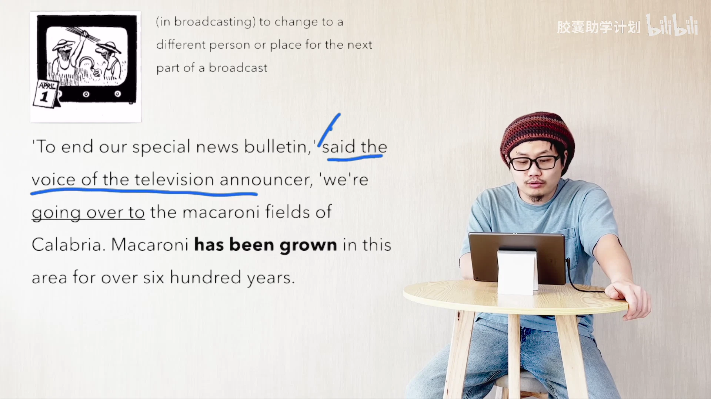

文字识别：(in broadcasting) to change to a / 胶囊助学计划ib出 / different person or place for the next / part of a broadcast / APRIL / 1 / 'To end our special news bulletin,'said the / voice of the television announcer, 'we're / going over to the macaroni fields of / Calabria. Macaroni has been grown in this / area for over six hundred years.

## 00:01:00–00:01:30

的特别的新闻简讯啊，这是一个其实特别流程化的语言啊，非常流程化的语言。我们接下来讲最后一个，对吧？它是一个特别流程化的语言，呃，所以您不需要专门去记它。Said the voice of the television announcer. Ah,什么说到呢？啊，什么说到呢？这个电视的这个播报员嗓音啊，说到。We are going over to the macaroni fields of Calabria.注意，你看它这地方

### 画面 00:01:05

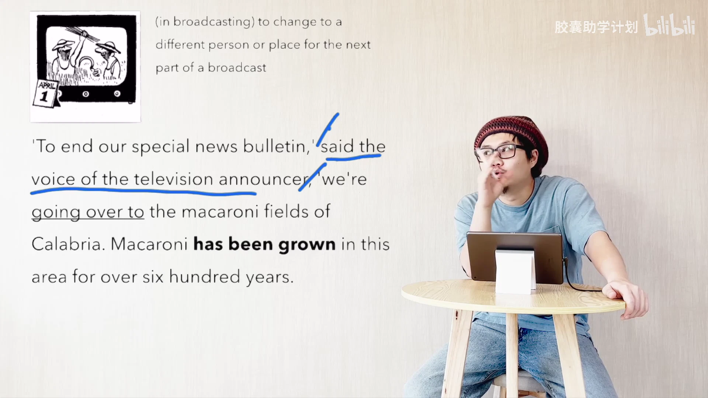

文字识别：(in broadcasting) to change to a / 胶囊助学计划bii / different person or place for the next / part of a broadcast / APRIL / 1 / 'To end our special news bulletin,'/said the / voice of the television announcer, 'we're / going over to the macaroni fields of / Calabria. Macaroni has been grown in this / area for over six hundred years.

### 画面 00:01:29

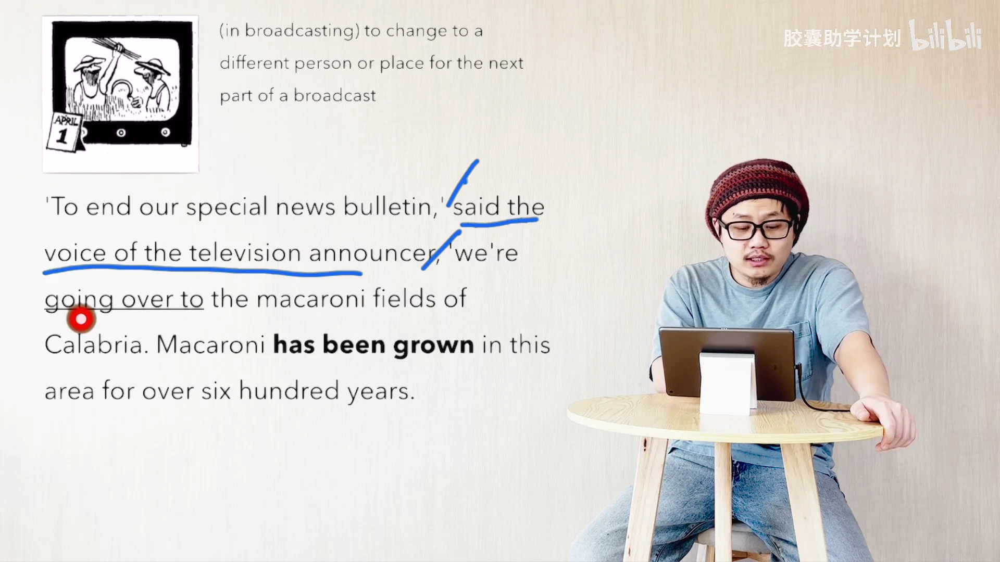

文字识别：(in broadcasting) to change to a / 胶囊助学计划bi / different person or place for the next / part of a broadcast / APRIL / 1 / 'To end our special news bulletin,'said the / voice of the television announcey, 'we're / going over to the macaroni fields of / Calabria. Macaroni has been grown in this / area for over six hundred years.

## 00:01:30–00:02:00

叫going over to是什么意思呢？我先给你看一下。首先，它不常用，这个基本上，所以我们根本都没当习惯用法去造句。他说，in broadcasting，在这种直播、这种这个广播，也许是电视当中啊，to to change to a different person or place for the next part of the broadcast，去转交这个画面或转交这个声音给另外一个人或另外一个地方，对吧？你看，我们基本上汉语当中，在新闻播报的时候，我们汉语这个going over to翻译成什么比较好呢？

### 画面 00:01:33

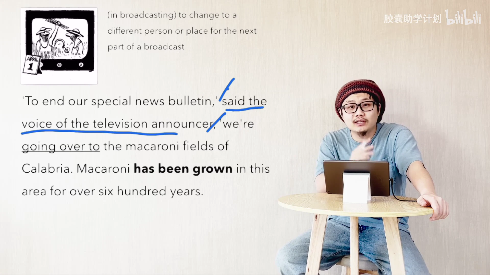

文字识别：(in broadcasting) to change to a / 胶囊助学计划bi / different person or place for the next / part of a broadcast / APRIL / 1 / 'To end our special news bulletin,'said the / voice of the television announcer, 'we're / going over to the macaroni fields of / Calabria. Macaroni has been grown in this / area for over six hundred years.

### 画面 00:01:37

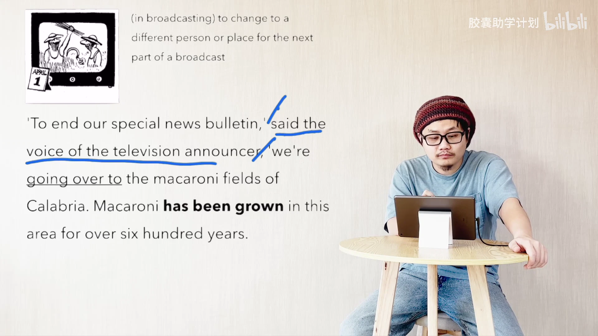

文字识别：(in broadcasting) to change to a / 胶囊助学计划bib / different person or place for the next / part of a broadcast / APRIL / 1 / 'To end our special news bulletin,'said the / voice of the television announcer 'we're / going over to the macaroni fields of / Calabria. Macaroni has been grown in this / area for over six hundred years.

### 画面 00:01:51

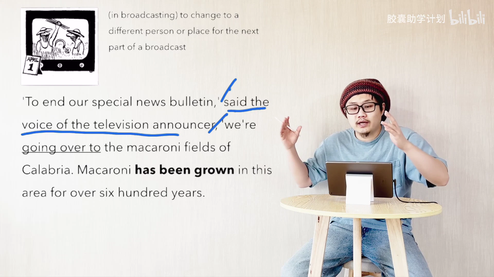

文字识别：(in broadcasting) to change to a / 胶囊助学计划bibi / different person or place for the next / part of a broadcast / APRIL / 1 / 'To end our special news bulletin,'said the / voice of the television announcer, 'we're / going over to the macaroni fields of / Calabria. Macaroni has been grown in this / area for over six hundred years.

### 画面 00:01:55

文字识别：(in broadcasting) to change to a / 胶囊助学计划 / bilbil / different person or place for the next / part of a broadcast / APRIL / 1 / 'To end our special news bulletin,'said the / voice of the television announcer, 'we're / going over to the macaroni fields of / Calabria. Macaroni has been grown in this / area for over six hundred years.

### 画面 00:01:58

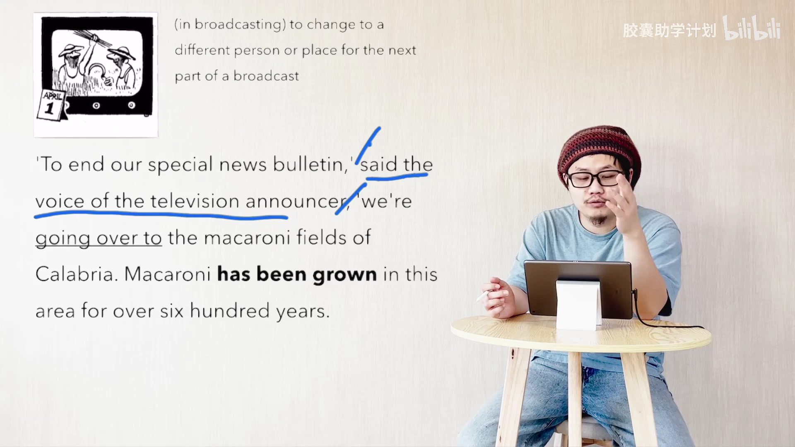

文字识别：(in broadcasting) to change to a / 胶囊助学计划bl出 / different person or place for the next / part of a broadcast / APRIL / 1 / 'To end our special news bulletin,'said the / voice of the television announcer we're / going over to the macaroni fields of / Calabria. Macaroni has been grown in this / area for over six hundred years.

## 00:02:00–00:02:30

让我们现在把话筒交给谁谁谁，让我们把现在把这个这个这个这个镜头转向谁谁谁，哎，就是 going over to 的意思，对吧？所以他现在在直播间里说说，哎，让我们现在一起把镜头转给 Macaroni Fields of Calabria。 Calabria 就是一个地方，你不用管它啊。它甚至不是一个英文的地方，是一个意大利语的地方。它甚至不完全符合英文的那些什么啊拼的习惯，所以您不用管它啊。也不是一个特别有名的地方，它不像罗

### 画面 00:02:28

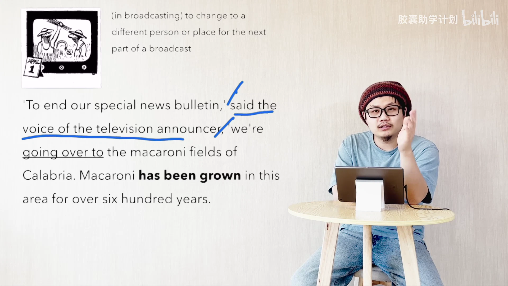

文字识别：(in broadcasting) to change to a / 胶囊助学计划bibi / different person or place for the next / part of a broadcast / APRIL / 1 / 'To end our special news bulletin,'said the / voice of the television announcer, 'we're / going over to the macaroni fields of / Calabria. Macaroni has been grown in this / area for over six hundred years.

## 00:02:30–00:03:00

马那么有名啊。然后呢，the macaroni fields of Calabria，你是说Calabria这个地方的macaroni fields叫做通心粉田地？哎，这个就属于是，如果你可能常识比较差的话，你基本上很可能会被骗。首先，我先说一下，在我印象当中，这篇文章是曾经真实发生过的一件

### 画面 00:02:41

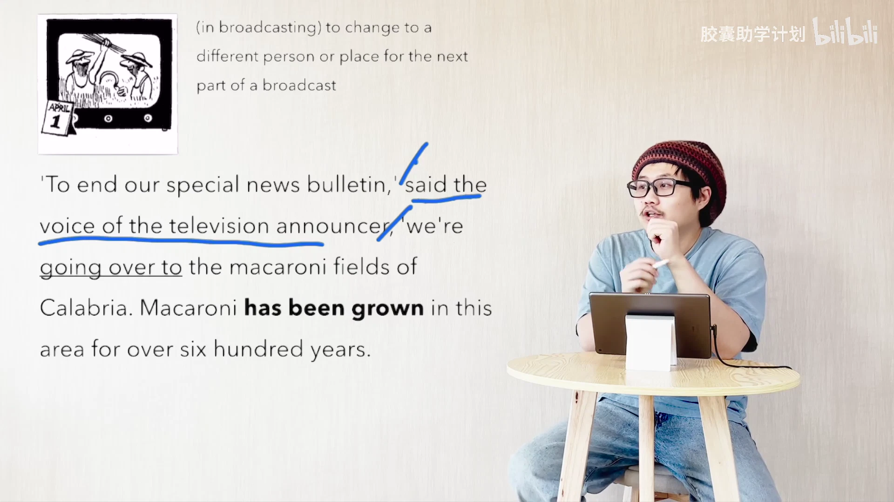

文字识别：(in broadcasting) to change to a / 胶囊助学计划bibi / different person or place for the next / part of a broadcast / APRIL / 1 / 'To end our special news bulletin,'said the / voice of the television announcer, 'we're / going over to the macaroni fields of / Calabria. Macaroni has been grown in this / area for over six hundred years.

### 画面 00:02:44

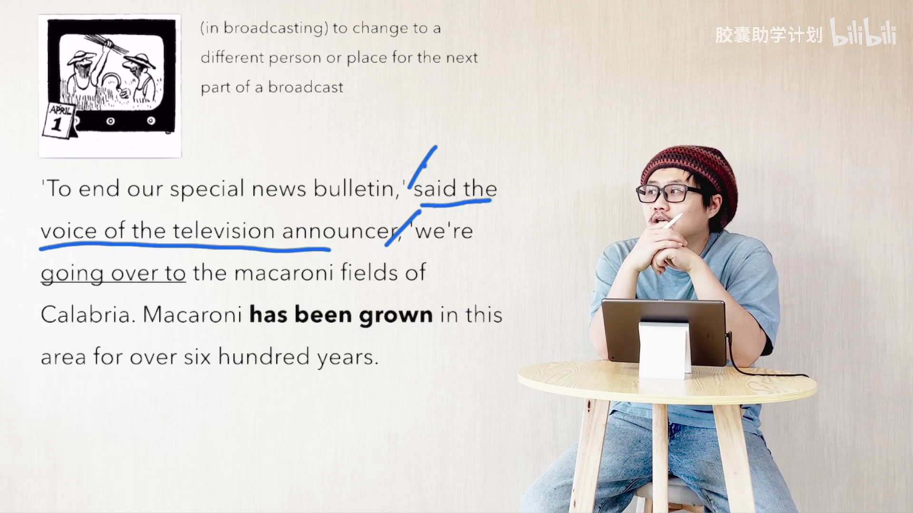

文字识别：(in broadcasting) to change to a / 胶囊助学计划bib / different person or place for the next / part of a broadcast / APRIL / 1 / 'To end our special news bulletin,'said the / voice of the television announcer, 'we're / going over to the macaroni fields of / Calabria. Macaroni has been grown in this / area for over six hundred years.

## 00:03:00–00:03:30

事情，你听好啊，是真真正正发生过的一件事情，是在英国，我记得是BBC的一个播报，就是在四月一号那天播的这篇文章。播完了之后，真的就有很多人打电话问，说在哪儿能买到这个在这片地里产生的这个通心粉，对吧？就是这个地里的通心粉，就让我想起来小的时候，我这个问我爸妈，我说这个就类似于那种说，哎，馒

### 画面 00:03:14

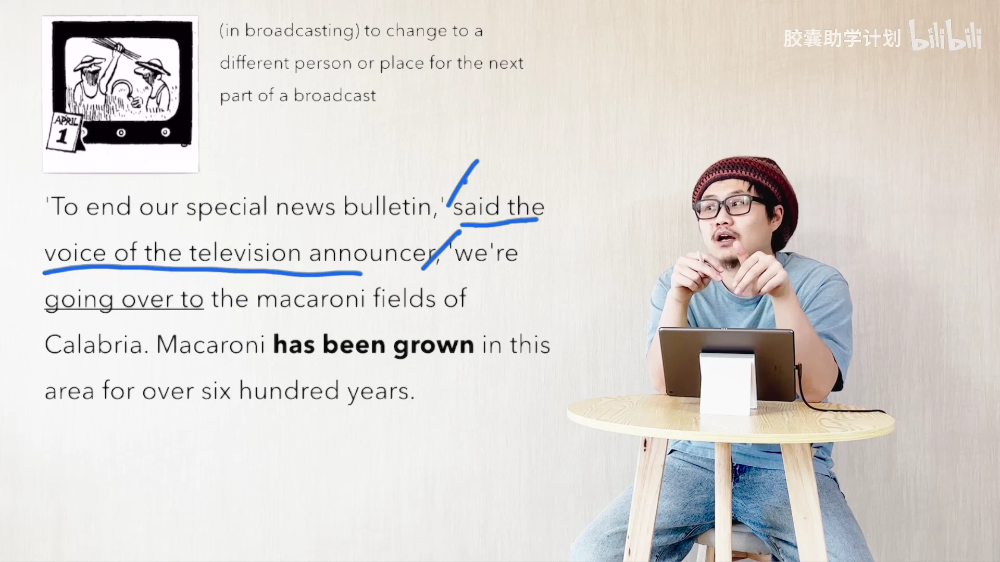

文字识别：(in broadcasting) to change to a / 胶囊助学计划bibi / different person or place for the next / part of a broadcast / APRIL / 1 / 'To end our special news bulletin,'said the / voice of the television announcer 'we're / going over to the macaroni fields of / Calabria. Macaroni has been grown in this / area for over six hundred years.

## 00:03:30–00:04:00

头是在哪儿长出来的？包子是在哪儿长出来的？这个面粉是在哪儿长出来的？就是这种感觉。你种出来的肯定不是macaroni，不是那个通心粉，对吧？但是你用种出来那个东西去制作成了通心粉，就像我们种出来一个东西，这个东西被磨成了面粉，面粉去制作成了包子，对吧？哎，所以买你要知道macaroni是这么一个东西。但是当年我印象当中是BBC啊，它播报完这个假新闻了之后，真的，当时

### 画面 00:03:40

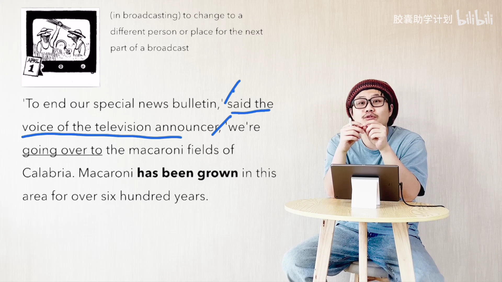

文字识别：(in broadcasting) to change to a / 胶囊助学计划bi / different person or place for the next / part of a broadcast / APRIL / 1 / 'To end our special news bulletin,'said the / voice of the television announcer, 'we're / going over to the macaroni fields of / Calabria. Macaroni has been grown in this / area for over six hundred years.

### 画面 00:03:42

文字识别：(in broadcasting) to change to a / 胶囊助学计划bilbl / different person or place for the next / part of a broadcast / APRIL / 1 / 'To end our special news bulletin,'said the / voice of the television announcer, 'we're / going over to the macaroni fields of / Calabria. Macaroni has been grown in this / area for over six hundred years.

### 画面 00:03:44

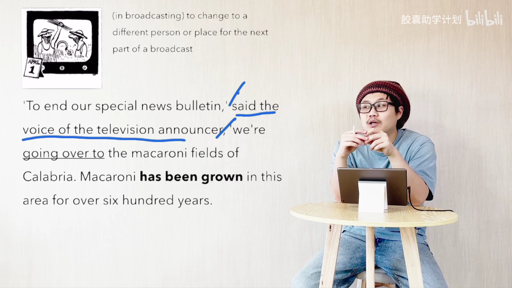

文字识别：(in broadcasting) to change to a / 胶囊助学计划biiil / different person or place for the next / part of a broadcast / APRIL / 1 / 'To end our special news bulletin,'said the / voice of the television announcer, 'we're / going over to the macaroni fields of / Calabria. Macaroni has been grown in this / area for over six hundred years.

## 00:04:00–00:04:30

啊，就有非常非常多的这个人去打电话给他们，问他们这个事儿啊，很有意思。好，我们接着往下走。说Macaroni has been grown in this area for over six hundred years.好，这句话从这句话开始都是这个通心粉新闻的内容了，听见了吧？好，然后在这个地方呢，教各位一个非常小的技巧啊，非常小的技巧。我当时上课的时候跟我的学员是一起示

### 画面 00:04:01

文字识别：胶囊助学计划ilbl / (in broadcasting) to change to a / different person or place for the next / part of a broadcast / APRIL / 1 / 'To end our special news bulletin,'said the / voice of the television announcer, 'we're / going over to the macaroni fields of / Calabria. Macaroni has been grown in this / area for over six hundred years.

### 画面 00:04:10

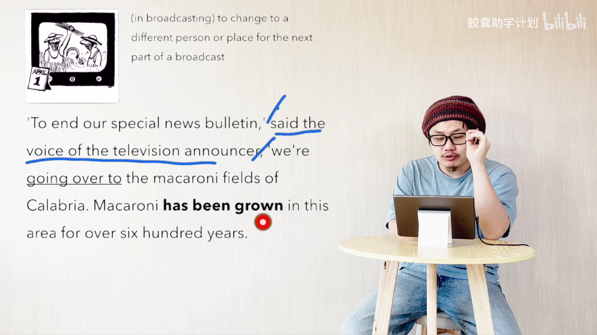

文字识别：(in broadcasting) to change to a / 胶囊助学计划 / bilbii / different person or place for the next / part of a broadcast / APRIL / 1 / 'To end our special news bulletin,'said the / voice of the television announcer we're / going over to the macaroni fields of / Calabria. Macaroni has been grown in this / area for over six hundred years.

### 画面 00:04:22

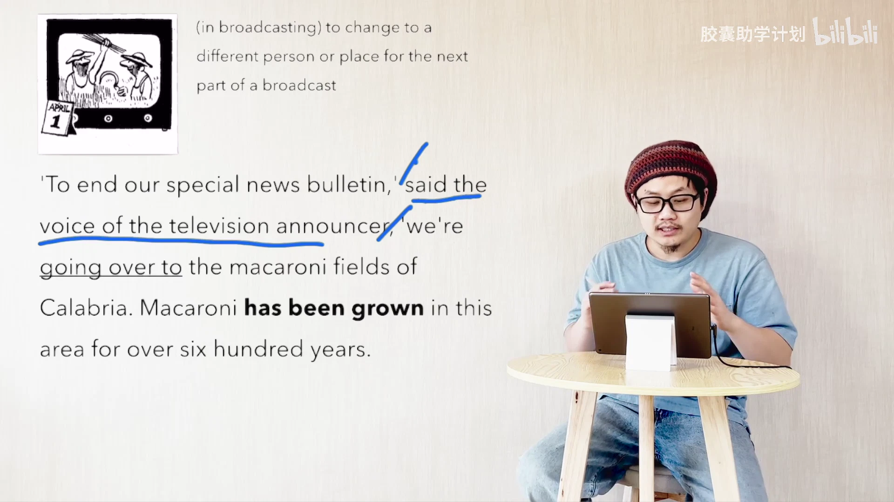

文字识别：(in broadcasting) to change to a / 胶囊助学计划 / Bilbii / different person or place for the next / part of a broadcast / APRIL / 1 / 'To end our special news bulletin,'said the / voice of the television announcer, we're / going over to the macaroni fields of / Calabria. Macaroni has been grown in this / area for over six hundred years.

### 画面 00:04:24

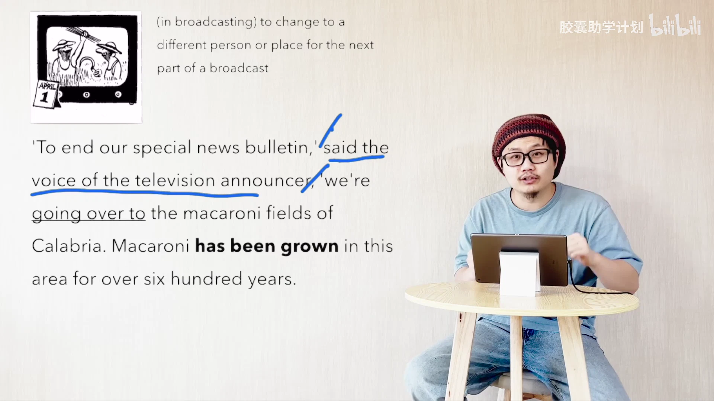

文字识别：(in broadcasting) to change to a / 胶囊助学计划bi / different person or place for the next / part of a broadcast / APRIL / 1 / 'To end our special news bulletin,'/said the / voice of the television announcer 'we're / going over to the macaroni fields of / Calabria. Macaroni has been grown in this / area for over six hundred years.

### 画面 00:04:26

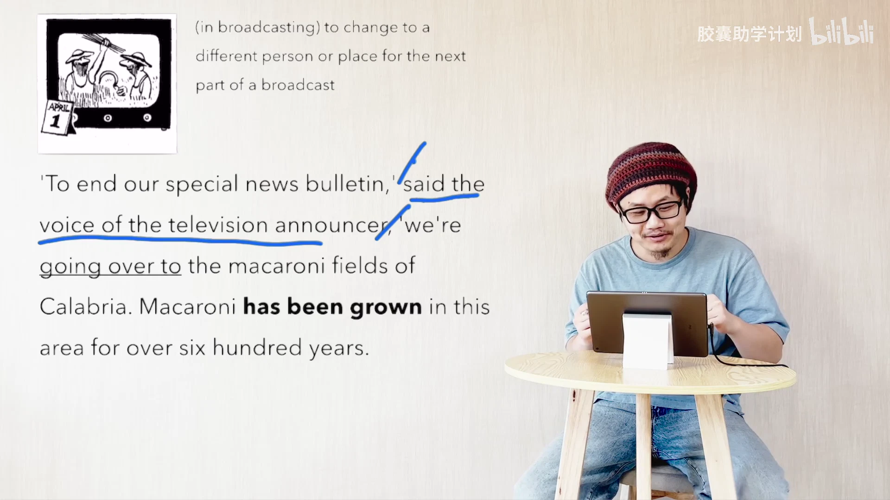

文字识别：(in broadcasting) to change to a / 胶囊助学计划bib出 / different person or place for the next / part of a broadcast / APRIL / 1 / 'To end our special news bulletin,'said the / voice of the television announcer 'we're / going over to the macaroni fields of / Calabria. Macaroni has been grown in this / area for over six hundred years.

### 画面 00:04:28

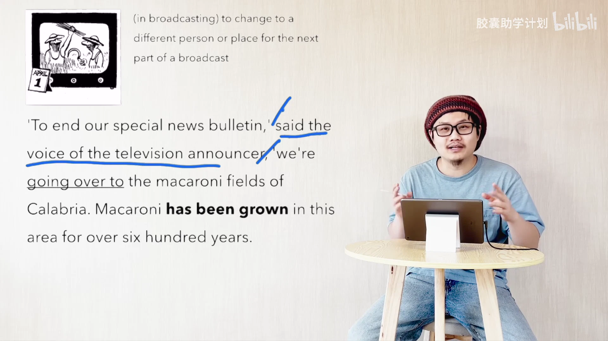

文字识别：(in broadcasting) to change to a / 胶囊助学计划 / Bilbii / different person or place for the next / part of a broadcast / APRIL / 1 / 'To end our special news bulletin,'said the / voice of the television announcer, we're / going over to the macaroni fields of / Calabria. Macaroni has been grown in this / area for over six hundred years.

## 00:04:30–00:05:00

范过这个技巧，就是骗子怎么骗你呢？他给你提供的细节越多，越多，比如说什么脚上有怎么怎么怎么脚有一块痣啊，那个鞋上底下有一块什么什么东西，块石头卡在那儿了，越细节的东西，持续了多长时间呢？哪些人物？哪些地点呢？对吧？这些细节越多，你越会容易被骗啊！你相信那些很多的人，他可能也不是说听到这个，如果

### 画面 00:04:58

文字识别：(in broadcasting) to change to a / 胶囊助学计划 / bibi / different person or place for the next / part of a broadcast / APRIL / 1 / 'To end our special news bulletin,'said the / voice of the television announcer 'we're / going over to the macaroni fields of / Calabria. Macaroni has been grown in this / area for over six hundred years.

## 00:05:00–00:05:30

你就告诉他说，哎，我们这个地上长包子了，你跟他这么说，他可能也不信。但是如果你给他提供了非常多、非常多的细节了之后，他可能就当真了。比如说这篇文章就是说已经被种植在这片地地区超过六百年了。你看，提供了一个时间，具体的时间。OK，那我们继续，Two of the leading growers啊，呃，这个two啊，两个主要的

### 画面 00:05:23

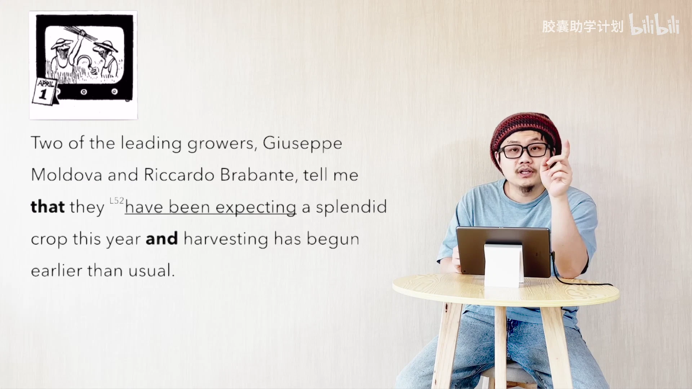

文字识别：胶囊助学计划ill / APRIL / 1 / Two of the leading growers, Giuseppe / Moldova and Riccardo Brabante, tell me / that they 5have been expecting a splendid / crop this year and harvesting has begun / earlier than usual.

## 00:05:30–00:06:00

种植者啊，这个 Dusip Moldovaca，呃呃 Moldova and Ricardo Berbante，是吧？这个呃这两个人名儿，它就不是英英国人的人名，是意大利语啊。这个 Ricardo Berbante，这个典型的意大利人的这个人名啊。呃，Tell me that，告诉我，They have been expecting a splendid crop this year， and harvesting had began earlier than

### 画面 00:05:42

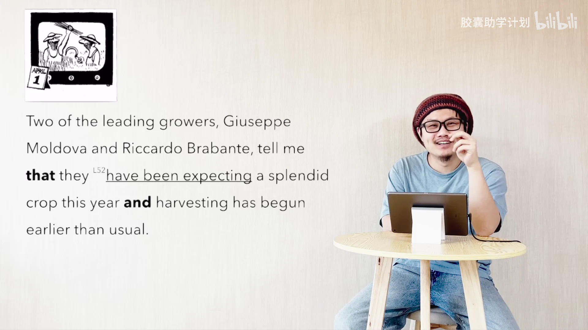

文字识别：胶囊助学计划bilbl / APRIL / 1 / Two of the leading growers, Giuseppe / Moldova and Riccardo Brabante, tell me / that they 52have been expecting a splendid / crop this year and harvesting has begun / earlier than usual.

### 画面 00:05:45

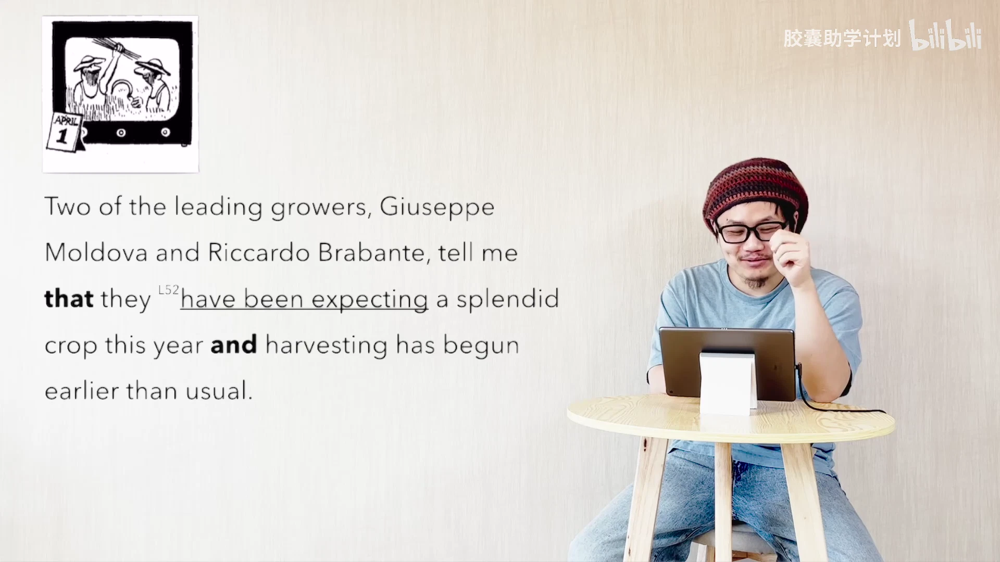

文字识别：胶囊助学计划bibi / APRIL / 1 / Two of the leading growers, Giuseppe / Moldova and Riccardo Brabante, tell me / that they 5²have been expecting a splendid / crop this year and harvesting has begun / earlier than usual.

### 画面 00:05:48

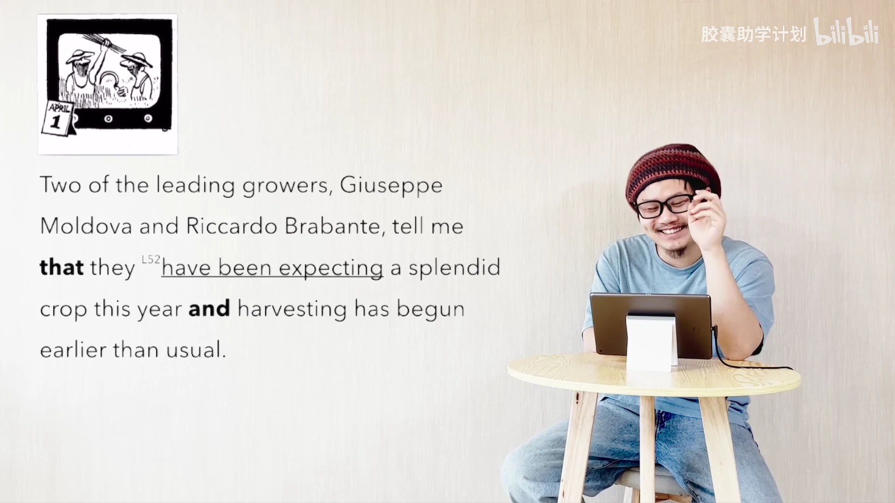

文字识别：胶囊助学计划bib山 / APRIL / 1 / Two of the leading growers, Giuseppe / Moldova and Riccardo Brabante, tell me / that they 52have been expecting a splendid / crop this year and harvesting has begun / earlier than usual.

### 画面 00:05:51

文字识别：Bilbii / 胶囊助学计划 / APRIL / 1 / Two of the leading growers, Giuseppe / Moldova and Riccardo Brabante, tell me / that they [52have been expecting a splendid / crop this year and harvesting has begun / earlier than usual.

## 00:06:00–00:06:30

usual.你看这句话齁长是吧？虽然很长，其实还好啊。我们看一下啊，这个关键的词其实给你标出来，该断句都断句了啊。说两个主要的种植者是吧？Gusip Moldova and Ricardo Brabanti是吧？这个这个东西和前面的这个这两个人名就是前面这个 two of the leading growers.那它不就是一个同位语嘛，对吧？然后告诉我，告诉

### 画面 00:06:08

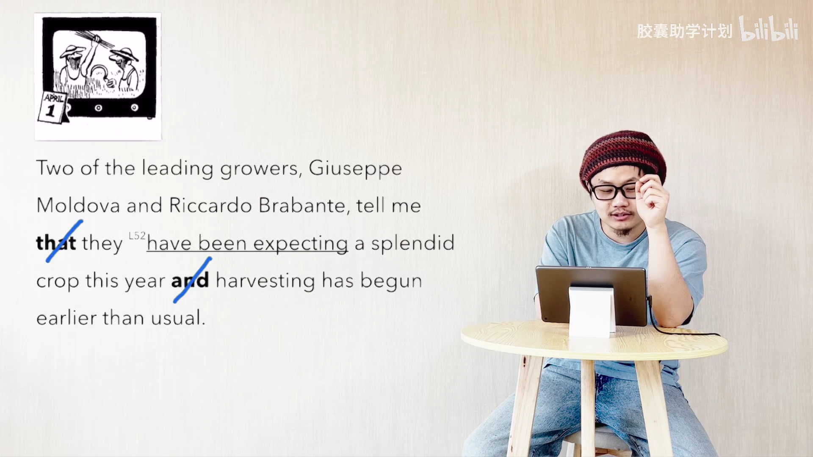

文字识别：胶囊助学计划biil / APRIL / 1 / Two of the leading growers, Giuseppe / Moldova and Riccardo Brabante, tell me / that they 52have been expecting a splendid / crop this year ayd harvesting has begun / earlier than usual.

### 画面 00:06:22

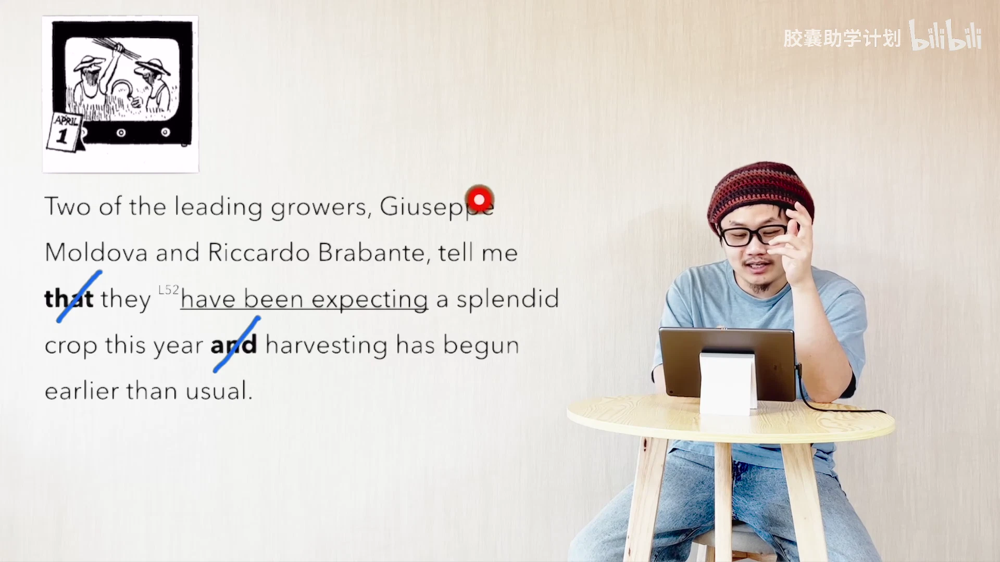

文字识别：bilbii / 胶囊助学计划 / APRIL / 1 / Two of the leading growers, Giusep / Moldova and Riccardo Brabante, tell me / that they 52have been expecting a splendid / crop this year ayd harvesting has begun / earlier than usual.

### 画面 00:06:25

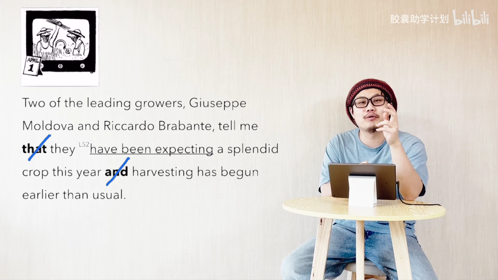

文字识别：胶囊助学计划bilb出 / APRIL / 1 / Two of the leading growers, Giuseppe / Moldova and Riccardo Brabante, tell me / that they 52have been expecting a splendid / crop this year ayd harvesting has begun / earlier than usual.

### 画面 00:06:28

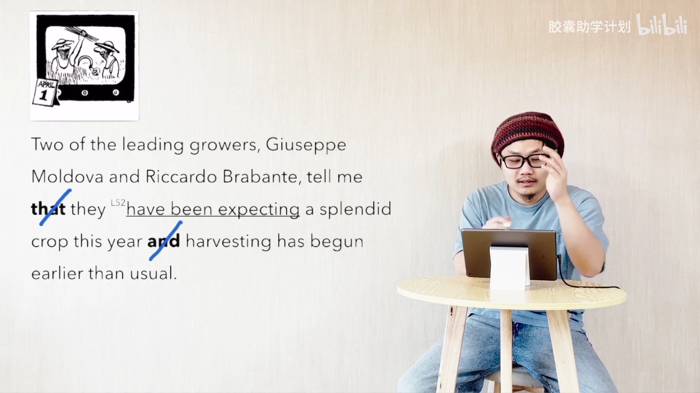

文字识别：bibili / 胶囊助学计划 / APRIL / 1 / Two of the leading growers, Giuseppe / Moldova and Riccardo Brabante, tell me / that they 52have been expecting a splendid / crop this year ayd harvesting has begun / earlier than usual.

## 00:06:30–00:07:00

我后边一个宾语从句是一件事儿。说他们 have been expecting 是本科咱们复习过的五十二课那个现在完成进行时。A splendid crop this year，一个极好的收成庄稼是吧？今年。然后呢，harvesting就是收获，已经开始了。Earlier than usual，比平常更早的时间已经开始了。然后这个地方你注意一个点，叫 harvesting。Harvesting，harvest 在练习的时候咱们已经学过了。它为什么加了个 ing 呢？二十课你学

### 画面 00:06:58

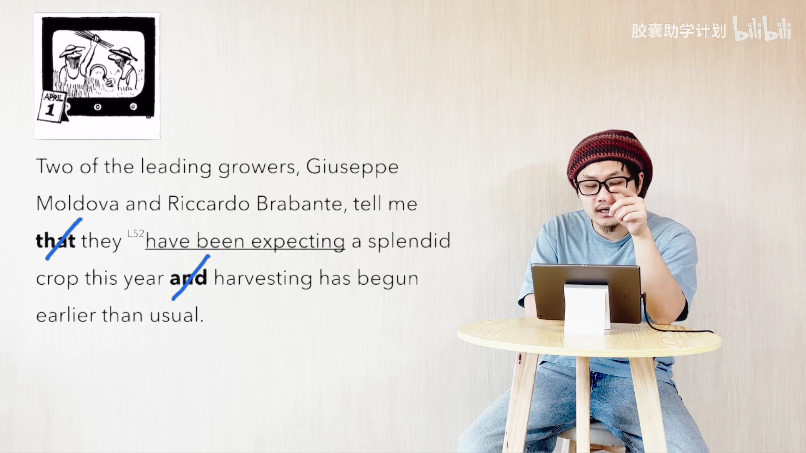

文字识别：bibili / 胶囊助学计划 / APRIL / 1 / Two of the leading growers, Giuseppe / Moldova and Riccardo Brabante, tell me / that they 5²have been expecting a splendid / crop this year ayd harvesting has begun / earlier than usual.

## 00:07:00–00:07:30

过，你就知道为啥啊？动词放在主语的位置上，换动名词吗？Harvesting.所以这句话咱们就可以结束了。我们看下一句话啊。Here you can see two workers who, between them, have just finished cutting three cartloads of golden brown macaroni stalks.你看他又提供了更多的细节。刚才首先跟你说在哪儿种，再跟你说又种了多长时间，又给你编了几个人，

### 画面 00:07:09

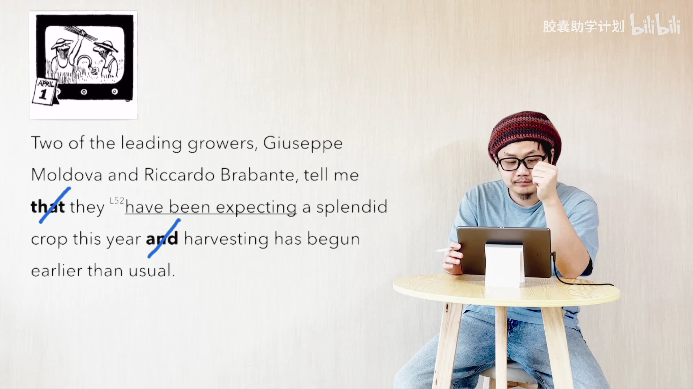

文字识别：bilbii / 胶囊助学计划 / APRIL / 1 / Two of the leading growers, Giuseppe / Moldova and Riccardo Brabante, tell me / that they 52have been expecting a splendid / crop this year ard harvesting has begun / earlier than usual.

### 画面 00:07:11

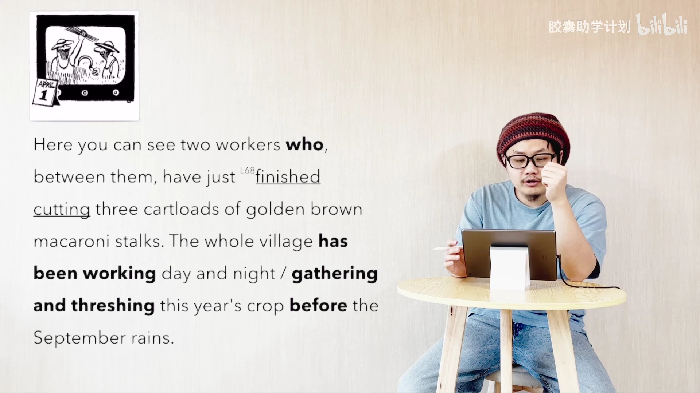

文字识别：胶囊助学计划ib出 / APRIL / 1 / Here you can see two workers who, / between them, have just [6finished / Cutting three cartloads of golden brown / macaroni stalks. The whole village has / been working day and night / gathering / and threshing this year's crop before the / September rains.

### 画面 00:07:23

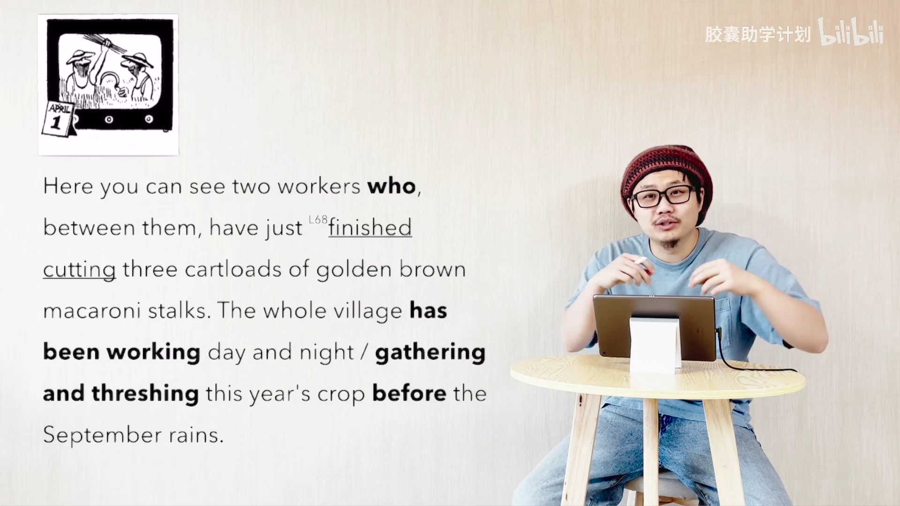

文字识别：胶囊助学计划bilb出 / APRIL / 1 / Here you can see two workers who, / between them, have just L6finished / Cutting three cartloads of golden brown / macaroni stalks. The whole village has / been working day and night / gathering / and threshing this year's crop before the / September rains.

## 00:07:30–00:08:00

对吧？所以基本上就是你如果没有仔细去想，基本上一片一个准儿。说在这儿你又能看到两个工人，说这个这个，我们先不管这个 between 怎么啊？他们说刚刚怎么样？Finish cutting, ah, finish doing something, 完成了某件事儿。我刚刚砍完了 three cartloads of golden brown macaroni stocks. 提供的细节越多，人越会被骗。不仅告诉你说 cut cut 了，不仅告诉你这个这个这

### 画面 00:07:31

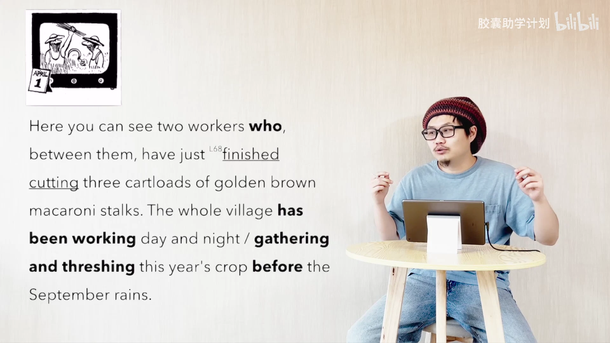

文字识别：胶囊助学计划bibil / APRIL / 1 / Here you can see two workers who, / between them, have just ⁶finished / Cutting three cartloads of golden brown / macaroni stalks. The whole village has / been working day and night / gathering / and threshing this year's crop before the / September rains.

### 画面 00:07:34

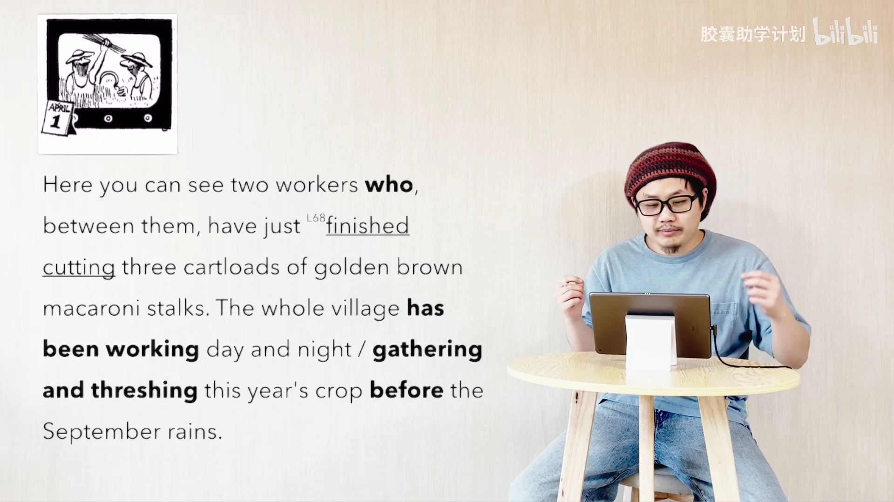

文字识别：胶囊助学计划bilil / APRIL / 1 / Here you can see two workers who, / between them, have just [6finished / cutting three cartloads of golden brown / macaroni stalks. The whole village has / been working day and night / gathering / and threshing this year's crop before the / September rains.

## 00:08:00–00:08:30

个砍了，还告诉你砍的是三大车的，还告诉你颜色金棕色的，对吧？什么东西呢？Macaroni stocks，通心粉的这个什么呢？叫做这个根茎啊，这个梗，对吧？砍了三大车，他们刚刚完成砍了三大车。然后这个这个 between them呢，有一个呃很有意思，就我们的教材当中给他的一个翻译叫做在呃某人的这个齐心协力之下，对吧？

### 画面 00:08:04

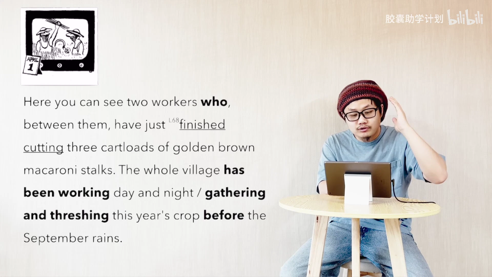

文字识别：胶囊助学计划bilb出 / APRIL / 1 / Here you can see two workers who, / between them, have just L6finished / Cutting three cartloads of golden brown / macaroni stalks. The whole village has / been working day and night / gathering / and threshing this year's crop before the / September rains.

## 00:08:30–00:09:00

吧？然后呢，在这个地方，其实如果你就把它，我觉得啊，我们就直接给它直译成叫做在他们中间，你看到了三大卡车什么什么样？我个人认为问题是不大的，是吧？就是你能看到两个工人后边一个定语从句，是吧？他们刚刚怎么怎么样了？然后呢，你可以在看到在他们中间怎么怎么样？那你给它翻译成文章当中啊，这个呃给的说在他们齐心协力之下呢，我觉得也行，

### 画面 00:08:34

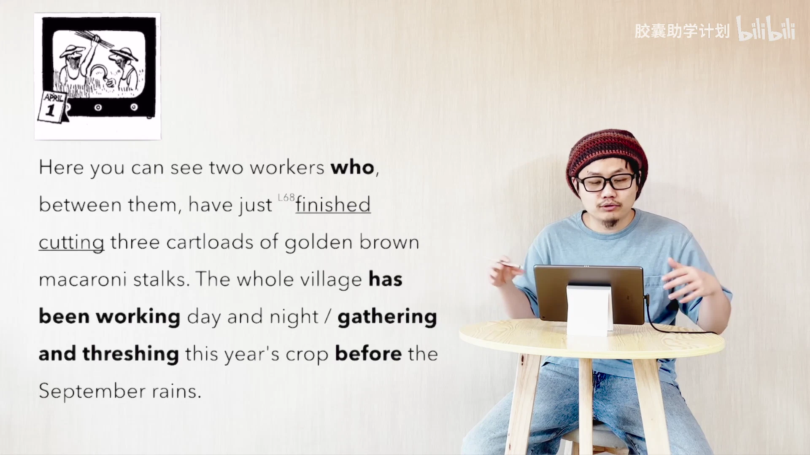

文字识别：胶囊助学计划bilil / APRIL / 1 / Here you can see two workers who, / between them, have just [6finished / Cutting three cartloads of golden brown / macaroni stalks. The whole village has / been working day and night / gathering / and threshing this year's crop before the / September rains.

## 00:09:00–00:09:30

对吧？The whole village has been working day and night, gathering and threshing this year's crop before the September rains. 这句话乍一看依旧挺长的，但是我给你在这画了一个斜线啊，在这儿再来一个斜线，一个难句又被拆成了三个句子。第一个，The whole village has been working day and night. 呃，整个这个村落，哎，一直都在没日没夜的工作。

### 画面 00:09:04

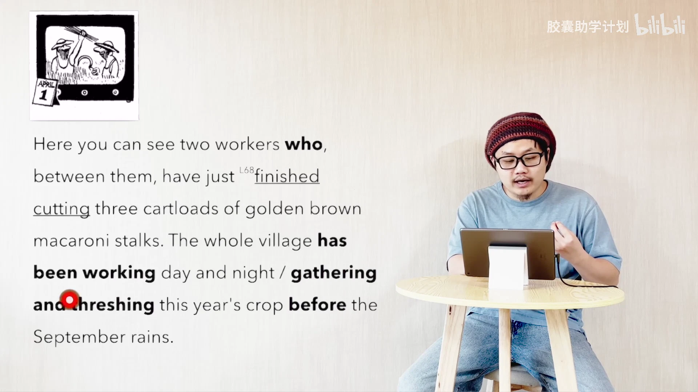

文字识别：胶囊助学计划bi / APRIL / 1 / Here you can see two workers who, / between them, have just [6finished / Cutting three cartloads of golden brown / macaroni stalks. The whole village has / been working day and night / gathering / andhreshing this year's crop before the / September rains.

### 画面 00:09:14

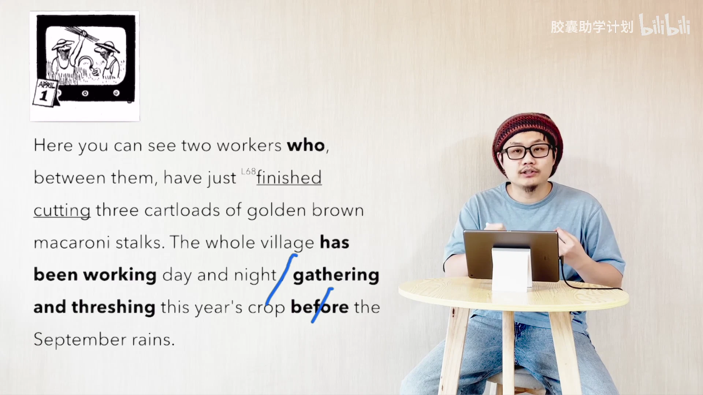

文字识别：胶囊助学计划ibl / APRIL / 1 / Here you can see two workers who, / between them, have just [6finished / Cutting three cartloads of golden brown / macaroni stalks. The whole village has / been working day and night / t/gathering / and threshing this year's crop before the / September rains.

## 00:09:30–00:10:00

第一个句子非常舒服，完事儿了。第二个句子叫做 Gathering and threshing this year's crop。收集打谷子，今年的庄稼。那这个地方就会有一个问题，就是这儿为啥用 Gathering and threshing 啊？其实也很容易去理解。你首先它现在没有主语，其实给你单独放到这儿，它没有主语，对吧？你想它主语是谁？主动被动？四十九课

### 画面 00:09:44

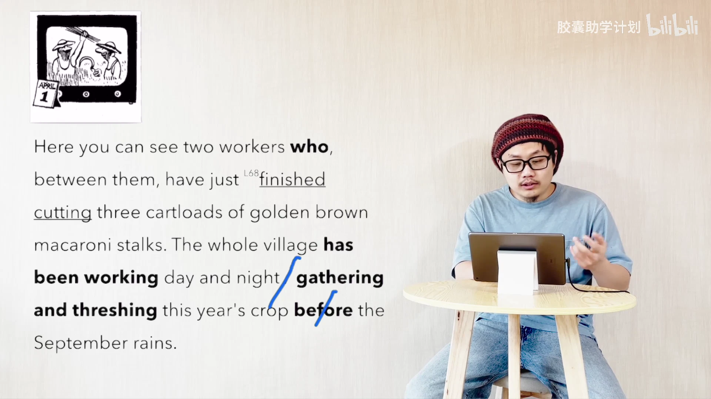

文字识别：胶囊助学计划bilbil / APRIL / 1 / Here you can see two workers who, / between them, have just [6finished / Cutting three cartloads of golden brown / macaroni stalks. The whole village has / been working day and night / t/gathering / and threshing this year's crop before the / September rains.

## 00:10:00–00:10:30

完事儿了，对吧？Whole village主动啊，before在什么之前呢？在September rains之前啊，在九月的这个大雨来临，那他们直接给翻译成了雨季啊，也没有问题啊。我们的课文注释给翻译成了雨季，就九月的雨季来临之前要完成这件事儿。Continue on the right, you can see Mrs. Berbonti herself,对吧？说在右手边你能看到Berbonti女士啊，Berbonti夫人啊，她自己。

### 画面 00:10:14

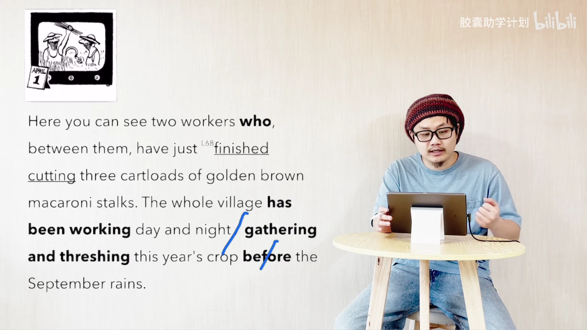

文字识别：胶囊助学计划bilbil / APRIL / 1 / Here you can see two workers who, / between them, have just '6finished / Cutting three cartloads of golden brown / macaroni stalks. The whole village has / been working day and night / t/gathering / and threshing this year's crop before the / September rains.

### 画面 00:10:18

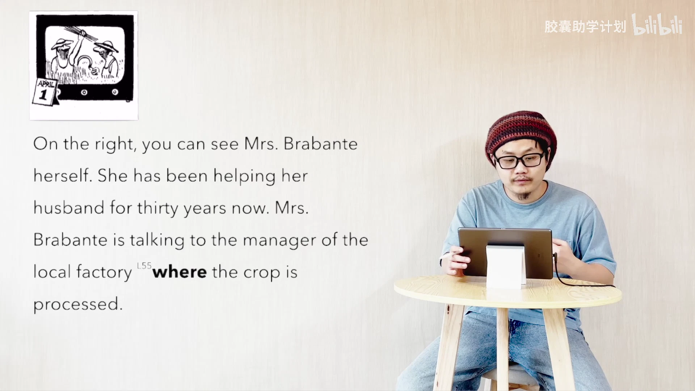

文字识别：胶囊助学计划bibil / APRIL / 1 / On the right, you can see Mrs. Brabante / herself. She has been helping her / husband for thirty years now. Mrs. / Brabante is talking to the manager of the / local factory / L55 / where the crop is / processed.

### 画面 00:10:21

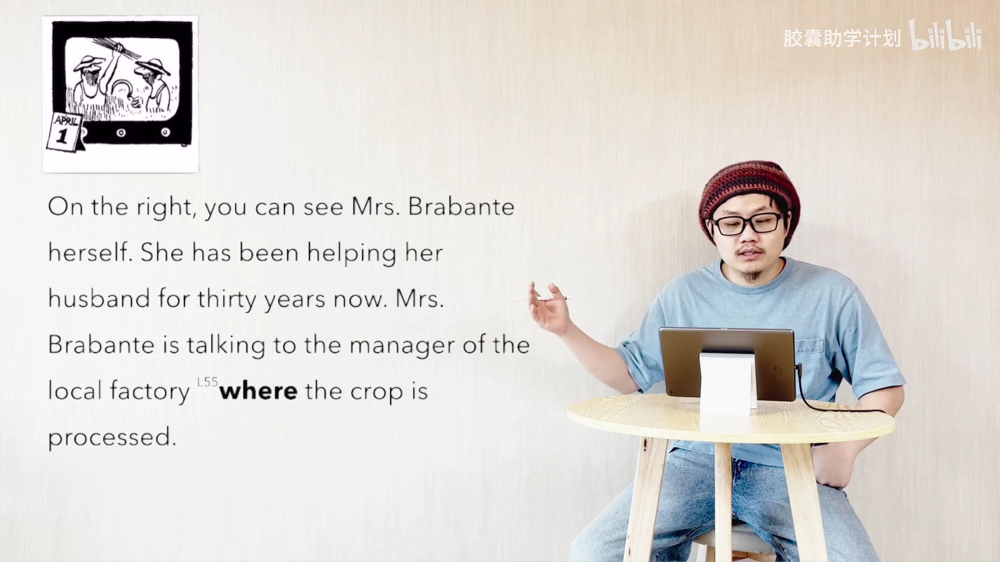

文字识别：胶囊助学计划ilb出 / APRIL / 1 / On the right, you can see Mrs. Brabante / herself. She has been helping her / husband for thirty years now. Mrs. / Brabante is talking to the manager of the / local factory / L55 / where the crop is / processed.

### 画面 00:10:24

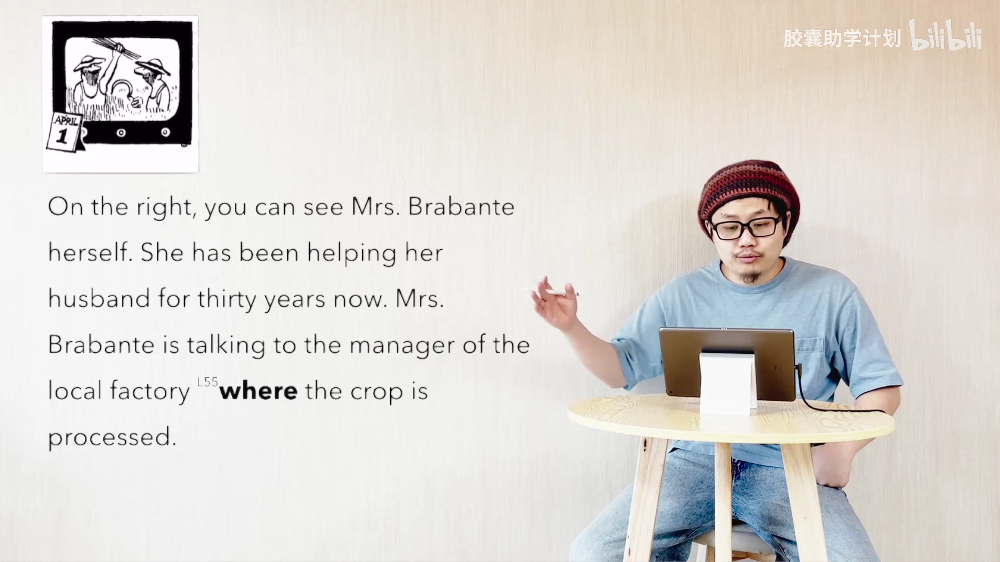

文字识别：胶囊助学计划bibi / APRIL / 1 / On the right, you can see Mrs. Brabante / herself. She has been helping her / husband for thirty years now. Mrs. / Brabante is talking to the manager of the / local factory / L55 / where the crop is / processed.

## 00:10:30–00:11:00

She has been helping her husband for thirty years now.她一直都在帮她的丈夫，帮了三十年了。哎，就已经帮她丈夫帮了三十年。你看，又提供了更多的细节，引入了新的人啊。然后，Mrs. Berbanti is talking to the manager of the local factory where the crop is processed.这句话里面就出现了一个比较重要之前学过的语法，要复习一下。说，Mrs. Berbanti夫人正在和谁聊天呢？The

### 画面 00:10:31

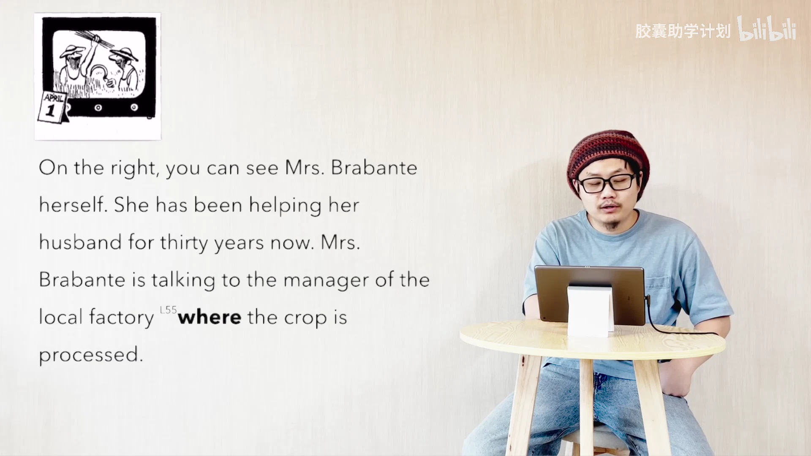

文字识别：bibili / 胶囊助学计划 / APRIL / 1 / On the right, you can see Mrs. Brabante / herself. She has been helping her / husband for thirty years now. Mrs. / Brabante is talking to the manager of the / local factory / L55 / 5where the crop is / processed.

## 00:11:00–00:11:30

manager of the local factory，由后往前翻译，本地工厂的经理正在和他聊天。然后这个where，五十五课咱们学过，whose跟where都学过了，对吧？这个where引导的定语从句，说在那里啊，我们往往就给它翻译成在那里。在那里是哪里呢？在那个工厂里啊，本地工厂里。The crop is being processed。这个庄稼啊，它编出来的这个macaroni stock啊，

### 画面 00:11:01

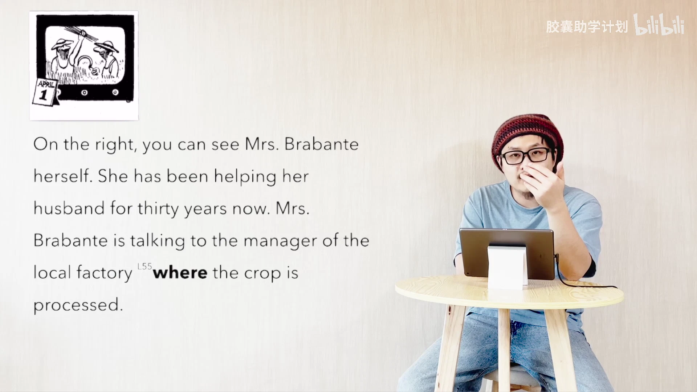

文字识别：胶囊助学计划bil出 / APRIL / 1 / On the right, you can see Mrs. Brabante / herself. She has been helping her / husband for thirty years now. Mrs. / Brabante is talking to the manager of the / local factory / L55 / where the crop is / processed.

## 00:11:30–00:12:00

macaroni 这个庄稼正在被加工。 Okay, continue. This last scene shows you what will happen at the end of the harvest, the famous Calabrian macaroni eating competition. 说这最后一幕，最后一个场景展示给您的是将发生什么啊？ What will happen? 将发生什么？接下来一个习惯用法叫做 at the end

### 画面 00:11:31

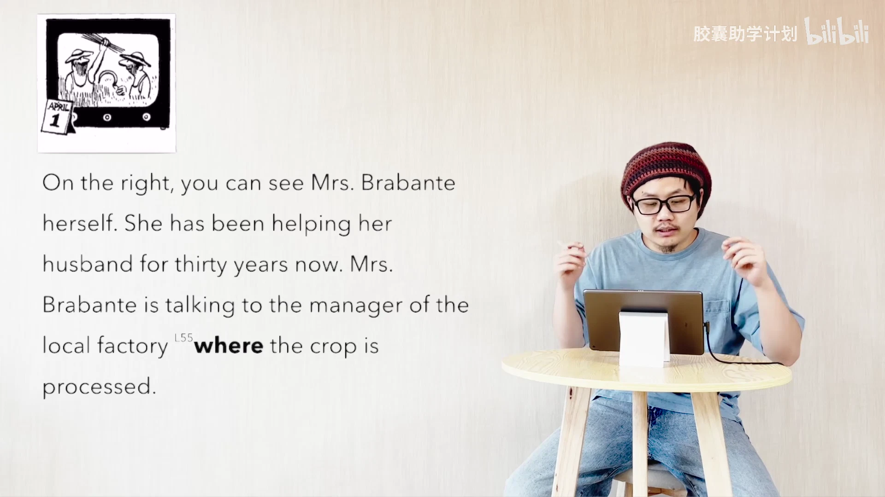

文字识别：胶囊助学计划bil出 / APRIL / 1 / On the right, you can see Mrs. Brabante / herself. She has been helping her / husband for thirty years now. Mrs. / Brabante is talking to the manager of the / local factory / L55 / where the crop is / processed.

### 画面 00:11:33

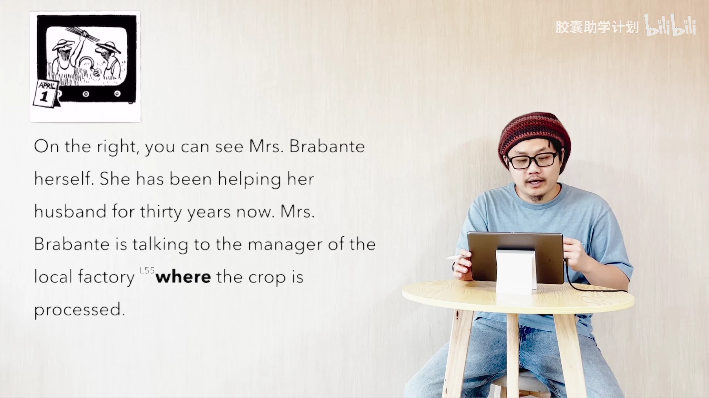

文字识别：胶囊助学计划bii出 / APRIL / 1 / On the right, you can see Mrs. Brabante / herself. She has been helping her / husband for thirty years now. Mrs. / Brabante is talking to the manager of the / local factory / L55 / where the crop is / processed.

### 画面 00:11:35

文字识别：胶囊助学计划bibi出 / APRIL / 1 / This last scene shows you what will happen / at the end of the harvest: the famous / Calabrian macaroni-eating competition! / Signor Fratell, the present champion, has / won it every year since 1991. And that ends / our special bulletin for today, Thursday, April / 1st. We're now going back to the studio.'

### 画面 00:11:39

文字识别：胶囊助学计划bibi / 2 / APRIL / 1 / This last scene shows you what will happen / at the end of the harvest: the famous / Calabrian macaroni-eating competition! / Signor Fratell, the present champion, has / won it every year since 1991. And that ends / our special bulletin for today, Thursday, April / 1st. We're now going back to the studio.'

## 00:12:00–00:12:30

of the harvest，在这个收获的结束将发生什么？哎，非常著名的 Calabrian 这个地区的 macaroni 吃吃通心粉大赛。Okay, 这是一个。然后接下来什么 senior呃 Fattoli 啊 Fattoli 是吧？就是意大利语那个说法 Fattoli senior Fattoli. The present champion has won

### 画面 00:12:09

文字识别：胶囊助学计划bilil / APRIL / 1 / This last scene shows you what will happen / at the end of the harvest: the famous / Calabrian macaroni-eating competition! / Signor Fratell, the present champion, has / won it every year since 1991. And that ends / our special bulletin for today, Thursday, April / 1st. We're now going back to the studio.'

### 画面 00:12:23

文字识别：胶囊助学计划bibi / APRIL / 1 / This last scene shows you what will happen / at the end of the harvest: the famous / Calabrian macaroni-eating competition! / Signor Fratell, the present champion, has / won it every year since 1991. And that ends / our special bulletin for today, Thursday, April / 1st. We're now going back to the studio.'

### 画面 00:12:26

文字识别：胶囊助学计划bi / APRIL / 1 / This last scene shows you what will happen / at the end of the harvest: the famous / Calabrian macaroni-eating competition! / Signor Fratelli the present champion, has / Won it every year since 1991. And that ends / our special bulletin for today, Thursday, April / 1st. We're now going back to the studio.'

## 00:12:30–00:13:00

it every year since 1991. Ah, so this Mr. Ferrari, ah, ah,同位语，目前的这个champion, ah,就是目前的这个冠军，一直都在赢这个比赛，每年都是重复，从过去重复和持续到现在，典型的现在完成时第二个用法，对吧？自从1991年，continue, and that ends our special bulletin for today, Thursday, April first.说那

### 画面 00:12:56

文字识别：胶囊助学计划ib山 / APRIL / 1 / This last scene shows you what will happen / at the end of the harvest: the famous / Calabrian macaroni-eating competition! / Signor Fratell, the present champion, has / won it every year since 1991. And that ends / our special bulletin for today, Thursday, April / 1st. We're now going back to the studio.'

## 00:13:00–00:13:30

就结束了我们今天特殊的新闻简简讯啊。周四四月一号, we are now going back to the studio. Studio,我们现在把镜头再转回给刚才不是 going over to吗？现在是 go back to,是吧？我们现在把镜头在哎还给这个呃呃这个直播间啊这个直播间哎这个呃这个把镜头再还回去啊，就是这样一种感觉。OK,本课的习惯用法at the end of就这样一个小的也很容易造句

### 画面 00:13:18

文字识别：胶囊助学计划bilil / APRIL / 1 / This last scene shows you what will happen / at the end of the harvest: the famous / Calabrian macaroni-eating competition! / Signor Fratelli the present champion, has / won it every year since 1991. And that ends / our special bulletin for today, Thursday, April / 1st. We're now going back to the studio.'

### 画面 00:13:25

文字识别：bilbili / 胶囊助学计划 / 习惯用法造句 / at the end of...

### 画面 00:13:27

文字识别：bilbii / 胶囊助学计划 / 习惯用法造句 / at the end of...

### 画面 00:13:29

文字识别：网：v.+v.变化 / 胶囊助学计划 / bilbili / 习惯用法造句指南 / 四句型转换 / 方式/地点/时间 / 其他习惯用法 / 其他单词+词性 / 原文摘抄+变 / 6123456 / at the end of... /  At the end of this week, I want you to get / out of here. L74

## 00:13:30–00:14:00

子，比如说 at the end of this week，那这周结束的时候，I want you to get out here，我想让你离开这里。再来，说 always ask yourself at the end of the day， what did I manage to do today？说我今天成功的做了什么事情啊？总是要问你自己这个问题。Next one，说 I will be visiting him at the end of the week，说我会去拜访他的，在什么时候呢？At the end of the week，在这周结束，哎，在就是周末的时候，weekend。At the end of the week，

### 画面 00:13:31

文字识别：网：v.+v.变化 / 胶囊助学计划 / bilbl / 习惯用法造句指南 / 四句型转换 / 方式/地点/时间 / 其他习惯用法 / 其他单词+词性 / 原文摘抄+变 / 6123456 / at the end of... /  At the end of this week, I want you to get / out of here. L74

### 画面 00:13:35

文字识别：网：v.+v.变化 / 胶囊助学计划 / bilbli / 习惯用法造句指南 / 四句型转换 / 方式/地点/时间 / 其他习惯用法 / 其他单词+词性 / 原文摘抄+变 / 6123456 / at the end of... /  At the end of this week, I want you to get / out of here. L74

### 画面 00:13:37

文字识别：网：v.+v.变化 / 胶囊助学计划 / bibli / 习惯用法造句指南 / 四句型转换 / 方式/地点/时间 / 其他习惯用法 / 其他单词+词性 / 原文摘抄+变 / 6123456 / at the end of... /  At the end of this week, I want you to get / out of here. L74 /  Always ask yourself at the end of the day, / "What did I manage to do today?" L67

### 画面 00:13:40

文字识别：网：v.+v.变化 / 胶囊助学计划 / bibii / 习惯用法造句指南 / 四句型转换 / 方式/地点/时间 / 其他习惯用法 / 其他单词+词性 / 原文摘抄+变 / 6123456 / at the end of... /  At the end of this week, I want you to get / out of here. L74 /  Always ask yourself at the end of the day, / "What did I manage to do today?" L67

### 画面 00:13:45

文字识别：网：v.+v.变化 / 胶囊助学计划 / bitbii / 习惯用法造句指南 / 四句型转换 / 方式/地点/时间 / 其他习惯用法 / 其他单词+词性 / 原文摘抄+变 / 6123456 / at the end of... / At the end of this week, I want you to get / out of here. L74 /  Always ask yourself at the end of the day, / "What did I manage to do today?" L67

### 画面 00:13:47

文字识别：网：v.+v.变化 / 胶囊助学计划 / bibii / 习惯用法造句指南 / 四句型转换 / 方式/地点/时间 / 其他习惯用法 / 其他单词+词性 / 原文摘抄+变 / 6123456 / at the end of... /  At the end of this week, I want you to get / out of here. L74 /  Always ask yourself at the end of the day, / "What did I manage to do today?" L67 / I will be visiting him at the end of the / week.L13

### 画面 00:13:49

文字识别：习惯用法造句指南 / 网：v.+v.变化 / 胶囊助学计划 / bibii / 四句型转换 / 方式/地点/时间 / 其他习惯用法 / 其他单词+词性 / 原文摘抄+变 / 6123456 / at the end of... /  At the end of this week, I want you to get / out of here. L74 /  Always ask yourself at the end of the day, / "What did I manage to do today?" L67 / I will be visiting him at the end of the / week.L13

### 画面 00:13:51

文字识别：习惯用法造句指南 / 网：v.+v.变化 / 胶囊助学计划 / biibii / 四句型转换 / 方式/地点/时间 / 其他习惯用法 / 其他单词+词性 / 原文摘抄+变 / 6123456 / at the end of... /  At the end of this week, I want you to get / out of here. L74 /  Always ask yourself at the end of the day, / "What did I manage to do today?" L67 / I will be visiting him at the end of the / week.L13

### 画面 00:13:55

文字识别：网：v.+v.变化 / 胶囊助学计划 / bibii / 习惯用法造句指南 / 四句型转换 / 方式/地点/时间 / 其他习惯用法 / 其他单词+词性 / 原文摘抄+变 / 6123456 / at the end of... /  At the end of this week, I want you to get / out of here. L74 / Always ask yourself at the end of the day, / "What did I manage to do today?" L67 / I will be visiting him at the end of the / week.L13

### 画面 00:13:57

文字识别：bilbili / 习惯用法造句指南 / 网：v.+v.变化 / 胶囊助学计划 / 四句型转换 / 方式/地点/时间 / 其他习惯用法 / 其他单词+词性 / 原文摘抄+变 / 6123456 / at the end of... / At the end of this week, I want you to get / out of here. L74 / Always ask yourself at the end of the day, / "What did I manage to do today?" L67 / I will be visiting him at the end of the / week.L13

### 画面 00:13:59

文字识别：网：v.+v.变化 / 胶囊助学计划 / bilbili / 习惯用法造句指南 / 四句型转换 / 方式/地点/时间 / 其他习惯用法 / 其他单词+词性 / 原文摘抄+变 / 6123456 / at the end of... /  At the end of this week, I want you to get / out of here. L74 /  Always ask yourself at the end of the day, / "What did I manage to do today?" L67 / I will be visiting him at the end of the / week.L13

## 00:14:00–00:14:30

其实就是 weekend，对吧？注意力集中吧，咱听一个电影片段啊。There's no peace at the end of this, no matter what you believe. There you go. Recap at the end of. 造句，文章跟读，熟读成诵。哎，置顶留言找重复间隔的学习材料。那以上就是本期视频的全部内容了。如果各位喜欢我们的课程呢，欢迎各位关注、订阅、一键三连，分享给那些需要的朋友，来帮助我们

### 画面 00:14:02

文字识别：biibli / 胶囊助学计划 / There's no peace at the end of / this, no matter what you believe. / Munich / (2005)

### 画面 00:14:07

文字识别：bibli / 胶囊助学计划 / There's no peace at the end of / this, no matter what you believe. / Munich / (2005)

### 画面 00:14:09

文字识别：bibili / 胶囊助学计划 / There's no peace at the end of / this, no matter what you believe. / Munich / (2005)

### 画面 00:14:11

文字识别：Bilbii / 胶囊助学计划 / Recap / Expression / at the end of

### 画面 00:14:13

文字识别：bilibii / 胶囊助学计划 / 1. / 习惯用法造句/对话 / 【习惯用法造句指南】 / 每个5句

### 画面 00:14:15

文字识别：bilbili / 胶囊助学计划 / 习惯用法造句/对话 / 【习惯用法造句指南】 / 每个5句 / 文章跟读至熟读成诵 / 内化单词+语法+习惯用法 / 听力+口语+写作练习

### 画面 00:14:17

文字识别：bilbil / 胶囊助学计划 / 1. / 习惯用法造句/对话 / 【习惯用法造句指南】 / 每个5句 / 文章跟读至熟读成诵 / 内化单词+语法+习惯用法 / 听力+口语+写作练习 / 3. / 重复间隔（置顶留言）

### 画面 00:14:19

文字识别：blibli / 胶囊助学计划 / 1 / 习惯用法造句/对话 / 【习惯用法造句指南】 / 每个5句 / 文章跟读至熟读成诵 / 内化单词+语法+习惯用法 / 听力+口语+写作练习 / 重复间隔（置顶留言）

### 画面 00:14:21

文字识别：bibil / 胶囊助学计划 / 不

### 画面 00:14:27

文字识别：bibli / 胶囊助学计划

## 00:14:30–00:14:44

快速成长。See you next time.

### 画面 00:14:32

### 画面 00:14:34

文字识别：CAPSULEACADEMY / 胶囊助学计划 / 小红书 / Lecturer / □ / Leo / OE

### 画面 00:14:37

文字识别：CAPSULEACADEMY / 胶囊助学计划 / 小红书 / Editor / OE

### 画面 00:14:40

文字识别：臺聖珈字計切 / CAPSULEACADEMY / 胶囊助学计划 / 小红书 / Creator / □ / Leo & Berlin / OE

### 画面 00:14:42

文字识别：bilbili / 胶囊助学计划 / 胶囊助学计划 / 小红书 / OE

### 画面 00:14:44

文字识别：bilibili / 胶囊助学计划

