# 076 练习

快速机器解析：语音为单模型转写，未进行独立交叉校对或人工复核；画面每秒采样并按变化选帧，短时文字和标记可能遗漏。截图时间约有 1 秒误差。图片有损压缩；遇到疑点请按时间查看 Google Drive 原视频。

## 00:00:00–00:00:30

Hi everyone, welcome to Capsule Academy. This is Leo. Today we're going to learn New Concept English Book Two Lesson Seventy Six Practices. 那注意进行如下练习，唯一的前提就是文章我们要熟读成诵啊，否则请勿开始。 Hope you gonna enjoy it. 我们第一题先看 comprehension，我们要听懂一般疑问句跟特殊疑问句，对吧？呃，我问您答就可以了。第一题说，When was there

### 画面 00:00:00

文字识别：bibii / 胶囊助学计划 / NCE / BOOKII / Lesson 76 / Practices

### 画面 00:00:02

文字识别：bilibii / 胶囊助学计划 / NCE / BOOKII / Lesson 76 / Practices

### 画面 00:00:04

文字识别：bilbili / 胶囊助学计划 / NCE / BOOKII / Lesson 76 / Practices

### 画面 00:00:06

文字识别：bilbil / 胶囊助学计划 / NCE / BOOKII / Lesson 76 / Practices

### 画面 00:00:08

文字识别：bilbili / 胶囊助学计划 / 进行如下练习唯一前提 / 文章跟读至熟读成诵 / 否则请勿开始

### 画面 00:00:10

文字识别：bilbil / 胶囊助学计划 / 进行如下练习唯一前提 / 文章跟读至熟读成诵 / 否则请勿开始

### 画面 00:00:13

文字识别：bilbil / 胶囊助学计划 / 进行如下练习唯一前提 / 文章跟读至熟读成诵 / 否则请勿开始

### 画面 00:00:16

文字识别：胶囊助学计划il出 / •

### 画面 00:00:20

文字识别：動学計

### 画面 00:00:22

文字识别：bilbl / 胶囊助学计划 / Comprehension / 训练目标： / 听懂一般疑问句＆特殊疑问句

### 画面 00:00:24

文字识别：bilbl / 胶囊助学计划 / Comprehension / 训练目标： / 听懂一般疑问句＆特殊疑问句

### 画面 00:00:26

文字识别：bilbili / 胶囊助学计划 / Comprehension / When was there a special news bulletin on / television?

### 画面 00:00:29

文字识别：bilbil / 胶囊助学计划 / Comprehension / When was there a special news bulletin on / television?

## 00:00:30–00:01:00

a special news bulletin on television? April first. How did the bulletin end? By giving the date April first. You slightly choppy a bit. This question. What is grown in Calabria? Macaroni. So how long has it been grown there? For over six hundred years. Ah, who are

### 画面 00:00:31

文字识别：bilbili / 胶囊助学计划 / Comprehension / When was there a special news bulletin on / television?

### 画面 00:00:34

文字识别：bilbii / 胶囊助学计划 / Comprehension / When was there a special news bulletin on / television? / On April 1st.

### 画面 00:00:36

文字识别：bilbil / 胶囊助学计划 / Comprehension / How did the bulletin end?

### 画面 00:00:38

文字识别：bilibii / 胶囊助学计划 / Comprehension / How did the bulletin end? / By giving the date, April 1st.

### 画面 00:00:40

文字识别：bilibii / 胶囊助学计划 / Comprehension / How did the bulletin end? / By giving the date, April 1st.

### 画面 00:00:42

文字识别：bilbii / 胶囊助学计划 / Comprehension / How did the bulletin end? / By giving the date, April 1st.

### 画面 00:00:44

文字识别：bilbili / 胶囊助学计划 / Comprehension / What is grown in Calabria?

### 画面 00:00:46

文字识别：bilibii / 胶囊助学计划 / Comprehension / What is grown in Calabria?

### 画面 00:00:50

文字识别：biibili / 胶囊助学计划 / Comprehension

### 画面 00:00:56

文字识别：bilibii / 胶囊助学计划 / Comprehension / How long has it been grown there? / For over 600 years.

### 画面 00:00:59

文字识别：bilbii / 胶囊助学计划 / Comprehension / Who are Giuseppe Moldova and Riccardo / Brabante?

## 00:01:00–00:01:30

Gusep Moldova and Riccardo Berfante? Two of the leading growers in the area. So, what have they been expecting this year? A splendid crop. Has harvesting already begun? Yes, it has. The film showed two workers, didn't it? Yes, it did. What

### 画面 00:01:01

文字识别：bilbili / 胶囊助学计划 / Comprehension / Who are Giuseppe Moldova and Riccardo / Brabante?

### 画面 00:01:03

文字识别：bilbili / 胶囊助学计划 / Comprehension / Who are Giuseppe Moldova and Riccardo / Brabante?

### 画面 00:01:05

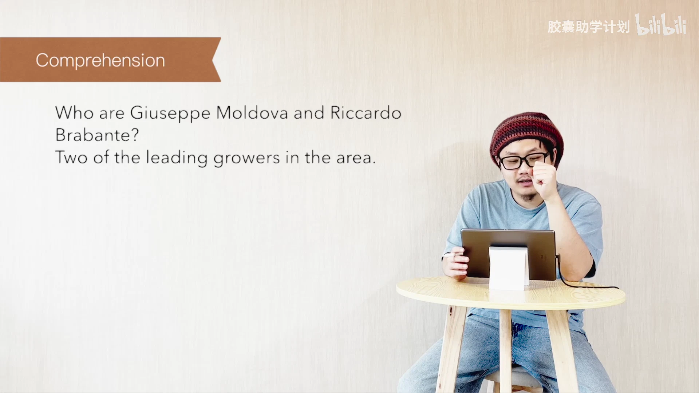

文字识别：bilbili / 胶囊助学计划 / Comprehension / Who are Giuseppe Moldova and Riccardo / Brabante? / Two of the leading growers in the area.

### 画面 00:01:07

文字识别：bilbili / 胶囊助学计划 / Comprehension / Who are Giuseppe Moldova and Riccardo / Brabante? / Two of the leading growers in the area.

### 画面 00:01:09

文字识别：bilbili / 胶囊助学计划 / Comprehension / What have they been expecting this year?

### 画面 00:01:11

文字识别：bilbii / 胶囊助学计划 / Comprehension / What have they been expecting this year?

### 画面 00:01:13

文字识别：bilibii / 胶囊助学计划 / Comprehension / What have / they been expecting this year? / A splendid / crop.

### 画面 00:01:15

文字识别：bilbii / 胶囊助学计划 / Comprehension / What have / : they been expecting this year? / A splendid / crop.

### 画面 00:01:17

文字识别：bilibii / 胶囊助学计划 / Comprehension / Has harvesting already begun?

### 画面 00:01:20

文字识别：Bilbii / 胶囊助学计划 / Comprehension / Has I / s harvesting already begun? / Yes, it has.

### 画面 00:01:22

文字识别：bilbili / 胶囊助学计划 / Comprehension / The film showed two workers, didn't it?

### 画面 00:01:25

文字识别：bilbil / 胶囊助学计划 / Comprehension / The film showed two workers, didn't it?

### 画面 00:01:28

文字识别：bilbil / 胶囊助学计划 / Comprehension / What had they just finished cutting?

## 00:01:30–00:02:00

had they just finished cutting? Three cartloads of golden brown macaroni stalks. Have all the villagers been working day and night? Yes, they have. Why have they been working day and night? They want to finish gathering and threshing the crop before the September rains. Whose wife appeared

### 画面 00:01:30

文字识别：bilbii / 胶囊助学计划 / Comprehension / What had they just finished cutting?

### 画面 00:01:32

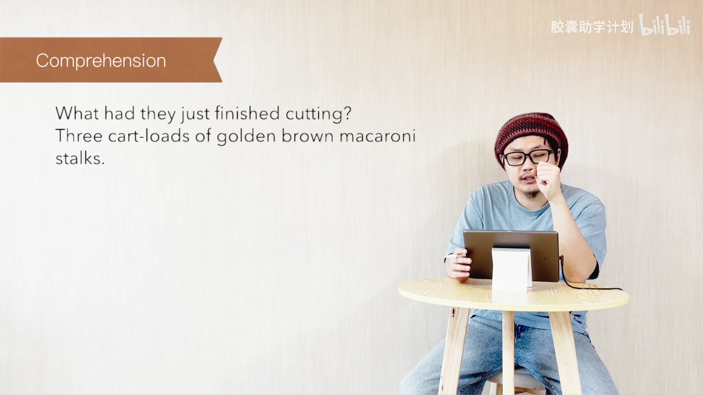

文字识别：bilbii / 胶囊助学计划 / Comprehension / What had they just finished cutting? / Three cart-loads of golden brown macaroni / stalks.

### 画面 00:01:35

文字识别：bilbii / 胶囊助学计划 / Comprehension / What had they just finished cutting? / Three cart-loads of golden brown macaroni / stalks.

### 画面 00:01:38

文字识别：bilibii / 胶囊助学计划 / Comprehension / Have all the villagers / been working day and / night?

### 画面 00:01:41

文字识别：biibii / 胶囊助学计划 / Comprehension / Have all the villagers / been working day and / night?

### 画面 00:01:45

文字识别：bibili / 胶囊助学计划 / Comprehension

### 画面 00:01:48

文字识别：bilibili / 胶囊助学计划 / Comprehension / Why have they been working day and night?

### 画面 00:01:50

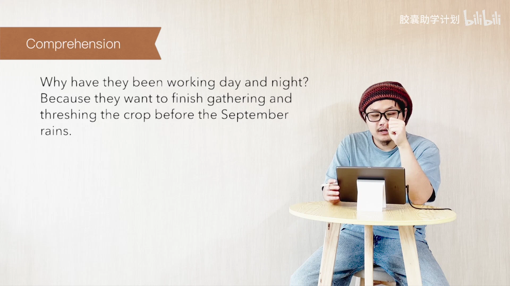

文字识别：bilbili / 胶囊助学计划 / Comprehension / Why have they been working day and night? / Because / e they want to finish / gathering and / threshing the crop before the September / rains.

### 画面 00:01:55

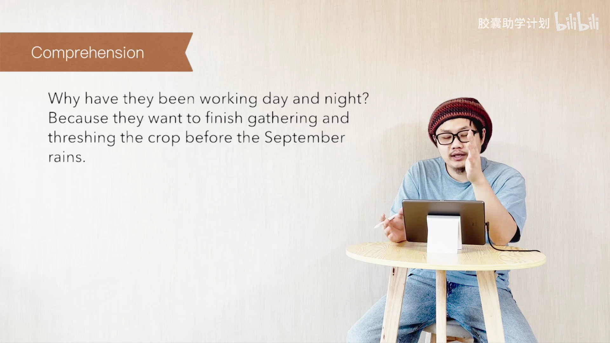

文字识别：Bilbil / 胶囊助学计划 / Comprehension / Why have they been working / day and night? / Because / they want to finish / gathering and / threshing the crop before the September / rains.

### 画面 00:01:57

文字识别：bilbili / 胶囊助学计划 / Comprehension / Whose wife appeared in the film?

## 00:02:00–00:02:30

in the film? Ah, Ricardo Berbantes. How long has she been helping him? Ah, for over thirty years. Who was she talking to? The manager of the local factory. Asking questions. 四句型啊，也是口语听力练习。 Ah, it was. Ask me if it was Thursday, April first. Was提前对吧？哎，其实加整句就行了。那 What day was

### 画面 00:02:00

文字识别：bilbii / 胶囊助学计划 / Comprehension / Whose wife appeared in the film?

### 画面 00:02:03

文字识别：bilbili / 胶囊助学计划 / Comprehension / Whose wife appeared in the film? / Riccardo Brabante's.

### 画面 00:02:05

文字识别：bilibii / 胶囊助学计划 / Comprehension / How long has she been helping / him?

### 画面 00:02:07

文字识别：bilbii / 胶囊助学计划 / Comprehension / How long has she been helping / him?

### 画面 00:02:10

文字识别：bilbii / 胶囊助学计划 / Comprehension / How long has she been helping / g him? / For thirty years.

### 画面 00:02:12

文字识别：Bilbii / 胶囊助学计划 / Comprehension / Who was she talking to?

### 画面 00:02:14

文字识别：bilibii / 胶囊助学计划 / Comprehension / Who was she talking to? / The manager of the local factory.

### 画面 00:02:16

文字识别：biibii / 胶囊助学计划 / Comprehension / Who was she talking to? / The manager of the local factory.

### 画面 00:02:18

文字识别：bibili / 胶囊助学计划 / Asking questions / 训练目标： / 会说一般疑问句＆特殊疑问句 / Accuracy / Fluency

### 画面 00:02:20

文字识别：Bilbili / 胶囊助学计划 / Asking questions

### 画面 00:02:22

文字识别：bilbii / 胶囊助学计划 / Asking questions / T: Ask me if it was Thursday, April 1st.

### 画面 00:02:24

文字识别：bilibii / 胶囊助学计划 / Asking questions / T: Ask me if it was Thursday, April 1st.

### 画面 00:02:26

文字识别：bilbii / 胶囊助学计划 / Asking questions / T: Ask me if it was Thursday, April 1st. / S: Was it Thursday? / T: What day …..?

## 00:02:30–00:03:00

it? 第一题不说了。第二题 There was a special news bulletin on television. There be句型典型。There be句型 was往前一提，这事儿结束了。What? 那你可以对 a special news bulletin提问，问加整句。 It ended with a program about macaroni growing. 这句话实际上本身有点稍微超纲，因为原文并没有。但是你读懂了之后，你知道动词是 ended，对吧？以什么什么作为结束，did往前一提就行了。

### 画面 00:02:30

文字识别：bilibii / 胶囊助学计划 / Asking questions / T: Ask me if it was Thursday, April 1st. / S: Was it Thursday? / T: What day ….? / S: What day was it?

### 画面 00:02:32

文字识别：bilbii / 胶囊助学计划 / Asking / questions / 1. It was Thursday, April 1st. (What day)

### 画面 00:02:35

文字识别：bilbii / 胶囊助学计划 / Asking questions / 1. It was Thursday, April 1st. (What day) / 2. There was a special news bulletin on / television.(What) (When)

### 画面 00:02:40

文字识别：bilibili / 胶囊助学计划 / Asking questions / 1.It was Thursday, April 1st. (What day) / 2. There was a special news bulletin on / television.(What) (When)

### 画面 00:02:45

文字识别：bilbili / 胶囊助学计划 / Asking questions / 1. It was Thursday, April 1st. (What day) / 2. There was a special news bulletin on / television.(What) (When) / 3. It ended with a programme about / macaroni growing.(What...with)

### 画面 00:02:50

文字识别：bilibili / 胶囊助学计划 / Asking questions / 1. It was Thursday, April 1st. (What day) / 2. There was a special news bulletin on / television.(What) (When) / 3. It ended with a programme about / macaroni growing.(What...with)

### 画面 00:02:54

文字识别：bilbii / 胶囊助学计划 / Asking questions / 1. It was Thursday, April 1st. (What day) / 2. There was a special news bulletin on / television.(What) (When) / 3. It ended with a programme about / macaroni growing.(What...with)

### 画面 00:02:56

文字识别：bilbili / 胶囊助学计划 / Asking questions / 1. It was Thursday, April 1st. (What day) / 2. There was a special news bulletin on / television.(What) (When) / 3. It ended with a programme about / macaroni growing.(What...with)

### 画面 00:02:58

文字识别：bilbii / 胶囊助学计划 / Asking questions / 1. It was Thursday, April 1st. (What day) / 2. There was a special news bulletin on / television.(What) (When) / 3. It ended with a programme about / macaroni growing.(What...with)

## 00:03:00–00:03:30

那what其实就是a program about macaroni growing啊，就what did it end with? Viewers were shown the macaroni fields of Calabria. Were往前一提，were what对the macaroni fields of Calabria. Macaroni has been grown there for over six hundred years.现在完成时被动，你把has往前一提。How long对for over six hundred years提

### 画面 00:03:00

文字识别：Bilbii / 胶囊助学计划 / Asking questions / 1.It was Thursday, April 1st. (What day) / 2. There was a special news bulletin on / television.(What) (When) / 3. It ended with a programme about / macaroni growing.(What...with)

### 画面 00:03:02

文字识别：Bilbil / 胶囊助学计划 / Asking questions / 1.It was Thursday, April 1st. (What day) / 2. There was a special news bulletin on / television.(What) (When) / 3. It ended with a programme about / macaroni growing. (What...with)

### 画面 00:03:05

文字识别：bilbili / 胶囊助学计划 / Asking questions / 1. It was Thursday, April 1st. (What day) / 2. There was a special news bulletin on / television.(What) (When) / 3. It ended with a programme about / macaroni growing.(What...with)

### 画面 00:03:07

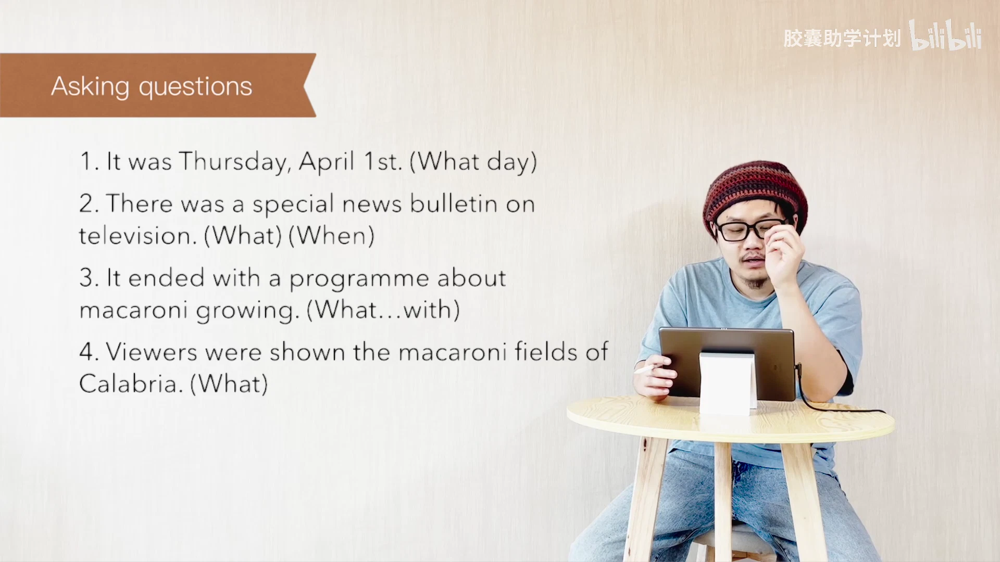

文字识别：Bilbil / 胶囊助学计划 / Asking questions / 1. It was Thursday, April 1st. (What day) / 2. There was a special news bulletin on / television.(What) (When) / 3. It ended with a programme about / macaroni growing.(What...with) / 4. Viewers were shown the macaroni fields of / Calabria.(What)

### 画面 00:03:10

文字识别：bilibii / 胶囊助学计划 / Asking questions / 1. It was Thursday, April 1st. (What day) / 2. There was a special news bulletin on / television.(What) (When) / 3. It ended with a programme about / macaroni growing.(What...with) / 4. Viewers were shown the macaroni fields of / Calabria.(What)

### 画面 00:03:13

文字识别：bibili / 胶囊助学计划 / Asking questions / 1. It was Thursday, April 1st. (What day) / 2. There was a special news bulletin on / television.(What) (When) / 3. It ended with a programme about / macaroni growing. (What...with) / 4. Viewers were shown the macaroni fields of / Calabria.(What)

### 画面 00:03:15

文字识别：biibili / 胶囊助学计划 / Asking questions / 1. It was Thursday, April 1st. (What day) / 2. There was a special news bulletin on / television.(What) (When) / 3. It ended with a programme about / macaroni growing.(What...with) / 4. Viewers were shown the macaroni fields of / Calabria.(What)

### 画面 00:03:18

文字识别：Bilbili / 胶囊助学计划 / Asking questions / 5. Macaroni has been grown there for Over / six hundred years. (How long) (Where)

### 画面 00:03:20

文字识别：bilbili / 胶囊助学计划 / Asking questions / 5. Macaroni has been grown there for over / six hundred years. (How long) (Where)

### 画面 00:03:22

文字识别：bilbili / 胶囊助学计划 / Asking questions / 5. Macaroni has been grown there for over / six hundred years. (How long) (Where)

### 画面 00:03:25

文字识别：bilbli / 胶囊助学计划 / Asking questions / 5. Macaroni has been grown there for over / six hundred years. (How long) (Where)

### 画面 00:03:27

文字识别：biibli / 胶囊助学计划 / Asking questions / 5. Macaroni has been grown there for over / six hundred years. (How long) (Where)

## 00:03:30–00:04:00

问Where对There提问。The leading growers have been expecting a splendid crop this year.现在完成进行时，五十二课学的Have往前一提What对A splendid crop Who对主语提问不变一般疑问句。The film showed two workers. Did往前一提How many对Two提问对吧？所以答案直接给您叫How many workers did the film show?

### 画面 00:03:30

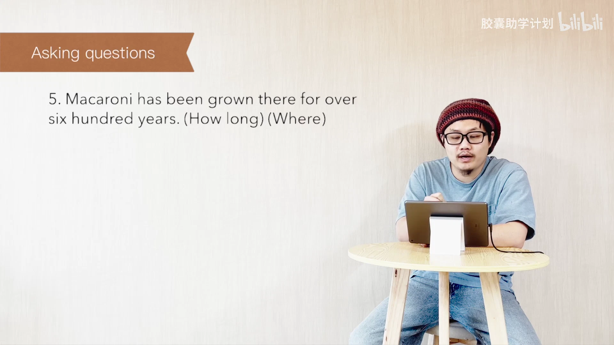

文字识别：bilbili / 胶囊助学计划 / Asking questions / 5. Macaroni has been grown there for over / six hundred years. (How long) (Where)

### 画面 00:03:32

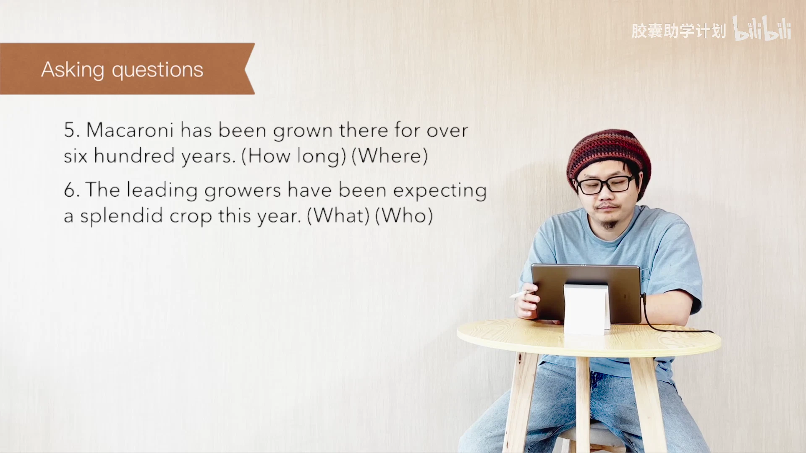

文字识别：bibili / 胶囊助学计划 / Asking questions / 5. Macaroni has been grown there for over / six hundred years. (How long) (Where) / 6. The leading growers have been expecting / a splendid crop this year. (What) (Who)

### 画面 00:03:35

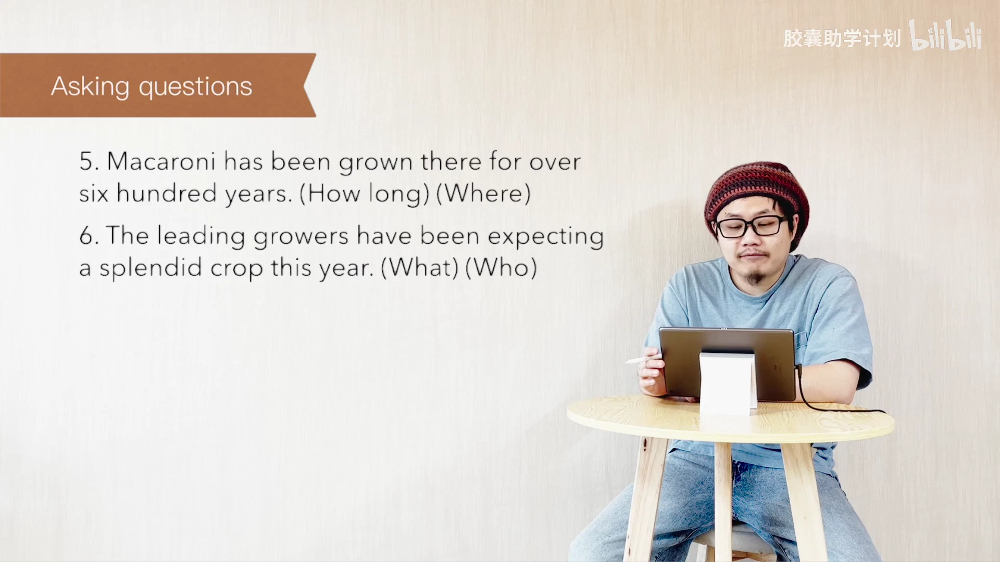

文字识别：bibili / 胶囊助学计划 / Asking questions / 5. Macaroni has been grown there for over / six hundred years. (How long) (Where) / 6. The leading growers have been expecting / a splendid crop this year. (What) (Who)

### 画面 00:03:38

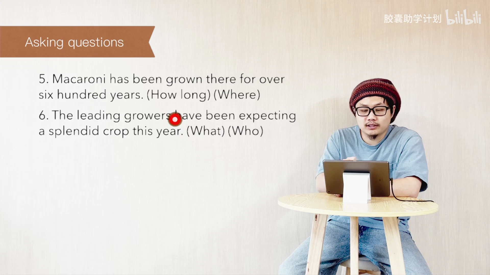

文字识别：biibili / 胶囊助学计划 / Asking questions / 5. Macaroni has been grown there for over / six hundred years. (How long)(Where) / 6.The leading growers / ave been expecting / a splendid crop this year. (What) (Who)

### 画面 00:03:40

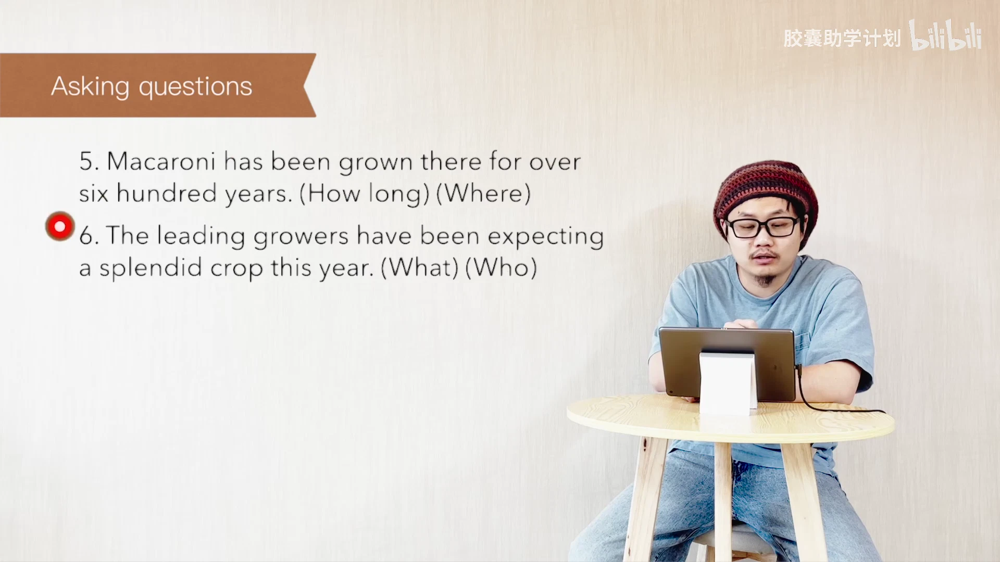

文字识别：biibili / 胶囊助学计划 / Asking questions / 5. Macaroni has been grown there for over / six hundred years. (How long) (Where) / 6. The leading growers have been expecting / a splendid crop this year. (What) (Who)

### 画面 00:03:42

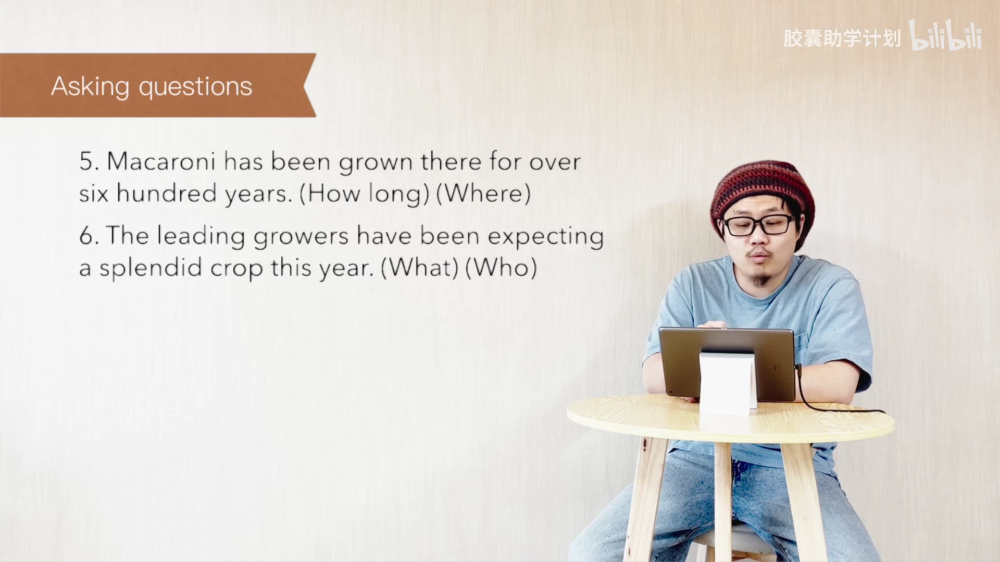

文字识别：bibii / 胶囊助学计划 / Asking questions / 5. Macaroni has been grown there for over / six hundred years. (How long) (Where) / 6. The leading growers have been expecting / a splendid crop this year. (What) (Who)

### 画面 00:03:45

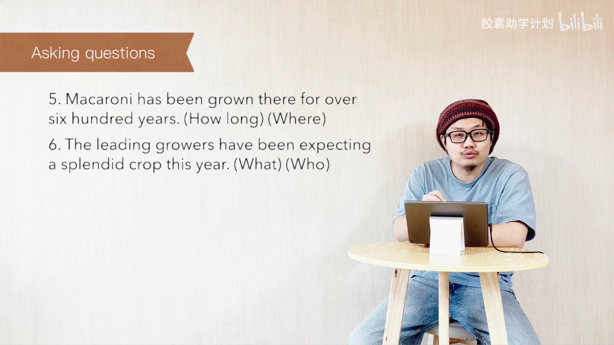

文字识别：bilbii / 胶囊助学计划 / Asking questions / 5. Macaroni has been grown there for over / six hundred years. (How long) (Where) / 6. The leading growers have been expecting / a splendid crop this year. (What) (Who)

### 画面 00:03:47

文字识别：bibii / 胶囊助学计划 / Asking questions / 5. Macaroni has been grown there for over / six hundred years. (How long) (Where) / 6. The leading growers have been expecting / a splendid crop this year. (What) (Who) / 7.The film showed two workers.(How many)

### 画面 00:03:50

文字识别：Bilbii / 胶囊助学计划 / Asking questions / 5. Macaroni has been grown there for over / six hundred years. (How long) (Where) / 6. The leading growers have been expecting / a splendid crop this year. (What) (Who) / 7. The film showed two workers.(How many)

### 画面 00:03:54

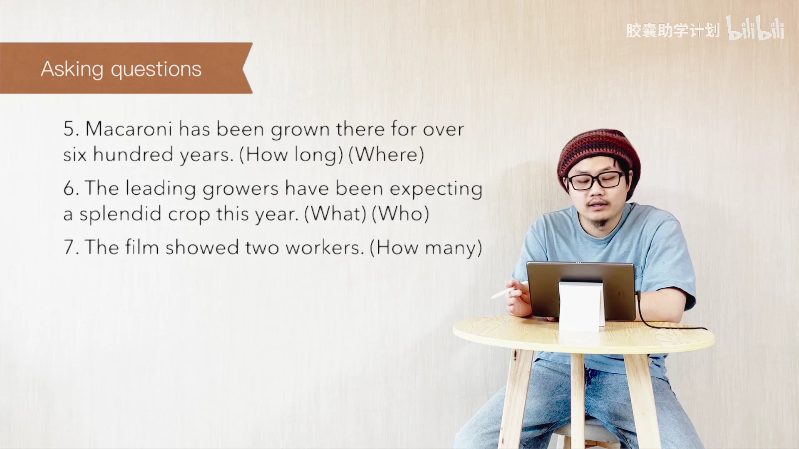

文字识别：bilbii / 胶囊助学计划 / Asking questions / 5. Macaroni has been grown there for over / six hundred years. (How long) (Where) / 6. The leading growers have been expecting / a splendid crop this year. (What) (Who) / 7.The film showed two workers.(How many)

### 画面 00:03:56

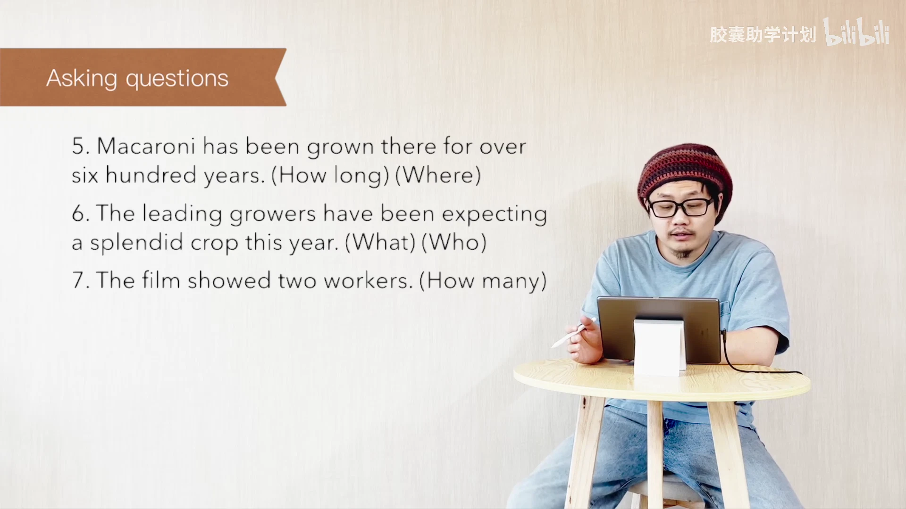

文字识别：bibili / 胶囊助学计划 / Asking questions / 5. Macaroni has been grown there for over / six hundred years. (How long) (Where) / 6. The leading growers have been expecting / a splendid crop this year. (What) (Who) / 7.The film showed two workers.(How many)

### 画面 00:03:58

文字识别：biibli / 胶囊助学计划 / Asking questions / 5. Macaroni has been grown there for over / six hundred years. (How long) (Where) / 6. The leading growers have been expecting / a splendid crop this year. (What) (Who) / 7.The film showed two workers.(How many)

## 00:04:00–00:04:30

Everyone has been working day and night. 你把 has 往前一提，How hard? 加整句呗。 How hard has everyone been working? 或者这里的 How hard? 我觉得可以对 day and night 提问。虽然 day and night 貌似是时间，但是这里的 day and night 你仔细去想，不就是在描述他们有多么努力的工作吗？ Why? 整句，互对主语提问啊。 Tell the story. 口语复述，我不多提了。这个任务

### 画面 00:04:00

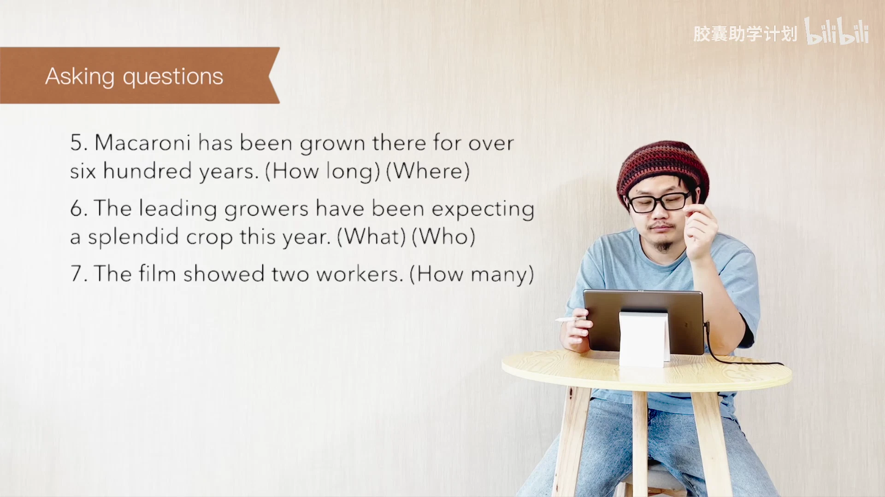

文字识别：bilbii / 胶囊助学计划 / Asking questions / 5. Macaroni has been grown there for over / six hundred years. (How long) (Where) / 6. The leading growers have been expecting / a splendid crop this year. (What) (Who) / 7. The film showed two workers.(How many)

### 画面 00:04:04

文字识别：胶囊助学计划bii / Asking questions / 5. Macaroni has been grown there for over / six hundred years. (How long) (Where) / 6. The leading growers have been expecting / a splendid crop this year. (What) (Who) / 7.The film showed two workers.(How many) / 8. Everyone has been working day and night. / (How hard) (Why) (Who)

### 画面 00:04:07

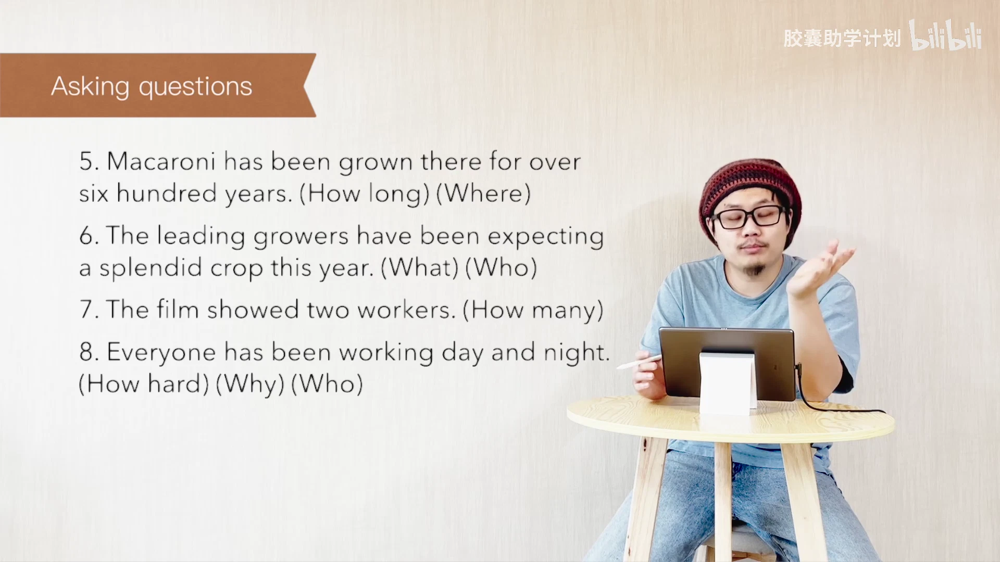

文字识别：胶囊助学计划ilbl / Asking questions / 5. Macaroni has been grown there for over / six hundred years. (How long) (Where) / 6. The leading growers have been expecting / a splendid crop this year. (What) (Who) / 7.The film showed two workers.(How many) / 8. Everyone has been working day and night. / (How hard) (Why)(Who)

### 画面 00:04:09

文字识别：胶囊助学计划bilil / Asking questions / 5. Macaroni has been grown there for over / six hundred years. (How long) (Where) / 6. The leading growers have been expecting / a splendid crop this year. (What) (Who) / 7.The film showed two workers.(How many) / 8. Everyone has been working day and night. / (How hard) (Why) (Who)

### 画面 00:04:11

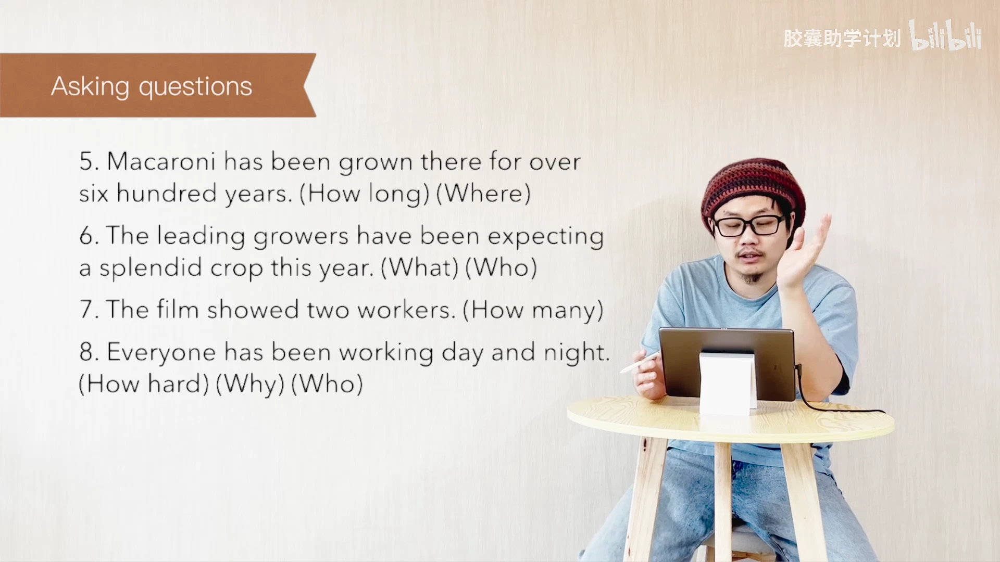

文字识别：胶囊助学计划i出 / Asking questions / 5. Macaroni has been grown there for over / six hundred years. (How long) (Where) / 6. The leading growers have been expecting / a splendid crop this year. (What) (Who) / 7.The film showed two workers. (How many) / 8. Everyone has been working day and night. / (How hard) (Why)(Who)

### 画面 00:04:13

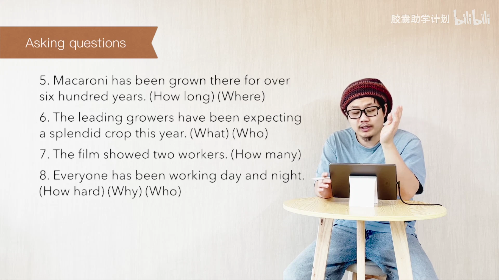

文字识别：胶囊助学计划bibi / Asking questions / 5. Macaroni has been grown there for over / six hundred years. (How long) (Where) / 6. The leading growers have been expecting / a splendid crop this year. (What) (Who) / 7.The film showed two workers.(How many) / 8. Everyone has been working day and night. / (How hard) (Why)(Who)

### 画面 00:04:15

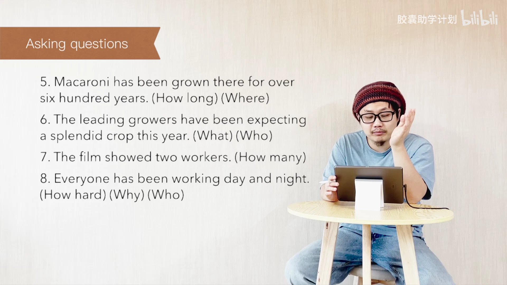

文字识别：biibili / 胶囊助学计划 / Asking questions / 5. Macaroni has been grown there for over / six hundred years. (How long) (Where) / 6. The leading growers have been expecting / a splendid crop this year. (What) (Who) / 7.The film showed two workers.(How many) / 8. Everyone has been working day and night. / (How hard) (Why) (Who)

### 画面 00:04:17

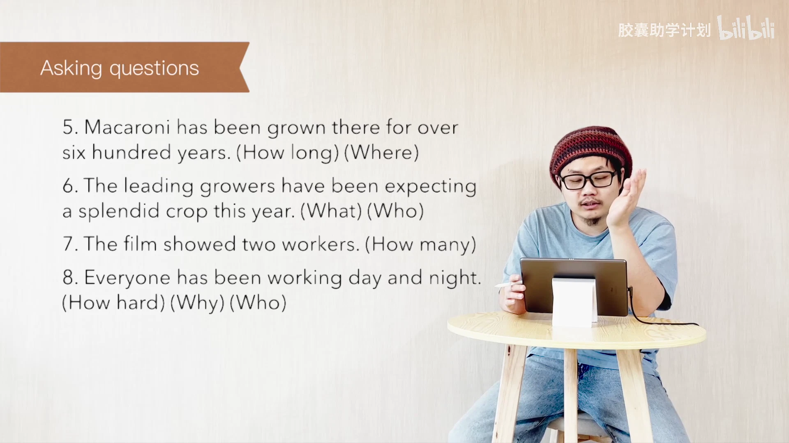

文字识别：biibili / 胶囊助学计划 / Asking questions / 5. Macaroni has been grown there for over / six hundred years. (How long) (Where) / 6. The leading growers have been expecting / a splendid crop this year. (What) (Who) / 7.The film showed two workers. (How many) / 8. Everyone has been working day and night. / (How hard) (Why) (Who)

### 画面 00:04:20

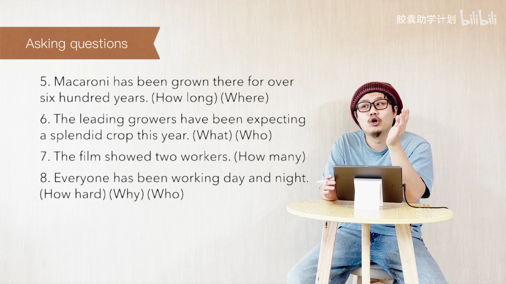

文字识别：胶囊助学计划bilbil / Asking questions / 5. Macaroni has been grown there for over / six hundred years. (How long) (Where) / 6. The leading growers have been expecting / a splendid crop this year. (What) (Who) / 7.The film showed two workers.(How many) / 8. Everyone has been working day and night. / (How hard) (Why)(Who)

### 画面 00:04:22

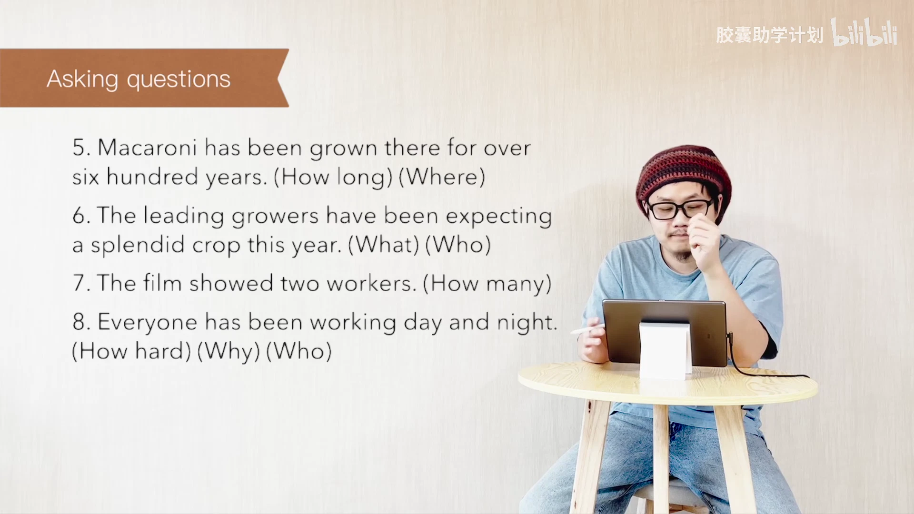

文字识别：胶囊助学计划bilil / Asking questions / 5. Macaroni has been grown there for over / six hundred years. (How long) (Where) / 6. The leading growers have been expecting / a splendid crop this year. (What) (Who) / 7.The film showed two workers.(How many) / 8. Everyone has been working day and night. / (How hard) (Why)(Who)

### 画面 00:04:25

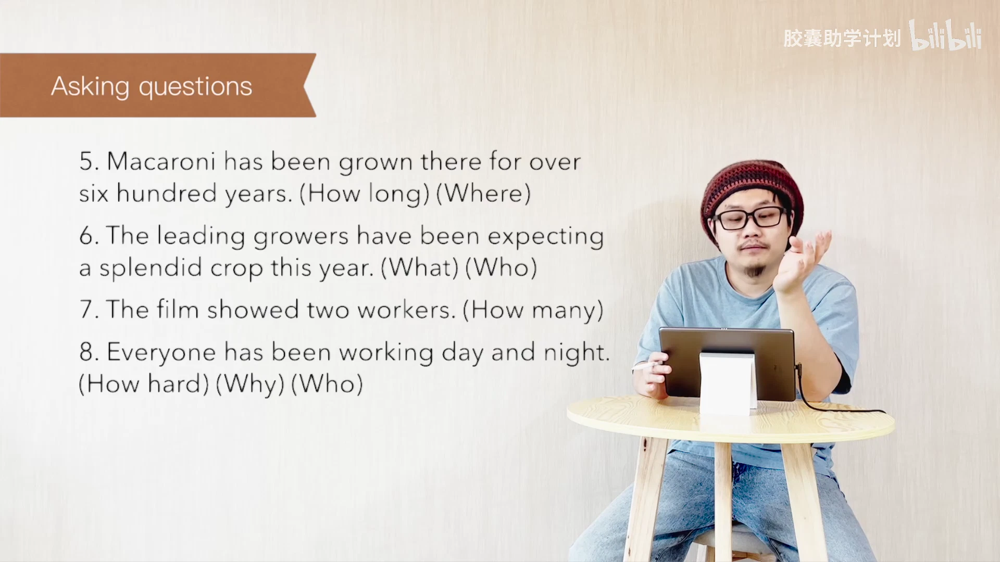

文字识别：胶囊助学计划bilbl / Asking questions / 5. Macaroni has been grown there for over / six hundred years. (How long) (Where) / 6. The leading growers have been expecting / a splendid crop this year. (What) (Who) / 7.The film showed two workers.(How many) / 8. Everyone has been working day and night. / (How hard) (Why)(Who)

### 画面 00:04:27

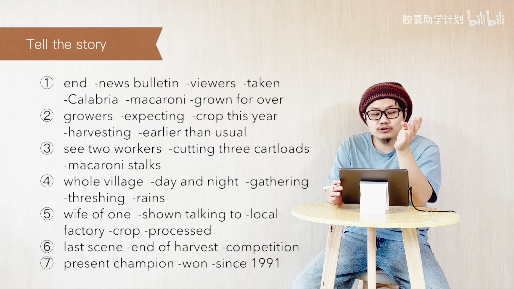

文字识别：胶囊助学计划bilbil / Tell the story / 1 / end -news bulletin -viewers -taken / -Calabria -macaroni -grown for over / growers -expecting -crop this year / -harvesting -earlier than usual / see two workers -cutting three cartloads / -macaroni stalks / whole village -day and night -gathering / -threshing -rains / wife of one -shown talking to -local / 5 / factory -crop -processed / 6 / last scene -end of harvest -competition / 7 / present champion -won -since 1991

## 00:04:30–00:05:00

您要去做啊。Summary writing多提一句，还是那句话，它有两套不同的连词，哪怕您不写，您都需要去看着那些连词对一下这些正确答案，提升各位的写作能力啊。这是第一套，这是第二套，不多说了。写完来这对答案，或者直接来看。Topic for discussion老习惯，我只说一遍，说Describe a practical joke you have played or would like to play on someone.注意什么叫practical joke，就是joke，就是恶作剧，

### 画面 00:04:30

文字识别：biibii / 胶囊助学计划 / Summary writing: Key / 训练目标： / 写作复述能力

### 画面 00:04:32

文字识别：胶囊助学计划bilb / Summary writing: Key / To end the special news bulletin, the television / announcer showed viewers the macaroni fields of / Calabria, where macaroni has been grown for over / six hundred years. Harvesting has begun earlier this / year and the whole village has been working hard, / gathering and threshing the crop before the / September rains. The crop is processed in the locaf / factory. After the harvest, the famous Calabrian / macaroni-eating competition, which Signor Fratelli / has won every year since 1991. will take place. That / ended the news bulletin for April 1st .

### 画面 00:04:35

文字识别：胶囊助学计划bibil / Summary writing: Key / To end the special news bulletin, the television / announcer showed viewers the macaroni fields of / Calabria, where macaroni has been grown for over / six hundred years. Harvesting has begun earlier this / year and the whole village has been working hard, / gathering and threshing the crop before the / September rains. The crop is processed in the local / factory. After the harvest, the famous Calabrian / macaroni-eating competition, which Signor Fratelli / has won every year since 1991. will take place. That / ended the news bulletin for April 1st .

### 画面 00:04:39

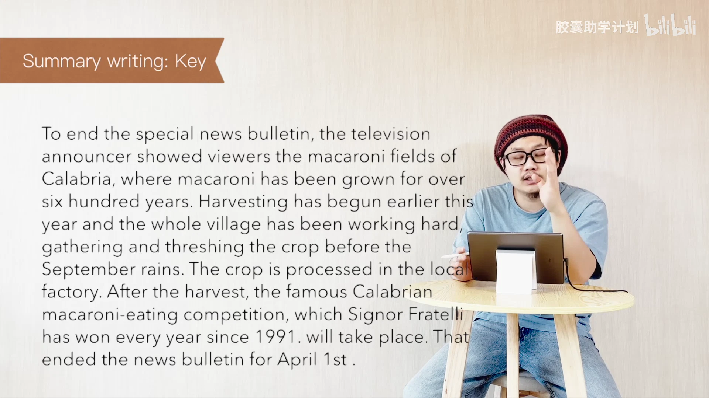

文字识别：胶囊助学计划bilbi / Summary writing: Key / To end the special news bulletin, the television / announcer showed viewers the macaroni fields of / Calabria, where macaroni has been grown for over / six hundred years. Harvesting has begun earlier this / year and the whole village has been working hard, / gathering and threshing the crop before the / September rains. The crop is processed in the loca / factory. After the harvest, the famous Calabrian / macaroni-eating competition, which Signor Fratelli / has won every year since 1991. will take place. That / ended the news bulletin for April 1st .

### 画面 00:04:41

文字识别：胶囊助学计划bilbi / Summary writing: Key / To end the special news bulletin, the television / announcer showed viewers the macaroni fields of / Calabria, where macaroni has been grown for over / six hundred years. Harvesting has begun earlier this / year and the whole village has been working hard, / gathering and threshing the crop before the / September rains. The crop is processed in the local / factory. After the harvest, the famous Calabrian / macaroni-eating competition, which Signor Fratelli / has won every year since 1991. will take place. That / ended the news bulletin for April 1st .

### 画面 00:04:43

文字识别：胶囊助学计划bilbil / Summary writing: Key / To end the news bulletin, the television announcer / showed viewers the fields of Calabria. Here, / macaroni has been grown for over six hundred / years. This year, harvesting has begun earlier. The / whole village has been working hard, gathering a / nd threshing before the September rains so that / the crop can be processed in the local factory. / After the harvest, the famous macaroni-eating / competition will be held. This has been won by / Signor Fratelli every year since 1991. With that, the / news bulletin for April 1st ended.

### 画面 00:04:45

文字识别：胶囊助学计划bi出 / Summary writing: Key / To end the news bulletin, the television announcer / showed viewers the fields of Calabria. Here, / macaroni has been grown for over six hundred / years. This year, harvesting has begun earlier. The / whole village has been working hard, gathering a / nd threshing before the September rains so that / the crop can be processed in the local factory. / After the harvest, the famous macaroni-eating / competition will be held. This has been won by / Signor Fratelli every year since 1991. With that, the / news bulletin for April 1st ended.

### 画面 00:04:47

文字识别：bilbili / 胶囊助学计划 / Topics for discussion / 训练目标： / 完全自由的对话 / Accuracy / Fluency

### 画面 00:04:49

文字识别：bibili / 胶囊助学计划 / Topics for discussion / Describe a practical joke you have / played, or would like to play, on / someone. / How do people celebrate the end of / harvest in your part of the country? / Many British viewers were taken in by / this news. Why do you think this was so?

### 画面 00:04:51

文字识别：Bibii / 胶囊助学计划 / Topics for discussion / Describe a practical joke you have / play / or would like to play, on / someone. / How do people celebrate the end of / harvest in your part of the country? / Many British viewers were taken in by / this news. Why do you think this was so?

### 画面 00:04:53

文字识别：bilbii / 胶囊助学计划 / Topics for discussion / Describe a practical joke you have / played, or would like to play, on / someone. / How do people celebrate the end of / harvest in your part of the country? / Many British viewers were taken in by / this news. Why do you think this was so?

### 画面 00:04:55

文字识别：bibii / 胶囊助学计划 / Topics for discussion / Describe a practical joke you have / played, or would like to play, on / someone. / How do people celebrate the end of / harvest in your part of the country? / Many British viewers were taken in by / this news. Why do you think this was so?

## 00:05:00–00:05:30

下你做过的恶作剧或者想做的恶作剧. How do people celebrate the end of the harvest in your part of the country?说人们如何庆祝哎收获这个结束啊，在你的国家啊，这个如果你从小没去过农村或者没有在农村长大，很可能就没见过，是吧？你像我的农村老家在河北啊，山东交界的一个呃小镇子上，

### 画面 00:05:00

文字识别：胶囊助学计划bilb出 / Topics for discussion / Describe a practical joke you have / played, or would like to play, on / someone. / How do people celebrate the end of / harvest in your part of the country? / Many British viewers were taken in by / this news. Why do you think this was so?

### 画面 00:05:05

文字识别：Bilbii / 胶囊助学计划 / Topics for discussion / Describe a practical joke you have / played, or would like to play, on / someone. / How do people celebrate the end of / harvest in your part of the country? / Many British viewers were taken in by / this news. Why do you think this was so?

### 画面 00:05:09

文字识别：Bilbii / 胶囊助学计划 / Topics for discussion / Describe a practical joke you have / played, or would like to play, on / someone. / How do people celebrate the end of / harvest in your part of the country? / Many British viewers were taken in by / this news. Why do you think this was so?

### 画面 00:05:11

文字识别：bilbii / 胶囊助学计划 / Topics for discussion / Describe a practical joke you have / played, or would like to play, on / someone. / How do people celebrde the end of / harvest in your part of the country? / Many British viewers were taken in by / this news. Why do you think this was so?

### 画面 00:05:17

文字识别：biibili / 胶囊助学计划 / Topics for discussion / Describe a practical joke you have / played, or would like to play, on / someone. / How do people celebrate the end of / harvest in your part of the country? / Many British viewers were taken in by / this news. Why do you think this was so?

### 画面 00:05:19

文字识别：胶囊助学计划ilb出 / Topics for discussion / Describe a practical joke you have / played, or would like to play, on / someone. / How do people celebrate the end of / harvest in your part of the country? / Many British viewers were taken in by / this news. Why do you think this was so?

### 画面 00:05:21

文字识别：biibii / 胶囊助学计划 / Topics for discussion / Describe a practical joke you have / played, or would like to play, on / someone. / How do people celebrate the end of / harvest in your part of the country? / Many British viewers were taken in by / this news. Why do you think this was so?

### 画面 00:05:23

文字识别：bibii / 胶囊助学计划 / Topics for discussion / Describe a practical joke you have / played, or would like to play, on / someone. / How do people celebrate the end of / harvest in your part of the country? / Many British viewers were taken in by / this news. Why do you think this was so?

### 画面 00:05:25

文字识别：胶囊助学计划bil出 / Topics for discussion / Describe a practical joke you have / played, or would like to play, on / someone. / How do people celebrate the end of / harvest in your part of the country? / Many British viewers were taken in by / this news. Why do you think this was so?

## 00:05:30–00:06:00

那个地方，我很小的时候，后来已经没有了。我很小的时候，我记得那时候收获完了之后，会拿那个玉米梗扎一个非常非常高的，呃，这个电线杆儿呢，可能那么高，也许比那还高，因为我很小，我不知道啊，很高的那样的一个柱状物，然后在应该是大年三十的下午半晚上那个时候把它点燃，然后全村很多的人都会去那个地方敲锣打鼓，有人

### 画面 00:05:30

文字识别：胶囊助学计划bilil / Topics for discussion / Describe a practical joke you have / played, or would like to play, on / someone. / How do people celebrate the end of / harvest in your part of the country? / Many British viewers were taken in by / this news. Why do you think this was so?

### 画面 00:05:35

文字识别：bibii / 胶囊助学计划 / Topics for discussion / Describe a practical joke you have / played, or would like to play, on / someone. / How do people celebrate the end of / harvest in your part of the country? / Many British viewers were taken in by / this news. Why do you think this was so?

### 画面 00:05:37

文字识别：胶囊助学计划ilbl / Topics for discussion / Describe a practical joke you have / played, or would like to play, on / someone. / How do people celebrate the end of / harvest in your part of the country? / Many British viewers were taken in by / this news. Why do you think this was so?

### 画面 00:05:39

文字识别：胶囊助学计划ib出 / Topics for discussion / Describe a practical joke you have / played, or would like to play, on / someone. / How do people celebrate the end of / harvest in your part of the country? / Many British viewers were taken in by / this news. Why do you think this was so?

### 画面 00:05:41

文字识别：bibili / 胶囊助学计划 / Topics for discussion / Describe a practical joke you have / played, or would like to play, on / someone. / How do people celebrate the end of / harvest in your part of the country? / Many British viewers were taken in by / this news. Why do you think this was so?

### 画面 00:05:44

文字识别：bilbii / 胶囊助学计划 / Topics for discussion / Describe a practical joke you have / played, or would like to play, on / someone. / How do people celebrate the end of / harvest in your part of the country? / Many British viewers were taken in by / this news. Why do you think this was so?

### 画面 00:05:46

文字识别：biibili / 胶囊助学计划 / Topics for discussion / Describe a practical joke you have / played, or would like to play, on / someone. / How do people celebrate the end of / harvest in your part of the country? / Many British viewers were taken in by / this news. Why do you think this was so?

### 画面 00:05:48

文字识别：胶囊助学计划il出 / Topics for discussion / Describe a practical joke you have / played, or would like to play, on / someone. / How do people celebrate the end of / harvest in your part of the country? / Many British viewers were taken in by / this news. Why do you think this was so?

### 画面 00:05:50

文字识别：Bilbii / 胶囊助学计划 / Topics for discussion / Describe a practical joke you have / played, or would like to play, on / someone. / How do people celebrate the end of / harvest in your part of the country? / Many British viewers were taken in by / this news. Why do you think this was so?

### 画面 00:05:55

文字识别：bilbii / 胶囊助学计划 / Topics for discussion / Describe a practical joke you have / played, or would like to play, on / someone. / How do people celebrate the end of / harvest in your part of the country? / Many British viewers were taken in by / this news. Why do you think this was so?

### 画面 00:05:57

文字识别：bilbii / 胶囊助学计划 / Topics for discussion / Describe a practical joke you have / played, or would like to play, on / someone. / How do people celebrate the end of / harvest in your part of the country? / Many British viewers were taken in by / this news. Why do you think this was so?

## 00:06:00–00:06:30

专门敲锣打鼓。你在那个地方就去看，对吧？烧这个东西啊，这我觉得它应该就是一个 celebrate the end of the harvest 的这样的一个仪式。现在没了啊，现在已经没了非物质文化遗产了，并且已经没了。Many British viewers were taken in by this news. Why do you think this was so? 啊，说许多啊，我跟你说了吗？这个事儿是真人真事儿改编的，所以很多英国的这个观众实际上被这个事儿骗了，就信以为

### 画面 00:06:00

文字识别：胶囊助学计划bii / Topics for discussion / Describe a practical joke you have / played, or would like to play, on / someone. / How do people celebrate the end of / harvest in your part of the country? / Many British viewers were taken in by / this news. Why do you think this was so?

### 画面 00:06:02

文字识别：bibii / 胶囊助学计划 / Topics for discussion / Describe a practical joke you have / played, or would like to play, on / someone. / How do people celebrate the end of / harvest in your part of the country? / Many British viewers were taken in by / this news. Why do you think this was so?

### 画面 00:06:04

文字识别：bilbi / 胶囊助学计划 / Topics for discussion / Describe a practical joke you have / played, or would like to play, on / someone. / How do people celebrate the end of / harvest in your part of the country? / Many British viewers were taken in by / this news. Why do you think this was so?

### 画面 00:06:06

文字识别：胶囊助学计划ilb出 / Topics for discussion / Describe a practical joke you have / played, or would like to play, on / someone. / How do people celebrate the end of / harvest in your part of the country? / Many British viewers were taken in by / this news. Why do you think this was so?

### 画面 00:06:09

文字识别：biibili / 胶囊助学计划 / Topics for discussion / Describe a practical joke you have / played, or would like to play, on / someone. / How do people celebrate the end of / harvest in your part of the country? / Many British viewers were taken in by / this news. Why do you think this was so?

### 画面 00:06:11

文字识别：Bilbii / 胶囊助学计划 / Topics for discussion / Describe a practical joke you have / played, or would like to play, on / someone. / How do people celebrate the end of / harvest in your part of the country? / Many British viewers were taken in by / this news. Why do you think this was so?

### 画面 00:06:15

文字识别：bibii / 胶囊助学计划 / Topics for discussion / Describe a practical joke you have / played, or would like to play, on / someone. / How do people celebrate the end of / harvest in your part of the country? / Many British viewers were taken in by / this news. Vny do you think this was so?

### 画面 00:06:17

文字识别：bilibii / 胶囊助学计划 / Topics for discussion / Describe a practical joke you have / played, or would like to play, on / someone. / How do people celebrate the end of / harvest in your part of the country? / Many British viewers were taken in by / this news. Why do you think this was so?

### 画面 00:06:20

文字识别：bibili / 胶囊助学计划 / Topics for discussion / Describe a practical joke you have / played, or would like to play, on / someone. / How do people celebrate the end of / harvest in your part of the country? / Many British viewers were taken in by / this news. Why do you think this was so?

### 画面 00:06:22

文字识别：biibili / 胶囊助学计划 / Topics for discussion / Describe a practical joke you have / played, or would like to play, on / someone. / How do people celebrate the end of / harvest in your part of the country? / Many British viewers were taken in by / this news. Why do you think this was so?

### 画面 00:06:25

文字识别：bilbii / 胶囊助学计划 / Topics for discussion / Describe a practical joke you have / played, or would like to play, on / someone. / How do people celebrate the end of / harvest in your part of the country? / Many British viewers were taken in by / this news. Why do you think this was so?

### 画面 00:06:28

文字识别：bibii / 胶囊助学计划 / Topics for discussion / Describe a practical joke you have / played, or would like to play, on / someone. / How do people celebrate the end of / harvest in your part of the country? / Many British viewers were taken in by / this news. Why do you think this was so?

## 00:06:30–00:07:00

真了。你为什么认为是这样的啊？我的理解就是细节给的真的太真了，是吧？杨子，Ask me if先写再朗读，摘要写作写完对答案，别忘了有两套，重点看连词，tell the story口语复述。置顶留言可以找到重复间隔的学习材料。那以上就是咱们本期视频的全部内容了。如果各位喜欢我们的课程的，欢迎各位关注、订阅、一键三连，分享给那些

### 画面 00:06:30

文字识别：bibili / 胶囊助学计划 / Topics for discussion / Describe a practical joke you have / played, or would like to play, on / someone. / How do people celebrate the end of / harvest in your part of the country? / Many British viewers were taken in by / this news. Why do you think this was so?

### 画面 00:06:33

文字识别：Bilbii / 胶囊助学计划 / Topics for discussion / Describe a practical joke you have / played, or would like to play, on / someone. / How do people celebrate the end of / harvest in your part of the country? / Many British viewers were taken in by / this news. Why do you think this was so?

### 画面 00:06:35

文字识别：bibili / 胶囊助学计划 / Topics for discussion / Describe a practical joke you have / played, or would like to play, on / someone. / How do people celebrate the end of / harvest in your part of the country? / Many British viewers were taken in by / this news. Why do you think this was so?

### 画面 00:06:37

文字识别：Bilbil / 胶囊助学计划

### 画面 00:06:39

文字识别：bibli / 胶囊助学计划 / 1.Ask me if写&朗读

### 画面 00:06:41

文字识别：bilbil / 胶囊助学计划 / 1.Ask me if写&朗读 / 摘要写作写&答案 / 3.Tell the story 口语复述

### 画面 00:06:43

文字识别：bibii / 胶囊助学计划 / 1.A / Ask me if写&朗读 / 摘要写作写&答案 / 3.Tell the story 口语复述

### 画面 00:06:45

文字识别：biibii / 胶囊助学计划 / 1.Ask me if写&朗读 / 摘要写作写&答案 / 3.Tell the story 口语复述 / .重复间隔（置顶留言）

### 画面 00:06:47

文字识别：bilbl / 胶囊助学计划 / 1.Ask me if写&朗读 / 摘要写作写&答案 / 3.Tell the story 口语复述 / .重复间隔（置顶留言） / 4.

### 画面 00:06:49

文字识别：bilbl / 胶囊助学计划 / 1.Ask me if写&朗读 / 摘要写作写&答案 / 3.Tell the story 口语复述 / .重复间隔（置顶留言） / 4.

### 画面 00:06:51

文字识别：biibii / 胶囊助学计划 / 不

### 画面 00:06:54

文字识别：biibii / 胶囊助学计划 / 不

### 画面 00:06:57

文字识别：bibii / 胶囊助学计划 / 不

## 00:07:00–00:07:16

需要的朋友，来帮助我快速成长。See you next time.

### 画面 00:07:04

### 画面 00:07:06

文字识别：臺珈字計划 / CAPSULEACADEMY / 胶囊助学计划 / 『 / 小红书 / Lecturer / Leo / OE

### 画面 00:07:09

文字识别：臺珈字計切 / CAPSULEACADEMY / 胶囊助学计划 / 『 / 小红书 / Editor / OE

### 画面 00:07:12

文字识别：珈学針物 / CAPSULEACADEMY / 胶囊助学计划 / 小红书 / Creator / □ / Leo & Berlin / OE

### 画面 00:07:14

文字识别：bilibili / 胶囊助学计划 / 胶囊助学计划 / 小红书 / OE

### 画面 00:07:16

文字识别：bilbili / 胶囊助学计划

