# 077 单词

快速机器解析：语音为单模型转写，未进行独立交叉校对或人工复核；画面每秒采样并按变化选帧，短时文字和标记可能遗漏。截图时间约有 1 秒误差。图片有损压缩；遇到疑点请按时间查看 Google Drive 原视频。

## 00:00:00–00:00:30

Hello everyone, welcome to Capsule Academy. This is Leo. Today we are going to learn New Concept English Book Two Lesson Seventy Seven Words.那老习惯进入正式课程之前，咱们看几个问题。第一啊，如何说某人患有或者得了有啊某些罕见的疾病？接下来呢，如何表达切片或者说某个东西的一部分？再然后，如何表达证实是什么什么样子？OK，那带着这三个问题，Hope you can

### 画面 00:00:00

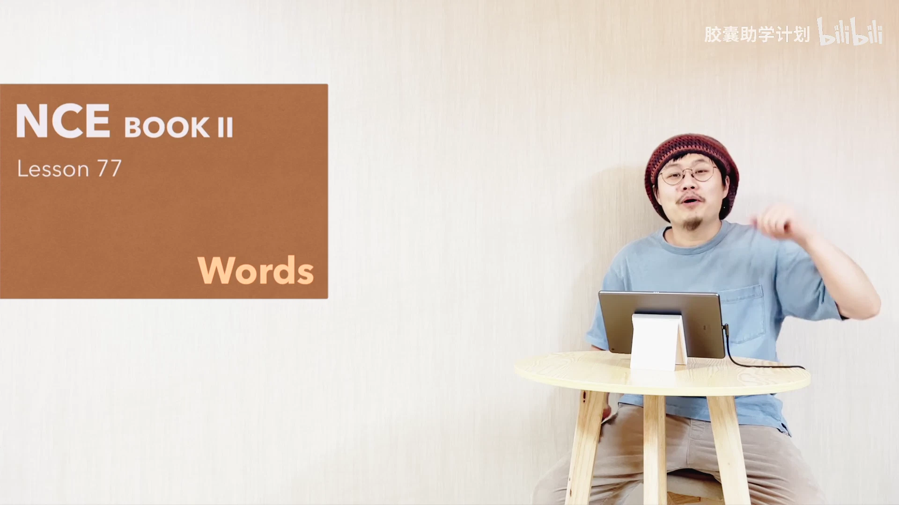

文字识别：bilbili / 胶囊助学计划 / NCE / BOOKII / Lesson 77 / Words

### 画面 00:00:02

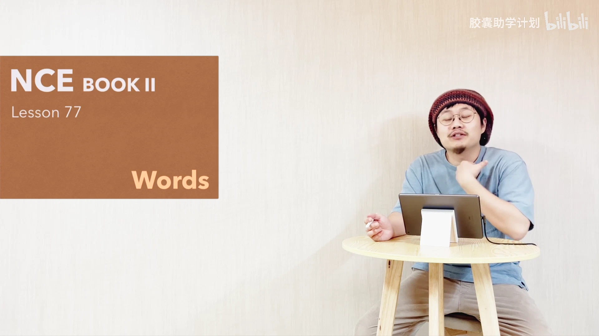

文字识别：Bilbili / 胶囊助学计划 / NCE / BOOKII / Lesson 77 / Words

### 画面 00:00:04

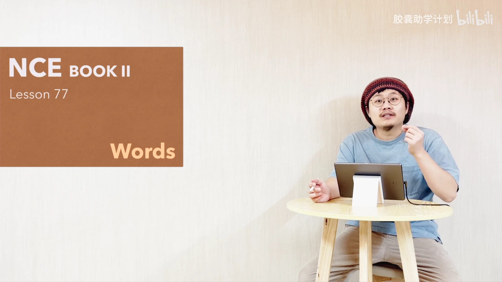

文字识别：bibili / 胶囊助学计划 / NCE / BOOKII / Lesson 77 / Words

### 画面 00:00:06

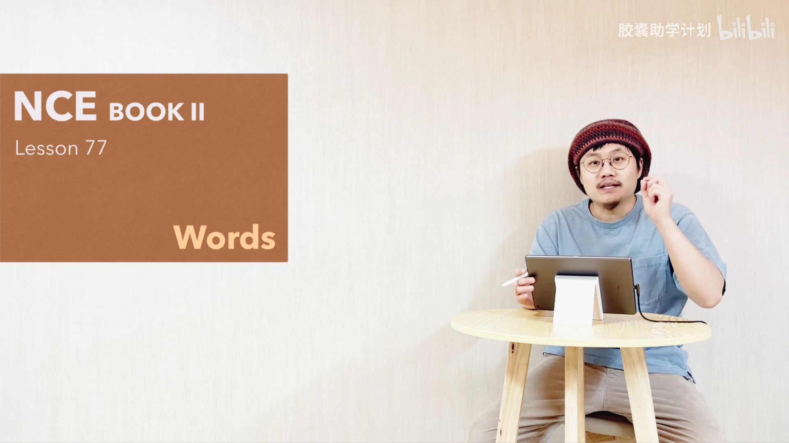

文字识别：biibii / 胶囊助学计划 / NCE / BOOKII / Lesson 77 / Words

### 画面 00:00:09

文字识别：Bilbii / 胶囊助学计划 / 可表达“有罕见疾病”？

### 画面 00:00:11

文字识别：biibii / 胶囊助学计划 / ①如何表达“有罕见疾病”

### 画面 00:00:15

文字识别：刘 bilibii / 胶囊助学计划 / ①如何表达“有罕见疾病”？

### 画面 00:00:17

文字识别：biibli / 胶囊助学计划 / ①如何表达“有罕见疾病” / 部分”？

### 画面 00:00:19

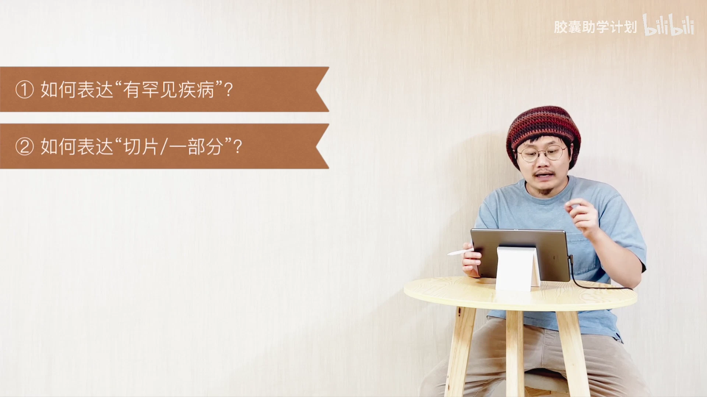

文字识别：bilbili / 胶囊助学计划 / ①如何表达“有罕见疾病” / 如何表达“切片/一部分”?

### 画面 00:00:21

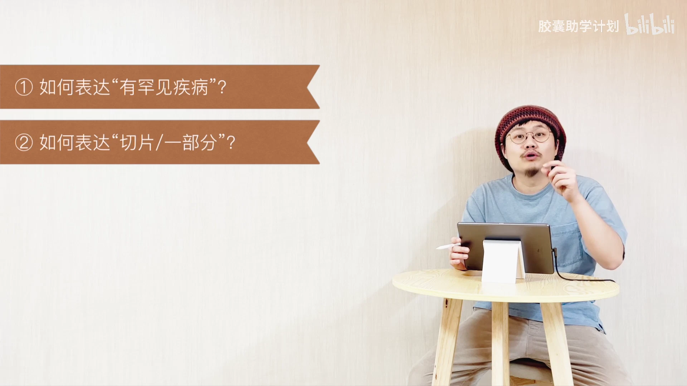

文字识别：Bilbili / 胶囊助学计划 / ①如何表达“有罕见疾病” / 如何表达“切片/一部分”?

### 画面 00:00:23

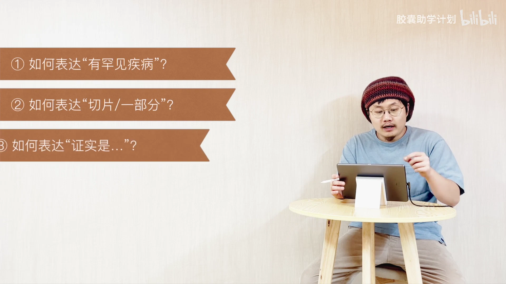

文字识别：bibii / 胶囊助学计划 / ①如何表达“有罕见疾病’ / 如何表达“切片/一部分”? / 如何表达“证实是

### 画面 00:00:25

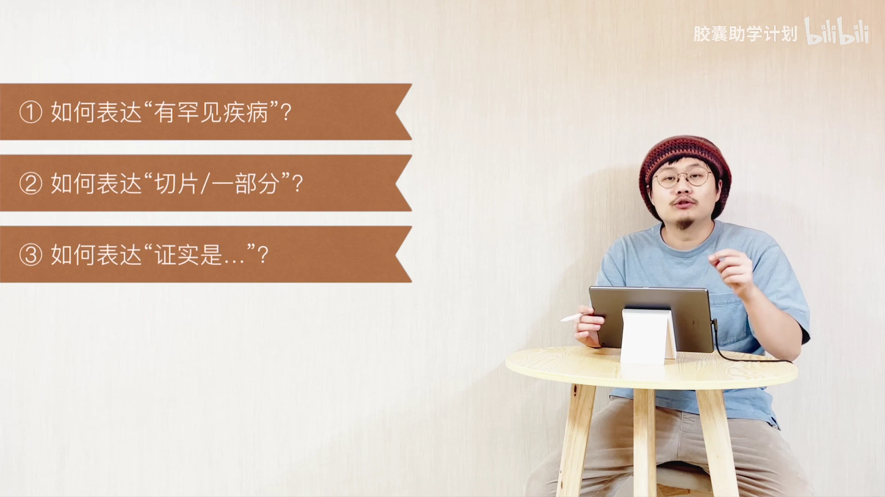

文字识别：bilbii / 胶囊助学计划 / ①如何表达“有罕见疾病” / 如何表达“切片/一部分”？ / 如何表达“证实是

## 00:00:30–00:01:00

enjoy. We're coming up. We're looking at two words. The first one is mommy. Okay, mommy. This word, I believe, many people know its meaning. It's not the mummy on the left, but the mother on the right. A child's common baby talk. A child's common word is mommy, right? Mother. It can also mean mummy. Then the word on the right, we've learned in the first lesson, so I won't go into it. Read it with me. It's

### 画面 00:00:30

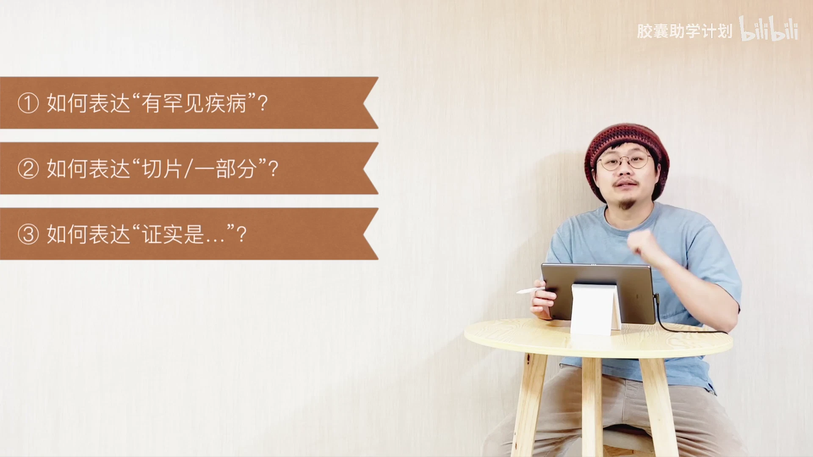

文字识别：bibii / 胶囊助学计划 / ①如何表达“有罕见疾病” / 如何表达“切片/一部分”? / 如何表达“证实是

### 画面 00:00:32

文字识别：胶囊助学计划bi

### 画面 00:00:35

### 画面 00:00:37

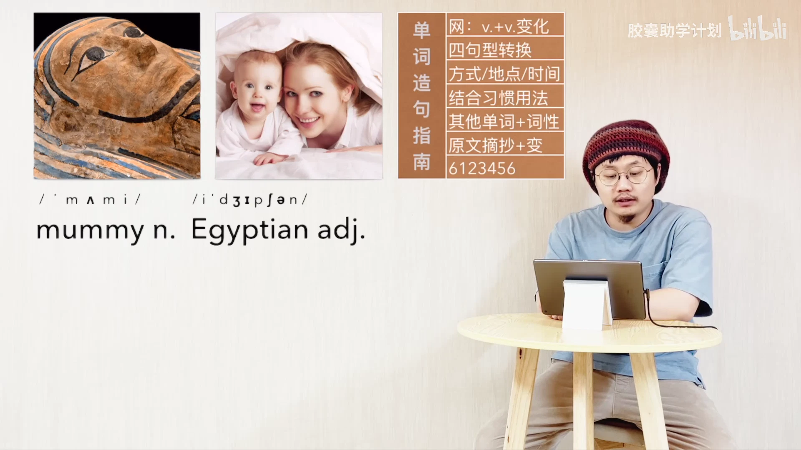

文字识别：单词造句指南 / 网：v.+v.变化 / 胶囊助学计划 / bibii / 四句型转换 / 方式/地点/时间 / 结合习惯用法 / 其他单词+词性 / 原文摘抄+变 / 6123456 / /mΛmi/ / /i'd3ip∫an/ / mummy n. Egyptian adj.

### 画面 00:00:39

文字识别：单词造句指南 / 网：v.+v.变化 / 胶囊助学计划 / blibli / 四句型转换 / 方式/地点/时间 / 结合习惯用法 / 其他单词+词性 / 原文摘抄+变 / 6123456 / /mΛmi/ / /i'd3ip∫an/ / mummy n. Egyptian adj.

### 画面 00:00:41

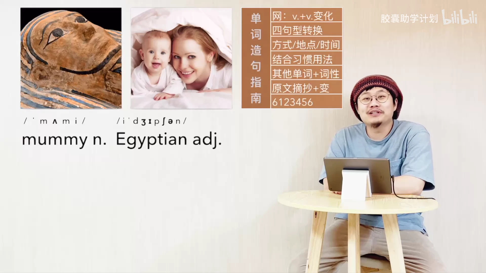

文字识别：单词造句指南 / 网：v.+v.变化 / 胶囊助学计划 / bilibili / 四句型转换 / 方式/地点/时间 / 结合习惯用法 / 其他单词+词性 / 原文摘抄+变 / 6123456 / / mΛm i / / /i'd3ip∫an/ / mummy n. Egyptian adj.

### 画面 00:00:43

文字识别：单词造句指南 / 网：v.+v.变化 / 胶囊助学计划 / bilibili / 四句型转换 / 方式/地点/时间 / 结合习惯用法 / 其他单词+词性 / 原文摘抄+变 / 6123456 / /mΛmi/ / /i'd3ip∫an/ / mummy n. Egyptian adj.

### 画面 00:00:45

文字识别：单词造句指南 / 网：v.+v.变化 / 胶囊助学计划 / bibili / 四句型转换 / 方式/地点/时间 / 结合习惯用法 / 其他单词+词性 / 原文摘抄+变 / 6123456 / / ·mΛmi/ / /i'd3ip∫an/ / mummy n. Egyptian adj.

### 画面 00:00:48

文字识别：单词造句指南 / 网：v.+v.变化 / 胶囊助学计划 / bilbii / 四句型转换 / 方式/地点/时间 / 结合习惯用法 / 其他单词+词性 / 原文摘抄+变 / 6123456 / / .mΛmi/ / /i'd3ip∫an/ / mummy n. Egyptian adj.

### 画面 00:00:50

文字识别：单词造句指南 / 网：v.+v.变化 / 胶囊助学计划 / blbili / 四句型转换 / 方式/地点/时间 / 结合习惯用法 / 其他单词+词性 / 原文摘抄+变 / 6123456 / / .mΛm i / / /i'd3ip∫an/ / mummy n. Egyptian adj.

### 画面 00:00:52

文字识别：单词造句指南 / ：v.+v.变化 / 胶囊助学计划 / biibili / 四句型转换 / 方式/地点/时间 / 结合习惯用法 / 其他单词+词性 / 原文摘抄+变 / 6123456 / /mΛmi / / /id3ip∫an/ / mummy n. Egyptian adj.

### 画面 00:00:54

文字识别：单词造句指南 / 网：v.+v.变化 / 胶囊助学计划 / bilbili / 四句型转换 / 方式/地点/时间 / 结合习惯用法 / 其他单词+词性 / 原文摘抄+变 / 6123456 / /·mΛm i / / /id3iplai / n / mummy n. Egyptian adj.

### 画面 00:00:56

文字识别：单词造句指南 / 网：v.+v.变化 / 胶囊助学计划 / biibii / 四句型转换 / 方式/地点/时间 / 结合习惯用法 / 其他单词+词性 / 原文摘抄+变 / 6123456 / / .mΛm i / / /i'd3ip∫an/ / mummy n. Egyptian adj.

### 画面 00:00:59

文字识别：单词造句指南 / 网：v.+v.变化 / 胶囊助学计划 / biibli / 四句型转换 / 方式/地点/时间 / 结合习惯用法 / 其他单词+词性 / 原文摘抄+变 / 6123456 / /.mΛmi/ / /i'd3ip∫an/ / mummy n. Egyptian adj.

## 00:01:00–00:01:30

Egyptian,埃及的，对吧？那我们想造一个句子，比如说 At the end of the show, 好，我们用到了七十六课刚刚学过的习惯用法，在这个表演结束的时候，哎，在这个啊，当然这个show可以指表演，也可以指一个展览啊。那展览结束的时候，We finally saw the mummy which was sent here from Egypt. 我们最终看到了这个木乃伊，什么样的木乃伊呢？被送往，哎，被从埃及发送到

### 画面 00:01:01

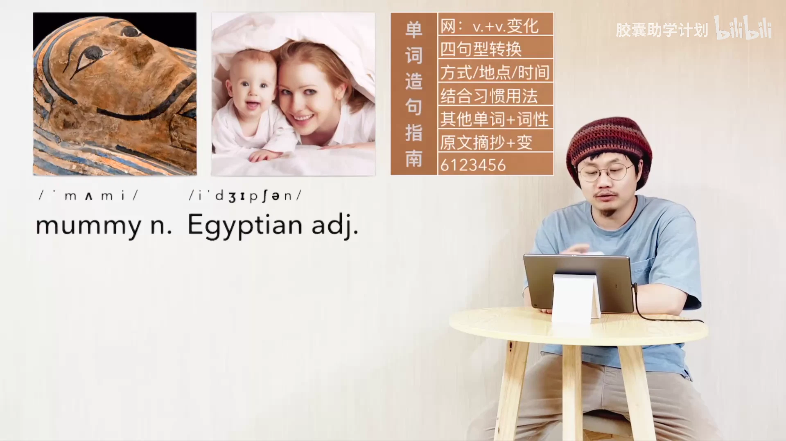

文字识别：单词造句指南 / 网：v.+v.变化 / 胶囊助学计划 / bibli / 四句型转换 / 方式/地点/时间 / 结合习惯用法 / 其他单词+词性 / 原文摘抄+变 / 6123456 / / .mΛmi / / /i'd3ip∫an/ / mummy n. Egyptian adj.

### 画面 00:01:03

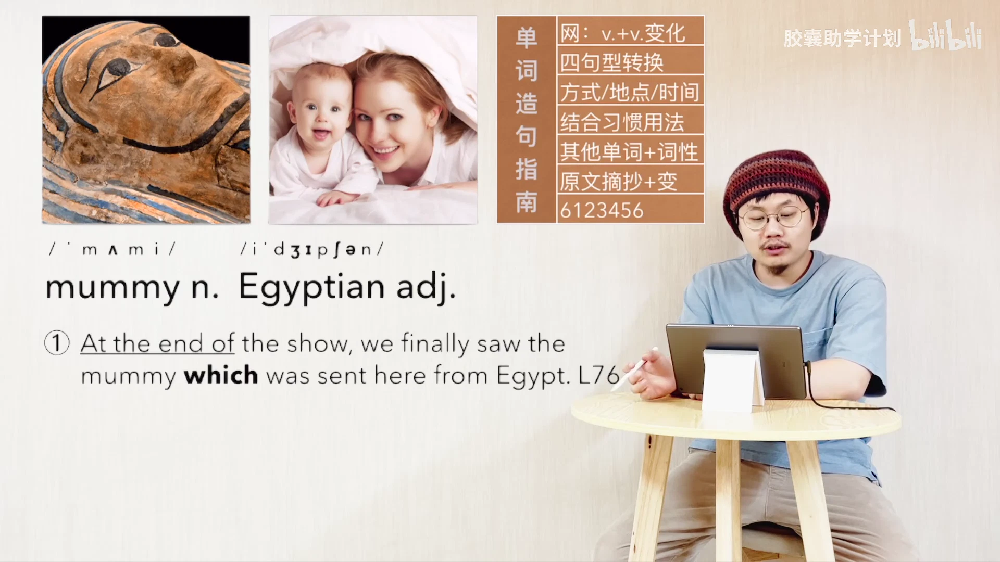

文字识别：单词造句指南 / 网：v.+v.变化 / 胶囊助学计划bilbi / 四句型转换 / 方式/地点/时间 / 结合习惯用法 / 其他单词+词性 / 原文摘抄+变 / 6123456 / / mΛm i / / /i'd3iplan/ / mummy n. Egyptian adj. / ① At the end of the show, we finally saw the / mummy which was sent here from Egypt. L76

### 画面 00:01:05

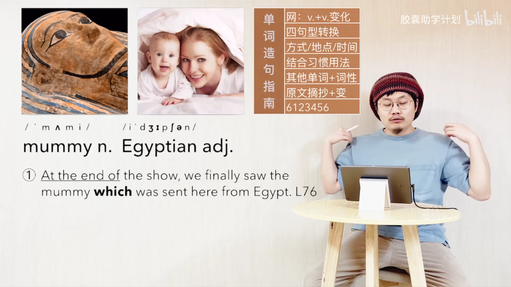

文字识别：胶囊助学计划bilbi / 单词造句指南 / 网：v.+v.变化 / 四句型转换 / 方式/地点/时间 / 结合习惯用法 / 其他单词+词性 / 原文摘抄+变 / 6123456 / / mΛm i / / /i'd3ip∫an/ / mummy n. Egyptian adj. / ① At the end of the show, we finally saw the / mummy which was sent here from Egypt. L76

### 画面 00:01:07

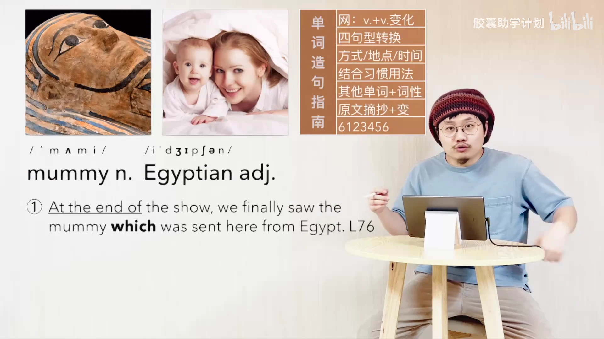

文字识别：单词造句指南 / 网：v.+v.变化 / 胶囊助学计划bilbi / 四句型转换 / 方式/地点/时间 / 结合习惯用法 / 其他单词+词性 / 原文摘抄+变 / 6123456 / / mΛ m i / / /i'd3ip∫an/ / mummy n. Egyptian adj. / ① At the end of the show, we finally saw the / mummy which was sent here from Egypt. L76

### 画面 00:01:09

文字识别：单词造句指南 / 网：v.+v.变化 / 胶囊助学计划bili / 四句型转换 / 方式/地点/时间 / 结合习惯用法 / 其他单词+词性 / 原文摘抄+变 / 6123456 / / mΛ m i / / /i'd3ip∫an/ / mummy n. Egyptian adj. / ① At the end of the show, we finally saw the / mummy which was sent here from Egypt. L76

### 画面 00:01:11

文字识别：胶囊助学计划bilii / 单词造句指南 / 网：v.+v.变化 / 四句型转换 / 方式/地点/时间 / 结合习惯用法 / 其他单词+词性 / 原文摘抄+变 / 6123456 / / mΛ m i / / /i'd3ip∫an/ / mummy n. Egyptian adj. / ① At the end of the show, we finally saw the / mummy which was sent here from Egypt. L76

### 画面 00:01:13

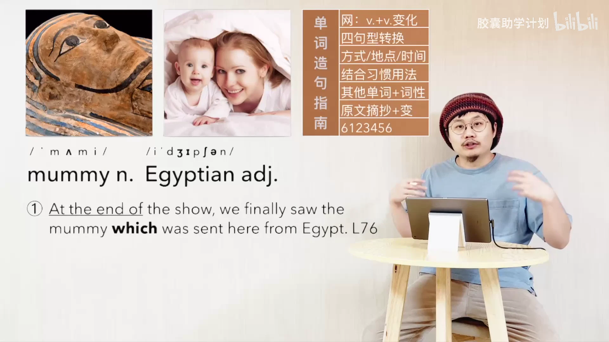

文字识别：胶囊助学计划bilii / 单词造句指南 / 网：v.+v.变化 / 四句型转换 / 方式/地点/时间 / 结合习惯用法 / 其他单词+词性 / 原文摘抄+变 / 6123456 / / ·mΛ m i / / /i'd3ip∫an/ / mummy n. Egyptian adj. / ① At the end of the show, we finally saw the / mummy which was sent here from Egypt. L76

### 画面 00:01:15

文字识别：胶囊助学计划bilii / 单词造句指南 / 网：v.+v.变化 / 四句型转换 / 方式/地点/时间 / 结合习惯用法 / 其他单词+词性 / 原文摘抄+变 / 6123456 / / ·mΛ m i / / /i'd3ip∫an/ / mummy n. Egyptian adj. / ① At the end of the show, we finally saw the / mummy which was sent here from Egypt. L76

### 画面 00:01:18

文字识别：单词造句指南 / 网：v.+v.变化 / 胶囊助学计划biliil / 四句型转换 / 方式/地点/时间 / 结合习惯用法 / 其他单词+词性 / 原文摘抄+变 / 6123456 / / ·m Λ m i / / /i'd3ip∫an/ / mummy n. Egyptian adj. / ① At the end of the show, we finally saw the / mummy which was sent here from Egypt. L76

### 画面 00:01:20

文字识别：单词造句指南 / 网：v.+v.变化 / 胶囊助学计划bilii / 四句型转换 / 方式/地点/时间 / 结合习惯用法 / 其他单词+词性 / 原文摘抄+变 / 6123456 / / mΛm i / / /i'd3ip∫an/ / mummy n. Egyptian adj. / ① At the end of the show, we finally saw the / mummy which was sent here from Egypt. L76

### 画面 00:01:22

文字识别：胶囊助学计划bilbil / 单词造句指南 / 网：v.+v.变化 / 四句型转换 / 方式/地点/时间 / 结合习惯用法 / 其他单词+词性 / 原文摘抄+变 / 6123456 / / mΛ m i / / /i'd3ip∫an/ / mummy n. Egyptian adj. / ① At the end of the show, we finally saw the / mummy which was sent here from Egypt. L76

### 画面 00:01:25

文字识别：单词造句指南 / 网：v.+v.变化 / 胶囊助学计划bilii / 四句型转换 / 方式/地点/时间 / 结合习惯用法 / 其他单词+词性 / 原文摘抄+变 / 6123456 / /m Λm i / / /i'd3ip∫an/ / mummy n. Egyptian adj. / ① At the end of the show, we finally saw the / mummy which was sent here from Egypt. L76

### 画面 00:01:27

文字识别：胶囊助学计划bilii / 单词造句指南 / 网：v.+v.变化 / 四句型转换 / 方式/地点/时间 / 结合习惯用法 / 其他单词+词性 / 原文摘抄+变 / 6123456 / / ·mΛ m i / / /i'd3ip∫an/ / mummy n. Egyptian adj. / ① At the end of the show, we finally saw the / mummy which was sent here from Egypt. L76

## 00:01:30–00:02:00

到这里的那个木乃伊，OK，跟了个定语从句。Next one说，When the police arrived on the scene， they had already run away with the Egyptian mummy。啊，他们把这个埃及的木乃伊给偷走了。说当这个警察最终到达现场的时候，他们已经had already run。在这儿我们顺便复习了一下一般过去时和过去完成时这两个时态如何去搭配，对吧？哎，在他们到达之前

### 画面 00:01:30

文字识别：单词造句指南 / 网：v.+v.变化 / 胶囊助学计划bilii / 四句型转换 / 方式/地点/时间 / 结合习惯用法 / 其他单词+词性 / 原文摘抄+变 / 6123456 / / 'mΛ m i / / /i'd3ip∫an/ / mummy n. Egyptian adj. / ① At the end of the show, we finally saw the / mummy which was sent here from Egypt. L76

### 画面 00:01:32

文字识别：单词造句指南 / 网：v.+v.变化 / 胶囊助学计划bilbi / 四句型转换 / 方式/地点/时间 / 结合习惯用法 / 其他单词+词性 / 原文摘抄+变 / 6123456 / / mΛ m i / / /i'd3ip∫an/ / mummy n. Egyptian adj. / ① At the end of the show, we finally saw the / mummy which was sent here from Egypt. L76

### 画面 00:01:34

文字识别：网：v.+v.变化 / 胶囊助学计划biii / 单 / 词 / 四句型转换 / 造 / 方式/地点/时间 / 句 / 结合习惯用法 / 其他单词+词性 / 指 / 原文摘抄+变 / 南 / 6123456 / / 'm Λ m i / / /i'd3iplan/ / mummy n. Egyptian adj. / ① At the end of the show, we finally saw the / mummy which was sent here from Egypt. L76 / When the police arrived on the scene, they had / already run away with the Egyptian mummy. L75:

### 画面 00:01:36

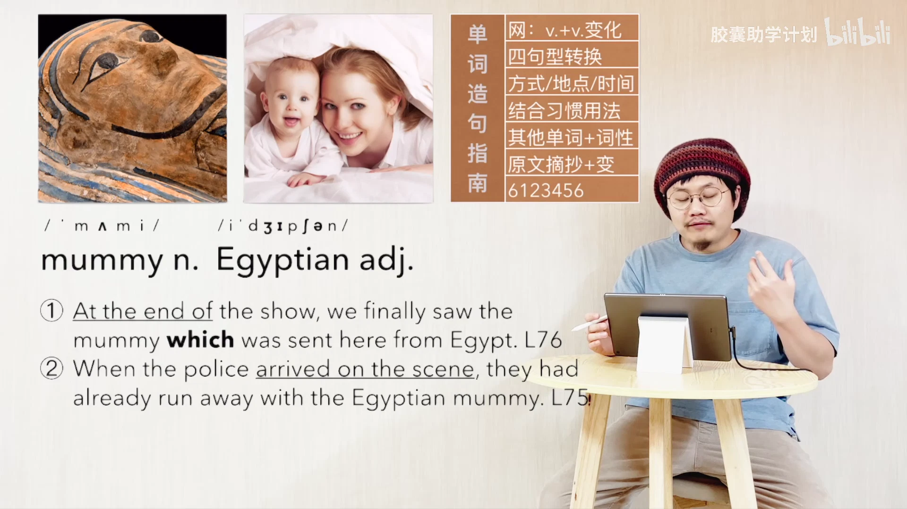

文字识别：网：v.+v.变化 / 胶囊助学计划bibi / 单 / +词 / 四句型转换 / 造 / 方式/地点/时间 / 句 / 结合习惯用法 / 其他单词+词性 / 指 / 原文摘抄+变 / 南 / 6123456 / / 'm Λ m i / / /i'd3ip∫an/ / mummy n. Egyptian adj. / ① At the end of the show, we finally saw the / mummy which was sent here from Egypt. L76 / When the police arrived on the scene, they had / already run away with the Egyptian mummy. L75!

### 画面 00:01:38

文字识别：网：v.+v.变化 / 胶囊助学计划ilbil / 单 / +词 / 四句型转换 / 造 / 方式/地点/时间 / 句 / 结合习惯用法 / 其他单词+词性 / 指 / 原文摘抄+变 / 南 / 6123456 / / 'm Λ m i / / /i'd3iplan/ / mummy n. Egyptian adj. / ① At the end of the show, we finally saw the / mummy which was sent here from Egypt. L76 / When the police arrived on the scene, they had / already run away with the Egyptian mummy. L75!

### 画面 00:01:40

文字识别：网：v.+v.变化 / 胶囊助学计划biii / 单 / +词 / 四句型转换 / 造 / 方式/地点/时间 / 句 / 结合习惯用法 / 其他单词+词性 / 指 / 原文摘抄+变 / 南 / 6123456 / / 'm Λ m i / / /i'd3ip∫an/ / mummy n. Egyptian adj. / ① At the end of the show, we finally saw the / mummy which was sent here from Egypt. L76 / When the police arrived on the scene, they had / already run away with the Egyptian mummy. L75!

### 画面 00:01:42

文字识别：单词 / 网：v.+v.变化 / 胶囊助学计划bilbi / 四句型转换 / 造 / 方式/地点/时间 / 句 / 结合习惯用法 / 其他单词+词性 / 指 / 原文摘抄+变 / 南 / 6123456 / / ' m Λ m i / / /id3iplan/ / mummy n. Egyptian adj. / ① At the end of the show, we finally saw the / mummy which was sent here from Egypt. L76 / When the police arrived on the scene, they had / already run away with the Egyptian mummy. L75!

### 画面 00:01:44

文字识别：单词 / 网：v.+v.变化 / 胶囊助学计划bilbi / 四句型转换 / 造句指 / 方式/地点/时间 / 结合习惯用法 / 其他单词+词性 / 原文摘抄+变 / 南 / 6123456 / / 'm Λ m i / / /i'd3ip∫an/ / mummy n. Egyptian adj. / ① At the end of the show, we finally saw the / mummy which was sent here from Egypt. L76 / When the police arrived on the scene, they had / already run away with the Egyptian mummy. L75!

### 画面 00:01:46

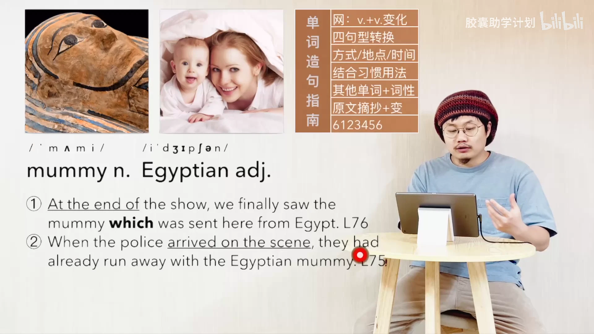

文字识别：单词造 / 网：v.+v.变化 / 胶囊助学计划bilbil / 四句型转换 / 方式/地点/时间 / 旭句指 / 结合习惯用法 / 其他单词+词性 / 原文摘抄+变 / 南 / 6123456 / / 'm Λ m i / / /i'd3ip∫an/ / mummy n. Egyptian adj. / ① At the end of the show, we finally saw the / mummy which was sent here from Egypt. L76 / When the police arrived on the scene, they had / already run away with the Egyptian mummy.75.

### 画面 00:01:48

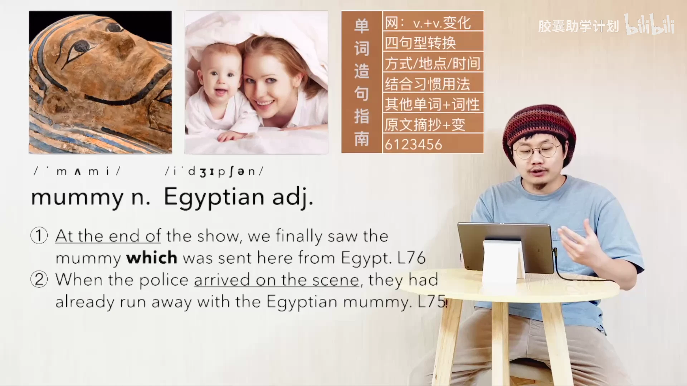

文字识别：单词造 / 网：v.+v.变化 / 胶囊助学计划bilbi / 四句型转换 / 方式/地点/时间 / 旭句指 / 结合习惯用法 / 其他单词+词性 / 原文摘抄+变 / 南 / 6123456 / / ' m Λ m i / / /i'd3ip∫an/ / mummy n. Egyptian adj. / ① At the end of the show, we finally saw the / mummy which was sent here from Egypt. L76 / When the police arrived on the scene, they had / already run away with the Egyptian mummy. L75!

### 画面 00:01:50

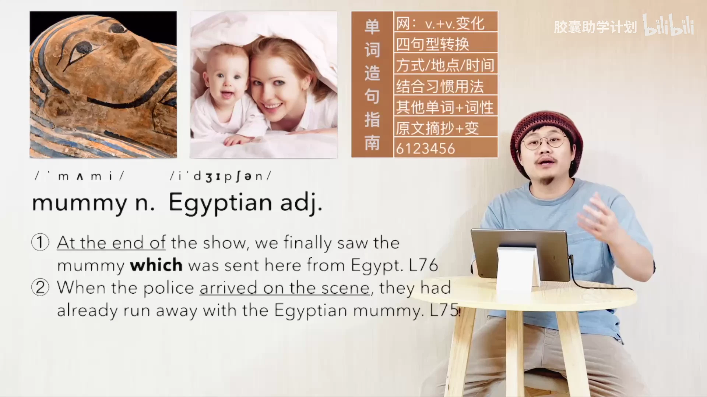

文字识别：单词造 / 网：v.+v.变化 / 胶囊助学计划bilbi / 四句型转换 / 方式/地点/时间 / 旭句指 / 结合习惯用法 / 其他单词+词性 / 原文摘抄+变 / 南 / 6123456 / / 'm Λ m i / / /i'd3ip∫an/ / mummy n. Egyptian adj. / ① At the end of the show, we finally saw the / mummy which was sent here from Egypt. L76 / When the police arrived on the scene, they had / already run away with the Egyptian mummy. L75!

### 画面 00:01:52

文字识别：单词造 / 网：v.+v.变化 / 胶囊助学计划bilbii / 四句型转换 / 方式/地点/时间 / 旭句指 / 结合习惯用法 / 其他单词+词性 / 原文摘抄+变 / 南 / 6123456 / / 'm Λ m i / / /i d3iplan/ / mummy n. Egyptian adj. / ① At the end of the show, we finally saw the / mummy which was sent here from Egypt. L76 / When the police arrived on the scene, they had / already run away with the Egyptian mummy. L75!

### 画面 00:01:54

文字识别：单词造 / 网：v.+v.变化 / 胶囊助学计划bilii / 四句型转换 / 方式/地点/时间 / 旭句指 / 结合习惯用法 / 其他单词+词性 / 原文摘抄+变 / 南 / 6123456 / / 'm Λ m i / / /i'd3iplan/ / mummy n. Egyptian adj. / ① At the end of the show, we finally saw the / mummy which was sent here from Egypt. L76 / When the police arrived on the scene, they had / already run away with the Egyptian mummy. L75!

### 画面 00:01:56

文字识别：单词造句指 / 网：v.+v.变化 / 胶囊助学计划bilii / 四句型转换 / 方式/地点/时间 / 结合习惯用法 / 其他单词+词性 / 原文摘抄+变 / 南 / 6123456 / /mΛm i / / /i'd3iplan/ / mummy n. Egyptian adj. / ① At the end of the show, we finally saw the / mummy which was sent here from Egypt. L76 / When the police arrived on the scene, they had / already run away with the Egyptian mummy. L75!

### 画面 00:01:58

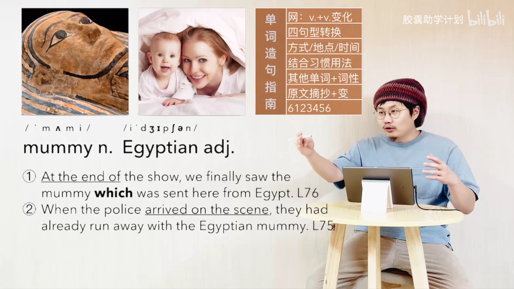

文字识别：胶囊助学计划bilii / 单词 / 网：v.+v.变化 / 四句型转换 / 造 / 方式/地点/时间 / 旭句指 / 结合习惯用法 / 其他单词+词性 / 原文摘抄+变 / 南 / 6123456 / / ' m Λ m i / / /id3iplan/ / mummy n. Egyptian adj. / ① At the end of the show, we finally saw the / mummy which was sent here from Egypt. L76 / When the police arrived on the scene, they had / already run away with the Egyptian mummy. L75!

## 00:02:00–00:02:30

已经跑了。这个已经跑了，你就可以用 had 加 done 表示过去的过去啊。 Next one, say is said that Leo is a huge fan of Egyptian mummy. 啊，哎，说据说啊，说 Leo 是 Egyptian mummy，埃及这个木乃伊的狂热粉丝啊，特别喜欢。他不一定是粉丝了，到这儿指的就是特别喜欢这个玩意儿啊，特别爱研究这个玩意儿，看这个玩意儿，对吧？ OK，不多说啊。

### 画面 00:02:00

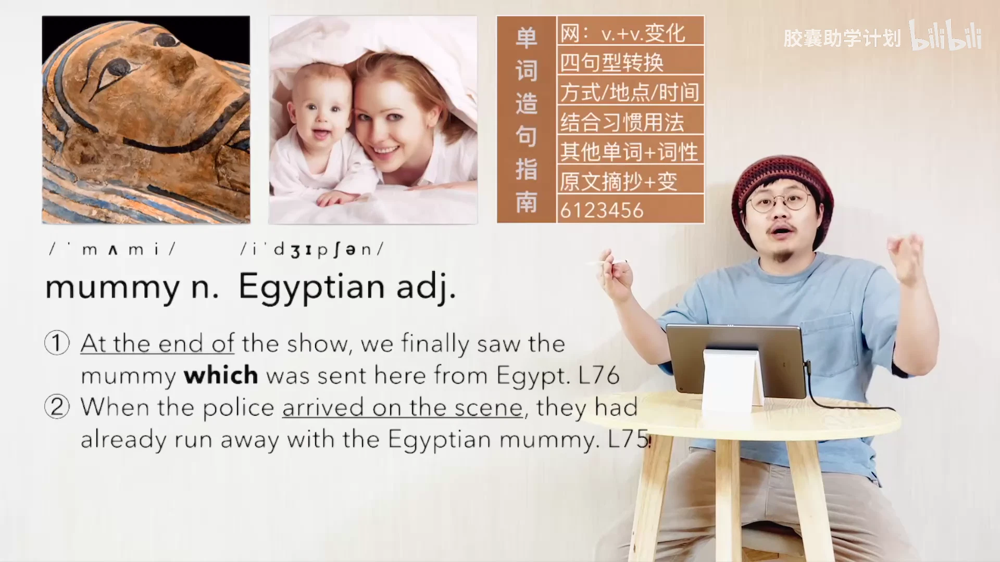

文字识别：单词 / 网：v.+v.变化 / 胶囊助学计划bilbi / 四句型转换 / 造 / 方式/地点/时间 / 句 / 结合习惯用法 / 其他单词+词性 / 指 / 原文摘抄+变 / 南 / 6123456 / / m Λ m i / / /id3iplan/ / mummy n. Egyptian adj. / ① At the end of the show, we finally saw the / mummy which was sent here from Egypt. L76 / When the police arrived on the scene, they had / already run away with the Egyptian mummy. L75!

### 画面 00:02:02

文字识别：单词 / 网：v.+v.变化 / 胶囊助学计划biliil / 四句型转换 / 造 / 方式/地点/时间 / 旭句指 / 结合习惯用法 / 其他单词+词性 / 原文摘抄+变 / 南 / 6123456 / / m Λ m i / / /id3iplan/ / mummy n. Egyptian adj. / ① At the end of the show, we finally saw the / mummy which was sent here from Egypt. L76 /  When the police arrived on the scene, they had / already run away with the Egyptian mummy. L75!

### 画面 00:02:04

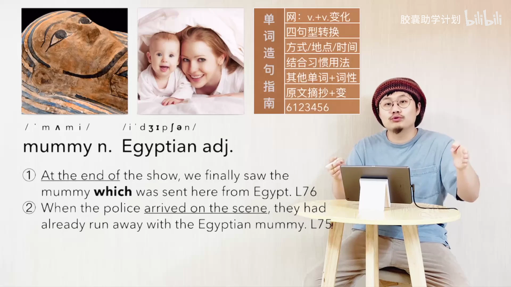

文字识别：单词 / 网：v.+v.变化 / 胶囊助学计划bili / 四句型转换 / 造 / 方式/地点/时间 / 旭句指 / 结合习惯用法 / 其他单词+词性 / 原文摘抄+变 / 南 / 6123456 / / ·m Λ m i / / /i'd3ip∫an/ / mummy n. Egyptian adj. / ① At the end of the show, we finally saw the / mummy which was sent here from Egypt. L76 / When the police arrived on the scene, they had / already run away with the Egyptian mummy. L75!

### 画面 00:02:06

文字识别：：v.+v.变化 / 胶囊助学计划bilbil / 单 / 词 / 四句型转换 / 方式/地点/时间 / 造 / 句 / 结合习惯用法 / 其他单词+词性 / 指 / 原文摘抄+变 / 南 / 6123456 / / 'mΛm i / / /i'd3ip∫an/ / mummy n. Egyptian adj. / ① At the end of the show, we finally saw the / mummy which was sent here from Egypt. L76 / When the police arrived on the scene, they had / already run away with the Egyptian mummy. L75: / It's said that Leo is a huge fan of Egyptian / mummy. L58 L74

### 画面 00:02:08

文字识别：网：v.+v.变化 / 胶囊助学计划ilbi / 单 / 词 / 四句型转换 / 方式/地点/时间 / 造 / 句 / 结合习惯用法 / 其他单词+词性 / 指 / 原文摘抄+变 / 南 / 6123456 / / mΛm i / / /i'd3ip∫an/ / mummy n. Egyptian adj. / ① At the end of the show, we finally saw the / mummy which was sent here from Egypt. L76 / When the police arrived on the scene, they had / already run away with the Egyptian mummy. L75! / It's said that Leo is a huge fan of Egyptian / mummy. L58 L74

### 画面 00:02:10

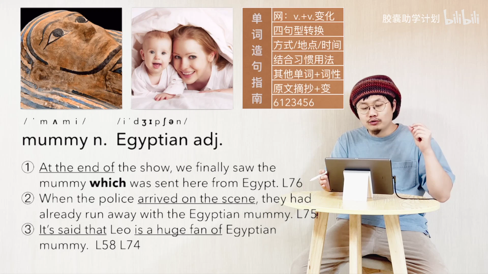

文字识别：网：v.+v.变化 / 胶囊助学计划bilbi / 单 / 词 / 四句型转换 / 方式/地点/时间 / 造 / 句 / 结合习惯用法 / 其他单词+词性 / 指 / 原文摘抄+变 / 南 / 6123456 / / 'm Λ m i / / /i'd3ip∫an/ / mummy n. Egyptian adj. / ① At the end of the show, we finally saw the / mummy which was sent here from Egypt. L76 / When the police arrived on the scene, they had / already run away with the Egyptian mummy. L75! / It's said that Leo is a huge fan of Egyptian / mummy. L58 L74

### 画面 00:02:13

文字识别：网：v.+v.变化 / 胶囊助学计划bibl / 单 / 词 / 四句型转换 / 造 / 方式/地点/时间 / 句 / 结合习惯用法 / 其他单词+词性 / 指 / 原文摘抄+变 / 南 / 6123456 / / 'mΛm i / / /i'd3ip∫an/ / mummy n. Egyptian adj. / ① At the end of the show, we finally saw the / mummy which was sent here from Egypt. L76 / When the police arrived on the scene, they had / already run away with the Egyptian mummy. L75! / It's said that Leo is a huge fan of Egyptian / mummy. L58 L74

### 画面 00:02:15

文字识别：网：v.+v.变化 / 胶囊助学计划biii / 单 / 词 / 四句型转换 / 方式/地点/时间 / 造 / 句 / 结合习惯用法 / 其他单词+词性 / 指 / 原文摘抄+变 / 南 / 6123456 / / mΛm i / / /i'd3ip∫an/ / mummy n. Egyptian adj. / ① At the end of the show, we finally saw the / mummy which was sent here from Egypt. L76 /  When the police arrived on the scene, they had / already run away with the Egyptian mummy. L75! / It's said that Leo is a huge fan of Egyptian / mummy. L58 L74

### 画面 00:02:19

文字识别：网：v.+v.变化 / 胶囊助学计划bilbi / 单 / 词 / 四句型转换 / 方式/地点/时间 / 造 / 句 / 结合习惯用法 / 其他单词+词性 / 指 / 原文摘抄+变 / 南 / 6123456 / / mΛ m i / / /i'd3ip∫an/ / mummy n. Egyptian adj. / ① At the end of the show, we finally saw the / mummy which was sent here from Egypt. L76 / When the police arrived on the scene, they had / already run away with the Egyptian mummy. L75: / It's said that Leo is a huge fan of Egyptian / mummy. L58 L74

### 画面 00:02:21

文字识别：网：v.+v.变化 / 胶囊助学计划biibil / 单 / 词 / 四句型转换 / 造 / 方式/地点/时间 / 句 / 结合习惯用法 / 其他单词+词性 / 指 / 原文摘抄+变 / 南 / 6123456 / / mΛm i / / /i'd3ip∫an/ / mummy n. Egyptian adj. / ① At the end of the show, we finally saw the / mummy which was sent here from Egypt. L76 / When the police arrived on the scene, they had / already run away with the Egyptian mummy. L75! / It's said that Leo is a huge fan of Egyptian / mummy. L58 L74

### 画面 00:02:23

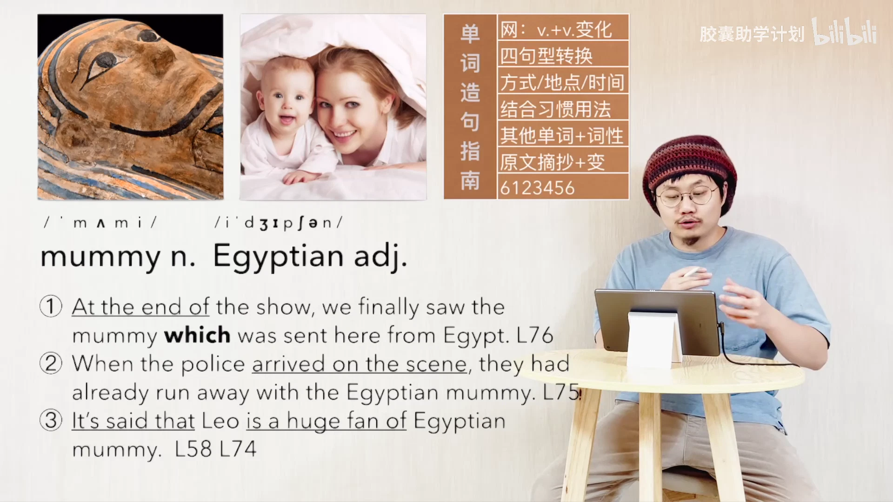

文字识别：网：v.+v.变化 / 胶囊助学计划biibil / 单 / 词 / 四句型转换 / 造 / 方式/地点/时间 / 句 / 结合习惯用法 / 其他单词+词性 / 指 / 原文摘抄+变 / 南 / 6123456 / / 'mΛm i / / /i'd3ip∫an/ / mummy n. Egyptian adj. / ① At the end of the show, we finally saw the / mummy which was sent here from Egypt. L76 / When the police arrived on the scene, they had / already run away with the Egyptian mummy. L75! / It's said that Leo is a huge fan of Egyptian / mummy. L58 L74

### 画面 00:02:25

文字识别：网：v.+v.变化 / 胶囊助学计划blbi / 单 / 词 / 四句型转换 / 方式/地点/时间 / 造 / 句 / 结合习惯用法 / 其他单词+词性 / 指 / 原文摘抄+变 / 南 / 6123456 / / 'mΛm i / / /i'd3ip∫an/ / mummy n. Egyptian adj. / ① At the end of the show, we finally saw the / mummy which was sent here from Egypt. L76 / When the police arrived on the scene, they had / already run away with the Egyptian mummy. L75! / It's said that Leo is a huge fan of Egyptian / mummy. L58 L74

### 画面 00:02:27

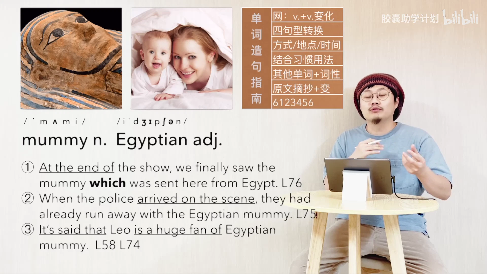

文字识别：网：v.+v.变化 / 胶囊助学计划ibl / 单 / 词 / 四句型转换 / 造 / 方式/地点/时间 / 句 / 结合习惯用法 / 其他单词+词性 / 指 / 原文摘抄+变 / 南 / 6123456 / / mΛm i / / /i'd3ip∫an/ / mummy n. Egyptian adj. / ① At the end of the show, we finally saw the / mummy which was sent here from Egypt. L76 / When the police arrived on the scene, they had / already run away with the Egyptian mummy. L75! / It's said that Leo is a huge fan of Egyptian / mummy. L58 L74

### 画面 00:02:29

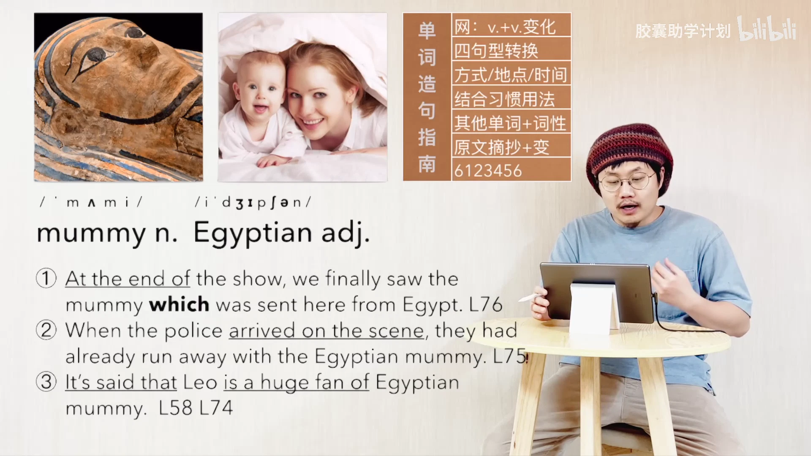

文字识别：网：v.+v.变化 / 胶囊助学计划bil / 单 / 词 / 四句型转换 / 方式/地点/时间 / 造 / 句 / 结合习惯用法 / 其他单词+词性 / 指 / 原文摘抄+变 / 南 / 6123456 / / mΛm i / / /i'd3ip∫an/ / mummy n. Egyptian adj. / ① At the end of the show, we finally saw the / mummy which was sent here from Egypt. L76 / When the police arrived on the scene, they had / already run away with the Egyptian mummy. L75! / It's said that Leo is a huge fan of Egyptian / mummy. L58 L74

## 00:02:30–00:03:00

呃，那注意力集中，听一下这个电影片段。那这个“mummy”肯定指的就是妈妈啊。Who's going to tell mommy? You. Okay,下一个单词“temple”。Temple, temple呢一般指的是庙啊，这个庙宇啊，各种各样的庙啊。啊，比如说北京的这个雍和宫啊，也叫其实英文叫Lama Temple啊。你坐二号线路过那儿的时候，他一拿英文一报站

### 画面 00:02:31

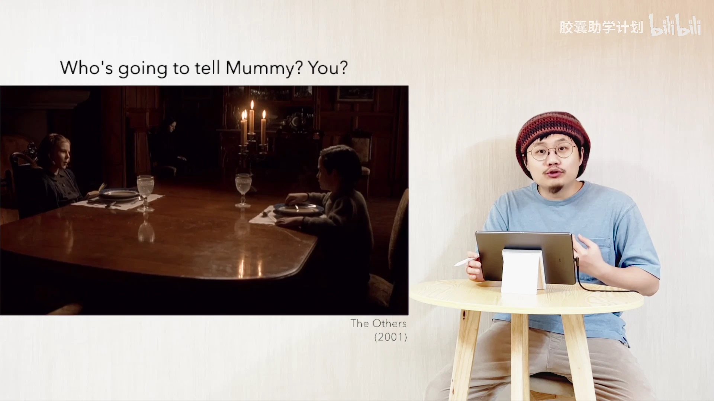

文字识别：biibili / 胶囊助学计划 / Who's going to tell Mummy? You? / The Others / (2001)

### 画面 00:02:33

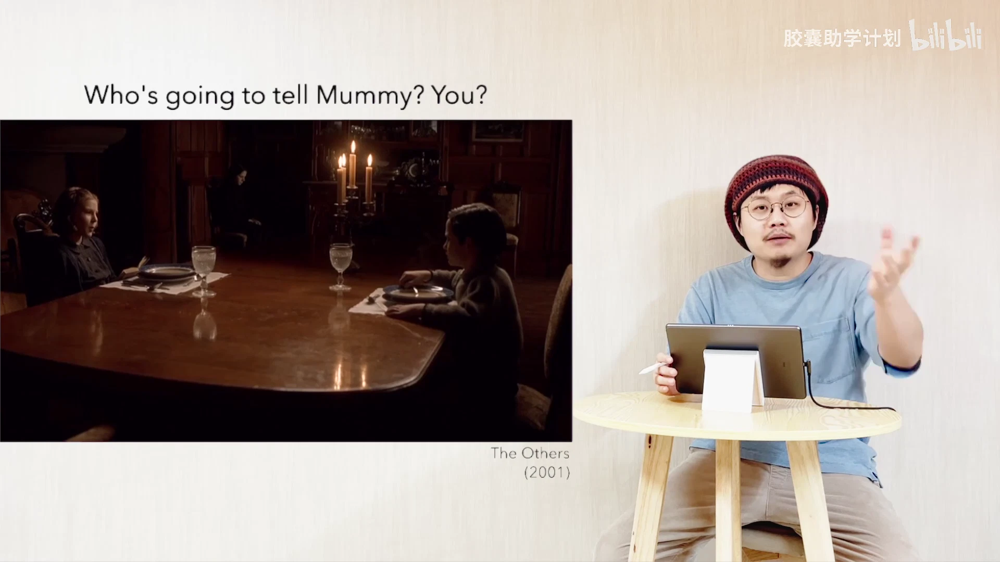

文字识别：biibili / 胶囊助学计划 / Who's going to tell Mummy? You? / The Others / (2001)

### 画面 00:02:35

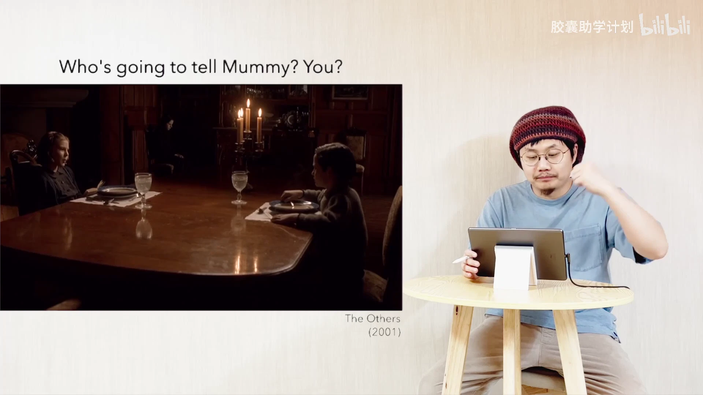

文字识别：bibili / 胶囊助学计划 / Who's going to tell Mummy? You? / The Others / (2001)

### 画面 00:02:37

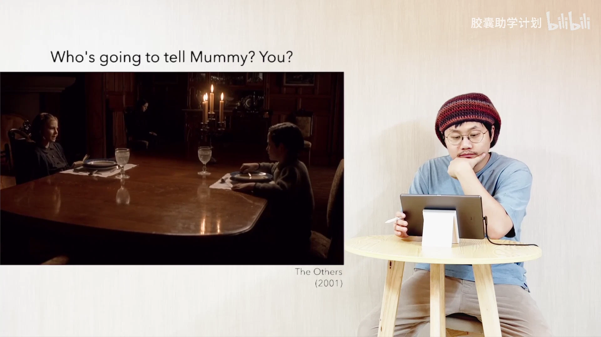

文字识别：biibili / 胶囊助学计划 / Who's going to tell Mummy? You? / The Others / (2001)

### 画面 00:02:40

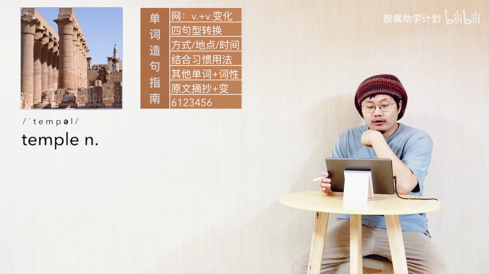

文字识别：单词造句指南 / 网：v.+v.变化 / 胶囊助学计划 / bilbili / 四句型转换 / 方式/地点/时间 / 结合习惯用法 / 其他单词+词性 / 原文摘抄+变 / 6123456 / /'tempal/ / temple n.

### 画面 00:02:42

文字识别：单词造句指南 / 网：v.+v.变化 / 胶囊助学计划 / bilbili / 四句型转换 / 方式/地点/时间 / 结合习惯用法 / 其他单词+词性 / 原文摘抄+变 / 6123456 / /'tempal/ / temple n.

### 画面 00:02:45

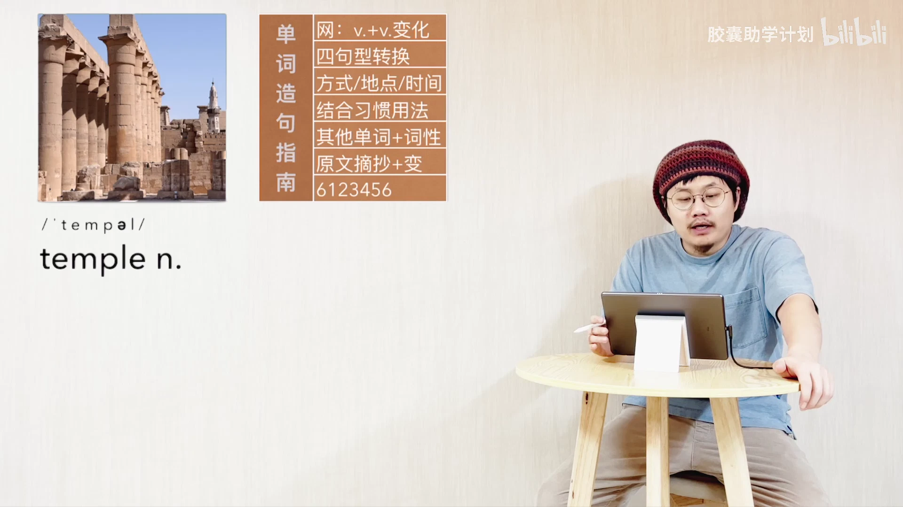

文字识别：单词造句指南 / 网：v.+v.变化 / 胶囊助学计划 / bilbili / 四句型转换 / 方式/地点/时间 / 结合习惯用法 / 其他单词+词性 / 原文摘抄+变 / 6123456 / /'tempal/ / temple n.

### 画面 00:02:49

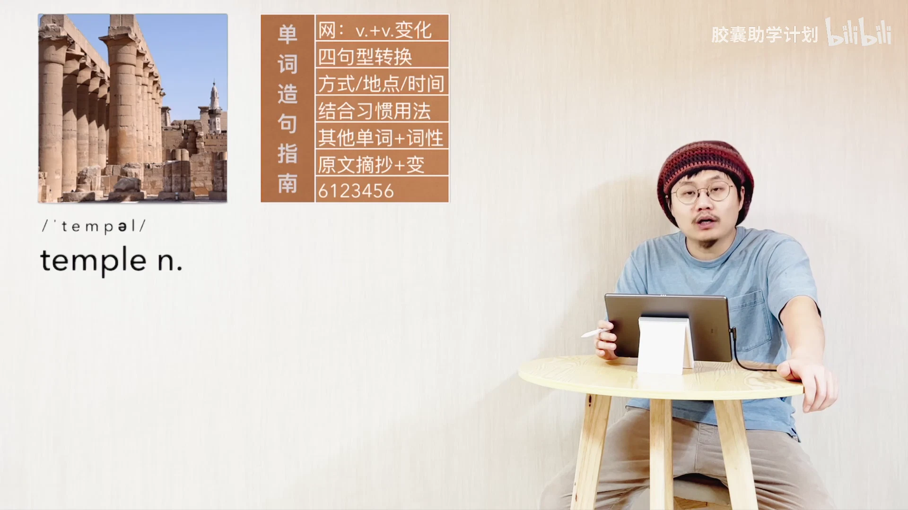

文字识别：单词造句指南 / 网：v.+v.变化 / 胶囊助学计划 / bilbili / 四句型转换 / 方式/地点/时间 / 结合习惯用法 / 其他单词+词性 / 原文摘抄+变 / 6123456 / /'tempal/ / temple n.

### 画面 00:02:51

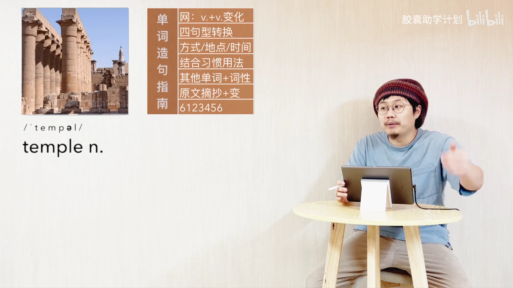

文字识别：单词造句指南 / 网：v.+v.变化 / 胶囊助学计划 / bilbili / 四句型转换 / 方式/地点/时间 / 结合习惯用法 / 其他单词+词性 / 原文摘抄+变 / 6123456 / /'tempal/ / temple n.

### 画面 00:02:55

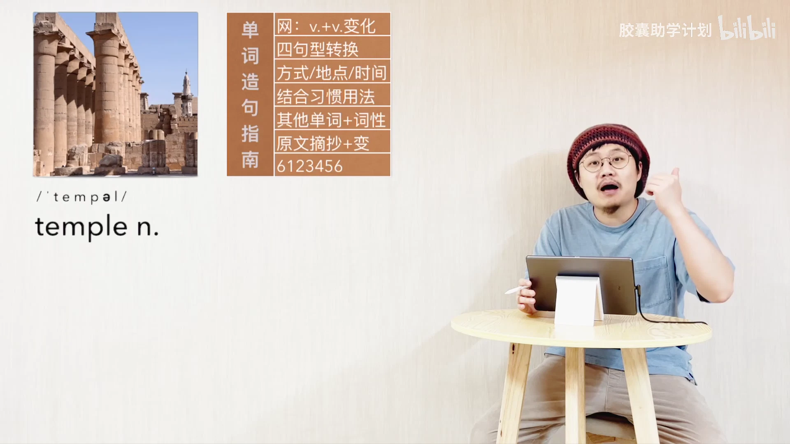

文字识别：单词造句指南 / 网：v.+v.变化 / 胶囊助学计划 / bibii / 四句型转换 / 方式/地点/时间 / 结合习惯用法 / 其他单词+词性 / 原文摘抄+变 / 6123456 / /'tempal/ / temple n.

### 画面 00:02:57

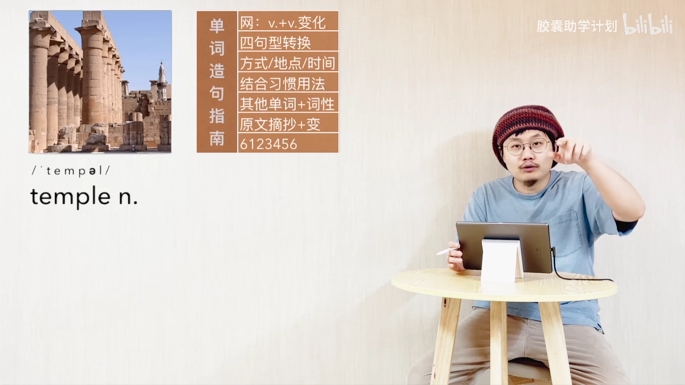

文字识别：单词造句指南 / 网：v.+v.变化 / 胶囊助学计划 / bilbii / 四句型转换 / 方式/地点/时间 / 结合习惯用法 / 其他单词+词性 / 原文摘抄+变 / 6123456 / /'tempal/ / temple n.

## 00:03:00–00:03:30

名，Lama Temple，喇嘛庙，对吧？呃，那我们看一下这句话啊。首先，其实你这个Temple要造句，六一二三四五六，你先迅速想它在哪儿。一三五，这是一个最常出现的三个位置。对于它而言，说They had been building the temple for almost thirty years before it was finally finished。说在它被完成之前，这件事儿已经持续了三十年。那完成这件事儿其实也是过去的，对吧？那在过去之前持续了一段

### 画面 00:03:00

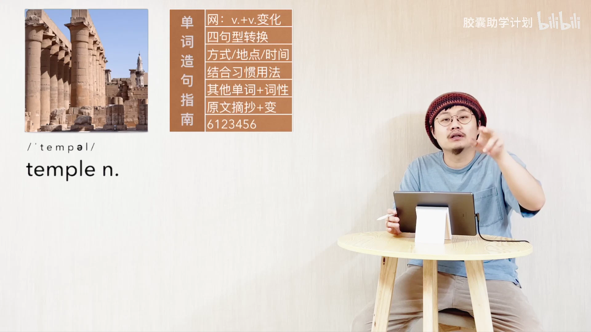

文字识别：单词造句指南 / 网：v.+v.变化 / 胶囊助学计划 / Bibili / 四句型转换 / 方式/地点/时间 / 结合习惯用法 / 其他单词+词性 / 原文摘抄+变 / 6123456 / /'tempal/ / temple n.

### 画面 00:03:03

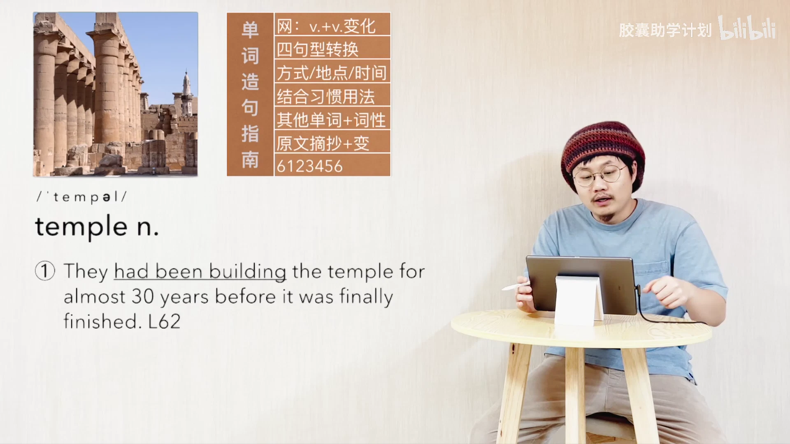

文字识别：胶囊助学计划bil / 单词造句指南 / 网：v.+v.变化 / 四句型转换 / 方式/地点/时间 / 结合习惯用法 / 其他单词+词性 / 原文摘抄+变 / 6123456 / / 'tempal/ / temple n. / ① They had been building the temple for / almost 30 years before it was finally / finished. L62

### 画面 00:03:05

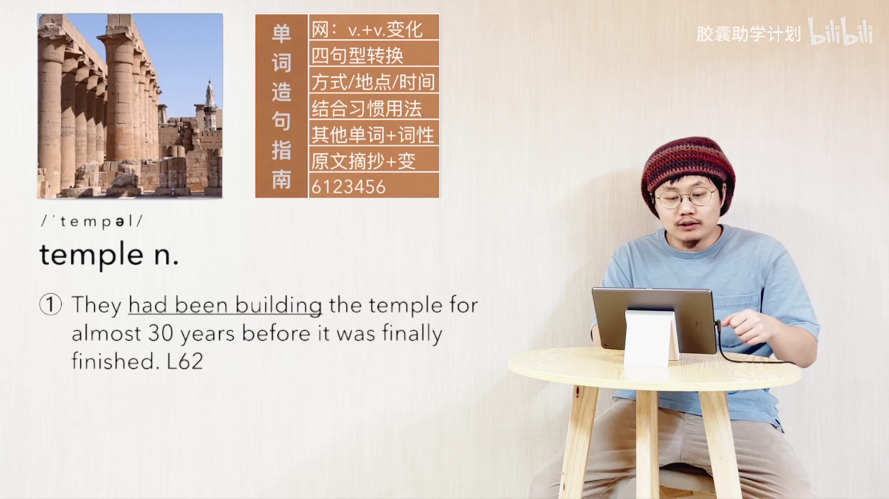

文字识别：单词造句指南 / 网：v.+v.变化 / 胶囊助学计划 / Bilbii / 四句型转换 / 方式/地点/时间 / 结合习惯用法 / 其他单词+词性 / 原文摘抄+变 / 6123456 / / 'tempal/ / temple n. / ① They had been building the temple for / almost 30 years before it was finally / finished. L62

### 画面 00:03:08

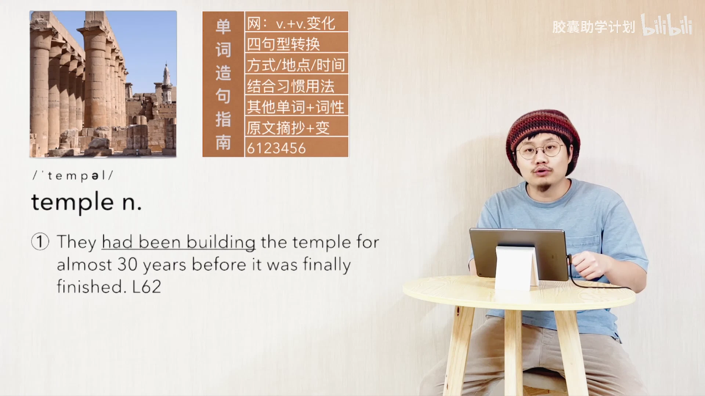

文字识别：单词造句指南 / 网：v.+v.变化 / 胶囊助学计划 / Bilibili / 四句型转换 / 方式/地点/时间 / 结合习惯用法 / 其他单词+词性 / 原文摘抄+变 / 6123456 / /'tempal/ / temple n. / ① They had been building the temple for / almost 30 years before it was finally / finished. L62

### 画面 00:03:10

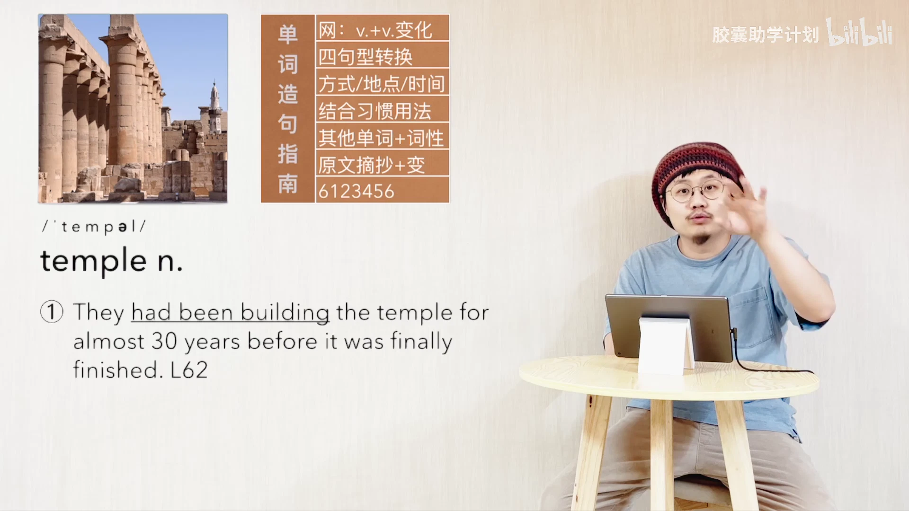

文字识别：胶囊助学计划bii / 单词造句指南 / 网：v.+v.变化 / 四句型转换 / 方式/地点/时间 / 结合习惯用法 / 其他单词+词性 / 原文摘抄+变 / 6123456 / / 'tempal/ / temple n. / ① They had been building the temple for / almost 30 years before it was finally / finished. L62

### 画面 00:03:12

文字识别：单词造句指南 / 网：v.+v.变化 / 胶囊助学计划 / bilbii / 四句型转换 / 方式/地点/时间 / 结合习惯用法 / 其他单词+词性 / 原文摘抄+变 / 6123456 / /'tempal/ / temple n. / ① They had been building the temple for / almost 30 years before it was finally / finished. L62

### 画面 00:03:15

文字识别：单词造句指南 / 网：v.+v.变化 / 胶囊助学计划 / biibii / 四句型转换 / 方式/地点/时间 / 结合习惯用法 / 其他单词+词性 / 原文摘抄+变 / 6123456 / /'tempal/ / temple n. / ① They had been building the temple for / almost 30 years before it was finally / finished. L62

### 画面 00:03:20

文字识别：单词造句指南 / 网：v.+v.变化 / 胶囊助学计划bii / 四句型转换 / 方式/地点/时间 / 结合习惯用法 / 其他单词+词性 / 原文摘抄+变 / 6123456 / /'tempal/ / temple n. / ① They had been building the temple for / almost 30 years before it was finally / finished. L62

### 画面 00:03:23

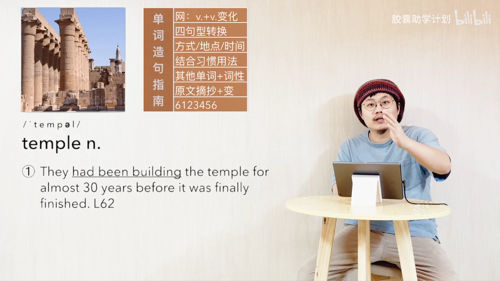

文字识别：单词造句指南 / 网：v.+v.变化 / 胶囊助学计划 / Bilbli / 四句型转换 / 方式/地点/时间 / 结合习惯用法 / 其他单词+词性 / 原文摘抄+变 / 6123456 / /'tempal/ / temple n. / ① They had been building the temple for / almost 30 years before it was finally / finished. L62

### 画面 00:03:25

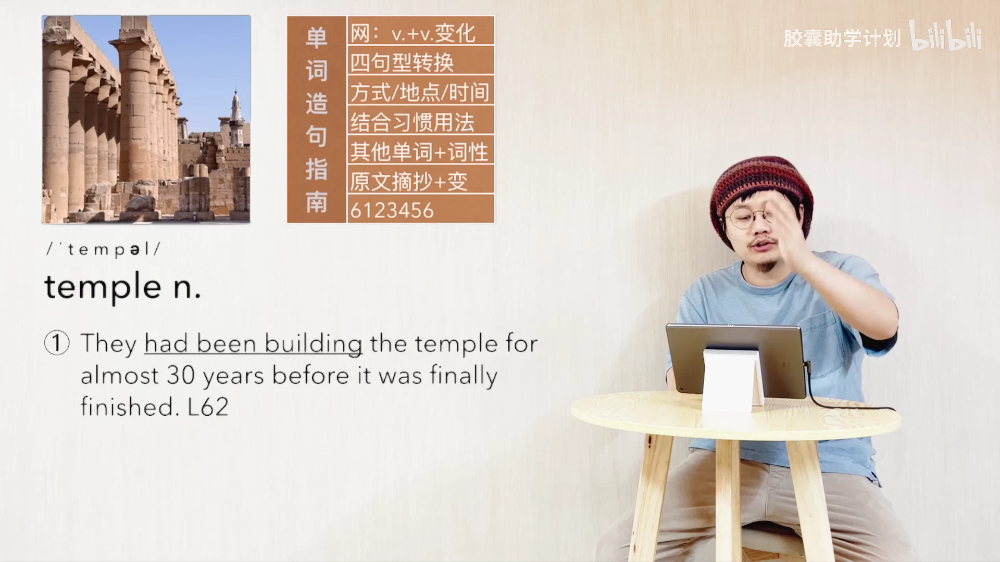

文字识别：胶囊助学计划bilbi / 单词造句指南 / 网：v.+v.变化 / 四句型转换 / 方式/地点/时间 / 结合习惯用法 / 其他单词+词性 / 原文摘抄+变 / 6123456 / /'tempal/ / temple n. / ① They had been building the temple for / almost 30 years before it was finally / finished. L62

## 00:03:30–00:04:00

时间，过去完成进行时，六十二课咱们学的。OK，在这复习一下这个时态，我们复习的相对较少。Next one说，We should have visited the temple。我相信其实基本上你可能第四单元跟我学完了啊，你不一定把第四单元所有单词习惯用法都记下来了。但我估计像什么六十五课这种should have done，我估计你记下来了。我几乎每一节课都拿它造句啊。我们本来应该去拜参观一下这个地方，但没去是吧？参观一下这个庙。

### 画面 00:03:30

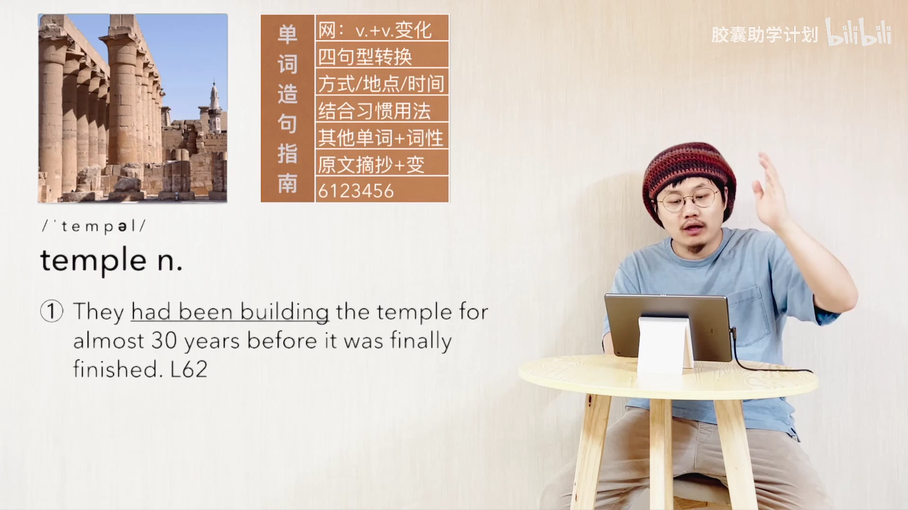

文字识别：单词造句指南 / 网：v.+v.变化 / 胶囊助学计划 / ilbii / 四句型转换 / 方式/地点/时间 / 结合习惯用法 / 其他单词+词性 / 原文摘抄+变 / 6123456 / /'tempal/ / temple n. / ① They had been building the temple for / almost 30 years before it was finally / finished. L62

### 画面 00:03:33

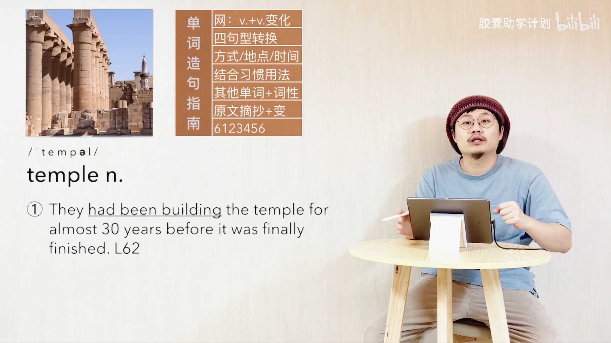

文字识别：单词造句指南 / 网：v.+v.变化 / 胶囊助学计划 / bibii / 四句型转换 / 方式/地点/时间 / 结合习惯用法 / 其他单词+词性 / 原文摘抄+变 / 6123456 / /'tempal/ / temple n. / ① They had been building the temple for / almost 30 years before it was finally / finished. L62

### 画面 00:03:35

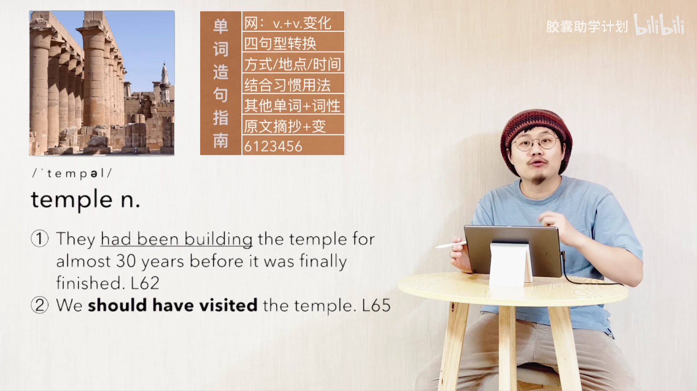

文字识别：单词造句指南 / 网：v.+v.变化 / 胶囊助学计划 / Bilbili / 四句型转换 / 方式/地点/时间 / 结合习惯用法 / 其他单词+词性 / 原文摘抄+变 / 6123456 / /'tempal/ / temple n. / ① They had been building the temple for / almost 30 years before it was finally / finished. L62 / We should have visited the temple. L65

### 画面 00:03:37

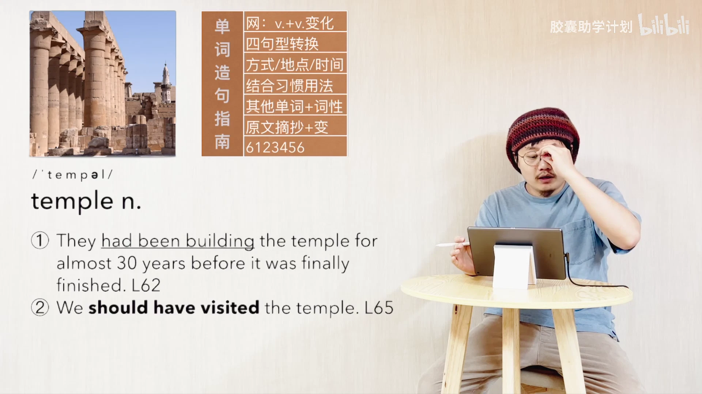

文字识别：胶囊助学计划bilbi / 单词造句指南 / 网：v.+v.变化 / 四句型转换 / 方式/地点/时间 / 结合习惯用法 / 其他单词+词性 / 原文摘抄+变 / 6123456 / /'tempal/ / temple n. / ① They had been building the temple for / almost 30 years before it was finally / finished. L62 / We should have visited the temple. L65

### 画面 00:03:40

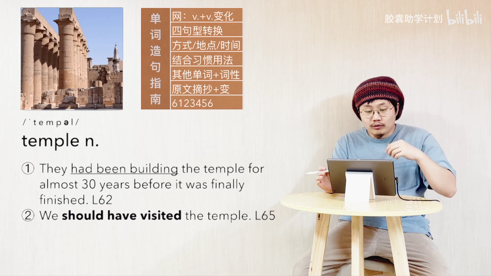

文字识别：胶囊助学计划blbi / 单词造句指南 / 网：v.+v.变化 / 四句型转换 / 方式/地点/时间 / 结合习惯用法 / 其他单词+词性 / 原文摘抄+变 / 6123456 / / 'tempal/ / temple n. / ① They had been building the temple for / almost 30 years before it was finally / finished. L62 / We should have visited the temple. L65

### 画面 00:03:43

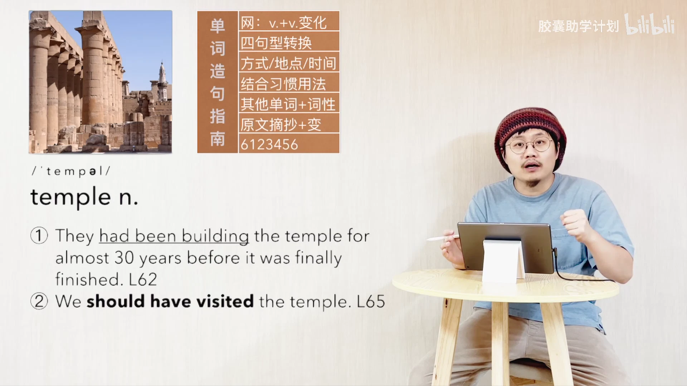

文字识别：胶囊助学计划blbi / 单词造句指南 / 网：v.+v.变化 / 四句型转换 / 方式/地点/时间 / 结合习惯用法 / 其他单词+词性 / 原文摘抄+变 / 6123456 / / 'tempal/ / temple n. / ① They had been building the temple for / almost 30 years before it was finally / finished. L62 / We should have visited the temple. L65

### 画面 00:03:46

文字识别：胶囊助学计划bibi / 单词造句指南 / 网：v.+v.变化 / 四句型转换 / 方式/地点/时间 / 结合习惯用法 / 其他单词+词性 / 原文摘抄+变 / 6123456 / /'tempal/ / temple n. / ① They had been building the temple for / almost 30 years before it was finally / finished. L62 / We should have visited the temple. L65

### 画面 00:03:50

文字识别：胶囊助学计划bii / 单词造句指南 / 网：v.+v.变化 / 四句型转换 / 方式/地点/时间 / 结合习惯用法 / 其他单词+词性 / 原文摘抄+变 / 6123456 / /'tempal/ / temple n. / ① They had been building the temple for / almost 30 years before it was finally / finished. L62 / We should have visited the temple. L65

### 画面 00:03:55

文字识别：单词造句指南 / 网：v.+v.变化 / 胶囊助学计划bibl / 四句型转换 / 方式/地点/时间 / 结合习惯用法 / 其他单词+词性 / 原文摘抄+变 / 6123456 / /'tempal/ / temple n. / ① They had been building the temple for / almost 30 years before it was finally / finished. L62 / We should have visited the temple. L65

### 画面 00:03:58

文字识别：胶囊助学计划bilbi / 单词造句指南 / 网：v.+v.变化 / 四句型转换 / 方式/地点/时间 / 结合习惯用法 / 其他单词+词性 / 原文摘抄+变 / 6123456 / / 'tempal/ / temple n. / ① They had been building the temple for / almost 30 years before it was finally / finished. L62 / We should have visited the temple. L65 / If you were here, you wound find this / 3 / temple beautiful too. L4 L40

## 00:04:00–00:04:30

So if you were here, you would find this temple beautiful too.说如果你在这里，你相信我，你也会觉得这个庙宇特别的美丽。那find something beautiful，咱们第四课学过的，对吧？啊，在这个地方呢，习惯用法我们用上了，又用上了四十课的虚拟语气。再跟我读一遍这个单词，叫做temple。Very good. Next one，下一个单词叫mark。Mark这个单词的含义有很多，本课我们就学本课的含

### 画面 00:04:00

文字识别：胶囊助学计划biii / 单词造句指南 / 网：v.+v.变化 / 四句型转换 / 方式/地点/时间 / 结合习惯用法 / 其他单词+词性 / 原文摘抄+变 / 6123456 / / 'tempal/ / temple n. / ① They had been building the temple for / almost 30 years before it was finally / finished. L62 / We should have visited the temple. L65 / If you were here, you wound find this / temple beautiful too. L4 L40

### 画面 00:04:05

文字识别：胶囊助学计划bilbi / 单词造句指南 / 网：v.+v.变化 / 四句型转换 / 方式/地点/时间 / 结合习惯用法 / 其他单词+词性 / 原文摘抄+变 / 6123456 / /'tempal/ / temple n. / ① They had been building the temple for / almost 30 years before it was finally / finished. L62 / We should have visited the temple. L65 / If you were here, you wound find this / temple beautiful too. L4 L40

### 画面 00:04:08

文字识别：胶囊助学计划bilii / 单词造句指南 / 网：v.+v.变化 / 四句型转换 / 方式/地点/时间 / 结合习惯用法 / 其他单词+词性 / 原文摘抄+变 / 6123456 / /'tempal/ / temple n. / ① They had been building the temple for / almost 30 years before it was finally / finished. L62 / We should have visited the temple. L65 / If you were here, you wound find this / temple beautiful too. L4 L40

### 画面 00:04:10

文字识别：胶囊助学计划bilbi / 单词造句指南 / 网：v.+v.变化 / 四句型转换 / 方式/地点/时间 / 结合习惯用法 / 其他单词+词性 / 原文摘抄+变 / 6123456 / /'tempal/ / temple n. / ① They had been building the temple for / almost 30 years before it was finally / finished. L62 / We should have visited the temple. L65 / If you were here, you wound find this / temple beautiful too. L4 L40

### 画面 00:04:13

文字识别：胶囊助学计划bilbi / 单词造句指南 / 网：v.+v.变化 / 四句型转换 / 方式/地点/时间 / 结合习惯用法 / 其他单词+词性 / 原文摘抄+变 / 6123456 / /'tempal/ / temple n. / ① They had been building the temple for / almost 30 years before it was finally / finished. L62 / We should have visited the temple. L65 / If you were here, you wound find this / temple beautiful too. L4 L40

### 画面 00:04:15

文字识别：胶囊助学计划bilbi / 单词造句指南 / 网：v.+v.变化 / 四句型转换 / 方式/地点/时间 / 结合习惯用法 / 其他单词+词性 / 原文摘抄+变 / 6123456 / /'tempal/ / temple n. / ① They had been building the temple for / almost 30 years before it was finally / finished. L62 / We should have visited the temple. L65 / If you were here, you wound find this / temple beautiful too. L4 L40

### 画面 00:04:20

文字识别：单词造句指南 / 网：v.+v.变化 / 胶囊助学计划bibl / 四句型转换 / 方式/地点/时间 / 结合习惯用法 / 其他单词+词性 / 原文摘抄+变 / 6123456 / /'tempal/ / temple n. / ① They had been building the temple for / almost 30 years before it was finally / finished. L62 / We should have visited the temple. L65 / If you were here, you wound find this / temple beautiful too. L4 L40

### 画面 00:04:23

文字识别：单词造句指南 / 网：v.+v.变化 / 胶囊助学计划 / biibii / 四句型转换 / 方式/地点/时间 / 结合习惯用法 / 其他单词+词性 / 原文摘抄+变 / 6123456 / /ma:k/ / mark n.

### 画面 00:04:25

文字识别：单词造句指南 / 网：v.+v.变化 / 胶囊助学计划 / bibili / 四句型转换 / 方式/地点/时间 / 结合习惯用法 / 其他单词+词性 / 原文摘抄+变 / 6123456 / /ma:k/ / mark n.

## 00:04:30–00:05:00

义啊，叫做斑点。OK啊，比如说，There were dirty marks on her trousers where she had wiped her hands。OK，说在她的这个裤子上有一些脏的斑点啊，泥点子或者反正脏点子，我们也不知道说是什么。Where五十五课定语从句叫在哪里，在哪里啊？在on her trousers这个地方，在她这个裤子上。She had wiped her

### 画面 00:04:30

文字识别：单词造句指南 / 网：v.+v.变化 / 胶囊助学计划 / Bibii / 四句型转换 / 方式/地点/时间 / 结合习惯用法 / 其他单词+词性 / 原文摘抄+变 / 6123456 / /ma:k/ / mark n.

### 画面 00:04:32

文字识别：单词造句指南 / 网：v.+v.变化 / 胶囊助学计划 / bilbili / 四句型转换 / 方式/地点/时间 / 结合习惯用法 / 其他单词+词性 / 原文摘抄+变 / 6123456 / /ma:k/ / mark n. /  There were dirty marks on her trousers where / she had wiped her hands. L55

### 画面 00:04:34

文字识别：单词造句指南 / 网：v.+v.变化 / 胶囊助学计划 / bilbli / 四句型转换 / 方式/地点/时间 / 结合习惯用法 / 其他单词+词性 / 原文摘抄+变 / 6123456 / /ma:k/ / mark n. /  There were dirty marks on her trousers where / 1 / she had wiped her hands. L55

### 画面 00:04:36

文字识别：单词造句指南 / 网：v.+v.变化 / 胶囊助学计划 / bilbii / 四句型转换 / 方式/地点/时间 / 结合习惯用法 / 其他单词+词性 / 原文摘抄+变 / 6123456 / /ma:k/ / mark n. /  There were dirty marks on her trousers where / she had wiped her hands. L55

### 画面 00:04:40

文字识别：单词造句指南 / 网：v.+v.变化 / 胶囊助学计划 / bibili / 四句型转换 / 方式/地点/时间 / 结合习惯用法 / 其他单词+词性 / 原文摘抄+变 / 6123456 / /ma:k/ / mark n. /  There were dirty marks on her trousers where / 1 / she had wiped her hands. L55

### 画面 00:04:43

文字识别：单词造句指南 / 网：v.+v.变化 / 胶囊助学计划 / bilbil / 四句型转换 / 方式/地点/时间 / 结合习惯用法 / 其他单词+词性 / 原文摘抄+变 / 6123456 / /ma:k/ / mark n. /  There were dirty marks on her trousers where / she had wiped her hands. L55

### 画面 00:04:45

文字识别：单词造句指南 / 网：v.+v.变化 / 胶囊助学计划 / bilbili / 四句型转换 / 方式/地点/时间 / 结合习惯用法 / 其他单词+词性 / 原文摘抄+变 / 6123456 / /ma:k/ / mark n. / ) There were dirty marks on her trousers where / she had wiped her hands. L55

### 画面 00:04:47

文字识别：单词造句指南 / 网：v.+v.变化 / 胶囊助学计划 / bilbili / 四句型转换 / 方式/地点/时间 / 结合习惯用法 / 其他单词+词性 / 原文摘抄+变 / 6123456 / /ma:k/ / mark n. /  There were dirty marks on her trousers where / she had wiped her hands. L55

### 画面 00:04:50

文字识别：单词造句指南 / 网：v.+v.变化 / 胶囊助学计划 / bilbli / 四句型转换 / 方式/地点/时间 / 结合习惯用法 / 其他单词+词性 / 原文摘抄+变 / 6123456 / /ma:k/ / mark n. /  There were dirty marks on her trousers where / she had wiped her hands. L55

### 画面 00:04:52

文字识别：单词造句指南 / 网：v.+v.变化 / 胶囊助学计划 / bilbii / 四句型转换 / 方式/地点/时间 / 结合习惯用法 / 其他单词+词性 / 原文摘抄+变 / 6123456 / /ma:k/ / mark n. /  There were dirty marks on her trousers where / she had wiped her hands. L55

### 画面 00:04:55

文字识别：单词造句指南 / 网：v.+v.变化 / 胶囊助学计划 / bibi / 四句型转换 / 方式/地点/时间 / 结合习惯用法 / 其他单词+词性 / 原文摘抄+变 / 6123456 / /ma:k/ / mark n. / ) There were dirty marks on her / ousers where / she had wiped her hands. L55

## 00:05:00–00:05:30

hands.她擦她的手来着，对吧？手上脏，顺便往裤子上这么一擦啊。很多小孩爱这么干。说 she had a red mark on her arm. Where she burned herself.说她有一个红色的mark斑点，哎，红色的标记啊，这么一个东西在her arm。比如说类似于胎记啊，胎记除了有灰色、黑色的以外，也有红色的，对吧？所以她有一个红色的这么一个

### 画面 00:05:00

文字识别：单词造句指南 / 网：v.+v.变化 / 胶囊助学计划 / bilbili / 四句型转换 / 方式/地点/时间 / 结合习惯用法 / 其他单词+词性 / 原文摘抄+变 / 6123456 / /ma:k/ / mark n. /  There were dirty marks on her trousers where / she had wiped her hands. L55

### 画面 00:05:02

文字识别：单词造句指南 / 网：v.+v.变化 / 胶囊助学计划 / bibli / 四句型转换 / 方式/地点/时间 / 结合习惯用法 / 其他单词+词性 / 原文摘抄+变 / 6123456 / /ma:k/ / mark n. / D There were dirty marks on her trousers where / she had wiped her hands. L55

### 画面 00:05:05

文字识别：单词造句指南 / 网：v.+v.变化 / 胶囊助学计划 / bilbl / 四句型转换 / 方式/地点/时间 / 结合习惯用法 / 其他单词+词性 / 原文摘抄+变 / 6123456 / /ma:k/ / mark n. /  There were dirty marks on her trousers where / she had wiped her hands. L55

### 画面 00:05:07

文字识别：胶囊助学计划biibi / 单词造句指南 / 网：v.+v.变化 / 四句型转换 / 方式/地点/时间 / 结合习惯用法 / 其他单词+词性 / 原文摘抄+变 / 6123456 / /ma:k/ / mark n. / ① There were dirty marks on her trousers where / she had wiped her hands. L55 / She had a red mark on her arm where / she'd burned herself. L55

### 画面 00:05:10

文字识别：胶囊助学计划bibi / 单词造句指南 / 网：v.+v.变化 / 四句型转换 / 方式/地点/时间 / 结合习惯用法 / 其他单词+词性 / 原文摘抄+变 / 6123456 / /ma:k/ / mark n. / ① There were dirty marks on her trousers where / she had wiped her hands. L55 / ) She had a red mark on her arm where / she'd burned herself. L55

### 画面 00:05:15

文字识别：胶囊助学计划bibi / 单词造句指南 / 网：v.+v.变化 / 四句型转换 / 方式/地点/时间 / 结合习惯用法 / 其他单词+词性 / 原文摘抄+变 / 6123456 / /ma:k/ / mark n. / ① There were dirty marks on her trousers where / she had wiped her hands. L55 / She had a reamark on her arm where / she'd burned herself. L55

### 画面 00:05:18

文字识别：胶囊助学计划blii / 单词造句指南 / 网：v.+v.变化 / 四句型转换 / 方式/地点/时间 / 结合习惯用法 / 其他单词+词性 / 原文摘抄+变 / 6123456 / /ma:k/ / mark n. / ① There were dirty marks on her trousers where / she had wiped her hands. L55 / ) She had a red mark on her arm where / she'd burned herself. L55

### 画面 00:05:21

文字识别：胶囊助学计划bilbi / 单词造句指南 / 网：v.+v.变化 / 四句型转换 / 方式/地点/时间 / 结合习惯用法 / 其他单词+词性 / 原文摘抄+变 / 6123456 / /ma:k/ / mark n. / ① There were dirty marks on her trousers where / she had wiped her hands. L55 / ) She had a red mark on her arm where / she'd burned herself. L55

### 画面 00:05:23

文字识别：胶囊助学计划bii / 单词造句指南 / 网：v.+v.变化 / 四句型转换 / 方式/地点/时间 / 结合习惯用法 / 其他单词+词性 / 原文摘抄+变 / 6123456 / /ma:k/ / mark n. / ① There were dirty marks on her trousers where / she had wiped her hands. L55 / ) She had a red mark on her arm where / she'd burned herself. L55

### 画面 00:05:25

文字识别：单词造句指南 / 网：v.+v.变化 / 胶囊助学计划blbi / 四句型转换 / 方式/地点/时间 / 结合习惯用法 / 其他单词+词性 / 原文摘抄+变 / 6123456 / /ma:k/ / mark n. / ① There were dirty marks on her trousers where / she had wiped her hands. L55 /  She had a red mark on her arm where / she'd burned herself. L55

## 00:05:30–00:06:00

mark 在他的这个手上。然后，where she burned herself? 哎，他在那里，在他的手臂上，他把自己给烫了一下啊。那这看来不是我们的胎记，是吧？烫着了。Next one, they have been cleaning the kitchen all morning. 五十二课咱们学的，故现在完成进行时，他们一直都在打扫这个 kitchen。为什么呢？For because there were black marks everywhere. Everywhere, 四

### 画面 00:05:30

文字识别：胶囊助学计划bilbi / 单词造句指南 / 网：v.+v.变化 / 四句型转换 / 方式/地点/时间 / 结合习惯用法 / 其他单词+词性 / 原文摘抄+变 / 6123456 / /ma:k/ / mark n. / ① There were dirty marks on her trousers where / she had wiped her hands. L55 / She had a red mark on her arm where / she'd burned herself. L55

### 画面 00:05:35

文字识别：胶囊助学计划bli / 单词造句指南 / 网：v.+v.变化 / 四句型转换 / 方式/地点/时间 / 结合习惯用法 / 其他单词+词性 / 原文摘抄+变 / 6123456 / /ma:k/ / mark n. / ① There were dirty marks on her trousers where / she had wiped her hands. L55 / She had a red mark on her arm where / she'd burned herself. L55

### 画面 00:05:39

文字识别：胶囊助学计划blii / 单词造句指南 / 网：v.+v.变化 / 四句型转换 / 方式/地点/时间 / 结合习惯用法 / 其他单词+词性 / 原文摘抄+变 / 6123456 / /ma:k/ / mark n. / ① There were dirty marks on her trousers where / she had wiped her hands. L55 / She had a red mark on her arm where / she'd burned herself. L55

### 画面 00:05:42

文字识别：胶囊助学计划blbi / 单词造句指南 / 网：v.+v.变化 / 四句型转换 / 方式/地点/时间 / 结合习惯用法 / 其他单词+词性 / 原文摘抄+变 / 6123456 / /ma:k/ / mark n. / ① There were dirty marks on her trousers where / she had wiped her hands. L55 / She had a red mark on her arm where / she'd burned herself. L55

### 画面 00:05:44

文字识别：单词造句指南 / 网：v.+v.变化 / 胶囊助学计划bilii / 四句型转换 / 方式/地点/时间 / 结合习惯用法 / 其他单词+词性 / 原文摘抄+变 / 6123456 / /ma:k/ / mark n. / ① There were dirty marks on her trousers where / she had wiped her hands. L55 /  She had a red mark on her arm where / she'd burned herself. L55 / They have been cleaning the kitchen all / morning, for there were black marks / everywhere. L52

### 画面 00:05:46

文字识别：单词造句指南 / 网：v.+v.变化 / 胶囊助学计划bilbi / 四句型转换 / 方式/地点/时间 / 结合习惯用法 / 其他单词+词性 / 原文摘抄+变 / 6123456 / /ma:k/ / mark n. / ① There were dirty marks on her trousers where / she had wiped her hands. L55 /  She had a red mark on her arm where / she'd burned herself. L55 / They have been cleaning the kitchen all / morning, for there were black marks / everywhere. L52

### 画面 00:05:50

文字识别：单词造句指南 / 网：v.+v.变化 / 胶囊助学计划bilii / 四句型转换 / 方式/地点/时间 / 结合习惯用法 / 其他单词+词性 / 原文摘抄+变 / 6123456 / /ma:k/ / mark n. / ① There were dirty marks on her trousers where / she had wiped her hands. L55 /  She had a red mark on her arm where / she'd burned herself. L55 / They have been cleaning the kitchen all / morning, for there were black marks / everywhere. L52

### 画面 00:05:52

文字识别：单词造句指南 / 网：v.+v.变化 / 胶囊助学计划blbi / 四句型转换 / 方式/地点/时间 / 结合习惯用法 / 其他单词+词性 / 原文摘抄+变 / 6123456 / /ma:k/ / mark n. / ① There were dirty marks on her trousers where / she had wiped her hands. L55 /  She had a red mark on her arm where / she'd burned herself. L55 / They have been cleaning the kitchen all / morning, for there were black marks / everywhere. L52

### 画面 00:05:55

文字识别：单词造句指南 / 网：v.+v.变化 / 胶囊助学计划bilbil / 四句型转换 / 方式/地点/时间 / 结合习惯用法 / 其他单词+词性 / 原文摘抄+变 / 6123456 / /ma:k/ / mark n. / ① There were dirty marks on her trousers where / she had wiped her hands. L55 /  She had a red mark on her arm where / she'd burned herself. L55 / They have been cleaning the kitchen all / morning, for there were black marks / everywhere. L52

## 00:06:00–00:06:30

处都是脏的黑点子，对吧？你长期不打扫，又是油又是土的，混到一起就变成小黑点了，叫 black marks. Okay, very good.下一个单词 plate, play这个单词，我相信你一定知道它其他的意思。这个从新一就开始学，您能不能弹幕告诉我，是吧？或者你自己告诉我啊？然后你可以看一下，自己去查一下。本科的plate我们要学的是一个，它其实不是那么常见的一个含义，

### 画面 00:06:00

文字识别：胶囊助学计划bilbii / 单词造句指南 / 网：v.+v.变化 / 四句型转换 / 方式/地点/时间 / 结合习惯用法 / 其他单词+词性 / 原文摘抄+变 / 6123456 / /ma:k/ / mark n. / ① There were dirty marks on her trousers where / she had wiped her hands. L55 /  She had a red mark on her arm where / she'd burned herself. L55 / They have been cleaning the kitchen all / morning, for there were black marks / everywhere. L52

### 画面 00:06:05

文字识别：胶囊助学计划bilbi / 单词造句指南 / 网：v.+v.变化 / 四句型转换 / 方式/地点/时间 / 结合习惯用法 / 其他单词+词性 / 原文摘抄+变 / 6123456 / /ma:k/ / mark n. / ① There were dirty marks on her trousers where / she had wiped her hands. L55 / ② She had a red mark on her arm where / she'd burned herself. L55 / They have been cleaning the kitchen all / morning, for there were black marks / everywhere. L52

### 画面 00:06:07

文字识别：胶囊助学计划blii / 单词造句指南 / 网：v.+v.变化 / 四句型转换 / 方式/地点/时间 / 结合习惯用法 / 其他单词+词性 / 原文摘抄+变 / 6123456 / /ma:k/ / mark n. / ① There were dirty marks on her trousers where / she had wiped her hands. L55 /  She had a red mark on her arm where / she'd burned herself. L55 / They have been cleaning the kitchen all / morning, for there were black marks / everywhere. L52

### 画面 00:06:10

文字识别：单词造句指南 / 网：v.+v.变化 / 胶囊助学计划 / bilbili / 四句型转换 / 方式/地点/时间 / 结合习惯用法 / 其他单词+词性 / 原文摘抄+变 / 6123456 / /pleit/ / plate n. take plates of ….

### 画面 00:06:12

文字识别：单词造句指南 / 网：v.+v.变化 / 胶囊助学计划 / bilbii / 四句型转换 / 方式/地点/时间 / 结合习惯用法 / 其他单词+词性 / 原文摘抄+变 / 6123456 / /pleit/ / plate n. take plates of …

### 画面 00:06:15

文字识别：单词造句指南 / 网：v.+v.变化 / 胶囊助学计划 / bibii / 四句型转换 / 方式/地点/时间 / 结合习惯用法 / 其他单词+词性 / 原文摘抄+变 / 6123456 / /pleit/ / plate n. take plates of …

### 画面 00:06:20

文字识别：单词造句指南 / 网：v.+v.变化 / 胶囊助学计划 / bilbli / 四句型转换 / 方式/地点/时间 / 结合习惯用法 / 其他单词+词性 / 原文摘抄+变 / 6123456 / /pleit/ / plate n. take plates of …

### 画面 00:06:25

文字识别：单词造句指南 / 网：v.+v.变化 / 胶囊助学计划 / bilbii / 四句型转换 / 方式/地点/时间 / 结合习惯用法 / 其他单词+词性 / 原文摘抄+变 / 6123456 / /pleit/ / plate n. take plates of …

### 画面 00:06:29

文字识别：单词造句指南 / 网：v.+v.变化 / 胶囊助学计划 / Bilbii / 四句型转换 / 方式/地点/时间 / 结合习惯用法 / 其他单词+词性 / 原文摘抄+变 / 6123456 / /pleit/ / plate n. take plates of …

## 00:06:30–00:07:00

就是这个东西胶片儿、胶卷的这个底片，对吧？OK，那原文呢给了一个习惯用法，这个我们不用去造句啊，叫 take place of，其实就是拍了个底片。那我们从原文当中还有一个 plate，它出现的地方叫 on the X-ray plates。如果您拍过X光片，你一定知道那X光片出来的那个东西，我们在医院拍的那个东西出来之后，就特别像照片的那个底片的样子。所以它用的是 at on the X-ray

### 画面 00:06:31

文字识别：单词造句指南 / 网：v.+v.变化 / 胶囊助学计划 / bilbili / 四句型转换 / 方式/地点/时间 / 结合习惯用法 / 其他单词+词性 / 原文摘抄+变 / 6123456 / /pleit/ / plate n. take plates of …

### 画面 00:06:35

文字识别：单词造句指南 / 网：v.+v.变化 / 胶囊助学计划 / bilbili / 四句型转换 / 方式/地点/时间 / 结合习惯用法 / 其他单词+词性 / 原文摘抄+变 / 6123456 / /pleit/ / plate n. take plates 

### 画面 00:06:39

文字识别：单词造句指南 / 网：v.+v.变化 / 胶囊助学计划 / bilbili / 四句型转换 / 方式/地点/时间 / 结合习惯用法 / 其他单词+词性 / 原文摘抄+变 / 6123456 / /pleit/ / plate n. take plates of …

### 画面 00:06:41

文字识别：单词造句指南 / 网：v.+v.变化 / 胶囊助学计划 / Bibii / 四句型转换 / 方式/地点/时间 / 结合习惯用法 / 其他单词+词性 / 原文摘抄+变 / 6123456 / /pleit/ / plate n. take plates of … / ① [Story]: on the X-ray plates

### 画面 00:06:43

文字识别：单词造句指南 / 网：v.+v.变化 / 胶囊助学计划 / bilbili / 四句型转换 / 方式/地点/时间 / 结合习惯用法 / 其他单词+词性 / 原文摘抄+变 / 6123456 / /pleit/ / plate n. take plates of … / ① [Story]: on the X-ray plates

### 画面 00:06:45

文字识别：单词造句指南 / 网：v.+v.变化 / 胶囊助学计划 / Bibii / 四句型转换 / 方式/地点/时间 / 结合习惯用法 / 其他单词+词性 / 原文摘抄+变 / 6123456 / /pleit/ / plate n. take plates of … / ① [Story]: on the X-ray plates

### 画面 00:06:49

文字识别：单词造句指南 / 网：v.+v.变化 / 胶囊助学计划 / Bibili / 四句型转换 / 方式/地点/时间 / 结合习惯用法 / 其他单词+词性 / 原文摘抄+变 / 6123456 / /pleit/ / plate n. take plates of … / ① [Story]: on the X-ray plates

### 画面 00:06:51

文字识别：单词造句指南 / 网：v.+v.变化 / 胶囊助学计划 / Bibii / 四句型转换 / 方式/地点/时间 / 结合习惯用法 / 其他单词+词性 / 原文摘抄+变 / 6123456 / /pleit/ / plate n. take plates of … / ① [Story]: on the X-ray plates

### 画面 00:06:54

文字识别：单词造句指南 / 网：v.+v.变化 / 胶囊助学计划 / Biibili / 四句型转换 / 方式/地点/时间 / 结合习惯用法 / 其他单词+词性 / 原文摘抄+变 / 6123456 / /plert/ / plate n. take plates of … / ① [Story]: on the X-ray plates

### 画面 00:06:56

文字识别：单词造句指南 / 网：v.+v.变化 / 胶囊助学计划 / Biibii / 四句型转换 / 方式/地点/时间 / 结合习惯用法 / 其他单词+词性 / 原文摘抄+变 / 6123456 / /pleit/ / plate n. take plates of … / ① [Story]: on the X-ray plates

## 00:07:00–00:07:30

plates. 这给我们提供了一个语言上的什么呢？细节。六一二三四五六当中，咱不是可以把它当五吗？对吧？On the X-ray plate. 那我们看这一句话，说 Who put this X-ray plate on the bulletin board and why? 问谁把这个 X 光片给放到这个公告栏上的？然后为啥要放啊？OK，再来说 Could you carry this? 你看我现在

### 画面 00:07:00

文字识别：单词造句指南 / 网：v.+v.变化 / 胶囊助学计划 / Bibili / 四句型转换 / 方式/地点/时间 / 结合习惯用法 / 其他单词+词性 / 原文摘抄+变 / 6123456 / /pleit/ / plate n. take plates of … / ① [Story]: on the X-ray plates

### 画面 00:07:03

文字识别：胶囊助学计划bilbil / 单词造句指南 / 网：v.+v.变化 / 四句型转换 / 方式/地点/时间 / 结合习惯用法 / 其他单词+词性 / 原文摘抄+变 / 6123456 / /pleit/ / plate n. take plates of …. / ① [Story]: on the X-ray plates / ② Who put this X-ray plate on the bulletin / board and why? L76

### 画面 00:07:05

文字识别：胶囊助学计划bilbi / 单词造句指南 / 网：v.+v.变化 / 四句型转换 / 方式/地点/时间 / 结合习惯用法 / 其他单词+词性 / 原文摘抄+变 / 6123456 / /pleit/ / plate n. take plates of …. / ① [Story]: on the X-ray plates / ② Who put this X-ray plate on the bulletin / board and why? L76

### 画面 00:07:07

文字识别：胶囊助学计划bilbi / 单词造句指南 / 网：v.+v.变化 / 四句型转换 / 方式/地点/时间 / 结合习惯用法 / 其他单词+词性 / 原文摘抄+变 / 6123456 / /pleit/ / plate n. take plates of …. / ① [Story]: on the X-ray plates / ② Who put this X-ray plate on the bulletin / board and why? L76

### 画面 00:07:10

文字识别：胶囊助学计划bilbi / 单词造句指南 / 网：v.+v.变化 / 四句型转换 / 方式/地点/时间 / 结合习惯用法 / 其他单词+词性 / 原文摘抄+变 / 6123456 / /pleit/ / plate n. take plates of …. / ① [Story]: on the X-ray plates / ② Who put this X-ray plate on the bulletin / board and why? L76

### 画面 00:07:14

文字识别：胶囊助学计划bilii / 单词造句指南 / 网：v.+v.变化 / 四句型转换 / 方式/地点/时间 / 结合习惯用法 / 其他单词+词性 / 原文摘抄+变 / 6123456 / /pleit/ / plate n. take plates of …. / ① [Story]: on the X-ray plates / ② Who put this X-ray plate on the bulletin / board and why? L76

### 画面 00:07:17

文字识别：胶囊助学计划bibi / 单词造句指南 / 网：v.+v.变化 / 四句型转换 / 方式/地点/时间 / 结合习惯用法 / 其他单词+词性 / 原文摘抄+变 / 6123456 / /pleit/ / plate n. take plates of …. / ① [Story]: on the X-ray plates / ② Who put this X-ray plate on the bulletin / board and why? L76

### 画面 00:07:20

文字识别：胶囊助学计划bilibi / 单词造句指南 / 网：v.+v.变化 / 四句型转换 / 方式/地点/时间 / 结合习惯用法 / 其他单词+词性 / 原文摘抄+变 / 6123456 / /pleit/ / plate n. take plates of …. / ① [Story]: on the X-ray plates / ② Who put this X-ray plate on the bulletin / board and why? L76

### 画面 00:07:25

文字识别：胶囊助学计划bilbi / 单词造句指南 / 网：v.+v.变化 / 四句型转换 / 方式/地点/时间 / 结合习惯用法 / 其他单词+词性 / 原文摘抄+变 / 6123456 / /pleit/ / plate n. take plates of …. / ① [Story]: on the X-ray plates / ② Who put this X-ray plate on the bulletin / board and why? L76

### 画面 00:07:27

文字识别：胶囊助学计划bilbi / 单词造句指南 / 网：v.+v.变化 / 四句型转换 / 方式/地点/时间 / 结合习惯用法 / 其他单词+词性 / 原文摘抄+变 / 6123456 / /pleit/ / plate n. take plates of …. / ① [Story]: on the X-ray plates / ② Who put this X-ray plate on the bulletin / board and why? L76 / ③ Could you carry these X-ray plates to the / doctor's office? L74

### 画面 00:07:29

文字识别：胶囊助学计划bilii / 单词造句指南 / 网：v.+v.变化 / 四句型转换 / 方式/地点/时间 / 结合习惯用法 / 其他单词+词性 / 原文摘抄+变 / 6123456 / /pleit/ / plate n. take plates of …. / ① [Story]: on the X-ray plates / ② Who put this X-ray plate on the bulletin / board and why? L76 / ③ Could you carry these X-ray plates to the / doctor's office? L74

## 00:07:30–00:08:00

的是特殊疑问句，一般一啊一般疑问句啊。你能 carry this X-ray plates to the doctor's office? 你能带着这些X光片去医生的办公室吗？其实四个咱们学的 carry something to somewhere，对吧？OK，下一个说 take your X-ray plates and get out of here。啊，这个医生给医生惹烦了，医生说了一句说带着你的X光片从我这儿出去，对吧？别在我这儿捣乱啊！你你你这脚的光片，你来我胸科看什么？对吧？大概就是这样一种感觉啊。再读一遍这个

### 画面 00:07:31

文字识别：单词造句指南 / 网：v.+v.变化 / 胶囊助学计划bilii / 四句型转换 / 方式/地点/时间 / 结合习惯用法 / 其他单词+词性 / 原文摘抄+变 / 6123456 / /pleit/ / plate n. take plates of …. / ① [Story]: on the X-ray plates / ② Who put this X-ray plate on the bulletin / board and why? L76 / ③ Could you carry these X-ray plates to the / doctor's office? L74

### 画面 00:07:35

文字识别：胶囊助学计划bibl / 单词造句指南 / 网：v.+v.变化 / 四句型转换 / 方式/地点/时间 / 结合习惯用法 / 其他单词+词性 / 原文摘抄+变 / 6123456 / /pleit/ / plate n. take plates of …. / ① [Story]: on the X-ray plates / ② Who put this X-ray plate on the bulletin / board and why? L76 / ③ Could you carry these X-ray plates to the / doctor's office? L74

### 画面 00:07:38

文字识别：胶囊助学计划blbi / 单词造句指南 / 网：v.+v.变化 / 四句型转换 / 方式/地点/时间 / 结合习惯用法 / 其他单词+词性 / 原文摘抄+变 / 6123456 / /pleit/ / plate n. take plates of …. / ① [Story]: on the X-ray plates / ② Who put this X-ray plate on the bulletin / boardand why? L76 / ③ Could you carry these X-ray plates to the / doctor's office? L74

### 画面 00:07:40

文字识别：单词造句指南 / 网：v.+v.变化 / 胶囊助学计划bilbi / 四句型转换 / 方式/地点/时间 / 结合习惯用法 / 其他单词+词性 / 原文摘抄+变 / 6123456 / /pleit/ / plate n. take plates of … / ① [Story]: on the X-ray plates / ② Who put this X-ray plate on the bulletin / boardand why? L76 / ③ Could you carry these X-ray plates to the / 3 / doctor's office? L74

### 画面 00:07:45

文字识别：胶囊助学计划bilbi / 单词造句指南 / 网：v.+v.变化 / 四句型转换 / 方式/地点/时间 / 结合习惯用法 / 其他单词+词性 / 原文摘抄+变 / 6123456 / /pleit/ / plate n. take plates of …. / ① [Story]: on the X-ray plates / ② Who put this X-ray plate on the bulletin / board and why? L76 / ③ Could you carry these X-ray plates to the / doctor's office? L74 / ④ Take your X-ray plates and get out of here. / L74

### 画面 00:07:50

文字识别：单词造句指南 / 网：v.+v.变化 / 胶囊助学计划bilibi / 四句型转换 / 方式/地点/时间 / 结合习惯用法 / 其他单词+词性 / 原文摘抄+变 / 6123456 / /pleit/ / plate n. take plates of …. / ① [Story]: on the X-ray plates / ② Who put this X-ray plate on the bulletin / board and why? L76 / ③ Could you carry these X-ray plates to the / doctor's office? L74 / ④ Take your X-ray plates and get out of here. / L74

### 画面 00:07:55

文字识别：胶囊助学计划bilii / 单词造句指南 / 网：v.+v.变化 / 四句型转换 / 方式/地点/时间 / 结合习惯用法 / 其他单词+词性 / 原文摘抄+变 / 6123456 / /pleit/ / plate n. take plates of … / ① [Story]: on the X-ray plates / ② Who put this X-ray plate on the bulletin / board and why? L76 / ③ Could you carry these X-ray plates to the / doctor's office? L74 / ④ Take your X-ray plates and get out of here. / L74

### 画面 00:07:59

文字识别：胶囊助学计划bilbil / 单词造句指南 / 网：v.+v.变化 / 四句型转换 / 方式/地点/时间 / 结合习惯用法 / 其他单词+词性 / 原文摘抄+变 / 6123456 / /pleit/ / plate n. take plates of …. / ① [Story]: on the X-ray plates / ② Who put this X-ray plate on the bulletin / board and why? L76 / ③ Could you carry these X-ray plates to the / doctor's office? L74 / ④ Take your X-ray plates and get out of here. / L74

## 00:08:00–00:08:30

单词，叫 plate，very good。呃，那下一个单词，这个单词出现频率还是挺高的，不像刚才那个 plate 出现频率没有那么高啊啊，至少它这个底片的这个意思出现频率没有那么高。那看这个单词叫 disease，disease 疾病。那 a rare disease 是我们原文给的我们一个小短语，我们不用整句话，我们有这个短语就行了，叫做一个罕见的疾病。那得了，或者说有啊，患

### 画面 00:08:02

文字识别：胶囊助学计划bilbi / 单词造句指南 / 网：v.+v.变化 / 四句型转换 / 方式/地点/时间 / 结合习惯用法 / 其他单词+词性 / 原文摘抄+变 / 6123456 / /pleit/ / plate n. take plates of … / ① [Story]: on the X-ray plates / ② Who put this X-ray plate on the bulletin / board and why? L76 / ③ Could you carry these X-ray plates to the / doctor's office? L74 / ④ Take your X-ray plates and get out of here. / L74

### 画面 00:08:04

文字识别：单词造句指南 / 网：v.+v.变化 / 胶囊助学计划 / bilbili / 四句型转换 / 方式/地点/时间 / 结合习惯用法 / 其他单词+词性 / 原文摘抄+变 / 6123456 / /dⅠ'ziiz/ / disease n.

### 画面 00:08:06

文字识别：单词造句指南 / 网：v.+v.变化 / 胶囊助学计划 / bitbili / 四句型转换 / 方式/地点/时间 / 结合习惯用法 / 其他单词+词性 / 原文摘抄+变 / 6123456 / /dⅠ'ziiz/ / disease n.

### 画面 00:08:09

文字识别：单词造句指南 / 网：v.+v.变化 / 胶囊助学计划 / bilbii / 四句型转换 / 方式/地点/时间 / 结合习惯用法 / 其他单词+词性 / 原文摘抄+变 / 6123456 / /dⅠ'zi:z/ / disease n.

### 画面 00:08:12

文字识别：单词造句指南 / 网：v.+v.变化 / 胶囊助学计划 / bilbili / 四句型转换 / 方式/地点/时间 / 结合习惯用法 / 其他单词+词性 / 原文摘抄+变 / 6123456 / /dⅠ'ziiz/ / disease n.

### 画面 00:08:15

文字识别：单词造句指南 / 网：v.+v.变化 / 胶囊助学计划 / bilbili / 四句型转换 / 方式/地点/时间 / 结合习惯用法 / 其他单词+词性 / 原文摘抄+变 / 6123456 / /dⅠ'zi:z/ / disease n.

### 画面 00:08:17

文字识别：单词造句指南 / 网：v.+v.变化 / 胶囊助学计划 / bilbii / 四句型转换 / 方式/地点/时间 / 结合习惯用法 / 其他单词+词性 / 原文摘抄+变 / 6123456 / /dⅠ'ziiz/ / disease n.

### 画面 00:08:19

文字识别：单词造句指南 / 网：v.+v.变化 / 胶囊助学计划 / bilbili / 四句型转换 / 方式/地点/时间 / 结合习惯用法 / 其他单词+词性 / 原文摘抄+变 / 6123456 / /dⅠ^zi:z/ / disease n. / ① [Story]: a rare disease

### 画面 00:08:22

文字识别：单词造句指南 / 网：v.+v.变化 / 胶囊助学计划 / Bibili / 四句型转换 / 方式/地点/时间 / 结合习惯用法 / 其他单词+词性 / 原文摘抄+变 / 6123456 / /dⅠ^ziiz/ / disease n. / ① [Story]: a rare disease

### 画面 00:08:24

文字识别：单词造句指南 / 网：v.+v.变化 / 胶囊助学计划 / Bilbii / 四句型转换 / 方式/地点/时间 / 结合习惯用法 / 其他单词+词性 / 原文摘抄+变 / 6123456 / /dⅠ'zi:z/ / disease n. / ① [Story]: a rare disease

### 画面 00:08:27

文字识别：单词造句指南 / 网：v.+v.变化 / 胶囊助学计划 / bibii / 四句型转换 / 方式/地点/时间 / 结合习惯用法 / 其他单词+词性 / 原文摘抄+变 / 6123456 / /dⅠziiz/ / disease n. / ① [Story]: a rare disease /  He had a rare disease called .. Oh sorry I / forget its name. did/what/who ...

### 画面 00:08:29

文字识别：胶囊助学计划bii出 / 单词造句指南 / 网：v.+v.变化 / 四句型转换 / 方式/地点/时间 / 结合习惯用法 / 其他单词+词性 / 原文摘抄+变 / 6123456 / /dⅠ'z i : z / / disease n. / ① [Story]: a rare disease .. /  He had a rare disease called .. Oh sorry | / forget its name. did/what/who ...

## 00:08:30–00:09:00

有啊，就是得了是普通话，患有是一个比较书面的用法用法，对吧？啊，得了是一个大白话啊，口语上当中的说他呀得了一个罕见的疾病，被叫做什么呢？Call the pilot spotter二八二九三十又回到那儿了，分词作定语，对吧？被叫做什么呢？好，因为大多数的病都是拉丁文或者拉丁为为词根的词，就特别的费劲，咱不挨个，咱不用去说了，是吧？一个罕见的

### 画面 00:08:33

文字识别：单词造句指南 / 网：v.+v.变化 / 胶囊助学计划 / bilibili / 四句型转换 / 方式/地点/时间 / 结合习惯用法 / 其他单词+词性 / 原文摘抄+变 / 6123456 / /dⅠ^zi:z/ / disease n. / ①[Story]: a rare disease .. /  He had a rare disease called .. Oh sorry I / forget its name. did/what/who ...

### 画面 00:08:35

文字识别：单词造句指南 / 网：v.+v.变化 / 胶囊助学计划 / 四句型转换 / 方式/地点/时间 / 结合习惯用法 / 其他单词+词性 / 原文摘抄+变 / 6123456 / /dⅠ^zi:z/ / disease n. / ① [Story]: a rare disease .. /  He had a rare disease called .. Oh sorry I / forget its name. did/what/who ...

### 画面 00:08:37

文字识别：单词造句指南 / 网：v.+v.变化 / 胶囊助学计划 / bibii / 四句型转换 / 方式/地点/时间 / 结合习惯用法 / 其他单词+词性 / 原文摘抄+变 / 6123456 / /dⅠ'ziiz/ / disease n. / ① [Story]: a rare disease .. /  He had a rare disease called . Oh sorry I / forget its name. did/what/who ...

### 画面 00:08:39

文字识别：单词造句指南 / 网：v.+v.变化 / 胶囊助学计划 / bitbii / 四句型转换 / 方式/地点/时间 / 结合习惯用法 / 其他单词+词性 / 原文摘抄+变 / 6123456 / /dⅠ'ziiz/ / disease n. / ①[Story]: a rare disease /  He had a rare disease called .. Oh sorry I / forgelits name. did/what/who ..

### 画面 00:08:42

文字识别：单词造句指南 / 网：v.+v.变化 / 胶囊助学计划 / biltbii / 四句型转换 / 方式/地点/时间 / 结合习惯用法 / 其他单词+词性 / 原文摘抄+变 / 6123456 / /dⅠ'ziiz/ / disease n. / ①[Story]: a rare disease /  He had a rare disease called .. Oh sorry | / forget its name. did/what/who ...

### 画面 00:08:44

文字识别：单词造句指南 / 网：v.+v.变化 / 胶囊助学计划 / bilbili / 四句型转换 / 方式/地点/时间 / 结合习惯用法 / 其他单词+词性 / 原文摘抄+变 / 6123456 / /dI^ziizl / disease n. / ① [Story]: a rare disease .. /  He had a rare disease called .. Oh sorry I / forget its name. did/what/who ...

### 画面 00:08:46

文字识别：单词造句指南 / 网：v.+v.变化 / 胶囊助学计划 / bibili / 四句型转换 / 方式/地点/时间 / 结合习惯用法 / 其他单词+词性 / 原文摘抄+变 / 6123456 / /dⅠ^zi:z/ / disease n. / ① [Story]: a rare disease .. / ) He had a rare disease called ... Oh sorry I / forget its name. did/what/who ...

### 画面 00:08:48

文字识别：单词造句指南 / 网：v.+v.变化 / 胶囊助学计划 / bilbili / 四句型转换 / 方式/地点/时间 / 结合习惯用法 / 其他单词+词性 / 原文摘抄+变 / 6123456 / /dⅠ'zi:z/ / disease n. / ① [Story]: a rare disease .. /  He had a rare disease called . Oh sorry I / forget its name. did/what/who ...

### 画面 00:08:50

文字识别：单词造句指南 / 网：v.+v.变化 / 胶囊助学计划 / bibli / 四句型转换 / 方式/地点/时间 / 结合习惯用法 / 其他单词+词性 / 原文摘抄+变 / 6123456 / /dⅠ^zi:z/ / disease n. / ①[Story]: a rare disease .. / ) He had a rare disease called ... Oh sorry I / forget its name. did/what/who ...

### 画面 00:08:52

文字识别：单词造句指南 / 网：v.+v.变化 / 胶囊助学计划 / Bilbili / 四句型转换 / 方式/地点/时间 / 结合习惯用法 / 其他单词+词性 / 原文摘抄+变 / 6123456 / / d Ⅰ ^ z i i z / / disease n. / ① [Story]: a rare disease / He had a rare disease called / Oh sorry I / forget its name. did/what/who ...

### 画面 00:08:54

文字识别：单词造句指南 / 网：v.+v.变化 / 胶囊助学计划 / bibii / 四句型转换 / 方式/地点/时间 / 结合习惯用法 / 其他单词+词性 / 原文摘抄+变 / 6123456 / / dⅠz i iz / / disease n. / ①[Story]: a rare disease /  He had a rare disease called / Oh sorry I / forget its name. did/what/who ...

### 画面 00:08:59

文字识别：单词造句指南 / 网：v.+v.变化 / 胶囊助学计划 / bilibii / 四句型转换 / 方式/地点/时间 / 结合习惯用法 / 其他单词+词性 / 原文摘抄+变 / 6123456 / / d Ⅰ' z i i z / / disease n. / ①[Story]: a rare disease /  He had a rare disease called / Oh sorry I / forget its name. did/what/who ...

## 00:09:00–00:09:30

疾病，那个单词基本上你一定八成不认的。我们也甭专门去查一个，没啥意思。咱就直接就加上后半句啊，这是我自己临场给你改的。叫 Oh, sorry, I forgot its name. 啊，说哎呀，不好意思，我忘了他名字了，对吧？这个也很常见啊。这个什么罕见的疾病叫啥？我忘了他名字了。 OK，四句型转换，我都说下一句。 He must have had a rare disease. 说他当时，我现在回想一下，他当时一定是得了一个罕见的疾病，才突

### 画面 00:09:01

文字识别：单词造句指南 / 网：v.+v.变化 / 胶囊助学计划 / bilbili / 四句型转换 / 方式/地点/时间 / 结合习惯用法 / 其他单词+词性 / 原文摘抄+变 / 6123456 / / d Ⅰ z i i z / / disease n. / ①[Story]: a rare disease /  He had a rare disease called / Oh sorry l / forget its name. did/what/who ...

### 画面 00:09:04

文字识别：单词造句指南 / 网：v.+v.变化 / 胶囊助学计划 / bilibili / 四句型转换 / 方式/地点/时间 / 结合习惯用法 / 其他单词+词性 / 原文摘抄+变 / 6123456 / / dⅠz i iz / / disease n. / ①[Story]: a rare disease / He had a rare disease called / Oh sorry I / forget its name. did/what/who ...

### 画面 00:09:09

文字识别：单词造句指南 / 网：v.+v.变化 / 胶囊助学计划 / bibil / 四句型转换 / 方式/地点/时间 / 结合习惯用法 / 其他单词+词性 / 原文摘抄+变 / 6123456 / / dⅠ' z i i z / / disease n. / ①[Story]: a rare disease /  He had a rare disease called / Oh sorry I / forget its name. did/what/who ...

### 画面 00:09:12

文字识别：单词造句指南 / 网：v.+v.变化 / 胶囊助学计划 / bilbii / 四句型转换 / 方式/地点/时间 / 结合习惯用法 / 其他单词+词性 / 原文摘抄+变 / 6123456 / / d Ⅰ' z i i z / / disease n. / ① [Story]: a rare disease /  He had a rare disease called / Oh sorry I / forget its name. did/what/who ...

### 画面 00:09:14

文字识别：单词造句指南 / 网：v.+v.变化 / 胶囊助学计划 / bilbli / 四句型转换 / 方式/地点/时间 / 结合习惯用法 / 其他单词+词性 / 原文摘抄+变 / 6123456 / / d Ⅰ ' z i : z / / disease n. / ① [Story]: a rare disease /  He had a rare disease called / Oh sorry I / forget its name. did/what/who ...

### 画面 00:09:16

文字识别：单词造句指南 / 网：v.+v.变化 / 胶囊助学计划 / bibi / 四句型转换 / 方式/地点/时间 / 结合习惯用法 / 其他单词+词性 / 原文摘抄+变 / 6123456 / / d Ⅰ'z i iz / / disease n. / ①[Story]: a rare disease /  He had a rare disease called / Oh sorry I / forget its name. did/what/who ...

### 画面 00:09:18

文字识别：单词造句指南 / 网：v.+v.变化 / 胶囊助学计划 / bibil / 四句型转换 / 方式/地点/时间 / 结合习惯用法 / 其他单词+词性 / 原文摘抄+变 / 6123456 / / dⅠz i iz / / disease n. / ①[Story]: a rare disease / He had a rare disease called / Oh sorry I / forget its name. did/what/who ...

### 画面 00:09:20

文字识别：胶囊助学计划biil / 单词造句指南 / 网：v.+v.变化 / 四句型转换 / 方式/地点/时间 / 结合习惯用法 / 其他单词+词性 / 原文摘抄+变 / 6123456 / / d Ⅰ ' z i : z / / disease n. / ① [Story]: a rare disease .. /  He had a rare disease called. / Oh sorry I / forget its name. did/what/who ... / He must have had a rare disease. L17

### 画面 00:09:22

文字识别：胶囊助学计划blbi / 单词造句指南 / 网：v.+v.变化 / 四句型转换 / 方式/地点/时间 / 结合习惯用法 / 其他单词+词性 / 原文摘抄+变 / 6123456 / / d Ⅰ'z i :z / / disease n. / ① [Story]: a rare disease .. / He had a rare disease called / Oh sorry I / forget its name. did/what/who ... / He must have had a rare disease. L17

### 画面 00:09:24

文字识别：胶囊助学计划bilii / 单词造句指南 / 网：v.+v.变化 / 四句型转换 / 方式/地点/时间 / 结合习惯用法 / 其他单词+词性 / 原文摘抄+变 / 6123456 / / d Ⅰ ' z i : z / / disease n. / ① [Story]: a rare disease .. / ② He had a rare disease called / Oh sorry I / forget its name. did/what/who ... / He must have had a rare disease. L17

### 画面 00:09:27

文字识别：胶囊助学计划bilbi / 单词造句指南 / 网：v.+v.变化 / 四句型转换 / 方式/地点/时间 / 结合习惯用法 / 其他单词+词性 / 原文摘抄+变 / 6123456 / / d Ⅰ ' z i : z / / disease n. / ① [Story]: a rare disease .. / He had a rare disease called / Oh sorry I / forget its name. did/what/who ... / He must have had a rare disease. L17

### 画面 00:09:29

文字识别：胶囊助学计划bilbi / 单词造句指南 / 网：v.+v.变化 / 四句型转换 / 方式/地点/时间 / 结合习惯用法 / 其他单词+词性 / 原文摘抄+变 / 6123456 / / d Ⅰ ' z i : z / / disease n. / ① [Story]: a rare disease / He had a rare disease called / Oh sorry I / forget its name. did/what/who ... / He must have had a rare disease. L17

## 00:09:30–00:10:00

然间暴毙离开的，对吧？Next one. If we get a rare disease from this water, at least we will all die together.好，首先你看这是一个电影当中的片段，那它用到了哪些东西呢？第一个，if get主将从现，十六课咱们学的条件状语从句。第二个是，你看我们之前说，如果说得了用的是had的话，那get也可以。get这个单词就我之前跟各位分享过，类似于万能动

### 画面 00:09:32

文字识别：单词造句指南 / 网：v.+v.变化 / 胶囊助学计划biii / 四句型转换 / 方式/地点/时间 / 结合习惯用法 / 其他单词+词性 / 原文摘抄+变 / 6123456 / / d Ⅰ ' z i :z / / disease n. / ① [Story]: a rare disease .. / ② He had a rare disease called / Oh sorry I / forget its name. did/what/who ... / He must have had a rare disease. L17 / If we get a rare disease from this water, / at least we'll all die together. Laggies (2014) 16

### 画面 00:09:34

文字识别：单词造句指南 / 网：v.+v.变化 / 胶囊助学计划bilbi / 四句型转换 / 方式/地点/时间 / 结合习惯用法 / 其他单词+词性 / 原文摘抄+变 / 6123456 / / d Ⅰ ' z i :z / / disease n. / ① [Story]: a rare disease .. / ② He had a rare disease called . / Oh sorry l / forget its name. did/what/who ... / He must have had a rare disease. L17 / If we get a rare disease from this water, / at least we'll all die together. Laggies (2014) L16

### 画面 00:09:37

文字识别：单词造句指南 / 网：v.+v.变化 / 胶囊助学计划ibi / 四句型转换 / 方式/地点/时间 / 结合习惯用法 / 其他单词+词性 / 原文摘抄+变 / 6123456 / / d Ⅰ ' z i :z / / disease n. / ① [Story]: a rare disease . . / ② He had a rare disease called. / Oh sorry l / forget its name. did/what/who ... / He must have had a rare disease. L17 / If we get a rare disease from this water, / at least we'll all die together. Laggies (2014) L16

### 画面 00:09:39

文字识别：单词造句指南 / 网：v.+v.变化 / 胶囊助学计划biiil / 四句型转换 / 方式/地点/时间 / 结合习惯用法 / 其他单词+词性 / 原文摘抄+变 / 6123456 / /dIziiz/ / disease n. / ① [Story]: a rare disease ... / ② He had a rare disease called . / Oh sorry l / . / forget its name. did/what/who .. / He must have had a rare disease. L17 / If we get a rare disease from this water, / at least we'll all die together. Laggies (2014) L16

### 画面 00:09:44

文字识别：单词造句指南 / 网：v.+v.变化 / 胶囊助学计划biibi / 四句型转换 / 方式/地点/时间 / 结合习惯用法 / 其他单词+词性 / 原文摘抄+变 / 6123456 / / d Ⅰ ' z i :z / / disease n. / ① [Story]: a rare disease .. / ② He had a rare disease called / Oh sorry I / forget its name. did/what/who ... / He must have had a rare disease. L17 / If we get a rare disease from this water, / at least we'll all die together. Laggies (2014) L16

### 画面 00:09:48

文字识别：胶囊助学计划bibil / 单词造句指南 / 网：v.+v.变化 / 四句型转换 / 方式/地点/时间 / 结合习惯用法 / 其他单词+词性 / 原文摘抄+变 / 6123456 / /dⅠ^ziiz/ / disease n. / ① [Story]: a rare disease .. / ② He had a rare disease called / Oh sorry I / forget its name. did/what/who ... / He must have had a rare disease. L17 / If we get a rare disease from this water, / at least we'll all die together. Laggies (2014) L16

### 画面 00:09:50

文字识别：胶囊助学计划bilbii / 单词造句指南 / 网：v.+v.变化 / 四句型转换 / 方式/地点/时间 / 结合习惯用法 / 其他单词+词性 / 原文摘抄+变 / 6123456 / /dⅠ'ziiz/ / disease n. / ① [Story]: a rare disease .. / ② He had a rare disease called / Oh sorry I / forget its name. did/what/who ... / He must have had a rare disease. L17 / If we get a rare disease from this water, / at least we'll all die together. Laggies (2014) 16

### 画面 00:09:54

文字识别：胶囊助学计划bibi / 单词造句指南 / 网：v.+v.变化 / 四句型转换 / 方式/地点/时间 / 结合习惯用法 / 其他单词+词性 / 原文摘抄+变 / 6123456 / / d Ⅰ 'z i :z / / disease n. / ① [Story]: a rare disease ... / ② He had a rare disease called . / Oh sorry I / forget its name. did/what/who ... / He must have had a rare disease. L17 / If we get a rare disease from this water, / at least we'll all die together. Laggies (2014) L16

### 画面 00:09:57

文字识别：胶囊助学计划bilbil / 单词造句指南 / 网：v.+v.变化 / 四句型转换 / 方式/地点/时间 / 结合习惯用法 / 其他单词+词性 / 原文摘抄+变 / 6123456 / / d Ⅰ z i :z / / disease n. / ① [Story]: a rare disease .. / ② He had a rare disease called / Oh sorry I / forget its name. did/what/who ... / He must have had a rare disease. L17 / If we get a rare disease from this water, / at least we'll all die together. Laggies (2014) L16

### 画面 00:09:59

文字识别：单词造句指南 / 网：v.+v.变化 / 胶囊助学计划ibl / 四句型转换 / 方式/地点/时间 / 结合习惯用法 / 其他单词+词性 / 原文摘抄+变 / 6123456 / /dI'ziiz/ / disease n. / ① [Story]: a rare disease .. / ② He had a rare disease called. / Oh sorryI / forget its name. did/what/who ... / He must have had a rare disease. L17 / If we get a rare disease from this water, / at least we'll all die together. Laggies (2014) L16

## 00:10:00–00:10:30

词“万金油”，你放在很多地方都可以用get。你想不起来，你就很多的时候你都用get，问题都不大啊。就跟获得相关的很多的时候你用get几乎都是对的，“万金油”一个单词。所以放到这个句子当中去，你也不用把get所有用法都背下来，几乎不可能。你就放到这个句子当中去，把别的地方都读懂了，get自然而然你就猜出来，就翻译成汉语怎么舒服怎么来。如果咱们因为这个从这个水里边得了一个罕见的疾病，那至少我们

### 画面 00:10:04

文字识别：单词造句指南 / 网：v.+v.变化 / 胶囊助学计划bibi / 四句型转换 / 方式/地点/时间 / 结合习惯用法 / 其他单词+词性 / 原文摘抄+变 / 6123456 / / dⅠ ' z i :z / / disease n. / ① [Story]: a rare disease .. / ② He had a rare disease called / Oh sorry I / forget its name. did/what/who ... / He must have had a rare disease. L17 /  If we get a rare disease from this water, / at least we'll all die together. Laggies (2014) L16

### 画面 00:10:09

文字识别：单词造句指南 / 网：v.+v.变化 / 胶囊助学计划bilii / 四句型转换 / 方式/地点/时间 / 结合习惯用法 / 其他单词+词性 / 原文摘抄+变 / 6123456 / / d Ⅰ ' z i :z / / disease n. / ① [Story]: a rare disease ... / ② He had a rare disease called. / Oh sorry I / forget its name. did/what/who ... / He must have had a rare disease. L17 / If we get a rare disease from this water, / at least we'll all die together. Laggies (2014) L16

### 画面 00:10:14

文字识别：胶囊助学计划bilbi / 单词造句指南 / 网：v.+v.变化 / 四句型转换 / 方式/地点/时间 / 结合习惯用法 / 其他单词+词性 / 原文摘抄+变 / 6123456 / / dⅠz i :z / / disease n. / ① [Story]: a rare disease ... / ② He had a rare disease called / Oh sorry I / forget its name. did/what/who ... / He must have had a rare disease. L17 / If we get a rare disease from this water, / at least we'll all die together. Laggies (2014) L16

### 画面 00:10:17

文字识别：单词造句指南 / 网：v.+v.变化 / 胶囊助学计划bilbi / 四句型转换 / 方式/地点/时间 / 结合习惯用法 / 其他单词+词性 / 原文摘抄+变 / 6123456 / / dⅠz i :z / / disease n. / ① [Story]: a rare disease . . / ② He had a rare disease called / Oh sorry I / forget its name. did/what/who ... / He must have had a rare disease. L17 / If we get a rare disease from this water, / at least we'll all die together. Laggies (2014) L16

### 画面 00:10:19

文字识别：胶囊助学计划bilii / 单词造句指南 / 网：v.+v.变化 / 四句型转换 / 方式/地点/时间 / 结合习惯用法 / 其他单词+词性 / 原文摘抄+变 / 6123456 / / dⅠ  z i :z / / disease n. / ① [Story]: a rare disease .. / ② He had a rare disease called . / . / Oh sorry I / forget its name. did/what/who .. / He must have had a rare disease. L17 / If we get a rare disease from this water, / at least we'll all die together. aggies (2014) L16

### 画面 00:10:24

文字识别：胶囊助学计划bilbi / 单词造句指南 / 网：v.+v.变化 / 四句型转换 / 方式/地点/时间 / 结合习惯用法 / 其他单词+词性 / 原文摘抄+变 / 6123456 / / dⅠ' z i :z / / disease n. / ① [Story]: a rare disease .. / ② He had a rare disease called. / Oh sorry l / forget its name. did/what/who ... / He must have had a rare disease. L17 / If we get a rare disease from this water, / at least we'll all die together. Laggies (2014) L16

### 画面 00:10:29

文字识别：单词造句指南 / 网：v.+v.变化 / 胶囊助学计划il / 四句型转换 / 方式/地点/时间 / 结合习惯用法 / 其他单词+词性 / 原文摘抄+变 / 6123456 / / dⅠ  z i :z / / disease n. / ① [Story]: a rare disease .. / ② He had a rare disease called. / Oh sorryl / forget its name. did/what/who ... / He must have had a rare disease. L17 / If we get a rare disease from this water, / at least we'll all die together. Laggies (2014) L16

## 00:10:30–00:11:00

是一块儿死的，对吧？但是这个水咱现在必须得喝了，要不要？渴也要渴死了，对吧？哎，渴是肯定会死的。得了这个喝了这个水不一定会得罕见的疾病，对吧？哎，也许还有一线生的可能性啊。Rare disease啊，get a rare disease，那儿一个疾病。Next one，下一个单词叫last，这个单词您也认得，比如说last week I went to the theater。新二第一课第一个单词，对吧？咱整个新二

### 画面 00:10:33

文字识别：胶囊助学计划blii / 单词造句指南 / 网：v.+v.变化 / 四句型转换 / 方式/地点/时间 / 结合习惯用法 / 其他单词+词性 / 原文摘抄+变 / 6123456 / / d Ⅰ ' z i :z / / disease n. / ① [Story]: a rare disease .. / ② He had a rare disease called . / Oh sorry l / forget its name. did/what/who ... / He must have had a rare disease. L17 / If we get a rare disease from this water, / at least we'll all die together. Laggies (2014) L16

### 画面 00:10:35

文字识别：单词造句指南 / 网：v.+v.变化 / 胶囊助学计划bilbi / 四句型转换 / 方式/地点/时间 / 结合习惯用法 / 其他单词+词性 / 原文摘抄+变 / 6123456 / / dⅠ z i :z / / disease n. / ① [Story]: a rare disease .. / ② He had a rare disease called. / Oh sorry l / forget its name. did/what/who ... / He must have had a rare disease. L17 / If we get a rare disease from this water, / at least we'll all die together. Laggies (2014) L16

### 画面 00:10:38

文字识别：单词造句指南 / 网：v.+v.变化 / 胶囊助学计划bil / 四句型转换 / 方式/地点/时间 / 结合习惯用法 / 其他单词+词性 / 原文摘抄+变 / 6123456 / / d Ⅰ  z i :z / / disease n. / ① [Story]: a rare disease .. / ②He had a rare disease called / Oh sorry I / forget its name. did/what/who .. / He must have had a rare disease. L17 / If we get a rare disease from this water, / at least we'll all die together. Laggies (2014) L16

### 画面 00:10:40

文字识别：单词造句指南 / 网：v.+v.变化 / 胶囊助学计划bib / 四句型转换 / 方式/地点/时间 / 结合习惯用法 / 其他单词+词性 / 原文摘抄+变 / 6123456 / /dIziiz/ / disease n. / ① [Story]: a rare disease .. / ② He had a rare disease called . / .Oh sorry I / forget its name. did/what/who ... / He must have had a rare disease. L17 / If we get a rare disease from this water, / at least we'll all die together. Laggies (2014) L16

### 画面 00:10:44

文字识别：胶囊助学计划bilbi / 单词造句指南 / 网：v.+v.变化 / 四句型转换 / 方式/地点/时间 / 结合习惯用法 / 其他单词+词性 / 原文摘抄+变 / 6123456 / / d Ⅰ  z i :z / / disease n. / ① [Story]: a rare disease .. / ② He had a rare disease called . / Oh sorry l / forget its name. did/what/who ... / He must have had a rare disease. L17 / If we get a rare disease from this water, / at least we'll all die together. Laggies (2014) L16

### 画面 00:10:47

文字识别：单词造句指南 / 网：v.+v.变化 / 胶囊助学计划 / bilbili / 四句型转换 / 方式/地点/时间 / 结合习惯用法 / 3 / 8 / 其他单词+词性 / 8 / 原文摘抄+变 / 1 / 6123456 / /la:st/ / last v.

### 画面 00:10:49

文字识别：单词造句指南 / 网：v.+v.变化 / 胶囊助学计划 / bilbili / 四句型转换 / 方式/地点/时间 / 结合习惯用法 / 3 / 8 / 其他单词+词性 / 8 / 原文摘抄+变 / 7 / 6123456 / /la:st/ / last v.

### 画面 00:10:51

文字识别：Koo / 单词造句指南 / 网：v.+v.变化 / 胶囊助学计划 / bilbili / 四句型转换 / 方式/地点/时间 / 10 / 结合习惯用法 / 9 / 3 / 8 / 4 / 其他单词+词性 / 8 / 原文摘抄+变 / 7 / 6123456 / /la:st/ / last V.

### 画面 00:10:53

文字识别：单词造句指南 / 网：v.+v.变化 / 胶囊助学计划 / bilbili / 四句型转换 / 方式/地点/时间 / 结合习惯用法 / 3 / 8 / 其他单词+词性 / 8 / 原文摘抄+变 / 7 / 6123456 / /la:st/ / last v.

### 画面 00:10:55

文字识别：单词造句指南 / 网：v.+v.变化 / 胶囊助学计划 / bilbili / 四句型转换 / 方式/地点/时间 / 结合习惯用法 / 3 / 4 / 8 / 其他单词+词性 / 8 / 原文摘抄+变 / 7 / 6123456 / /la:st/ / last v.

### 画面 00:10:59

文字识别：单词造句指南 / 网：v.+v.变化 / 胶囊助学计划 / bilbili / 四句型转换 / 方式/地点/时间 / 结合习惯用法 / 3 / 8 / 4 / 其他单词+词性 / 8 / 原文摘抄+变 / 6123456 / /la:st/ / last V.

## 00:11:00–00:11:30

第一个单词就是 last 这个单词叫上周。那到今天咱们才学到了它另一个很常见的用法，叫做持续了多长时间啊？哎，在这个时间漩涡当中，持续了多长时间？比如说很常见的一个短语叫啊，一个句子啊，叫 How long did it last？是这个事儿持续了多长时间呢？哎，很常用啊，口语当中。你比如说，The meeting lasted for almost three hours。那我们看一下第一句

### 画面 00:11:04

文字识别：单词造句指南 / 网：v.+v.变化 / 胶囊助学计划 / bilbii / 四句型转换 / 方式/地点/时间 / 结合习惯用法 / 3 / 8 / 4 / 其他单词+词性 / 8 / 原文摘抄+变 / 6123456 / /la:st/ / last V.

### 画面 00:11:06

文字识别：单词造句指南 / 网：v.+v.变化 / 胶囊助学计划 / bilbili / 四句型转换 / 方式/地点/时间 / 结合习惯用法 / 8 / 4 / 其他单词+词性 / 8 / 原文摘抄+变 / 6123456 / /la:st/ / last v.

### 画面 00:11:09

文字识别：单词造句指南 / 网：v.+v.变化 / 胶囊助学计划 / bilbili / 四句型转换 / 方式/地点/时间 / 结合习惯用法 / 4 / 8 / 其他单词+词性 / 8 / 原文摘抄+变 / 6123456 / /la:st/ / last V. / ① How long did it last?

### 画面 00:11:11

文字识别：单词造句指南 / 网：v.+v.变化 / 胶囊助学计划 / bilbili / 四句型转换 / 方式/地点/时间 / 结合习惯用法 / 4 / 8 / 其他单词+词性 / 8 / 原文摘抄+变 / 6123456 / /la:st/ / last V. / ① How long did it last?

### 画面 00:11:13

文字识别：单词造句指南 / 网：v.+v.变化 / 胶囊助学计划 / bilbili / 四句型转换 / 方式/地点/时间 / 10 / 结合习惯用法 / 9 / 4 / 8 / 其他单词+词性 / 8 / 原文摘抄+变 / 6123456 / /la:st/ / last v. / ① How long did it last?

### 画面 00:11:15

文字识别：单词造句指南 / 网：v.+v.变化 / 胶囊助学计划 / bibili / 四句型转换 / 方式/地点/时间 / 结合习惯用法 / 8 / 其他单词+词性 / 8 / 原文摘抄+变 / 6123456 / /la:st/ / last V. / ① How long did it last?

### 画面 00:11:18

文字识别：单词造句指南 / 网：v.+v.变化 / 胶囊助学计划 / bibili / 四句型转换 / 方式/地点/时间 / 结合习惯用法 / 4 / 8 / 其他单词+词性 / 8 / 原文摘抄+变 / 6123456 / /la:st/ / last V. / ① How long did it last?

### 画面 00:11:20

文字识别：单词造句指南 / 网：v.+v.变化 / 胶囊助学计划 / bibili / 四句型转换 / 方式/地点/时间 / 结合习惯用法 / 4 / 8 / 其他单词+词性 / 8 / 原文摘抄+变 / 6123456 / /la:st/ / last V. / ① How long did it last?

### 画面 00:11:22

文字识别：O / 单词造句指南 / 网：v.+v.变化 / 胶囊助学计划 / Bibili / 四句型转换 / 方式/地点/时间 / 结合习惯用法 / 9 / 8 / 4 / 其他单词+词性 / 8 / 原文摘抄+变 / 6123456 / /la:st/ / last V. / ① How long did it last? / The meeting lasted for almost three hours.

### 画面 00:11:24

文字识别：单词造句指南 / 网：v.+v.变化 / 胶囊助学计划 / bibi / 四句型转换 / 方式/地点/时间 / 结合习惯用法 / 9 / 8 / 其他单词+词性 / 8 / 原文摘抄+变 / 6123456 / /la:st/ / last V. / ① How long did it last? / The meeting lasted for almost three hours.

### 画面 00:11:26

文字识别：单词造句指南 / 网：v.+v.变化 / 胶囊助学计划 / Bibili / 四句型转换 / 方式/地点/时间 / 结合习惯用法 / 9 / 8 / 其他单词+词性 / 8 / 原文摘抄+变 / 6123456 / /la:st/ / last v. / ① How long did it last? / The meeting lasted for almost three hours.

### 画面 00:11:29

文字识别：单词造句指南 / 网：v.+v.变化 / 胶囊助学计划 / bibi / 四句型转换 / 方式/地点/时间 / 10 / 结合习惯用法 / 9 / 9 / 8 / 4 / 其他单词+词性 / 8 / 原文摘抄+变 / 6123456 / /la:st/ / last v. / ① How long did it last? / The meeting lasted for almost three hours.

## 00:11:30–00:12:00

话 How long did it last? 是怎么来的？肯定句给咱们了，叫做 The meeting lasted for almost three hours. 变一般疑问句 Did the meeting last for almost three hours? 然后对 for almost three hours 提问，这句话就变成了 How long did the meeting last? 那你把 the meeting 换成 it，哎，水到渠成，对吧？也就出现了我们所谓的四句型转换，它们之间到底有什么联系？不多说，四句

### 画面 00:11:31

文字识别：单词造句指南 / 网：v.+v.变化 / 胶囊助学计划 / bilbii / 四句型转换 / 方式/地点/时间 / 10 / 结合习惯用法 / 9 / 9 / 8 / 其他单词+词性 / 8 / 原文摘抄+变 / 6123456 / /la:st/ / last v. / ① How long did it last? / The meeting lasted for almost three hours.

### 画面 00:11:34

文字识别：单词造句指南 / 网：v.+v.变化 / 胶囊助学计划 / Biibli / 四句型转换 / 方式/地点/时间 / 10 / 结合习惯用法 / 9 / 9 / 4 / 8 / 其他单词+词性 / 8 / 原文摘抄+变 / 6123456 / /la:st/ / last v. / ① How long did it last? / The meeting lasted for almost three hours.

### 画面 00:11:36

文字识别：KO / 单词造句指南 / 网：v.+v.变化 / 胶囊助学计划 / bibii / 四句型转换 / 方式/地点/时间 / 10 / 结合习惯用法 / 9 / 9 / 8 / 其他单词+词性 / 8 / 原文摘抄+变 / 6123456 / /la:st/ / last v. / ① How long did it last? / The meeting lasted for almost three hours.

### 画面 00:11:39

文字识别：单词造句指南 / 网：v.+v.变化 / 胶囊助学计划 / bilbili / 四句型转换 / 方式/地点/时间 / 10 / 结合习惯用法 / 9 / 9 / 8 / 其他单词+词性 / 8 / 原文摘抄+变 / 6123456 / /la:st/ / last V. / ① How long did it last? / The meeting lasted for almost three hours.

### 画面 00:11:50

文字识别：单词造句指南 / 网：v.+v.变化 / 胶囊助学计划 / bilbil / 四句型转换 / 方式/地点/时间 / 10 / 结合习惯用法 / 9 / 9 / 8 / 其他单词+词性 / 8 / 原文摘抄+变 / 6123456 / /la:st/ / last V. / ① How long did it last? / The meeting lasted for almost three hours.

### 画面 00:11:54

文字识别：单词造句指南 / 网：v.+v.变化 / 胶囊助学计划 / bibii / 四句型转换 / 方式/地点/时间 / 结合习惯用法 / 9 / 8 / 其他单词+词性 / 8 / 原文摘抄+变 / 6123456 / /la:st/ / last V. / ① How long did it last? / The meeting lasted for almost three hours.

### 画面 00:11:56

文字识别：单词造句指南 / 网：v.+v.变化 / 胶囊助学计划 / bibili / 四句型转换 / 方式/地点/时间 / 10 / 结合习惯用法 / 9 / 9 / 8 / 其他单词+词性 / 8 / 原文摘抄+变 / 6123456 / /la:st/ / last V. / ① How long did it last? / The meeting lasted for almost three hours.

### 画面 00:11:58

文字识别：单词造句指南 / 网：v.+v.变化 / 胶囊助学计划 / biibii / 四句型转换 / 方式/地点/时间 / 结合习惯用法 / 9 / 8 / 其他单词+词性 / 8 / 原文摘抄+变 / 6123456 / /la:st/ / last V. / ① How long did it last? / The meeting lasted for almost three hours.

## 00:12:00–00:12:30

形转换您自己慢慢来啊。下一句话叫 Make yourself comfortable, for this meeting will last for a long time。让你自己舒服点，放松，坐舒服一点。为啥？因为这个会会很长很长。Next one, it is you，强调句，哎，对吧？强调句，说就是你。Who should know that nothing lasts forever？说是应该你要明白一个道理，叫做没有任何事情能，哎，天下没有不散的

### 画面 00:12:00

文字识别：胶囊助学计划bilbil / 单词造句指南 / 网：v.+v.变化 / 四句型转换 / 方式/地点/时间 / 10 / 结合习惯用法 / 9 / 0 / 8 / 其他单词+词性 / 原文摘抄+变 / 8 / 6123456 / /la:st/ / last V. / ① How long did it last? / The meeting lasted for almost three hours. / did/what/how long/why... / Make yourself comfortable, for this / meeting will last for a long time. L74

### 画面 00:12:02

文字识别：胶囊助学计划bilbi / 单词造句指南 / 网：v.+v.变化 / 四句型转换 / 方式/地点/时间 / 10 / 结合习惯用法 / 9 / 8 / 4 / 其他单词+词性 / 原文摘抄+变 / 6123456 / /la:st/ / last V. / ① How long did it last? / The meeting lasted for almost three hours. / did/what/how long/why... / Make yourself comfortable, for this / meeting will last for a long time. L74

### 画面 00:12:04

文字识别：胶囊助学计划il / 单词造句指南 / 网：v.+v.变化 / 四句型转换 / 0 / 方式/地点/时间 / 10 / 结合习惯用法 / 9 / 8 / 其他单词+词性 / 原文摘抄+变 / 8 / 6123456 / /la:st/ / last V. / ① How long did it last? / The meeting lasted for almost three hours. / did/what/how long/why... / Make yourself comfortable, for this / meeting will last for a long time. L74

### 画面 00:12:06

文字识别：单词造句指南 / 网：v.+v.变化 / 胶囊助学计划bii / 四句型转换 / 方式/地点/时间 / 10 / 结合习惯用法 / 9 / 0 / 8 / 其他单词+词性 / 原文摘抄+变 / 8 / 6123456 / /laist/ / last V. / ① How long did it last? / The meeting lasted for almost three hours. / did/what/how long/why... / Make yourself comfortable, for this / meeting will last for a long time. L74

### 画面 00:12:09

文字识别：单词造句指南 / 网：v.+v.变化 / 胶囊助学计划iibli / 四句型转换 / 方式/地点/时间 / 10 / 结合习惯用法 / 9 / 0 / 8 / 其他单词+词性 / 原文摘抄+变 / 8 / 6123456 / /la:st/ / last V. / ① How long did it last? / The meeting lasted for almost three hours. / did/what/how long/why... / Make yourself comfortable, for this / meeting will last for a long time. L74

### 画面 00:12:11

文字识别：O / 胶囊助学计划bilbi / 单词造句指南 / 网：v.+v.变化 / 四句型转换 / 方式/地点/时间 / 10 / 结合习惯用法 / 9 / 8 / 其他单词+词性 / 原文摘抄+变 / 8 / 6123456 / /laist/ / last V. / ① How long did it last? / The meeting lasted for almost three hours. / did/what/how long/why... / Make yourself comfortable, for this / meeting will last for a long time. L74

### 画面 00:12:14

文字识别：胶囊助学计划blii / 单词造句指南 / 网：v.+v.变化 / 四句型转换 / 方式/地点/时间 / 10 / 结合习惯用法 / 9 / 0 / 8 / 其他单词+词性 / 原文摘抄+变 / 8 / 6123456 / /la:st/ / last V. / ① How long did it last? / The meeting lasted for almost three hours. / did/what/how long/why... / Make yourself comfortable, for this / meeting will last for a long time. L74

### 画面 00:12:16

文字识别：胶囊助学计划biibil / 单词造句指南 / 网：v.+v.变化 / O / 四句型转换 / 方式/地点/时间 / 10 / 结合习惯用法 / 9 / 0 / 8 / 4 / 其他单词+词性 / 原文摘抄+变 / 8 / 6123456 / /la:st/ / last v. / ① How long did it last? / The meeting lasted for almost three hours. / 2 / did/what/how long/why... / 3 / Make yourself comfortable, for this / meeting will last for a long time. L74 / It is you who should know that nothing / lasts forever. L58

### 画面 00:12:18

文字识别：胶囊助学计划blii / 单词造句指南 / 网：v.+v.变化 / O / 四句型转换 / 方式/地点/时间 / 结合习惯用法 / 8 / A / 其他单词+词性 / 原文摘抄+变 / 8 / 6123456 / /la:st/ / last v. / ① How long did it last? / The meeting lasted for almost three hours. / 2 / did/what/how long/why... / 3 / Make yourself comfortable, for this / meeting will last for a long time. L74 / It is you who should know that nothing / lasts forever. L58

### 画面 00:12:20

文字识别：胶囊助学计划ibil / 单词造句指南 / 网：v.+v.变化 / 四句型转换 / 0 / 方式/地点/时间 / 10 / 结合习惯用法 / 9 / 8 / 其他单词+词性 / 原文摘抄+变 / 8 / 6123456 / /la:st/ / last v. / ① How long did it last? / The meeting lasted for almost three hours. / 2 / did/what/how long/why... / 3 / Make yourself comfortable, for this / meeting will last for a long time. L74 / It is you who should know that nothing / lasts forever. L58

### 画面 00:12:24

文字识别：单词造句指南 / 网：v.+v.变化 / 胶囊助学计划biil / 四句型转换 / 0 / 方式/地点/时间 / 10 / 结合习惯用法 / 9 / 8 / 4 / 其他单词+词性 / 原文摘抄+变 / 8 / 6123456 / /laist/ / last V. / ①How long did it last? / The meeting lasted for almost three hours. / 2 / did/what/how long/why... / 3 / Make yourself comfortable, for this / meeting will last for a long time. L74 / It is you who should know that nothing / lasts forever. L58

### 画面 00:12:26

文字识别：单词造句指南 / 网：v.+v.变化 / 胶囊助学计划bil / 四句型转换 / 0 / 方式/地点/时间 / 10 / 结合习惯用法 / 9 / 8 / 其他单词+词性 / 原文摘抄+变 / 8 / 6123456 / /la:st/ / last v. / ① How long did it last? / The meeting lasted for almost three hours. / 2 / did/what/how long/why... / 3 / Make yourself comfortable, for this / meeting will last for a long time. L74 / It is you who should know that nothing / lasts forever. L58

### 画面 00:12:29

文字识别：胶囊助学计划blbi / 单词造句指南 / 网：v.+v.变化 / 四句型转换 / 0 / 方式/地点/时间 / 10 / 结合习惯用法 / 9 / 4 / 8 / 其他单词+词性 / 原文摘抄+变 / 8 / 6123456 / /la:st/ / last V. / ① How long did it last? / ) The meeting lasted for almost three hours. / 2 / did/what/how long/why... / 3 / Make yourself comfortable, for this / meeting will last for a long time. L74 / It is you who should know that nothing / lasts forever. L58

## 00:12:30–00:13:00

宴席。如果我们这样说，就没有任何事情能永远的持续下去。哎，那换一个思路，翻译成汉语就是：你应该知道，天下没有不散的宴席，对吧？五十八课咱学的，再读一遍这个单词，last。那注意力集中吧，咱听一下这个电影片段。I thought that love would last forever. I was wrong.然后一个，下一个还是电影片段，听啊。My mother

### 画面 00:12:33

文字识别：胶囊助学计划bilibi / 单词造句指南 / 网：v.+v.变化 / 四句型转换 / 0 / 方式/地点/时间 / 10 / 结合习惯用法 / 9 / 0 / 8 / 4 / 其他单词+词性 / 原文摘抄+变 / 8 / 6123456 / /laist/ / last V. / ① How long did it last? / The meeting lasted for almost three hours. / 2 / did/what/how long/why... / 3 / Make yourself comfortable, for this / meeting will last for a long time. L74 / It is you who should know that nothing / lasts forever. L58

### 画面 00:12:36

文字识别：胶囊助学计划bilbil / 单词造句指南 / 网：v.+v.变化 / 四句型转换 / 0 / 方式/地点/时间 / 10 / 结合习惯用法 / 9 / 8 / 其他单词+词性 / 原文摘抄+变 / 8 / 6123456 / /la:st/ / last v. / ① How long did it last? / The meeting lasted for almost three hours. / 2 / did/what/how long/why... / 3 / Make yourself comfortable, for this / meeting will last for a long time. L74 / It is you who should know that nothing / lasts forever. L58

### 画面 00:12:38

文字识别：胶囊助学计划bilii / 单词造句指南 / 网：v.+v.变化 / 四句型转换 / 6 / 方式/地点/时间 / 10 / 结合习惯用法 / 9 / 0 / 8 / 其他单词+词性 / 原文摘抄+变 / 8 / 6123456 / /la:st/ / last v. / ① How long did it last? / The meeting lasted for almost three hours. / 2 / did/what/how long/why... / 3 / Make yourself comfortable, for this / meeting will last for a long time. L74 / It is you who should know that nothing / lasts forever. L58

### 画面 00:12:40

文字识别：胶囊助学计划bibi / 单词造句指南 / 网：v.+v.变化 / 四句型转换 / 方式/地点/时间 / 10 / 结合习惯用法 / 9 / 8 / 4 / 其他单词+词性 / 原文摘抄+变 / 8 / 6123456 / /la:st/ / last v. / ① How long did it last? / The meeting lasted for almost three hours. / 2 / did/what/how long/why... / 3 / Make yourself comfortable, for this / meeting will last for a long time. L74 / It is you who should know that nothing / lasts forever. L58

### 画面 00:12:44

文字识别：胶囊助学计划blii / 单词造句指南 / 网：v.+v.变化 / 四句型转换 / 方式/地点/时间 / 10 / 结合习惯用法 / 9 / 4 / 8 / 其他单词+词性 / 原文摘抄+变 / 8 / 6123456 / /la:st/ / last v. / ① How long did it last? / The meeting lasted for almost three hours. / 2 / did/what/how long/why... / 3 / Make yourself comfortable, for this / meeting will last for a long time. L74 / It is you who should know that nothing / lasts forever. L58

### 画面 00:12:46

文字识别：bilibii / 胶囊助学计划 / I thought that love would last forever: / I was wrong. / Four Weddings and a Funeral / (1994)

### 画面 00:12:51

文字识别：biibii / 胶囊助学计划 / I thought that love would last forever: / I was wrong. / Four Weddings and a Funeral / (1994)

### 画面 00:12:53

文字识别：biibii / 胶囊助学计划 / I thought that love would last forever: / I was wrong. / Four Weddings and a Funeral / (1994)

### 画面 00:12:56

文字识别：biibili / 胶囊助学计划 / My mother once told me nothing lasts forever. / Lifechanger / (2018)

## 00:13:00–00:13:30

once told me nothing lasts forever. 哎，我妈妈曾经告诉我，没有任何事情能一直持续下去。我妈妈告诉我，天下没有不散的宴席。OK，来说完下一个单词，prove, prove, prove最常见的意思啊，呃，大多数都围绕着证实、证明，哎哎，这个这个含义，哎，这个去展开，那就类似于 turn out。我们本课学

### 画面 00:13:00

文字识别：bibii / 胶囊助学计划 / My mother once told me nothing lasts forever. / Lifechanger / (2018)

### 画面 00:13:02

文字识别：biibli / 胶囊助学计划 / My mother once told me nothing lasts forever. / Lifechanger / (2018)

### 画面 00:13:04

文字识别：bilibili / 胶囊助学计划 / My mother once told me nothing lasts forever. / Lifechanger / (2018)

### 画面 00:13:11

文字识别：单词造句指南 / 网：v.+v.变化 / 胶囊助学计划 / Biibili / 四句型转换 / 方式/地点/时间 / 结合习惯用法 / 其他单词+词性 / 原文摘抄+变 / 6123456 / /pru:v/ / prove v. t / turn out

### 画面 00:13:13

文字识别：单词造句指南 / 网：v.+v.变化 / 胶囊助学计划 / bilbili / 四句型转换 / 方式/地点/时间 / 结合习惯用法 / 其他单词+词性 / 原文摘抄+变 / 6123456 / /pru:vl / prove v. / turn out

### 画面 00:13:15

文字识别：单词造句指南 / 网：v.+v.变化 / 胶囊助学计划 / Biibii / 四句型转换 / 方式/地点/时间 / 结合习惯用法 / 其他单词+词性 / 原文摘抄+变 / 6123456 / /pru:v/ / prove v.t / turn out

### 画面 00:13:18

文字识别：单词造句指南 / 网：v.+v.变化 / 胶囊助学计划 / Bilbii / 四句型转换 / 方式/地点/时间 / 结合习惯用法 / 其他单词+词性 / 原文摘抄+变 / 6123456 / /pru:v/ / prove V. turn out

### 画面 00:13:20

文字识别：单词造句指南 / 网：v.+v.变化 / 胶囊助学计划 / Bibii / 四句型转换 / 方式/地点/时间 / 结合习惯用法 / 其他单词+词性 / 原文摘抄+变 / 6123456 / /pru:v/ / prove v. t / turn out

### 画面 00:13:24

文字识别：单词造句指南 / 网：v.+v.变化 / 胶囊助学计划 / Bibii / 四句型转换 / 方式/地点/时间 / 结合习惯用法 / 其他单词+词性 / 原文摘抄+变 / 6123456 / /pru:v/ / prove V. turn out

### 画面 00:13:29

文字识别：单词造句指南 / 网：v.+v.变化 / 胶囊助学计划 / bibii / 四句型转换 / 方式/地点/时间 / 结合习惯用法 / 其他单词+词性 / 原文摘抄+变 / 6123456 / /pru:v/ / prove V. turn out / ① [Story]: It proved to be very difficult.

## 00:13:30–00:14:00

的呢是it proved to be very difficult. It prove在汉语当中，它的这个证实这两个字在汉语当中也有呃好几个不同的含义。所以呢，因为prove也有好几个不同的含义，所以我们实际上不用去死揪它，给它就是模糊的处理掉，统一为就是证实证明差不多就可以。比如说it proved to be very difficult，说这个事儿证明为特别的困难，证实为特别

### 画面 00:13:34

文字识别：单词造句指南 / 网：v.+v.变化 / 胶囊助学计划 / bibi / 四句型转换 / 方式/地点/时间 / 结合习惯用法 / 其他单词+词性 / 原文摘抄+变 / 6123456 / /pru:v/ / prove V. turn out / ① [Story]: It proved to be very difficult.

### 画面 00:13:46

文字识别：单词造句指南 / 网：v.+v.变化 / 胶囊助学计划 / bibii / 四句型转换 / 方式/地点/时间 / 结合习惯用法 / 其他单词+词性 / 原文摘抄+变 / 6123456 / /pru:v/ / prove V. turn out / ① [Story]: It proved to be very difficult.

### 画面 00:13:49

文字识别：单词造句指南 / 网：v.+v.变化 / 胶囊助学计划 / bilibil / 四句型转换 / 方式/地点/时间 / 结合习惯用法 / 其他单词+词性 / 原文摘抄+变 / 6123456 / /pru:v/ / prove V. turn out / ① [Story]: It proved to be very difficult.

### 画面 00:13:54

文字识别：单词造句指南 / 网：v.+v.变化 / 胶囊助学计划 / bilbli / 四句型转换 / 方式/地点/时间 / 结合习惯用法 / 其他单词+词性 / 原文摘抄+变 / 6123456 / /pru:v/ / prove V. turn out / ① [Story]: It proved to be very difficult.

### 画面 00:13:57

文字识别：单词造句指南 / 网：v.+v.变化 / 胶囊助学计划 / bibili / 四句型转换 / 方式/地点/时间 / 结合习惯用法 / 其他单词+词性 / 原文摘抄+变 / 6123456 / /pru:v/ / prove V. turn out / ① [Story]: It proved to be very difficult.

## 00:14:00–00:14:30

的困难，都翻译得通。其实他想表达的意思就是这个事儿啊，到后来发现很困难，对吧？那我们模仿他造一个句子，比如说 All our reports prove to be true. 你看，在这里我们做的事情是什么？我们把主语替换了一下，我们把后边的形容词替换了一下，然后其实中间的 prove to be, prove to be 是没有做改变的。这个

### 画面 00:14:00

文字识别：单词造句指南 / 网：v.+v.变化 / 胶囊助学计划 / bibii / 四句型转换 / 方式/地点/时间 / 结合习惯用法 / 其他单词+词性 / 原文摘抄+变 / 6123456 / /pruiv/ / prove V. turn out / ① [Story]: It proved to be very difficult.

### 画面 00:14:03

文字识别：单词造句指南 / 网：v.+v.变化 / 胶囊助学计划 / bilbli / 四句型转换 / 方式/地点/时间 / 结合习惯用法 / 其他单词+词性 / 原文摘抄+变 / 6123456 / /pruiv/ / prove V. turn out / ① [Story]: It proved to be very difficult.

### 画面 00:14:05

文字识别：单词造句指南 / 网：v.+v.变化 / 胶囊助学计划 / bilbii / 四句型转换 / 方式/地点/时间 / 结合习惯用法 / 其他单词+词性 / 原文摘抄+变 / 6123456 / /pru:v/ / prove V. turn out / ① [Story]: It proved to be very difficult.

### 画面 00:14:07

文字识别：单词造句指南 / 网：v.+v.变化 / 胶囊助学计划 / bibili / 四句型转换 / 方式/地点/时间 / 结合习惯用法 / 其他单词+词性 / 原文摘抄+变 / 6123456 / /pru:v/ / prove V. turn out / ① [Story]: It proved to be very difficult. / ② All our reports proved to be true.

### 画面 00:14:10

文字识别：单词造句指南 / 网：v.+v.变化 / 胶囊助学计划 / bilibii / 四句型转换 / 方式/地点/时间 / 结合习惯用法 / 其他单词+词性 / 原文摘抄+变 / 6123456 / /pru:v/ / prove V. turn out / ① [Story]: It proved to be very difficult. / ② All our reports proved to be true.

### 画面 00:14:15

文字识别：单词造句指南 / 网：v.+v.变化 / 胶囊助学计划 / bilibii / 四句型转换 / 方式/地点/时间 / 结合习惯用法 / 其他单词+词性 / 原文摘抄+变 / 6123456 / /pru:v/ / prove V. turn out / ① [Story]: It proved to be very difficult. / ② All our reports proved to be true.

### 画面 00:14:19

文字识别：单词造句指南 / 网：v.+v.变化 / 胶囊助学计划 / bilibii / 四句型转换 / 方式/地点/时间 / 结合习惯用法 / 其他单词+词性 / 原文摘抄+变 / 6123456 / /pru:v/ / prove V. turn out / ① [Story] / proved to be very difficult. / lt / All our reports proved to be true.

### 画面 00:14:21

文字识别：单词造句指南 / 网：v.+v.变化 / 胶囊助学计划 / biibil / 四句型转换 / 方式/地点/时间 / 结合习惯用法 / 其他单词+词性 / 原文摘抄+变 / 6123456 / /pru:v/ / prove V. turn out / ① [Story] / proved to be yery difficult. / It / All our reports proved to be true.

### 画面 00:14:25

文字识别：单词造句指南 / 网：v.+v.变化 / 胶囊助学计划 / biibili / 四句型转换 / 方式/地点/时间 / 结合习惯用法 / 其他单词+词性 / 原文摘抄+变 / 6123456 / /pru:v/ / prove v. t / turn out /  [Story]proved to be very difficult / ① / All our reports proved to be true.

### 画面 00:14:27

文字识别：单词造句指南 / 网：v.+v.变化 / 胶囊助学计划 / bilbili / 四句型转换 / 方式/地点/时间 / 结合习惯用法 / 其他单词+词性 / 原文摘抄+变 / 6123456 / /pru:v/ / prove v. / turn out / ① / [Story] / proved to be very / difficult. / All our reports / proved / tob / e / true.

## 00:14:30–00:15:00

其实也是我们原文摘抄再加变的一个逻辑。我们这里只不过是替代了一下主语和后边的形容词，对吧？哎，这句话原文没有嘛？那我们再造一个句子，比如说 She is proved to be very useful. 它证明为特别的有用啊。这个人证明为特别的有用，是吧？证实为特别的有用。 OK，都可以。那咱们注意力集中，咱听一下这个电影片段啊。呃，证明为其实比我最初想的还要难。 It proved to be more difficult

### 画面 00:14:30

文字识别：单词造句指南 / 网：v.+v.变化 / 胶囊助学计划 / bilbil / 四句型转换 / 方式/地点/时间 / 结合习惯用法 / 其他单词+词性 / 原文摘抄+变 / 6123456 / /pru:v/ / prove / V. / turn out / 1 / [Story] / proved to be very / difficult. / All our reports / provea to / e / true.

### 画面 00:14:32

文字识别：单词造句指南 / 网：v.+v.变化 / 胶囊助学计划 / bilbili / 四句型转换 / 方式/地点/时间 / 结合习惯用法 / 其他单词+词性 / 原文摘抄+变 / 6123456 / /pru:v/ / prove V. turn out / ① [Story]: It proved to be very difficult. / ② All our reports proved to be true.

### 画面 00:14:35

文字识别：单词造句指南 / 网：v.+v.变化 / 胶囊助学计划 / bilbii / 四句型转换 / 方式/地点/时间 / 结合习惯用法 / 其他单词+词性 / 原文摘抄+变 / 6123456 / /pru:v/ / prove V. turn out / ① [Story]: It proved to be very difficult. / All our reports proved to be true.

### 画面 00:14:38

文字识别：单词造句指南 / 网：v.+v.变化 / 胶囊助学计划 / bilbili / 四句型转换 / 方式/地点/时间 / 结合习惯用法 / 其他单词+词性 / 原文摘抄+变 / 6123456 / /pru:v/ / prove V. turn out / ① [Story]: It proved to be very difficult. / All our reports proved to be true.

### 画面 00:14:41

文字识别：单词造句指南 / 网：v.+v.变化 / 胶囊助学计划 / Bilbili / 四句型转换 / 方式/地点/时间 / 结合习惯用法 / 其他单词+词性 / 原文摘抄+变 / 6123456 / /pruiv/ / prove V. turn out / ① [Story]: It proved to be very difficult. / 2 / All our reports proved to be true. / She's proved to be very useful.

### 画面 00:14:45

文字识别：单词造句指南 / 网：v.+v.变化 / 胶囊助学计划 / bibili / 四句型转换 / 方式/地点/时间 / 结合习惯用法 / 其他单词+词性 / 原文摘抄+变 / 6123456 / /pru:v/ / prove V. turn out / ① [Story]: It proved to be very difficult. / All our reports proved to be true. / She's proved to be very useful.

### 画面 00:14:50

文字识别：单词造句指南 / 网：v.+v.变化 / 胶囊助学计划 / 四句型转换 / 方式/地点/时间 / 结合习惯用法 / 其他单词+词性 / 原文摘抄+变 / 6123456 / /pruiv/ / prove V. turn out / ① [Story]: It proved to be very difficult. / All our reports proved to be true. / 2 / She's proved to be very useful.

### 画面 00:14:52

文字识别：biibili / 胶囊助学计划 / It proved to be more difficult / than I originally thought it would be. / Barney's Version / (2010)

### 画面 00:14:58

文字识别：bilbii / 胶囊助学计划 / It proved to be more difficult / than I originally thought it would be. / Barney's Version / (2010)

## 00:15:00–00:15:30

than I originally thought it would be. Okay, very good.下一个单词 resin, resin, resin, resin, resin 是什么呢？就是这种树脂啊，这种树脂啊，树上的这个，尤其松树上啊，柏油柏树上，对吧？会有这样的 resin。然后原文呢，其实给了我们这样一个句子，当然这不是原文的句子，我们只不过把它连起来说，The mummy was covered with resin. 这七十五课咱们不刚学过吗？Cover something with, ah, cover somebody something with a, 对吧？

### 画面 00:15:00

文字识别：bilbii / 胶囊助学计划 / It proved to be more difficult / than I originally thought it would be. / Barney's Version / (2010)

### 画面 00:15:03

文字识别：bilbii / 胶囊助学计划 / It proved to be more difficult / than I originally thought it would be. / Barney's Version / (2010)

### 画面 00:15:05

文字识别：单词造句指南 / 网：v.+v.变化 / 胶囊助学计划 / bibili / 四句型转换 / 方式/地点/时间 / 结合习惯用法 / 其他单词+词性 / 原文摘抄+变 / 6123456 / /'rezin/ / resin n.

### 画面 00:15:09

文字识别：单词造句指南 / 网：v.+v.变化 / 胶囊助学计划 / bibii / 四句型转换 / 方式/地点/时间 / 结合习惯用法 / 其他单词+词性 / 原文摘抄+变 / 6123456 / /'rezin/ / resin n.

### 画面 00:15:11

文字识别：单词造句指南 / 网：v.+v.变化 / 胶囊助学计划 / bilbii / 四句型转换 / 方式/地点/时间 / 结合习惯用法 / 其他单词+词性 / 原文摘抄+变 / 6123456 / /'rezin/ / resin n.

### 画面 00:15:13

文字识别：单词造句指南 / 网：v.+v.变化 / 胶囊助学计划 / bilbii / 四句型转换 / 方式/地点/时间 / 结合习惯用法 / 其他单词+词性 / 原文摘抄+变 / 6123456 / /'rezin/ / resin n.

### 画面 00:15:15

文字识别：单词造句指南 / 网：v.+v.变化 / 胶囊助学计划 / bilbli / 四句型转换 / 方式/地点/时间 / 结合习惯用法 / 其他单词+词性 / 原文摘抄+变 / 6123456 / /'rezin/ / resin n.

### 画面 00:15:17

文字识别：单词造句指南 / 网：v.+v.变化 / 胶囊助学计划 / bilbili / 四句型转换 / 方式/地点/时间 / 结合习惯用法 / 其他单词+词性 / 原文摘抄+变 / 6123456 / /'rezin/ / resin n. / ) The mummy was covered with resin. L75

### 画面 00:15:19

文字识别：单词造句指南 / 网：v.+v.变化 / 胶囊助学计划 / bibili / 四句型转换 / 方式/地点/时间 / 结合习惯用法 / 其他单词+词性 / 原文摘抄+变 / 6123456 / /'rezin/ / resin n. / ) The mummy was covered with resin. L75

### 画面 00:15:21

文字识别：单词造句指南 / 网：v.+v.变化 / 胶囊助学计划 / bibili / 四句型转换 / 方式/地点/时间 / 结合习惯用法 / 其他单词+词性 / 原文摘抄+变 / 6123456 / /'rezin/ / resin n. / ) The mummy was covered with resin. L75

### 画面 00:15:23

文字识别：单词造句指南 / 网：v.+v.变化 / 胶囊助学计划 / Bilbili / 四句型转换 / 方式/地点/时间 / 结合习惯用法 / 其他单词+词性 / 原文摘抄+变 / 6123456 / /'rezin/ / resin n. / ) The mummy was covered with resin. L75

### 画面 00:15:25

文字识别：单词造句指南 / 网：v.+v.变化 / 胶囊助学计划 / bilbili / 四句型转换 / 方式/地点/时间 / 结合习惯用法 / 其他单词+词性 / 原文摘抄+变 / 6123456 / /'rezin/ / resin n. / ) The mummy was covered with resin. L75

### 画面 00:15:28

文字识别：单词造句指南 / 网：v.+v.变化 / 胶囊助学计划 / bilbili / 四句型转换 / 方式/地点/时间 / 结合习惯用法 / 其他单词+词性 / 原文摘抄+变 / 6123456 / /'rezin/ / resin n. / ) The mummy was covered with resin. L75

## 00:15:30–00:16:00

用这个树脂把这个木乃伊给它覆盖上了。Next one说，It was not long before不久之后，不久后怎么样呢？They covered the mummy with resin.你注意这两句话，一个是主动cover something with somebody，另外一个叫做A be covered with B，对吧？这个是咱们新一百四十三课学的，其实。再来，We should have covered it with resin.说我们本应该用树脂把它给盖上，对吧？

### 画面 00:15:30

文字识别：单词造句指南 / 网：v.+v.变化 / 胶囊助学计划 / bilbili / 四句型转换 / 方式/地点/时间 / 结合习惯用法 / 其他单词+词性 / 原文摘抄+变 / 6123456 / /'rezin/ / resin n. / ) The mummy was covered with resin. L75

### 画面 00:15:32

文字识别：单词造句指南 / 网：v.+v.变化 / 胶囊助学计划 / Biibili / 四句型转换 / 方式/地点/时间 / 结合习惯用法 / 其他单词+词性 / 原文摘抄+变 / 6123456 / /'rezin/ / resin n. / ) The mummy was covered with resin. L75

### 画面 00:15:34

文字识别：单词造句指南 / 网：v.+v.变化 / 胶囊助学计划 / bilbili / 四句型转换 / 方式/地点/时间 / 结合习惯用法 / 其他单词+词性 / 原文摘抄+变 / 6123456 / /'rezin/ / resin n. /  The mummy was covered with resin. L75 / 1 / It was not long before they covered the / mummy with resin. L75

### 画面 00:15:36

文字识别：单词造句指南 / 网：v.+v.变化 / 胶囊助学计划 / bilibil / 四句型转换 / 方式/地点/时间 / 结合习惯用法 / 其他单词+词性 / 原文摘抄+变 / 6123456 / /'rezin/ / resin n. / ① The mummy was covered with resin. L75 / It was not long before they covered the / mummy with resin. L75

### 画面 00:15:40

文字识别：单词造句指南 / 网：v.+v.变化 / 胶囊助学计划 / bilbili / 四句型转换 / 方式/地点/时间 / 结合习惯用法 / 其他单词+词性 / 原文摘抄+变 / 6123456 / /'rezin/ / resin n. /  The mummy was covered with resin. L75 / 1 / It was not long before they covered the / mummy with resin. L75

### 画面 00:15:42

文字识别：单词造句指南 / 网：v.+v.变化 / 胶囊助学计划 / bibii / 四句型转换 / 方式/地点/时间 / 结合习惯用法 / 其他单词+词性 / 原文摘抄+变 / 6123456 / /'rezin/ / resin n. / ① The mummy was covered with resin. L75 / It was not long before they covered the / mummy with resin. L75

### 画面 00:15:44

文字识别：单词造句指南 / 网：v.+v.变化 / 胶囊助学计划 / biibili / 四句型转换 / 方式/地点/时间 / 结合习惯用法 / 其他单词+词性 / 原文摘抄+变 / 6123456 / /'rezin/ / resin n. /  The mummy was covered with resin. L75 / 1 / It was not long before they covered the / mummy with resin. L75

### 画面 00:15:46

文字识别：单词造句指南 / 网：v.+v.变化 / 胶囊助学计划 / biibii / 四句型转换 / 方式/地点/时间 / 结合习惯用法 / 其他单词+词性 / 原文摘抄+变 / 6123456 / /'rezin/ / resin n. / ① The mummy was covered with resin. L75 / It was not long before they covered the / mummy with resin. L75

### 画面 00:15:48

文字识别：单词造句指南 / 网：v.+v.变化 / 胶囊助学计划 / bibii / 四句型转换 / 方式/地点/时间 / 结合习惯用法 / 其他单词+词性 / 原文摘抄+变 / 6123456 / /'rezin/ / resin n. / ① The mummy was covered with resin. L75 / It was not long before they covered the / mummy with resin. L75

### 画面 00:15:50

文字识别：单词造句指南 / 网：v.+v.变化 / 胶囊助学计划 / Biltbili / 四句型转换 / 方式/地点/时间 / 结合习惯用法 / 其他单词+词性 / 原文摘抄+变 / 6123456 / /'rezin/ / resin n. / ① The mummy was covered with resin. L75 / It was not long before they covered the / mummy with resin. L75 / We should have covered it with resin. L65

### 画面 00:15:52

文字识别：胶囊助学计划bilii / 单词造句指南 / 网：v.+v.变化 / 四句型转换 / 方式/地点/时间 / 结合习惯用法 / 其他单词+词性 / 原文摘抄+变 / 6123456 / /'rezin/ / resin n. / ① The mummy was covered with resin. L75 / It was not long before they covered the / mummy with resin. L75 / We should have covered it with resin. L65

### 画面 00:15:55

文字识别：胶囊助学计划bilbi / 单词造句指南 / 网：v.+v.变化 / 四句型转换 / 方式/地点/时间 / 结合习惯用法 / 其他单词+词性 / 原文摘抄+变 / 6123456 / /'rezin/ / resin n. / ① The mummy was covered with resin. L75 / It was not long before they covered the / mummy with resin. L75 / We should have covered it with resin. L65

### 画面 00:15:58

文字识别：单词造句指南 / 网：v.+v.变化 / 胶囊助学计划 / Bilbili / 四句型转换 / 方式/地点/时间 / 结合习惯用法 / 其他单词+词性 / 原文摘抄+变 / 6123456 / /'rezin/ / resin n. / ① The mummy was covered with resin. L75 / It was not long before they covered the / mummy with resin. L75 / We should have covered it with resin. L65

## 00:16:00–00:16:30

哎，should have done。那这句话基本上背后的意思就是，but we didn't rising。Next one skin，别忘了这个地方要k变g啊。skin皮肤，skin想造句，哎，我直接连上之前disease a skin disease。那你说我得了一个skin disease，have或者get造句子说，she must have got a skin disease。她当时一

### 画面 00:16:00

文字识别：胶囊助学计划bilbi / 单词造句指南 / 网：v.+v.变化 / 四句型转换 / 方式/地点/时间 / 结合习惯用法 / 其他单词+词性 / 原文摘抄+变 / 6123456 / /'rezin/ / resin n. / ① The mummy was covered with resin. L75 / It was not long before they covered the / mummy with resin. L75 / We should have covered it with resin. L65

### 画面 00:16:03

文字识别：单词造句指南 / 网：v.+v.变化 / 胶囊助学计划 / bilibil / 四句型转换 / 方式/地点/时间 / 结合习惯用法 / 其他单词+词性 / 原文摘抄+变 / 6123456 / /'rezin/ / resin n. / ① The mummy was covered with resin. L75 / It was not long before they covered the / mummy with resin. L75 /  We should have covered it with resin. L65

### 画面 00:16:05

文字识别：胶囊助学计划bilbi / 单词造句指南 / 网：v.+v.变化 / 四句型转换 / 方式/地点/时间 / 结合习惯用法 / 其他单词+词性 / 原文摘抄+变 / 6123456 / /'rezin/ / resin n. / ① The mummy was covered with resin. L75 / It was not long before they covered the / mummy with resin. L75 / We should have covered it with resin. L65

### 画面 00:16:08

文字识别：胶囊助学计划biil / 单词造句指南 / 网：v.+v.变化 / 四句型转换 / 方式/地点/时间 / 结合习惯用法 / 其他单词+词性 / 原文摘抄+变 / 6123456 / /'rezin/ / resin n. / ① The mummy was covered with resin. L75 / It was not long before they covered the / mummy with resin. L75 / We should have covered it with resin. L65

### 画面 00:16:10

文字识别：单词造句指南 / 网：v.+v.变化 / 胶囊助学计划 / bilbii / 四句型转换 / 方式/地点/时间 / 结合习惯用法 / 其他单词+词性 / 原文摘抄+变 / 6123456 / /skIn/ / skin n.

### 画面 00:16:12

文字识别：单词造句指南 / 网：v.+v.变化 / 胶囊助学计划 / bilbi / 四句型转换 / 方式/地点/时间 / 结合习惯用法 / 其他单词+词性 / 原文摘抄+变 / 6123456 / /skIn/ / skin n.

### 画面 00:16:14

文字识别：单词造句指南 / 网：v.+v.变化 / 胶囊助学计划 / bilbili / 四句型转换 / 方式/地点/时间 / 结合习惯用法 / 其他单词+词性 / 原文摘抄+变 / 6123456 / /skIn/ / skin n.

### 画面 00:16:16

文字识别：单词造句指南 / 网：v.+v.变化 / 胶囊助学计划 / Bilbii / 四句型转换 / 方式/地点/时间 / 结合习惯用法 / 其他单词+词性 / 原文摘抄+变 / 6123456 / /skIn/ / skin n.

### 画面 00:16:18

文字识别：单词造句指南 / 网：v.+v.变化 / 胶囊助学计划 / bilbili / 四句型转换 / 方式/地点/时间 / 结合习惯用法 / 其他单词+词性 / 原文摘抄+变 / 6123456 / /skin/ / skin n. / ① a skin disease

### 画面 00:16:20

文字识别：单词造句指南 / 网：v.+v.变化 / 胶囊助学计划 / bilbili / 四句型转换 / 方式/地点/时间 / 结合习惯用法 / 其他单词+词性 / 原文摘抄+变 / 6123456 / /skIn/ / skin n. / ① a skin disease

### 画面 00:16:23

文字识别：单词造句指南 / 网：v.+v.变化 / 胶囊助学计划 / bilbili / 四句型转换 / 方式/地点/时间 / 结合习惯用法 / 其他单词+词性 / 原文摘抄+变 / 6123456 / /skin/ / skin n. / ① a skin disease

### 画面 00:16:25

文字识别：单词造句指南 / 网：v.+v.变化 / 胶囊助学计划 / bilbii / 四句型转换 / 方式/地点/时间 / 结合习惯用法 / 其他单词+词性 / 原文摘抄+变 / 6123456 / /skin/ / skin n. / ① a skin disease

### 画面 00:16:27

文字识别：单词造句指南 / 网：v.+v.变化 / 胶囊助学计划 / biibili / 四句型转换 / 方式/地点/时间 / 结合习惯用法 / 其他单词+词性 / 原文摘抄+变 / 6123456 / /skin/ / skin n. / ① a skin disease /  She must have got a skin disease. L17 / 2

### 画面 00:16:29

文字识别：单词造句指南 / 网：v.+v.变化 / 胶囊助学计划 / biibii / 四句型转换 / 方式/地点/时间 / 结合习惯用法 / 其他单词+词性 / 原文摘抄+变 / 6123456 / /skin/ / skin n. / ① a skin disease / ② She must have got a skin disease. L17

## 00:16:30–00:17:00

定是得了皮肤类的疾病啊，要不怎么会那个样子呢？对吧？Must have done，十七课。Continuing，she may或者might have got a skin disease。十九课。你看这里我们用的就是动词，动词的变化，对吧？就是六一二三四五六里边的二。如果你去做一些改变，就是动词或动词的变化，那无非就是时态换一换，主动被动换一换，对吧？表推测换一换，也就是这样了啊。这里就是表推测，我们在做换一换。推测最主

### 画面 00:16:31

文字识别：单词造句指南 / 网：v.+v.变化 / 胶囊助学计划 / Bibii / 四句型转换 / 方式/地点/时间 / 结合习惯用法 / 其他单词+词性 / 原文摘抄+变 / 6123456 / /skin/ / skin n. / ① a skin disease /  She must have got a skin disease. L17 / 2)

### 画面 00:16:33

文字识别：单词造句指南 / 网：v.+v.变化 / 胶囊助学计划 / Bibii / 四句型转换 / 方式/地点/时间 / 结合习惯用法 / 其他单词+词性 / 原文摘抄+变 / 6123456 / /skin/ / skin n. / ① a skin disease / ② Sheonust have got a skin disease. L17

### 画面 00:16:35

文字识别：单词造句指南 / 网：v.+v.变化 / 胶囊助学计划 / Bilibii / 四句型转换 / 方式/地点/时间 / 结合习惯用法 / 其他单词+词性 / 原文摘抄+变 / 6123456 / /skIn/ / skin n. / ① a skin disease / ② She must have got a skin disease. L17 / ③ She may/might have got a skin disease. L19

### 画面 00:16:37

文字识别：单词造句指南 / 网：v.+v.变化 / 胶囊助学计划 / bilbil / 四句型转换 / 方式/地点/时间 / 结合习惯用法 / 其他单词+词性 / 原文摘抄+变 / 6123456 / /skin/ / skin n. / ① a skin disease / ② She must have got a skin disease. L17 / ③ She may/might have got a skin disease. L19

### 画面 00:16:39

文字识别：单词造句指南 / 网：v.+v.变化 / 胶囊助学计划 / bilbili / 四句型转换 / 方式/地点/时间 / 结合习惯用法 / 其他单词+词性 / 原文摘抄+变 / 6123456 / /skin/ / skin n. / ① a skin disease / ② She must have got a skin disease. L17 / ③ She may/might have got a skin disease. L19

### 画面 00:16:41

文字识别：单词造句指南 / 网：v..变化 / 胶囊助学计划biibil / 四句型转换 / 方式/地点/时间 / 结合习惯用法 / 其他单词+词性 / 原文摘抄+变 / 6123456 / /skin/ / skin n. / ① a skin disease / ② She must have got a skin disease. L17 / ③ She may/might have got a skin disease. L19

### 画面 00:16:43

文字识别：单词造句指南 / 网：v.+v.变化 / 胶囊助学计划 / biibii / 四句型转换 / 方式/地点/时间 / 结合习惯用法 / 其他单词+词性 / 原文摘抄+变 / 6123456 / /skin/ / skin n. / ① a skin disease / ② She must have got a skin disease. L17 / ③ She may/might have got a skin disease. L19

### 画面 00:16:45

文字识别：胶囊助学计划bibil / 单词造句指南 / 网：v.+v.变化 / 四句型转换 / 方式/地点/时间 / 结合习惯用法 / 其他单词+词性 / 原文摘抄+变 / 6123456 / /skin/ / skin n. / ① a skin disease / ② She must have got a skin disease. L17 / ③ She may/might have got a skin disease. L19

### 画面 00:16:48

文字识别：单词造句指南 / 网：v.+v.变化 / 胶囊助学计划 / Bilbili / 四句型转换 / 方式/地点/时间 / 结合习惯用法 / 其他单词+词性 / 原文摘抄+变 / 6123456 / /skin/ / skin n. / ① a skin disease / ② She must have got a skin disease. L17 / ③ She may/might have got a skin disease. L19

### 画面 00:16:50

文字识别：胶囊助学计划biiil / 单词造句指南 / 网：v.+v.变化 / 四句型转换 / 方式/地点/时间 / 结合习惯用法 / 其他单词+词性 / 原文摘抄+变 / 6123456 / /skIn/ / skin n. / ① a skin disease / ② She must have got a skin disease. L17 / ③ She may/might have got a skin disease. L19

### 画面 00:16:53

文字识别：单词造句指南 / 网：v.+v.变化 / 胶囊助学计划bilbil / 四句型转换 / 方式/地点/时间 / 结合习惯用法 / 其他单词+词性 / 原文摘抄+变 / 6123456 / /skin/ / skin n. / ① a skin disease / ② She must have got a skin disease. L17 / ③ She may/might have got a skin disease. L19

### 画面 00:16:55

文字识别：单词造句指南 / 网：v.+v.变化 / 胶囊助学计划 / bilbili / 四句型转换 / 方式/地点/时间 / 结合习惯用法 / 其他单词+词性 / 原文摘抄+变 / 6123456 / /skIn/ / skin n. / ① a skin disease / ② She must have got a skin disease. L17 / ③ She may/might have got a skin disease. L19

### 画面 00:16:57

文字识别：单词造句指南 / 网：v.+v.变化 / 胶囊助学计划 / bilibii / 四句型转换 / 方式/地点/时间 / 结合习惯用法 / 其他单词+词性 / 原文摘抄+变 / 6123456 / /skin/ / skin n. / ① a skin disease / ② She must have got a skin disease. L17 / ③ She may/might have got a skin disease. L19

## 00:17:00–00:17:30

要就是十七、十九这两课学的。OK，后边基本就没再学了，都是用的。第四个句子说，Someone must have covered the skin of the mummy with the resin。啊，你看这句话，我们基本上把刚才学的好几个单词都给它连起来了，对吧？用上了这个skin，用上了mummy，用上了resin，然后也用上了cover A with B，对吧？OK，那must have covered，这不就是跟must have got是一样，都是十七课表推测，表过去的推测，对吧？当时

### 画面 00:17:00

文字识别：胶囊助学计划biiil / 单词造句指南 / 网：v.+v.变化 / 四句型转换 / 方式/地点/时间 / 结合习惯用法 / 其他单词+词性 / 原文摘抄+变 / 6123456 / /skin/ / skin n. / ① a skin disease / ② She must have got a skin disease. L17 / ③ She may/might have got a skin disease. L19

### 画面 00:17:02

文字识别：胶囊助学计划bilibil / 单词造句指南 / 网：v.+v.变化 / 四句型转换 / 方式/地点/时间 / 结合习惯用法 / 其他单词+词性 / 原文摘抄+变 / 6123456 / /skin/ / skin n. / ① a skin disease / ② She must have got a skin disease. L17 / ③ She may/might have got a skin disease. L19 / 4 /  Someone must have covered the skin of / the mummy with resin. L17 L75

### 画面 00:17:04

文字识别：胶囊助学计划bibi / 单词造句指南 / 网：v.+v.变化 / 四句型转换 / 方式/地点/时间 / 结合习惯用法 / 其他单词+词性 / 原文摘抄+变 / 6123456 / /skin/ / skin n. / ① a skin disease / ② She must have got a skin disease. L17 / ③ She may/might have got a skin disease. L19 /  Someone must have covered the skin of / the mummy with resin. L17 L75

### 画面 00:17:06

文字识别：胶囊助学计划bilbi / 单词造句指南 / 网：v.+v.变化 / 四句型转换 / 方式/地点/时间 / 结合习惯用法 / 其他单词+词性 / 原文摘抄+变 / 6123456 / /skin/ / skin n. / ① a skin disease / ② She must have got a skin disease. L17 / ③ She may/might have got a skin disease. L19 /  Someone must have covered the skin of / the mummy with resin. L17 L75

### 画面 00:17:10

文字识别：胶囊助学计划bibi / 单词造句指南 / 网：v.+v.变化 / 四句型转换 / 方式/地点/时间 / 结合习惯用法 / 其他单词+词性 / 原文摘抄+变 / 6123456 / /skin/ / skin n. / ① a skin disease / ② She must have got a skin disease. L17 / ③ She may/might have got a skin disease. L19 / 4 /  Someone must have covered the skin of / the mummy with resin. L17 L75

### 画面 00:17:12

文字识别：胶囊助学计划bilbi / 单词造句指南 / 网：v.+v.变化 / 四句型转换 / 方式/地点/时间 / 结合习惯用法 / 其他单词+词性 / 原文摘抄+变 / 6123456 / /skin/ / skin n. / ① a skin disease / ② She must have got a skin disease. L17 / ③ She may/might have got a skin disease. L19 / 4 /  Someone must have covered the skin of / the mummy with resin. L17 L75

### 画面 00:17:15

文字识别：胶囊助学计划bilbil / 单词造句指南 / 网：v.+v.变化 / 四句型转换 / 方式/地点/时间 / 结合习惯用法 / 其他单词+词性 / 原文摘抄+变 / 6123456 / /skin/ / skin n. / ① a skin disease / ② She must have got a skin disease. L17 / ③ She may/might have got a skin disease. L19 /  Someone must have covered the skin of / the mummy with resin. L17 L75

### 画面 00:17:17

文字识别：胶囊助学计划blbi / 单词造句指南 / 网：v.+v.变化 / 四句型转换 / 方式/地点/时间 / 结合习惯用法 / 其他单词+词性 / 原文摘抄+变 / 6123456 / /skin/ / skin n. / ① a skin disease / ② She must have got a skin disease. L17 / ③ She may/might have got a skin disease. L19 / 4 /  Someone must have covered the skin of / the mummy with resin. L17 L75

### 画面 00:17:20

文字识别：单词造句指南 / 网：v.+v.变化 / 胶囊助学计划bibl / 四句型转换 / 方式/地点/时间 / 结合习惯用法 / 其他单词+词性 / 原文摘抄+变 / 6123456 / /skin/ / skin n. / ① a skin disease / ② She must have got a skin disease. L17 / ③ She may/might have got a skin disease. L19 /  Someone must have covered the skin of / the mummy with resin. L17 L75

### 画面 00:17:23

文字识别：胶囊助学计划bilbi / 单词造句指南 / 网：v.+v.变化 / 四句型转换 / 方式/地点/时间 / 结合习惯用法 / 其他单词+词性 / 原文摘抄+变 / 6123456 / /skin/ / skin n. / ① a skin disease / ② She must have got a skin disease. L17 / ③ She may/might have got a skin disease. L19 / 4 /  Someone must have covered the skin of / the mummy with resin. L17 L75

### 画面 00:17:25

文字识别：单词造句指南 / 网：v.+v.变化 / 胶囊助学计划bibil / 四句型转换 / 方式/地点/时间 / 结合习惯用法 / 其他单词+词性 / 原文摘抄+变 / 6123456 / /skin/ / skin n. / ① a skin disease / ② She must have got a skin disease. L17 / ③ She may/might have got a skin disease. L19 /  Someone must have covered the skin of / the mummy with resin. L17 L75

## 00:17:30–00:18:00

一定是有人这么干的，而不是说这个一个巧合，对吧？是有人故意为之的。Must have covered.这个是我们做的一个推测，因为呃，我又没有在现场，我只能说做出这样的一个合理推测啊。Skin. Very good.那咱们注意力集中，咱听一下这个电影片段啊。Yeah, this one guy had this weird skin disease that made him go crazy or whatever.

### 画面 00:17:30

文字识别：胶囊助学计划bilbil / 单词造句指南 / 网：v.+v.变化 / 四句型转换 / 方式/地点/时间 / 结合习惯用法 / 其他单词+词性 / 原文摘抄+变 / 6123456 / /skIn/ / skin n. / ① a skin disease / ② She must have got a skin disease. L17 / ③ She may/might have got a skin disease. L19 /  Someone must have covered the skin of / the mummy with resin. L17 L75

### 画面 00:17:32

文字识别：胶囊助学计划bilbi / 单词造句指南 / 网：v.+v.变化 / 四句型转换 / 方式/地点/时间 / 结合习惯用法 / 其他单词+词性 / 原文摘抄+变 / 6123456 / /skin/ / skin n. / ① a skin disease / ② She must have got a skin disease. L17 / ③ She may/might have got a skin disease. L19 / 4 /  Someone must have covered the skin of / the mummy with resin. L17 L75

### 画面 00:17:35

文字识别：胶囊助学计划bilbi / 单词造句指南 / 网：v.+v.变化 / 四句型转换 / 方式/地点/时间 / 结合习惯用法 / 其他单词+词性 / 原文摘抄+变 / 6123456 / /skin/ / skin n. / ① a skin disease / ② She must have got a skin disease. L17 / ③ She may/might have got a skin disease. L19 / 4 /  Someone must have covered the skin of / the mummy with resin. L17 L75

### 画面 00:17:38

文字识别：胶囊助学计划bilbil / 单词造句指南 / 网：v.+v.变化 / 四句型转换 / 方式/地点/时间 / 结合习惯用法 / 其他单词+词性 / 原文摘抄+变 / 6123456 / /skin/ / skin n. / ① a skin disease / ② She must have got a skin disease. L17 / ③ She may/might have got a skin disease. L19 / 4 /  Someone must have covered the skin of / the mummy with resin. L17 L75

### 画面 00:17:40

文字识别：胶囊助学计划bilbi / 单词造句指南 / 网：v.+v.变化 / 四句型转换 / 方式/地点/时间 / 结合习惯用法 / 其他单词+词性 / 原文摘抄+变 / 6123456 / /skin/ / skin n. / ① a skin disease / ② She must have got a skin disease. L17 / ③ She may/might have got a skin disease. L19 / A /  Someone must have covered the skin of / the mummy with resin. L17 L75

### 画面 00:17:44

文字识别：胶囊助学计划bilbi / 单词造句指南 / 网：v.+v.变化 / 四句型转换 / 方式/地点/时间 / 结合习惯用法 / 其他单词+词性 / 原文摘抄+变 / 6123456 / /skin/ / skin n. / ① a skin disease / ② She must have got a skin disease. L17 / ③ She may/might have got a skin disease. L19 /  Someone must have covered the skin of / the mummy with resin. L17 L75

### 画面 00:17:46

文字识别：胶囊助学计划bibi / 单词造句指南 / 网：v.+v.变化 / 四句型转换 / 方式/地点/时间 / 结合习惯用法 / 其他单词+词性 / 原文摘抄+变 / 6123456 / /skin/ / skin n. / ① a skin disease / ② She must have got a skin disease. L17 / ③ She may/might have got a skin disease. L19 / 4 /  Someone must have covered the skin of / the mummy with resin. L17 L75

### 画面 00:17:48

文字识别：胶囊助学计划bib出 / Yeah. This one guy, he had this weird skin / disease that made him go crazy or whatever. / Restless / (2011)

### 画面 00:17:55

文字识别：胶囊助学计划blb山 / Yeah. This one guy, he had this weird skin / disease that made him go crazy or whatever. / Restless / (2011)

## 00:18:00–00:18:30

这句话我要简单提一句。首先，你看 have this skin disease 跟刚才讲的没区别，只不过他把我的那个 rare disease 换成了 weird，那说很奇怪的啊 strange。然后这个这个疾病又怎么样了呢？Made him go crazy or whatever 啊，让他变疯了，对吧？下一个单词 section section 就是一部分或一个切片。原文给了我们一个短语，非常好，叫 a section

### 画面 00:18:04

文字识别：胶囊助学计划biibi出 / Yeah. This one guy, he had this weird skin / disease that made him go crazy or whatever. / Restless / (2011)

### 画面 00:18:23

文字识别：单词造句指南 / 网：v.+v.变化 / 胶囊助学计划 / bilbili / 四句型转换 / 方式/地点/时间 / 结合习惯用法 / 其他单词+词性 / 原文摘抄+变 / 6123456 / / 'sek∫an/ / section n.

### 画面 00:18:25

文字识别：单词造句指南 / 网：v.+v.变化 / 胶囊助学计划 / bilbili / 四句型转换 / 方式/地点/时间 / 结合习惯用法 / 其他单词+词性 / 原文摘抄+变 / 6123456 / / 'sek∫an/ / section n.

## 00:18:30–00:19:00

of the mummy。那或者说你身体的一部分叫 a section of your body。千万别变成 a section，别变成你身体的一部分切片，是吧？这个听上去就有点像恐怖片了啊。那我们看一下这句话，说 this takes its name from a section of your body， and guess which part？说这个东西它取名于你身体的一部分。哎，你猜猜是哪个部分？对吧？你比如说，哎，这个你自己去想吧，我们就不挨个说了啊。啊，这地方重点复习了一下，叫做 takes its

### 画面 00:18:30

文字识别：单词造句指南 / 网：v.+v.变化 / 胶囊助学计划 / bili / 四句型转换 / 方式/地点/时间 / 结合习惯用法 / 其他单词+词性 / 原文摘抄+变 / 6123456 / /'sek∫an/ / section n. / ① [Story]: a section of the mummy/your / body....

### 画面 00:18:32

文字识别：单词造句指南 / 网：v.+v.变化 / 胶囊助学计划 / bibi / 四句型转换 / 方式/地点/时间 / 结合习惯用法 / 其他单词+词性 / 原文摘抄+变 / 6123456 / / 'sek∫an/ / section n. / ① [Story]: a section of the mummy/your / body..

### 画面 00:18:35

文字识别：单词造句指南 / 网：v.+v.变化 / 胶囊助学计划 / Bibili / 四句型转换 / 方式/地点/时间 / 结合习惯用法 / 其他单词+词性 / 原文摘抄+变 / 6123456 / / 'sek∫an/ / section n. / ① [Story]: a section of the mummy/your / body..

### 画面 00:18:37

文字识别：单词造句指南 / 网：v.+v.变化 / 胶囊助学计划 / Bibili / 四句型转换 / 方式/地点/时间 / 结合习惯用法 / 其他单词+词性 / 原文摘抄+变 / 6123456 / /'sek∫an/ / section n. / ① [Story]: a section of the mummy/your / body...

### 画面 00:18:40

文字识别：单词造句指南 / 网：v.+v.变化 / 胶囊助学计划 / bibi / 四句型转换 / 方式/地点/时间 / 结合习惯用法 / 其他单词+词性 / 原文摘抄+变 / 6123456 / /'sek ∫an/ / section n. / ① [Story]: a section of the mummy/your / body...

### 画面 00:18:42

文字识别：胶囊助学计划bilbi / 单词造句指南 / 网：v.+v.变化 / 四句型转换 / 方式/地点/时间 / 结合习惯用法 / 其他单词+词性 / 原文摘抄+变 / 6123456 / / 'sek ∫an/ / section n. / ① [Story]: a section of the mummy/your / body... / This takes its name from a section of your / body. And guess which part? L71

### 画面 00:18:45

文字识别：胶囊助学计划bilbi / 单词造句指南 / 网：v.+v.变化 / 四句型转换 / 方式/地点/时间 / 结合习惯用法 / 其他单词+词性 / 原文摘抄+变 / 6123456 / / 'sek∫an/ / section n. / ① [Story]: a section of the mummy/your / body... / This takes its name from a section of your / body. And guess which part? L71

### 画面 00:18:50

文字识别：胶囊助学计划biii / 单词造句指南 / 网：v.+v.变化 / 四句型转换 / 方式/地点/时间 / 结合习惯用法 / 其他单词+词性 / 原文摘抄+变 / 6123456 / / 'sek ∫an/ / section n. / ① [Story]: a section of the mummy/your / body... / This takes its name from a section of your / body. And guess which part? L71

### 画面 00:18:55

文字识别：胶囊助学计划blii / 单词造句指南 / 网：v.+v.变化 / 四句型转换 / 方式/地点/时间 / 结合习惯用法 / 其他单词+词性 / 原文摘抄+变 / 6123456 / / 'sek∫an/ / section n. / ① [Story]: a section of the mummy/your / body.. / This takes its name from a section of your / body. And guess which part? L71

## 00:19:00–00:19:30

name from。七十一课咱们学的啊，取名于你身体的一部分，不是一个切片哦。说 they were instructed to steal a section of the mummy。说他们被指令去偷这个，我们就可以理解为是切片了，对吧？这个木乃伊的一个切片。OK，那 section a section of 是本课一个重要的习惯用法。下一个单词 figure 可以加个儿化音，有字母 r 对吧？figure figure

### 画面 00:19:00

文字识别：胶囊助学计划bibi / 单词造句指南 / 网：v.+v.变化 / 四句型转换 / 方式/地点/时间 / 结合习惯用法 / 其他单词+词性 / 原文摘抄+变 / 6123456 / / 'sek∫an/ / section n. / ① [Story]: a section of the mummy/your / body.. / This takes its name from a section of your / body. And guess which part? L71

### 画面 00:19:05

文字识别：胶囊助学计划bibi / 单词造句指南 / 网：v.+v.变化 / 四句型转换 / 方式/地点/时间 / 结合习惯用法 / 其他单词+词性 / 原文摘抄+变 / 6123456 / / 'sek∫an/ / section n. / ① [Story]: a section of the mummy/your / body.. / This takes its name from a section of your / body. And guess which part? L71

### 画面 00:19:07

文字识别：胶囊助学计划bilbi / 单词造句指南 / 网：v.+v.变化 / 四句型转换 / 方式/地点/时间 / 结合习惯用法 / 其他单词+词性 / 原文摘抄+变 / 6123456 / / 'sek∫an/ / section n. / ① [Story]: a section of the mummy/your / body.. / This takes its name from a section of your / body. And guess which part? L71 / They were instructed to steal a section of / the mummy. L69

### 画面 00:19:10

文字识别：单词造句指南 / 网：v.+v.变化 / 胶囊助学计划bilbi / 四句型转换 / 方式/地点/时间 / 结合习惯用法 / 其他单词+词性 / 原文摘抄+变 / 6123456 / / 'sek∫an/ / section n. / ① [Story]: a section of the mummy/your / body.. / This takes its name from a section of your / body. And guess which part? L71 / They were instructed to steal a section of / the mummy. L69

### 画面 00:19:14

文字识别：单词造句指南 / 网：v.+v.变化 / 胶囊助学计划blbi / 四句型转换 / 方式/地点/时间 / 结合习惯用法 / 其他单词+词性 / 原文摘抄+变 / 6123456 / / 'sek∫an/ / section n. / ① [Story]: a section of the mummy/your / body.. / This takes its name from a section of your / body. And guess which part? L71 / They were instructed to steal a section of / the mummy. L69

### 画面 00:19:16

文字识别：胶囊助学计划bilii / 单词造句指南 / 网：v.+v.变化 / 四句型转换 / 方式/地点/时间 / 结合习惯用法 / 其他单词+词性 / 原文摘抄+变 / 6123456 / / 'sek∫an/ / section n. / ① [Story]: a section of the mummy/your / body... / This takes its name from a section of your / body. And guess which part? L71 / They were instructed to steal a section of / the mummy. L69

### 画面 00:19:18

文字识别：胶囊助学计划bilbi / 单词造句指南 / 网：v.+v.变化 / 四句型转换 / 方式/地点/时间 / 结合习惯用法 / 其他单词+词性 / 原文摘抄+变 / 6123456 / / 'sek∫an/ / section n. / ① [Story]: a section of the mummy/your / body... / This takes its name from a section of your / body. And guess which part? L71 / They were instructed to steal a section of / the mummy. L69

### 画面 00:19:20

文字识别：胶囊助学计划biibi / 单词造句指南 / 网：v.+v.变化 / 四句型转换 / 方式/地点/时间 / 结合习惯用法 / 其他单词+词性 / 原文摘抄+变 / 6123456 / / 'sek∫an/ / section n. / ① [Story]: a section of the mummy/your / body... / This takes its name from a section of your / body. And guess which part? L71 / They were instructed to steal a section of / the mummy. L69

### 画面 00:19:24

文字识别：单词造句指南 / 网：v.+v.变化 / 胶囊助学计划 / bibili / 四句型转换 / 方式/地点/时间 / 结合习惯用法 / 其他单词+词性 / 原文摘抄+变 / 6123456 / / 'fi ga/ / figure n.

### 画面 00:19:26

文字识别：单词造句指南 / 网：v.+v.变化 / 胶囊助学计划 / Bilbili / 四句型转换 / 方式/地点/时间 / 结合习惯用法 / 其他单词+词性 / 原文摘抄+变 / 6123456 / / figa/ / figure n.

## 00:19:30–00:20:00

figure这个单词的意思依旧很多。我们只管原文当中出现的意思。哎，这个也是各位背单词以后再去做泛读或者精读其他文章的时候一个小的技巧，就是你不要把一个单词所有含义都记下来，只记它在文章当中出现的意思。原因很简单，呃，一个单词的意思虽然很多，但是并不是每一个意思出现的概率都是一样，频率都是一样多的。往往你看你能看

### 画面 00:19:30

文字识别：单词造句指南 / 网：v.+v.变化 / 胶囊助学计划 / bilbili / 四句型转换 / 方式/地点/时间 / 结合习惯用法 / 其他单词+词性 / 原文摘抄+变 / 6123456 / / fi ga/ / figure n.

### 画面 00:19:36

文字识别：单词造句指南 / 网：v.+v.变化 / 胶囊助学计划 / bilbili / 四句型转换 / 方式/地点/时间 / 结合习惯用法 / 其他单词+词性 / 原文摘抄+变 / 6123456 / / fi ga/ / figure n.

### 画面 00:19:43

文字识别：单词造句指南 / 网：v.+v.变化 / 胶囊助学计划 / bilbili / 四句型转换 / 方式/地点/时间 / 结合习惯用法 / 其他单词+词性 / 原文摘抄+变 / 6123456 / / fi ga/ / figure n.

### 画面 00:19:45

文字识别：单词造句指南 / 网：v.+v.变化 / 胶囊助学计划 / bilbili / 四句型转换 / 方式/地点/时间 / 结合习惯用法 / 其他单词+词性 / 原文摘抄+变 / 6123456 / / fi ga/ / figure n.

### 画面 00:19:55

文字识别：单词造句指南 / 网：v.+v.变化 / 胶囊助学计划 / bilbili / 四句型转换 / 方式/地点/时间 / 结合习惯用法 / 其他单词+词性 / 原文摘抄+变 / 6123456 / / figa/ / figure n.

## 00:20:00–00:20:30

到的那个都是它出现频率比较高的那个，对吧？所以你只记文中示意。比如说 figure 有一个很常见的意思，指的就是这种人形、人影、人体的这个含义。比如说我们造一句话，你看我们看一下啊，它这个 meaning the shape of the human body or a person，哎，所以人的形状，对吧？OK。比如说我们看这样一句话，说 it was dark，当时天很黑，然后呢，

### 画面 00:20:00

文字识别：单词造句指南 / 网：v.+v.变化 / 胶囊助学计划 / Bilbili / 四句型转换 / 方式/地点/时间 / 结合习惯用法 / 其他单词+词性 / 原文摘抄+变 / 6123456 / / fi ga/ / figure n.

### 画面 00:20:05

文字识别：单词造句指南 / 网：v.+v.变化 / 胶囊助学计划 / Bibii / 四句型转换 / 方式/地点/时间 / 结合习惯用法 / 其他单词+词性 / 原文摘抄+变 / 6123456 / /  fi ga/ / figure n.

### 画面 00:20:10

文字识别：单词造句指南 / 网：v.+v.变化 / 胶囊助学计划 / bibili / 四句型转换 / 方式/地点/时间 / 结合习惯用法 / 其他单词+词性 / 原文摘抄+变 / 6123456 / /  fi ga/ / figure n.

### 画面 00:20:14

文字识别：单词造句指南 / 网：v.+v.变化 / 胶囊助学计划 / bibili / 四句型转换 / 方式/地点/时间 / 结合习惯用法 / 其他单词+词性 / 原文摘抄+变 / 6123456 / / figa/ / figure n.

### 画面 00:20:16

文字识别：单词造句指南 / 网：v.+v.变化 / 胶囊助学计划 / bibili / 四句型转换 / 方式/地点/时间 / 结合习惯用法 / 其他单词+词性 / 原文摘抄+变 / 6123456 / / fi ga/ / figure n. / ① Meaning: the shape of the human body, or / a person...

### 画面 00:20:18

文字识别：单词造句指南 / 网：v.+v.变化 / 胶囊助学计划 / Bibili / 四句型转换 / 方式/地点/时间 / 结合习惯用法 / 其他单词+词性 / 原文摘抄+变 / 6123456 / /  fi ga/ / figure n. / ① Meaning: the shape of the human body, or / a person...

### 画面 00:20:20

文字识别：单词造句指南 / 网：v.+v.变化 / 胶囊助学计划 / bilbili / 四句型转换 / 方式/地点/时间 / 结合习惯用法 / 其他单词+词性 / 原文摘抄+变 / 6123456 / / figa/ / figure n. / ① Meaning: the shape of the human body, or / a person...

### 画面 00:20:24

文字识别：单词造句指南 / 网：v.+v.变化 / 胶囊助学计划 / bilbili / 四句型转换 / 方式/地点/时间 / 结合习惯用法 / 其他单词+词性 / 原文摘抄+变 / 6123456 / /  fi ga/ / figure n. / ① Meaning: the shape of the human body, or / a person...

### 画面 00:20:26

文字识别：胶囊助学计划bibi / 单词造句指南 / 网：v.+v.变化 / 四句型转换 / 方式/地点/时间 / 结合习惯用法 / 其他单词+词性 / 原文摘抄+变 / 6123456 / / fi ga/ / figure n. / ① Meaning: the shape of the human body, or / a person... / It was dark and I could only see two figures / near the bulletin board. L76

### 画面 00:20:29

文字识别：胶囊助学计划bilbi / 单词造句指南 / 网：v.+v.变化 / 四句型转换 / 方式/地点/时间 / 结合习惯用法 / 其他单词+词性 / 原文摘抄+变 / 6123456 / / fi ga / / figure n. / ① Meaning: the shape of the human body, or / a person... / It was dark and I could only see two figures / near the bulletin board. L76

## 00:20:30–00:21:00

I could only see two figures near the bulletin board. 说我只能看到两个人影在这个 bulletin board 的这个公告栏的附近，因为天很黑，我又看不清楚，我只能隐隐约约、模模糊糊，对吧？这个看到两个人影，但我不确定是谁，所以叫做 two figures 啊，人影。那我们就按照这个逻辑往下去造，比如说 I saw two

### 画面 00:20:31

文字识别：胶囊助学计划biii / 单词造句指南 / 网：v.+v.变化 / 四句型转换 / 方式/地点/时间 / 结合习惯用法 / 其他单词+词性 / 原文摘抄+变 / 6123456 / / fi ga / / figure n. / ① Meaning: the shape of the human body, or / a person... / It was dark and I could only see two figures / near the bulletin board. L76

### 画面 00:20:35

文字识别：胶囊助学计划bilbi / 单词造句指南 / 网：v.+v.变化 / 四句型转换 / 方式/地点/时间 / 结合习惯用法 / 其他单词+词性 / 原文摘抄+变 / 6123456 / / fi ga/ / figure n. / ① Meaning: the shape of the human body, or / a person... / It was dark and I could only see two figures / near the bulletin board. L76

### 画面 00:20:40

文字识别：胶囊助学计划bibi / 单词造句指南 / 网：v.+v.变化 / 四句型转换 / 方式/地点/时间 / 结合习惯用法 / 其他单词+词性 / 原文摘抄+变 / 6123456 / / fi ga/ / figure n. / ① Meaning: the shape of the human body, or / a person... / It was dark and I could only see two figures / near the bulletin board. L76

### 画面 00:20:42

文字识别：胶囊助学计划blbi / 单词造句指南 / 网：v.+v.变化 / 四句型转换 / 方式/地点/时间 / 结合习惯用法 / 其他单词+词性 / 原文摘抄+变 / 6123456 / / fi ga/ / figure n. / ① Meaning: the shape of the human body, or / a person... / It was dark and I could only see two figures / near the bulletin board. L76

### 画面 00:20:45

文字识别：胶囊助学计划bibil / 单词造句指南 / 网：v.+v.变化 / 四句型转换 / 方式/地点/时间 / 结合习惯用法 / 其他单词+词性 / 原文摘抄+变 / 6123456 / / fi ga/ / figure n. / ① Meaning: the shape of the human body, or / a person... / It was dark and I could only see two figures / near the bulletin board. L76

### 画面 00:20:51

文字识别：胶囊助学计划blbi / 单词造句指南 / 网：v.+v.变化 / 四句型转换 / 方式/地点/时间 / 结合习惯用法 / 其他单词+词性 / 原文摘抄+变 / 6123456 / / fi ga / / figure n. / ① Meaning: the shape of the human body, or / a person... / It was dark and I could only see two figures / near the bulletin board. L76

### 画面 00:20:53

文字识别：胶囊助学计划bilibil / 单词造句指南 / 网：v.+v.变化 / 四句型转换 / 方式/地点/时间 / 结合习惯用法 / 其他单词+词性 / 原文摘抄+变 / 6123456 / / fi ga/ / figure n. / ① Meaning: the shape of the human body, or / a person... /  It was dark and I could only see two figures / near the bulletin board. L76

### 画面 00:20:55

文字识别：胶囊助学计划bilbi / 单词造句指南 / 网：v.+v.变化 / 四句型转换 / 方式/地点/时间 / 结合习惯用法 / 其他单词+词性 / 原文摘抄+变 / 6123456 / / figa/ / figure n. / ① Meaning: the shape of the human body, or / a person... / It was dark and I could only see two figures / near the bulletin board. L76 /  I saw two figures stamp out the fire. L35 L75

## 00:21:00–00:21:30

figures stamp out the fire. 说我看到了两个人影，踩灭了这个火。但因为我看的时候，基本这个火也没多大了，所以我看不清到底是谁，只看到有两个人影了。啊，你假设你想这个使用场景是什么？警察问你，对吧？比如说你作为一个目击证人啊，警察问你这个想取证，对吧？你给他说的这样的一些事情。 Next one, normally, normally这个单词的意思叫做

### 画面 00:21:00

文字识别：单词造句指南 / 网：v.+v.变化 / 胶囊助学计划bilbi / 四句型转换 / 方式/地点/时间 / 结合习惯用法 / 其他单词+词性 / 原文摘抄+变 / 6123456 / / fi ga/ / figure n. / ① Meaning: the shape of the human body, or / a person... / It was dark and I could only see two figures / near the bulletin board. L76 / ③ I saw two figures stamp out the fire. L35 L75 / 3

### 画面 00:21:05

文字识别：单词造句指南 / 网：v.+v.变化 / 胶囊助学计划bilibi / 四句型转换 / 方式/地点/时间 / 结合习惯用法 / 其他单词+词性 / 原文摘抄+变 / 6123456 / / fi ga/ / figure n. / ① Meaning: the shape of the human body, or / a person... / It was dark and I could only see two figures / near the bulletin board. L76 / ③ I saw two figures stamp out the fire. L35 L75 / 3

### 画面 00:21:10

文字识别：单词造句指南 / 网：v.+v.变化 / 胶囊助学计划bibl / 四句型转换 / 方式/地点/时间 / 结合习惯用法 / 其他单词+词性 / 原文摘抄+变 / 6123456 / / fi ga/ / figure n. / ① Meaning: the shape of the human body, or / a person... / It was dark and I could only see two figures / near the bulletin board. L76 / ③ I saw two figures stamp out the fire. L35 L75 / 3

### 画面 00:21:12

文字识别：胶囊助学计划bilii / 单词造句指南 / 网：v.+v.变化 / 四句型转换 / 方式/地点/时间 / 结合习惯用法 / 其他单词+词性 / 原文摘抄+变 / 6123456 / / fi ga/ / figure n. / ① Meaning: the shape of the human body, or / a person... / It was dark and I could only see two figures / near the bulletin board. L76 / ③ I saw two figures stamp out the fire. L35 L75 / 3

### 画面 00:21:15

文字识别：胶囊助学计划biliil / 单词造句指南 / 网：v.+v.变化 / 四句型转换 / 方式/地点/时间 / 结合习惯用法 / 其他单词+词性 / 原文摘抄+变 / 6123456 / / fi ga/ / figure n. / ① Meaning: the shape of the human body, or / a person... / It was dark and I could only see two figures / near the bulletin board. L76 / ③ I saw two figures stamp out the fire. L35 L75 / 3

### 画面 00:21:17

文字识别：单词造句指南 / 网：v.+v.变化 / 胶囊助学计划bibi / 四句型转换 / 方式/地点/时间 / 结合习惯用法 / 其他单词+词性 / 原文摘抄+变 / 6123456 / / fi ga / / figure n. / ① Meaning: the shape of the human body, or / a person... / It was dark and I could only see two figures / near the bulletin board. L76 / ③ I saw two figures stamp out the fire. L35 L75 / 3

### 画面 00:21:20

文字识别：胶囊助学计划biii / 单词造句指南 / 网：v.+v.变化 / 四句型转换 / 方式/地点/时间 / 结合习惯用法 / 其他单词+词性 / 原文摘抄+变 / 6123456 / / ' fi ga/ / figure n. / ① Meaning: the shape of the human body, or / a person... / It was dark and I could only see two figures / near the bulletin board. L76 / ③ I saw two figures stamp out the fire. L35 L75

### 画面 00:21:22

文字识别：胶囊助学计划bilbi / 单词造句指南 / 网：v.+v.变化 / 四句型转换 / 方式/地点/时间 / 结合习惯用法 / 其他单词+词性 / 原文摘抄+变 / 6123456 / / fi ga / / figure n. / ① Meaning: the shape of the human body, or / a person... / It was dark and I could only see two figures / near the bulletin board. L76 / ③ I saw two figures stamp out the fire. L35 L75 / 3

### 画面 00:21:25

文字识别：单词造句指南 / 网：v.+v.变化 / 胶囊助学计划 / bibii / 四句型转换 / 方式/地点/时间 / 结合习惯用法 / 其他单词+词性 / 原文摘抄+变 / 6123456 / /'noimali/ / normally adv.

### 画面 00:21:27

文字识别：单词造句指南 / 网：v.+v.变化 / 胶囊助学计划 / Biibili / 四句型转换 / 方式/地点/时间 / 结合习惯用法 / 其他单词+词性 / 原文摘抄+变 / 6123456 / /'no:mali/ / normally adv.

## 00:21:30–00:22:00

普遍状态下，哎哎，通常状态下。OK，就normal这个单词咱们学过，back to normal，对吧？马上要学到。In the movie, the police normally arrive on the scene very late.哎，这是我观察到的一个现象，我相信很多同学也观察到了，就是在电影当中，警察通常状态下到达现场都很晚，一般都是这个事儿基本上解决了，警察才来到现场，对吧？除非就是专门的警匪

### 画面 00:21:30

文字识别：单词造句指南 / 网：v.+v.变化 / 胶囊助学计划 / bilbi / 四句型转换 / 方式/地点/时间 / 结合习惯用法 / 其他单词+词性 / 原文摘抄+变 / 6123456 / /'noimali/ / normally adv.

### 画面 00:21:33

文字识别：单词造句指南 / 网：v.+v.变化 / 胶囊助学计划 / bibii / 四句型转换 / 方式/地点/时间 / 结合习惯用法 / 其他单词+词性 / 原文摘抄+变 / 6123456 / /'noimali/ / normally adv. / ① In the movie, the police normally arrive on / the scene very late. L75

### 画面 00:21:35

文字识别：单词造句指南 / 网：v.+v.变化 / 胶囊助学计划 / bilbili / 四句型转换 / 方式/地点/时间 / 结合习惯用法 / 其他单词+词性 / 原文摘抄+变 / 6123456 / /'no:mali/ / normally adv. / ① In the movie, the police normally arrive on / the scene very late. L75

### 画面 00:21:40

文字识别：单词造句指南 / 网：v.+v.变化 / 胶囊助学计划 / biibili / 四句型转换 / 方式/地点/时间 / 结合习惯用法 / 其他单词+词性 / 原文摘抄+变 / 6123456 / /'no:mali/ / normally adv. / ① In the movie, the police normally arrive on / the scene very late. L75

### 画面 00:21:45

文字识别：单词造句指南 / 网：v.+v.变化 / 胶囊助学计划 / bilibii / 四句型转换 / 方式/地点/时间 / 结合习惯用法 / 其他单词+词性 / 原文摘抄+变 / 6123456 / /'no:mali/ / normally adv. / ① In the movie, the police normally arrive on / the scene very late. L75

### 画面 00:21:50

文字识别：单词造句指南 / 网：v.+v.变化 / 胶囊助学计划 / bilibili / 四句型转换 / 方式/地点/时间 / 结合习惯用法 / 其他单词+词性 / 原文摘抄+变 / 6123456 / /'noimali/ / normally adv. / ① In the movie, the police normally arrive on / the scene very late. L75

### 画面 00:21:55

文字识别：单词造句指南 / 网：v.+v.变化 / 胶囊助学计划 / biibii / 四句型转换 / 方式/地点/时间 / 结合习惯用法 / 其他单词+词性 / 原文摘抄+变 / 6123456 / /'no:mali/ / normally adv. / ① In the movie, the police normally arrive on / the scene very late. L75

## 00:22:00–00:22:30

片啊，否则大部分那种英雄主义的片儿都是一个人啊，这个干翻了一个连，然后警察才到达现场，对吧？下一个说，Normally I enjoy reading alone in the evening. 通常状态下呢，我比较享受晚上夜晚的时间一个人去阅读。 Okay, next one. 说 Normally I would avoid meeting him, but not today. 通常状态下我会避免见他，但不是今天，对吧？

### 画面 00:22:00

文字识别：单词造句指南 / 网：v.+v.变化 / 胶囊助学计划 / bilibii / 四句型转换 / 方式/地点/时间 / 结合习惯用法 / 其他单词+词性 / 原文摘抄+变 / 6123456 / /'noimali/ / normally adv. / ① In the movie, the police normally arrive on / the scene very late. L75

### 画面 00:22:05

文字识别：单词造句指南 / 网：v.+v.变化 / 胶囊助学计划 / bilibili / 四句型转换 / 方式/地点/时间 / 结合习惯用法 / 其他单词+词性 / 原文摘抄+变 / 6123456 / /'noimali/ / normally adv. / ① In the movie, the police normally arrive on / the scene very late. L75

### 画面 00:22:09

文字识别：单词造句指南 / 网：v.+v.变化 / 胶囊助学计划 / bilibi / 四句型转换 / 方式/地点/时间 / 结合习惯用法 / 其他单词+词性 / 原文摘抄+变 / 6123456 / / n o:m ali / / normally adv. / ① In the movie, the police normally arrive on / the scene very late. L75 / Normally, I enjoy reading alone in the / evening. L68

### 画面 00:22:11

文字识别：胶囊助学计划blbi / 单词造句指南 / 网：v.+v.变化 / 四句型转换 / 方式/地点/时间 / 结合习惯用法 / 其他单词+词性 / 原文摘抄+变 / 6123456 / /'no:mali/ / normally adv. / ① In the movie, the police normally arrive on / the scene very late. L75 / Normally, I enjoy reading alone in the / evening. L68

### 画面 00:22:15

文字识别：胶囊助学计划bilbil / 单词造句指南 / 网：v.+v.变化 / 四句型转换 / 方式/地点/时间 / 结合习惯用法 / 其他单词+词性 / 原文摘抄+变 / 6123456 / / no:mali/ / normally adv. / ① In the movie, the police normally arrive on / the scene very late. L75 / Normally, I enjoy reading alone in the / evening. L68

### 画面 00:22:17

文字识别：胶囊助学计划bilbil / 单词造句指南 / 网：v.+v.变化 / 四句型转换 / 方式/地点/时间 / 结合习惯用法 / 其他单词+词性 / 原文摘抄+变 / 6123456 / /'noimali/ / normally adv. / ① In the movie, the police normally arrive on / the scene very late. L75 / Normally, I enjoy reading alone in the / evening. L68

### 画面 00:22:19

文字识别：胶囊助学计划biii / 单词造句指南 / 网：v.+v.变化 / 四句型转换 / 方式/地点/时间 / 结合习惯用法 / 其他单词+词性 / 原文摘抄+变 / 6123456 / / n o:mali/ / normally adv. / ① In the movie, the police normally arrive on / the scene very late. L75 / ② Normally, I enjoy reading alone in the / evening. L68 / ) Normally, I would avoid meeting him, but / not today. L68

### 画面 00:22:21

文字识别：胶囊助学计划bilbi / 单词造句指南 / 网：v.+v.变化 / 四句型转换 / 方式/地点/时间 / 结合习惯用法 / 其他单词+词性 / 原文摘抄+变 / 6123456 / / n o:mali/ / normally adv. / ① In the movie, the police normally arrive on / the scene very late. L75 / ② Normally, I enjoy reading alone in the / evening. L68 / ) Normally, I would avoid meeting him, but / not today. L68

### 画面 00:22:25

文字识别：胶囊助学计划bilbi / 单词造句指南 / 网：v.+v.变化 / 四句型转换 / 方式/地点/时间 / 结合习惯用法 / 其他单词+词性 / 原文摘抄+变 / 6123456 / / 'n o:mali/ / normally adv. / ① In the movie, the police normally arrive on / the scene very late. L75 / ② Normally, I enjoy reading alone in the / evening. L68 / ) Normally, I would avoid meeting him, but / not today. L68

## 00:22:30–00:23:00

哎，normally吗？通常状态下我会这样，但今天没事儿，啊，呃，我们看一个电影片段吧。他说，You can do things you normally cannot do。说你可以做一些事情，什么样的事情呢？定语从句啊。说你通常状态下不能做的事情啊。通常比如说不能飞啊，不会弹钢琴。哎，这时候你会弹，对吧？哎，You can do things you normally cannot do。哎，杨紫琼演的，对吧？哎，比较棒的一部电影。

### 画面 00:22:30

文字识别：单词造句指南 / 网：v.+v.变化 / 胶囊助学计划bilii / 四句型转换 / 方式/地点/时间 / 结合习惯用法 / 其他单词+词性 / 原文摘抄+变 / 6123456 / / no:mali/ / normally adv. / ① In the movie, the police normally arrive on / the scene very late. L75 / ② Normally, I enjoy reading alone in the / evening. L68 /  Normally, I would avoid meeting him, but / not today. L68

### 画面 00:22:33

文字识别：bibil / 胶囊助学计划 / You can do things you normally cannot do. / Everything Everywhere All at Once / (2022)

### 画面 00:22:43

文字识别：biibii / 胶囊助学计划 / You can do things you normally cannot do. / Everything Everywhere All at Once / (2022)

### 画面 00:22:54

文字识别：刮bilbii / 胶囊助学计划 / You can do things you normally cannot do. / Everything Everywhere All at Once / (2022)

### 画面 00:22:56

文字识别：胶囊助学计划l出 / You can do things you normally cannot do. / Everything Everywhere All at Once / (2022)

### 画面 00:22:58

文字识别：单词造句指南 / 网：v.+v.变化 / 胶囊助学计划 / bilbii / 四句型转换 / 方式/地点/时间 / 结合习惯用法 / 其他单词+词性 / 原文摘抄+变 / 6123456 / /sa^vaiv/ / survive v.

## 00:23:00–00:23:30

下一个单词叫 survive. Survive 的意思是什么呢？叫做幸存啊。我们其实刚刚学过了一个单词，就是它的名词，就哎，就是它的变体吧。名词叫 survivor，叫做幸存者。希望您还记得，在讲 survivor 的时候，我也提过 survive 这个单词。那幸存嘛，那我们造句子就行了呗。比如说，Will you survive this? Trust me. 其实它有两层不同的含义，有重有轻。如果是

### 画面 00:23:00

文字识别：单词造句指南 / 网：v.+v.变化 / 胶囊助学计划 / bilbli / 四句型转换 / 方式/地点/时间 / 结合习惯用法 / 其他单词+词性 / 原文摘抄+变 / 6123456 / /sa'vaiv/ / survive v.

### 画面 00:23:03

文字识别：单词造句指南 / 网：v.+v.变化 / 胶囊助学计划 / bilbii / 四句型转换 / 方式/地点/时间 / 结合习惯用法 / 其他单词+词性 / 原文摘抄+变 / 6123456 / /sa'valv/ / survive v.

### 画面 00:23:05

文字识别：单词造句指南 / 网：v.+v.变化 / 胶囊助学计划 / bilibii / 四句型转换 / 方式/地点/时间 / 结合习惯用法 / 其他单词+词性 / 原文摘抄+变 / 6123456 / /savaiv/ / survive v.

### 画面 00:23:08

文字识别：单词造句指南 / 网：v.+v.变化 / 胶囊助学计划 / Biibii / 四句型转换 / 方式/地点/时间 / 结合习惯用法 / 其他单词+词性 / 原文摘抄+变 / 6123456 / /savaiv/ / survive v.

### 画面 00:23:10

文字识别：单词造句指南 / 网：v.+v.变化 / 胶囊助学计划 / bilbii / 四句型转换 / 方式/地点/时间 / 结合习惯用法 / 其他单词+词性 / 原文摘抄+变 / 6123456 / /sa'vaiv/ / survive v.

### 画面 00:23:15

文字识别：单词造句指南 / 网：v.+v.变化 / 胶囊助学计划 / bilbili / 四句型转换 / 方式/地点/时间 / 结合习惯用法 / 其他单词+词性 / 原文摘抄+变 / 6123456 / /sa'vaiv/ / survive v.

### 画面 00:23:20

文字识别：单词造句指南 / 网：v.+v.变化 / 胶囊助学计划 / bibili / 四句型转换 / 方式/地点/时间 / 结合习惯用法 / 其他单词+词性 / 原文摘抄+变 / 6123456 / /sa'vaiv/ / survive v. /  We're gonna survive this, trust me!!!

### 画面 00:23:25

文字识别：单词造句指南 / 网：v.+v.变化 / 胶囊助学计划 / Bilbii / 四句型转换 / 方式/地点/时间 / 结合习惯用法 / 其他单词+词性 / 原文摘抄+变 / 6123456 / /savalv/ / survive v. /  We're gonna survive this, trust me!!!

### 画面 00:23:27

文字识别：单词造句指南 / 网：v.+v.变化 / 胶囊助学计划 / Bibili / 四句型转换 / 方式/地点/时间 / 结合习惯用法 / 其他单词+词性 / 原文摘抄+变 / 6123456 / /sa'vaiv/ / survive v. / ) We're gonna survive this, trust me!!!

## 00:23:30–00:24:00

这个电影片片段对吧？《泰坦尼克号》当中，Jack and Rose对吧？Rose跟Jack或者Jack跟Rose说，We're gonna survive this. Trust me，就是我们会幸存下来的，相信我。那如果是另一个呢？比如说这个，你去你去玩过山车，哎，你跟你朋友说，We're gonna survive this。这个用幸存是不是好像就有点夸张了？也就是我们口语当中有点夸张的感觉，对吧？但也可以用survive。听明白了吧？好，比如说我转到一个新的学校啊，说

### 画面 00:23:30

文字识别：单词造句指南 / 网：v.+v.变化 / 胶囊助学计划 / bibili / 四句型转换 / 方式/地点/时间 / 结合习惯用法 / 其他单词+词性 / 原文摘抄+变 / 6123456 / /sa'vaiv/ / survive v. /  We're gonna survive this, trust me!!!

### 画面 00:23:33

文字识别：单词造句指南 / 网：v.+v.变化 / 胶囊助学计划 / bilbili / 四句型转换 / 方式/地点/时间 / 结合习惯用法 / 其他单词+词性 / 原文摘抄+变 / 6123456 / /sa'vaiv/ / survive v. /  We're gonna survive this, trust me!!!

### 画面 00:23:35

文字识别：单词造句指南 / 网：v.+v.变化 / 胶囊助学计划 / bibii / 四句型转换 / 方式/地点/时间 / 结合习惯用法 / 其他单词+词性 / 原文摘抄+变 / 6123456 / /sa'vaiv/ / survive v. /  We're gonna survive this, trust me!!!

### 画面 00:23:40

文字识别：单词造句指南 / 网：v.+v.变化 / 胶囊助学计划 / Biibii / 四句型转换 / 方式/地点/时间 / 结合习惯用法 / 其他单词+词性 / 原文摘抄+变 / 6123456 / /sa'valv / / survive v. /  We're gonna survive this, trust me!!! / 0

### 画面 00:23:43

文字识别：单词造句指南 / 网：v.+v.变化 / 胶囊助学计划 / Biibii / 四句型转换 / 方式/地点/时间 / 结合习惯用法 / 其他单词+词性 / 原文摘抄+变 / 6123456 / /savalv/ / survive v. /  We're gonna survive this, trust me!!!

### 画面 00:23:45

文字识别：单词造句指南 / 网：v.+v.变化 / 胶囊助学计划 / Bibili / 四句型转换 / 方式/地点/时间 / 结合习惯用法 / 其他单词+词性 / 原文摘抄+变 / 6123456 / /sa'vaiv/ / survive v. /  We're gonna survive this, trust me!!!

### 画面 00:23:49

文字识别：单词造句指南 / 网：v.+v.变化 / 胶囊助学计划 / Bibii / 四句型转换 / 方式/地点/时间 / 结合习惯用法 / 其他单词+词性 / 原文摘抄+变 / 6123456 / /savaiv/ / survive v. /  We're gonna survive this, trust me!!!

### 画面 00:23:51

文字识别：单词造句指南 / 网：v.+v.变化 / 胶囊助学计划 / Bilbii / 四句型转换 / 方式/地点/时间 / 结合习惯用法 / 其他单词+词性 / 原文摘抄+变 / 6123456 / /sa'vaiv/ / survive v. /  We're gonna survive this, trust me!!!

### 画面 00:23:55

文字识别：单词造句指南 / 网：v.+v.变化 / 胶囊助学计划 / bilbili / 四句型转换 / 方式/地点/时间 / 结合习惯用法 / 其他单词+词性 / 原文摘抄+变 / 6123456 / /sa'vaiv/ / survive v. /  We're gonna survive this, trust me!!!

## 00:24:00–00:24:30

这个高中能不能读完？Are we gonna survive this?是吧？我们会从这个高中顺利毕业的。也可以用 survive this啊，口语当中它的用法呢特别的灵活多变。这个我们在这儿就不能完全讲到了。您以后去看电影的时候格外注意一下就好了，好吧？我刚才说那几个用法您都能看到。那它最基本的意思还是幸存。比如说 Rose managed to survive this because of Jack，这句话就很容易理解了，成功的幸存了下来，因为 Jack，对吧？

### 画面 00:24:00

文字识别：单词造句指南 / 网：v.+v.变化 / 胶囊助学计划 / bilbili / 四句型转换 / 方式/地点/时间 / 结合习惯用法 / 其他单词+词性 / 原文摘抄+变 / 6123456 / /savaiv/ / survive v. /  We're gonna survive this, trust me!!!

### 画面 00:24:05

文字识别：单词造句指南 / 网：v.+v.变化 / 胶囊助学计划 / Biibili / 四句型转换 / 方式/地点/时间 / 结合习惯用法 / 其他单词+词性 / 原文摘抄+变 / 6123456 / lsa'vaiv/ / survive v. / ① We're gonna survive this, trust me!!!

### 画面 00:24:10

文字识别：单词造句指南 / 网：v.+v.变化 / 胶囊助学计划 / bilbii / 四句型转换 / 方式/地点/时间 / 结合习惯用法 / 其他单词+词性 / 原文摘抄+变 / 6123456 / /sa'vaiv/ / survive v. / ) We're gonna survive this, trust me!!!

### 画面 00:24:13

文字识别：单词造句指南 / 网：v.+v.变化 / 胶囊助学计划 / Bibii / 四句型转换 / 方式/地点/时间 / 结合习惯用法 / 其他单词+词性 / 原文摘抄+变 / 6123456 / /sa'vaiv/ / survive v. /  We're gonna survive this, trust me!!!

### 画面 00:24:15

文字识别：单词造句指南 / 网：v.+v.变化 / 胶囊助学计划 / Biibili / 四句型转换 / 方式/地点/时间 / 结合习惯用法 / 其他单词+词性 / 原文摘抄+变 / 6123456 / /sa'vaIv/ / survive v. /  We're gonna survive this, trust me!!!

### 画面 00:24:17

文字识别：单词造句指南 / 网：v.+v.变化 / 胶囊助学计划 / bibii / 四句型转换 / 方式/地点/时间 / 结合习惯用法 / 其他单词+词性 / 原文摘抄+变 / 6123456 / /savaiv/ / survive v. / ① We're gonna survive this, trust me!!! / Rose managed to survive this, because of / Jack. L67

### 画面 00:24:19

文字识别：单词造句指南 / 网：v.+v.变化 / 胶囊助学计划 / bibili / 四句型转换 / 方式/地点/时间 / 结合习惯用法 / 其他单词+词性 / 原文摘抄+变 / 6123456 / /sa'vaiv/ / survive v. / ① We're gonna survive this, trust me!!! / Rose managed to survive this, because of / Jack. L67

### 画面 00:24:21

文字识别：单词造句指南 / 网：v.+v.变化 / 胶囊助学计划 / biibili / 四句型转换 / 方式/地点/时间 / 结合习惯用法 / 其他单词+词性 / 原文摘抄+变 / 6123456 / /sa'valv/ / survive v. / D We're gonna survive this, trust me!!! / 1 / Rose managed to survive this, because of / Jack. L67

### 画面 00:24:24

文字识别：单词造句指南 / 网：v.+v.变化 / 胶囊助学计划 / bibii / 四句型转换 / 方式/地点/时间 / 结合习惯用法 / 其他单词+词性 / 原文摘抄+变 / 6123456 / /savalv/ / survive v. / ① We're gonna survive this, trust me!!! / Rose managed to survive this, because of / Jack. L67

### 画面 00:24:26

文字识别：单词造句指南 / 网：v.+v.变化 / 胶囊助学计划 / bilbili / 四句型转换 / 方式/地点/时间 / 结合习惯用法 / 其他单词+词性 / 原文摘抄+变 / 6123456 / /savaiv/ / survive v. /  We're gonna survive this, trust me!!! / Rose managed to survive this, because of / Jack. L67

## 00:24:30–00:25:00

Next one说，these plants cannot survive in very cold conditions。哎，在非常冷的状况下，你看咱们六十六课学的是in perfect conditions，现在这个地方叫做in very cold conditions，很容易理解，在非常冷的状况之下，这些植物是没有办法幸存下来的，没办法活下来，对吧？Okay，在读一遍这个单词survive。Where you go?注意力集中，咱听听吧。哎，I'm

### 画面 00:24:30

文字识别：胶囊助学计划bilbi / 单词造句指南 / 网：v.+v.变化 / 四句型转换 / 方式/地点/时间 / 结合习惯用法 / 其他单词+词性 / 原文摘抄+变 / 6123456 / /savalv/ / survive v. / ① We're gonna survive this, trust me!!! / Rose managed to survive this, because of / Jack.L67 / These plants can't survive in very cold / Conditions. L66

### 画面 00:24:33

文字识别：胶囊助学计划bilbi / 单词造句指南 / 网：v.+v.变化 / 四句型转换 / 方式/地点/时间 / 结合习惯用法 / 其他单词+词性 / 原文摘抄+变 / 6123456 / /sa'vaiv/ / survive v. / ① We're gonna survive this, trust me!!! / Rose managed to survive this, because of / Jack.L67 / These plants can't survive in very cold / Conditions. L66

### 画面 00:24:35

文字识别：胶囊助学计划bilbil / 单词造句指南 / 网：v.+v.变化 / 四句型转换 / 方式/地点/时间 / 结合习惯用法 / 其他单词+词性 / 原文摘抄+变 / 6123456 / /sa'vaiv/ / survive v. / ① We're gonna survive this, trust me!!! / Rose managed to survive this, because of / Jack.L67 / These plants can't survive in very cold / Conditions. L66

### 画面 00:24:40

文字识别：胶囊助学计划bilii / 单词造句指南 / 网：v.+v.变化 / 四句型转换 / 方式/地点/时间 / 结合习惯用法 / 其他单词+词性 / 原文摘抄+变 / 6123456 / /sa'valv/ / survive v. / ① We're gonna survive this, trust me!!! / Rose managed to survive this, because of / Jack.L67 / These plants can't survive in very cold / Conditions. L66

### 画面 00:24:45

文字识别：胶囊助学计划blbi / 单词造句指南 / 网：v.+v.变化 / 四句型转换 / 方式/地点/时间 / 结合习惯用法 / 其他单词+词性 / 原文摘抄+变 / 6123456 / /savalv/ / survive v. / ① We're gonna survive this, trust me!!! / Rose managed to survive this, because of / Jack.L67 / These plants can't survive in very cold / Conditions. L66

### 画面 00:24:47

文字识别：单词造句指南 / 网：v.+v.变化 / 胶囊助学计划bibl / 四句型转换 / 方式/地点/时间 / 结合习惯用法 / 其他单词+词性 / 原文摘抄+变 / 6123456 / /sa'valv/ / survive v. / ① We're gonna survive this, trust me!!! / Rose managed to survive this, because of / Jack.L67 / These plants can't survive in very cold / Conditions. L66

### 画面 00:24:50

文字识别：单词造句指南 / 网：v.+v.变化 / 胶囊助学计划bi / 四句型转换 / 方式/地点/时间 / 结合习惯用法 / 其他单词+词性 / 原文摘抄+变 / 6123456 / /sa'valv/ / survive v. / ① We're gonna survive this, trust me!!! / Rose managed to survive this, because of / Jack.L67 / These plants can't survive in very cold / Conditions. L66

### 画面 00:24:55

文字识别：单词造句指南 / 网：v.+v.变化 / 胶囊助学计划biibl / 四句型转换 / 方式/地点/时间 / 结合习惯用法 / 其他单词+词性 / 原文摘抄+变 / 6123456 / /sa^valv/ / survive v. / ① We're gonna survive this, trust me!!! / Rose managed to survive this, because of / Jack. L67 / These plants can't survive in very cold / Conditions. L66

### 画面 00:24:57

文字识别：胶囊助学计划bil出 / Lam confident we will survive this one. L55 / Darkest Hour / (2017)

## 00:25:00–00:25:30

confident 这之前也学过嘛。I'm confident. We survived this one. 哎，我们会从这一次当中幸存下来的。Recap，单词本课很多，然后习惯用法呢，反而其实还行，不太多，对吧？那咱们该单词造句，该那些习惯用法该造句要造句，听电影片段，重复间隔，制定留言去找，对吧？呃，以上呢就是本期视频的全部内容了。如果各位喜欢我们的课

### 画面 00:25:03

文字识别：胶囊助学计划bib出 / L am confident we will survive this one. L55 / Darkest Hour / (2017)

### 画面 00:25:05

文字识别：胶囊助学计划bib出 / Lam confident we will survive this one. L55 / Darkest Hour / (2017)

### 画面 00:25:08

文字识别：Bilbii / 胶囊助学计划 / Recap / Words / have a rare disease / Expression / a section of / prove to be adj.

### 画面 00:25:10

文字识别：bibili / 胶囊助学计划 / Recap / Words / have a rare disease / Expression / a section of / prove to be adj.

### 画面 00:25:12

文字识别：bilbili / 胶囊助学计划 / Recap / Words / have a rare disease / Expression / a section of / prove to be adj.

### 画面 00:25:14

文字识别：blibili / 胶囊助学计划 / Recap / Words / have a rare disease / Expression / a section of / prove to be adj.

### 画面 00:25:16

文字识别：bilibili / 胶囊助学计划 / Recap / Words / have a rare disease / Expression / a section of / prove to be adj.

### 画面 00:25:18

文字识别：bibii / 胶囊助学计划 / 单词造句/对话 / 【单词造句指南】 / 每个5句

### 画面 00:25:20

文字识别：blibii / 胶囊助学计划 / 单词造句/对话 / 【单词造句指南】 / 每个5句 / 反复听电影片段，直到能 / 听出关键短语/句子

### 画面 00:25:22

文字识别：blibili / 胶囊助学计划 / 单词造句/对话 / 【单词造句指南】 / 每个5句 / 2.反复听电影片段，直到能 / 听出关键短语/句子 / 3.重复间隔（置顶留言）

### 画面 00:25:24

文字识别：biibii / 胶囊助学计划 / 单词造句/对话 / 【单词造句指南】 / 每个5句 / 2.反复听电影片段，直到能 / 听出关键短语/句子 / 3.重复间隔（置顶留言）

### 画面 00:25:26

文字识别：胶囊助学计划bibl / 不

## 00:25:30–00:25:50

呢，欢迎各位关注、订阅、一键三连，分享给那些需要的朋友，来帮助我们快速成长。See you next time.

### 画面 00:25:31

文字识别：胶囊助学计划bil / 不

### 画面 00:25:38

文字识别：CAPSULEACADEMY / 胶囊助学计划 / 小红书 / OE

### 画面 00:25:40

文字识别：CAPSULEACADEMY / 胶囊助学计划 / 小红书 / Le

### 画面 00:25:46

文字识别：助字計划 / CAPSULEACADEMY / 胶囊助学计划 / 『 / 小红书 / Creator / Leo & Berlin / OE

### 画面 00:25:48

文字识别：bilibili / 胶囊助学计划

### 画面 00:25:49

文字识别：bilibili / 胶囊助学计划

