# 077 文章

快速机器解析：语音为单模型转写，未进行独立交叉校对或人工复核；画面每秒采样并按变化选帧，短时文字和标记可能遗漏。截图时间约有 1 秒误差。图片有损压缩；遇到疑点请按时间查看 Google Drive 原视频。

## 00:00:00–00:00:30

Hello, everyone. Welcome to Capsule Academy. This is Leo. Today we are going to learn new concept in English book two, lesson seventy-seven story. Hope you gonna enjoy.我们先看标题，叫 A Successful Operation，一个非常成功的手术。啊，Operation 在三十九课我们就学过。Did the doctors find out how the women died?说这个医生们最后

### 画面 00:00:00

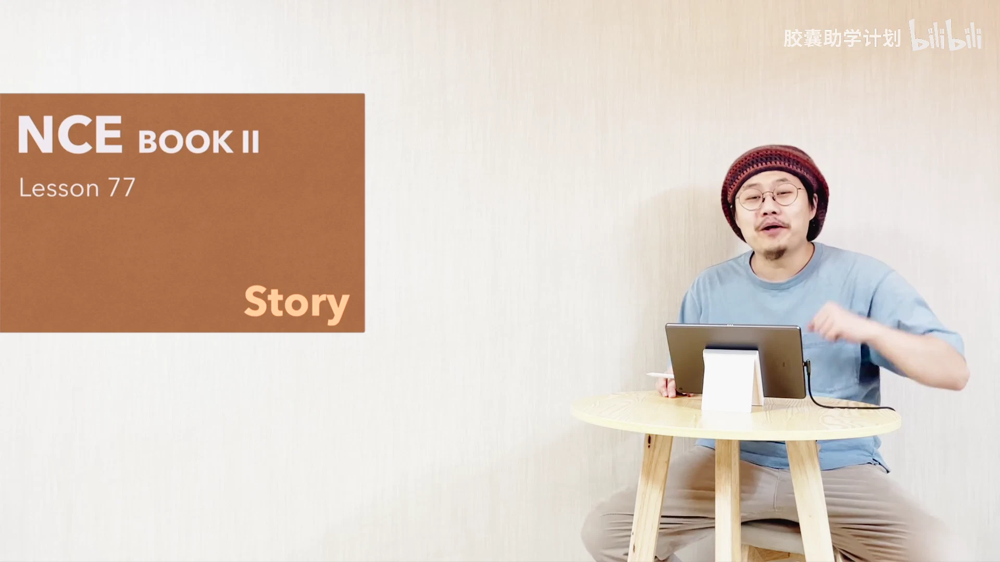

文字识别：biibili / 胶囊助学计划 / NCE / BOOKII / Lesson 77 / Story

### 画面 00:00:02

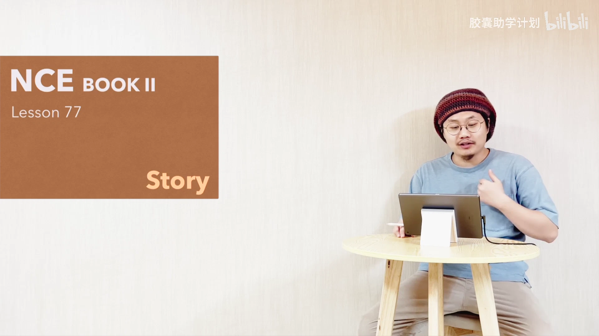

文字识别：bilibili / 胶囊助学计划 / NCE / BOOKII / Lesson 77 / Story

### 画面 00:00:04

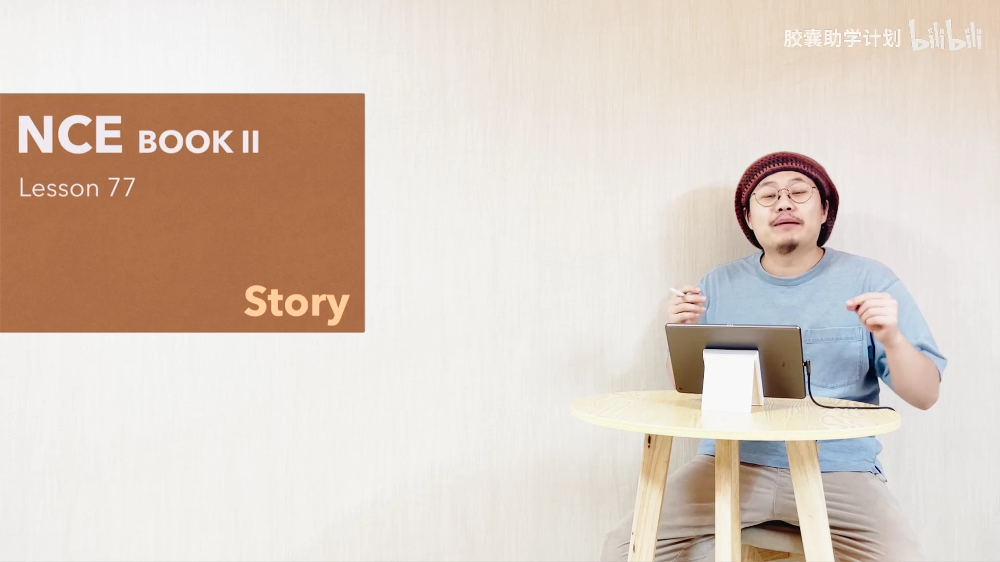

文字识别：biibli / 胶囊助学计划 / NCE / BOOK"I / Lesson 77 / Story

### 画面 00:00:06

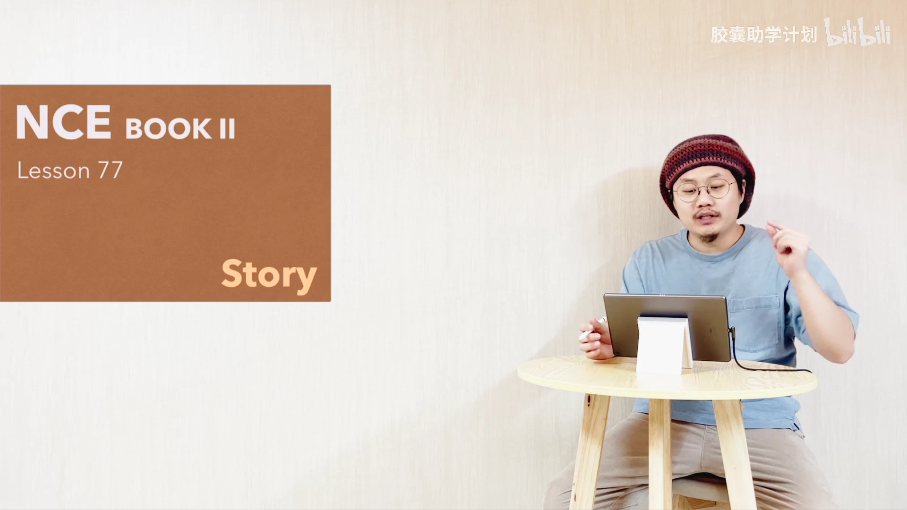

文字识别：bibili / 胶囊助学计划 / NCE / BOOKII / Lesson 77 / Story

### 画面 00:00:09

文字识别：胶囊助学计划 bii / •

### 画面 00:00:13

### 画面 00:00:15

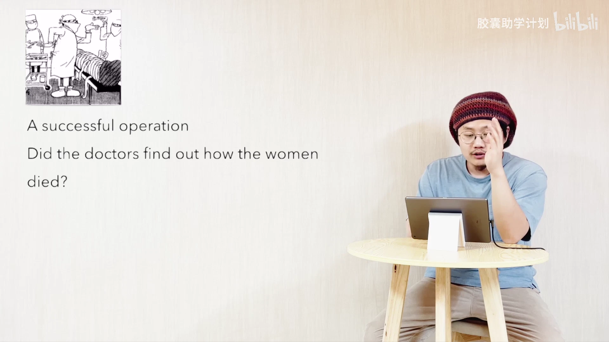

文字识别：胶囊助学计划bilb出 / A successful operation / Did the doctors find out how the women / died?

## 00:00:30–00:01:00

弄明白这个女人是怎么死的了吗？OK，那我们一起看一下这个文章。The mummy of an Egyptian woman who died in 800 B.C. has just had an operation。定语从句，我咔给你标出来了，哪儿哪儿开始哪儿结束啊？啊，A of B结构啊，一个埃及女人的木乃伊啊，啊，就是各位首先要

### 画面 00:00:36

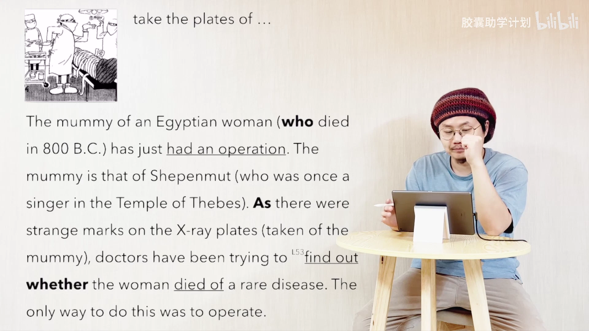

文字识别：take the plates of ... / 胶囊助学计划b出b山 / The mummy of an Egyptian woman (who died / in 800 B.C.) has just had an Operation. The / mummy is that of Shepenmut (who was once a / singer in the Temple of Thebes). As there were / strange marks on the X-ray plates (taken of the / mummy), doctors have been trying to [53find out / whether the woman died of a rare disease. The / only way to do this was to operate.

### 画面 00:00:43

文字识别：take the plates of ... / 胶囊助学计划bilb山 / The mummy of an Egyptian woman (who died / in 800 B.C.) has just had an Operation. The / mummy is that of Shepenmut (who was once a / singer in the Temple of Thebes). As there were / strange marks on the X-ray plates (taken of the / mummy), doctors have been trying to [5²find out / whether the woman died of a rare disease. The / only way to do this was to operate.

## 00:01:00–00:01:30

知道木乃伊是啥，是吧？人做成的啊，人死后做成的，应该是这样说。一个埃及女人制作成的木乃伊呢，然后什么样的这个呃什么样的一个女人呢？Who died in 800 B.C.在公元前八百年死死于公元前八百年的这样的一个女人的木乃伊，对吧？哎，所以其实这里边最核心的就是这个单词叫mummy。那怎么样了呢？Has just had an operation，现在完成时，刚

### 画面 00:01:13

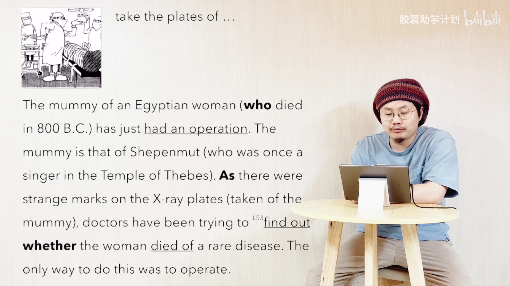

文字识别：take the plates of ... / 胶囊助学计划bi山 / The mummy of an Egyptian woman (who died / in 800 B.C.) has just had an operation. The / mummy is that of Shepenmut (who was once a / singer in the Temple of Thebes). As there were / strange marks on the X-ray plates (taken of the / mummy), doctors have been trying to [53find out / whether the woman died of a rare disease. The / only way to do this was to operate.

### 画面 00:01:23

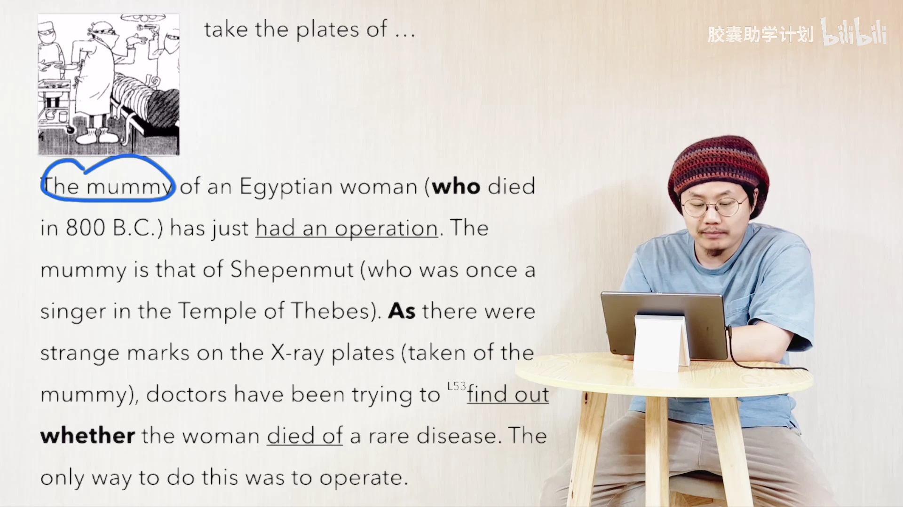

文字识别：take the plates of ... / 胶囊助学计划bi出 / fhe mummy of an Egyptian woman (who died / in 800 B.C.) has just had an operation. The / mummy is that of Shepenmut (who was once a / singer in the Temple of Thebes). As there were / strange marks on the X-ray plates (taken of the / mummy), doctors have been trying to [5³find out / whether the woman died of a rare disease. The / only way to do this was to operate.

## 00:01:30–00:02:00

刚动完了一个手术。哎，The mummy is that of Shapen Mud, who was once a singer in the temple of Thebes.这句话乍一看还是很长。那这里有一个who，就是定语从句的起点。那就告诉你，这句话就可以拆成两句。第一句话叫The mummy is that of Shapen Mud.实话实说，我单看这句话，第一次看我也是不太明白他到底想说啥。

### 画面 00:01:47

文字识别：take the plates of ... / 胶囊助学计划bilii / the mummyof an Egyptian woman (who died / in 800 B.C.) has just had an Operation. The / mummy is that of Shepenmut / who / was once a / singer in the Temple of Thebes). As there were / strange marks on the X-ray plates (taken of the / mummy), doctors have been trying to [5³find out / whether the woman died of a rare disease. The / only way to do this was to operate.

## 00:02:00–00:02:30

这儿怎么突然来了个 that？后来反应半天，就是来后来去读这个句子才反应出来，他这个 that 其实就是 mummy。啥意思？这句话我给你还原回去，就是 the mummy is the mummy of Shempan mat。什么玩意儿？什么叫 the mummy is the mummy of Shempan mat？就他的意思是说，这个木乃伊啊，就是 Shempan mat 的木乃伊。主要是你不知道这个 Shempan mat 是啥。实话实说，我也不知道，我也得去查。查完了

### 画面 00:02:17

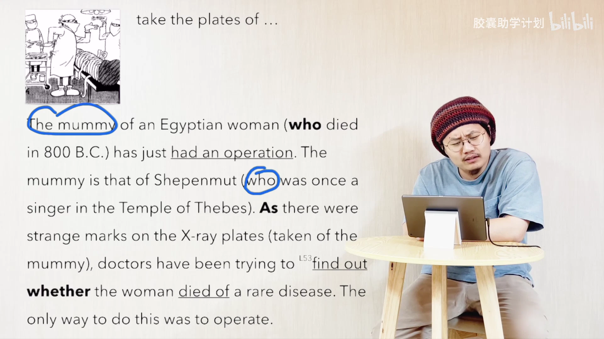

文字识别：take the plates of ... / 胶囊助学计划bii / the mummyof an Egyptian woman (who died / in 800 B.C.) has just had an operation. The / mummy is that of Shepenmut / who / was once a / singer in the Temple of Thebes). As there were / strange marks on the X-ray plates (taken of the / mummy), doctors have been trying to [53find out / whether the woman died of a rare disease. The / only way to do this was to operate.

## 00:02:30–00:03:00

之后啊，或者往下去读。你往下去读啊，你看他说 Who was once a singer？就这个山喷马曾经啊是一个什么呢？是一个歌手。In the temple of Thebes，在底比斯神殿之下，他在这里做一名歌手。他肯定不是现在我们这个意义上的歌手，他是那种宗教意义上的，类似于基督教当中唱诗班的那种，对吧？而这个木乃伊就是山喷马这个人的

### 画面 00:02:37

文字识别：take the plates of ... / 胶囊助学计划bilbi / the mummy of an Egyptian woman (who died / in 800 B.C.) has just had an operation. The / mummy is that of Shepenmut / who / was once a / singer in the Temple of Thebes). As there were / strange marks on the X-ray plates (taken of the / mummy), doctors have been trying to [5²find out / whether the woman died of a rare disease. The / only way to do this was to operate.

### 画面 00:02:49

文字识别：take the plates of ... / 胶囊助学计划bibi出 / the mummy of an Egyptian woman (who died / in 800 B.C.) has just had an operation. The / mummy is that of Shepenmut / (who / was once a / singer in the Temple of Thebes). As there were / strange marks on the X-ray plates (taken of the / mummy), doctors have been trying to [5³find out / whether the woman died of a rare disease. The / only way to do this was to operate.

### 画面 00:02:55

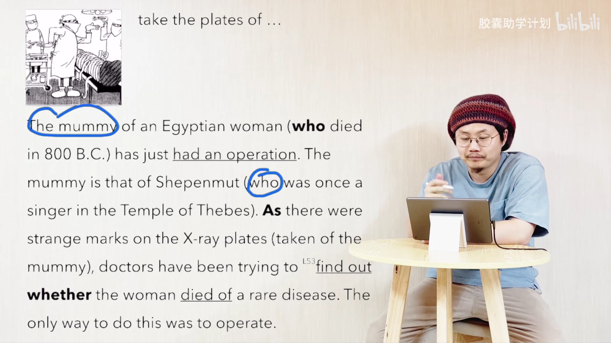

文字识别：take the plates of ... / 胶囊助学计划bilbi / Che mummy of an Egyptian woman (who died / in 800 B.C.) has just had an operation. The / mummy is that of Shepenmut / who / was once a / singer in the Temple of Thebes). As there were / strange marks on the X-ray plates (taken of the / mummy), doctors have been trying to [5³find out / whether the woman died of a rare disease. The / only way to do this was to operate.

## 00:03:00–00:03:30

的木乃伊，然后这个人呢，曾经山马这个人呢，曾经是一个歌手，在底比斯神庙当中。哎，这个句话我希望我给您解释清楚了啊。As there were strange marks on the X-ray plates taken of the mummy, doctors have been trying to find out why the woman died of a rare disease.哇，这句话一看又好长，但还不错。这是正是我们

### 画面 00:03:25

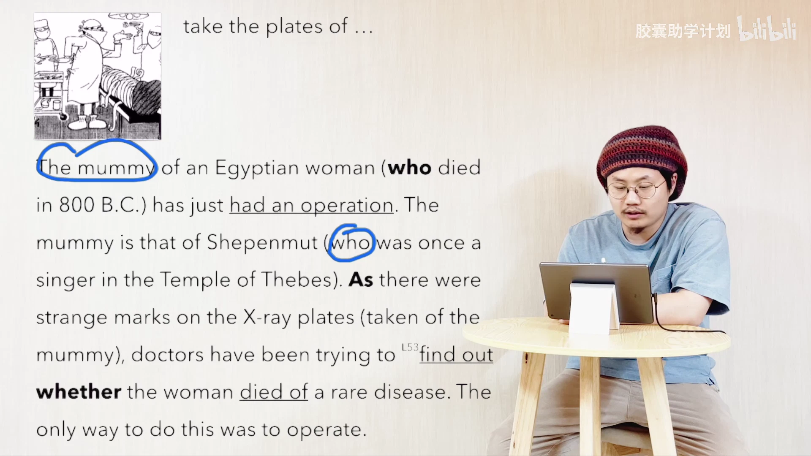

文字识别：0 / take the plates of ... / 胶囊助学计划bi出 / the mummyof an Egyptian woman (who died / in 800 B.C.) has just had an operation. The / mummy is that of Shepenmut / (who / was once a / singer in the Temple of Thebes). As there were / strange marks on the X-ray plates (taken of the / mummy), doctors have been trying to [5³find out / whether the woman died of a rare disease. The / only way to do this was to operate.

## 00:03:30–00:04:00

们第四单元要开始学习的一个东西，啊，所谓的这个东西就是长难句嘛。as没办法判断了，as我现在至少知道好几个意思了，对吧？你比如说这种做做放在句首，我至少知道它可能当because，when还能像刚才那样当这个连接定语从句的句子，对吧？非限定定语从句的句子，后边这还你给我来个逗号，那我更判断不了了。那我先看这句话吧，先不管as，

### 画面 00:03:32

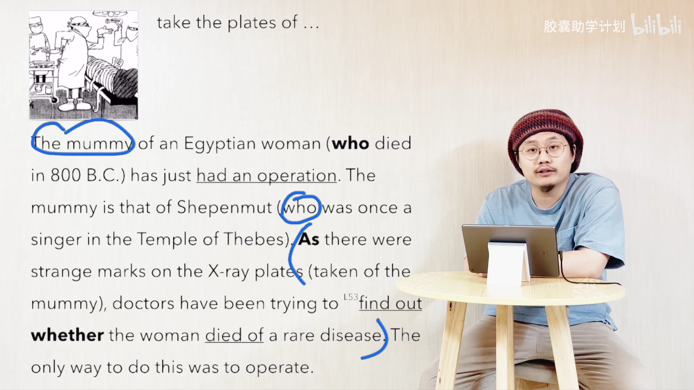

文字识别：take the plates of ... / 胶囊助学计划bilii / the mummy of an Egyptian woman (who died / in 800 B.C.) has just had an Operation. The / mummy is that of Shepenmut / (whov / was once a / singer in the Temple of Thebes),/As there were / strange marks on the X-ray plates (taken of the / mummy), doctors have been trying to [53find out / whether the woman died of a rare disease. / The / only way to do this was to operate.

### 画面 00:03:42

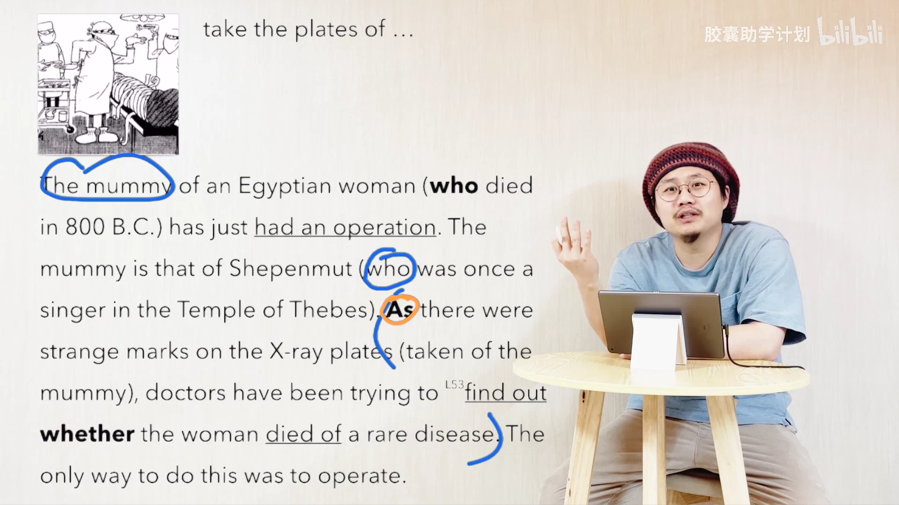

文字识别：take the plates of ... / 胶囊助学计划bilbil / the mummy of an Egyptian woman (who died / in 800 B.C.) has just had an operation. The / mummy is that of Shepenmut / (who / was once a / singer in the Temple of Thebes),Asthere were / strange marks on the X-ray plates (taken of the / mummy), doctors have been trying to [53find out / whether the woman died of a rare disease. / The / only way to do this was to operate.

## 00:04:00–00:04:30

说有很多奇怪的斑点在这个X-ray place上。这个我们讲单词都说过了，在这个X光片上、底片上有很多奇怪的斑点。什么样的X光片呢？Taken of the mummy。这个地方你要想能读懂，你首先要看这样一个短语叫take the place of，叫给什么什么拍了个底片或者光片，对吧？那这里其实叫做taken of the mummy。什么样的光片呢？Taken of the mummy叫做给这个木

### 画面 00:04:12

文字识别：take the plates of ... / 胶囊助学计划ibil / the mummy of an Egyptian woman (who died / in 800 B.C.) has just had an operation. The / mummy is that of Shepenmut / (who / was once a / singer in the Temple of Thebes), As there were / strange marks on the X-ray plates (taken af the / - / L53 find out / mummy)doctors have been trying to" / whether the woman died of a rare disease, / The / only way to do this was to operate.

## 00:04:30–00:05:00

乃伊拍的光片的底片上，所以这里其实是咱们二八二九三十课学过的那个什么呢？叫过去分词做定语，它是个短语，所以后置到place的后面去了，啊，所以这个短语你必须要先知道，才能看懂这句话。那我们再读一遍这句话，叫做有一些奇怪的斑点在什么上呢？这个X-ray place上，在这个

### 画面 00:04:42

文字识别：take the plates of ... / 胶囊助学计划bilii / the mummy of an Egyptian woman (who died / in 800 B.C.) has just had an operation. The / mummy is that of Shepenmut / whov / was once a / singer in the Temple of Thebes), As there were / strange marks on the X-ray plates (taken of the / mummy)/doctors have been trying to [53find out / whether the woman died of a rare disease. / The / only way to do this was to operate.

## 00:05:00–00:05:30

X光片上，什么的X光片呢？拍摄这个呃木乃伊的X光片上啊。继续下一句话，第一句话结束了。Doctors have been trying to find out whether.一看whether OK了。接下来可能是个从句，先不管它。先看前面说，医生一直都在尝试着去搞明白、弄清楚，figure out, find out，搞明白、弄清楚是否，对吧？宾语啊，宾语从句嘛。是否if也可以，whether

### 画面 00:05:12

文字识别：take the plates of ... / 胶囊助学计划bilbi / Che mummy of an Egyptian woman (who died / in 800 B.C.) has just had an Operation. The / mummy is that of Shepenmut / (whov / was once a / singer in the Temple of Thebes), As there were / strange marks on the X-ray plates (taken of the / mummy)doctors have been trying to [53find out / The / whether the woman died of a rare disease. / only way to do this was to operate.

## 00:05:30–00:06:00

也行。是否说这个女人 die of a rare disease 死于一个罕见的疾病？注意这个 die of， die of 是本课一个小的习惯用法。我们一会儿去造句。现在各位知道它的含义，就是常常接上后边加的是病，疾病，病痛啊就行了。死于什么什么病？OK，好，die off。那这句话就结束了嘛？我们看一下拆成了三句话，

### 画面 00:05:40

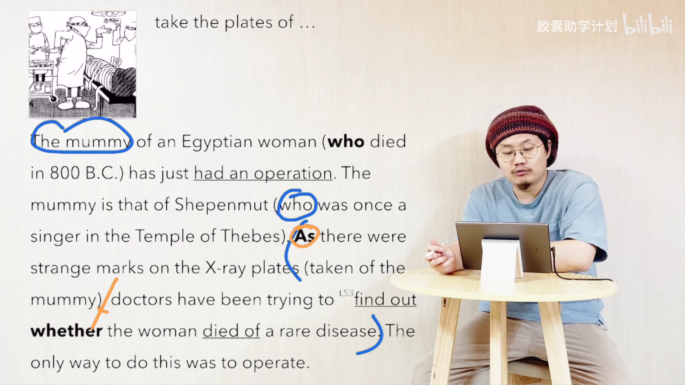

文字识别：take the plates of ... / 胶囊助学计划bilbil / the mummy of an Egyptian woman (who died / in 800 B.C.) has just had an Operation. The / mummy is that of Shepenmut / (whov / was once a / singer in the Temple of Thebes), As there were / strange marks on the X-ray plates (taken of the / mummy)/doctors have been trying to [53find out / whether the woman died of a rare disease, / The / only way to do this was to operate.

### 画面 00:05:55

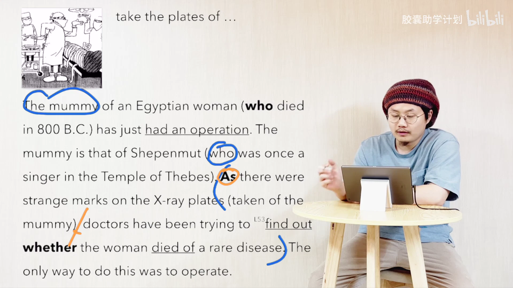

文字识别：take the plates of ... / 胶囊助学计划bibi / the mummy of an Egyptian woman (who died / in 800 B.C.) has just had an Operation. The / mummy is that of Shepenmut / (whowas once a / singer in the Temple of Thebes),As there were / strange marks on the X-ray plates (taken of the / mummy)doctors have been trying to [53find out / whether the woman died of a rare disease. / The / only way to do this was to operate.

## 00:06:00–00:06:30

在这个X光片上，这给这个木乃伊拍的X光片上有很多的斑点。医生呢，尝试去弄清楚一件事儿。这件事儿叫做是否这个女人死于罕见的疾病。哎，你看这样一句读，这个句子就很清楚，很清楚了。呃，The only way to do this was to operate. 这句话很很字面的意思，就做这件事情唯一的方式就是去 operate. operate 就是 operation 的名动词

### 画面 00:06:25

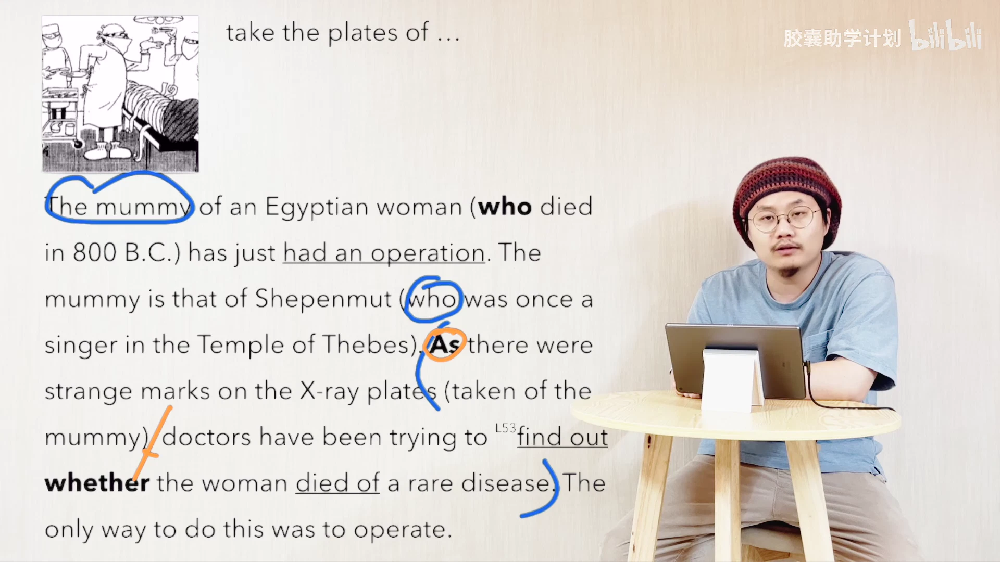

文字识别：take the plates of ... / 胶囊助学计划bilbi / the mummy of an Egyptian woman (who died / in 800 B.C.) has just had an Operation. The / mummy is that of Shepenmut / (whowas once a / singer in the Temple of Thebes), As there were / strange marks on the X-ray plates (taken of the / mummy)doctors have been trying to [53find out / whether the woman died of a rare disease, / The / only way to do this was to operate.

## 00:06:30–00:07:00

嘛， operation 是 operate 的名词嘛。那 have an operation 就是手术，那 to operate 就是去做手术嘛，动词化。 The operation 非常的好，后边立刻来个逗号，我给你加了一个不同的颜色，提醒你这个叫做非限定性定语从句。说这个手术呢， which 指的是还是这个手术，对吧？为什么其实你在这儿不用限定了呢？

### 画面 00:06:37

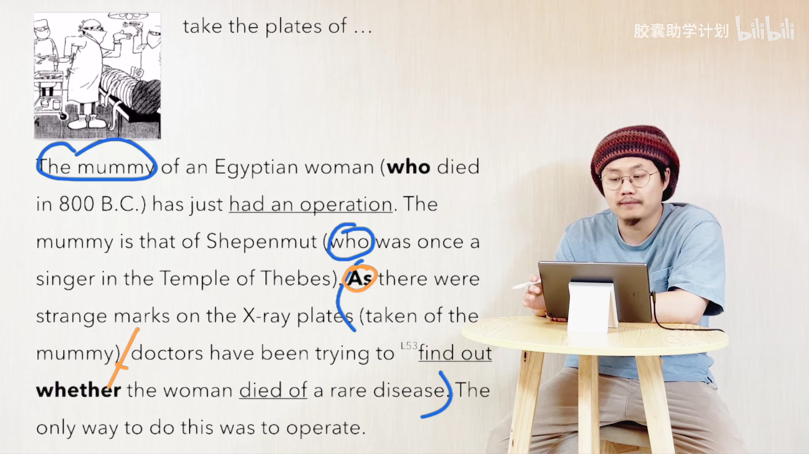

文字识别：take the plates of ... / 胶囊助学计划blbi / the mummy of an Egyptian woman (who died / in 800 B.C.) has just had an operation. The / mummy is that of Shepenmut / (who / was once a / singer in the Temple of Thebes), Asthere were / strange marks on the X-ray plates (taken of the / mummy)doctors have been trying to [53find out / whether the woman died of a rare disease. / The / only way to do this was to operate.

### 画面 00:06:39

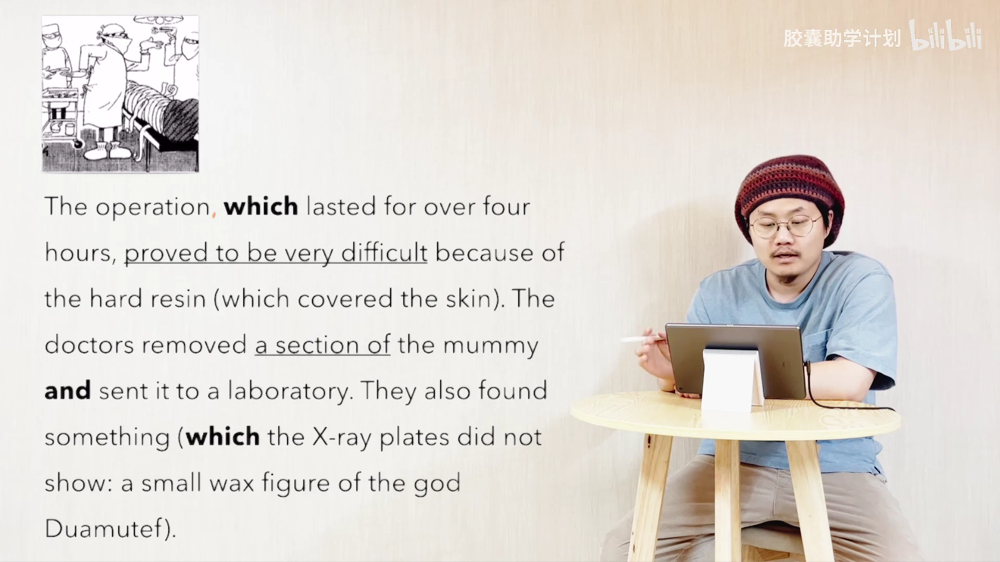

文字识别：胶囊助学计划biii出 / The operation, which lasted for over four / hours, proved to be very difficult because of / the hard resin (which covered the skin). The / doctors removed a section of the mummy / and sent it to a laboratory. They also found / something (which the X-ray plates did not / show: a small wax figure of the god / Duamutef).

### 画面 00:06:43

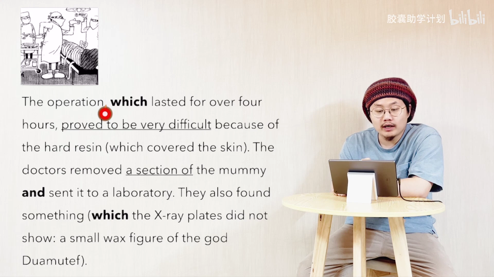

文字识别：胶囊助学计划bl山 / The operation which lasted for over four / hours, proved to be very difficult because of / the hard resin (which covered the skin). The / doctors removed a section of the mummy / and sent it to a laboratory. They also found / something (which the X-ray plates did not / show: a small wax figure of the god / Duamutef).

## 00:07:00–00:07:30

就是因为我前面说了一堆，就是为了铺垫为啥要做这个手术的，所以这个手术在这个地方，作者看来就不用再限定了，就提供点额外信息就行了，对吧？所以他用了一个非限定性定语从句，叫 which lasted for over forty hours。哎，然后从哪结束，从哪开始，俩逗号直接清清楚楚的给你标出来了，对吧？说这个手术持续了超过 four hours，超过了持续四个小时。那

### 画面 00:07:00

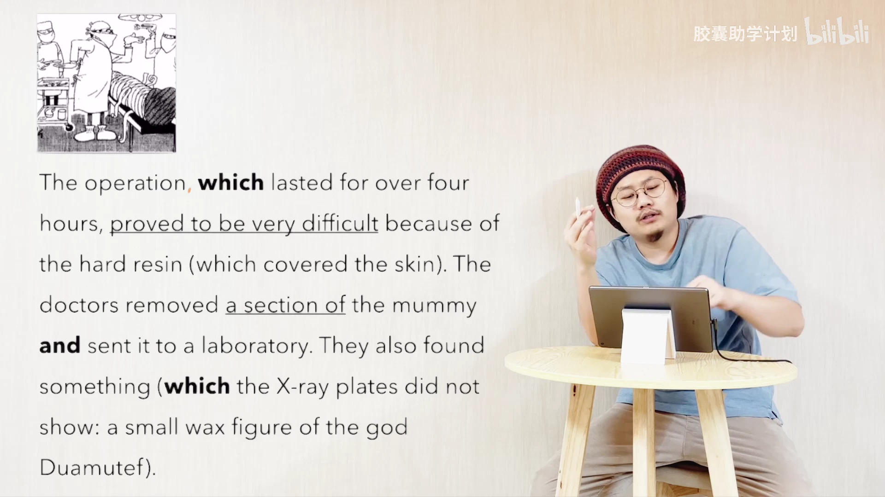

文字识别：胶囊助学计划bi山 / The Operation, which lasted for over four / hours, proved to be very difficult because of / the hard resin (which covered the skin). The / doctors removed a section of the mummy / and sent it to a laboratory. They also found / something (which the X-ray plates did not / show: a small wax figure of the god / Duamutef).

### 画面 00:07:07

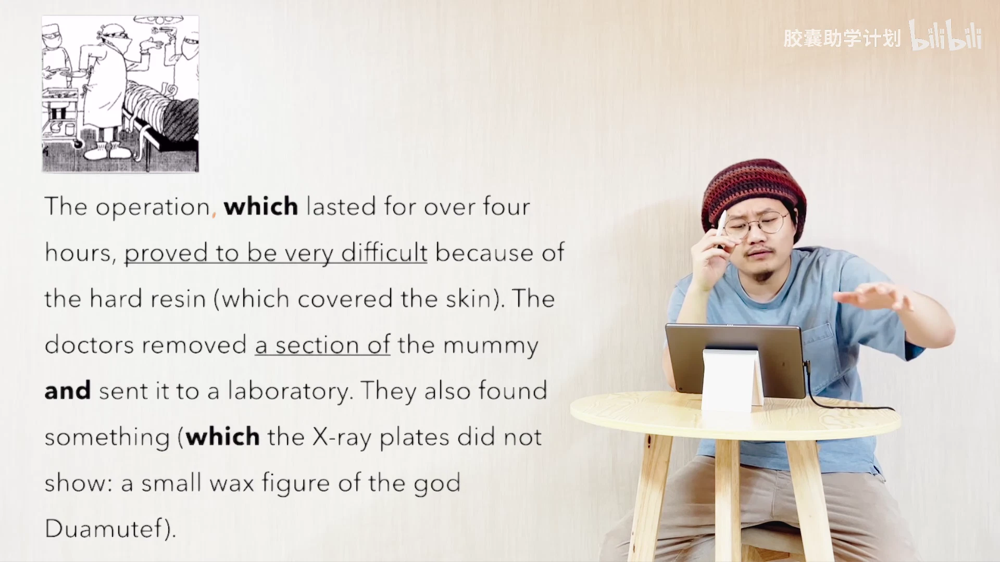

文字识别：胶囊助学计划bi山 / The operation, which lasted for over four / hours, proved to be very difficult because of / the hard resin (which covered the skin). The / doctors removed a section of the mummy / and sent it to a laboratory. They also found / something (which the X-ray plates did not / show: a small wax figure of the god / Duamutef).

### 画面 00:07:24

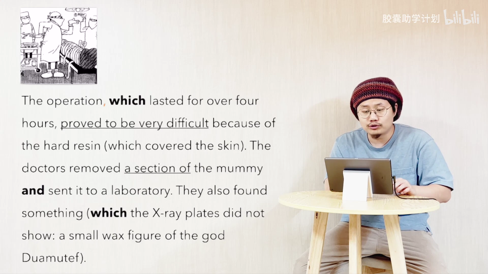

文字识别：胶囊助学计划bili / The Operation, which lasted for over four / hours, proved to be very difficult because of / the hard resin (which covered the skin). The / doctors removed a section of the mummy / and sent it to a laboratory. They also found / something (which the X-ray plates did not / show: a small wax figure of the god / Duamutef).

## 00:07:30–00:08:00

operation 怎么样了呢？哎，既然我们知道说这样的一个句子非限定性定语从句起到补充说明的作用，我们甚至可以先不看它，我们就直接先往下看，叫做这个手术 proved to be very difficult，证明为证实为特别的困难， because of the hard resin，因为这个特别坚硬的树脂，什么样的树脂呢？你看这个树脂就有很多，对吧？这个树脂就有

### 画面 00:07:34

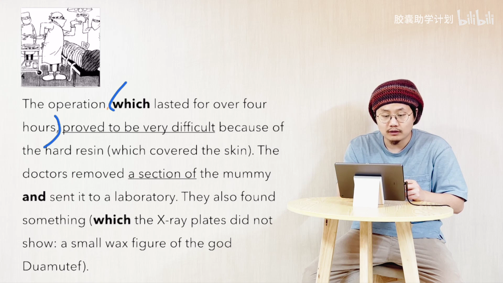

文字识别：胶囊助学计划bib山 / The operation which lasted for over four / hoursproved to be very difficult because of / the hard resin (which covered the skin). The / doctors removed a section of the mummy / and sent it to a laboratory. They also found / something (which the X-ray plates did not / show: a small wax figure of the god / Duamutef).

## 00:08:00–00:08:30

很多啊，可能很多地方都会有树脂，所以他要去说一下为啥跟什么样的坚硬树脂呢？后边用的就是一个限定性定语从句，哪儿的树脂呢？Which cover the skin，叫做覆盖着皮肤的这个树脂。所以你看这句话，我们给它拆成如下几句话：第一个，手术特别的困难；第二，这个手术持续了四个小时，提供了一些额外关于手术的信息；

### 画面 00:08:04

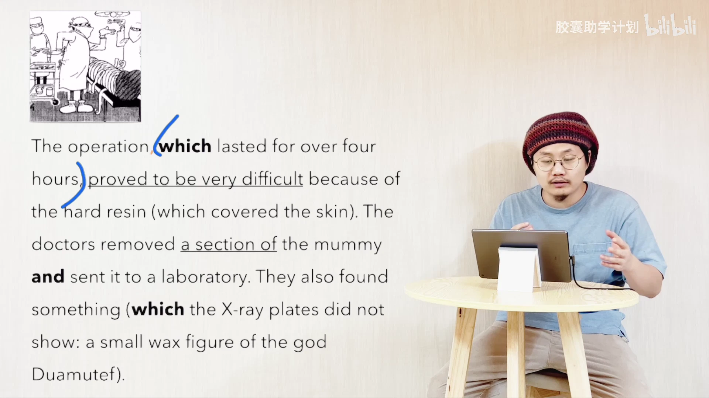

文字识别：胶囊助学计划bib山 / The operation,which lasted for over four / hoursproved to be very difficult because of / the hard resin (which covered the skin). The / doctors removed a section of the mummy / and sent it to a laboratory. They also found / something (which the X-ray plates did not / show: a small wax figure of the god / Duamutef).

### 画面 00:08:17

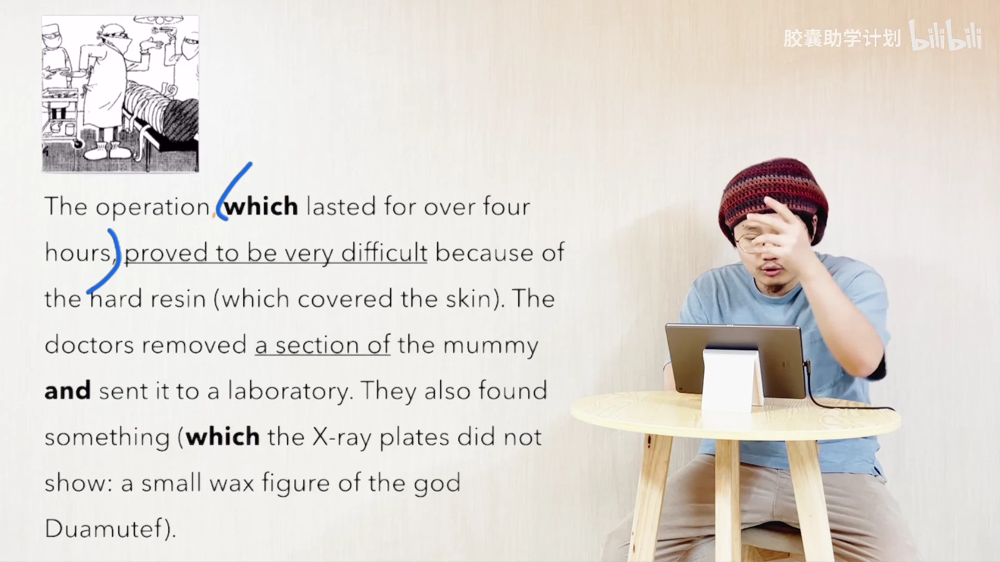

文字识别：胶囊助学计划bibi / The operation,which lasted for over four / hoursproved to be very difficult because of / the hard resin (which covered the skin). The / doctors removed a section of the mummy / and sent it to a laboratory. They also found / something (which the X-ray plates did not / show: a small wax figure of the god / Duamutef).

## 00:08:30–00:09:00

第三，哎，为什么困难呢？Because of the hard resin cover the skin，是吧？因为这个坚硬的树脂啊，覆盖着这个皮肤，对吧？The doctors removed a section of the mummy and sent it to a laboratory。啊，这句话就很简单了，这不能算长难句了，就是and前后引导了个并列句啊。说医生移除了一块啊，一个一个这个木乃伊的切

### 画面 00:08:47

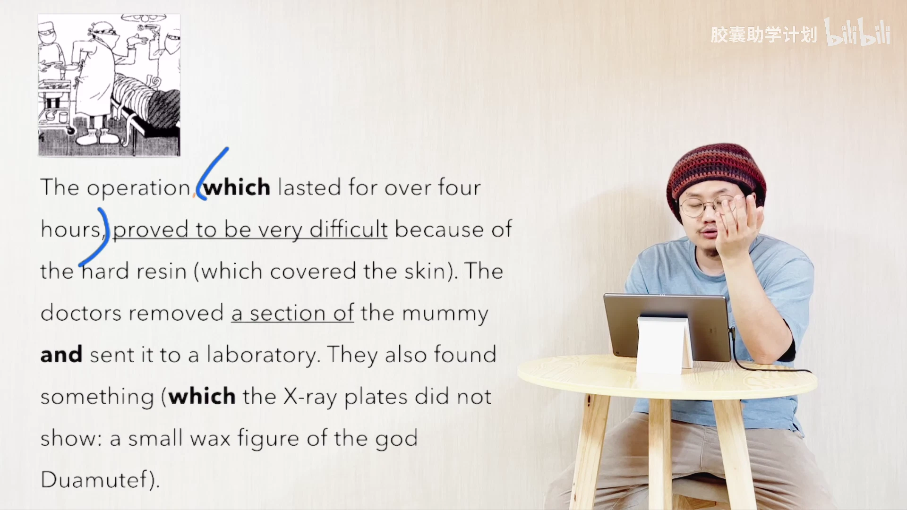

文字识别：胶囊助学计划bl山 / The Operation which lasted for over four / hours,proved to be very difficult because of / the hard resin (which covered the skin). The / doctors removed a section of the mummy / and sent it to a laboratory. They also found / something (which the X-ray plates did not / show: a small wax figure of the god / Duamutef).

## 00:09:00–00:09:30

然后发送他去了实验室，对吧？化送去化验啊，送去做做做实验。They also found something.他们也找到了这样一些东西。后边夸跟了一个限定性定语从句，什么样的东西呢？Which就是这个东西。The X-ray plates did not show.这个X光片的底片并没有展示出来。没有展示出来的东西是什么呢？叫做a

### 画面 00:09:17

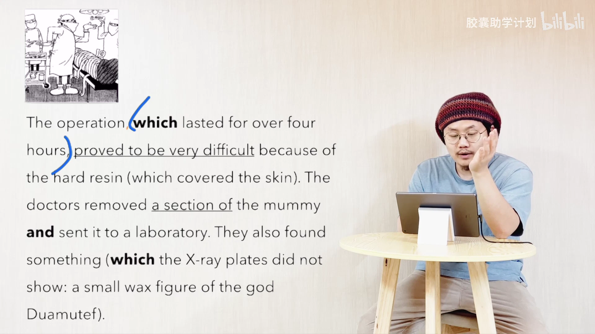

文字识别：胶囊助学计划bi山 / The operation which lasted for over four / hoursproved to be very dificult because of / the hard resin (which covered the skin). The / doctors removed a section of the mummy / and sent it to a laboratory. They also found / something (which the X-ray plates did not / show: a small wax figure of the god / Duamutef).

## 00:09:30–00:10:00

small wax figure of the god Duamutef. 好，后边这个就不是连英语人名也不是，它可能是个埃及人名，是吧？而且还是古埃及人名啊，不是现在国家的埃及，是古埃及的埃及，是吧？所以这个人名不会读也没有问题啊。Duamutef啊，Duamutef。他说这个没有表现出，没有展示出来的东西，没有这个展现出来的，对吧？没有

### 画面 00:09:40

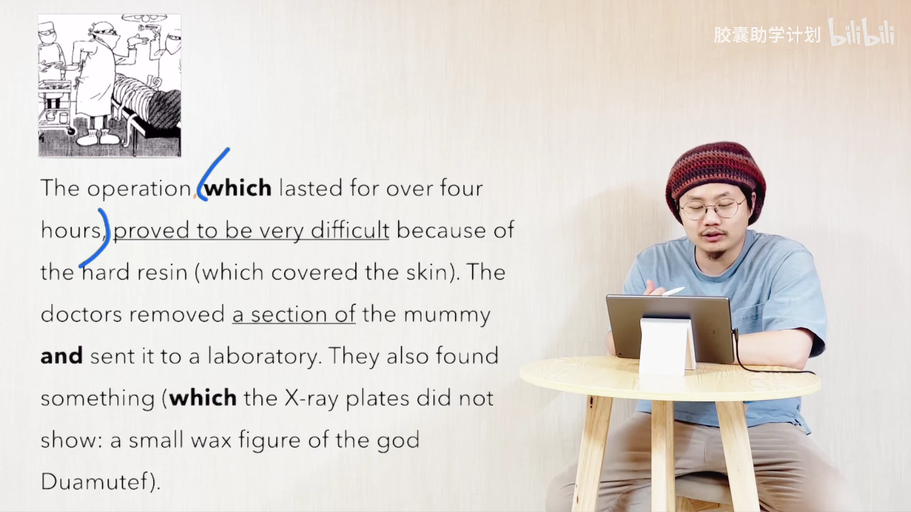

文字识别：胶囊助学计划bii出 / The operation which lasted for over four / hours,proved to be very difficult because of / the hard resin (which covered the skin). The / doctors removed a section of the mummy / and sent it to a laboratory. They also found / something (which the X-ray plates did not / show: a small wax figure of the god / Duamutef).

## 00:10:00–00:10:30

这个显现出来的东西是什么呢？一个小的蜡像，人形的蜡像，什么呢？这个 do mat tof 这个这个这个这个 God，你注意，它没有在大写，大写指的是基督教当中那个上帝。如果在这儿是小写的话，就指的是神啊，比如说什么诸神的黄昏的那个神啊啊，呃，什么宙斯是神，对吧？奥丁也是神啊，这个神就是小写杠，那就是这个神的

### 画面 00:10:10

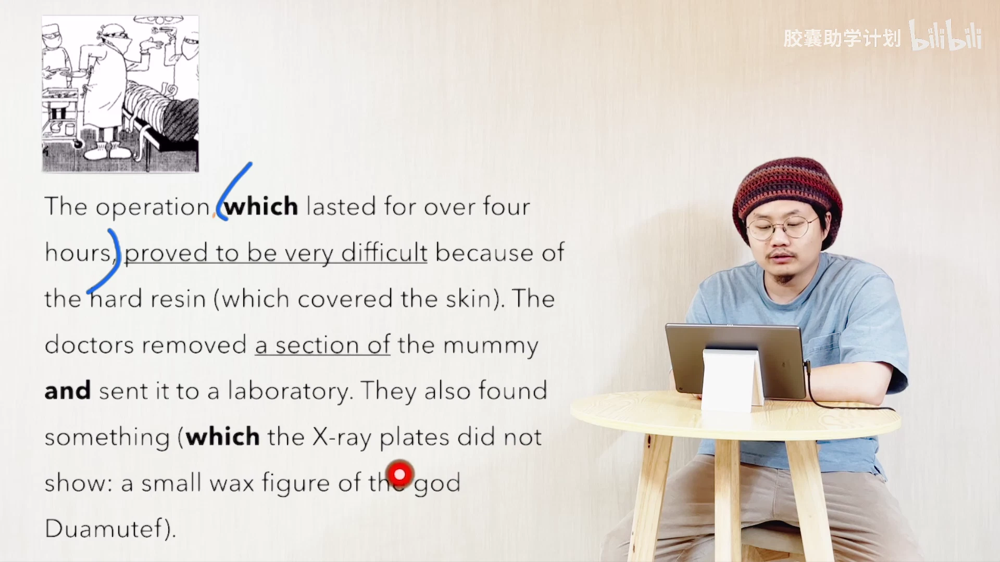

文字识别：O / 胶囊助学计划bib山 / The Operation which lasted for over four / hoursproved to be very dificult because of / the hard resin (which covered the skin). The / doctors removed a section of the mummy / and sent it to a laboratory. They also found / something (which the X-ray plates did not / show: a small wax figure of tho god / Duamutef).

## 00:10:30–00:11:00

什么呢？一个小的蜡像人形象，哎，在这个X光片当中并没有展现出来。OK，接下来，this god说这个神呢，后边是个定语从句。定语从句判断开始很容易，怎么判断结束呢？在第二个动词出来的时候可能是结束，不一定，因为你这个定语从句里边可以是并列连词，对吧？所以不一定，你要自己去看它的句子

### 画面 00:10:38

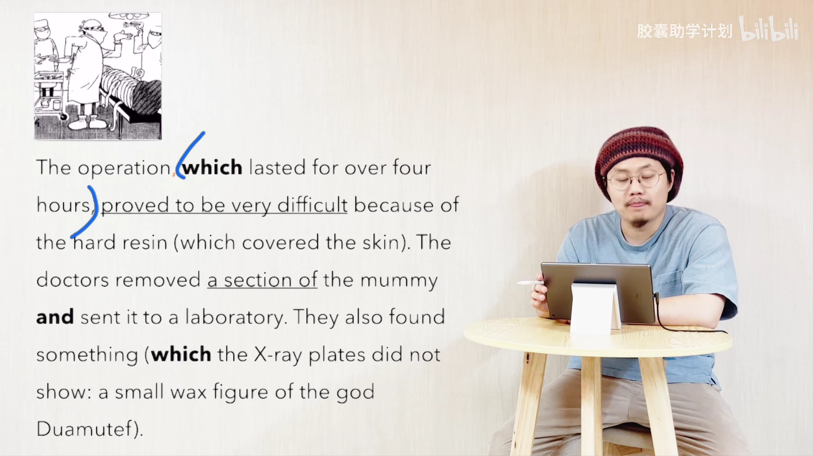

文字识别：胶囊助学计划bib山 / The operation which lasted for over four / hours,proved to be very difficult because of / the hard resin (which covered the skin). The / doctors removed a section of the mummy / and sent it to a laboratory. They also found / something (which the X-ray plates did not / show: a small wax figure of the god / Duamutef).

### 画面 00:10:40

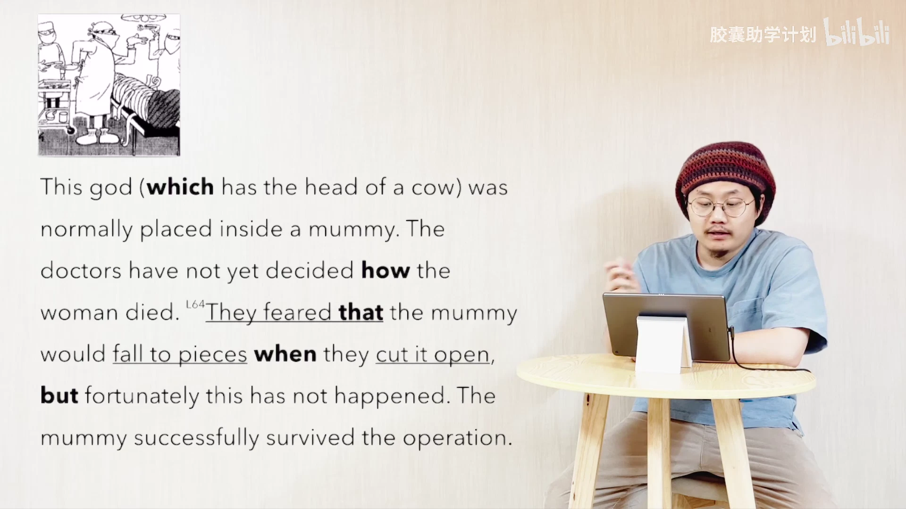

文字识别：胶囊助学计划bibi / This god (which has the head of a cow) was / normally placed inside a mummy. The / doctors have not yet decided how the / woman died.L“4They feared that the mummy / would fall to pieces when they cut it open, / but fortunately this has not happened. The / mummy successfully survived the operation.

### 画面 00:10:55

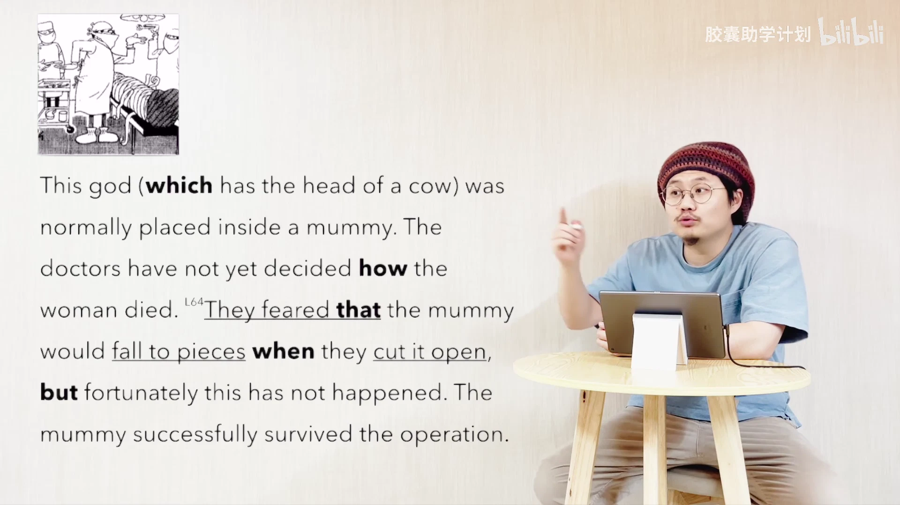

文字识别：胶囊助学计划bi山 / This god (which has the head of a cow) was / normally placed inside a mummy. The / doctors have not yet decided how the / woman died.L4They feared that the mummy / would fallto pieces when they cut it open, / but fortunately this has not happened. The / mummy successfully survived the operation.

## 00:11:00–00:11:30

是完整的。所以 which 我们知道的就是替代的 this god。说 this god has the head of a cow。两个东西提醒你定语从句结束了。第一个叫做这个 was normally placed inside the mummy。 was 加 placed 一般过去时的被动，它是 this god 的谓语，对吧？所以在这儿你就知道它前面可以结束了。但是我个人的理解发现，如果你纯按照这个思

### 画面 00:11:01

文字识别：胶囊助学计划bi出 / This god (which has the head of a cow) was / normally placed inside a mummy. The / doctors have not yet decided how the / woman died. '4They feared that the mummy / would fall to pieces when they cut it open, / but fortunately this has not happened. The / mummy successfully survived the operation.

## 00:11:30–00:12:00

路去走呢，呃，第一，你其实叫做有点教条了啊，因为它有的时候并不一定是这样的。所以我个人发现，我个人觉得啊，最长远而最好使的方式，就我使到今天依旧在使的方式，就是很简单粗暴，就是定语从句这句话的含义结束了，定语从句就结束了，对吧？哎，这是一个最符合语言本身的思路的。

### 画面 00:11:31

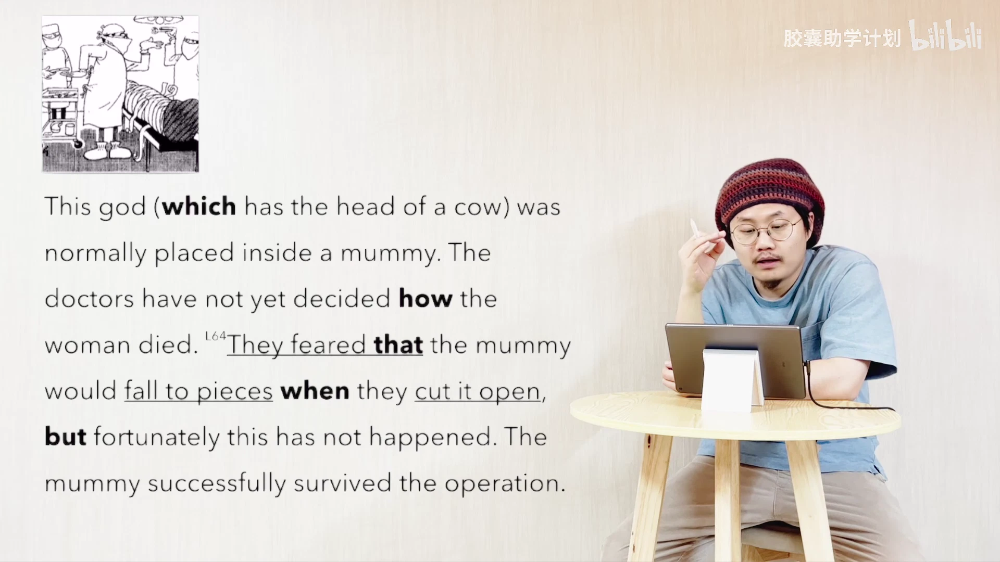

文字识别：胶囊助学计划bib山 / This god (which has the head of a cow) was / normally placed inside a mummy. The / doctors have not yet decided how the / woman died.L4They feared that the mummy / would fallto pieces when they cut it open, / but fortunately this has not happened. The / mummy successfully survived the operation.

## 00:12:00–00:12:30

而刚才那个说你再去找一下这个 was 加 placed 这个主句当中的谓语，这个实际上是一个拐杖啊，这个拐杖等你用到足够好的时候是可以扔掉的。那说这个神有这个牛的头啊，然后这个神呢 was normally placed inside the mummy，说大多数通常状态下是会被放置到这个木乃伊里边去的。The doctors have not yet decided how the woman died。

### 画面 00:12:01

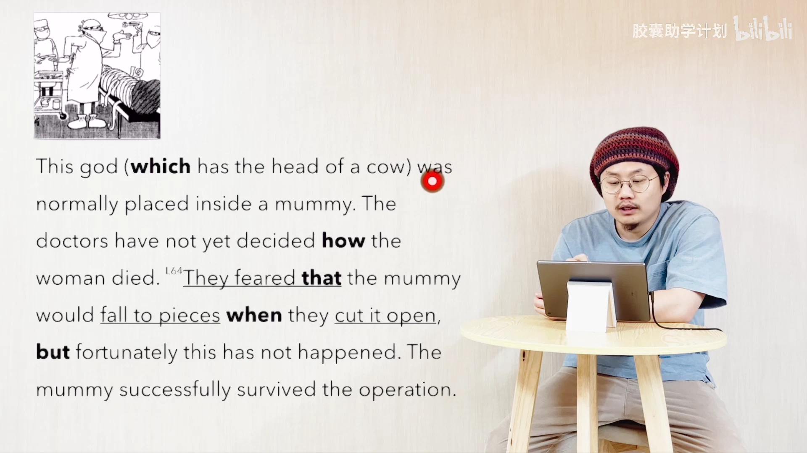

文字识别：胶囊助学计划lb出 / This god (which has the head of a cow) was / normally placed inside a mummy. The / doctors have not yet decided how the / woman died.L4They feared that the mummy / would fall to pieces when they cut it open, / but fortunately this has not happened. The / mummy successfully survived the operation.

## 00:12:30–00:13:00

That this doctor还没有决这个地方，你说决定啊，没有决定如何弄死这个女人啊，肯定不是嘛，对吧？说如何哎，判决判断还不能判断这个女人是如何死的啊。所以这里的decide并不是决定啊。They fear that六十四课咱们学的类似于they worry that担心担忧的事情是什么呢？并不是害怕恐惧啊。The mummy would fall to pieces when

### 画面 00:12:31

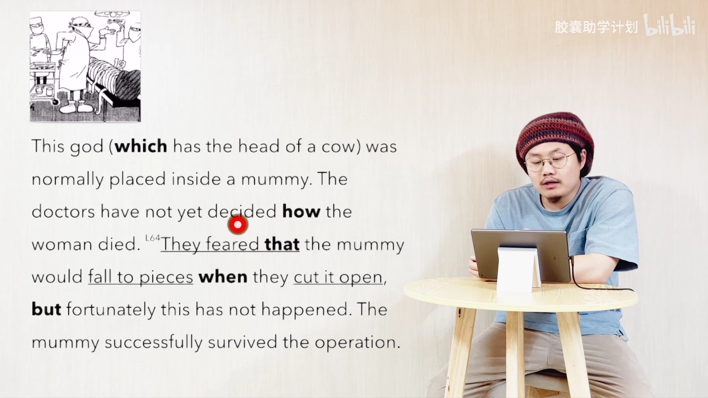

文字识别：胶囊助学计划bi山 / This god (which has the head of a cow) was / normally placed inside a mummy. The / doctors have not yet decided how the / woman died.L“4They feared that the mummy / would fallto pieces when they cut it open, / but fortunately this has not happened. The / mummy successfully survived the operation.

## 00:13:00–00:13:30

they cut it open, but fortunately, this has not happened.这句话看着又很长，其实就还好。我们给它拆一下。他们担心 the mummy would fall to pieces。第一句话，他们担心这个木乃伊会变成碎片。Fall to pieces短语，本课咱们造句的东西啊，会变成碎片。当 they cut it open，当他们把它切开的时候啊，cut it open也是本课的习惯用法。一会儿咱造句。你现在能看懂

### 画面 00:13:01

文字识别：胶囊助学计划bib山 / This god (which has the head of a cow) was / normally placed inside a mummy. The / doctors have not yet decided how the / woman died.L'4They feared that the mummy / would fallto pieces when they cut it open, / but fortunately this has not happened. The / mummy successfully survived the operation.

### 画面 00:13:26

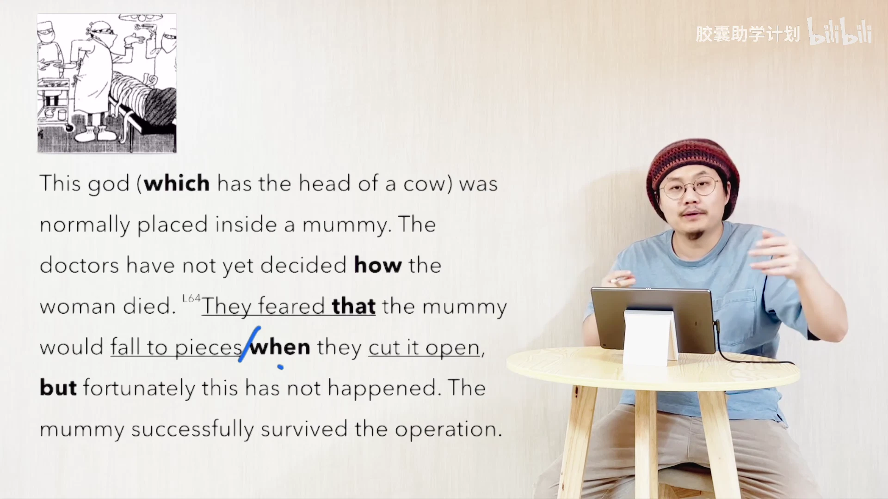

文字识别：胶囊助学计划bilb山 / This god (which has the head of a cow) was / normally placed inside a mummy. The / doctors have not yet decided how the / woman died.L“4They feared that the mummy / would fall to pieceswhen they cut it open, / but fortunately this has not happened. The / mummy successfully survived the operation.

## 00:13:30–00:14:00

字面意思就行了。切开它，对吧？第三句话，But fortunately, this has not happened. 哎，很幸运的是这件事情并没有发生，对吧？The mummy successfully survived the operation. 哎，这句话其实用的这个 survive 用的就特别的巧妙。我给你分析一下啊，说这个木乃伊啊，成功的在这次手术当中幸存

### 画面 00:13:31

文字识别：胶囊助学计划blb山 / This god (which has the head of a cow) was / normally placed inside a mummy. The / doctors have not yet decided how the / woman died.L“4They feared that the mummy / would fall to pieceswhen they cut it open, / but fortunately this has not happened. The / mummy successfully survived the operation.

### 画面 00:13:49

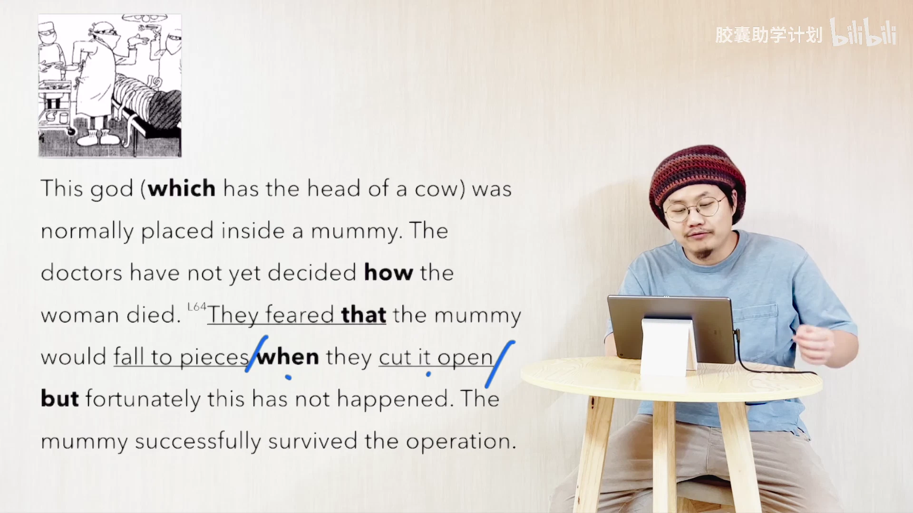

文字识别：胶囊助学计划bib山 / This god (which has the head of a cow) was / normally placed inside a mummy. The / doctors have not yet decided how the / woman died.L“4They feared that the mummy / would fall o pieces when they cut it open / but fortunately this has not happened. The / mummy successfully survived the operation.

## 00:14:00–00:14:30

了下来，你首先要想，我们说一个东西幸存下来，往往最字面的意思指的是一个活物，对吧？一个活的东西，而这个妈咪已经是死了几千年的东西，或者说一个人，对吧？人的这个尸体处理的方式，那他这里用的 survive 是什么意思呢？并不是指的说这个妈咪活了，指的是什么呢？他说他们不是担心这个妈咪会 fall to pieces 吗？对吧？那不就不完整了吗？所以他

### 画面 00:14:02

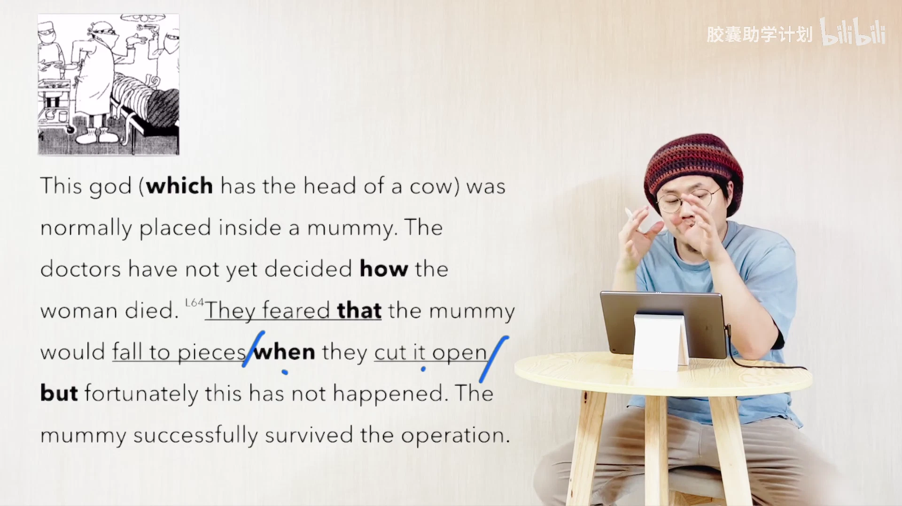

文字识别：胶囊助学计划bibi / This god (which has the head of a cow) was / normally placed inside a mummy. The / doctors have not yet decided how the / woman died.L4They feared that the mummy / would fall to pieces when they cut it open / but fortunately this has not happened. The / mummy successfully survived the operation.

### 画面 00:14:06

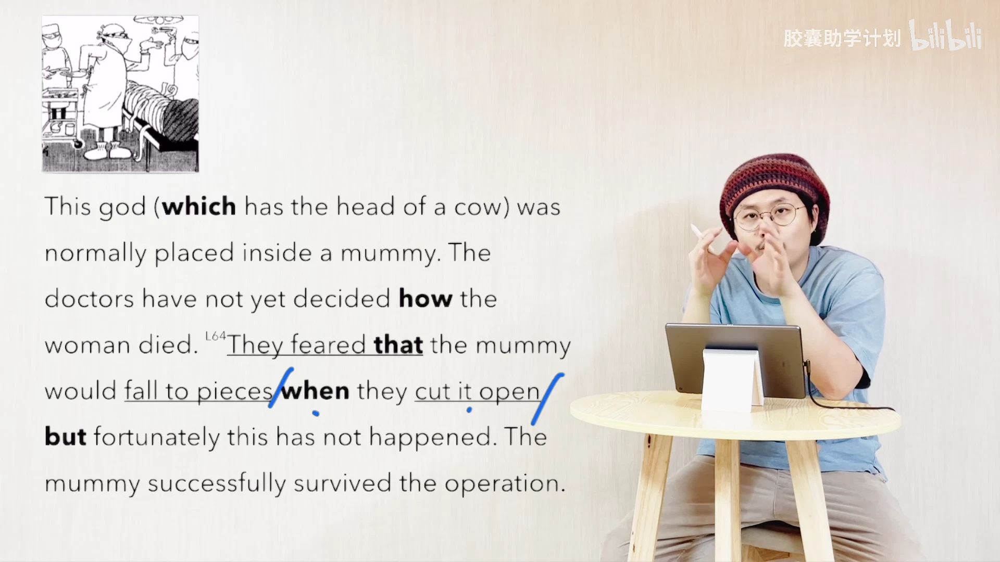

文字识别：胶囊助学计划bl山 / This god (which has the head of a cow) was / normally placed inside a mummy. The / doctors have not yet decided how the / woman died.L4They feared that the mummy / would fall o pieceswhen they cut it open / but fortunately this has not happened. The / mummy successfully survived the operation.

## 00:14:30–00:15:00

其实想表达的意思就是，这个手术结束了之后，这个木乃伊并没有 fall to pieces，没有变成碎片，所以它成功的幸存下来了这场手术。但是幸存这个词往往指的又是活的东西，没死，所以它这个用词在这儿就很有意思了，对吧？那不多说了，我们直接看一下本课的习惯用法啊，也不是很难。首先，have an operation，其实之前我们都学过，我们再造一个句子吧。

### 画面 00:14:36

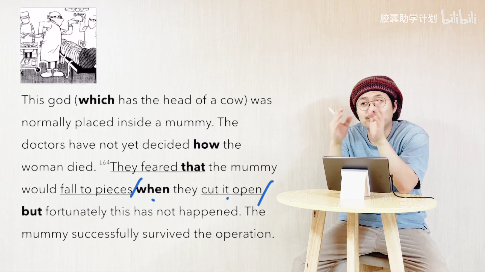

文字识别：胶囊助学计划biii出 / This god (which has the head of a cow) was / normally placed inside a mummy. The / doctors have not yet decided how the / woman died.'“4They feared that the mummy / would fallto pieces when they cut it open / but fortunately this has not happened. The / mummy successfully survived the operation.

### 画面 00:14:51

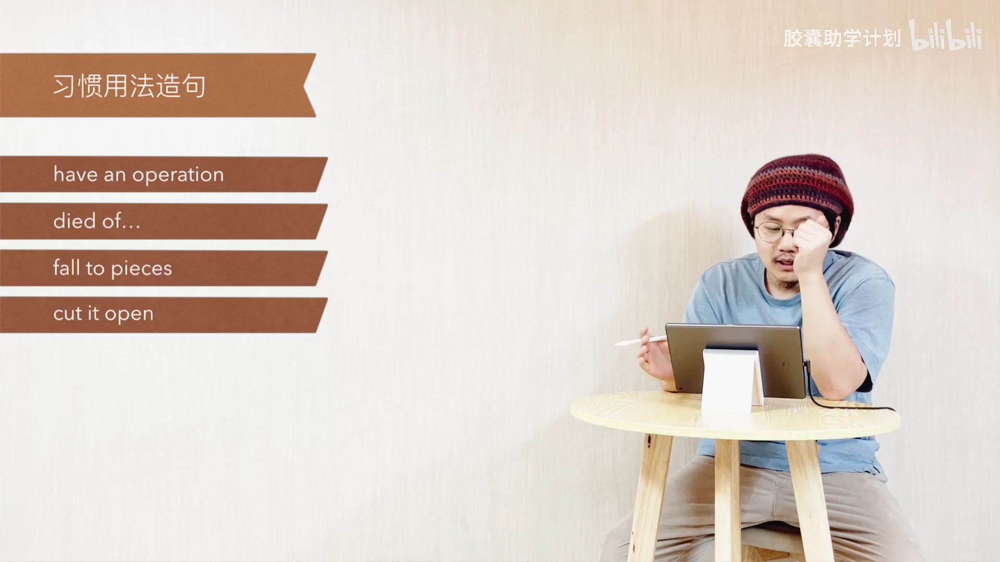

文字识别：bilbili / 胶囊助学计划 / 习惯用法造句 / have an operation / died of.. / fall to pieces / cut it open

### 画面 00:14:53

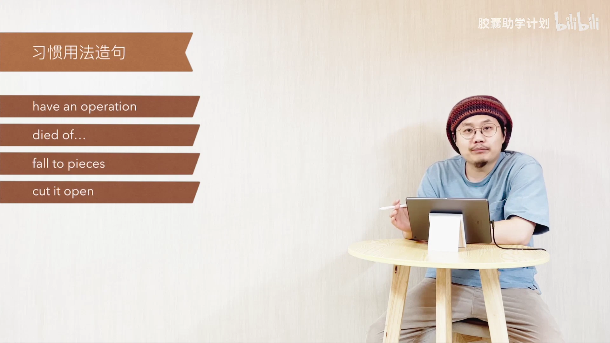

文字识别：bibii / 胶囊助学计划 / 习惯用法造句 / have an operation / died of.. / fall to pieces / cut it open

### 画面 00:14:55

文字识别：网：v.+v.变化 / 胶囊助学计划 / bilbili / 习惯用法造句指南 / 四句型转换 / 方式/地点/时间 / 其他习惯用法 / 其他单词+词性 / 原文摘抄+变 / 6123456 / have an operation

### 画面 00:14:57

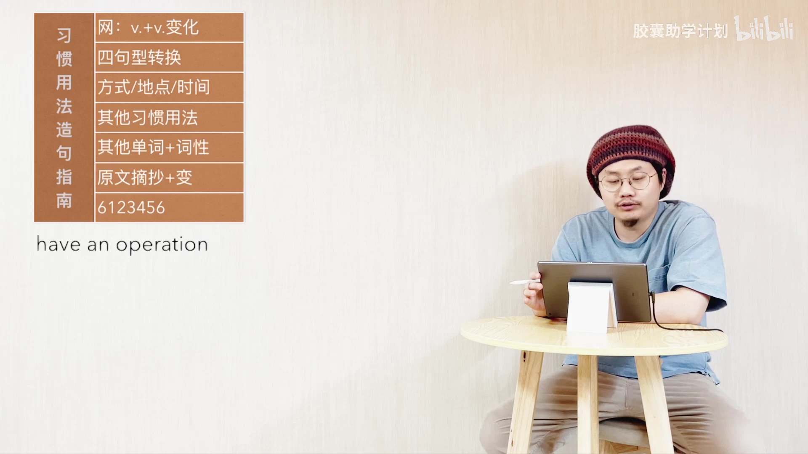

文字识别：网：v.+v.变化 / 胶囊助学计划 / bilbii / 习惯用法造句指南 / 四句型转换 / 方式/地点/时间 / 其他习惯用法 / 其他单词+词性 / 原文摘抄+变 / 6123456 / have an operation

### 画面 00:14:59

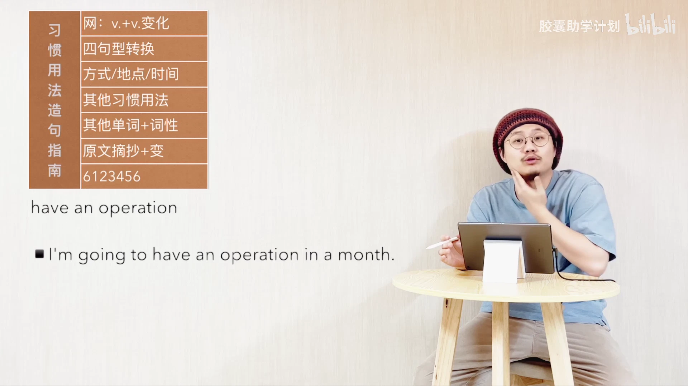

文字识别：网：v.+v.变化 / 胶囊助学计划 / biibii / 习惯用法造句指南 / 四句型转换 / 方式/地点/时间 / 其他习惯用法 / 其他单词+词性 / 原文摘抄+变 / 6123456 / have an operation / I'm going to have an operation in a month.

## 00:15:00–00:15:30

三十九课咱都学过啊，So I'm going to have an operation in a month，一个月之后做手术。I had an operation last week，上周做的手术，就其实都很简单，复习一下时态。She must have been having an operation at the time，at the time七十课咱们学叫在那时，特殊的时间段，并且肯定是跟过去相连的，说他当时一定是正在做手术呢。Must have been doing，

### 画面 00:15:04

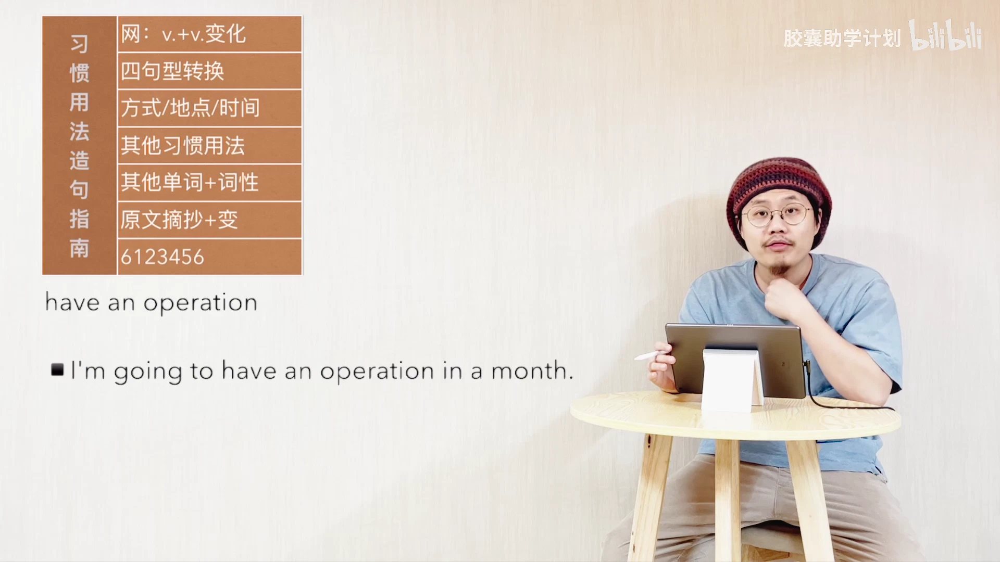

文字识别：网：v.+v.变化 / 胶囊助学计划 / bilbili / 习惯用法造句指南 / 四句型转换 / 方式/地点/时间 / 其他习惯用法 / 其他单词+词性 / 原文摘抄+变 / 6123456 / have an operation / I'm going to have an operation in a month.

### 画面 00:15:07

文字识别：网：v.+v.变化 / 胶囊助学计划 / bibii / 习惯用法造句指南 / 四句型转换 / 方式/地点/时间 / 其他习惯用法 / 其他单词+词性 / 原文摘抄+变 / 6123456 / have an operation / I'm going to have an operation in a month. / I had an operation last week.

### 画面 00:15:09

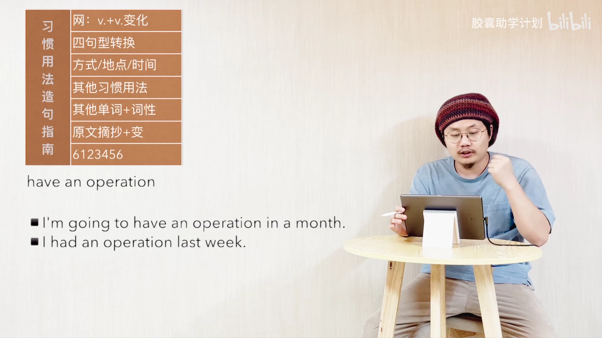

文字识别：网：v.+v.变化 / 胶囊助学计划 / bilibii / 习惯用法造句指南 / 四句型转换 / 方式/地点/时间 / 其他习惯用法 / 其他单词+词性 / 原文摘抄+变 / 6123456 / have an operation / I'm going to have an operation in a month. / I had an operation last week.

### 画面 00:15:11

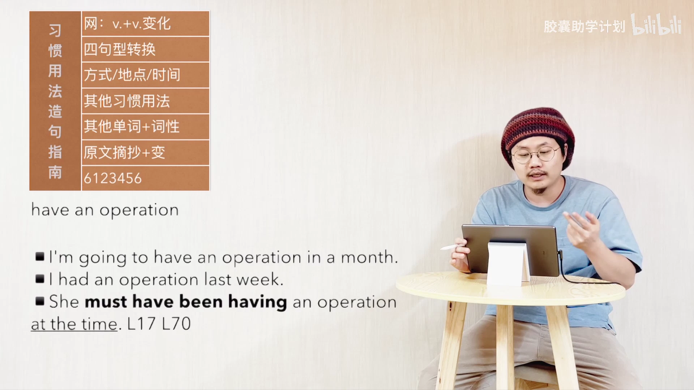

文字识别：网：v.+v.变化 / 胶囊助学计划 / bilibii / 习惯用法造句指南 / 四句型转换 / 方式/地点/时间 / 其他习惯用法 / 其他单词+词性 / 原文摘抄+变 / 6123456 / have an operation / I'm going to have an operation in a month. /  I had an operation last week. /  She must have been having an Operation / at the time. L17 L70

### 画面 00:15:13

文字识别：网：v.+v.变化 / 胶囊助学计划 / Bilbili / 习惯用法造句指南 / 四句型转换 / 方式/地点/时间 / 其他习惯用法 / 其他单词+词性 / 原文摘抄+变 / 6123456 / have an operation / I'm going to have an operation in a month. / I had an operation last week. /  She must have been having an operation / at the time. L17 L70

### 画面 00:15:15

文字识别：网：v.+v.变化 / 胶囊助学计划 / bilibii / 习惯用法造句指南 / 四句型转换 / 方式/地点/时间 / 其他习惯用法 / 其他单词+词性 / 原文摘抄+变 / 6123456 / have an operation / I'm going to have an operation in a month. /  I had an operation last week. /  She must have been having an Operation / at the time. L17 L70

### 画面 00:15:19

文字识别：网：v.+v.变化 / 胶囊助学计划 / bilbili / 习惯用法造句指南 / 四句型转换 / 方式/地点/时间 / 其他习惯用法 / 其他单词+词性 / 原文摘抄+变 / 6123456 / have an operation / I'm going to have an operation in a month. / I had an operation last week. /  She must have been having an Operation / at the time. L17 L70

### 画面 00:15:24

文字识别：胶囊助学计划bilibi / 网：v.+v.变化 / 习惯用法造句指南 / 四句型转换 / 方式/地点/时间 / 其他习惯用法 / 其他单词+词性 / 原文摘抄+变 / 6123456 / have an operation / I'm going to have an operation in a month. / I had an operation last week. /  She must have been having an Operation / at the time. L17 L70

### 画面 00:15:29

文字识别：网：v.+v.变化 / 胶囊助学计划 / ilibili / 习惯用法造句指南 / 四句型转换 / 方式/地点/时间 / 其他习惯用法 / 其他单词+词性 / 原文摘抄+变 / 6123456 / have an operation / I'm going to have an operation in a month. /  I had an operation last week. /  She must have been having an Operation / at the time. L17 L70

## 00:15:30–00:16:00

这个咱们实习课学的，对吧？呃，上面这三句话，您都可以做四句型转换，但是题一般疑问句题的东西都各不相同啊，这个自己注意一下。那注意力集中，咱听个电影片段。The girls have heard this before, but fourteen years ago, I had an operation on my arm here. Next one,下一个单词叫die off，啊，就是死于

### 画面 00:15:32

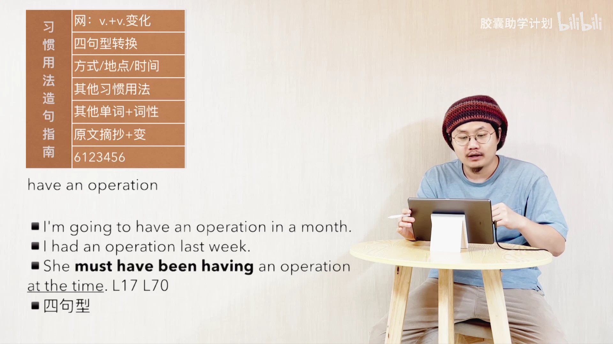

文字识别：网：v.+v.变化 / 胶囊助学计划 / Bilbili / 习惯用法造句指南 / 四句型转换 / 方式/地点/时间 / 其他习惯用法 / 其他单词+词性 / 原文摘抄+变 / 6123456 / have an operation / I'm going to have an operation in a month. / I had an operation last week. /  She must have been having an operation / at the time. L17 L70 / ■四句型

### 画面 00:15:34

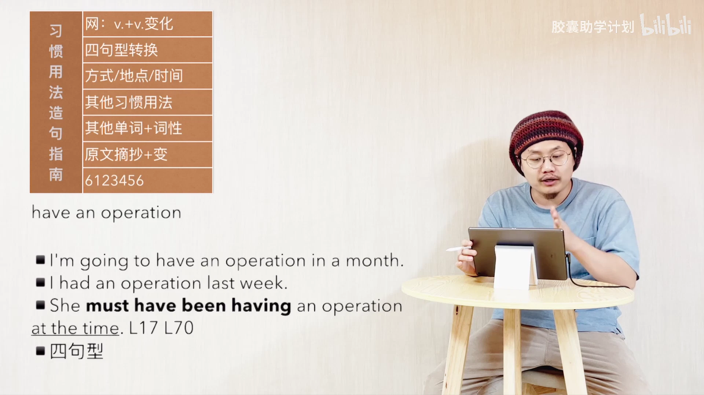

文字识别：网：v.+v.变化 / 胶囊助学计划 / bibil / 习惯用法造句指南 / 四句型转换 / 方式/地点/时间 / 其他习惯用法 / 其他单词+词性 / 原文摘抄+变 / 6123456 / have an operation / I'm going to have an operation in a month. /  I had an operation last week. /  She must have been having an Operation / at the time. L17 L70 / ■四句型

### 画面 00:15:37

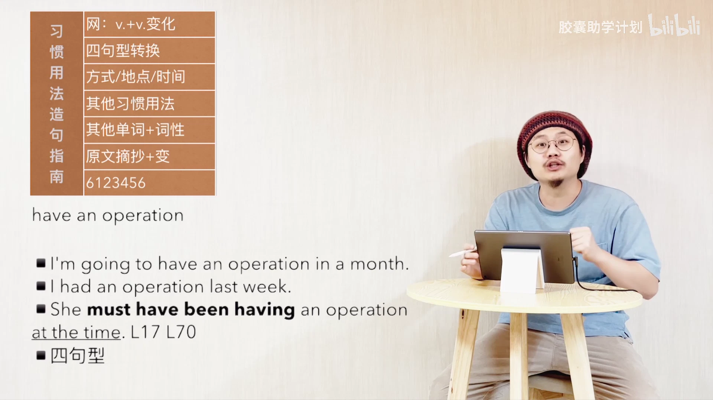

文字识别：网：v.+v.变化 / 胶囊助学计划 / bibii / 习惯用法造句指南 / 四句型转换 / 方式/地点/时间 / 其他习惯用法 / 其他单词+词性 / 原文摘抄+变 / 6123456 / have an operation / I'm going to have an operation in a month. /  I had an operation last week. /  She must have been having an operation / at the time. L17 L70 / ■四句型

### 画面 00:15:39

文字识别：网：v.+v.变化 / 胶囊助学计划 / Bilbi / 习惯用法造句指南 / 四句型转换 / 方式/地点/时间 / 其他习惯用法 / 其他单词+词性 / 原文摘抄+变 / 6123456 / have an operation / I'm going to have an operation in a month. /  I had an operation last week. /  She must have been having an operation / at the time. L17 L70 / ■四句型

### 画面 00:15:41

文字识别：网：v.+v.变化 / 胶囊助学计划 / 习惯用法造句指南 / 四句型转换 / 方式/地点/时间 / 其他习惯用法 / 其他单词+词性 / 原文摘抄+变 / 6123456 / have an operation / I'm going to have an operation in a month. / I had an operation last week. /  She must have been having an operation / at the time. L17 L70 / ■四句型

### 画面 00:15:43

文字识别：胶囊助学计划bib出 / The girls had heard this before.. but fourteen / years ago, I had an operation on my arm here. / Eraserhead / (1977)

### 画面 00:15:48

文字识别：胶囊助学计划bib出 / The girls had heard this before.. but fourteen / years ago, I had an operation on my arm here. / Eraserhead / (1977)

### 画面 00:15:50

文字识别：胶囊助学计划Liii出 / The girls had heard this before.. but fourteen / years ago, I had an operation on my arm here. / Eraserhead / (1977)

### 画面 00:15:52

文字识别：胶囊助学计划b / The girls had heard this before.. but fourteen / years ago, I had an operation on my arm here. / Eraserhead / (1977)

### 画面 00:15:54

文字识别：bilibii / 胶囊助学计划 / The girls had heard this before.. but fourteen / years ago, I had an operation on my arm here. / Eraserhead / (1977)

### 画面 00:15:56

文字识别：习惯用法造句指南 / 网：v.+v.变化 / 胶囊助学计划 / bilbili / 四句型转换 / 方式/地点/时间 / 其他习惯用法 / 其他单词+词性 / 原文摘抄+变 / 6123456 / died of...

### 画面 00:15:59

文字识别：网：v.+v.变化 / 胶囊助学计划 / bibii / 习惯用法造句指南 / 四句型转换 / 方式/地点/时间 / 其他习惯用法 / 其他单词+词性 / 原文摘抄+变 / 6123456 / died of...

## 00:16:00–00:16:30

某种疾病，它往往后边加的是病。我们找一些电影的片段，因为后边这个病各位可能不太会，我也不太方便直接带你去造句。但是常见的一些词我可以告诉你，比如说 My dad died of a heart attack。这句话当中，这个 heart attack 就是心脏病，是吧？攻击心脏，字面意思攻击心脏啊，其实指的就是心脏病。而 Yes, Yes, now all of them died of this new disease。啊，他们所有的人都是死于这种新

### 画面 00:16:02

文字识别：网：v.+v.变化 / 胶囊助学计划 / bilbili / 习惯用法造句指南 / 四句型转换 / 方式/地点/时间 / 其他习惯用法 / 其他单词+词性 / 原文摘抄+变 / 6123456 / died of... / My dad died of a heart attack. Almost Famous / (2000)

### 画面 00:16:04

文字识别：Bilbili / 网：v.+v.变化 / 胶囊助学计划 / 习惯用法造句指南 / 四句型转换 / 方式/地点/时间 / 其他习惯用法 / 其他单词+词性 / 原文摘抄+变 / 6123456 / died of... / My dad died of a heart attack. Almost Famous / (2000)

### 画面 00:16:08

文字识别：网：v.+v.变化 / 胶囊助学计划 / Bilbili / 习惯用法造句指南 / 四句型转换 / 方式/地点/时间 / 其他习惯用法 / 其他单词+词性 / 原文摘抄+变 / 6123456 / died of... /  My dad died of a heart attack. Almost Famous / (2000)

### 画面 00:16:10

文字识别：网：v.+v.变化 / 胶囊助学计划 / bilbili / 习惯用法造句指南 / 四句型转换 / 方式/地点/时间 / 其他习惯用法 / 其他单词+词性 / 原文摘抄+变 / 6123456 / died of... /  My dad died of a heart attack. Almost Famous / (2000)

### 画面 00:16:13

文字识别：bibii / 网：v.+v.变化 / 胶囊助学计划 / 习惯用法造句指南 / 四句型转换 / 方式/地点/时间 / 其他习惯用法 / 其他单词+词性 / 原文摘抄+变 / 6123456 / died of... / My dad died of a heart attack. Almost Famous / (2000)

### 画面 00:16:15

文字识别：网：v.+v.变化 / 胶囊助学计划 / Bilbili / 习惯用法造句指南 / 四句型转换 / 方式/地点/时间 / 其他习惯用法 / 其他单词+词性 / 原文摘抄+变 / 6123456 / died of... /  My dad died of a heart attack. Almost Famous / (2000)

### 画面 00:16:18

文字识别：网：v.+v.变化 / 胶囊助学计划 / Bilbili / 习惯用法造句指南 / 四句型转换 / 方式/地点/时间 / 其他习惯用法 / 其他单词+词性 / 原文摘抄+变 / 6123456 / died of... / My dad died of a heart attack. Almost Famous / (2000)

### 画面 00:16:20

文字识别：网：v.+v.变化 / 胶囊助学计划 / bilbili / 习惯用法造句指南 / 四句型转换 / 方式/地点/时间 / 其他习惯用法 / 其他单词+词性 / 原文摘抄+变 / 6123456 / died of... / My dad died of a heart attack. Almost Famous / (2000)

### 画面 00:16:22

文字识别：胶囊助学计划bibi / 网：v.+v.变化 / 习惯用法造句指南 / 四句型转换 / 方式/地点/时间 / 其他习惯用法 / 其他单词+词性 / 原文摘抄+变 / 6123456 / died of... /  My dad died of a heart attack. Almost Famous / (2000) / Yes. Yes, now, all of them died of / this new disease? And the Band Played On (1993)

### 画面 00:16:24

文字识别：胶囊助学计划bilbi / 网：v.+v.变化 / 习惯用法造句指南 / 四句型转换 / 方式/地点/时间 / 其他习惯用法 / 其他单词+词性 / 原文摘抄+变 / 6123456 / died of... /  My dad died of a heart attack. Almost Famous / (2000) / Yes. Yes, now, all of them died of / this new disease? And the Band Played On (1993)

### 画面 00:16:27

文字识别：胶囊助学计划bibi / 网：v.+v.变化 / 习惯用法造句指南 / 四句型转换 / 方式/地点/时间 / 其他习惯用法 / 其他单词+词性 / 原文摘抄+变 / 6123456 / died of... /  My dad died of a heart attack. Almost Famous / (2000) /  Yes. Yes, now, all of them died of / this new disease? And the Band Played On (1993)

### 画面 00:16:29

文字识别：网：v.+v.变化 / 胶囊助学计划 / bilbi / 习惯用法造句指南 / 四句型转换 / 方式/地点/时间 / 其他习惯用法 / 其他单词+词性 / 原文摘抄+变 / 6123456 / died of... /  My dad died of a heart attack. Almost Famous / (2000) / Yes. Yes, now, all of them died of / this new disease? And the Band Played On (1993)

## 00:16:30–00:17:00

Next one, but he died of cancer before. Ah, sorry, but he died of cancer before he was able to pay a visit to his hometown. This is our own sentence. It's called he died of cancer before he was able to pay a visit to his hometown. This is our own sentence. It's called he died of cancer before he was able to pay a visit to his hometown. This is our own sentence. It's called he died of cancer before he was able to pay a visit to his hometown. This is our own sentence. It's called he died of cancer before he was able to pay a visit to his hometown.

### 画面 00:16:31

文字识别：胶囊助学计划blbi / 网：v.+v.变化 / 习惯用法造句指南 / 四句型转换 / 方式/地点/时间 / 其他习惯用法 / 其他单词+词性 / 原文摘抄+变 / 6123456 / died of... /  My dad died of a heart attack. Almost Famous / (2000) /  Yes. Yes, now, all of them died of / this new disease? And the Band Played On (1993) /  But he died of cancer before / he was able to pay a visit to his hometown. L43

### 画面 00:16:33

文字识别：胶囊助学计划bilbi / 网：v.+v.变化 / 习惯用法造句指南 / 四句型转换 / 方式/地点/时间 / 其他习惯用法 / 其他单词+词性 / 原文摘抄+变 / 6123456 / died of... /  My dad died of a heart attack. Almost Famous / (2000) /  Yes. Yes, now, all of them died of / this new disease? And the Band Played On (1993) /  But he died of cancer before / he was able to pay a visit to his hometown. L43

### 画面 00:16:35

文字识别：胶囊助学计划bibi / 网：v.+v.变化 / 习惯用法造句指南 / 四句型转换 / 方式/地点/时间 / 其他习惯用法 / 其他单词+词性 / 原文摘抄+变 / 6123456 / died of... /  My dad died of a heart attack. Almost Famous / (2000) /  Yes. Yes, now, all of them died of / this new disease? And the Band Played On (1993) /  But he died of cancer before / he was able to pay a visit to his hometown. L43

### 画面 00:16:37

文字识别：胶囊助学计划blbi / 网：v.+v.变化 / 习惯用法造句指南 / 四句型转换 / 方式/地点/时间 / 其他习惯用法 / 其他单词+词性 / 原文摘抄+变 / 6123456 / died of... /  My dad died of a heart attack. Almost Famous / (2000) /  Yes. Yes, now, all of them died of / this new disease? And the Band Played On (1993) /  But he died of cancer before / he was able to pay a visit to his hometown. L43

### 画面 00:16:39

文字识别：胶囊助学计划bibi / 网：v.+v.变化 / 习惯用法造句指南 / 四句型转换 / 方式/地点/时间 / 其他习惯用法 / 其他单词+词性 / 原文摘抄+变 / 6123456 / died of... /  My dad died of a heart attack. Almost Famous / (2000) /  Yes. Yes, now, all of them died of / this new disease? And the Band Played On (1993) /  But he died of cancer before / he was able to pay a visit to his hometown. L43

### 画面 00:16:44

文字识别：胶囊助学计划biii出 / 网：v.+v.变化 / 习惯用法造句指南 / 四句型转换 / 方式/地点/时间 / 其他习惯用法 / 其他单词+词性 / 原文摘抄+变 / 6123456 / died of... /  My dad died of a heart attack. Almost Famous / (2000) /  Yes. Yes, now, all of them died of / this new disease? And the Band Played On (1993) / t he died of cancer before / he was able to pay a visit to his hometown. L43

### 画面 00:16:49

文字识别：胶囊助学计划bii出 / 网：v.+v.变化 / 习惯用法造句指南 / 四句型转换 / 方式/地点/时间 / 其他习惯用法 / 其他单词+词性 / 原文摘抄+变 / 6123456 / died of... /  My dad died of a heart attack. Almost Famous / (2000) / Yes. Yes, now, all of them died of / this new disease? And the Band Played On (1993) /  But he died of cancer before / he was able to pay a visit to his hometown. L43

### 画面 00:16:54

文字识别：胶囊助学计划blbi / 网：v.+v.变化 / 习惯用法造句指南 / 四句型转换 / 方式/地点/时间 / 其他习惯用法 / 其他单词+词性 / 原文摘抄+变 / 6123456 / died of... /  My dad died of a heart attack. Almost Famous / (2000) / Yes. Yes, now, all of them died of / this new disease? And the Band Played On (1993) /  But he died of cancer before / he was able to pay a visit to his hometown. L43

### 画面 00:16:56

文字识别：胶囊助学计划bi出 / 网：v.+v.变化 / 习惯用法造句指南 / 四句型转换 / 方式/地点/时间 / 其他习惯用法 / 其他单词+词性 / 原文摘抄+变 / 6123456 / died of... /  My dad died of a heart attack. Almost Famous / (2000) /  Yes. Yes, now, all of them died of / this new disease? And the Band Played On (1993) /  But he died of cancer before / he was able to pay a visit to his hometown. L43

### 画面 00:16:59

文字识别：胶囊助学计划bib / 网：v.+v.变化 / 习惯用法造句指南 / 四句型转换 / 方式/地点/时间 / 其他习惯用法 / 其他单词+词性 / 原文摘抄+变 / 6123456 / died of... /  My dad died of a heart attack. Almost Famous / (2000) /  Yes. Yes, now, all of them died of / this neW disease? And the Band Played On (1993) /  But he died of cancer before / he was able to pay a visit to his hometown. L43

## 00:17:00–00:17:30

症， OK， 呃，注意力集中，咱听个电影片段啊，又出现了 heart attack 是吧？ Very good， 下一个单词 fall to pieces， fall to pieces， 注意啊，又是两方面不同的意思，第一方面 break into parts 指的是物理意义上的，比如说我这个东西趴掉地上摔碎了，稀碎 fall to pieces， 啊 break into pieces， break into parts fall to pieces，

### 画面 00:17:02

文字识别：bibili / 胶囊助学计划 / But he died of a heart / attack eighteen months ago. / Past Shadows / (2021)

### 画面 00:17:11

文字识别：网：v.+v.变化 / 1.to break into parts / 胶囊助学计划 / bibili / 习惯用法造句指南 / 四句型转换 / 2. to become unable to control one's emotions / 方式/地点/时间 / 其他习惯用法 / 其他单词+词性 / 原文摘抄+变 / 6123456 / fall to pieces

### 画面 00:17:13

文字识别：网：v.+v.变化 / 1.to break into parts / 胶囊助学计划 / bilbili / 习惯用法造句指南 / 四句型转换 / 2. to become unable to control one's emotions / 方式/地点/时间 / 其他习惯用法 / 其他单词+词性 / 原文摘抄+变 / 6123456 / fall to pieces

### 画面 00:17:15

文字识别：网：v.+v.变化 / 1.to break into parts / 胶囊助学计划 / bilbili / 习惯用法造句指南 / 四句型转换 / 2. to become unable to control one's emotions / 方式/地点/时间 / 其他习惯用法 / 其他单词+词性 / 原文摘抄+变 / 6123456 / fall to pieces

### 画面 00:17:17

文字识别：网：v.+v.变化 / 1.to break into parts / 胶囊助学计划 / bilbili / 习惯用法造句指南 / 四句型转换 / 2. to become unable to control one's emotions / 方式/地点/时间 / 其他习惯用法 / 其他单词+词性 / 原文摘抄+变 / 6123456 / fall to pieces

### 画面 00:17:19

文字识别：网：v.+v.变化 / 1.to break into parts / 胶囊助学计划 / bibili / 习惯用法造句指南 / 2. to become unable to control one's emotions / 四句型转换 / 方式/地点/时间 / 其他习惯用法 / 其他单词+词性 / 原文摘抄+变 / 6123456 / fall to pieces

### 画面 00:17:23

文字识别：bilbii / 网：v.+v.变化 / 1.to break into parts / 胶囊助学计划 / 习惯用法造句指南 / 四句型转换 / 2. to become unable to control one's emotions / 方式/地点/时间 / 其他习惯用法 / 其他单词+词性 / 原文摘抄+变 / 6123456 / fall to pieces

### 画面 00:17:25

文字识别：网：v.+v.变化 / 1.to break into parts / 胶囊助学计划 / bilbili / 习惯用法造句指南 / 2. to become unable to control one's emotions / 四句型转换 / 方式/地点/时间 / 其他习惯用法 / 其他单词+词性 / 原文摘抄+变 / 6123456 / fall to pieces

### 画面 00:17:28

文字识别：网：v.+v.变化 / 1.to break into parts / 胶囊助学计划 / bilbili / 习惯用法造句指南 / 四句型转换 / 2. to become unable to control one's emotions / 方式/地点/时间 / 其他习惯用法 / 其他单词+词性 / 原文摘抄+变 / 6123456 / fall to pieces

## 00:17:30–00:18:00

另外一个指的是什么呢？就是人崩溃了，人变成了碎片，不是物理意义上，指的是情绪上、心理上啊。Become unable to control one's emotion,对吧？就支离破碎的心情，对吧？就崩溃了的心情。比如说，the old map fell to pieces in my hands.这个就是物理意义上的，说这个旧地图就碎了，在我手里面，对吧？这是物理意义上。那下一句话说，When he heard the bad news, he just fell to pieces.

### 画面 00:17:30

文字识别：网：v.+v.变化 / 1.to break into parts / 胶囊助学计划 / Bibili / 习惯用法造句指南 / 四句型转换 / 2. to become unable to control one's emotions / 方式/地点/时间 / 其他习惯用法 / 其他单词+词性 / 原文摘抄+变 / 6123456 / fall to pieces

### 画面 00:17:33

文字识别：网：v.+v.变化 / 1. to break into parts / 胶囊助学计划 / bilbii / 习惯用法造句指南 / 2. to become unable to control one's emotions / 四句型转换 / 方式/地点/时间 / 其他习惯用法 / 其他单词+词性 / 原文摘抄+变 / 6123456 / fall to pieces

### 画面 00:17:35

文字识别：网：v.+v.变化 / 1.to break into parts / 胶囊助学计划 / bilbili / 习惯用法造句指南 / 四句型转换 / 2. to become unable to control one's emotions / 方式/地点/时间 / 其他习惯用法 / 其他单词+词性 / 原文摘抄+变 / 6123456 / fall to pieces

### 画面 00:17:37

文字识别：网：v.+v.变化 / 1.to break into parts / 胶囊助学计划 / bibii / 习惯用法造句指南 / 2. to become unable to control one's emotions / 四句型转换 / 方式/地点/时间 / 其他习惯用法 / 其他单词+词性 / 原文摘抄+变 / 6123456 / fall to pieces

### 画面 00:17:39

文字识别：bilbii / 网：v.+v.变化 / 1.to break into parts / 胶囊助学计划 / 习惯用法造句指南 / 2. to become unable to control one's emotions / 四句型转换 / 方式/地点/时间 / 其他习惯用法 / 其他单词+词性 / 原文摘抄+变 / 6123456 / fall to pieces

### 画面 00:17:41

文字识别：网：v.+v.变化 / 1.to break into parts / 胶囊助学计划 / ilbii / 习惯用法造句指南 / 四句型转换 / 2. to become unable to control one's emotions / 方式/地点/时间 / 其他习惯用法 / 其他单词+词性 / 原文摘抄+变 / 6123456 / fall to pieces

### 画面 00:17:43

文字识别：网：v.+v.变化 / 1.to break into parts / 胶囊助学计划 / bibili / 习惯用法造句指南 / 四句型转换 / 2. to become unable to control one's emotions / 方式/地点/时间 / 其他习惯用法 / 其他单词+词性 / 原文摘抄+变 / 6123456 / fall to pieces

### 画面 00:17:45

文字识别：网：v.+v.变化 / 1. to break into parts / 胶囊助学计划 / Bilibii / 习惯用法造句指南 / 2. to become unable to control one's emotions / 四句型转换 / 方式/地点/时间 / 其他习惯用法 / 其他单词+词性 / 原文摘抄+变 / 6123456 / fall to pieces /  The old map fell to pieces in my hands.

### 画面 00:17:47

文字识别：网：v.+v.变化 / 1. to break into parts / 胶囊助学计划 / bibli / 习惯用法造句指南 / 2. to become unable to control one's emotions / 四句型转换 / 方式/地点/时间 / 其他习惯用法 / 其他单词+词性 / 原文摘抄+变 / 6123456 / fall to pieces / The old map fell to pieces in my hands.

### 画面 00:17:49

文字识别：网：v.+v.变化 / 1. to break into parts / 胶囊助学计划 / biibili / 习惯用法造句指南 / 2. to become unable to control one's emotions / 四句型转换 / 方式/地点/时间 / 其他习惯用法 / 其他单词+词性 / 原文摘抄+变 / 6123456 / fall to pieces /  The old map fell to pieces in my hands.

### 画面 00:17:54

文字识别：网：v.+v.变化 / 1. to break into parts / 胶囊助学计划 / bilbi / 习惯用法造句指南 / 四句型转换 / 2.to become unable to control one's emotions / 方式/地点/时间 / 其他习惯用法 / 其他单词+词性 / 原文摘抄+变 / 6123456 / fall to pieces /  The old map fell to pieces in my hands. /  When he heard the bad news, he just fell / to pieces.

### 画面 00:17:56

文字识别：网：v.+v.变化 / 1. to break into parts / 胶囊助学计划 / 习惯用法造句指南 / 四句型转换 / 2.to become unable to control one's emotions / 方式/地点/时间 / 其他习惯用法 / 其他单词+词性 / 原文摘抄+变 / 6123456 / fall to pieces /  The old map fell to pieces in my hands. /  When he heard the bad news, he just fell / to pieces.

### 画面 00:17:59

文字识别：胶囊助学计划bibi / 网：v.+v.变化 / 1. to break into parts / 习惯用法造句指南 / 2.to become unable to control one's emotions / 四句型转换 / 方式/地点/时间 / 其他习惯用法 / 其他单词+词性 / 原文摘抄+变 / 6123456 / fall to pieces /  The old map fell to pieces in my hands. /  When he heard the bad news, he just fell / to pieces.

## 00:18:00–00:18:30

啥意思？说他听到这个坏消息，他人就碎开了，不是啊？就说就崩溃了，人就崩溃了啊。Okay,情绪就难以控制了，歇斯底里了啊，丧失理智了。Okay, we need to avoid touching that. For I fear that it would fall to pieces.我们需要避免触碰它，因为我担心。Fear that担心原文出现了，在这咱又再复习一下原

### 画面 00:18:01

文字识别：网：v.+v.变化 / 1.to break into parts / 胶囊助学计划 / bilbii / 习惯用法造句指南 / 2. to become unable to control one's emotions / 四句型转换 / 方式/地点/时间 / 其他习惯用法 / 其他单词+词性 / 原文摘抄+变 / 6123456 / fall to pieces /  The old map fell to pieces in my hands. /  When he heard the bad news, he just fell / to pieces.

### 画面 00:18:04

文字识别：胶囊助学计划biibil / 网：v.+v.变化 / 1. to break into parts / 习惯用法造句指南 / 2.to become unable to control one's emotions / 四句型转换 / 方式/地点/时间 / 其他习惯用法 / 其他单词+词性 / 原文摘抄+变 / 6123456 / fall to pieces /  The old map fell to pieces in my hands. /  When he heard the bad news, he just fell / to pieces.

### 画面 00:18:06

文字识别：胶囊助学计划blbi / 网：v.+v.变化 / 1. to break into parts / 习惯用法造句指南 / 2.to become unable to control one's emotions / 四句型转换 / 方式/地点/时间 / 其他习惯用法 / 其他单词+词性 / 原文摘抄+变 / 6123456 / fall to pieces /  The old map fell to pieces in my hands. /  When he heard the bad news, he just fell / to pieces.

### 画面 00:18:08

文字识别：胶囊助学计划bilbi / 网：v.+v.变化 / 1. to break into parts / 习惯用法造句指南 / 2.to become unable to control one's emotions / 四句型转换 / 方式/地点/时间 / 其他习惯用法 / 其他单词+词性 / 原文摘抄+变 / 6123456 / fall to pieces /  The old map fell to pieces in my hands. /  When he heard the bad news, he just fell / to pieces.

### 画面 00:18:10

文字识别：胶囊助学计划bilii / 网：v.+v.变化 / 1.to break into parts / 习惯用法造句指南 / 四句型转换 / 2. to become unable to control one's emotions / 方式/地点/时间 / 其他习惯用法 / 其他单词+词性 / 原文摘抄+变 / 6123456 / fall to pieces /  The old map fell to pieces in my hands. /  When he heard the bad news, he just fell / to pieces. /  We need to avoid touching that, for Lfear / that it would fall to pieces. L68 L64

### 画面 00:18:12

文字识别：胶囊助学计划bilbi / 网：v.+v.变化 / 1. to break into parts / 习惯用法造句指南 / 四句型转换 / 2. to become unable to control one's emotions / 方式/地点/时间 / 其他习惯用法 / 其他单词+词性 / 原文摘抄+变 / 6123456 / fall to pieces /  The old map fell to pieces in my hands. /  When he heard the bad news, he just fell / to pieces. /  We need to avoid touching that, for Lfear / that it would fall to pieces. L68 L64

### 画面 00:18:14

文字识别：胶囊助学计划bibi / 网：v.+v.变化 / 1. to break into parts / 习惯用法造句指南 / 四句型转换 / 2.to become unable to control one's emotions / 方式/地点/时间 / 其他习惯用法 / 其他单词+词性 / 原文摘抄+变 / 6123456 / fall to pieces /  The old map fell to pieces in my hands. /  When he heard the bad news, he just fell / to pieces. /  We need to avoid touching that, for Lfear / that it would fall to pieces. L68 L64

### 画面 00:18:19

文字识别：网：v.+v.变化 / 1. to break into parts / 胶囊助学计划bibi / 习惯用法造句指南 / 四句型转换 / 2. to become unable to control one's emotions / 方式/地点/时间 / 其他习惯用法 / 其他单词+词性 / 原文摘抄+变 / 6123456 / fall to pieces /  The old map fell to pieces in my hands. /  When he heard the bad news, he just fell / to pieces. /  We need to avoid touching that, for Lfear / that it would fall to pieces. L68 L64

### 画面 00:18:22

文字识别：胶囊助学计划bilbi / 网：v.+v.变化 / 1. to break into parts / 习惯用法造句指南 / 四句型转换 / 2. to become unable to control one's emotions / 方式/地点/时间 / 其他习惯用法 / 其他单词+词性 / 原文摘抄+变 / 6123456 / fall to pieces /  The old map fell to pieces in my hands. /  When he heard the bad news, he just fell / to pieces. /  We need to avoid touching that, for fear / that it would fall to pieces. L68 L64

### 画面 00:18:24

文字识别：胶囊助学计划bilii / 网：v.+v.变化 / 1. to break into parts / 习惯用法造句指南 / 四句型转换 / 2. to become unable to control one's emotions / 方式/地点/时间 / 其他习惯用法 / 其他单词+词性 / 原文摘抄+变 / 6123456 / fall to pieces / The old map fell to pieces in my hands. /  When he heard the bad news, he just fell / to pieces. /  We need to avoid touching that, for Lfear / that it would fall to pieces. L68 L64

### 画面 00:18:26

文字识别：胶囊助学计划bilbi / 网：v.+v.变化 / 1.to break into parts / 习惯用法造句指南 / 四句型转换 / 2. to become unable to control one's emotions / 方式/地点/时间 / 其他习惯用法 / 其他单词+词性 / 原文摘抄+变 / 6123456 / fall to pieces /  The old map fell to pieces in my hands. /  When he heard the bad news, he just fell / to pieces. /  We need to avoid touching that, for Lfear / that it would fall to pieces. L68 L64

### 画面 00:18:28

文字识别：胶囊助学计划bilbi / 网：v.+v.变化 / 1. to break into parts / 习惯用法造句指南 / 四句型转换 / 2. to become unable to control one's emotions / 方式/地点/时间 / 其他习惯用法 / 其他单词+词性 / 原文摘抄+变 / 6123456 / fall to pieces /  The old map fell to pieces in my hands. /  When he heard the bad news, he just fell / to pieces. /  We need to avoid touching that, for Lfear / that it would fall to pieces. L68 L64

## 00:18:30–00:19:00

文，就是复习本课还是复习六十四课学的是吧？我担心说这个玩意儿会变成碎成渣，对吧？Fall to pieces，而一个那其实咱们之前四十九课学过一个跟它类似的，叫 smash something to pieces，对吧？下一个单词 cut it open，叫做切开，就翻译俩字儿切开就行了。比如说 we should have cut it open with a knife，我们应该用刀把它给切开呀。Next one，说 if you were here，you would cut it open

### 画面 00:18:30

文字识别：胶囊助学计划bilbi / 网：v.+v.变化 / 1. to break into parts / 习惯用法造句指南 / 四句型转换 / 2. to become unable to control one's emotions / 方式/地点/时间 / 其他习惯用法 / 其他单词+词性 / 原文摘抄+变 / 6123456 / fall to pieces /  The old map fell to pieces in my hands. /  When he heard the bad news, he just fell / to pieces. /  We need to avoid touching that, for Lfear / that it would fall to pieces. L68 L64

### 画面 00:18:32

文字识别：网：v.+v.变化 / 1. to break into parts / 胶囊助学计划blbi / 习惯用法造句指南 / 四句型转换 / 2. to become unable to control one's emotions / 方式/地点/时间 / 其他习惯用法 / 其他单词+词性 / 原文摘抄+变 / 6123456 / fall to pieces /  The old map fell to pieces in my hands. /  When he heard the bad news, he just fell / to pieces. /  We need to avoid touching that, for Lfear / that it would fall to pieces. L68 L64

### 画面 00:18:34

文字识别：胶囊助学计划bilbi / 网：v.+v.变化 / 1. to break into parts / 习惯用法造句指南 / 四句型转换 / 2.to become unable to control one's emotions / 方式/地点/时间 / 其他习惯用法 / 其他单词+词性 / 原文摘抄+变 / 6123456 / fall to pieces /  The old map fell to pieces in my hands. /  When he heard the bad news, he just fell / to pieces. /  We need to avoid touching that, for Lfear / that it would fall to pieces. L68 L64

### 画面 00:18:39

文字识别：胶囊助学计划bilibi / 网：v.+v.变化 / 1. to break into parts / 习惯用法造句指南 / 四句型转换 / 2.to become unable to control one's emotions / 方式/地点/时间 / 其他习惯用法 / 其他单词+词性 / 原文摘抄+变 / 6123456 / fall to pieces /  The old map fell to pieces in my hands. /  When he heard the bad news, he just fell / to pieces. /  We need to avoid touching that, for Lfear / that it would fall to pieces. L68 L64

### 画面 00:18:41

文字识别：网：v.+v.变化 / 胶囊助学计划 / bilbili / 习惯用法造句指南 / 四句型转换 / 方式/地点/时间 / 其他习惯用法 / 其他单词+词性 / 原文摘抄+变 / 6123456 / cut it open

### 画面 00:18:44

文字识别：网：v.+v.变化 / 胶囊助学计划 / bibili / 习惯用法造句指南 / 四句型转换 / 方式/地点/时间 / 其他习惯用法 / 其他单词+词性 / 原文摘抄+变 / 6123456 / cut it open

### 画面 00:18:49

文字识别：网：v.+v.变化 / 胶囊助学计划 / bilbili / 习惯用法造句指南 / 四句型转换 / 方式/地点/时间 / 其他习惯用法 / 其他单词+词性 / 原文摘抄+变 / 6123456 / cut it open

### 画面 00:18:51

文字识别：网：v.+v.变化 / 胶囊助学计划 / Biibili / 习惯用法造句指南 / 四句型转换 / 方式/地点/时间 / 其他习惯用法 / 其他单词+词性 / 原文摘抄+变 / 6123456 / cut it open /  We should have cut it open with a knife. / L65

### 画面 00:18:53

文字识别：网：v.+v.变化 / 胶囊助学计划 / Biibili / 习惯用法造句指南 / 四句型转换 / 方式/地点/时间 / 其他习惯用法 / 其他单词+词性 / 原文摘抄+变 / 6123456 / cut it open /  We should have cut it open with a knife. / L65

### 画面 00:18:55

文字识别：网：v.+v.变化 / 胶囊助学计划 / Bilbili / 习惯用法造句指南 / 四句型转换 / 方式/地点/时间 / 其他习惯用法 / 其他单词+词性 / 原文摘抄+变 / 6123456 / cut itopen /  We should have cut it open with a knife. / L65

### 画面 00:18:57

文字识别：网：v.+v.变化 / 胶囊助学计划 / Bilbili / 习惯用法造句指南 / 四句型转换 / 方式/地点/时间 / 其他习惯用法 / 其他单词+词性 / 原文摘抄+变 / 6123456 / cut it open /  We should have cut it open with a knife. / L65 /  If you were here, you would cut it open / yourself. L40

### 画面 00:18:59

文字识别：网：v.+v.变化 / 胶囊助学计划 / bilbili / 习惯用法造句指南 / 四句型转换 / 方式/地点/时间 / 其他习惯用法 / 其他单词+词性 / 原文摘抄+变 / 6123456 / cut it open /  We should have cut it open with a knife. / L65 /  If you were here, you would cut it open / yourself. L40

## 00:19:00–00:19:30

yourself.啊，如果你在这儿，你也会用到自己把它切开的。最后一个说，It is you who cut it open.强调句复习，Not me.哪一个？Recap本课除了文章，四个习惯用法。那习惯用法，咱先造句。文章熟读成诵，重复间隔找置顶啊，这个置顶留言去找重复间隔的学习材料，对吧？那以上呢就是本期视频的全部内容了。如果各位

### 画面 00:19:02

文字识别：网：v.+v.变化 / 胶囊助学计划 / bilbili / 习惯用法造句指南 / 四句型转换 / 方式/地点/时间 / 其他习惯用法 / 其他单词+词性 / 原文摘抄+变 / 6123456 / cut it open /  We should have cut it open with a knife. / L65 /  If you were here, you would cut it open / yourself. L40

### 画面 00:19:04

文字识别：网：v.+v.变化 / 胶囊助学计划 / bilbili / 习惯用法造句指南 / 四句型转换 / 方式/地点/时间 / 其他习惯用法 / 其他单词+词性 / 原文摘抄+变 / 6123456 / cut it open /  We should have cut it open with a knife. / L65 /  If you were here, you would cut it open / yourself. L40

### 画面 00:19:06

文字识别：网：v.+v.变化 / 胶囊助学计划 / Bibii / 习惯用法造句指南 / 四句型转换 / 方式/地点/时间 / 其他习惯用法 / 其他单词+词性 / 原文摘抄+变 / 6123456 / cut it open /  We should have cut it open with a knife. / L65 /  If you were here, you would cut it open / yourself. L40 /  It is you who cut it open, not me! L58

### 画面 00:19:08

文字识别：网：v.+v.变化 / 胶囊助学计划 / bilibili / 习惯用法造句指南 / 四句型转换 / 方式/地点/时间 / 其他习惯用法 / 其他单词+词性 / 原文摘抄+变 / 6123456 / cut it open /  We should have cut it open with a knife. / L65 /  If you were here, you would cut it open / yourself. L40 /  It is you who cut it open, not me! L58

### 画面 00:19:10

文字识别：胶囊助学计划blbi / 网：v.+v.变化 / 习惯用法造句指南 / 四句型转换 / 方式/地点/时间 / 其他习惯用法 / 其他单词+词性 / 原文摘抄+变 / 6123456 / cut it open /  We should have cut it open with a knife. / L65 /  If you were here, you would cut it open / yourself. L40 /  It is you who cut it open, not me! L58

### 画面 00:19:12

文字识别：bibili / 胶囊助学计划 / Recap / have an operation / died of... / Expression / fall to pieces / cut it open

### 画面 00:19:14

文字识别：biibili / 胶囊助学计划 / Recap / have an operation / died of... / Expression / fall to pieces / cut it open

### 画面 00:19:16

文字识别：bitbili / 胶囊助学计划 / Recap / have an operation / died of... / Expression / fall to pieces / cut it open

### 画面 00:19:18

文字识别：bibli / 胶囊助学计划 / 1. / 习惯用法造句/对话 / 【习惯用法造句指南】 / 每个5句

### 画面 00:19:20

文字识别：bibi / 胶囊助学计划 / 1. / 习惯用法造句/对话 / 【习惯用法造句指南】 / 每个5句 / 文章跟读至熟读成诵 / 内化单词+语法+习惯用法 / 听力+口语+写作练习

### 画面 00:19:22

文字识别：bilibii / 胶囊助学计划 / 1. / 习惯用法造句/对话 / 【习惯用法造句指南】 / 每个5句 / 文章跟读至熟读成诵 / 内化单词+语法+习惯用法 / 听力+口语+写作练习 / 3. / 重复间隔（置顶留言）

### 画面 00:19:24

文字识别：bilbii / 胶囊助学计划 / 习惯用法造句/对话 / 【习惯用法造句指南】 / 每个5句 / 文章跟读至熟读成诵 / 内化单词+语法+习惯用法 / 听力+口语+写作练习 / 3. / 重复间隔（置顶留言）

### 画面 00:19:26

文字识别：胶囊助学计划bii / 不

## 00:19:30–00:19:52

喜欢我们的课程呢，欢迎各位关注、订阅、一键三连，分享给那些需要的朋友，来帮助我们快速成长。See you next time.

### 画面 00:19:37

文字识别：胶囊助学计划bibi

### 画面 00:19:39

### 画面 00:19:41

文字识别：臺動字計划 / CAPSULEACADEMY / 胶囊助学计划 / 小红书 / Lecturer / □ / Leo / OE / 0

### 画面 00:19:44

文字识别：CAPSULEACADEMY / 胶囊助学计划 / 小红书 / Fdi- / OE

### 画面 00:19:47

文字识别：CAPSULEACADEMY / 胶囊助学计划 / 『 / 小红书 / Creator / Leo & Berlin / OE

### 画面 00:19:49

文字识别：bilbili / 胶囊助学计划 / CAPSULEACADEMY / 胶囊助学计划 / 小红书 / OE

### 画面 00:19:51

文字识别：bilibili / 胶囊助学计划

