# 077 练习

快速机器解析：语音为单模型转写，未进行独立交叉校对或人工复核；画面每秒采样并按变化选帧，短时文字和标记可能遗漏。截图时间约有 1 秒误差。图片有损压缩；遇到疑点请按时间查看 Google Drive 原视频。

## 00:00:00–00:00:30

Hello everyone, welcome to Capsule Academy. This is Leo. Today we are going to learn in Concept English Book Two, Lesson Seventy Seven Practices. 那注意进行如下练习，唯一的前提就是咱文章必须熟读成诵，否则请勿开始。 Hope you can enjoy. 我们先看第一题，听说训练 comprehension，对吧？我问您答啊，很简单。 When did the Egyptian woman die?

### 画面 00:00:00

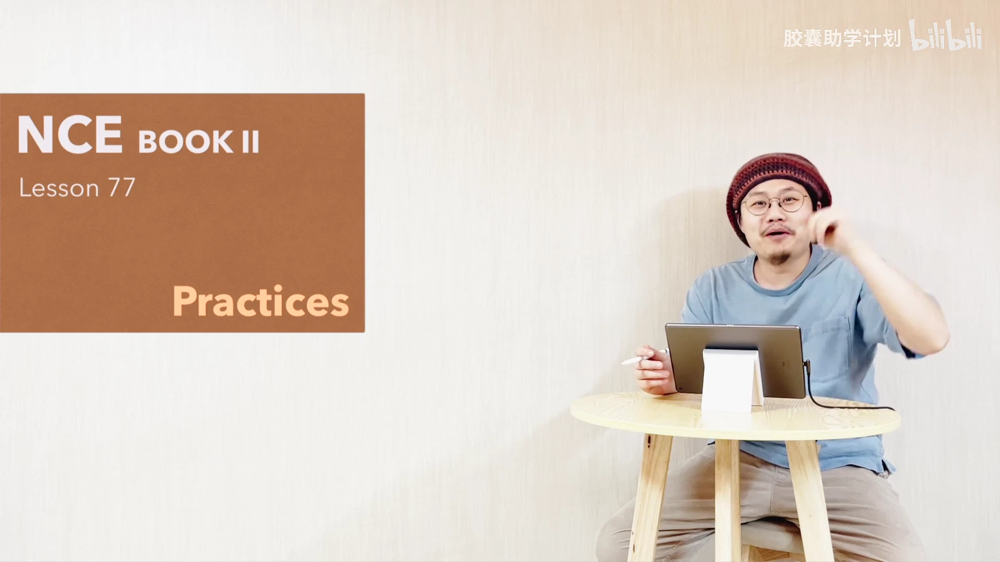

文字识别：ilbili / 胶囊助学计划 / NCE / BOOKII / Lesson 77 / Practices

### 画面 00:00:02

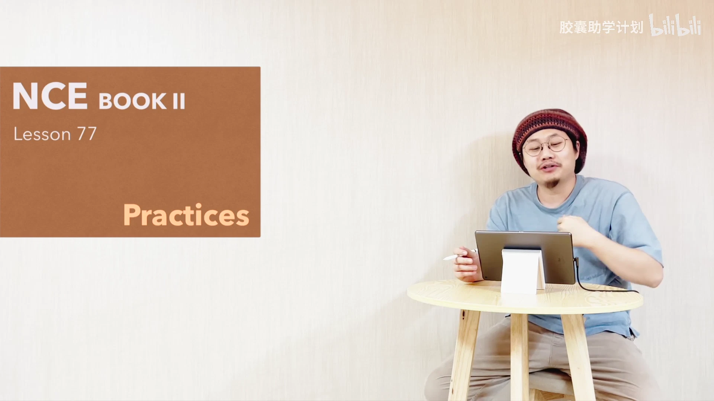

文字识别：bilbili / 胶囊助学计划 / NCE / BOOKII / Lesson 77 / Practices

### 画面 00:00:04

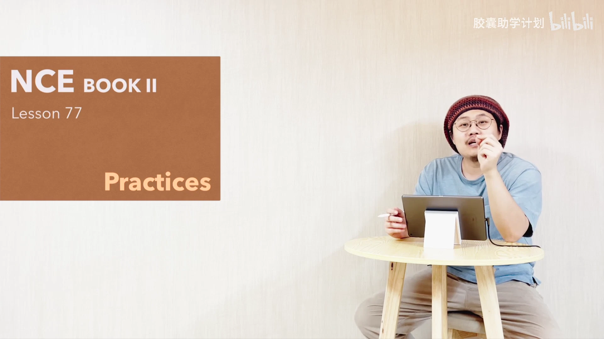

文字识别：bilbili / 胶囊助学计划 / NCE / BOOKII / Lesson 77 / Practices

### 画面 00:00:06

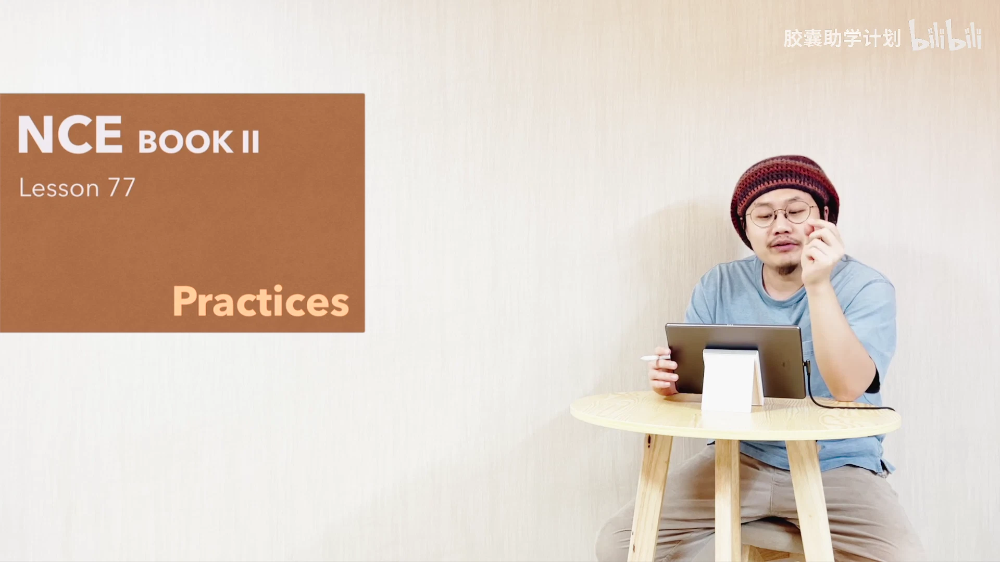

文字识别：bilbili / 胶囊助学计划 / NCE / BOOKII / Lesson 77 / Practices

### 画面 00:00:08

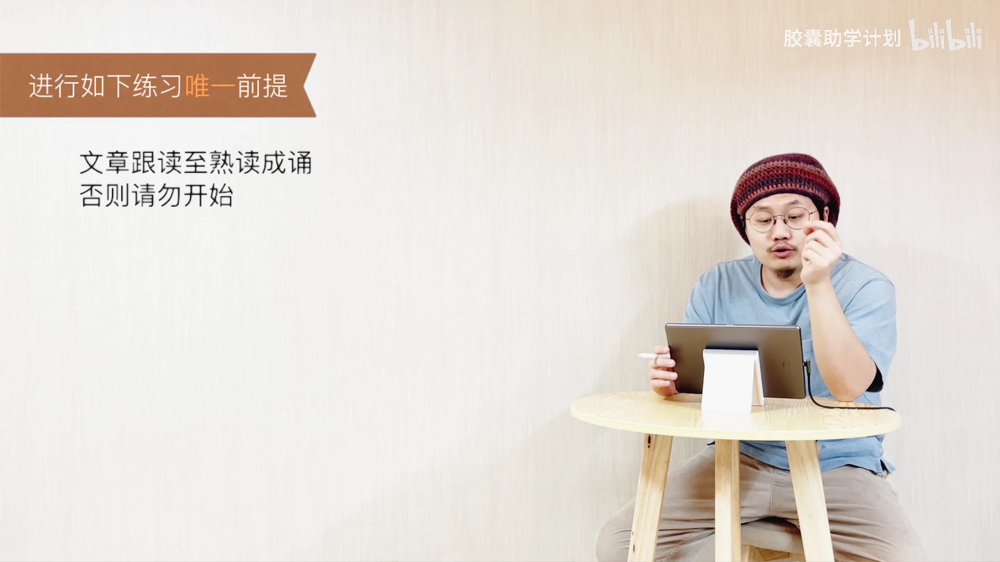

文字识别：bilibili / 胶囊助学计划 / 进行如下练习唯一前提 / 文章跟读至熟读成诵 / 否则请勿开始

### 画面 00:00:10

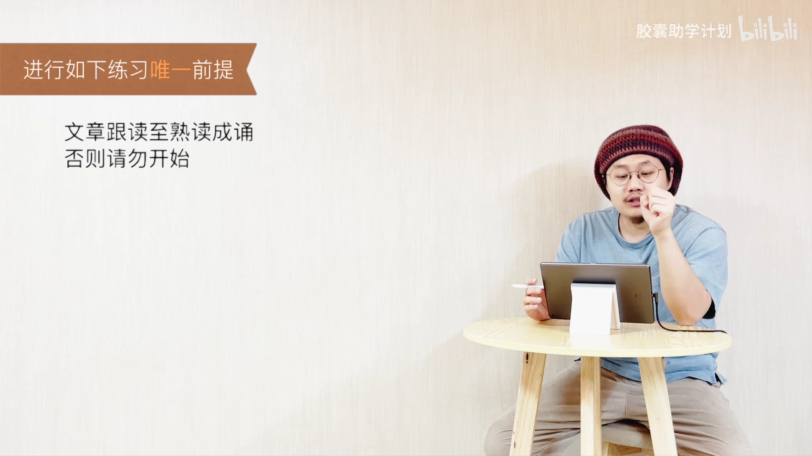

文字识别：biiii / 胶囊助学计划 / 进行如下练习唯一前提 / 文章跟读至熟读成诵 / 否则请勿开始

### 画面 00:00:15

文字识别：Bilibili / 胶囊助学计划 / 进行如下练习唯一前提 / 文章跟读至熟读成诵 / 否则请勿开始

### 画面 00:00:17

文字识别：胶囊助学计划bi

### 画面 00:00:20

### 画面 00:00:22

文字识别：bilibii / 胶囊助学计划 / Comprehension / 训练目标： / 听懂一般疑问句＆特殊疑问句

### 画面 00:00:24

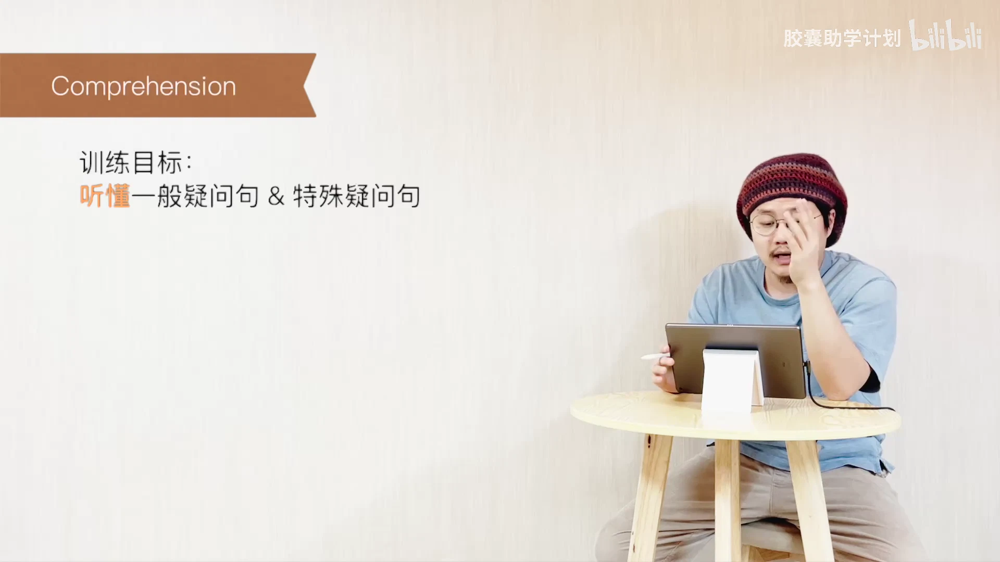

文字识别：bilbili / 胶囊助学计划 / Comprehension / 训练目标： / 听懂一般疑问句＆特殊疑问句

### 画面 00:00:26

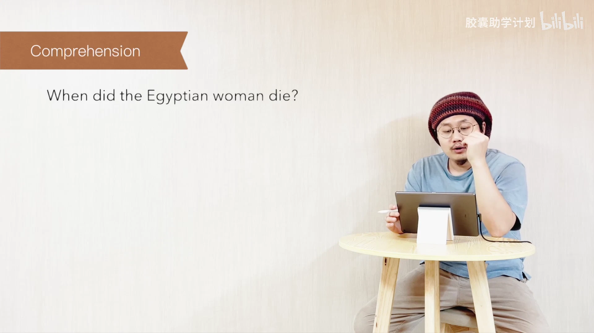

文字识别：biibli / 胶囊助学计划 / Comprehension / When did the Egyptian woman die?

### 画面 00:00:28

文字识别：bibili / 胶囊助学计划 / Comprehension / When did the Egyptian woman die?

## 00:00:30–00:01:00

in 800 B.C. Next one, her body was mummified, wasn't it? This mummified什么意思？就木乃伊化的啊，就给它做成了木乃伊啊。 Yes, it was. What's just happened to the mummy? It has had has just had an operation. What was the woman's name? Ah, Shenpenma.

### 画面 00:00:30

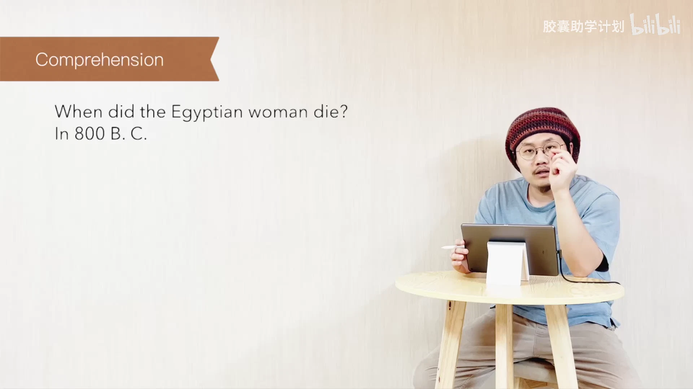

文字识别：bitbli / 胶囊助学计划 / Comprehension / When did the Egyptian woman die? / In 800 B. C.

### 画面 00:00:32

文字识别：biibili / 胶囊助学计划 / Comprehension / Her body was mummified, wasn't it?

### 画面 00:00:34

文字识别：bibili / 胶囊助学计划 / Comprehension / Her body was mummified, wasn't it?

### 画面 00:00:36

文字识别：biibili / 胶囊助学计划 / Comprehension / Her body was mummified, wasn't it?

### 画面 00:00:39

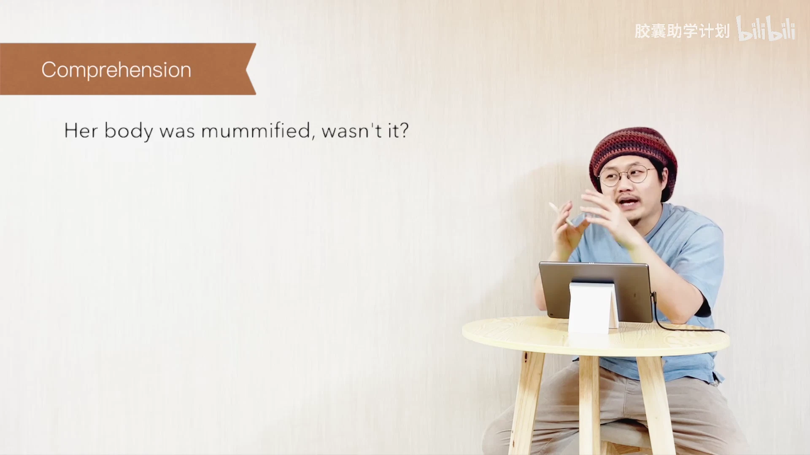

文字识别：biibili / 胶囊助学计划 / Comprehension / Her body was mummified, wasn't it?

### 画面 00:00:41

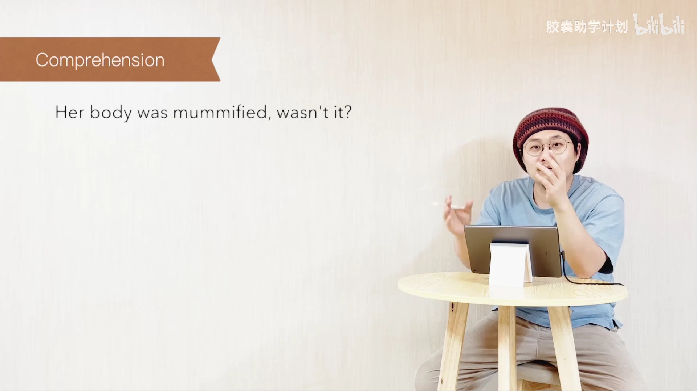

文字识别：biibii / 胶囊助学计划 / Comprehension / Her body was mummified, wasn't it?

### 画面 00:00:43

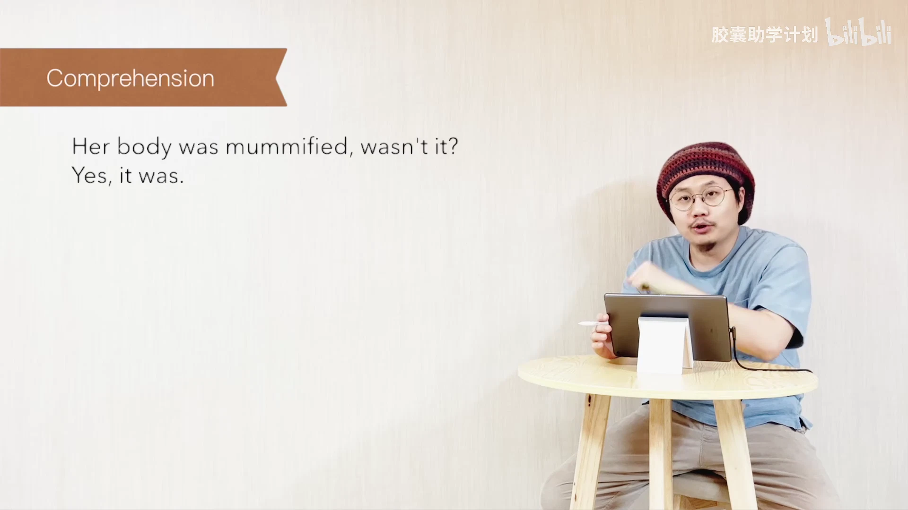

文字识别：bibli / 胶囊助学计划 / Comprehension / Her body was mummified, wasn't it? / Yes, it was.

### 画面 00:00:45

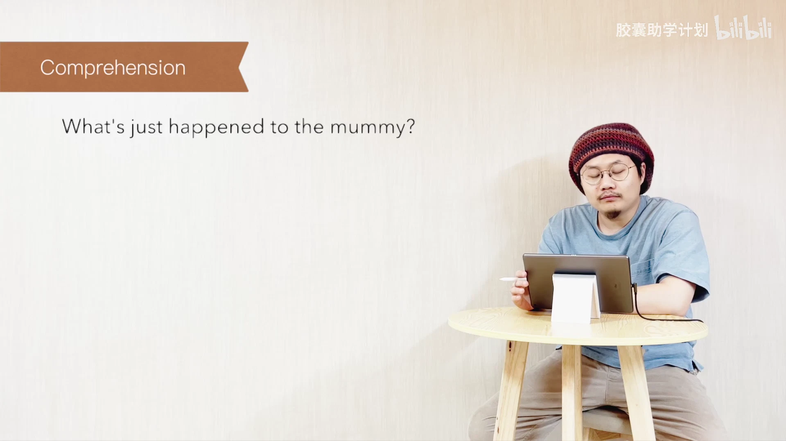

文字识别：biibili / 胶囊助学计划 / Comprehension / What's just happened to the mummy?

### 画面 00:00:47

文字识别：biibili / 胶囊助学计划 / Comprehension / What's just happened to the mummy?

### 画面 00:00:49

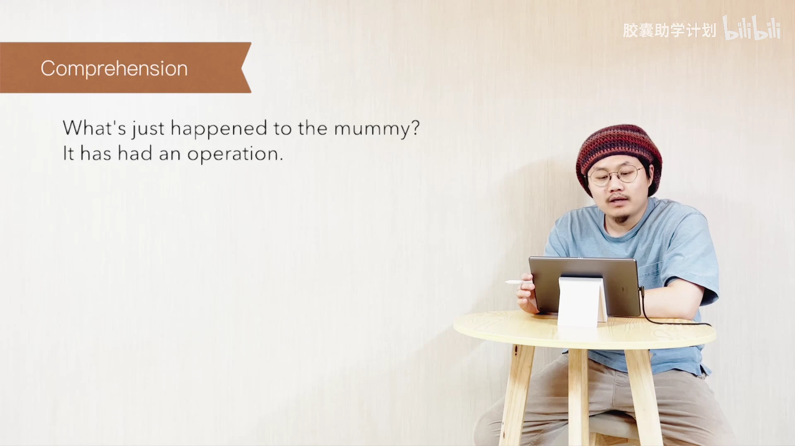

文字识别：bilbii / 胶囊助学计划 / Comprehension / What's just happened to the mummy? / It has had an operation.

### 画面 00:00:51

文字识别：bibii / 胶囊助学计划 / Comprehension / What's just happened to the mummy? / It has had an operation.

### 画面 00:00:53

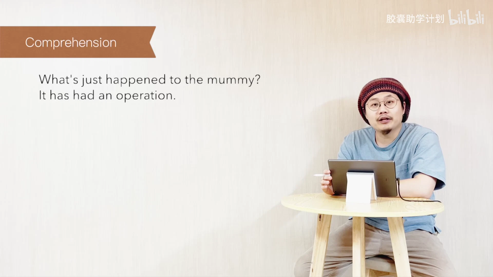

文字识别：biibili / 胶囊助学计划 / Comprehension / What's just happened to the mummy? / It has had an operation.

### 画面 00:00:55

文字识别：bilbii / 胶囊助学计划 / Comprehension / What was the woman's name?

### 画面 00:00:57

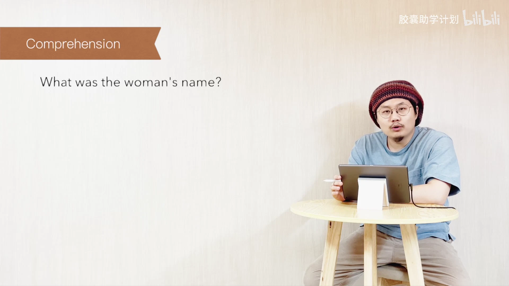

文字识别：biibili / 胶囊助学计划 / Comprehension / What was the woman's name?

### 画面 00:00:59

文字识别：biibili / 胶囊助学计划 / Comprehension / What was the woman's name? / Shepenmut.

## 00:01:00–00:01:30

What did she once do? She was a singer. What showed up on the X-ray plates? Strange marks. What have doctors been trying to do? To find out whether the woman died of a rare disease. How long did the operation

### 画面 00:01:01

文字识别：Bilbii / 胶囊助学计划 / Comprehension / What did she once do?

### 画面 00:01:03

文字识别：biibili / 胶囊助学计划 / Comprehension / What did she once do? / She was a singer.

### 画面 00:01:05

文字识别：biibili / 胶囊助学计划 / Comprehension / What did she once do? / She was a singer.

### 画面 00:01:07

文字识别：bilbili / 胶囊助学计划 / Comprehension / What showed up on the X-ray plates?

### 画面 00:01:10

文字识别：bilibili / 胶囊助学计划 / Comprehension / What showed up on the X-ray plates?

### 画面 00:01:13

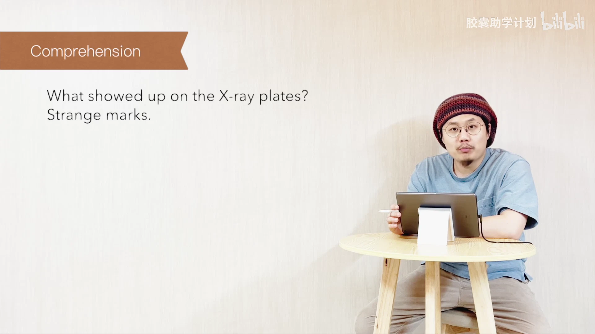

文字识别：bilbii / 胶囊助学计划 / Comprehension / What showed up on the X-ray plates? / Strange marks.

### 画面 00:01:15

文字识别：biibili / 胶囊助学计划 / Comprehension / What have doctors been trying to do?

### 画面 00:01:18

文字识别：bilbili / 胶囊助学计划 / Comprehension / What have doctors been trying to do?

### 画面 00:01:20

文字识别：bilbili / 胶囊助学计划 / Comprehension / What have doctors been trying to do? / To find out whether the woman died of a / rare disease.

### 画面 00:01:23

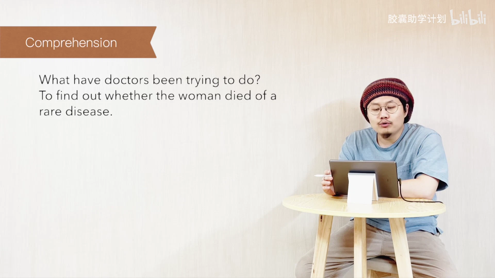

文字识别：biibili / 胶囊助学计划 / Comprehension / What have doctors been trying to do? / To find out whether the woman died of a / rare disease.

### 画面 00:01:26

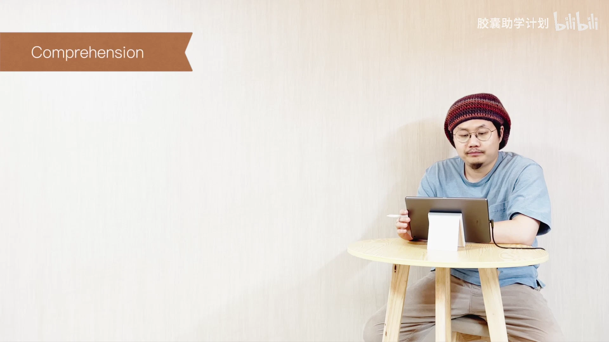

文字识别：bibii / 胶囊助学计划 / Comprehension

### 画面 00:01:28

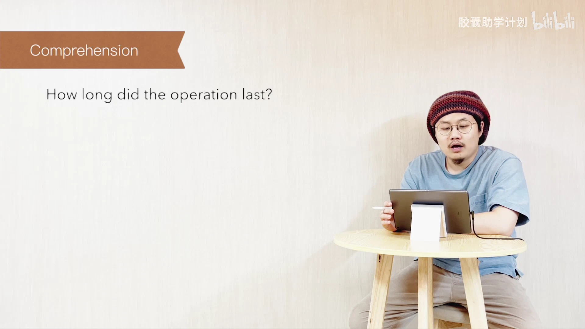

文字识别：biibili / 胶囊助学计划 / Comprehension / How long did the operation last?

## 00:01:30–00:02:00

last? For over four hours. Why did it prove to be so difficult? Because of the hard resin that covered the skin. What did the doctors remove? A section of the mummy. Where did they send it? To the laboratory. What else did they find? A small wax

### 画面 00:01:30

文字识别：bilibi / 胶囊助学计划 / Comprehension / How long did the operation last? / For over four hours.

### 画面 00:01:33

文字识别：biibili / 胶囊助学计划 / Comprehension / How long did the operation last? / For over four hours.

### 画面 00:01:35

文字识别：bilbii / 胶囊助学计划 / Comprehension / Why did it prove to be so difficult?

### 画面 00:01:38

文字识别：bilbli / 胶囊助学计划 / Comprehension / Why did it prove to be so difficult? / Because of the hard resin that covered the / skin.

### 画面 00:01:40

文字识别：biibii / 胶囊助学计划 / Comprehension / Why did it prove to be so difficult? / Because of the hard resin that covered the / skin.

### 画面 00:01:42

文字识别：bibi / 胶囊助学计划 / Comprehension / Why did it prove to be so difficult? / Because of the hard resin that covered the / skin.

### 画面 00:01:44

文字识别：胶囊助学计划bibi / Comprehension / What did the doctors remove?

### 画面 00:01:47

文字识别：bilbii / 胶囊助学计划 / Comprehension / What did the doctors remove? / A section of the mummy.

### 画面 00:01:50

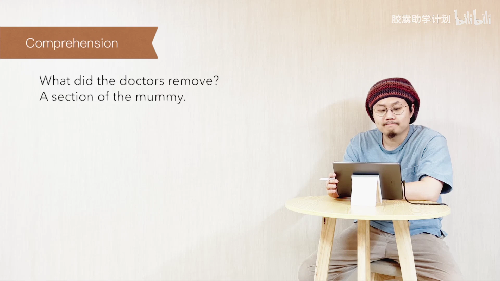

文字识别：bilbili / 胶囊助学计划 / Comprehension / What did the doctors remove? / A section of the mummy.

### 画面 00:01:54

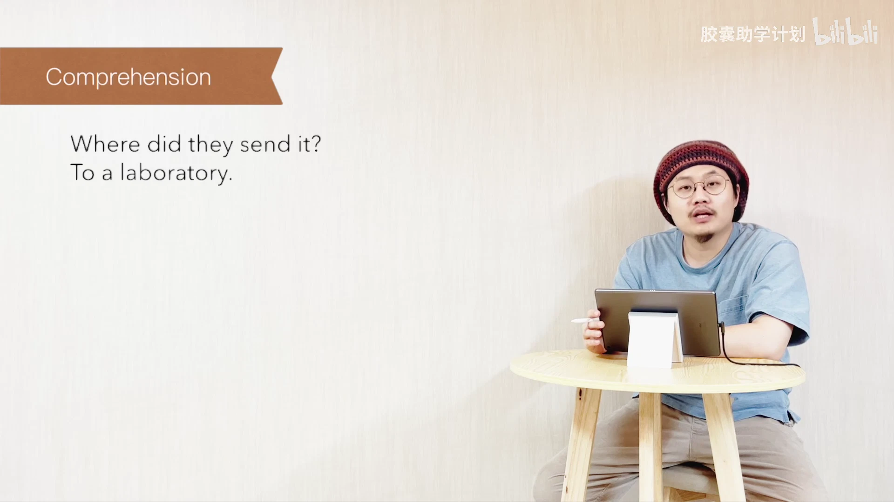

文字识别：biibili / 胶囊助学计划 / Comprehension / Where did they send it? / To a laboratory.

### 画面 00:01:56

文字识别：bilibi / 胶囊助学计划 / Comprehension / What else did they find?

## 00:02:00–00:02:30

figure of the god Duamutef. Okay, what kind of head does this god have? The head of a cow. Where was it normally placed? Inside a mummy. Asking questions, 四句型，第一个, ask me if doctors have just operated on a mummy.

### 画面 00:02:00

文字识别：bitbili / 胶囊助学计划 / Comprehension / What else did they find? / A small wax figure of the god Duamutef.

### 画面 00:02:04

文字识别：bilbii / 胶囊助学计划 / Comprehension / What kind of head does this god have?

### 画面 00:02:07

文字识别：Bilbii / 胶囊助学计划 / Comprehension / What kind of head does this god have?

### 画面 00:02:10

文字识别：bilbi / 胶囊助学计划 / Comprehension / What kind of head does this god have? / The head of a cow.

### 画面 00:02:14

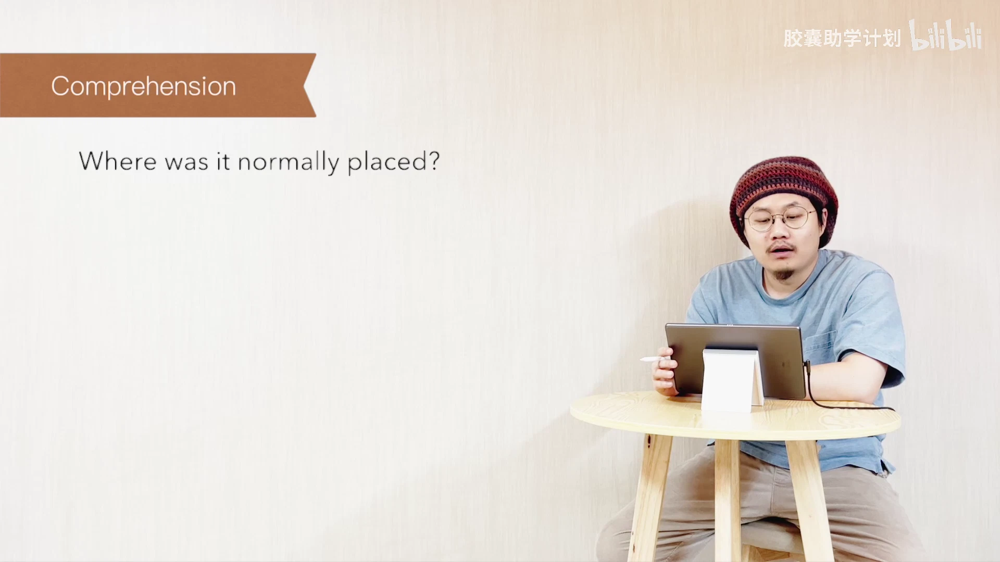

文字识别：biibili / 胶囊助学计划 / Comprehension / Where was it normally placed?

### 画面 00:02:16

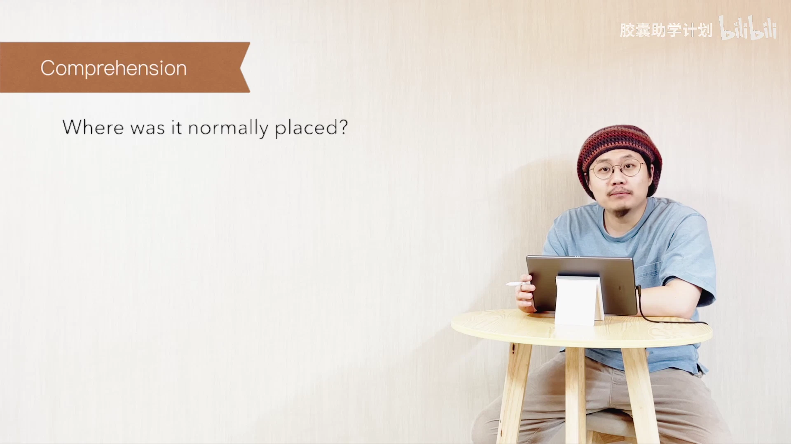

文字识别：bibi / 胶囊助学计划 / Comprehension / Where was it normally placed?

### 画面 00:02:20

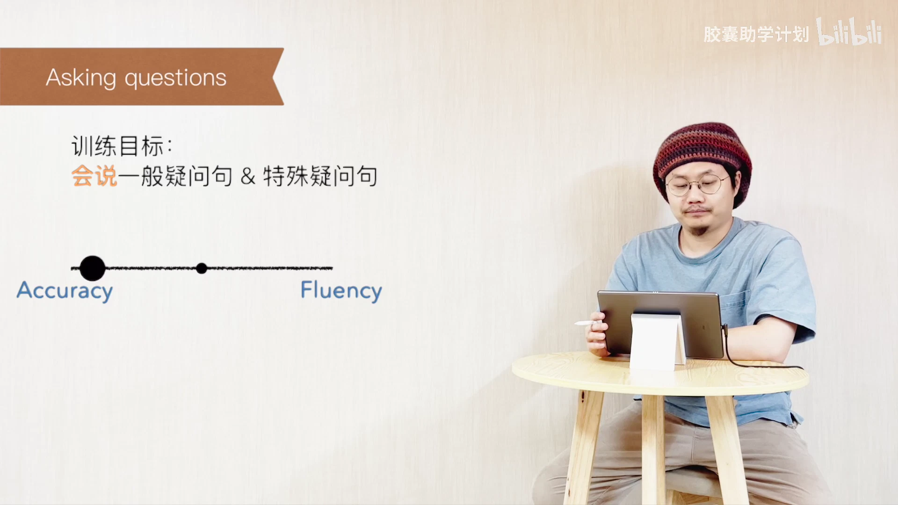

文字识别：blbili / 胶囊助学计划 / Asking questions / 训练目标： / 会说一般疑问句＆特殊疑问句 / Accuracy / Fluency

### 画面 00:02:22

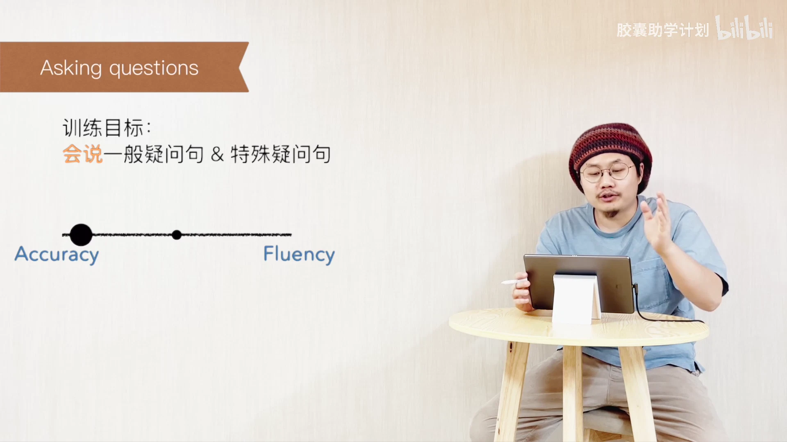

文字识别：Bibili / 胶囊助学计划 / Asking questions / 训练目标： / 会说一般疑问句＆特殊疑问句 / Accuracy / Fluency

### 画面 00:02:24

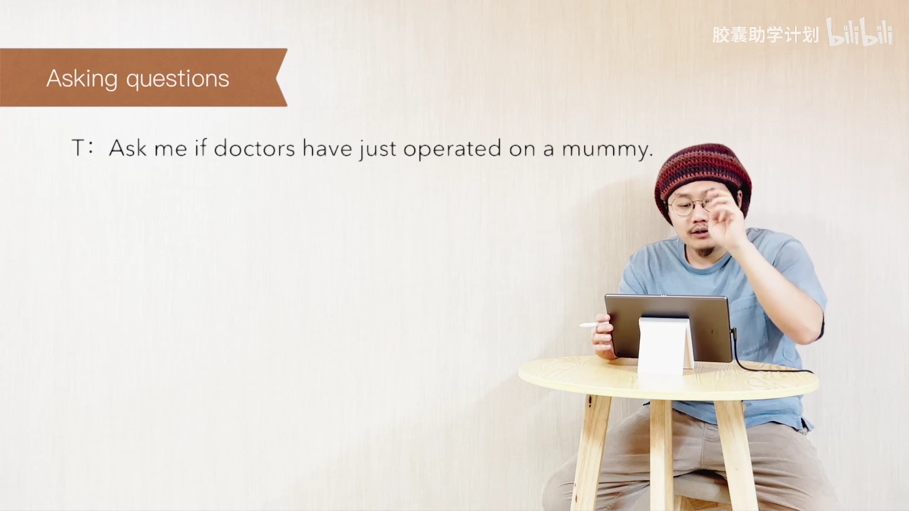

文字识别：bilbili / 胶囊助学计划 / Asking questions / T: Ask me if doctors have just operated on a mummy.

### 画面 00:02:26

文字识别：biibili / 胶囊助学计划 / Asking questions / T: Ask me if doctors have just operated on a mummy.

## 00:02:30–00:03:00

现在完成时have提前。What?那你可以对这个a mummy提问，对吧？他在什么上动做的手术啊？那Why?整句话Who?你可以对主语提问，不变一般疑问句。第二题，The woman died in 800 B.C. Did提前？When?肯定是对时间提问。In 800 B.C. Her name was Shepennard. Was提前？那What?就对Shepennard提问嘛？What was her name? He/She

### 画面 00:02:30

文字识别：biibli / 胶囊助学计划 / Asking questions / T: Ask me if doctors have just operated on a mummy. / S: Have doctors just operated on a mummy?

### 画面 00:02:33

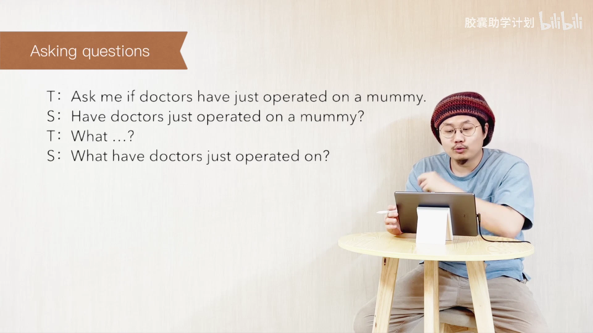

文字识别：bilbii / 胶囊助学计划 / Asking questions / T: Ask me if doctors have just operated on a mummy. / S: Have doctors just operated on a mummy? / T: What ...? / S: What have doctors just operated on?

### 画面 00:02:35

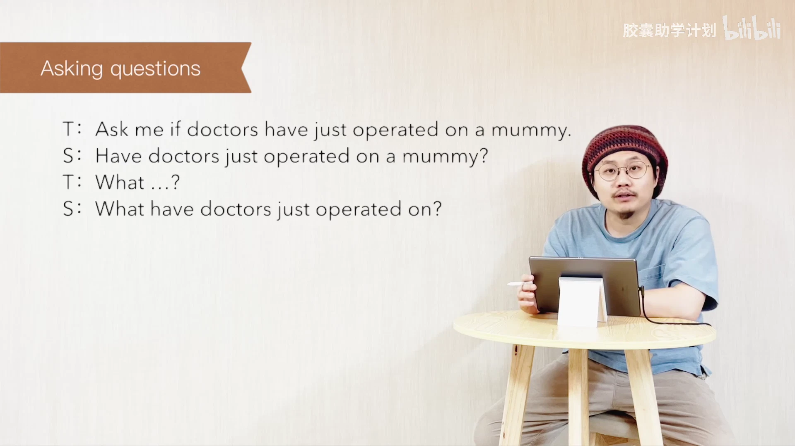

文字识别：胶囊助学计划bib出 / Asking questions / T: Ask me if doctors have just operated on a mummy. / S: Have doctors just operated on a mummy? / T: What ...? / S: What have doctors just operated on?

### 画面 00:02:38

文字识别：bilbili / 胶囊助学计划 / Asking / questions / 1. Doctors have just operated on a mummy. / (What) (Why)(Who)

### 画面 00:02:40

文字识别：bilbii / 胶囊助学计划 / Asking / questions / 1. Doctors have just operated on a mummy. / (What)(Why)(Who)

### 画面 00:02:42

文字识别：biibili / 胶囊助学计划 / Asking questions / 1. Doctors have just operated on a mummy. / (What) (Why)(Who)

### 画面 00:02:44

文字识别：biibli / 胶囊助学计划 / Asking questions / 1. Doctors have just operated on a mummy. / (What) (Why)(Who) / 2.The woman died in 800 B. C.(When)

### 画面 00:02:46

文字识别：biibili / 胶囊助学计划 / Asking questions / 1. Doctors have just operated on a mummy. / (What) (Why)(Who) / 2.The woman died in 800 B. C.(When)

### 画面 00:02:48

文字识别：biibili / 胶囊助学计划 / Asking questions / 1. Doctors have just operated on a mummy. / (What) (Why)(Who) / 2.The woman died in 800 B. C.(When)

### 画面 00:02:50

文字识别：bilibii / 胶囊助学计划 / Asking questions / 1. Doctors have just operated on a mummy. / (What) (Why)(Who) / 2.The woman died in 800 B. C.(When)

### 画面 00:02:53

文字识别：bilbili / 胶囊助学计划 / Asking questions / 1. Doctors have just operated on a mummy. / (What)(Why)(Who) / 2. The woman died in 800 B. C.(When) / 3. Her name was Shepenmut. (What)

### 画面 00:02:55

文字识别：bilibili / 胶囊助学计划 / Asking questions / 1. Doctors have just operated on a mummy. / (What) (Why)(Who) / 2. The woman died in 800 B. C. (When) / 3. Her name was Shepenmut. (What)

### 画面 00:02:58

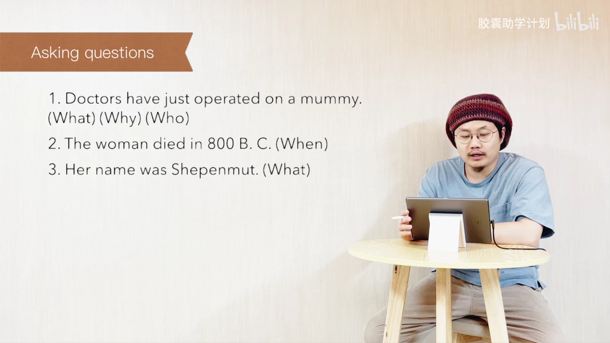

文字识别：Bilbili / 胶囊助学计划 / Asking questions / 1. Doctors have just operated on a mummy. / (What) (Why)(Who) / 2. The woman died in 800 B. C.(When) / 3. Her name was Shepenmut. (What)

## 00:03:00–00:03:30

was a singer. Was提前，对吧？哎，那What我觉得你可以问What did she do?啊，她当时做什么的，是吧？然后Who呢？Who was a singer? She used to sing in the temple of Thebes.就是咱三十一课学的，used to do怎么变否啊？怎么变一般疑问句？Did提前，used你得给它换成原形，对吧？Did she used to sing in the temple of Thebes?那Where肯定是对地点提问，in the temple of Thebes.

### 画面 00:03:00

文字识别：Bibii / 胶囊助学计划 / Asking questions / 1. Doctors have just operated on a mummy. / (What) (Why)(Who) / 2. The woman died in 800 B. C.(When) / 3. Her name was Shepenmut. (What) / 4. She was a singer. (What) (Who)

### 画面 00:03:02

文字识别：bilibii / 胶囊助学计划 / Asking questions / 1. Doctors have just operated on a mummy. / (What) (Why)(Who) / 2. The woman died in 800 B. C. (When) / 3. Her name was Shepenmut. (What) / 4. She was a singer. (What) (Who)

### 画面 00:03:05

文字识别：胶囊助学计划l出 / Asking questions / 1. Doctors have just operated on a mummy. / (What) (Why)(Who) / 2.The woman died in 800 B. C.(When) / 3. Her name was Shepenmut. (What) / 4. She was a singer. (What) (Who)

### 画面 00:03:08

文字识别：刘 bilibii / 胶囊助学计划 / Asking questions / 1. Doctors have just operated on a mummy. / (What)(Why)(Who) / 2. The woman died in 800 B. C.(When) / 3. Her name was Shepenmut. (What) / 4. She was a singer. (What) (Who)

### 画面 00:03:10

文字识别：胶囊助学计划bibi / Asking questions / 1. Doctors have just operated on a mummy. / (What) (Why)(Who) / 2. The woman died in 800 B. C. (When) / 3. Her name was Shepenmut. (What) / 4. She was a singer. (What) (Who) / 5. She used to sing in the Temple of Thebes. / (Where)(Who)

### 画面 00:03:14

文字识别：胶囊助学计划bii出 / Asking questions / 1. Doctors have just operated on a mummy. / (What) (Why)(Who) / 2. The woman died in 800 B. C. (When) / 3. Her name was Shepenmut. (What) / 4. She was a singer. (What) (Who) / 5. She used to sing in the Temple of Thebes. / (Where)(Who)

### 画面 00:03:16

文字识别：胶囊助学计划bi出 / Asking questions / 1. Doctors have just operated on a mummy. / (What) (Why)(Who) / 2.The woman died in 800 B. C. (When) / 3. Her name was Shepenmut. (What) / 4. She was a singer. (What) (Who) / 5. She used to sing in the Temple of Thebes. / (Where)(Who)

### 画面 00:03:20

文字识别：胶囊助学计划bibi / Asking questions / 1. Doctors have just operated on a mummy. / (What) (Why)(Who) / 2.The woman died in 800 B. C. (When) / 3. Her name was Shepenmut. (What) / 4. She was a singer. (What) (Who) / 5. She used to sing in the Temple of Thebes. / (Where)(Who)

### 画面 00:03:25

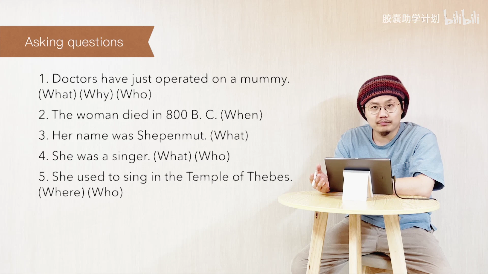

文字识别：biibil / 胶囊助学计划 / Asking questions / 1. Doctors have just operated on a mummy. / (What) (Why)(Who) / 2.The woman died in 800 B. C.(When) / 3. Her name was Shepenmut. (What) / 4. She was a singer. (What) (Who) / 5. She used to sing in the Temple of Thebes. / (Where)(Who)

### 画面 00:03:28

文字识别：胶囊助学计划出 / Asking questions / 1. Doctors have just operated on a mummy. / (What) (Why)(Who) / 2. The woman died in 800 B. C.(When) / 3. Her name was Shepenmut. (What) / 4. She was a singer. (What) (Who) / 5. She used to sing in the Temple of Thebes. / (Where)(Who)

## 00:03:30–00:04:00

who是对主语提问，不变一般疑问句了。第六个，There were strange marks on the X-ray plates.你把were提前，然后what肯定是对strange marks，对吧？然后where呢？对on the X-ray plates. Doctors have been trying to find out what she died of.那死于什么？那这个have been trying现在完成进行时，五十二课咱学的have提前。上一节课其实也复习了，本课又

### 画面 00:03:30

文字识别：胶囊助学计划i出 / Asking questions / 1. Doctors have just operated on a mummy. / (What) (Why)(Who) / 2. The woman died in 800 B. C.(When) / 3. Her name was Shepenmut. (What) / 4. She was a singer. (What) (Who) / 5. She used to sing in the Temple of Thebes. / (Where)(Who)

### 画面 00:03:32

文字识别：biibili / 胶囊助学计划 / Asking questions / 6. There were strange marks on the X -ray / plates. (What) (Where)

### 画面 00:03:34

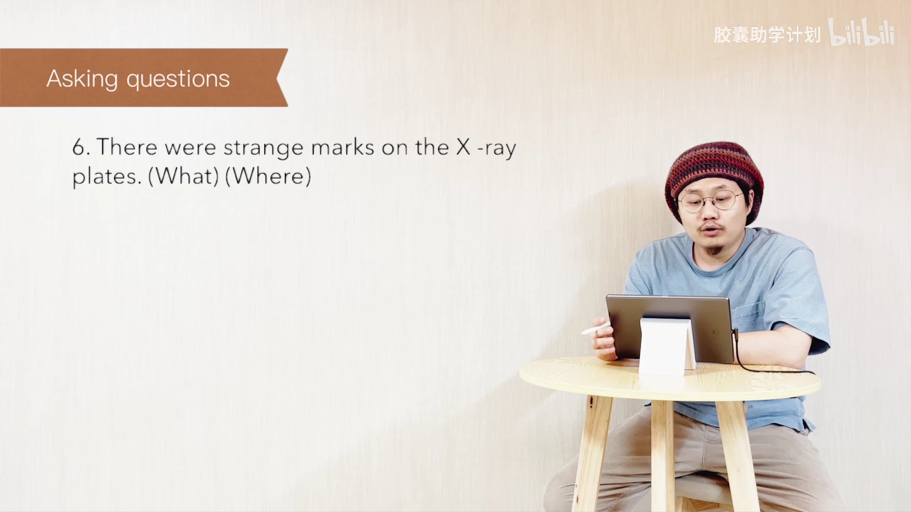

文字识别：biibili / 胶囊助学计划 / Asking questions / 6. There were strange marks on the X -ray / plates.(What) (Where)

### 画面 00:03:36

文字识别：bilbili / 胶囊助学计划 / Asking questions / 6. There were strange marks on the X -ray / plates. (What) (Where)

### 画面 00:03:38

文字识别：biibili / 胶囊助学计划 / Asking questions / 6. There were strange marks on the X -ray / plates. (What) (Where)

### 画面 00:03:40

文字识别：biibli / 胶囊助学计划 / Asking questions / 6. There were strange marks on the X -ray / plates. (What) (Where)

### 画面 00:03:42

文字识别：biibili / 胶囊助学计划 / Asking questions / 6. There were strange marks on the X -ray / plates. (What) (Where)

### 画面 00:03:45

文字识别：biibili / 胶囊助学计划 / Asking questions / 6. There were strange marks on the X -ray / plates.(What) (Where)

### 画面 00:03:48

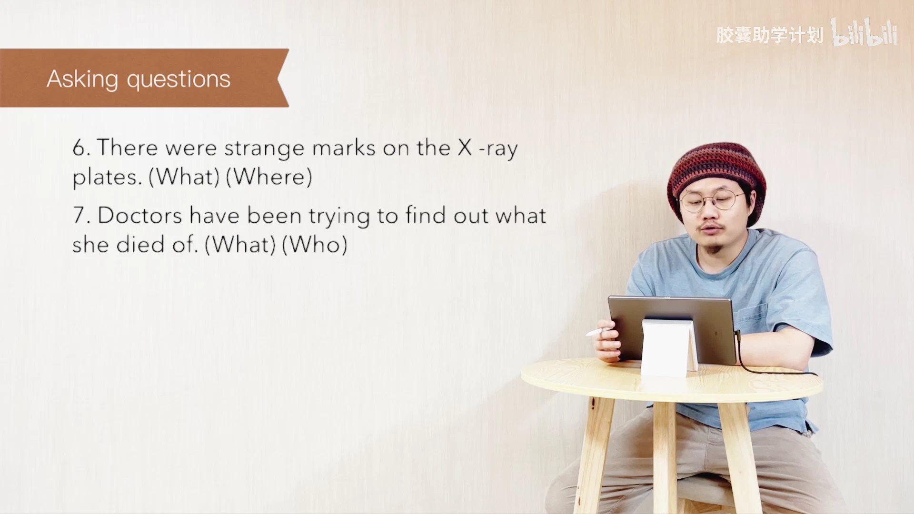

文字识别：胶囊助学计划bilb山 / Asking questions / 6. There were strange marks on the X -ray / plates.(What) (Where) / 7. Doctors have been trying to find out what / she died of. (What) (Who)

### 画面 00:03:50

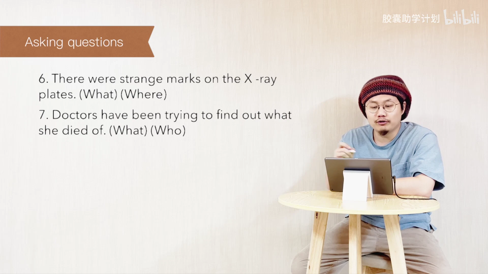

文字识别：胶囊助学计划bii出 / Asking questions / 6. There were strange marks on the X -ray / plates.(What) (Where) / 7. Doctors have been trying to find out what / she died of. (What) (Who)

### 画面 00:03:52

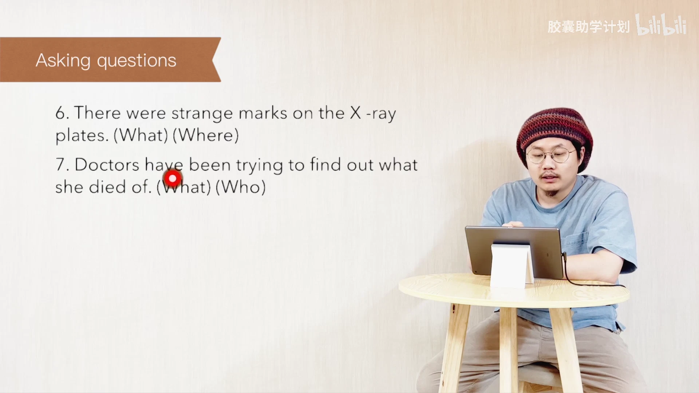

文字识别：bilbili / 胶囊助学计划 / Asking questions / 6. There were strange marks on the X -ray / plates.(What) (Where) / 7. Doctors have been trying to find out what / she died of.(What)(Who)

### 画面 00:03:54

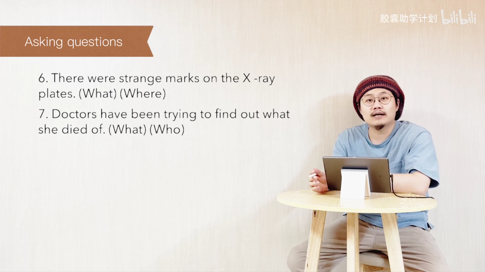

文字识别：胶囊助学计划bibi出 / Asking questions / 6. There were strange marks on the X -ray / plates. (What) (Where) / 7. Doctors have been trying to find out what / she died of. (What) (Who)

### 画面 00:03:56

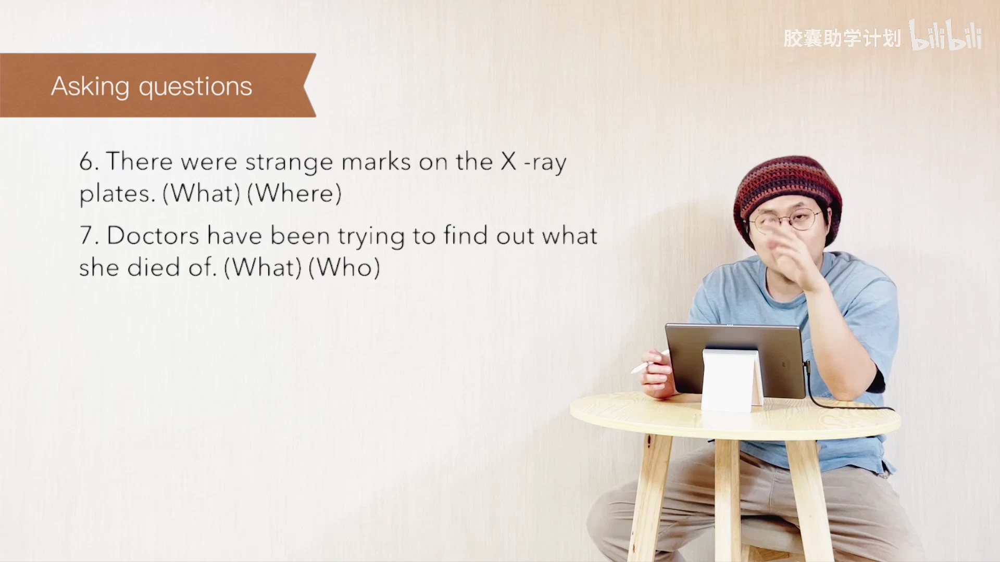

文字识别：胶囊助学计划blii出 / Asking questions / 6. There were strange marks on the X -ray / plates.(What) (Where) / 7. Doctors have been trying to find out what / she died of. (What) (Who)

### 画面 00:03:59

文字识别：胶囊助学计划biii / Asking questions / 6. There were strange marks on the X -ray / plates.(What) (Where) / 7. Doctors have been trying to find out what / she died of. (What) (Who)

## 00:04:00–00:04:30

是在复习。那 what 你就可以说 what have doctors been trying to find out？他们正在搞，想弄明白什么东西？互对主语提问，不变一般疑问句。They suspected a rare disease.他们怀疑是一个罕见的疾病。Did 提前，what 对 a rare disease 提问，外加证据。The operation lasted for over four hours. Did 提前，对吧？那你 how long 对

### 画面 00:04:01

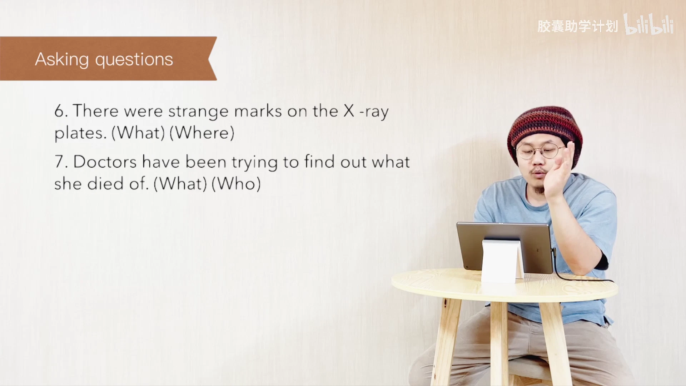

文字识别：bilbil / 胶囊助学计划 / Asking questions / 6. There were strange marks on the X -ray / plates. (What) (Where) / 7. Doctors have been trying to find out what / she died of. (What) (Who)

### 画面 00:04:09

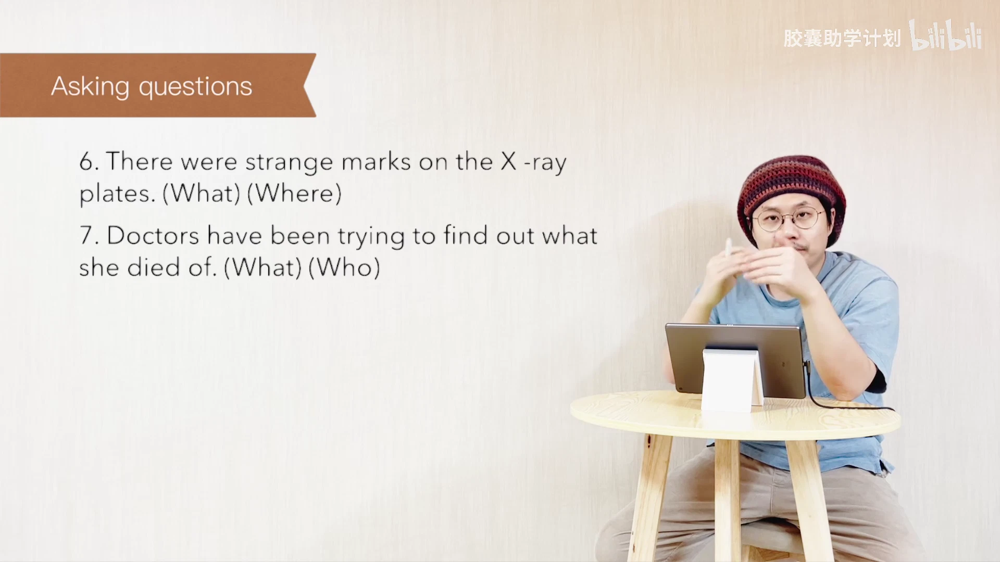

文字识别：bilbil / 胶囊助学计划 / Asking questions / 6. There were strange marks on the X -ray / plates. (What) (Where) / 7. Doctors have been trying to find out what / she died of. (What) (Who)

### 画面 00:04:11

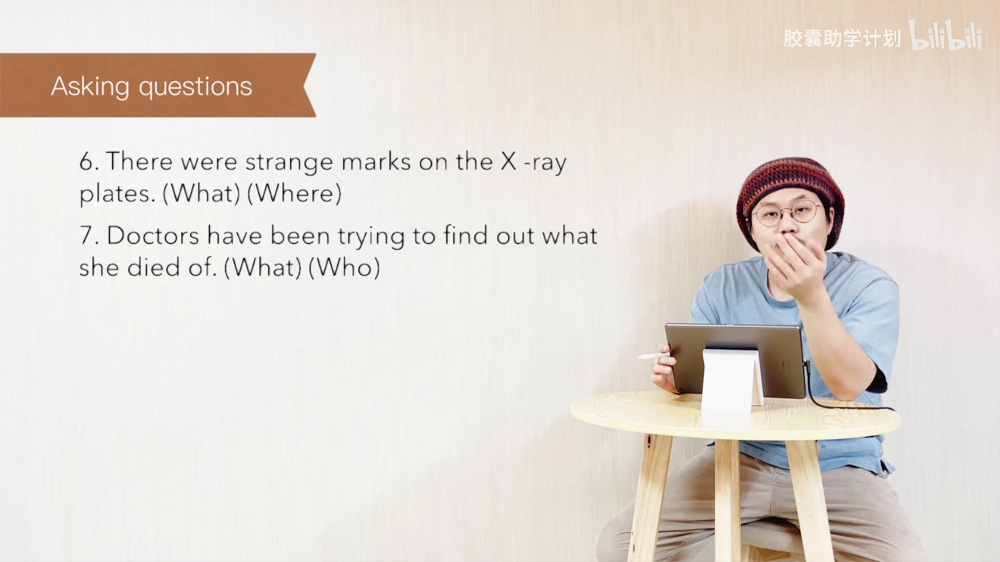

文字识别：胶囊助学计划bi出 / Asking questions / 6. There were strange marks on the X -ray / plates.(What) (Where) / 7. Doctors have been trying to find out what / she died of. (What) (Who)

### 画面 00:04:14

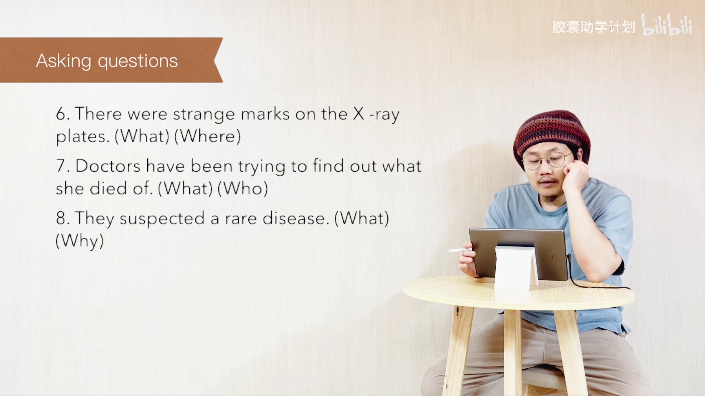

文字识别：胶囊助学计划bi出 / Asking questions / 6.There were strange marks on the X -ray / plates.(What) (Where) / 7. Doctors have been trying to find out what / she died of. (What) (Who) / 8. They suspected a rare disease. (What) / (Why)

### 画面 00:04:16

文字识别：胶囊助学计划bibi / Asking questions / 6. There were strange marks on the X -ray / plates. (What) (Where) / 7. Doctors have been trying to find out what / she died of. (What) (Who) / 8. They suspected a rare disease. (What) / (Why)

### 画面 00:04:18

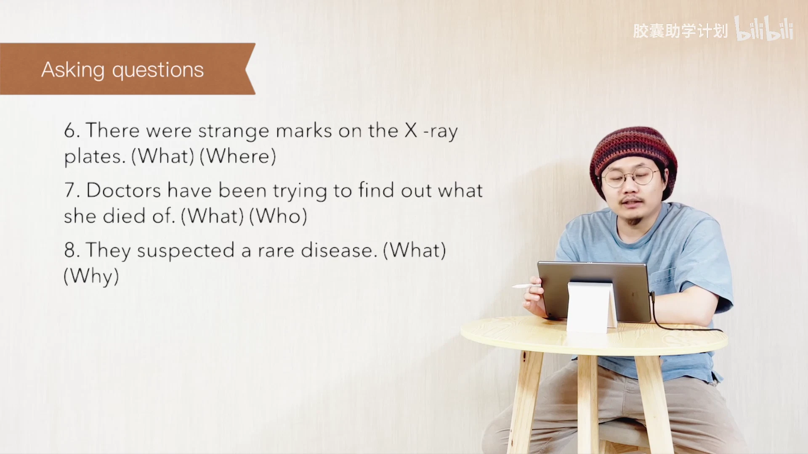

文字识别：胶囊助学计划bib出 / Asking questions / 6. There were strange marks on the X -ray / plates. (What) (Where) / 7. Doctors have been trying to find out what / she died of. (What) (Who) / 8. They suspected a rare disease.(What) / (Why)

### 画面 00:04:20

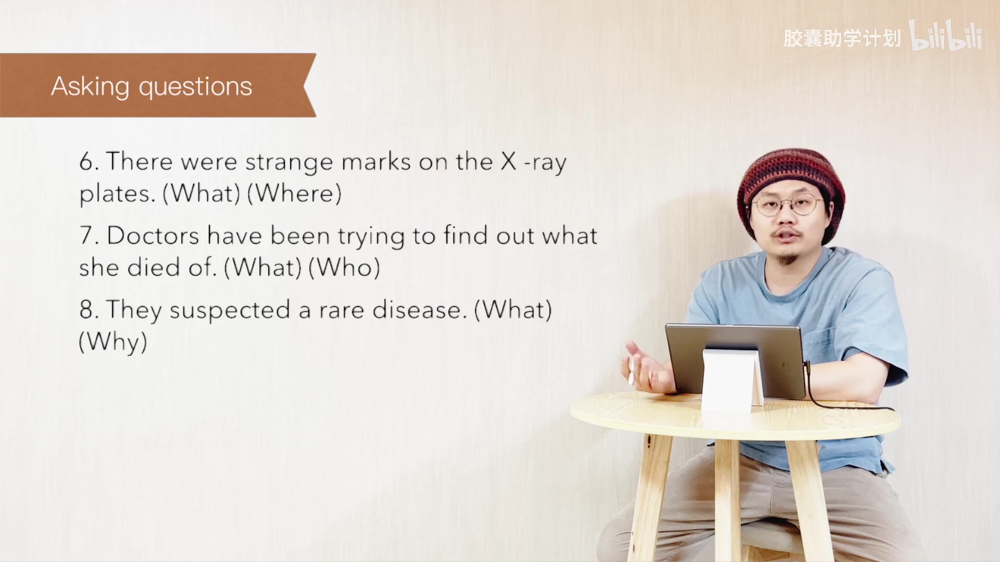

文字识别：胶囊助学计划bibi / Asking questions / 6. There were strange marks on the X -ray / plates. (What) (Where) / 7. Doctors have been trying to find out what / she died of. (What) (Who) / 8. They suspected a rare disease.(What) / (Why)

### 画面 00:04:23

文字识别：胶囊助学计划bi山 / Asking questions / 6. There were strange marks on the X -ray / plates.(What) (Where) / 7. Doctors have been trying to find out what / she died of. (What) (Who) / 8. They suspected a rare disease. (What) / (Why) / 9. The operation lasted for over four hours.

### 画面 00:04:25

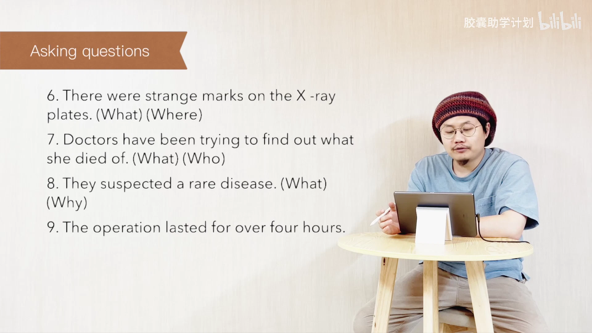

文字识别：胶囊助学计划bib山 / Asking questions / 6. There were strange marks on the X -ray / plates.(What)(Where) / 7. Doctors have been trying to find out what / she died of. (What) (Who) / 8. They suspected a rare disease. (What) / (Why) / 9. The operation lasted for over four hours.

### 画面 00:04:27

文字识别：胶囊助学计划bibi / Asking questions / 6. There were strange marks on the X -ray / plates. (What) (Where) / 7. Doctors have been trying to find out what / she died of. (What) (Who) / 8. They suspected a rare disease. (What) / (Why) / 9. The operation lasted for over four hours. / (How long) (Why) (What)

## 00:04:30–00:05:00

for over four hours 提问，外加整句 what 对主语提问，不变一般疑问句。OK，好。Tell the story，不多说，您自己文章读书，拿它去模拟练习，这个是非常重要的一个练习啊。第一单元我做了很多的示范，我们不挨个示范了。Summary writing 呢，写作的复述能力呢，本文从第四单元开始有两篇文章，这是第一篇，这是第二篇。您重点要看的是那些用的不同的连

### 画面 00:04:30

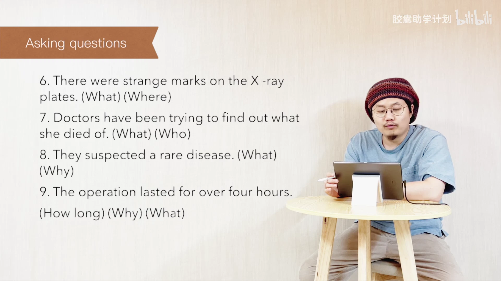

文字识别：胶囊助学计划bibi / Asking questions / 6. There were strange marks on the X -ray / plates. (What) (Where) / 7. Doctors have been trying to find out what / she died of. (What) (Who) / 8. They suspected a rare disease. (What) / (Why) / 9. The operation lasted for over four hours. / (How long)(Why) (What)

### 画面 00:04:35

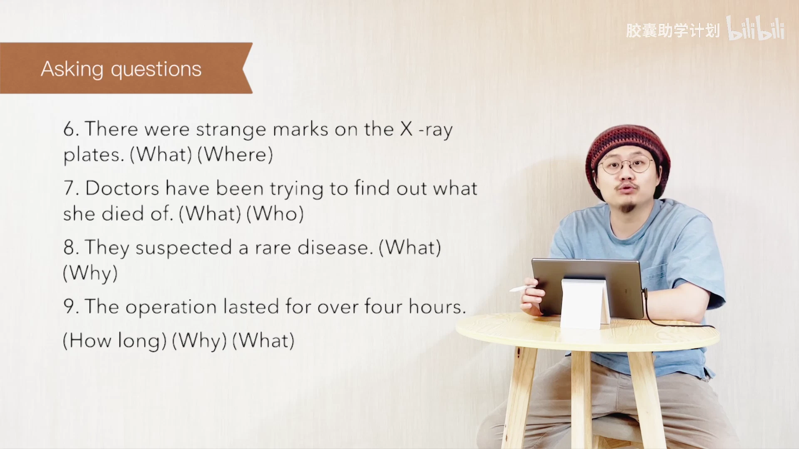

文字识别：胶囊助学计划bilbi / Asking questions / 6.There were strange marks on the X -ray / plates. (What) (Where) / 7. Doctors have been trying to find out what / she died of. (What) (Who) / 8. They suspected a rare disease. (What) / (Why) / 9. The operation lasted for over four hours. / (How long)(Why) (What)

### 画面 00:04:37

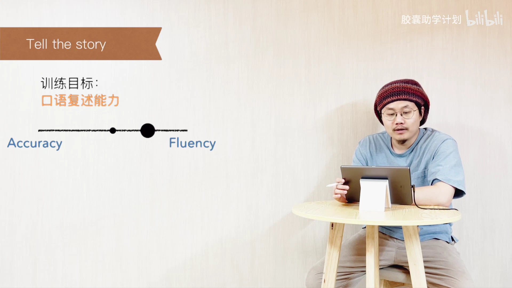

文字识别：bilbili / 胶囊助学计划 / Tell the story / 训练目标： / 口语复述能力 / Accuracy / Fluency

### 画面 00:04:39

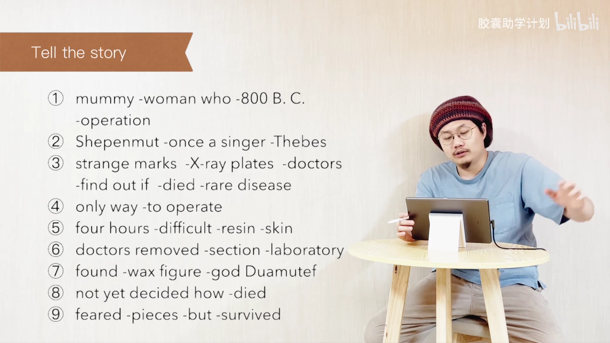

文字识别：胶囊助学计划bilbi / Tell the story / 1 / mummy -woman who -800 B. C. / -operation / Shepenmut -once a singer -Thebes / strange marks -X-ray plates -doctors / 3 / -find out if -died -rare disease / ) only way -to operate / 4 / 5 / four hours -difficult -resin -skin / ⑥ / doctors removed -section -laboratory / found -wax figure -god Duamutef / 8 / not yet decided how -died / 9 / feared -pieces -but -survived

### 画面 00:04:41

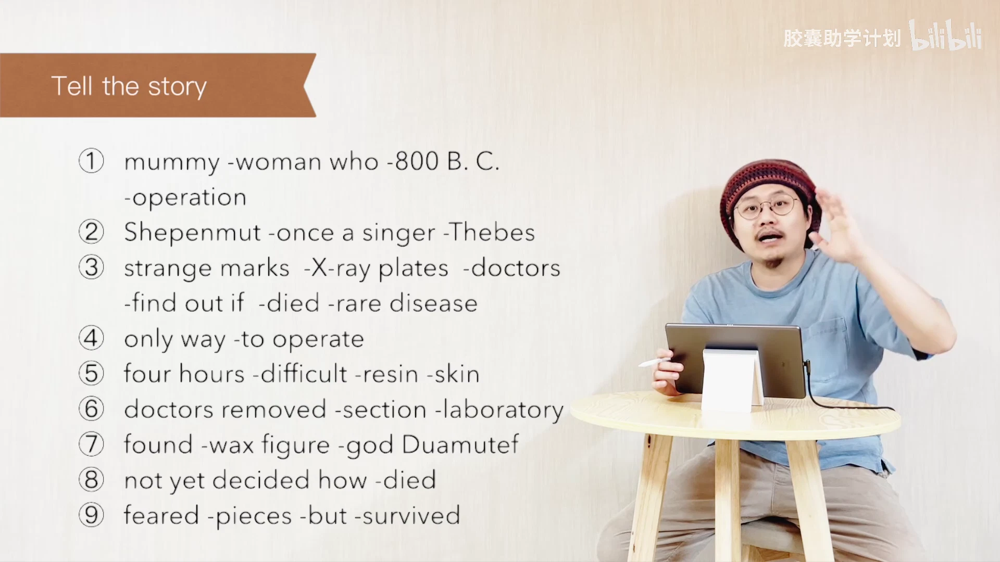

文字识别：胶囊助学计划biibi出 / Tell the story / 1 / mummy -woman who -800 B. C. / -operation / Shepenmut -once a singer -Thebes / strange marks -X-ray plates -doctors / -find out if -died -rare disease /  only way -to operate / 5 /  four hours -difficult -resin -skin / doctors removed -section -laboratory / found -wax figure -god Duamutef / 8 / not yet decided how -died / 9 /  feared -pieces -but -survived

### 画面 00:04:45

文字识别：blibii / 胶囊助学计划 / Summary writing: Key / 训练目标： / 写作复述能力

### 画面 00:04:47

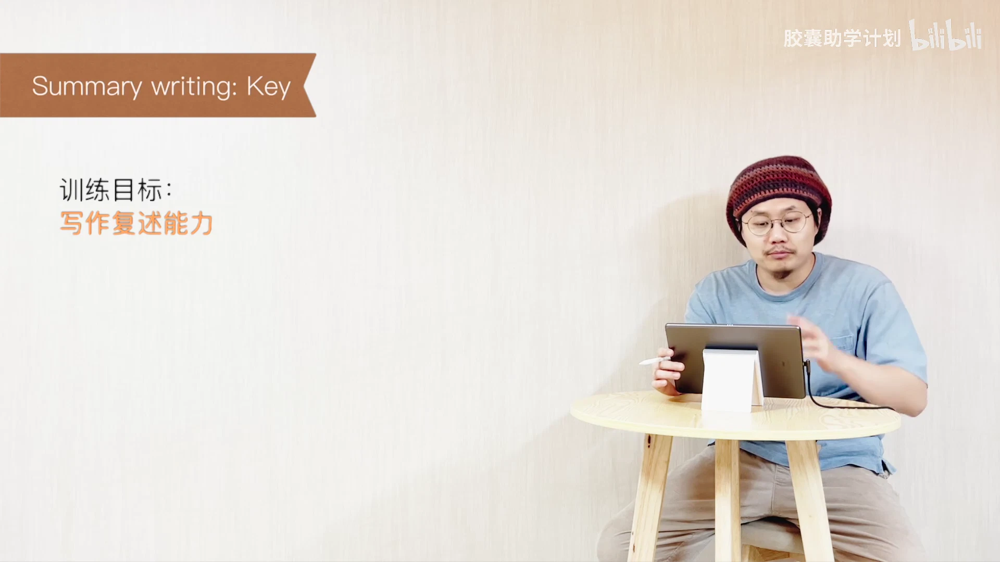

文字识别：biibli / 胶囊助学计划 / Summary writing: Key / 训练目标： / 写作复述能力

### 画面 00:04:50

文字识别：biibili / 胶囊助学计划 / Summary writing: Key / 训练目标： / 写作复述能力

### 画面 00:04:52

文字识别：胶囊助学计划bib山 / Summary writing: Key / Doctors have just operated on the mummy / of an Egyptian woman who died in800 B. C. / They wanted to find out whether she died of / a rare disease. After removing a section of / the mummy, they sent it to a laboratory. / During the operation, they unexpectedly / found a small wax figure of a god. Though / they were afraid the mummy would fall to / pieces, it successfully survived the operation.

### 画面 00:04:54

文字识别：胶囊助学计划bi山 / Summary writing: Key / Doctors have just operated on the mummy / of an Egyptian woman who died in800 B. C. / They wanted to find out whether she died of / a rare disease. After removing a section of / the mummy, they sent it to a laboratory. / During the operation, they unexpectedly / found a small wax figure of a god. Though / they were afraid the mummy would fall to / pieces, it successfully survived the operation.

### 画面 00:04:56

文字识别：胶囊助学计划bilii / Summary writing: Key / Doctors have just operated on the mummy / of an Egyptian woman who died in 800 B. / C., in order to find out if she died of a rare / disease. They removed a section of the / mummy, which they sent to a laboratory. / Inside the mummy, they unexpectedly found / a small wax figure of a god. They were afraid / the mummy would fall to pieces, but it / survived the operation.

## 00:05:00–00:05:30

词，OK。然后 topic for discussion，老习惯，我只负责给大家读一遍这些题。How has the discovery of X-rays affected our lives？说发现X光是如何影响我们的生活的。哎，我们现在能做X光片了，至少。How do religious beliefs influence burial customs in different countries？说这些宗教信仰是如何着影响我们埋葬的习

### 画面 00:05:00

文字识别：胶囊助学计划bili / Summary writing: Key / Doctors have just operated on the mummy / of an Egyptian woman who died in 800 B. / C., in order to find out if she died of a rare / disease. They removed a section of the / mummy, which they sent to a laboratory. / Inside the mummy, they unexpectedly found / a small wax figure of a god. They were afraid / the mummy would fall to pieces, but it / survived the operation.

### 画面 00:05:02

文字识别：胶囊助学计划blbi / Topics for discussion / How has the discovery of X-rays affected / our lives? / How do religious beliefs influence burial / customs in different countries? / Do you think the doctors' research on / the mummy was (a) valuable, (b) morally / wrong, (c) interesting but of little or no / practical use? Give reasons for your / answer.

### 画面 00:05:04

文字识别：胶囊助学计划bilbi / Topics for discussion / How has the discovery of X-rays affected / our lives? / How do religious beliefs influence burial / customs in different countries? / Do you think the doctors' research on / 3 / the mummy was (a) valuable, (b) morally / wrong, (c) interesting but of little or no / practical use? Give reasons for your / answer.

### 画面 00:05:06

文字识别：胶囊助学计划blbi / Topics for discussion / How has the discovery of X-rays affected / our lives? / How do religious beliefs influence burial / customs in different countries? / Do you think the doctors' research on / 3 / the mummy was (a) valuable, (b) morally / wrong, (c) interesting but of little or no / practical use? Give reasons for your / answer.

### 画面 00:05:10

文字识别：胶囊助学计划bibi / Topics for discussion / How has the discovery of X-rays affected / our lives? / How do religious beliefs influence burial / customs in different countries? / Do you think the doctors' research on / the mummy was (a) valuable, (b) morally / wrong, (c) interesting but of little or no / practical use? Give reasons for your / answer.

### 画面 00:05:13

文字识别：胶囊助学计划bilbi / Topics for discussion / How has the discovery of X-rays affected / our lives? / How do religious beliefs influence burial / customs in different countries? / Do you think the doctors' research on / the mummy was (a) valuable, (b) morally / wrong, (c) interesting but of little or no / practical use? Give reasons for your / answer.

### 画面 00:05:15

文字识别：胶囊助学计划bibi / Topics for discussion / How has the discovery of X-rays affected / our lives? / How do religious beliefs influence burial / customs in different countries? / 3 / Do you think the doctors' research on / the mummy was (a) valuable, (b) morally / wrong, (c) interesting but of little or no / practical use? Give reasons for your / answer.

### 画面 00:05:18

文字识别：胶囊助学计划bilbi / Topics for discussion / How has the discovery of X-rays affected / our lives? / How do religious beliefs influence burial / customs in different countries? / Do you think the doctors' research on / the mummy was (a) valuable, (b) morally / wrong, (c) interesting but of little or no / practical use? Give reasons for your / answer.

### 画面 00:05:20

文字识别：胶囊助学计划blii / Topics for discussion / How has the discovery of X-rays affected / our lives? / How do religious beliefs influence burial / customs in different countries? / Do you think the doctors' research on / the mummy was (a) valuable, (b) morally / wrong, (c) interesting but of little or no / practical use? Give reasons for your / answer.

### 画面 00:05:24

文字识别：胶囊助学计划bibi / Topics for discussion / How has the discovery of X-rays affected / our lives? / How do religious beliefs influence burial / customs in different countries? / Do you think the doctors' research on / the mummy was (a) valuable, (b) morally / wrong, (c) interesting but of little or no / practical use? Give reasons for your / answer.

### 画面 00:05:26

文字识别：胶囊助学计划bibi / Topics for discussion / How has the discovery of X-rays affected / our lives? / How do religious beliefs influence burial / customs in different countries? / 3 / Do you think the doctors' research on / the mummy was (a) valuable, (b) morally / wrong, (c) interesting but of little or no / practical use? Give reasons for your / answer.

### 画面 00:05:28

文字识别：胶囊助学计划bib山 / Topics for discussion / How has the discovery of X-rays affected / our lives? / How do religious beliefs influence burial / customs in different countries? / Do you think the doctors' research on / 3 / the mummy was (a) valuable, (b) morally / wrong, (c) interesting but of little or no / practical use? Give reasons for your / answer.

## 00:05:30–00:06:00

俗的在不同的国家，呃，这个题其实就很有意思，您可以去查一查。Do you think the doctors' research on the mummy was a valuable, morally wrong, or interesting but of little or no practical use? Give reasons for your answer.说你认为这些医生们啊，在这个呃木乃伊身上的这个这个这个实验呢，是很有价值的，还是道德上有问题的，还是很有趣，但

### 画面 00:05:30

文字识别：胶囊助学计划bii出 / Topics for discussion / How has the discovery of X-rays affected / our lives? / How do religious beliefs influence burial / customs in different countries? / Do you think the doctors' research on / the mummy was (a) valuable, (b) morally / wrong, (c) interesting but of little or no / practical use? Give reasons for your / answer.

### 画面 00:05:33

文字识别：胶囊助学计划bibi出 / Topics for discussion / How has the discovery of X-rays affected / our lives? / How do religious beliefs influence burial / customs in different countries? / 3 / Do you think the doctors' research on / the mummy was (a) valuable, (b) morally / wrong, (c) interesting but of little or no / practical use? Give reasons for your / answer.

### 画面 00:05:35

文字识别：胶囊助学计划bilii / Topics for discussion / How has the discovery of X-rays affected / our lives? / How do religious beliefs influence burial / customs in different countries? / Do you think the doctors' research on / 3 / the mammy was (a) valuable, (b) morally / wrong, (c) interesting but of little or no / practical use? Give reasons for your / answer.

### 画面 00:05:38

文字识别：胶囊助学计划bilii / Topics for discussion / How has the discovery of X-rays affected / our lives? / How do religious beliefs influence burial / customs in different countries? / 3 / Do you think the doctors' research on / the mummy was (a) valuable, (b) morally / wrong, (c) intereSting but of little or no / practical use? Give reasons for your / answer.

### 画面 00:05:41

文字识别：胶囊助学计划bii / Topics for discussion / How has the discovery of X-rays affected / our lives? / How do religious beliefs influence burial / customs in different countries? / Do you think the doctors' research on / 3 / the mummy was (a) valuable, (b) morally / wrong, (c) interesting but of little or no / practical use? Give reasons for your / answer.

### 画面 00:05:45

文字识别：胶囊助学计划bil出 / Topics for discussion / How has the discovery of X-rays affected / our lives? / How do religious beliefs influence burial / customs in different countries? / Do you think the doctors' research on / 3 / the mummy was (a) valuable, (b) morally / wrong, (c) interesting but of little or no / practical use? Give reasons for your / answer.

### 画面 00:05:47

文字识别：胶囊助学计划bibi / Topics for discussion / How has the discovery of X-rays affected / our lives? / How do religious beliefs influence burial / customs in different countries? / Do you think the doctors' research on / 3 / the mummy was (a) valuable, (b) morally / wrong, (c) interesting but of little or no / practical use? Give reasons for your / answer.

### 画面 00:05:49

文字识别：胶囊助学计划bilii / Topics for discussion / How has the discovery of X-rays affected / our lives? / How do religious beliefs influence burial / customs in different countries? / Do you think the doctors' research on / 3 / the mummy was (a) valuable, (b) morally / wrong, (c) interesting but of little or no / practical use? Give reasons for your / answer.

### 画面 00:05:51

文字识别：胶囊助学计划bili / Topics for discussion / How has the discovery of X-rays affected / our lives? / How do religious beliefs influence burial / customs in different countries? / Do you think the doctors' research on / 3 / the mummy was (a) valuable, (b) morally / wrong, (c) interesting but of little or no / practical use? Give reasons for your / answer.

### 画面 00:05:56

文字识别：胶囊助学计划bibi / Topics for discussion / How has the discovery of X-rays affected / our lives? / How do religious beliefs influence burial / customs in different countries? / Do you think the doctors' research on / 3 / the mummy was (a) valuable, (b) morally / wrong, (c) interesting but of little or no / practical use? Give reasons for your / answer.

## 00:06:00–00:06:30

实际上呢，就几乎没有什么用的。哎，三选其一，您三选其二啊，三选其三，三随便，您选一个。Give reasons for your answer. 给出你的答案。家庭作业呢？Ask me if写完大声朗读。摘要写作别忘了有两个。Tell the story. 口语复述。置顶留言可以找到重复间隔的学习材料。那以上就是本期视频的全部内容了。如果您喜欢我们的课程

### 画面 00:06:00

文字识别：胶囊助学计划bilbi / Topics for discussion / How has the discovery of X-rays affected / our lives? / How do religious beliefs influence burial / customs in different countries? / Do you think the doctors' research on / 3 / the mummy was (a) valuable, (b) morally / wrong, (c) interesting but of litle or no / practical use? Give reasons for your / answer.

### 画面 00:06:04

文字识别：胶囊助学计划biibil / Topics for discussion / How has the discovery of X-rays affected / our lives? / How do religious beliefs influence burial / customs in different countries? / Do you think the doctors' research on / the mummy was (a) valuable, (b) morally / wrong, (c) interesting but of little or no / practical use? Give reasons for your / answer.

### 画面 00:06:08

文字识别：胶囊助学计划biii / Topics for discussion / How has the discovery of X-rays affected / our lives? / How do religious beliefs influence burial / customs in different countries? / Do you think the doctors'research on / 3 / the mummy was (a) valuable, (b) morally / wrong, (c) interesting but of little or no / practical use? Give reasons for your / answer.

### 画面 00:06:10

文字识别：胶囊助学计划bilibi / Topics for discussion / How has the discovery of X-rays affected / our lives? / How do religious beliefs influence burial / customs in different countries? / Do you think the doctors' research on / 3 / the mummy was (a) valuable, (b) morally / wrong, (c) interesting but of little or no / practical use? Give reasons for your / answer.

### 画面 00:06:13

文字识别：胶囊助学计划i出 / Topics for discussion / How has the discovery of X-rays affected / our lives? / How do religious beliefs influence burial / customs in different countries? / Do you think the doctors' research on / 3 / the mummy was (a) valuable, (b) morally / wrong, (c) interesting but of little or no / practical use? Give reasons for your / answer.

### 画面 00:06:15

文字识别：胶囊助学计划biibil / 1.Ask me if写&朗读

### 画面 00:06:17

文字识别：刘bilbil / 胶囊助学计划 / 1.Ask me if写&朗读 / 2. / 摘要写作写&答案

### 画面 00:06:19

文字识别：bitbli / 胶囊助学计划 / 1.Ask me if写&朗读 / 摘要写作写&答案 / 3.Tell the story 口语复述 / 重复间隔（置顶留言）

### 画面 00:06:21

文字识别：bibli / 胶囊助学计划 / 1.Ask me if写&朗读 / 摘要写作写&答案 / 3.Tell the story 口语复述 / ·重复间隔（置顶留言） / 4.

### 画面 00:06:23

文字识别：biibili / 胶囊助学计划 / 1.Ask me if写&朗读 / 摘要写作写&答案 / 3.Tell the story 口语复述 / ·重复间隔（置顶留言） / 4.

### 画面 00:06:25

文字识别：胶囊助学计划bilbi / 不

### 画面 00:06:27

文字识别：胶囊助学计划biibi / 不

### 画面 00:06:29

文字识别：胶囊助学计划bilbi / 不

## 00:06:30–00:06:50

呢，欢迎各位关注、订阅、一键三连、分享给那些需要的朋友，来帮助我们快速成长。See you next time.

### 画面 00:06:33

文字识别：胶囊助学计划biil

### 画面 00:06:38

### 画面 00:06:40

文字识别：CAPSULEACADEMY / 胶囊助学计划 / 小红书 / Lecturer / □ / 口 / Leo / OE

### 画面 00:06:43

文字识别：CAPSULEACADEMY / 胶囊助学计划 / 小红书 / Edita. / OE

### 画面 00:06:46

文字识别：聖珈字計划 / CAPSULEACADEMY / 胶囊助学计划 / 小红书 / Creator / Leo & Berlin / OE

### 画面 00:06:48

文字识别：bilbili / 胶囊助学计划 / APSULEACA / 胶囊助学计划 / 小红书 / OE

### 画面 00:06:50

文字识别：bilbili / 胶囊助学计划

