# 078 单词

快速机器解析：语音为单模型转写，未进行独立交叉校对或人工复核；画面每秒采样并按变化选帧，短时文字和标记可能遗漏。截图时间约有 1 秒误差。图片有损压缩；遇到疑点请按时间查看 Google Drive 原视频。

## 00:00:00–00:00:30

Hello everyone, welcome to Capsule Academy. This is Leo. Today we're going to learn new concept in English book two, lesson seventy eight words. 那老习惯进入正式课程之前呢，咱们先看几个问题啊。第一，如何表达说某人有权去做某件事儿？接下来，如何表达有勇气去做某件事情？哎，那最后一个如何表达有个坏脾气？那带着这三个问题，Hope you gonna enjoy.

### 画面 00:00:00

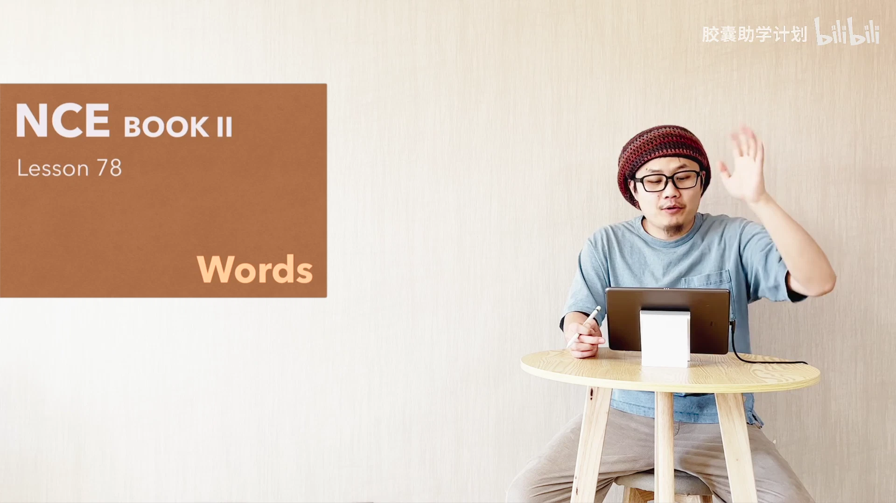

文字识别：bilbii / 胶囊助学计划 / NCE / BOOKII / Lesson 78 / Words

### 画面 00:00:02

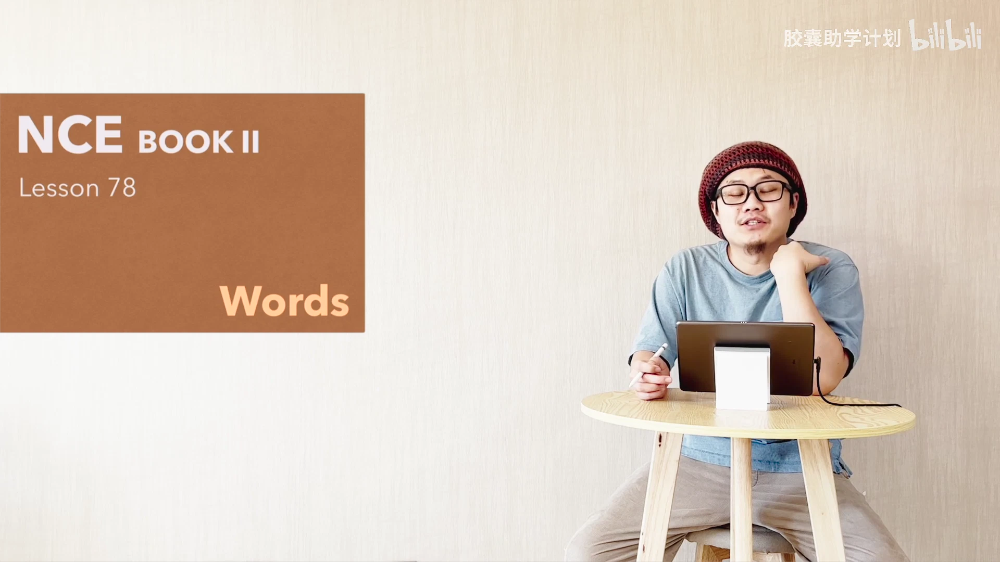

文字识别：bilbili / 胶囊助学计划 / NCE / BOOKII / Lesson 78 / Words

### 画面 00:00:04

文字识别：bilbili / 胶囊助学计划 / NCE / BOOKII / Lesson 78 / Words

### 画面 00:00:06

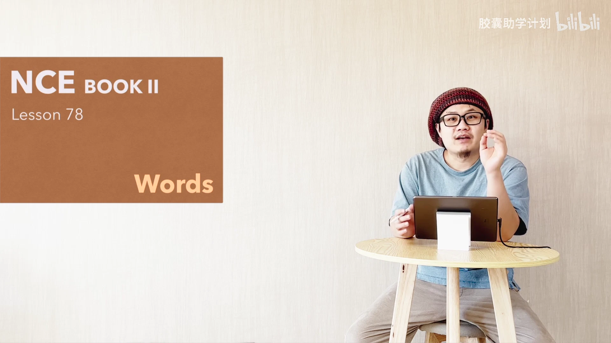

文字识别：bilbili / 胶囊助学计划 / NCE / BOOKII / Lesson 78 / Words

### 画面 00:00:09

文字识别：biiii / 胶囊助学计划

### 画面 00:00:11

文字识别：bibii / 胶囊助学计划 / ①如何表达“某人有权做某事”?

### 画面 00:00:13

文字识别：bibli / 胶囊助学计划 / ①如何表达“某人有权做某事”?

### 画面 00:00:15

文字识别：bibii / 胶囊助学计划 / ① 如何表达“某人有权做某事”?

### 画面 00:00:17

文字识别：bilbili / 胶囊助学计划 / ①如何表达“某人有权做某事”? / 如何表达“有勇气做某事”?

### 画面 00:00:19

文字识别：bilbili / 胶囊助学计划 / ①如何表达“某人有权做某事”? / 如何表达“有勇气做某事”?

### 画面 00:00:21

文字识别：bilbii / 胶囊助学计划 / ① 如何表达“某人有权做某事”？ / 如何表达“有勇气做某事”

### 画面 00:00:23

文字识别：biiii / 胶囊助学计划 / ① 如何表达“某人有权做某事”？ / 如何表达“有勇气做某事”? / 如何表达“有个坏脾气”?

### 画面 00:00:25

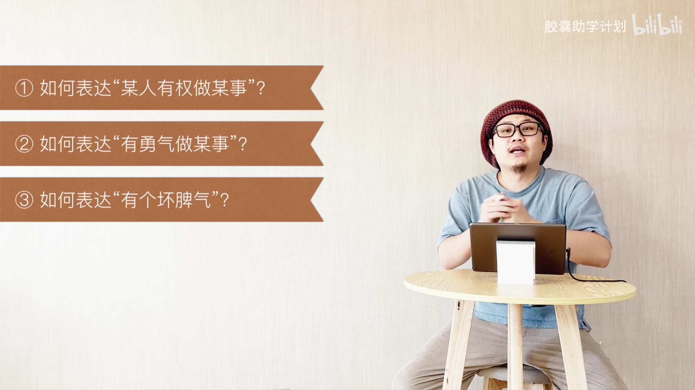

文字识别：bilbili / 胶囊助学计划 / ① 如何表达“某人有权做某事”？ / 如何表达“有勇气做某事' / 如何表达“有个坏脾气”?

### 画面 00:00:28

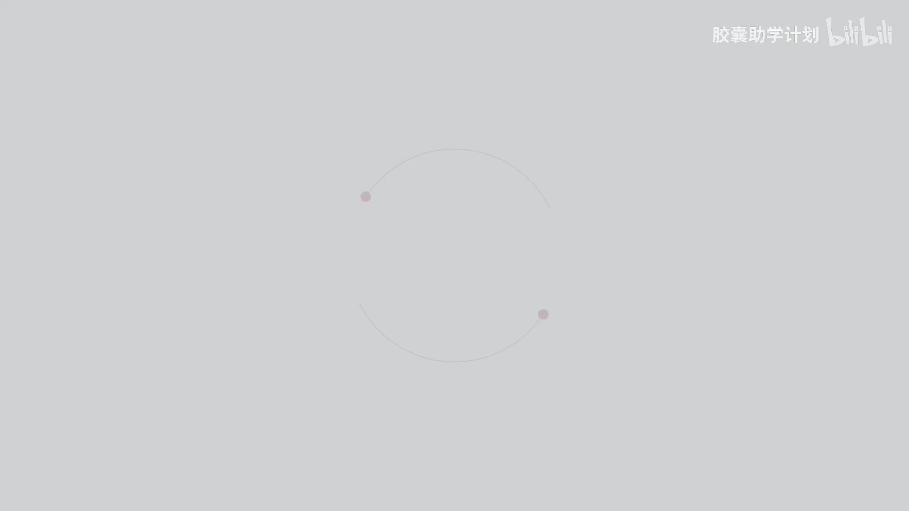

文字识别：胶囊助学计划ii / •

## 00:00:30–00:01:00

呃，提前预告一下，俺本课有一个特点，就是生词虽然不是特别多，但几乎每一个生词都有几个特别常用的习惯用法，很多在文章当中也出现了，或者在以后三册当中也出现。我就反正一股脑儿都弄出来了。弄完了之后呢，发现还真不少，但都很实用啊。我们看第一个单词叫entitle，entitle，entitle这

### 画面 00:00:32

### 画面 00:00:34

文字识别：单词造句指南 / 网：v.+v.变化 / Meaning: / 胶囊助学计划 / bibili / 1.to give someone the right to / 四句型转换 / do or have something / 方式/地点/时间 / entitle sb.to sth. / 结合习惯用法 / entitle sb.to do sth. / 其他单词+词性 / 2.to give a title to a book, film, / 原文摘抄+变 / etc.: = name sth.a L67 / 6123456 / /In'tartal/ / entitle v.

### 画面 00:00:36

文字识别：单词造句指南 / 网：v.+v.变化 / Meaning: / 胶囊助学计划 / bilbil / 1.to give someone the right to / 四句型转换 / do or have something / 方式/地点/时间 / entitle sb.to sth. / 结合习惯用法 / entitle sb.to do sth. / 其他单词+词性 / 2.to give a title to a book, film, / 原文摘抄+变 / etc.: = name sth.a L67 / 6123456 / /In'taital/ / entitle v.

### 画面 00:00:38

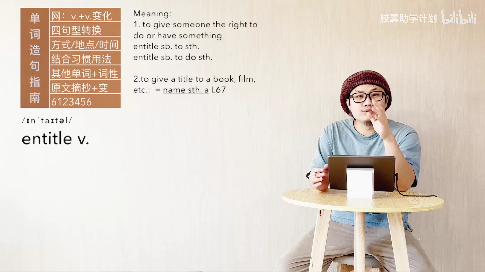

文字识别：单词造句指南 / 网：v.+v.变化 / Meaning: / 胶囊助学计划 / bilbili / 1.to give someone the right to / 四句型转换 / do or have something / 方式/地点/时间 / entitle sb.to sth. / 结合习惯用法 / entitle sb.to do sth. / 其他单词+词性 / 2.to give a title to a book, film, / 原文摘抄+变 / etc.: = name sth.a L67 / 6123456 / /In'taital/ / entitle v.

### 画面 00:00:40

文字识别：单词造句指南 / 网：v.+v.变化 / Meaning: / 胶囊助学计划 / bibili / 1.to give someone the right to / 四句型转换 / do or have something / 方式/地点/时间 / entitle sb.to sth. / 结合习惯用法 / entitle sb.to do sth. / 其他单词+词性 / 2.to give a title to a book, film, / 原文摘抄+变 / etc.: = name sth.a L67 / 6123456 / /In'taital/ / entitle v.

### 画面 00:00:46

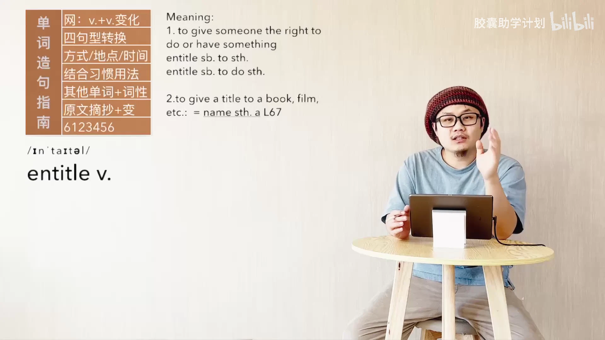

文字识别：单词造句指南 / 网：v.+v.变化 / Meaning: / 胶囊助学计划 / bilbili / 1.to give someone the right to / 四句型转换 / do or have something / 方式/地点/时间 / entitle sb.to sth. / 结合习惯用法 / entitle sb.to do sth. / 其他单词+词性 / 2.to give a title to a book, film, / 原文摘抄+变 / etc.: = name sth.a L67 / 6123456 / /In'taital/ / entitle v.

### 画面 00:00:56

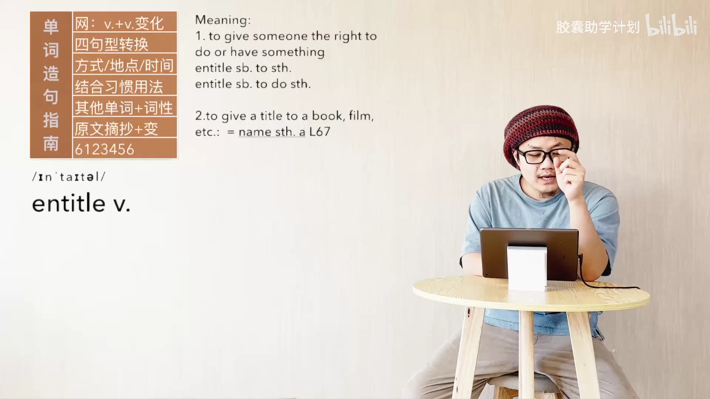

文字识别：单词造句指南 / 网：v.+v.变化 / Meaning: / 胶囊助学计划 / bilbili / 1.to give someone the right to / 四句型转换 / do or have something / 方式/地点/时间 / entitle sb.to sth. / 结合习惯用法 / entitle sb.to do sth. / 其他单词+词性 / 2.to give a title to a book, film, / 原文摘抄+变 / etc.: = name sth.a L67 / 6123456 / /In'taital/ / entitle v.

## 00:01:00–00:01:30

word actually has at least two meanings. The original is one of them. I'm going to expand a little bit here. Ah, is its other common meaning called give someone the right to do or have something? Called give someone the right to do or have something. Called give someone the right to do or have something. Called give someone the right to do or have something. Called give someone the right to do or have something. Called give someone the right to do or have something. Called give someone the right to do or have something. Called give someone the right to do or have something. Called give someone the right to do or have something. Called give someone the right to do or have something. Called give someone the right to do or have something. Called

### 画面 00:01:00

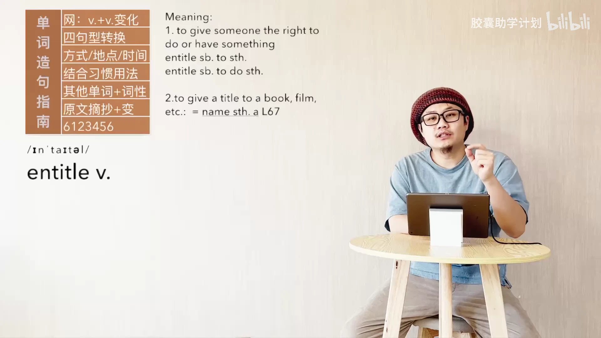

文字识别：单词造句指南 / 网：v.+v.变化 / Meaning: / 胶囊助学计划 / bilbili / 1.to give someone the right to / 四句型转换 / do or have something / 方式/地点/时间 / entitle sb.to sth. / 结合习惯用法 / entitle sb.to do sth. / 其他单词+词性 / 2.to give a title to a book, film, / 原文摘抄+变 / etc.: = name sth.a L67 / 6123456 / /In'taital/ / entitle v.

### 画面 00:01:11

文字识别：单词造句指南 / 网：v.+v.变化 / Meaning: / 胶囊助学计划 / bibili / 1.to give someone the right / 四句型转换 / do or have something / 方式/地点/时间 / entitle sb.to sth. / 结合习惯用法 / entitle sb.to do sth. / 其他单词+词性 / 2.to give a title to a book, film, / 原文摘抄+变 / etc.: = name sth.a L67 / 6123456 / /In'taital/ / entitle v.

### 画面 00:01:13

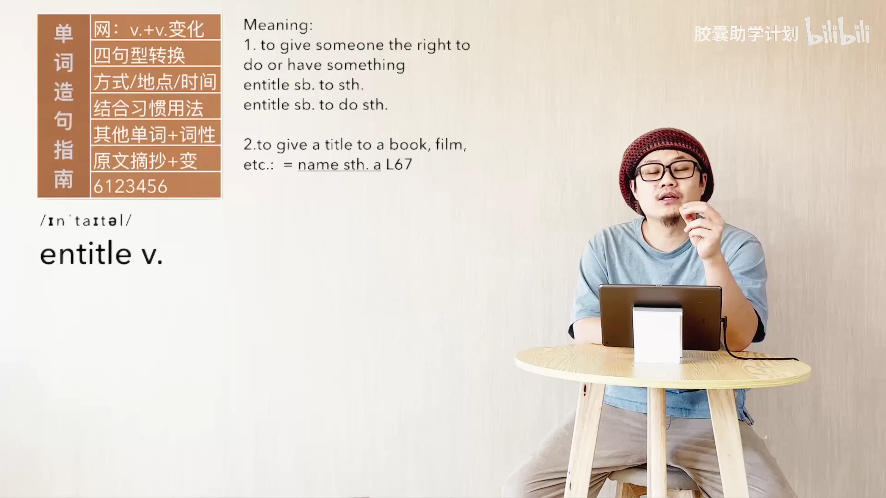

文字识别：单词造句指南 / 网：v.+v.变化 / Meaning: / 胶囊助学计划 / bilibili / 1.to give someone the right to / 四句型转换 / do or have something / 方式/地点/时间 / entitle sb.to sth. / 结合习惯用法 / entitle sb.to do sth. / 其他单词+词性 / 2.to give a title to a book, film, / 原文摘抄+变 / etc.: = name sth.a L67 / 6123456 / /In'taital/ / entitle v.

### 画面 00:01:16

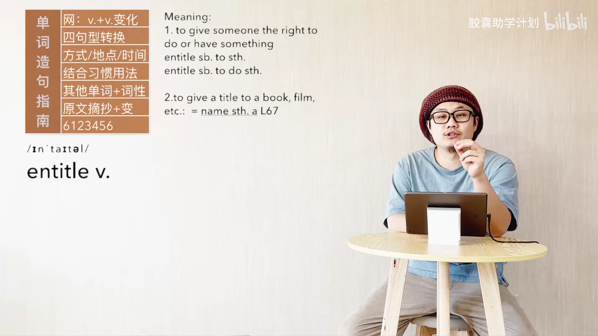

文字识别：单词造句指南 / 网：v.+v.变化 / Meaning: / 胶囊助学计划 / biibii / 1.to give someone the right to / 四句型转换 / do or have something / 方式/地点/时间 / entitle sb.to sth. / 结合习惯用法 / entitle sb.to do sth. / 其他单词+词性 / 2.to give a title to a book, film, / 原文摘抄+变 / etc.: = name sth.a L67 / 6123456 / /In'taital/ / entitle v.

### 画面 00:01:18

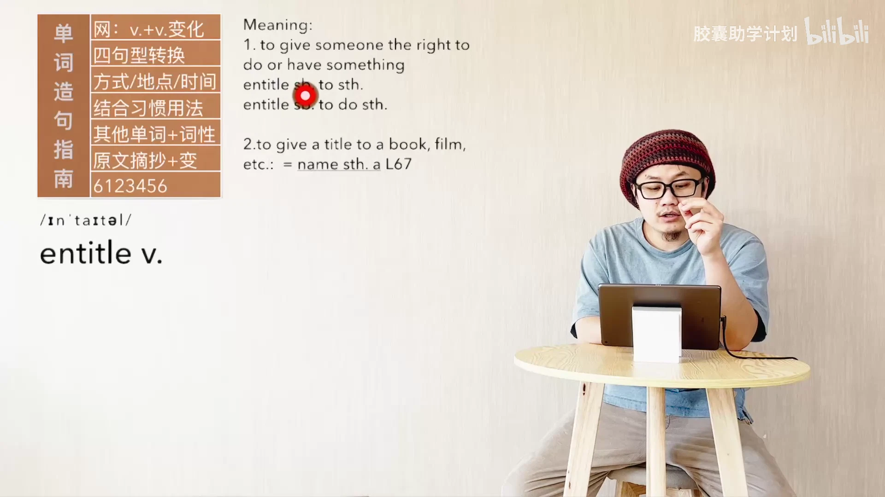

文字识别：单词造句指南 / 网：v.+v.变化 / Meaning: / 胶囊助学计划 / bilbili / 1.to give someone the right to / 四句型转换 / do or have something / 方式/地点/时间 / entitle / to sth. / 结合习惯用法 / entitle / to do sth. / 其他单词+词性 / 2.to give a title to a book, film, / 原文摘抄+变 / etc.: = name sth.a L67 / 6123456 / /In'tartal/ / entitle v.

### 画面 00:01:20

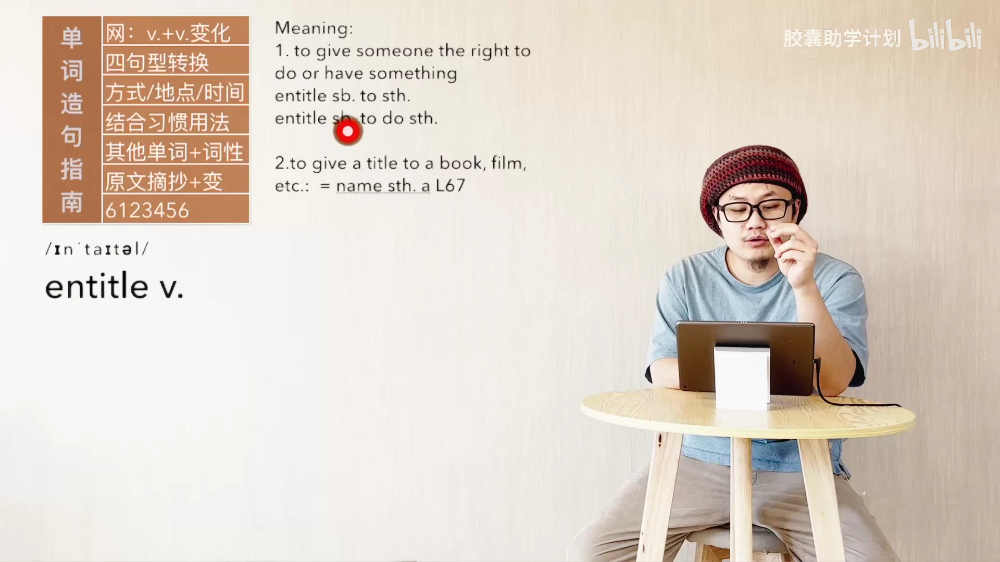

文字识别：单词造句指南 / 网：v.+v.变化 / Meaning: / 胶囊助学计划 / bilbil / 1.to give someone the right to / 四句型转换 / do or have something / 方式/地点/时间 / entitle sb.to sth. / 结合习惯用法 / entitle / C / to do sth. / 其他单词+词性 / 2.to give a title to a book, film, / 原文摘抄+变 / etc.: = name sth.a L67 / 6123456 / /In'taital/ / entitle v.

### 画面 00:01:22

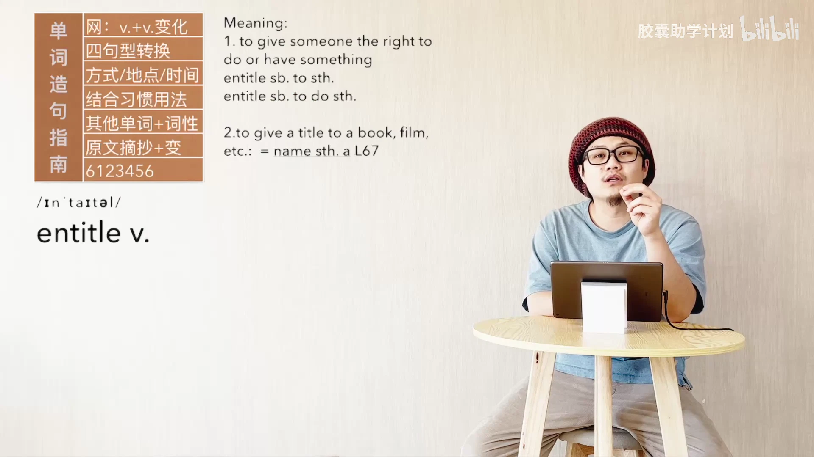

文字识别：单词造句指南 / 网：v.+v.变化 / Meaning: / 胶囊助学计划 / bilbili / 1.to give someone the right to / 四句型转换 / do or have something / 方式/地点/时间 / entitle sb.to sth. / 结合习惯用法 / entitle sb.to do sth. / 其他单词+词性 / 2.to give a title to a book, film, / 原文摘抄+变 / etc.: = name sth.a L67 / 6123456 / /In'taital/ / entitle v.

### 画面 00:01:24

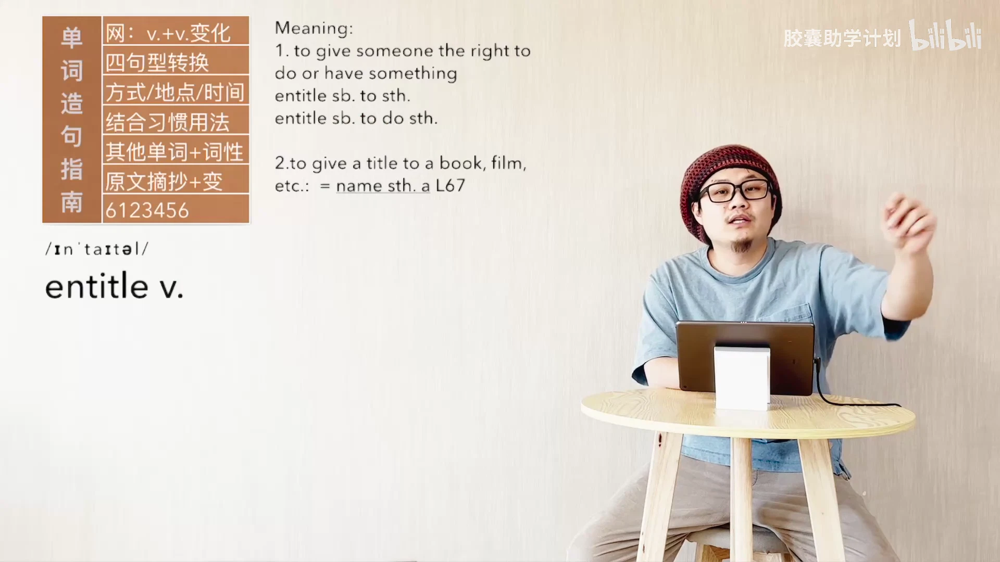

文字识别：单词造句指南 / 网：v.+v.变化 / Meaning: / 胶囊助学计划 / bibili / 1.to give someone the right to / 四句型转换 / do or have something / 方式/地点/时间 / entitle sb.to sth. / 结合习惯用法 / entitle sb.to do sth. / 其他单词+词性 / 2.to give a title to a book, film, / 原文摘抄+变 / etc.: = name sth.a L67 / 6123456 / /In'taital/ / entitle v.

### 画面 00:01:26

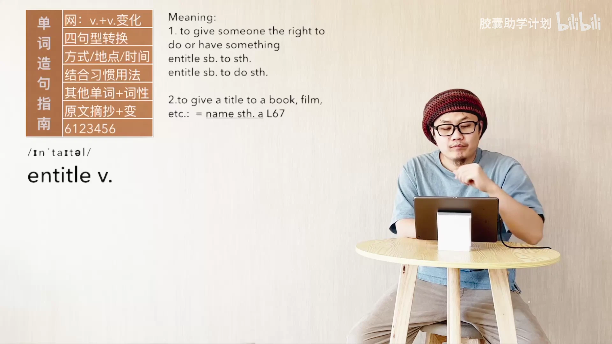

文字识别：单词造句指南 / 网：v.+v.变化 / Meaning: / 胶囊助学计划 / bilbili / 1.to give someone the right to / 四句型转换 / do or have something / 方式/地点/时间 / entitle sb.to sth. / 结合习惯用法 / entitle sb.to do sth. / 其他单词+词性 / 2.to give a title to a book, film, / 原文摘抄+变 / etc.: = name sth.a L67 / 6123456 / /In'taital/ / entitle v.

## 00:01:30–00:02:00

you to do this? Next one, 第二个很常见的意思跟我们原来学过的那个 name 或者 called 非常的像啊，叫做被叫做或者命名为啊，take its name from. 比如说，它的含义叫 to give a title to a book, film, etc.，是吧？就是给一个书或者一个电影起个名字，哎，叫做 entitled. Very good. 那比如说，我们看这样一句话，这这句话跟原文的用法是一样的，意思不一样啊啊，这个这

### 画面 00:01:30

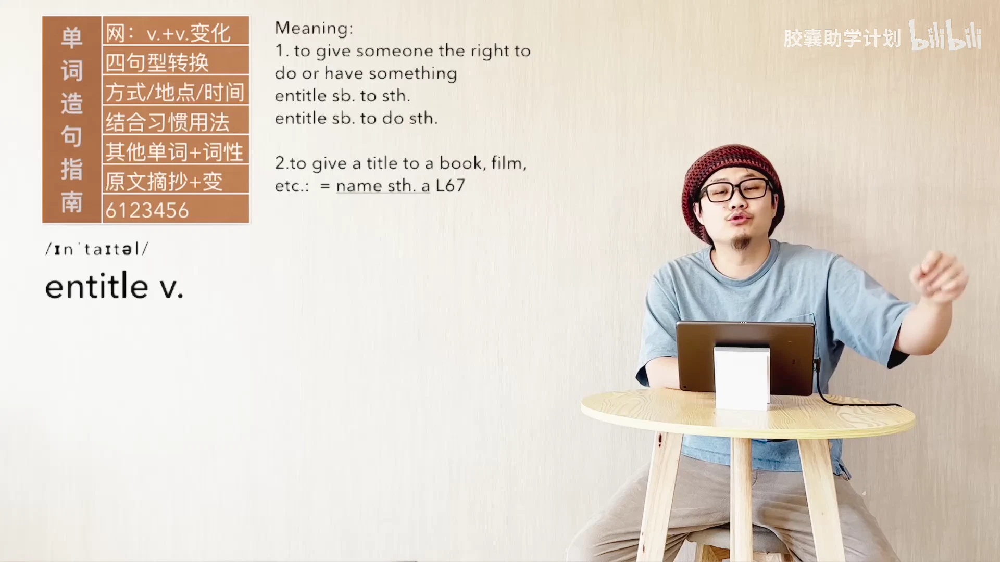

文字识别：单词造句指南 / 网：v.+v.变化 / Meaning: / 胶囊助学计划 / bilbil / 1.to give someone the right to / 四句型转换 / do or have something / 方式/地点/时间 / entitle sb.to sth. / 结合习惯用法 / entitle sb.to do sth. / 其他单词+词性 / 2.to give a title to a book, film, / 原文摘抄+变 / etc.: = name sth.a L67 / 6123456 / /In'tartal/ / entitle v.

### 画面 00:01:34

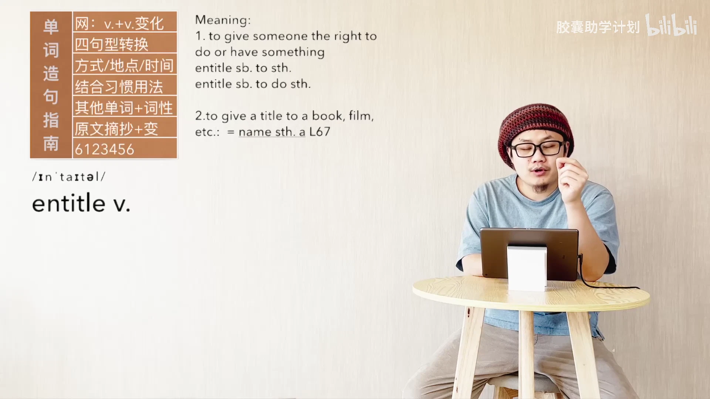

文字识别：单词造句指南 / 网：v.+v.变化 / Meaning: / 胶囊助学计划 / Bilbii / 1.to give someone the right to / 四句型转换 / do or have something / 方式/地点/时间 / entitle sb.to sth. / 结合习惯用法 / entitle sb.to do sth. / 其他单词+词性 / 2.to give a title to a book, film, / 原文摘抄+变 / etc.: = name sth.a L67 / 6123456 / /In'tartal/ / entitle v.

### 画面 00:01:36

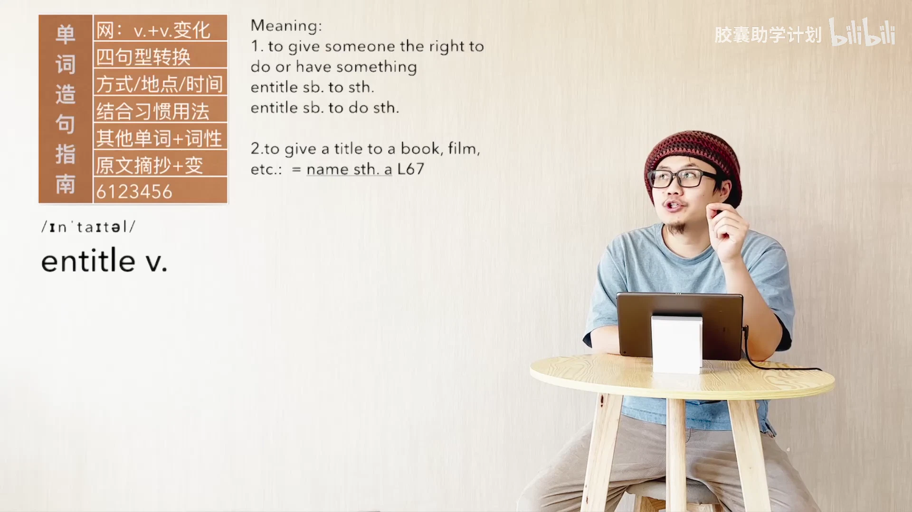

文字识别：单词造句指南 / 网：v.+v.变化 / Meaning: / 胶囊助学计划 / biibi / 1.to give someone the right to / 四句型转换 / do or have something / 方式/地点/时间 / entitle sb.to sth. / 结合习惯用法 / entitle sb.to do sth. / 其他单词+词性 / 2.to give a title to a book, film, / 原文摘抄+变 / etc.: = name sth.a L67 / 6123456 / /In'taital/ / entitle v.

### 画面 00:01:40

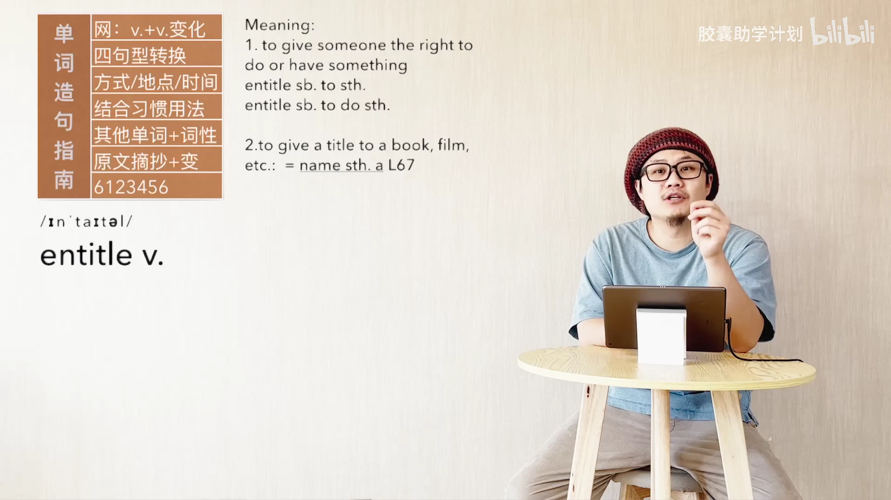

文字识别：单词造句指南 / 网：v.+v.变化 / Meaning: / 胶囊助学计划 / biibii / 1.to give someone the right to / 四句型转换 / do or have something / 方式/地点/时间 / entitle sb.to sth. / 结合习惯用法 / entitle sb.to do sth. / 其他单词+词性 / 2.to give a title to a book, film, / 原文摘抄+变 / etc.: = name sth.a L67 / 6123456 / /In'tartal/ / entitle v.

### 画面 00:01:45

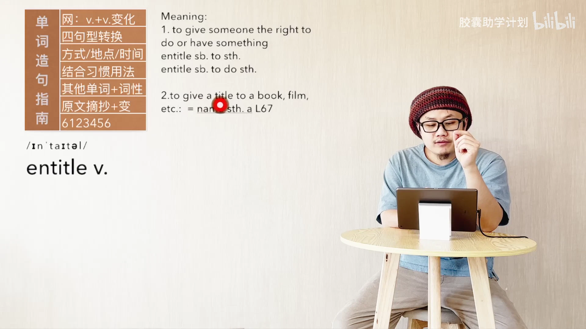

文字识别：单词造句指南 / 网：v.+v.变化 / Meaning: / 胶囊助学计划 / bilbili / 1.to give someone the right to / 四句型转换 / do or have something / 方式/地点/时间 / entitle sb.to sth. / 结合习惯用法 / entitle sb.to do sth. / 其他单词+词性 / 2.to give a title to a book, film, / 原文摘抄+变 / etc.:= nan / sth.a L67 / 6123456 / /In'taital/ / entitle v.

### 画面 00:01:47

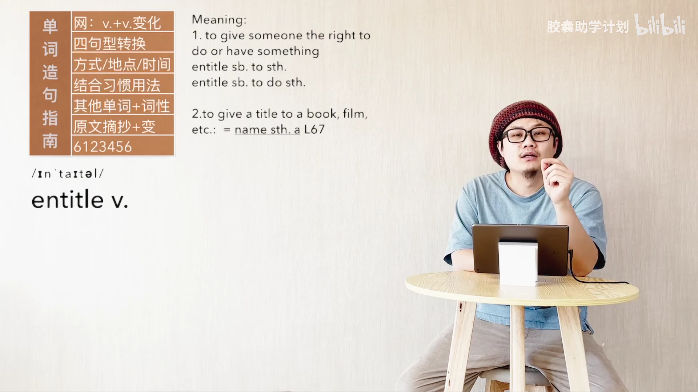

文字识别：单词造句指南 / 网：v.+v.变化 / Meaning: / 胶囊助学计划 / blbili / 1.to give someone the right to / 四句型转换 / do or have something / 方式/地点/时间 / entitle sb.to sth. / 结合习惯用法 / entitle sb.to do sth. / 其他单词+词性 / 2.to give a title to a book, film, / 原文摘抄+变 / etc.: = name sth.a L67 / 6123456 / /In'taital/ / entitle v.

### 画面 00:01:49

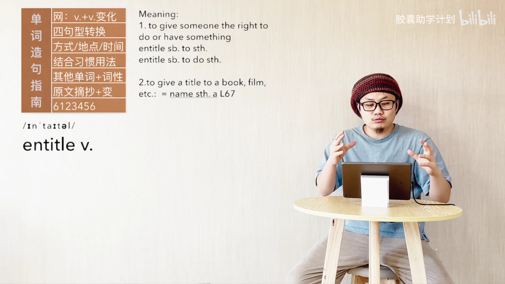

文字识别：单词造句指南 / 网：v.+v.变化 / Meaning: / 胶囊助学计划 / bilbili / 1.to give someone the right to / 四句型转换 / do or have something / 方式/地点/时间 / entitle sb.to sth. / 结合习惯用法 / entitle sb.to do sth. / 其他单词+词性 / 2.to give a title to a book, film, / 原文摘抄+变 / etc.: = name sth.a L67 / 6123456 / /In'taital/ / entitle v.

### 画面 00:01:52

文字识别：单词造句指南 / 网：v.+v.变化 / Meaning: / 胶囊助学计划 / bibili / 1.to give someone the right to / 四句型转换 / do or have something / 方式/地点/时间 / entitle sb.to sth. / 结合习惯用法 / entitle sb.to do sth. / 其他单词+词性 / 2.to give a title to a book, film, / 原文摘抄+变 / etc.: = name sth.a L67 / 6123456 / /In'taital/ / entitle v.

### 画面 00:01:54

文字识别：单词造句指南 / 网：v.+v.变化 / Meaning: / 胶囊助学计划bilbii / 1.to give someone the right to / 四句型转换 / do or have something / 方式/地点/时间 / entitle sb.to sth. / 结合习惯用法 / entitle sb.to do sth. / 其他单词+词性 / 2.to give a title to a book, film, / 原文摘抄+变 / etc.: = name sth.a L67 / 6123456 / /In'taital/ / entitle v. / ① Her latest book, entitled "The Forgotten / One', is out this week.

### 画面 00:01:56

文字识别：单词造句指南 / 网：v.+v.变化 / Meaning: / 胶囊助学计划bilbii / 1.to give someone the right to / 四句型转换 / do or have something / 方式/地点/时间 / entitle sb.to sth. / 结合习惯用法 / entitle sb.to do sth. / 其他单词+词性 / 2.to give a title to a book, film, / 原文摘抄+变 / etc.: = name sth.a L67 / 6123456 / /In'taital/ / entitle v. / ① Her latest book, entitled "The Forgotten / One', is out this week.

### 画面 00:01:58

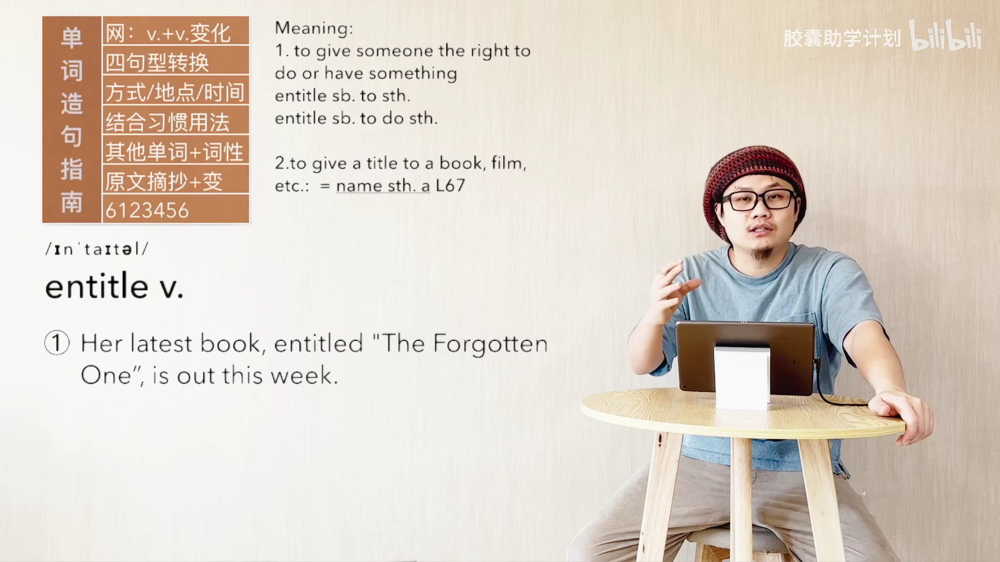

文字识别：单词造句指南 / 网：v.+v.变化 / Meaning: / 胶囊助学计划blbil / 1.to give someone the right to / 四句型转换 / do or have something / 方式/地点/时间 / entitle sb.to sth. / 结合习惯用法 / entitle sb.to do sth. / 其他单词+词性 / 2.to give a title to a book, film, / 原文摘抄+变 / etc.: = name sth.a L67 / 6123456 / /In'taital/ / entitle v. / ① Her latest book, entitled "The Forgotten / One', is out this week.

## 00:02:00–00:02:30

个这个含义不一样啊。比如说， her latest book entitled the forgotten one is out this week。那你看， entitled the forgotten one，其实就是 her latest book，对吧？可以理解为是一码事儿。所以叫做哎，所以这个地方的 entitled 完全可以给它换个单词，比如说叫 named 或者叫 called。那至于这个语法是啥？二八二九三十分词做定语，对吧？这三课咱们都学

### 画面 00:02:00

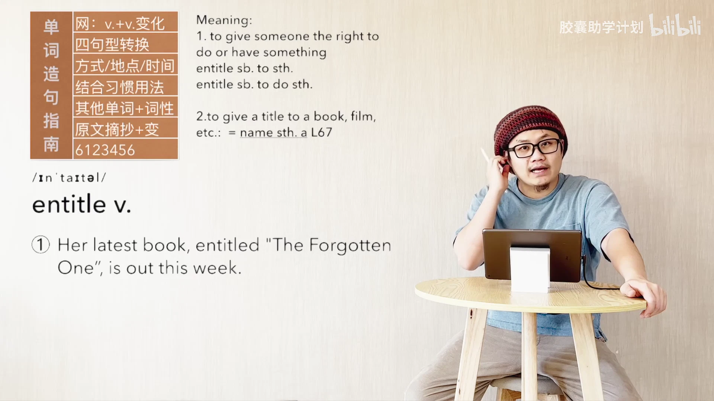

文字识别：单词造句指南 / 网：v.+v.变化 / Meaning: / 胶囊助学计划 / bilibii / 1.to give someone the right to / 四句型转换 / do or have something / 方式/地点/时间 / entitle sb.to sth. / 结合习惯用法 / entitle sb.to do sth. / 其他单词+词性 / 2.to give a title to a book, film, / 原文摘抄+变 / etc.: = name sth.a L67 / 6123456 / /In'taital/ / entitle v. / ① Her latest book, entitled "The Forgotten / One', is out this week.

### 画面 00:02:06

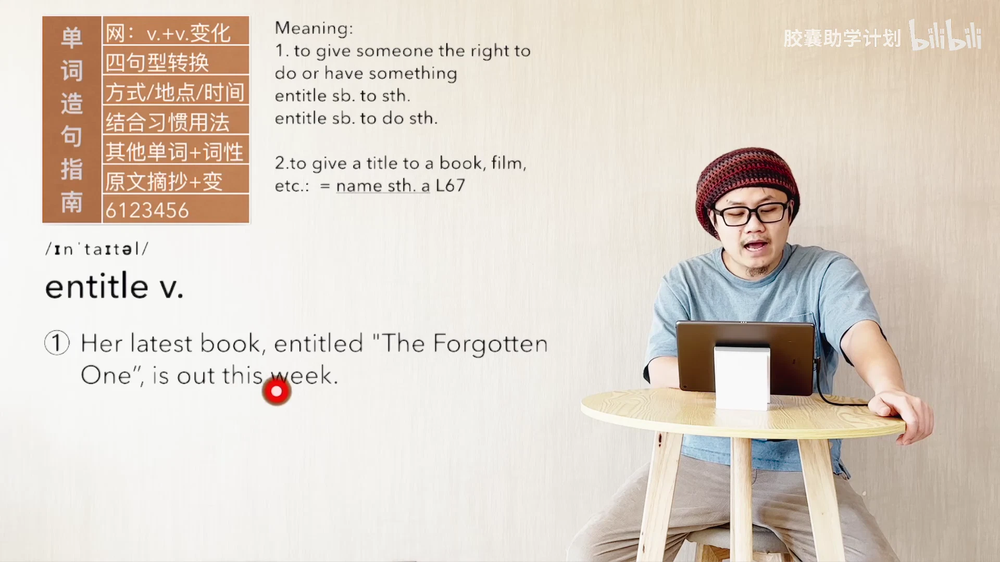

文字识别：单词造句指南 / 网：v.+v.变化 / Meaning: / 胶囊助学计划 / bilbii / 1.to give someone the right to / 四句型转换 / do or have something / 方式/地点/时间 / entitle sb.to sth. / 结合习惯用法 / entitle sb.to do sth. / 其他单词+词性 / 2.to give a title to a book, film, / 原文摘抄+变 / etc.: = name sth.a L67 / 6123456 / /In'taital/ / entitle v. / ① Her latest book, entitled "The Forgotten / One', is out this week.

### 画面 00:02:18

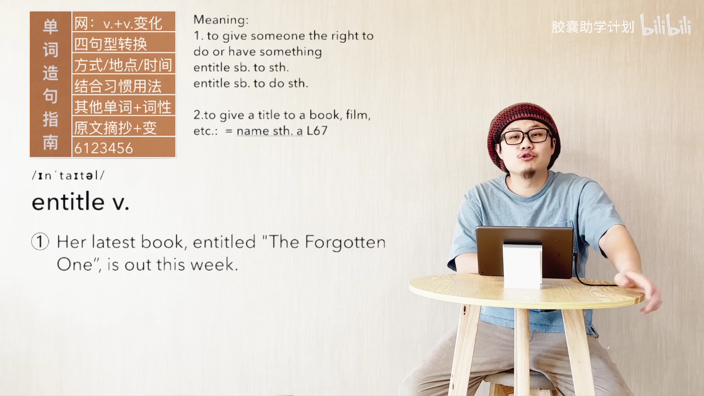

文字识别：单词造句指南 / 网：v.+v.变化 / Meaning: / 胶囊助学计划bilbil / 1.to give someone the right to / 四句型转换 / do or have something / 方式/地点/时间 / entitle sb.to sth. / 结合习惯用法 / entitle sb.to do sth. / 其他单词+词性 / 2.to give a title to a book, film, / 原文摘抄+变 / etc.: = name sth.a L67 / 6123456 / /In'taital/ / entitle v. / ① Her latest book, entitled "The Forgotten / One', is out this week.

### 画面 00:02:20

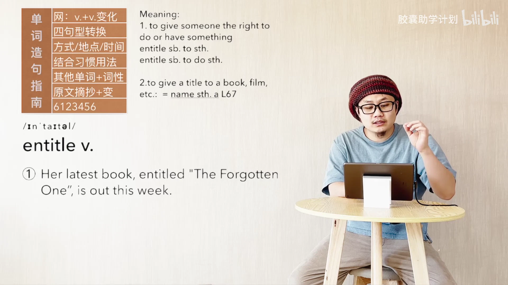

文字识别：单词造句指南 / 网：v.+v.变化 / Meaning: / 胶囊助学计划 / biibii / 1.to give someone the right to / 四句型转换 / do or have something / 方式/地点/时间 / entitle sb.to sth. / 结合习惯用法 / entitle sb.to do sth. / 其他单词+词性 / 2.to give a title to a book, film, / 原文摘抄+变 / etc.: = name sth.a L67 / 6123456 / /In'taital/ / entitle v. / ① Her latest book, entitled "The Forgotten / One', is out this week.

### 画面 00:02:25

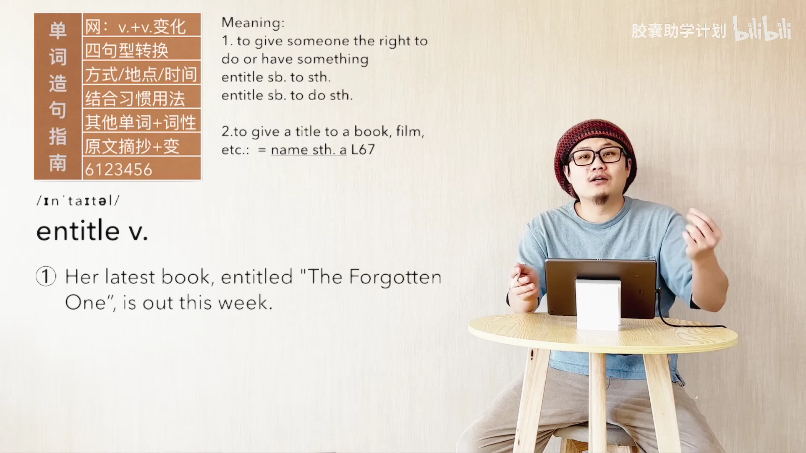

文字识别：单词造句指南 / 网：v.+v.变化 / Meaning: / 胶囊助学计划 / biBii / 1.to give someone the rightto / 四句型转换 / do or have something / 方式/地点/时间 / entitle sb.to sth. / 结合习惯用法 / entitle sb.to do sth. / 其他单词+词性 / 2.to give a title to a book, film, / 原文摘抄+变 / etc.: = name sth.a L67 / 6123456 / /In'taital/ / entitle v. / ① Her latest book, entitled "The Forgotten / One', is out this week.

## 00:02:30–00:03:00

过。下一个呢？对于他来说，entitle可以用的叫in entitle或者name都可以啊。呃，something A就是给某个东西起名字叫做A。往往咱们都是就像他说的是书啊、电影啊这些东西。比如说，he entitled the book Love Story，说他给这个书起了个名字叫爱情的故事，对吧？Next one，说this ticket doesn't entitle you to travel first

### 画面 00:02:30

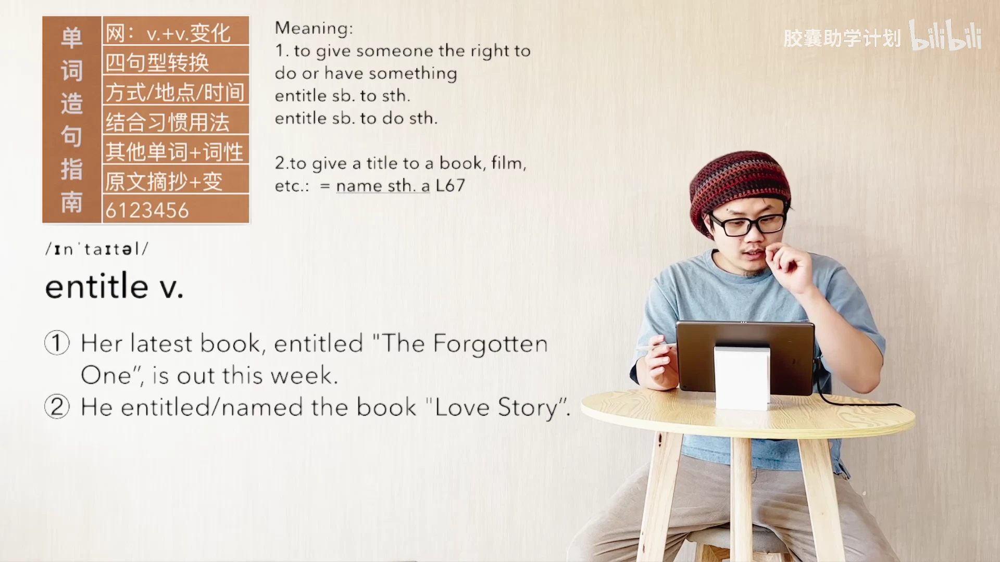

文字识别：单词造句指南 / 网：v.+v.变化 / Meaning: / 胶囊助学计划bilbil / 1.to give someone the right to / 四句型转换 / do or have something / 方式/地点/时间 / entitle sb.to sth. / 结合习惯用法 / entitle sb.to do sth. / 其他单词+词性 / 2.to give a title to a book, film, / 原文摘抄+变 / etc.: = name sth.a L67 / 6123456 / /In'taital/ / entitle v. / ① Her latest book, entitled "The Forgotten / One', is out this week. / ) He entitled/named the book "Love Story"

### 画面 00:02:33

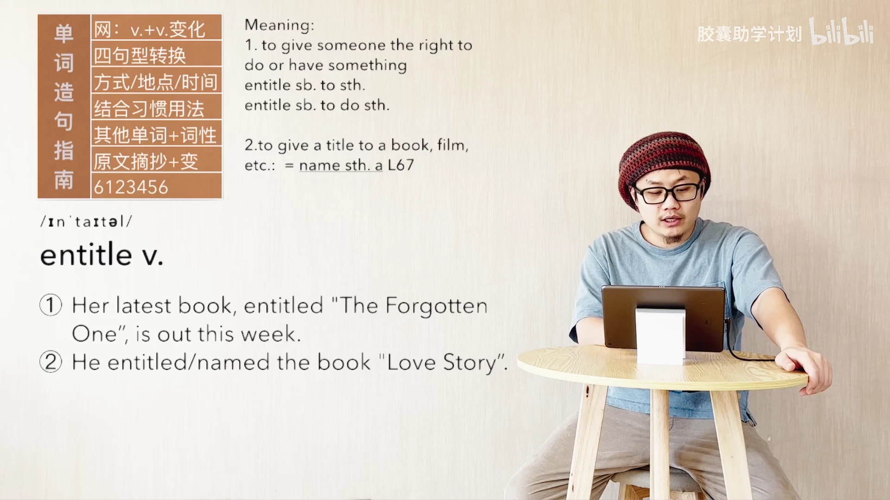

文字识别：单词造句指南 / 网：v.+v.变化 / Meaning: / 胶囊助学计划 blbil / 1.to give someone the right to / 四句型转换 / do or have something / 方式/地点/时间 / entitle sb.to sth. / 结合习惯用法 / entitle sb.to do sth. / 其他单词+词性 / 2.to give a title to a book, film, / 原文摘抄+变 / etc.: = name sth.a L67 / 6123456 / /In'taital/ / entitle v. / ① Her latest book, entitled "The Forgotten / One', is out this week. / ) He entitled/named the book "Love Story"

### 画面 00:02:35

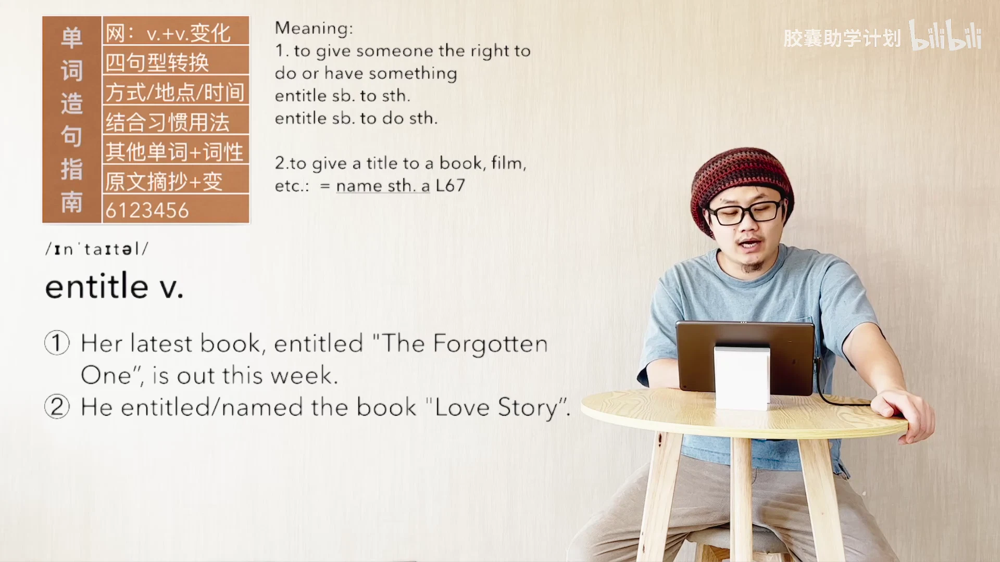

文字识别：单词造句指南 / 网：v.+v.变化 / Meaning: / 胶囊助学计划bilil / 1.to give someone the right to / 四句型转换 / do or have something / 方式/地点/时间 / entitle sb.to sth. / 结合习惯用法 / entitle sb.to do sth. / 其他单词+词性 / 2.to give a title to a book, film, / 原文摘抄+变 / etc.: = name sth.a L67 / 6123456 / /In'taital/ / entitle v. / ① Her latest book, entitled "The Forgotten / One', is out this week. / ) He entitled/named the book "Love Story"

### 画面 00:02:40

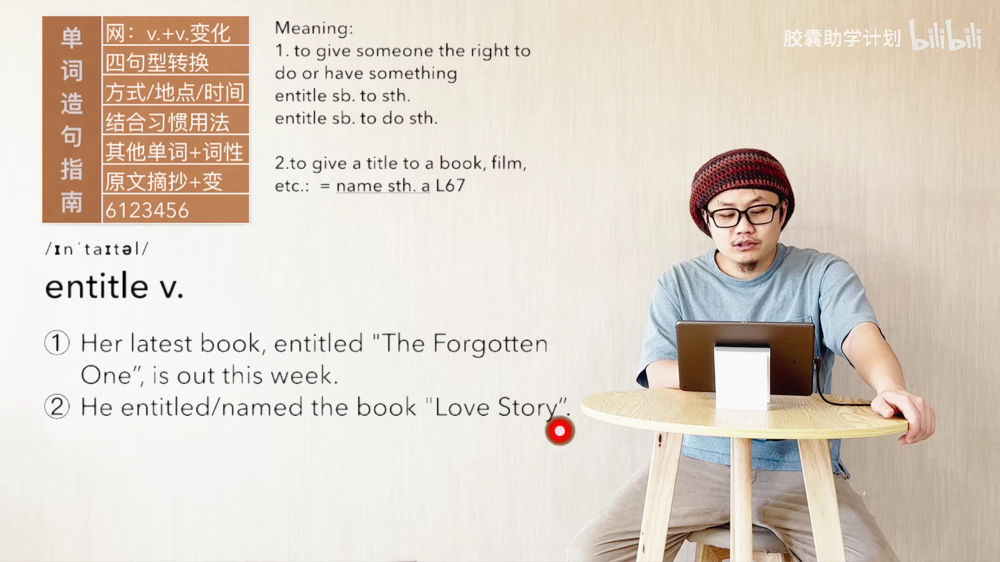

文字识别：单词造句指南 / 网：v.+v.变化 / Meaning: / 胶囊助学计划bilbil / 1.to give someone the right to / 四句型转换 / do or have something / 方式/地点/时间 / entitle sb.to sth. / 结合习惯用法 / entitle sb.to do sth. / 其他单词+词性 / 2.to give a title to a book, film, / 原文摘抄+变 / etc.: = name sth.a L67 / 6123456 / /In'taital/ / entitle v. / ① Her latest book, entitled "The Forgotten / One', is out this week. / ) He entitled/named the book "Love Story'

### 画面 00:02:45

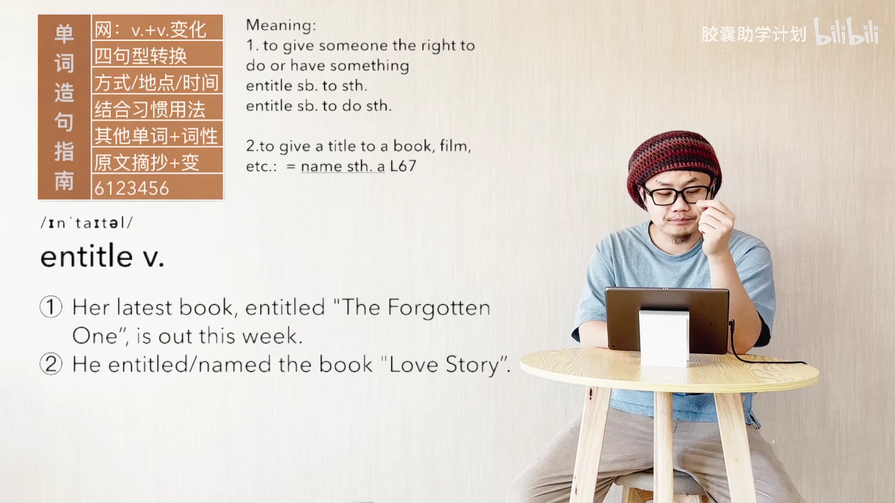

文字识别：单词造句指南 / 网：v.+v.变化 / Meaning: / 胶囊助学计划bi / 1.to give someone the right to / 四句型转换 / do or have something / 方式/地点/时间 / entitle sb.to sth. / 结合习惯用法 / entitle sb.to do sth. / 其他单词+词性 / 2.to give a title to a book, film, / 原文摘抄+变 / etc.: = name sth.a L67 / 6123456 / /In'taital/ / entitle v. / ① Her latest book, entitled "The Forgotten / One', is out this week. / ) He entitled/named the book "Love Story"

### 画面 00:02:51

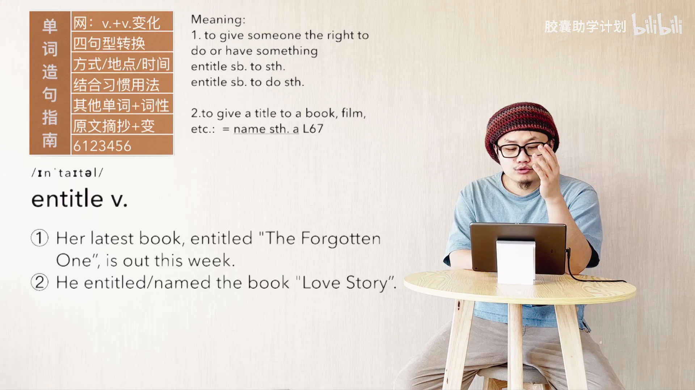

文字识别：单词造句指南 / 网：v.+v.变化 / Meaning: / 胶囊助学计划 bibil / 1.to give someone the right to / 四句型转换 / do or have something / 方式/地点/时间 / entitle sb.to sth. / 结合习惯用法 / entitle sb.to do sth. / 其他单词+词性 / 2.to give a title to a book, film, / 原文摘抄+变 / etc.: = name sth.a L67 / 6123456 / /In'taital/ / entitle v. / ① Her latest book, entitled "The Forgotten / One', is out this week. / ) He entitled/named the book "Love Story"

### 画面 00:02:55

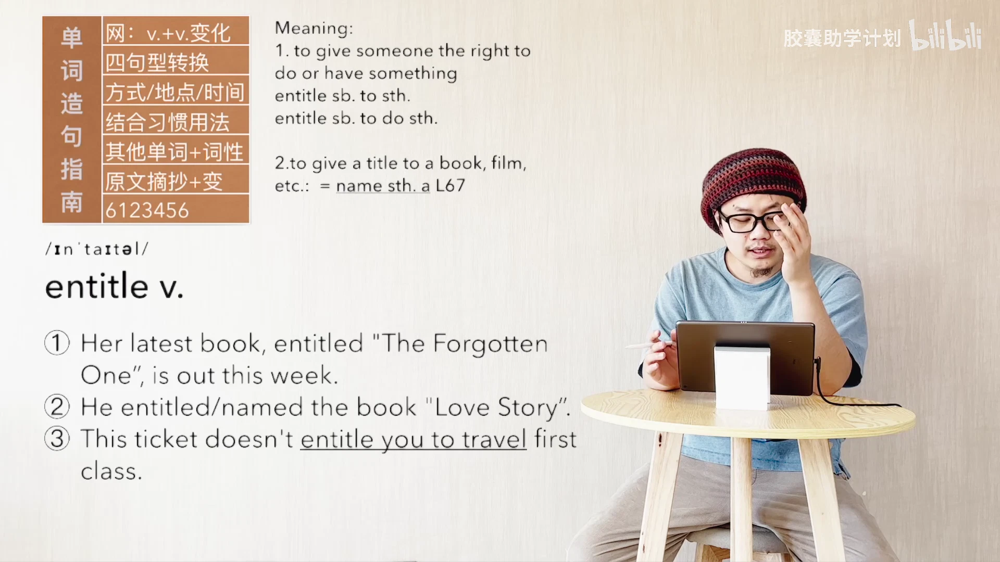

文字识别：单词造句指南 / 网：v.+v.变化 / Meaning: / 胶囊助学计划bibil / 1.to give someone the right to / 四句型转换 / do or have something / 方式/地点/时间 / entitle sb.to sth. / 结合习惯用法 / entitle sb.to do sth. / 其他单词+词性 / 2.to give a title to a book, film, / 原文摘抄+变 / etc.: = name sth.a L67 / 6123456 / /In'taital/ / entitle v. / ① Her latest book, entitled "The Forgotten / One', is out this week. / He entitled/named the book "Love Story" / This ticket doesn't entitle you to travel first / 3 / class.

## 00:03:00–00:03:30

class.这里的entitle somebody to do something就不是给谁起名字了，而是什么呢？叫做说这张票并没有给您权利去做头等舱，这张票只能在它只是经济舱，对吧？它并没有给我们权利去做某件事情，做的事情就是travel first class，坐头等舱航行。Okay, very good.那再读一遍这个单词entitle，记住最常见的两个意思，一个是我们

### 画面 00:03:00

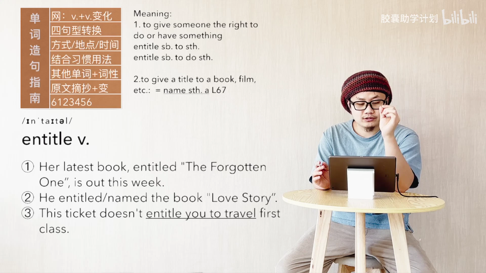

文字识别：Meaning: / 胶囊助学计划 bilii / 单词造句指南 / 网：v.+v.变化 / 1.to give someone the right to / 四句型转换 / do or have something / 方式/地点/时间 / entitle sb.to sth. / 结合习惯用法 / entitle sb.to do sth. / 其他单词+词性 / 2.to give a title to a book, film, / 原文摘抄+变 / etc.: = name sth.a L67 / 6123456 / /in'taital/ / entitle v. / ① Her latest book, entitled "The Forgotten / One', is out this week. / He entitled/named the book"Love Story". /  This ticket doesn't entitle you to travel first / 3 / class.

### 画面 00:03:05

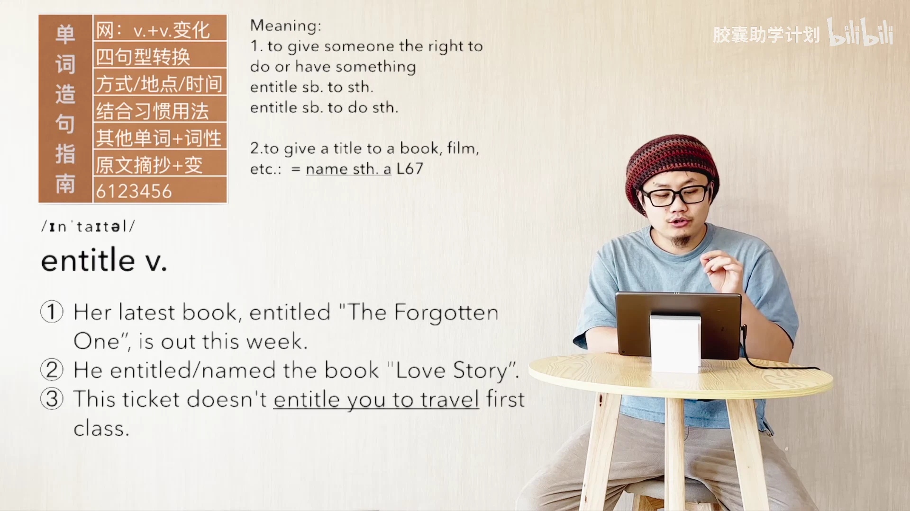

文字识别：Meaning: / 胶囊助学计划bilbii / 单词造句指南 / 网：v.+v.变化 / 1.to give someone the rightto / 四句型转换 / do or have something / 方式/地点/时间 / entitle sb.to sth. / 结合习惯用法 / entitle sb.to do sth. / 其他单词+词性 / 2.to give a title to a book, film, / 原文摘抄+变 / etc.: = name sth.a L67 / 6123456 / /in'taital/ / entitle v. / ① Her latest book, entitled "The Forgotten / One', is out this week. / He entitled/named the book"Love Story" / This ticket doesn't entitle you to travel first / 3 / class.

### 画面 00:03:11

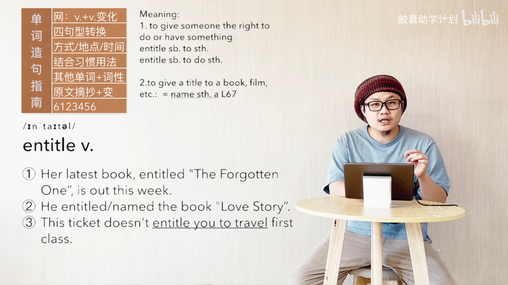

文字识别：单词造句指南 / 网：v.+v.变化 / Meaning: / 胶囊助学计划bibi / 1.to give someone the right to / 四句型转换 / do or have something / 方式/地点/时间 / entitle sb.to sth. / 结合习惯用法 / entitle sb.to do sth. / 其他单词+词性 / 2.to give a title toa book, film, / 原文摘抄+变 / etc.: = name sth.a L67 / 6123456 / /In'taital/ / entitle v. / ① Her latest book, entitled "The Forgotten / One', is out this week. / He entitled/named the book "Love Story". / This ticket doesn't entitle you to travel first / 3 / class.

### 画面 00:03:13

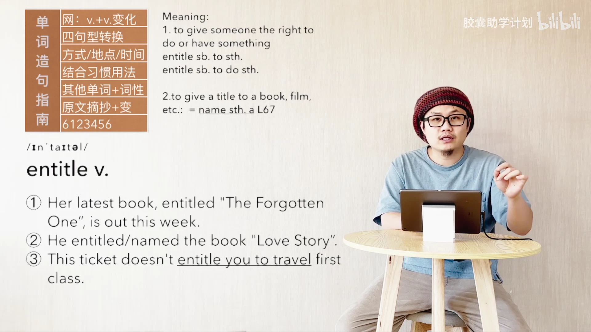

文字识别：单词造句指南 / 网：v.+v.变化 / Meaning: / 胶囊助学计划 bilbil / 1.to give someone the right to / 四句型转换 / do or have something / 方式/地点/时间 / entitle sb.to sth. / 结合习惯用法 / entitle sb.to do sth. / 其他单词+词性 / 2.to give a title to a book, film, / 原文摘抄+变 / etc.: = name sth.a L67 / 6123456 / /In'taital/ / entitle v. / ① Her latest book, entitled "The Forgotten / One', is out this week. / He entitled/named the book "Love Story" / This ticket doesn't entitle you to travel first / 3 / class.

### 画面 00:03:15

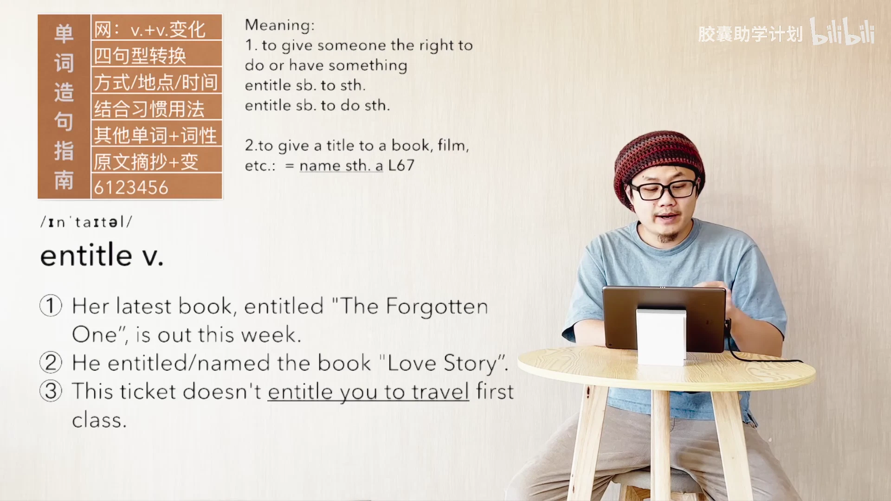

文字识别：单词造句指南 / 网：v.+v.变化 / Meaning: / 胶囊助学计划bi / 1.to give someone the right to / 四句型转换 / do or have something / 方式/地点/时间 / entitle sb.to sth. / 结合习惯用法 / entitle sb.to do sth. / 其他单词+词性 / 2.to give a title to a book, film, / 原文摘抄+变 / etc.: = name sth.a L67 / 6123456 / /In'tartal/ / entitle v. / ① Her latest book, entitled "The Forgotten / One', is out this week. / He entitled/named the book "Love Story" / This ticket doesn't entitle you to travel first / 3 / class.

## 00:03:30–00:04:00

文中给的，类似于 called 或者 named，叫给谁谁命名；另外一个呢叫做有权利，哎哎去做某件事情，哎有权去做某件事情。那咱注意力集中听个电影片段啊。哎，那你注意这里的，你猜都是什么意思？其实就常见的，就刚才我说的命名和有权利，是吧？那你看这句话说，那并没有给你权利去拿走属于

### 画面 00:03:41

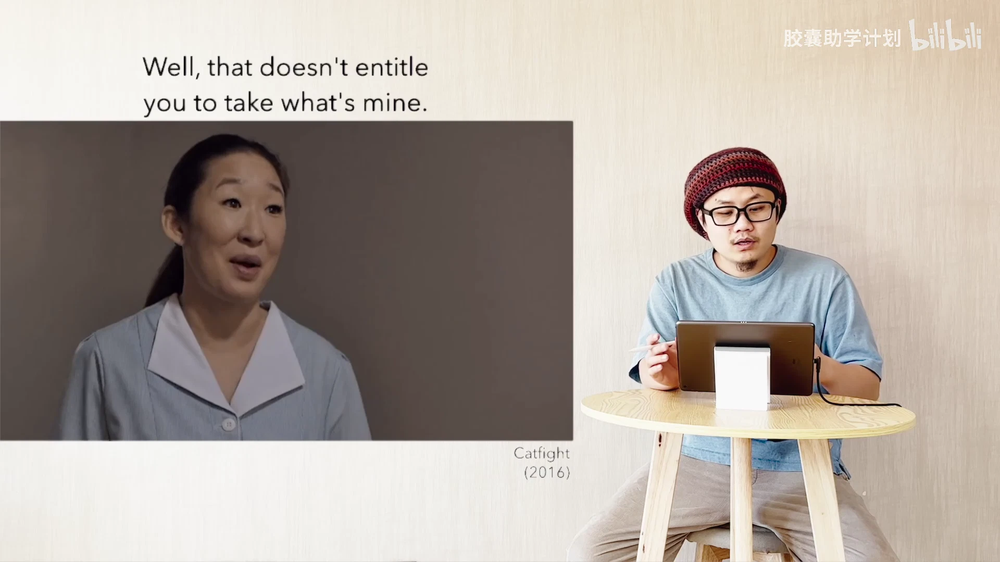

文字识别：biibl / 胶囊助学计划 / Well, that doesn't entitle / you to take what's mine. / Catfight / (2016)

### 画面 00:03:46

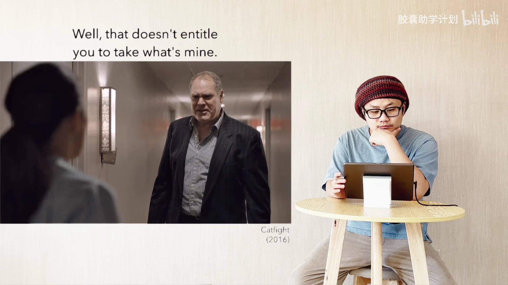

文字识别：bibii / 胶囊助学计划 / Well, that doesn't entitle / you to take what's mine. / Catfight / (2016)

### 画面 00:03:48

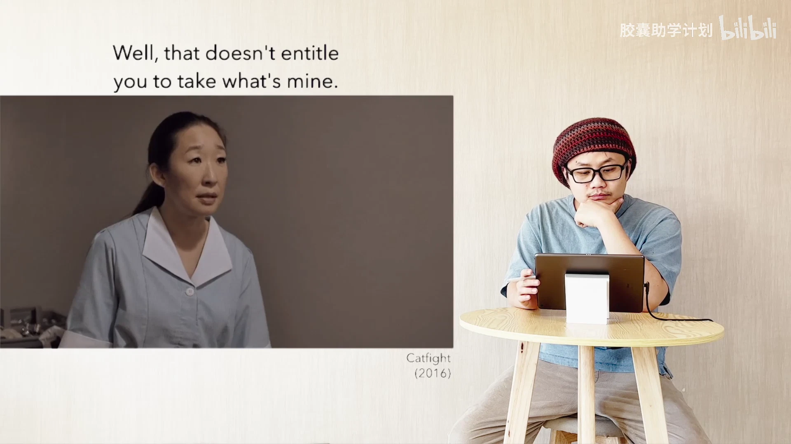

文字识别：bilbii / 胶囊助学计划 / Well, that doesn't entitle / you to take what's mine. / Catfight / (2016)

## 00:04:00–00:04:30

我的东西。权力。X one，注意力集中，咱继续听。Entitled it white walls. 哎，他给它命名白色的墙，white walls，对吧？那 it 是啥？咱现在不知道，对吧？它这个没有上下文，咱就不管它了啊。但是这个就是 entitled a something a，对吧？哎，呃，给呃某个东西起名字叫做 a，那这里的 a 就是 white walls。Very good。下一个单词，这个单词其实我们见过很多次了，叫做

### 画面 00:04:02

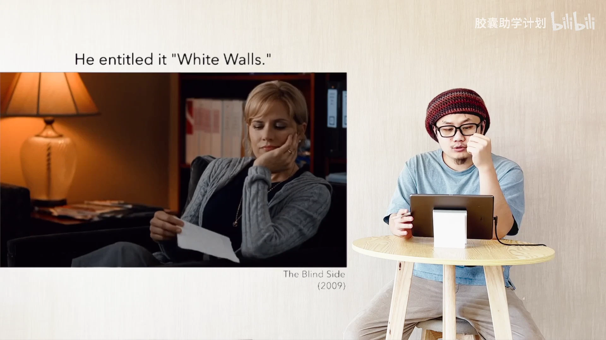

文字识别：胶囊助学计划blbi / He entitled it "White Walls." / The Blind Side / (2009)

### 画面 00:04:06

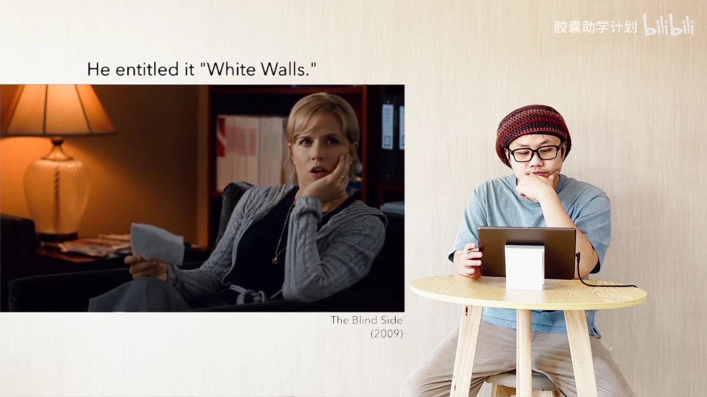

文字识别：胶囊助学计划bibi / He entitled it "White Walls." / The Blind Side / (2009)

### 画面 00:04:08

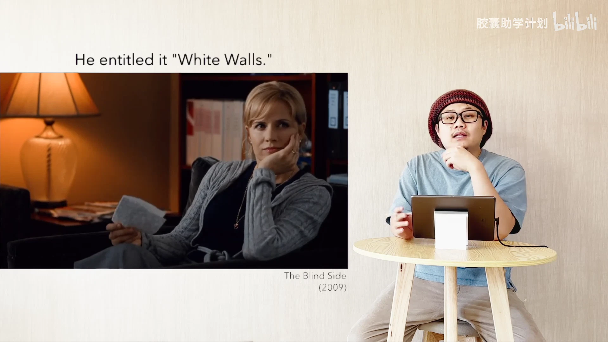

文字识别：胶囊助学计划bibi / He entitled it "White Walls." / The Blind Side / (2009)

### 画面 00:04:10

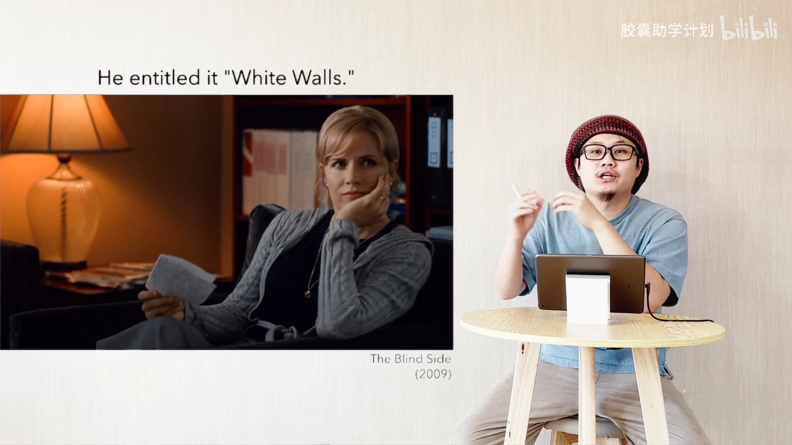

文字识别：biibii / 胶囊助学计划 / He entitled it "White Walls." / The Blind Side / (2009)

### 画面 00:04:14

文字识别：bibii / 胶囊助学计划 / He entitled it "White Walls." / The Blind Side / (2009)

### 画面 00:04:26

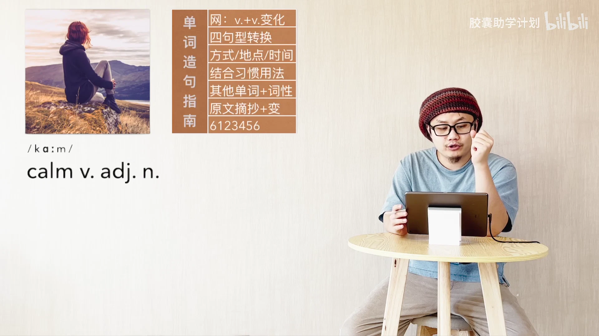

文字识别：单词造句指南 / 网：v.+v.变化 / 胶囊助学计划 / bilbili / 四句型转换 / 方式/地点/时间 / 结合习惯用法 / 其他单词+词性 / 原文摘抄+变 / 6123456 / /kaim/ / calm v. adj. n.

### 画面 00:04:28

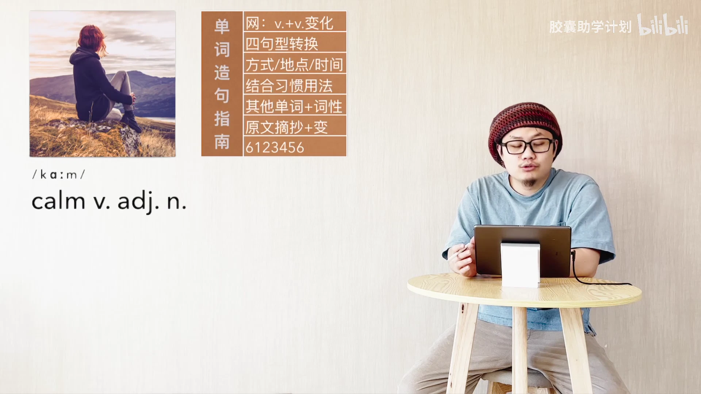

文字识别：单词造句指南 / 网：v.+v.变化 / 胶囊助学计划 / bilbili / 四句型转换 / 方式/地点/时间 / 结合习惯用法 / 其他单词+词性 / 原文摘抄+变 / 6123456 / /ka:m/ / calm v. adj. n.

## 00:04:30–00:05:00

calm, calm 啊。那 calm 很常见的意思，比如说 calm down，哎，这个安静下来啊，包括也可以说，哎，大家情绪稳定一下， calm down，平复一下你的心情， calm down。 OK，再来，比如说 listen to me, you need to calm down。这个句子就很简单啊，你听我说啊，你需要这个呃，这个稳定一下你的情绪。 Why are you so calm？我也可以直接单独去用它。所以你看， calm 这个单词，动词、形容词、名

### 画面 00:04:30

文字识别：单词造句指南 / 网：v.+v.变化 / 胶囊助学计划 / bilbili / 四句型转换 / 方式/地点/时间 / 结合习惯用法 / 其他单词+词性 / 原文摘抄+变 / 6123456 / /ka:m/ / calm v. adj. n.

### 画面 00:04:33

文字识别：单词造句指南 / 网：v.+v.变化 / 胶囊助学计划 / bilbili / 四句型转换 / 方式/地点/时间 / 结合习惯用法 / 其他单词+词性 / 原文摘抄+变 / 6123456 / /kaim/ / calm v. adj. n. / ① calm down

### 画面 00:04:35

文字识别：单词造句指南 / 网：v.+v.变化 / 胶囊助学计划 / Bilbii / 四句型转换 / 方式/地点/时间 / 结合习惯用法 / 其他单词+词性 / 原文摘抄+变 / 6123456 / /kaim/ / calm v. adj. n. / ① calm down

### 画面 00:04:39

文字识别：单词造句指南 / 网：v.+v.变化 / 胶囊助学计划 / blibili / 四句型转换 / 方式/地点/时间 / 结合习惯用法 / 其他单词+词性 / 原文摘抄+变 / 6123456 / /kaim/ / calm v. adj. n. / ① calm down

### 画面 00:04:42

文字识别：单词造句指南 / 网：v.+v.变化 / 胶囊助学计划 / bilbili / 四句型转换 / 方式/地点/时间 / 结合习惯用法 / 其他单词+词性 / 原文摘抄+变 / 6123456 / /kaim/ / calm v. adj. n. / calm down / 1

### 画面 00:04:45

文字识别：单词造句指南 / 网：v.+v.变化 / 胶囊助学计划 / bibili / 四句型转换 / 方式/地点/时间 / 结合习惯用法 / 其他单词+词性 / 原文摘抄+变 / 6123456 / /kaim/ / calm v. adj. n. / ① calm down / Listen to me, you need to calm down.

### 画面 00:04:49

文字识别：单词造句指南 / 网：v.+v.变化 / 胶囊助学计划 / bibii / 四句型转换 / 方式/地点/时间 / 结合习惯用法 / 其他单词+词性 / 原文摘抄+变 / 6123456 / /kaim/ / calm v. adj. n. / ① calm down / Listen to me, you need to calm down. / Why are you so calm? / 3

### 画面 00:04:51

文字识别：单词造句指南 / 网：v.+v.变化 / 胶囊助学计划 / bilbili / 四句型转换 / 方式/地点/时间 / 结合习惯用法 / 其他单词+词性 / 原文摘抄+变 / 6123456 / /kaim/ / calm v. adj. n. / ① calm down / Listen to me, you need to calm down. /  Why are you so calm? / 3

### 画面 00:04:55

文字识别：单词造句指南 / 网：v.+v.变化 / 胶囊助学计划 / bibii / 四句型转换 / 方式/地点/时间 / 结合习惯用法 / 其他单词+词性 / 原文摘抄+变 / 6123456 / /ka:m/ / calm v. adj. n. / ① calm down / Listen to me, you need to calm down. /  Why are you so calm? / 3

## 00:05:00–00:05:30

词含义其实差别不大啊，只是它在不同的句子当中，你比如说这里的so calm，就你当一个形容词去处理，对吧？你怎么这么平静啊？面对这么大的事情，比如说还很常见的短语，说I try to keep calm all the time。这个keep calm跟这个呃，就保持calm，哎，平静、安静，这个这个情绪稳定的这样一个状态，哎，一直都是这个样子啊。我一直都在尝试去

### 画面 00:05:00

文字识别：单词造句指南 / 网：v.+v.变化 / 胶囊助学计划 / bilbii / 四句型转换 / 方式/地点/时间 / 结合习惯用法 / 其他单词+词性 / 原文摘抄+变 / 6123456 / /ka:m/ / calm v. adj. n. / ① calm down / Listen to me, you need to calm down. / Why are you so calm? / 3

### 画面 00:05:03

文字识别：单词造句指南 / 网：v.+v.变化 / 胶囊助学计划 / bilbili / 四句型转换 / 方式/地点/时间 / 结合习惯用法 / 其他单词+词性 / 原文摘抄+变 / 6123456 / /ka:m/ / calm v. adj. n. / ① calm down / Listen to me, you need to calm down. / Why are you so calm? / 3

### 画面 00:05:05

文字识别：单词造句指南 / 网：v.+v.变化 / 胶囊助学计划 / bilbi / 四句型转换 / 方式/地点/时间 / 结合习惯用法 / 其他单词+词性 / 原文摘抄+变 / 6123456 / /ka:m/ / calm v. adj. n. / ① calm down / Listen to me, you need to calm down. /  Why are you so calm? / 3

### 画面 00:05:10

文字识别：胶囊助学计划 bilibil / 单词造句指南 / 网：v.+v.变化 / 四句型转换 / 方式/地点/时间 / 结合习惯用法 / 其他单词+词性 / 原文摘抄+变 / 6123456 / /ka:m/ / calm v. adj. n. / ① calm down / Listen to me, you need to calm down. / 3 / Why are you so calm? / ④ I try to keep calm all the time.

### 画面 00:05:16

文字识别：胶囊助学计划 bilibil / 单词造句指南 / 网：v.+v.变化 / 四句型转换 / 方式/地点/时间 / 结合习惯用法 / 其他单词+词性 / 原文摘抄+变 / 6123456 / /ka:m/ / calm v. adj. n. / ① calm down / Listen to me, you need to calm down. / ③ Why are you so calm? / ④ I try to keep calm all the time.

### 画面 00:05:20

文字识别：胶囊助学计划 bilibil / 单词造句指南 / 网：v.+v.变化 / 四句型转换 / 方式/地点/时间 / 结合习惯用法 / 其他单词+词性 / 原文摘抄+变 / 6123456 / /ka:m/ / calm v. adj. n. / ① calm down / Listen to me, you need to calm down. / 3 / ③ Why are you so calm? / ④ I try to keep calm all the time.

## 00:05:30–00:06:00

呃保持一个冷静的状态啊啊！I try to keep calm all the time. Okay,好，那我觉得这个电影场景就特别好，立刻就能让你感受到什么叫 calm down，对吧？咱们注意力集中看一下。 Calm down, calm down, everybody. Calm down. That's enough. Alright,大家安静一下，安静一下，平复一下你那个激动的心情，对吧？Okay, calm down, calm down, everyone, everybody. Calm down. That's enough. Here

### 画面 00:05:30

文字识别：胶囊助学计划bilbi / 单词造句指南 / 网：v.+v.变化 / 四句型转换 / 方式/地点/时间 / 结合习惯用法 / 其他单词+词性 / 原文摘抄+变 / 6123456 / /kaim/ / calm v. adj. n. / ① calm down / Listen to me, you need to calm down. / 3 / ③ Why are you so calm? / ④ I try to keep calm all the time.

### 画面 00:05:35

文字识别：胶囊助学计划bibil / 单词造句指南 / 网：v.+v.变化 / 四句型转换 / 方式/地点/时间 / 结合习惯用法 / 其他单词+词性 / 原文摘抄+变 / 6123456 / /kaim/ / calm v. adj. n. / ① calm down / Listen to me, you need to calm down. / ③ Why are you so calm? / ④ I try to keep calm all the time.

### 画面 00:05:37

文字识别：biibili / 胶囊助学计划 / Calm down. Calm down, everybody. / Calm down. That's enough. / Big Fish / (2003)

### 画面 00:05:44

文字识别：bibili / 胶囊助学计划 / Calm down. Calm down, everybody. / Calm down. That's enough. / Big Fish / (2003)

### 画面 00:05:46

文字识别：bibii / 胶囊助学计划 / Calm down. Calm down, everybody. / Calm down. That's enough. / Big Fish / (2003)

### 画面 00:05:48

文字识别：胶囊助学计划biib出 / Calm down. Calm down, everybody. / Calm down. That's enough. / Big Fish / (2003)

### 画面 00:05:50

文字识别：胶囊助学计划bibi出 / Calm down. Calm down, everybody. / Calm down. That's enough. / Big Fish / (2003)

### 画面 00:05:52

文字识别：胶囊助学计划bibi出 / Calm down. Calm down, everybody. / Calm down. That's enough. / Big Fish / (2003)

### 画面 00:05:55

文字识别：bilbili / 胶囊助学计划 / Calm down. Calm down, everybody. / Calm down. That's enough. / Big Fish / (2003)

### 画面 00:05:59

文字识别：单词造句指南 / 网：v.+v.变化 / 胶囊助学计划 / Biibii / 四句型转换 / 方式/地点/时间 / 结合习惯用法 / 其他单词+词性 / 原文摘抄+变 / 6123456 / /n3:v/ / nerve n.

## 00:06:00–00:06:30

下一个单词叫 nerve, nerve, nerve.我们就是说神经啊，神经。呃，最基本的就是这种神经系统，这是物理意义上的。那我们平常聊天肯定不是这个。比如说, before she had an operation,其实节课咱们刚学，她动手术之前, I lit a cigarette to calm my nerve.其实后半句话是有点像我们原文去抄的。我们这篇文章的原文就出现了, lit a cigarette to calm my nerve.那你看, calm my nerve什么意思？Calm刚才说了，平

### 画面 00:06:01

文字识别：单词造句指南 / 网：v.+v.变化 / 胶囊助学计划 / bilbili / 四句型转换 / 方式/地点/时间 / 结合习惯用法 / 其他单词+词性 / 原文摘抄+变 / 6123456 / /n3:v/ / nerve n.

### 画面 00:06:04

文字识别：单词造句指南 / 网：v.+v.变化 / 胶囊助学计划 / bilbii / 四句型转换 / 方式/地点/时间 / 结合习惯用法 / 其他单词+词性 / 原文摘抄+变 / 6123456 / /n3:v/ / nerve n.

### 画面 00:06:06

文字识别：单词造句指南 / 网：v.+v.变化 / 胶囊助学计划 / bilbili / 四句型转换 / 方式/地点/时间 / 结合习惯用法 / 其他单词+词性 / 原文摘抄+变 / 6123456 / /n3:v 1 / nerve n.

### 画面 00:06:08

文字识别：单词造句指南 / 网：v.+v.变化 / 胶囊助学计划 / bibili / 四句型转换 / 方式/地点/时间 / 结合习惯用法 / 其他单词+词性 / 原文摘抄+变 / 6123456 / /n3:v / / nerve n. /  Before she had an operation, I lit a cigarette / to calm my nerve. L77

### 画面 00:06:10

文字识别：单词造句指南 / 网：v.+v.变化 / 胶囊助学计划 / bibii / 四句型转换 / 方式/地点/时间 / 结合习惯用法 / 其他单词+词性 / 原文摘抄+变 / 6123456 / /n3:v/ / nerve n. /  Before she had an operation, I lit a cigarette / to calm my nerve. L77

### 画面 00:06:12

文字识别：单词造句指南 / 网：v.+v.变化 / 胶囊助学计划 / Bilbii / 四句型转换 / 方式/地点/时间 / 结合习惯用法 / 其他单词+词性 / 原文摘抄+变 / 6123456 / /n3:v/ / nerve n. / Before she had an oparation, I lit a cigarette / to calm my nerve. L7

### 画面 00:06:14

文字识别：单词造句指南 / 网：v.+v.变化 / 胶囊助学计划 / bibii / 四句型转换 / 方式/地点/时间 / 结合习惯用法 / 其他单词+词性 / 原文摘抄+变 / 6123456 / /n3:v/ / nerve n. /  Before she had an operation, I lit a cigarette / to calm my nerve. L77

### 画面 00:06:17

文字识别：单词造句指南 / 网：v.+v.变化 / 胶囊助学计划 / bibil / 四句型转换 / 方式/地点/时间 / 结合习惯用法 / 其他单词+词性 / 原文摘抄+变 / 6123456 / /n3:v / / nerve n. / Before she had an operation, I lit a cigarette / to calm my nerve. L77

### 画面 00:06:20

文字识别：单词造句指南 / 网：v.+v.变化 / 胶囊助学计划 / biibii / 四句型转换 / 方式/地点/时间 / 结合习惯用法 / 其他单词+词性 / 原文摘抄+变 / 6123456 / /n3:v / / nerve n. / Before she had an operation, I lit a cigarette / to calm my nerve. L77

### 画面 00:06:22

文字识别：单词造句指南 / 网：v.+v.变化 / 胶囊助学计划 / bibii / 四句型转换 / 方式/地点/时间 / 结合习惯用法 / 其他单词+词性 / 原文摘抄+变 / 6123456 / /n3:v/ / nerve n. /  Before she had an operation, I lit a cigarette / to calm my nerve. L77

### 画面 00:06:25

文字识别：单词造句指南 / 网：v.+v.变化 / 胶囊助学计划 / bibii / 四句型转换 / 方式/地点/时间 / 结合习惯用法 / 其他单词+词性 / 原文摘抄+变 / 6123456 / /n3iv / / nerve n. / Before she had an operation, I lit a cigarette / to calm my nerve. L77

### 画面 00:06:28

文字识别：单词造句指南 / 网：v.+v.变化 / 胶囊助学计划 / bilbli / 四句型转换 / 方式/地点/时间 / 结合习惯用法 / 其他单词+词性 / 原文摘抄+变 / 6123456 / /n3:v / / nerve n. / Before she had an operation, I lit a cigarette / to calm my nerve. L77

## 00:06:30–00:07:00

静平复，对吧？好，calm my nerve叫让我的神经平复下来，平静下来。哎，比如说其实就类似于，呃，你过于紧张，过于焦虑，吃点药，然后让自己平静下来，对吧？Calm my nerve就是这样一个意思。OK，next one说，Wow，I can't believe that she had the nerve to ask for a raise on her first day。那首先这里有一个习惯用法叫have the nerve to do something，

### 画面 00:06:30

文字识别：单词造句指南 / 网：v.+v.变化 / 胶囊助学计划 / bibii / 四句型转换 / 方式/地点/时间 / 结合习惯用法 / 其他单词+词性 / 原文摘抄+变 / 6123456 / /n3:v / / nerve n. / Before she had an operation, I lit a cigarette / to calm my nerve. L77

### 画面 00:06:33

文字识别：单词造句指南 / 网：v.+v.变化 / 胶囊助学计划 / bilbili / 四句型转换 / 方式/地点/时间 / 结合习惯用法 / 其他单词+词性 / 原文摘抄+变 / 6123456 / /n3:v/ / nerve n. / Before she had an operation, I lit a cigarette / to calm my nerve. L77

### 画面 00:06:35

文字识别：单词造句指南 / 网：v.+v.变化 / 胶囊助学计划 / biibii / 四句型转换 / 方式/地点/时间 / 结合习惯用法 / 其他单词+词性 / 原文摘抄+变 / 6123456 / /n3:v/ / nerve n. /  Before she had an operation, I lit a cigarette / to calm my nerve. L77

### 画面 00:06:38

文字识别：单词造句指南 / 网：v.+v.变化 / 胶囊助学计划 / biibil / 四句型转换 / 方式/地点/时间 / 结合习惯用法 / 其他单词+词性 / 原文摘抄+变 / 6123456 / /n3iv / / nerve n. /  Before she had an operation, I lit a cigarette / to calm my nerve. L77

### 画面 00:06:40

文字识别：单词造句指南 / 网：v.+v.变化 / 胶囊助学计划 / bibii / 四句型转换 / 方式/地点/时间 / 结合习惯用法 / 其他单词+词性 / 原文摘抄+变 / 6123456 / /n3:v / / nerve n. / Before she had an operation, I lit a cigarette / to calm my nerve. L77

### 画面 00:06:45

文字识别：单词造句指南 / 网：v.+v.变化 / 胶囊助学计划 / bibii / 四句型转换 / 方式/地点/时间 / 结合习惯用法 / 其他单词+词性 / 原文摘抄+变 / 6123456 / /n3:v/ / nerve n. / Before she had an operation, I lit a cigarette / to calm my nerve. L77

### 画面 00:06:47

文字识别：胶囊助学计划bilbil / 单词造句指南 / 网：v.+v.变化 / 四句型转换 / 方式/地点/时间 / 结合习惯用法 / 其他单词+词性 / 原文摘抄+变 / 6123456 / /n3:v / / nerve n. / ① Before she had an operation, I lit a cigarette / to calm my nerve. L77 / Wow, I can't believe that she had the nerve / to ask for a raise on her first day! L6

### 画面 00:06:50

文字识别：单词造句指南 / 网：v.+v.变化 / 胶囊助学计划bibi / 四句型转换 / 方式/地点/时间 / 结合习惯用法 / 其他单词+词性 / 原文摘抄+变 / 6123456 / /n3:v / / nerve n. / ① Before she had an operation, I lit a cigarette / to calm my nerve. L77 / Wow, I can't believe that she had the nerve / to ask for a raise on her first day! L6

### 画面 00:06:55

文字识别：单词造句指南 / 网：v.+v.变化 / 胶囊助学计划bilbi / 四句型转换 / 方式/地点/时间 / 结合习惯用法 / 其他单词+词性 / 原文摘抄+变 / 6123456 / /n3:v / / nerve n. / ① Before she had an operation, I lit a cigarette / to calm my nerve. L77 / Wow, I can't believe that she had the nerve / to ask for a raise on her first day! L6

## 00:07:00–00:07:30

这个nerve就不是神经了，也是它很常见的意思，叫做有勇气，很常见的意思叫有勇气去做某件事情。比如说，哇哦，感叹词，说我难以置信，他竟然有勇气去ask for a raise，叫寻求加薪啊，要求加薪。On her first day,来第一天就要求加薪，哎，他有勇气干这件事。那lose somebody's nerve呢？其实就是失去了勇气，啊，没

### 画面 00:07:00

文字识别：单词造句指南 / 网：v.+v.变化 / 胶囊助学计划bibi / 四句型转换 / 方式/地点/时间 / 结合习惯用法 / 其他单词+词性 / 原文摘抄+变 / 6123456 / /n3:v / / nerve n. / ① Before she had an operation, I lit a cigarette / to calm my nerve. L77 / Wow, I can't believe that she had the nerve / to ask for a raise on her first day! L6

### 画面 00:07:06

文字识别：胶囊助学计划bilbii / 单词造句指南 / 网：v.+v.变化 / 四句型转换 / 方式/地点/时间 / 结合习惯用法 / 其他单词+词性 / 原文摘抄+变 / 6123456 / /n3:v / / nerve n. / ① Before she had an operation, I lit a cigarette / to calm my nerve. L77 / Wow, I can't believe that she had the nerve / to ask for a raise on her first day! L6

### 画面 00:07:08

文字识别：单词造句指南 / 网：v.+v.变化 / 胶囊助学计划ibi / 四句型转换 / 方式/地点/时间 / 结合习惯用法 / 其他单词+词性 / 原文摘抄+变 / 6123456 / /n3:v 1 / nerve n. / ① Before she had an operation, I lit a cigarette / to calm my nerve. L77 / Wow, I can't believe that she had the nerve / to ask for a raise on her first day! L6

### 画面 00:07:10

文字识别：单词造句指南 / 网：v.+v.变化 / 胶囊助学计划bibi / 四句型转换 / 方式/地点/时间 / 结合习惯用法 / 其他单词+词性 / 原文摘抄+变 / 6123456 / /n3:v/ / nerve n. / ① Before she had an operation, I lit a cigarette / to calm my nerve. L77 / Wow, I can't believe that she had the nerve / to ask for a raise on her first day! L6

### 画面 00:07:13

文字识别：单词造句指南 / 网：v.+v.变化 / 胶囊助学计划bilbil / 四句型转换 / 方式/地点/时间 / 结合习惯用法 / 其他单词+词性 / 原文摘抄+变 / 6123456 / /n3:v 1 / nerve n. / ① Before she had an operation, I lit a cigarette / to calm my nerve. L77 / Wow, I can't believe that she had the nerve / to ask for a raise on her first day! L6

### 画面 00:07:15

文字识别：单词造句指南 / 网：v.+v.变化 / 胶囊助学计划bibi / 四句型转换 / 方式/地点/时间 / 结合习惯用法 / 其他单词+词性 / 原文摘抄+变 / 6123456 / /n3:v / / nerve n. / ① Before she had an operation, I lit a cigarette / to calm my nerve. L77 / Wow, I can't believe that she had the nerve / to ask for a raise on her first day! L6

### 画面 00:07:20

文字识别：胶囊助学计划bilbii / 单词造句指南 / 网：v.+v.变化 / 四句型转换 / 方式/地点/时间 / 结合习惯用法 / 其他单词+词性 / 原文摘抄+变 / 6123456 / /n3:v1 / nerve n. / ① Before she had an operation, I lit a cigarette / to calm my nerve. L77 / Wow, I can't believe that she had the nerve / to ask for a raise on her first day! L6

### 画面 00:07:25

文字识别：单词造句指南 / 网：v.+v.变化 / 胶囊助学计划bibi / 四句型转换 / 方式/地点/时间 / 结合习惯用法 / 其他单词+词性 / 原文摘抄+变 / 6123456 / /n3:v / / nerve n. / ① Before she had an operation, I lit a cigarette / to calm my nerve. L77 / Wow, I can't believe that she had the nerve / to ask for a raise on her first day! L6 / lose sb's nerve ..

### 画面 00:07:28

文字识别：单词造句指南 / 网：v.+v.变化 / 胶囊助学计划ii / 四句型转换 / 方式/地点/时间 / 结合习惯用法 / 其他单词+词性 / 原文摘抄+变 / 6123456 / /n3:v / / nerve n. / ① Before she had an operation, I lit a cigarette / to calm my nerve. L77 / Wow, I can't believe that she had the nerve / to ask for a raise on her first day! L6 / lose sb's nerve ...

## 00:07:30–00:08:00

有勇气了，哎，比如说打架啊，对吧？然后被别人打败了啊，就是打仗，然后呢就丧失了抵抗的勇气，哎，lose somebody's nerve。那我们看这句话说，After that he lost his nerve and moved to his hometown。哎，说在那之后他就丧失了勇气，然后搬回到了他的家乡，也不再出来打拼了。OK，那再读一遍这个单词 nerve。那注意力集中，咱们接下来听一些电影片段啊。OK，

### 画面 00:07:30

文字识别：胶囊助学计划 bilbil / 单词造句指南 / 网：v.+v.变化 / 四句型转换 / 方式/地点/时间 / 结合习惯用法 / 其他单词+词性 / 原文摘抄+变 / 6123456 / /n3:v 1 / nerve n. / ① Before she had an operation, I lit a cigarette / to calm my nerve. L77 / Wow, I can't believe that she had the nerve / to ask for a raise on her first day! L6 / lose sb's nerve ...

### 画面 00:07:32

文字识别：单词造句指南 / 网：v.+v.变化 / 胶囊助学计划bilil / 四句型转换 / 方式/地点/时间 / 结合习惯用法 / 其他单词+词性 / 原文摘抄+变 / 6123456 / /n3 v 1 / nerve n. / ① Before she had an operation, I lit a cigarette / to calm my nerve. L77 /  Wow, I can't believe that she had the nerve / to ask for a raise on her first day! L6 / lose sb's nerve ... / ④ After that, he lost his nerve, and moved to / his hometown. L6

### 画面 00:07:35

文字识别：单词造句指南 / 网：v.+v.变化 / 胶囊助学计划biibil / 四句型转换 / 方式/地点/时间 / 结合习惯用法 / 其他单词+词性 / 原文摘抄+变 / 6123456 / /n3 :v / / nerve n. / ① Before she had an operation, I lit a cigarette / to calm my nerve. L77 / Wow, I can't believe that she had the nerve / to ask for a raise on her first day! L6 / lose sb's nerve ... / 3 / ④ After that, he lost his nerve, and moved to / his hometown.L6

### 画面 00:07:38

文字识别：单词造句指南 / 网：v.+v.变化 / 胶囊助学计划bi / 四句型转换 / 方式/地点/时间 / 结合习惯用法 / 其他单词+词性 / 原文摘抄+变 / 6123456 / /n3 :v 1 / nerve n. / ① Before she had an operation, I lit a cigarette / to calm my nerve. L77 /  Wow, I can't believe that she had the nerve / to ask for a raise on her first day! L6 / lose sb's nerve .. / ④ After that, he lost his nerve, and moved to / his hometown. L6

### 画面 00:07:40

文字识别：单词造句指南 / 网：v.+v.变化 / 胶囊助学计划bilbi / 四句型转换 / 方式/地点/时间 / 结合习惯用法 / 其他单词+词性 / 原文摘抄+变 / 6123456 / /n3 :v/ / nerve n. / ① Before she had an operation, I lit a cigarette / to calm my nerve. L77 /  Wow, I can't believe that she had the nerve / to ask for a raise on her first day! L6 / lose sb's nerve ... / ④ After that, he lost his nerve, and moved to / his hometown. L6

### 画面 00:07:43

文字识别：单词造句指南 / 网：v.+v.变化 / 胶囊助学计划i / 四句型转换 / 方式/地点/时间 / 结合习惯用法 / 其他单词+词性 / 原文摘抄+变 / 6123456 / /n3 :v/ / nerve n. / ① Before she had an operation, I lit a cigarette / to calm my nerve. L77 /  Wow, I can't believe that she had the nerve / to ask for a raise on her first day! L6 / lose sb's nerve ... / ④ After that, he lost his nerve, and moved to / his hometown. L6

### 画面 00:07:45

文字识别：单词造句指南 / 网：v.+v.变化 / 胶囊助学计划bibil / 四句型转换 / 方式/地点/时间 / 结合习惯用法 / 其他单词+词性 / 原文摘抄+变 / 6123456 / /n3 :v/ / nerve n. / ① Before she had an operation, I lit a cigarette / to calm my nerve. L77 /  Wow, I can't believe that she had the nerve / to ask for a raise on her first day! L6 / lose sb's nerve ... / 3 / ④ After that, he lost his nerve, and moved to / his hometown. L6

### 画面 00:07:50

文字识别：单词造句指南 / 网：v.+v.变化 / 胶囊助学计划bi / 四句型转换 / 方式/地点/时间 / 结合习惯用法 / 其他单词+词性 / 原文摘抄+变 / 6123456 / /n3 :v/ / nerve n. / ① Before she had an operation, I lit a cigarette / to calm my nerve. L77 /  Wow, I can't believe that she had the nerve / to ask for a raise on her first day! L6 / lose sb's nerve ... / ④ After that, he lost his nerve, and moved to / his hometown. L6

### 画面 00:07:53

文字识别：单词造句指南 / 网：v.+v.变化 / 胶囊助学计划ilil / 四句型转换 / 方式/地点/时间 / 结合习惯用法 / 其他单词+词性 / 原文摘抄+变 / 6123456 / /n3 :v 1 / nerve n. / ① Before she had an operation, I lit a cigarette / to calm my nerve. L77 / Wow, I can't believe that she had the nerve / to ask for a raise on her first day! L6 / lose sb's nerve ... / ④ After that, he lost his nerve, and moved to / his hometown. L6

### 画面 00:07:55

文字识别：bilbii / 胶囊助学计划 / Did you have the nerve to cut the skin / from his arm, or did Lucian do it for you? / Underworld / (2003)

## 00:08:00–00:08:30

那首先看第一个，别的我不多说了，别的都是咱们刚刚学过没多久。你看，skin刚刚学过，七十七课刚刚学过的单词。那 have the nerve to do something 叫有勇气去做某件事情。OK，注意力集中，咱们听一下啊。 Did you have the nerve to cut the skin from his arm, or did Lucian do it for you? OK，下一个单词继续。那 got the nerve to do something 跟刚才的 have the nerve to do something 一样，没区别。注意力集中，咱接着听。 I've been wondering how

### 画面 00:08:16

文字识别：bibii / 胶囊助学计划 / Did you have the nerve to cut the skin / from his arm, or did Lucian do it for you? / Underworld / (2003)

### 画面 00:08:18

文字识别：biibii / 胶囊助学计划 / Did you have the nerve to cut the skin / from his arm, or did Lucian do it for you? / Underworld / (2003)

### 画面 00:08:20

文字识别：胶囊助学计划biibil / I've been wondering how you got the nerve to / come so far from home all alone. / Emperor / (2012)

### 画面 00:08:28

文字识别：Bilbili / 胶囊助学计划 / I've been wondering how you got the nerve to / come so far from home all alone. / Emperor / (2012)

## 00:08:30–00:09:00

you got the nerve to come so far from home all alone. Okay, 这是第三个叫 lost his nerve, 失去了勇气，对吧？ They say he lost his nerve. He will never play again. Okay, 啊，失去了勇气，再也不玩了. Concentration 连起来名词，注意啊， S L O N 和 T I O N 这四个字

### 画面 00:08:30

文字识别：bibii / 胶囊助学计划 / I've been wondering how you got the nerve to / come so far from home all alone. / Emperor / (2012)

### 画面 00:08:32

文字识别：胶囊助学计划bib出 / I've been wondering how you got the nerve to / come so far from home all alone. / Emperor / (2012)

### 画面 00:08:34

文字识别：Bilbili / 胶囊助学计划 / I've been wondering how you got the nerve to / come so far from home all alone. / Emperor / (2012)

### 画面 00:08:36

文字识别：bibii / 胶囊助学计划 / They say he lost his nerve, / and he'll never play again. / Searching for Bobby Fischer / (1993)

### 画面 00:08:44

文字识别：bilbii / 胶囊助学计划 / They say he lost his nerve, / and he'll never play again. / Searching for Bobby Fischer / (1993)

### 画面 00:08:51

文字识别：单词造句指南 / 网：v.+v.变化 / 胶囊助学计划 / bibili / 四句型转换 / 方式/地点/时间 / 结合习惯用法 / 其他单词+词性 / 原文摘抄+变 / 6123456 / /kpnsan'trei∫an/ / concentration n. concentrate V.

### 画面 00:08:53

文字识别：单词造句指南 / 网：v.+v.变化 / 胶囊助学计划 / biibii / 四句型转换 / 方式/地点/时间 / 结合习惯用法 / 其他单词+词性 / 原文摘抄+变 / 6123456 / /kpnsan'trei∫an/ / concentration n. concentrate V.

### 画面 00:08:55

文字识别：单词造句指南 / 网：v.+v.变化 / 胶囊助学计划 / bibii / 四句型转换 / 方式/地点/时间 / 结合习惯用法 / 其他单词+词性 / 原文摘抄+变 / 6123456 / /kpnsan'trei∫an/ / concentration n. concentrate V.

### 画面 00:08:59

文字识别：单词造句指南 / 网：v.+v.变化 / 胶囊助学计划 / bibii / 四句型转换 / 方式/地点/时间 / 结合习惯用法 / 其他单词+词性 / 原文摘抄+变 / 6123456 / /kpnsan'trei∫an/ / concentration n. concentrate V.

## 00:09:00–00:09:30

母放在句尾，呃，放在单词尾的时候，往往都是名词啊。深，对吧？ Concentration, concentration 是一个名词，叫注意力集中，对吧？那 concentrate 就是这个动词，就让你还是注意力集中，只不过一个名词，一个动词，对吧？那 concentration 怎么用呢？很简单，我们在这儿其实给了各位一些跟 concentration，因为它是人家是名词，我们就找各种动词跟它连起来呗。比如说， this test will need all your concentration. 说这个

### 画面 00:09:01

文字识别：单词造句指南 / 网：v.+v.变化 / 胶囊助学计划 / bibii / 四句型转换 / 方式/地点/时间 / 结合习惯用法 / 其他单词+词性 / 原文摘抄+变 / 6123456 / /kpnsan'trei ∫an/ / concentration n. concentrate V.

### 画面 00:09:05

文字识别：单词造句指南 / 网：v.+v.变化 / 胶囊助学计划 / bibili / 四句型转换 / 方式/地点/时间 / 结合习惯用法 / 其他单词+词性 / 原文摘抄+变 / 6123456 / /kpnsan'trei∫an/ / concentration n. concentrate V.

### 画面 00:09:09

文字识别：单词造句指南 / 网：v.+v.变化 / 胶囊助学计划 / bilbil / 四句型转换 / 方式/地点/时间 / 结合习惯用法 / 其他单词+词性 / 原文摘抄+变 / 6123456 / /kpnsan'trei∫an/ / concentration n. concentrate V.

### 画面 00:09:11

文字识别：单词造句指南 / 网：v.+v.变化 / 胶囊助学计划 / bibili / 四句型转换 / 方式/地点/时间 / 结合习惯用法 / 其他单词+词性 / 原文摘抄+变 / 6123456 / /kpnsan'trei∫an/ / concentration n. Concentrate V.

### 画面 00:09:15

文字识别：单词造句指南 / 网：v.+v.变化 / 胶囊助学计划 / biBii / 四句型转换 / 方式/地点/时间 / 结合习惯用法 / 其他单词+词性 / 原文摘抄+变 / 6123456 / /kpnsan'trei∫an/ / concentration n. concentrate V.

### 画面 00:09:18

文字识别：单词造句指南 / 网：v.+v.变化 / 胶囊助学计划 / Bilbii / 四句型转换 / 方式/地点/时间 / 结合习惯用法 / 其他单词+词性 / 原文摘抄+变 / 6123456 / /kpnsan'trei∫an/ / concentration n. concentrate V. /  This test will need all your concentration.

### 画面 00:09:20

文字识别：单词造句指南 / 网：v.+v.变化 / 胶囊助学计划 / bilibii / 四句型转换 / 方式/地点/时间 / 结合习惯用法 / 其他单词+词性 / 原文摘抄+变 / 6123456 / /kpnsan'trei ∫an/ / concentration n. concentrate V. /  This test will need all your concentration.

### 画面 00:09:23

文字识别：单词造句指南 / 网：v.+v.变化 / 胶囊助学计划 / bibili / 四句型转换 / 方式/地点/时间 / 结合习惯用法 / 其他单词+词性 / 原文摘抄+变 / 6123456 / /kpnsan'trei ∫an/ / concentrationn. / concentrate V. /  This test will need all your concentration.

### 画面 00:09:26

文字识别：单词造句指南 / 网：v.+v.变化 / 胶囊助学计划 / bibili / 四句型转换 / 方式/地点/时间 / 结合习惯用法 / 其他单词+词性 / 原文摘抄+变 / 6123456 / / kpnsan'trei∫an/ / concentrationn. / concentrate V. /  This test will need all your concentration.

## 00:09:30–00:10:00

测试需要你全部的注意力。所以您现在至少知道 need 可以跟 concentration 连起来，这是第一个动词。四形转换我们不多说。接下来我给各位拓展了一些，都是我们之前学过的，和 concentration 很常用、常用连起来的一些动词。比如说 lose concentration。那你想什么意思？ Lose temper。那呃，这个这个刚刚才我们说的这个呃 lose somebody's nerve，叫做失去勇气，对吧？然

### 画面 00:09:30

文字识别：单词造句指南 / 网：v.+v.变化 / 胶囊助学计划 / biii / 四句型转换 / 方式/地点/时间 / 结合习惯用法 / 其他单词+词性 / 原文摘抄+变 / 6123456 / / kpnsan'trei∫an/ / concentrationn. / concentrate / V /  This test will need all your concentration.

### 画面 00:09:34

文字识别：单词造句指南 / 网：v.+v.变化 / 胶囊助学计划 / bibii / 四句型转换 / 方式/地点/时间 / 结合习惯用法 / 其他单词+词性 / 原文摘抄+变 / 6123456 / / kpnsan'trei ∫an/ / concentrationn. / concentrate V. /  This test will need all your concentration.

### 画面 00:09:36

文字识别：单词造句指南 / 网：v.+v.变化 / 胶囊助学计划 / bibil / 四句型转换 / 方式/地点/时间 / 结合习惯用法 / 其他单词+词性 / 原文摘抄+变 / 6123456 / /kpnsan'trei∫an / / concentrationn. / concentrate V. /  This test will need all your concentration.

### 画面 00:09:40

文字识别：胶囊助学计划bilibil / 单词造句指南 / 网：v.+v.变化 / 四句型转换 / 方式/地点/时间 / 结合习惯用法 / 其他单词+词性 / 原文摘抄+变 / 6123456 / /kpnsan'trei ∫an/ / concentrationn. / concentrate V. /  This test will need all your concentration. /  will/what/why... / ③ lose/break/have + concentration

### 画面 00:09:42

文字识别：胶囊助学计划bilibil / 单词造句指南 / 网：v.+v.变化 / 四句型转换 / 方式/地点/时间 / 结合习惯用法 / 其他单词+词性 / 原文摘抄+变 / 6123456 / /kpnsan'trei ∫an/ / concentrationn. / concentrate V. /  This test will need all your concentration. /  will/what/why... / ③ lose/break/have + concentration

### 画面 00:09:45

文字识别：胶囊助学计划bilbil / 单词造句指南 / 网：v.+v.变化 / 四句型转换 / 方式/地点/时间 / 结合习惯用法 / 其他单词+词性 / 原文摘抄+变 / 6123456 / /kpnsan'trei ∫an/ / concentrationn. / concentrate V. /  This test will need all your concentration. /  will/what/why... / ③ lose/break/have + concentration

### 画面 00:09:49

文字识别：胶囊助学计划biil / 单词造句指南 / 网：v.+v.变化 / 四句型转换 / 方式/地点/时间 / 结合习惯用法 / 其他单词+词性 / 原文摘抄+变 / 6123456 / /kpnsan'trei∫an / / concentrationn. / concentrate V. /  This test will need all your concentration. / ② will/what/why... / ③ lose/break/have + concentration

### 画面 00:09:55

文字识别：单词造句指南 / 网：v.+v.变化 / 胶囊助学计划 / 刘biii / 四句型转换 / 方式/地点/时间 / 结合习惯用法 / 其他单词+词性 / 原文摘抄+变 / 6123456 / /kpnsan'trei ∫an/ / concentrationn. / concentrate V. /  This test will need all your concentration. /  will/what/why.. / ③ lose/break/have + concentration

### 画面 00:09:59

文字识别：单词造句指南 / 网：v.+v.变化 / 胶囊助学计划 / bilbl / 四句型转换 / 方式/地点/时间 / 结合习惯用法 / 其他单词+词性 / 原文摘抄+变 / 6123456 / /kpnsan'trei∫an / / concentrationn. / concentrate V. /  This test will need all your concentration. /  will/what/why... / ③ lose/break/have + concentration

## 00:10:00–00:10:30

后呢，包括刚才我这个口误说到的 lose temper 是马上咱们要学到的，叫是这个发脾气啊。那 lose concentration 说的是什么呢？就是哎，丧失了这个这个注意力，缺失了，对吧？哎，注意力突然间跑丢了啊。那 break 跟那个 lose 其实是一样的，打破了注意力。那 have concentration 就是有注意力。那我们看一下这句话，说 normally I wouldn't lose my concentration during the class。说通常状态下，它我不会

### 画面 00:10:01

文字识别：胶囊助学计划blbil / 单词造句指南 / 网：v.+v.变化 / 四句型转换 / 方式/地点/时间 / 结合习惯用法 / 其他单词+词性 / 原文摘抄+变 / 6123456 / /kpnsan'trei ∫an/ / concentrationn. / concentrate V. /  This test will need all your concentration. / ② will/what/why... / ③ lose/break/have + concentration

### 画面 00:10:05

文字识别：单词造句指南 / 网：v.+v.变化 / 胶囊助学计划bilbil / 四句型转换 / 方式/地点/时间 / 结合习惯用法 / 其他单词+词性 / 原文摘抄+变 / 6123456 / /kpnsan'trei∫an / / concentrationn. / concentrate V. /  This test will need all your concentration. / ② will/what/why... / ③ lose/break/have + concentration

### 画面 00:10:08

文字识别：单词造句指南 / 网：v.+v.变化 / 胶囊助学计划 / Bilbili / 四句型转换 / 方式/地点/时间 / 结合习惯用法 / 其他单词+词性 / 原文摘抄+变 / 6123456 / /kpnsan'trei ∫an/ / concentrationn. / concentrate V. /  This test will need all your concentration. / ② will/what/why.. / ③ lose/break/have + concentration

### 画面 00:10:11

文字识别：单词造句指南 / 网：v.+v.变化 / 胶囊助学计划bibil / 四句型转换 / 方式/地点/时间 / 结合习惯用法 / 其他单词+词性 / 原文摘抄+变 / 6123456 / /kpnsan'trei∫an / / concentrationn. / concentrate V. /  This test will need all your concentration. / ② will/what/why.. / ③ lose/break/have + concentration

### 画面 00:10:14

文字识别：单词造句指南 / 网：v.+v.变化 / 胶囊助学计划bibi / 四句型转换 / 方式/地点/时间 / 结合习惯用法 / 其他单词+词性 / 原文摘抄+变 / 6123456 / /kpnsan'trei∫an/ / concentrationn. / concentrate V. /  This test will need all your concentration. /  will/what/why... / ③ lose/break/have + concentration

### 画面 00:10:16

文字识别：胶囊助学计划bilbil / 单词造句指南 / 网：v.+v.变化 / 四句型转换 / 方式/地点/时间 / 结合习惯用法 / 其他单词+词性 / 原文摘抄+变 / 6123456 / /knsan'trei ∫an/ / concentrationn. / Concentrate V. /  This test will need all your concentration. / ② will/what/why... / ③ lose/break/have + concentration

### 画面 00:10:20

文字识别：胶囊助学计划 blbi / 单词造句指南 / 网：v.+v.变化 / 四句型转换 / 方式/地点/时间 / 结合习惯用法 / 其他单词+词性 / 原文摘抄+变 / 6123456 / /kpnsan'trei ∫an/ / concentrationn. / concentrate V. /  This test will need all your concentration. / ② will/what/why... / ③ lose/break/have + concentration

### 画面 00:10:22

文字识别：胶囊助学计划 bilbil / 单词造句指南 / 网：v.+v.变化 / 四句型转换 / 方式/地点/时间 / 结合习惯用法 / 其他单词+词性 / 原文摘抄+变 / 6123456 / /kpnsan'trei ∫an/ / concentrationn. / concentrate V. /  This test will need all your concentration. / 1 /  will/what/why... / ③ lose/break/have + concentration /  Normally, I wouldn't lose my concentration / during the class.

### 画面 00:10:25

文字识别：单词造句指南 / 网：v.+v.变化 / 胶囊助学计划bibi / 四句型转换 / 方式/地点/时间 / 结合习惯用法 / 其他单词+词性 / 原文摘抄+变 / 6123456 / /kpnsan'trei ∫an/ / concentrationn. / concentrate V. /  This test will need all your concentration. / 1 / ② will/what/why... / ③ lose/break/have + concentration / ④ Normally, I wouldn't lose my concentration / during the class.

### 画面 00:10:29

文字识别：单词造句指南 / 网：v.+v.变化 / 胶囊助学计划bilil / 四句型转换 / 方式/地点/时间 / 结合习惯用法 / 其他单词+词性 / 原文摘抄+变 / 6123456 / /kpnsan'trei ∫an/ / concentrationn / concentrate V. /  This test will need all your concentration. / 1 /  will/what/why... / ③ lose/break/have + concentration / ④ Normally, I wouldn't lose my concentration / during the class.

## 00:10:30–00:11:00

lose my concentration，叫做什么？失去我的注意力 during the class，在课上，就我注意力一般都很集中。OK，所以 you are breaking my concentration. Sorry, William，这是一个电影的台词，但他用的就是刚刚我给各位说的，说 break，经常可以跟 concentration 连起来。比如说，别打断我的注意力，怎么说？你现在假想一下，我给大家了，Don't break my concentration。哎，口语当中非常常用的小句子啊。

### 画面 00:10:31

文字识别：胶囊助学计划bilbil / 单词造句指南 / 网：v.+v.变化 / 四句型转换 / 方式/地点/时间 / 结合习惯用法 / 其他单词+词性 / 原文摘抄+变 / 6123456 / /kpnsan'trei ∫an/ / concentrationn. / concentrate V. /  This test will need all your concentration. / 1 / ② will/what/why... / ③ lose/break/have + concentration /  Normally, I wouldn't lose my concentration / during the class.

### 画面 00:10:36

文字识别：胶囊助学计划bibii / 单词造句指南 / 网：v.+v.变化 / 四句型转换 / 方式/地点/时间 / 结合习惯用法 / 其他单词+词性 / 原文摘抄+变 / 6123456 / / kpnsan'trei ∫an/ / concentrationn. / concentrate V. /  This test will need all your concentration. / 1 /  will/what/why... / ③ lose/break/have + concentration / ④ Normally, I wouldn't lose my concentration / during the class.

### 画面 00:10:38

文字识别：胶囊助学计划bilil / 单词造句指南 / 网：v.+v.变化 / 四句型转换 / 方式/地点/时间 / 结合习惯用法 / 其他单词+词性 / 原文摘抄+变 / 6123456 / /kpnsan'trei lan/ / concentrationn. / concentrate V. / ① This test will need all your concentration. / ② will/what/why... / ③ lose/break/have + concentration / ④ Normally, I wouldn't lose my Concentration / during the class. / ⑤ You're breaking my concentration. / Sorry, Willam. Mallrats (1995)

### 画面 00:10:40

文字识别：胶囊助学计划bilbil / 单词造句指南 / 网：v.+v.变化 / 四句型转换 / 方式/地点/时间 / 结合习惯用法 / 其他单词+词性 / 原文摘抄+变 / 6123456 / /kpnsan'trei ∫an/ / concentrationn. / concentrate V. / ① This test will need all your concentration. / ② will/what/why... / ③ lose/break/have + concentration / ④ Normally, I wouldn't lose my Concentration / during the class. / ⑤ You're breaking my concentration. / Sorry, Willam. Mallrats (1995)

### 画面 00:10:45

文字识别：胶囊助学计划bilbil / 单词造句指南 / 网：v.+v.变化 / 四句型转换 / 方式/地点/时间 / 结合习惯用法 / 其他单词+词性 / 原文摘抄+变 / 6123456 / /kpnsan'trei ∫an/ / concentrationn. / concentrate V. /  This test will need all your concentration. / 1 / ② will/what/why... / ③ lose/break/have + concentration / ④ Normally, I wouldn't lose my concentration / during the class. / ⑤ You're breaking my concentration. / Sorry, Willam. Mallrats (1995)

### 画面 00:10:50

文字识别：胶囊助学计划 bibil / 单词造句指南 / 网：v.+v.变化 / 四句型转换 / 方式/地点/时间 / 结合习惯用法 / 其他单词+词性 / 原文摘抄+变 / 6123456 / /kpnsan'trei ∫an/ / concentrationn. / concentrate V. / ① This test will need all your concentration. / ② will/what/why... / ③ lose/break/have + concentration / ④ Normally, I wouldn't lose my Concentration / during the class. / ⑤ You're breaking my concentration. / Sorry, Willam. Mallrats (1995)

### 画面 00:10:52

文字识别：单词造句指南 / 网：v.+v.变化 / 胶囊助学计划bi / 四句型转换 / 方式/地点/时间 / 结合习惯用法 / 其他单词+词性 / 原文摘抄+变 / 6123456 / /kpnsan'trei ∫an/ / concentrationn. / concentrate v. / ① This test will need all your concentration. / ② will/what/why... / ③ lose/break/have + concentration / ④ Normally, I wouldn't lose my concentration / during the class. / ⑤ You're breaking my concentration. / Sorry, Willam. Mallrats (1995)

### 画面 00:10:55

文字识别：胶囊助学计划bilbil / 单词造句指南 / 网：v.+v.变化 / 四句型转换 / 方式/地点/时间 / 结合习惯用法 / 其他单词+词性 / 原文摘抄+变 / 6123456 / / kpnsan'trei ∫an/ / concentrationn. / concentrate V. / ① This test will need all your concentration. /  will/what/why... / ③ lose/break/have + concentration / ④ Normally, I wouldn't lose my concentration / during the class. / ⑤ You're breaking my concentration. / Sorry, Willam. Mallrats (1995)

### 画面 00:10:59

文字识别：单词造句指南 / 网：v.+v.变化 / 胶囊助学计划bi / 四句型转换 / 方式/地点/时间 / 结合习惯用法 / 其他单词+词性 / 原文摘抄+变 / 6123456 / / kpnsan'trei ∫an/ / concentrationn. / concentrate V. / ① This test will need all your concentration. /  will/what/why... / ③ lose/break/have + concentration / ④ Normally, I wouldn't lose my concentration / during the class. / ⑤ You're breaking my concentration. / Sorry, Willam. Mallrats (1995)

## 00:11:00–00:11:30

那当然还是那句话。你说你不想，你不是实战派，你是考试派。那考试考不考听力？考不考阅读？Break somebody's concentration，在听说读写当中都会出现。OK，好，呃，那注意力集中，咱听听电影片段。I read at night, so nothing breaks my concentration all night sometimes. OK，啊，说夜晚读书的目的就是不为了，所以没有事儿能把我这个注意力给

### 画面 00:11:01

文字识别：单词造句指南 / 网：v.+v.变化 / 胶囊助学计划i山 / 四句型转换 / 方式/地点/时间 / 结合习惯用法 / 其他单词+词性 / 原文摘抄+变 / 6123456 / /kpnsan'trei ∫an/ / concentrationn. / concentrate V. / ① This test will need all your concentration. /  will/what/why... / ③ lose/break/have + concentration / ④ Normally, I wouldn't lose my concentration / during the class. / ⑤ You're breaking my concentration. / Sorry, Willam. Mallrats (1995)

### 画面 00:11:04

文字识别：胶囊助学计划bilbil / 单词造句指南 / 网：v.+v.变化 / 四句型转换 / 方式/地点/时间 / 结合习惯用法 / 其他单词+词性 / 原文摘抄+变 / 6123456 / / kpnsan'trei ∫an/ / concentrationn. / concentrate V. / ① This test will need all your concentration. / ② will/what/why... / ③ lose/break/have + concentration / ④ Normally, I wouldn't lose my concentration / during the class. / ⑤ You're breaking my concentration. / Sorry, Willam. Mallrats (1995)

### 画面 00:11:06

文字识别：胶囊助学计划 bibil / 单词造句指南 / 网：v.+v.变化 / 四句型转换 / 方式/地点/时间 / 结合习惯用法 / 其他单词+词性 / 原文摘抄+变 / 6123456 / /kpnsan'trei ∫an/ / concentrationn. / concentrate V. / ① This test will need all your concentration. / ② will/what/why... / ③ lose/break/have + concentration / ④ Normally, I wouldn't lose my Concentration / during the class. / ⑤ You're breaking my concentration. / Sorry, Willam. Mallrats (1995)

### 画面 00:11:10

文字识别：胶囊助学计划bilbil / 单词造句指南 / 网：v.+v.变化 / 四句型转换 / 方式/地点/时间 / 结合习惯用法 / 其他单词+词性 / 原文摘抄+变 / 6123456 / /kpnsan'trei ∫an/ / concentrationn. / concentrate V. / ① This test will need all your concentration. / ② will/what/why... / ③ lose/break/have + concentration / ④ Normally, I wouldn't lose my concentration / during the class. / ⑤ You're breaking my concentration. / Sorry, Willam. Mallrats (1995)

### 画面 00:11:12

文字识别：胶囊助学计划 bilbii / 单词造句指南 / 网：v.+v.变化 / 四句型转换 / 方式/地点/时间 / 结合习惯用法 / 其他单词+词性 / 原文摘抄+变 / 6123456 / /kpnsan'trei ∫an/ / concentrationn. / concentrate V. / ① This test will need all your concentration. /  will/what/why... / ③ lose/break/have + concentration / ④ Normally, I wouldn't lose my Concentration / during the class. / ⑤ You're breaking my concentration. / Sorry, Willam. Mallrats (1995)

### 画面 00:11:14

文字识别：biibili / 胶囊助学计划 / I read at night so nothing / breaks my concentration. All night, sometimes. / Shadowlands / (1993)

### 画面 00:11:22

文字识别：bilibili / 胶囊助学计划 / I read at night so nothing / breaks my concentration. All night, sometimes. / Shadowlands / (1993)

## 00:11:30–00:12:00

破坏掉。我别读着读着书，突然间干别的事儿去了，对吧？好，suffer下一个单词就是忍受、遭受痛苦。那suffer from就是一个很常用的短语，还就是忍受、遭受的意思啊。比如说，many people suffer from mental illness at some point in their lives。好，你看这句话说，许多人都会suffer from，都会忍受、遭受的是什么呢？mental illness啊。第四单元造句的时候，我其实就稍微有一点放飞了，没有

### 画面 00:11:33

文字识别：单词造句指南 / 网：v.+v.变化 / 胶囊助学计划 / bilbili / 四句型转换 / 方式/地点/时间 / 结合习惯用法 / 其他单词+词性 / 原文摘抄+变 / 6123456 / / ' s Λ f a / / suffer V.

### 画面 00:11:35

文字识别：单词造句指南 / 网：v.+v.变化 / 胶囊助学计划 / bilbii / 四句型转换 / 方式/地点/时间 / 结合习惯用法 / 其他单词+词性 / 原文摘抄+变 / 6123456 / / 's n f a / / suffer V.

### 画面 00:11:38

文字识别：单词造句指南 / 网：v.+v.变化 / 胶囊助学计划 / bilbili / 四句型转换 / 方式/地点/时间 / 结合习惯用法 / 其他单词+词性 / 原文摘抄+变 / 6123456 / / ' s n fa / / suffer v. / suff er from

### 画面 00:11:41

文字识别：单词造句指南 / 网：v.+v.变化 / 胶囊助学计划 / bibii / 四句型转换 / 方式/地点/时间 / 结合习惯用法 / 其他单词+词性 / 原文摘抄+变 / 6123456 / / ' s n f a / / suffer v. / suffer from ... / Many people suffer from mental illness at / some point in their lives.

### 画面 00:11:44

文字识别：单词造句指南 / 网：v.+v.变化 / 胶囊助学计划 / biii / 四句型转换 / 方式/地点/时间 / 结合习惯用法 / 其他单词+词性 / 原文摘抄+变 / 6123456 / / ' s nfa / / suffer v. / suffer from ... / Many people suffer from mental illness at / some point in their lives.

### 画面 00:11:46

文字识别：单词造句指南 / 网：v.+v.变化 / 胶囊助学计划 / bibii / 四句型转换 / 方式/地点/时间 / 结合习惯用法 / 其他单词+词性 / 原文摘抄+变 / 6123456 / / ' s nfa / / suffer v. / suffer from ... / Many people suffer from mental illness at / some point in their lives.

### 画面 00:11:49

文字识别：单词造句指南 / 网：v.+v.变化 / 胶囊助学计划 / bibili / 四句型转换 / 方式/地点/时间 / 结合习惯用法 / 其他单词+词性 / 原文摘抄+变 / 6123456 / / ' s Λf a / / suffer v. / suffer from ... / Many people suffer from mental illness at / some point in their lives.

### 画面 00:11:51

文字识别：单词造句指南 / 网：v.+v.变化 / 胶囊助学计划 / bibii / 四句型转换 / 方式/地点/时间 / 结合习惯用法 / 其他单词+词性 / 原文摘抄+变 / 6123456 / / ' s n f a / / suffer v. / suffer from ... / Many people suffer from mental illness at / some point in their lives.

### 画面 00:11:55

文字识别：单词造句指南 / 网：v.+v.变化 / 胶囊助学计划 / bibii / 四句型转换 / 方式/地点/时间 / 结合习惯用法 / 其他单词+词性 / 原文摘抄+变 / 6123456 / / ' s nfa / / suffer v. / suffer from ... / Many people suffer from mental illness at / some point in their lives.

### 画面 00:11:58

文字识别：单词造句指南 / 网：v.+v.变化 / 胶囊助学计划 / bilbili / 四句型转换 / 方式/地点/时间 / 结合习惯用法 / 其他单词+词性 / 原文摘抄+变 / 6123456 / / ' s nfa/ / suffer v. / suffer from ... / Many people suffer from mental illness at / some point in their lives.

## 00:12:00–00:12:30

完全按照这个去走，对吧？有有的时候会出现一些超纲的单词，但也还好了，因为咱们学到这个第四单元，把马上进入包括像第三册，对吧？哎，这个稍微拓展一点点啊。那 mental illness 就是精神类的疾病。 As as some point 在某些时候 in their life 在他们的生命当中，就他们这一生当中啊，需人们的一生当中，很多很多的人都会在他们一生当中的某一个点上，哎，忍受遭受精

### 画面 00:12:00

文字识别：单词造句指南 / 网：v.+v.变化 / 胶囊助学计划 / bibii / 四句型转 / 方式/地点/时间 / 结合习惯用法 / 其他单词+词性 / 原文摘抄+变 / 6123456 / / ' s n f a / / suffer v. / suffer from ... / Many people suffer from mental illness at / some point in their lives.

### 画面 00:12:02

文字识别：单词造句指南 / 网：v.+v.变化 / 胶囊助学计划 / bibi / 四句型转换 / 方式/地点/时间 / 结合习惯用法 / 其他单词+词性 / 原文摘抄+变 / 6123456 / / ' s a f a / / suffer v. / suffer from ... / Many people suffer from mental illness at / some point in their lives.

### 画面 00:12:05

文字识别：单词造句指南 / 网：v.+v.变化 / 胶囊助学计划 / bibil / 四句型转换 / 方式/地点/时间 / 结合习惯用法 / 其他单词+词性 / 原文摘抄+变 / 6123456 / / ' s nfa/ / suffer v. / suffer from ... / Many people suffer from mental illness at / some point in their lives.

### 画面 00:12:10

文字识别：单词造句指南 / 网：v.+v.变化 / 胶囊助学计划 / bilbil / 四句型转换 / 方式/地点/时间 / 结合习惯用法 / 其他单词+词性 / 原文摘抄+变 / 6123456 / / ' s nf a / / suffer v. / suffer from ... / Many people suffer from mental illness at / some point in their lives.

### 画面 00:12:15

文字识别：单词造句指南 / 网：v.+v.变化 / 胶囊助学计划 / blbii / 四句型转换 / 方式/地点/时间 / 结合习惯用法 / 其他单词+词性 / 原文摘抄+变 / 6123456 / / ' s nfa / / suffer v. / suffer from ... / Many people suffer from mental illness at / some point in their lives.

### 画面 00:12:20

文字识别：单词造句指南 / 网：v.+v.变化 / 胶囊助学计划 / bibii / 四句型转换 / 方式/地点/时间 / 结合习惯用法 / 其他单词+词性 / 原文摘抄+变 / 6123456 / / ' s n f a / / suffer v. / suffer from ... / Many people suffer from mental illness at / some point in their lives.

### 画面 00:12:24

文字识别：单词造句指南 / 网：v.+v.变化 / 胶囊助学计划 / bilbili / 四句型转换 / 方式/地点/时间 / 结合习惯用法 / 其他单词+词性 / 原文摘抄+变 / 6123456 / / ' s nfa/ / suffer v. / suffer from ... / Many people suffer from mental illness at / some point in their lives.

### 画面 00:12:26

文字识别：单词造句指南 / 网：v.+v.变化 / 胶囊助学计划 / bibii / 四句型转换 / 方式/地点/时间 / 结合习惯用法 / 其他单词+词性 / 原文摘抄+变 / 6123456 / / ' s λfa/ / suffer v. / suffer from ... / Many people suffer from mental illness at / some point in their lives.

## 00:12:30–00:13:00

神类的疾病，对吧？哎，next one说，After she had the operation, she had suffered terribly for several years。所以，在她动手术之后呢，她怎么样了呢？Suffered terribly就是极度痛苦啊，呃，忍受呃，terribly就是很很难受、很痛苦，对吧？这个suffered terribly就是极度的痛苦，for several years，哎，忍受这个痛苦好多年。那had the operation其实七课咱刚学啊。The man who

### 画面 00:12:30

文字识别：单词造句指南 / 网：v.+v.变化 / 胶囊助学计划 / biibii / 四句型转换 / 方式/地点/时间 / 结合习惯用法 / 其他单词+词性 / 原文摘抄+变 / 6123456 / / ' s n f a / / suffer v. / suffer from ... / Many people suffer from mental illness at / some point in their lives.

### 画面 00:12:32

文字识别：胶囊助学计划bibil / 单词造句指南 / 网：v.+v.变化 / 四句型转换 / 方式/地点/时间 / 结合习惯用法 / 其他单词+词性 / 原文摘抄+变 / 6123456 / / ' s n fa/ / suffer V. /  suffer from ... / Many people suffer from mental illness at / some point in their lives. / ③ After she had the operation, she had / 3 / suffered terribly for several years. L77

### 画面 00:12:34

文字识别：胶囊助学计划bibil / 单词造句指南 / 网：v.+v.变化 / 四句型转换 / 方式/地点/时间 / 结合习惯用法 / 其他单词+词性 / 原文摘抄+变 / 6123456 / / ^ s nfa/ / suffer V. / ① suffer from ... / Many people suffer from mental illness at / some point in their lives. / ③ After she had the operation, she had / 3 / suffered terribly for several years. L77

### 画面 00:12:36

文字识别：胶囊助学计划 ilbil / 单词造句指南 / 网：v.+v.变化 / 四句型转换 / 方式/地点/时间 / 结合习惯用法 / 其他单词+词性 / 原文摘抄+变 / 6123456 / / ' s nfa / / suffer v. /  suffer from ... / Many people suffer from mental illness at / some point in their lives. / ③ After she had the Operation, she had / 3 / suffered terribly for several years. L77

### 画面 00:12:39

文字识别：胶囊助学计划bilbil / 单词造句指南 / 网：v.+v.变化 / 四句型转换 / 方式/地点/时间 / 结合习惯用法 / 其他单词+词性 / 原文摘抄+变 / 6123456 / / ' s nf a / / suffer V. / ① suffer from ... / Many people suffer from mental illness at / some point in their lives. / ③ After she had the Operation, she had / 3 / suffered terribly for several years. L77

### 画面 00:12:42

文字识别：胶囊助学计划bilbil / 单词造句指南 / 网：v.+v.变化 / 四句型转换 / 方式/地点/时间 / 结合习惯用法 / 其他单词+词性 / 原文摘抄+变 / 6123456 / / ' s n fa/ / suffer v. /  suffer from ... / Many people suffer from mental illness at / some point in their lives. / ③ After she had the Operation, she had / 3 / suffered terribly for several years. L77

### 画面 00:12:45

文字识别：单词造句指南 / 网：v.+v.变化 / 胶囊助学计划bilbili / 四句型转换 / 方式/地点/时间 / 结合习惯用法 / 其他单词+词性 / 原文摘抄+变 / 6123456 / / ' snfa/ / suffer V. / suffer from ... / Many people suffer from mental illness at / some point in their lives. / ③ After she had the operation, she had / 3 / suffered terribly for several years. L77

### 画面 00:12:50

文字识别：胶囊助学计划bilil / 单词造句指南 / 网：v.+v.变化 / 四句型转换 / 方式/地点/时间 / 结合习惯用法 / 其他单词+词性 / 原文摘抄+变 / 6123456 / / 'snfa/ / suffer V. / ① suffer from ... / Many people suffer from mental illness at / some point in their lives. / ③ After she had the operation, she had / 3 / suffered terribly for several years. L77

### 画面 00:12:53

文字识别：胶囊助学计划bibil / 单词造句指南 / 网：v.+v.变化 / 四句型转换 / 方式/地点/时间 / 结合习惯用法 / 其他单词+词性 / 原文摘抄+变 / 6123456 / / 's nfa / / suffer V. / ① suffer from ... / Many people suffer from mental illness at / some point in their lives. / ③ After she had the Operation, she had / 3 / suffered terribly for several years. L77

### 画面 00:12:55

文字识别：胶囊助学计划bilbil / 单词造句指南 / 网：v.+v.变化 / 四句型转换 / 方式/地点/时间 / 结合习惯用法 / 其他单词+词性 / 原文摘抄+变 / 6123456 / /'s nfa/ / suffer V. /  suffer from ... / Many people suffer from mental illness at / some point in their lives. / ③ After she had the Operation, she had / 3 / suffered terribly for several years. L77

### 画面 00:12:57

文字识别：胶囊助学计划bilbii / 单词造句指南 / 网：v.+v.变化 / 四句型转换 / 方式/地点/时间 / 结合习惯用法 / 其他单词+词性 / 原文摘抄+变 / 6123456 / / 's nfa/ / suffer v. / ① suffer from ... / 2 /  Many people suffer from mental illness at / some point in their lives. / ③ After she had the Operation, she had / suffered terribly for several years. L77 / The man (who suffered terribly for years) / managed to live a better life. L28 L67

### 画面 00:12:59

文字识别：单词造句指南 / 网：v.+v.变化 / 胶囊助学计划 blbil / 四句型转换 / 方式/地点/时间 / 结合习惯用法 / 其他单词+词性 / 原文摘抄+变 / 6123456 / / ' s nfa / / suffer v. / ① suffer from ... / 2 /  Many people suffer from mental illness at / some point in their lives. / ③ After she had the Operation, she had / suffered terribly for several years. L77 / ) The man (who suffered terribly for years) / managed to live a better life. L28 L67

## 00:13:00–00:13:30

suffered terribly for years,这个忍受痛苦很多年的这个男的, managed to live a better life.终于成功地哎过了一个更好的生活,对吧?把自己这堆烂摊子捋清楚了,开始越活越好了. Live a better life. There you go.那再读一遍这个单词suffer啊.好,呃,那咱注意力集中,咱听这个电影片段啊. When my father went to prison,

### 画面 00:13:01

文字识别：胶囊助学计划blbil / 单词造句指南 / 网：v.+v.变化 / 四句型转换 / 方式/地点/时间 / 结合习惯用法 / 其他单词+词性 / 原文摘抄+变 / 6123456 / / 's nfa / / suffer v. / ① suffer from ….. / ② Many people suffer from mental illness at / some point in their lives. / ③ After she had the Operation, she had / suffered terribly for several years. L77 / The man (who suffered terribly for years) / managed to live a better life. L28 L67

### 画面 00:13:05

文字识别：胶囊助学计划bibii / 单词造句指南 / 网：v.+v.变化 / 四句型转换 / 方式/地点/时间 / 结合习惯用法 / 其他单词+词性 / 原文摘抄+变 / 6123456 / / ' s nfa / / suffer V. / ① suffer from ... / 2 /  Many people suffer from mental illness at / some point in their lives. / ③ After she had the Operation, she had / suffered terribly for several years. L77 / ) The man (who suffered terribly for years) / managed to live a better life. L28 L67

### 画面 00:13:07

文字识别：胶囊助学计划bilbii / 单词造句指南 / 网：v.+v.变化 / 四句型转换 / 方式/地点/时间 / 结合习惯用法 / 其他单词+词性 / 原文摘抄+变 / 6123456 / / ^ s nfa / / suffer v. / ① suffer from ... /  Many people suffer from mental illness at / 2 / some point in their lives. / ③ After she had the Operation, she had / suffered terribly for several years. L77 / ) The man (who suffered terribly for years) / managed to live a better life. L28 L67

### 画面 00:13:10

文字识别：胶囊助学计划bilbii / 单词造句指南 / 网：v.+v.变化 / 四句型转换 / 方式/地点/时间 / 结合习惯用法 / 其他单词+词性 / 原文摘抄+变 / 6123456 / / 's nfa/ / suffer V. / ① suffer from ... / ② Many people suffer from mental illness at / some point in their lives. / ③ After she had the operation, she had / suffered terribly for several years. L77 / The man (who suffered terribly for years) / managed to live a better life. L28 L67

### 画面 00:13:15

文字识别：胶囊助学计划bilil / 单词造句指南 / 网：v.+v.变化 / 四句型转换 / 方式/地点/时间 / 结合习惯用法 / 其他单词+词性 / 原文摘抄+变 / 6123456 / / ' s nfa / / suffer v. / ① suffer from ... /  Many people suffer from mental illness at / 2 / some point in their lives. / ③ After she had the operation, she had / suffered terribly for several years. L77 /  The man (who suffered terribly for years) / managed to live a better life. L28 L67

### 画面 00:13:20

文字识别：胶囊助学计划bilbii / 单词造句指南 / 网：v.+v.变化 / 四句型转换 / 方式/地点/时间 / 结合习惯用法 / 其他单词+词性 / 原文摘抄+变 / 6123456 / / 's nfa/ / suffer v. / ① suffer from ….. / ② Many people suffer from mental illness at / some point in their lives. / ③ After she had the operation, she had / suffered terribly for several years. L77 /  The man (who suffered terribly for years) / managed to live a better life. L28 L67

### 画面 00:13:22

文字识别：胶囊助学计划bilbil / 单词造句指南 / 网：v.+v.变化 / 四句型转换 / 方式/地点/时间 / 结合习惯用法 / 其他单词+词性 / 原文摘抄+变 / 6123456 / / ' s n fa / / suffer v. / ① suffer from ... / 2 /  Many people suffer from mental illness at / some point in their lives. / ③ After she had the operation, she had / suffered terribly for several years. L77 / The man (who suffered terribly for years) / managed to live a better life. L28 L67

### 画面 00:13:24

文字识别：biibii / 胶囊助学计划 / When my father went to prison, / my mother and I suffered terribly. / Daniel / (1983)

### 画面 00:13:28

文字识别：biibii / 胶囊助学计划 / When my father went to prison, / my mother and I suffered terribly. / Daniel / (1983)

## 00:13:30–00:14:00

my mother and I suffered terribly.那我爸爸去监狱的时候，我妈和我极度的痛苦，对吧？忍受这种极度的痛苦啊，遭受这种极度的痛苦。OK，下一个单词 symptom symptom 哎，症状啊，症状，疾病的症状。那你看，我就造了这样一句话说，We must not only treat the symptom, but the cause as well. Not only but as

### 画面 00:13:30

文字识别：biibii / 胶囊助学计划 / When my father went to prison, / my mother and I suffered terribly. / Daniel / (1983)

### 画面 00:13:32

文字识别：bilbili / 胶囊助学计划 / When my father went to prison, / my mother and I suffered terribly. / Daniel / (1983)

### 画面 00:13:42

文字识别：单词造句指南 / 网：v.+v.变化 / 胶囊助学计划 / bilbili / 四句型转换 / 方式/地点/时间 / 结合习惯用法 / 其他单词+词性 / 原文摘抄+变 / 6123456 / /'s Impt am/ / symptom n.

### 画面 00:13:44

文字识别：单词造句指南 / 网：v.+v.变化 / 胶囊助学计划 / bilbili / 四句型转换 / 方式/地点/时间 / 结合习惯用法 / 其他单词+词性 / 原文摘抄+变 / 6123456 / / 's Impt am / / symptom n.

### 画面 00:13:47

文字识别：单词造句指南 / 网：v.+v.变化 / 胶囊助学计划 / bilbili / 四句型转换 / 方式/地点/时间 / 结合习惯用法 / 其他单词+词性 / 原文摘抄+变 / 6123456 / / 's Impt am / / symptom n.

### 画面 00:13:50

文字识别：单词造句指南 / 网：v.+v.变化 / 胶囊助学计划 / bibii / 四句型转换 / 方式/地点/时间 / 结合习惯用法 / 其他单词+词性 / 原文摘抄+变 / 6123456 / / 's impt am/ / symptom n. / ① We must not only treat the symptom, but / the cause as well. L25

### 画面 00:13:52

文字识别：单词造句指南 / 网：v.+v.变化 / 胶囊助学计划 / biBii / 四句型转换 / 方式/地点/时间 / 结合习惯用法 / 其他单词+词性 / 原文摘抄+变 / 6123456 / / 's Impt am / / symptom n. / ① We must not only treat the symptom, but / the cause as well. L25

### 画面 00:13:55

文字识别：单词造句指南 / 网：v.+v.变化 / 胶囊助学计划 / bibii / 四句型转换 / 方式/地点/时间 / 结合习惯用法 / 其他单词+词性 / 原文摘抄+变 / 6123456 / / 's Impt am / / symptom n. /  We must not only treat the symptom, but / 1 / the cause as well. L25

### 画面 00:13:59

文字识别：单词造句指南 / 网：v.+v.变化 / 胶囊助学计划 / bibili / 四句型转换 / 方式/地点/时间 / 结合习惯用法 / 其他单词+词性 / 原文摘抄+变 / 6123456 / / 's impt am/ / symptom n. / ① We must not only treat the symptom, but / the cause as well. L25

## 00:14:00–00:14:30

as well. 首先，二十五课咱学的。其次，这句话的意思说，我们不仅仅需要去干嘛 treat the symptom，不仅仅需要去这里的 treat 是治疗、处理的意思，对吧？不仅仅需要治疗你这个症状啊，你还需要连啊，这个、这个、这个治治病啊，这个、这个呃根和本啊，这个呃这个都要治，对吧？哎，你也要治这个病根儿啊。我们所谓的叫啊 the cause 就是引起的原因，对吧？好，再

### 画面 00:14:04

文字识别：单词造句指南 / 网：v.+v.变化 / 胶囊助学计划 / blibii / 四句型转换 / 方式/地点/时间 / 结合习惯用法 / 其他单词+词性 / 原文摘抄+变 / 6123456 / / 's lmpt am / / symptom n. /  We must not only treat the symptom, but / the cause as well. L25

### 画面 00:14:15

文字识别：单词造句指南 / 网：v.+v.变化 / 胶囊助学计划 / bibili / 四句型转换 / 方式/地点/时间 / 结合习惯用法 / 其他单词+词性 / 原文摘抄+变 / 6123456 / / 's lmpt am/ / symptom n. /  We must not only treat the symptom, but / the cause as well. L25

### 画面 00:14:20

文字识别：单词造句指南 / 网：v.+v.变化 / 胶囊助学计划 / blibili / 四句型转换 / 方式/地点/时间 / 结合习惯用法 / 其他单词+词性 / 原文摘抄+变 / 6123456 / / 's Impt am/ / symptom n. / ① We must not only treat the symptom, but / the cause as well. L25

### 画面 00:14:25

文字识别：单词造句指南 / 网：v.+v.变化 / 胶囊助学计划 / bibli / 四句型转换 / 方式/地点/时间 / 结合习惯用法 / 其他单词+词性 / 原文摘抄+变 / 6123456 / / 's Impt am / / symptom n. /  We must not only treat the symptom, but / 1 / the cause as well. L25

### 画面 00:14:29

文字识别：单词造句指南 / 网：v.+v.变化 / 胶囊助学计划 / bilbii / 四句型转换 / 方式/地点/时间 / 结合习惯用法 / 其他单词+词性 / 原文摘抄+变 / 6123456 / / 'sImptam / / symptom n. / ① We must not only treat the symptom, but / the cause as well. L25 / At least, can you tell me your symptom? / L17

## 00:14:30–00:15:00

来，比如说 at least you can you tell me your symptom. 说至少你能告诉我你的症状是啥吧。因为我现在要给你治病，你得告诉我症状啊。 Next one, 说 this is a symptom of depression. 啊，这实际上有点超纲了 depression，但是由后往前翻译很容易。 A of B 结构，这个单词你一查，这句话就就懂了，对吧？说这是一个抑郁的症状，哎，不好好吃饭，不好好睡觉，对吧？心情总是很呃这个低落啊，持续了一到两个月，可能就是有抑

### 画面 00:14:34

文字识别：单词造句指南 / 网：v.+v.变化 / 胶囊助学计划 / biibii / 四句型转换 / 方式/地点/时间 / 结合习惯用法 / 其他单词+词性 / 原文摘抄+变 / 6123456 / / sImpt am / / symptom n. / ① We must not only treat the symptom, but / the cause as well. L25 / At least, can you tell me your symptom? / L17

### 画面 00:14:39

文字识别：单词造句指南 / 网：v.+v.变化 / 胶囊助学计划 / bibii / 四句型转换 / 方式/地点/时间 / 结合习惯用法 / 其他单词+词性 / 原文摘抄+变 / 6123456 / / 'sImptam / / symptom n. / ① We must not only treat the symptom, but / the cause as well. L25 / At least, can you tell me your symptom? / L17

### 画面 00:14:42

文字识别：单词造句指南 / 网：v.+v.变化 / 胶囊助学计划 / bibili / 四句型转换 / 方式/地点/时间 / 结合习惯用法 / 其他单词+词性 / 原文摘抄+变 / 6123456 / / 'sImptam/ / symptom n. / ① We must not only treat the symptom, but / the cause as well. L25 / At least, can you tell me your symptom? / L17 / That is a symptom of depression.

### 画面 00:14:44

文字识别：胶囊助学计划bilbil / 单词造句指南 / 网：v.+v.变化 / 四句型转换 / 方式/地点/时间 / 结合习惯用法 / 其他单词+词性 / 原文摘抄+变 / 6123456 / / 's lmpt am / / symptom n. / ① We must not only treat the symptom, but / the cause as well. L25 / At least, can you tell me your symptom? / L17 / That is a symptom of depression.

### 画面 00:14:51

文字识别：胶囊助学计划 bilibil / 单词造句指南 / 网：v.+v.变化 / 四句型转换 / 方式/地点/时间 / 结合习惯用法 / 其他单词+词性 / 原文摘抄+变 / 6123456 / /'s impt am/ / symptom n. / ① We must not only treat the symptom, but / the cause as well. L25 / At least, can you tell me your symptom? / L17 / That is a symptom of depression.

### 画面 00:14:54

文字识别：胶囊助学计划bilbili / 单词造句指南 / 网：v.+v.变化 / 四句型转换 / 方式/地点/时间 / 结合习惯用法 / 其他单词+词性 / 原文摘抄+变 / 6123456 / / 's Impt am / / symptom n. / ① We must not only treat the symptom, but / the cause as well. L25 / At least, can you tell me your symptom? / L17 / That is a symptom of depression.

## 00:15:00–00:15:30

郁的前兆了，对吧？Next one，所以 no matter what symptoms you have， you should tell the doctor。好，这里六十八个咱们学的，no matter what 等于 whatever，类似约等于吧，whatever。啊，no matter when 等于 whenever。我们本课还会出现 whenever，对吧？无论你有什么症状，你都应该告诉这个医生。还是啊，记住 repeat after me，你要跟着我去读这些句子。就是在这里，对于您来说能起到几个目的？第一个是复习之前学过的东西，第二个

### 画面 00:15:01

文字识别：胶囊助学计划bilbil / 单词造句指南 / 网：v.+v.变化 / 四句型转换 / 方式/地点/时间 / 结合习惯用法 / 其他单词+词性 / 原文摘抄+变 / 6123456 / / 'slmpt am/ / symptom n. / ① We must not only treat the symptom, but / the cause as well. L25 / At least, can you tell me your symptom? / L17 / That is a symptom of depression. / No matter what symptoms you have, you / should tell the doctor. L68

### 画面 00:15:04

文字识别：胶囊助学计划bilbil / 单词造句指南 / 网：v.+v.变化 / 四句型转换 / 方式/地点/时间 / 结合习惯用法 / 其他单词+词性 / 原文摘抄+变 / 6123456 / / 'sImpt am / / symptom n. / ① We must not only treat the symptom, but / the cause as well. L25 / At least, can you tell me your symptom? / L17 / That is a symptom of depression. / No matter what symptoms you have, you / should tell the doctor. L68

### 画面 00:15:12

文字识别：单词造句指南 / 网：v.+v.变化 / 胶囊助学计划bilbil / 四句型转换 / 方式/地点/时间 / 结合习惯用法 / 其他单词+词性 / 原文摘抄+变 / 6123456 / / 's Impt am/ / symptom n. / ① We must not only treat the symptom, but / the cause as well. L25 / At least, can you tell me your symptom? / L17 / That is a symptom of depression. / No matter what symptoms you have, you / should tell the doctor. L68

### 画面 00:15:14

文字识别：单词造句指南 / 网：v.+v.变化 / 胶囊助学计划bilii / 四句型转换 / 方式/地点/时间 / 结合习惯用法 / 其他单词+词性 / 原文摘抄+变 / 6123456 / / 'sImptam/ / symptom n. / ① We must not only treat the symptom, but / the cause as well. L25 / At least, can you tell me your symptom? / L17 / That is a symptom of depression. / No matter what symptoms you have, you / should tell the doctor. L68

### 画面 00:15:19

文字识别：胶囊助学计划bilbii / 单词造句指南 / 网：v.+v.变化 / 四句型转换 / 方式/地点/时间 / 结合习惯用法 / 其他单词+词性 / 原文摘抄+变 / 6123456 / /'s Impt am / / symptom n. / ① We must not only treat the symptom, but / the cause as well. L25 / At least, can you tell me your symptom? / L17 / That is a symptom of depression. / No matter what symptoms you have, you / should tell the doctor. L68

### 画面 00:15:21

文字识别：胶囊助学计划bilil / 单词造句指南 / 网：v.+v.变化 / 四句型转换 / 方式/地点/时间 / 结合习惯用法 / 其他单词+词性 / 原文摘抄+变 / 6123456 / /'slmpt am/ / symptom n. / ① We must not only treat the symptom, but / the cause as well. L25 / At least, can you tell me your symptom? / L17 / That is a symptom of depression. / No matter what symptoms you have, you / should tell the doctor. L68

### 画面 00:15:24

文字识别：单词造句指南 / 网：v.+v.变化 / 胶囊助学计划bilbil / 四句型转换 / 方式/地点/时间 / 结合习惯用法 / 其他单词+词性 / 原文摘抄+变 / 6123456 / / 's Impt am / / symptom n. / ① We must not only treat the symptom, but / the cause as well. L25 / At least, can you tell me your symptom? / L17 / That is a symptom of depression. / No matter what symptoms you have, you / should tell the doctor. L68

### 画面 00:15:29

文字识别：胶囊助学计划bilbii / 单词造句指南 / 网：v.+v.变化 / 四句型转换 / 方式/地点/时间 / 结合习惯用法 / 其他单词+词性 / 原文摘抄+变 / 6123456 / /'s Impt am / / symptom n. / ① We must not only treat the symptom, but / the cause as well. L25 / At least, can you tell me your symptom? / L17 / That is a symptom of depression. / No matter what symptoms you have, you / should tell the doctor. L68

## 00:15:30–00:16:00

是学习单词造句指南。我相信其实到第四单元了，如果前三个单元您认真做啊，这个东西其实对于你来说已经不复杂了。那其实另外一个就是你跟着我多去张嘴读一读这些句子，提升我们的最基本的口语和听力上的敏感度，对吧？省得你天天学到最后还是哑巴英语啊。Okay, X one,下一个单词 temper, temper, temper 就是脾气的意思。那 have a good temper 就是有好脾气， have a bad temper 就是坏

### 画面 00:15:34

文字识别：单词造句指南 / 网：v.+v.变化 / 胶囊助学计划bilbii / 四句型转换 / 方式/地点/时间 / 结合习惯用法 / 其他单词+词性 / 原文摘抄+变 / 6123456 / / 'slmpt am / / symptom n. / ① We must not only treat the symptom, but / the cause as well. L25 / At least, can you tell me your symptom? / L17 / That is a symptom of depression. / No matter what symptoms you have, you / should tell the doctor. L68

### 画面 00:15:39

文字识别：单词造句指南 / 网：v.+v.变化 / 胶囊助学计划bi / 四句型转换 / 方式/地点/时间 / 结合习惯用法 / 其他单词+词性 / 原文摘抄+变 / 6123456 / / 'simptam / / symptom n. / ① We must not only treat the symptom, but / the cause as well. L25 / At least, can you tell me your symptom? / L17 / That is a symptom of depression. / No matter what symptoms you have, you / should tell the doctor. L68

### 画面 00:15:41

文字识别：胶囊助学计划bilbil / 单词造句指南 / 网：v.+v.变化 / 四句型转换 / 方式/地点/时间 / 结合习惯用法 / 其他单词+词性 / 原文摘抄+变 / 6123456 / / 's Impt am / / symptom n. / ① We must not only treat the symptom, but / the cause as well. L25 / At least, can you tell me your symptom? / L17 / That is a symptom of depression. / No matter what symptoms you have, you / should tell the doctor. L68

### 画面 00:15:44

文字识别：胶囊助学计划bilbil / 单词造句指南 / 网：v.+v.变化 / 四句型转换 / 方式/地点/时间 / 结合习惯用法 / 其他单词+词性 / 原文摘抄+变 / 6123456 / / 's Impt am / / symptom n. / ① We must not only treat the symptom, but / the cause as well. L25 / At least, can you tell me your symptom? / L17 / That is a symptom of depression. / No matter what symptoms you have, you / should tell the doctor. L68

### 画面 00:15:50

文字识别：单词造句指南 / 网：v.+v.变化 / 胶囊助学计划 / bilbili / 四句型转换 / 方式/地点/时间 / 结合习惯用法 / 其他单词+词性 / 原文摘抄+变 / 6123456 / /'tempa/ / temper n.

### 画面 00:15:52

文字识别：单词造句指南 / 网：v.+v.变化 / 胶囊助学计划 / bilbili / 四句型转换 / 方式/地点/时间 / 结合习惯用法 / 其他单词+词性 / 原文摘抄+变 / 6123456 / / 'tempa/ / temper n.

### 画面 00:15:54

文字识别：单词造句指南 / 网：v.+v.变化 / 胶囊助学计划 / bilbili / 四句型转换 / 方式/地点/时间 / 结合习惯用法 / 其他单词+词性 / 原文摘抄+变 / 6123456 / / 'tempa/ / temper n.

### 画面 00:15:56

文字识别：单词造句指南 / 网：v.+v.变化 / 胶囊助学计划 / bilbili / 四句型转换 / 方式/地点/时间 / 结合习惯用法 / 其他单词+词性 / 原文摘抄+变 / 6123456 / /'tempa/ / temper n. / ① have a good/bad temper

### 画面 00:15:59

文字识别：单词造句指南 / 网：v.+v.变化 / 胶囊助学计划 / bibili / 四句型转换 / 方式/地点/时间 / 结合习惯用法 / 其他单词+词性 / 原文摘抄+变 / 6123456 / /'tempa/ / temper n. / ① have a good/bad temper

## 00:16:00–00:16:30

脾气，对吧？就脾气特别差。比如说, he is said to have a very bad temper. 哎，这个是我们不太常用的，但是也是五十八课。It is said that, 据说句型的其中之一叫 somebody is said to do something. 据说他有一个很差的脾气。Next one, he used to have a very bad temper. 三十一课咱们学的，说他过去有一个很差的脾气啊。好多人都可能是上了岁数，也许就好一点点，对吧？Next one, 那

### 画面 00:16:03

文字识别：单词造句指南 / 网：v.+v.变化 / 胶囊助学计划 / bilbii / 四句型转换 / 方式/地点/时间 / 结合习惯用法 / 其他单词+词性 / 原文摘抄+变 / 6123456 / /'tempa/ / temper n. / ① have a good/bad temper /  He is said to have a very bad temper. L58

### 画面 00:16:05

文字识别：单词造句指南 / 网：v.+v.变化 / 胶囊助学计划 / bibii / 四句型转换 / 方式/地点/时间 / 结合习惯用法 / 其他单词+词性 / 原文摘抄+变 / 6123456 / /'tempa/ / temper n. / ①have a good/bad temper /  He is said to have a very bad temper. L58

### 画面 00:16:09

文字识别：单词造句指南 / 网：v.+v.变化 / 胶囊助学计划 / bilbi / 四句型转换 / 方式/地点/时间 / 结合习惯用法 / 其他单词+词性 / 原文摘抄+变 / 6123456 / /'tempa/ / temper n. / ①have a good/bad temper /  He is said to have a very bad temper. L58

### 画面 00:16:14

文字识别：单词造句指南 / 网：v.+v.变化 / 胶囊助学计划 / biibii / 四句型转换 / 方式/地点/时间 / 结合习惯用法 / 其他单词+词性 / 原文摘抄+变 / 6123456 / /'tempa/ / temper n. / ① have a good/bad temper / ② He is said to have a very bad temper. L58

### 画面 00:16:18

文字识别：胶囊助学计划biibil / 单词造句指南 / 网：v.+v.变化 / 四句型转换 / 方式/地点/时间 / 结合习惯用法 / 其他单词+词性 / 原文摘抄+变 / 6123456 / /'tempa/ / temper n. / ① have a good/bad temper / ② He is said to have a very bad temper. L58 / ) He used to have a very bad temper. L31 / 3

### 画面 00:16:20

文字识别：胶囊助学计划bilibi / 单词造句指南 / 网：v.+v.变化 / 四句型转换 / 方式/地点/时间 / 结合习惯用法 / 其他单词+词性 / 原文摘抄+变 / 6123456 / /'tempa/ / temper n. / ① have a good/bad temper / ② He is said to have a very bad temper. L58 /  He used to have a very bad temper. L31 / 3

### 画面 00:16:25

文字识别：单词造句指南 / 网：v.+v.变化 / 胶囊助学计划 / bilbii / 四句型转换 / 方式/地点/时间 / 结合习惯用法 / 其他单词+词性 / 原文摘抄+变 / 6123456 / /'tempa/ / temper n. / ① have a good/bad temper / ② He is said to have a very bad temper. L58 / ) He used to have a very bad temper. L31 / 3

### 画面 00:16:29

文字识别：单词造句指南 / 网：v.+v.变化 / 胶囊助学计划bibil / 四句型转换 / 方式/地点/时间 / 结合习惯用法 / 其他单词+词性 / 原文摘抄+变 / 6123456 / /'tempa/ / temper n. / ① have a good/bad temper /  He is said to have a very bad temper. L58 / 2 / He used to have a very bad temper. L31 / 3 / lose sb's temper... / 4

## 00:16:30–00:17:00

lose somebody's temper.刚才咱们分别学了 lose somebody's nerve, lose somebody's concentration.咱们现在又学到了 lose somebody's temper,就发脾气啊，失去了脾气，对吧？发脾气。说 calm down, don't lose your temper.说哎，平静一下，平复一下你的心情啊，别发脾气，别发脾气。OK，再来，比如说 don't make me lose my temper in front of everyone.说你别哎

### 画面 00:16:36

文字识别：胶囊助学计划biibil / 单词造句指南 / 网：v.+v.变化 / 四句型转换 / 方式/地点/时间 / 结合习惯用法 / 其他单词+词性 / 原文摘抄+变 / 6123456 / /'tempa/ / temper n. / ① have a good/bad temper /  He is said to have a very bad temper. L58 / 2 / He used to have a very bad temper. L31 / 3 / lose sb's temper...

### 画面 00:16:40

文字识别：胶囊助学计划 bilbil / 单词造句指南 / 网：v.+v.变化 / 四句型转换 / 方式/地点/时间 / 结合习惯用法 / 其他单词+词性 / 原文摘抄+变 / 6123456 / /'tempa/ / temper n. / ① have a good/bad temper /  He is said to have a very bad temper. L58 / 2 / He used to have a very bad temper. L31 / 3 / lose sb's temper... / 4

### 画面 00:16:44

文字识别：胶囊助学计划bilil / 单词造句指南 / 网：v.+v.变化 / 四句型转换 / 方式/地点/时间 / 结合习惯用法 / 其他单词+词性 / 原文摘抄+变 / 6123456 / /'tempa/ / temper n. / ① have a good/bad temper / ② He is said to have a very bad temper. L58 / He used to have a very bad temper. L31 / 3 / 4 / lose sb's temper... / ⑤ Calm down, don't lose your temper.

### 画面 00:16:47

文字识别：胶囊助学计划bilil / 单词造句指南 / 网：v.+v.变化 / 四句型转换 / 方式/地点/时间 / 结合习惯用法 / 其他单词+词性 / 原文摘抄+变 / 6123456 / /'tempa/ / temper n. / ① have a good/bad temper /  He is said to have a very bad temper. L58 / 2 / He used to have a very bad temper. L31 / 3 / 4 / lose sb's temper... / ⑤ Calm down, don't lose your temper.

### 画面 00:16:49

文字识别：单词造句指南 / 网：v.+v.变化 / 胶囊助学计划bilbil / 四句型转换 / 方式/地点/时间 / 结合习惯用法 / 其他单词+词性 / 原文摘抄+变 / 6123456 / /'tempa/ / temper n. / ① have a good/bad temper /  He is said to have a very bad temper. L58 / 2 / He used to have a very bad temper. L31 / 3 / 4 / lose sb's temper... / ⑤ Calm down, don't lose your temper.

### 画面 00:16:51

文字识别：胶囊助学计划bilbil / 单词造句指南 / 网：v.+v.变化 / 四句型转换 / 方式/地点/时间 / 结合习惯用法 / 其他单词+词性 / 原文摘抄+变 / 6123456 / /'tempa/ / temper n. / ① have a good/bad temper / ② He is said to have a very bad temper. L58 / He used to have a very bad temper. L31 / 3 / 4 /  lose sb's temper... / ⑤ Calm down, don't lose your temper.

### 画面 00:16:53

文字识别：胶囊助学计划bilbii / 单词造句指南 / 网：v.+v.变化 / 四句型转换 / 方式/地点/时间 / 结合习惯用法 / 其他单词+词性 / 原文摘抄+变 / 6123456 / /'tempa/ / temper n. / ① have a good/bad temper / ② He is said to have a very bad temper. L58 /  He used to have a very bad temper. L31 / 3 / ④ lose sb's temper... / ⑤ Calm down, don't lose your temper.

### 画面 00:16:55

文字识别：胶囊助学计划bilbil / 单词造句指南 / 网：v.+v.变化 / 四句型转换 / 方式/地点/时间 / 结合习惯用法 / 其他单词+词性 / 原文摘抄+变 / 6123456 / /'tempa/ / temper n. / ① have a good/bad temper / ② He is said to have a very bad temper. L58 / 3 / ③ He used to have a very bad temper. L31 / 4 / lose sb's temper... / ⑤ Calm down, don't lose your temper. / ⑥ Don't make me lose my temper in front of / everybody. L57

### 画面 00:16:59

文字识别：单词造句指南 / 网：v.+v.变化 / 胶囊助学计划biib / 四句型转换 / 方式/地点/时间 / 结合习惯用法 / 其他单词+词性 / 原文摘抄+变 / 6123456 / /'tempa/ / temper n. / ① have a good/bad temper / ② He is said to have a very bad temper. L58 / 3 / ③ He used to have a very bad temper. L31 / 4 / lose sb's temper... / ⑤ Calm down, don't lose your temper. / ⑥ Don't make me lose my temper in front of / everybody. L57

## 00:17:00–00:17:30

someone do something. Fifty-seven, we learn make somebody do something. Say you don't let me lose my temper in front of so many people. Don't let me lose my temper. Don't make me angry. Let's read this word again. Temper. There you go. Concentrate your attention. We're listening to a movie clip. I do obviously have a bad temper, which is a good thing in business. I mean, good. Here, I don't know if you noticed. Here, I put a comma. I added a stress. This line, I really need to explain.

### 画面 00:17:05

文字识别：胶囊助学计划bibii / 单词造句指南 / 网：v.+v.变化 / 四句型转换 / 方式/地点/时间 / 结合习惯用法 / 其他单词+词性 / 原文摘抄+变 / 6123456 / /'tempa/ / temper n. / ① have a good/bad temper / ② He is said to have a very bad temper. L58 / ③ He used to have a very bad temper. L31 / 3 / 4 / lose sb's temper... / ⑤ Calm down, don't lose your temper. / ⑥ Don't make me lose my temper in front of / everybody. L57

### 画面 00:17:09

文字识别：单词造句指南 / 网：v.+v.变化 / 胶囊助学计划biil / 四句型转换 / 方式/地点/时间 / 结合习惯用法 / 其他单词+词性 / 原文摘抄+变 / 6123456 / /'tempa/ / temper n. / ① have a good/bad temper / ② He is said to have a very bad temper. L58 /  He used to have a very bad temper. L31 / 3 / 4 / lose sb's temper... / ⑤ Calm down, don't lose your temper. / ⑥ Don't make me lose my temper in front of / everybody. L57

### 画面 00:17:12

文字识别：单词造句指南 / 网：v.+v.变化 / 胶囊助学计划iil / 四句型转换 / 方式/地点/时间 / 结合习惯用法 / 其他单词+词性 / 原文摘抄+变 / 6123456 / /'tempa/ / temper n. / ① have a good/bad temper / ② He is said to have a very bad temper. L58 / ) He used to have a very bad temper. L31 / 3 / 4 / lose sb's temper... / ⑤ Calm down, don't lose your temper. / ⑥ Don't make me lose my temper in front of / everybody. L57

### 画面 00:17:14

文字识别：biii / 胶囊助学计划 / I do obviously have a bad temper, / which is a good thing in business. I mean. / Arizona / (2018)

### 画面 00:17:20

文字识别：bibii / 胶囊助学计划 / I do obviously have a bad temper, / which is a good thing in business. I mean. / Arizona / (2018)

### 画面 00:17:22

文字识别：biii / 胶囊助学计划 / I do obviously have a bad temper, / which is a good thing in business. I mean. / Arizona / (2018)

### 画面 00:17:29

文字识别：biibii / 胶囊助学计划 / I do obviously have a bad temper, / which is a good thing in business. I mean. / Arizona / (2018)

## 00:17:30–00:18:00

真的要稍微讲一下。Obviously很明显，说我确实很明显有一个坏脾气。后边给了一个逗号，来了一个which非限定性定语从句，对吧？好，然后呢是is a good thing in business。I mean不用管它的口头禅，说是一个好事儿。in in business就在我这个行业当中是一个好事儿。那什么在这个行业当中是一个好事儿呢？就是我有一个坏脾气这个事儿，在我们行业当中是一个好事儿。首先

### 画面 00:17:43

文字识别：bibii / 胶囊助学计划 / I do obviously have a bad temper, / which is a good thing in business. I mean. / Arizona / (2018)

## 00:18:00–00:18:30

非限定性定语从句。第二，这个 which 你可以理解为替代的是前面的这个整句话啊。我有一个坏脾气这件事儿，在我们这个行业当中反而是一件好事儿啊。比如说你是拳击运动员，我我不确定啊，这是一个纯 stereotype，就是刻板印象啊，就是我也不知道在什么行业当中有坏脾气好像是好的，这个我也拿不准，我就随口那么一说啊。这个希望没有冒犯到您啊。然后这个 which，咱们完全是不是可以给它换成类似于 as？你想一下，

### 画面 00:18:13

文字识别：biibii / 胶囊助学计划 / I do obviously have a bad temper, / which is a good thing in business. I mean. / Arizona / (2018)

## 00:18:30–00:19:00

七十七课咱们学的 as 加整句话，并且你好像可以放到最前，可以放到最后，是不是啊？这个地方我并没有说一定可以换，我只是让你回顾一下那个思路，因为本文当中又会出现啊。好，下一个单词 appetite appetite 饱胃口，我有一个好的胃口，那就是 have a good appetite 或者 have a great appetite。那我们又说了 get 万能动词，你 get a good or great appetite 也可以，就是有个好胃

### 画面 00:18:43

文字识别：单词造句指南 / 网：v.+v.变化 / 胶囊助学计划 / biibii / 四句型转换 / 方式/地点/时间 / 结合习惯用法 / 其他单词+词性 / 原文摘抄+变 / 6123456 / /æpitait/ / appetite n.

### 画面 00:18:45

文字识别：单词造句指南 / 网：v.+v.变化 / 胶囊助学计划 / bilbii / 四句型转换 / 方式/地点/时间 / 结合习惯用法 / 其他单词+词性 / 原文摘抄+变 / 6123456 / /æpitait/ / appetite n.

### 画面 00:18:49

文字识别：单词造句指南 / 网：v.+v.变化 / 胶囊助学计划 / bilbili / 四句型转换 / 方式/地点/时间 / 结合习惯用法 / 其他单词+词性 / 原文摘抄+变 / 6123456 / /æpitait/ / appetite n. / ① have/get a good/great appetite

### 画面 00:18:52

文字识别：单词造句指南 / 网：v.+v.变化 / 胶囊助学计划 / bilbii / 四句型转换 / 方式/地点/时间 / 结合习惯用法 / 其他单词+词性 / 原文摘抄+变 / 6123456 / /æpitait/ / appetite n. / ① have/get a good/great appetite

### 画面 00:18:54

文字识别：单词造句指南 / 网：v.+v.变化 / 胶囊助学计划 / Bilbii / 四句型转换 / 方式/地点/时间 / 结合习惯用法 / 其他单词+词性 / 原文摘抄+变 / 6123456 / /æpitait/ / appetite n. / ① have/get a good/great appetite

### 画面 00:18:59

文字识别：单词造句指南 / 网：v.+v.变化 / 胶囊助学计划 / bilbili / 四句型转换 / 方式/地点/时间 / 结合习惯用法 / 其他单词+词性 / 原文摘抄+变 / 6123456 / /æpitait/ / appetite n. / ① have/get a good/great appetite

## 00:19:00–00:19:30

口。造句子，I'm noticed that you get a great appetite. 如果我注意到你胃口还不错呀，你胃口真棒啊！连吃了十八十八串儿啊，这个红柳，这个这个羊肉串儿啊，竟然你都给吃了，是吧？Great appetite. 那lose somebody's appetite，这本课跟这个杠上了，对吧？哎，我背完了，我才发现真有意思啊。说，if you were here, you would lose your appetite too. 你也，如果你在这儿，你也会失去胃口的。为啥？你

### 画面 00:19:02

文字识别：单词造句指南 / 网：v.+v.变化 / 胶囊助学计划 / Bilbili / 四句型转换 / 方式/地点/时间 / 结合习惯用法 / 其他单词+词性 / 原文摘抄+变 / 6123456 / / 'æpitaIt / / appetite n. / ① have/get a good/great appetite / I've noticed that you get a great appetite. / L67

### 画面 00:19:04

文字识别：单词造句指南 / 网：v.+v.变化 / 胶囊助学计划 / bibii / 四句型转换 / 方式/地点/时间 / 结合习惯用法 / 其他单词+词性 / 原文摘抄+变 / 6123456 / / 'æepi tai t / / appetite n. / ① have/get a good/great appetite / I've noticed that you get a great appetite. / L67

### 画面 00:19:09

文字识别：单词造句指南 / 网：v.+v.变化 / 胶囊助学计划 / biibii / 四句型转换 / 方式/地点/时间 / 结合习惯用法 / 其他单词+词性 / 原文摘抄+变 / 6123456 / / æpitaIt / / appetite n. / ① have/get a good/great appetite / l've noticed that you get a great appetite. / L67 / lose sb's appetite

### 画面 00:19:14

文字识别：单词造句指南 / 网：v.+v.变化 / 胶囊助学计划 / biibii / 四句型转换 / 方式/地点/时间 / 结合习惯用法 / 其他单词+词性 / 原文摘抄+变 / 6123456 / / 'æpitaIt / / appetite n. / ① have/get a good/great appetite / l've noticed that you get a great appetite. / L67 / lose sb's appetite

### 画面 00:19:17

文字识别：单词造句指南 / 网：v.+v.变化 / 胶囊助学计划 / biibii / 四句型转换 / 方式/地点/时间 / 结合习惯用法 / 其他单词+词性 / 原文摘抄+变 / 6123456 / / æpitaIt / / appetite n. / ① have/get a good/great appetite / l've noticed that you get a great appetite. / L67 / lose sb's appetite

### 画面 00:19:19

文字识别：单词造句指南 / 网：v.+v.变化 / 胶囊助学计划 / bilbili / 四句型转换 / 方式/地点/时间 / 结合习惯用法 / 其他单词+词性 / 原文摘抄+变 / 6123456 / / æpitaIt / / appetite n. / ① have/get a good/great appetite / l've noticed that you get a great appetite. / L67 / lose sb's appetite

### 画面 00:19:21

文字识别：单词造句指南 / 网：v.+v.变化 / 胶囊助学计划 / biibii / 四句型转换 / 方式/地点/时间 / 结合习惯用法 / 其他单词+词性 / 原文摘抄+变 / 6123456 / /æpItaIt / / appetite n. / ① have/get a good/great appetite / l've noticed that you get a great appetite. / 2 / L67 / lose sb's appetite / If you were here, you would lose your / appetite too. L40

### 画面 00:19:24

文字识别：胶囊助学计划bilbil / 单词造句指南 / 网：v.+v.变化 / 四句型转换 / 方式/地点/时间 / 结合习惯用法 / 其他单词+词性 / 原文摘抄+变 / 6123456 / / æpitait / / appetite n. / ① have/get a good/great appetite / l've noticed that you get a great appetite. / 2 / L67 / lose sb's appetite / If you were here, you would lose your / appetite too. L40

### 画面 00:19:29

文字识别：胶囊助学计划bilbil / 单词造句指南 / 网：v.+v.变化 / 四句型转换 / 方式/地点/时间 / 结合习惯用法 / 其他单词+词性 / 原文摘抄+变 / 6123456 / /'æpitait/ / appetite n. / ① have/get a good/great appetite / l've noticed that you get a great appetite. / L67 / lose sb's appetite / If you were here, you would lose your / appetite too. L40

## 00:19:30–00:20:00

瞅瞅这又恶心又脏，对吧？这个玩意儿你吃不下去的。 Lose your appetite. Very good. 那注意力集中吧，咱们听听这个电影台词。那这里边其实有两个习惯用法，第一个是咱们刚才其实刚刚复习了一下，叫 make somebody do something。啊，那在这儿又用到了 lose appetite。注意力集中，咱听一下。 I saw something today that made me lose my appetite. Okay. 下一个单词 produce. Produce 有它很

### 画面 00:19:31

文字识别：胶囊助学计划bilbii / 单词造句指南 / 网：v.+v.变化 / 四句型转换 / 方式/地点/时间 / 结合习惯用法 / 其他单词+词性 / 原文摘抄+变 / 6123456 / / æpItaIt / / appetite n. / ① have/get a good/great appetite / I've noticed that you get a great appetite. / 2 / L67 / lose sb's appetite / If you were here, you would lose your / appetite too. L40

### 画面 00:19:34

文字识别：胶囊助学计划bibil / 单词造句指南 / 网：v.+v.变化 / 四句型转换 / 方式/地点/时间 / 结合习惯用法 / 其他单词+词性 / 原文摘抄+变 / 6123456 / /æpitait / / appetite n. / ① have/get a good/great appetite / l've noticed that you get a great appetite. / 2 / L67 / lose sb's appetite / If you were here, you would lose your / appetite too. L40

### 画面 00:19:36

文字识别：bilbii / 胶囊助学计划 / I saw something today that / made me lose my appetite. / Grown Ups 2 / (2013)

### 画面 00:19:44

文字识别：bibi / 胶囊助学计划 / I saw something today that / made me losomy appetite. / Grown Ups 2 / (2013)

### 画面 00:19:50

文字识别：Bilbili / 胶囊助学计划 / I saw something today that / made me lose my appetite. / Grown Ups2 / (2013)

### 画面 00:19:53

文字识别：ibii / 胶囊助学计划 / I saw something today that / made me lose my appetite. / Grown Ups 2 / (2013)

### 画面 00:19:55

文字识别：bibii / 胶囊助学计划 / I saw something today that / made me lose my appetite. / DEAN / 1865 / Grown Ups2 / (2013)

### 画面 00:19:57

文字识别：单词造句指南 / 网：v.+v.变化 / 胶囊助学计划 / bilbili / 四句型转换 / 方式/地点/时间 / 结合习惯用法 / 其他单词+词性 / 原文摘抄+变 / 6123456 / /pra'djuis/ / produce v.

### 画面 00:19:59

文字识别：单词造句指南 / 网：v.+v.变化 / 胶囊助学计划 / Bilbii / 四句型转换 / 方式/地点/时间 / 结合习惯用法 / 其他单词+词性 / 原文摘抄+变 / 6123456 / /pra'djuis/ / produce v.

## 00:20:00–00:20:30

常见的意思，本课反而出现的并不是它最常见那个意思，但是呢也出现produce就是拿出啊，就类似于take out啊这个小的短语。比如说，he produced a letter from his desk and asked me to read.他从他的桌子里边拿出来了一封信，然后要求我去读。再来说，one of the men suddenly produced a knife from his pocket.说有他们当中的一名男子突然间从兜

### 画面 00:20:01

文字识别：单词造句指南 / 网：v.+v.变化 / 胶囊助学计划 / bilbili / 四句型转换 / 方式/地点/时间 / 结合习惯用法 / 其他单词+词性 / 原文摘抄+变 / 6123456 / /pra'dju:s/ / produce v.

### 画面 00:20:04

文字识别：单词造句指南 / 网：v.+v.变化 / 胶囊助学计划 / bibili / 四句型转换 / 方式/地点/时间 / 结合习惯用法 / 其他单词+词性 / 原文摘抄+变 / 6123456 / /pra'djuis/ / produce v.

### 画面 00:20:09

文字识别：单词造句指南 / 网：v.+v.变化 / 胶囊助学计划bibil / 四句型转换 / 方式/地点/时间 / 结合习惯用法 / 其他单词+词性 / 原文摘抄+变 / 6123456 / /pra'djuis/ / produce v. / ① He produced a letter from his desk and / he asked me to read.

### 画面 00:20:15

文字识别：胶囊助学计划bilbil / 单词造句指南 / 网：v.+v.变化 / 四句型转换 / 方式/地点/时间 / 结合习惯用法 / - / 其他单词+词性 / 原文摘抄+变 / 6123456 / /pra'djuis/ / produce v. / ① He produced a letter from his desk and / he asked me to read.

### 画面 00:20:18

文字识别：单词造句指南 / 网：v.+v.变化 / 胶囊助学计划 / bilibii / 四句型转换 / 方式/地点/时间 / 结合习惯用法 / 其他单词+词性 / 原文摘抄+变 / 6123456 / /pra'dju:s/ / produce v. / ① He produced a letter from his desk and / he asked me to read.

### 画面 00:20:20

文字识别：胶囊助学计划bil / 单词造句指南 / 网：v.+v.变化 / 四句型转换 / 方式/地点/时间 / 结合习惯用法 / 其他单词+词性 / 原文摘抄+变 / 6123456 / /pra'djuis/ / produce v. / ① He produced a letter from his desk and / he asked me to read.

### 画面 00:20:23

文字识别：单词造句指南 / 网：v.+v.变化 / 胶囊助学计划bilbil / 四句型转换 / 方式/地点/时间 / 结合习惯用法 / 其他单词+词性 / 原文摘抄+变 / 6123456 / /pra'djuis/ / produce v. / ① He produced a letter from his desk and / he asked me to read. / ② One of the men suddenly produced / a knife from his pocket.

### 画面 00:20:25

文字识别：单词造句指南 / 网：v.+v.变化 / 胶囊助学计划bilbl / 四句型转换 / 方式/地点/时间 / 结合习惯用法 / 其他单词+词性 / 原文摘抄+变 / 6123456 / /pra'djuis/ / produce v. / ① He produced a letter from his desk and / he asked me to read. / ② One of the men suddenly produced / a knife from his pocket.

### 画面 00:20:29

文字识别：单词造句指南 / 网：v.+v.变化 / 胶囊助学计划 blbil / 四句型转换 / 方式/地点/时间 / 结合习惯用法 / 其他单词+词性 / 原文摘抄+变 / 6123456 / /pra'djuis/ / produce v. / ① He produced a letter from his desk and / he asked me to read. / ② One of the men suddenly produced / a knife from his pocket.

## 00:20:30–00:21:00

里边怎么样？哎，拿出了一个刀。哎，produced a knife. Okay,玩一个就就类似于take out啊。那四句型转换咱们就不多说了。这个您自己暂停屏幕，一定要去练，对吧？还是那句话，就是偶尔偷懒可以。人嘛，我很能理解，是吧？作为老师，我们要求再严格，你也是人，我也是人。你可能没办法每个都做到，但是你要是每个都做不到，那后果就很严重了啊。

### 画面 00:20:31

文字识别：单词造句指南 / 网：v.+v.变化 / 胶囊助学计划bibi / 四句型转换 / 方式/地点/时间 / 结合习惯用法 / 其他单词+词性 / 原文摘抄+变 / 6123456 / /pra'djuis/ / produce v. / ① He produced a letter from his desk and / he asked me to read. / ② One of the men suddenly produced / a knife from his pocket.

### 画面 00:20:34

文字识别：单词造句指南 / 网：v.+v.变化 / 胶囊助学计划bilbil / 四句型转换 / 方式/地点/时间 / 结合习惯用法 / 其他单词+词性 / 原文摘抄+变 / 6123456 / /pra'djuis/ / produce v. / ① He produced a letter from his desk and / he asked me to read. / ② One of the men suddenly produced / a knife from his pocket.

### 画面 00:20:36

文字识别：单词造句指南 / 网：v.+v.变化 / 胶囊助学计划bibil / 四句型转换 / 方式/地点/时间 / 结合习惯用法 / 其他单词+词性 / 原文摘抄+变 / 6123456 / /pra'djuis/ / produce v. / ① He produced a letter from his desk and / he asked me to read. / ② One of the men suddenly produced / a knife from his pocket.

### 画面 00:20:39

文字识别：胶囊助学计划bii / 单词造句指南 / 网：v.+v.变化 / 四句型转换 / 方式/地点/时间 / 结合习惯用法 / 其他单词+词性 / 原文摘抄+变 / 6123456 / /pra'djuis/ / produce v. / ① He produced a letter from his desk and / he asked me to read. / ② One of the men suddenly produced / a knife from his pocket.

### 画面 00:20:41

文字识别：单词造句指南 / 网：v.+v.变化 / 胶囊助学计划bilibil / 四句型转换 / 方式/地点/时间 / 结合习惯用法 / 其他单词+词性 / 原文摘抄+变 / 6123456 / /pra'djuis/ / produce v. / ① He produced a letter from his desk and / he asked me to read. / ② One of the men suddenly produced / a knife from his pocket. / did/what/why/where/when/who....

### 画面 00:20:44

文字识别：单词造句指南 / 网：v.+v.变化 / 胶囊助学计划bibi / 四句型转换 / 方式/地点/时间 / 结合习惯用法 / 其他单词+词性 / 原文摘抄+变 / 6123456 / /pra'djuis/ / produce v. / ① He produced a letter from his desk and / he asked me to read. / ② One of the men suddenly produced / a knife from his pocket. / did/what/why/where/when/who...

### 画面 00:20:47

文字识别：单词造句指南 / 网：v.+v.变化 / 胶囊助学计划biibi / 四句型转换 / 方式/地点/时间 / 结合习惯用法 / - / 其他单词+词性 / 原文摘抄+变 / 6123456 / /pra'djuis/ / produce v. / ① He produced a letter from his desk and / he asked me to read. / ② One of the men suddenly produced / a knife from his pocket. / did/what/why/where/when/who....

### 画面 00:20:50

文字识别：单词造句指南 / 网：v.+v.变化 / 胶囊助学计划bilbi / 四句型转换 / 方式/地点/时间 / 结合习惯用法 / 其他单词+词性 / 原文摘抄+变 / 6123456 / /pra'djuis/ / produce v. / ① He produced a letter from his desk and / he asked me to read. / ② One of the men suddenly produced / a knife from his pocket. / did/what/why/where/when/who....

### 画面 00:20:52

文字识别：单词造句指南 / 网：v.+v.变化 / 胶囊助学计划bibil / 四句型转换 / 方式/地点/时间 / 结合习惯用法 / - / 其他单词+词性 / 原文摘抄+变 / 6123456 / /pra'djuis/ / produce v. / ① He produced a letter from his desk and / he asked me to read. / ② One of the men suddenly produced / a knife from his pocket. / did/what/why/where/when/who....

### 画面 00:20:54

文字识别：单词造句指南 / 网：v.+v.变化 / 胶囊助学计划biibil / 四句型转换 / 方式/地点/时间 / 结合习惯用法 / 其他单词+词性 / 原文摘抄+变 / 6123456 / /pra'dju:s/ / produce v. / ① He produced a letter from his desk and / he asked me to read. / ② One of the men suddenly produced / a knife from his pocket. / did/what/why/where/when/who....

### 画面 00:20:59

文字识别：单词造句指南 / 网：v.+v.变化 / 胶囊助学计划bilbi / 四句型转换 / 方式/地点/时间 / 结合习惯用法 / 其他单词+词性 / 原文摘抄+变 / 6123456 / /pra'djuis/ / produce v. / ① He produced a letter from his desk and / he asked me to read. / ② One of the men suddenly produced / a knife from his pocket. / did/what/why/where/when/who....

## 00:21:00–00:21:30

所以你可以比如说，我一直给学员的原则就是百分之八十的原则，就是你自己去处理啊，你不用永远是百分之一百五的这个这个精神头去做事儿，这个我至少在我学我这个英语上，你可能学着学着不愿意学了，太累了，对吧？所以你就是百分之八十的原则，就这课你偶尔偷懒OK，你别永远都在偷懒，对吧？永远都在偷懒就就就就出大事了。下一个单词urge，哎，你看这

### 画面 00:21:04

文字识别：单词造句指南 / 网：v.+v.变化 / 胶囊助学计划bibi / 四句型转换 / 方式/地点/时间 / 结合习惯用法 / 其他单词+词性 / 原文摘抄+变 / 6123456 / /pra'djuis/ / produce v. / ① He produced a letter from his desk and / he asked me to read. / ② One of the men suddenly produced / a knife from his pocket. / did/what/why/where/when/who....

### 画面 00:21:10

文字识别：单词造句指南 / 网：v.+v.变化 / 胶囊助学计划bilbil / 四句型转换 / 方式/地点/时间 / 结合习惯用法 / - / 其他单词+词性 / 原文摘抄+变 / 6123456 / /pra'djuis/ / produce v. / ① He produced a letter from his desk and / he asked me to read. / ② One of the men suddenly produced / a knife from his pocket. / did/what/why/where/when/who....

### 画面 00:21:14

文字识别：单词造句指南 / 网：v.+v.变化 / 胶囊助学计划blibil / 四句型转换 / 方式/地点/时间 / 结合习惯用法 / - / 其他单词+词性 / 原文摘抄+变 / 6123456 / /pra'dju:s/ / produce v. / ① He produced a letter from his desk and / he asked me to read. / ② One of the men suddenly produced / a knife from his pocket. / did/what/why/where/when/who....

### 画面 00:21:19

文字识别：单词造句指南 / 网：v.+v.变化 / 胶囊助学计划bibil / 四句型转换 / 方式/地点/时间 / 结合习惯用法 / 其他单词+词性 / - / 原文摘抄+变 / 6123456 / /pra'djuis/ / produce v. / ① He produced a letter from his desk and / he asked me to read. / ② One of the men suddenly produced / a knife from his pocket. / did/what/why/where/when/who....

### 画面 00:21:22

文字识别：单词造句指南 / 网：v.+v.变化 / 胶囊助学计划biiii / 四句型转换 / 方式/地点/时间 / 9 / 结合习惯用法 / 其他单词+词性 / 原文摘抄+变 / 6123456 / /pra'dju:s/ / produce v. / ① He produced a letter from his desk and / he asked me to read. / ② One of the men suddenly produced / a knife from his pocket. / did/what/why/where/when/who...

### 画面 00:21:24

文字识别：单词造句指南 / 网：v.+v.变化 / 胶囊助学计划 / bilbili / 四句型转换 / 方式/地点/时间 / Y / 结合习惯用法 / 其他单词+词性 / 原文摘抄+变 / 6123456 / /3:d3/ / urge v.

### 画面 00:21:27

文字识别：单词造句指南 / 网：v.+v.变化 / 胶囊助学计划 / bilbili / 四句型转换 / 方式/地点/时间 / 结合习惯用法 / 其他单词+词性 / 原文摘抄+变 / 6123456 / /3:d3/ / urge v.

### 画面 00:21:29

文字识别：单词造句指南 / 网：v.+v.变化 / 胶囊助学计划 / bilbii / 四句型转换 / 方式/地点/时间 / 结合习惯用法 / 其他单词+词性 / 原文摘抄+变 / 6123456 / /3:d3/ / urge v.

## 00:21:30–00:22:00

个这个动作叫 produce，对吧？拿出来一盒烟，然后拿出烟了之后干嘛呢？怂恿你抽烟啊，叫 urge，哎，督促你是吧？当然在这儿翻译成督促抽烟不太对，是吧？怂恿你抽烟啊，urge urge somebody to do something，叫做怂恿某人去做某件事儿。那他就很像 persuade somebody to do something，劝某人去做某件事儿，对吧？当然了，你加一个 not 就变否定，这个咱们就不多说了啊。这是五十四课咱学过，后来咱也造过句

### 画面 00:21:31

文字识别：单词造句指南 / 网：v.+v.变化 / 胶囊助学计划 / biibil / 四句型转换 / 方式/地点/时间 / 结合习惯用法 / 其他单词+词性 / 原文摘抄+变 / 6123456 / /3:d31 / urge v.

### 画面 00:21:34

文字识别：单词造句指南 / 网：v.+v.变化 / 胶囊助学计划 / bilbili / 四句型转换 / 方式/地点/时间 / 结合习惯用法 / 其他单词+词性 / 原文摘抄+变 / 6123456 / /3:d3/ / urge v.

### 画面 00:21:39

文字识别：单词造句指南 / 网：v.+v.变化 / 胶囊助学计划 / bilbili / 四句型转换 / 方式/地点/时间 / 结合习惯用法 / 其他单词+词性 / 原文摘抄+变 / 6123456 / /3:d3/ / urge v.

### 画面 00:21:44

文字识别：单词造句指南 / 网：v.+v.变化 / 胶囊助学计划 / biibii / 四句型转换 / 方式/地点/时间 / 结合习惯用法 / 其他单词+词性 / 原文摘抄+变 / 6123456 / /3:d3/ / urge v. / urge sb.to do sth. = persuade sb.(not) to / do sth. L54

### 画面 00:21:47

文字识别：单词造句指南 / 网：v.+v.变化 / 胶囊助学计划 / Bilbili / 四句型转换 / 方式/地点/时间 / 结合习惯用法 / 其他单词+词性 / 原文摘抄+变 / 6123456 / /3:d3/ / urge v. / urge sb.to do sth. = persuade sb.(not) to / do sth. L54

### 画面 00:21:49

文字识别：单词造句指南 / 网：v.+v.变化 / 胶囊助学计划 / Bilbii / 四句型转换 / 方式/地点/时间 / 结合习惯用法 / 其他单词+词性 / 原文摘抄+变 / 6123456 / /3:d3/ / urge v. / urge sb.to do sth. = persuade sb.(not) to / do sth. L54

### 画面 00:21:53

文字识别：单词造句指南 / 网：v.+v.变化 / 胶囊助学计划 / bibili / 四句型转换 / 方式/地点/时间 / 结合习惯用法 / 其他单词+词性 / 原文摘抄+变 / 6123456 / /3:d3/ / urge v. / urge sb.to do sth. = persuade sb.(not) to / do sth. L54

### 画面 00:21:55

文字识别：单词造句指南 / 网：v.+v.变化 / 胶囊助学计划 / Bilbii / 四句型转换 / 方式/地点/时间 / 结合习惯用法 / 其他单词+词性 / 原文摘抄+变 / 6123456 / /3:d3/ / urge v. / urge sb.to do sth. = persuade sb.(not) to / do sth. L54

### 画面 00:21:57

文字识别：单词造句指南 / 网：v.+v.变化 / 胶囊助学计划 / biibii / 四句型转换 / 方式/地点/时间 / 结合习惯用法 / 其他单词+词性 / 原文摘抄+变 / 6123456 / /3:d3/ / urge v. / urge sb.to do sth. = persuade sb.(not) to / do sth. L54

### 画面 00:21:59

文字识别：单词造句指南 / 网：v.+v.变化 / 胶囊助学计划 / bilbii / 四句型转换 / 方式/地点/时间 / 结合习惯用法 / 其他单词+词性 / 原文摘抄+变 / 6123456 / /3:d3/ / urge v. / urge sb. to do sth. = persuade sb.(not) to / do sth. L54 /  My parents urged me to return to China.

## 00:22:00–00:22:30

子，比如说 My parents urged me to return to China. 哎，说我的父母，哎，urge，怂恿我早点回家啊，早点回国，对吧？别别别在外边待着了啊！万一你将来定居国外怎么办？是吧？我们这老两口了，怂恿我啊，但又不好意思直说，哎，跟你说各种各样的，能回就回来吧，但你要非要在那边待着也行，对吧？怂恿我 urge somebody to do something. Next one，四句型转换，还是那句话，刚才那偷懒，这你就别偷懒了，暂停屏幕，给他来一遍

### 画面 00:22:04

文字识别：单词造句指南 / 网：v.+v.变化 / 胶囊助学计划 / bilbili / 四句型转换 / 方式/地点/时间 / 结合习惯用法 / 其他单词+词性 / 原文摘抄+变 / 6123456 / /3:d3/ / urge v. / urge sb.to do sth. = persuade sb.(not) to / do sth. L54 /  My parents urged me to return to China.

### 画面 00:22:08

文字识别：胶囊助学计划bilibil / 单词造句指南 / 网：v.+v.变化 / 四句型转换 / 方式/地点/时间 / 结合习惯用法 / 其他单词+词性 / 原文摘抄+变 / 6123456 / /3:d31 / urge v. / ① / urge sb. to do sth. = persuade sb.(not) to / do sth. L54 /  My parents urged me to return to China.

### 画面 00:22:10

文字识别：单词造句指南 / 网：v.+v.变化 / 胶囊助学计划 / Bilbili / 四句型转换 / 方式/地点/时间 / 结合习惯用法 / 其他单词+词性 / 原文摘抄+变 / 6123456 / /3:d3/ / urge v. / urge sb.to do sth. = persuade sb.(not) to / do sth. L54 / ② My parents urged me to return to China.

### 画面 00:22:14

文字识别：单词造句指南 / 网：v.+v.变化 / 胶囊助学计划 / bilbii / 四句型转换 / 方式/地点/时间 / 结合习惯用法 / 其他单词+词性 / 原文摘抄+变 / 6123456 / /3:d31 / urge v. / 1 / urge sb.to do sth. = persuade sb.(not) to / do sth. L54 /  My parents urged me to return to China.

### 画面 00:22:17

文字识别：单词造句指南 / 网：v.+v.变化 / 胶囊助学计划 / bibii / 四句型转换 / 方式/地点/时间 / 结合习惯用法 / 其他单词+词性 / 原文摘抄+变 / 6123456 / /3:d31 / urge v. / urge sb.to do sth. = persuade sb.(not) to / do sth. L54 /  My parents urged me to return to China.

### 画面 00:22:20

文字识别：单词造句指南 / 网：v.+v.变化 / 胶囊助学计划 / bibii / 四句型转换 / 方式/地点/时间 / 结合习惯用法 / 其他单词+词性 / 原文摘抄+变 / 6123456 / /3:d3/ / urge v. / urge sb.to do sth. = persuade sb.(not) to / do sth. L54 / ② My parents urged me to return to China.

### 画面 00:22:23

文字识别：单词造句指南 / 网：v.+v.变化 / 胶囊助学计划 / bibili / 四句型转换 / 方式/地点/时间 / 结合习惯用法 / 其他单词+词性 / 原文摘抄+变 / 6123456 / /3:d3/ / urge v. / ① / urge sb.to do sth. = persuade sb.(not) to / do sth. L54 /  My parents urged me to return to China. / 2

### 画面 00:22:26

文字识别：单词造句指南 / 网：v.+v.变化 / 胶囊助学计划bibil / 四句型转换 / 方式/地点/时间 / 结合习惯用法 / 其他单词+词性 / 原文摘抄+变 / 6123456 / /3:d3/ / urge v. / urge sb.to do sth. = persuade sb.(not) to / do sth. L54 / My parents urged me to return to China. / did/who/where/why/when...

### 画面 00:22:29

文字识别：胶囊助学计划bilbil / 单词造句指南 / 网：v.+v.变化 / 四句型转换 / 方式/地点/时间 / Y / 结合习惯用法 / 其他单词+词性 / 原文摘抄+变 / 6123456 / /3:d3/ / urge v. / ① urge sb. to do sth. = persuade sb.(not) to / do sth. L54 / My parents urged me to return to China. / 2 / did/who/where/why/when... / 3 / ) He recognize the voice of Leo, and urged / me to hang up the phone. L54

## 00:22:30–00:23:00

啊。He recognized the voice of Leo and urged me to hang up the phone.说他听出了是Leo的声音，然后啊，怂恿我赶紧挂电话。不知道为啥，对吧？OK，再读一遍那个单词urge。下一个，下一个单词，名词啊，你看又tion结尾，知道吧？Satisfaction连起来，satisfaction，satisfaction，satisfaction本身是一个名词，很常见的叫

### 画面 00:22:31

文字识别：胶囊助学计划bibil / 单词造句指南 / 网：v.+v.变化 / 四句型转换 / 方式/地点/时间 / 结合习惯用法 / 其他单词+词性 / 原文摘抄+变 / 6123456 / /3:d3/ / urge v. / ① urge sb. to do sth. = persuade sb.(not) to / do sth. L54 / My parents urged me to return to China. / 2 / did/who/where/why/when... / 3 / ) He recognize the voice of Leo, and urged / me to hang up the phone. L54

### 画面 00:22:34

文字识别：胶囊助学计划bilbil / 单词造句指南 / 网：v.+v.变化 / 四句型转换 / 方式/地点/时间 / 结合习惯用法 / 其他单词+词性 / 原文摘抄+变 / 6123456 / /3:d3/ / urge v. / ① urge sb. to do sth. = persuade sb.(not) to / do sth. L54 / My parents urged me to return to China. / 2 / did/who/where/why/when... / 3 /  He recognize the voice of Leo, and urged / me to hang up the phone. L54

### 画面 00:22:36

文字识别：单词造句指南 / 网：v.+v.变化 / 胶囊助学计划bii / 四句型转换 / 方式/地点/时间 / 结合习惯用法 / 其他单词+词性 / 原文摘抄+变 / 6123456 / /3:d3/ / urge v. / ① urge sb. to do sth. = persuade sb.(not) to / do sth. L54 / My parents urged me to return to China. / 2 / did/who/where/why/when... / 3 /  He recognize the voice of Leo, and urged / me to hang up the phone. L54

### 画面 00:22:39

文字识别：胶囊助学计划bilbi / 单词造句指南 / 网：v.+v.变化 / 四句型转换 / 方式/地点/时间 / 结合习惯用法 / 其他单词+词性 / 原文摘抄+变 / 6123456 / /3:d3/ / urge v. / ① urge sb.to do sth. = persuade sb.(not) to / do sth. L54 / My parents urged me to return to China. / did/who/where/why/when... / 3 /  He recognize the voice of Leo, and urged / me to hang up the phone. L54

### 画面 00:22:41

文字识别：胶囊助学计划 bibil / 单词造句指南 / 网：v.+v.变化 / 四句型转换 / 方式/地点/时间 / 结合习惯用法 / 其他单词+词性 / 原文摘抄+变 / 6123456 / /3:d3/ / urge v. / ① urge sb. to do sth. = persuade sb.(not) to / do sth. L54 / My parents urged me to return to China. / 2 / did/who/where/why/when... / 3 /  He recognize the voice of Leo, and urged / me to hang up the phone. L54

### 画面 00:22:44

文字识别：单词造句指南 / 网：v.+v.变化 / 胶囊助学计划biil / 四句型转换 / 方式/地点/时间 / 结合习惯用法 / 其他单词+词性 / 原文摘抄+变 / 6123456 / /3:d31 / urge v. / ① urge sb. to do sth. = persuade sb.(not) to / do sth. L54 / My parents urged me to return to China. / 2 / did/who/where/why/when... / 3 /  He recognize the voice of Leo, and urged / me to hang up the phone. L54

### 画面 00:22:46

文字识别：单词造句指南 / 网：v.+v.变化 / 胶囊助学计划 / bilbil / 四句型转换 / 方式/地点/时间 / 结合习惯用法 / 其他单词+词性 / 原文摘抄+变 / 6123456 / / sæetis'fæk ∫an/ / satisfaction n.

### 画面 00:22:48

文字识别：单词造句指南 / 网：v.+v.变化 / 胶囊助学计划 / bilbili / 四句型转换 / 方式/地点/时间 / 结合习惯用法 / 其他单词+词性 / 原文摘抄+变 / 6123456 / /s æetis'fæ k ∫an/ / satisfaction n.

### 画面 00:22:50

文字识别：单词造句指南 / 网：v.+v.变化 / 胶囊助学计划 / bilbili / 四句型转换 / 方式/地点/时间 / 结合习惯用法 / 其他单词+词性 / 原文摘抄+变 / 6123456 / / sæetis'fæk ∫an/ / satisfaction n.

### 画面 00:22:53

文字识别：单词造句指南 / 网：v.+v.变化 / 胶囊助学计划 / bibi / 四句型转换 / 方式/地点/时间 / 结合习惯用法 / 其他单词+词性 / 原文摘抄+变 / 6123456 / / sætis'fæ k ∫an/ / satisfaction n.

### 画面 00:22:55

文字识别：单词造句指南 / 网：v.+v.变化 / 胶囊助学计划 / bilbil / 四句型转换 / 方式/地点/时间 / 结合习惯用法 / 其他单词+词性 / 原文摘抄+变 / 6123456 / / s æetis'fæ k ∫an/ / satisfaction n.

### 画面 00:22:57

文字识别：单词造句指南 / 网：v.+v.变化 / 胶囊助学计划 / bibil / 四句型转换 / 方式/地点/时间 / 结合习惯用法 / 其他单词+词性 / 原文摘抄+变 / 6123456 / /sætis'fæk fan/ / satisfaction n. / ① He was dismayed to find out that this wouldn't / give him satisfaction. L54

### 画面 00:22:59

文字识别：单词造句指南 / 网：v.+v.变化 / 胶囊助学计划 / bibii / 四句型转换 / 方式/地点/时间 / 结合习惯用法 / 其他单词+词性 / 原文摘抄+变 / 6123456 / / sætis'fæk ∫an/ / satisfaction n. / ① He was dismayed to find out that this wouldn't / give him satisfaction. L54

## 00:23:00–00:23:30

give somebody satisfaction，这个习惯用法叫做让某人心满意足，对吧？就你看字面意思叫给某人满意。比如说，说 he was dismayed to find out that this wouldn't give him satisfaction。啊，比如说很多人都会觉得，比如说，哎呀，我这个升官发财我就有满足感了啊。但很多人其实会意识到说，哎，当这件事儿真的发生的时候，很失望的意识到，哎，说这

### 画面 00:23:03

文字识别：单词造句指南 / 网：v.+v.变化 / 胶囊助学计划 / bibii / 四句型转换 / 方式/地点/时间 / 结合习惯用法 / 其他单词+词性 / 原文摘抄+变 / 6123456 / / sætis'fæk ∫an/ / satisfaction n. / ① He was dismayed to find out that this wouldn't / give him satisfaction. L54

### 画面 00:23:05

文字识别：胶囊助学计划bibili / 单词造句指南 / 网：v.+v.变化 / 四句型转换 / 方式/地点/时间 / 结合习惯用法 / 其他单词+词性 / 原文摘抄+变 / 6123456 / / sætis'fæ k lan/ / satisfaction n. / ① He was dismayed to find out that this wouldn't / give him satisfaction. L54

### 画面 00:23:07

文字识别：单词造句指南 / 网：v.+v.变化 / 胶囊助学计划 / bibii / 四句型转换 / 方式/地点/时间 / 结合习惯用法 / 其他单词+词性 / 原文摘抄+变 / 6123456 / / sætis'fæk fan/ / satisfaction n. / ① He was dismayed to find out that this wouldn't / give him satisfaction. L54

### 画面 00:23:09

文字识别：单词造句指南 / 网：v.+v.变化 / 胶囊助学计划 / bilibii / 四句型转换 / 方式/地点/时间 / 结合习惯用法 / 其他单词+词性 / 原文摘抄+变 / 6123456 / /sæetis'fæk ∫an/ / satisfaction n. / ① He was dismayed to find out that this wouldn't / give him satisfaction. L54

### 画面 00:23:14

文字识别：单词造句指南 / 网：v.+v.变化 / 胶囊助学计划 / Bilbili / 四句型转换 / 方式/地点/时间 / 结合习惯用法 / 其他单词+词性 / 原文摘抄+变 / 6123456 / / sætis'fæk ∫an/ / satisfaction n. / ① He was dismayed to find out that this wouldn't / give him satisfaction. L54

### 画面 00:23:19

文字识别：单词造句指南 / 网：v.+v.变化 / 胶囊助学计划 / bilbi / 四句型转换 / 方式/地点/时间 / 结合习惯用法 / 其他单词+词性 / 原文摘抄+变 / 6123456 / /sætis'fæk ∫an/ / satisfaction n. / ① He was dismayed to find out that this wouldn't / give him satisfaction. L54

### 画面 00:23:24

文字识别：单词造句指南 / 网：v.+v.变化 / 胶囊助学计划 / Bilbii / 四句型转换 / 方式/地点/时间 / 结合习惯用法 / 其他单词+词性 / 原文摘抄+变 / 6123456 / / sætis'fæk ∫an/ / satisfaction n. / ① He was dismayed to find out that this wouldn't / give him satisfaction. L54

### 画面 00:23:27

文字识别：单词造句指南 / 网：v.+v.变化 / 胶囊助学计划 / bibii / 四句型转换 / 方式/地点/时间 / 结合习惯用法 / 其他单词+词性 / 原文摘抄+变 / 6123456 / / sæetis'fæk ∫an/ / satisfaction n. / ① He was dismayed to find out that this wouldn't / give him satisfaction. L54

### 画面 00:23:29

文字识别：单词造句指南 / 网：v.+v.变化 / 胶囊助学计划 / 四句型转换 / 方式/地点/时间 / 结合习惯用法 / 其他单词+词性 / 原文摘抄+变 / 6123456 / / sætis'fæ k ∫an/ / satisfaction n. / ① He was dismayed to find out that this wouldn't / give him satisfaction. L54

## 00:23:30–00:24:00

并没有给他一个满足感，反而是他这个奋斗的过程当中做事儿的时候给了他满足感。Okay, next one. So even if you own a gold mine, that won't give you satisfaction.即使你拥有一个金矿，那个玩意儿也不会给你满足感的，对吧？哎，next one.说I got greatest satisfaction from helping people to learn.你看，其实造这几句话的时候，就让我想起来，我为什么造了这几句话呢？是因为

### 画面 00:23:34

文字识别：单词造句指南 / 网：v.+v.变化 / 胶囊助学计划 / bilbili / 四句型转换 / 方式/地点/时间 / 结合习惯用法 / 其他单词+词性 / 原文摘抄+变 / 6123456 / / sætis'fæk lan/ / satisfaction n. / ① He was dismayed to find out that this wouldn't / give him satisfaction. L54

### 画面 00:23:37

文字识别：胶囊助学计划bibii / 单词造句指南 / 网：v.+v.变化 / 四句型转换 / 方式/地点/时间 / 结合习惯用法 / 其他单词+词性 / 原文摘抄+变 / 6123456 / / sætis'fæk ∫an/ / satisfaction n. / ① He was dismayed to find out that this wouldn't / give him satisfaction. L54 / Even if you own a gold mine, that won't give / you satisfaction. L55

### 画面 00:23:39

文字识别：单词造句指南 / 网：v.+v.变化 / 胶囊助学计划blibil / 四句型转换 / 方式/地点/时间 / 结合习惯用法 / 其他单词+词性 / 原文摘抄+变 / 6123456 / / s ætis'fæ k ∫an/ / satisfaction n. / ① He was dismayed to find out that this wouldn't / give him satisfaction. L54 / Even if you own a gold mine, that won't give / you satisfaction. L55

### 画面 00:23:44

文字识别：胶囊助学计划bilbil / 单词造句指南 / 网：v.+v.变化 / 四句型转换 / 方式/地点/时间 / 结合习惯用法 / 其他单词+词性 / 原文摘抄+变 / 6123456 / / sætis'fæ k ∫an/ / satisfaction n. / ① He was dismayed to find out that this wouldn't / give him satisfaction. L54 / Even if you own a gold mine, that won't give / you satisfaction. L55

### 画面 00:23:49

文字识别：单词造句指南 / 网：v.+v.变化 / 胶囊助学计划bilbi / 四句型转换 / 方式/地点/时间 / 结合习惯用法 / 其他单词+词性 / 原文摘抄+变 / 6123456 / / sæti s'fæ k ∫an/ / satisfaction n. / ① He was dismayed to find out that this wouldn't / give him satisfaction. L54 / Even if you own a gold mine, that won'tgive / you satisfaction. L55 / ) I got great satisfaction from helping people to / 3 / learn.

### 画面 00:23:51

文字识别：单词造句指南 / 网：v.+v.变化 / 胶囊助学计划bilbii / 四句型转换 / 方式/地点/时间 / 结合习惯用法 / 其他单词+词性 / 原文摘抄+变 / 6123456 / / sætis'fæ k ∫an / / satisfaction n. / ① He was dismayed to find out that this wouldn't / give him satisfaction. L54 / Even if you own a gold mine, that won't give / you satisfaction. L55 / ) I got great satisfaction from helping people to / 3 / learn.

### 画面 00:23:54

文字识别：单词造句指南 / 网：v.+v.变化 / 胶囊助学计划bibii / 四句型转换 / 方式/地点/时间 / 结合习惯用法 / 其他单词+词性 / 原文摘抄+变 / 6123456 / / sæti s'fæ k ∫an / / satisfaction n. / ① He was dismayed to find out that this wouldn't / give him satisfaction. L54 / Even if you own a gold mine, that won't give / you satisfaction. L55 / ) I got great satisfaction from helping people to / 3 / learn.

### 画面 00:23:58

文字识别：单词造句指南 / 网：v.+v.变化 / 胶囊助学计划bibil / 四句型转换 / 方式/地点/时间 / 结合习惯用法 / 其他单词+词性 / 原文摘抄+变 / 6123456 / / sætis'fæ k ∫an / / satisfaction n. / ① He was dismayed to find out that this wouldn't / give him satisfaction. L54 / Even if you own a gold mine, that won't give / you satisfaction. L55 / ) I got great satisfaction from helping people to / 3 / learn.

## 00:24:00–00:24:30

当年我学的那个 positive psychology，是吧？积极心理学啊。然后呢，它里面其实就讲到类似于这样一句话，就是人如何在一生当中获得 satisfaction。这是 positive psychology 里面非常重要的一个话题，对吧？然后我就随手造了这么几个句子，比如说如何获得呢？对于我而言，就是帮助他人去学习这件事情，我就可以得到巨大的满足感，对吧？从什么事情上？从 helping people to learn。啊，你看这句话当中包含了

### 画面 00:24:00

文字识别：单词造 / 网：v.+v.变化 / 胶囊助学计划bilil / 四句型转换 / 方式/地点/时间 / 旭句指南 / 结合习惯用法 / 其他单词+词性 / 原文摘抄+变 / 6123456 / / sætis'fæ k ∫an/ / satisfaction n. / ① He was dismayed to find out that this wouldn't / give him satisfaction. L54 / Even if you own a gold mine, that won't give / you satisfaction. L55 / ③ I got great satisfaction from helping people to / learn.

### 画面 00:24:02

文字识别：单词造句指南 / 网：v.+v.变化 / 胶囊助学计划bilbi / 四句型转换 / 方式/地点/时间 / 结合习惯用法 / 其他单词+词性 / 原文摘抄+变 / 6123456 / / sætis'fæk ∫an/ / satisfaction n. / ① He was dismayed to find out that this wouldn't / give him satisfaction. L54 / Even if you own a gold mine, that won't give / you satisfaction. L55 / ③ I got great satisfaction from helping people to / learn.

### 画面 00:24:04

文字识别：单词造句指南 / 网：v.+v.变化 / 胶囊助学计划blbil / 四句型转换 / 方式/地点/时间 / 结合习惯用法 / 其他单词+词性 / 原文摘抄+变 / 6123456 / / sætis'fæ k ∫an / / satisfaction n. / ① He was dismayed to find out that this wouldn't / give him satisfaction. L54 / Even if you own a gold mine, that won't give / you satisfaction. L55 / ) I got great satisfaction from helping people to / 3 / learn.

### 画面 00:24:09

文字识别：单词造句指南 / 网：v.+v.变化 / 胶囊助学计划bili / 四句型转换 / 方式/地点/时间 / 结合习惯用法 / 其他单词+词性 / 原文摘抄+变 / 6123456 / / sætis'fæ k ∫an / / satisfaction n. / ① He was dismayed to find out that this wouldn't / give him satisfaction. L54 / Even if you own a gold mine, that won't give / you satisfaction. L55 / ) I got great satisfaction from helping people to / 3 / learn.

### 画面 00:24:11

文字识别：单词造 / 网：v.+v.变化 / 胶囊助学计划biibil / 四句型转换 / 方式/地点/时间 / 旭句指南 / 结合习惯用法 / 其他单词+词性 / 原文摘抄+变 / 6123456 / / sæti s'fæ k ∫an/ / satisfaction n. / ① He was dismayed to find out that this wouldn't / give him satisfaction. L54 / Even if you own a gold mine, that won't give / you satisfaction. L55 /  I got great satisfaction from helping people to / 3 / learn.

### 画面 00:24:14

文字识别：单词造句指南 / 网：v.+v.变化 / 胶囊助学计划ilbil / 四句型转换 / 方式/地点/时间 / 结合习惯用法 / 其他单词+词性 / 原文摘抄+变 / 6123456 / / sætis'fæk ∫an/ / satisfaction n. / ① He was dismayed to find out that this wouldn't / give him satisfaction. L54 / Even if you own a gold mine, that won't give / you satisfaction. L55 / ③ I got great satisfaction from helping people to / learn.

### 画面 00:24:16

文字识别：单词造句指南 / 网：v.+v.变化 / 胶囊助学计划bilil / 四句型转换 / 方式/地点/时间 / 结合习惯用法 / 其他单词+词性 / 原文摘抄+变 / 6123456 / / sætis'fæ k an/ / satisfaction n. / ① He was dismayed to find out that this wouldn't / give him satisfaction. L54 / Even if you own a gold mine, that won't give / you satisfaction. L55 / ) I got great satisfaction from helping people to / 3 / learn.

### 画面 00:24:19

文字识别：单词造句指南 / 网：v.+v.变化 / 胶囊助学计划bilbil / 四句型转换 / 方式/地点/时间 / 结合习惯用法 / 其他单词+词性 / 原文摘抄+变 / 6123456 / / sæti s'fæ k ∫an/ / satisfaction n. / ① He was dismayed to find out that this wouldn't / give him satisfaction. L54 / Even if you own a gold mine, that won't give / you satisfaction. L55 / ) I got great satisfaction from helping people to / 3 / learn.

### 画面 00:24:24

文字识别：胶囊助学计划bilbil / 单词造句指南 / 网：v.+v.变化 / 四句型转换 / 方式/地点/时间 / 结合习惯用法 / 其他单词+词性 / 原文摘抄+变 / 6123456 / / sætis'fæk ∫an/ / satisfaction n. / ① He was dismayed to find out that this wouldn't / give him satisfaction. L54 / Even if you own a gold mine, that won't give / you satisfaction. L55 / ③ I got great satisfaction from helping people to / learn.

### 画面 00:24:27

文字识别：单词造句指南 / 网：v.+v.变化 / 胶囊助学计划bilil / 四句型转换 / 方式/地点/时间 / 结合习惯用法 / 其他单词+词性 / 原文摘抄+变 / 6123456 / / sætis'fæk ∫an/ / satisfaction n. / ① He was dismayed to find out that this wouldn't / give him satisfaction. L54 / Even if you own a gold mine, that won't give / you satisfaction. L55 / ③ I got great satisfaction from helping people to / learn.

### 画面 00:24:29

文字识别：单词造句指南 / 网：v.+v.变化 / 胶囊助学计划bilbil / 四句型转换 / 方式/地点/时间 / 结合习惯用法 / 其他单词+词性 / 原文摘抄+变 / 6123456 / / sæti s'fæ k ∫an / / satisfaction n. / ① He was dismayed to find out that this wouldn't / give him satisfaction. L54 / Even if you own a gold mine, that won't give / you satisfaction. L55 / ) I got great satisfaction from helping people to / 3 / learn.

## 00:24:30–00:25:00

help somebody to do something，对吧？ Got great satisf, uh, got get great satisfaction.哎，from doing二十课的语法，哎，最后一个I hope to find satisfaction in my new work.说我希望在我的这个新的工作当中能找到一些满足感。Hope to do something.再读一遍 satisfaction.下面这个单词 delighted delighted，愉快的原文直接给了一个习惯用

### 画面 00:24:34

文字识别：胶囊助学计划bilbil / 单词造句指南 / 网：v.+v.变化 / 四句型转换 / 方式/地点/时间 / 结合习惯用法 / 其他单词+词性 / 原文摘抄+变 / 6123456 / / sætis'fæ k ∫an/ / satisfaction n. / ① He was dismayed to find out that this wouldn't / give him satisfaction. L54 / Even if you own a gold mine, that won't give / you satisfaction. L55 / ) I got great satisfaction from helping people to / 3 / earn.

### 画面 00:24:39

文字识别：单词造句指南 / 网：v.+v.变化 / 胶囊助学计划 bibil / 四句型转换 / 方式/地点/时间 / 结合习惯用法 / 其他单词+词性 / 原文摘抄+变 / 6123456 / / sæti s'fæ k ∫an/ / satisfaction n. / ① He was dismayed to find out that this wouldn't / give him satisfaction. L54 / Even if you own a gold mine, that won't give / you satisfaction. L55 / ) I got great satisfaction from helping people to / 3 / learn.

### 画面 00:24:41

文字识别：单词造 / 网：v.+v.变化 / 胶囊助学计划bilbil / 四句型转换 / 方式/地点/时间 / 旭句指南 / 结合习惯用法 / 其他单词+词性 / 原文摘抄+变 / 6123456 / / sætis'fæ k ∫an / / satisfaction n. / ① He was dismayed to find out that this wouldn't / give him satisfaction. L54 / Even if you own a gold mine, that won't give / you satisfaction. L55 / ③ I got great satisfaction from helping people to / learn. / ④ I hope to find satisfaction in my new work. L36

### 画面 00:24:44

文字识别：胶囊助学计划 ibili / 单词造 / 网：v.+v.变化 / 四句型转换 / 方式/地点/时间 / 旭句指南 / 结合习惯用法 / 其他单词+词性 / 原文摘抄+变 / 6123456 / / sæti s'fæ k ∫an / / satisfaction n. / ① He was dismayed to find out that this wouldn't / give him satisfaction. L54 / Even if you own a gold mine, that won't give / you satisfaction. L55 / 3 / ③ I got great satisfaction from helping people to / learn. / ④ I hope to find satisfaction in my new work. LB6

### 画面 00:24:48

文字识别：单词造 / 网：v.+v.变化 / 胶囊助学计划bilil / 四句型转换 / 方式/地点/时间 / 旭句指南 / 结合习惯用法 / 其他单词+词性 / 原文摘抄+变 / 6123456 / / sæti s'fæ k ∫an / / satisfaction n. / ① He was dismayed to find out that this wouldn't / give him satisfaction. L54 / Even if you own a gold mine, that won't give / you satisfaction. L55 / ③ I got great satisfaction from helping people to / learn. / ④ I hope to find satisfaction in my new work. L36

### 画面 00:24:50

文字识别：胶囊助学计划bibii / 单词造 / 网：v.+v.变化 / 四句型转换 / 方式/地点/时间 / 旭句指南 / 结合习惯用法 / 其他单词+词性 / 原文摘抄+变 / 6123456 / / sæti s'fæ k ∫an / / satisfaction n. / ① He was dismayed to find out that this wouldn't / give him satisfaction. L54 / Even if you own a gold mine, that won't give / you satisfaction. L55 / ) I got great satisfaction from helping people to / 3 / learn. / ④ I hope to find satisfaction in my new work. L36

### 画面 00:24:53

文字识别：单词造句指南 / 网：v.+v.变化 / 胶囊助学计划 / bilbili / 四句型转换 / 方式/地点/时间 / 结合习惯用法 / 其他单词+词性 / 原文摘抄+变 / 6123456 / /dr' laitId/ / delighted adj.

### 画面 00:24:55

文字识别：单词造句指南 / 网：v.+v.变化 / 胶囊助学计划 / bibili / 四句型转换 / 方式/地点/时间 / 结合习惯用法 / 其他单词+词性 / 原文摘抄+变 / 6123456 / /drlaitId/ / delighted adj.

### 画面 00:24:58

文字识别：单词造句指南 / 网：v.+v.变化 / 胶囊助学计划 / Bibili / 四句型转换 / 方式/地点/时间 / 结合习惯用法 / 其他单词+词性 / 原文摘抄+变 / 6123456 / /di'laitid/ / delighted adj. / ①sb. be delighted that + 句子

## 00:25:00–00:25:30

法，我们直接拉出来叫 somebody be delighted that 加句子，叫某人很欣喜的，很快乐的，哎，意识到一件事情，对吧？比如说 I'm delighted that 我很开心，对于什么事儿呢？ You get the nerve to do this by yourself，说你有勇气去做这件事情 by yourself，叫你自己啊，你自己一个人就有勇气去做这件事情，我很开心。 Next one， I was delighted that you were not too

### 画面 00:25:01

文字识别：单词造句指南 / 网：v.+v.变化 / 胶囊助学计划 / bibii / 四句型转换 / 方式/地点/时间 / 结合习惯用法 / 其他单词+词性 / 原文摘抄+变 / 6123456 / /di' laitrd/ / delighted adj. / ① sb. be delighted that + 句子

### 画面 00:25:04

文字识别：单词造句指南 / 网：v.+v.变化 / 胶囊助学计划 / bibil / 四句型转换 / 方式/地点/时间 / 结合习惯用法 / 其他单词+词性 / 原文摘抄+变 / 6123456 / /dilaitid/ / delighted adj. / ① sb. be delighted that + 句子

### 画面 00:25:08

文字识别：单词造句指南 / 网：v.+v.变化 / 胶囊助学计划 / bibii / 四句型转换 / 方式/地点/时间 / 结合习惯用法 / 其他单词+词性 / 原文摘抄+变 / 6123456 / /di'laitid/ / delighted adj. / ① sb. be delighted that + 句子

### 画面 00:25:10

文字识别：胶囊助学计划bilbil / 单词造句指南 / 网：v.+v.变化 / 四句型转换 / 方式/地点/时间 / 结合习惯用法 / 其他单词+词性 / 原文摘抄+变 / 6123456 / /di'laitId/ / delighted adj. / ① sb. be delighted that +句子 /  I'm delighted that you get the nerve to do / this by yourself.

### 画面 00:25:14

文字识别：胶囊助学计划bilbii / 单词造句指南 / 网：v.+v.变化 / 四句型转换 / 方式/地点/时间 / 结合习惯用法 / 其他单词+词性 / 原文摘抄+变 / 6123456 / /di'laitid/ / delighted adj. / ① sb. be delighted that +句子 /  I'm delighted that you get the nerve to do / this by yourself.

### 画面 00:25:19

文字识别：胶囊助学计划bilbil / 单词造句指南 / 网：v.+v.变化 / 四句型转换 / 方式/地点/时间 / 结合习惯用法 / 其他单词+词性 / 原文摘抄+变 / 6123456 / /dilaitid/ / delighted adj. / ① sb. be delighted that +句子 / I'm delighted that you get the nerve to do / this by yourself.

### 画面 00:25:23

文字识别：胶囊助学计划bilbii / 单词造句指南 / 网：v.+v.变化 / 四句型转换 / 方式/地点/时间 / 结合习惯用法 / 其他单词+词性 / 原文摘抄+变 / 6123456 / /dI'laitid/ / delighted adj. / ① sb. be delighted that + 句子 /  I'm delighted that you get the nerve to do / this by yourself.

### 画面 00:25:25

文字识别：胶囊助学计划bilbil / 单词造句指南 / 网：v.+v.变化 / 四句型转换 / 方式/地点/时间 / 结合习惯用法 / 其他单词+词性 / 原文摘抄+变 / 6123456 / / dI lai t Id / / delighted adj. / ① sb. be delighted that + 句子 / ② I'm delighted that you get the nerve to do / this by yourself. /  I was delighted that you were not too hard / on yourself. L74

### 画面 00:25:28

文字识别：胶囊助学计划bilibil / 单词造句指南 / 网：v.+v.变化 / 四句型转换 / 方式/地点/时间 / 结合习惯用法 / 其他单词+词性 / 原文摘抄+变 / 6123456 / / dⅠ' lai t I d / / delighted adj. / ① sb. be delighted that + 句子 / ② 'm delighted that you get the nerve to do / this by yourself. /  I was delighted that you were not too hard / on yourself. L74

## 00:25:30–00:26:00

hard on yourself,说，我特别的这个欣喜怎么样呢？说你呀，对你自己没有太严苛啊，没有过于严苛，对吧？Too hard on yourself. Next one, I was delighted that you take precaution.啊，这就其实就是加上了之前的一些习惯用法啊，你有做一些预防的措施，对吧？在对面那个单词 delighted, very good,欣喜的啊，注意力集中，咱们听这句话. Young

### 画面 00:25:32

文字识别：胶囊助学计划bilbii / 单词造句指南 / 网：v.+v.变化 / 四句型转换 / 方式/地点/时间 / 结合习惯用法 / 其他单词+词性 / 原文摘抄+变 / 6123456 / / di' laitId / / delighted adj. / ①sb. be delighted that + 句子 / ② I'm delighted that you get the nerve to do / this by yourself. /  I was delighted that you were not too hard / on yourself. L74

### 画面 00:25:34

文字识别：单词造句指南 / 网：v.+v.变化 / 胶囊助学计划bilbii / 四句型转换 / 方式/地点/时间 / 结合习惯用法 / 其他单词+词性 / 原文摘抄+变 / 6123456 / / dI' lai t Id / / delighted adj. / ① sb. be delighted that + 句子 / ② I'm delighted that you get the nerve to do / this by yourself. /  I was delighted that you were not too hard / 3 / on yourself. L74

### 画面 00:25:39

文字识别：胶囊助学计划bilbil / 单词造句指南 / 网：v.+v.变化 / 四句型转换 / 方式/地点/时间 / 结合习惯用法 / 其他单词+词性 / 原文摘抄+变 / 6123456 / / dⅠ' l a i t I d / / delighted adj. / ① sb. be delighted that + 句子 / ② 'm delighted that you get the nerve to do / this by yourself. /  I was delighted that you were not too hard / 3 / on yourself. L74

### 画面 00:25:44

文字识别：胶囊助学计划bilil / 单词造句指南 / 网：v.+v.变化 / 四句型转换 / 方式/地点/时间 / 结合习惯用法 / 其他单词+词性 / 原文摘抄+变 / 6123456 / / dI' lai tId / / delighted adj. / ① sb. be delighted that + 句子 / ② I'm delighted that you get the nerve to do / this by yourself. /  I was delighted that you were not too hard / 3 / on yourself. L74 / I was delighted that you take precaution. / L74

### 画面 00:25:49

文字识别：胶囊助学计划blbii / 单词造句指南 / 网：v.+v.变化 / 四句型转换 / 方式/地点/时间 / 结合习惯用法 / 其他单词+词性 / 原文摘抄+变 / 6123456 / / dI' la i t I d / / delighted adj. / ① sb. be delighted that +句子 / ② I'm delighted that you get the nerve to do / this by yourself. /  I was delighted that you were not too hard / 3 / on yourself. L74 / I was delighted that you take precaution. / L74

### 画面 00:25:54

文字识别：单词造句指南 / 网：v.+v.变化 / 胶囊助学计划i / 四句型转换 / 方式/地点/时间 / 结合习惯用法 / 其他单词+词性 / 原文摘抄+变 / 6123456 / / dI' lai t I d / / delighted adj. / ① sb. be delighted that + 句子 / ② I'm delighted that you get the nerve to do / this by yourself. /  I was delighted that you were not too hard / 3 / on yourself. L74 /  I was delighted that you take precaution. / L74

### 画面 00:25:56

文字识别：胶囊助学计划bibi / Young man, I am delighted that / you are interested in this job. / The Great Buck Howard / (2008)

## 00:26:00–00:26:30

man, I am delighted that you are interested in this job. Okay,本课你看其实生词并不多，但是呢，这个本课的习惯用法呀，这个真的还特别多，而且真的每一个几乎都很常用，很常用。单词造句呢，咱们就多费点心思吧。好吧，这些东西在未来的我们听说读写当中都用得到。造句，电影片段，重复间隔，对吧？置顶留言去看。那

### 画面 00:26:00

文字识别：bibil / 胶囊助学计划 / Young man, I am delighted that / you are interested in this job. / The Great Buck Howard / (2008)

### 画面 00:26:02

文字识别：bibi / 胶囊助学计划 / Young man, I am delighted that / you are interested in this job. / 兴 / 水 / The Great Buck Howard / (2008)

### 画面 00:26:04

文字识别：bilibii / 胶囊助学计划 / Recap / Words / entitle / sb to do sth. / calm / down / keep calm / calm / my nerve / have/get the / nerve to do sth. / lose / sb's / nerve / lose/ / /break/have / + concentration / suffer / from / Expression / have / a good/bad temper / lose / sb's temper / have/get a good/great appetite / lose / sb's appetite / urge / sb.to dos / sth. / give / him / satisfaction / sb.be / delighted / that+句子

### 画面 00:26:06

文字识别：biibii / 胶囊助学计划 / Recap / Words / entitle / sb to do sth. / calm / down / keep calm / calm / my nerve / have/get the / nerve to do sth. / lose / sb's / nerve / lose/ / /break/have / + concentration / suffer / from / Expression / have / agood/bad / Itemper / lose / sb'st / temper / have/get a good/great appetite / lose / sb'sa / appetite / urge / sb.to do / sth. / give / him / satisfaction / sb.be / delighted / that + 句子

### 画面 00:26:08

文字识别：bilbil / 胶囊助学计划 / Recap / Words / entitle / sb to do sth. / calm / down / keep calm / calm / my nerve / have/get the / nerve to do sth. / lose / sb's / nerve / lose/ / /break/have / + concentration / suffer / from / Expression / have / a good/bad / Itemper / lose / sb'st / temper / have/get a good/great appetite / lose / sb'sa / appetite / urge / sb.to do / sth. / give / him / satisfaction / sb.be / delighted / that +句子

### 画面 00:26:10

文字识别：biibii / 胶囊助学计划 / Recap / Words / entitle / sb / to do sth. / calm / down / keep calm / calm / my nerve / have/get the / nerve to do sth. / lose / sb's / nerve / lose/ / /break/have / + concentration / suffer / from / Expression / have / a good/bad / temper / lose / sb'st / temper / have/get a good/great appetite / lose / sb's / appetite / urge / sb.to do / sth. / give / him / satisfaction / sb. / .be / delighted / that +句子

### 画面 00:26:12

文字识别：bibii / 胶囊助学计划 / Recap / Words / entitle / sb to do sth. / calm / down / keep calm / calm / my nerve / have/get the / nerve to do sth. / lose / sb's / nerve / lose/ / /break/have / + concentration / suffer / from / Expression / have / a good/bad / temper / lose / sb'st / temper / have/get a good/great appetite / lose / sb's / appetite / urge / sb.to do / sth. / give / him / satisfaction / sb.be / delighted / that +句子

### 画面 00:26:14

文字识别：bilbii / 胶囊助学计划 / Recap / Words / entitle / sb to do sth. / calm / down / keep calm / calm / my nerve / have/get the / nerve to do sth. / lose / sb's / nerve / lose/ / /break/have / + concentration / suffer / from / Expression / have / a good/bad / temper / lose / sb's / temper / have/get a good/great appetite / lose / sb's / appetite / urge / sb.to do / sth. / give / him / satisfaction / sb.be / delighted / that +句子

### 画面 00:26:16

文字识别：bibii / 胶囊助学计划 / Recap / Words / entitle / sb to do sth. / calm / down / keep calm / calm / my nerve / have/get the / nerve to do sth. / lose / sb's / nerve / lose/ / /break/have / + concentration / suffer / from / Expression / have / a good/bad / Itemper / lose / sb'st / temper / have/get a good/great appetite / lose / sb'sa / appetite / urge / sb.to do / sth. / give / him / satisfaction / sb.be / delighted / that + 句子

### 画面 00:26:18

文字识别：胶囊助学计划bii

### 画面 00:26:20

文字识别：刘bilbii / 胶囊助学计划

### 画面 00:26:22

文字识别：bibi / 胶囊助学计划

### 画面 00:26:24

文字识别：bibli / 胶囊助学计划 / 单词造句/对话 / 【单词造句指南】 / 每个5句 / 反复听电影片段，直到能 / 听出关键短语/句子

### 画面 00:26:26

文字识别：bibii / 胶囊助学计划 / 单词造句/对话 / 【单词造句指南】 / 每个5句 / 反复听电影片段，直到能 / 听出关键短语/句子 / 3.重复间隔（置顶留言）

### 画面 00:26:28

文字识别：blbii / 胶囊助学计划 / 单词造句/对话 / 【单词造句指南】 / 每个5句 / 反复听电影片段，直到能 / 听出关键短语/句子 / 3.重复间隔（置顶留言）

## 00:26:30–00:26:54

以上就是本期视频的全部内容了。如果喜欢我们的课程，欢迎各位关注、订阅、一键三连，分享给那些需要的朋友，来帮助我们快速成长。See you next time.

### 画面 00:26:30

文字识别：胶囊助学计划iibi / 不

### 画面 00:26:42

文字识别：CAPSULEACADEMY / 胶囊助学计划 / 小红书 / OE

### 画面 00:26:44

文字识别：運動字計切 / CAPSULEACADEMY / 胶囊助学计划 / 小红书

### 画面 00:26:47

文字识别：臺珈字計切 / CAPSULEACADEMY / 胶囊助学计划 / 小红书 / Editor / □ / Berlin / OE

### 画面 00:26:49

文字识别：聖勐学針场 / CAPSULEACADEMY / 胶囊助学计划 / 『 / 小红书 / Creator / □ / Leo & Berlin / OE

### 画面 00:26:51

文字识别：胶囊助学计划出 / CAPSULEACADEMY / 胶囊助学计划 / 小红书 / OE / 0

### 画面 00:26:53

文字识别：bilibili / 胶囊助学计划

