# 078 文章

快速机器解析：语音为单模型转写，未进行独立交叉校对或人工复核；画面每秒采样并按变化选帧，短时文字和标记可能遗漏。截图时间约有 1 秒误差。图片有损压缩；遇到疑点请按时间查看 Google Drive 原视频。

## 00:00:00–00:00:30

Hello everyone, welcome to Capsule Academy. This is Will. Today we're going to learn New Concept English Book Two Lesson Seventy Eight Story. Hope you gonna enjoy.好，那我们上来看这个文章的标题，Last One，最后一根儿这样的一个。然后你看它这个图很有意思啊，呃，左边是一个无辜的人类，哎，右边也这个变成了一个恶魔啊，拿着一盒烟

### 画面 00:00:00

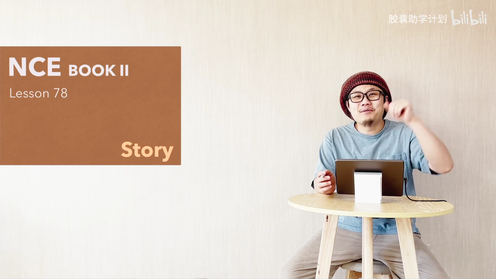

文字识别：blibii / 胶囊助学计划 / NCE / BOOKII / Lesson 78 / Story

### 画面 00:00:02

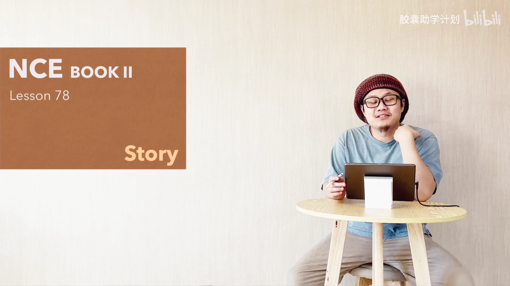

文字识别：biibii / 胶囊助学计划 / NCE / BOOKII / Lesson 78 / Story

### 画面 00:00:04

文字识别：blbili / 胶囊助学计划 / NCE / BOOKII / Lesson 78 / Story

### 画面 00:00:06

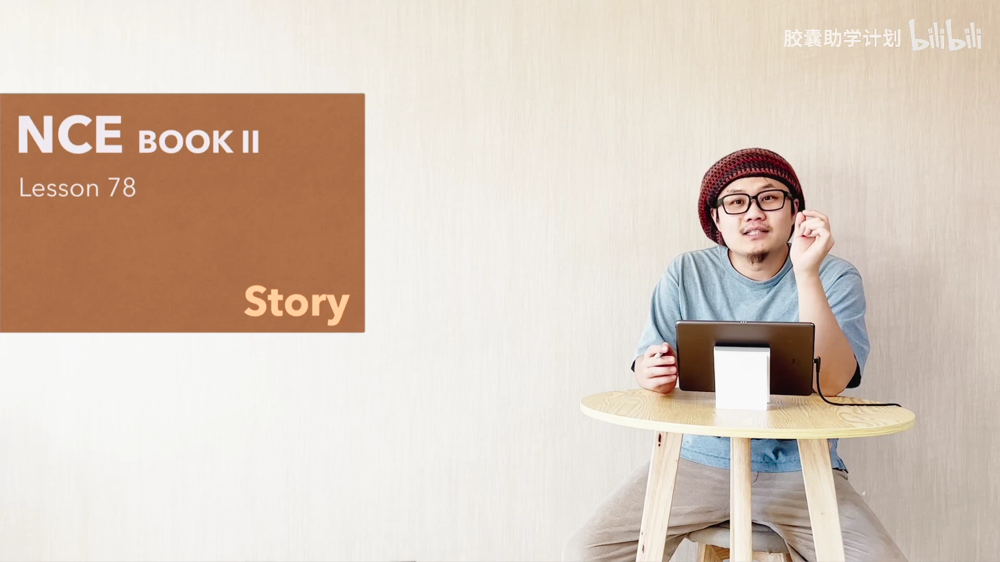

文字识别：bilbili / 胶囊助学计划 / NCE / BOOKII / Lesson 78 / Story

### 画面 00:00:08

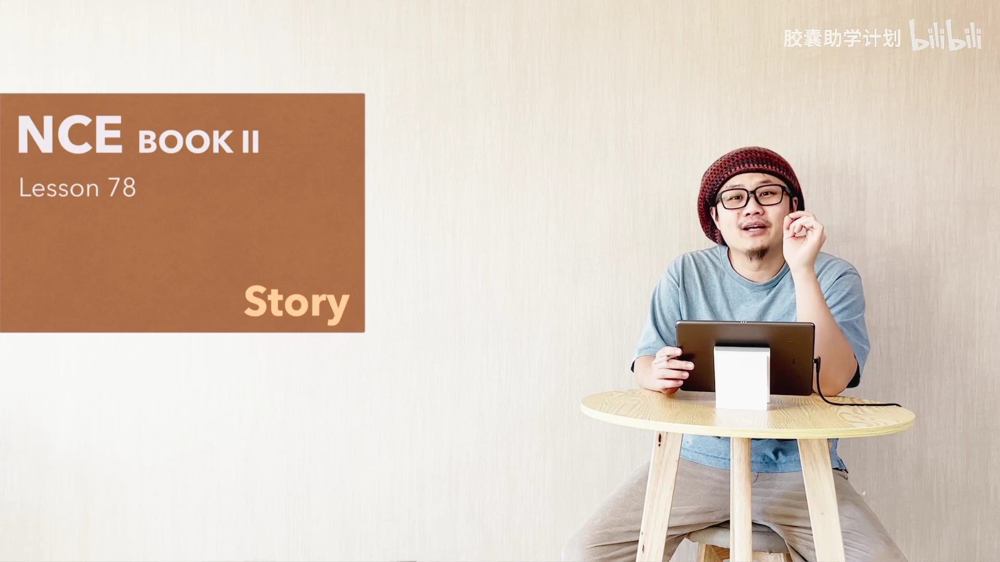

文字识别：biibii / 胶囊助学计划 / NCE / BOOKII / Lesson 78 / Story

### 画面 00:00:10

文字识别：胶囊助学计划 bil

### 画面 00:00:13

文字识别：胶囊助学计划旧 / 胶囊助学计划

### 画面 00:00:15

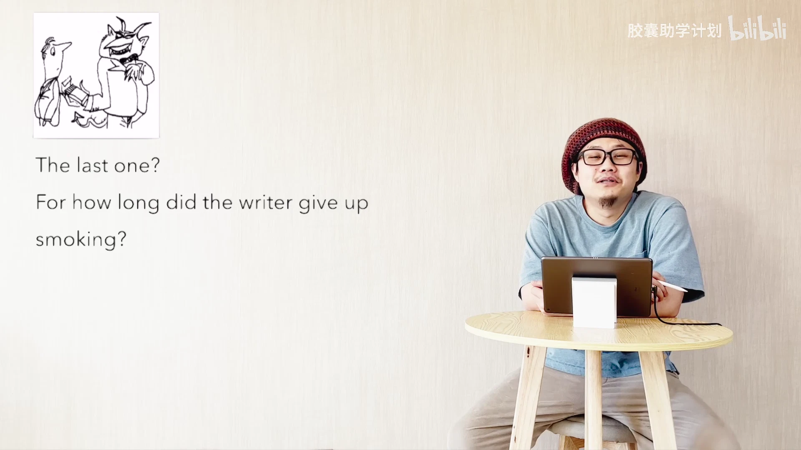

文字识别：胶囊助学计划biibi / The last one? / For how long did the writer give up / smoking?

## 00:00:30–00:01:00

问你是吧？再来一根儿啊，最后一根儿啊。说For how long did the writer give up smoking?啊，这篇文章写的很俏皮，说这个作者呀，放弃戒烟这个事儿持续了多长时间是吧？最后没戒成嘛？咱看文章啊，呃，文章不错，很有意思。文章有一点点小的难度啊，出现了不少之前学过的东西，复习嘛。After reading an article entitled "Cigarette Smoking and

### 画面 00:00:45

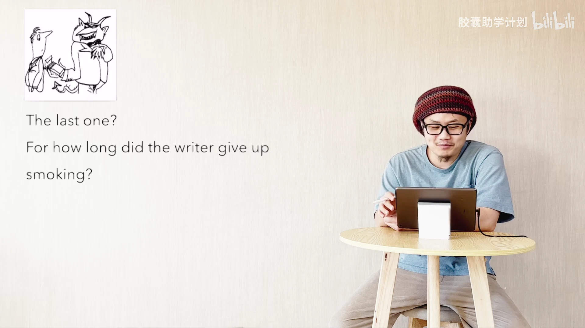

文字识别：biibii / 胶囊助学计划 / The last one? / For how long did the writer give up / smoking?

### 画面 00:00:47

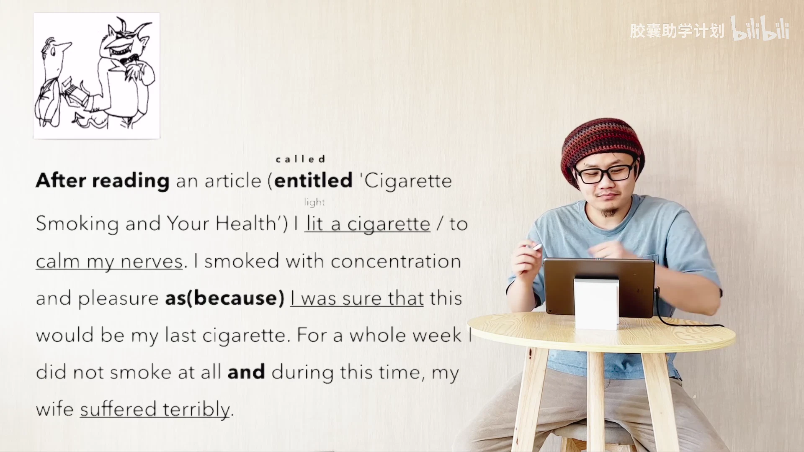

文字识别：胶囊助学计划bilb山 / called / After reading an article (entitled 'Cigarette / light / Smoking and Your Health') I lit a cigarette / to / Calm my nerves.I smoked with concentration / and pleasure as(because) Iwas sure that this / would be my last cigarette. For a whole week I / did not smoke at all and during this time, my / wife suffered terribly.

## 00:01:00–00:01:30

your health. I lit a cigarette to calm my nerves. 如果您现在的水平处于是 after 我读到 nerves，然后你基本上竟然就立刻几乎全懂了，就说明各位语法掌握的特别扎实。如果没有呢，那您就注意力集中听我挨个给您解释一下。 After reading an article, an article, so我们先看说叫在读了一篇文章之后，什么文章呢？ Entitled cigarette smoking and your health. 首先 entitled called或者

### 画面 00:01:17

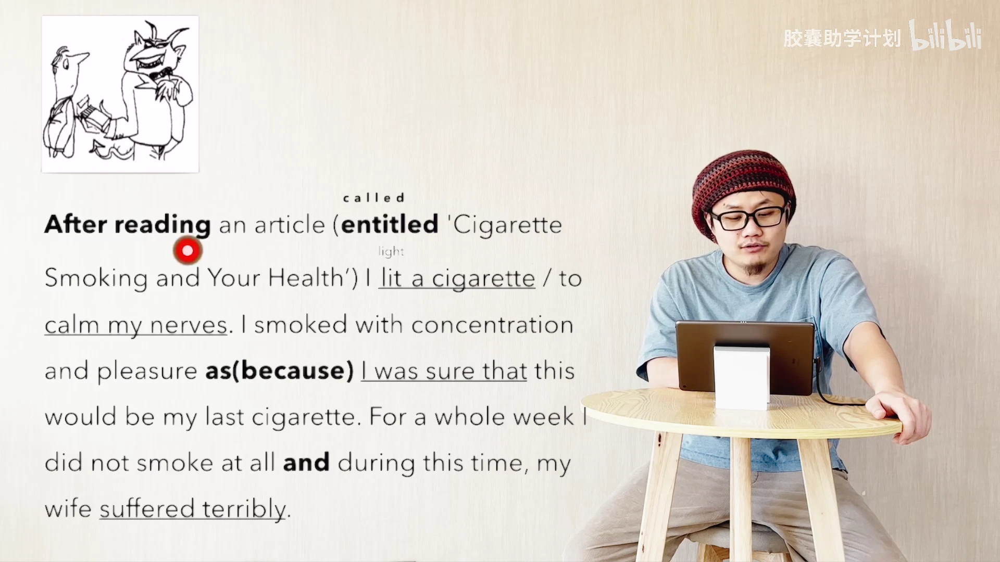

文字识别：胶囊助学计划bib山 / called / After reading an article (entitled 'Cigarette / light / Smoking and Your Health') I lit a cigarette / to / Calm my nerves.I smoked with concentration / and pleasure as(because) Iwas sure that this / would be my last cigarette. For a whole week I / did not smoke at all and during this time, my / wife suffered terribly.

## 00:01:30–00:02:00

named这单词部分我们讲过了，叫做呃名字，对吧？命名为名字是什么呢？叫做吸烟与你的健康啊，这样的一篇文章。然后这个地方的问题叫这儿为什么这个intitled是过去式还是过去分词？包括这个called是过去式还是过去分词？是过去分词。二八二九三十分词做定语，一个短语后置了。它实际上是在说这个article的。所以这句话如果我们要给它翻译，叫做在读完一篇名为抽

### 画面 00:01:47

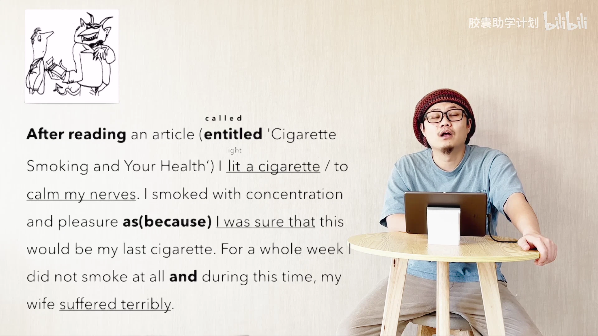

文字识别：胶囊助学计划bilb山 / called / After reading an article (entitled 'Cigarette / light / Smoking and Your Health') I lit a cigarette / to / calm my nerves.I smoked with concentration / and pleasure as(because)  was sure that this / would be my last cigarette. For a whole week I / did not smoke at all and during this time, my / wife suffered terribly.

## 00:02:00–00:02:30

烟、吸烟与你的健康》的文章之后，它是后置定语，而我们汉语是把那个定语放在前面的，所以所以翻译过来你要给它这样翻译啊。I lit a cigarette，我点了一根烟。这里的 lit l i t 的原型是 l i g h t l i g h t，对于各位来说最熟悉的意思是灯啊，包括它的形容词轻啊，它

### 画面 00:02:17

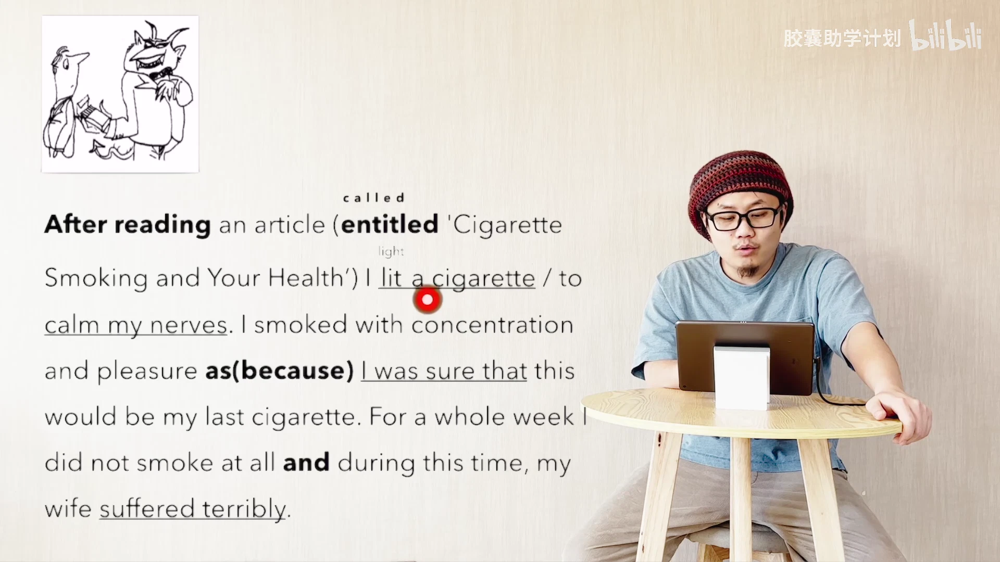

文字识别：胶囊助学计划biibi / called / After reading an article (entitled 'Cigarette / light / Smoking and Your Health') I lit a cigarette / to / Calm my nerves.I smoked with concentration / and pleasure as(because) Lwas sure that this / would be my last cigarette. For a whole week I / did not smoke at all and during this time, my / wife suffered terribly.

### 画面 00:02:24

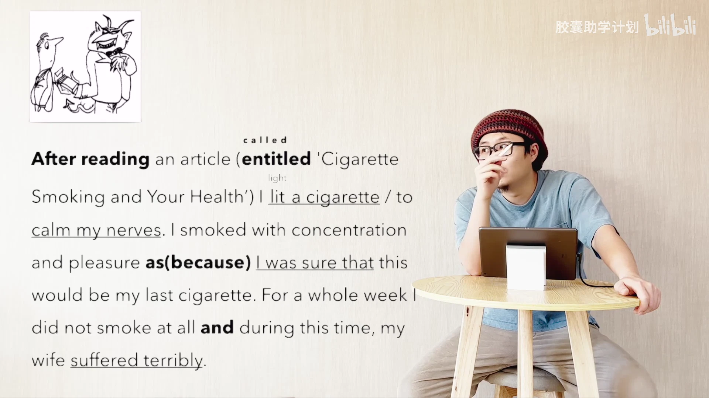

文字识别：胶囊助学计划bili / called / After reading an article (entitled 'Cigarette / light / Smoking and Your Health') I lit a cigarette / to / calm my nerves.I smoked with concentration / and pleasure as(because) Iwas sure that this / would be my last cigarette. For a whole week I / did not smoke at all and during this time, my / wife suffered terribly.

## 00:02:30–00:03:00

的意思特别多。那实际上 light 还有点的意思，点烟就是 light a cigarette，听见了吧？包括你像打火机 lighter 啊，说 I light a cigarette，我点了一根烟，目的是 to do 结构放在最后表目的，这咱们见过很多次了。哎，从四十九课开始见的 to calm my nerves，平复我这个紧张的小心情，是吧？我这个神经啊。那这里要问

### 画面 00:02:40

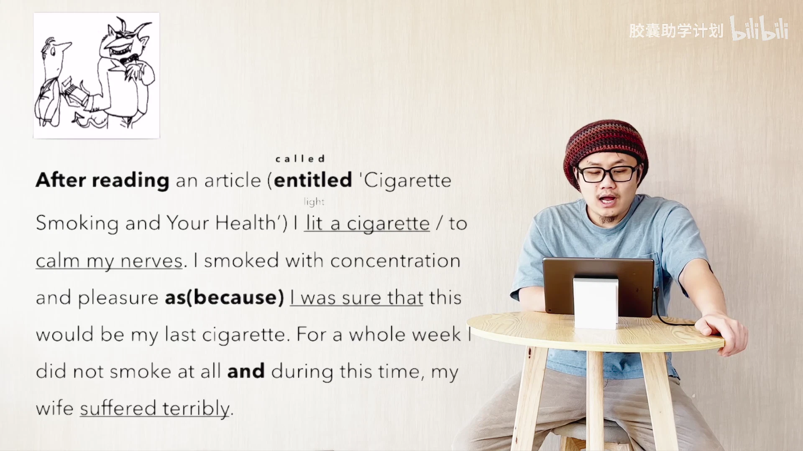

文字识别：胶囊助学计划bib山 / called / After reading an article (entitled 'Cigarette / light / Smoking and Your Health') I lit a cigarette / to / calm my nerves.I smoked with concentration / and pleasure as(because) Lwas sure that this / would be my last cigarette. For a whole week I / did not smoke at all and during this time, my / wife suffered terribly.

## 00:03:00–00:03:30

的另一个问题就是 after reading 的主语在哪儿呢？四十九课您学好，立刻就能回答我的问题。主语在 I 这个地方，对吧？它是分词啊，我们所谓又叫非谓语。但我目前其实一直在弱化非谓语这个概念啊。呃，分词说，我读了，哎，这是 doing 现在分词，所以是主动，对吧？所以这里其实是 after I read an article。如果你它换回去的话，哎，如

### 画面 00:03:10

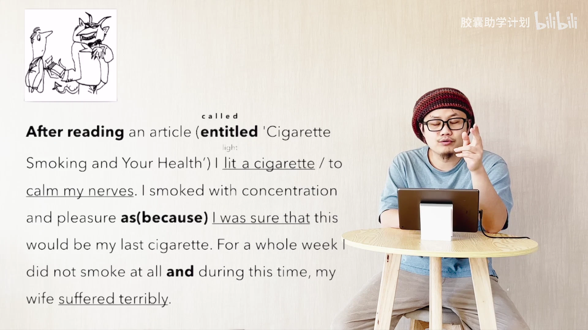

文字识别：胶囊助学计划bilb山 / called / After reading an article (entitled 'Cigarette / light / Smoking and Your Health') I lit a cigarette / to / calm my nerves.I smoked with concentration / and pleasure as(because) I was sure that this / would be my last cigarette. For a whole week I / did not smoke at all and during this time, my / wife suffered terribly.

## 00:03:30–00:04:00

果拆回来就是 after reading 四十九课咱学的这一点问题没有啊。再来，I smoked with concentration and pleasure as I was sure that this would be my last cigarette. 好，首先这个 as 提醒了你，其实就是前后断一下句。那所以咱们先看第一句话，I smoked with concentration and pleasure. 说我抽烟伴随着带着什么呢？带着这种满足感和这种 pleasure 和这种愉悦感，对吧？哎，这个尼古丁起

### 画面 00:03:40

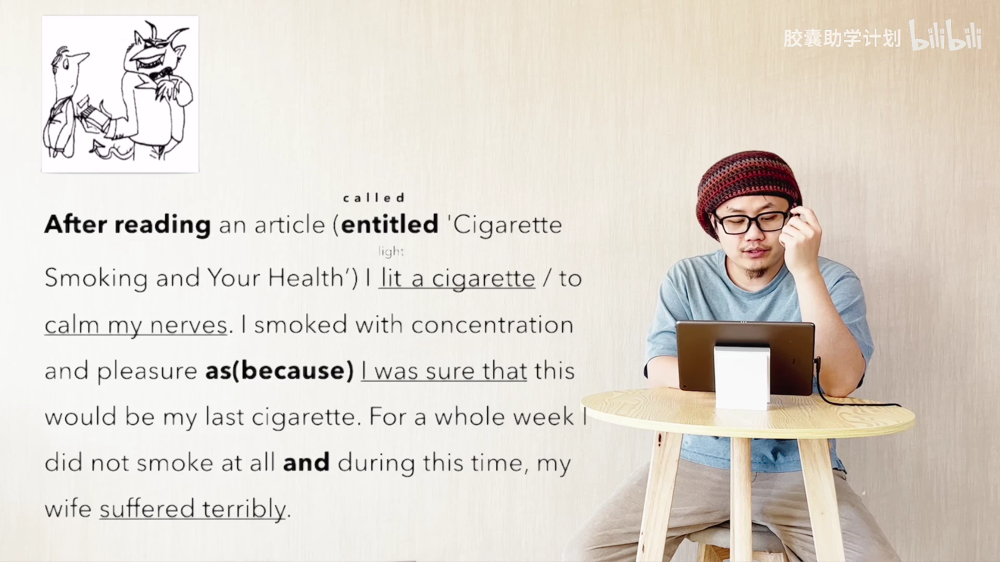

文字识别：胶囊助学计划bibi / called / After reading an article (entitled 'Cigarette / light / Smoking and Your Health') I lit a cigarette / to / Calm my nerves.I smoked with concentration / and pleasure as(because)  was sure that this / would be my last cigarette. For a whole week I / did not smoke at all and during this time, my / wife suffered terribly.

### 画面 00:03:44

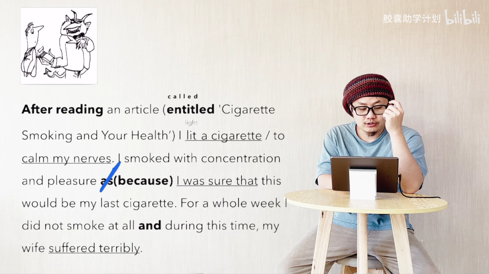

文字识别：胶囊助学计划blb山 / called / After reading an article (entitled 'Cigarette / light / Smoking and Your Health') I lit a cigarette / to / calm my nerves. smoked with concentration / and pleasure s(because) was sure that this / would be my last cigarette. For a whole week 1 / did not smoke at all and during this time, my / wife suffered terribly.

## 00:04:00–00:04:30

到的作用嘛，满足感。然后这个地方的 as 还是那句话，单看它完全不知道该怎么翻译，因为 as 放到句子中间连接下一个句子的时候，它的含义可以有很多。我们现在讲的只是冰山一角，它还有很多呢，各位。所以没办法判断，我们只能把后半句话读完才能判断。那在这儿我们既然是学习，我提前告诉您，这就是 because 啊，因为我很确信的事情是本课的习惯用法，一会儿咱们会

### 画面 00:04:14

文字识别：胶囊助学计划bilb山 / called / After reading an article (entitled 'Cigarette / light / Smoking and Your Health') I lit a cigarette / to / calm my nerves. smoked with concentration / and pleasure s(because)  was sure that this / would be my last cigarette. For a whole week 1 / did not smoke at all and during this time, my / wife suffered terribly.

## 00:04:30–00:05:00

用，叫做 This would be my last cigarette。说这将会是我的最后一个烟啊。我们读到这儿，先回顾一下整个这两句话，大概的意思就是我读了一篇文章，叫做《吸烟与健康》，看完了之后胆战心惊。我发现，我的天哪，吸烟会带来这么多的问题，对吧？然后呢，我就精神很焦虑，很紧张。这个时候怎么办呢？咵，点根烟啊，因为抽

### 画面 00:04:43

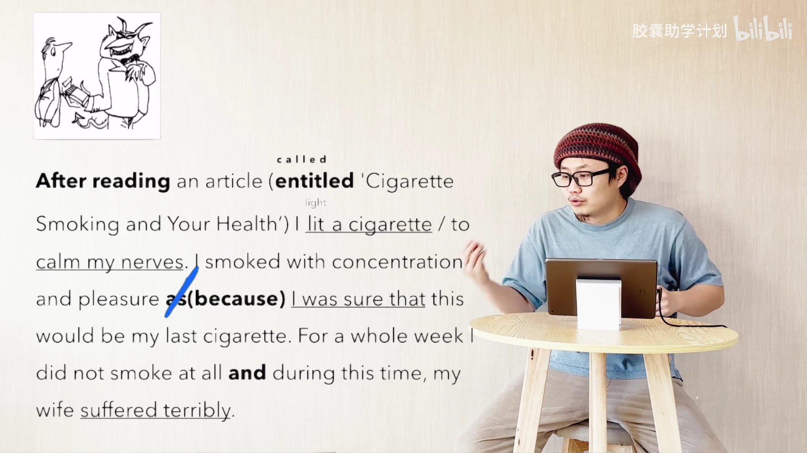

文字识别：胶囊助学计划bib山 / called / After reading an article (entitled 'Cigarette / light / Smoking and Your Health') I lit a cigarette / to / calm my nerves.| smoked with concentration / and pleasure s(because) L was sure that this / would be my last cigarette. For a whole week I / did not smoke at all and during this time, my / wife suffered terribly.

## 00:05:00–00:05:30

烟的人可能知道，就是如果你不抽，其实无所谓。但如果你开始抽烟了，你一紧张一焦虑，就特别想抽根烟。所以他这个时候就抽了根烟，而且注意力特别集中，然后还特别的享受啊，因为说他自己很确信这将是他的最后一根烟，对吧？抽完这根烟，我戒烟了。为什么呢？抽烟对身体太有害了，我受不了了。然后我们接着往下看，For a whole week I did not smoke at all, and during this time my wife suffered terribly.

### 画面 00:05:13

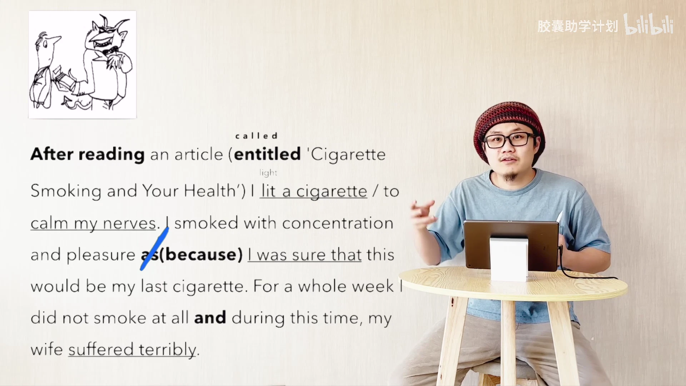

文字识别：胶囊助学计划biibil / called / After reading an article (entitled 'Cigarette / light / Smoking and Your Health') I lit a cigarette / to / calm my nerves. smoked with concentration / and pleasure s(because) L was sure that this / would be my last cigarette. For a whole week I / did not smoke at all and during this time, my / wife suffered terribly.

## 00:05:30–00:06:00

你看这句话就很有意思啊。这个and前后说整整一周的时间，我完全就没抽烟。在这个期间，我媳妇儿痛苦的要命啊。这个忍受了很多不公平的待遇，对吧？为什么呢？我们看一下。I had all the usual symptoms of someone giving up smoking: a bad temper and an enormous appetite.很

### 画面 00:05:43

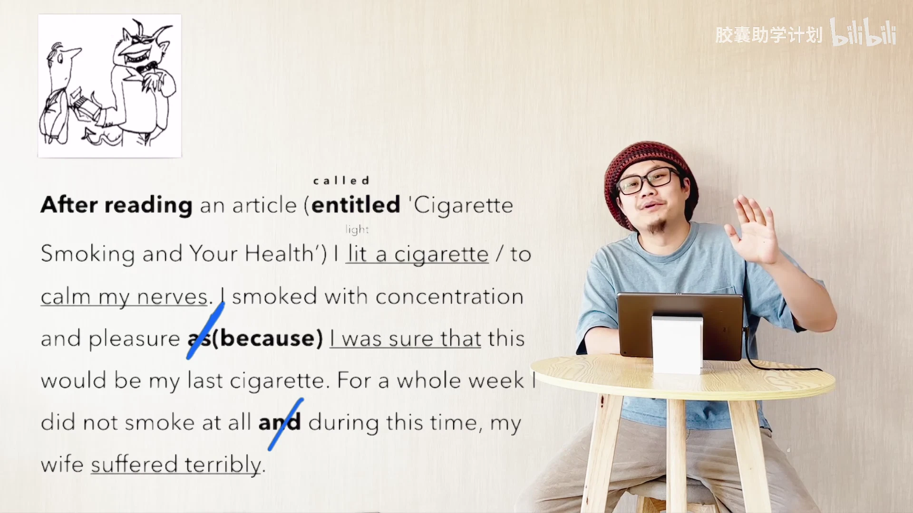

文字识别：胶囊助学计划bilb山 / called / After reading an article (entitled 'Cigarette / light / Smoking and Your Health') I lit a cigarette / to / calm my nerves. smoked with concentration / and pleasure zs(because) Iwas sure that this / would be my last cigarette. For a whole week I / did not smoke at all agd during this time, my / wife suffered terribly.

### 画面 00:05:48

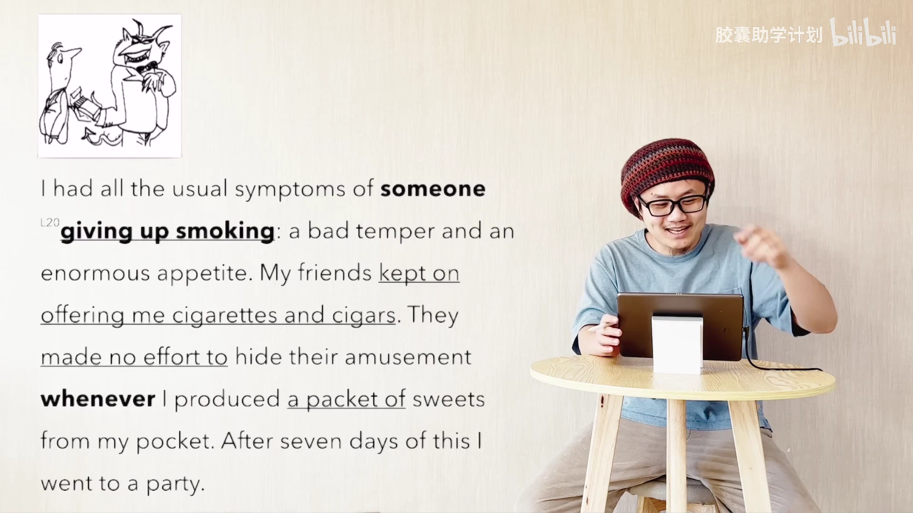

文字识别：胶囊助学计划bilbi / I had all the usual symptoms of someone / giving up smoking: a bad temper and an / enormous appetite. My friends kept on / offering me cigarettes and cigars. They / made no effort to hide their amusement / whenever I produced a packet of sweets / from my pocket. After seven days of this I / went to a party.

## 00:06:00–00:06:30

有意思。说我呀有所有的那些通常的状态下能看到的那些症状，什么样的症状呢？A of B结构，对吧？哎，Euro，然后A of B结构，B是什么呢？就是如果某个人去戒烟的话，首先give up doing something，二十克，然后对，就是钓鱼那课，咱们学过give up doing something。呃，第一次学动名词的时候，咱们见过这个习惯用法啊，放弃做某事儿。说我

### 画面 00:06:12

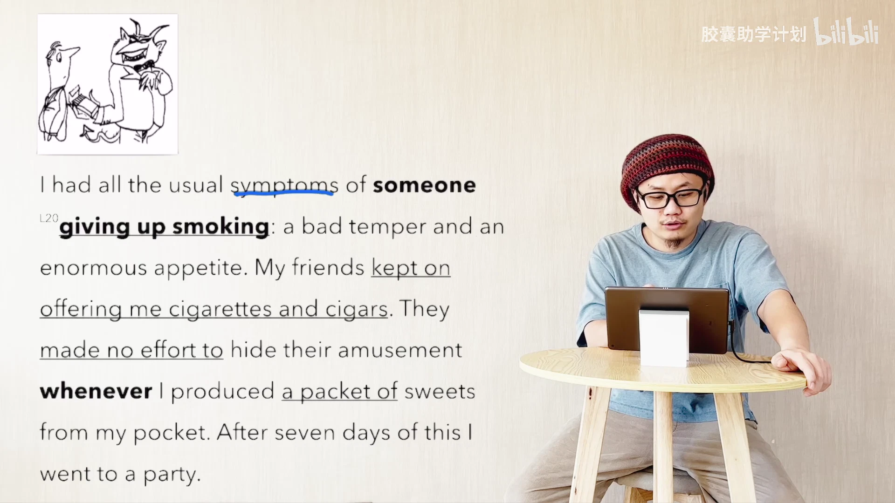

文字识别：胶囊助学计划bi山 / I had all the usual symptoms of someone / giving up smoking: a bad temper and an / enormous appetite. My friends kept on / offering me cigarettes and cigars. They / made no effort to hide their amusement / whenever I produced a packet of sweets / from my pocket. After seven days of this I / went to a party.

### 画面 00:06:14

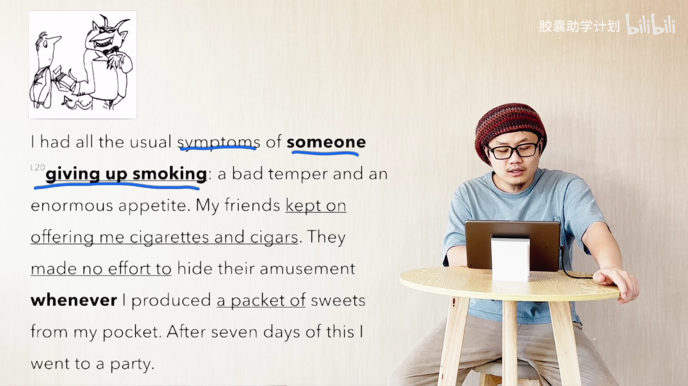

文字识别：胶囊助学计划biibi山 / I had all the usual symptoms of someone / 20 / giving up smoking: a bad temper and an / enormous appetite. My friends kept on / offering me cigarettes and cigars. They / made no effort to hide their amusement / whenever I produced a packet of sweets / from my pocket. After seven days of this I / went to a party.

## 00:06:30–00:07:00

有所有的那些常见的，如果某个人放弃抽烟戒烟之后的那些症状，具体是什么呢？脾气特别臭，对吧？然后呢，胃口特别大啊。如果你没抽过烟，就别抽了。如果你抽了烟，呃，如果你接下来希望戒烟，你就会感受到类似的感受，对吧？就是注意力戒断反应嘛，我们所谓的叫，对吧？那他这是 a bad temper 和 enormous appetite。那你想他媳妇儿能高兴了吗？对吧？你跟你媳妇在一

### 画面 00:06:44

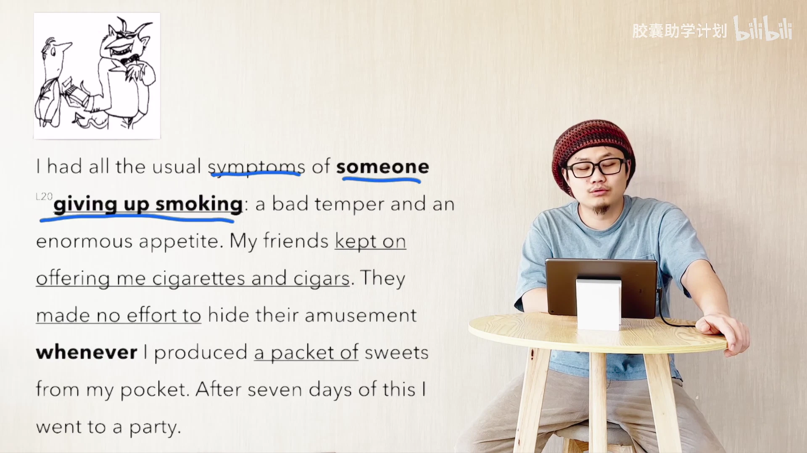

文字识别：胶囊助学计划bilb山 / I had all the usual symptoms of someone / L20 / giving up smoking: a bad temper and an / enormous appetite. My friends kept on / offering me cigarettes and cigars. They / made no effort to hide their amusement / whenever I produced a packet of sweets / from my pocket. After seven days of this I / went to a party.

## 00:07:00–00:07:30

块儿，你天天啊脸不是脸，鼻子不是鼻子的，总说人家啊，bad temper嘛，戒烟导致的嘛。Next one，说my哦，这个地方多提一句，还有一个小点啊，这个叫做someone give up smoking啊。首先give up doing something对吧？然后其次呢，这个someone give up smoking这是一个严重超纲的语法，新二完全不会提到，新三咱们再见啊。所以你现在能读懂就行了，呃，就是这个语法完全不影响我们读懂这个文

### 画面 00:07:14

文字识别：胶囊助学计划biibi / I had all the usual symptoms of someone / L20 / giving up smoking: a bad temper and an / enormous appetite. My friends kept on / offering me cigarettes and cigars. They / made no effort to hide their amusement / whenever I produced a packet of sweets / from my pocket. After seven days of this I / went to a party.

## 00:07:30–00:08:00

章啊！而且你写作当中，你相信我，你几乎不会用得到。这是一个非常高端的语法，就是按照各位的考试不用它，完全不影响打满分。听明白了吧？OK啊，说my my my friends啊，这就这种感觉，就类似于是你不懂量子物理，不影响你高中物理考满分。你懂我这个意思吧？而且各位现在属于高中物理阶段啊，到不了讲量子物理呢。等到那步了，我们自然而然就讲了。没到那步，提前学也没啥用啊。你不懂量子物理，不影响你高考物理考

### 画面 00:07:44

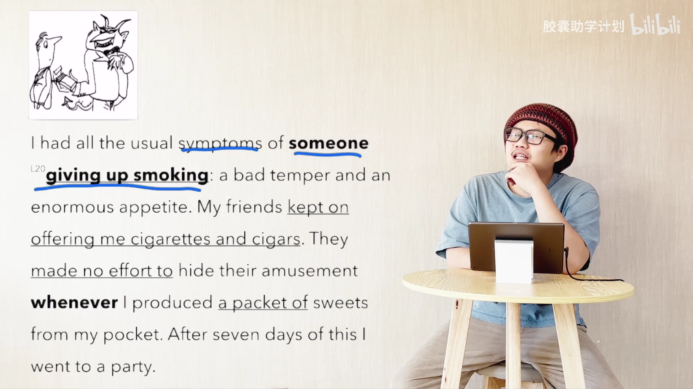

文字识别：胶囊助学计划bii出 / I had all the usual symptoms of someone / L20 / giving up smoking: a bad temper and an / enormous appetite. My friends kept on / offering me cigarettes and cigars. They / made no effort to hide their amusement / whenever I produced a packet of sweets / from my pocket. After seven days of this I / went to a party.

## 00:08:00–00:08:30

满分啊！我觉得这个类比可以。So my friends kept on offering me cigarettes and cigars. Ah,这句话虽然短，俩习惯用法。第一个keep on doing something叫持续不断的做某事儿，一会儿咱们会造句。第二个叫offer somebody something叫提供给某人某物，对吧？所以我的朋友持续不断的提供给我啊，烟呢，雪茄啊，反正就是烟吧。They made no effort to hide their

### 画面 00:08:14

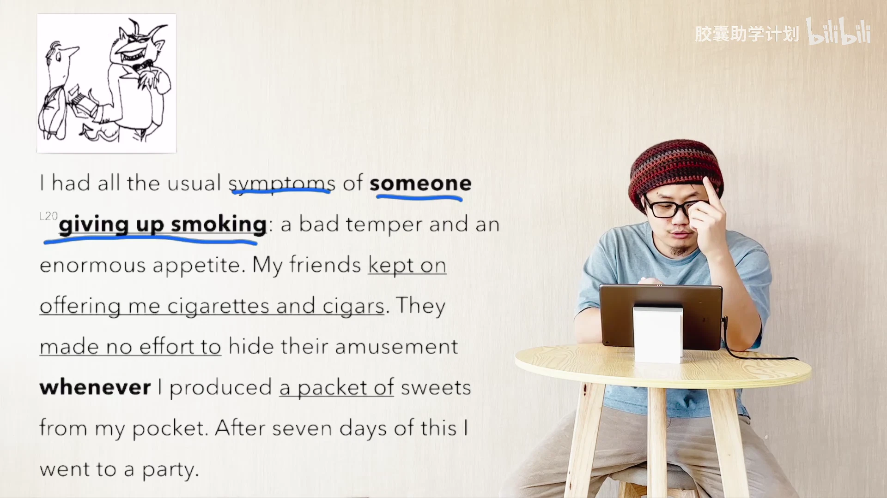

文字识别：胶囊助学计划bi出 / I had all the usual symptoms of someone / L20 / giving up smoking: a bad temper and an / enormous appetite. My friends kept on / offering me cigarettes and cigars. They / made no effort to hide their amusement / whenever I produced a packet of sweets / from my pocket. After seven days of this I / went to a party.

### 画面 00:08:16

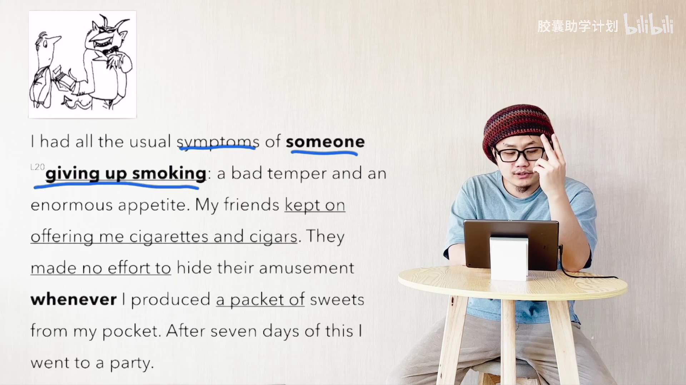

文字识别：胶囊助学计划bibi / I had allthe usual symptoms of someone / L20 / giving up smoking: a bad temper and an / enormous appetite. My friends kept on / offering me cigarettes and cigars. They / made no effort to hide their amusement / whenever I produced a packet of sweets / from my pocket. After seven days of this I / went to a party.

### 画面 00:08:19

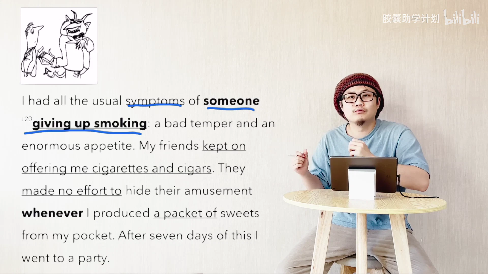

文字识别：胶囊助学计划biii / I had all the usual symptoms of someone / L20 / giving up smoking: a bad temper and an / enormous appetite. My friends kept on / offering me cigarettes and cigars. They / made no effort to hide their amusement / whenever I produced a packet of sweets / from my pocket. After seven days of this I / went to a party.

## 00:08:30–00:09:00

amusement whenever I produce a pack of sweets from my pocket. 好，这句话看上去好像貌似又很长，其实还好了。 Whenever就是我在讲单词的时候说的那个 no matter when，对吧？无论何时。那么看一下第一句话，说他们 made no effort to do something，就毫不掩饰去做某件事情，对吧？毫不努力去做某件事情。他们毫不努力去，毫不掩饰啊，毫不努力干嘛呢？去 hide their amusement，去

### 画面 00:08:44

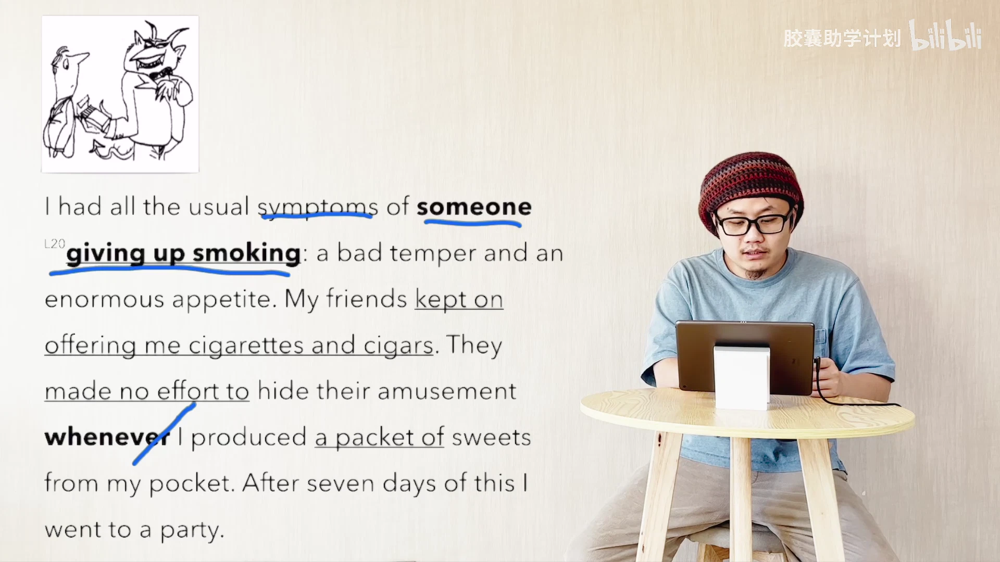

文字识别：胶囊助学计划biibi出 / I had allthe usual symptoms of someone / 120 / giving up smoking: a bad temper and an / enormous appetite. My friends kept on / offering me cigarettes and cigars. They / made no effort to hide their amusement / whenever I produced a packet of sweets / from my pocket. After seven days of this I / went to a party.

## 00:09:00–00:09:30

掩饰，哎，这个就毫不努力的去掩饰他们的这种愉快愉悦。任何时候，我produce拿出a packet of一包sweets糖from my pocket从我兜里边，就是我什么时候从我兜里边拿出来一包糖，那帮人就可劲儿的嘲笑我，啊，就抽烟吧，抽一根没事儿啊，嗨，啊，对吧？啊，你何必这么这么折磨自己呢？别吃糖了，就

### 画面 00:09:14

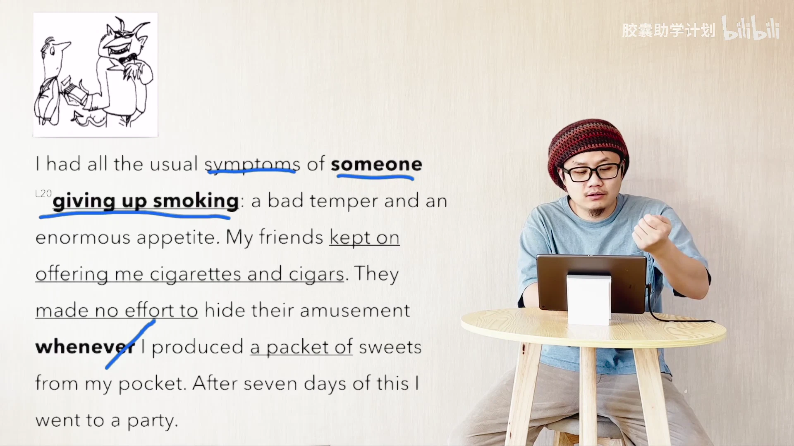

文字识别：胶囊助学计划blb山 / I had allthe usual symptoms of someone / 120 / giving up smoking: a bad temper and an / enormous appetite. My friends kept on / offering me cigarettes and cigars. They / made no effort to hide their amusement / whenever I produced a packet of sweets / from my pocket. After seven days of this I / went to a party.

### 画面 00:09:21

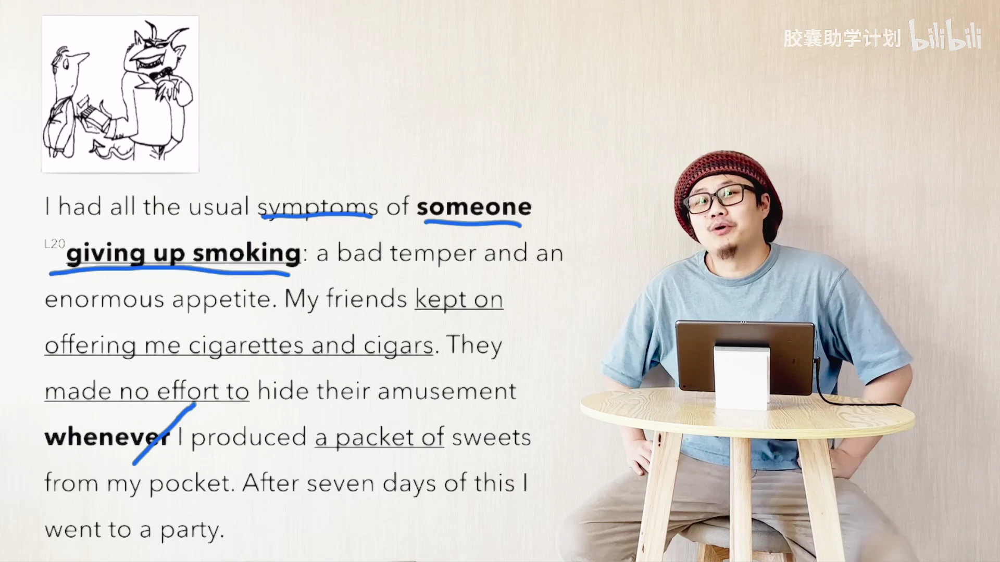

文字识别：胶囊助学计划biibi / I had allthe usual symptoms of someone / 120 / giving up smoking: a bad temper and an / enormous appetite. My friends kept on / offering me cigarettes and cigars. They / made no effort to hide their amusement / whenever I produced a packet of sweets / from my pocket. After seven days of this I / went to a party.

### 画面 00:09:24

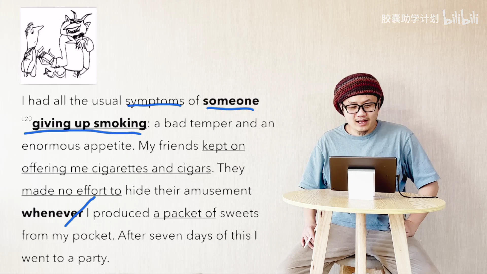

文字识别：胶囊助学计划bib山 / I had allthe usual symptoms of someone / 120 / giving up smoking: a bad temper and an / enormous appetite. My friends kept on / offering me cigarettes and cigars. They / made no effort to hide their amusement / whenever I produced a packet of sweets / from my pocket. After seven days of this I / went to a party.

## 00:09:30–00:10:00

大概是这样一种感觉啊！一帮人就一直在戏谑他。After seven days of this, I went to a party。呃，这件这样这样的情况，经历了七天之后，我去了一个 party 上。戒烟不能去 party 啊，戒烟不能去 party 啊，不能找那帮烟友一起去啊，对吧？为啥？就是这句话。Everybody around me was smoking, and I felt extremely uncomfortable。说

### 画面 00:09:45

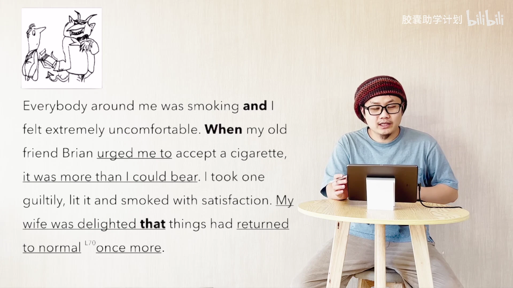

文字识别：胶囊助学计划bilb / Everybody around me was smoking and I / felt extremely uncomfortable. When my old / friend Brian urged me to accept a cigarette, / it was more than I could bear.I took one / guiltily, lit it and smoked with satisfaction. My / wife was delighted that things had returned / to normal / L70 / once more.

## 00:10:00–00:10:30

围绕着我的每一个人都正在抽烟，然后我就感受到极度的不舒服。这里边有几个小的点，虽然单词几乎应该都是学过的，但是我要提一下。首先，这个 around me，它是你理解为其实像后置了。你看我们汉语翻译叫做在我周围的每一个人，而不是每一个人在我周围都在抽烟。汉语不是这个语序，对吧？这个点还好。

### 画面 00:10:15

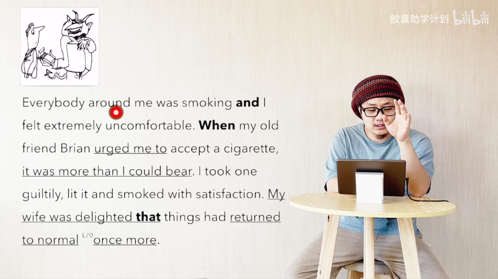

文字识别：胶囊助学计划biii / Everybody around me was smoking and I / felt extremely uncomfortable. When my old / friend Brian urged me to accept a cigarette, / it was more than I could bear.I took one / guiltily, lit it and smoked with satisfaction. My / wife was delighted that things had returned / to normal / L70 / once more.

## 00:10:30–00:11:00

第二个点，这个 uncomfortable 前面的 U N，否定别忘了啊。OK，好，那没这么说的了，我们继续。When my old friend Brian urged me to accept a cigarette, it was more than I could bear. 当我的一个老朋友 Brian 谴引 urge somebody to do something，单词部分咱们说过了，怂恿我去接一个烟的时候，it was more

### 画面 00:10:45

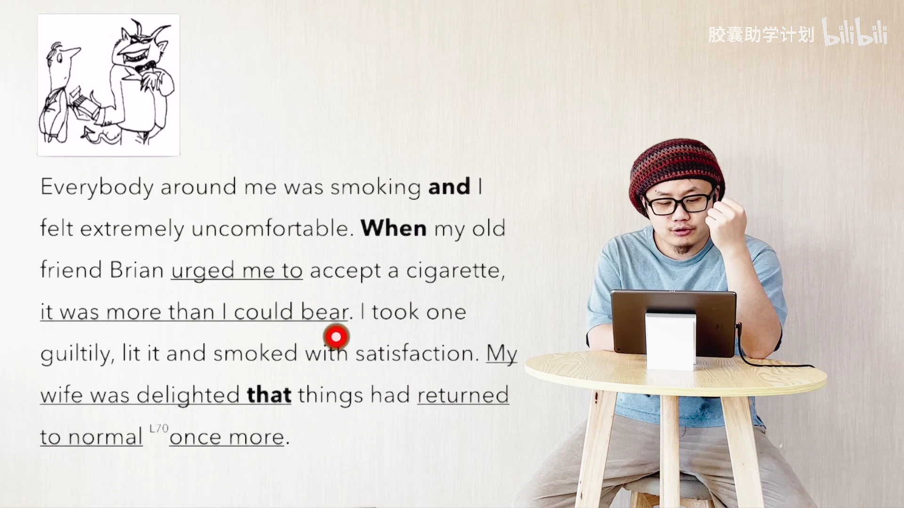

文字识别：胶囊助学计划bi / Everybody around me was smoking and I / felt extremely uncomfortable. When my old / friend Brian urged me to accept a cigarette, / it was more than I could bear.I took one / guiltily, lit it and smoked with satisfaction. My / wife was delighted that things had returned / to normal / L70 / once more.

## 00:11:00–00:11:30

than I could bear. 整个这句话您直接就给它记下来就行了啊，很常用，就是这超过说这件事情是怎么样的呢？超过了我能忍受的啊，忍受的极限。其实就这样一件事儿，就这件事儿超过了我能忍受的极限。你不仅在我旁边在抽，然后呢，还一直不停的怂恿我抽根烟，对吧？ I took one guiltily. I needed

### 画面 00:11:15

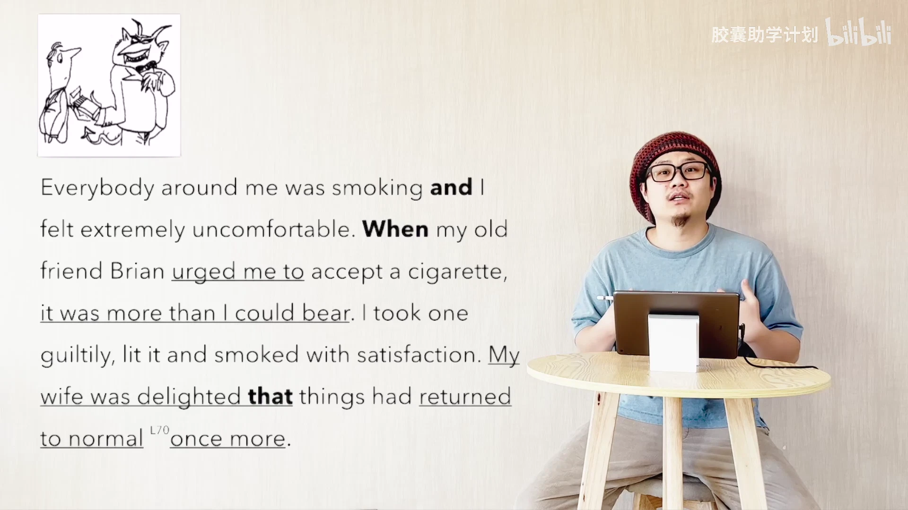

文字识别：胶囊助学计划bil山 / Everybody around me was smoking and I / felt extremely uncomfortable. When my old / friend Brian urged me to accept a cigarette, / it was more than I could bear.I took one / guiltily, lit it and smoked with satisfaction. My / wife was delighted that things had returned / to normal / L70 / once more.

## 00:11:30–00:12:00

and smoked with concentration.哎，这句话很有意思。说我呀，拿了一根，还用的是guiltily，就充满这种自责的拿了一根，lit it，点燃了，然后smoked with concentration.哎呀，怎么样？就是啊，smoked with satisfaction啊，就是特别心满意足的抽了这根烟。My wife was

### 画面 00:11:45

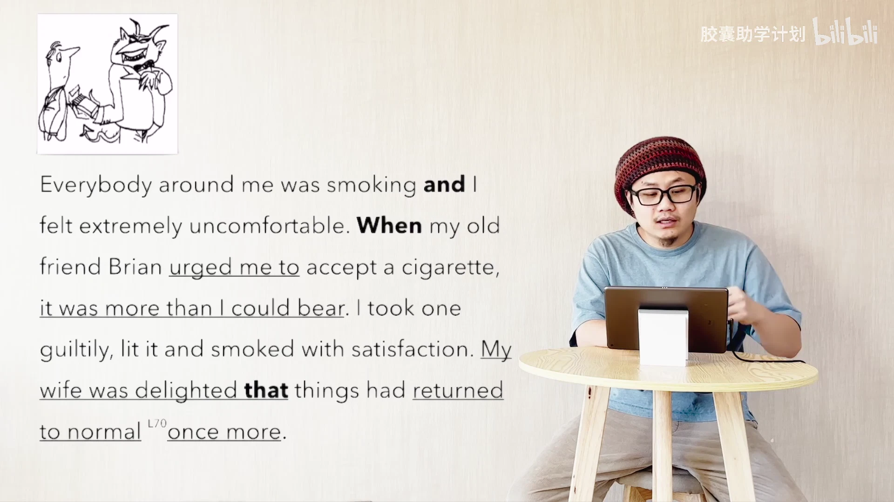

文字识别：胶囊助学计划bilb山 / Everybody around me was smoking and I / felt extremely uncomfortable. When my old / friend Brian urged me to accept a cigarette, / it was more than I could bear.I took one / guiltily, lit it and smoked with satisfaction. My / wife was delighted that things had returned / to normal / L70 / once more.

## 00:12:00–00:12:30

delighted.而我媳妇儿倒是特别的高兴啊。Delighted, that后边加一句话，这咱们之前说了单词部分。为啥呢？因为 things had returned to normal once more.因为事情啊已经 returned to normal.其实如果 normal 这个单词你有印象，那 returned to normal 就是很容易就理解的一句话。Normal 首先是上节课我们刚学过，叫做 normally，通

### 画面 00:12:15

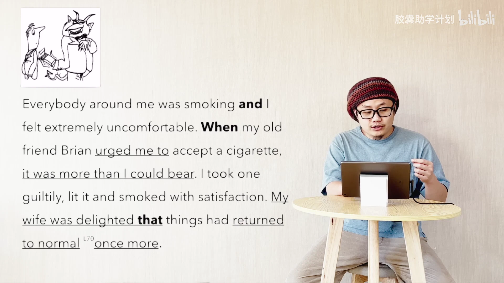

文字识别：胶囊助学计划biibi / Everybody around me Was smoking and I / felt extremely uncomfortable. When my old / friend Brian urged me to accept a cigarette, / it was more than I could bear.I took one / guiltily, lit it and smoked with satisfaction. My / wife was delighted that things had returned / to normal / L70 / once more.

## 00:12:30–00:13:00

常状况下，对吧？前几节课刚学的就 normally，通常状况下讲那个 normally 的时候，我就提过，我说 normal 叫做正常，哎，正常，对吧？正常状况。那 return to normal 就是回到正常状况，就是他又开始抽烟了呗。 Once more，叫再一次。 OK，好。最后， anyway，哎，不管怎么说，as Brian pointed out， it is the easiest thing in the world to

### 画面 00:12:45

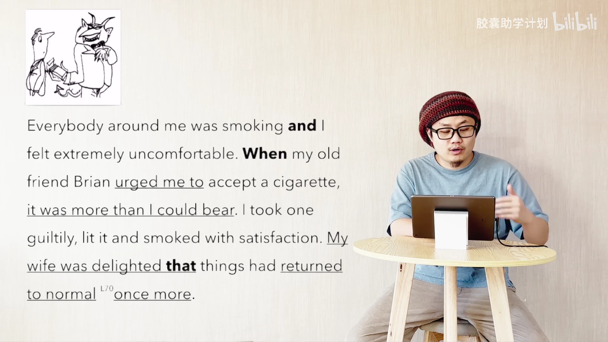

文字识别：胶囊助学计划blb山 / Everybody around me was smoking and I / felt extremely uncomfortable. When my old / friend Brian urged me to accept a cigarette, / it was more than I could bear. I took one / guiltily, lit it and smoked with satisfaction. My / wife was delighted that things had returned / to normal / L70 / once more.

### 画面 00:12:49

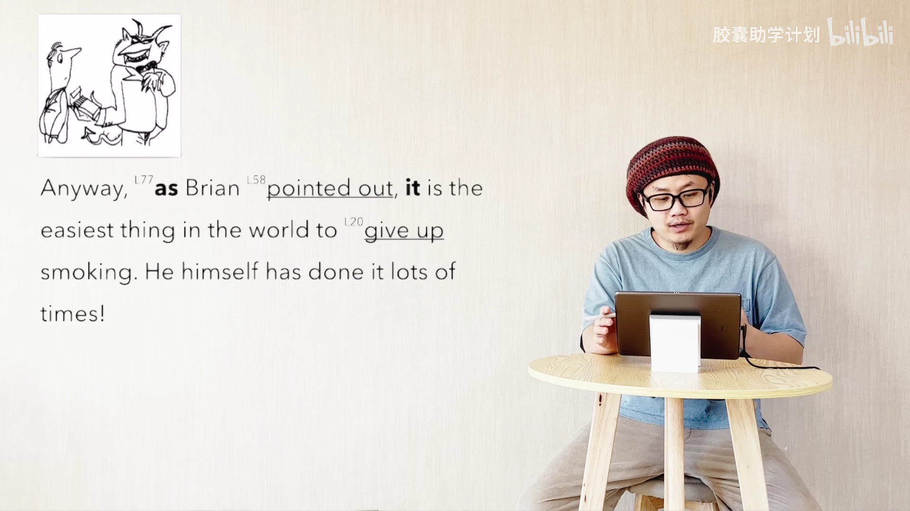

文字识别：胶囊助学计划bibi / Anyway,"a / L77 / 'as Brian / L58 / pointed out, it is the / easiest thing in the world to / L20 / give up / smoking. He himself has done it lots of / times!

## 00:13:00–00:13:30

give up smoking? He himself has done it lots of times.说无论如何，说as Brian pointed out，这个as就是其实其实咱刚学的这个非限定性定语从句as引导的，所以这个as其实替代的是整个后边。我现在给各位加下划线这些句子，对吧？但是呢，当时我就说了，我说这个语法对于一个中国人来说完全不会或一知半解，完全不影响。为啥呢？因为它长得又太像宾语从句了。你把as现

### 画面 00:13:12

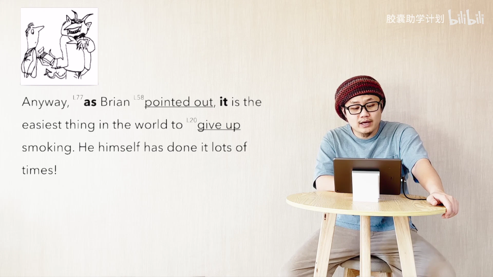

文字识别：胶囊助学计划biibi / Anyway,"a / L77 / 'as Brian / L58 / pointed out, it is the / easiest thing in the world to / L20 / give up / smoking. He himself has done it lots of / times!

### 画面 00:13:16

文字识别：Bibii / 胶囊助学计划 / Anyway,": / L77 / 'as Brian / L58 / pointed out, it is the / easiest thing in the world to / L20 / give up / smoking. He himself has done it lots of / times!

### 画面 00:13:18

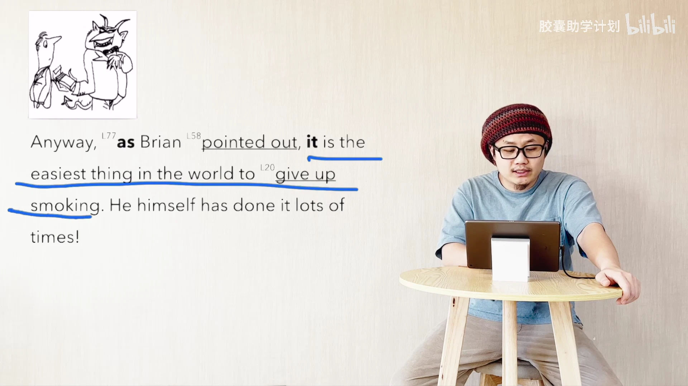

文字识别：bibii / 胶囊助学计划 / Anyway, / L77 / as Brian / L58 / pointed out, it is the / easiest thing in the world to / L20 / give up / smoking. He himself has done it lots of / times!

## 00:13:30–00:14:00

在去掉，你说 Brian 指出说他是最容易的事情，在全世界去放弃抽烟这件事儿，是不是对于中国人来说这句话基本就读懂了，对吧？只不过让你自己写出来可能比较困难。不过你相信我，这样的句子一般不需要你写啊，你们你能给它写成一个宾语从句就可以了，很舒服啊。这个对于各位来说能看懂就行，所以这个语法没有那么重要，我们才放到虽然第十三课就出现了，但我依旧先啊，十四课就出现了应该是，但我依

### 画面 00:13:48

文字识别：Bilbili / 胶囊助学计划 / Anyway, / L77 / asBrian / L58 / pointed out, it is the / easiest thing in the world to / L20 / give up / smoking He himself has done it lots of / times!

## 00:14:00–00:14:30

旧没有讲它，放到了最后，对吧？就是对于那些学不到这一课的人，这个知识点学了也没用；对于学到这一课的人，这个知识点一点就透了，对吧？就这么简单，所以没有必要放在那儿去给你增加心理压力。Brian指出，那后边这句话其实我们之前按照两个方式处理过，我还是按照两个方式给各位再讲一遍啊，因为总有这样的同学呢较真儿。那这个较真儿倒是好事儿，说

### 画面 00:14:18

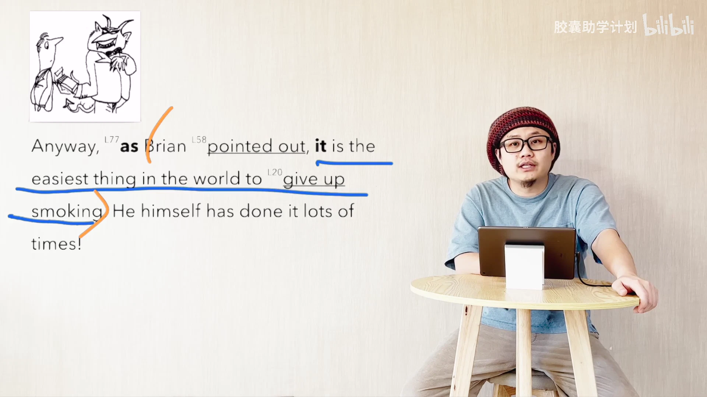

文字识别：bibii / 胶囊助学计划 / Anyway, / L77 / asprian / L58 / pointed out, it is the / easiest thing in the world to / L20 / give up / smoking He himself has done it lots of / times!

### 画面 00:14:23

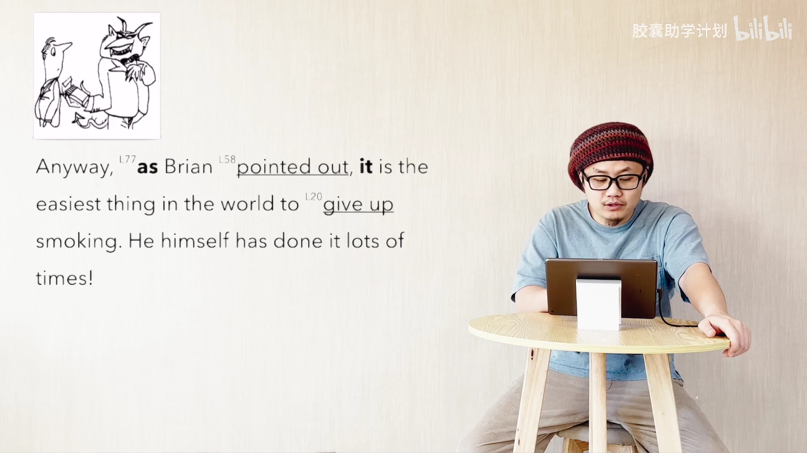

文字识别：胶囊助学计划biiil / Anyway, 7as Brian / L77 / L58 / pointed out, it is the / easiest thing in the world to / L20 / 2°give up / smoking. He himself has done it lots of / times!

### 画面 00:14:27

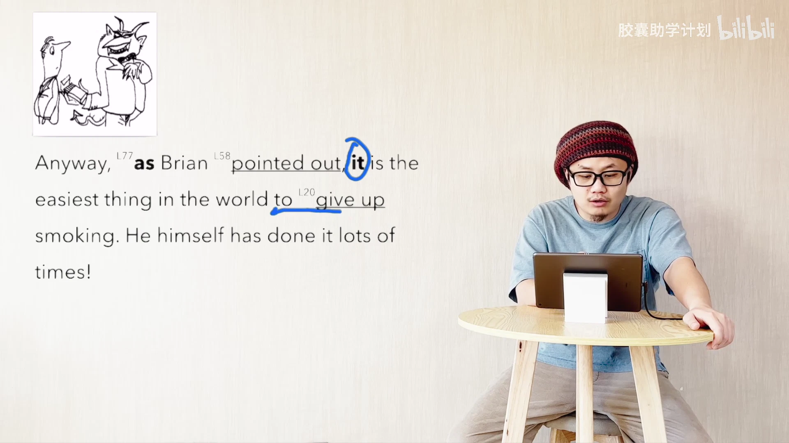

文字识别：胶囊助学计划biibi / Anyway, "as Brian / L77 / L58 / pointed out, / is the / easiest thing in the world to 2°give up / smoking. He himself has done it lots of / times!

## 00:14:30–00:15:00

It is the easiest thing in the world. 说它是全世界最容易的事情。如果我们只看到这儿，你必然你语感没有任何问题的话，你必然会问我一个问题，叫做它指代的是什么？因为它是个代词。那你告诉我什么是全世界最容易的事儿？换一句话来说，it指代的是什么？那你读完这句话你就知道了，叫 to give up smoking，叫做戒烟这件事儿是全世界最容易的事情，对吧？好，你看啊， to give up

### 画面 00:14:31

文字识别：胶囊助学计划biibi出 / Anyway, "as Brian / L77 / L58 / pointed out, / is the / it / easiest thing in the world to 2°give up / smoking. He himself has done it lots of / times!

### 画面 00:14:40

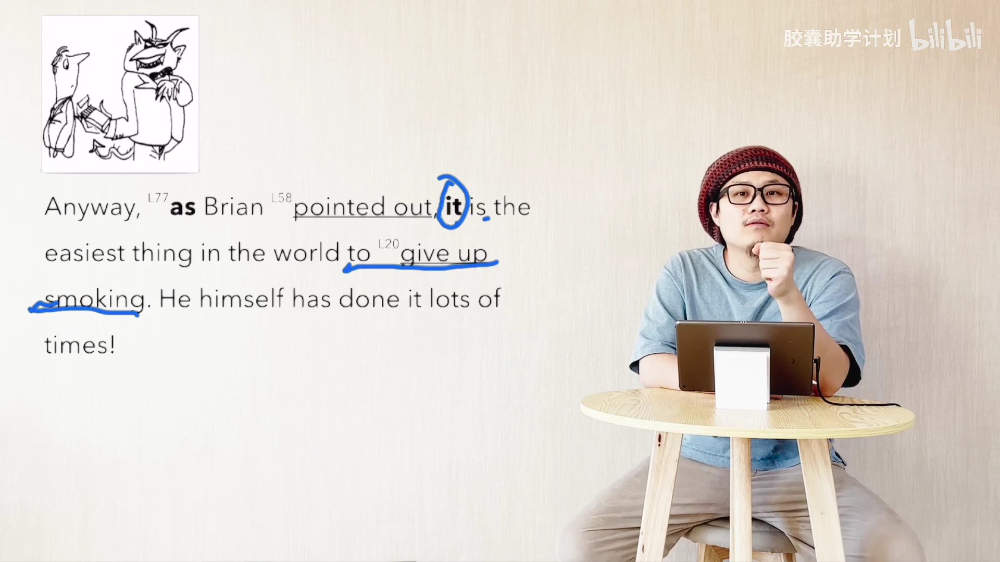

文字识别：胶囊助学计划bib出 / Anyway, / L77 / 'as Brian / L58 / pointed out, / is the / it / easiest thing in the world to 2°give up / Smoking. He himself has done it lots of / times!

### 画面 00:14:50

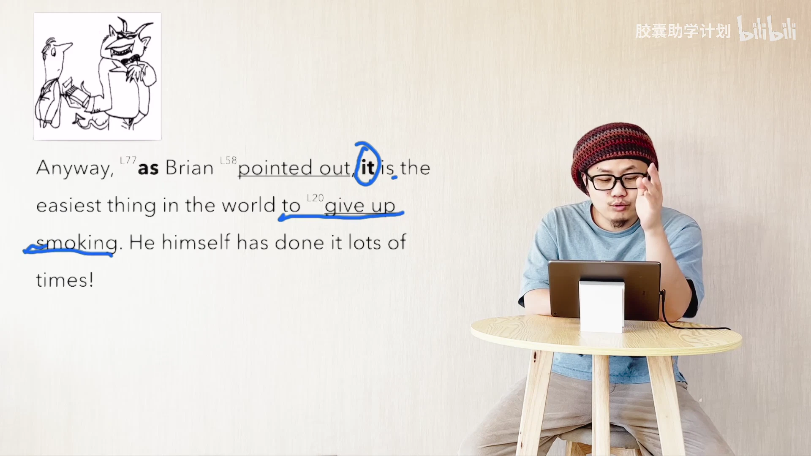

文字识别：胶囊助学计划bib出 / Anyway,"a / L77 / 'as Brian / L58 / pointed out, / isthe / it / easiest thing in the world to 2°give up / smoking. He himself has done it lots of / times!

## 00:15:00–00:15:30

smoking其实就是it，所以这个我们之前学过很多什么语法，什么形式主语啊，什么真正主语啊，哎，就是这个玩意儿。但我不建议你这么去走，我更建议你去走的方式是什么呢？叫It is the easiest thing in the world to do something，对吧？好，你比如说，我认为讲实话是全世界最容易的事情。It is the easiest thing in the world to tell the truth，对吧？你说这个这个让这让他哭啊，是全世界最容易的事情。

### 画面 00:15:13

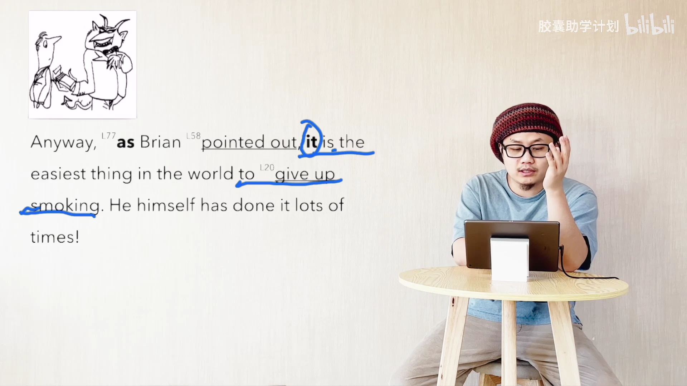

文字识别：胶囊助学计划biibi / Anyway, 7as Brian / L77 / L58 / pointed out, / tis.the / it / easiest thing in the world to 2give up / Smoking. He himself has done it lots of / times!

### 画面 00:15:15

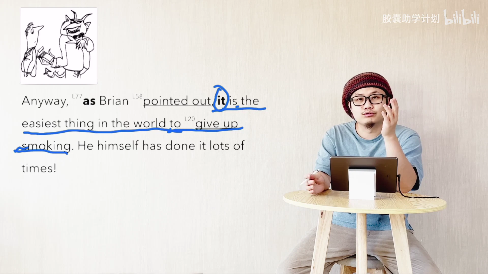

文字识别：bilbii / 胶囊助学计划 / Anyway, / L77 / as Brian / L58 / pointed out, / is the / it / easiest thing in the world to 2°give up / smoking. He himself has done it lots of / times!

### 画面 00:15:23

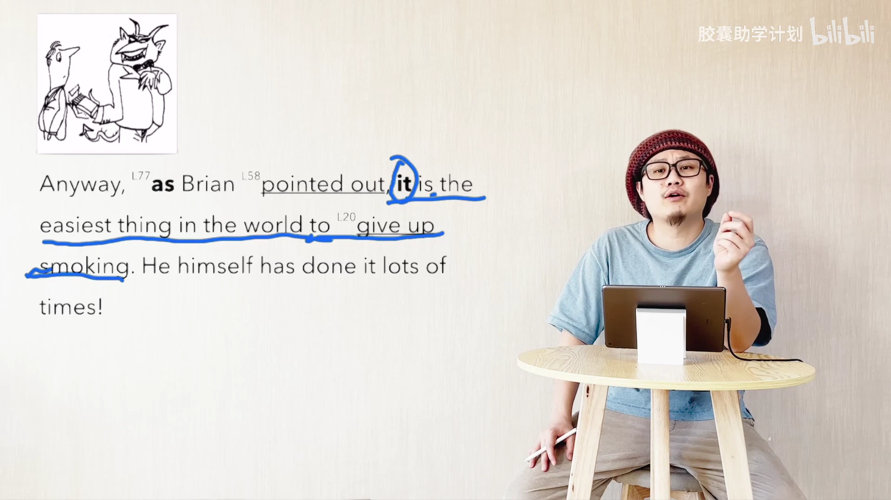

文字识别：bilbili / 胶囊助学计划 / it is the / Anyway, / L77 / as Brian / L58 / pointed out, / easiest thing in the world to 2°give up / smoking. He himself has done it lots of / times!

## 00:15:30–00:16:00

It is the easiest thing in the world to make her cry. 为什么我认为第二种方法就是这种把它固习惯这个高难语法习惯用法化，对吧？就是咱们直接把它变成 It is the easiest thing in the world to do something. 这样一个习惯用法，呃，在我看来是比较更符合各位学习习惯的。对于你来说更有用的呢？因为语法知识谁是形式主语，谁是什么逻辑主语啊？这个这个玩没用。对于你来说，这个知识对于你能不能

### 画面 00:15:40

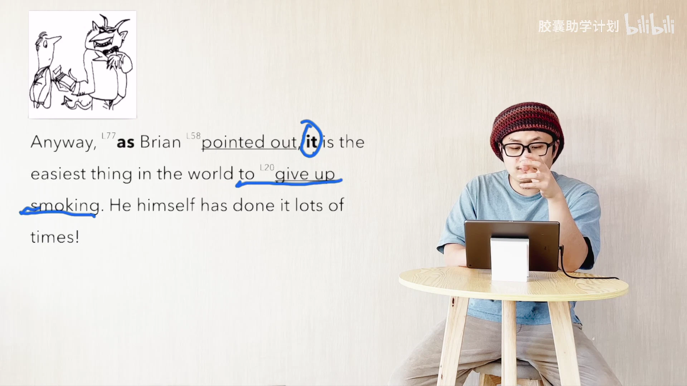

文字识别：胶囊助学计划biibi / Anyway, "as Brian / L77 / L58 / pointed out, / is the / easiest thing in the world to 2°give up / Smoking. He himself has done it lots of / times!

### 画面 00:15:42

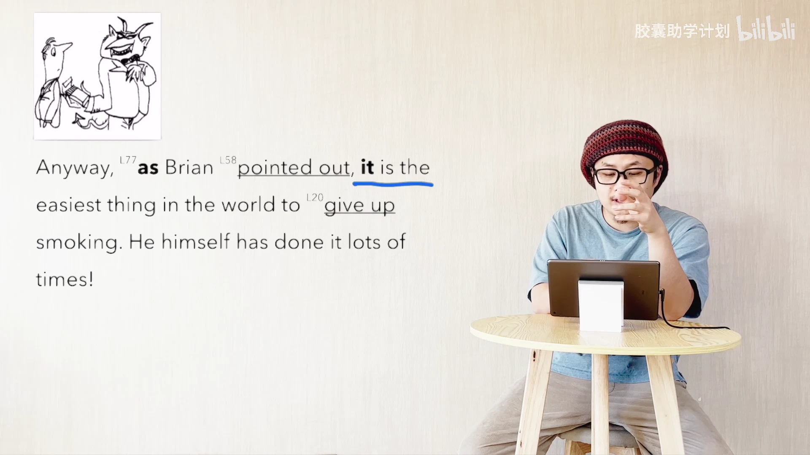

文字识别：胶囊助学计划biibi / Anyway, "as Brian / L77 / L58 / pointed out, it is the / easiest thing in the world to / L20 / give up / smoking. He himself has done it lots of / times!

### 画面 00:15:44

文字识别：胶囊助学计划bibi / Anyway, / L77 / as Brian / L58 / pointed out, it is the / easiest thing in the world to / L20 / give up / smoking. He himself has done it lots of / times!

## 00:16:00–00:16:30

张开嘴直接说出来做某件事是全世界最容易的事儿，这个事儿完全没用。但是如果你一遍一遍造句，前面那个东西就变成一种下意识张嘴就来的东西了。所以当我一想让你说什么什么是全世界最容易的事儿的时候，前面那句话，因为我练的足够的多了，我哪怕不懂它具体是个什么语法，我都能张嘴说出来，叫 It is the easiest thing in the world to do something to. 然后后边那个我再慢慢想去，对

### 画面 00:16:00

文字识别：胶囊助学计划bi / Anyway," / L77 / 'as Brian / L58 / pointed out, it is the / easiest thing in the world to / L20 / give up / smoking. He himself has done it lots of / times!

### 画面 00:16:06

文字识别：胶囊助学计划bil山 / Anyway," / L77 / 'as Brian / L58 / pointed out, it is the / easiest thing in the world to / L20 / give up / smoking. He himself has done it lots of / times!

### 画面 00:16:10

文字识别：胶囊助学计划biil / Anyway, / L77 / as Brian / L58 / pointed out, it is the / easiest thing in the world to / L20 / give up / smoking. He himself has done it lots of / times!

## 00:16:30–00:17:00

吧？OK，好，所以这是我建议的啊。He himself has done it lots of times，说他他自己呀就已经做了这件事情许多次了。哪件事情？Give up smoking这件事儿。所以你看这句话就是有那种英国人那种蔫坏蔫坏的小修小幽默啊。包括可能亚历山大这个人自己的特点就是这个样子的，总是那种蔫坏蔫坏。就像Brian指出了说，哎，戒烟全戒烟太简单了啊，我戒过好多回，

### 画面 00:16:40

文字识别：Bilbil / 胶囊助学计划 / Anyway, / L77 / as Brian / L58 / pointed out, it is the / easiest thing in the world to / .20 / give up / smoking. He himself has done it lots of / times!

## 00:17:00–00:17:30

就是这样一种感觉啊。那说那不说借就借吗？啊，OK，呃，文章说完了，咱们看一下习惯用法吧啊，咱一个一个来。Light a cigarette啊，像其实这都不算习惯用法，这就是我硬给它拉出来点根烟算什么习惯用法？He tried to calm down and light a cigarette啊，我刚才跟你说了对吧？很多抽烟的人是这个样子的。下一个，Would you mind my lighting a cigarette？这儿的

### 画面 00:17:05

文字识别：bilbii / 胶囊助学计划 / 习惯用法造句 / light a cigarette / sb. be sure that+句子 / keep on doing sth. / offer sb. sth. / make no effort to do sth. / a packet of.. / return to normal..

### 画面 00:17:07

文字识别：bibii / 胶囊助学计划 / 习惯用法造句 / light a cigarette / sb. be sure that+句子 / keep on doing sth. / offer sb. sth. / make no effort to do sth. / a packet of.. / return to normal..

### 画面 00:17:09

文字识别：bilbii / 胶囊助学计划 / 习惯用法造句 / light a cigarette / sb. be sure that+句子 / keep on doing sth. / offer sb. sth. / make no effort to do sth. / a packet of.. / return to normal..

### 画面 00:17:11

文字识别：网：v.+v.变化 / 胶囊助学计划 / bilbii / 习惯用法造句指南 / 四句型转换 / 方式/地点/时间 / 其他习惯用法 / 其他单词+词性 / 原文摘抄+变 / 6123456 / light a cigarette

### 画面 00:17:13

文字识别：网：v.+v.变化 / 胶囊助学计划 / bilbili / 习惯用法造句指南 / 四句型转换 / 方式/地点/时间 / 其他习惯用法 / 其他单词+词性 / 原文摘抄+变 / 6123456 / light a cigarette

### 画面 00:17:15

文字识别：网：v.+v.变化 / 胶囊助学计划 / bilbili / 习惯用法造句指南 / 四句型转换 / 方式/地点/时间 / 其他习惯用法 / 其他单词+词性 / 原文摘抄+变 / 6123456 / light a cigarette

### 画面 00:17:17

文字识别：bilbi / 网：v.+v.变化 / 胶囊助学计划 / 习惯用法造句指南 / 四句型转换 / 方式/地点/时间 / 其他习惯用法 / 其他单词+词性 / 原文摘抄+变 / 6123456 / light a cigarette / He tired to calm down and lit a cigarette. / L78

### 画面 00:17:19

文字识别：blibili / 网：v.+v.变化 / 胶囊助学计划 / 习惯用法造句指南 / 四句型转换 / 方式/地点/时间 / 其他习惯用法 / 其他单词+词性 / 原文摘抄+变 / 6123456 / light a cigarette / He tired to calm down and lit a cigarette. / L78

### 画面 00:17:22

文字识别：网：v.+v.变化 / 胶囊助学计划 / bilbi / 习惯用法造句指南 / 四句型转换 / 方式/地点/时间 / 其他习惯用法 / 其他单词+词性 / 原文摘抄+变 / 6123456 / light a cigarette / He tired to calm down and lit a cigarette. / L78 /  Would you mind my lighting a cigarette? / L68

### 画面 00:17:24

文字识别：网：v.+v.变化 / 胶囊助学计划 / bilbi / 习惯用法造句指南 / 四句型转换 / 方式/地点/时间 / 其他习惯用法 / 其他单词+词性 / 原文摘抄+变 / 6123456 / light a cigarette / He tired to calm down and lit a cigarette. / L78 /  Would you mind my lighting a cigarette? / L68

### 画面 00:17:29

文字识别：网：v.+v.变化 / 胶囊助学计划 / bibili / 习惯用法造句指南 / 四句型转换 / 方式/地点/时间 / 其他习惯用法 / 其他单词+词性 / 原文摘抄+变 / 6123456 / light a cigarette /  He tired to calm down and lit a cigarette. / L78 /  Would you mind my lighting a cigarette? / L68

## 00:17:30–00:18:00

my可以换成谁来着？可以换成me，对吧？啊，考试你写my，不考试生活当中用me啊，或者一个普通的邮件写me，发个短信写me，没有任何问题，绝对不算错。哎，小婉说，The moment you lit a cigarette, I know that you were lying.说你一点烟，我就知道你这跟我撒谎的。为啥？每次你跟我撒谎，你都点烟，对吧？一怎么怎么样，就怎么怎么样。六十课咱学的，对吧？呃，包括你看，像这个the moment，类似于as soon as

### 画面 00:17:32

文字识别：网：v.+v.变化 / 胶囊助学计划 / bilBii / 习惯用法造句指南 / 四句型转换 / 方式/地点/时间 / 其他习惯用法 / 其他单词+词性 / 原文摘抄+变 / 6123456 / light a cigarette /  He tired to calm down and lit a cigarette. / L78 / h /  Would you mind my lighting a cigarette? / L68

### 画面 00:17:34

文字识别：网：v.+v.变化 / 胶囊助学计划 / blibii / 习惯用法造句指南 / 四句型转换 / 方式/地点/时间 / 其他习惯用法 / 其他单词+词性 / 原文摘抄+变 / 6123456 / light a cigarette / He tired to calm down and lit a cigarette. / me / L78 /  Would you mind my lighting a cigarette? / L68

### 画面 00:17:37

文字识别：网：v.+v.变化 / 胶囊助学计划 / biibili / 习惯用法造句指南 / 四句型转换 / 方式/地点/时间 / 其他习惯用法 / 其他单词+词性 / 原文摘抄+变 / 6123456 / light a cigarette / He tired to calm down and lit a cigarette. / me / L78 /  Would you mind my lighting a cigarette? / L68

### 画面 00:17:39

文字识别：网：v.+v.变化 / 胶囊助学计划 / bilbii / 习惯用法造句指南 / 四句型转换 / 方式/地点/时间 / 其他习惯用法 / 其他单词+词性 / 原文摘抄+变 / 6123456 / light a cigarette / He tired to calm down and lit a cigarette. / me / L78 /  Would you mind my lighting a cigarette? / L68

### 画面 00:17:42

文字识别：网：v.+v.变化 / 胶囊助学计划 / bibii / 习惯用法造句指南 / 四句型转换 / 方式/地点/时间 / 其他习惯用法 / 其他单词+词性 / 原文摘抄+变 / 6123456 / light a cigarette / He tired to calm down and lit a cigarette. / me / L78 /  Would you mind my lighting a cigarette? / L68 /  The moment you lit a cigarette, I knew / that you were lying. L60

### 画面 00:17:44

文字识别：网：v.+v.变化 / 胶囊助学计划 / bibii / 习惯用法造句指南 / 四句型转换 / 方式/地点/时间 / 其他习惯用法 / 其他单词+词性 / 原文摘抄+变 / 6123456 / light a cigarette / He tired to calm down and lit a cigarette. / me / L78 /  Would you mind my lighting a cigarette? / L68 /  The moment you lit a cigarette, I knew / that you were lying. L60

### 画面 00:17:46

文字识别：网：v.+v.变化 / 胶囊助学计划 / bilbili / 习惯用法造句指南 / 四句型转换 / 方式/地点/时间 / 其他习惯用法 / 其他单词+词性 / 原文摘抄+变 / 6123456 / light a cigarette / He tired to calm down and lit a cigarette. / me / L78 /  Would you mind my lighting a cigarette? / L68 /  The moment you lit a cigarette, I knew / that you were lying. L60

### 画面 00:17:49

文字识别：网：v.+v.变化 / 胶囊助学计划 / bibii / 习惯用法造句指南 / 四句型转换 / 方式/地点/时间 / 其他习惯用法 / 其他单词+词性 / 原文摘抄+变 / 6123456 / light a cigarette /  He tired to calm down and lit a cigarette. / me / L78 /  Would you mind my lighting a cigarette? / L68 /  The moment you lit a cigarette, I knew / that you were lying. L60

### 画面 00:17:54

文字识别：网：v.+v.变化 / 胶囊助学计划 / bibii / 习惯用法造句指南 / 四句型转换 / 方式/地点/时间 / 其他习惯用法 / 其他单词+词性 / 原文摘抄+变 / 6123456 / light a cigarette / He tired to calm down and lit a cigarette. / me / L78 /  Would you mind my lighting a cigarette? / L68 / The moment you lit a cigarette, I knew / that you were lying. L60

### 画面 00:17:56

文字识别：网：v.+v.变化 / 胶囊助学计划 / biibii / 习惯用法造句指南 / 四句型转换 / 方式/地点/时间 / 其他习惯用法 / 其他单词+词性 / 原文摘抄+变 / 6123456 / light a cigarette / He tired to calm down and lit a cigarette. / me / L78 /  Would you mind my lighting a cigarette? / L68 /  The moment you lit a cigarette, I knew / that you were lying. L60

### 画面 00:17:58

文字识别：网：v.+v.变化 / 胶囊助学计划 / bibi / 习惯用法造句指南 / 四句型转换 / 方式/地点/时间 / 其他习惯用法 / 其他单词+词性 / 原文摘抄+变 / 6123456 / light a cigarette /  He tired to calm down and lit a cigarette. / me / L78 /  Would you mind my lighting a cigarette? / L68 / The moment you lit a cigarette, I knew / that you were lying. L60

## 00:18:00–00:18:30

嘛，Okay.那注意力集中，咱听一个电影片段啊。Do you mind if I light a cigarette? You better not. Okay,下一个。Somebody be sure that某人很确信，比如说，If you have any questions, I'm sure that Tom has the answers.如果你有问题，我很确信怎么怎么样。Next one. I'm sure that he will explain this to you.

### 画面 00:18:00

文字识别：网：v.+v.变化 / 胶囊助学计划 / bibii / 习惯用法造句指南 / 四句型转换 / 方式/地点/时间 / 其他习惯用法 / 其他单词+词性 / 原文摘抄+变 / 6123456 / light a cigarette /  He tired to calm down and lit a cigarette. / me / L78 /  Would you mind my lighting a cigarette? / L68 / The moment you lit a cigarette, I knew / that you were lying. L60

### 画面 00:18:02

文字识别：bilbii / 胶囊助学计划 / Do you mind if I light a cigarette? / You'd better not. / The Killing of a Sacred Deer / (2017)

### 画面 00:18:05

文字识别：biibii / 胶囊助学计划 / Do you mind if I light a cigarette? / You'd better not. / The Killing of a Sacred Deer / (2017)

### 画面 00:18:07

文字识别：biibii / 胶囊助学计划 / Do you mind if I light a cigarette? / You'd better not. / The Killing of a Sacred Deer / (2017)

### 画面 00:18:09

文字识别：网：v.+v.变化 / 胶囊助学计划 / bilbili / 习惯用法造句指南 / 四句型转换 / 方式/地点/时间 / 其他习惯用法 / 其他单词+词性 / 原文摘抄+变 / 6123456 / sb. be sure that+句子

### 画面 00:18:11

文字识别：bilbili / 网：v.+v.变化 / 胶囊助学计划 / 习惯用法造句指南 / 四句型转换 / 方式/地点/时间 / 其他习惯用法 / 其他单词+词性 / 原文摘抄+变 / 6123456 / sb. be sure that+句子

### 画面 00:18:13

文字识别：网：v.+v.变化 / 胶囊助学计划 / bilbili / 习惯用法造句指南 / 四句型转换 / 方式/地点/时间 / 其他习惯用法 / 其他单词+词性 / 原文摘抄+变 / 6123456 / sb. be sure that+句子

### 画面 00:18:15

文字识别：网：v.+v.变化 / 胶囊助学计划 / bilbi / 习惯用法造句指南 / 四句型转换 / 方式/地点/时间 / 其他习惯用法 / 其他单词+词性 / 原文摘抄+变 / 6123456 / sb. be sure that+句子 /  If you have any questions, 'm sure that / Tom has the ansWers. Good Will Hunting (1997)

### 画面 00:18:17

文字识别：网：v.+v.变化 / 胶囊助学计划 / biibii / 习惯用法造句指南 / 四句型转换 / 方式/地点/时间 / 其他习惯用法 / 其他单词+词性 / 原文摘抄+变 / 6123456 / sb. be sure that+句子 /  If you have any questions, 'm sure that / Tom has the answers. Good Will Hunting (1997)

### 画面 00:18:19

文字识别：网：v.+v.变化 / 胶囊助学计划 / bilbii / 习惯用法造句指南 / 四句型转换 / 方式/地点/时间 / 其他习惯用法 / 其他单词+词性 / 原文摘抄+变 / 6123456 / sb. be sure that+句子 /  If you have any questions, 'm sure that / Tom has the answers. Good Will Hunting (1997)

### 画面 00:18:24

文字识别：网：v.+v.变化 / 胶囊助学计划 / bilbi / 习惯用法造句指南 / 四句型转换 / 方式/地点/时间 / 其他习惯用法 / 其他单词+词性 / 原文摘抄+变 / 6123456 / sb. be sure that+句子 /  If you have any questions, I'm sure that / Tom has the answers. Good Will Hunting (1997) / I'm sure that he will explain this to you. L33

### 画面 00:18:26

文字识别：网：v.+v.变化 / 胶囊助学计划 / bilbii / 习惯用法造句指南 / 四句型转换 / 方式/地点/时间 / 其他习惯用法 / 其他单词+词性 / 原文摘抄+变 / 6123456 / sb. be sure that+句子 /  If you have any questions, I'm sure that / Tom has the answers. Good Will Hunting (1997) / I'm sure that he will explain this to you. L33

### 画面 00:18:29

文字识别：胶囊助学计划 bilibil / 网：v.+v.变化 / 习惯用法造句指南 / 四句型转换 / 方式/地点/时间 / 其他习惯用法 / 其他单词+词性 / 原文摘抄+变 / 6123456 / sb. be sure that+句子 /  If you have any questions, I'm sure that / Tom has the answers. Good Will Hunting (1997) / I'm sure that he will explain this to you. L33

## 00:18:30–00:19:00

I am very sure he will explain this thing to you, right? You see, this actually follows the same logic as before. For me, I don't need you to understand that the sentence after "somebody is so bad" is a what kind of clause? Ah, and I tell you this, many teachers directly say it is a relative clause, which is both right and wrong. Because if you ask me, I also say it is a relative clause. But why is it wrong? Because in grammar, some people call it an adjectival clause. But in another angle, we call it a definite.

### 画面 00:18:31

文字识别：网：v.+v.变化 / 胶囊助学计划 / bibi / 习惯用法造句指南 / 四句型转换 / 方式/地点/时间 / 其他习惯用法 / 其他单词+词性 / 原文摘抄+变 / 6123456 / sb. be sure that+句子 /  If you have any questions, 'm sure that / Tom has the answers. Good Will Hunting (1997) / I'm sure that he will / explain this to yoy. L33

### 画面 00:18:33

文字识别：网：v.+v.变化 / 胶囊助学计划 / biibii / 习惯用法造句指南 / 四句型转换 / 方式/地点/时间 / 其他习惯用法 / 其他单词+词性 / 原文摘抄+变 / 6123456 / sb. be sure that+句子 /  If you have any questions, I'm sure that / Tom has the answers. Good Will Hunting (1997) / I'm sure that he will explain this to you. L33

### 画面 00:18:35

文字识别：网：v.+v.变化 / 胶囊助学计划 / bibili / 习惯用法造句指南 / 四句型转换 / 方式/地点/时间 / 其他习惯用法 / 其他单词+词性 / 原文摘抄+变 / 6123456 / sb. be sure that+句子 /  If you have any questions, I'm sure that / Tom has the ansWers. Good Will Hunting (1997) / Hm sure that he will explain this to you. L33

### 画面 00:18:38

文字识别：网：v.+v.变化 / 胶囊助学计划 / bibii / 习惯用法造句指南 / 四句型转换 / 方式/地点/时间 / 其他习惯用法 / 其他单词+词性 / 原文摘抄+变 / 6123456 / sb. be sure that+句子 /  If you have any questions, I'm sure that / Tom has the answers. Good Will Hunting (1997) / Hm sure that he will explain this to you. L33

### 画面 00:18:40

文字识别：网：v.+v.变化 / 胶囊助学计划 / bibii / 习惯用法造句指南 / 四句型转换 / 方式/地点/时间 / 其他习惯用法 / 其他单词+词性 / 原文摘抄+变 / 6123456 / sb. be sure that+句子 /  If you have any questions, I'm sure that / Tom has the answers. Good Will Hunting (1997) / 上m sure that he will explain this to you. L33

### 画面 00:18:42

文字识别：网：v.+v.变化 / 胶囊助学计划 / bibil / 习惯用法造句指南 / 四句型转换 / 方式/地点/时间 / 其他习惯用法 / 其他单词+词性 / 原文摘抄+变 / 6123456 / sb. be surethat+句子 /  If you have any questions, I'm sure that / Tom has the answers. Good Will Hunting (1997) / Hm sure that he will explain this to you. L33

### 画面 00:18:44

文字识别：网：v.+v.变化 / 胶囊助学计划 / bibii / 习惯用法造句指南 / 四句型转换 / 方式/地点/时间 / 其他习惯用法 / 其他单词+词性 / 原文摘抄+变 / 6123456 / sb. be surethat+句子 /  If you have any questions, I'm sure that / Tom has the answers. Good Will Hunting (1997) / Hm sure that he will explain this to you. L33

### 画面 00:18:49

文字识别：网：v.+v.变化 / 胶囊助学计划 / bibii / 习惯用法造句指南 / 四句型转换 / 方式/地点/时间 / 其他习惯用法 / 其他单词+词性 / 原文摘抄+变 / 6123456 / sb. be surethat+句子 /  If you have any questions, I'm sure that / Tom has the ansWers. Good Will Hunting (1997) / Hm sure that he will explain this to you. L33

### 画面 00:18:54

文字识别：网：v.+v.变化 / 胶囊助学计划 / bibii / 习惯用法造句指南 / 四句型转换 / 方式/地点/时间 / 其他习惯用法 / 其他单词+词性 / 原文摘抄+变 / 6123456 / sb. be surethat+句子 /  If you have any questions, I'm sure that / Tom has the answers. Good Will Hunting (1997) / 上m sure that he will explain this to you. L33

### 画面 00:18:59

文字识别：网：v.+v.变化 / 胶囊助学计划 / bibii / 习惯用法造句指南 / 四句型转换 / 方式/地点/时间 / 其他习惯用法 / 其他单词+词性 / 原文摘抄+变 / 6123456 / sb. be surethat+句子 /  If you have any questions, I'm sure that / Tom has the ansWers. Good Will Hunting (1997) / Hm sure that he willexplain this to you. L33

## 00:19:00–00:19:30

角度，我们管它叫这个定语从句，对吧？而且这个东西，语法学家自己也没有达成一个一致。所以，一个老师要不停的给你讲这些东西，你想一下，它不是一个英语学习的思路，它是英语研究的思路。英语学习的思路就是我将来张开嘴能说出来。当我想张开嘴说我很确信的时候，我能张开嘴说 I'm sure that 后边加一句话，对吧？所以呢，如何能完成这件事儿呢？就是不停的造句，造句，造句。哎，用这个习惯用法去造句，

### 画面 00:19:03

文字识别：网：v.+v.变化 / 胶囊助学计划 / biibili / 习惯用法造句指南 / 四句型转换 / 方式/地点/时间 / 其他习惯用法 / 其他单词+词性 / 原文摘抄+变 / 6123456 / sb. be surethat+句子 /  If you have any questions, I'm sure that / Tom has the answers. Good Will Hunting (1997) / Hm sure that he will explain this to you. L33

### 画面 00:19:05

文字识别：网：v.+v.变化 / 胶囊助学计划 / biibii / 习惯用法造句指南 / 四句型转换 / 方式/地点/时间 / 其他习惯用法 / 其他单词+词性 / 原文摘抄+变 / 6123456 / sb. be surethat+句子 /  If you have any questions, I'm sure that / Tom has the answers. Good Will Hunting (1997) / Hm sure that he will explain this to you. L33

### 画面 00:19:08

文字识别：网：v.+v.变化 / 胶囊助学计划 / bibii / 习惯用法造句指南 / 四句型转换 / 方式/地点/时间 / 其他习惯用法 / 其他单词+词性 / 原文摘抄+变 / 6123456 / sb. be surethat+句子 /  If you have any questions, I'm sure that / Tom has the answers. Good Will Hunting (1997) / Hm sure that he will explain this to you. L33

### 画面 00:19:10

文字识别：网：v.+v.变化 / 胶囊助学计划 / biibii / 习惯用法造句指南 / 四句型转换 / 方式/地点/时间 / 其他习惯用法 / 其他单词+词性 / 原文摘抄+变 / 6123456 / sb. be surethat+句子 /  If you have any questions, I'm sure that / Tom has the answers. Good Will Hunting (1997) / Hm sure that he willexplain this to you. L33

### 画面 00:19:14

文字识别：网：v.+v.变化 / 胶囊助学计划 / bibli / 习惯用法造句指南 / 四句型转换 / 方式/地点/时间 / 其他习惯用法 / 其他单词+词性 / 原文摘抄+变 / 6123456 / sb. be surethat+句子 /  If you have any questions, I'm sure that / Tom has the answers. Good Will Hunting (1997) / Hm sure that he willexplain this to you. L33

### 画面 00:19:17

文字识别：网：v.+v.变化 / 胶囊助学计划 / bibili / 习惯用法造句指南 / 四句型转换 / 方式/地点/时间 / 其他习惯用法 / 其他单词+词性 / 原文摘抄+变 / 6123456 / sb. be surethat+句子 /  If you have any questions, I'm sure that / Tom has the answers. Good Will Hunting (1997) / m sure that he will explain this to you. L33

### 画面 00:19:19

文字识别：网：v.+v.变化 / 胶囊助学计划 / bibii / 习惯用法造句指南 / 四句型转换 / 方式/地点/时间 / 其他习惯用法 / 其他单词+词性 / 原文摘抄+变 / 6123456 / sb. be surethat+句子 /  If you have any questions, I'm sure that / Tom has the answers. Good Will Hunting (1997) / Hm sure that he will explain this to you. L33

### 画面 00:19:24

文字识别：网：v.+v.变化 / 胶囊助学计划 / biibii / 习惯用法造句指南 / 四句型转换 / 方式/地点/时间 / 其他习惯用法 / 其他单词+词性 / 原文摘抄+变 / 6123456 / sb. be surethat+句子 /  If you have any questions, I'm sure that / Tom has the ansWers. Good Will Hunting (1997) / Hm sure that he will explain this to you. L33

### 画面 00:19:26

文字识别：bibii / 网：v.+v.变化 / 胶囊助学计划 / 习惯用法造句指南 / 四句型转换 / 方式/地点/时间 / 其他习惯用法 / 其他单词+词性 / 原文摘抄+变 / 6123456 / sb. be sure that+句子 /  If you have any questions, 'm sure that / Tom has the ansWers. Good Will Hunting (1997) / I'm sure that he will explain this to you. L33

### 画面 00:19:28

文字识别：网：v.+v.变化 / 胶囊助学计划 / bilbii / 习惯用法造句指南 / 四句型转换 / 方式/地点/时间 / 其他习惯用法 / 其他单词+词性 / 原文摘抄+变 / 612345 / sb. be sure that+句子 /  If you have any questions, I'm sure that / Tom has the ansWers. Good Will Hunting (1997) / I'm sure that he will explain this to you. L33

## 00:19:30–00:20:00

这个事儿我就能做到了，对吧？再来，比如说 I'm sure that she is as beautiful as her mom. 我很确信呢，她跟她妈一样漂亮，对吧？哎，小眼睛，你一看就能看出来她妈妈年轻的时候的样子，对吧？ I'm sure that she is as beautiful as her mom. OK. 呃，下一个 keep on doing something，坚持不断的做某件事情，对吧？比如说 Why do you want to keep on working? 你为什么想持续不断的工作呢？你看你现在腰缠万贯，对吧？你怎么还不停的工作

### 画面 00:19:30

文字识别：网：v.+v.变化 / 胶囊助学计划 / bibii / 习惯用法造句指南 / 四句型转换 / 方式/地点/时间 / 其他习惯用法 / 其他单词+词性 / 原文摘抄+变 / sb. be sure that+句子 /  If you have any questions, 'm sure that / Tom has the answers. Good Will Hunting (1997) / I'm sure that he will explain this to you. L33

### 画面 00:19:33

文字识别：网：v.+v.变化 / 胶囊助学计划 / biibii / 习惯用法造句指南 / 四句型转换 / 方式/地点/时间 / 其他习惯用法 / 其他单词+词性 / 原文摘抄+变 / sb. be sure that+句子 /  If you have any questions, I'm sure that / Tom has the answers. Good Will Hunting (1997) / I'm sure that he will explain this to you. L33 / I'm sure that she is as beautiful as her / mom.L32

### 画面 00:19:35

文字识别：网：v.+v.变化 / 胶囊助学计划 / bilbili / 习惯用法造句指南 / 四句型转换 / 方式/地点/时间 / 其他习惯用法 / 其他单词+词性 / 原文摘抄+变 / sb. be sure that+句子 /  If you have any questions, I'm sure that / Tom has the answers. Good Will Hunting (1997) / I'm sure that he will explain this to you. L33 / I'm sure that she is as beautiful as her / mom.L32

### 画面 00:19:38

文字识别：网：v.+v.变化 / 胶囊助学计划 / bilbili / 习惯用法造句指南 / 四句型转换 / 方式/地点/时间 / 其他习惯用法 / 其他单词+词性 / 原文摘抄+变 / sb. be sure that+句子 /  If you have any questions, I'm sure that / Tom has the answers. Good Will Hunting (1997) / I'm sure that he will explain this to you. L33 / I'm sure that she is as beautiful as her / mom.L32

### 画面 00:19:40

文字识别：网：v.+v.变化 / 胶囊助学计划 / bibli / 习惯用法造句指南 / 四句型转换 / 方式/地点/时间 / 其他习惯用法 / 其他单词+词性 / 原文摘抄+变 / sb. be sure that+句子 /  If you have any questions, I'm sure that / Tom has the answers. Good Will Hunting (1997) / I'm sure that he will explain this to you. L33 / I'm sure that she is as beautiful as her / mom.L32

### 画面 00:19:44

文字识别：网：v.+v.变化 / 胶囊助学计划 / biibili / 习惯用法造句指南 / 四句型转换 / 方式/地点/时间 / 其他习惯用法 / 其他单词+词性 / 原文摘抄+变 / sb. be sure that+句子 /  If you have any questions, I'm sure that / Tom has the ansWers. Good Will Hunting (1997) / I'm sure that he will explain this to you. L33 / I'm sure that she is as beautiful as her / mom.L32

### 画面 00:19:46

文字识别：网：v.+v.变化 / 胶囊助学计划 / bibili / 习惯用法造句指南 / 四句型转换 / 方式/地点/时间 / 其他习惯用法 / 其他单词+词性 / 原文摘抄+变 / 6123456 / keep on doing sth.

### 画面 00:19:48

文字识别：网：v.+v.变化 / 胶囊助学计划 / bibii / 习惯用法造句指南 / 四句型转换 / 方式/地点/时间 / 其他习惯用法 / 其他单词+词性 / 原文摘抄+变 / 6123456 / keep on doing sth.

### 画面 00:19:50

文字识别：bilbili / 网：v.+v.变化 / 胶囊助学计划 / 习惯用法造句指南 / 四句型转换 / 方式/地点/时间 / 其他习惯用法 / 其他单词+词性 / 原文摘抄+变 / 6123456 / keep on doing sth.

### 画面 00:19:52

文字识别：blbii / 网：v.+v.变化 / 胶囊助学计划 / 习惯用法造句指南 / 四句型转换 / 方式/地点/时间 / 其他习惯用法 / 其他单词+词性 / 原文摘抄+变 / 6123456 / keep on doing sth. /  Why do you want to keep on working?

### 画面 00:19:54

文字识别：网：v.+v.变化 / 胶囊助学计划 / blibili / 习惯用法造句指南 / 四句型转换 / 方式/地点/时间 / 其他习惯用法 / 其他单词+词性 / 原文摘抄+变 / 6123456 / keep on doing sth. /  Why do you want to keep on working?

### 画面 00:19:58

文字识别：网：v.+v.变化 / 胶囊助学计划 / bilbili / 习惯用法造句指南 / 四句型转换 / 方式/地点/时间 / 其他习惯用法 / 其他单词+词性 / 原文摘抄+变 / 6123456 / keep on doing sth. /  Why do you want to keep on working?

## 00:20:00–00:20:30

呢？哎，你说，因为就算拥有一个金山也没有办法give me satisfaction呐，对吧？串起来了吧？She kept on putting up the tent in the yard.说他这这个孩子就是非要坚持不断的要在咱这院子里边把这个帐篷给搭起来。很多小孩喜欢玩这个，对吧？再来，So no matter what happened, just keep on trying, keep on hoping for better things in your life.哎，这句话我造的我还很满意。

### 画面 00:20:00

文字识别：网：v.+v.变化 / 胶囊助学计划 / bilbii / 习惯用法造句指南 / 四句型转换 / 方式/地点/时间 / 其他习惯用法 / 其他单词+词性 / 原文摘抄+变 / 6123456 / keep on doing sth. /  Why do you want to keep on working? /  She kept on putting up the tent in the yard. / L27

### 画面 00:20:02

文字识别：网：v.+v.变化 / 胶囊助学计划 / Bibii / 习惯用法造句指南 / 四句型转换 / 方式/地点/时间 / 其他习惯用法 / 其他单词+词性 / 原文摘抄+变 / 6123456 / keep on doing sth. /  Why do you want to keep on working? /  She kept on putting up the tent in the yard. / L27

### 画面 00:20:04

文字识别：网：v.+v.变化 / 胶囊助学计划 / bibii / 习惯用法造句指南 / 四句型转换 / 方式/地点/时间 / 其他习惯用法 / 其他单词+词性 / 原文摘抄+变 / 6123456 / keep on doing sth. /  Why do you want to keep on working? /  She kept on putting up the tent in the yard. / L27

### 画面 00:20:08

文字识别：网：v.+v.变化 / 胶囊助学计划 / bibili / 习惯用法造句指南 / 四句型转换 / 方式/地点/时间 / 其他习惯用法 / 其他单词+词性 / 原文摘抄+变 / 6123456 / keep on doing sth. /  Why do you want to keep on working? /  She kept on putting up the tent in the yard. / L27

### 画面 00:20:10

文字识别：网：v.+v.变化 / 胶囊助学计划 / bibii / 习惯用法造句指南 / 四句型转换 / 方式/地点/时间 / 其他习惯用法 / 其他单词+词性 / 原文摘抄+变 / 6123456 / keep on doing sth. /  Why do you want to keep on working? /  She kept on putting up the tent in the yard. / L27

### 画面 00:20:14

文字识别：网：v.+v.变化 / 胶囊助学计划 / bibili / 习惯用法造句指南 / 四句型转换 / 方式/地点/时间 / 其他习惯用法 / 其他单词+词性 / 原文摘抄+变 / 6123456 / keep on doing sth. /  Why do you want to keep on working? /  She kept on putting up the tent in the yard. / L27

### 画面 00:20:19

文字识别：网：v.+v.变化 / 胶囊助学计划 / bibili / 习惯用法造句指南 / 四句型转换 / 方式/地点/时间 / 其他习惯用法 / 其他单词+词性 / 原文摘抄+变 / 6123456 / keep on doing sth. /  Why do you want to keep on working? /  She kept on putting up the tent in the yard. / L27

### 画面 00:20:21

文字识别：网：v.+v.变化 / 胶囊助学计划 / Bilbii / 习惯 / 四句型转换 / 用 / 方式/地点/时间 / 法 / 么造句指南 / 其他习惯用法 / 其他单词+词性 / 原文摘抄+变 / 6123456 / keep on doing sth. /  Why do you want to keep on working? /  She kept on putting up the tent in the yard. / L27 /  No matter what happened, just keep on / trying and keep on hoping for better things / in your life. L68

### 画面 00:20:24

文字识别：网：v.+v.变化 / 胶囊助学计划 / bibili / 习惯用法 / 四句型转换 / 方式/地点/时间 / 么造句指南 / 其他习惯用法 / 其他单词+词性 / 原文摘抄+变 / 6123456 / keep on doing sth. /  Why do you want to keep on working? /  She kept on putting up the tent in the yard. / L27 /  No matter what happened, just keep on / trying and keep on hoping for better things / in your life. L68

### 画面 00:20:29

文字识别：胶囊助学计划bilbil / 网：v.+v.变化 / 习惯用 / 四句型转换 / 方式/地点/时间 / 法 / 么造句指南 / 其他习惯用法 / 其他单词+词性 / 原文摘抄+变 / 6123456 / keep on doing sth. /  Why do you want to keep on working? /  She kept on putting up the tent in the yard. / L27 /  No matter what happened, just keep on / trying and keep on hoping for better things / in your life. L68

## 00:20:30–00:21:00

首先，no matter what happens，六十八课咱学的啊，no matter what就类似于whatever happens，无论什么，你一定要持续不断的尝试，持续不断的希望会有一些好的事情在你的生活当中会出现的，对吧？哎，就是有希望咱们才能往下活嘛。Keep on doing something. Next one, offer somebody something叫做提供某人

### 画面 00:20:31

文字识别：胶囊助学计划bilbil / 网：v.+v.变化 / 习惯 / 四句型转换 / 用 / 方式/地点/时间 / 法 / 其他习惯用法 / 造 / 旭句指南 / 其他单词+词性 / 原文摘抄+变 / 6123456 / keep on doing sth. /  Why do you want to keep on working? /  She kept on putting up the tent in the yard. / L27 / No matter what happened, just keep on / trying and keep on hoping for better things / in your life. L68

### 画面 00:20:33

文字识别：网：v.+v.变化 / 胶囊助学计划 / 习惯 / 四句型转换 / 用 / 方式/地点/时间 / 法 / 其他习惯用法 / 造 / 旭句指南 / 其他单词+词性 / 原文摘抄+变 / 6123456 / keep on doing sth. / Why do you want to keep on working? /  She kept on putting up the tent in the yard. / L27 / No matter what happened, just keep on / trying and keep on hoping for better things / in your life. L68

### 画面 00:20:35

文字识别：胶囊助学计划blbil / 网：v.+v.变化 / 习惯 / 四句型转换 / 用 / 方式/地点/时间 / 法 / 其他习惯用法 / 造 / 旭句指南 / 其他单词+词性 / 原文摘抄+变 / 6123456 / keep on doing sth. /  Why do you want to keep on working? /  She kept on putting up the tent in the yard. / L27 / No matter what happened, just keep on / trying and keep on hoping for better things / in your life. L68

### 画面 00:20:39

文字识别：网：v.+v.变化 / 胶囊助学计划 / bilibii / 习惯用 / 四句型转换 / 方式/地点/时间 / 法 / 其他习惯用法 / 造 / 旭句指南 / 其他单词+词性 / 原文摘抄+变 / 6123456 / keep on doing sth. /  Why do you want to keep on working? /  She kept on putting up the tent in the yard. / L27 / No matter what happened, just keep on / trying and keep on hoping for better things / in your life. L68

### 画面 00:20:44

文字识别：胶囊助学计划bilbil / 网：v.+v.变化 / 习惯 / 四句型转换 / 用 / 方式/地点/时间 / 法 / 其他习惯用法 / 造 / 旭句指南 / 其他单词+词性 / 原文摘抄+变 / 6123456 / keep on doing sth. / Why do you want to keep on working? /  She kept on putting up the tent in the yard. / L27 / No matter what happened, just keep on / trying and keep on hoping for better things / in your life. L68

### 画面 00:20:47

文字识别：胶囊助学计划bilbii / 网：v.+v.变化 / 习惯 / 四句型转换 / 用 / 方式/地点/时间 / 法 / 其他习惯用法 / 造 / 旭句指南 / 其他单词+词性 / 原文摘抄+变 / 6123456 / keep on doing sth. / Why do you want to keep on working? /  She kept on putting up the tent in the yard. / L27 / No matter what happened, just keep on / trying and keep on hoping for better things / in your life. L68

### 画面 00:20:49

文字识别：胶囊助学计划bilbi / 网：v.+v.变化 / 习惯 / 四句型转换 / 用 / 方式/地点/时间 / 法 / 其他习惯用法 / 造 / 旭句指南 / 其他单词+词性 / 原文摘抄+变 / 6123456 / keep on doing sth. /  Why do you want to keep on working? /  She kept on putting up the tent in the yard. / L27 / No matter what happened, just keep on / trying and keep on hoping for better things / in your life. L68

### 画面 00:20:53

文字识别：胶囊助学计划bilil / 网：v.+v.变化 / 习惯 / 四句型转换 / 用 / 方式/地点/时间 / 法 / 其他习惯用法 / 造 / 旭句指南 / 其他单词+词性 / 原文摘抄+变 / 6123456 / keep on doing sth. /  Why do you want to keep on working? /  She kept on putting up the tent in the yard. / L27 / No matter what happened, just keep on / trying and keep on hoping for better things / in your life. L68

### 画面 00:20:55

文字识别：bilbili / 网：v.+v.变化 / 胶囊助学计划 / 习惯用法造句指南 / 四句型转换 / 方式/地点/时间 / 其他习惯用法 / 其他单词+词性 / 原文摘抄+变 / 6123456 / offer sb. sth.

### 画面 00:20:57

文字识别：网：v.+v.变化 / 胶囊助学计划 / bilbili / 习惯用法造句指南 / 四句型转换 / 方式/地点/时间 / 其他习惯用法 / 其他单词+词性 / 原文摘抄+变 / 6123456 / offer sb. sth.

### 画面 00:20:59

文字识别：bilbili / 网：v.+v.变化 / 胶囊助学计划 / 习惯用法造句指南 / 四句型转换 / 方式/地点/时间 / 其他习惯用法 / 其他单词+词性 / 原文摘抄+变 / 6123456 / offer sb. sth.

## 00:21:00–00:21:30

某物。我们造一个句子，比如说，I think he just offered me a job.说，哎呀，我觉得他刚刚应该是刚给我提供了一份工作。说，It gives me satisfaction to offer you a job.说，这给了我什么呢？这个这个满足感，去给你提供一个工作。再来说，Who entitled you to offer him a job in my company？说，谁给你的权利

### 画面 00:21:02

文字识别：bilbili / 网：v.+v.变化 / 胶囊助学计划 / 习惯用法造句指南 / 四句型转换 / 方式/地点/时间 / 其他习惯用法 / 其他单词+词性 / 原文摘抄+变 / 6123456 / offer sb. sth. / I think he just offered me a job.

### 画面 00:21:04

文字识别：bilbili / 网：v.+v.变化 / 胶囊助学计划 / 习惯用法造句指南 / 四句型转换 / 方式/地点/时间 / 其他习惯用法 / 其他单词+词性 / 原文摘抄+变 / 6123456 / offer sb. sth. / I think he just offered me a job.

### 画面 00:21:06

文字识别：bibii / 网：v.+v.变化 / 胶囊助学计划 / 习惯用法造句指南 / 四句型转换 / 方式/地点/时间 / 其他习惯用法 / 其他单词+词性 / 原文摘抄+变 / 6123456 / offer sb. sth. / I think he just offered me a job.

### 画面 00:21:09

文字识别：blibii / 网：v.+v.变化 / 胶囊助学计划 / 习惯用法造句指南 / 四句型转换 / 方式/地点/时间 / 其他习惯用法 / 其他单词+词性 / 原文摘抄+变 / 6123456 / offer sb. sth. / I think he just offered me a job.

### 画面 00:21:11

文字识别：网：v.+v.变化 / 胶囊助学计划 / bibii / 习惯用法造句指南 / 四句型转换 / 方式/地点/时间 / 其他习惯用法 / 其他单词+词性 / 原文摘抄+变 / 6123456 / offer sb. sth. / I think he just offered me a job. /  It gives me satisfaction to offer you a job. / L78

### 画面 00:21:14

文字识别：网：v.+v.变化 / 胶囊助学计划 / bibii / 习惯用法造句指南 / 四句型转换 / 方式/地点/时间 / 其他习惯用法 / 其他单词+词性 / 原文摘抄+变 / 6123456 / offer sb. sth. / I think he just offered me a job. /  It gives me satisfaction to offer you a job. / L78

### 画面 00:21:19

文字识别：网：v.+v.变化 / 胶囊助学计划 / biibii / 习惯用法造句指南 / 四句型转换 / 方式/地点/时间 / 其他习惯用法 / 其他单词+词性 / 原文摘抄+变 / 6123456 / offer sb. sth. / I think he just offered me a job. /  It gives me satisfaction to offer you a job. / L78

### 画面 00:21:21

文字识别：网：v.+v.变化 / 胶囊助学计划 / bilbii / 习惯用法造句指南 / 四句型转换 / 方式/地点/时间 / 其他习惯用法 / 其他单词+词性 / 原文摘抄+变 / 6123456 / offer sb. sth. / I think he just offered me a job. /  It gives me satisfaction to offer you a job. / L78

### 画面 00:21:23

文字识别：网：v.+v.变化 / 胶囊助学计划 / Bilbili / 习惯用法造句指南 / 四句型转换 / 方式/地点/时间 / 其他习惯用法 / 其他单词+词性 / 原文摘抄+变 / 6123456 / offer sb. sth. / I think he just offered me a job. /  It gives me satisfaction to offer you a job. / L78 / Who entitled you to offer him a job in my / company? L78

### 画面 00:21:25

文字识别：网：v.+v.变化 / 胶囊助学计划 / biibii / 习惯用法造句指南 / 四句型转换 / 方式/地点/时间 / 其他习惯用法 / 其他单词+词性 / 原文摘抄+变 / 6123456 / offer sb. sth. / I think he just offered me a job. /  It gives me satisfaction to offer you a job. / L78 / Who entitled you to ofer him a job in my / Company? L78

### 画面 00:21:27

文字识别：网：v.+v.变化 / 胶囊助学计划 / bibii / 习惯用法造句指南 / 四句型转换 / 方式/地点/时间 / 其他习惯用法 / 其他单词+词性 / 原文摘抄+变 / 6123456 / offer sb. sth. / I think he just offered me a job. /  It gives me satisfaction to offer you a job. / L78 /  Who entitled you to offer him a job in my / Company? L78

### 画面 00:21:29

文字识别：网：v.+v.变化 / 胶囊助学计划 / bilibili / 习惯用法造句指南 / 四句型转换 / 方式/地点/时间 / 其他习惯用法 / 其他单词+词性 / 原文摘抄+变 / 6123456 / offer sb. sth. / I think he just offered me a job. /  It gives me satisfaction to offer you a job. / L78 /  Who entitled you to ofer him a job in my / company? L78

## 00:21:30–00:22:00

去给他提供一份工作？在我的公司里边，这公司我说了算，也不是你说了算。Entitle somebody to do something.给某人权利去做某件事情。下一个，make no effort to do something.哎，毫不努力去做某件事。那make every effort to do something呢？叫做做出了一切努力去做某件事情。哎，这两个习惯用法其实无非就是把no换成了every，含义改一下就完了。一个是毫不

### 画面 00:21:34

文字识别：网：v.+v.变化 / 胶囊助学计划 / bilbli / 习惯用法造句指南 / 四句型转换 / 方式/地点/时间 / 其他习惯用法 / 其他单词+词性 / 原文摘抄+变 / 6123456 / offer sb. sth. / I think he just offered me a job. /  It gives me satisfaction to offer you a job. / L78 /  Who entitled you to ofer him a job in my / company? L78

### 画面 00:21:38

文字识别：网：v.+v.变化 / 胶囊助学计划 / Bilbili / 习惯用法造句指南 / 四句型转换 / 方式/地点/时间 / 其他习惯用法 / 其他单词+词性 / 原文摘抄+变 / 6123456 / offer sb. sth. / I think he just offered me a job. /  It gives me satisfaction to offer you a job. / L78 /  Who entitled you to ofer him a job in my / company? L78

### 画面 00:21:40

文字识别：网：v.+v.变化 / 胶囊助学计划 / Bilbili / 习惯用法造句指南 / 四句型转换 / 方式/地点/时间 / 其他习惯用法 / 其他单词+词性 / 原文摘抄+变 / 6123456 / offer sb. sth. / I think he just offered me a job. /  It gives me satisfaction to offer you a job. / L78 / Who entitled you to ofer him a job in my / company? L78

### 画面 00:21:42

文字识别：bilbili / 网：v.+v.变化 / 胶囊助学计划 / 习惯用法造句指南 / 四句型转换 / 方式/地点/时间 / 其他习惯用法 / 其他单词+词性 / 原文摘抄+变 / 6123456 / make no/every effort to do sth....

### 画面 00:21:44

文字识别：bilbili / 网：v.+v.变化 / 胶囊助学计划 / 习惯用法造句指南 / 四句型转换 / 方式/地点/时间 / 其他习惯用法 / 其他单词+词性 / 原文摘抄+变 / 6123456 / make no/every effort to do sth...

### 画面 00:21:49

文字识别：网：v.+v.变化 / 胶囊助学计划 / blbili / 习惯用法造句指南 / 四句型转换 / 方式/地点/时间 / 其他习惯用法 / 其他单词+词性 / 原文摘抄+变 / 6123456 / make no/every effort to do sth....

### 画面 00:21:53

文字识别：bilbili / 网：v.+v.变化 / 胶囊助学计划 / 习惯用法造句指南 / 四句型转换 / 方式/地点/时间 / 其他习惯用法 / 其他单词+词性 / 原文摘抄+变 / 6123456 / make no/every effort to do sth....

### 画面 00:21:55

文字识别：bilbili / 网：v.+v.变化 / 胶囊助学计划 / 习惯用法造句指南 / 四句型转换 / 方式/地点/时间 / 其他习惯用法 / 其他单词+词性 / 原文摘抄+变 / 6123456 / make no/every effort to do sth...

### 画面 00:21:59

文字识别：blibili / 网：v.+v.变化 / 胶囊助学计划 / 习惯用法造句指南 / 四句型转换 / 方式/地点/时间 / 其他习惯用法 / 其他单词+词性 / 原文摘抄+变 / 6123456 / make no/every effort to do sth....

## 00:22:00–00:22:30

努力，一个是这个附近，这个付出了全力，对吧？这个后面我们也会学到啊。本课只是简单提一句，我们重点还是先来 make no effort 啊。比如说 you said you would help me, but you made no effort at all。所以你当时说你会帮我的，但是呢，你又什么努力都没付出。Next one, he made no effort to hide his disappointment。啊，刚才咱们其实说的那个是 amusement 嘛，你把 amusement

### 画面 00:22:01

文字识别：bilbil / 网：v.+v.变化 / 胶囊助学计划 / 习惯用法造句指南 / 四句型转换 / 方式/地点/时间 / 其他习惯用法 / 其他单词+词性 / 原文摘抄+变 / 6123456 / make no/every effort to do sth...

### 画面 00:22:04

文字识别：胶囊助学计划 bilibil / 网：v.+v.变化 / 习惯用法造句指南 / 四句型转换 / 方式/地点/时间 / 其他习惯用法 / 其他单词+词性 / 原文摘抄+变 / 6123456 / make no/every effort to do sth.... /  You said you would help me, but you / made no effort at all.

### 画面 00:22:06

文字识别：胶囊助学计划bibil / 网：v.+v.变化 / 习惯用法造句指南 / 四句型转换 / 方式/地点/时间 / 其他习惯用法 / 其他单词+词性 / 原文摘抄+变 / 6123456 / make no/every effort to do sth.... /  You said you would help me, but you / made no effort at all.

### 画面 00:22:09

文字识别：网：v.+v.变化 / 胶囊助学计划 / Bilbi / 习惯用法造句指南 / 四句型转换 / 方式/地点/时间 / 其他习惯用法 / 其他单词+词性 / 原文摘抄+变 / 6123456 / make no/every effort to do sth.... /  You said you would help me, but you / made no effort at all.

### 画面 00:22:14

文字识别：网：v.+v.变化 / 胶囊助学计划 / bilbi / 习惯用法造句指南 / 四句型转换 / 方式/地点/时间 / 其他习惯用法 / 其他单词+词性 / 原文摘抄+变 / 6123456 / make no/every effort to do sth.... /  You said you would help me, but you / made no effort at all.

### 画面 00:22:16

文字识别：胶囊助学计划 blbil / 网：v.+v.变化 / 习惯用法造句指南 / 四句型转换 / 方式/地点/时间 / 其他习惯用法 / 其他单词+词性 / 原文摘抄+变 / 6123456 / make no/every effort to do sth.... /  You said you would help me, but you / made no effort at all.

### 画面 00:22:18

文字识别：网：v.+v.变化 / 胶囊助学计划 / biibii / 习惯用法造句指南 / 四句型转换 / 方式/地点/时间 / 其他习惯用法 / 其他单词+词性 / 原文摘抄+变 / 6123456 / make no/every effort to do sth.... /  You said you would help me, but you / made no effort at all.

### 画面 00:22:20

文字识别：网：v.+v.变化 / 胶囊助学计划 / bibili / 习惯用法造句指南 / 四句型转换 / 方式/地点/时间 / 其他习惯用法 / 其他单词+词性 / 原文摘抄+变 / 6123456 / make no/every effort to do sth.... /  You said you would help me, but you / made no effort at all.

### 画面 00:22:22

文字识别：胶囊助学计划blbil / 网：v.+v.变化 / 习惯用法造句指南 / 四句型转换 / 方式/地点/时间 / 其他习惯用法 / 其他单词+词性 / 原文摘抄+变 / 6123456 / make no/every effort to do sth... /  You said you would help me, but you / made no effort at all. /  He made no effort to hide his / disappointment.

### 画面 00:22:24

文字识别：胶囊助学计划bili / 网：v.+v.变化 / 习惯用法造句指南 / 四句型转换 / 方式/地点/时间 / 其他习惯用法 / 其他单词+词性 / 原文摘抄+变 / 6123456 / make no/every effort to do sth... /  You said you would help me, but you / made no effort at all. /  He made no effort to hide his / disappointment.

### 画面 00:22:27

文字识别：胶囊助学计划bilbil / 网：v.+v.变化 / 习惯用法造句指南 / 四句型转换 / 方式/地点/时间 / 其他习惯用法 / 其他单词+词性 / 原文摘抄+变 / 6123456 / make no/every effort to do sth... /  You said you would help me, but you / made no effort at all. / He made no effort to hide his / disappointment.

### 画面 00:22:29

文字识别：胶囊助学计划 biliil / 网：v.+v.变化 / 习惯用法造句指南 / 四句型转换 / 方式/地点/时间 / 其他习惯用法 / 其他单词+词性 / 原文摘抄+变 / 6123456 / make no/every effort to do sth... /  You said you would help me, but you / made no effort at all. /  He made no effort to hide his / disappointment.

## 00:22:30–00:23:00

换成 disappointment 不就完了吗？是吧？他就是毫毫不掩饰啊，一点努力都不做去掩饰他的这种失望啊。然后重男轻女的爹啊，看见这个女儿出生的时候，是吧？He made no effort to call the police，说他完全没有哪怕努力一点点，说要给这个警察打电话，就他完全没想给警察打电话，对吧？A packet of 一包啊，这

### 画面 00:22:31

文字识别：网：v.+v.变化 / 胶囊助学计划 / bibili / 习惯用法造句指南 / 四句型转换 / 方式/地点/时间 / 其他习惯用法 / 其他单词+词性 / 原文摘抄+变 / 6123456 / make no/every effort to do sth.... /  You said you would help me, but you / made no effort at all. /  He made no effort to hide his / disappointment.

### 画面 00:22:33

文字识别：网：v.+v.变化 / 胶囊助学计划 / bibii / 习惯用法造句指南 / 四句型转换 / 方式/地点/时间 / 其他习惯用法 / 其他单词+词性 / 原文摘抄+变 / 6123456 / make no/every effort to do sth... /  You said you would help me, but you / made no effort at all. /  He made no effort to hide his / disappointment.

### 画面 00:22:35

文字识别：网：v.+v.变化 / 胶囊助学计划 / bibili / 习惯用法造句指南 / 四句型转换 / 方式/地点/时间 / 其他习惯用法 / 其他单词+词性 / 原文摘抄+变 / 6123456 / make no/every effort to do sth... /  You said you would help me, but you / made no effort at all. /  He made no effort to hide his / disappointment.

### 画面 00:22:39

文字识别：网：v.+v.变化 / 胶囊助学计划bib / 习惯用法造句指南 / 四句型转换 / 方式/地点/时间 / 其他习惯用法 / 其他单词+词性 / 原文摘抄+变 / 6123456 / make no/every effort to do sth... /  You said you would help me, but you / made no effort at all. /  He made no effort to hide his / disappointment. / He made no effort to call the police.

### 画面 00:22:41

文字识别：胶囊助学计划bilbi / 网：v.+v.变化 / 习惯用法造句指南 / 四句型转换 / 方式/地点/时间 / 其他习惯用法 / 其他单词+词性 / 原文摘抄+变 / 6123456 / make no/every effort to do sth.... /  You said you would help me, but you / made no effort at all. /  He made no effort to hide his / disappointment. / He made no effort to call the police.

### 画面 00:22:44

文字识别：胶囊助学计划bilbil / 网：v.+v.变化 / 习惯用法造句指南 / 四句型转换 / 方式/地点/时间 / 其他习惯用法 / 其他单词+词性 / 原文摘抄+变 / 6123456 / make no/every effort to do sth... /  You said you would help me, but you / made no effort at all. / He made no effort to hide his / disappointment. / He made no effort to call the police.

### 画面 00:22:49

文字识别：胶囊助学计划bibil / 网：v.+v.变化 / 习惯用法造句指南 / 四句型转换 / 方式/地点/时间 / 其他习惯用法 / 其他单词+词性 / 原文摘抄+变 / 6123456 / make no/every effort to do sth... /  You said you would help me, but you / made no effort at all. / He made no effort to hide his / disappointment. / He made no effort to call the police.

### 画面 00:22:53

文字识别：网：v.+v.变化 / 胶囊助学计划bibi / 习惯用法造句指南 / 四句型转换 / 方式/地点/时间 / 其他习惯用法 / 其他单词+词性 / 原文摘抄+变 / 6123456 / make no/every effort to do sth.... /  You said you would help me, but you / made no effort at all. /  He made no effort to hide his / disappointment. / He made no effort to call the police.

### 画面 00:22:55

文字识别：胶囊助学计划bibii / 网：v.+v.变化 / 习惯用法造句指南 / 四句型转换 / 方式/地点/时间 / 其他习惯用法 / 其他单词+词性 / 原文摘抄+变 / 6123456 / make no/every effort to do sth... /  You said you would help me, but you / made no effort at all. /  He made no effort to hide his / disappointment. / He made no effort to call the police.

### 画面 00:22:57

文字识别：网：v.+v.变化 / 胶囊助学计划 / bilbili / 习惯用法造句指南 / 四句型转换 / 方式/地点/时间 / 其他习惯用法 / 其他单词+词性 / 原文摘抄+变 / 6123456 / a packet of..

### 画面 00:22:59

文字识别：网：v.+v.变化 / 胶囊助学计划 / biibii / 习惯用法造句指南 / 四句型转换 / 方式/地点/时间 / 其他习惯用法 / 其他单词+词性 / 原文摘抄+变 / 6123456 / a packet of.. /  The little baby failed to open a packet of / biscuits and lost his temper in the end. L16 L78 L1

## 00:23:00–00:23:30

个就很简单了啊。这个其实这习惯用法不造句没问题。我就是想造一下，带你复习一下之前学的习惯用法。The little baby failed to open a packet of biscuits and lost his temper in the end.你看这里边每一个不都学过吗？小宝宝没有打开这包饼干，然后发脾气了，最后啊四处乱甩，是吧？When he heard that he got a rare

### 画面 00:23:01

文字识别：网：v.+v.变化 / 胶囊助学计划 / biibii / 习惯用法造句指南 / 四句型转换 / 方式/地点/时间 / 其他习惯用法 / 其他单词+词性 / 原文摘抄+变 / 6123456 / a packet of.. / The little baby failed to open a packet of / biscuits and lost his temper in the end. L16 L78 L1

### 画面 00:23:04

文字识别：网：v.+v.变化 / 胶囊助学计划 / Bilbili / 习惯用法造句指南 / 四句型转换 / 方式/地点/时间 / 其他习惯用法 / 其他单词+词性 / 原文摘抄+变 / 6123456 / a packet of.. /  The little baby failed to open a packet of / biscuits and lost his temper in the end. L16 L78 L1

### 画面 00:23:09

文字识别：网：v.+v.变化 / 胶囊助学计划 / bilibii / 习惯用法造句指南 / 四句型转换 / 方式/地点/时间 / 其他习惯用法 / 其他单词+词性 / 原文摘抄+变 / 6123456 / a packet of.. /  The little baby failed to open a packet of / biscuits and lost his temper in the end. L16 L78 L1

### 画面 00:23:14

文字识别：胶囊助学计划bilbil / 网：v.+v.变化 / 习惯用法造句指南 / 四句型转换 / 方式/地点/时间 / 其他习惯用法 / 其他单词+词性 / 原文摘抄+变 / 6123456 / a packet of... / The little baby failed to open a packet of / biscuits and lost his temper in the end. L16 L78 L1

### 画面 00:23:24

文字识别：胶囊助学计划biibil / 网：v.+v.变化 / 习惯用法造句指南 / 四句型转换 / 方式/地点/时间 / 其他习惯用法 / 其他单词+词性 / 原文摘抄+变 / 6123456 / a packet of.. / The litle baby failed to open a packet of / biscuits and lost his temper in the end. L16 L78 L1 /  When he heard that he got a rare disease, he / took out a packet of cigarettes. L77

### 画面 00:23:26

文字识别：胶囊助学计划bilbii / 网：v.+v.变化 / 习惯用法造句指南 / 四句型转换 / 方式/地点/时间 / 其他习惯用法 / 其他单词+词性 / 原文摘抄+变 / 6123456 / a packet of... / The little baby failed to open a packet of / biscuits and lost his temper in the end. L16 L78 L1 /  When he heard that he got a rare disease, he / took out a packet of cigarettes. L77

### 画面 00:23:29

文字识别：胶囊助学计划bibi / 网：v.+v.变化 / 习惯用法造句指南 / 四句型转换 / 方式/地点/时间 / 其他习惯用法 / 其他单词+词性 / 原文摘抄+变 / 6123456 / a packet of... / The litle baby failed to open a packet of / biscuits and lost his temper in the end. L16 L78 L1 /  When he heard that he got a rare disease, he / took out a packet of cigarettes. L77

## 00:23:30–00:24:00

disease. He took out a packet of cigarettes.说当他听到说哦，他竟然患有一个疾病的时候，他怎么样了呢？拿出了一包烟。啊，Next one. Get out of here with your packet of sweets.哎，你给我从这儿闪开啊！然后呢，with your packet of sweets，拿着你这包糖，你从我这儿走啊。Return to normal.再次

### 画面 00:23:35

文字识别：胶囊助学计划 bibil / 网：v.+v.变化 / 习惯用法造句指南 / 四句型转换 / 方式/地点/时间 / 其他习惯用法 / 其他单词+词性 / 原文摘抄+变 / 6123456 / a packet of... / The litle baby failed to open a packet of / biscuits and lost his temper in the end. L16 L78 L1 /  When he heard that he got a rare disease, he / took out a packet of cigarettes. L77

### 画面 00:23:39

文字识别：胶囊助学计划bilibi出 / 网：v.+v.变化 / 习惯用法造句指南 / 四句型转换 / 方式/地点/时间 / 其他习惯用法 / 其他单词+词性 / 原文摘抄+变 / 6123456 / a packet of... / The little baby failed to open a packet of / biscuits and lost his temper in the end. L16 L78 L1 /  When he heard that he got a rare disease, he / took out a packet of cigarettes. L77

### 画面 00:23:44

文字识别：网：v.+v.变化 / 胶囊助学计划ib山 / 习惯用法造句指南 / 四句型转换 / 方式/地点/时间 / 其他习惯用法 / 其他单词+词性 / 原文摘抄+变 / 6123456 / a packet of... / The little baby failed to open a packet of / biscuits and lost his temper in the end. L16 L78 L1 /  When he heard that he got a rare disease, he / took out a packet of cigarettes. L77 /  Get out of here with your packet of sweets. L74

### 画面 00:23:49

文字识别：胶囊助学计划bilbil / 网：v.+v.变化 / 习惯用法造句指南 / 四句型转换 / 方式/地点/时间 / 其他习惯用法 / 其他单词+词性 / 原文摘抄+变 / 6123456 / a packet of... /  The litle baby failed to open a packet of / biscuits and lost his temper in the end. L16 L78 L1 /  When he heard that he got a rare disease, he / took out a packet of cigarettes. L77 /  Get out of here with your packet of sweets. L74

### 画面 00:23:54

文字识别：胶囊助学计划bilbil / 网：v.+v.变化 / 习惯用法造句指南 / 四句型转换 / 方式/地点/时间 / 其他习惯用法 / 其他单词+词性 / 原文摘抄+变 / 6123456 / a packet of... /  The little baby failed to open a packet of / biscuits and lost his temper in the end. L16 L78 L1 /  When he heard that he got a rare disease, he / took out a packet of cigarettes. L77 /  Get out of here with your packet of sweets. L74

### 画面 00:23:56

文字识别：胶囊助学计划bilbii / 网：v.+v.变化 / 习惯用法造句指南 / 四句型转换 / 方式/地点/时间 / 其他习惯用法 / 其他单词+词性 / 原文摘抄+变 / 6123456 / a packet of... /  The litle baby failed to open a packet of / biscuits and lost his temper in the end. L16 L78 L1 /  When he heard that he got a rare disease, he / took out a packet of cigarettes. L77 /  Get out of here with your packet of sweets. L74

### 画面 00:23:58

文字识别：网：v.+v.变化 / 胶囊助学计划 / bilbili / 习惯用法造句指南 / 四句型转换 / 方式/地点/时间 / 其他习惯用法 / 其他单词+词性 / 原文摘抄+变 / 6123456 / return to normal..

## 00:24:00–00:24:30

回到正常的状态。比如说，刚才我们说戒烟嘛，戒烟的时候，这个这个这个特别爱吃饭，是吧？这个饭量巨大。那你一抽上烟，可能就不那么爱吃了，就回到了这句话。His appetite has returned to normal,哎，又回到正常状态了。再来，We expect things to return to normal very soon.呃，我们希望事情很快就会再次回到正常

### 画面 00:24:00

文字识别：bilbili / 网：v.+v.变化 / 胶囊助学计划 / 习惯用法造句指南 / 四句型转换 / 方式/地点/时间 / 其他习惯用法 / 其他单词+词性 / 原文摘抄+变 / 6123456 / return to normal.. /  His appetite has returned to normal.

### 画面 00:24:04

文字识别：bibili / 网：v.+v.变化 / 胶囊助学计划 / 习惯用法造句指南 / 四句型转换 / 方式/地点/时间 / 其他习惯用法 / 其他单词+词性 / 原文摘抄+变 / 6123456 / return to normal... /  His appetite has returned to normal.

### 画面 00:24:09

文字识别：网：v.+v.变化 / 胶囊助学计划 / biibii / 习惯用法造句指南 / 四句型转换 / 方式/地点/时间 / 其他习惯用法 / 其他单词+词性 / 原文摘抄+变 / 6123456 / return to normal... /  His appetite has returned to normal.

### 画面 00:24:18

文字识别：网：v.+v.变化 / 胶囊助学计划 / bibili / 习惯用法造句指南 / 四句型转换 / 方式/地点/时间 / 其他习惯用法 / 其他单词+词性 / 原文摘抄+变 / 6123456 / return to normal.. /  His appetite has returned to normal. /  We expect things to return to normal / very soon. L34

### 画面 00:24:20

文字识别：网：v.+v.变化 / 胶囊助学计划 / bibili / 习惯用法造句指南 / 四句型转换 / 方式/地点/时间 / 其他习惯用法 / 其他单词+词性 / 原文摘抄+变 / 6123456 / return to normal.. /  His appetite has returned to normal. /  We expect things to return to normal / very soon. L34

### 画面 00:24:24

文字识别：网：v.+v.变化 / 胶囊助学计划 / bilibii / 习惯用法造句指南 / 四句型转换 / 方式/地点/时间 / 其他习惯用法 / 其他单词+词性 / 原文摘抄+变 / 6123456 / return to normal... /  His appetite has returned to normal. /  We expect things to return to normal / very soon. L34

### 画面 00:24:28

文字识别：网：v.+v.变化 / 胶囊助学计划 / biibii / 习惯用法造句指南 / 四句型转换 / 方式/地点/时间 / 其他习惯用法 / 其他单词+词性 / 原文摘抄+变 / 6123456 / return to normal.. /  His appetite has returned to normal. /  We expect things to return to normal / very soon. L34

## 00:24:30–00:25:00

状态。比如说，疫情这几年，我们的心情一直不就是这样吗？After he had the operation, his life returned to normal.说，在他做了这个实验啊，做了这个这个这个这个这个手术之后啊，他的生活又回到了正常的状态。哎，该吃吃，该喝喝，对吧？该睡睡，该玩玩。Recap本课文章以外习惯用法，在这儿给各位罗列出来了啊，咱笔记当中也有习

### 画面 00:24:30

文字识别：网：v.+v.变化 / 胶囊助学计划 / bibili / 习惯用法造句指南 / 四句型转换 / 方式/地点/时间 / 其他习惯用法 / 其他单词+词性 / 原文摘抄+变 / 6123456 / return to normal... /  His appetite has returned to normal. /  We expect things to return to normal / very soon. L34

### 画面 00:24:32

文字识别：网：v.+v.变化 / 胶囊助学计划 / bilibii / 习惯用法造句指南 / 四句型转换 / 方式/地点/时间 / 其他习惯用法 / 其他单词+词性 / 原文摘抄+变 / 6123456 / return to normal.. /  His appetite has returned to normal. /  We expect things to return to normal / very soon. L34 /  After he had the operation, his life / returned to normal. L77

### 画面 00:24:34

文字识别：胶囊助学计划bibil / 网：v.+v.变化 / 习惯用法造句指南 / 四句型转换 / 方式/地点/时间 / 其他习惯用法 / 其他单词+词性 / 原文摘抄+变 / 6123456 / return to normal... /  His appetite has returned to normal. /  We expect things to return to normal / very soon. L34 /  After he had the Operation, his life / returned to normal. L77

### 画面 00:24:39

文字识别：网：v.+v.变化 / 胶囊助学计划 / bibli / 习惯用法造句指南 / 四句型转换 / 方式/地点/时间 / 其他习惯用法 / 其他单词+词性 / 原文摘抄+变 / 6123456 / return to normal.. /  His appetite has returned to normal. /  We expect things to return to normal / very soon. L34 /  After he had the Operation, his life / returned to normal. L77

### 画面 00:24:41

文字识别：网：v.+v.变化 / 胶囊助学计划 / Bilb / 习惯用法造句指南 / 四句型转换 / 方式/地点/时间 / 其他习惯用法 / 其他单词+词性 / 原文摘抄+变 / 6123456 / return to normal.. /  His appetite has returned to normal. /  We expect things to return to normal / very soon. L34 / After he had the Operation, his life / returned to normal. L77

### 画面 00:24:44

文字识别：网：v.+v.变化 / 胶囊助学计划 / bibii / 习惯用法造句指南 / 四句型转换 / 方式/地点/时间 / 其他习惯用法 / 其他单词+词性 / 原文摘抄+变 / 6123456 / return to normal.. /  His appetite has returned to normal. /  We expect things to return to normal / very soon. L34 / After he had the Operation, his life / returned to normal. L77

### 画面 00:24:48

文字识别：胶囊助学计划bilibil / 网：v.+v.变化 / 习惯用法造句指南 / 四句型转换 / 方式/地点/时间 / 其他习惯用法 / 其他单词+词性 / 原文摘抄+变 / 6123456 / return to normal... /  His appetite has returned to normal. /  We expect things to return to normal / very soon. L34 / After he had the Operation, his life / returned to normal. L77

### 画面 00:24:50

文字识别：网：v.+v.变化 / 胶囊助学计划 / bibii / 习惯用法造句指南 / 四句型转换 / 方式/地点/时间 / 其他习惯用法 / 其他单词+词性 / 原文摘抄+变 / 6123456 / return to normal... /  His appetite has returned to normal. /  We expect things to return to normal / very soon. L34 /  After he had the Operation, his life / returned to normal. L77

### 画面 00:24:52

文字识别：bilbili / 胶囊助学计划 / Recap / light a cigarette / sb. be sure t / that+句子 / keep on doing / sth. / Expression / make no / effort to do sth. / a packet of... / offer sb.sth. / return to normal.

### 画面 00:24:54

文字识别：bilbl / 胶囊助学计划 / Recap / light a cigarette / sb. / be / sure / that+句子 / keep on / doing / sth. / Expression / make / no / effort to do sth. / a packet / of... / offer sb. sth. / return to / normal.

### 画面 00:24:56

文字识别：Bibii / 胶囊助学计划 / Recap / light a cigarette / sb.k / be sure / that+句子 / keep onc / doing / sth. / Expression / make no / effort to do sth. / a packet of... / offer sb.sth. / return to normal.

### 画面 00:24:58

文字识别：bibii / 胶囊助学计划 / 1. / 习惯用法造句/对话 / 【习惯用法造句指南】 / 每个5句

## 00:25:00–00:25:30

惯用法呢，该造句造句，然后文章呢这个熟读成诵，哎，置顶留言有咱重复间隔的学习材料。那以上呢就是本期视频的全部内容了。如果各位喜欢我们的课程呢，欢迎各位关注、订阅、一键三连、分享给那些需要的朋友，来帮助我们快速成长。See you next time.

### 画面 00:25:00

文字识别：bibii / 胶囊助学计划 / 1. / 习惯用法造句/对话 / 【习惯用法造句指南】 / 每个5句

### 画面 00:25:02

文字识别：bibii / 胶囊助学计划 / 习惯用法造句/对话 / 【习惯用法造句指南】 / 每个5句 / 文章跟读至熟读成诵 / 内化单词+语法+习惯用法 / 听力+口语+写作练习

### 画面 00:25:04

文字识别：biibili / 胶囊助学计划 / 习惯用法造句/对话 / 【习惯用法造句指南】 / 每个5句 / 文章跟读至熟读成诵 / 内化单词+语法+习惯用法 / 听力+口语+写作练习 / 3. / 重复间隔（置顶留言）

### 画面 00:25:06

文字识别：bibili / 胶囊助学计划 / 1. / 习惯用法造句/对话 / 【习惯用法造句指南】 / 每个5句 / 文章跟读至熟读成诵 / 内化单词+语法+习惯用法 / 听力+口语+写作练习 / 3. / 重复间隔（置顶留言）

### 画面 00:25:08

文字识别：Bilbii / 胶囊助学计划 / 不

### 画面 00:25:21

文字识别：胶囊助学计划H出

### 画面 00:25:23

文字识别：CAPSULEACADEMY / 胶囊助学计划 / 小红书 / Lecturer / 口 / Leo / OE

### 画面 00:25:26

文字识别：CAPSULEACADEMY / 胶囊助学计划 / 小红书 / grapher / Berlin

### 画面 00:25:29

文字识别：臺聖珈学計划 / CAPSULEACADEMY / 胶囊助学计划 / 小红书 / Creator / □ / 口 / Leo & Berlin

## 00:25:30–00:25:34

### 画面 00:25:32

文字识别：bilibili / 胶囊助学计划

### 画面 00:25:33

文字识别：bilibili / 胶囊助学计划

