# 078 练习

快速机器解析：语音为单模型转写，未进行独立交叉校对或人工复核；画面每秒采样并按变化选帧，短时文字和标记可能遗漏。截图时间约有 1 秒误差。图片有损压缩；遇到疑点请按时间查看 Google Drive 原视频。

## 00:00:00–00:00:30

Hello everyone, welcome to Capsule Academy. This is Leo. Today we're going to learn new concept English Book Two Lesson Seventy Eight Practices. That注意进行如下练习，唯一的前提就是文章咱们要呃熟读成诵啊，否则请勿开始。Hope you can enjoy. Let's看第一题Comprehension，目的是练习咱们的听力和口语。我问您答啊。第一题

### 画面 00:00:00

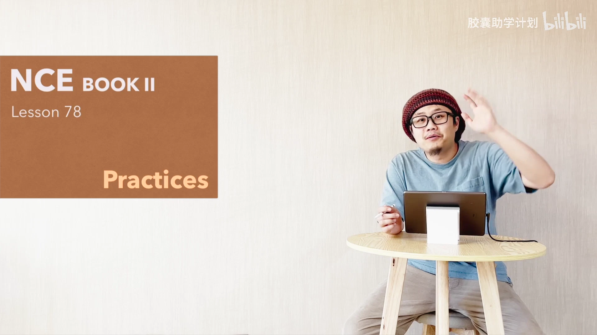

文字识别：bilbili / 胶囊助学计划 / NCE / BOOKII / Lesson 78 / Practices

### 画面 00:00:02

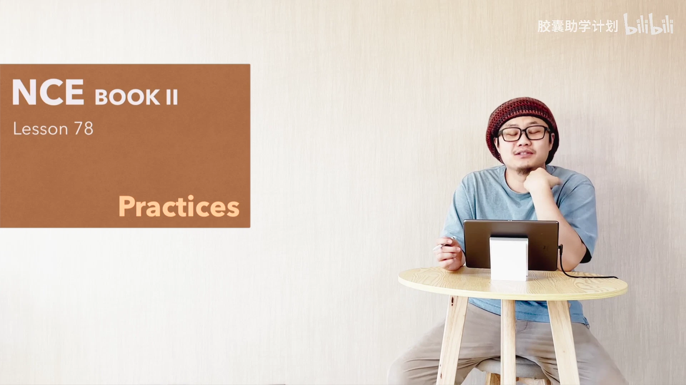

文字识别：bilbii / 胶囊助学计划 / NCE / BOOKII / Lesson 78 / Practices

### 画面 00:00:04

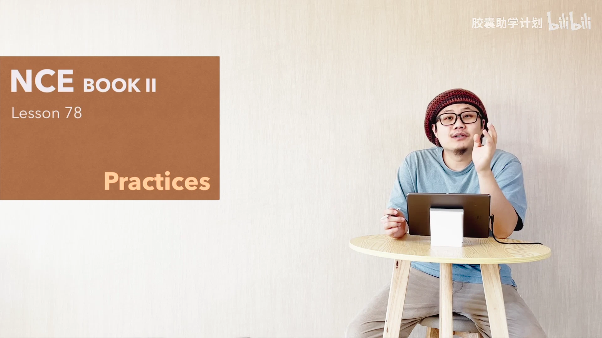

文字识别：bilbili / 胶囊助学计划 / NCE / BOOKII / Lesson 78 / Practices

### 画面 00:00:06

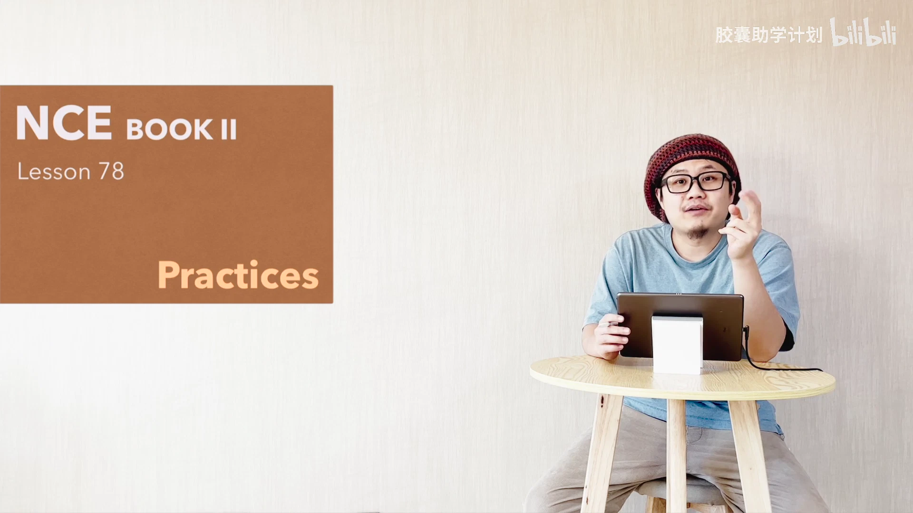

文字识别：biibii / 胶囊助学计划 / NCE / BOOKII / Lesson 78 / Practices

### 画面 00:00:08

文字识别：blibili / 胶囊助学计划 / 进行如下练习唯一前提 / 文章跟读至熟读成诵 / 否则请勿开始

### 画面 00:00:10

文字识别：biibili / 胶囊助学计划 / 进行如下练习唯一前提 / 文章跟读至熟读成诵 / 否则请勿开始

### 画面 00:00:15

文字识别：blibili / 胶囊助学计划 / 进行如下练习唯一前提 / 文章跟读至熟读成诵 / 否则请勿开始

### 画面 00:00:17

文字识别：胶囊助学计划b出

### 画面 00:00:21

文字识别：動学計

### 画面 00:00:23

文字识别：biibii / 胶囊助学计划 / Comprehension / 训练目标： / 听懂一般疑问句＆特殊疑问句

### 画面 00:00:25

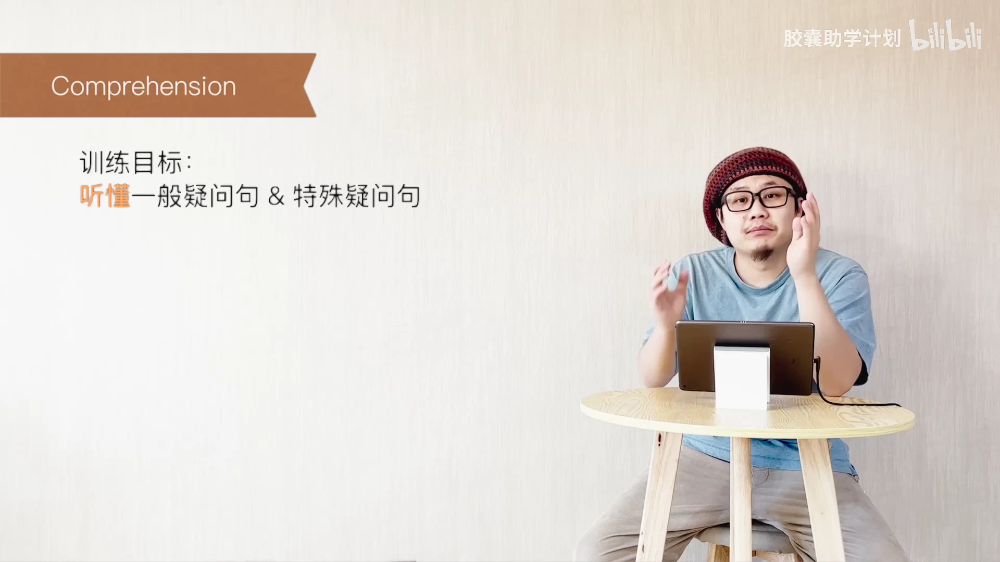

文字识别：biibili / 胶囊助学计划 / Comprehension / 训练目标： / 听懂一般疑问句＆特殊疑问句

### 画面 00:00:27

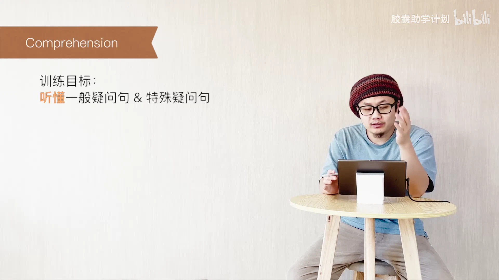

文字识别：bilibili / 胶囊助学计划 / Comprehension / 训练目标： / 听懂一般疑问句＆特殊疑问句

### 画面 00:00:29

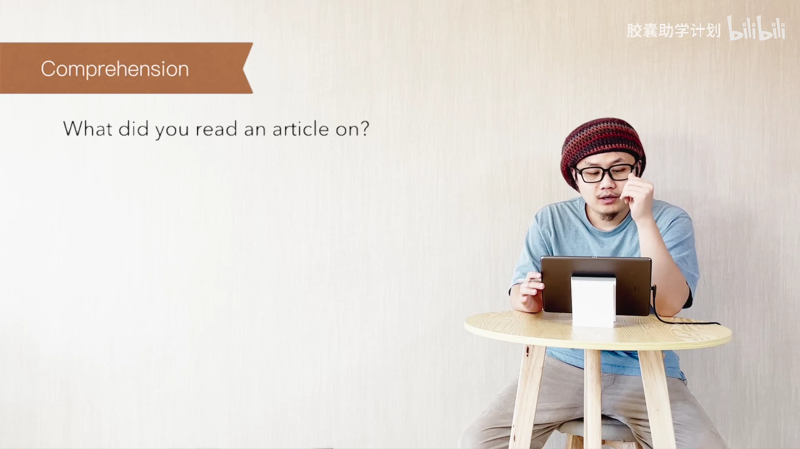

文字识别：biibili / 胶囊助学计划 / Comprehension / What did you read an article on?

## 00:00:30–00:01:00

what did you read an article on? Cigarette smoking and health. Next one, uh, what did you do afterwards? I lit a cigarette. Why did you smoke with such concentration and pleasure? Because I was sure this would be my last cigarette. How long did you not smoke at all?

### 画面 00:00:31

文字识别：bilbili / 胶囊助学计划 / Comprehension / What did you read an article on?

### 画面 00:00:33

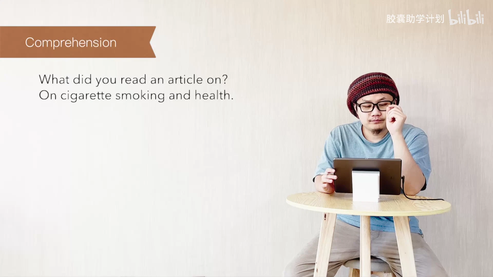

文字识别：bilbii / 胶囊助学计划 / Comprehension / What did you read an article on? / On cigarette smoking and health.

### 画面 00:00:35

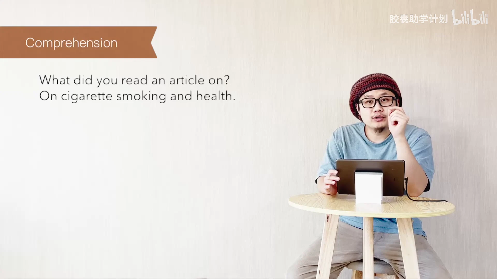

文字识别：bilbii / 胶囊助学计划 / Comprehension / What did you read an article on? / On cigarette smoking and health.

### 画面 00:00:37

文字识别：bibili / 胶囊助学计划 / Comprehension

### 画面 00:00:39

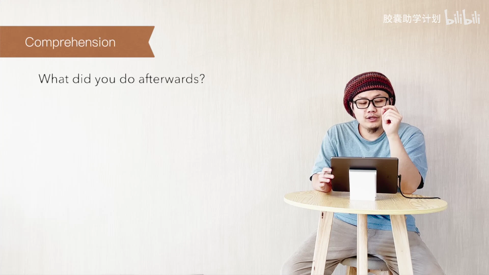

文字识别：biibii / 胶囊助学计划 / Comprehension / What did you do afterwards?

### 画面 00:00:41

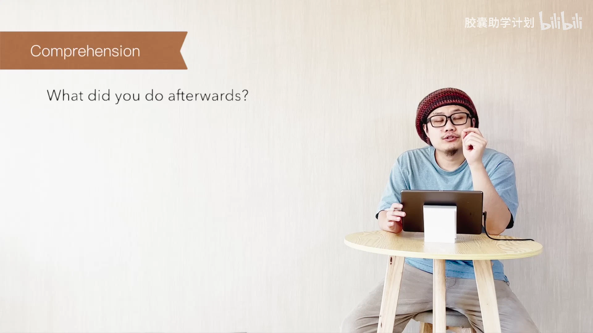

文字识别：bilbili / 胶囊助学计划 / Comprehension / What did you do afterwards?

### 画面 00:00:44

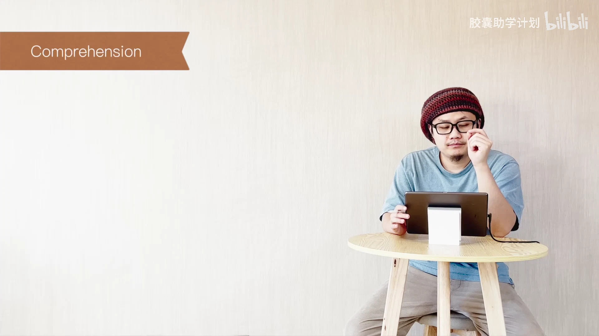

文字识别：bibili / 胶囊助学计划 / Comprehension

### 画面 00:00:46

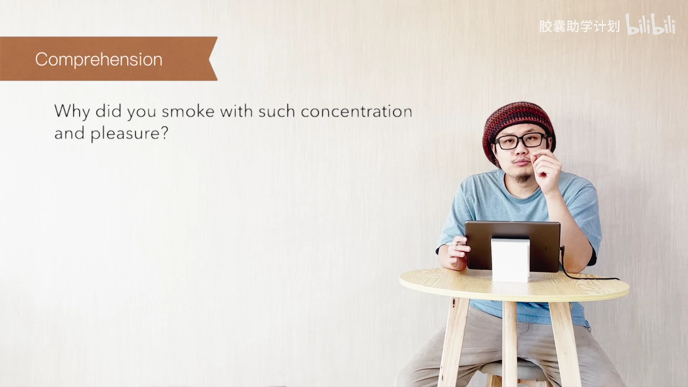

文字识别：bilibii / 胶囊助学计划 / Comprehension / Why did you smoke with such concentration / and pleasure?

### 画面 00:00:48

文字识别：bilibili / 胶囊助学计划 / Comprehension / Why did you smoke with such concentration / and pleasure?

### 画面 00:00:50

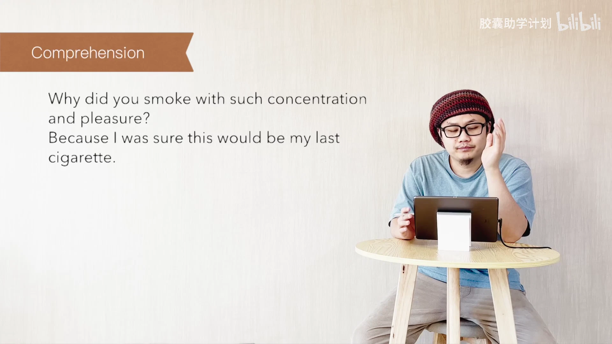

文字识别：biibili / 胶囊助学计划 / Comprehension / Why did you smoke with such concentration / and pleasure? / Because I was sure this would be my last / cigarette.

### 画面 00:00:53

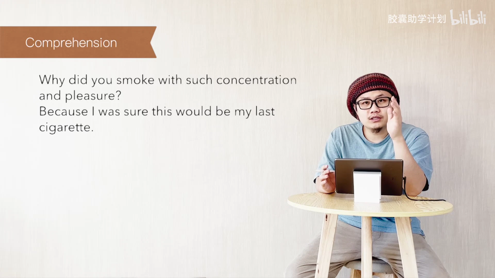

文字识别：bilbii / 胶囊助学计划 / Comprehension / Why did you smoke with such concentration / and pleasure? / Because I was sure this would be my last / cigarette.

### 画面 00:00:55

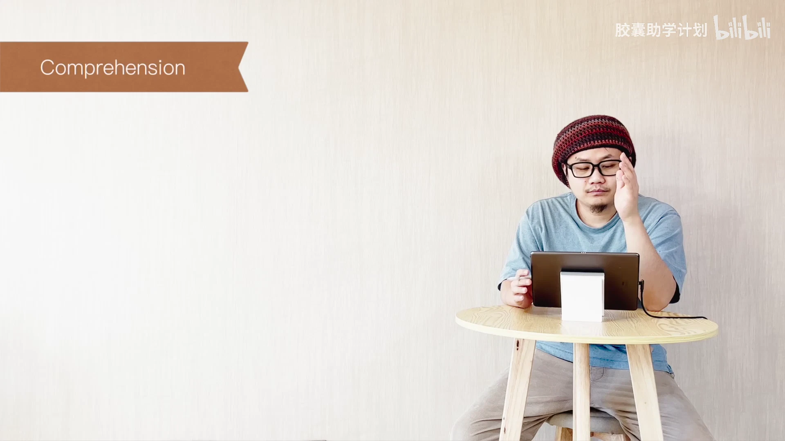

文字识别：biibili / 胶囊助学计划 / Comprehension

### 画面 00:00:57

文字识别：bibili / 胶囊助学计划 / Comprehension / How long did you not smoke at all?

### 画面 00:00:59

文字识别：bilbili / 胶囊助学计划 / Comprehension / How long did you not smoke at all? / For a week.

## 00:01:00–00:01:30

for a week, seven days. Did your wife suffer terribly? Yes. What are a bad temper and an enormous appetite the symptom of? Someone give up smoking. What did your friends keep on offering you? Cigarettes and cigars. What happened whenever you produced a packet of sweets? They were

### 画面 00:01:01

文字识别：bilbili / 胶囊助学计划 / Comprehension / How long did you not smoke at all? / For a week.

### 画面 00:01:03

文字识别：bibi / 胶囊助学计划 / Comprehension / Did your wife suffer?

### 画面 00:01:05

文字识别：bibili / 胶囊助学计划 / Comprehension / Did your wife suffer? / Yes, she did.

### 画面 00:01:07

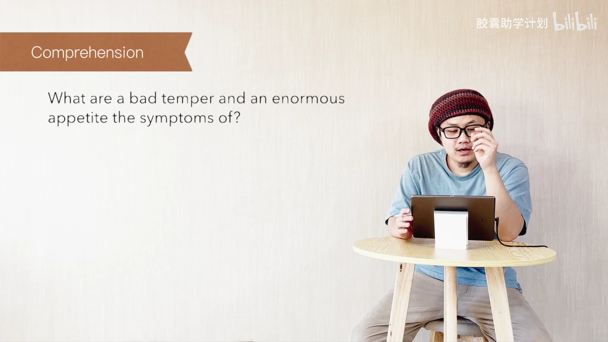

文字识别：bilibili / 胶囊助学计划 / Comprehension / What are a bad temper and an enormous / appetite the symptoms of?

### 画面 00:01:10

文字识别：bilbili / 胶囊助学计划 / Comprehension / What are a bad temper and an enormous / appetite the symptoms of?

### 画面 00:01:14

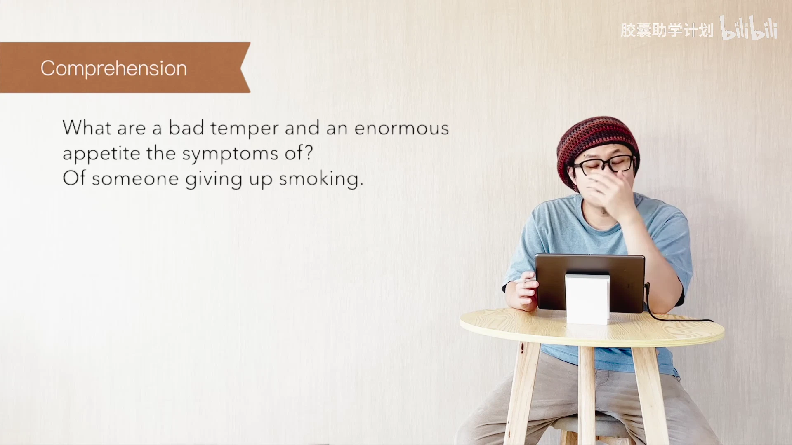

文字识别：bilbili / 胶囊助学计划 / Comprehension / What are a bad temper and an enormous / appetite the symptoms of? / Of someone giving up smoking.

### 画面 00:01:16

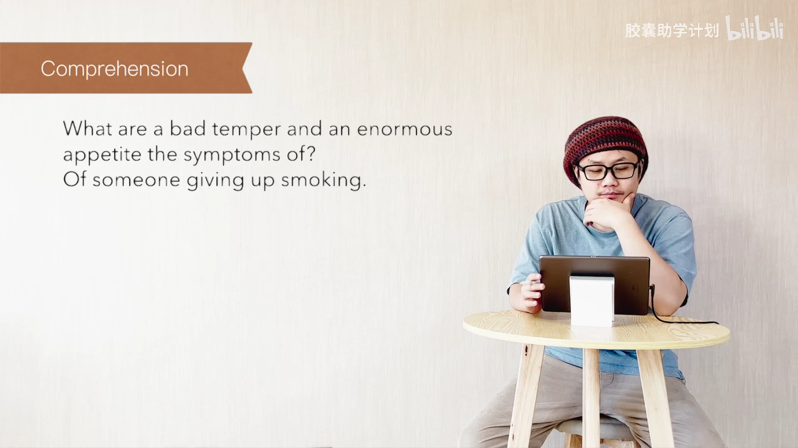

文字识别：bilibili / 胶囊助学计划 / Comprehension / What are a bad temper and an enormous / appetite the symptoms of? / Of someone giving up smoking.

### 画面 00:01:18

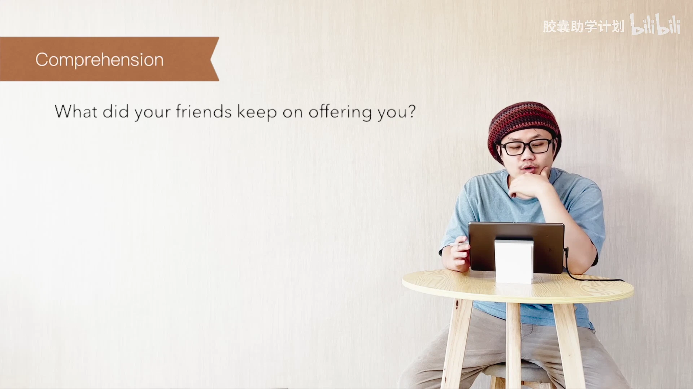

文字识别：bilbili / 胶囊助学计划 / Comprehension / What did your friends keep on offering you?

### 画面 00:01:20

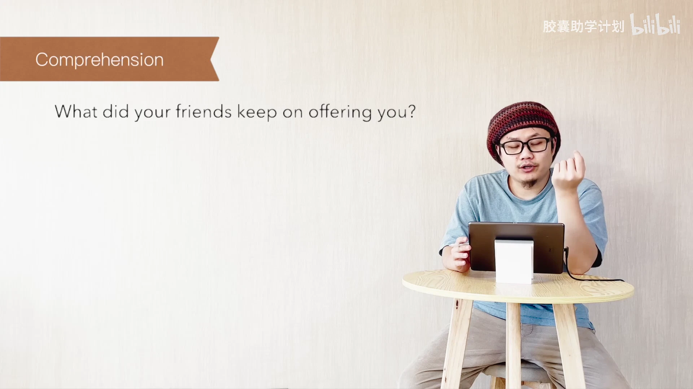

文字识别：bilbili / 胶囊助学计划 / Comprehension / What did your friends keep on offering you?

### 画面 00:01:22

文字识别：bilibili / 胶囊助学计划 / Comprehension / What did your friends keep on offering you? / Cigarettes and / cigars.

### 画面 00:01:24

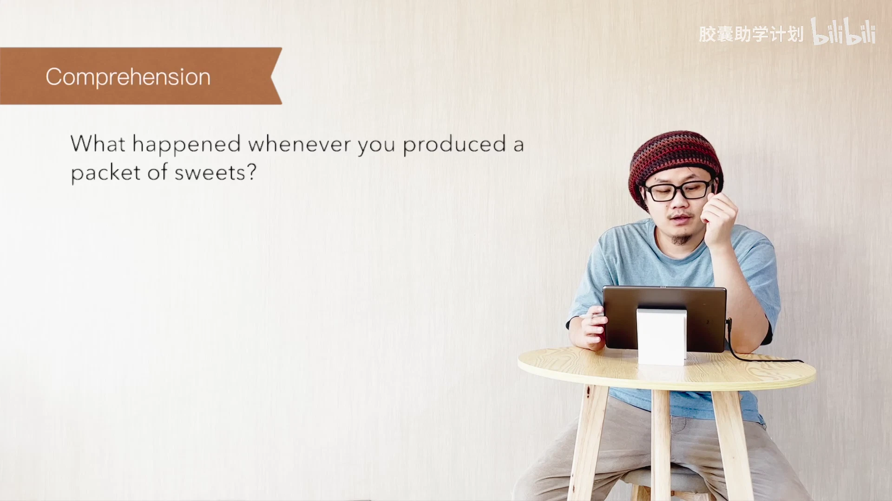

文字识别：bilibili / 胶囊助学计划 / Comprehension / What happened whenever you produced a / packet of sweets?

### 画面 00:01:26

文字识别：bilibili / 胶囊助学计划 / Comprehension / What happened whenever you produced a / packet of sweets?

## 00:01:30–00:02:00

amused. Made no effort to hide their amusement. When did you go to a party? Seven days after I stopped smoking. Seven days after this,嘛. Why did you feel so uncomfortable at the party? Everybody else was smoking. Asking questions, 四句型转换。第一个, I read an article on cigarette smoking. 第一个提前, what对这个an article

### 画面 00:01:30

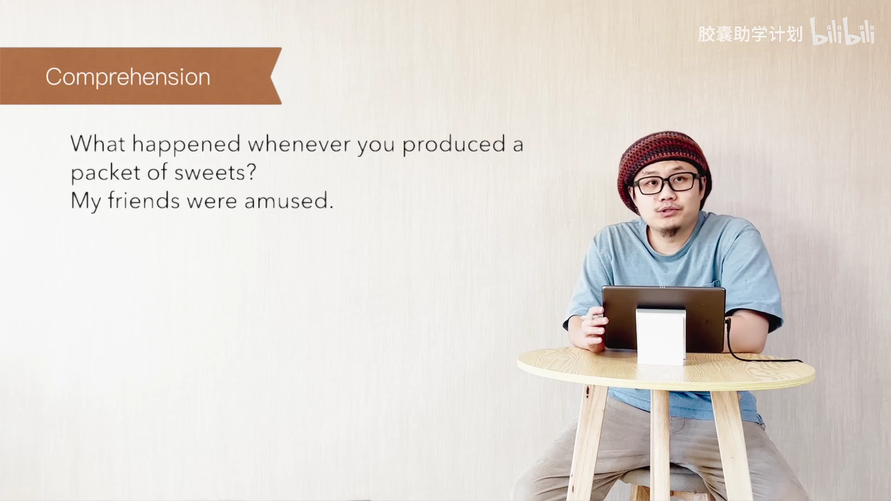

文字识别：biili / 胶囊助学计划 / Comprehension / What happened whenever you produced a / packet of sweets? / My friends were amused.

### 画面 00:01:34

文字识别：bilbii / 胶囊助学计划 / Comprehension / When did you go to a party?

### 画面 00:01:36

文字识别：bilbili / 胶囊助学计划 / Comprehension / When did you go to a party? / Seven days after I stopped smoking.

### 画面 00:01:40

文字识别：bilbii / 胶囊助学计划 / Comprehension / Why did you feel so uncomfortable at the / party?

### 画面 00:01:43

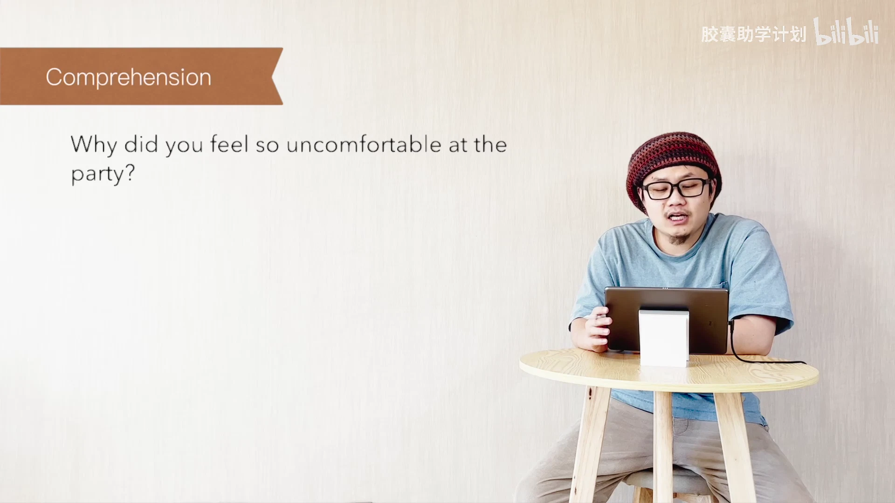

文字识别：bilbii / 胶囊助学计划 / Comprehension / Why did you feel so uncomfortable at the / party?

### 画面 00:01:45

文字识别：bibili / 胶囊助学计划 / Comprehension / Why did you feel so uncomfortable at the / party? / Everybody else was smoking.

### 画面 00:01:48

文字识别：bibi / 胶囊助学计划 / Asking questions

### 画面 00:01:50

文字识别：bibi / 胶囊助学计划 / Asking questions

### 画面 00:01:52

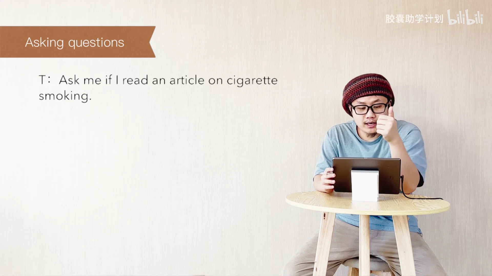

文字识别：bilibii / 胶囊助学计划 / Asking questions / T: Ask me if I read an article on cigarette / smoking.

### 画面 00:01:55

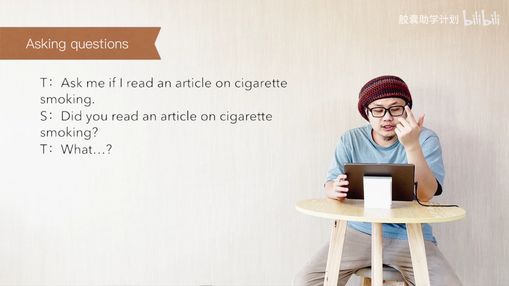

文字识别：bibii / 胶囊助学计划 / Asking questions / T: Ask me if I read an article on cigarette / smoking. / S: Did you read an article on cigarette / smoking? / T: What...?

## 00:02:00–00:02:30

on cigarette smoking,提问对吧？What did you read?你读什么了？呃，那who对主语提问，注意不变一般疑问句，直接替代I就完事儿了。只不过读的时候注意一下，这个不是read了，就变成read了。Who read an article on cigarette smoking? I lit a cigarette to calm my nerve. Why do you light a cigarette?啊，那这个一般疑问句就是把did提前。I smoked with concentration and pleasure. Did提前。How对with

### 画面 00:02:00

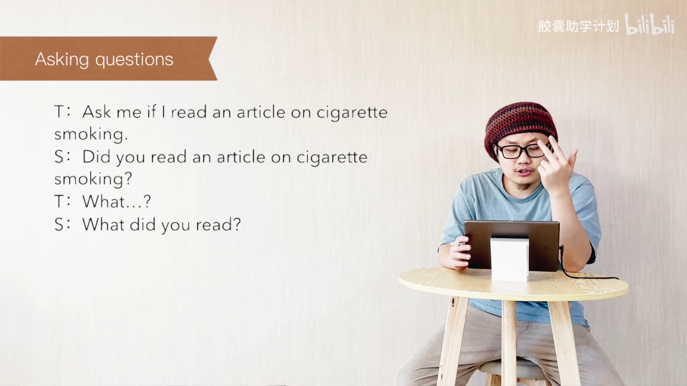

文字识别：biibii / 胶囊助学计划 / Asking questions / T: Ask me if I read an article on cigarette / smoking. / S: Did you read an article on cigarette / smoking? / T: What...? / S: What did you read?

### 画面 00:02:04

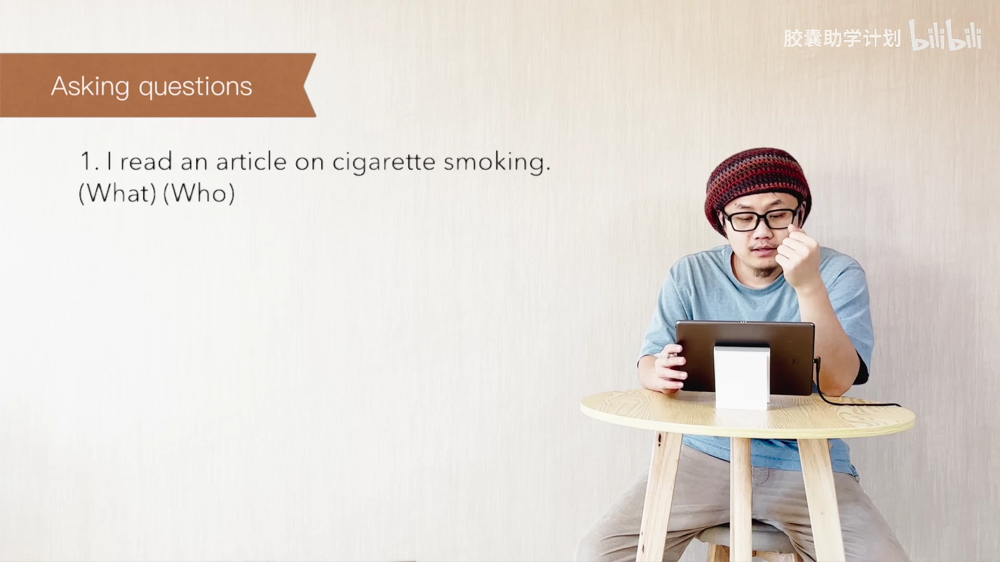

文字识别：bilbii / 胶囊助学计划 / Asking questions / 1.I read an article on cigarette smoking. / (What) (Who)

### 画面 00:02:07

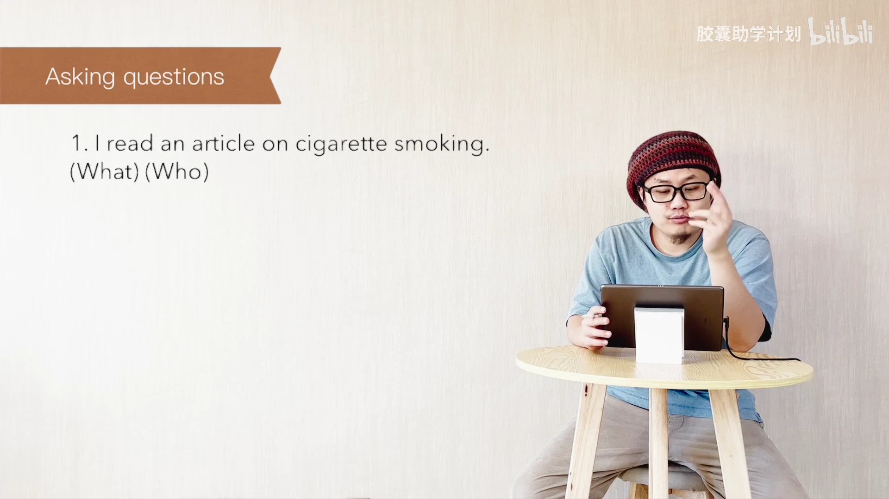

文字识别：bilibii / 胶囊助学计划 / Asking questions / 1.I read an article on cigarette smoking. / (What) (Who)

### 画面 00:02:10

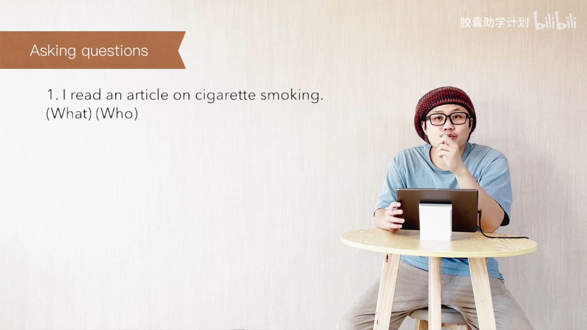

文字识别：bilibii / 胶囊助学计划 / Asking questions / 1.I read an article on cigarette smoking. / (What)(Who)

### 画面 00:02:13

文字识别：bilibili / 胶囊助学计划 / Asking questions / 1.I read an article on cigarette smoking. / (What) (Who)

### 画面 00:02:15

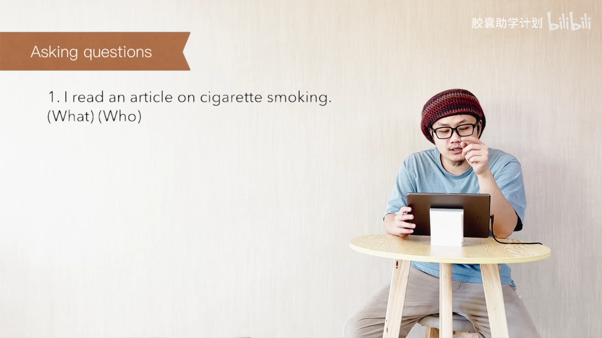

文字识别：bibili / 胶囊助学计划 / Asking questions / 1.I read an article on cigarette smoking. / (What) (Who)

### 画面 00:02:17

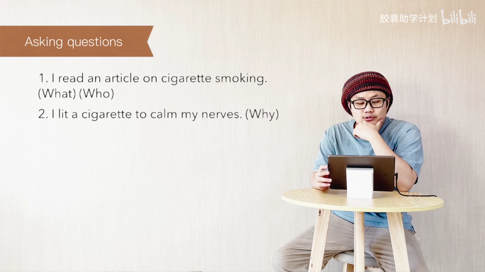

文字识别：bilbii / 胶囊助学计划 / Asking questions / 1.I read an article on cigarette smoking. / (What) (Who) / 2.I lit a cigarette to calm my nerves. (Why)

### 画面 00:02:20

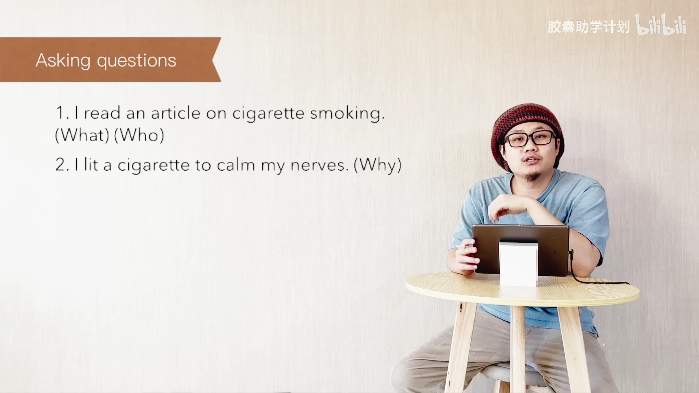

文字识别：bibii / 胶囊助学计划 / Asking questions / 1.I read an article on cigarette smoking. / (What) (Who) / 2.I lit a cigarette to calm my nerves. (Why)

### 画面 00:02:24

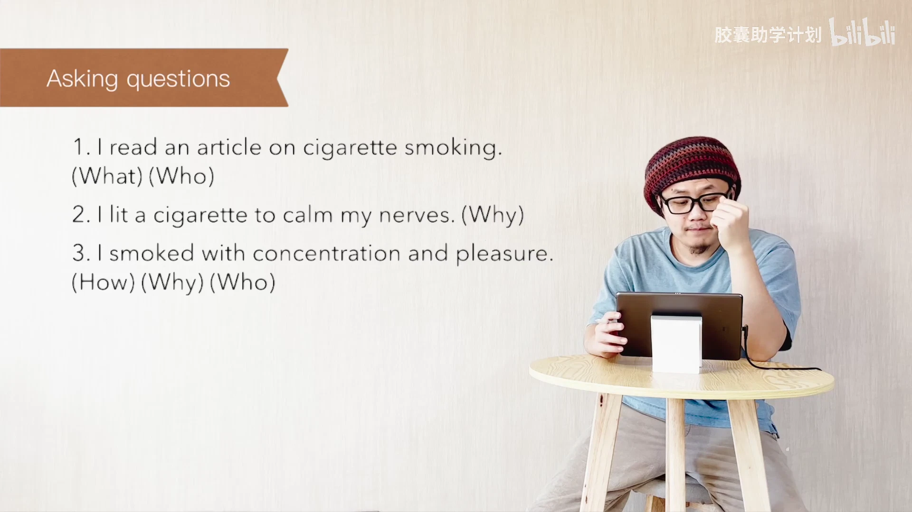

文字识别：Bilbili / 胶囊助学计划 / Asking questions / 1.I read an article on cigarette smoking. / (What) (Who) / 2.I lit a cigarette to calm my nerves. (Why) / 3.I smoked with concentration and pleasure. / (How)(Why)(Who)

### 画面 00:02:26

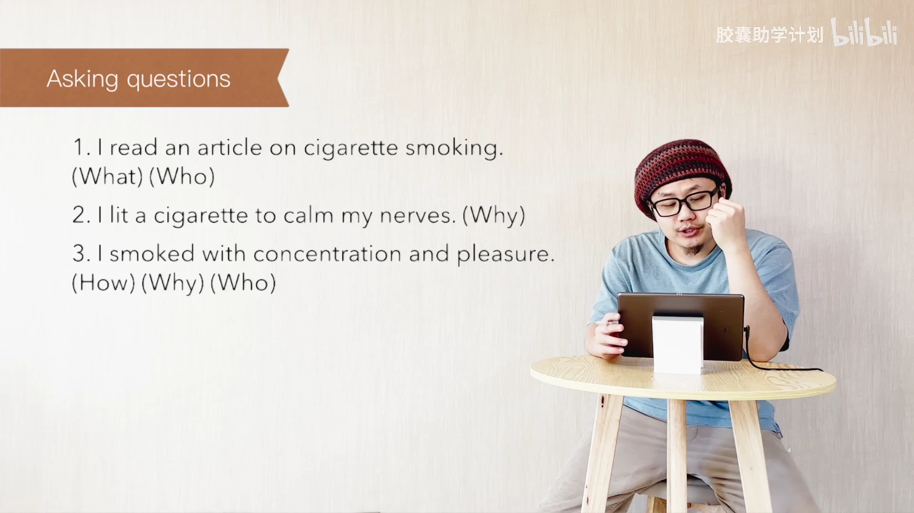

文字识别：Bilbii / 胶囊助学计划 / Asking questions / 1.I read an article on cigarette smoking. / (What) (Who) / 2.I lit a cigarette to calm my nerves. (Why) / 3.I smoked with concentration and pleasure. / (How)(Why)(Who)

### 画面 00:02:29

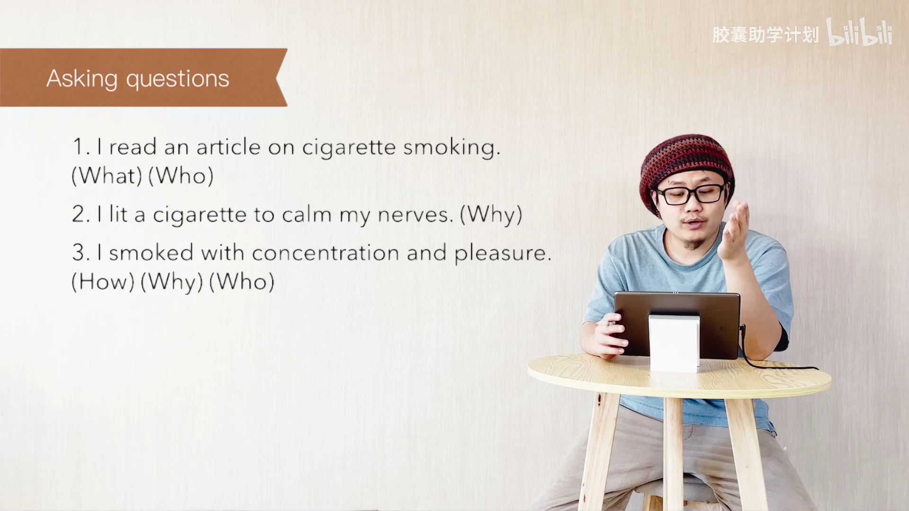

文字识别：胶囊助学计划bibi / Asking questions / 1.I read an article on cigarette smoking. / (What)(Who) / 2.I lit a cigarette to calm my nerves. (Why) / 3.I smoked with concentration and pleasure. / (How)(Why)(Who)

## 00:02:30–00:03:00

concentration and pleasure提问 Why 整句话 Who 对主语提问 不变一般疑问句。 I gave up smoking for a whole week. Did 提前 How long 对 for a whole week提问 What 对 What did you give up 啊 For a whole week. My wife suffered during this time. Did 提前 动词换回原形 When 对 during this time Why 加整句话 Who 对 My wife提问 主呃主语不变一般疑问句。第六个 She

### 画面 00:02:33

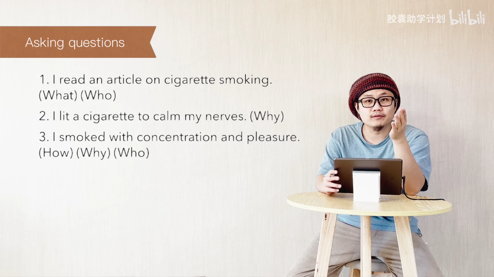

文字识别：bilbii / 胶囊助学计划 / Asking questions / 1.I read an article on cigarette smoking. / (What) (Who) / 2.I lit a cigarette to calm my nerves. (Why) / 3.I smoked with concentration and pleasure. / (How)(Why)(Who)

### 画面 00:02:35

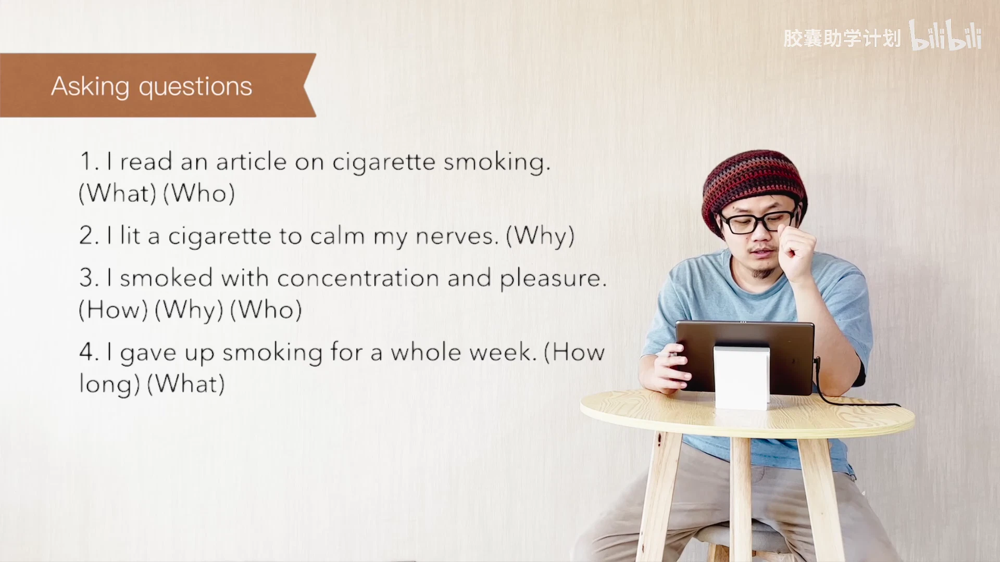

文字识别：胶囊助学计划biibi山 / Asking questions / 1.I read an article on cigarette smoking. / (What) (Who) / 2.I lit a cigarette to calm my nerves. (Why) / 3.I smoked with concentration and pleasure. / (How)(Why)(Who) / 4.I gave up smoking for a whole week.(How / long)(What)

### 画面 00:02:38

文字识别：胶囊助学计划bi / Asking questions / 1.I read an article on cigarette smoking. / (What) (Who) / 2.I lit a cigarette to calm my nerves. (Why) / 3.I smoked with concentration and pleasure. / (How)(Why)(Who) / 4.I gave up smoking for a whole week. (How / long)(What)

### 画面 00:02:40

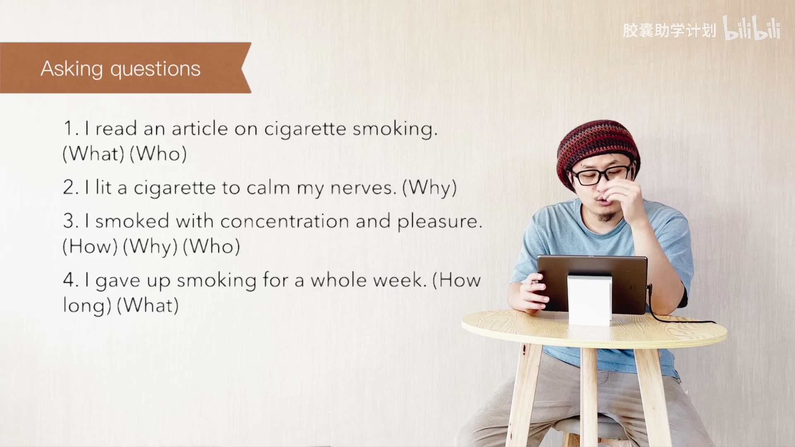

文字识别：胶囊助学计划bilbii / Asking questions / 1.I read an article on cigarette smoking. / (What) (Who) / 2.I lit a cigarette to calm my nerves. (Why) / 3.I smoked with concentration and pleasure. / (How)(Why)(Who) / 4.I gave up smoking for a whole week. (How / long)(What)

### 画面 00:02:44

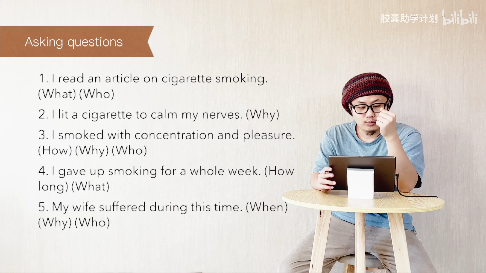

文字识别：胶囊助学计划bilbii / Asking questions / 1.I read an article on cigarette smoking. / (What) (Who) / 2.I lit a cigarette to calm my nerves. (Why) / 3.I smoked with concentration and pleasure. / (How) (Why)(Who) / 4.I gave up smoking for a whole week. (How / long)(What) / 5. My wife suffered during this time. (When) / (Why)(Who)

### 画面 00:02:46

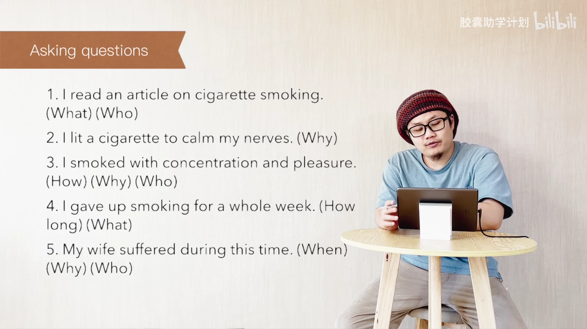

文字识别：胶囊助学计划biiii / Asking questions / 1.I read an article on cigarette smoking. / (What) (Who) / 2.I lit a cigarette to calm my nerves. (Why) / 3.I smoked with concentration and pleasure. / (How) (Why)(Who) / 4.I gave up smoking for a whole week. (How / long)(What) / 5. My wife suffered during this time. (When) / (Why)(Who)

### 画面 00:02:48

文字识别：胶囊助学计划biibi / Asking questions / 1.I read an article on cigarette smoking. / (What) (Who) / 2.I lit a cigarette to calm my nerves. (Why) / 3.I smoked with concentration and pleasure. / (How)(Why)(Who) / 4.I gave up smoking for a whole week. (How / long)(What) / 5. My wife suffered during this time. (When) / (Why)(Who)

### 画面 00:02:50

文字识别：胶囊助学计划biii / Asking questions / 1.I read an article on cigarette smoking. / (What) (Who) / 2.I lit a cigarette to calm my nerves. (Why) / 3.I smoked with concentration and pleasure. / (How) (Why)(Who) / 4.I gave up smoking for a whole week. (How / long)(What) / 5. My wife suffered during this time. (When) / (Why)(Who)

### 画面 00:02:56

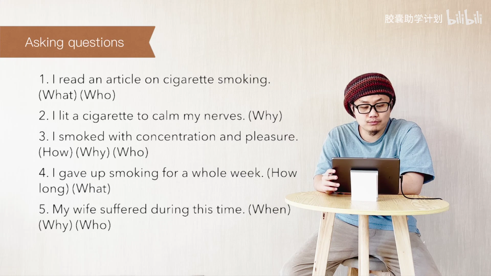

文字识别：胶囊助学计划bilbil / Asking questions / 1.I read an article on cigarette smoking. / (What) (Who) / 2.I lit a cigarette to calm my nerves. (Why) / 3.I smoked with concentration and pleasure. / (How) (Why)(Who) / 4.I gave up smoking for a whole week.(How / long)(What) / 5. My wife suffered during this time. (When) / (Why)(Who)

### 画面 00:02:58

文字识别：bilibili / 胶囊助学计划 / Asking questions / 6. She suffered terribly. (How badly) (Why)

## 00:03:00–00:03:30

suffered terribly. Did提前，对吧？ How badly，肯定就是对terribly提问，Why加整句嘛。 I had the urinal symptoms. Did提前， What what symptoms对the urinal symptoms啊，就是What symptoms do you have？ I did you have？ I had a bad temper. Did提前，When加整句话，Why加整句话。 My friends kept on offering

### 画面 00:03:00

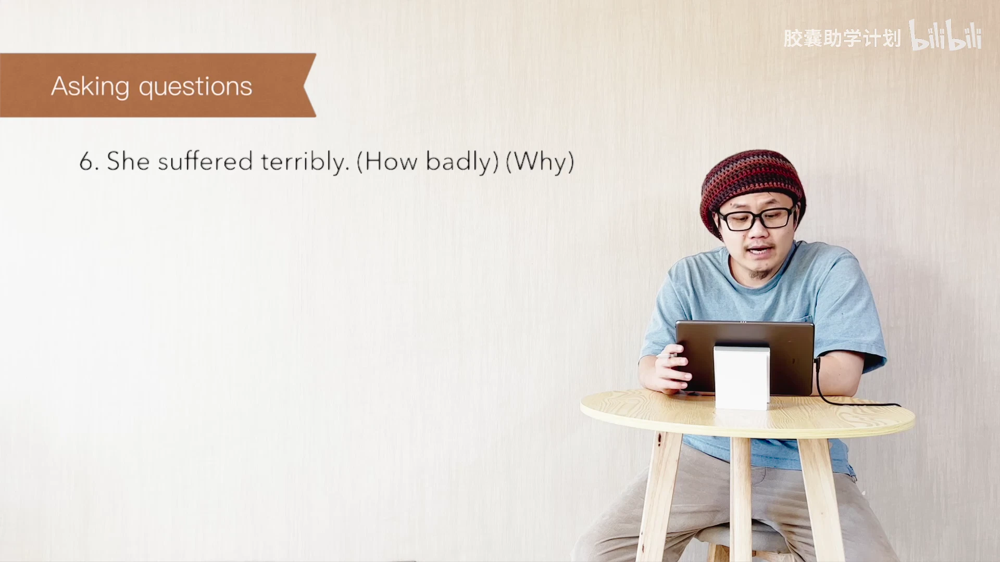

文字识别：bilbili / 胶囊助学计划 / Asking questions / 6. She suffered terribly.(How badly) (Why)

### 画面 00:03:08

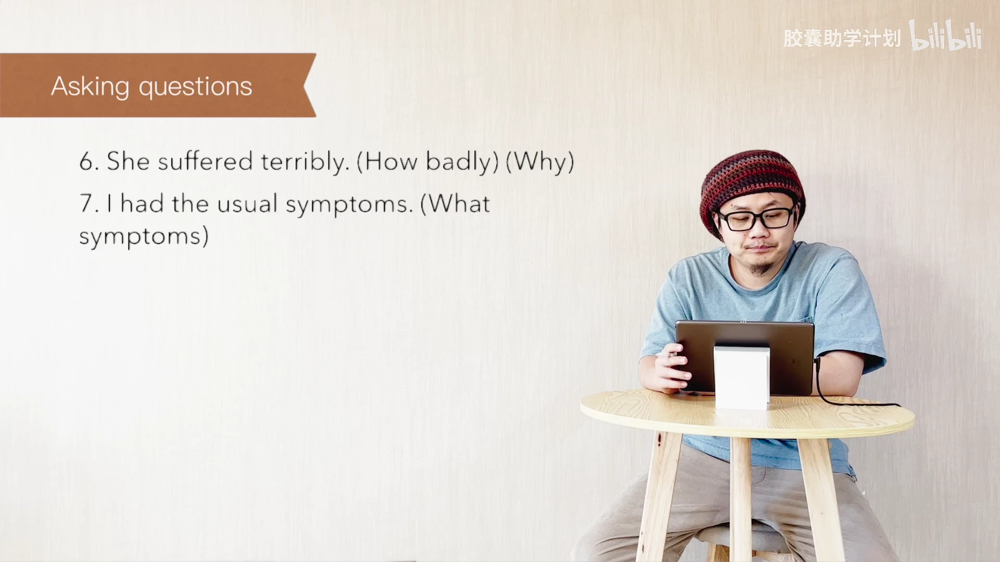

文字识别：bilbili / 胶囊助学计划 / Asking questions / 6. She suffered terribly. (How badly) (Why) / 7.I had the usual symptoms. (What / symptoms)

### 画面 00:03:11

文字识别：biiili / 胶囊助学计划 / Asking questions / 6. She suffered terribly. (How badly) (Why) / 7.I had the usual symptoms. (What / symptoms)

### 画面 00:03:15

文字识别：bilbili / 胶囊助学计划 / Asking questions / 6. She suffered terribly. (How badly) (Why) / 7.I had the usual symptoms. (What / symptoms)

### 画面 00:03:20

文字识别：biibili / 胶囊助学计划 / Asking questions / 6. She suffered terribly. (How badly) (Why) / 7.I had the usual symptoms. (What / symptoms) / 8.I had a bad temper. (When) (Why)

### 画面 00:03:22

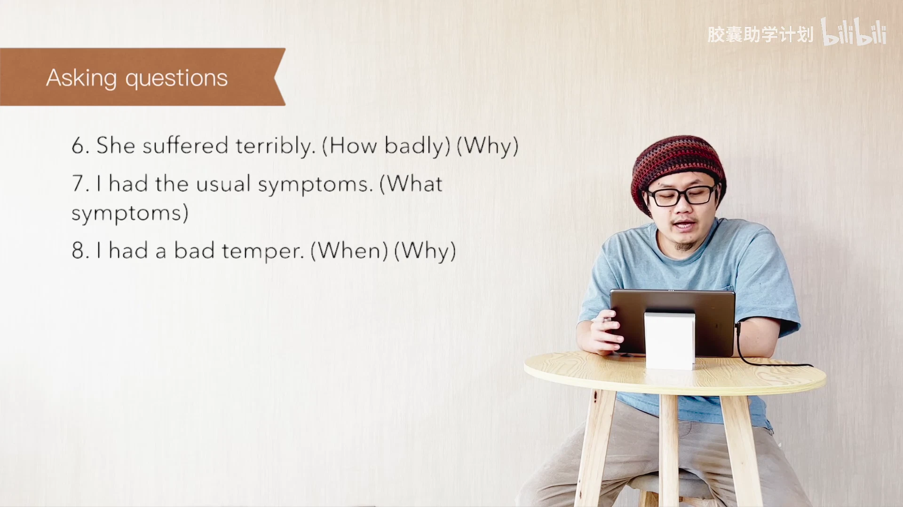

文字识别：biibili / 胶囊助学计划 / Asking questions / 6. She suffered terribly. (How badly) (Why) / 7.I had the usual symptoms. (What / symptoms) / 8.1 had a bad temper. (When) (Why)

### 画面 00:03:25

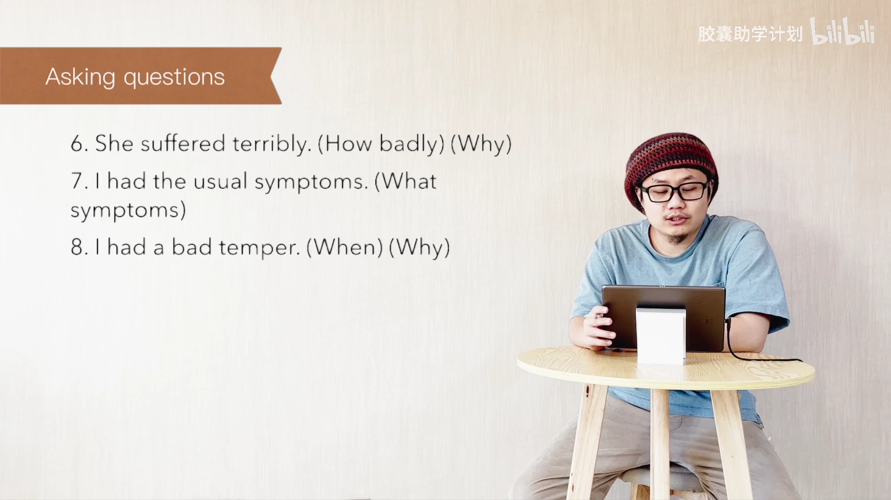

文字识别：bilbili / 胶囊助学计划 / Asking questions / 6. She suffered terribly. (How badly) (Why) / 7.I had the usual symptoms. (What / symptoms) / 8.1 had a bad temper. (When) (Why)

### 画面 00:03:28

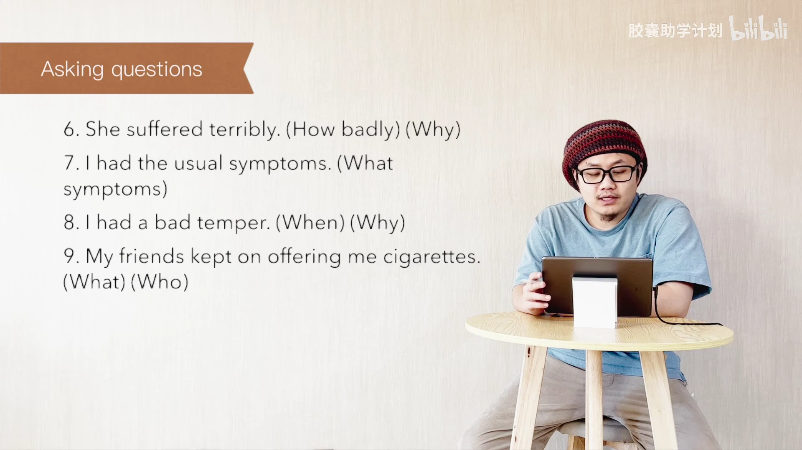

文字识别：bilbii / 胶囊助学计划 / Asking questions / 6. She suffered terribly. (How badly) (Why) / 7.I had the usual symptoms. (What / symptoms) / 8.I had a bad temper. (When) (Why) / 9. My friends kept on offering me cigarettes. / (What)(Who)

## 00:03:30–00:04:00

me cigarettes. Did提前，what做 cigarettes提问，who对主语提问。Tell the story fluency，对吧？呃，第一单元有例有示范，各位自己去做一下这个练习啊。下面writing呢有两个啊，两个连词用的不一样啊，两篇文章您都看一下。这是第一篇，这是第二篇。OK，然后topic for discussion呢，这个老习惯，我们只做一件事情，就是把呃一到三啊这

### 画面 00:03:30

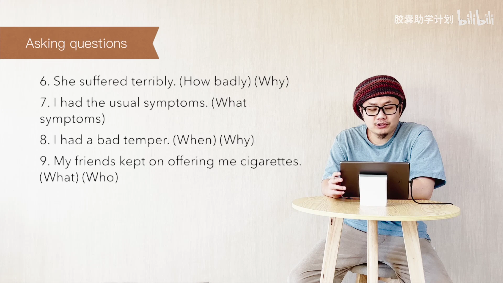

文字识别：biibili / 胶囊助学计划 / Asking questions / 6. She suffered terribly. (How badly) (Why) / 7.I had the usual symptoms. (What / symptoms) / 8.I had a bad temper. (When)(Why) / 9. My friends kept on offering me cigarettes. / (What)(Who)

### 画面 00:03:33

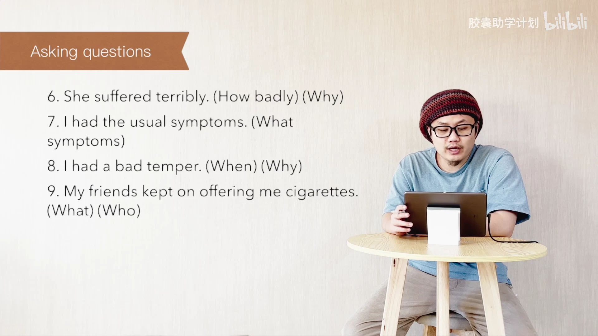

文字识别：bilbii / 胶囊助学计划 / Asking questions / 6. She suffered terribly.(How badly) (Why) / 7.I had the usual symptoms. (What / symptoms) / 8.I had a bad temper. (When)(Why) / 9. My friends kept on offering me cigarettes. / (What)(Who)

### 画面 00:03:36

文字识别：bilbil / 胶囊助学计划 / Tell the story / 训练目标： / 口语复述能力 / Accuracy / Fluency

### 画面 00:03:39

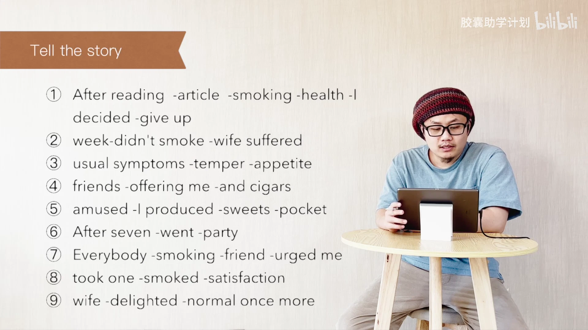

文字识别：胶囊助学计划biibi / Tell the story / After reading -article -smoking -health -I / decided -give up / week-didn't smoke -wife suffered / usual symptoms -temper -appetite / friends -offering me -and cigars / amused -I produced -sweets -pocket / After seven -went -party / 6 / Everybody -smoking -friend -urged me / took one -smoked -satisfaction /  wife -delighted -normal once more / 9

### 画面 00:03:41

文字识别：胶囊助学计划biibil / Tell the story / After reading -article -smoking -health -I / decided -give up / week-didn't smoke -wife suffered / usual symptoms -temper -appetite / friends -offering me -and cigars / amused -I produced -sweets -pocket / 6 / After seven -went -party / Everybody -smoking -friend -urged me / took one -smoked -satisfaction / ⑨ wife -delighted -normal once more

### 画面 00:03:43

文字识别：bilbili / 胶囊助学计划 / Summary writing: Key / 训练目标： / 写作复述能力

### 画面 00:03:45

文字识别：胶囊助学计划bilbii / Summary writing: Key / Having read an article on smoking, the writer / smoked his last cigarette. He did not smoke / for a week and his wife suffered because he / had a bad temper and a large appetite. / Meanwhile friends offered him cigarettes / and were amused to see him produce a / packet of sweets from his pocket. When he / went to a party, he accepted a cigarette / which he was offered by a friend and since / then things have returned to normal.

### 画面 00:03:50

文字识别：胶囊助学计划bilbii / Summary writing: Key / The writer read an article on smoking and / smoked his last cigarette. He did not smoke / for a week and his wife suffered because of / her husband's bad temper and large / appetite. Whenever his friends offered him / cigarettes, they were amused because he / would produce a packet of sweets from his / pocket. However, at a party he accepted a / cigarette from a friend. Now things have / returned to normal.

### 画面 00:03:52

文字识别：blbili / 胶囊助学计划 / Topics for discussion / 训练目标： / 完全自由的对话 / Accuracy / Fluency

### 画面 00:03:54

文字识别：胶囊助学计划bilb山 / Topics for discussion / Why do you think people take up or / continue smoking even when they know / of its dangers? / If smoking were prohibited by law, what / would the effect be on (a) smokers, (b) / cigarette manufacturers, (c) the economy / of certain countries? / Which do you think is worse, smoking or / drinking alcohol? Why?

### 画面 00:03:56

文字识别：胶囊助学计划biibil / Topics for discussion / Why do you think people take up or / continue smoking even when they know / of its dangers? / If smoking were prohibited by law, what / would the effect be on (a) smokers, (b) / cigarette manufacturers, (c) the economy / of certain countries? / Which do you think is worse, smoking or / drinking alcohol? Why?

### 画面 00:03:59

文字识别：胶囊助学计划biii / Topics for discussion / Why do you think people take up or / continue smoking even when they know / of its dangers? / If smoking were prohibited by law, what / would the effect be on (a) smokers, (b) / cigarette manufacturers, (c) the economy / of certain countries? / Which do you think is worse, smoking or / drinking alcohol? Why?

## 00:04:00–00:04:30

个题看一下。第一个说，Why do you think people take up or continue smoking even when they know of its dangers? So you认为为什么人们继续抽烟，当他们知道说抽烟对身体有害的时候，人们为什么还要抽？啊，If smoking were prohibited by law, what would the effect be on smokers, cigarette manufacturers, and economic of certain countries?说如果抽烟被

### 画面 00:04:01

文字识别：胶囊助学计划biibi / Topics for discussion / Why do you think people take up or / continue smoking even when they know / of its dangers? / If smoking were prohibited by law, what / would the effect be on (a) smokers, (b) / cigarette manufacturers, (c) the economy / of certain countries? / Which do you think is worse, smoking or / drinking alcohol? Why?

### 画面 00:04:05

文字识别：胶囊助学计划bilbii / Topics for discussion / Why do you think people take up or / continue smoking even when th / know / of its dangers? / If smoking were prohibited by law, what / would the effect be on (a) smokers, (b) / cigarette manufacturers, (c) the economy / of certain countries? / Which do you think is worse, smoking or / drinking alcohol? Why?

### 画面 00:04:10

文字识别：胶囊助学计划bi出 / Topics for discussion / Why do you think people take up or / continue smoking even when they know / of its dangers? / If smoking were prohibited by law, what / would the effect be on (a) smokers, (b) / cigarette manufacturers, (c) the economy / of certain countries? / Which do you think is worse, smoking or / drinking alcohol? Why?

### 画面 00:04:15

文字识别：胶囊助学计划bl出 / Topics for discussion / Why do you think people take up or / continue smoking even when they know / of its dangers? / If smoking were prohibited by law, what / would the effect be on (a) smokers, (b) / cigarette manufacturers, (c) the economy / of certain countries? / Which do you think is worse, smoking or / drinking alcohol? Why?

### 画面 00:04:21

文字识别：胶囊助学计划biibi山 / Topics for discussion / Why do you think people take up or / continue smoking even when they know / of its dangers? / If smoking were prohibited by law, what / would the effect be on (a) smokers, (b) / cigarette manufacturers, (c) the economy / of certain countries? / Which do you think is worse, smoking or / drinking alcohol? Why?

### 画面 00:04:25

文字识别：胶囊助学计划bilb山 / Topics for discussion / Why do you think people take up or / continue smoking even when they know / of its dangers? / If smoking were prohibited by law, what / would the effect be on (a) smokers, (b) / cigarette manufacturers, (c) the economy / of certain countries? / Which do you think is worse, smoking or / drinking alcohol? Why?

### 画面 00:04:27

文字识别：胶囊助学计划biii / Topics for discussion / Why do you think people take up or / continue smoking even when they know / of its dangers? / If smoking were prohibited by law, what / would the effect be on (a) smokers, (b) / cigarette manufacturers, (c) the economy / of certain countries? / Which do you think is worse, smoking or / drinking alcohol? Why?

## 00:04:30–00:05:00

法律禁止了，那对于烟民来说，对于烟的制造者来说，对于一些特定国家的经济上来说，会有什么影响？啊，比如说至少，比如说中国的烟草这个税就很高嘛，啊，会有哪些影响？Which do you think is worse, smoking or or drinking al alcohol? Why?说你认为哪个事儿更糟糕？抽烟和喝酒啊都不咋地，为啥？Okay,那家庭作业，ask me if先写再朗读，摘

### 画面 00:04:30

文字识别：胶囊助学计划bilbii / Topics for discussion / Why do you think people take up or / continue smoking even when they know / of its dangers? / If smoking were prohibited by law, what / would the effect be on (a) smokers, (b) / cigarette manufacturers, (c) the economy / of certain countries? / Which do you think is worse, smoking or / drinking alcohol? Why?

### 画面 00:04:32

文字识别：胶囊助学计划bibi / Topics for discussion / Why do you think people take up or / continue smoking even when they know / of its dangers? / If smoking were prohibited by law, what / would the effect be on (a) smokers, (b) / cigarette manufacturers, (c) the economy / of certain countries? / Which do you think is worse, smoking or / drinking alcohol? Why?

### 画面 00:04:35

文字识别：胶囊助学计划bilbi / Topics for discussion / Why do you think people take up or / continue smoking even when they know / of its dangers? / If smoking were prohibited by law, what / would the effect be on (a) smokers, (b) / cigarette manufacturers, (c) the economy / of certain countries? / Which do you think is worse, smoking or / drinking alcohol? Why?

### 画面 00:04:38

文字识别：胶囊助学计划bilbii / Topics for discussion / Why do you think people take up or / continue smoking even when they know / of its dangers? / If smoking were prohibited by law, what / would the effect be on (a) smokers, (b) / cigarette manufacturers, (c) the economy / of certain countries? / Which do you think is worse, smoking or / drinking alcohol? Why?

### 画面 00:04:40

文字识别：胶囊助学计划bilbi / Topics for discussion / Why do you think people take up or / continue smoking even when they know / of its dangers? / If smoking were prohibited by law, what / would the effect be on (a) smokers, (b) / cigarette manufacturers, (c) the economy / of certain countries? / Which do you think is worse, smoking or / drinking alcohol? Why?

### 画面 00:04:43

文字识别：胶囊助学计划bilb山 / Topics for discussion / Why do you think people take up or / continue smoking even when they know / of its dangers? / If smoking were prohibited by law, what / would the effect be on (a) smokers, (b) / cigarette manufacturers, (c) the economy / of certain countries? / Which do you think is worse, smoking or / drinking alcohol? Why?

### 画面 00:04:45

文字识别：胶囊助学计划bib山 / Topics for discussion / Why do you think people take up or / continue smoking even when they know / of its dangers? / If smoking were prohibited by law, what / would the effect be on (a) smokers, (b) / cigarette manufacturers, (c) the economy / of certain countries? / Which do you think is worse, smoking or / drinking alcohol? Why?

### 画面 00:04:50

文字识别：胶囊助学计划bilbi / Topics for discussion / Why do you think people take up or / continue smoking even when they know / of its dangers? / If smoking were prohibited by law, what / would the effect be on (a) smokers, (b) / cigarette manufacturers, (c) the economy / of certain countries? / Which do you think is worse, smoking or / drinking alcohol? Why?

### 画面 00:04:55

文字识别：胶囊助学计划biii山 / Topics for discussion / Why do you think people take up or / continue smoking even when they know / of its dangers? / If smoking were prohibited by law, what / would the effect be on (a) smokers, (b) / cigarette manufacturers, (c) the economy / of certain countries? / Which do you think is worse, smoking or / drinking alcohol? Why?

### 画面 00:04:57

文字识别：胶囊助学计划bib

### 画面 00:04:59

文字识别：bibili / 胶囊助学计划 / 1.Ask me if写&朗读 / 摘要写作写&答案

## 00:05:00–00:05:30

要写作写完对答案，Tell the story口语复述啊，这个摘要写作别忘留两个啊，然后置顶留言可以找到重复间隔的学习材料。那以上就是本期视频的全部内容了。如果各位喜欢我们的课程呢，欢迎各位关注、订阅、一键三连、分享给那些需要的朋友，来帮助我们快速成长。See you next time.

### 画面 00:05:01

文字识别：bilbii / 胶囊助学计划 / 1.Ask me if写&朗读 / 摘要写作写&答案 / 3.Tell the story 口语复述

### 画面 00:05:03

文字识别：bibili / 胶囊助学计划 / 1.Ask me if写&朗读 / 摘要写作写&答案 / 3.Tell the story 口语复述 / 4.重复间隔（置顶留言)

### 画面 00:05:05

文字识别：biibii / 胶囊助学计划 / 1.Ask me if写&朗读 / 摘要写作写&答案 / 3.Tell the story 口语复述 / .重复间隔（置顶留言）

### 画面 00:05:07

文字识别：bilbii / 胶囊助学计划

### 画面 00:05:18

文字识别：biibii / 胶囊助学计划

### 画面 00:05:23

文字识别：CAPSULEACADEMY / 胶囊助学计划 / 小红书 / OE

### 画面 00:05:25

文字识别：CAPSULEACADEMY / 胶囊助学计划 / 小红书

## 00:05:30–00:05:35

### 画面 00:05:31

文字识别：CAPSULEACADEMY / 胶囊助学计划 / 小红书 / Creator / Leo & Berlin / OE

### 画面 00:05:33

文字识别：bilibili / 胶囊助学计划

### 画面 00:05:34

文字识别：bilibili / 胶囊助学计划

