# 079 单词

快速机器解析：语音为单模型转写，未进行独立交叉校对或人工复核；画面每秒采样并按变化选帧，短时文字和标记可能遗漏。截图时间约有 1 秒误差。图片有损压缩；遇到疑点请按时间查看 Google Drive 原视频。

## 00:00:00–00:00:30

Hello everyone, welcome to Capsule Academy. This is Leo. Today we're going to learn new concepts in English book two, lesson seventy nine words. That old habit. Before entering the formal course, let's look at a few small questions. First, how to express feeling afraid. Next, how to express that someone wants to know. The last question is called how to express how to place a bomb. Ah, that with these three questions, will you enjoy? We first look at the first word. The first

### 画面 00:00:00

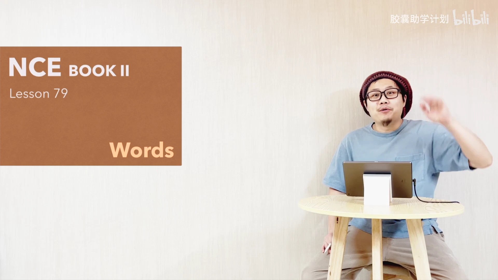

文字识别：bilbili / 胶囊助学计划 / NCE / BOOKII / Lesson 79 / Words

### 画面 00:00:02

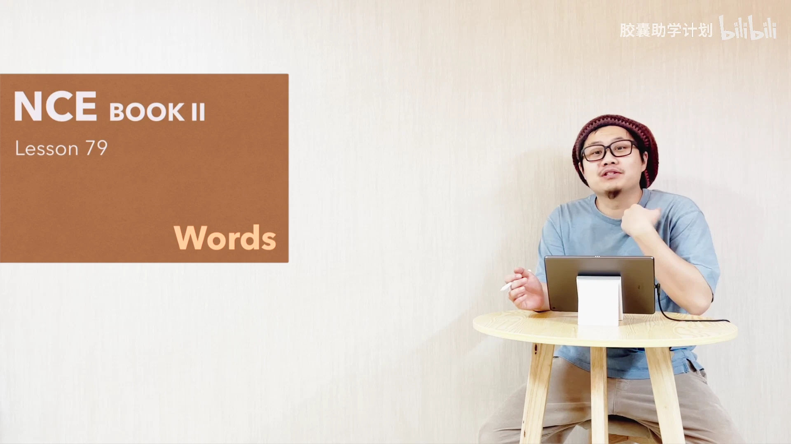

文字识别：blibii / 胶囊助学计划 / NCE / BOOK"I / Lesson 79 / Words

### 画面 00:00:04

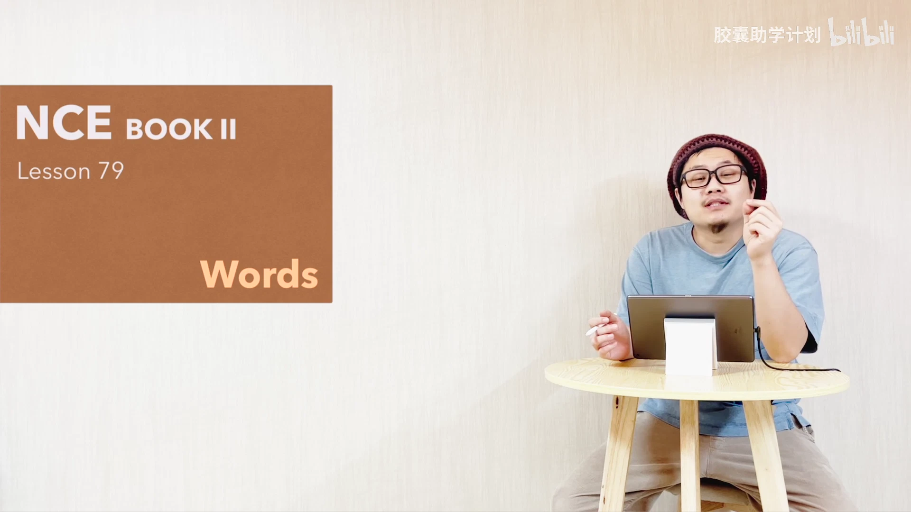

文字识别：bilbili / 胶囊助学计划 / NCE / BOOKII / Lesson 79 / Words

### 画面 00:00:06

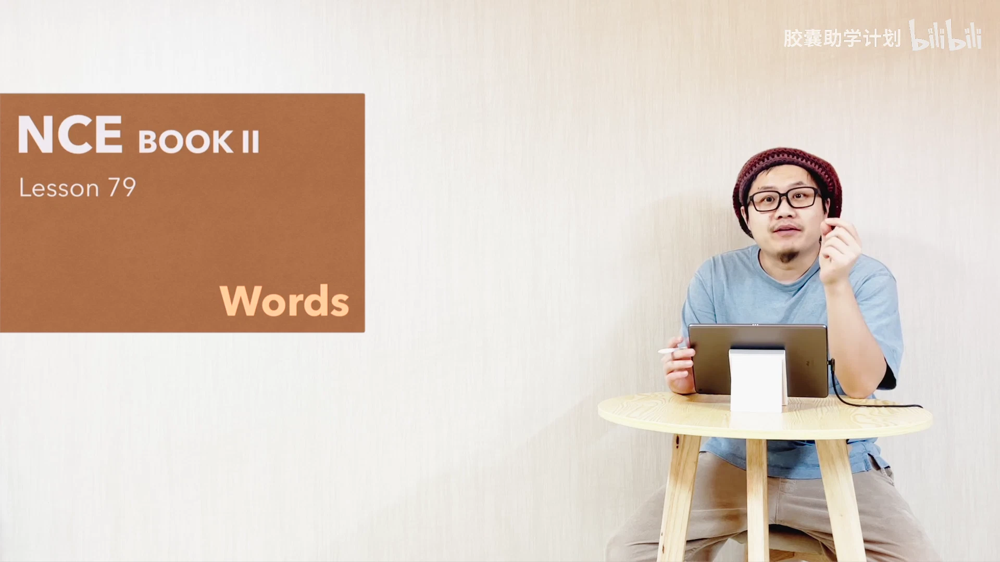

文字识别：bibil / 胶囊助学计划 / NCE / BOOKII / Lesson 79 / Words

### 画面 00:00:09

文字识别：胶囊助学计划bii出

### 画面 00:00:11

文字识别：bilbili / 胶囊助学计划 / ①如何表达“感到害怕”？

### 画面 00:00:13

文字识别：bibili / 胶囊助学计划 / ①如何表达“感到害怕”？

### 画面 00:00:15

文字识别：bilbili / 胶囊助学计划 / ①如何表达“感到害怕”？ / 如何表达“某人很想知道

### 画面 00:00:17

文字识别：bilbili / 胶囊助学计划 / ①如何表达“感到害怕”？ / 如何表达“某人很想知道

### 画面 00:00:19

文字识别：biibl / 胶囊助学计划 / ①如何表达“感到害怕”？ / 如何表达“某人很想知道 / 如何表达“安放炸弹”?

### 画面 00:00:21

文字识别：biibii / 胶囊助学计划 / ①如何表达“感到害怕”？ / 如何表达“某人很想知道” / 如何表达“安放炸弹”?

### 画面 00:00:23

文字识别：biibili / 胶囊助学计划 / ①如何表达“感到害怕”？ / 如何表达“某人很想知道” / 如何表达“安放炸弹”?

### 画面 00:00:25

文字识别：胶囊助学计划 bii / •

### 画面 00:00:29

文字识别：助字计划 / 胶囊助学计划

## 00:00:30–00:01:00

们先看第一个单词，第一个单词，这个单词我相信您一定认得，只不过咱们一直是按复数形式再去学，叫做 parents 啊，父母双亲。那 parent 啊，就是要么父亲，要么母亲，指的是家长的意思，对吧？咱们造个句子，As a parent, we should avoid smoking near our children。说作为一个家长，单数，看见了啊？说我们

### 画面 00:00:31

文字识别：单词造句指南 / 网：v.+v.变化 / 胶囊助学计划 / ilbili / 四句型转换 / 方式/地点/时间 / 结合习惯用法 / 其他单词+词性 / 原文摘抄+变 / 6123456 / /'pearant/ / parent n.

### 画面 00:00:33

文字识别：单词造句指南 / 网：v.+v.变化 / 胶囊助学计划 / bilbili / 四句型转换 / 方式/地点/时间 / 结合习惯用法 / 其他单词+词性 / 原文摘抄+变 / 6123456 / /'pearant/ / parent n.

### 画面 00:00:35

文字识别：单词造句指南 / 网：v.+v.变化 / 胶囊助学计划 / bilbili / 四句型转换 / 方式/地点/时间 / 结合习惯用法 / 其他单词+词性 / 原文摘抄+变 / 6123456 / /'pearant/ / parent n.

### 画面 00:00:40

文字识别：单词造句指南 / 网：v.+v.变化 / 胶囊助学计划 / bilbili / 四句型转换 / 方式/地点/时间 / 结合习惯用法 / 其他单词+词性 / 原文摘抄+变 / 6123456 / /'pearant/ / parent n.

### 画面 00:00:42

文字识别：单词造句指南 / 网：v.+v.变化 / 胶囊助学计划 / bilbili / 四句型转换 / 方式/地点/时间 / 结合习惯用法 / 其他单词+词性 / 原文摘抄+变 / 6123456 / /'pearant/ / parent n.

### 画面 00:00:44

文字识别：单词造句指南 / 网：v.+v.变化 / 胶囊助学计划 / bilbili / 四句型转换 / 方式/地点/时间 / 结合习惯用法 / 其他单词+词性 / 原文摘抄+变 / 6123456 / /'pearant/ / parent n.

### 画面 00:00:46

文字识别：单词造句指南 / 网：v.+v.变化 / 胶囊助学计划 / bibili / 四句型转换 / 方式/地点/时间 / 结合习惯用法 / 其他单词+词性 / 原文摘抄+变 / 6123456 / /'pearant/ / parent n.

### 画面 00:00:48

文字识别：单词造句指南 / 网：v.+v.变化 / 胶囊助学计划 / bibili / 四句型转换 / 方式/地点/时间 / 结合习惯用法 / 其他单词+词性 / 原文摘抄+变 / 6123456 / /'pearant/ / parent n. / ① As a parent, we should avoid smoking near / our children. L68

### 画面 00:00:50

文字识别：单词造句指南 / 网：v.+v.变化 / 胶囊助学计划 / biibili / 四句型转换 / 方式/地点/时间 / 结合习惯用法 / 其他单词+词性 / 原文摘抄+变 / 6123456 / /'pearant/ / parent n. / ① As a parent, we should avoid smoking near / our children. L68

### 画面 00:00:52

文字识别：单词造句指南 / 网：v.+v.变化 / 胶囊助学计划 / biibili / 四句型转换 / 方式/地点/时间 / 结合习惯用法 / 其他单词+词性 / 原文摘抄+变 / 6123456 / /'pearant/ / parent n. / ① As a parent, we should avoid smoking near / our children. L68

### 画面 00:00:54

文字识别：单词造句指南 / 网：v.+v.变化 / 胶囊助学计划 / blbii / 四句型转换 / 方式/地点/时间 / 结合习惯用法 / 其他单词+词性 / 原文摘抄+变 / 6123456 / /'pearant/ / parent n. / ① As a parent, we should avoid smoking near / Our children. L68

### 画面 00:00:57

文字识别：单词造句指南 / 网：v.+v.变化 / 胶囊助学计划 / biibii / 四句型转换 / 方式/地点/时间 / 结合习惯用法 / 其他单词+词性 / 原文摘抄+变 / 6123456 / /'pearant/ / parent n. / ① As a parent, we should avoid smoking near / our children. L68

## 00:01:00–00:01:30

Preventing

### 画面 00:01:00

文字识别：单词造句指南 / 网：v.+v.变化 / 胶囊助学计划 / bibili / 四句型转换 / 方式/地点/时间 / 结合习惯用法 / 其他单词+词性 / 原文摘抄+变 / 6123456 / /'pearant/ / parent n. / ① As a parent, we should avoid smoking near / our children. L68

### 画面 00:01:04

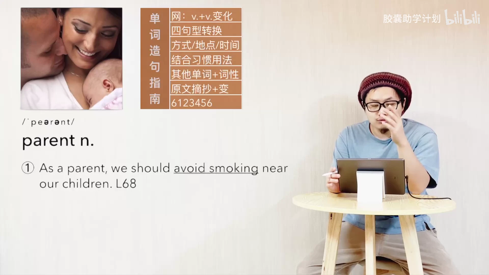

文字识别：单词造句指南 / 网：v.+v.变化 / 胶囊助学计划 / bibili / 四句型转换 / 方式/地点/时间 / 结合习惯用法 / 其他单词+词性 / 原文摘抄+变 / 6123456 / /'pearant/ / parent n. / ① As a parent, we should avoid smoking near / our children. L68

### 画面 00:01:08

文字识别：单词造句指南 / 网：v.+v.变化 / 胶囊助学计划 / bilibli / 四句型转换 / 方式/地点/时间 / 结合习惯用法 / 其他单词+词性 / 原文摘抄+变 / 6123456 / /'pearant/ / parent n. / ① As a parent, we should avoid smoking near / our children. L68

### 画面 00:01:10

文字识别：单词造句指南 / 网：v.+v.变化 / 胶囊助学计划 / bilbii / 四句型转换 / 方式/地点/时间 / 结合习惯用法 / 其他单词+词性 / 原文摘抄+变 / 6123456 / /'pearant/ / parent n. / ① As a parent, we should avoid smoking near / our children. L68 / My parents prevented me from moving to / New York. L68 L6

### 画面 00:01:12

文字识别：胶囊助学计划bibil / 单词造句指南 / 网：v.+v.变化 / 四句型转换 / 方式/地点/时间 / 结合习惯用法 / 其他单词+词性 / 原文摘抄+变 / 6123456 / /'pearant/ / parent n. / ① As a parent, we should avoid smoking near / our children. L68 /  My parents prevented me from moving to / New York. L68 L6

### 画面 00:01:14

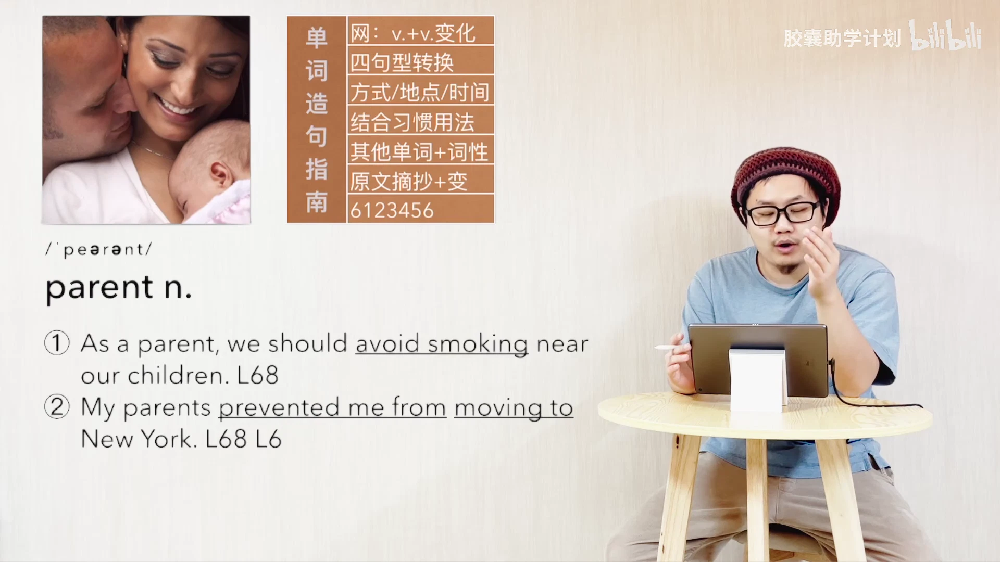

文字识别：胶囊助学计划bilbi / 单词造句指南 / 网：v.+v.变化 / 四句型转换 / 方式/地点/时间 / 结合习惯用法 / 其他单词+词性 / 原文摘抄+变 / 6123456 / /'pearant/ / parent n. / ① As a parent, we should avoid smoking near / our children. L68 / My parents prevented me from moving to / New York. L68 L6

### 画面 00:01:16

文字识别：单词造句指南 / 网：v.+v.变化 / 胶囊助学计划 / bibi / 四句型转换 / 方式/地点/时间 / 结合习惯用法 / 其他单词+词性 / 原文摘抄+变 / 6123456 / /'pearant/ / parent n. / ① As a parent, we should avoid smoking near / our children. L68 /  My parents prevented me from moving to / New York. L68 L6

### 画面 00:01:18

文字识别：单词造句指南 / 网：v.+v.变化 / 胶囊助学计划 / bilbili / 四句型转换 / 方式/地点/时间 / 结合习惯用法 / 其他单词+词性 / 原文摘抄+变 / 6123456 / /'pearant/ / parent n. / ① As a parent, we should avoid smoking near / our children. L68 / My parents prevented me from moving to / New York. L68 L6

### 画面 00:01:20

文字识别：单词造句指南 / 网：v.+v.变化 / 胶囊助学计划 / bilbili / 四句型转换 / 方式/地点/时间 / 结合习惯用法 / 其他单词+词性 / 原文摘抄+变 / 6123456 / /'pearant/ / parent n. / ① As a parent, we should avoid smoking near / our children. L68 / My parents prevented me from moving to / New York. L68 L6

### 画面 00:01:22

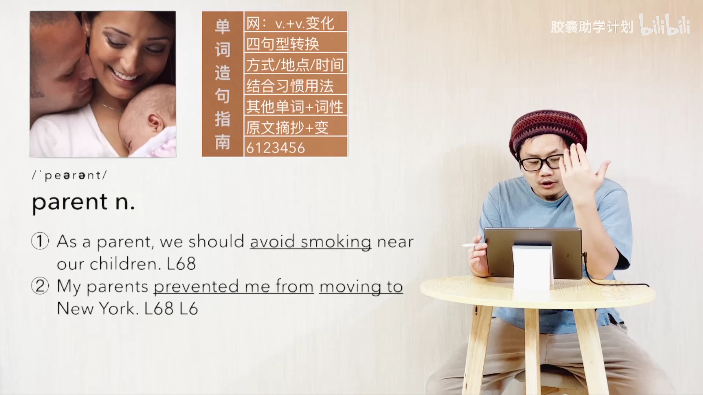

文字识别：单词造句指南 / 网：v.+v.变化 / 胶囊助学计划 / Bilbli / 四句型转换 / 方式/地点/时间 / 结合习惯用法 / 其他单词+词性 / 原文摘抄+变 / 6123456 / /'pearant/ / parent n. / ① As a parent, we should avoid smoking near / our children. L68 /  My parents prevented me from moving to / New York. L68 L6

### 画面 00:01:24

文字识别：单词造句指南 / 网：v.+v.变化 / 胶囊助学计划 / Bilbli / 四句型转换 / 方式/地点/时间 / 结合习惯用法 / 其他单词+词性 / 原文摘抄+变 / 6123456 / /'pearant/ / parent n. / ① As a parent, we should avoid smoking near / our children. L68 /  My parents prevented me from moving to / New York. L68 L6

### 画面 00:01:26

文字识别：单词造句指南 / 网：v.+v.变化 / 胶囊助学计划 / bilbli / 四句型转换 / 方式/地点/时间 / 结合习惯用法 / 其他单词+词性 / 原文摘抄+变 / 6123456 / /'pearant/ / parent n. / ① As a parent, we should avoid smoking near / our children. L68 / My parents prevented me from moving to / New York. L68 L6

### 画面 00:01:28

文字识别：胶囊助学计划biliil / 单词造句指南 / 网：v.+v.变化 / 四句型转换 / 方式/地点/时间 / 结合习惯用法 / 其他单词+词性 / 原文摘抄+变 / 6123456 / /'pearant/ / parent n. / ① As a parent, we should avoid smoking near / our children. L68 /  My parents prevented me from moving to / New York. L68 L6 / Children always break their parents / Concentration.L78

## 00:01:30–00:02:00

their parents' concentration. Okay, ah,这个地方其实应该再加一个这样的东西，也许就可以更舒服一点啊，叫做父他们父母的哎注意力，对吧？Like their concentration, ah, their parents' concentration, ah,总是会打断他们父母的注意力。那注意力集中，咱们听一下电影片段啊。The school's been shut for years. Are you a parent? Okay, next one.下

### 画面 00:01:30

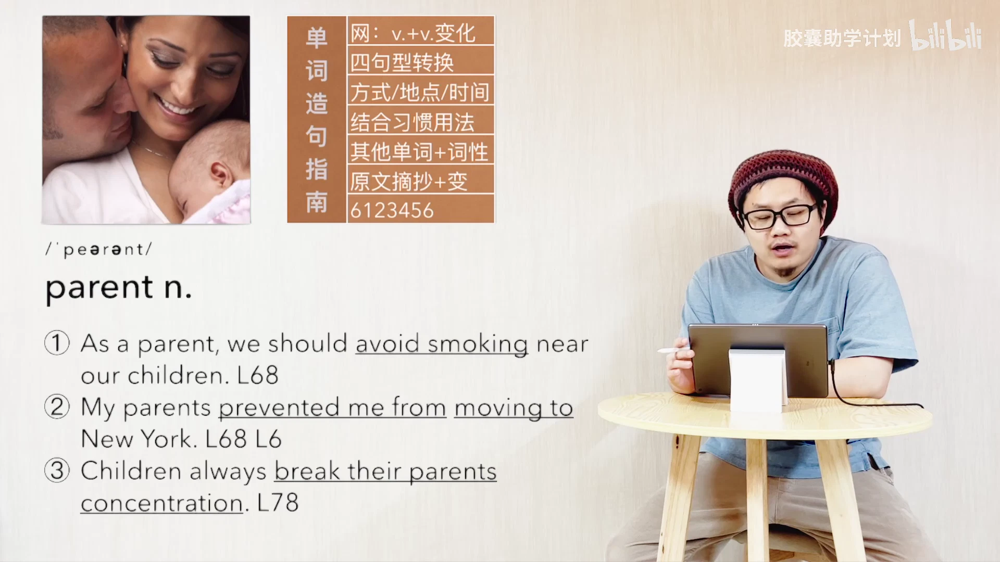

文字识别：胶囊助学计划bilii / 单词造句指南 / 网：v.+v.变化 / 四句型转换 / 方式/地点/时间 / 结合习惯用法 / 其他单词+词性 / 原文摘抄+变 / 6123456 / /'pearant/ / parent n. / ① As a parent, we should avoid smoking near / our children. L68 /  My parents prevented me from moving to / New York. L68 L6 / Children always break their parents / Concentration.L78

### 画面 00:01:32

文字识别：胶囊助学计划bilii / 单词造句指南 / 网：v.+v.变化 / 四句型转换 / 方式/地点/时间 / 结合习惯用法 / 其他单词+词性 / 原文摘抄+变 / 6123456 / /'pearant/ / parent n. / ① As a parent, we should avoid smoking near / our children. L68 /  My parents prevented me from moving to / New York. L68 L6 / Children always break their parents / Concentration.L78

### 画面 00:01:34

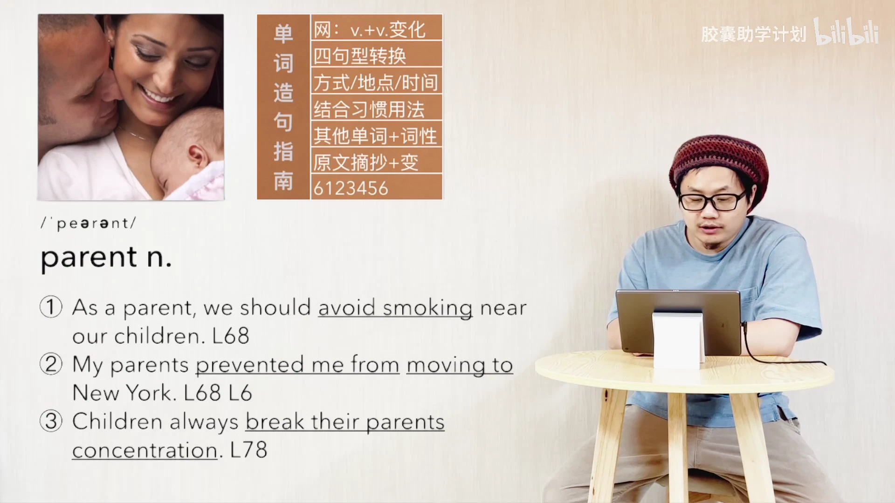

文字识别：胶囊助学计划bilii / 单词造句指南 / 网：v.+v.变化 / 四句型转换 / 方式/地点/时间 / 结合习惯用法 / 其他单词+词性 / 原文摘抄+变 / 6123456 / /'pearant/ / parent n. / ① As a parent, we should avoid smoking near / our children. L68 /  My parents prevented me from moving to / New York. L68 L6 / Children always break their parents / Concentration.L78

### 画面 00:01:36

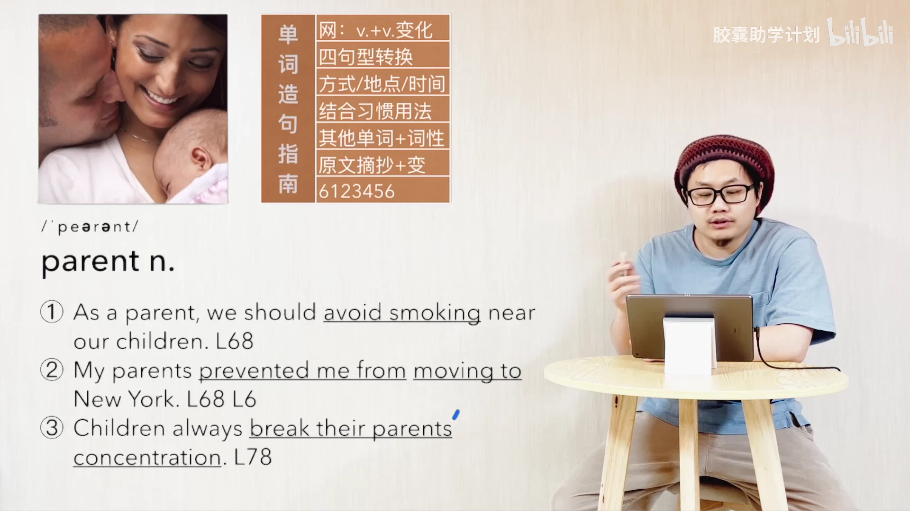

文字识别：胶囊助学计划bilii / 单词造句指南 / 网：v.+v.变化 / 四句型转换 / 方式/地点/时间 / 结合习惯用法 / 其他单词+词性 / 原文摘抄+变 / 6123456 / /'pearant/ / parent n. / ① As a parent, we should avoid smoking near / our children. L68 / My parents prevented me from moving to / New York. L68 L6 / Children always break their parents / Concentration.L78

### 画面 00:01:38

文字识别：胶囊助学计划bilii / 单词造句指南 / 网：v.+v.变化 / 四句型转换 / 方式/地点/时间 / 结合习惯用法 / 其他单词+词性 / 原文摘抄+变 / 6123456 / /'pearant/ / parent n. / ① As a parent, we should avoid smoking near / our children. L68 / My parents prevented me from moving to / New York. L68 L6 / Children always break their parents / Concentration.L78

### 画面 00:01:40

文字识别：胶囊助学计划bilbi / 单词造句指南 / 网：v.+v.变化 / 四句型转换 / 方式/地点/时间 / 结合习惯用法 / 其他单词+词性 / 原文摘抄+变 / 6123456 / /'pearant/ / parent n. / ① As a parent, we should avoid smoking near / our children. L68 /  My parents prevented me from moving to / New York. L68 L6 / Children always break their parents / Concentration.L78

### 画面 00:01:42

文字识别：胶囊助学计划bilii / 单词造句指南 / 网：v.+v.变化 / 四句型转换 / 方式/地点/时间 / 结合习惯用法 / 其他单词+词性 / 原文摘抄+变 / 6123456 / /'pearant/ / parent n. / ① As a parent, we should avoid smoking near / our children. L68 /  My parents prevented me from moving to / New York. L68 L6 / Children always break their parents / Concentration.L78

### 画面 00:01:44

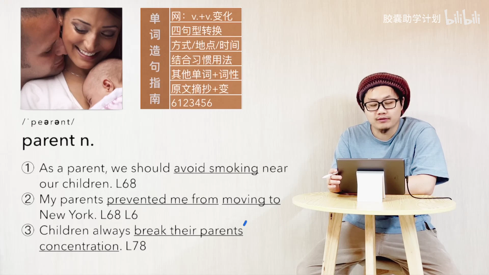

文字识别：胶囊助学计划bilbi / 单词造句指南 / 网：v.+v.变化 / 四句型转换 / 方式/地点/时间 / 结合习惯用法 / 其他单词+词性 / 原文摘抄+变 / 6123456 / /'pearant/ / parent n. / ① As a parent, we should avoid smoking near / our children. L68 /  My parents prevented me from moving to / New York. L68 L6 / Children always break their parents / Concentration.L78

### 画面 00:01:46

文字识别：胶囊助学计划bib / 单词造句指南 / 网：v.+v.变化 / 四句型转换 / 方式/地点/时间 / 结合习惯用法 / 其他单词+词性 / 原文摘抄+变 / 6123456 / /'pearant/ / parent n. / ① As a parent, we should avoid smoking near / our children. L68 / My parents prevented me from moving to / New York. L68 L6 / Children always break their parents / Concentration.L78

### 画面 00:01:50

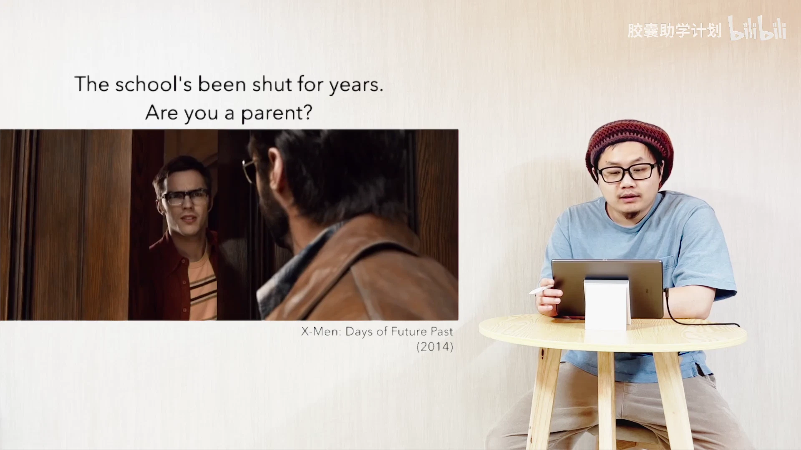

文字识别：bilbil / 胶囊助学计划 / The school's been shut for years. / Are you a parent? / X-Men: Days of Future Past / (2014)

### 画面 00:01:53

文字识别：biibili / 胶囊助学计划 / The school's been shut for years. / Are you a parent? / X-Men: Days of Future Past / (2014)

### 画面 00:01:55

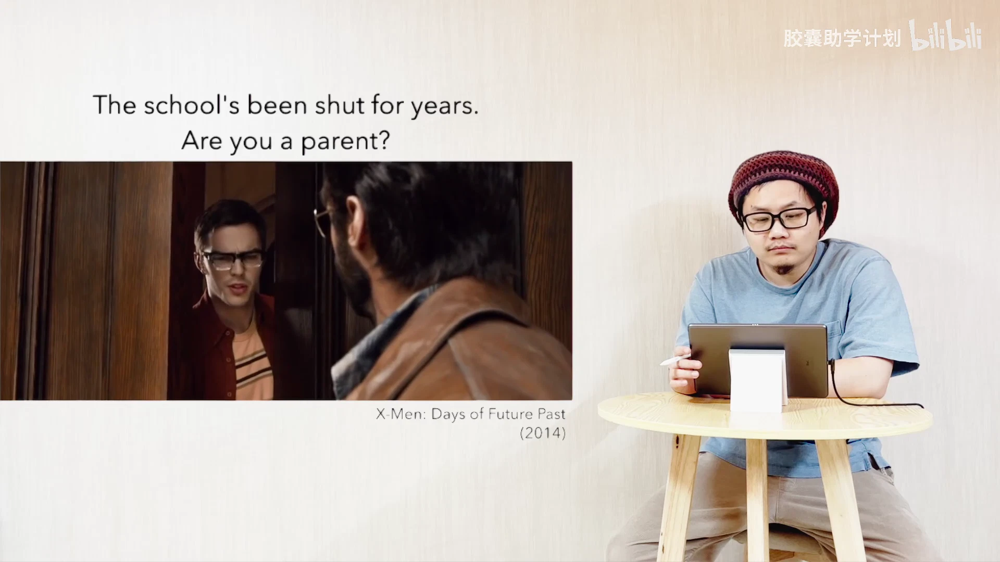

文字识别：ubibii / 胶囊助学计划 / The school's been shut for years. / Are you a parent? / X-Men: Days of Future Past / (2014)

### 画面 00:01:57

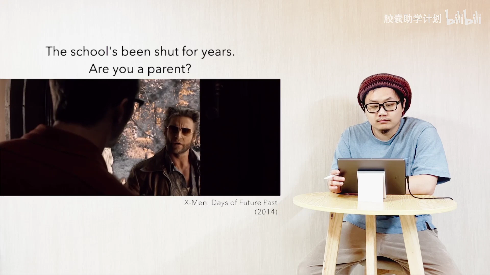

文字识别：bibi / 胶囊助学计划 / The school's been shut for years. / Are you a parent? / X-Men: Days of Future Past / (2014)

### 画面 00:01:59

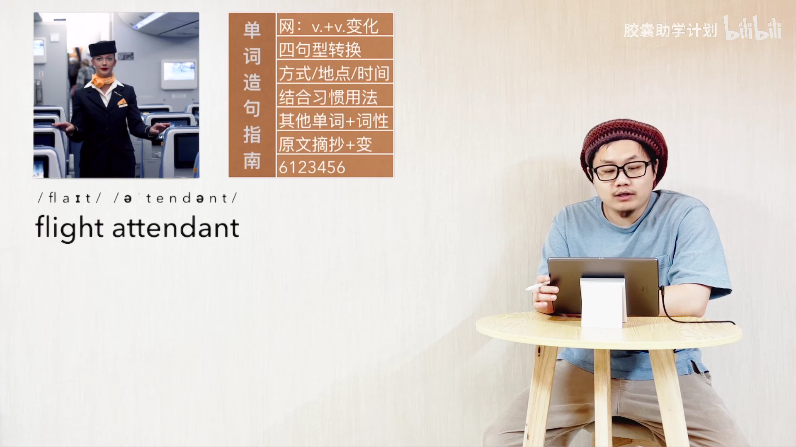

文字识别：单词造句指南 / 网：v.+v.变化 / 胶囊助学计划 / bilbii / 四句型转换 / 方式/地点/时间 / 结合习惯用法 / 其他单词+词性 / 原文摘抄+变 / 6123456 / / fl ait/ /a'tendant/ / flight attendant

## 00:02:00–00:02:30

两两个单词连到一起叫 flight attendant. Flight attendant, flight attendant.新一咱就学过了啊，这个空姐对吧？好，人名嘛，啊人嘛，啊一个职业，造句子就很容易了。As soon as he lit a cigarette, the flight attendant asked him not to.啊，这个地方应该是没有这个啊。As soon as he lit a cigarette, the flight attendant asked him not to.哎，

### 画面 00:02:01

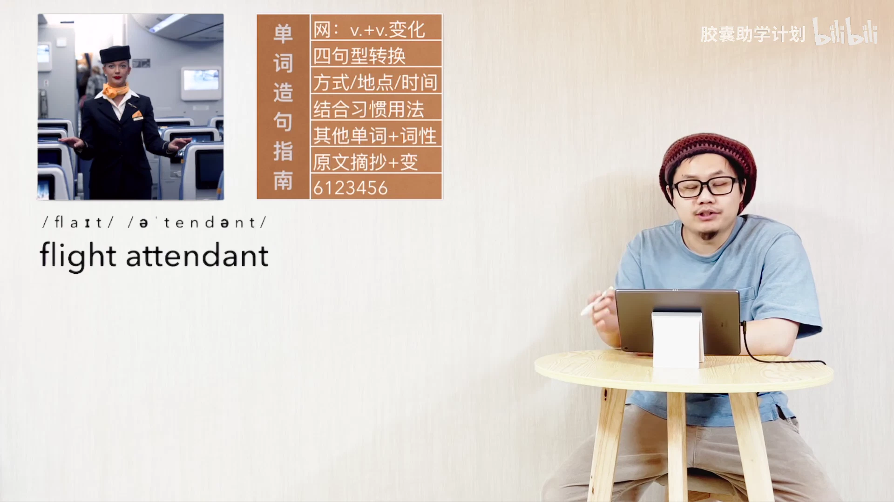

文字识别：单词造句指南 / 网：v.+v.变化 / 胶囊助学计划 / bilbil / 四句型转换 / 方式/地点/时间 / 结合习惯用法 / 其他单词+词性 / 原文摘抄+变 / 6123456 / /fl ait/ /a'tendant/ / flight attendant

### 画面 00:02:03

文字识别：单词造句指南 / 网：v.+v.变化 / 胶囊助学计划 / Bilbili / 四句型转换 / 方式/地点/时间 / 结合习惯用法 / 其他单词+词性 / 原文摘抄+变 / 6123456 / / fl ait/ /a'tendant/ / flight attendant

### 画面 00:02:05

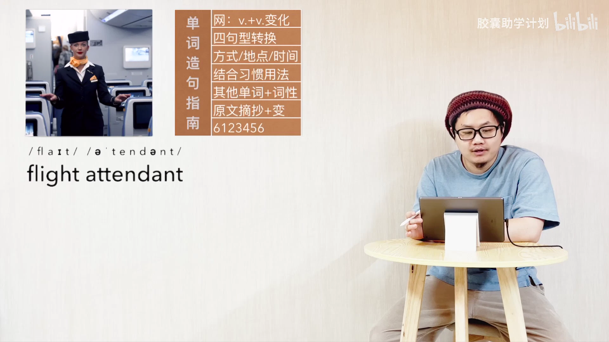

文字识别：单词造句指南 / 网：v.+v.变化 / 胶囊助学计划 / bilbii / 四句型转换 / 方式/地点/时间 / 结合习惯用法 / 其他单词+词性 / 原文摘抄+变 / 6123456 / /flart/ /a'tendant/ / flight attendant

### 画面 00:02:09

文字识别：单词造句指南 / 网：v.+v.变化 / 胶囊助学计划 / biibli / 四句型转换 / 方式/地点/时间 / 结合习惯用法 / 其他单词+词性 / 原文摘抄+变 / 6123456 / /fl ait/ /a'tendant/ / flight attendant

### 画面 00:02:11

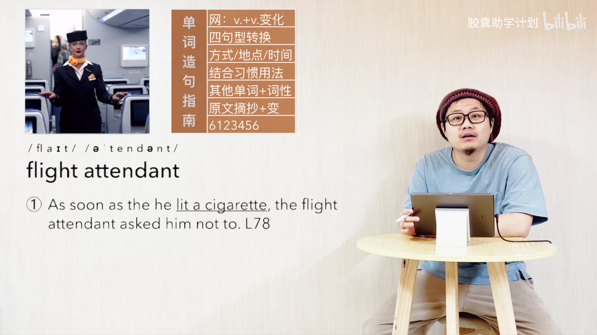

文字识别：胶囊助学计划bi出 / 单词造句指南 / 网：v.+v.变化 / 四句型转换 / 方式/地点/时间 / 结合习惯用法 / 其他单词+词性 / 原文摘抄+变 / 6123456 / / fl ait/ /a'tendant/ / flight attendant / ① As soon as the he lit a cigarette, the flight / attendant asked him not to. L78

### 画面 00:02:13

文字识别：单词造句指南 / 网：v.+v.变化 / 胶囊助学计划 / bilbil / 四句型转换 / 方式/地点/时间 / 结合习惯用法 / 其他单词+词性 / 原文摘抄+变 / 6123456 / /fl ait/ /a'tendant/ / flight attendant / ① As soon as the he lit a cigarette, the flight / attendant asked him not to. L78

### 画面 00:02:15

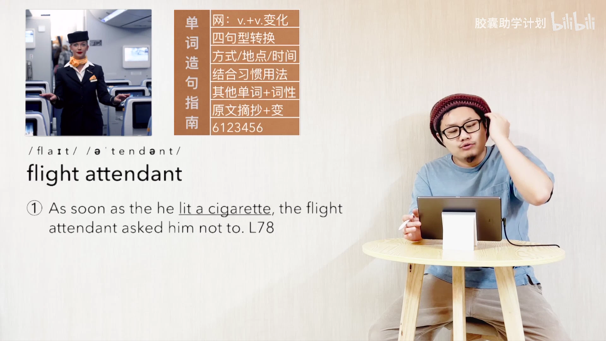

文字识别：胶囊助学计划bi出 / 单词造句指南 / 网：v.+v.变化 / 四句型转换 / 方式/地点/时间 / 结合习惯用法 / 其他单词+词性 / 原文摘抄+变 / 6123456 / / fl aIt/ /a'tendant/ / flight attendant / ① As soon as the he lit a cigarette, the flight / attendant asked him not to. L78

### 画面 00:02:17

文字识别：胶囊助学计划bibl / 单词造句指南 / 网：v.+v.变化 / 四句型转换 / 方式/地点/时间 / 结合习惯用法 / 其他单词+词性 / 原文摘抄+变 / 6123456 / / fl ait/ /a'tendant/ / flight attendant / ① As soon as the he lit a cigarette, the flight / attendant asked him not to. L78

### 画面 00:02:19

文字识别：单词造句指南 / 网：v.+v.变化 / 胶囊助学计划 / bibli / 四句型转换 / 方式/地点/时间 / 结合习惯用法 / 其他单词+词性 / 原文摘抄+变 / 6123456 / / fl ait/ /a'tendant/ / flight attendant / ① As soon as the he lit a cigarette, the flight / attendant asked him not to. L78

### 画面 00:02:21

文字识别：单词造句指南 / 网：v.+v.变化 / 胶囊助学计划 / biibii / 四句型转换 / 方式/地点/时间 / 结合习惯用法 / 其他单词+词性 / 原文摘抄+变 / 6123456 / / fl ait/ /a'tendant/ / flight attendant / ① As soon as the he lit a cigarette, the flight / attendant asked him not to. L78

### 画面 00:02:24

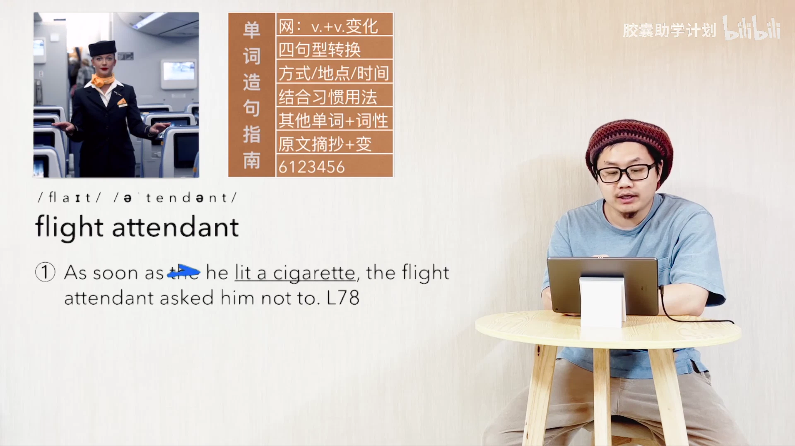

文字识别：单词造句指南 / 网：v.+v.变化 / 胶囊助学计划 / bilbili / 四句型转换 / 方式/地点/时间 / 结合习惯用法 / 其他单词+词性 / 原文摘抄+变 / 6123456 / / fl ait/ /a'tendant/ / flight attendant / ① As soon as the he lit a cigarette, the flight / attendant asked him not to. L78

### 画面 00:02:26

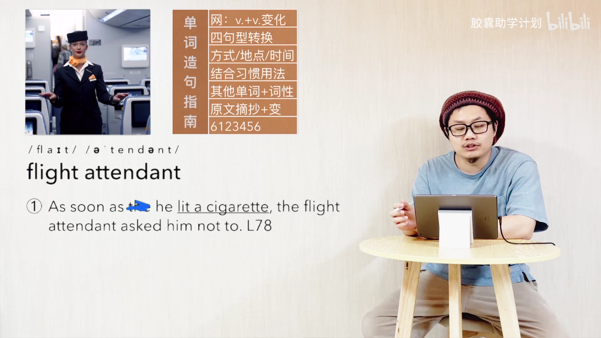

文字识别：单词造句指南 / 网：v.+v.变化 / 胶囊助学计划 / bilbl / 四句型转换 / 方式/地点/时间 / 结合习惯用法 / 其他单词+词性 / 原文摘抄+变 / 6123456 / / fl ait/ /a'tendant/ / flight attendant / ① As soon as th  he lit a cigarette, the flight / attendant asked him not to. L78

### 画面 00:02:29

文字识别：单词造句指南 / 网：v.+v.变化 / 胶囊助学计划 / bilbil / 四句型转换 / 方式/地点/时间 / 结合习惯用法 / 其他单词+词性 / 原文摘抄+变 / 6123456 / / fl ait/ /a'tendant/ / flight attendant / ① As soon as t  he lit a cigarette, the flight / attendant asked him not to. L78

## 00:02:30–00:03:00

说他一点燃烟，这个空姐就要求他别这么干，对吧？ Next one, say in the end, the flight attendant lost her temper. 说最后，哎，怎么样呢？说这个空姐，哎，丧，哎，这个发脾气了，对吧？ Lost her temper. Next one, say please make yourself comfortable. 哎，让你自己舒服一点，放松下来. Said the flight attendant. 空姐说道，对吧？哎，你坐头等舱，特殊照顾. Flight attendant. Next one, 下一个单

### 画面 00:02:31

文字识别：单词造句指南 / 网：v.+v.变化 / 胶囊助学计划 / bilbili / 四句型转换 / 方式/地点/时间 / 结合习惯用法 / 其他单词+词性 / 原文摘抄+变 / 6123456 / / fl ait/ /a'tendant/ / flight attendant / ① As soon as th  he lit a cigarette, the flight / attendant asked him not to. L78

### 画面 00:02:35

文字识别：胶囊助学计划bilbi / 单词造句指南 / 网：v.+v.变化 / 四句型转换 / 方式/地点/时间 / 结合习惯用法 / 其他单词+词性 / 原文摘抄+变 / 6123456 / /flait/ /a'tendant/ / flight attendant / ① As soon as th  he lit a cigarette, the flight / attendant asked him not to. L78 / ② In the end, the flight attendant lost her / temper. L78

### 画面 00:02:37

文字识别：单词造句指南 / 网：v.+v.变化 / 胶囊助学计划bilbi / 四句型转换 / 方式/地点/时间 / 结合习惯用法 / 其他单词+词性 / 原文摘抄+变 / 6123456 / / fl ait/ /a'tendant/ / flight attendant / ① As soon as th he lit a cigarette, the flight / attendant asked him not to. L78 / ② In the end, the flight attendant lost her / temper. L78

### 画面 00:02:40

文字识别：胶囊助学计划bilii出 / 单词造句指南 / 网：v.+v.变化 / 四句型转换 / 方式/地点/时间 / 结合习惯用法 / 其他单词+词性 / 原文摘抄+变 / 6123456 / /fl ait/ /a'tendant/ / flight attendant / ① As soon as t he lit a cigarette, the flight / attendant asked him not to. L78 / ② In the end, the flight attendant lost her / temper. L78

### 画面 00:02:44

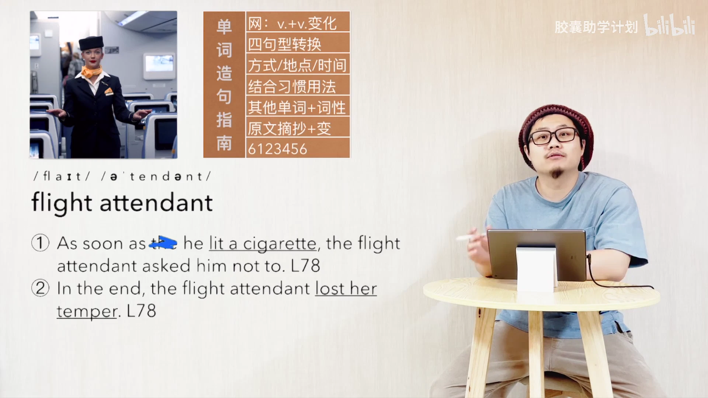

文字识别：胶囊助学计划bilii出 / 单词造句指南 / 网：v.+v.变化 / 四句型转换 / 方式/地点/时间 / 结合习惯用法 / 其他单词+词性 / 原文摘抄+变 / 6123456 / /flait/ /a'tendant/ / flight attendant / ① As soon as t he lit a cigarette, the flight / attendant asked him not to. L78 / ② In the end, the flight attendant lost her / temper. L78

### 画面 00:02:46

文字识别：单词造句指南 / 网：v.+v.变化 / 胶囊助学计划 / bilbii / 四句型转换 / 方式/地点/时间 / 结合习惯用法 / 其他单词+词性 / 原文摘抄+变 / 6123456 / /flait / /a'tendant/ / flight attendant / ① As soon as t  he lit a cigarette, the flight / attendant asked him not to. L78 / ② In the end, the flight attendant lost her / temper. L78

### 画面 00:02:48

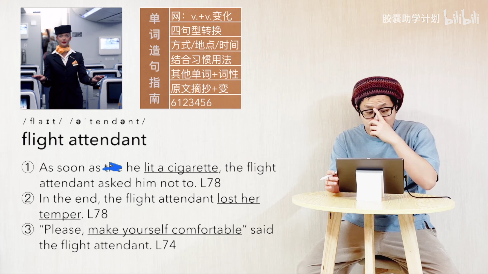

文字识别：胶囊助学计划bili / 单词造句指南 / 网：v.+v.变化 / 四句型转换 / 方式/地点/时间 / 结合习惯用法 / 其他单词+词性 / 原文摘抄+变 / 6123456 / / flait / /a'tendant/ / flight attendant / ① As soon as t he lit a cigarette, the flight / attendant asked him not to. L78 / ② In the end, the flight attendant lost her / temper. L78 / "Please, make yourself comfortable"said / the flight attendant. L74

### 画面 00:02:50

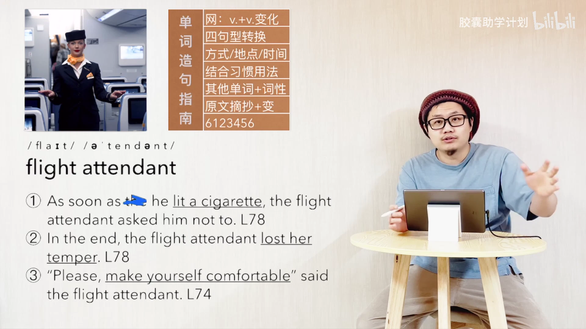

文字识别：单词造句指南 / 网：v.+v.变化 / 胶囊助学计划bi出 / 四句型转换 / 方式/地点/时间 / 结合习惯用法 / 其他单词+词性 / 原文摘抄+变 / 6123456 / / flait/ /a'tendant/ / flight attendant / ① As soon as t he lit a cigarette, the flight / attendant asked him not to. L78 / ② In the end, the flight attendant lost her / temper. L78 / "Please, make yourself comfortable"said / the flight attendant. L74

### 画面 00:02:52

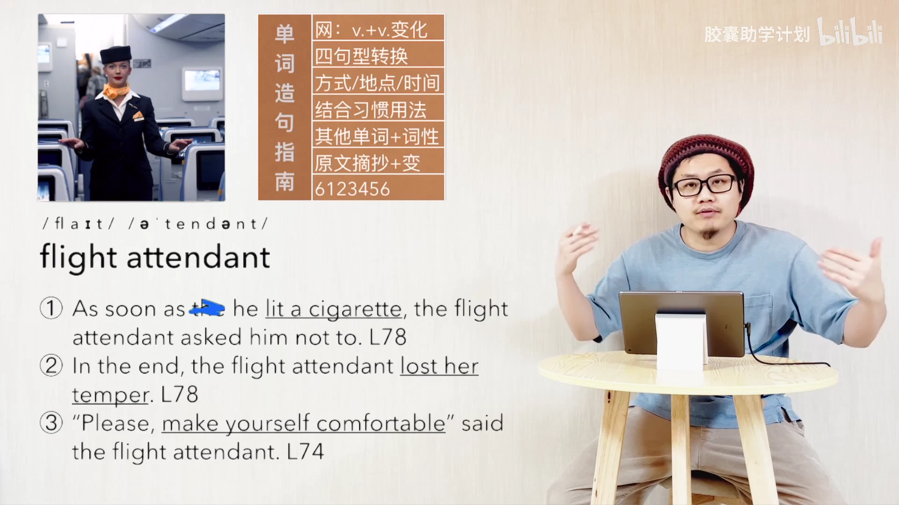

文字识别：胶囊助学计划bibi / 单词造句指南 / 网：v.+v.变化 / 四句型转换 / 方式/地点/时间 / 结合习惯用法 / 其他单词+词性 / 原文摘抄+变 / 6123456 / / fl ait / /a'tendant/ / flight attendant / ① As soon as th e he lit a cigarette, the flight / attendant asked him not to. L78 / ② In the end, the flight attendant lost her / temper. L78 / "Please, make yourself comfortable"said / the flight attendant. L74

### 画面 00:02:54

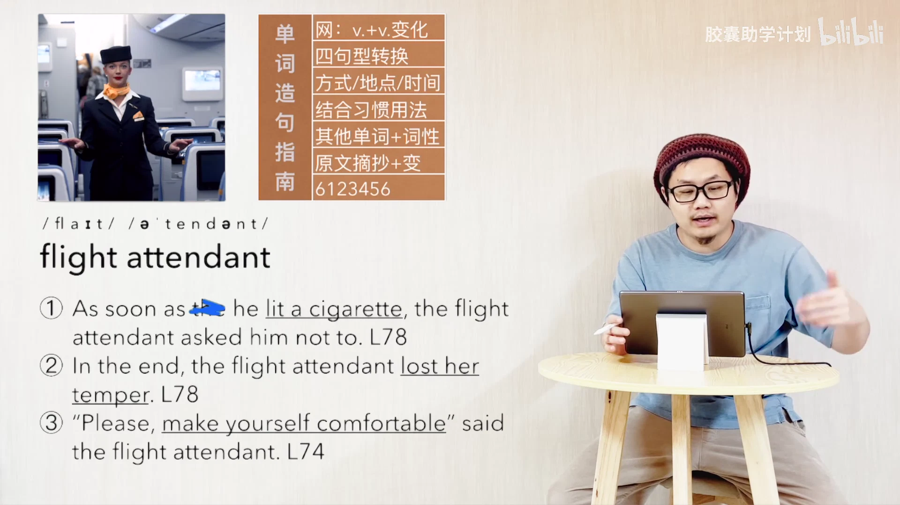

文字识别：单词造句指南 / 网：v.+v.变化 / 胶囊助学计划bi出 / 四句型转换 / 方式/地点/时间 / 结合习惯用法 / 其他单词+词性 / 原文摘抄+变 / 6123456 / / flait/ /a'tendant/ / flight attendant / ① As soon as t he lit a cigarette, the flight / attendant asked him not to. L78 / ② In the end, the flight attendant lost her / temper. L78 / "Please, make yourself comfortable"said / the flight attendant. L74

### 画面 00:02:56

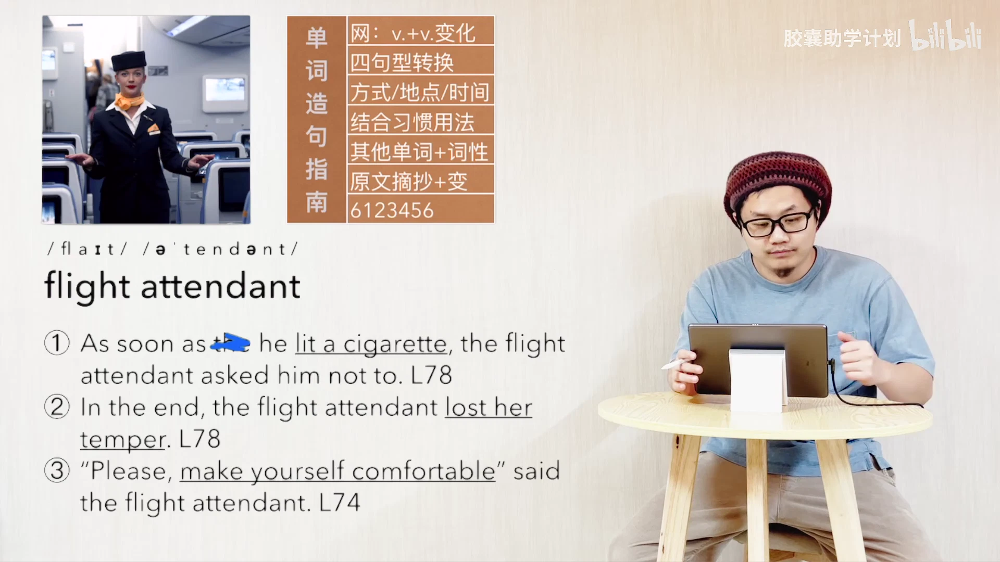

文字识别：胶囊助学计划bilii / 单词造句指南 / 网：v.+v.变化 / 四句型转换 / 方式/地点/时间 / 结合习惯用法 / 其他单词+词性 / 原文摘抄+变 / 6123456 / / fl ait / /a'tendant/ / flight attendant / ① As soon as t he lit a cigarette, the flight / attendant asked him not to. L78 / ② In the end, the flight attendant lost her / temper. L78 / "Please, make yourself comfortable"said / the flight attendant. L74

### 画面 00:02:58

文字识别：单词造句指南 / 网：v.+v.变化 / 胶囊助学计划 / bilbili / 四句型转换 / 方式/地点/时间 / 结合习惯用法 / 其他单词+词性 / 原文摘抄+变 / 6123456 / /'fraitand/ / frightened adj.

## 00:03:00–00:03:30

词叫 frightened. Frightened 就是害怕、恐惧的意思。那 feel frightened 就是感到害怕、感到恐惧。造个句子, it made me feel frightened. 啊，或者我说 you made me feel frightened, 对吧？说这个玩意儿让我感觉到非常的恐惧。哎，说他让我感到非常的恐惧，或者你让我感到非常的恐惧。啊，这是咱五十七课学的 make somebody do something, 使某人做某事儿。 Next one, I felt

### 画面 00:03:00

文字识别：单词造句指南 / 网：v.+v.变化 / 胶囊助学计划 / bibili / 四句型转换 / 方式/地点/时间 / 结合习惯用法 / 其他单词+词性 / 原文摘抄+变 / 6123456 / /' fraltand / / frightened adj.

### 画面 00:03:03

文字识别：单词造句指南 / 网：v.+v.变化 / 胶囊助学计划 / bilbili / 四句型转换 / 方式/地点/时间 / 结合习惯用法 / 其他单词+词性 / 原文摘抄+变 / 6123456 / /fraltand/ / frightened adj. / ① feel frightened..

### 画面 00:03:05

文字识别：单词造句指南 / 网：v.+v.变化 / 胶囊助学计划 / bibii / 四句型转换 / 方式/地点/时间 / 结合习惯用法 / 其他单词+词性 / 原文摘抄+变 / 6123456 / /'fraitand/ / frightened adj. / ① feel frightened..

### 画面 00:03:07

文字识别：单词造句指南 / 网：v.+v.变化 / 胶囊助学计划 / biibili / 四句型转换 / 方式/地点/时间 / 结合习惯用法 / 其他单词+词性 / 原文摘抄+变 / 6123456 / / 'f r ai t a n d / / frightened adj. / ① feel frightened... / ② It made me feel frightened. L57

### 画面 00:03:10

文字识别：单词造句指南 / 网：v.+v.变化 / 胶囊助学计划 / bibii / 四句型转换 / 方式/地点/时间 / 结合习惯用法 / 其他单词+词性 / 原文摘抄+变 / 6123456 / / f r ai t a n d / / frightened adj. / ① feel frightened... / ② It made me feel frightened. L57

### 画面 00:03:13

文字识别：单词造句指南 / 网：v.+v.变化 / 胶囊助学计划 / bibii / 四句型转换 / 方式/地点/时间 / 结合习惯用法 / 其他单词+词性 / 原文摘抄+变 / 6123456 / /frait an d / / frightened adj. / ① feel frightened.. /  It made me feel frightened. L57

### 画面 00:03:15

文字识别：单词造句指南 / 网：v.+v.变化 / 胶囊助学计划 / biiili / 四句型转换 / 方式/地点/时间 / 结合习惯用法 / 其他单词+词性 / 原文摘抄+变 / 6123456 / / f r ai t an d / / frightened adj. / ① feel frightened.. / ② It made me feel frightened. L57

### 画面 00:03:18

文字识别：单词造句指南 / 网：v.+v.变化 / 胶囊助学计划 / bilbili / 四句型转换 / 方式/地点/时间 / 结合习惯用法 / 其他单词+词性 / 原文摘抄+变 / 6123456 / / f r ai t a n d / / frightened adj. / ① feel frightened... / ② It made me feel frightened. L57

### 画面 00:03:20

文字识别：单词造句指南 / 网：v.+v.变化 / 胶囊助学计划 / blbli / 四句型转换 / 方式/地点/时间 / 结合习惯用法 / 其他单词+词性 / 原文摘抄+变 / 6123456 / / f r ai t a n d / / frightened adj. / ① feel frightened... / ② It made me feel frightened. L57

### 画面 00:03:23

文字识别：单词造句指南 / 网：v.+v.变化 / 胶囊助学计划 / biibili / 四句型转换 / 方式/地点/时间 / 结合习惯用法 / 其他单词+词性 / 原文摘抄+变 / 6123456 / / frait an d / / frightened adj. / ① feel frightened... / ② It made me feel frightened. L57

### 画面 00:03:25

文字识别：单词造句指南 / 网：v.+v.变化 / 胶囊助学计划 / bibii / 四句型转换 / 方式/地点/时间 / 结合习惯用法 / 其他单词+词性 / 原文摘抄+变 / 6123456 / / fr ait a n d / / frightened adj. / ① feel frightened... / ② It made me feel frightened. L57

### 画面 00:03:27

文字识别：单词造句指南 / 网：v.+v.变化 / 胶囊助学计划bi出 / 四句型转换 / 方式/地点/时间 / 结合习惯用法 / 其他单词+词性 / 原文摘抄+变 / 6123456 / / ' fr ai t a n d / / frightened adj. / ① feel frightened... / ② It made me feel frightened. L57 / ③ I felt frightened by the anger in his voice. / L15

## 00:03:30–00:04:00

frightened by the anger in her voice. 说我感到有一些恐惧。哎，被什么东西感到有一些恐惧？就呃，被什么东什么样的东西呢？说他嗓音当中的这个愤怒。哎，当我听到他嗓音当中的愤怒的时候，哎，我感受到了恐惧，对吧？Next one, 四句型转换啊。下一个单词 curious. Curious 这个单词非常常见的意思就是好奇啊，有好奇心的啊。你比如小

### 画面 00:03:30

文字识别：单词造句指南 / 网：v.+v.变化 / 胶囊助学计划bilil / 四句型转换 / 方式/地点/时间 / 结合习惯用法 / 其他单词+词性 / 原文摘抄+变 / 6123456 / /  fr ai t a n d / / frightened adj. / ① feel frightened... / ② It made me feel frightened. L57 / ③ I felt frightened by the anger in his voice. / L15

### 画面 00:03:32

文字识别：胶囊助学计划bi出 / 单词造句指南 / 网：v.+v.变化 / 四句型转换 / 方式/地点/时间 / 结合习惯用法 / 其他单词+词性 / 原文摘抄+变 / 6123456 / /  fr ai t a n d / / frightened adj. / ① feel frightened... / ② It made me feel frightened. L57 / ③ I felt frightened by the anger in his voice. / L15

### 画面 00:03:34

文字识别：胶囊助学计划bilii / 单词造句指南 / 网：v.+v.变化 / 四句型转换 / 方式/地点/时间 / 结合习惯用法 / 其他单词+词性 / 原文摘抄+变 / 6123456 / /  f r a i t a n d / / frightened adj. / ① feel frightened... / ② It made me feel frightened. L57 / ③ I felt frightened by the anger in his voice. / L15

### 画面 00:03:36

文字识别：胶囊助学计划bilii / 单词造句指南 / 网：v.+v.变化 / 四句型转换 / 方式/地点/时间 / 结合习惯用法 / 其他单词+词性 / 原文摘抄+变 / 6123456 / / f r ai t a n d / / frightened adj. / ① feel frightened... / ② It made me feel frightened. L57 / ③ I felt frightened by the anger in his voice. / L15

### 画面 00:03:38

文字识别：胶囊助学计划biliil / 单词造句指南 / 网：v.+v.变化 / 四句型转换 / 方式/地点/时间 / 结合习惯用法 / 其他单词+词性 / 原文摘抄+变 / 6123456 / /  f r a i t a n d / / frightened adj. / ① feel frightened... / ② It made me feel frightened. L57 / ③ I felt frightened by the anger in his voice. / L15

### 画面 00:03:40

文字识别：胶囊助学计划bilii / 单词造句指南 / 网：v.+v.变化 / 四句型转换 / 方式/地点/时间 / 结合习惯用法 / 其他单词+词性 / 原文摘抄+变 / 6123456 / / 'f rai t a n d / / frightened adj. / ① feel frightened... / ② It made me feel frightened. L57 / ③ I felt frightened by the anger in his voice. / 3 / L15

### 画面 00:03:45

文字识别：胶囊助学计划bilbi / 单词造句指南 / 网：v.+v.变化 / 四句型转换 / 方式/地点/时间 / 结合习惯用法 / 其他单词+词性 / 原文摘抄+变 / 6123456 / /  f r a i t a n d / / frightened adj. / ① feel frightened... / ② It made me feel frightened. L57 / ③ I felt frightened by the anger in his voice. / L15

### 画面 00:03:50

文字识别：胶囊助学计划bilibi / 单词造句指南 / 网：v.+v.变化 / 四句型转换 / 方式/地点/时间 / 结合习惯用法 / 其他单词+词性 / 原文摘抄+变 / 6123456 / /  f r ait a n d / / frightened adj. / ① feel frightened... / ② It made me feel frightened. L57 / ③ I felt frightened by the anger in his voice. / L15 / did/who/why/what...

### 画面 00:03:52

文字识别：单词造句指南 / 网：v.+v.变化 / 胶囊助学计划 / bilbii / 四句型转换 / 方式/地点/时间 / 结合习惯用法 / 其他单词+词性 / 原文摘抄+变 / 6123456 / /'kjuarias/ / curious adj.

### 画面 00:03:55

文字识别：单词造句指南 / 网：v.+v.变化 / 胶囊助学计划 / bibili / 四句型转换 / 方式/地点/时间 / 结合习惯用法 / 其他单词+词性 / 原文摘抄+变 / 6123456 / /'kjuarias/ / curious adj.

## 00:04:00–00:04:30

孩子对吧？或者一个成年人非常有好奇心，热爱学习。这个好奇心就是 curious。那原文给了我们这样一个小的，算是句型，我们可以拿来去套用的，叫做 somebody be curious to find out，再加句子，对吧？说某人很好奇的想要弄明白某件事情，就是其实就是他很希望能搞明白某件事情。比如说， I

### 画面 00:04:00

文字识别：单词造句指南 / 网：v.+v.变化 / 胶囊助学计划 / biibili / 四句型转换 / 方式/地点/时间 / 结合习惯用法 / 其他单词+词性 / 原文摘抄+变 / 6123456 / /'kjuarias/ / curious adj.

### 画面 00:04:03

文字识别：单词造句指南 / 网：v.+v.变化 / 胶囊助学计划 / bilbili / 四句型转换 / 方式/地点/时间 / 结合习惯用法 / 其他单词+词性 / 原文摘抄+变 / 6123456 / /'kjuarias/ / curious adj.

### 画面 00:04:05

文字识别：单词造句指南 / 网：v.+v.变化 / 胶囊助学计划 / bilbili / 四句型转换 / 方式/地点/时间 / 结合习惯用法 / 其他单词+词性 / 原文摘抄+变 / 6123456 / /'kjuarias/ / curious adj.

### 画面 00:04:08

文字识别：单词造句指南 / 网：v.+v.变化 / 胶囊助学计划 / bibii / 四句型转换 / 方式/地点/时间 / 结合习惯用法 / 其他单词+词性 / 原文摘抄+变 / 6123456 / /'kjuarias/ / curious adj. / ① sb. be curious to find out + 句子

### 画面 00:04:10

文字识别：单词造句指南 / 网：v.+v.变化 / 胶囊助学计划 / bibii / 四句型转换 / 方式/地点/时间 / 结合习惯用法 / 其他单词+词性 / 原文摘抄+变 / 6123456 / /'kjuarias/ / curious adj. / ① sb. be curious to find out + 句子

### 画面 00:04:15

文字识别：单词造句指南 / 网：v.+v.变化 / 胶囊助学计划 / bibii / 四句型转换 / 方式/地点/时间 / 结合习惯用法 / 其他单词+词性 / 原文摘抄+变 / 6123456 / /'kjuarias/ / curious adj. / ① sb. be curious to find / ot +句子

### 画面 00:04:19

文字识别：单词造句指南 / 网：v.+v.变化 / 胶囊助学计划 / bibil / 四句型转换 / 方式/地点/时间 / 结合习惯用法 / 其他单词+词性 / 原文摘抄+变 / 6123456 / /'kjuarias/ / curious adj. / ① sb. be curious to find out +句子

### 画面 00:04:21

文字识别：单词造句指南 / 网：v.+v.变化 / 胶囊助学计划 / biii / 四句型转换 / 方式/地点/时间 / 结合习惯用法 / 其他单词+词性 / 原文摘抄+变 / 6123456 / /'kjuarias/ / curious adj. / ① sb. be curious to find out +句子

### 画面 00:04:23

文字识别：单词造句指南 / 网：v.+v.变化 / 胶囊助学计划 / biiili / 四句型转换 / 方式/地点/时间 / 结合习惯用法 / 其他单词+词性 / 原文摘抄+变 / 6123456 / /'kjuarias/ / curious adj. / ① sb. be curious to find out + 句子

### 画面 00:04:25

文字识别：单词造句指南 / 网：v.+v.变化 / 胶囊助学计划 / bilbii / 四句型转换 / 方式/地点/时间 / 结合习惯用法 / 其他单词+词性 / 原文摘抄+变 / 6123456 / /'kjuarias/ / curious adj. / ① sb. be curious to find out + 句子

### 画面 00:04:28

文字识别：胶囊助学计划bilbi出 / 单词造句指南 / 网：v.+v.变化 / 四句型转换 / 方式/地点/时间 / 结合习惯用法 / 其他单词+词性 / 原文摘抄+变 / 6123456 / /kjuarias/ / curious adj. / ① sb. be curious to find out + 句子 / I was curious to find out what she had said.

## 00:04:30–00:05:00

was curious to find out what she had said.这句话想表达的意思就是我很想搞明白她刚才说了啥，她之前说了什么，对吧？再来说, he was curious to find out why she had left her job so suddenly.说，哎，他啊，这个男的特别想弄明白，说为什么这个女的突然间就离开他这个工作岗位了，对吧？Next one, I'm curious to find out why he has such a bad temper.

### 画面 00:04:30

文字识别：单词造句指南 / 网：v.+v.变化 / 胶囊助学计划 / bilibii / 四句型转换 / 方式/地点/时间 / 结合习惯用法 / 其他单词+词性 / 原文摘抄+变 / 6123456 / /'kjuarias/ / curious adj. / ① sb. be curious to find out + 句子 / I was curious to find out what she had said.

### 画面 00:04:33

文字识别：单词造句指南 / 网：v.+v.变化 / 胶囊助学计划 / bilibli / 四句型转换 / 方式/地点/时间 / 结合习惯用法 / 其他单词+词性 / 原文摘抄+变 / 6123456 / /'kjuarias/ / curious adj. / ① sb. be curious to find out + 句子 /  I was curious to find out what she had said.

### 画面 00:04:35

文字识别：单词造句指南 / 网：v.+v.变化 / 胶囊助学计划 / bilbi / 四句型转换 / 方式/地点/时间 / 结合习惯用法 / 其他单词+词性 / 原文摘抄+变 / 6123456 / /'kjuarias/ / curious adj. / ① sb. be curious to find out + 句子 / ) I was curious to find out what she had said.

### 画面 00:04:37

文字识别：胶囊助学计划bii出 / 单词造句指南 / 网：v.+v.变化 / 四句型转换 / 方式/地点/时间 / 结合习惯用法 / 其他单词+词性 / 原文摘抄+变 / 6123456 / /'kjuarias/ / curious adj. / ① sb. be curious to find out + 句子 / I was curious to find out what she had said.

### 画面 00:04:39

文字识别：胶囊助学计划bilbil / 单词造句指南 / 网：v.+v.变化 / 四句型转换 / 方式/地点/时间 / 结合习惯用法 / 其他单词+词性 / 原文摘抄+变 / 6123456 / /'kjuarias/ / curious adj. / ① sb. be curious to find out + 句子 / I was curious to find out what she had said. /  He was curious to find out why she had left / 3 / her job so suddenly.

### 画面 00:04:41

文字识别：胶囊助学计划biliil / 单词造句指南 / 网：v.+v.变化 / 四句型转换 / 方式/地点/时间 / 结合习惯用法 / 其他单词+词性 / 原文摘抄+变 / 6123456 / /'kjuarias/ / curious adj. / ① sb. be curious to find out +句子 /  I was curious to find out what she had said. /  He was curious to find out why she had left / 3 / her job so suddenly.

### 画面 00:04:43

文字识别：单词造句指南 / 网：v.+v.变化 / 胶囊助学计划bilbi / 四句型转换 / 方式/地点/时间 / 结合习惯用法 / 其他单词+词性 / 原文摘抄+变 / 6123456 / /'kjuarias/ / curious adj. / ① sb. be curious to find out + 句子 / I was curious to find out what she had said. /  He was curious to find out why she had left / 3 / her job so suddenly.

### 画面 00:04:45

文字识别：单词造句指南 / 网：v.+v.变化 / 胶囊助学计划biibi / 四句型转换 / 方式/地点/时间 / 结合习惯用法 / 其他单词+词性 / 原文摘抄+变 / 6123456 / /'kjuarias/ / curious adj. / ① sb. be curious to find out +句子 / ) I was curious to find out what she had said. /  He was curious to find out why she had left / 3 / her job so suddenly.

### 画面 00:04:47

文字识别：胶囊助学计划biliil / 单词造句指南 / 网：v.+v.变化 / 四句型转换 / 方式/地点/时间 / 结合习惯用法 / 其他单词+词性 / 原文摘抄+变 / 6123456 / /'kjuarias/ / curious adj. / ①sb. be curious to find out + 句子 /  I was curious to find out what she had said. / He was curious to find out why she had left / her job so suddenly.

### 画面 00:04:50

文字识别：胶囊助学计划bibi / 单词造句指南 / 网：v.+v.变化 / 四句型转换 / 方式/地点/时间 / 结合习惯用法 / 其他单词+词性 / 原文摘抄+变 / 6123456 / /'kjuarias/ / curious adj. / ① sb. be curious to find out + 句子 / ) I was curious to find out what she had said. /  He was curious to find out why she had left / 3 / her job so suddenly.

### 画面 00:04:52

文字识别：单词造句指南 / 网：v.+v.变化 / 胶囊助学计划bilbi / 四句型转换 / 方式/地点/时间 / 结合习惯用法 / 其他单词+词性 / 原文摘抄+变 / 6123456 / /'kjuarias/ / curious adj. / ① sb. be curious to find out + 句子 /  I was curious to find out what she had said. /  He was curious to find out why she had left / her job so suddenly.

### 画面 00:04:54

文字识别：单词造句指南 / 网：v.+v.变化 / 胶囊助学计划bilii / 四句型转换 / 方式/地点/时间 / 结合习惯用法 / 其他单词+词性 / 原文摘抄+变 / 6123456 / /'kjuarias/ / curious adj. / ① sb. be curious to find out +句子 / 2 /  I was curious to find out what she had said. / 3 / ) He was curious to find out why she had left / her job so suddenly. /  I'm curious to find out why he have such a / bad temper. L78

### 画面 00:04:56

文字识别：胶囊助学计划bilii / 单词造句指南 / 网：v.+v.变化 / 四句型转换 / 方式/地点/时间 / 结合习惯用法 / 其他单词+词性 / 原文摘抄+变 / 6123456 / /'kjuarias/ / curious adj. / ① sb. be curious to find out + 句子 / 2 /  I was curious to find out what she had said. / 3 / ) He was curious to find out why she had left / her job so suddenly. / D I'm curious to find out why he have such a / bad temper. L78

### 画面 00:04:59

文字识别：单词造句指南 / 网：v.+v.变化 / 胶囊助学计划biibl / 四句型转换 / 方式/地点/时间 / 结合习惯用法 / 其他单词+词性 / 原文摘抄+变 / 6123456 / /'kjuarias/ / curious adj. / ① sb. be curious to find out + 句子 / 2 /  I was curious to find out what she had said. / 3 / ) He was curious to find out why she had left / her job so suddenly. / D I'm curious to find out why he have such a / bad temper. L78

## 00:05:00–00:05:30

他我特别想弄明白，搞清楚他为啥这个脾气这么臭，对吧？OK，再读一遍那个单词，curious. Very good.接下来两个单词我们放到一起去学了啊，因为这个可能你读小说用得到，口语当中可能一时半会儿也用不到。Bomb啊，炸弹。Plant, plant这个单词对于各位来说很熟悉的意思是种植啊，有点像grow那个单词同义词似的啊，种个树啊，种个什么呃，我们院子里的东西

### 画面 00:05:01

文字识别：胶囊助学计划bilii / 单词造句指南 / 网：v.+v.变化 / 四句型转换 / 方式/地点/时间 / 结合习惯用法 / 其他单词+词性 / 原文摘抄+变 / 6123456 / /'kjuarias/ / curious adj. / ① sb. be curious to find out + 句子 / 2 / I was curious to find out what she had said. / 3 / ) He was curious to find out why she had left / her job so suddenly. / D I'm curious to find out why he have such a / bad temper. L78

### 画面 00:05:04

文字识别：单词造句指南 / 网：v.+v.变化 / 胶囊助学计划biibl / 四句型转换 / 方式/地点/时间 / 结合习惯用法 / 其他单词+词性 / 原文摘抄+变 / 6123456 / /'kjuarias/ / curious adj. / ① sb. be curious to find out + 句子 / 2 /  I was curious to find out what she had said. / 3 / ) He was curious to find out why she had left / her job so suddenly. /  I'm curious to find out why he have such a / bad temper. L78

### 画面 00:05:06

文字识别：单词造句指南 / 网：v.+v.变化 / 胶囊助学计划bi / 四句型转换 / 方式/地点/时间 / 结合习惯用法 / 其他单词+词性 / 原文摘抄+变 / 6123456 / /'kjuarias/ / curious adj. / ① sb. be curious to find out + 句子 / 2 /  I was curious to find out what she had said. / 3 / ) He was curious to find out why she had left / her job so suddenly. / D I'm curious to find out why he have such a / 4 / bad temper. L78

### 画面 00:05:08

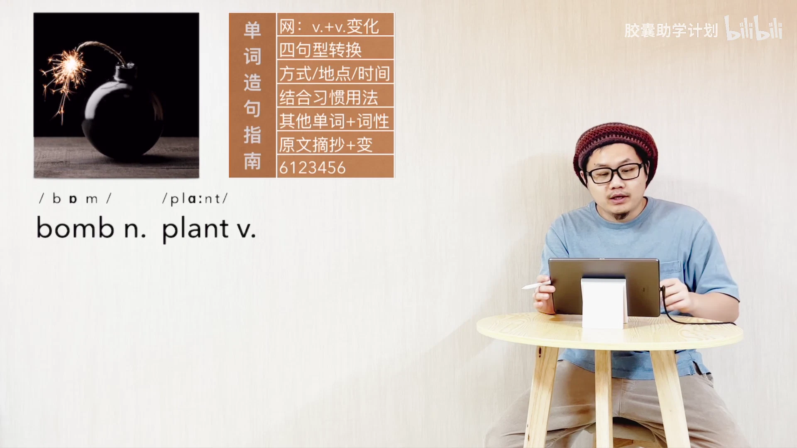

文字识别：单词造句指南 / 网：v.+v.变化 / 胶囊助学计划 / bilbii / 四句型转换 / 方式/地点/时间 / 结合习惯用法 / 其他单词+词性 / 原文摘抄+变 / 6123456 / / b Dm / / /pla:nt/ / bomb n. plant v.

### 画面 00:05:10

文字识别：单词造句指南 / 网：v.+v.变化 / 胶囊助学计划 / bilbili / 四句型转换 / 方式/地点/时间 / 结合习惯用法 / 其他单词+词性 / 原文摘抄+变 / 6123456 / / b D m / / /pla:nt/ / bomb n. plant v.

### 画面 00:05:12

文字识别：单词造句指南 / 网：v.+v.变化 / 胶囊助学计划 / bilbili / 四句型转换 / 方式/地点/时间 / 结合习惯用法 / 其他单词+词性 / 原文摘抄+变 / 6123456 / / b D m / / /pla:nt/ / bomb n. plant v.

### 画面 00:05:15

文字识别：单词造句指南 / 网：v.+v.变化 / 胶囊助学计划 / Bibii / 四句型转换 / 方式/地点/时间 / 结合习惯用法 / 其他单词+词性 / 原文摘抄+变 / 6123456 / / bDm / / /pla:nt/ / bomb n. plant v.

### 画面 00:05:18

文字识别：单词造句指南 / 网：v.+v.变化 / 胶囊助学计划 / bilbii / 四句型转换 / 方式/地点/时间 / 结合习惯用法 / 其他单词+词性 / 原文摘抄+变 / 6123456 / / b D m / / /pla:nt/ / bomb n. plant v.

### 画面 00:05:20

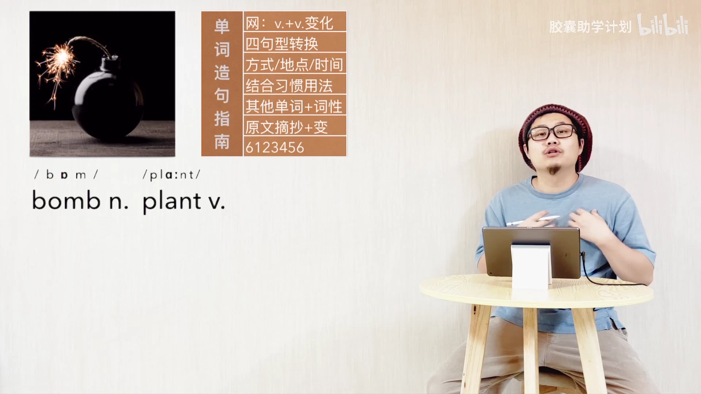

文字识别：单词造句指南 / 网：v.+v.变化 / 胶囊助学计划 / biibili / 四句型转换 / 方式/地点/时间 / 结合习惯用法 / 其他单词+词性 / 原文摘抄+变 / 6123456 / / b D m / / /pla:nt/ / bomb n. plant v.

### 画面 00:05:23

文字识别：单词造句指南 / 网：v.+v.变化 / 胶囊助学计划 / bibili / 四句型转换 / 方式/地点/时间 / 结合习惯用法 / 其他单词+词性 / 原文摘抄+变 / 6123456 / / b Dm / / /pla:nt/ / bomb n. plant v.

### 画面 00:05:25

文字识别：单词造句指南 / 网：v.+v.变化 / 胶囊助学计划 / bibii / 四句型转换 / 方式/地点/时间 / 结合习惯用法 / 其他单词+词性 / 原文摘抄+变 / 6123456 / / b Dm / / /pla:nt/ / bomb n. plant v.

### 画面 00:05:27

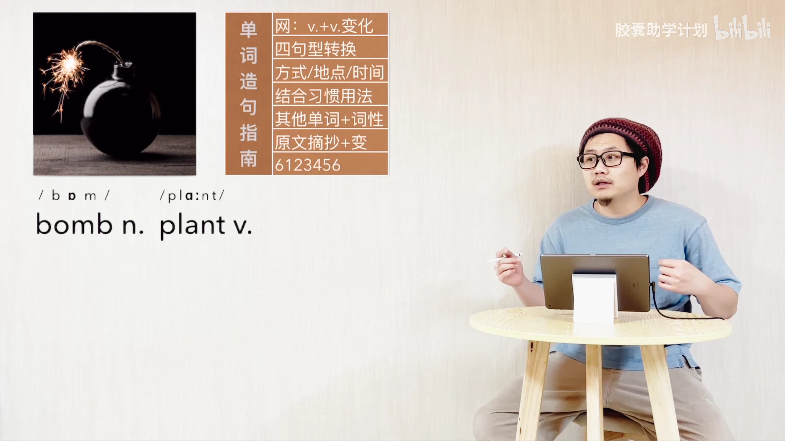

文字识别：单词造句指南 / 网：v.+v.变化 / 胶囊助学计划 / biibili / 四句型转换 / 方式/地点/时间 / 结合习惯用法 / 其他单词+词性 / 原文摘抄+变 / 6123456 / / b Dm / / /pla:nt/ / bomb n. plant v.

### 画面 00:05:29

文字识别：单词造句指南 / 网：v.+v.变化 / 胶囊助学计划 / Biibili / 四句型转换 / 方式/地点/时间 / 结合习惯用法 / 其他单词+词性 / 原文摘抄+变 / 6123456 / / b Dm / / /pla:nt/ / bomb n. plant v.

## 00:05:30–00:06:00

啊，对吧？都可以用 plant。那 plant 在这儿不，并不是种植的意思，它有点像 place 放置啊。就我们原来学过 place 这个单词，有名词，有动词的意思，对吧？那 plant bomb 就是放置了一个炸弹，其实就是安放了一个炸弹，对吧？那我们造一句话。The police was sure that someone had planted a bomb near the station。说警察非常确信，七十八课咱刚学的，说某个人在这个车站附近安放了

### 画面 00:05:31

文字识别：单词造句指南 / 网：v.+v.变化 / 胶囊助学计划 / biibii / 四句型转换 / 方式/地点/时间 / 结合习惯用法 / 其他单词+词性 / 原文摘抄+变 / 6123456 / / b D m / / /pla:nt/ / bomb n. plant v.

### 画面 00:05:35

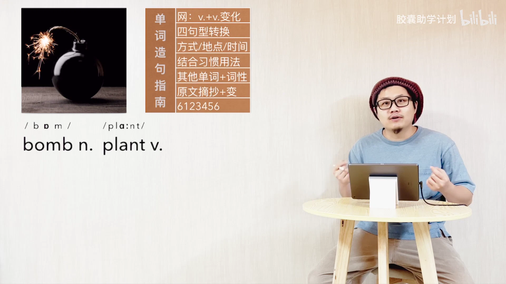

文字识别：单词造句指南 / 网：v.+v.变化 / 胶囊助学计划 / biibii / 四句型转换 / 方式/地点/时间 / 结合习惯用法 / 其他单词+词性 / 原文摘抄+变 / 6123456 / / bDm / / /pla:nt/ / bomb n. plant v.

### 画面 00:05:40

文字识别：单词造句指南 / 网：v.+v.变化 / 胶囊助学计划 / biibili / 四句型转换 / 方式/地点/时间 / 结合习惯用法 / 其他单词+词性 / 原文摘抄+变 / 6123456 / / b D m / / /pla:nt/ / bomb n. plant v.

### 画面 00:05:43

文字识别：单词造句指南 / 网：v.+v.变化 / 胶囊助学计划 / biibili / 四句型转换 / 方式/地点/时间 / 结合习惯用法 / 其他单词+词性 / 原文摘抄+变 / 6123456 / / b Dm / / /pla:nt/ / bomb n. plant v.

### 画面 00:05:45

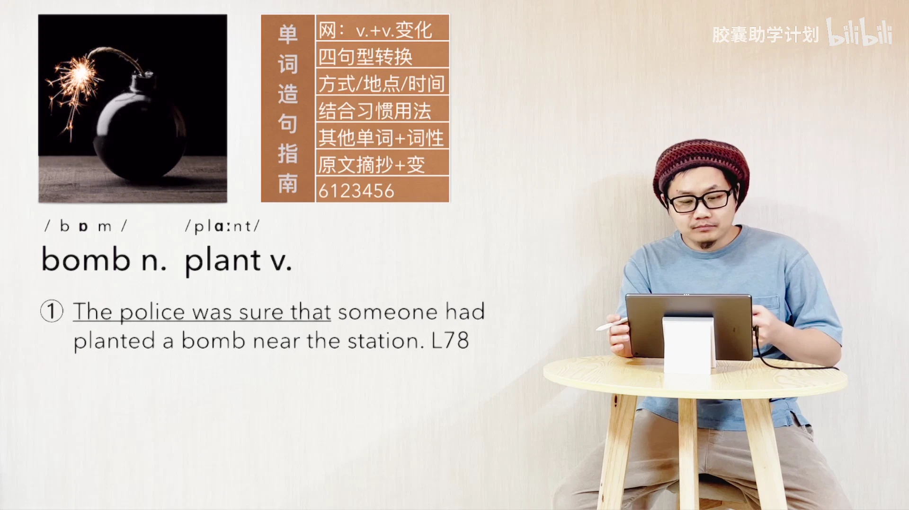

文字识别：单词造句指南 / 网：v.+v.变化 / 胶囊助学计划 / biibil / 四句型转换 / 方式/地点/时间 / 结合习惯用法 / 其他单词+词性 / 原文摘抄+变 / 6123456 / / bom / / /pla:nt/ / bomb n. plant v. / ① The police was sure that someone had / planted a bomb near the station. L78

### 画面 00:05:49

文字识别：单词造句指南 / 网：v.+v.变化 / 胶囊助学计划 / ilbi / 四句型转换 / 方式/地点/时间 / 结合习惯用法 / 其他单词+词性 / 原文摘抄+变 / 6123456 / / bom / / /pla:nt/ / bomb n. plant v. / ① The police was sure that someone had / planted a bomb near the station. L78

### 画面 00:05:51

文字识别：单词造句指南 / 网：v.+v.变化 / 胶囊助学计划 / bibii / 四句型转换 / 方式/地点/时间 / 结合习惯用法 / 其他单词+词性 / 原文摘抄+变 / 6123456 / / bD m / / /pla:nt/ / bomb n. plant v. / ① The police was sure that someone had / planted a bomb near the station. L78

### 画面 00:05:55

文字识别：胶囊助学计划bilbil / 单词造句指南 / 网：v.+v.变化 / 四句型转换 / 方式/地点/时间 / 结合习惯用法 / 其他单词+词性 / 原文摘抄+变 / 6123456 / /bDm/ / /pla:nt/ / bomb n. plant v. / ① The police was sure that someone had / planted a bomb near the station. L78

### 画面 00:05:59

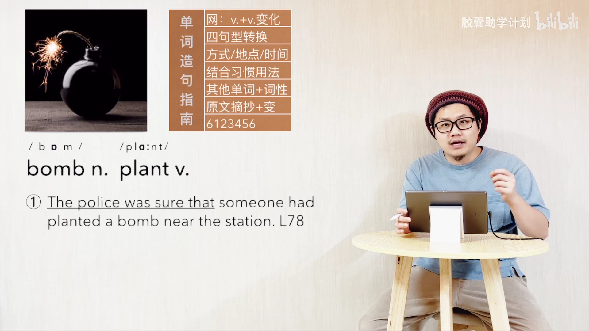

文字识别：单词造句指南 / 网：v.+v.变化 / 胶囊助学计划 / Bilbli / 四句型转换 / 方式/地点/时间 / 结合习惯用法 / 其他单词+词性 / 原文摘抄+变 / 6123456 / / bom / / /pla:nt/ / bomb n. plant v. / ① The police was sure that someone had / planted a bomb near the station. L78

## 00:06:00–00:06:30

个炸弹. Next one, he got the nerve to plant a bomb there. 说他竟然有这个勇气啊！当然这个呃，去在那地方安放一个炸弹，对吧？哎，深入这个这个贼窝，安放了一个炸弹. Next one, 说 they covered the bomb with a blanket. 哎，他们把拿一个东西把这个炸弹给覆盖上. Cover A with B. 七十五课咱们学的，用A覆哎，用这个B覆盖A，对吧？好，啊，在

### 画面 00:06:01

文字识别：胶囊助学计划bilbi / 单词造句指南 / 网：v.+v.变化 / 四句型转换 / 方式/地点/时间 / 结合习惯用法 / 其他单词+词性 / 原文摘抄+变 / 6123456 / / bD m / / /plaint/ / bomb n. plant v. / ① The police was sure that someone had / planted a bomb near the station. L78 / He got the nerve to plant a bomb there. / L78

### 画面 00:06:04

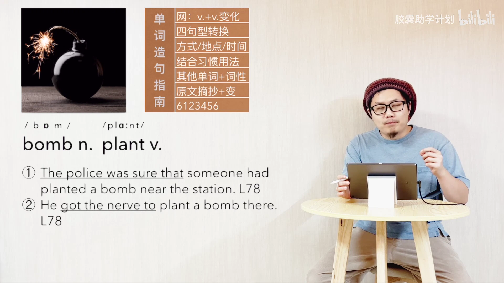

文字识别：胶囊助学计划bibi / 单词造句指南 / 网：v.+v.变化 / 四句型转换 / 方式/地点/时间 / 结合习惯用法 / 其他单词+词性 / 原文摘抄+变 / 6123456 / / b D m / / /plaint/ / bomb n. plant v. / ① The police was sure that someone had / planted a bomb near the station. L78 / He got the nerve to plant a bomb there. / L78

### 画面 00:06:06

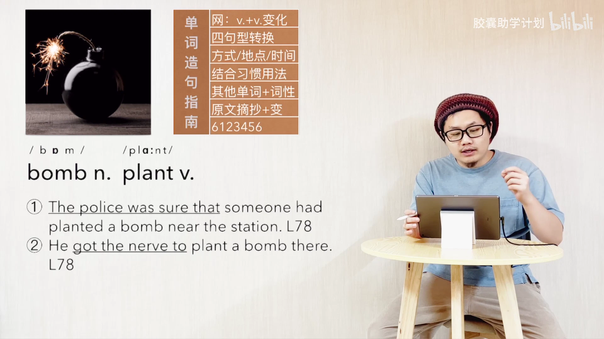

文字识别：胶囊助学计划bibi / 单词造句指南 / 网：v.+v.变化 / 四句型转换 / 方式/地点/时间 / 结合习惯用法 / 其他单词+词性 / 原文摘抄+变 / 6123456 / / b0 m / / /plaint/ / bomb n. plant v. / ① The police was sure that someone had / planted a bomb near the station. L78 / He got the nerve to plant a bomb there. / L78

### 画面 00:06:10

文字识别：胶囊助学计划bilbi / 单词造句指南 / 网：v.+v.变化 / 四句型转换 / 方式/地点/时间 / 结合习惯用法 / 其他单词+词性 / 原文摘抄+变 / 6123456 / / bD m / / /plaint/ / bomb n. plant v. / ① The police was sure that someone had / planted a bomb near the station. L78 / He got the nerve to plant a bomb there. / L78

### 画面 00:06:12

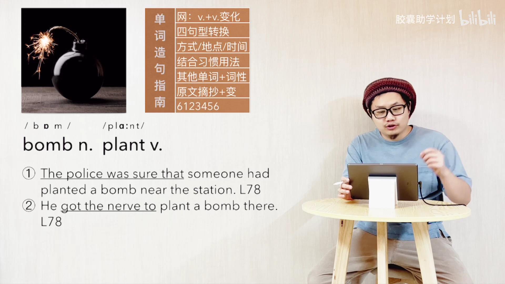

文字识别：单词造句指南 / 网：v.+v.变化 / 胶囊助学计划bilbil / 四句型转换 / 方式/地点/时间 / 结合习惯用法 / 其他单词+词性 / 原文摘抄+变 / 6123456 / / bD m / / /plaint/ / bomb n. plant v. / ① The police was sure that someone had / planted a bomb near the station. L78 / He got the nerve to plant a bomb there. / L78

### 画面 00:06:15

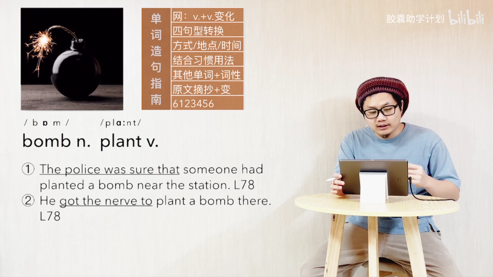

文字识别：胶囊助学计划biii / 单词造句指南 / 网：v.+v.变化 / 四句型转换 / 方式/地点/时间 / 结合习惯用法 / 其他单词+词性 / 原文摘抄+变 / 6123456 / / bD m / / /plaint/ / bomb n. plant v. / ① The police was sure that someone had / planted a bomb near the station. L78 / He got the nerve to plant a bomb there. / L78

### 画面 00:06:17

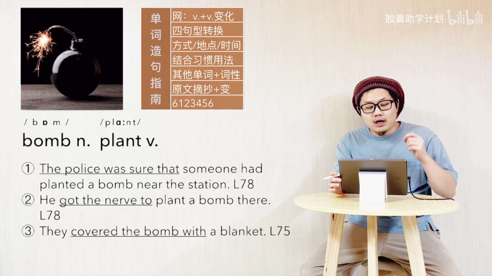

文字识别：单词造句指南 / 网：v.+v.变化 / 胶囊助学计划bibi / 四句型转换 / 方式/地点/时间 / 结合习惯用法 / 其他单词+词性 / 原文摘抄+变 / 6123456 / / b0 m / / /pla:nt/ / bomb n. plant v. / ① The police was sure that someone had / planted a bomb near the station. L78 / He got the nerve to plant a bomb there. / L78 /  They covered the bomb with a blanket. L75

### 画面 00:06:20

文字识别：单词造句指南 / 网：v.+v.变化 / 胶囊助学计划ilbl / 四句型转换 / 方式/地点/时间 / 结合习惯用法 / 其他单词+词性 / 原文摘抄+变 / 6123456 / / bD m / / /plaint/ / bomb n. plant v. / ① The police was sure that someone had / planted a bomb near the station. L78 / He got the nerve to plant a bomb there. / L78 /  They covered the bomb with a blanket. L75

### 画面 00:06:22

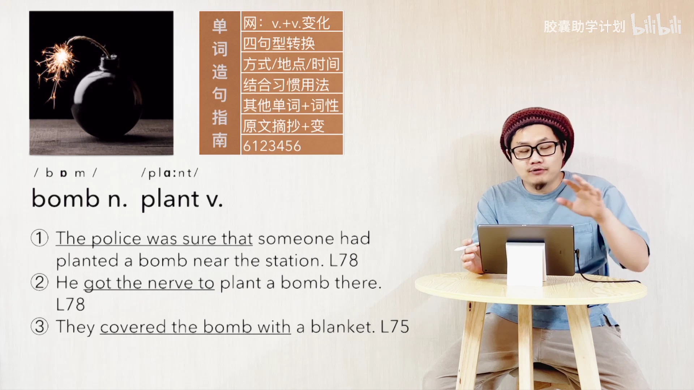

文字识别：单词造句指南 / 网：v.+v.变化 / 胶囊助学计划biliil / 四句型转换 / 方式/地点/时间 / 结合习惯用法 / 其他单词+词性 / 原文摘抄+变 / 6123456 / / bD m / / /plaint/ / bomb n. plant v. / ① The police was sure that someone had / planted a bomb near the station. L78 / He got the nerve to plant a bomb there. / L78 /  They covered the bomb with a blanket. L75

### 画面 00:06:24

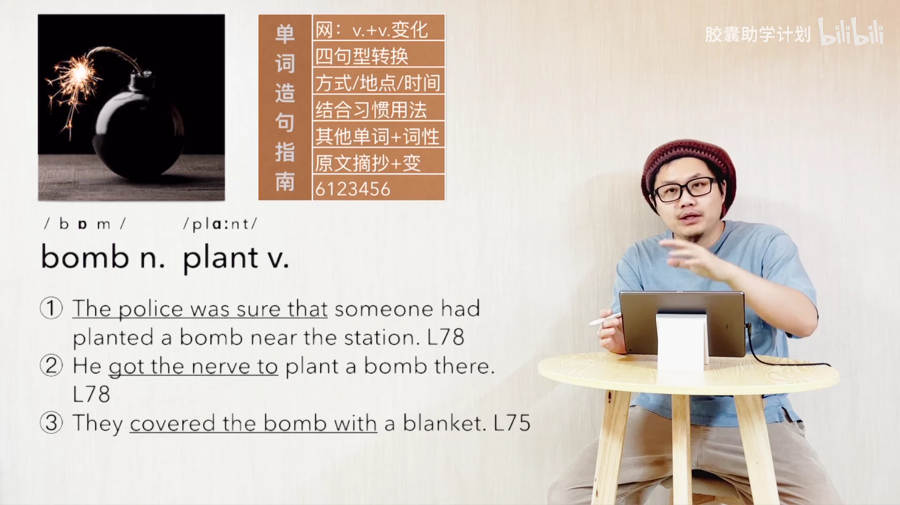

文字识别：单词造句指南 / 网：v.+v.变化 / 胶囊助学计划bilii / 四句型转换 / 方式/地点/时间 / 结合习惯用法 / 其他单词+词性 / 原文摘抄+变 / 6123456 / / bD m / / /plaint/ / bomb n. plant v. / ① The police was sure that someone had / planted a bomb near the station. L78 / He got the nerve to plant a bomb there. / L78 /  They covered the bomb with a blanket. L75

### 画面 00:06:26

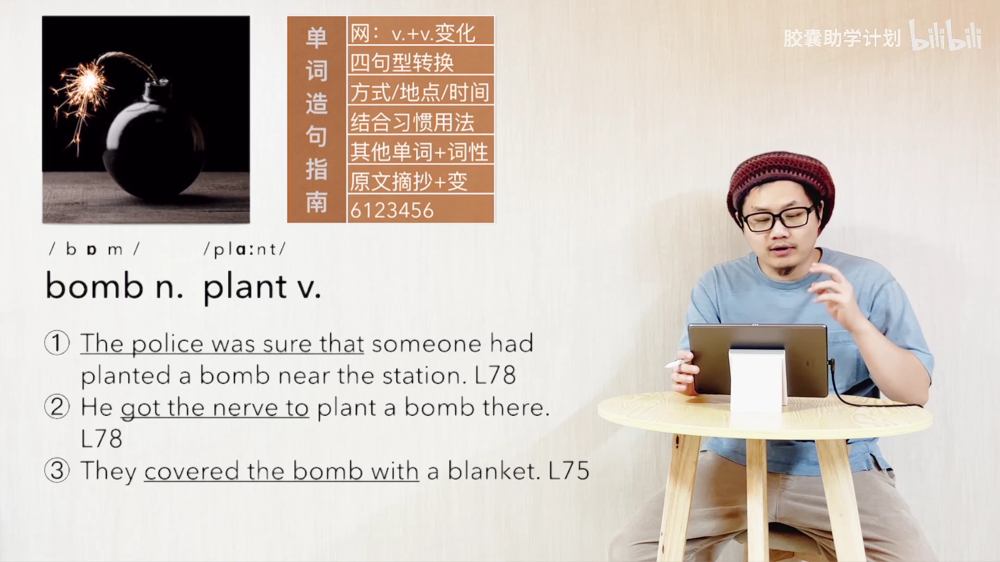

文字识别：单词造句指南 / 网：v.+v.变化 / 胶囊助学计划bli / 四句型转换 / 方式/地点/时间 / 结合习惯用法 / 其他单词+词性 / 原文摘抄+变 / 6123456 / / bp m / / /pla:nt/ / bomb n. plant v. / ① The police was sure that someone had / planted a bomb near the station. L78 / He got the nerve to plant a bomb there. / L78 / They covered the bomb with a blanket. L75

### 画面 00:06:28

文字识别：单词造句指南 / 网：v.+v.变化 / 胶囊助学计划bilii / 四句型转换 / 方式/地点/时间 / 结合习惯用法 / 其他单词+词性 / 原文摘抄+变 / 6123456 / / bp m / / /pla:nt/ / bomb n. plant v. / ① The police was sure that someone had / planted a bomb near the station. L78 / He got the nerve to plant a bomb there. / L78 /  They covered the bomb with a blanket. L75

## 00:06:30–00:07:00

A 上覆盖了 B。 OK，那再读一遍这两个单词 bomb。注意这个 B 是不发音的啊。 OK，然后这个地方下一个单词 plant， plant， very good。那注意力集中吧。我们听一下这电影片段，包括这个电影片段当中其实出现了 somebody is sure that，这是我们刚学过的，对吧？一个习惯用法算是。 OK，那我们注意力集中听一下。 He's sure that someone planted the bomb in the car。 OK，那 recap 本

### 画面 00:06:30

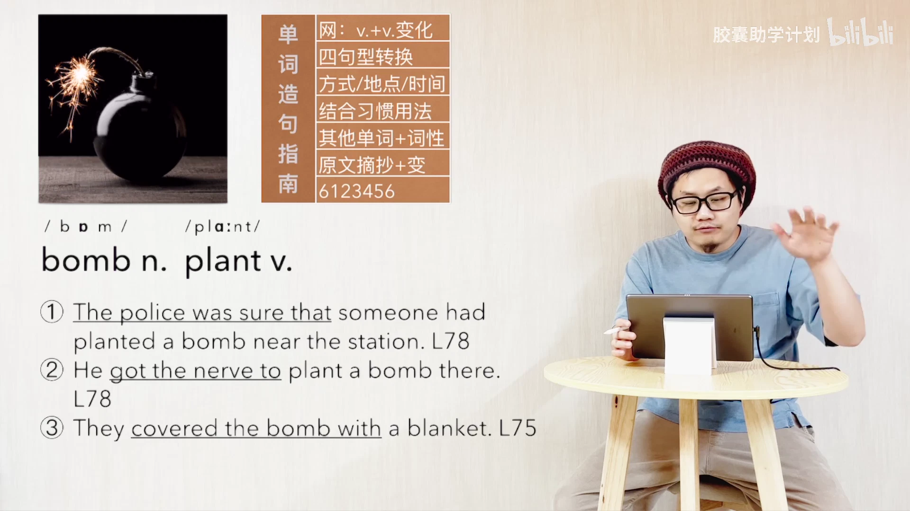

文字识别：单词造句指南 / 网：v.+v.变化 / 胶囊助学计划iibi / 四句型转换 / 方式/地点/时间 / 结合习惯用法 / 其他单词+词性 / 原文摘抄+变 / 6123456 / / b0m / / /pla:nt/ / bomb n. plant v. / ① The police was sure that someone had / planted a bomb near the station. L78 / He got the nerve to plant a bomb there. / L78 /  They covered the bomb with a blanket. L75

### 画面 00:06:33

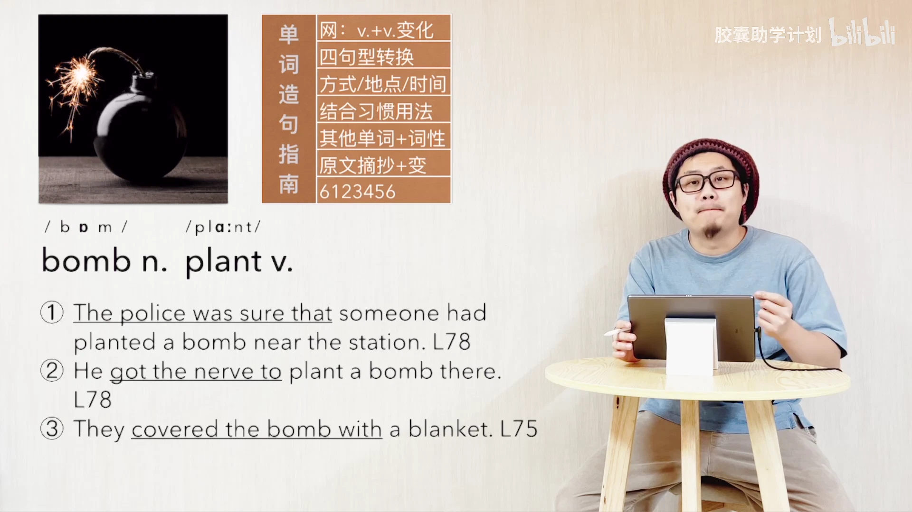

文字识别：单词造句指南 / 网：v.+v.变化 / 胶囊助学计划biib出 / 四句型转换 / 方式/地点/时间 / 结合习惯用法 / 其他单词+词性 / 原文摘抄+变 / 6123456 / / bo m / / /pla:nt/ / bomb n. plant v. / ① The police was sure that someone had / planted a bomb near the station. L78 / He got the nerve to plant a bomb there. / L78 /  They covered the bomb with a blanket. L75

### 画面 00:06:35

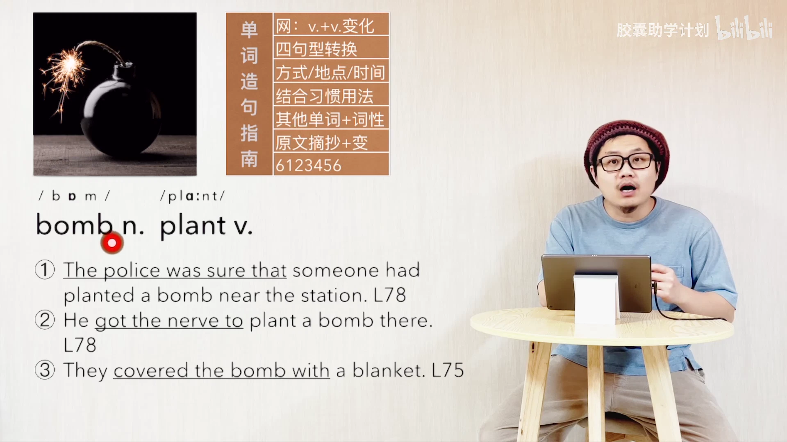

文字识别：胶囊助学计划bilb出 / 单词造句指南 / 网：v.+v.变化 / 四句型转换 / 方式/地点/时间 / 结合习惯用法 / 其他单词+词性 / 原文摘抄+变 / 6123456 / / bom / / /pla:nt/ / bombn. plant v. / ① The police was sure that someone had / planted a bomb near the station. L78 / He got the nerve to plant a bomb there. / L78 /  They covered the bomb with a blanket. L75

### 画面 00:06:37

文字识别：单词造句指南 / 网：v.+v.变化 / 胶囊助学计划bilbil / 四句型转换 / 方式/地点/时间 / 结合习惯用法 / 其他单词+词性 / 原文摘抄+变 / 6123456 / / bp m / / /plaint/ / bomb n. plant v. / ① The police was sure that someone had / planted a bomb near the station. L78 / He got the nerve to plant a bomb there. / L78 /  They covered the bomb with a blanket. L75

### 画面 00:06:39

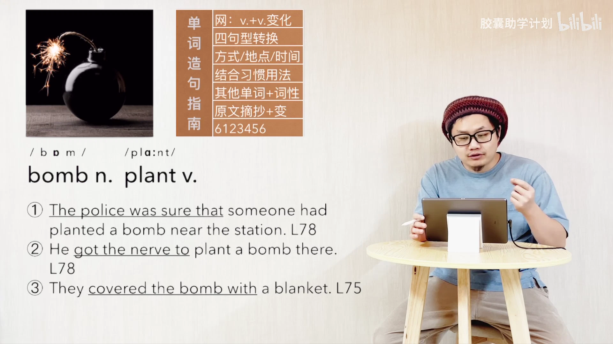

文字识别：单词造句指南 / 网：v.+v.变化 / 胶囊助学计划bil出 / 四句型转换 / 方式/地点/时间 / 结合习惯用法 / 其他单词+词性 / 原文摘抄+变 / 6123456 / / bD m / / /plaint/ / bomb n. plant v. / ① The police was sure that someone had / planted a bomb near the station. L78 / He got the nerve to plant a bomb there. / L78 /  They covered the bomb with a blanket. L75

### 画面 00:06:41

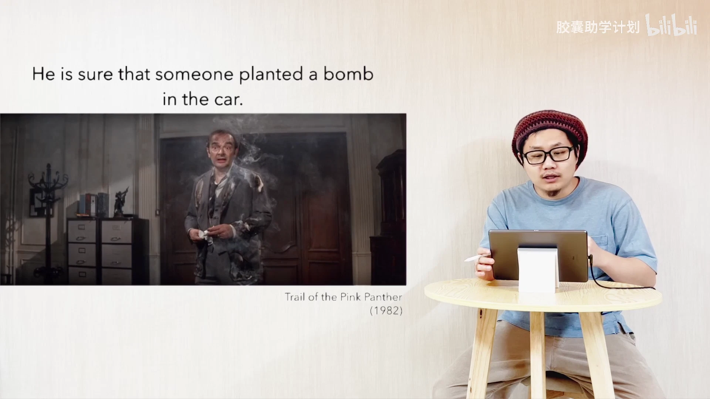

文字识别：biibii / 胶囊助学计划 / He is sure that someone planted a bomb / in the car. / Trail of the Pink Panther / (1982)

### 画面 00:06:44

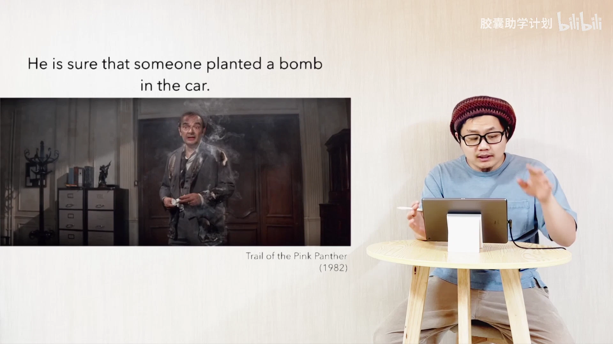

文字识别：biibii / 胶囊助学计划 / He is sure that someone planted a bomb / in the car. / Trail of the Pink Panther / (1982)

### 画面 00:06:46

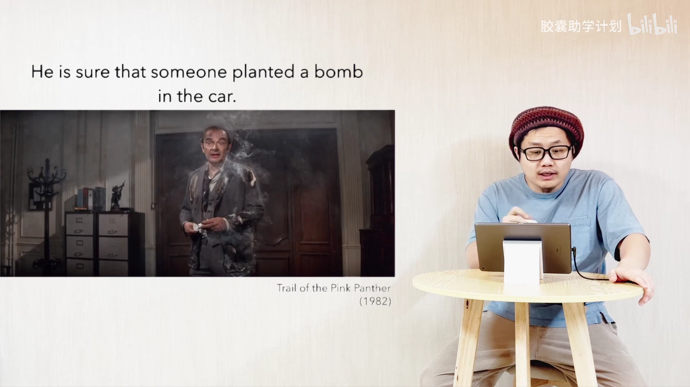

文字识别：胶囊助学计划bii出 / He is sure that someone planted a bomb / in the car. / Trail of the Pink Panther / (1982)

### 画面 00:06:50

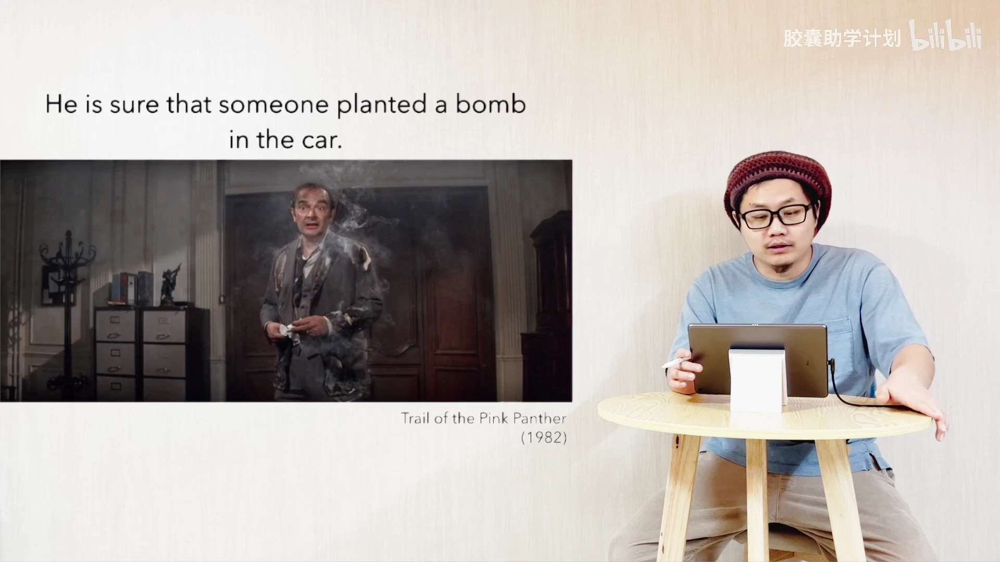

文字识别：胶囊助学计划ib出 / He is sure that someone planted a bomb / in the car. / Trail of the Pink Panther / (1982)

### 画面 00:06:54

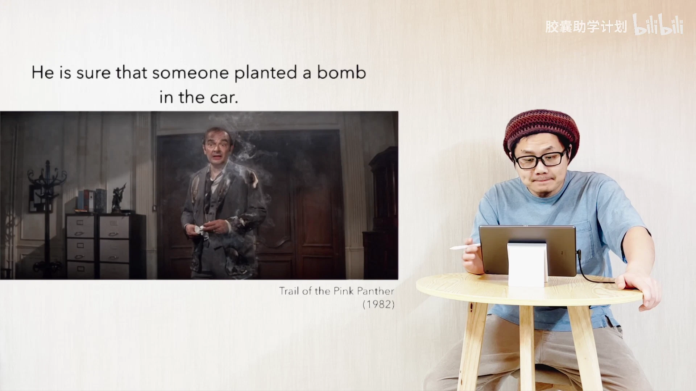

文字识别：胶囊助学计划bil山 / He is sure that someone planted a bomb / in the car. / Trail of the Pink Panther / (1982)

### 画面 00:06:56

文字识别：胶囊助学计划bi出 / He is sure that someone planted a bomb / in the car. / Trail of the Pink Panther / (1982)

### 画面 00:06:58

文字识别：bilbii / 胶囊助学计划 / Recap / Words / feel frightened / Expression / sb. be curious to find out +句子 / plant a bomb

## 00:07:00–00:07:30

lesson has not many words. Habitual usage is not many. Learning it should be relatively easy. Ah, that words should be made sentences. Movie clips should be listened. Repeat listening. Top comment to find repeated intervals of learning materials. That above is the full content of this video. If you like our course, welcome to follow, subscribe, one-click triple, and share with those who need friends to help us grow quickly. See you next time.

### 画面 00:07:00

文字识别：bibii / 胶囊助学计划 / Recap / Words / feel frightened / Expression / sb. be curious to find out +句子 / plant a bomb

### 画面 00:07:02

文字识别：bilbii / 胶囊助学计划 / Recap / Words / feelf / I frightened / Expression / sb. be curious to find out + 句子 / plant a bomb

### 画面 00:07:04

文字识别：bilbili / 胶囊助学计划 / Recap / Words / feel frightened / Expression / sb. be curious to find out +句子 / plant a bomb

### 画面 00:07:06

文字识别：bibli / 胶囊助学计划 / 单词造句/对话 / 【单词造句指南】 / 每个5句

### 画面 00:07:08

文字识别：bibii / 胶囊助学计划 / 单词造句/对话 / 【单词造句指南】 / 每个5句 / 反复听电影片段，直到能 / 听出关键短语/句子 / 3.重复间隔（置顶留言）

### 画面 00:07:10

文字识别：Bilbli / 胶囊助学计划 / 单词造句/对话 / 【单词造句指南】 / 每个5句 / 2.反复听电影片段，直到能 / 听出关键短语/句子 / 3.重复间隔（置顶留言）

### 画面 00:07:12

文字识别：胶囊助学计划bilbi / 不

### 画面 00:07:15

文字识别：胶囊助学计划bib

### 画面 00:07:23

文字识别：胶囊助学计划bil

### 画面 00:07:25

文字识别：CAPSULEACADEMY / 胶囊助学计划 / 小红书 / Lecturo. / OE

### 画面 00:07:27

文字识别：CAPSULEACADEMY / 胶囊助学计划 / 小红书 / 品质 / Photo. / OE

## 00:07:30–00:07:37

### 画面 00:07:30

文字识别：CAPSULEACADEMY / 胶囊助学计划 / 小红书 / Editor / Berlin / OE

### 画面 00:07:33

文字识别：CAPSULEACADEMY / 胶囊助学计划 / 小红书 / Leo & Berlin

### 画面 00:07:35

文字识别：bilbili / 胶囊助学计划

### 画面 00:07:36

文字识别：bilbili / 胶囊助学计划

