# 079 文章

快速机器解析：语音为单模型转写，未进行独立交叉校对或人工复核；画面每秒采样并按变化选帧，短时文字和标记可能遗漏。截图时间约有 1 秒误差。图片有损压缩；遇到疑点请按时间查看 Google Drive 原视频。

## 00:00:00–00:00:30

Hello everyone, welcome to Capsule Academy. This is Leo. Today we're going to learn a new concept in English book two, lesson seventy nine story. Hope you can enjoy.本课的标题叫 By Air, 坐飞机。然后呢，他问的问题是 Why did the plane turn back? 飞机为什么飞回来了？这个只能看文章才知道了，对吧？呃，文章还行，不是很难啊。出现了一个很有用的用法。

### 画面 00:00:00

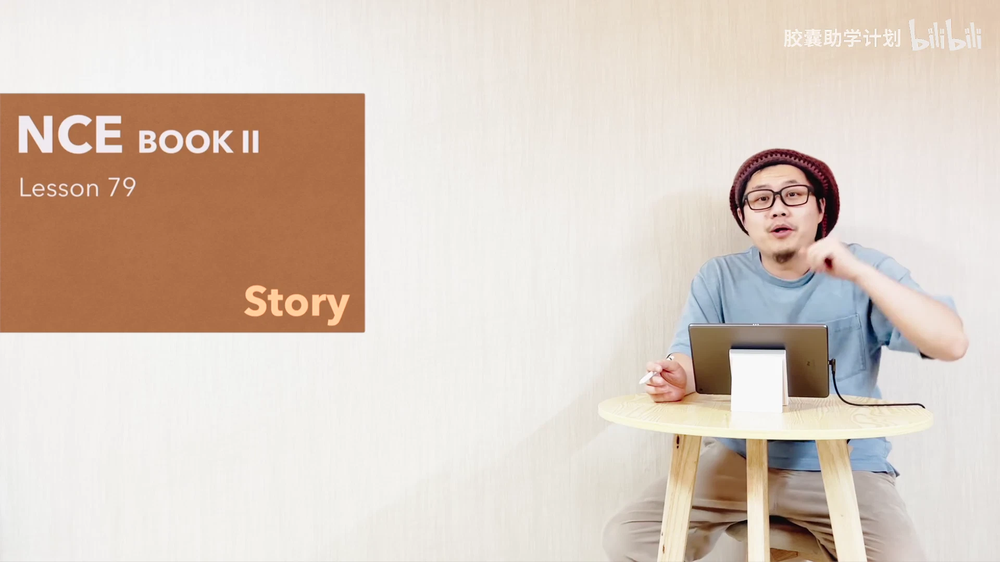

文字识别：blibili / 胶囊助学计划 / NCE / BOOKII / Lesson 79 / Story

### 画面 00:00:02

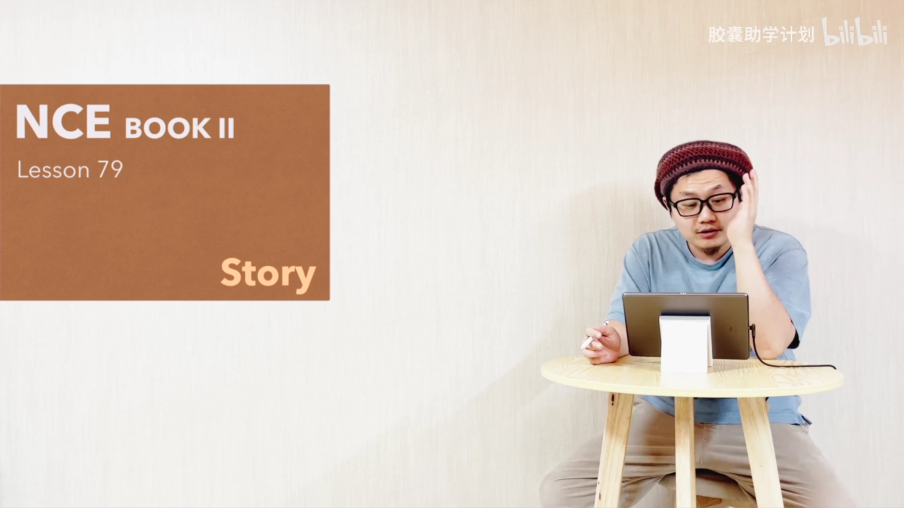

文字识别：blbili / 胶囊助学计划 / NCE / BOOKII / Lesson 79 / Story

### 画面 00:00:04

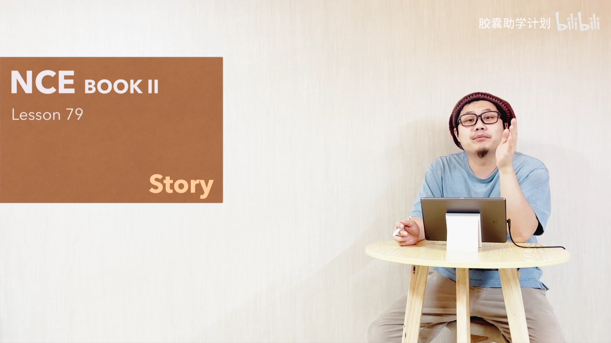

文字识别：blibili / 胶囊助学计划 / NCE / BOOKII / Lesson 79 / Story

### 画面 00:00:06

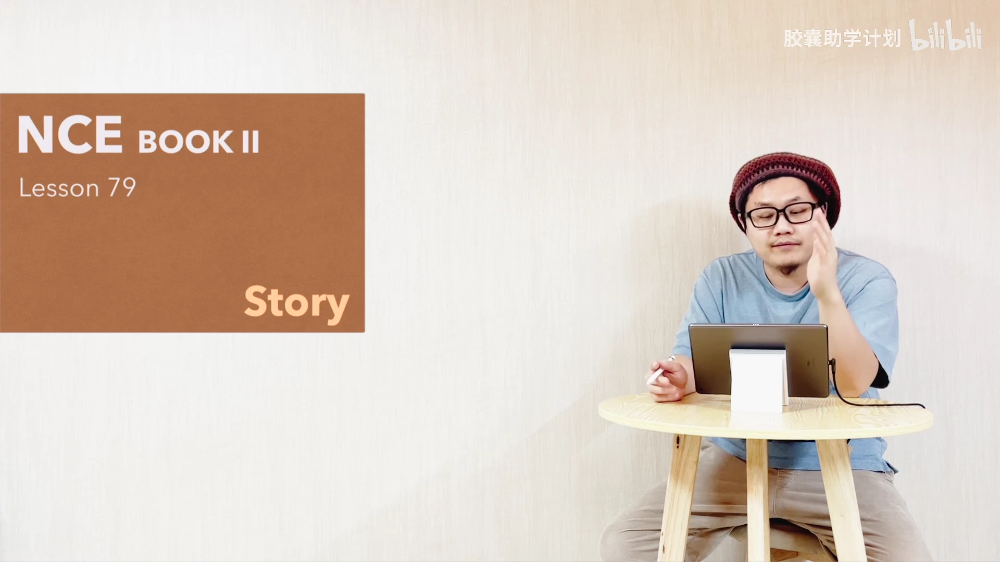

文字识别：blibii / 胶囊助学计划 / NCE / BOOKII / Lesson 79 / Story

### 画面 00:00:08

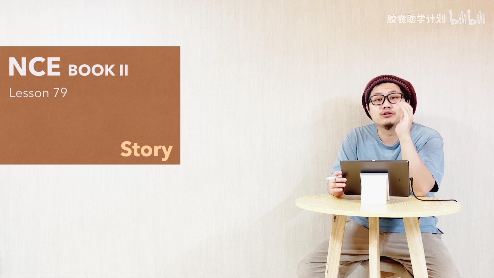

文字识别：bibii / 胶囊助学计划 / NCE / BOOKII / Lesson 79 / Story

### 画面 00:00:10

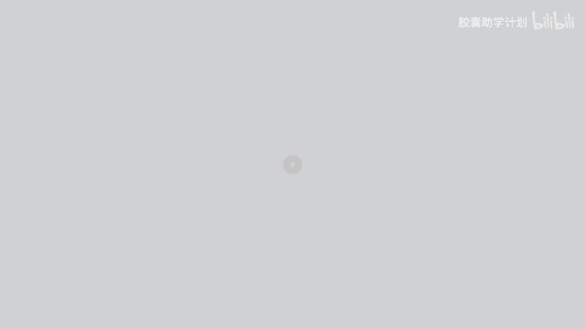

文字识别：胶囊助学计划 bii

### 画面 00:00:13

### 画面 00:00:15

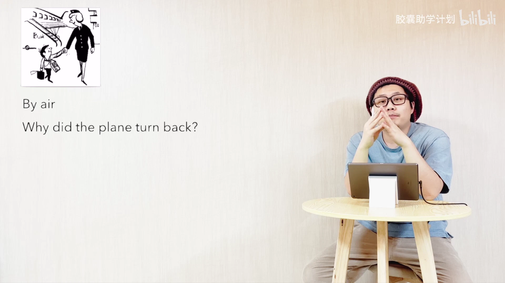

文字识别：biibi / 胶囊助学计划 / By air / Why did the plane turn back?

### 画面 00:00:17

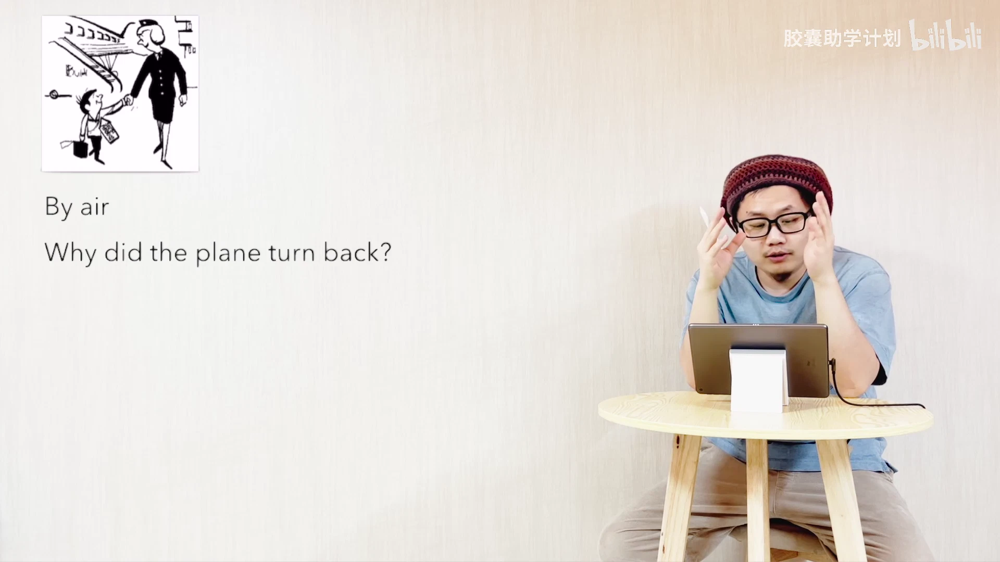

文字识别：biibi / 胶囊助学计划 / By air / Why did the plane turn back?

### 画面 00:00:21

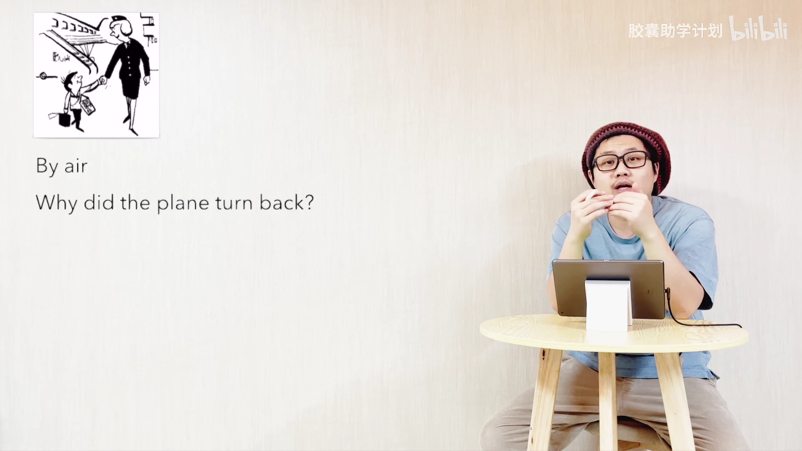

文字识别：胶囊助学计划blb山 / By air / Why did the plane turn back?

### 画面 00:00:23

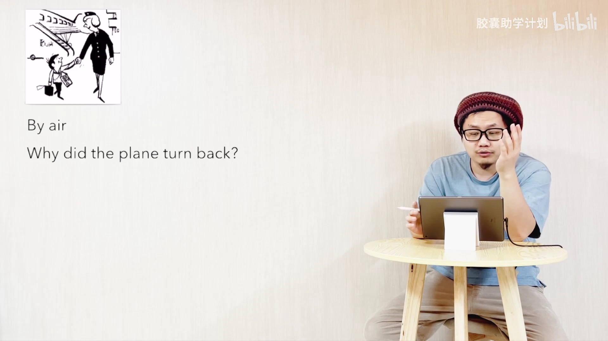

文字识别：胶囊助学计划bib出 / By air / Why did the plane turn back?

### 画面 00:00:25

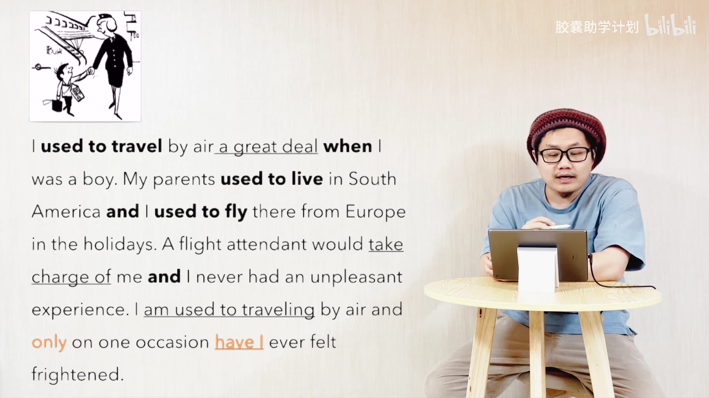

文字识别：胶囊助学计划bi出 / T0o / I used to travel by air a great deal when I / Was a boy. My parents used to live in South / America and I used to fly there from Europe / in the holidays. A flight attendant would take / charge of me and I never had an unpleasant / experience.I am used to traveling by air and / only on one occasion havel ever felt / frightened.

## 00:00:30–00:01:00

I used to travel by air a great deal when I was a boy. 好，首先这句话当中，when非常重要的一个单词，提醒你前后要断句啊。前半句说我原来常常坐飞机旅行。这里的a great deal和我们练习当中的a lot几乎是同义词，就是表示次数很多的意思。就常常坐飞机，所以这句话你就翻译成我过去常常坐飞机就可以了啊。When当I was a boy，

### 画面 00:00:47

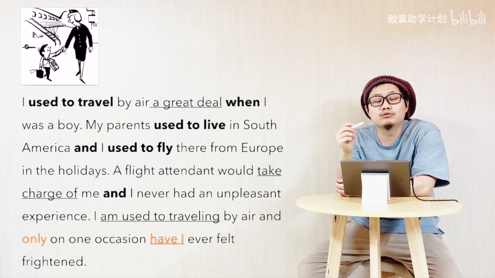

文字识别：胶囊助学计划bl出 / I used to travel by air a great deal when I / Was a boy. My parents used to live in South / America and I used to fly there from Europe / in the holidays. A flight attendant would take / charge of me and I never had an unpleasant / experience.I am used to traveling by air and / only on one occasion havelever felt / frightened.

## 00:01:00–00:01:30

当我还是个小男孩儿的时候，my parents used to live in South America, and I used to fly there from Europe in the holidays.好，这里其实还是那句话啊，我们先把句子给拆开，拆一旦拆开了之后，哎，就是任务一下就变得简单了，就是逐个击破。我父母原来住在 South Africa 啊，南美。那这个地方要提一句话啊，这个 used

### 画面 00:01:17

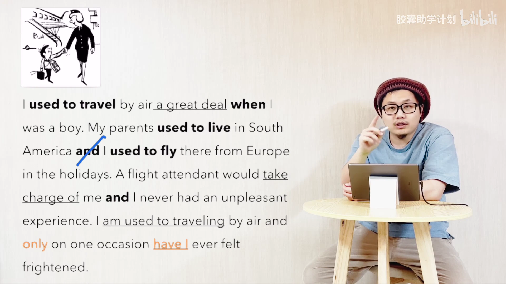

文字识别：胶囊助学计划bilb出 / T0o / I used to travel by air a great deal when I / Was a boy. My parents used to live in South / America ard I used to fly there from Europe / in the holidays. A flight attendant would take / charge of me and I never had an unpleasant / experience.I am used to traveling by air and / only on one occasion havelever felt / frightened.

## 00:01:30–00:02:00

to live 的意思是现在还住不住？你要自己去想一下，对吧？哎，刚才我已经说了很多回了。那在这里公布一下答案，叫 I used to fly there from Europe in the holidays. 我小孩儿的时候，就我父母住在 South South Africa America 的时候啊，不是 Africa，是 America 的时候啊。呃，这个美洲的时候呢，我常常飞去那里，从欧洲飞过去，在这个假期的时候。所以他父母现在其实也不住

### 画面 00:01:47

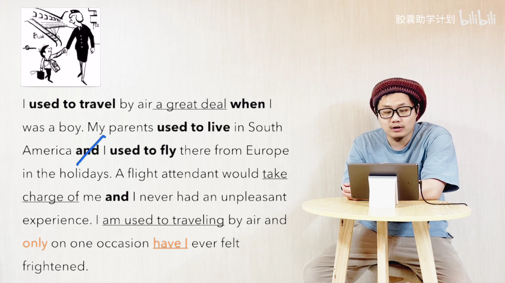

文字识别：胶囊助学计划bilb山 / I used to travel by air a great deal when | / was a boy. My parents used to live in South / America ard I used to fly there from Europe / in the holidays. A flight attendant would take / charge of me and I never had an unpleasant / experience. I am used to traveling by air and / only on one occasion havel ever felt / frightened.

## 00:02:00–00:02:30

在那边了。他现在也不用说从欧洲飞过去才能看见他父母了。在这个假期的时候，对吧？A flight attendant would take charge of me, and I never had an unpleasant experience.还是and嘛，呃，一下就被拆成了前后两句话。而一个空姐会take charge of me啊，这是个take charge of，还是文章当中懂就行了。习这个习惯用法，我们在讲完

### 画面 00:02:17

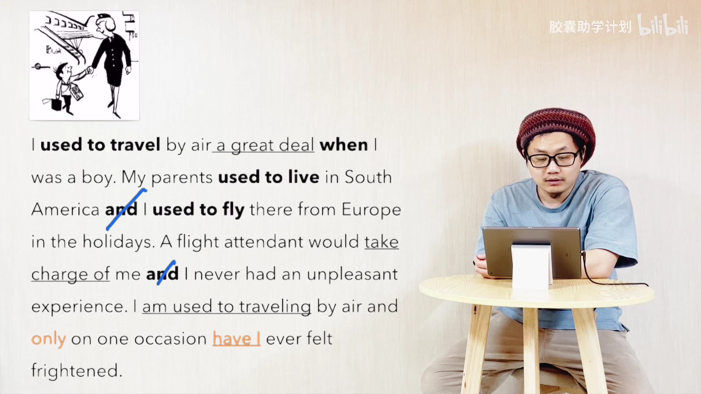

文字识别：胶囊助学计划bib出 / 工 / 700 / I used to travel by air a great deal when I / Was a boy. My parents used to live in South / America ard I used to fly there from Europe / in the holidays. A flight attendant would take / charge of me ard I never had an unpleasant / experience.I am used to traveling by air and / only on one occasion have| ever felt / frightened.

### 画面 00:02:27

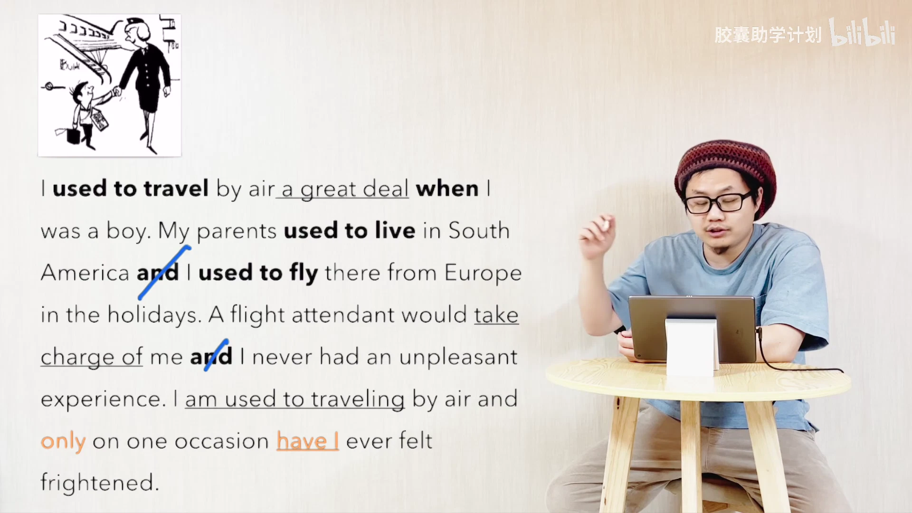

文字识别：胶囊助学计划bl出 / I used to travel by air a great deal when I / was a boy. My parents used to live in South / America ard I used to fly there from Europe / in the holidays. A flight attendant would take / charge of me ayd I never had an unpleasant / experience.I am used to traveling by air and / only on one occasion have| ever felt / frightened.

## 00:02:30–00:03:00

文章之后会统一去造句啊。那这里的 take charge of 的意思就是负责照顾照料啊，类似于 take care of 啊。他会管理好我啊，他会管着我，负责我的这个呃，比如说负责给我接上机，负责给我接下机，负责帮我拿行李，对吧？Take charge of me，哎，会管理我，会负对我负责。然后呢，我从来也没有过一个让人很不愉快的经历，从来没有过。

### 画面 00:02:31

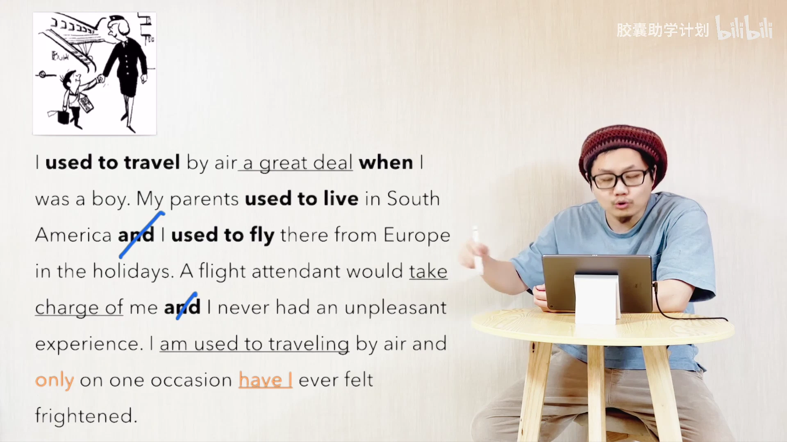

文字识别：胶囊助学计划bi出 / T / T0o / I used to travel by air a great deal when I / Was a boy. My parents used to live in South / America ard I used to fly there from Europe / in the holidays. A flight attendant would take / charge of me ard I never had an unpleasant / experience.I am used to traveling by air and / only on one occasion havel ever felt / frightened.

### 画面 00:02:43

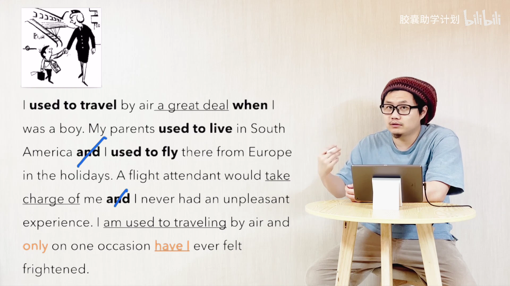

文字识别：胶囊助学计划bilb出 / I used to travel by air a great deal when I / Was a boy. My parents used to live in South / America ard I used to fly there from Europe / in the holidays. A flight attendant would take / charge of me ard I never had an unpleasant / experience.I am used to traveling by air and / only on one occasion havel ever felt / frightened.

### 画面 00:02:48

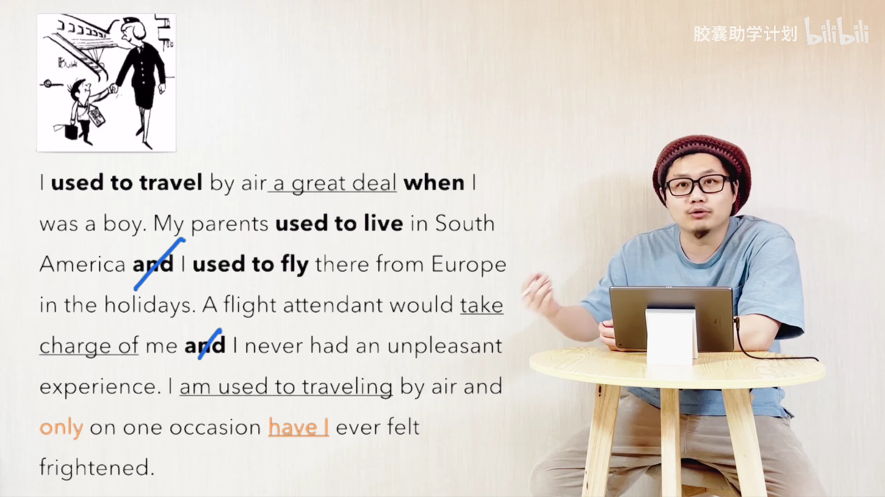

文字识别：胶囊助学计划bib出 / T0o / I used to travel by air a great deal when I / Was a boy. My parents used to live in South / America ard I used to fly there from Europe / in the holidays. A flight attendant would take / charge of me ard I never had an unpleasant / experience.I am used to traveling by air and / only on one occasion havel ever felt / frightened.

## 00:03:00–00:03:30

接下来出现了非常重要的一句话，这句话当中有一个关键语法和一个关键习惯用法。I am used to traveling by air. And先给它标着。Only on one occasion have I ever felt frightened.后半句话首先我们已经讲过了，只有在一个场合之下我感受到有点害怕。然后这个have I为什么给它不而不是I have ever felt？你怎么变成一般疑问句了？Only提前了。

### 画面 00:03:05

文字识别：胶囊助学计划bii出 / I used to travel by air a great deal when I / Was a boy. My parents used to live in South / America ard I used to fly there from Europe / in the holidays. A flight attendant would take / charge of me ard I never had an unpleasant / experience.I am used to traveling by air and / only on one occasion have| ever felt / frightened.

### 画面 00:03:16

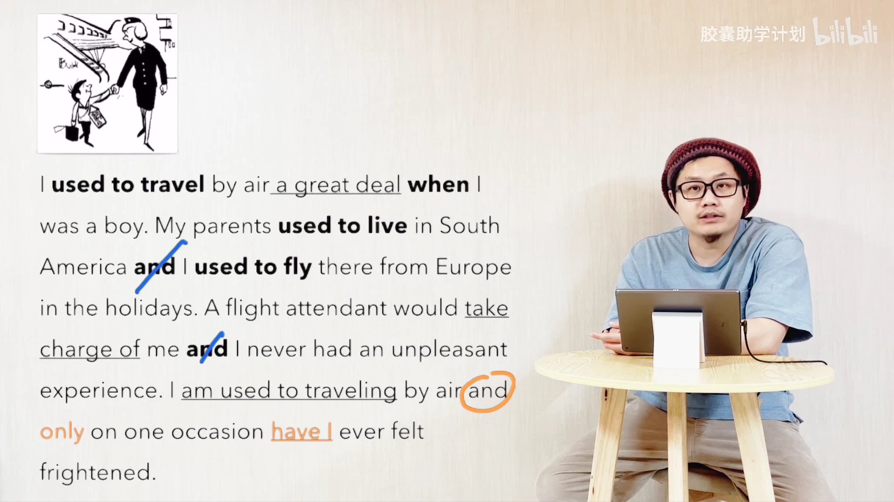

文字识别：胶囊助学计划bilii / T / I used to travel by air a great deal when I / Was a boy. My parents used to live in South / America ard I used to fly there from Europe / in the holidays. A flight attendant would take / charge of me ard I never had an unpleasant / experience. I am used to traveling by airand / only on one occasion havel ever felt / frightened.

## 00:03:30–00:04:00

我们在语法部分刚刚学过，对吧？好，这是一个非常重要的语法。呃，然后这个习惯用法是什么？叫 I am used to traveling by air。好了，be used to 这还是 doing？哎呀，我蒙圈了。我们原来首先学的 used to do 是没有这个 be 的，然后后边也叫 do，后边也不是 doing。我虽然还学过一个，但是你可能现在印象不深了啊。但我们学过啊，等我讲习惯用法的时候一说，你肯定能想起来。五十五课学的叫 be used

### 画面 00:03:46

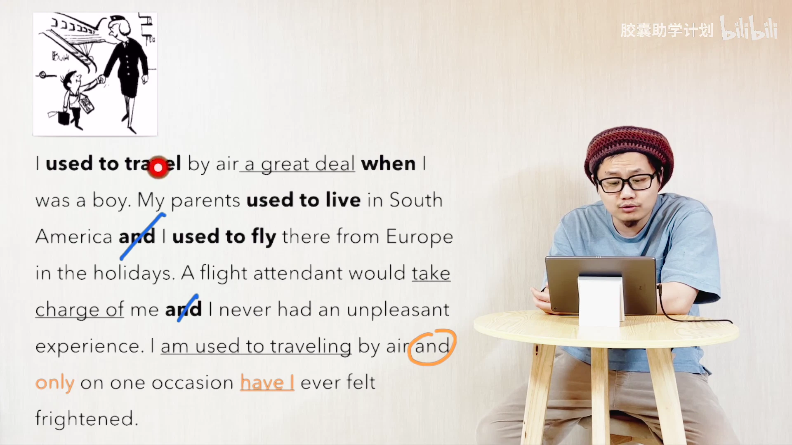

文字识别：胶囊助学计划bibi / I used to traoel by air a great deal when I / Was a boy. My parents used to live in South / America ard I used to fly there from Europe / in the holidays. A flight attendant would take / charge of me ard I never had an unpleasant / experience.I am used to traveling by air and / only on one occasion havel ever felt / frightened.

## 00:04:00–00:04:30

to do something。去海边山洞里挖海盗留下来的金矿，那帮人对吧？那一刻说那个五呃新发明的那个机器 be used to detect gold。那个叫做 be used to do something。那个翻译出来的叫做被用于去做某件事儿，这都不符合。这是一个新的结构，长得非常像，叫 be used to doing something，叫做习惯语。啊，我举

### 画面 00:04:01

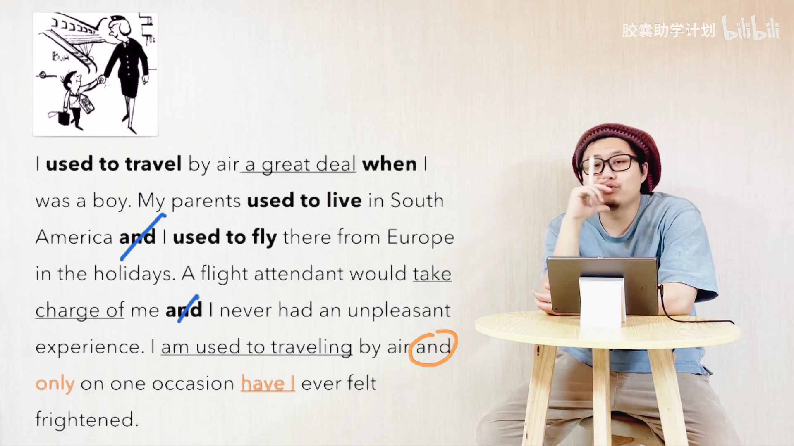

文字识别：胶囊助学计划bib出 / T0o / I used to travel by air a great deal when I / Was a boy. My parents used to live in South / America ard I used to fly there from Europe / in the holidays. A flight attendant would take / charge of me ard I never had an unpleasant / experience. I am used to traveling by airand / only on one occasion have| ever felt / frightened.

### 画面 00:04:16

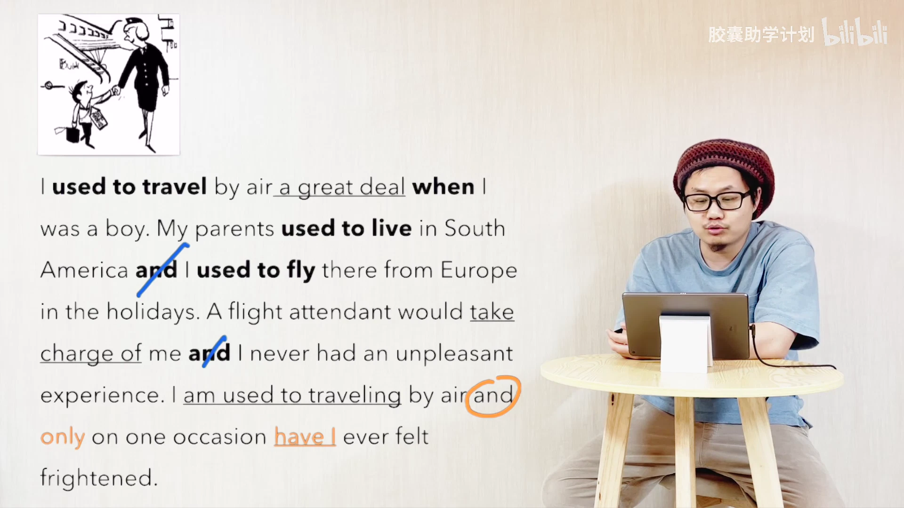

文字识别：胶囊助学计划biii出 / I used to travel by air a great deal when I / was a boy. My parents used to live in South / America ard I used to fly there from Europe / in the holidays. A flight attendant would take / charge of me ard I never had an unpleasant / experience. I am used to traveling by airand / only on one occasion havel ever felt / frightened.

## 00:04:30–00:05:00

个例子，比如说 I'm used to traveling by air，就我习惯于坐飞机。哎，我很习惯了坐飞机。那比如说我习惯于早起，怎么说？很简单，I am used to getting up early in the morning。听明白了吧？Be used to doing something。哎，现在还是那句话，文章当中能懂就行了啊，就先这么扎一记啊，文章能顺起来就可以了。因为一会儿咱们还习惯用法造句呢，到那个时候咱们会变得更熟。

### 画面 00:04:35

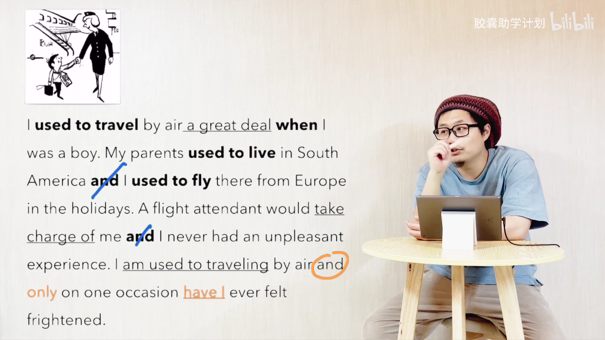

文字识别：胶囊助学计划bilb山 / I used to travel by air a great deal when I / Was a boy. My parents used to live in South / America ard I used to fly there from Europe / in the holidays. A flight attendant would take / charge of me ard I never had an unpleasant / experience. I am used to traveling by airand / only on one occasion have| ever felt / frightened.

### 画面 00:04:39

文字识别：胶囊助学计划biii / I used to travel by air a great deal when I / Was a boy. My parents used to live in South / America ard I used to fly there from Europe / in the holidays. A flight attendant would take / charge of me ard I never had an unpleasant / am used to traveling by air and / experience / only on one occasion havel ever felt / frightened.

### 画面 00:04:52

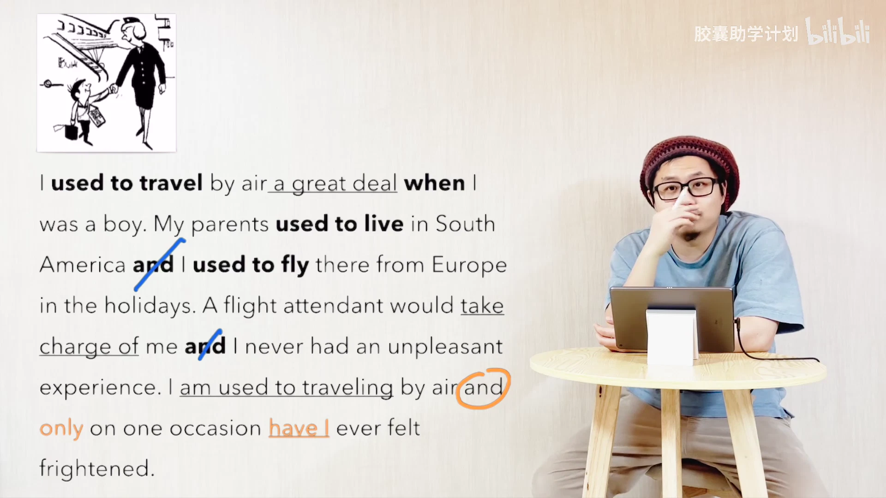

文字识别：胶囊助学计划bilb山 / I used to travel by air a great deal when I / was a boy. My parents used to live in South / America ard I used to fly there from Europe / in the holidays. A flight attendant would take / charge of me ard I never had an unpleasant / experience. I am used to traveling by air and / only on one occasion havel ever felt / frightened.

### 画面 00:04:54

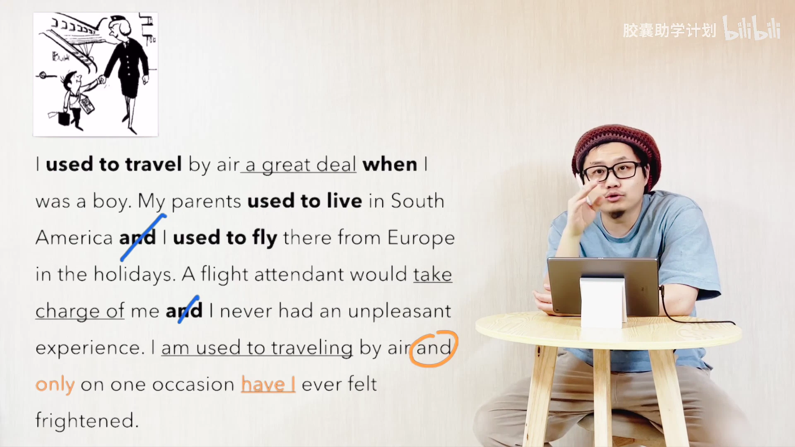

文字识别：胶囊助学计划bilb山 / T0o / I used to travel by air a great deal when I / Was a boy. My parents used to live in South / America ard I used to fly there from Europe / in the holidays. A flight attendant would take / charge of me ard I never had an unpleasant / experience.I am used to traveling by airand / only on one occasion havel ever felt / frightened.

### 画面 00:04:56

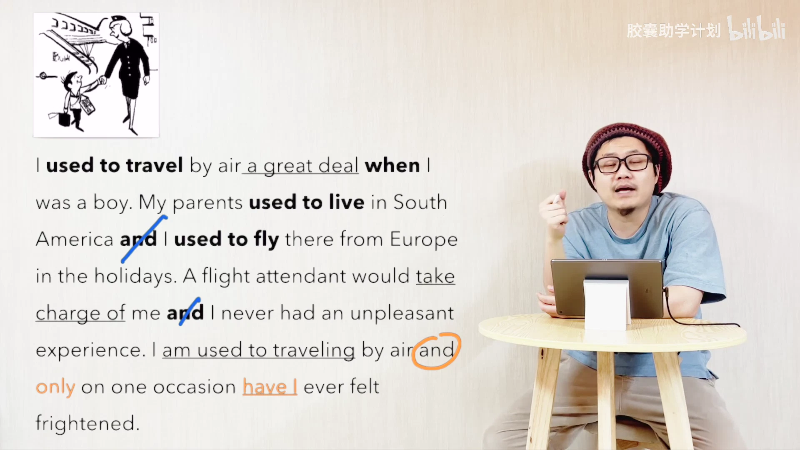

文字识别：胶囊助学计划bilb山 / I used to travel by air a great deal when I / was a boy. My parents used to live in South / America ard I used to fly there from Europe / in the holidays. A flight attendant would take / charge of me ard I never had an unpleasant / experience.I am used to traveling by air and / only on one occasion havel ever felt / frightened.

### 画面 00:04:58

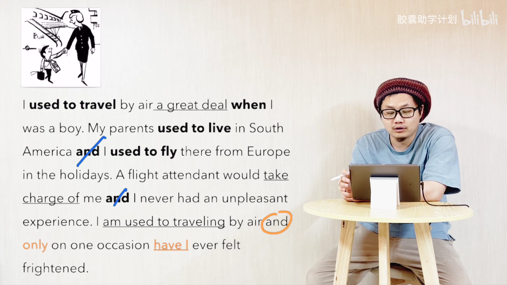

文字识别：胶囊助学计划bilb山 / I used to travel by air a great deal when I / Was a boy. My parents used to live in South / America ard I used to fly there from Europe / in the holidays. A flight attendant would take / charge of me ard I never had an unpleasant / experience. I am used to traveling by airand / only on one occasion have| ever felt / frightened.

## 00:05:00–00:05:30

先往下走，下面这句话又很长，注意力集中。After taking off, we were flying low over the city and slowly gaining height. When the plane suddenly turned around and flew back to the airport，这句话乍一看又要去分，分的方式有哪些？各种连词，各种逗号，你都要去用上。比如说像and呀，像when呢，像and呀，对吧？那我们就给它拆成

### 画面 00:05:00

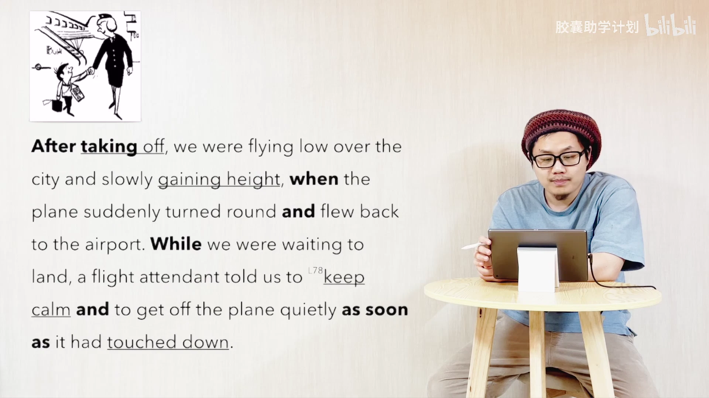

文字识别：胶囊助学计划bibl / T0o / After taking off, we were flying low over the / city and slowly gaining height, when the / plane suddenly turned round and flew back / to the airport. while we were waiting to / o178keep / land, a flight attendant told us to / calm and to get off the plane quietly as soon / as it had touched down.

### 画面 00:05:02

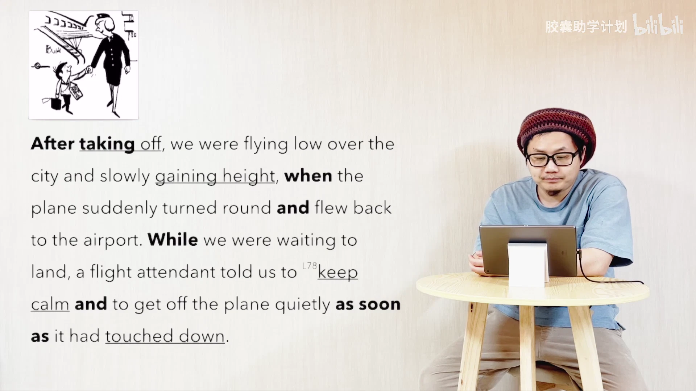

文字识别：胶囊助学计划bl出 / T0o / After taking off, we were flying low over the / city and slowly gaining height, when the / plane suddenly turned round and flew back / to the airport. while we were waiting to / o17keep / land, a flight attendant told us to / calm and to get off the plane quietly as soon / as it had touched down.

### 画面 00:05:20

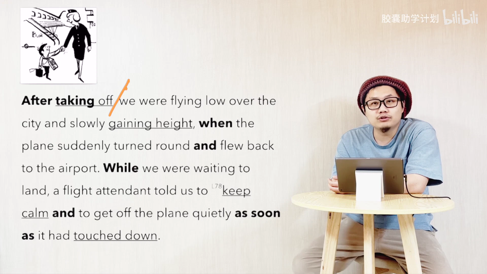

文字识别：胶囊助学计划bibl / After taking off we were flying low over the / city and slowly gaining height, when the / plane suddenly turned round and flew back / to the airport. while we were waiting to / 178keep / land, a flight attendant told us to / calm and to get off the plane quietly as soon / as it had touched down.

### 画面 00:05:22

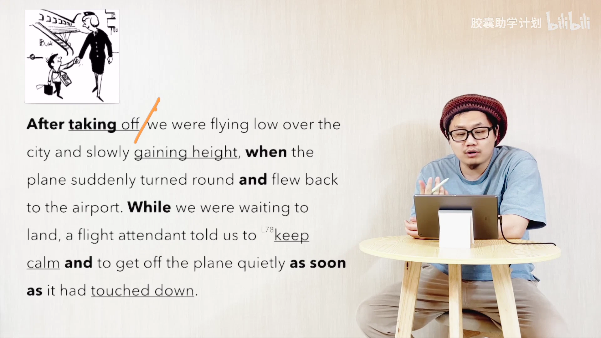

文字识别：胶囊助学计划bib出 / T0o / After taking off we were flying low over the / city and slowly gaining height, when the / plane suddenly turned round and flew back / to the airport. while we were waiting to / 178keep / land, a flight attendant told us to / calm and to get off the plane quietly as soon / as it had touched down.

### 画面 00:05:25

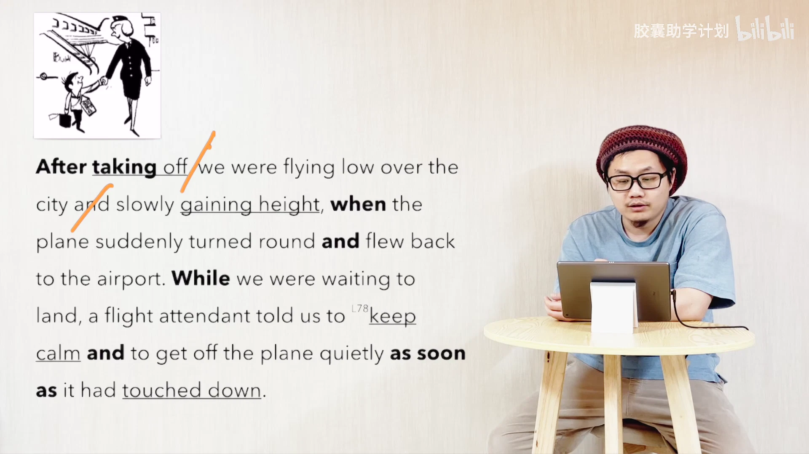

文字识别：胶囊助学计划blbi / T0o / After taking off we were flying low over the / city ard slowly gaining height, when the / plane suddenly turned round and flew back / to the airport. while we were waiting to / 178keep / land, a flight attendant told us to / calm and to get off the plane quietly as soon / as it had touched down.

### 画面 00:05:28

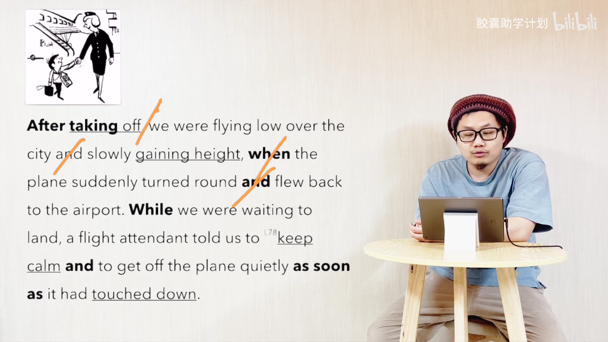

文字识别：胶囊助学计划bii / T0o / After taking off we were flying low over the / city ard slowly gaining height, when the / plane suddenly turned round ayld flew back / to the airport. while we were waiting to / 178keep / land, a flight attendant told us to / calm and to get off the plane quietly as soon / as it had touched down.

## 00:05:30–00:06:00

了几句话。第一句话叫 after taking off， take off 是呃很，我们很以前也学过，就飞机起飞叫 take off，对吧？那脱衣服也可以叫 take off，啊， take off 有好多意思啊。说在这个起飞之后啊，我们起飞之后啊，飞机起飞之后，然后呢，第二是第一句话，第二句话叫 we were flying low over the city，说我们啊，就是正在飞，然后飞得很低，正在飞得很低 over the city，在城市上

### 画面 00:05:31

文字识别：胶囊助学计划bi出 / T / After taking off we were fl ying low over the / city ard slowly gaining height, when the / plane suddenly turned round ayld flew back / to the airport. while we were waiting to / 178keep / land, a flight attendant told us to / calm and to get off the plane quietly as soon / as it had touched down.

### 画面 00:05:36

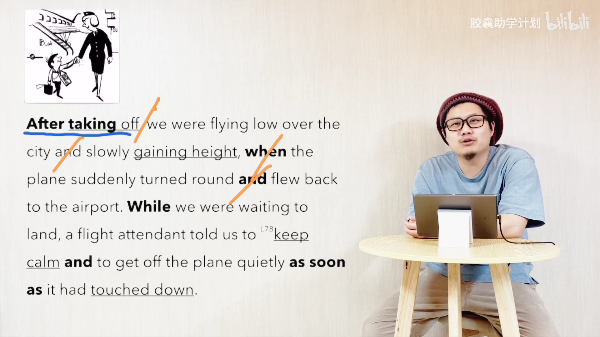

文字识别：胶囊助学计划blb山 / T0o / After taking off we were flying low over the / city ard slowly gaining height, when the / plane suddenly turned round ay ld flew back / to the airport. while we were waiting to / 178keep / land, a flight attendant told us to / calm and to get off the plane quietly as soon / as it had touched down.

### 画面 00:05:40

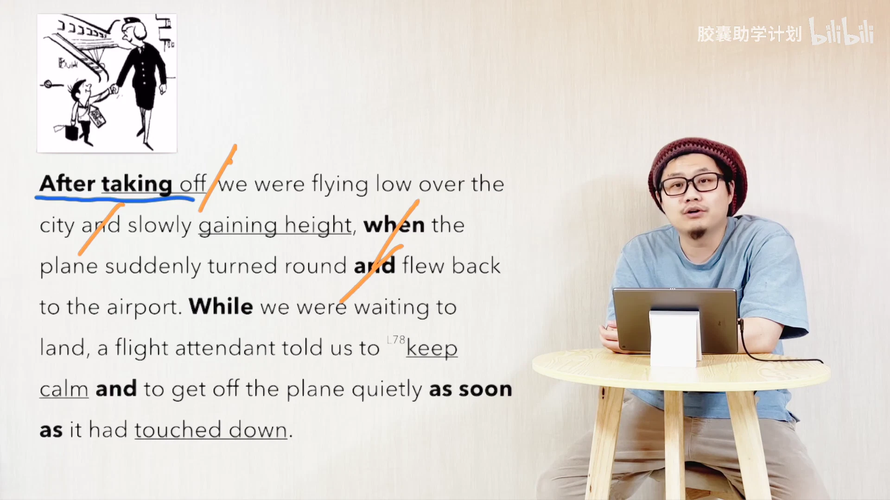

文字识别：胶囊助学计划b出 / After taking off we were flying low over the / city ard slowly gaining height, when the / plane suddenly turned round ay ld flew back / to the airport. while we were waiting to / 17keep / land, a flight attendant told us to / calm and to get off the plane quietly as soon / as it had touched down.

### 画面 00:05:44

文字识别：胶囊助学计划bib山 / T0o / After taking off we were flying low over the / city ard slowly gaining height, when the / plane suddenly turned round ayld flew back / to the airport. while we were waiting to / o178keep / land, a flight attendant told us to / calm and to get off the plane quietly as soon / as ithad touched down.

### 画面 00:05:50

文字识别：胶囊助学计划bii出 / T0o / After taking off we were fl ying low over the / city ard slowly gaining height, when the / plane suddenly turned round ayld flew back / to the airport. While we were waiting to / 17keep / Iland, a flight attendant told us to / calm and to get off the plane quietly as soon / as it had touched down.

### 画面 00:05:52

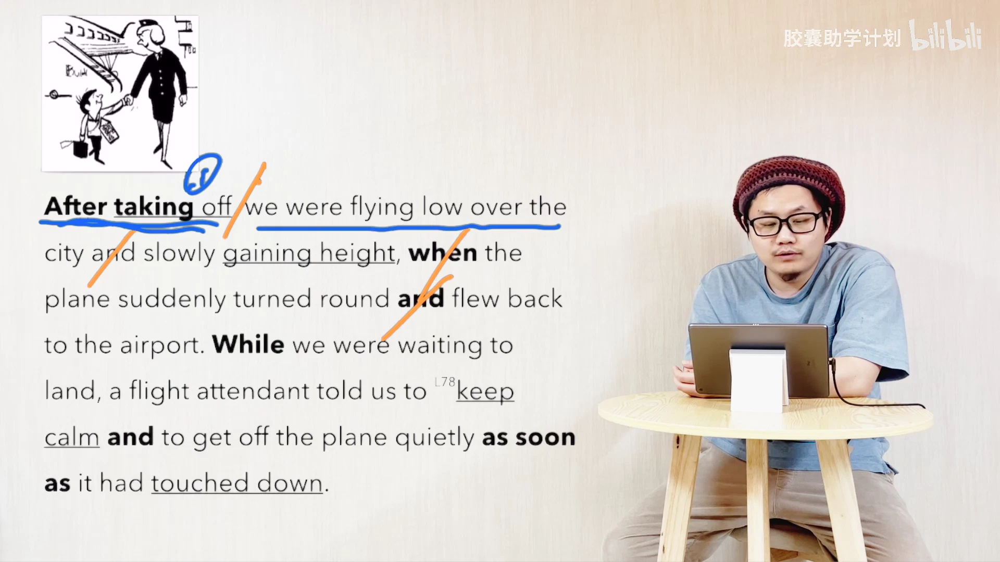

文字识别：胶囊助学计划bilb出 / T0o / After taking off we were flying low over the / city ard slowly gaining height, when the / plane suddenly turned round ay ld flew back / to the airport. while we were waiting to / 17keep / land, a flight attendant told us to / calm and to get off the plane quietly as soon / as it had touched down.

### 画面 00:05:54

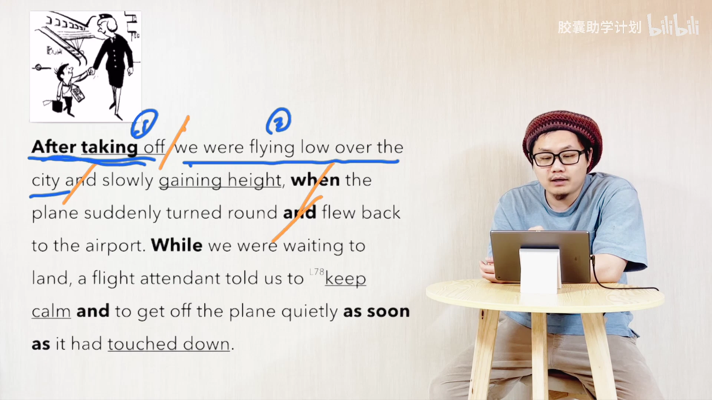

文字识别：胶囊助学计划bi出 / T0o / After taking off we were flying low over the / city ard slowly gaining height, when the / plane suddenly turned round ay ld flew back / to the airport. while we were waiting to / 178keep / Iand, a flight attendant told us to / calm and to get off the plane quietly as soon / as it had touched down.

### 画面 00:05:59

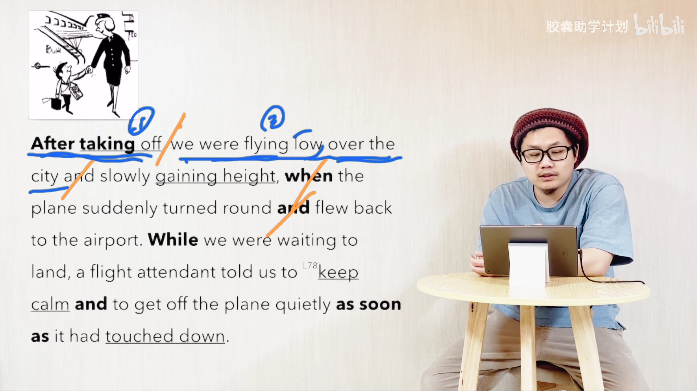

文字识别：bibi / 胶囊助学计划 / Tao / ② / After taking off we were flying Tow over the / city ard slowly gaining height, when the / plane suddenly turned round ayld flew back / to the airport. While we were waiting to / 178keep / land, a flight attendant told us to / calm and to get off the plane quietly as soon / as it had touched down.

## 00:06:00–00:06:30

方。那你刚起飞，飞的可不低嘛？哎，然后第三句话, and slowly gaining high, 然后正在逐渐的 gaining high, 啊 gaining, 这个就字面意思，我觉得基本你懂了，你就明白什么意思了。 Gain叫获得，high叫高度，那 gaining high叫逐渐的获得高度，攀升高度，逐渐的这个飞机往上高度往上去飞，对吧？逐渐的攀升。当当什么时候呢？当

### 画面 00:06:04

文字识别：Biltbii / 胶囊助学计划 / T0o / ② / After taking off we were flying Tow over the / city ard slowly gaining height, when the / plane suddenly turned round ayld flew back / to the airport. While we were waiting to / 178keep / land, a flight attendant told us to / calm and to get off the plane quietly as soon / as it had touched down.

### 画面 00:06:07

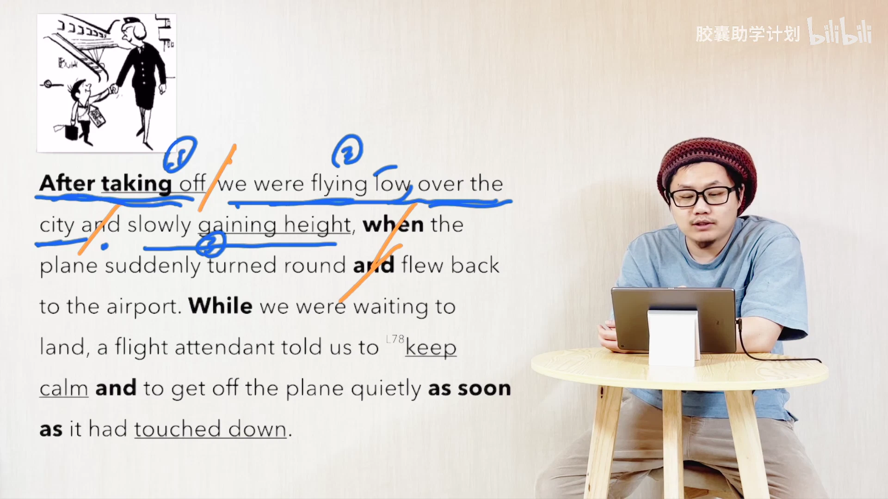

文字识别：bibii / 胶囊助学计划 / T0o / After taking off we were fl ying Tow over the / city ard slowly gaining height, when the / plane suddenly turned round ay ld flew back / to the airport. While we were waiting to / 178keep / land, a flight attendant told us to / calm and to get off the plane quietly as soon / as it had touched down.

### 画面 00:06:11

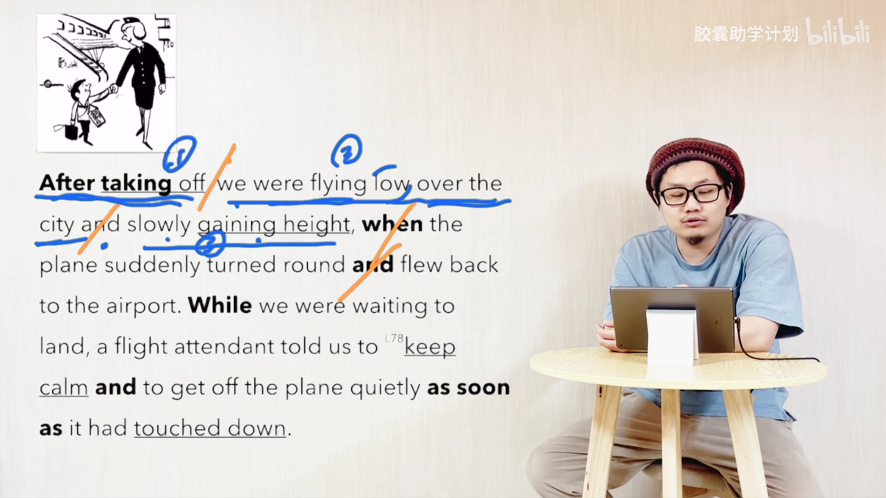

文字识别：bibili / 胶囊助学计划 / T0o / After taking off we were flying Tow over the / city ard slowly gaining height, when the / plane suddenly turned round ay ld flew back / to the airport. While we were waiting to / 178keep / land, a flight attendant told us to / calm and to get off the plane quietly as soon / as it had touched down.

### 画面 00:06:13

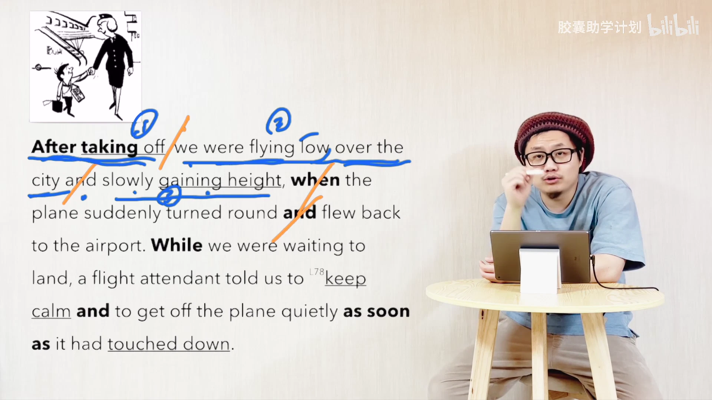

文字识别：bibii / 胶囊助学计划 / Tao / After taking off we were flying Tow over the / city ard slowly gaining height, when the / plane suddenly turned round ay ld flew back / to the airport. While we were waiting to / 178keep / land, a flight attendant told us to / calm and to get off the plane quietly as soon / as it had touched down.

### 画面 00:06:23

文字识别：biibii / 胶囊助学计划 / T0o / After taking off we were fl ying Tow over the / city ard slowly gaining height, when the / plane suddenly turned round ay ld flew back / to the airport. While we were waiting to / 178keep / land, a flight attendant told us to / calm and to get off the plane quietly as soon / as it had touched down.

### 画面 00:06:25

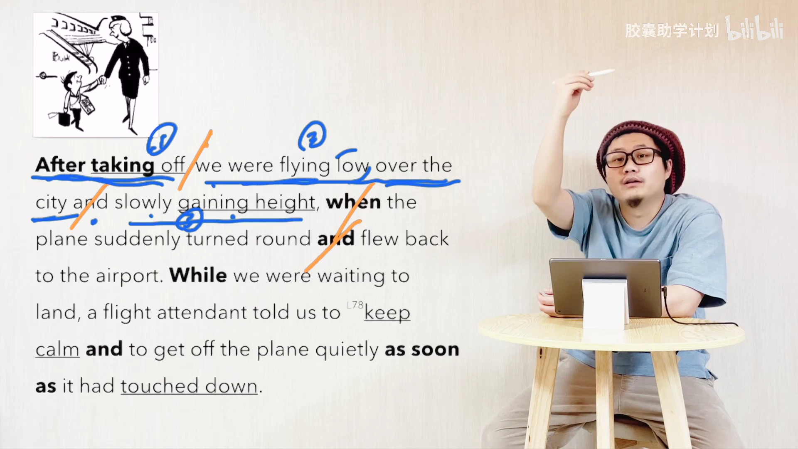

文字识别：bilbl / 胶囊助学计划 / After taking off we were flying Tow over the / city ard slowly gaining height, when the / plane suddenly turned round ayld flew back / to the airport. While we were waiting to / 178keep / land, a flight attendant told us to / calm and to get off the plane quietly as soon / as it had touched down.

### 画面 00:06:27

文字识别：bibili / 胶囊助学计划 / Tao / After taking off we were fl ying Tow over the / city ard slowly gaining height, when the / plane suddenly turned round ayld flew back / to the airport. while we were waiting to / 178keep / land, a flight attendant told us to / calm and to get of the plane quietly as soon / as it had touched down.

## 00:06:30–00:07:00

the plane suddenly turned around. 然后呢？突然间这个飞机就怎么样了呢？ Turned around,掉了个身啊！ I turned around. 啊，这个 I can't hear a word. I turned around again. 第一课不就学过吗？这个习惯用法，对吧？这个飞机突然间掉了个头，那它肯定就是它真的也就是掉了个头，对吧？飞机掉了个头，然后呢， flew back to the airport. 啊，这个这个是四的话，那这个最后一句这就是五，然后飞回到了机场。

### 画面 00:06:31

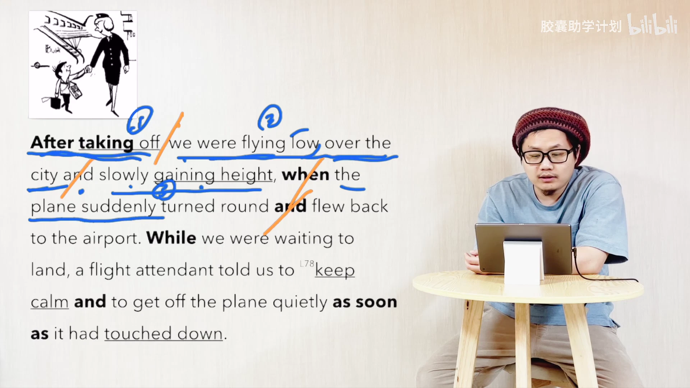

文字识别：biibili / 胶囊助学计划 / T0o / ② / After taking off we were flying Tow over the / city ard slowly gaining height, when the / plane suddenly turned round ay ld flew back / to the airport. While we were waiting to / 178keep / land, a flight attendant told us to / calm and to get of the plane quietly as soon / as it had touched down.

### 画面 00:06:35

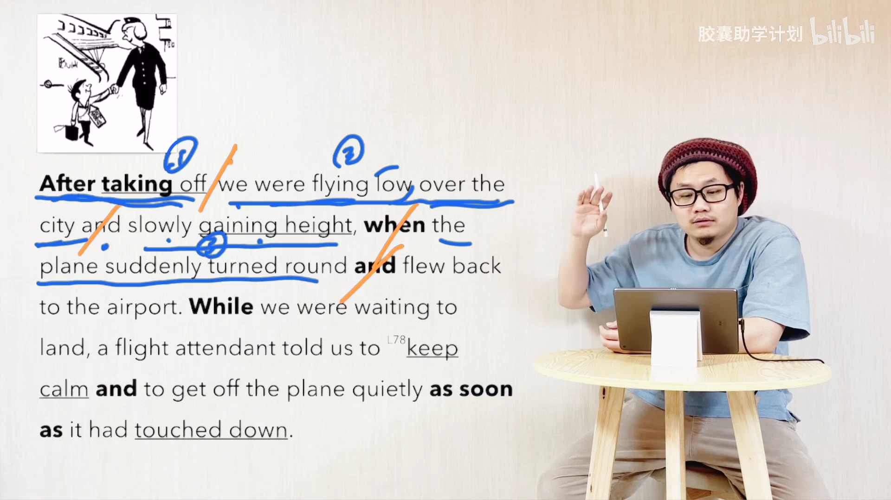

文字识别：biibili / 胶囊助学计划 / Tao / 3 / After taking off we were flying Tow over the / city ard slowly gaining height, when the / plane suddenly turned round ay ld flew back / to the airport. While we were waiting to / 178keep / land, a flight attendant told us to / calm and to get of the plane quietly as soon / as it had touched down.

### 画面 00:06:52

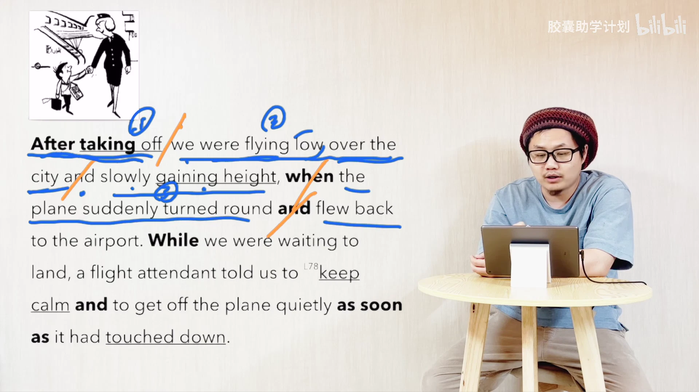

文字识别：biltbili / 胶囊助学计划 / ② / After taking off we were /  flying Tow over the / city ard slowly gaining height, when the / plane suddenly turned round a d flew back / to the airport. while we were waiting to / 178keep / land, a flight attendant told us to / calm and to get off the plane quietly as soon / as it had touched down.

### 画面 00:06:55

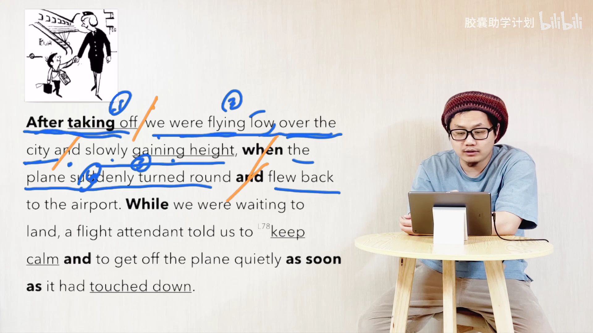

文字识别：biltbili / 胶囊助学计划 / To / After taking off we were /  flying Tow over the / city ard slowly gaining height, when the / plane sy / denly turned round a d flew back / to the airport. While we were waiting to / 178keep / land, a flight attendant told us to / calm and to get of the plane quietly as soon / as it had touched down.

### 画面 00:06:57

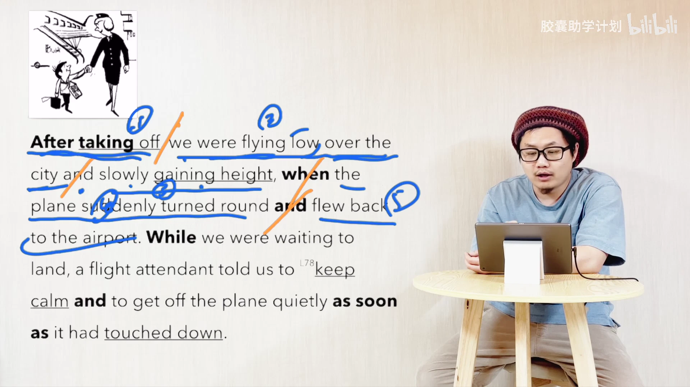

文字识别：bilbili / 胶囊助学计划 / 3 / After taking off we were / flying Tow over the / city ard slowly gaining height, when the / plane sy / denly turned round a d flew back / to the / airport. While we were waiting to / 178keep / land, a flight attendant told us to / calm and to get off the plane quietly as soon / as it had touched down.

## 00:07:00–00:07:30

所以你看，如果我们给它拆开的话，每一二三呃四五，每一句话其实都没几个单词。但是我给它都擦掉啊，我给它都擦掉，每一句话都没几个单词。但是这样看上去，其实每一句话还都挺呃，就是你给它都拆到一起的时候，感觉还是挺长的一句话。那这个把句子拆开能力，就我们所谓的长难句分析嘛。但是不过还好，这句话并不难啊，算长句不算

### 画面 00:07:08

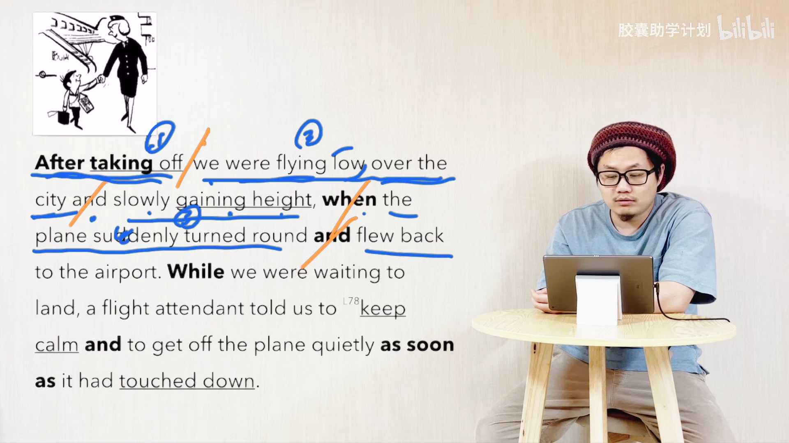

文字识别：bilbili / 胶囊助学计划 / 3 / After taking off we were / flying Tow over the / city ard slowly gaining height, when the / plane suldenly turned round ad flew back / to the airport. While we were waiting to / 178keep / land, a flight attendant told us to / calm and to get off the plane quietly as soon / as it had touched down.

### 画面 00:07:10

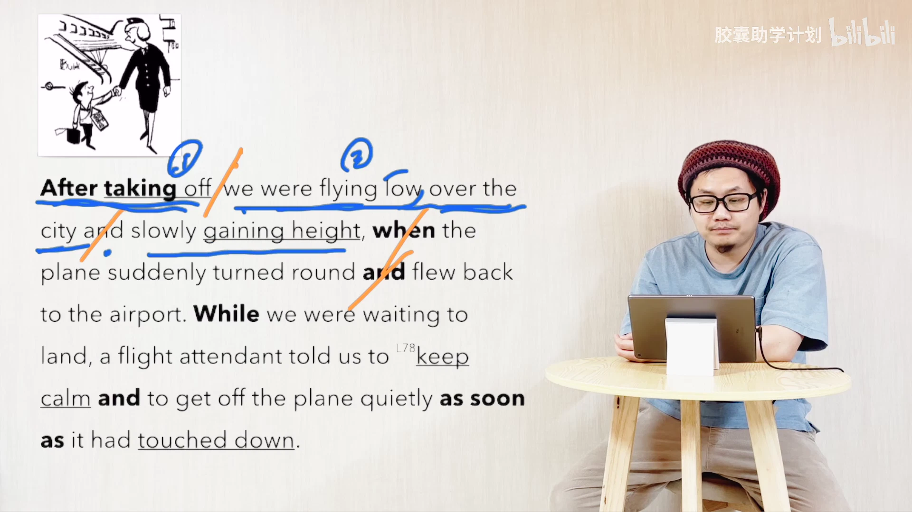

文字识别：胶囊助学计划bil山 / T0o / After taking off we were flying Tow over the / city ard slowlygaining height, when the / plane suddenly turned round ayld flew back / to the airport. while we were waiting to / 178keep / land, a flight attendant told us to / calm and to get off the plane quietly as soon / as it had touched down.

### 画面 00:07:12

文字识别：胶囊助学计划bi出 / Tao / After taking off we were flying low over the / city ard slowly gaining height, when the / plane suddenly turned round ay ld flew back / to the airport. while we were waiting to / 178keep / land, a flight attendant told us to / calm and to get off the plane quietly as soon / as it had touched down.

### 画面 00:07:14

文字识别：胶囊助学计划blb山 / After taking off we were flying low over the / city ard slowly gaining height, when the / plane suddenly turned round ay ld flew back / to the airport. while we were waiting to / 178keep / land, a flight attendant told us to / calm and to get off the plane quietly as soon / as it had touched down.

### 画面 00:07:19

文字识别：胶囊助学计划ii / After taking off we were flying low over the / city ard slowly gaining height, when the / plane suddenly turned round ayld flew back / to the airport. while we were waiting to / 17keep / land, a flight attendant told us to / calm and to get off the plane quietly as soon / as it had touched down.

### 画面 00:07:21

文字识别：胶囊助学计划bilbil / Tao / After taking off we were flying low over the / city ard slowly / Ming height,when the / plane suddenly turned round ayld flew back / to the airport. while we were waiting to / 178keep / land, a flight attendant told us to / calm and to get off the plane quietly as soon / as it had touched down.

### 画面 00:07:23

文字识别：胶囊助学计划bib出 / 工 / Tao / After taking off we were flying low over the / city ard slowly / Mng height, when the / ned round ard flew back / plane suddenly / to the airport. while we were waiting to / 178keep / land, a flight attendant told us to / calm and to get off the plane quietly as soon / as it had touched down.

### 画面 00:07:25

文字识别：胶囊助学计划bilbi / Too / After taking off we were flying low over the / city ard slowly / Mng height,when the / ned round ard flewSack / plane suddenly / to the airport. While we were waiting to / 178keep / land, a flight attendant told us to / calm and to get off the plane quietly as soon / as it had touched down.

## 00:07:30–00:08:00

难句。While we were waiting to land, a flight attendant told us to keep calm and to get off the plane quietly as soon as it had touched down. 哇，又好长的一句话。你看这，你看啊，这和我们第一单元学文章的时候的区别在哪？第一单元学的时候，其实就是一句话一句话就完事儿了。所以这一行，这这这这一页下来可能是十多句话，对吧？哎，这块四句话，这块三句话或七八句

### 画面 00:07:30

文字识别：胶囊助学计划bili / After taking off we were flying low over the / city ard slowly / Ing height, when the / aned round ard flewSack / plane suddenly / to the airport. While we were waiting to / 178keep / land, a flight attendant told us to / calm and to get off the plane quietly as soon / as it had touched down.

### 画面 00:07:49

文字识别：工 / 胶囊助学计划 / T0o / After taking off we were flying low over the / city ard slowly g / Mng height,when the / plane suddenlylerned round ayd flew back / to the airport. While we were waiting to / 178keep / Iland, a flight attendant told us to / calm and to get off the plane quietly as soon / as it had touched down.

### 画面 00:07:51

文字识别：胶囊助学计划bilb山 / After taking off, we were flying low over the / city and slowly gaining height, when the / plane suddenly turned round and flew back / to the airport. While we were waiting to / 178keep / land, a flight attendant told us to / calm and to get off the plane quietly as soon / as it had touched down.

## 00:08:00–00:08:30

话，对吧？而到了第四单元，就是这这整整这一大段下来之后，就两句话啊，就前面这是一句话，后边这是一句话，对吧？但是你把这一句话可以拆成几句小话，那我们拆一下吧。While we were waiting, when当我们等着要降落的时候，对吧？当我们正在等着降落的时候，第一句话有个逗号给你拆开了。A flight attendant told us to keep calm.所以一个空姐告诉我们要怎么样的保持

### 画面 00:08:09

文字识别：胶囊助学计划bilb山 / T0o / After taking off, we were flying low over the / city and slowly gaining height, when the / plane suddenly turned round and flew back / to the airport While we were waiting to / 178keep / Iand, a flight attendant told us to / calm and to get off the plane quietly as soon / as it had touched down.

### 画面 00:08:15

文字识别：胶囊助学计划bil山 / 工 / T0o / After taking off, we were flying low over the / city and slowly gaining height, when the / plane suddenly turned round and flew back / to the airport While we were waiting to / 78keep / land, a flight attendant told us to / calm and to get off the plane quietly as soon / as it had touched down.

### 画面 00:08:21

文字识别：胶囊助学计划bilii / T0o / After taking off, we were flying low over the / city and slowly gaining height, when the / plane suddenly turned round and flew back / to the airport While we were waiting to / 17keep / land, a flight attendant told us to / calm and to get off the plane quietly as soon / as it had touched down.

### 画面 00:08:24

文字识别：胶囊助学计划bli / T0 / After taking off, we were flying low over the / city and slowly gaining height, when the / plane suddenly turned round and flew back / to the airport While we were waiting to / land a flight attendant told us to / 178keep / calm and to get off the plane quietly as soon / as it had touched down.

### 画面 00:08:26

文字识别：胶囊助学计划bil出 / T0o / After taking off, we were flying low over the / city and slowly gaining height,when the / plane suddenly turned round and flew back / to the airport While we were waiting to / land/a flight attendant told us to / 178keep / calm and to get off the plane quietly as soon / as it had touched down.

## 00:08:30–00:09:00

安静，保持平静啊！不要慌乱啊！对，七十八课刚学的，keep calm，对吧？Stay calm，啊，calm down。然后第一句话，第二句话，第三句话叫 to get off the plane quietly，get off the plane下飞机quietly叫安静地啊，不是quickly，注意啊，是quietly，安静地下飞机。然后下一句话，第四句话叫做as soon as it had touched，一怎么怎么样就怎

### 画面 00:08:31

文字识别：Bilbii / 胶囊助学计划 / T0o / After taking off, we were flying low over the / city and slowly gaining height, when the / plane suddenly turned round and flew back / to the airport While we were waiting to / land/a flight attendant told us to / L78keep / calm and to get off the plane quietly as soon / as it had touched down.

### 画面 00:08:34

文字识别：胶囊助学计划bilbi出 / T0o / After taking off, we were flying low over the / city and slowly gaining height, when the / plane suddenly turned round and flew back / to the airport While we were waiting to / land/a flight attendant told us to / L78keep / calm and to get off the plane quietly as soon / as it had touched down.

### 画面 00:08:36

文字识别：胶囊助学计划bi出 / T0o / After taking off, we were flying low over the / city and slowly gaining height, when the / plane suddenly turned round and flew back / to the airport While we were waiting to / land/a flight attendant told us to / L78keep / calm and to get off the plane quietly as soon / as it had touched down.

### 画面 00:08:38

文字识别：胶囊助学计划bilil / After taking off, we were flying low over the / city and slowly gaining height, when the / plane suddenly turned round and flew back / to the airport While we were waiting to / land/a flight attendant told us to / 178keep / calm and to get off the plane quietly as soon / as it had touched down.

### 画面 00:08:40

文字识别：胶囊助学计划bii / T0o / After taking off, we were flying low over the / city and slowly gaining height, when the / plane suddenly turned round and flew back / to the airport While wedre waiting to / land a flight attendant told us to / 178keep / calm and to get off the plane quietly as soon / as it had touched down.

### 画面 00:08:42

文字识别：胶囊助学计划biii / T0o / After taking off, we were flying low over the / city and slowly gaining height, when the / plane suddenly turned round and flew back / to the airport While wedre waiting to / land a flight atten / 178keep / lant told us to / calm and to get off the plane quietly as soon / as it had touched down.

### 画面 00:08:44

文字识别：胶囊助学计划bilbil / After taking off, we were flying low over the / city and slowly gaining height, when the / plane suddenly turned round and flew back / to the airport While we / ewdre waiting to / land a flight atten / 178keep / lant told us to / calm and to get off the plae auietly as soon / as it had touched down

### 画面 00:08:48

文字识别：胶囊助学计划bib出 / After taking off, we were flying low over the / city and slowly gaining height, when the / plane suddenly turned round and flew back / to the airport While we / ewdre waiting to / land/a flight atte / 178keep / ant told us to / calm and to get off the plae guietly as soon / as it had touched down.

### 画面 00:08:55

文字识别：胶囊助学计划biiil / After taking off, we were flying low over the / city and slowly gaining height, when the / plane suddenly turned round and flew back / to the airport While wedre waiting to / land a flight atte / 178keep / ant told us to / calm and to get off the plae quietly as soon / as it had touched down.

### 画面 00:08:58

文字识别：bibi / 胶囊助学计划 / After taking off, we were flying low over the / city and slowly gaining height, when the / plane suddenly turned round and flew back / to thle airport While we / edre waiting to / land/a flight atte / 178keep / lant told us to / calm and to get off the plae guietlyas soon / as it had touched down

## 00:09:00–00:09:30

么怎么样。说这个飞机一怎么样呢？一 touch down，touch down 也是本课的一个习惯用法，指的是飞机啊。touch 你理解为就是触碰，touch down 就是往下触碰，什么意思？就降落。飞机一降落，哎，我们就安静的赶紧下飞机，对吧？哎，飞机一降落，我们就安静的下飞机啊。OK，所以你看这句话又被拆成了四句话。上面我没记错的话，应该是拆成了一二

### 画面 00:09:10

文字识别：bibii / 胶囊助学计划 / After taking off, we were flying low over the / city and slowly gaining height, when the / plane suddenly turned round and flew back / to the airport While we / edre waiting to / land/a flight atte / 178keep / lant told us to / calm and to get off the plae guietly / as soon / as it had touched down

### 画面 00:09:13

文字识别：bilbili / 胶囊助学计划 / After taking off, we were flying low over the / city and slowly gaining height, when the / plane suddenly turned round and flew back / to the airportWhile we / edre waiting to / land a flight atte / 178keep / lant told us to / calm and to get off the plae guietlyas soon / as it had touched down

### 画面 00:09:15

文字识别：胶囊助学计划bli / After taking off, we were flying low over the / city and slowly gaining height, when the / plane suddenly turned round and flew back / to the airportWhile we / edre waiting to / land/aflight atte / L78keep / ant told us to / calm and to get off the plae guietly / yas soon / as it had touched down

### 画面 00:09:24

文字识别：Bilbi / 胶囊助学计划 / T0o / After taking off, we were flying low over the / city and slowly gaining height, when the / plane suddenly turned round and flew back / to the airport While we / edre waiting to / land a flight atten / L78keep / lant told us to / calm and to get off the plae guietlyas soon / as it had touched down

### 画面 00:09:27

文字识别：胶囊助学计划bilbi / T0o / After taking off, we were flying low over the / city and slowly gaining height, when the / plane suddenly turned round and flew back / to the airport While we / edre waiting to / land/a flight atte / 178keep / lant told us to / calm and to get off the plae guietly / as soon / as it had touched down

## 00:09:30–00:10:00

三四五五句话，对吧？五小句话，底下拆成了四小句话，合起来是九小句话。对于各位来说，如果你只学到第一单元，你的水平应该就是在呃，你呃能用九小句话把这段写出来。理论上啊，可能你也不能。然后到了第四单元了之后，我们就把九小句话拆成了两大句话，对吧？Okay, 我都说了，Everybody on board was worried,

### 画面 00:09:30

文字识别：biibii / 胶囊助学计划 / After taki lg off, we were fling low over the / city and slowly gailing height, when the / plane suddefy turned round and flew back / to the airport While we / edre waiting to / land aflight atte / 178keep / lant told us to / calm and to get off the plae guietly / as soon / as it had touched down

### 画面 00:09:32

文字识别：bibii / 胶囊助学计划 / T0o / After taki lg off, we were flying low over the / city and slowly gailing height, when the / plane suddeffyturned round and fi w back / to the airportWhile we / ere waiting to / land a flight atte / 178keep / ant told us to / calm and to get off the plae quietlyas soon / as it had touched down

### 画面 00:09:42

文字识别：bibii / 胶囊助学计划 / After taki pg off, we were flying low over the / city and slowly gaizing height, when the / plane suddeffy turned round and fi w back / to the airport While we / edre waiting to / land aflight atte / 178keep / ant told us to / calm and to get off the plae guietly / as soon / as it had touched down

### 画面 00:09:44

文字识别：biibii / 胶囊助学计划 / After taking off, / we were /  flying low over the / gaiZing height, when the / city and slowly /  and figw back / plane sudderly turned round : / to the airport While we / edre waiting to / land a flight atte / L78keep / ant told us to / calm and to get off the plae auietly / as soon / asit had touched down

### 画面 00:09:50

文字识别：bilbili / 胶囊助学计划 / After takipg off, v / , we were flying low over the / 1 gaiZing height, when the / city and slowly  / d and fw back / plane suddey turned round a / to the airport While we / re waiting to / land a flight atte / L78keep / ant told us to / calm and to get off the plae auietly / as soon / as it had touched down

### 画面 00:09:53

文字识别：bilbii / 胶囊助学计划 / After taki ig off, we were fling low over the / city and slowly gaizing height, when the / plane suddelfy turned round and flw back / to the airport While we / edre waiting to / land a flight atte / 178keep / ant told us to / calm and to get off the plae guietly / as soon / as it had touched down

### 画面 00:09:55

文字识别：胶囊助学计划bi / After taking off, we were flying low over the / city and slowly gaining height, when the / plane suddenly turned round and flew back / to the airport While we / edre waiting to / land/a flight atten / 178keep / lant told us to / calm and to get off the plae quietlyas soon / as it had touched down

### 画面 00:09:57

文字识别：胶囊助学计划bil山 / 700 / Everybody on board was worried and we were / curious to find out what had happened. Later / L45, / we learnt that there was a very important / person on board. The police had been told that / a bomb had been planted on the plane. After / we had landed, the plane was searched / thoroughly. Fortunately, nothing was found and / five hours later we were able to take off again.

## 00:10:00–00:10:30

and we were curious to find out what had happened.这句话并不难，也不长，也不难，是吧？On board就是在飞机上的每一个人啊。介词引导短语后置做定语，都很担心。然后呢，we were curious to find out.这个讲curious我们就说过了，对吧？都很好奇的想弄明白啊，都非常想了解what had happened之前发生了什么。Later, we learned that there was a very important

### 画面 00:10:18

文字识别：胶囊助学计划bilb出 / Everybody on board was worried and we were / curious to find out what had happened. Later / L45, / we learnt that there was a very important / person on board. The police had been told that / a bomb had been planted on the plane. After / we had landed, the plane was searched / thoroughly. Fortunately, nothing was found and / five hours later we were able to take off again.

### 画面 00:10:21

文字识别：胶囊助学计划bib出 / Everybody on board was worried and we were / curious to find out what had happened. Later / L45, / we learnt that there was a very important / person on board. The police had been told that / a bomb had been planted on the plane. After / we had landed, the plane was searched / thoroughly. Fortunately, nothing was found and / five hours later we were able to take off again.

### 画面 00:10:23

文字识别：胶囊助学计划出 / Everybody on board was worried and we were / curious to find out what had happened. Later / L45, / we learnt that there was a very important / person on board. The police had been told that / a bomb had been planted on the plane. After / we had landed, the plane was searched / thoroughly. Fortunately, nothing was found and / five hours later we were able to take off again.

### 画面 00:10:25

文字识别：胶囊助学计划bilb出 / Everybody on board was worried and we were / curious to find out what had happened. Later / L45, / we learnt that there was a very important / person on board. The police had been told that / a bomb had been planted on the plane. After / we had landed, the plane was searched / thoroughly. Fortunately, nothing was found and / five hours later we were able to take off again.

## 00:10:30–00:11:00

person on board.说后来我们了解到弄明白了清楚了。哎，四十五课咱们学过的，尾轮that加一句话，there was a very important person on board。说有一个非常重要的人物在飞机上，on board这个小短语叫在飞机上啊。The police had been told that a bomb had been planted on the plane.说警察had been told已经被告知了一件事情，后边是一个

### 画面 00:10:55

文字识别：胶囊助学计划bib山 / Everybody on board was worried and we were / curious to find out what had happened. Later / L45, / we learnt that there was a very important / person on board. The police had been told that / a bomb had been planted on the plane. After / we had landed, the plane was searched / thoroughly. Fortunately, nothing was found and / five hours later we were able to take off again.

## 00:11:00–00:11:30

从句，a bomb had been planted。你看连着出现了两个过去完成时的被动，已经被放置了 on the plane，已经被放置在了这个飞机上。啊，当然其实它这个 planted 还不是纯的、单纯的一个放置，这个地方它用的更多的应该叫类似于偏向于安放。当然你给它换成 placed 也问题不大，只是稍微有一点点区别。你要硬说是什么区别？placed 就是好

### 画面 00:11:10

文字识别：胶囊助学计划bill / T00 / Everybody on board was worried and we were / curious to find out what had happened. Later / L45. / we learnt that there was a very important / person on board. The police had been told that / a bomb had been planted on the plane. After / we had landed, the plane was searched / thoroughly. Fortunately, nothing was found and / five hours later we were able to take off again.

### 画面 00:11:13

文字识别：胶囊助学计划biii出 / 工 / Everybody on board was worried and we were / curious to find out what had happened. Later / L45, / we learnt that there was a very important / person on board. The police had been told that / a bomb had been planted on the plane. After / we had landed, the plane was searched / thoroughly. Fortunately, nothing was found and / five hours later we were able to take off again.

### 画面 00:11:15

文字识别：胶囊助学计划bib出 / 700 / Everybody on board was worried and we were / curious to find out what had happened. Later / L45, / we learnt that there was a very important / person on board. The police had been told that / a bomb had been planted on the plane. After / we had landed, the plane was searched / thoroughly. Fortunately, nothing was found and / five hours later we were able to take off again.

### 画面 00:11:17

文字识别：胶囊助学计划bilb出 / 工 / T0o / Everybody on board was worried and we were / curious to find out what had happened. Later / L45, / we learnt that there was a very important / person on board. The police had been told that / a bomb had been planted on the plane. After / we had landed, the plane was searched / thoroughly. Fortunately, nothing was found and / five hours later we were able to take off again.

## 00:11:30–00:12:00

比你把这个炸这个炸弹呢，就是你给它放到包里，然后往飞机的某个角落里一放就完了，没有安装的过程，只是单纯讲放置。但是这个planted有点像那种安放，就是说它不单纯是放到了那个地方，它还有一个呃放到那儿，然后再去可能什么把哪根我不太懂啊，把哪根线跟哪根线连起来，把某些程序开启的这样一个装置

### 画面 00:11:31

文字识别：胶囊助学计划bi出 / Everybody on board was worried and we were / curious to find out what had happened. Later / L45, / we learnt that there was a very important / person on board. The police had been told that / a bomb had been planted on the plane. After / we had landed, the plane was searched / thoroughly. Fortunately, nothing was found and / five hours later we were able to take off again.

### 画面 00:11:33

文字识别：胶囊助学计划bilb出 / Too / Everybody on board was worried and we were / curious to find out what had happened. Later / L45, / we learnt that there was a very important / person on board. The police had been told that / a bomb had been planted on the plane. After / we had landed, the plane was searched / thoroughly. Fortunately, nothing was found and / five hours later we were able to take off again.

## 00:12:00–00:12:30

炸弹的过程啊，就是 planned 会 placed 多这样一点点特别细节的感觉，不过整体上我们又不是搞语言研究，对吧？其实无所谓了，所以在这儿你用 placed 也可以啊。已经被放置在飞机上了。再来， after we had landed， the plane was searched thoroughly。这句话也不难。在我们已经落地了之后，哎，发生了另外一件事情啊。十四课咱们学的基

### 画面 00:12:03

文字识别：胶囊助学计划bilb出 / Everybody on board was worried and we were / curious to find out what had happened. Later / L45, / we learnt that there was a very important / person on board. The police had been told that / a bomb had been planted on the plane. After / we had landed, the plane was searched / thoroughly. Fortunately, nothing was found and / five hours later we were able to take off again.

### 画面 00:12:10

文字识别：胶囊助学计划blb出 / T0o / Everybody on board was worried and we were / curious to find out what had happened. Later / L45, / we learnt that there was a very important / person on board. The police had been told that / a bomb had been planted on the plane. After / we had landed, the plane was searched / thoroughly. Fortunately, nothing was found and / five hours later we were able to take off again.

### 画面 00:12:16

文字识别：胶囊助学计划bib出 / T0o / Everybody on board was worried and we were / curious to find out what had happened. Later / L45, / we learnt that there was a very important / person on board. The police had been told that / a bomb had been planted on the plane. After / we had landed, the plane was searched / thoroughly. Fortunately, nothing was found and / five hours later we were able to take off again.

### 画面 00:12:26

文字识别：胶囊助学计划bili / Everybody on board was worried and we were / curious to find out what had happened. Later / L45, / we learnt that there was a very important / person on board. The police had been told that / a bomb had been planted on the plane. After / we had landed, the plane was searched / thoroughly. Fortunately, nothing was found and / five hours later we were able to take off again.

### 画面 00:12:28

文字识别：胶囊助学计划bilbi / 700 / Everybody on board was worried and we were / curious to find out what had happened. Later / L45. / we learnt that there was a very important / person on board. The police had been told that / a bomb had been planted on the plane. After / we had landed, the plane was searched / thoroughly. Fortunately, nothing was found and / five hours later we were able to take off again.

## 00:12:30–00:13:00

本上原语法对吧？After A逗号B嘛，在我们已经降落之后的飞机怎么样了？被搜索thoroughly，thoroughly也应该是五十五课我印象当中学的，学的还真的当时学的也是searched thoroughly，当时说的是searched the cave thoroughly，把那个山洞仔仔细细的搜了一遍，为了搜金子嘛。所以这个咱们之前学过啊，search thoroughly对吧？五十五课，Fortunately，很幸运的事情是nothing was found，and five hours later we were able to take

### 画面 00:12:35

文字识别：胶囊助学计划bib出 / Everybody on board was worried and we were / curious to find out what had happened. Later / L45, / we learnt that there was a very important / person on board. The police had been told that / a bomb had been planted on the plane. After / we had landed, the plane was searched / thoroughly. Fortunately, nothing was found and / five hours later we were able to take off again.

### 画面 00:12:39

文字识别：胶囊助学计划bibi出 / Everybody on board was worried and we were / curious to find out what had happened. Later / L45, / we learnt that there was a very important / person on board. The police had been told that / a bomb had been planted on the plane. After / we had landed, the plane was searched / thoroughly. Fortunately, nothing was found and / five hours later we were able to take off again.

### 画面 00:12:43

文字识别：胶囊助学计划bilbl / Everybody on board was worried and we were / curious to find out what had happened. Later / L45, / we learnt that there was a very important / person on board. The police had been told that / a bomb had been planted on the plane. After / we had landed, the plane was searched / thoroughly. Fortunately, nothing was found and / five hours later we were able to take off again.

### 画面 00:12:47

文字识别：胶囊助学计划bilb出 / Everybody on board was worried and we were / curious to find out what had happened. Later / L45, / we learnt that there was a very important / person on board. The police had been told that / a bomb had been planted on the plane. After / we had landed, the plane was searched / thoroughly. Fortunately, nothing was found and / five hours later we were able to take off again.

### 画面 00:12:54

文字识别：胶囊助学计划bilb山 / Everybody on board was worried and we were / curious to find out what had happened. Later / L45, / we learnt that there was a very important / person on board. The police had been told that / a bomb had been planted on the plane. After / we had landed, the plane was searched / thoroughly. Fortunately, nothing was found and / five hours later we were able to take off again.

## 00:13:00–00:13:30

off again. Fortunately,首先连着见过好几次了，包括unfortunately，对吧？很不幸的是，nothing was found，没有任何东西被找到了。第一个小短句，第二个小短句有and连接。五个小时之后，我们又一次起飞了。这没啥可说的，很简单。We were able to take off again. Take off，刚才我们已经见到了，表示起飞。文章说完了之后，习惯用法，那咱来了。这是咱们刚才在文章当中对各位的要求，就

### 画面 00:13:21

文字识别：胶囊助学计划bi山 / To / Everybody on board was worried and we were / curious to find out what had happened. Later / L45, / we learnt that there was a very important / person on board. The police had been told that / a bomb had been planted on the plane. After / we had landed, the plane was searched / thoroughly. Fortunately, nothing was found and / five hours later we were able to take off again.

### 画面 00:13:24

文字识别：bilbili / 胶囊助学计划 / 习惯用法造句 / a great deal / take charge of / be used to doing. / take off.. / gain height.. / touch down.. / on board

### 画面 00:13:26

文字识别：bilbili / 胶囊助学计划 / 习惯用法造句 / a great deal / take charge of / be used to doing. / take off... / gain height.. / touch down... / on board

### 画面 00:13:28

文字识别：bibili / 胶囊助学计划 / 习惯用法造句 / a great deal / take charge of / be used to doing. / take off... / gain height.. / touch down. / on board

## 00:13:30–00:14:00

是，我一说你一懂，能把文章串起来，这事儿结束。但到了第二个环节就不一样了，咱得造句，得彻底弄明白它怎么用。首先，a great deal，它其实最基本的含义叫 to a very to a very great degree or extent，就是很大程度上就是这样。其实就类似于非常许多的感觉啊。比如说，I feel a lot better。这个 a lot 完全可以换成

### 画面 00:13:30

文字识别：bibili / 胶囊助学计划 / 习惯用法造句 / a great deal / take charge of / be used to doing. / take off... / gain height.. / touch down... / on board

### 画面 00:13:32

文字识别：Bilbili / 胶囊助学计划 / 习惯用法造句 / a great deal / take charge of / be used to doing. / take off... / gain height.. / touch down... / on board

### 画面 00:13:34

文字识别：bilbii / 胶囊助学计划 / 习惯用法造句 / a great deal / take charge of / be used to doing. / take off... / gain height. / touch down... / on board

### 画面 00:13:36

文字识别：网：v.+v.变化 / a great deal: / 胶囊助学计划 / biibili / 习惯用法造句指南 / 四句型转换 / to a very great degree or extent; / " feel a lot better"; / 方式/地点/时间 / "we enjoyed ourselves very much"; / 其他习惯用法 / 其他单词+词性 / 原文摘抄+变 / 6123456 / a great deal

### 画面 00:13:38

文字识别：blibili / 网：v.+v.变化 / a great deal: / 胶囊助学计划 / 习惯用法造句指南 / 四句型转换 / to a very great degree or extent; / " feel a lot better"; / 方式/地点/时间 / "we enjoyed ourselves very much"; / 其他习惯用法 / 其他单词+词性 / 原文摘抄+变 / 6123456 / a great deal

### 画面 00:13:40

文字识别：bilbili / 网：v.+v.变化 / a great deal: / 胶囊助学计划 / 习惯用法造句指南 / 四句型转换 / to a very great degree or extent; / " feel alot better"; / 方式/地点/时间 / "we enjoyed ourselves very much"; / 其他习惯用法 / 其他单词+词性 / 原文摘抄+变 / 6123456 / a great deal

### 画面 00:13:42

文字识别：网：v.+v.变化 / a great deal: / 胶囊助学计划 / bilbili / 习惯用法造句指南 / 四句型转换 / to a very great degree or extent; / " feel alot better"; / 方式/地点/时间 / "we enjoyed ourselves very much"; / 其他习惯用法 / 其他单词+词性 / 原文摘抄+变 / 6123456 / a great deal

### 画面 00:13:44

文字识别：blbii / 网：v.+v.变化 / a great deal: / 胶囊助学计划 / 习惯用法造句指南 / 四句型转换 / a very great degree or extent; / feel a lot better"; / 方式/地点/时间 / "we enjoyed ourselves very much"; / 其他习惯用法 / 其他单词+词性 / 原文摘抄+变 / 6123456 / a great deal

### 画面 00:13:46

文字识别：网：v.+v.变化 / a great deal: / 胶囊助学计划 / bilbil / 习惯用法造句指南 / 四句型转换 / to a very / eat degree orextent; / "I feel a lot better"; / 方式/地点/时间 / "we enjoyed ourselves very much"; / 其他习惯用法 / 其他单词+词性 / 原文摘抄+变 / 6123456 / a great deal

### 画面 00:13:49

文字识别：网：v.+v.变化 / a great deal: / 胶囊助学计划 / bilbl / 习惯用法造句指南 / 四句型转换 / to a very great degree or extent; / " feel a lot better"; / 方式/地点/时间 / "we enjoyed ourselves very much"; / 其他习惯用法 / 其他单词+词性 / 原文摘抄+变 / 6123456 / a great deal

### 画面 00:13:51

文字识别：网：v.+v.变化 / a great deal: / 胶囊助学计划 / bilbili / 习惯用法造句指南 / 四句型转换 / to a very great degree or extent; / " feel a lot better"; / 方式/地点/时间 / "we enjoyed ourselves very much"; / 其他习惯用法 / 其他单词+词性 / 原文摘抄+变 / 6123456 / a great deal

### 画面 00:13:54

文字识别：网：v.+v.变化 / a great deal: / 胶囊助学计划 / bibl / 习惯用法造句指南 / 四句型转换 / to a very great degree or extent; / "I feel a lot better"; / 方式/地点/时间 / "we enjoyed ourselves very much"; / 其他习惯用法 / 其他单词+词性 / 原文摘抄+变 / 6123456 / a great deal

### 画面 00:13:57

文字识别：网：v.+v.变化 / a great deal: / 胶囊助学计划 / bilbil / 习惯用法造句指南 / 四句型转换 / to a very great degree or extent; / " feel a lot better"; / 方式/地点/时间 / "we enjoyed ourselves very much"; / 其他习惯用法 / 其他单词+词性 / 原文摘抄+变 / 6123456 / a great deal

### 画面 00:13:59

文字识别：blbii / 网：v.+v.变化 / a great deal: / 胶囊助学计划 / 习惯用法造句指南 / 四句型转换 / to a very great degree or extent; / " feel a lot better"; / 方式/地点/时间 / "we enjoyed ourselves very much"; / 其他习惯用法 / 其他单词+词性 / 原文摘抄+变 / 6123456 / a great deal

## 00:14:00–00:14:30

a great deal，对吧？就是我感觉好多了，这个好多了就是 a great deal，也是 a lot，也是 very much。听明白了吧？啊，就类似于 we enjoy ourselves very much。那我们造一句话，电影当中其实经常说这样的类似的句子，叫做 your words mean a great deal to me。您的言语啊，对于我来说意义非凡，哎，非常重要。Mean a great deal。 Okay，再来。But

### 画面 00:14:04

文字识别：网：v.+v.变化 / a great deal: / 胶囊助学计划 / blibii / 习惯用法造句指南 / 四句型转换 / to a very great degree or extent; / " feel a lot better"; / 方式/地点/时间 / "we enjoyed ourselves very much"; / 其他习惯用法 / 其他单词+词性 / 原文摘抄+变 / 6123456 / a great deal

### 画面 00:14:07

文字识别：网：v.+v.变化 / a great deal: / 胶囊助学计划 / blibii / 习惯用法造句指南 / 四句型转换 / to a very great degree or extent; / " feel alot better"; / 方式/地点/时间 / "we enjoyed ourselves very much"; / 其他习惯用法 / 其他单词+词性 / 原文摘抄+变 / 6123456 / a great deal

### 画面 00:14:09

文字识别：bilbil / 网：v.+v.变化 / a great deal: / 胶囊助学计划 / 习惯用法造句指南 / 四句型转换 / to a very great degree or extent; / " feel alot better"; / 方式/地点/时间 / "we enjoyed ourselves very much'; / 其他习惯用法 / 其他单词+词性 / 原文摘抄+变 / 6123456 / a great deal

### 画面 00:14:11

文字识别：网：v.+v.变化 / a great deal: / 胶囊助学计划 / bilbil / 习惯用法造句指南 / 四句型转换 / to a very great degree or extent; / "I feel a lot better"; / 方式/地点/时间 / "we enjoyed ourselves very much"; / 其他习惯用法 / 其他单词+词性 / 原文摘抄+变 / 6123456 / a great deal

### 画面 00:14:13

文字识别：网：v.+v.变化 / a great deal: / 胶囊助学计划 / bilibli / 习惯用法造句指南 / 四句型转换 / to a very great degree or extent; / "I feel alot better"; / 方式/地点/时间 / "we enjoyed ourselves very much'"; / 其他习惯用法 / 其他单词+词性 / 原文摘抄+变 / 6123456 / a great deal /  Your words meant a great deal to me. The / 6th Day (2000)

### 画面 00:14:15

文字识别：网：v.+v.变化 / a great deal: / 胶囊助学计划 / biili / 习惯用法造句指南 / 四句型转换 / to a very great degree orextent; / "I feel alot better"; / 方式/地点/时间 / "we enjoyed ourselves very much'"; / 其他习惯用法 / 其他单词+词性 / 原文摘抄+变 / 6123456 / a great deal /  Your words meant a great deal to me. The / 6th Day (2000)

### 画面 00:14:19

文字识别：网：v.+v.变化 / a great deal: / 胶囊助学计划 / bilbil / 习惯用法造句指南 / 四句型转换 / to a very great degree orextent; / "l feel alot better"; / 方式/地点/时间 / "we enjoyed ourselves very much'"; / 其他习惯用法 / 其他单词+词性 / 原文摘抄+变 / 6123456 / a great deal /  Your words meant a great deal to me. The / 6th Day (2000)

### 画面 00:14:23

文字识别：网：v.+v.变化 / a great deal: / 胶囊助学计划 / bibili / 习惯用法造句指南 / 四句型转换 / to a very great degree or extent; / "I feel a lot better"; / 方式/地点/时间 / "we enjoyed ourselves very much'"; / 其他习惯用法 / 其他单词+词性 / 原文摘抄+变 / 6123456 / a great deal /  Your words meant a great deal to me. The / 6th Day (2000)

### 画面 00:14:25

文字识别：网：v.+v.变化 / a great deal: / 胶囊助学计划 / biibii / 习惯用法造句指南 / 四句型转换 / to a very great degree orextent; / " feel alot better"; / 方式/地点/时间 / "we enjoyed ourselves very much'"; / 其他习惯用法 / 其他单词+词性 / 原文摘抄+变 / 6123456 / a great deal /  Your words meant a great deal to me. The / 6th Day (2000)

### 画面 00:14:28

文字识别：网：v.+v.变化 / a great deal: / 胶囊助学计划 / biibili / 习惯用法造句指南 / 四句型转换 / to a very great degree orextent; / " feel a lot better"; / 方式/地点/时间 / "we enjoyed ourselves very much'"; / 其他习惯用法 / 其他单词+词性 / 原文摘抄+变 / 6123456 / a great deal /  Your words meant a great deal to me. The / 6th Day (2000)

## 00:14:30–00:15:00

This would help a great deal.这会非常有帮助。Help a great deal.再来，说I've read a great deal about you.说我已经读过了很多关于你的事迹了。啊，比如你的自传呐，等等等等等等的。I've read a great deal about you. Very good.那注意力集中，咱先听一下这个电影片段啊。You've done a great deal for your

### 画面 00:14:30

文字识别：网：v.+v.变化 / a great deal: / 胶囊助学计划 / biltbii / 习惯用法造句指南 / 四句型转换 / to a very great degree or extent; / "I feel alot better"; / 方式/地点/时间 / 'we enjoyed ourselves very much'"; / 其他习惯用法 / 其他单词+词性 / 原文摘抄+变 / 6123456 / a great deal /  Your words meant a great deal to me. The / 6th Day (2000) /  This would help a great deal.

### 画面 00:14:32

文字识别：网：v.+v.变化 / a great deal: / 胶囊助学计划 / bibili / 习惯用法造句指南 / 四句型转换 / to a very great degree or extent; / "l feel alot better"; / 方式/地点/时间 / "we enjoyed ourselves very much'"; / 其他习惯用法 / 其他单词+词性 / 原文摘抄+变 / 6123456 / a great deal /  Your words meant a great deal to me. The / 6th Day (2000) /  This would help a great deal.

### 画面 00:14:34

文字识别：网：v.+v.变化 / a great deal: / 胶囊助学计划 / blbili / 习惯用法造句指南 / 四句型转换 / to a very great degree or extent; / "I feel alot better"; / 方式/地点/时间 / "we enjoyed ourselves very much'"; / 其他习惯用法 / 其他单词+词性 / 原文摘抄+变 / 6123456 / a great deal /  Your words meant a great deal to me. The / 6th Day (2000) /  This would help a great deal.

### 画面 00:14:36

文字识别：网：v.+v.变化 / a great deal: / 胶囊助学计划 / biibii / 习惯用法造句指南 / 四句型转换 / to a very great degree orextent; / "I feel alot better"; / 方式/地点/时间 / 'we enjoyed ourselves very much'"; / 其他习惯用法 / 其他单词+词性 / 原文摘抄+变 / 6123456 / a great deal /  Your words meant a great deal to me. The / 6th Day (2000) /  This would help a great deal.

### 画面 00:14:38

文字识别：网：v.+v.变化 / a great deal: / 胶囊助学计划 / biibii / 习惯用法造句指南 / 四句型转换 / to a very great degree or extent; / " feel a lot better"; / 方式/地点/时间 / "we enjoyed ourselves very much'"; / 其他习惯用法 / 其他单词+词性 / 原文摘抄+变 / 6123456 / a great deal /  Your words meant a great deal to me. The / 6th Day(2000) / This would help a great deal. / I've read a great deal about you. Gandhi / (1982)

### 画面 00:14:40

文字识别：网：v.+v.变化 / a great deal: / 胶囊助学计划 / bitbli / 习惯用法造句指南 / 四句型转换 / to a very great degree or extent; / " feel alot better"; / 方式/地点/时间 / "we enjoyed ourselves very much'; / 其他习惯用法 / 其他单词+词性 / 原文摘抄+变 / 6123456 / a great deal /  Your words meant a great deal to me. The / 6th Day(2000) / This would help a great deal. /  I've read a great deal about you. Gandhi / (1982)

### 画面 00:14:44

文字识别：网：v.+v.变化 / a great deal: / 胶囊助学计划 / bilibii / 习惯用法造句指南 / 四句型转换 / to a very great degree or extent; / "I feel a lot better"; / 方式/地点/时间 / 'we enjoyed ourselves very much'"; / 其他习惯用法 / 其他单词+词性 / 原文摘抄+变 / 6123456 / a great deal /  Your words meant a great deal to me. The / 6th Day(2000) / This would help a great deal. / I've read a great deal about you. Gandhi / (1982)

### 画面 00:14:46

文字识别：网：v.+v.变化 / a great deal: / 胶囊助学计划 / bilbl / 习惯用法造句指南 / 四句型转换 / to a very great degree or extent; / " feel a lot better"; / 方式/地点/时间 / 'we enjoyed ourselves very much'"; / 其他习惯用法 / 其他单词+词性 / 原文摘抄+变 / 6123456 / a great deal /  Your words meant a great deal to me. The / 6th Day(2000) /  This would help a great deal. / l've read a great deal about you. Gandhi / (1982)

### 画面 00:14:48

文字识别：网：v.+v.变化 / a great deal: / 胶囊助学计划 / bilibi / 习惯用法造句指南 / 四句型转换 / to a very great degree or extent; / " feel a lot better"; / 方式/地点/时间 / 'we enjoyed ourselves very much"; / 其他习惯用法 / 其他单词+词性 / 原文摘抄+变 / 6123456 / a great deal /  Your words meant a great deal to me. The / 6th Day(2000) /  This would help a great deal. / I've read a great deal about you. Gandhi / (1982)

### 画面 00:14:50

文字识别：网：v.+v.变化 / a great deal: / 胶囊助学计划 / Bilbili / 习惯用法造句指南 / 四句型转换 / to a very great degree or extent; / " feel a lot better"; / 方式/地点/时间 / 'we enjoyed ourselves very much"; / 其他习惯用法 / 其他单词+词性 / 原文摘抄+变 / 6123456 / a great deal /  Your words meant a great deal to me. The / 6th Day(2000) / This would help a great deal. /  I've read a great deal about you. Gandhi / (1982)

### 画面 00:14:52

文字识别：胶囊助学计划bibi / 网：v.+v.变化 / a great deal: / 习惯用法造句指南 / 四句型转换 / to a very great degree or extent; / "I feel a lot better"; / 方式/地点/时间 / 'we enjoyed ourselves very much'"; / 其他习惯用法 / 其他单词+词性 / 原文摘抄+变 / 6123456 / a great deal /  Your words meant a great deal to me. The / 6th Day(2000) / This would help a great deal. / ■ I've read a great deal about you. Gandhi / (1982)

### 画面 00:14:54

文字识别：bilibili / 胶囊助学计划 / You've done a great deal for your country, sir. / MNAA / A9.A / Little Women / (2019)

### 画面 00:14:56

文字识别：bibili / 胶囊助学计划 / You've done a great deal for your country, sir. / MNAA / A9.A / Little Women / (2019)

### 画面 00:14:58

文字识别：bilbi / 胶囊助学计划 / You've done a great deal for your country, sir. / MYAA. / 9.A / Little Women / (2019)

## 00:15:00–00:15:30

country, sir. 哎，说先生，你已经做了给你的国家做了很多很多的事情，比如说你参军了，然后又去什么参战了，等等等等的，对吧？ Okay, H one take charge of. Take charge of. 我们先看一下，叫做 to accept responsibility for something and have control over it. 接受了对某件事情的责任，你要对某件事负责了。然后呢，并且你有控制它的能力，

### 画面 00:15:00

文字识别：bibi / 胶囊助学计划 / You've done a great deal for your country, sir. / MYAA. / A9.A / aorob / HO / Little Women / (2019)

### 画面 00:15:02

文字识别：bibii / 胶囊助学计划 / You've done a great deal for your country, sir. / Little Women / (2019)

### 画面 00:15:04

文字识别：bilbil / 胶囊助学计划 / You've done a great deal for your country, sir. / Little Women / (2019)

### 画面 00:15:08

文字识别：bibii / 胶囊助学计划 / You've done a great deal for your country, sir. / Little Women / (2019)

### 画面 00:15:11

文字识别：bilbii / 胶囊助学计划 / You've done a great deal for your country, sir. / Little Women / (2019)

### 画面 00:15:13

文字识别：bilbili / 网：v.+v.变化 / to accept responsibility for / 胶囊助学计划 / 习惯用法造句指南 / 四句型转换 / something and / have control over it: 负责; / 方式/地点/时间 / 控制，掌管，承担责任； / 其他习惯用法 / 其他单词+词性 / 原文摘抄+变 / 6123456 / take charge of

### 画面 00:15:15

文字识别：网：v.+v.变化 / to accept responsibility for / 胶囊助学计划 / ilbii / 习惯用法造句指南 / 四句型转换 / something and / have control over it: 负责; / 方式/地点/时间 / 控制，掌管，承担责任； / 其他习惯用法 / 其他单词+词性 / 原文摘抄+变 / 6123456 / take charge of

### 画面 00:15:17

文字识别：网：v.+v.变化 / to accept responsibility for / 胶囊助学计划 / bilbil / 习惯用法造句指南 / 四句型转换 / someth / and / have control over it: 负责; / 方式/地点/时间 / 控制，掌管，承担责任； / 其他习惯用法 / 其他单词+词性 / 原文摘抄+变 / 6123456 / take charge of

### 画面 00:15:19

文字识别：网：v.+v.变化 / to accept responsibility for / 胶囊助学计划 / bilbili / 习惯用法造句指南 / 四句型转换 / something and / have control over it:负责; / 方式/地点/时间 / 控制，掌管，承担责任; / 其他习惯用法 / 其他单词+词性 / 原文摘抄+变 / 6123456 / take charge of

### 画面 00:15:24

文字识别：bilbili / 网：v.+v.变化 / to acce / esponsibility for / 胶囊助学计划 / 习惯用法造句指南 / 四句型转换 / something and / have control over it: 负责; / 方式/地点/时间 / 控制，掌管，承担责任； / 其他习惯用法 / 其他单词+词性 / 原文摘抄+变 / 6123456 / take charge of

### 画面 00:15:29

文字识别：网：v.+v.变化 / to accept responsibility for / 胶囊助学计划 / biibii / 习惯用法造句指南 / 四句型转换 / something and / have control over it:负责; / 方式/地点/时间 / 控制，掌管，承担责任； / 其他习惯用法 / 其他单词+词性 / 原文摘抄+变 / 6123456 / take charge of

## 00:15:30–00:16:00

所以他其实可以翻译成如下这些，就是负责呀、控制啊、掌管呐、承担责任都叫 take charge of 啊，他这个几个含义都可以。比如说， his boss asked him to take charge of the office for a few days while he she was away，说他老板要求他怎么样的 take charge of the office，叫做对这个办公室负责几天，当他老板不在的时候，

### 画面 00:15:32

文字识别：网：v.+v.变化 / to accept responsibility for / 胶囊助学计划 / bilbii / 习惯用法造句指南 / 四句型转换 / something and / have control over it: 负责; / 方式/地点/时间 / 控制，掌管，承担责任; / 其他习惯用法 / 其他单词+词性 / 原文摘抄+变 / 6123456 / take charge of

### 画面 00:15:34

文字识别：网：v.+v.变化 / to accept responsibility for / 胶囊助学计划 / bilbi / 习惯用法造句指南 / 四句型转换 / something and / have control over it: 负责; / 方式/地点/时间 / 控制，掌管，承担责任; / 其他习惯用法 / 其他单词+词性 / 原文摘抄+变 / 6123456 / take charge of

### 画面 00:15:38

文字识别：网：v.+v.变化 / to accept responsibility for / 胶囊助学计划 / bibili / 习惯用法造句指南 / 四句型转换 / something and / have control over it: 负责; / 方式/地点/时间 / 控制，掌管，承担责任； / 其他习惯用法 / 其他单词+词性 / 原文摘抄+变 / 6123456 / take charge of

### 画面 00:15:40

文字识别：网：v.+v.变化 / to accept responsibility for / 胶囊助学计划 / bilibili / 习惯用法造句指南 / 四句型转换 / something and / have control over it: 负责; / 方式/地点/时间 / 控制，掌管，承担责任; / 其他习惯用法 / 其他单词+词性 / 原文摘抄+变 / 6123456 / take charge of /  His boss asked him to take charge of the / office for a few days while she was away.

### 画面 00:15:42

文字识别：网：v.+v.变化 / to accept responsibility for / 胶囊助学计划 / bilibii / 习惯用法造句指南 / 四句型转换 / something and / have control overit: 负责; / 方式/地点/时间 / 控制，掌管，承担责任; / 其他习惯用法 / 其他单词+词性 / 原文摘抄+变 / 6123456 / take charge of /  His boss asked him to take charge of the / office for a few days while she was away.

### 画面 00:15:44

文字识别：网：v.+v.变化 / to accept responsibility for / 胶囊助学计划 / biibii / 习惯用法造句指南 / 四句型转换 / something and / have control overit:负责; / 方式/地点/时间 / 控制，掌管，承担责任; / 其他习惯用法 / 其他单词+词性 / 原文摘抄+变 / 6123456 / take charge of /  His boss asked him to take charge of the / office for a few days while she was away.

### 画面 00:15:49

文字识别：网：v.+v.变化 / to accept responsibility for / 胶囊助学计划 / biibii / 习惯用法造句指南 / 四句型转换 / something and / have control overit: 负责; / 方式/地点/时间 / 控制，掌管，承担责任； / 其他习惯用法 / 其他单词+词性 / 原文摘抄+变 / 6123456 / take charge of /  His boss asked him to take charge of the / office for a few days while she was away.

### 画面 00:15:54

文字识别：胶囊助学计划bibil / 网：v.+v.变化 / to accept responsibility for / 习惯用法造句指南 / something and / 四句型转换 / have control over it: 负责; / 方式/地点/时间 / 控制，掌管，承担责任; / 其他习惯用法 / 其他单词+词性 / 原文摘抄+变 / 6123456 / take charge of /  His boss asked him to take charge of the / office for a few days while she was away.

### 画面 00:15:59

文字识别：网：v.+v.变化 / to accept responsibility for / 胶囊助学计划 / bilbli / 习惯用法造句指南 / 四句型转换 / something and / have control overit:负责; / 方式/地点/时间 / 控制，掌管，承担责任; / 其他习惯用法 / 其他单词+词性 / 原文摘抄+变 / 6123456 / take charge of /  His boss asked him to take charge of the / office for a few days while she was away.

## 00:16:00–00:16:30

那什么叫对老办公室负责呢？就是让他去这个掌管这个办公室，哎，这个负责这个办公室的一切事宜。说白了就是你当老大，你当 boss，对吧？我 boss 走了，二把手上你上，对吧？你来 take charge of the office，明白了吧？Next one. At first, she tried to take charge of the meeting. 说最初的时候，那她希望能对这个这个会议，哎，掌管起话语权来，控

### 画面 00:16:01

文字识别：网：v.+v.变化 / to accept responsibility for / 胶囊助学计划 / bilbili / 习惯用法造句指南 / 四句型转换 / something and / have control overit:负责; / 方式/地点/时间 / 控制，掌管，承担责任; / 其他习惯用法 / 其他单词+词性 / 原文摘抄+变 / 6123456 / take charge of /  His boss asked him to take charge of the / office for a few days while she was away.

### 画面 00:16:03

文字识别：胶囊助学计划bibi / 网：v.+v.变化 / to accept responsibility for / 习惯用法造句指南 / 四句型转换 / something and / have control over it: 负责; / 方式/地点/时间 / 控制，掌管，承担责任; / 其他习惯用法 / 其他单词+词性 / 原文摘抄+变 / 6123456 / take charge of /  His boss asked him to take charge of the / office for a few days while she was away.

### 画面 00:16:05

文字识别：胶囊助学计划bilbil / 网：v.+v.变化 / to accept responsibility for / 习惯用法造句指南 / 四句型转换 / something and / have control overit: 负责; / 方式/地点/时间 / 控制，掌管，承担责任； / 其他习惯用法 / 其他单词+词性 / 原文摘抄+变 / 6123456 / take charge of /  His boss asked him to take charge of the / office for a few days while she was away.

### 画面 00:16:09

文字识别：网：v.+v.变化 / to accept responsibility for / 胶囊助学计划 / Bilbili / 习惯用法造句指南 / 四句型转换 / something and / have control over it: 负责; / 方式/地点/时间 / 控制，掌管，承担责任; / 其他习惯用法 / 其他单词+词性 / 原文摘抄+变 / 6123456 / take charge of /  His boss asked him to take charge of the / office for a few days while she was away.

### 画面 00:16:12

文字识别：胶囊助学计划blii / 网：v.+v.变化 / to accept responsibility for / 习惯用法造句指南 / 四句型转换 / something and / have control over it: 负责; / 方式/地点/时间 / 控制，掌管，承担责任； / 其他习惯用法 / 其他单词+词性 / 原文摘抄+变 / 6123456 / take charge of /  His boss asked him to take charge of the / office for a few days while she was away.

### 画面 00:16:14

文字识别：胶囊助学计划blbil / 网：v.+v.变化 / to accept responsibility for / 习惯用法造句指南 / 四句型转换 / something and / have control over it: 负责; / 方式/地点/时间 / 控制，掌管，承担责任； / 其他习惯用法 / 其他单词+词性 / 原文摘抄+变 / 6123456 / take charge of /  His boss asked him to take charge of the / office for a few days while she was away.

### 画面 00:16:16

文字识别：网：v.+v.变化 / to accept responsibility for / 胶囊助学计划 / bilbili / 习惯用法造句指南 / 四句型转换 / something and / have control over it: 负责; / 方式/地点/时间 / 控制，掌管，承担责任； / 其他习惯用法 / 其他单词+词性 / 原文摘抄+变 / 6123456 / take charge of /  His boss asked him to take charge of the / office for a few days while she was away.

### 画面 00:16:18

文字识别：胶囊助学计划bilii / 网：v.+v.变化 / to accept responsibility for / 习惯用法造句指南 / 四句型转换 / something and / have control over it: 负责; / 方式/地点/时间 / 控制，掌管，承担责任; / 其他习惯用法 / 其他单词+词性 / 原文摘抄+变 / 6123456 / take charge of /  His boss asked him to take charge of the / office for a few days while she was away. / At first she tried to take charge of the / meeting. did/who/why/when...

### 画面 00:16:20

文字识别：胶囊助学计划bibi / 网：v.+v.变化 / to accept responsibility for / 习惯用法造句指南 / 四句型转换 / something and / have control over it: 负责; / 方式/地点/时间 / 控制，掌管，承担责任； / 其他习惯用法 / 其他单词+词性 / 原文摘抄+变 / 6123456 / take charge of /  His boss asked him to take charge of the / office for a few days while she was away. / At first she tried to take charge of the / meeting. did/who/why/when...

### 画面 00:16:24

文字识别：胶囊助学计划bibil / 网：v.+v.变化 / to accept responsibility for / 习惯用法造句指南 / 四句型转换 / something and / have control over it: 负责; / 方式/地点/时间 / 控制，掌管，承担责任; / 其他习惯用法 / 其他单词+词性 / 原文摘抄+变 / 6123456 / take charge of /  His boss asked him to take charge of the / office for a few days while she was away. / At first she tried to take charge of the / meeting. did/who/why/when...

### 画面 00:16:27

文字识别：胶囊助学计划bibi / 网：v.+v.变化 / to accept responsibility for / 习惯用法造句指南 / 四句型转换 / something and / have control over it: 负责; / 方式/地点/时间 / 控制，掌管，承担责任； / 其他习惯用法 / 其他单词+词性 / 原文摘抄+变 / 6123456 / take charge of /  His boss asked him to take charge of the / office for a few days while she was away. / At first she tried to take charge of the / meeting. did/who/why/when...

### 画面 00:16:29

文字识别：胶囊助学计划bilbi / 网：v.+v.变化 / to accept responsibility for / 习惯用法造句指南 / 四句型转换 / something and / have control over it: 负责; / 方式/地点/时间 / 控制，掌管，承担责任； / 其他习惯用法 / 其他单词+词性 / 原文摘抄+变 / 6123456 / take charge of /  His boss asked him to take charge of the / office for a few days while she was away. / At first she tried to take charge of the / meeting. did/who/why/when...

## 00:16:30–00:17:00

制这个会议的走向，他没做到啊。最初他尝试着去做到。Next one，说 John will be taking charge of the next meeting。哎，下一次会议由 John 去负责发起，对吧？哎，是由他负责的。Take charge of。Next one， be used to doing 这个您一定要记住，这是比较罕见的几个 to 后边加 doing 而不是 to do 的啊。另一个我们学过的 look forward to doing

### 画面 00:16:31

文字识别：胶囊助学计划bilbil / 网：v.+v.变化 / to accept responsibility for / 习惯用法造句指南 / 四句型转换 / something and / have control over it: 负责; / 方式/地点/时间 / 控制，掌管，承担责任； / 其他习惯用法 / 其他单词+词性 / 原文摘抄+变 / 6123456 / take charge of /  His boss asked him to take charge of the / office for a few days while she was away. / At first she tried to take charge of the / meeting. did/who/why/when...

### 画面 00:16:33

文字识别：胶囊助学计划bilbi / 网：v.+v.变化 / to accept responsibility for / 习惯用法造句指南 / 四句型转换 / something and / have control overit: 负责; / 方式/地点/时间 / 控制，掌管，承担责任; / 其他习惯用法 / 其他单词+词性 / 原文摘抄+变 / 6123456 / take charge of /  His boss asked him to take charge of the / office for a few days while she was away. / At first she tried to take charge of the / meeting. did/who/why/when...

### 画面 00:16:35

文字识别：胶囊助学计划bilii / 网：v.+v.变化 / to accept responsibility for / 习惯 / 四句型转换 / something and / 伙用法造句指南 / have control over it: 负责; / 方式/地点/时间 / 控制，掌管，承担责任； / 其他习惯用法 / 其他单词+词性 / 原文摘抄+变 / 6123456 / take charge of /  His boss asked him to take charge of the / office for a few days while she was away. / At first she tried to take charge of the / meeting. did/who/why/when... /  John will be taking charge of the next / meeting. L13

### 画面 00:16:37

文字识别：胶囊助学计划biliil / 网：v.+v.变化 / to accept responsibility for / 习惯 / 四句型转换 / something and / 用法 / have control over it:负责; / 方式/地点/时间 / 控制，掌管，承担责任; / 么造句指南 / 其他习惯用法 / 其他单词+词性 / 原文摘抄+变 / 6123456 / take charge of /  His boss asked him to take charge of the / office for a few days while she was away. / At first she tried to take charge of the / meeting. did/who/why/when... /  John will be taking charge of the next / meeting. L13

### 画面 00:16:39

文字识别：胶囊助学计划bilbil / 网：v.+v.变化 / to accept responsibility for / 习惯 / 四句型转换 / something and / 用 / have control over it:负责； / 方式/地点/时间 / 法 / 控制，掌管，承担责任; / 么造句指南 / 其他习惯用法 / 其他单词+词性 / 原文摘抄+变 / 6123456 / take charge of /  His boss asked him to take charge of the / office for a few days while she was away. / At first she tried to take charge of the / meeting. did/who/why/when... /  John will be taking charge of the next / meeting. L13

### 画面 00:16:43

文字识别：胶囊助学计划bilbi / 网：v.+v.变化 / to accept responsibility for / 习惯 / 四句型转换 / something and / 伙用法造句指南 / have control over it: 负责; / 方式/地点/时间 / 控制，掌管，承担责任; / 其他习惯用法 / 其他单词+词性 / 原文摘抄+变 / 6123456 / take charge of /  His boss asked him to take charge of the / office for a few days while she was away. / At first she tried to take charge of the / meeting. did/who/why/when... /  John will be taking charge of the next / meeting. L13

### 画面 00:16:45

文字识别：胶囊助学计划bilii / 网：v.+v.变化 / to accept responsibility for / 习惯 / 四句型转换 / something and / 伙用法造句指南 / have control over it: 负责; / 方式/地点/时间 / 控制，掌管，承担责任； / 其他习惯用法 / 其他单词+词性 / 原文摘抄+变 / 6123456 / take charge of /  His boss asked him to take charge of the / office for a few days while she was away. / At first she tried to take charge of the / meeting. did/who/why/when... /  John will be taking charge of the next / meeting. L13

### 画面 00:16:47

文字识别：网：v.+v.变化 / be used to do sth. .. L55 / 胶囊助学计划 / blibii / 习惯用法造句指南 / 四句型转换 / It was used to detect gold. / used to do L31 / 方式/地点/时间 / He used to smoke. / 其他习惯用法 / 其他单词+词性 / 原文摘抄+变 / 6123456 / be used to doing.…..

### 画面 00:16:49

文字识别：网：v.+v.变化 / be used to do sth... L55 / 胶囊助学计划 / blibli / 习惯用法造句指南 / 四句型转换 / It was used to detect gold. / used to do L31 / 方式/地点/时间 / He used to smoke. / 其他习惯用法 / 其他单词+词性 / 原文摘抄+变 / 6123456 / be used to doing….

### 画面 00:16:51

文字识别：网：v.+v.变化 / be used to do sth. .. L55 / 胶囊助学计划 / bibii / 习惯用法造句指南 / 四句型转换 / It was used to detect gold. / used to do L31 / 方式/地点/时间 / He used to smoke. / 其他习惯用法 / 其他单词+词性 / 原文摘抄+变 / 6123456 / be used to doing.…

### 画面 00:16:54

文字识别：网：v.+v.变化 / be used to do sth. . L55 / 胶囊助学计划 / bibili / 习惯用法造句指南 / 四句型转换 / It was used to detect gold. / used to do L31 / 方式/地点/时间 / He used to smoke. / 其他习惯用法 / 其他单词+词性 / 原文摘抄+变 / 6123456 / be used to doing…

### 画面 00:16:56

文字识别：bibili / 网：v.+v.变化 / be used to do sth. .. L55 / 胶囊助学计划 / 习惯用法造句指南 / 四句型转换 / It was used to detect gold. / used to do L31 / 方式/地点/时间 / He used to smoke. / 其他习惯用法 / 其他单词+词性 / 原文摘抄+变 / 6123456 / be used to doing.…

### 画面 00:16:58

文字识别：网：v.+v.变化 / be used to do sth... L55 / 胶囊助学计划 / biltbili / 习惯用法造句指南 / 四句型转换 / It was used to detect gold. / used to do L31 / 方式/地点/时间 / He used to smoke. / 其他习惯用法 / 其他单词+词性 / 原文摘抄+变 / 6123456 / be used to doing.…..

## 00:17:00–00:17:30

something，对吧？Okay，那它什么含义呢？啊，首先我们先对比一下，五十五课咱们学过一个叫 be used to do something，比如说 it was used to detect gold，这个叫做其实是 use 这个单词的本身的含义叫使用啊，被动它被使用来去做某件事情。三十一课学的 used to do 跟 use 表示使用这个含义没有半毛钱关系，它只是整个合起来是一个结构叫过去常常。今天学的 be used to

### 画面 00:17:00

文字识别：网：v.+v.变化 / be used to do sth.. L55 / 胶囊助学计划 / blbii / 习惯用法造句指南 / 四句型转换 / It was used to detect gold. / ■used to do L31 / 方式/地点/时间 / He used to smoke. / 其他习惯用法 / 其他单词+词性 / 原文摘抄+变 / 6123456 / be used to doing...

### 画面 00:17:02

文字识别：网：v.+v.变化 / be used to do sth... L55 / 胶囊助学计划 / blbli / 习惯用法造句指南 / 四句型转换 / It was used to detect gold. / used to do L31 / 方式/地点/时间 / He used to smoke. / 其他习惯用法 / 其他单词+词性 / 原文摘抄+变 / 6123456 / be used to doing…..

### 画面 00:17:04

文字识别：网：v.+v.变化 / be used to do sth... L55 / 胶囊助学计划 / biibii / 习惯用法造句指南 / 四句型转换 / It was used to detect goid. / ■used to do L31 / 方式/地点/时间 / He used to smoke. / 其他习惯用法 / 其他单词+词性 / 原文摘抄+变 / 6123456 / be used to doing.…

### 画面 00:17:09

文字识别：网：v.+v.变化 / be used to do sth.. L55 / 胶囊助学计划 / bibii / 习惯用法造句指南 / 四句型转换 / It was used to detect gold. / used to do L31 / 方式/地点/时间 / He used to smoke. / 其他习惯用法 / 其他单词+词性 / 原文摘抄+变 / 6123456 / be used to doing...

### 画面 00:17:12

文字识别：blibii / 网：v.+v.变化 / be used to do sth.. L55 / 胶囊助学计划 / 习惯用法造句指南 / 四句型转换 / It was used to detect gold. / used to do L31 / 方式/地点/时间 / He used to smoke. / 其他习惯用法 / 其他单词+词性 / 原文摘抄+变 / 6123456 / be used to doing…..

### 画面 00:17:14

文字识别：bilbil / 网：v.+v.变化 / be used to do sth... L55 / 胶囊助学计划 / 习惯用法造句指南 / 四句型转换 / as used to detect gold. / used to do L31 / 方式/地点/时间 / He used to smoke. / 其他习惯用法 / 其他单词+词性 / 原文摘抄+变 / 6123456 / be used to doing…..

### 画面 00:17:19

文字识别：网：v.+v.变化 / be used to do sth... L55 / 胶囊助学计划 / biibili / 习惯用法造句指南 / 四句型转换 / It was used to detect gold. / used to do L31 / 方式/地点/时间 / He used to smoke. / 其他习惯用法 / 其他单词+词性 / 原文摘抄+变 / 6123456 / be used to doing…..

### 画面 00:17:24

文字识别：blibii / 网：v.+v.变化 / be used to do sth... L55 / 胶囊助学计划 / 习惯用法造句指南 / 四句型转换 / It was used to detect gold. / used to do L31 / 方式/地点/时间 / He used to smoke. / 其他习惯用法 / 其他单词+词性 / 原文摘抄+变 / 6123456 / be used to doing…..

### 画面 00:17:29

文字识别：网：v.+v.变化 / be used to do sth... L55 / 胶囊助学计划 / blibii / 习惯用法造句指南 / 四句型转换 / It was used to detect gold. / used to do L31 / 方式/地点/时间 / He used to smoke. / 其他习惯用法 / 其他单词+词性 / 原文摘抄+变 / 6123456 / be used to doing…..

## 00:17:30–00:18:00

doing something 呢，跟 used 的使用含义也没有半毛钱关系，直接就是一个习惯用法，连起来的意思就是习惯于，对吧？比如说， he is used to asking his parents to help him. 他习惯于了什么呢？让他的父母来帮助他。哎，说不好听点，让他父母来帮他擦屁股，对吧？哎，把他那些破破事儿给他收尾啊。好， next one. So he is used to going to sleep very late.

### 画面 00:17:31

文字识别：网：v.+v.变化 / be used to do sth.. L55 / 胶囊助学计划 / bilbili / 习惯用法造句指南 / It was used to detect gold. / 四句型转换 / used to do L31 / 方式/地点/时间 / He used to smoke. / 其他习惯用法 / 其他单词+词性 / 原文摘抄+变 / 6123456 / be used to doing….. /  He is used to asking his parents to help / him.L11

### 画面 00:17:33

文字识别：网：v.+v.变化 / be used to do sth... L55 / 胶囊助学计划 / bibii / 习惯用法造句指南 / It was used to detect gold. / 四句型转换 / used to do L31 / 方式/地点/时间 / He used to smoke. / 其他习惯用法 / 其他单词+词性 / 原文摘抄+变 / 6123456 / be used to doing.….. /  He is used to asking his parents to help / him.L11

### 画面 00:17:35

文字识别：网：v.+v.变化 / be used to do sth... L55 / 胶囊助学计划 / biltbili / 习惯用法造句指南 / 四句型转换 / It was used to detect gold. / ■used to do L31 / 方式/地点/时间 / He used to smoke. / 其他习惯用法 / 其他单词+词性 / 原文摘抄+变 / 6123456 / be used to doing.….. /  He is used to asking his parents to help / him.L11

### 画面 00:17:37

文字识别：网：v.+v.变化 / be used to do sth... L55 / 胶囊助学计划 / bitbii / 习惯用法造句指南 / 四句型转换 / It was used to detect gold. / ■used to do L31 / 方式/地点/时间 / He used to smoke. / 其他习惯用法 / 其他单词+词性 / 原文摘抄+变 / 6123456 / be used to doing.….. /  He is used to asking his parents to help / him.L11

### 画面 00:17:39

文字识别：网：v.+v.变化 / be used to do sth.. L55 / 胶囊助学计划 / biibii / 习惯用法造句指南 / It was used to detect gold. / 四句型转换 / ■used to do L31 / 方式/地点/时间 / He used to smoke. / 其他习惯用法 / 其他单词+词性 / 原文摘抄+变 / 6123456 / be used to doing….. /  He is used to asking his parents to help / him.L11

### 画面 00:17:41

文字识别：网：v.+v.变化 / be used to do sth... L55 / 胶囊助学计划 / biibii / 习惯用法造句指南 / It was used to detect gold. / 四句型转换 / used to do L31 / 方式/地点/时间 / He used to smoke. / 其他习惯用法 / 其他单词+词性 / 原文摘抄+变 / 6123456 / be used to doing... /  He is used to asking his parents to help / him.L11

### 画面 00:17:44

文字识别：网：v.+v.变化 / be used to do sth... L55 / 胶囊助学计划 / bilbili / 习惯用法造句指南 / It was used to detect gold. / 四句型转换 / used to do L31 / 方式/地点/时间 / He used to smoke. / 其他习惯用法 / 其他单词+词性 / 原文摘抄+变 / 6123456 / be used to doing…. /  He is used to asking his parents to help / him.L1

### 画面 00:17:49

文字识别：网：v.+v.变化 /  be used to do sth... L55 / 胶囊助学计划 / bilibii / 习惯用法造句指南 / It was used to detect gold. / 四句型转换 / used to do L31 / 方式/地点/时间 / He used to smoke. / 其他习惯用法 / 其他单词+词性 / 原文摘抄+变 / 6123456 / be used to doing…. /  He is used to asking his parents to help / him.L11

### 画面 00:17:52

文字识别：网：v.+v.变化 /  be used to do sth... L55 / 胶囊助学计划 / bilibii / 习惯用法造句指南 / It was used to detect gold. / 四句型转换 / ■used to do L31 / 方式/地点/时间 / He used to smoke. / 其他习惯用法 / 其他单词+词性 / 原文摘抄+变 / 6123456 / be used to doing... /  He is used to asking his parents to help / him.L11

### 画面 00:17:54

文字识别：网：v.+v.变化 / be used to do sth... L55 / 胶囊助学计划 / biibii / 习惯用法造句指南 / It was used to detect gold. / 四句型转换 / ■used to do L31 / 方式/地点/时间 / He used to smoke. / 其他习惯用法 / 其他单词+词性 / 原文摘抄+变 / 6123456 / be used to doing.. /  He is used to asking his parents to help / him.L11

### 画面 00:17:56

文字识别：网：v.+v.变化 / be used to do sth... L55 / 胶囊助学计划 / 习惯用法造句指南 / It was used to detect gold. / 四句型转换 / used to do L31 / 方式/地点/时间 / He used to smoke. / 其他习惯用法 / 其他单词+词性 / 原文摘抄+变 / 6123456 / be used to doing…. /  He is used to asking his parents to help / him.L11 /  He is used to going to sleep very late. L49

### 画面 00:17:58

文字识别：网：v.+v.变化 / be used to do sth... L55 / 胶囊助学计划 / bibii / 习惯用法造句指南 / It was used to detect gold. / 四句型转换 / used to do L31 / 方式/地点/时间 / He used to smoke. / 其他习惯用法 / 其他单词+词性 / 原文摘抄+变 / 6123456 / be used to doing….. /  He is used to asking his parents to help / him.L11 /  He is used to going to sleep very late. L49

## 00:18:00–00:18:30

### 画面 00:18:00

文字识别：胶囊助学计划bii / 网：v.+v.变化 / be used to do sth... L55 / 习惯用法造句指南 / It was used to detect gold. / 四句型转换 / used to do L31 / 方式/地点/时间 / He used to smoke. / 其他习惯用法 / 其他单词+词性 / 原文摘抄+变 / 6123456 / be used to doing.….. /  He is used to asking his parents to help / him.L11 /  He is used to going to sleep very late. L49

### 画面 00:18:02

文字识别：胶囊助学计划bilil / 网：v.+v.变化 / be used to do sth... L55 / 习惯用法造句指南 / 四句型转换 / It was used to detect gold. / used to do L31 / 方式/地点/时间 / He used to smoke. / 其他习惯用法 / 其他单词+词性 / 原文摘抄+变 / 6123456 / be used to doing.….. /  He is used to asking his parents to help / him.L11 /  He is used to going to sleep very late. L49

### 画面 00:18:04

文字识别：网：v.+v.变化 /  be used to do sth... L55 / 胶囊助学计划 / biibi / 习惯用法造句指南 / 四句型转换 / It was used to detect gold. / used to do L31 / 方式/地点/时间 / He used to smoke. / 其他习惯用法 / 其他单词+词性 / 原文摘抄+变 / 6123456 / be used to doing... /  He is used to asking his parents to help / him.L11 /  He is used to going to sleep very late. L49 / He's used to getting up at 6am on / Saturdays.

### 画面 00:18:06

文字识别：胶囊助学计划bilbil / 网：v.+v.变化 / be used to do sth... L55 / 习惯用法造句指南 / 四句型转换 / It was used to detect gold. / used to do L31 / 方式/地点/时间 / He used to smoke. / 其他习惯用法 / 其他单词+词性 / 原文摘抄+变 / 6123456 / be used to doing... /  He is used to asking his parents to help / him.L11 /  He is used to going to sleep very late. L49 / He's used to getting up at 6am on / Saturdays.

### 画面 00:18:08

文字识别：胶囊助学计划bii / 网：v.+v.变化 / be used to do sth... L55 / 习惯用法造句指南 / 四句型转换 / It was used to detect gold. / used to do L31 / 方式/地点/时间 / He used to smoke. / 其他习惯用法 / 其他单词+词性 / 原文摘抄+变 / 6123456 / be used to doing….. /  He is used to asking his parents to help / him.L11 /  He is used to going to sleep very late. L49 / He's used to getting up at 6am on / Saturdays.

### 画面 00:18:10

文字识别：胶囊助学计划bilbil / 网：v.+v.变化 / be used to do sth... L55 / 习惯用法造句指南 / 四句型转换 / It was used to detect gold. / used to do L31 / 方式/地点/时间 / He used to smoke. / 其他习惯用法 / 其他单词+词性 / 原文摘抄+变 / 6123456 / be used to doing…. /  He is used to asking his parents to help / him.L11 /  He is used to going to sleep very late. L49 /  He's used to getting :p at 6am on / Saturdays.

### 画面 00:18:14

文字识别：网：v.+v.变化 /  be used to do sth... L55 / 胶囊助学计划 / bilibii / 习惯用法造句指南 / 四句型转换 / It was used to detect gold. / used to do L31 / 方式/地点/时间 / He used to smoke. / 其他习惯用法 / 其他单词+词性 / 原文摘抄+变 / 6123456 / be used to doing... /  He is used to asking his parents to help / him. L11 /  He is used to going to sleep very late. L49 / He's used to getting up at 6am on / Saturdays.

### 画面 00:18:16

文字识别：网：v.+v.变化 /  be used to do sth... L55 / 胶囊助学计划 / biibii / 习惯用法造句指南 / 四句型转换 / It was used to detect gold. / used to do L31 / 方式/地点/时间 / He used to smoke. / 其他习惯用法 / 其他单词+词性 / 原文摘抄+变 / 6123456 / be used to doing... /  He is used to asking his parents to help / him.L11 /  He is used to going to sleep very late. L49 /  He's used to getting up at 6am on / Saturdays.

### 画面 00:18:18

文字识别：网：v.+v.变化 / be used to do sth... L55 / 胶囊助学计划 / bilbili / 习惯用法造句指南 / 四句型转换 / It was used to detect gold. / used to do L31 / 方式/地点/时间 / He used to smoke. / 其他习惯用法 / 其他单词+词性 / 原文摘抄+变 / 6123456 / be used to doing... /  He is used to asking his parents to help / him.L11 /  He is used to going to sleep very late. L49 / He's used to getting up at 6am on / Saturdays.

### 画面 00:18:20

文字识别：网：v.+v.变化 /  be used to do sth... L55 / 胶囊助学计划 / bilbi / 习惯用法造句指南 / 四句型转换 / It was used to detect gold. / used to do L31 / 方式/地点/时间 / He used to smoke. / 其他习惯用法 / 其他单词+词性 / 原文摘抄+变 / 6123456 / be used to doing... /  He is used to asking his parents to help / him.L11 /  He is used to going to sleep very late. L49 / He's used to getting up at 6am on / Saturdays.

### 画面 00:18:22

文字识别：胶囊助学计划ibi出 / Don't go! Sorry. It's not like we are used to / having a conversation with a bird. / The Phoenix and the Magic Carpet / (1995)

### 画面 00:18:24

文字识别：bilii / 胶囊助学计划 / Don't go! Sorry. It's not like we are used to / having a conversation with a bird. / The Phoenix and the Magic Carpet / (1995)

### 画面 00:18:26

文字识别：biibii / 胶囊助学计划 / Don't go! Sorry. It's not like we are used to / having a conversation with a bird. / The Phoenix and the Magic Carpet / (1995)

### 画面 00:18:28

文字识别：胶囊助学计划bilibi出 / Don't go! Sorry. It's not like we are used to / having a conversation with a bird. / The Phoenix and the Magic Carpet / (1995)

## 00:18:30–00:19:00

这三个单词 take off 飞机起飞 gain height 攀升高度 touch down 下降对吧？或者落地着陆啊，这个想造句就比较简单了。比如说 When will the plane be taking off? 飞机什么时候起飞？哎，首先你看你你要观察细节，我用到的是十三课的将来进行时哦。 Next one 说 The plane is trying to gain height at the moment. 飞机现在正在攀升高度。

### 画面 00:18:30

文字识别：bilbili / 胶囊助学计划 / Don't go! Sorry. It's not like we are used to / having a conversation with a bird. / The Phoenix and the Magic Carpet / (1995)

### 画面 00:18:32

文字识别：biibili / 胶囊助学计划 / Don't go! Sorry. It's not like we are used to / having a conversation with a bird. / The Phoenix and the Magic Carpet / (1995)

### 画面 00:18:34

文字识别：bilbil / 网：v.+v.变化 / 胶囊助学计划 / 习惯用法造句指南 / 四句型转换 / 方式/地点/时间 / 其他习惯用法 / 其他单词+词性 / 原文摘抄+变 / 6123456 / take off / gain height / touch down..(plane)

### 画面 00:18:36

文字识别：bilbl / 网：v.+v.变化 / 胶囊助学计划 / 习惯用法造句指南 / 四句型转换 / 方式/地点/时间 / 其他习惯用法 / 其他单词+词性 / 原文摘抄+变 / 6123456 / take off / gain height / touch down..(plane)

### 画面 00:18:39

文字识别：bilbili / 网：v.+v.变化 / 胶囊助学计划 / 习惯用法造句指南 / 四句型转换 / 方式/地点/时间 / 其他习惯用法 / 其他单词+词性 / 原文摘抄+变 / 6123456 / take off / gain height / touch down...(plane)

### 画面 00:18:42

文字识别：bib出 / 网：v.+v.变化 / 胶囊助学计划 / 习惯用法造句指南 / 四句型转换 / 方式/地点/时间 / 其他习惯用法 / 其他单词+词性 / 原文摘抄+变 / 6123456 / take off / gain height / touch down..(plane)

### 画面 00:18:44

文字识别：网：v.+v.变化 / 胶囊助学计划 / bilibili / 习惯用法造句指南 / 四句型转换 / 方式/地点/时间 / 其他习惯用法 / 其他单词+词性 / 原文摘抄+变 / 6123456 / take off / gain height / touch down...(plane) /  When will the plane be taking off? L13

### 画面 00:18:46

文字识别：网：v.+v.变化 / 胶囊助学计划 / bibii / 习惯用法造句指南 / 四句型转换 / 方式/地点/时间 / 其他习惯用法 / 其他单词+词性 / 原文摘抄+变 / 6123456 / take off / gain height / touch down...(plane) /  When will the plane be taking off? L13

### 画面 00:18:48

文字识别：网：v.+v.变化 / 胶囊助学计划 / bilbili / 习惯用法造句指南 / 四句型转换 / 方式/地点/时间 / 其他习惯用法 / 其他单词+词性 / 原文摘抄+变 / 6123456 / take off / gain height / touch down...(plane) /  When will the plane be taking off? L13 /  The plane is trying to gain height at the / moment.

### 画面 00:18:50

文字识别：网：v.+v.变化 / 胶囊助学计划 / biibii / 习惯用法造句指南 / 四句型转换 / 方式/地点/时间 / 其他习惯用法 / 其他单词+词性 / 原文摘抄+变 / 6123456 / take off / gain height/ touch down...(plane) /  When will the plane be taking off? L13 /  The plane is trying to gain height at the / moment.

### 画面 00:18:52

文字识别：网：v.+v.变化 / 胶囊助学计划 / bilbii / 习惯用法造句指南 / 四句型转换 / 方式/地点/时间 / 其他习惯用法 / 其他单词+词性 / 原文摘抄+变 / 6123456 / take off / gain height / touch down...(plane) /  When will the plane be taking off? L13 /  The plane is trying to gain height at the / moment.

### 画面 00:18:54

文字识别：网：v.+v.变化 / 胶囊助学计划 / bibii / 习惯用法造句指南 / 四句型转换 / 方式/地点/时间 / 其他习惯用法 / 其他单词+词性 / 原文摘抄+变 / 6123456 / take off / gain height / touch down...(plane) /  When will the plane be taking off? L13 /  The plane is trying to gain height at the / moment.

### 画面 00:18:57

文字识别：网：v.+v.变化 / 胶囊助学计划 / biibii / 习惯用法造句指南 / 四句型转换 / 方式/地点/时间 / 其他习惯用法 / 其他单词+词性 / 原文摘抄+变 / 6123456 / take off / gain height / touch down...(plane) /  When will the plane be taking off? L13 /  The plane is trying to gain height at the / moment.

### 画面 00:18:59

文字识别：网：v.+v.变化 / 胶囊助学计划 / bilbili / 习惯用法造句指南 / 四句型转换 / 方式/地点/时间 / 其他习惯用法 / 其他单词+词性 / 原文摘抄+变 / 6123456 / take off / gain height / touch down...(plane) /  When will the plane be taking off? L13 /  The plane is trying to gain height at the / moment.

## 00:19:00–00:19:30

哎，最后一个句子说，When the plane touched down, several detectives were waiting at the airport. 你想一下，其实这个这个句子就是第七课第七课某些句子的翻写嘛？啊，第七课不就是什么 detectives were waiting at the airport，对吧？他们等的是那个 diamonds， valuable diamonds。下一个小短语 on board，就是 on board 有很多含义啊。如果是在飞机 on board 呢，就是在飞机上；

### 画面 00:19:01

文字识别：胶囊助学计划biii出 / 网：v.+v.变化 / 习惯 / 四句型转换 / 伙用法造句指南 / 方式/地点/时间 / 其他习惯用法 / 其他单词+词性 / 原文摘抄+变 / 6123456 / take off / gain height / touch down...(plane) /  When will the plane be taking off? L13 /  The plane is trying to gain height at the / moment. /  When the plane touched down, several / detectives were waiting at the airport.

### 画面 00:19:04

文字识别：胶囊助学计划bibi出 / 网：v.+v.变化 / 习惯用法 / 四句型转换 / 方式/地点/时间 / 么造句指南 / 其他习惯用法 / 其他单词+词性 / 原文摘抄+变 / 6123456 / take off / gain height / touch down...(plane) /  When will the plane be taking off? L13 /  The plane is trying to gain height at the / moment. /  When the plane touched down, several / detectives were waiting at the airport.

### 画面 00:19:07

文字识别：胶囊助学计划bili / 网：v.+v.变化 / 习惯用法造句指南 / 四句型转换 / 方式/地点/时间 / 其他习惯用法 / 其他单词+词性 / 原文摘抄+变 / 6123456 / take off / gain height / touch down...(plane) /  When will the plane be taking off? L13 /  The plane is trying to gain height at the / moment. /  When the plane touched down, several / detectives were waiting at the airport.

### 画面 00:19:09

文字识别：胶囊助学计划bilbi出 / 网：v.+v.变化 / 习惯用法造句指南 / 四句型转换 / 方式/地点/时间 / 其他习惯用法 / 其他单词+词性 / 原文摘抄+变 / 6123456 / take off / gain height / touch down...(plane) /  When will the plane be taking off ? L13 /  The plane is trying to gain height at the / moment. /  When the plane touched down, several / detectives were waiting at the airport.

### 画面 00:19:14

文字识别：胶囊助学计划bi出 / 网：v.+v.变化 / 习惯用法造句指南 / 四句型转换 / 方式/地点/时间 / 其他习惯用法 / 其他单词+词性 / 原文摘抄+变 / 6123456 / take off / gain height / touch down...(plane) /  When will the plane be taking off? L13 /  The plane is trying to gain height at the / moment. /  When the plane touched down, several / detectives were waiting at the airport.

### 画面 00:19:16

文字识别：胶囊助学计划bibi出 / 网：v.+v.变化 / 习惯 / 四句型转换 / 伙用法造句指南 / 方式/地点/时间 / 其他习惯用法 / 其他单词+词性 / 原文摘抄+变 / 6123456 / take off / gain height / touch down...(plane) /  When will the plane be taking off? L13 /  The plane is trying to gain height at the / moment. /  When the plane touched down, several / detectives were waiting at the airport.

### 画面 00:19:19

文字识别：胶囊助学计划biiil / 网：v.+v.变化 / 习惯用法造句指南 / 四句型转换 / 方式/地点/时间 / 其他习惯用法 / 其他单词+词性 / 原文摘抄+变 / 6123456 / take off / gain height / touch down...(plane) /  When will the plane be taking off? L13 /  The plane is trying to gain height at the / moment. /  When the plane touched down, several / detectives were waiting at the airport.

### 画面 00:19:21

文字识别：胶囊助学计划bibi / 网：v.+v.变化 / 习惯用法造句指南 / 四句型转换 / 方式/地点/时间 / 其他习惯用法 / 其他单词+词性 / 原文摘抄+变 / 6123456 / take off / gain height / touch down...(plane) /  When will the plane be taking off? L13 /  The plane is trying to gain height at the / moment. /  When the plane touched down, several / detectives were waiting at the airport.

### 画面 00:19:23

文字识别：网：v.+v.变化 / 胶囊助学计划 / biibii / 习惯用法造句指南 / 四句型转换 / 方式/地点/时间 / 其他习惯用法 / 其他单词+词性 / 原文摘抄+变 / 6123456 / on board

### 画面 00:19:25

文字识别：网：v.+v.变化 / 胶囊助学计划 / bilbil / 习惯用法造句指南 / 四句型转换 / 方式/地点/时间 / 其他习惯用法 / 其他单词+词性 / 原文摘抄+变 / 6123456 / on board

### 画面 00:19:27

文字识别：网：v.+v.变化 / 胶囊助学计划 / bilbili / 习惯用法造句指南 / 四句型转换 / 方式/地点/时间 / 其他习惯用法 / 其他单词+词性 / 原文摘抄+变 / 6123456 / on board

### 画面 00:19:29

文字识别：网：v.+v.变化 / 胶囊助学计划 / bilbili / 习惯用法造句指南 / 四句型转换 / 方式/地点/时间 / 其他习惯用法 / 其他单词+词性 / 原文摘抄+变 / 6123456 / on board

## 00:19:30–00:20:00

果船在 on board 呢，就在甲板上，对吧？比如说，as soon as I was on board, the flight attendant offered me some drink. 我一登机，那你看这里的 I was on board，你就可以理解为登机嘛，对吧？然后呢，呃，这个呃，空姐就给我提供了一点饮品啊。 Next one, say find out if there is a doctor on board as quietly as you can. 说，哎，去找一找是否飞机上有

### 画面 00:19:31

文字识别：网：v.+v.变化 / 胶囊助学计划 / bilbii / 习惯用法造句指南 / 四句型转换 / 方式/地点/时间 / 其他习惯用法 / 其他单词+词性 / 原文摘抄+变 / 6123456 / on board

### 画面 00:19:33

文字识别：网：v.+v.变化 / 胶囊助学计划 / bilibil / 习惯用法造句指南 / 四句型转换 / 方式/地点/时间 / 其他习惯用法 / 其他单词+词性 / 原文摘抄+变 / 6123456 / on board / As soon as I was on board, the flight / attendant offered me some drink. L78

### 画面 00:19:35

文字识别：网：v.+v.变化 / 胶囊助学计划 / bibili / 习惯用法造句指南 / 四句型转换 / 方式/地点/时间 / 其他习惯用法 / 其他单词+词性 / 原文摘抄+变 / 6123456 / on board / As soon as I was on board, the flight / attendant offered me some drink. L78

### 画面 00:19:37

文字识别：网：v.+v.变化 / 胶囊助学计划 / biibii / 习惯用法造句指南 / 四句型转换 / 方式/地点/时间 / 其他习惯用法 / 其他单词+词性 / 原文摘抄+变 / 6123456 / on board / As soon as I was on board, the flight / attendant offered me some drink. L78

### 画面 00:19:39

文字识别：网：v.+v.变化 / 胶囊助学计划 / biibii / 习惯用法造句指南 / 四句型转换 / 方式/地点/时间 / 其他习惯用法 / 其他单词+词性 / 原文摘抄+变 / 6123456 / on board / As soon as I was on board, the flight / attendant offered me some drink. L78

### 画面 00:19:42

文字识别：网：v.+v.变化 / 胶囊助学计划 / bibili / 习惯用法造句指南 / 四句型转换 / 方式/地点/时间 / 其他习惯用法 / 其他单词+词性 / 原文摘抄+变 / 6123456 / on board / As soon as I was on board, the flight / attendant offered me some drink. L78

### 画面 00:19:44

文字识别：网：v.+v.变化 / 胶囊助学计划 / bilbili / 习惯用法造句指南 / 四句型转换 / 方式/地点/时间 / 其他习惯用法 / 其他单词+词性 / 原文摘抄+变 / 6123456 / on board / As soon as I was on board, the flight / attendant offered me some drink. L78

### 画面 00:19:46

文字识别：网：v.+v.变化 / 胶囊助学计划 / biltbili / 习惯用法造句指南 / 四句型转换 / 方式/地点/时间 / 其他习惯用法 / 其他单词+词性 / 原文摘抄+变 / 6123456 / on board / As soon as I was on board, the flight / attendant offered me some drink. L78

### 画面 00:19:48

文字识别：网：v.+v.变化 / 胶囊助学计划 / ilbil / 习惯用法造句指南 / 四句型转换 / 方式/地点/时间 / 其他习惯用法 / 其他单词+词性 / 原文摘抄+变 / 6123456 / on board / As soon as I was on board, the flight / attendant offered me some drink. L78

### 画面 00:19:50

文字识别：胶囊助学计划bib出 / 网：v.+v.变化 / 习惯用法造句指南 / 四句型转换 / 方式/地点/时间 / 其他习惯用法 / 其他单词+词性 / 原文摘抄+变 / 6123456 / on board / As soon as I was on board, the flight / attendant offered me some drink. L78 /  Find out if there's a doctor on board / as quietly as you can. Airplane! (1980)

### 画面 00:19:54

文字识别：胶囊助学计划bibi / 网：v.+v.变化 / 习惯用法造句指南 / 四句型转换 / 方式/地点/时间 / 其他习惯用法 / 其他单词+词性 / 原文摘抄+变 / 6123456 / on board / As soon as I was on board, the flight / attendant offered me some drink. L78 /  Find out if there's a doctor on board / as quietly as you can. Airplane! (1980)

### 画面 00:19:57

文字识别：胶囊助学计划bibi出 / 网：v.+v.变化 / 习惯用法造句指南 / 四句型转换 / 方式/地点/时间 / 其他习惯用法 / 其他单词+词性 / 原文摘抄+变 / 6123456 / on board / As soon as I was on board, the flight / attendant offered me some drink. L78 /  Find out if there's a doctor on board / as quietly as you can. Airplane! (1980)

### 画面 00:19:59

文字识别：胶囊助学计划bilibi / 网：v.+v.变化 / 习惯用法造句指南 / 四句型转换 / 方式/地点/时间 / 其他习惯用法 / 其他单词+词性 / 原文摘抄+变 / 6123456 / on board / As soon as I was on board, the flight / attendant offered me some drink. L78 /  Find out if there's a doctor on board / as quietly as you can. Airplane! (1980)

## 00:20:00–00:20:30

医生？注意这个 if 并不是如果，是是否，对吧？然后 as quietly as you can，啊，跟 as you could 是一样的，就尽可能安静一点，不要引起恐慌。Next one， I'm sure that he's on board。我很确信他在飞机上，对吧？七十八克啊， I'm sure that。那注意力集中，咱看吧，它不一定是飞机啊。像这个电影啊，这个 A New Hope，是吧？这个是呃呃 Star Wars 这个系列。

### 画面 00:20:01

文字识别：胶囊助学计划bibi / 网：v.+v.变化 / 习惯用法造句指南 / 四句型转换 / 方式/地点/时间 / 其他习惯用法 / 其他单词+词性 / 原文摘抄+变 / 6123456 / on board / As soon as I was on board, the flight / attendant offered me some drink. L78 /  Find out if there's a doctor on board / as quietly as you can. Airplane! (1980)

### 画面 00:20:03

文字识别：胶囊助学计划bilbi出 / 网：v.+v.变化 / 习惯用法造句指南 / 四句型转换 / 方式/地点/时间 / 其他习惯用法 / 其他单词+词性 / 原文摘抄+变 / 6123456 / on board / As soon as I was on board, the flight / attendant offered me some drink. L78 /  Find out if there's a doctor on board / as quietly as you can. Airplane! (1980)

### 画面 00:20:05

文字识别：胶囊助学计划bibi出 / 网：v.+v.变化 / 习惯用法造句指南 / 四句型转换 / 方式/地点/时间 / 其他习惯用法 / 其他单词+词性 / 原文摘抄+变 / 6123456 / on board / As soon as I was on board, the flight / attendant offered me some drink. L78 /  Find out if there's a doctor on board / as quietly as you can. Airplane! (1980)

### 画面 00:20:09

文字识别：胶囊助学计划bilbi / 网：v.+v.变化 / 习惯用法造句指南 / 四句型转换 / 方式/地点/时间 / 其他习惯用法 / 其他单词+词性 / 原文摘抄+变 / 6123456 / on board / As soon as I was on board, the flight / attendant offered me some drink. L78 /  Find out if there's a doctor on board / as quietly as you can. Airplane! (1980)

### 画面 00:20:11

文字识别：胶囊助学计划bibi出 / 网：v.+v.变化 / 习惯用法造句指南 / 四句型转换 / 方式/地点/时间 / 其他习惯用法 / 其他单词+词性 / 原文摘抄+变 / 6123456 / on board / As soon as I was on board, the flight / attendant offered me some drink. L78 / Find out if there's a doctor on board / as quietly as you can. Airplane! (1980)

### 画面 00:20:13

文字识别：胶囊助学计划blb出 / 网：v.+v.变化 / 习惯用法造句指南 / 四句型转换 / 方式/地点/时间 / 其他习惯用法 / 其他单词+词性 / 原文摘抄+变 / 6123456 / on board / As soon as I was on board, the flight / attendant offered me some drink. L78 /  Find out if there's a doctor on board / as quietly as you can. Airplane! (1980) / ■ I'm sure that he is on board. L78

### 画面 00:20:15

文字识别：胶囊助学计划bii出 / 网：v.+v.变化 / 习惯用法造句指南 / 四句型转换 / 方式/地点/时间 / 其他习惯用法 / 其他单词+词性 / 原文摘抄+变 / 6123456 / on board / As soon as I was on board, the flight / attendant offered me some drink. L78 /  Find out if there's a doctor on board / as quietly as you can. Airplane! (1980) /  I'm sure that he is on board. L78

### 画面 00:20:18

文字识别：胶囊助学计划bibi出 / 网：v.+v.变化 / 习惯用法造句指南 / 四句型转换 / 方式/地点/时间 / 其他习惯用法 / 其他单词+词性 / 原文摘抄+变 / 6123456 / on board / As soon as I was on board, the flight / attendant offered me some drink. L78 /  Find out if there's a doctor on board / as quietly as you can. Airplane! (1980) /  I'm sure that he is on board. L78

### 画面 00:20:20

文字识别：胶囊助学计划bibi / 网：v.+v.变化 / 习惯用法造句指南 / 四句型转换 / 方式/地点/时间 / 其他习惯用法 / 其他单词+词性 / 原文摘抄+变 / 6123456 / on board / As soon as I was on board, the flight / attendant offered me some drink. L78 /  Find out if there's a doctor on board / as quietly as you can. Airplane! (1980) /  I'm sure that he is on board. L78

### 画面 00:20:22

文字识别：胶囊助学计划bilb出 / There's no one on board, sir. / Star Wars: Episode IV - A New Hope / (1977)

### 画面 00:20:26

文字识别：胶囊助学计划bib出 / There's no one on board, sir. / - / Star Wars: Episode IV - A New Hope / (1977)

## 00:20:30–00:21:00

那你看这明显是科幻片儿，这不是飞机了，就是宇航，啊，宇航飞船啊，就是呃飞船嘛，就是这种是吧？那它也用的是on board啊。There's no one on board, sir。哎，这个宇宙飞船上啊，这个还是没有人啊，所以这里的on board就是在宇宙飞船上。呃，recap的习惯用法，咱交作业肯定要造句嘛，然后文章熟读成诵，这里留言去找这些重复

### 画面 00:20:32

文字识别：胶囊助学计划bi出 / There's no one on board, sir. / 7 / Star Wars: Episode IV - A New Hope / (1977)

### 画面 00:20:34

文字识别：胶囊助学计划bib出 / There's no one on board, sir. / Star Wars: Episode IV - A New Hope / (1977)

### 画面 00:20:38

文字识别：胶囊助学计划bibi出 / There's no one on board, sir. / Star Wars: Episode IV - A New Hope / (1977)

### 画面 00:20:44

文字识别：bilbii / 胶囊助学计划 / There's no one on board, sir. / Star Wars: Episode IV - A New Hope / (1977)

### 画面 00:20:52

文字识别：bilbil / 胶囊助学计划 / Recap / a great deal / take / charge of / be / used to doing…. / Expression / gainl / height... / touch / down... / take off... / on / board

### 画面 00:20:54

文字识别：bilbili / 胶囊助学计划 / Recap / a great deal / take / charge of / be / used to doing.…. / Expression / gain / height... / touch / down... / take off... / on / board

### 画面 00:20:56

文字识别：bibili / 胶囊助学计划 / 习惯用法造句/对话 / 1. / 【习惯用法造句指南】 / 每个5句

### 画面 00:20:58

文字识别：biii / 胶囊助学计划 / 1. / 习惯用法造句/对话 / 【习惯用法造句指南】 / 每个5句 / 文章跟读至熟读成诵 / 内化单词+语法+习惯用法 / 听力+口语+写作练习 / 3. / 重复间隔（置顶留言）

## 00:21:00–00:21:26

间隔的学习材料。那以上就是本期视频的全部内容了。如果各位喜欢我们的课程呢，欢迎各位关注、订阅、一键三连，分享给那些需要的朋友，来帮助我们快速成长。See you next time.

### 画面 00:21:00

文字识别：胶囊助学计划bibl

### 画面 00:21:02

文字识别：胶囊助学计划b出 / 不

### 画面 00:21:08

文字识别：胶囊助学计划biil

### 画面 00:21:13

### 画面 00:21:15

文字识别：CAPSULEACADEMY / 胶囊助学计划 / 『 / 小红书 / Lecturer / □ / Leo / OE

### 画面 00:21:18

文字识别：CAPSULEACADEMY / 胶囊助学计划 / 『 / 小红书 / OE

### 画面 00:21:21

文字识别：CAPSULEACADEMY / 胶囊助学计划 / 小红书 / Creator / Leo & Berlin / OE

### 画面 00:21:23

文字识别：bilbili / 胶囊助学计划 / CAPSULEACADEMY / 胶囊助学计划 / 小红书 / OE

### 画面 00:21:25

文字识别：bilbili / 胶囊助学计划

