# 080 单词

快速机器解析：语音为单模型转写，未进行独立交叉校对或人工复核；画面每秒采样并按变化选帧，短时文字和标记可能遗漏。截图时间约有 1 秒误差。图片有损压缩；遇到疑点请按时间查看 Google Drive 原视频。

## 00:00:00–00:00:30

Hello everyone, welcome to Capsule Academy. This is Leo. Today we're going to learn New Concept English Book Two Lesson Eighty Words. 那老习惯进入正式课程之前呢，咱们看几个小的问题。首先，如何表达展示陈列？接下来呢，如何表达赚钱盈利？最后一个问题，咱们如何表达去上大学？那带着这三个问题， hope you gonna enjoy. 好，我们

### 画面 00:00:00

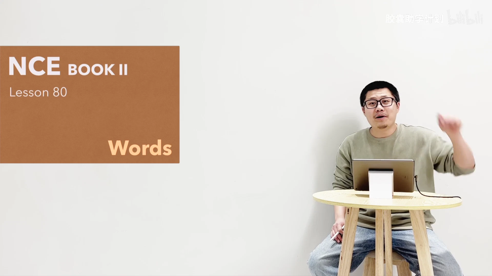

文字识别：NCE / BOOKⅡI / Lesson 80 / Words

### 画面 00:00:02

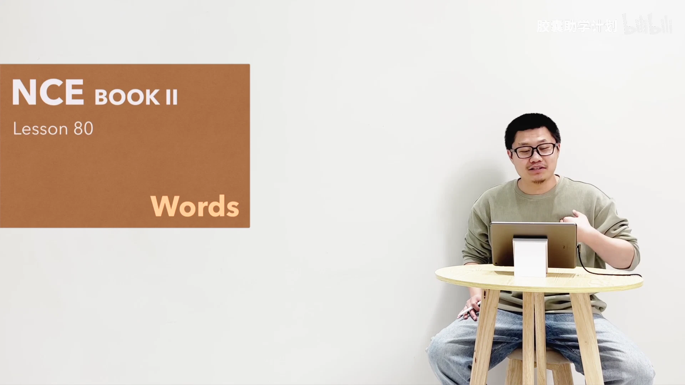

文字识别：NCE / BOOKⅡI / Lesson 80 / Words

### 画面 00:00:05

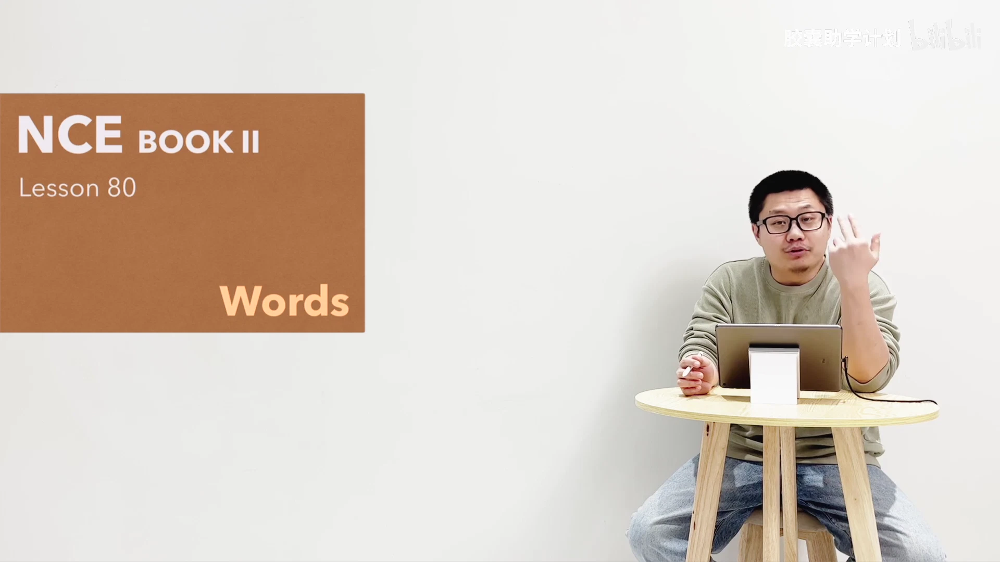

文字识别：NCE / BOOK"I / Lesson 80 / Words

### 画面 00:00:09

文字识别：复助字计划一调

### 画面 00:00:11

文字识别：①如何表达“展示/陈列”？

### 画面 00:00:13

文字识别：①如何表达“展示/陈列”？

### 画面 00:00:15

文字识别：①如何表达“展示/陈列”？ / 如何表达“赚钱/盈利”?

### 画面 00:00:17

文字识别：①如何表达“展示/陈列”？ / 如何表达“赚钱/盈利”?

### 画面 00:00:19

文字识别：①如何表达“展示/陈列”？ / 如何表达“赚钱/盈利”? / 如何表达“去上大学”?

### 画面 00:00:25

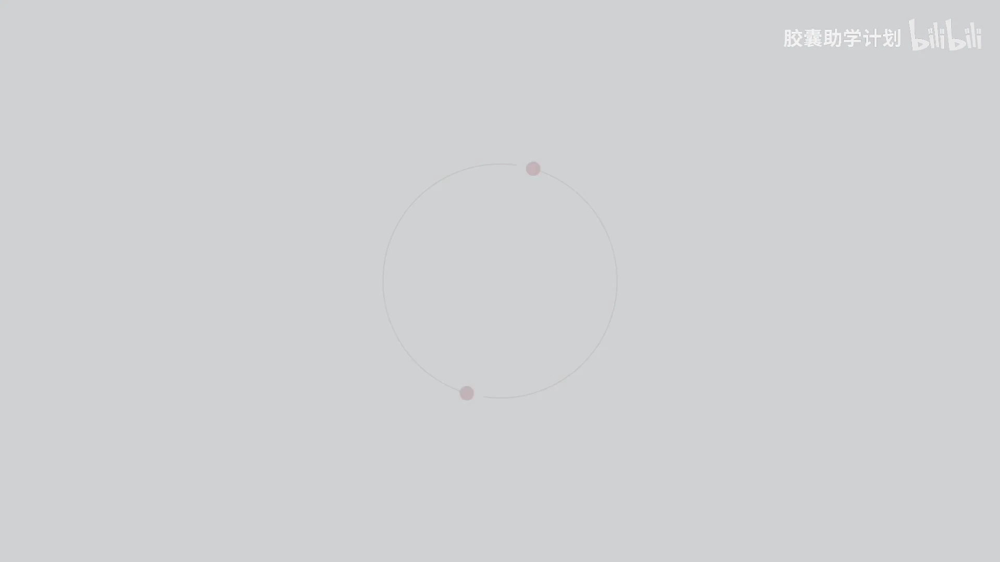

文字识别：胶囊助学计划 bil

### 画面 00:00:28

文字识别：胶囊助学计划册出 / 胶囊助学计划

## 00:00:30–00:01:00

看第一个小的单词啊，这个 palace palace 宫殿啊，比如说我们各位可以回去查一下，你正好多学一个东西，比如说 summer palace 到底指的是什么啊？然后这个 palace 呢，我们指的是宫殿，对吧？本课学的是 crystal palace 水晶宫啊，是第一次世博会这个呃开展的一个地方，对吧？在这个地方叫 crystal palace palace 水晶宫

### 画面 00:00:30

文字识别：单词造句指南 / 网：v.+v.变化 / 四句型转换 / 方式/地点/时间 / 结合习惯用法 / 其他单词+词性 / 原文摘抄+变 / 6123456 / / 'pæ lIs/ / palace n.

### 画面 00:00:33

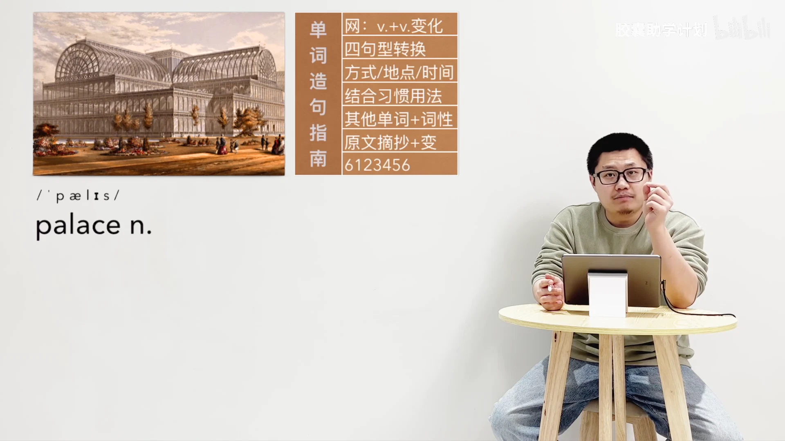

文字识别：单词造句指南 / 网：v.+v.变化 / 四句型转换 / 方式/地点/时间 / 结合习惯用法 / 其他单词+词性 / 原文摘抄+变 / 6123456 / / 'pæ lIs / / palace n.

### 画面 00:00:35

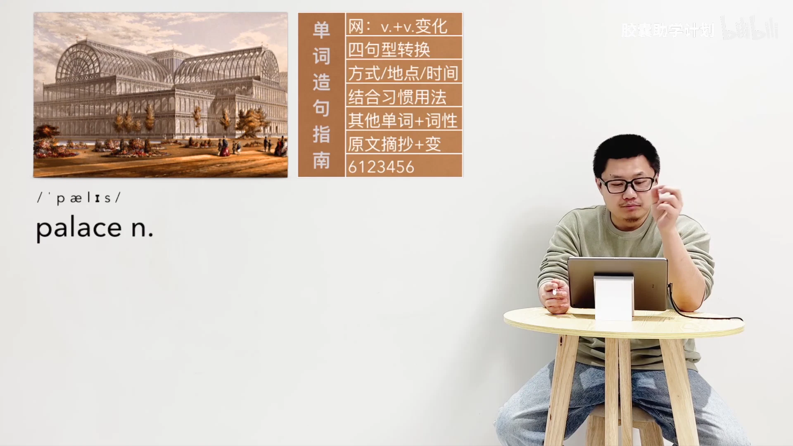

文字识别：单词造句指南 / 网：v.+v.变化 / 四句型转换 / 方式/地点/时间 / 结合习惯用法 / 其他单词+词性 / 原文摘抄+变 / 6123456 / / 'pæ lIs / / palace n.

### 画面 00:00:37

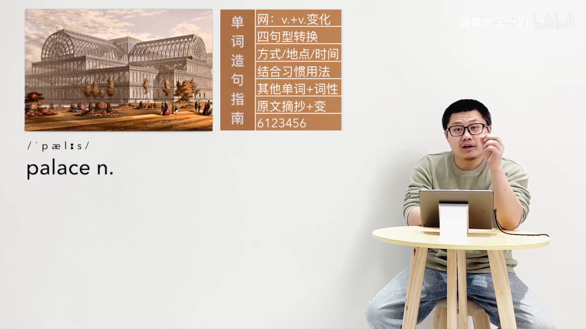

文字识别：单词造句指南 / 网：v.+v.变化 / 四句型转换 / 方式/地点/时间 / 结合习惯用法 / 其他单词+词性 / 原文摘抄+变 / 6123456 / / 'pæ lIs/ / palace n.

### 画面 00:00:39

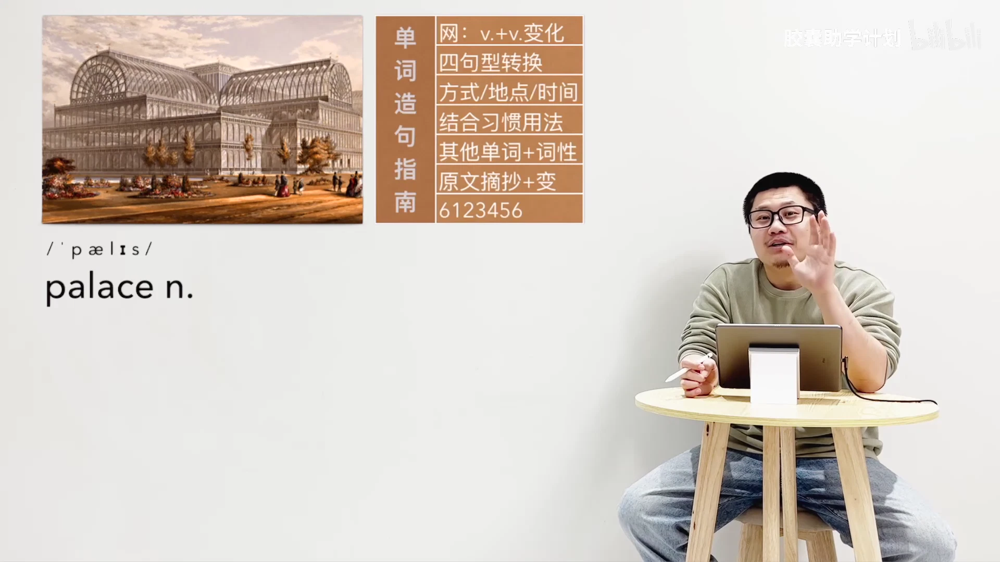

文字识别：单词造句指南 / 网：v.+v.变化 / 四句型转换 / 方式/地点/时间 / 结合习惯用法 / 其他单词+词性 / 原文摘抄+变 / 6123456 / / 'pæ lIs / / palace n.

### 画面 00:00:41

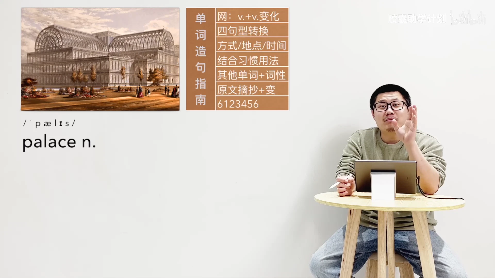

文字识别：单词造句指南 / 网：v.+v.变化 / 辜助字计划 / 四句型转换 / 方式/地点/时间 / 结合习惯用法 / 其他单词+词性 / 原文摘抄+变 / 6123456 / / 'pæ lIs / / palace n.

### 画面 00:00:44

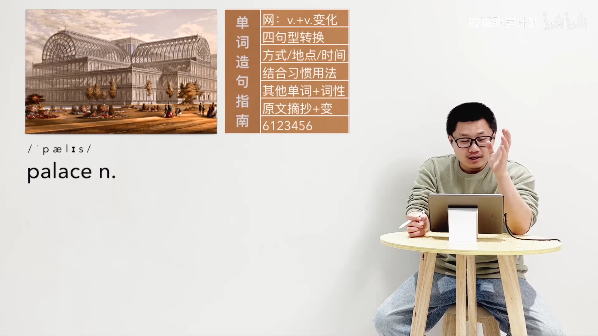

文字识别：单词造句指南 / 网：v.+v.变化 / 辜助字计划 / 四句型转换 / 方式/地点/时间 / 结合习惯用法 / 其他单词+词性 / 原文摘抄+变 / 6123456 / / 'pæ lIs / / palace n.

### 画面 00:00:48

文字识别：单词造句指南 / 网：v.+v.变化 / 四句型转换 / 方式/地点/时间 / 结合习惯用法 / 其他单词+词性 / 原文摘抄+变 / 6123456 / / 'pæ lIs / / palace n.

### 画面 00:00:50

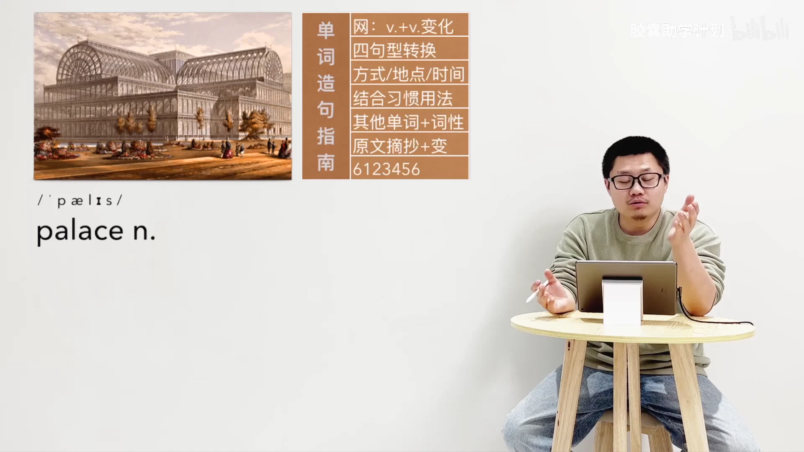

文字识别：单词造句指南 / 网：v.+v.变化 / 四句型转换 / 方式/地点/时间 / 结合习惯用法 / 其他单词+词性 / 原文摘抄+变 / 6123456 / / 'pæ lⅠs / / palace n.

### 画面 00:00:53

文字识别：单词造句指南 / 网：v.+v.变化 / 四句型转换 / 方式/地点/时间 / 结合习惯用法 / 其他单词+词性 / 原文摘抄+变 / 6123456 / / 'pæ lIs / / palace n.

### 画面 00:00:56

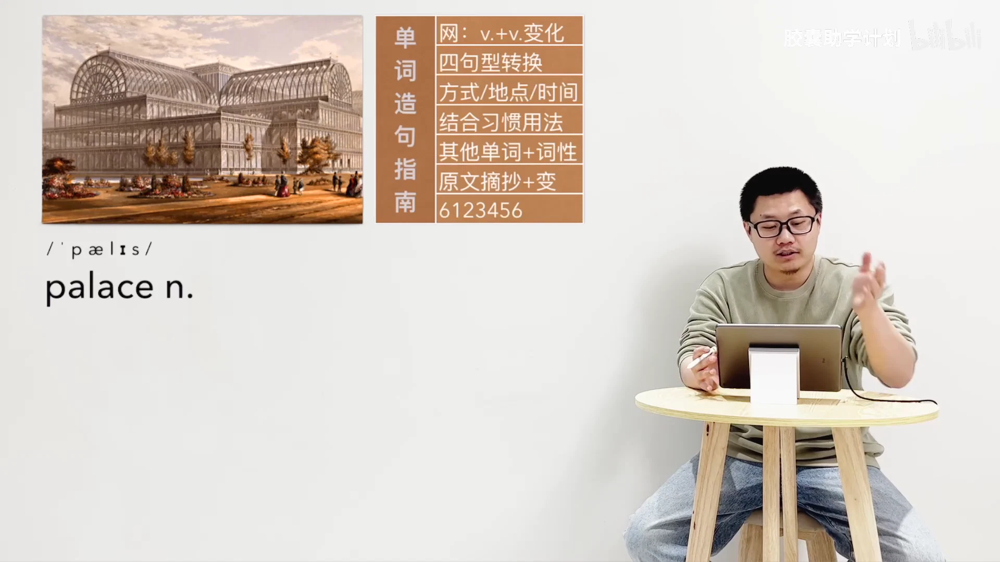

文字识别：单词造句指南 / 网：v.+v.变化 / 四句型转换 / 方式/地点/时间 / 结合习惯用法 / 其他单词+词性 / 原文摘抄+变 / 6123456 / / 'pæ lIs/ / palace n.

## 00:01:00–00:01:30

呃，宫殿。那palace这个单词呢，在六一二三四五六当中，我们最容易判断的，它可以处于一，处于三，处于五，对吧？可以当主语、宾语，也可以当一个地点。拿它去造句就不会特别困难了。比如说，They visited the palace last week.啊，你想一下，Last week I went to the theater，对吧？哎，这个基本上跟第一课是很类。第一课第一句话的思路，造句思路基本是保持一致的啊。然后呢，我们做一个

### 画面 00:01:03

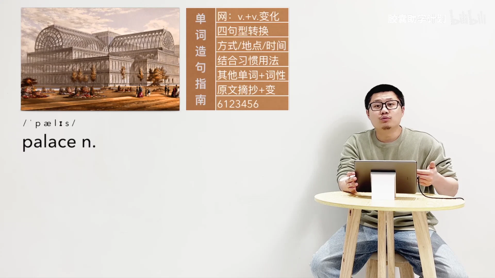

文字识别：单词造句指南 / 网：v.+v.变化 / 妻助字计划 / 四句型转换 / 方式/地点/时间 / 结合习惯用法 / 其他单词+词性 / 原文摘抄+变 / 6123456 / / 'pæ lIs / / palace n.

### 画面 00:01:06

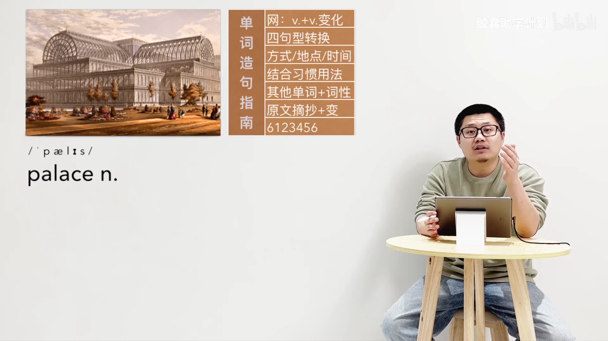

文字识别：单词造句指南 / 网：v.+v.变化 / 辜助字计划 / 四句型转换 / 方式/地点/时间 / 结合习惯用法 / 其他单词+词性 / 原文摘抄+变 / 6123456 / / 'pæ lIs/ / palace n.

### 画面 00:01:11

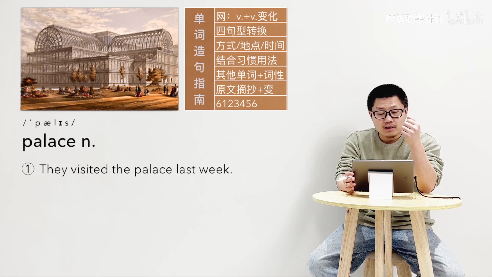

文字识别：单词造句指南 / 网：v.+v.变化 / 四句型转换 / 方式/地点/时间 / 结合习惯用法 / 其他单词+词性 / 原文摘抄+变 / 6123456 / / 'pæ lIs / / palace n. / ① They visited the palace last week.

### 画面 00:01:14

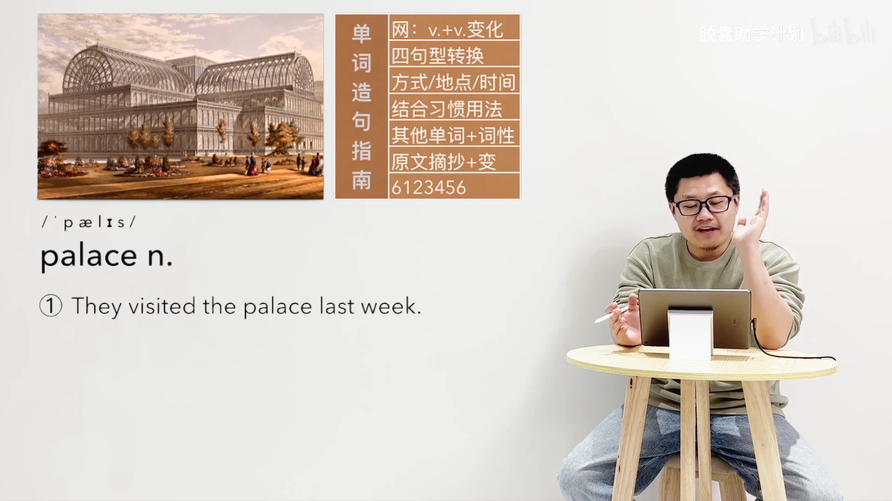

文字识别：单词造句指南 / 网：v.+v.变化 / 四句型转换 / 方式/地点/时间 / 结合习惯用法 / 其他单词+词性 / 原文摘抄+变 / 6123456 / / 'pæ lIs / / palace n. / ① They visited the palace last week.

### 画面 00:01:18

文字识别：单词造句指南 / 网：v.+v.变化 / 四句型转换 / 方式/地点/时间 / 结合习惯用法 / 其他单词+词性 / 原文摘抄+变 / 6123456 / / 'pæ lIs / / palace n. / ① They visited the palace last week.

### 画面 00:01:21

文字识别：单词造句指南 / 网：v.+v.变化 / 四句型转换 / 方式/地点/时间 / 结合习惯用法 / 其他单词+词性 / 原文摘抄+变 / 6123456 / / 'pæ lIs / / palace n. / ① They visited the palace last week.

### 画面 00:01:23

文字识别：单词造句指南 / 网：v.+v.变化 / 四句型转换 / 方式/地点/时间 / 结合习惯用法 / 其他单词+词性 / 原文摘抄+变 / 6123456 / / 'pæ lIs / / palace n. / ① They visited the palace last week.

### 画面 00:01:26

文字识别：单词造句指南 / 网：v.+v.变化 / 四句型转换 / 方式/地点/时间 / 结合习惯用法 / 其他单词+词性 / 原文摘抄+变 / 6123456 / / 'pælIs/ / palace n. / ① They visited the palace last week.

## 00:01:30–00:02:00

简单的四语型转换。好，continue。 The palace takes its name from the king。说这个水晶宫呢，哎取名字这个国王啊。Next one，说They kept guard in front of the palace for all night。说他们啊守卫着这个宫殿整晚上啊都在这个宫殿的前面去守卫着它。OK， very good。那再跟我读一遍这个单词 palace。

### 画面 00:01:30

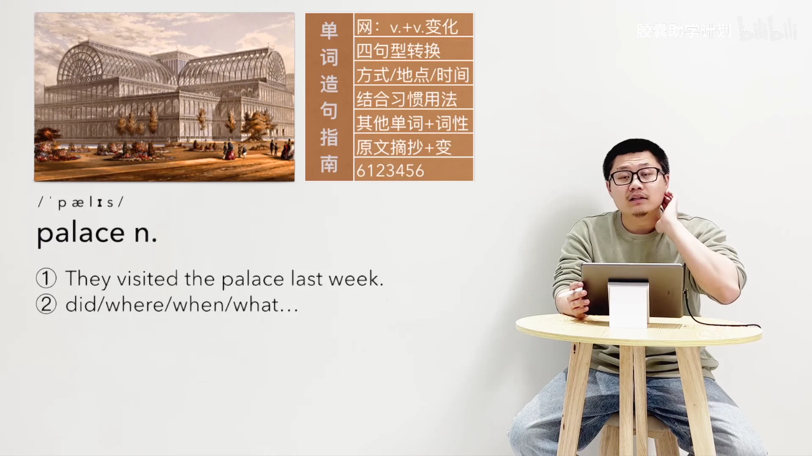

文字识别：单词造句指南 / 网：v.+v.变化 / 四句型转换 / 方式/地点/时间 / 结合习惯用法 / 其他单词+词性 / 原文摘抄+变 / 6123456 / / 'pæ lIs / / palace n. / ① They visited the palace last week. / ) did/where/when/what...

### 画面 00:01:32

文字识别：单词造句指南 / 网：v.+v.变化 / 四句型转换 / 方式/地点/时间 / 结合习惯用法 / 其他单词+词性 / 原文摘抄+变 / 6123456 / / 'pælIs/ / palace n. / ① They visited the palace last week. / did/where/when/what... / The palace takes its name from the king. / L71

### 画面 00:01:35

文字识别：单词造句指南 / 网：v.+v.变化 / 四句型转换 / 方式/地点/时间 / 结合习惯用法 / 其他单词+词性 / 原文摘抄+变 / 6123456 / / 'pælIs/ / palace n. / ① They visited the palace last week. / did/where/when/what... / The palace takes its name from the king. / L71

### 画面 00:01:40

文字识别：单词造句指南 / 网：v.+v.变化 / 四句型转换 / 方式/地点/时间 / 结合习惯用法 / 其他单词+词性 / 原文摘抄+变 / 6123456 / / 'pælIs/ / palace n. / ① They visited the palace last week. / did/where/when/what... / The palace takes its name from the king. / L71

### 画面 00:01:43

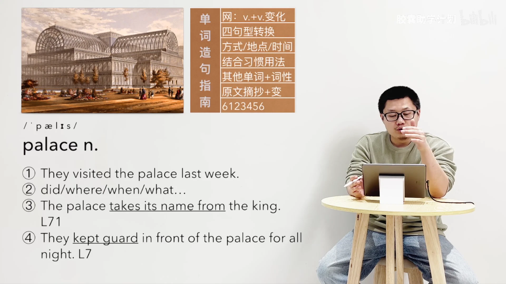

文字识别：单词造句指南 / 网：v.+v.变化 / 四句型转换 / 方式/地点/时间 / 结合习惯用法 / 其他单词+词性 / 原文摘抄+变 / 6123456 / /'pælIs/ / palace n. / ① They visited the palace last week. / did/where/when/what... / The palace takes its name from the king. / 3 / L71 / They kept guard in front of the palace for all / night. L7

### 画面 00:01:45

文字识别：单词造句指南 / 网：v.+v.变化 / 四句型转换 / 方式/地点/时间 / 结合习惯用法 / 其他单词+词性 / 原文摘抄+变 / 6123456 / / 'pælIs/ / palace n. / ① They visited the palace last week. / did/where/when/what... / The palace takes its name from the king. / 3 / L71 / They kept guard in front of the palace for all / night. L7

### 画面 00:01:50

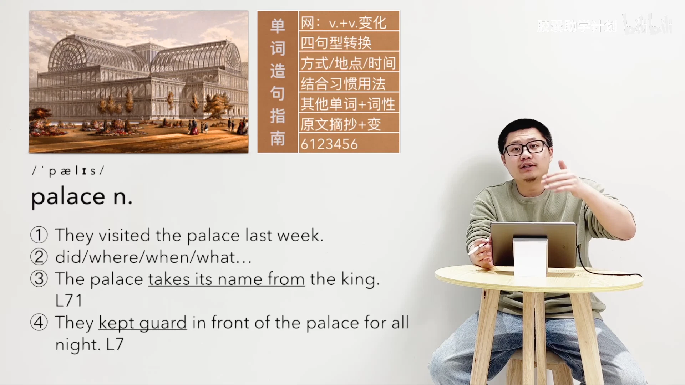

文字识别：单词造句指南 / 网：v.+v.变化 / 四句型转换 / 方式/地点/时间 / 结合习惯用法 / 其他单词+词性 / 原文摘抄+变 / 6123456 / / pælIs/ / palace n. / ① They visited the palace last week. / did/where/when/what... / The palace takes its name from the king. / L71 / They kept guard in front of the palace for all / night. L7

### 画面 00:01:56

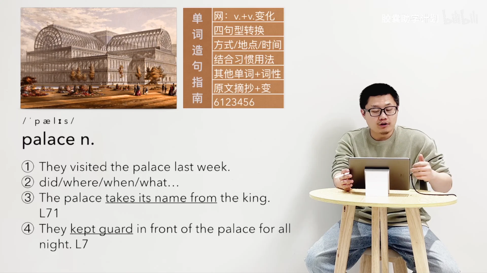

文字识别：单词造句指南 / 网：v.+v.变化 / 四句型转换 / 方式/地点/时间 / 结合习惯用法 / 其他单词+词性 / 原文摘抄+变 / 6123456 / / 'pælis/ / palace n. / ① They visited the palace last week. / did/where/when/what... / The palace takes its name from the king. / 3 / L71 / They kept guard in front of the palace for all / night. L7

### 画面 00:01:59

文字识别：单词造句指南 / 网：v.+v.变化 / 四句型转换 / 方式/地点/时间 / 结合习惯用法 / 其他单词+词性 / 原文摘抄+变 / 6123456 / /ik'stroidinari/ / extraordinary adj.

## 00:02:00–00:02:30

Very good. Next one,下一个单词看一下音标叫extraordinary, extraordinary, extraordinary. Extraordinary的意思，它可以形容很多东西。首先注意它本身是一个形容词，那它可以加上很多很多的名词。比如说，像这个图中一样，我们就可以说叫extraordinary building，非凡的。哎，一般来指的是特别好的啊，不一样的，不同寻常的

### 画面 00:02:01

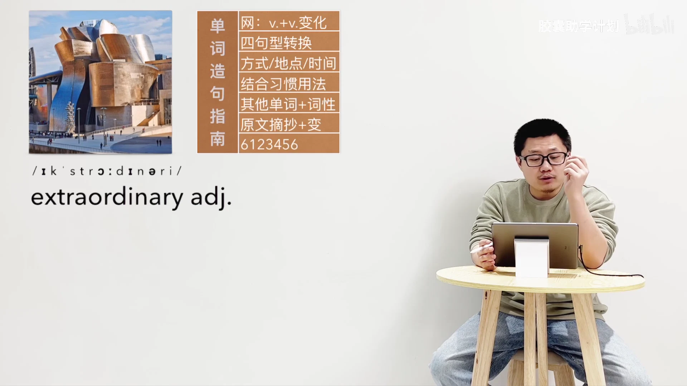

文字识别：单词造句指南 / 网：v.+v.变化 / 四句型转换 / 方式/地点/时间 / 结合习惯用法 / 其他单词+词性 / 原文摘抄+变 / 6123456 / /ik'stroidinari/ / extraordinary adj.

### 画面 00:02:05

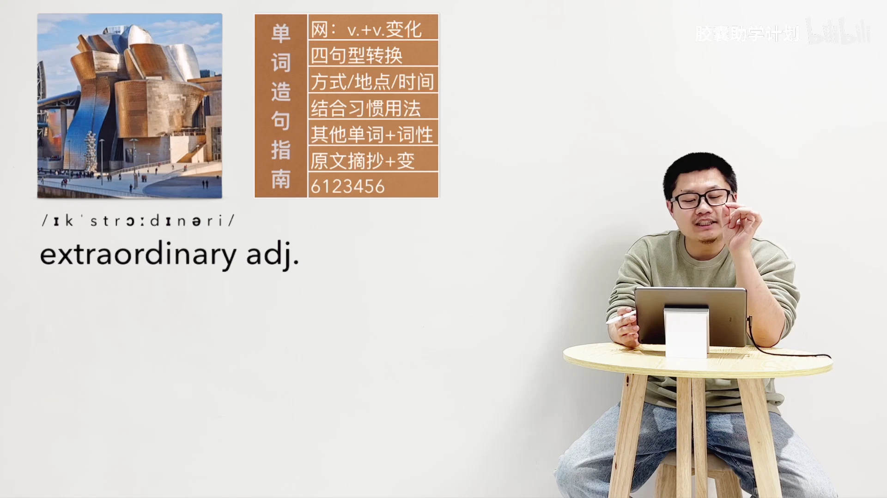

文字识别：单词造句指南 / 网：v.+v.变化 / 四句型转换 / 方式/地点/时间 / 结合习惯用法 / 其他单词+词性 / 原文摘抄+变 / 6123456 / /ik'stroidinari/ / extraordinary adj.

### 画面 00:02:11

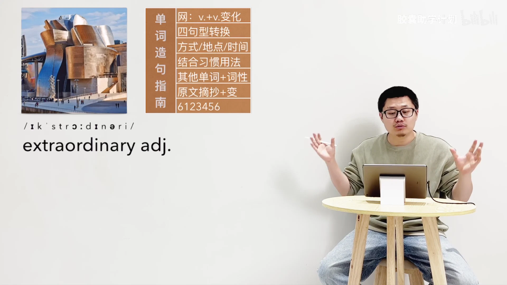

文字识别：单词造句指南 / 网：v.+v.变化 / 四句型转换 / 方式/地点/时间 / 结合习惯用法 / 其他单词+词性 / 原文摘抄+变 / 6123456 / /ik'stroidinari/ / extraordinary adj.

### 画面 00:02:15

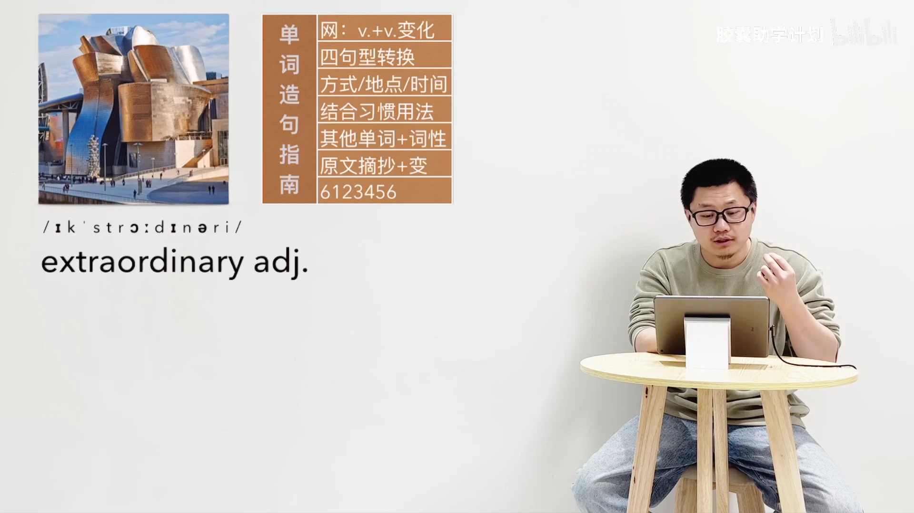

文字识别：单词造句指南 / 网：v.+v.变化 / 四句型转换 / 方式/地点/时间 / 结合习惯用法 / 其他单词+词性 / 原文摘抄+变 / 6123456 / /ik'stroidinari/ / extraordinary adj.

### 画面 00:02:17

文字识别：单词造句指南 / 网：v.+v.变化 / 四句型转换 / 方式/地点/时间 / 结合习惯用法 / 其他单词+词性 / 原文摘抄+变 / 6123456 / /ik'stroidinari/ / extraordinary adj. +Y.

### 画面 00:02:19

文字识别：单词造句指南 / 网：v.+v.变化 / 四句型转换 / 方式/地点/时间 / 结合习惯用法 / 其他单词+词性 / 原文摘抄+变 / 6123456 / /ik'stroidinari/ / extraordinary adj. +Y.

### 画面 00:02:21

文字识别：单词造句指南 / 网：v.+v.变化 / 四句型转换 / 方式/地点/时间 / 结合习惯用法 / 其他单词+词性 / 原文摘抄+变 / 6123456 / /ik'stroidinari/ / extraordinary adj. +Y.

### 画面 00:02:25

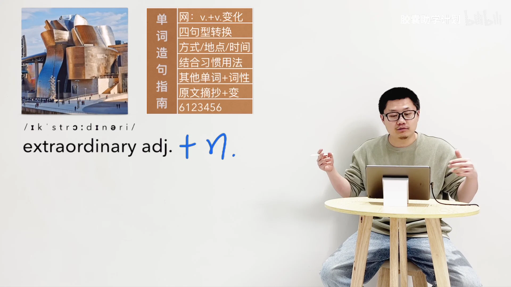

文字识别：单词造句指南 / 网：v.+v.变化 / 四句型转换 / 方式/地点/时间 / 结合习惯用法 / 其他单词+词性 / 原文摘抄+变 / 6123456 / /ik'stroidinari/ / extraordinary adj. + N.

## 00:02:30–00:03:00

的这样一个建筑物叫 extraordinary building. 那我们知道了形容词要套上名词，这是我们说造句的时候的一个词性的事儿，对吧？那我们可以造一个句子，比如说 He is an extraordinary man. 这个人特别厉害，特别不一样，特别不同寻常. extraordinary man. Next one. 感叹句 What an extraordinary building! 或者是 idea 都可以啊，这是一个非常好的，哎，这看起来非常的

### 画面 00:02:37

文字识别：单词造句指南 / 网：v.+v.变化 / 四句型转换 / 方式/地点/时间 / 结合习惯用法 / 其他单词+词性 / 原文摘抄+变 / 6123456 / /ik'stroidinari/ / extraordinary adj. + Y.

### 画面 00:02:40

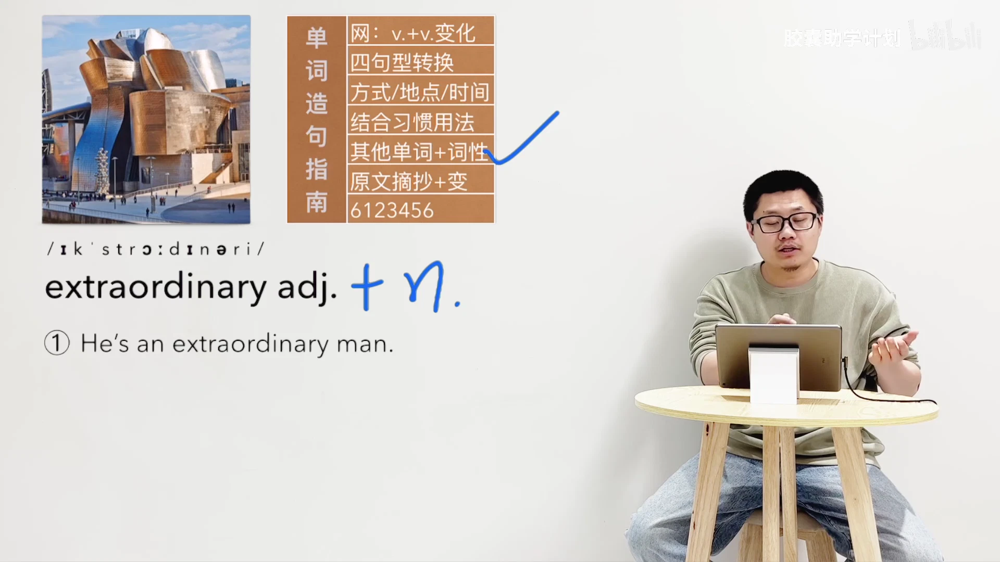

文字识别：单词造句指南 / 网：v.+v.变化 / 四句型转换 / 方式/地点/时间 / 结合习惯用法 / 其他单词+词性 / 原文摘抄+变 / 6123456 / /ik'stroidinari/ / extraordinary adj. +Y. / ① He's an extraordinary man.

### 画面 00:02:45

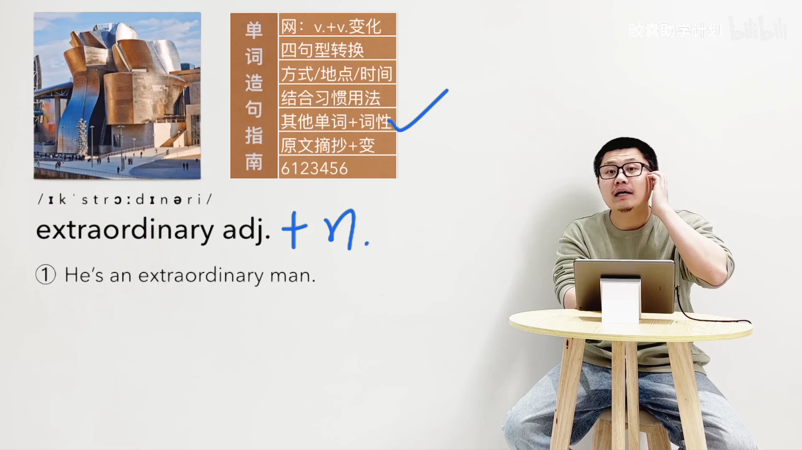

文字识别：单词造句指南 / 网：v.+v.变化 / 四句型转换 / 方式/地点/时间 / 结合习惯用法 / 其他单词+词性 / 原文摘抄+变 / 6123456 / /ik'stroidinari/ / extraordinary adj. +Y. / ① He's an extraordinary man.

### 画面 00:02:50

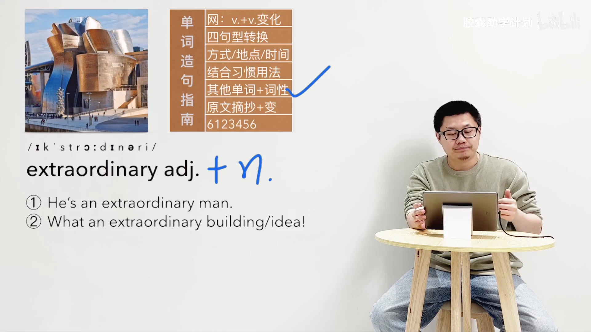

文字识别：单词造句指南 / 网：v.+v.变化 / 四句型转换 / 方式/地点/时间 / 结合习惯用法 / 其他单词+词性 / 原文摘抄+变 / 6123456 / /ik'stroidinari/ / extraordinary adj. + Y. / ① He's an extraordinary man. / What an extraordinary building/idea!

### 画面 00:02:56

文字识别：单词造句指南 / 网：v.+v.变化 / 四句型转换 / 方式/地点/时间 / 结合习惯用法 / 其他单词+词性 / 原文摘抄+变 / 6123456 / /ik'stroidinari/ / extraordinary adj. + Y. / ① He's an extraordinary man. / What an extraordinary building/idea!

### 画面 00:02:58

文字识别：单词造句指南 / 网：v.+v.变化 / 四句型转换 / 方式/地点/时间 / 结合习惯用法 / 其他单词+词性 / 原文摘抄+变 / 6123456 / /ik'stroidinari/ / extraordinary adj. + Y. / ① He's an extraordinary man. /  What an extraordinary building/idea!

## 00:03:00–00:03:30

宏伟或者很漂亮，很不一样的建筑物，或者这个主意哎，太不同寻常了。Next one, so would you mind my visiting the extraordinary building later?哎，六十八课咱们学的说你介不介意我怎么怎么样，对吧？哎，其实这个地方还涉及到了一个这儿用my的语法，而不是用me啊。口语当中用me没有问题，但考试当中他肯定就给你算错了啊。Next one,说we should have visited the extraordinary

### 画面 00:03:01

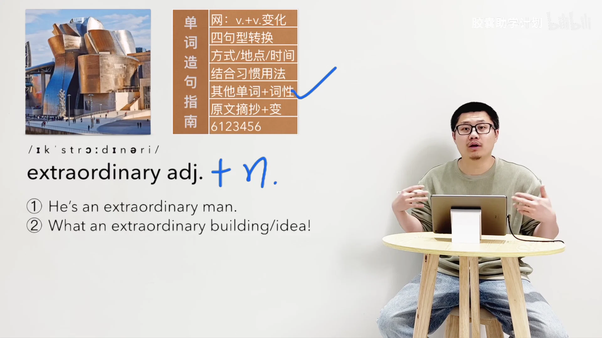

文字识别：单词造句指南 / 网：v.+v.变化 / 字计划 / 四句型转换 / 方式/地点/时间 / 结合习惯用法 / 其他单词+词性 / 原文摘抄+变 / 6123456 / /ik'stroidinari/ / extraordinary adj. + Y. / ① He's an extraordinary man. / ) What an extraordinary building/idea!

### 画面 00:03:06

文字识别：单词造句指南 / 网：v.+v.变化 / 四句型转换 / 方式/地点/时间 / 结合习惯用法 / 其他单词+词性 / 原文摘抄+变 / 6123456 / /ik'stroidinari/ / extraordinary adj. 十 Y. / ① He's an extraordinary man. / What an extraordinary building/idea! / Would you mind my visiting the / extraordinary building later? L68

### 画面 00:03:10

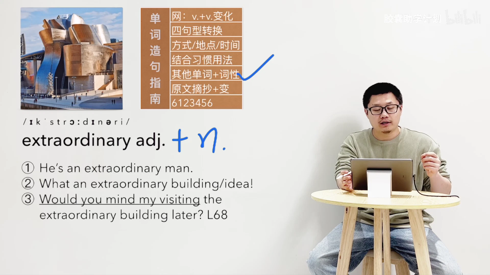

文字识别：单词造句指南 / 网：v.+v.变化 / 四句型转换 / 方式/地点/时间 / 结合习惯用法 / 其他单词+词性 / 原文摘抄+变 / 6123456 / /ik'stro:dinari/ / extraordinary adj. + Y. /  He's an extraordinary man. / 1 / What an extraordinary building/idea! / Would you mind my visiting the / extraordinary building later? L68

### 画面 00:03:16

文字识别：单词造句指南 / 网：v.+v.变化 / 学计划 / 四句型转换 / 方式/地点/时间 / 结合习惯用法 / 其他单词+词性 / 原文摘抄+变 / 6123456 / /ik'stro:dinari/ / extraordinary adj. + Y. /  He's an extraordinary man. / 1 / What an extraordinary building/idea! / Would you mind my visiting the / extraordinary building later? L68

### 画面 00:03:18

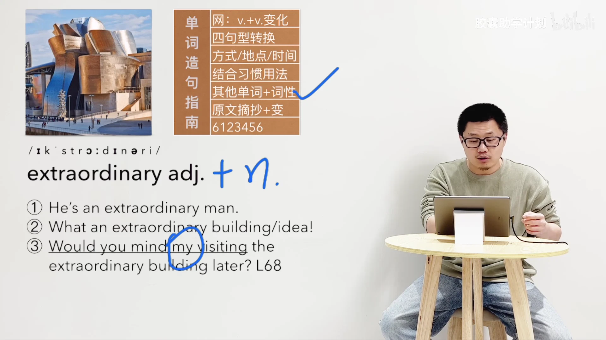

文字识别：单词造句指南 / 网：v.+v.变化 / 子计划 / 四句型转换 / 方式/地点/时间 / 结合习惯用法 / 其他单词+词性 / 原文摘抄+变 / 6123456 / /ik'stro:dinari/ / extraordinary adj. + Y. / ) He's an extraordinary man. / What an extraordipary building/idea! / Would you mindmyyisiting the / extraordinary bulding later? L68

### 画面 00:03:20

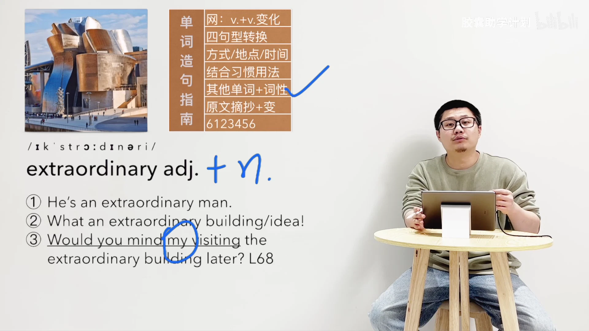

文字识别：单词造句指南 / 网：v.+v.变化 / 四句型转换 / 方式/地点/时间 / 结合习惯用法 / 其他单词+词性 / 原文摘抄+变 / 6123456 / /ik'stroidinari/ / extraordinary adj. + Y. /  He's an extraordinary man. / 1 / What an extraordipary building/idea! / Would you mindmy yisiting the / extraordinary bulding later? L68

### 画面 00:03:26

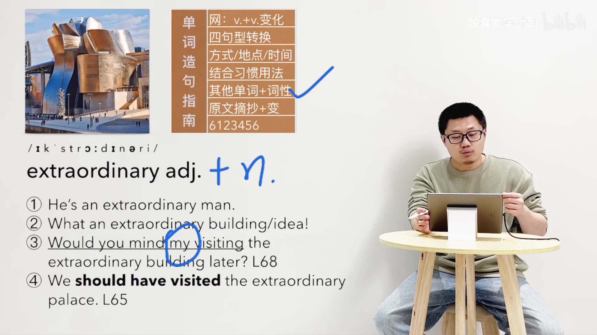

文字识别：单词造句指南 / 网：v.+v.变化 / 字计划 / 四句型转换 / 方式/地点/时间 / 结合习惯用法 / 其他单词+词性 / 原文摘抄+变 / 6123456 / /ik'stro:dinari/ / extraordinary adj. + Y. / ① He's an extraordinary man. / What an extraordipary building/idea! / Would you mindmy yisiting the / extraordinary bulding later? L68 /  We should have visited the extraordinary / palace. L65

## 00:03:30–00:04:00

place. 复习了一下六十五课。呃，其实进入我们整个第四单元啊，越靠后越这样。其实没有太多新的语法了，几乎就是复习、复习、再复习，为整个学习进入第三册啊打下一个夯实的基础，对吧？第三册的时候呢，我们默认为是二册，你掌握的很不错了，对吧？所以你像我们二册这地方，我多说两句。我们二册它的这个

### 画面 00:03:30

文字识别：单词造句指南 / 网：v.+v.变化 / 四句型转换 / 方式/地点/时间 / 结合习惯用法 / 其他单词+词性 / 原文摘抄+变 / 6123456 / /ik'stro:dinari/ / extraordinary adj. + Y. / ① He's an extraordinary man. / What an extraordipary building/idea! / Would you mindmy yisiting the / extraordinary bulding later? L68 / We should have visited the extraordinary / palace.L65

### 画面 00:03:33

文字识别：单词造句指南 / 网：v.+v.变化 / 四句型转换 / 方式/地点/时间 / 结合习惯用法 / 其他单词+词性 / 原文摘抄+变 / 6123456 / /ik'stro:dinari/ / extraordinary adj. + Y. / ① He's an extraordinary man. / What an extraordipary building/idea! / Would you mindmy yisiting the / extraordinary bulding later? L68 /  We should have visited the extraordinary / palace.L65

### 画面 00:03:35

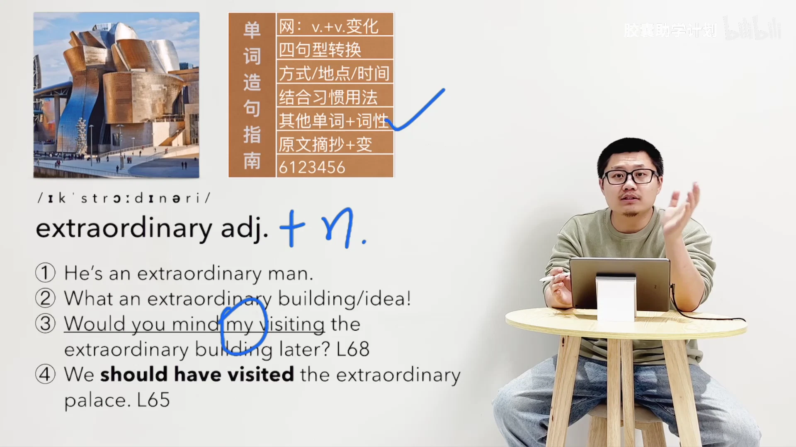

文字识别：单词造句指南 / 网：v.+v.变化 / 学计划 / 四句型转换 / 方式/地点/时间 / 结合习惯用法 / 其他单词+词性 / 原文摘抄+变 / 6123456 / /ik'stro:dinari/ / extraordinary adj. + Y. / ① He's an extraordinary man. / What an extraordipary building/idea! / Would you mindmy yisiting the / extraordinary buNding later? L68 /  We should have visited the extraordinary / palace.L65

### 画面 00:03:37

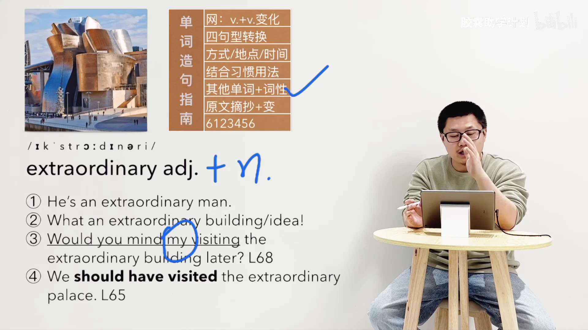

文字识别：单词造句指南 / 网：v.+v.变化 / 四句型转换 / 方式/地点/时间 / 结合习惯用法 / 其他单词+词性 / 原文摘抄+变 / 6123456 / /ik'stroidinari/ / extraordinary adj. 十 Y. / ① He's an extraordinary man. / What an extraordipary building/idea! / Would you mindmy yisiting the / extraordinary bulding later? L68 / We should have visited the extraordinary / palace.L65

### 画面 00:03:45

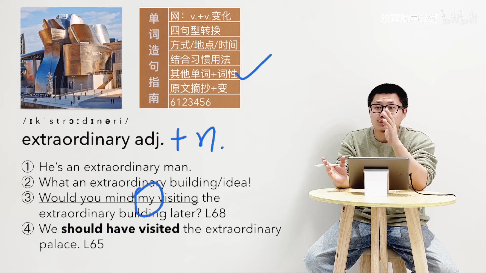

文字识别：单词造句指南 / 网：v.+v.变化 / 四句型转换 / 方式/地点/时间 / 结合习惯用法 / 其他单词+词性 / 原文摘抄+变 / 6123456 / /ik'stroidinari/ / extraordinary adj. + Y. / ① He's an extraordinary man. / What an extraordipary building/idea! / Would you mindmy yisiting the / extraordinary bulding later? L68 / We should have visited the extraordinary / palace.L65

### 画面 00:03:57

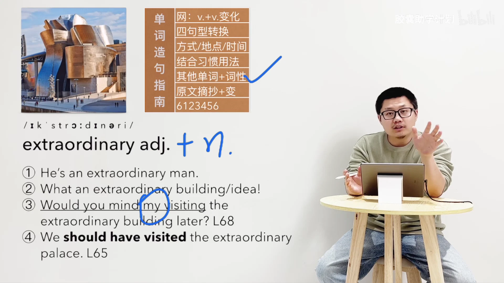

文字识别：单词造句指南 / 网：v.+v.变化 / 字计划 / 四句型转换 / 方式/地点/时间 / 结合习惯用法 / 其他单词+词性 / 原文摘抄+变 / 6123456 / /ik'stroidinari/ / extraordinary adj. + Y. / ① He's an extraordinary man. / What an extraordipary building/idea! / Would you mindmy yisiting the / extraordinary buNding later? L68 /  We should have visited the extraordinary / palace.L65

## 00:04:00–00:04:30

课程思路是：第一个单元几乎是在复习第一册，第二个单元、第三个单元在学习新的知识，而第四个单元又进入了复习整本书的这样一个环节啊。所以我们会不停的见到之前学到的东西。那我们就遵从这个逻辑，用了一个 should have done，本应该怎么怎么样。那注意力集中，咱们听一个电影片段。 He thinks you a most extraordinary

### 画面 00:04:05

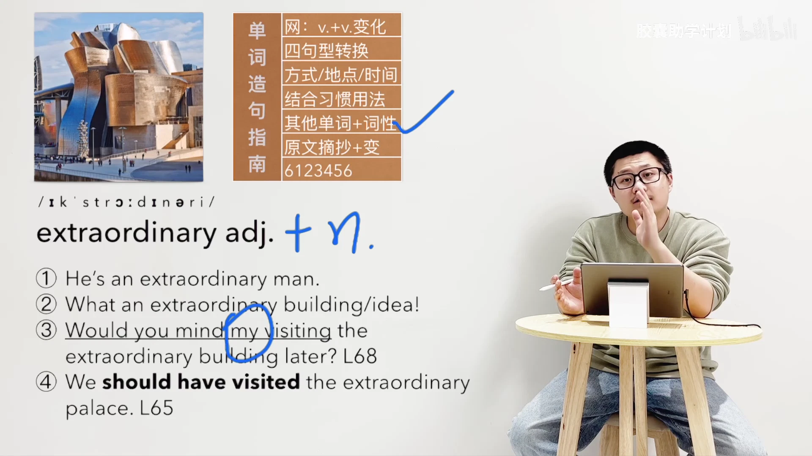

文字识别：单词造句指南 / 网：v.+v.变化 / 四句型转换 / 方式/地点/时间 / 结合习惯用法 / 其他单词+词性 / 原文摘抄+变 / 6123456 / /ik'stroidinari/ / extraordinary adj. + Y. / ① He's an extraordinary man. / What an extraordipary building/idea! / Would you mindmy yisiting the / extraordinary bulding later? L68 /  We should have visited the extraordinary / palace.L65

### 画面 00:04:17

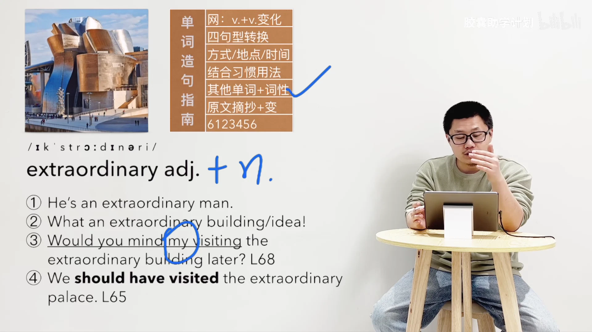

文字识别：单词造句指南 / 网：v.+v.变化 / 字计划 / 四句型转换 / 方式/地点/时间 / 结合习惯用法 / 其他单词+词性 / 原文摘抄+变 / 6123456 / /ik'stro:dinari/ / extraordinary adj. 十 Y. / ① He's an extraordinary man. / What an extraordipary building/idea! / Would you mindmy yisiting the / extraordinary bulding later? L68 /  We should have visited the extraordinary / palace.L65

### 画面 00:04:20

文字识别：单词造句指南 / 网：v.+v.变化 / 四句型转换 / 方式/地点/时间 / 结合习惯用法 / 其他单词+词性 / 原文摘抄+变 / 6123456 / /ik'stro:dinari/ / extraordinary adj. 十Y. / ① He's an extraordinary man. / What an extraordipary building/idea! / Would you mindmy yisiting the / extraordinary bulding later? L68 /  We should have visited the extraordinary / palace.L65

### 画面 00:04:22

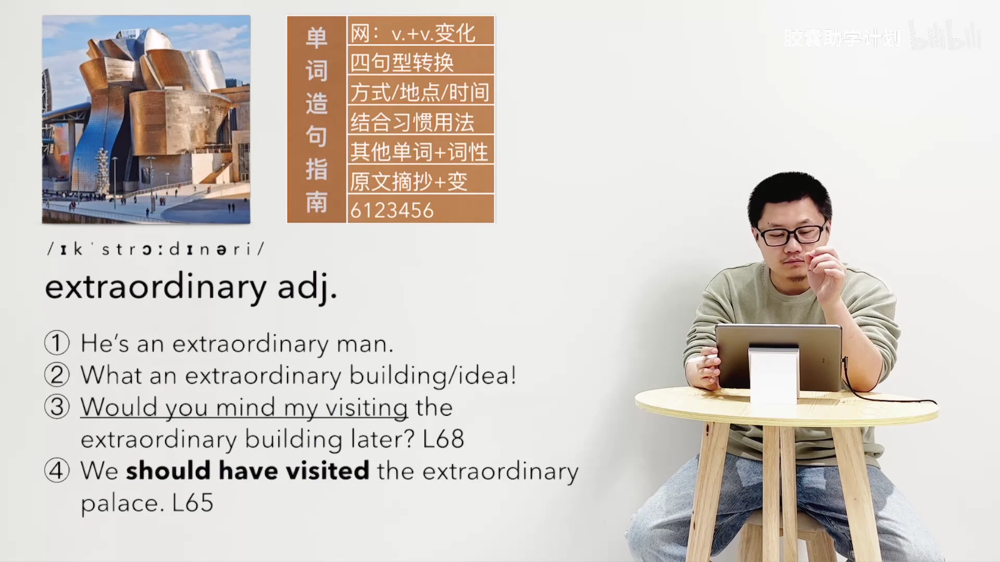

文字识别：单词造句指南 / 网：v.+v.变化 / 字计划 / 四句型转换 / 方式/地点/时间 / 结合习惯用法 / 其他单词+词性 / 原文摘抄+变 / 6123456 / /ik'stro:dinari/ / extraordinary adj. / ① He's an extraordinary man. / What an extraordinary building/idea! / Would you mind my visiting the / extraordinary building later? L68 /  We should have visited the extraordinary / palace.L65

### 画面 00:04:24

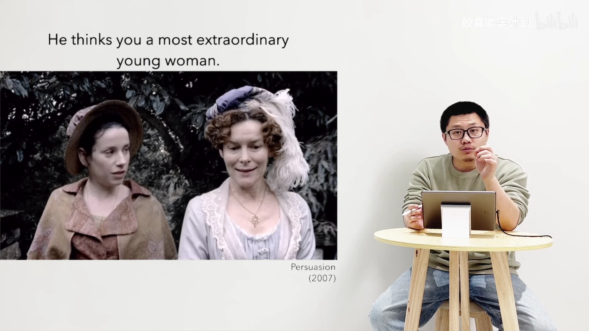

文字识别：He thinks you a most extraordinary / young woman. / Persuasion / (2007)

### 画面 00:04:27

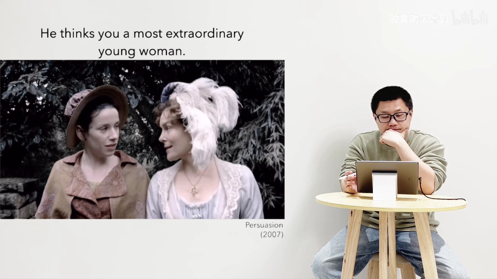

文字识别：He thinks you a most extraordinary / young woman. / Persuasion / (2007)

### 画面 00:04:29

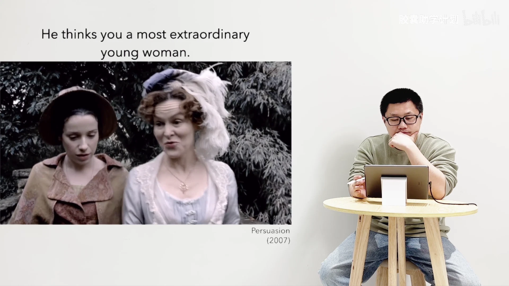

文字识别：He thinks you a most extraordinary / young woman. / Persuasion / (2007)

## 00:04:30–00:05:00

young woman. Very good. Next one, exhibition, exhibition, exhibition,展览，对吧？Exhibition. 那他去造句子，比如说，He lost his temper in the middle of the exhibition. 他在这个展览的中间突然间就怎么样了呢？这个脾气就爆发了，对吧？Lost his temper. 好，七十八课。Next one, say why don't we? 这个是咱们七十四课学的，实际上是一个很常用口语当中表建

### 画面 00:04:31

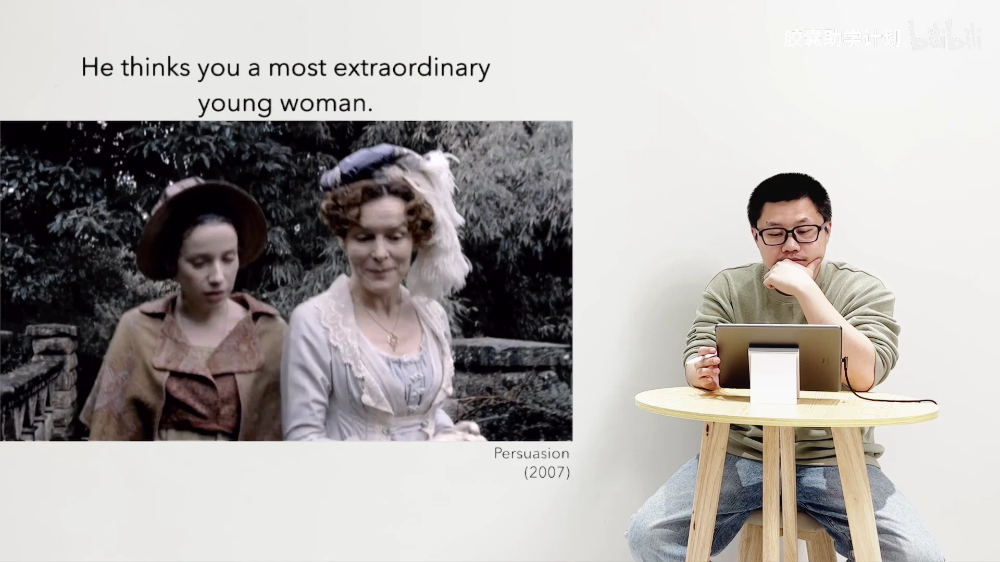

文字识别：He thinks you a most extraordinary / young woman. / Persuasion / (2007)

### 画面 00:04:33

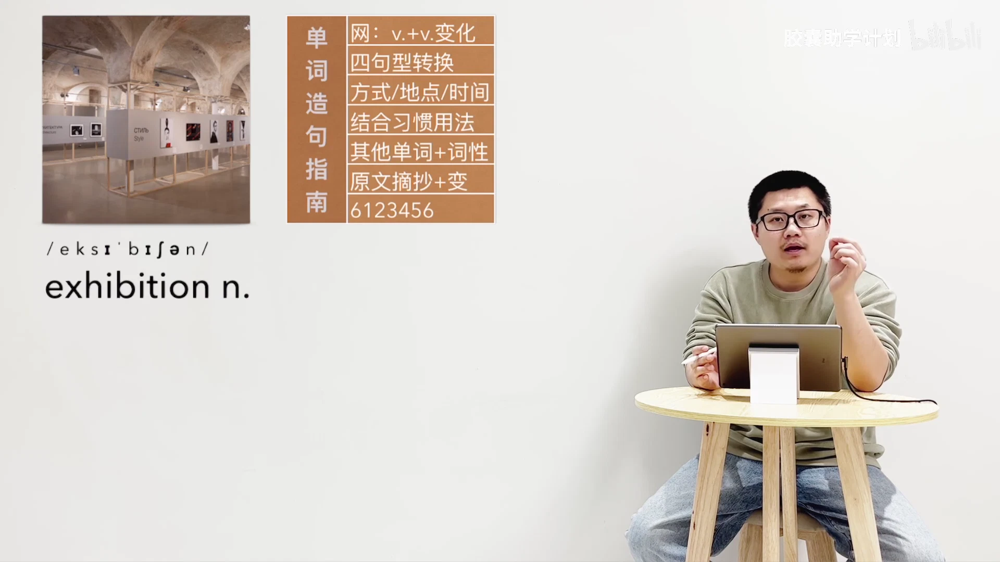

文字识别：单词造句指南 / 网：v.+v.变化 / 囊助字计划 / 四句型转换 / 方式/地点/时间 / 结合习惯用法 / CTW. / Sye / 其他单词+词性 / 原文摘抄+变 / 6123456 / /eksi'bi∫an/ / exhibition n.

### 画面 00:04:40

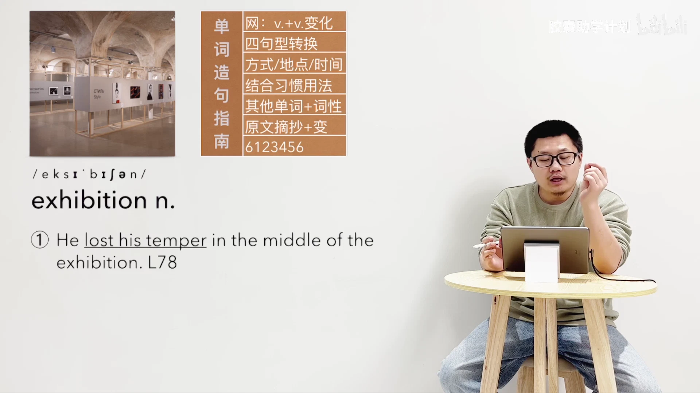

文字识别：单词造句指南 / 网：v.+v.变化 / 四句型转换 / 方式/地点/时间 / 结合习惯用法 / CTW / 其他单词+词性 / 原文摘抄+变 / 6123456 / /eksl'bi∫an/ / exhibition n. / ① He lost his temper in the middle of the / exhibition. L78

### 画面 00:04:53

文字识别：单词造句指南 / 网：v.+v.变化 / 四句型转换 / 方式/地点/时间 / 结合习惯用法 / CTW / 其他单词+词性 / 原文摘抄+变 / 6123456 / /eksi'bi∫an/ / exhibition n. / ① He lost his temper in the middle of the / exhibition. L78 / Why don't we invite them to the exhibition? / L74

## 00:05:00–00:05:30

议，叫也说咱们要不也怎么怎么样吧，要不咱们一块儿怎么怎么样吧，算是一种提建议。比如说今天大家一块儿出去玩，但又不知道去做什么，想一下干嘛吧。来了一个句子叫 Why don't we invite them to the exhibition? 对吧？ Next one, I'm curious to find out why you enjoy the exhibition. 说我很想弄清楚，说为什么你很喜欢这个展览，但我

### 画面 00:05:08

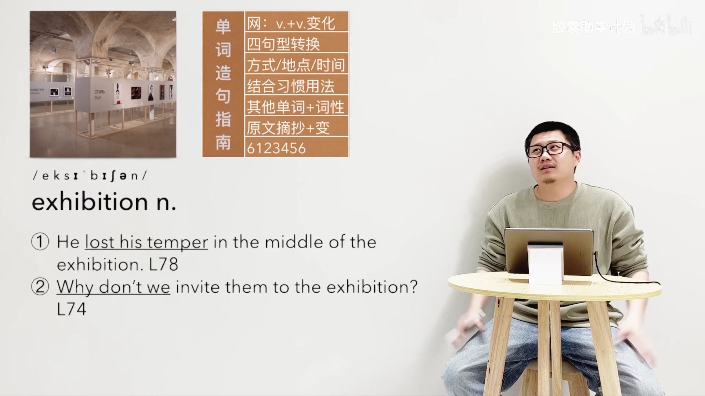

文字识别：单词造句指南 / 网：v.+v.变化 / 妻助字计划 / 四句型转换 / 方式/地点/时间 / 结合习惯用法 / CTWIb / Syie / 其他单词+词性 / 原文摘抄+变 / 6123456 / /eksi'bi∫an/ / exhibition n. / ① He lost his temper in the middle of the / exhibition.L78 / Why don't we invite them to the exhibition? / L74

### 画面 00:05:17

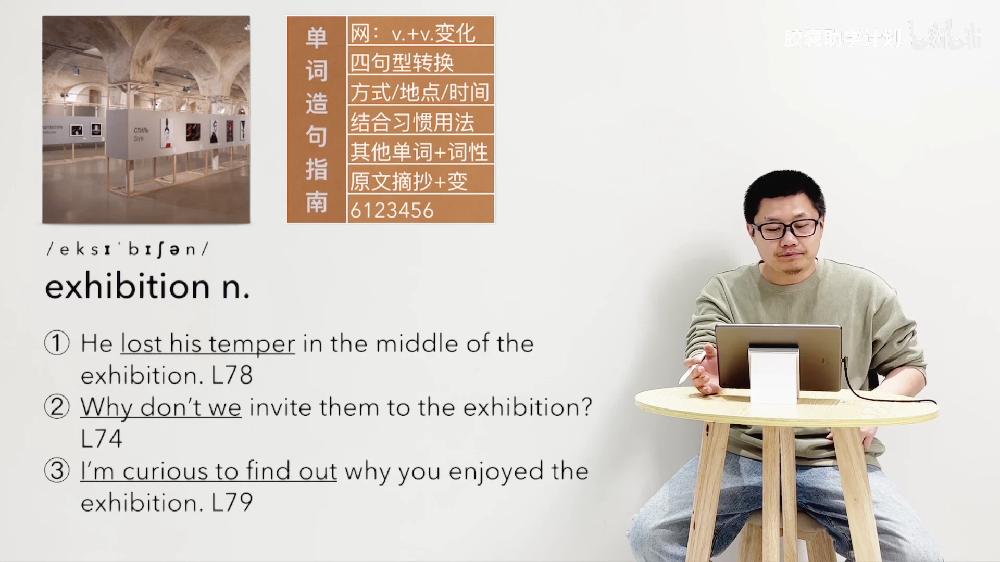

文字识别：单词造句指南 / 网：v.+v.变化 / 四句型转换 / 方式/地点/时间 / 结合习惯用法 / CTWb / 其他单词+词性 / 原文摘抄+变 / 6123456 / /eksi'bi ∫an/ / exhibition n. / ① He lost his temper in the middle of the / exhibition. L78 / Why don't we invite them to the exhibition? / L74 / I'm curious to find out why you enjoyed the / exhibition. L79

### 画面 00:05:20

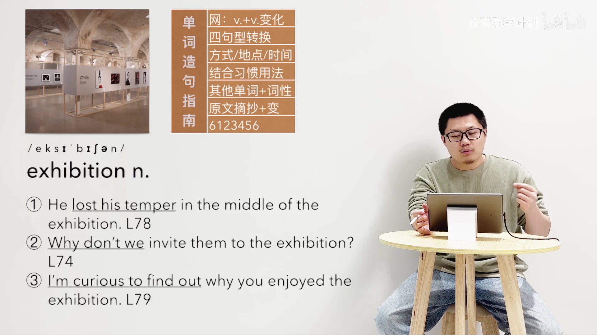

文字识别：单词造句指南 / 网：v.+v.变化 / 囊助字计划 / 四句型转换 / 方式/地点/时间 / 结合习惯用法 / CTW / Slyle / 其他单词+词性 / 原文摘抄+变 / 6123456 / /eksi'bi ∫an/ / exhibition n. / ① He lost his temper in the middle of the / exhibition.L78 / Why don't we invite them to the exhibition? / L74 / I'm curious to find out why you enjoyed the / exhibition. L79

### 画面 00:05:26

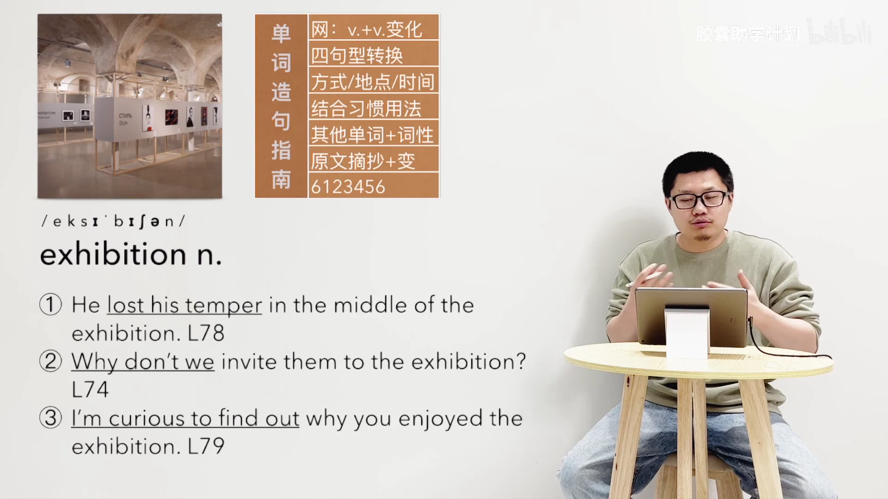

文字识别：单词造句指南 / 网：v.+v.变化 / 四句型转换 / 方式/地点/时间 / 结合习惯用法 / CTM / Sye / 其他单词+词性 / 原文摘抄+变 / 6123456 / /eksi'bi ∫an/ / exhibition n. / ① He lost his temper in the middle of the / exhibition.L78 / Why don't we invite them to the exhibition? / L74 / I'm curious to find out why you enjoyed the / exhibition. L79

## 00:05:30–00:06:00

感觉完全无感，对吧？我想透过你的眼睛去欣赏一下这个展览。I'm curious to find out why you enjoy the exhibition. 不要忘了张嘴跟我去读啊。Okay, next one. 那注意力集中，咱们看这个电影片段。I was wondering if you'd like to see an exhibition, just a little one. Very good. 下一个单词 iron。这个单词其实看音标读起来，哪怕你去听真人发音去听起来，它的发音都

### 画面 00:05:35

文字识别：单词造句指南 / 网：v.+v.变化 / 四句型转换 / 方式/地点/时间 / 结合习惯用法 / CTW / Syo / 其他单词+词性 / 原文摘抄+变 / 6123456 / /eksi'bi ∫an/ / exhibition n. / ① He lost his temper in the middle of the / exhibition.L78 / Why don't we invite them to the exhibition? / L74 / I'm curious to find out why you enjoyed the / exhibition. L79

### 画面 00:05:43

文字识别：L was wondering if you'd like to / see an exhibition, just a little one. / The Man from Hong Kong / (1975)

### 画面 00:05:47

文字识别：L was wondering if you'd like to / see an exhibition, just a little one. / The Man from Hong Kong / (1975)

### 画面 00:05:49

文字识别：L was wondering if you'd like to / see an exhibition, just a little one. / The Man from Hong Kong / (1975)

### 画面 00:05:51

文字识别：单词造句指南 / 网：v.+v.变化 / 妻助字计划 / 四句型转换 / 方式/地点/时间 / 结合习惯用法 / 其他单词+词性 / 原文摘抄+变 / 6123456 / /aian/ / iron n.

### 画面 00:05:55

文字识别：单词造句指南 / 网：v.+v.变化 / 泰助字计划一 / 四句型转换 / 方式/地点/时间 / 结合习惯用法 / 其他单词+词性 / 原文摘抄+变 / 6123456 / /aian/ / iron n.

## 00:06:00–00:06:30

好像不是那么容易模仿。我速度稍微慢一点，我们看一下，叫做 iron, iron, iron. Okay, 重音在前面 iron. Okay, 好，那读一下，说 they try to turn iron into gold. 他们把A变成B，他们正在尝试把铁变成金子，类似于点石成金。 Next one, so he managed to escape with an iron bar in his hand. 那这个 iron bar 是什么

### 画面 00:06:03

文字识别：单词造句指南 / 网：v.+v.变化 / 奏助学计划 / 四句型转换 / 方式/地点/时间 / 结合习惯用法 / 其他单词+词性 / 原文摘抄+变 / 6123456 / /aian/ / iron n.

### 画面 00:06:06

文字识别：单词造句指南 / 网：v.+v.变化 / 妻助字计划陽 / 四句型转换 / 方式/地点/时间 / 结合习惯用法 / 其他单词+词性 / 原文摘抄+变 / 6123456 / /aian/ / iron n.

### 画面 00:06:16

文字识别：单词造句指南 / 网：v.+v.变化 / 妻助字计划 / 四句型转换 / 方式/地点/时间 / 结合习惯用法 / 其他单词+词性 / 原文摘抄+变 / 6123456 / /aian/ / iron n. / ① They tried to turn iron into gold. L66

### 画面 00:06:24

文字识别：单词造句指南 / 网：v.+v.变化 / 四句型转换 / 方式/地点/时间 / 结合习惯用法 / 其他单词+词性 / 原文摘抄+变 / 6123456 / /aian/ / iron n. / ) They tried to turn iron into gold. L66 / He managed to escape with an iron bar in / his hand. L67

## 00:06:30–00:07:00

意思？bar有柱状物的意思。那iron bar就是一个铁铁棍，你可以这样理解，对吧？铁棒、铁棍。然后这里的叫做manage to do something呢？那叫就类似于呃呃，我们之前学过的一个was were able to do，对吧？它不单纯是try，它实际上还有一种successfully的意思，对吧？就是他成功的完成了逃脱这件事情，对吧？逃跑这件事情。Next

### 画面 00:06:54

文字识别：单词造句指南 / 网：v.+v.变化 / 囊助字计划 / 四句型转换 / 方式/地点/时间 / 结合习惯用法 / 其他单词+词性 / 原文摘抄+变 / 6123456 / /aian/ / iron n. / They tried to turn iron into gold. L66 / He managed to escape with an iron bar in / his hand. L67

### 画面 00:06:59

文字识别：单词造句指南 / 网：v.+v.变化 / 四句型转换 / 方式/地点/时间 / 结合习惯用法 / 其他单词+词性 / 原文摘抄+变 / 6123456 / /aian/ / iron n. / ① They tried to turn iron into gold. L66 /  He managed to escape with an iron bar in / his hand. L67 / He smashed the windows to pieces with an / iron bar. L49

## 00:07:00–00:07:30

one, he smashed the windows to pieces with an iron bar. 哎，还是刚才那个 iron bar，对吧？哎，那 smash something to pieces，这是九课咱们学的一个习惯用法。再读一遍这个单词 iron， very good. Next one，下一个单词叫 various. Various 这个单词就让我想起了之前我们学过的一个短语叫 all kinds of，或者叫 all sorts of，有点类似啊，各种各样的，对吧？各种各样的。比如说，那你注意

### 画面 00:07:10

文字识别：单词造句指南 / 网：v.+v.变化 / 四句型转换 / 方式/地点/时间 / 结合习惯用法 / 其他单词+词性 / 原文摘抄+变 / 6123456 / /aian/ / iron n. / ① They tried to turn iron into gold. L66 /  He managed to escape with an iron bar in / his hand. L67 / He smashed the windows to pieces with an / iron bar. L49

### 画面 00:07:13

文字识别：单词造句指南 / 网：v.+v.变化 / 四句型转换 / 方式/地点/时间 / 结合习惯用法 / 其他单词+词性 / 原文摘抄+变 / 6123456 / /aian/ / iron n. / ① They tried to turn iron into gold. L66 / He managed to escape with an iron bar in / his hand. L67 / He smashed the windows to pieces with an / iron bar. L49

### 画面 00:07:15

文字识别：单词造句指南 / 网：v.+v.变化 / salutt / 囊助字计划 / 四句型转换 / 方式/地点/时间 / 结合习惯用法 / 其他单词+词性 / 原文摘抄+变 / 6123456 / nOO DRR / /'vearias/ / various adj.

### 画面 00:07:20

文字识别：单词造句指南 / 网：v.+v.变化 / Saluet / 菱助字计划園 / 四句型转换 / 方式/地点/时间 / 结合习惯用法 / 其他单词+词性 / 原文摘抄+变 / 6123456 / NOO DRJ / /'vearias/ / various adj.

### 画面 00:07:27

文字识别：salue! / 单词造句指南 / 网：v.+v.变化 / 喜助子计划 / 四句型转换 / 方式/地点/时间 / 结合习惯用法 / 其他单词+词性 / 原文摘抄+变 / 6123456 / nOO DIRJ / /'vearias/ / various adj.

### 画面 00:07:29

文字识别：单词造句指南 / 网：v.+v.变化 / saluts / 四句型转换 / 方式/地点/时间 / 结合习惯用法 / 其他单词+词性 / 原文摘抄+变 / 6123456 / nOO DLRJ / /'vearias/ / various adj. / ① I have been reading various books for / many years. L52

## 00:07:30–00:08:00

到它是一个形容词，那各种各样的什么呢？名词，比如说 various books，哪一个？那我们就造了一个句子：I have been reading various books for many years。这么多年来，我一直在读不同类型的书，在学习，对吧？Have been doing 五十二课咱们学的。Next one，这是一个时态啊。He has a great appetite，习惯用法，胃口很好，and enjoys eating various food，

### 画面 00:07:31

文字识别：Salue! / 单词造句指南 / 网：v.+v.变化 / 辜助子计划 / 四句型转换 / 方式/地点/时间 / 结合习惯用法 / 其他单词+词性 / 原文摘抄+变 / 6123456 / NOO DaJ / /'vearias/ / various adj. / D I have been reading various books for / 1 / many years. L52

### 画面 00:07:35

文字识别：salue! / 单词造句指南 / 网：v.+v.变化 / 妻助字计划 / 四句型转换 / 方式/地点/时间 / 结合习惯用法 / 其他单词+词性 / 原文摘抄+变 / 6123456 / NOO DIRJ / /'vearias/ / various adj. = N. / ① I have been reading various books for / many years. L52

### 画面 00:07:40

文字识别：单词造句指南 / 网：v.+v.变化 / salutt / 辜助字讨划 / 四句型转换 / 方式/地点/时间 / 结合习惯用法 / 其他单词+词性 / 原文摘抄+变 / 6123456 / NOO DRJ / /'vearias/ / various adj. = N. / ① I have been reading various books for / many years. L52

### 画面 00:07:51

文字识别：单词造句指南 / 网：v.+v.变化 / salutt / 四句型转换 / 方式/地点/时间 / 结合习惯用法 / 其他单词+词性 / 原文摘抄+变 / 6123456 / /'vearias/ / various adj. = N. / ① I have been reading various books for / many years. L52 / He has a great appetite and enjoys eating / various food L78 L68

## 00:08:00–00:08:30

很喜欢吃不同类型的食物。Okay,这是两个习惯用法。Next one, it occurred to me that,哎，我突然想起来一件事儿，就suddenly realize. He knew various people in our office.我们办公室里各式各样的人，三教九流他都认的，对吧？It occurred to me that后边加一句话。四十六和咱们学的习惯用法，所以还是你看在这里，various分别加了books, food, and people.那还可

### 画面 00:08:04

文字识别：单词造句指南 / 网：v.+v.变化 / salutt / 四句型转换 / 方式/地点/时间 / 结合习惯用法 / 其他单词+词性 / 原文摘抄+变 / 6123456 / nOO DaJ / /'vearias/ / various adj. = N. / ① I have been reading various books for / many years. L52 / He has a great appetite and enjoys eating / Various food L78 L68 / It occurred to me that he knew / various people in our office. L46

### 画面 00:08:06

文字识别：单词造句指南 / 网：v.+v.变化 / salut! / 奏助字计划 / 四句型转换 / 方式/地点/时间 / 结合习惯用法 / 其他单词+词性 / 原文摘抄+变 / 6123456 / NOO DIRJ / /'vearias/ / various adj. = N. / ① I have been reading various books for / many years. L52 / He has a great appetite and enjoys eating / various food L78 L68 / It occurred to me that he knew / various people in our office. L46

### 画面 00:08:11

文字识别：单词造句指南 / 网：v.+v.变化 / Salut! / 四句型转换 / 方式/地点/时间 / 结合习惯用法 / 其他单词+词性 / 原文摘抄+变 / nOOD / 6123456 / /'vearias/ / various adj. = N. / ① I have been reading various books for / many years. L52 / He has a great appetite and enjoys eating / various food L78 L68 / It occurred to me that he knew / various people in our office. L46

### 画面 00:08:20

文字识别：单词造句指南 / 网：v.+v.变化 / salut! / 四句型转换 / 方式/地点/时间 / 结合习惯用法 / 其他单词+词性 / 原文摘抄+变 / 6123456 / NOO DIRJ / /'vearias/ / various adj. =N. / ① I have been reading various books for / many years. L52 / He has a great appetite and enjoys eating / various food L78 L68 / It occurred to me that he knew / various people in our office. L46

### 画面 00:08:26

文字识别：单词造句指南 / 网：v.+v.变化 / salut! / 囊助学计划 / 四句型转换 / 方式/地点/时间 / 结合习惯用法 / 其他单词+词性 / 原文摘抄+变 / 6123456 / NOO DIR / /'vearias/ / various adj. →N. / ① I have been reading various bookfor / many years. L52 / He has a great appetite and enjoys eating / Various food L78 L68 / It occurred to me that he knew / Various people in our office. L46

### 画面 00:08:28

文字识别：单词造句指南 / 网：v.+v.变化 / salut! / 奏助字计划 / 四句型转换 / 方式/地点/时间 / 结合习惯用法 / 其他单词+词性 / 原文摘抄+变 / 6123456 / NOO DIR / /'vearias/ / various adj. = N. / ① I have been reading various bookfor / many years. L52 / He has a great appetite and enjoys eating / variousoodL78 L68 / It occurred to me that he knew / various/people in our office. L46

## 00:08:30–00:09:00

以加别的。这个您现在知道这三个单词就够了，够至少我们造句了，对吧？Next one,下一个单词，注意力集中，看一下它的音标。 Machinery, machinery, machinery, machinery就是机器的意思。它类似于一个统称啊，所以它比较常见的其实叫piece of machinery. Piece在各位脑海当中意思叫片儿块儿。如果你学过新一四十一课的话，对吧？好，

### 画面 00:08:30

文字识别：单词造句指南 / 网：v.+v.变化 / Salutr / 四句型转换 / 方式/地点/时间 / 结合习惯用法 / 其他单词+词性 / 原文摘抄+变 / 6123456 / nOO DAJ / /'vearias/ / various adj. → N. / ① I have been reading various booksfor / many years. L52 / He has a great appetite and enjoys eating / various0odL78 L68 / It occurred to me that he knew / variouspeoplsi / in our office. L46

### 画面 00:08:35

文字识别：单词造句指南 / 网：v.+v.变化 / 囊助学计划陽 / 四句型转换 / U2M0 / 方式/地点/时间 / 结合习惯用法 / 其他单词+词性 / 原文摘抄+变 / 6123456 / /maJi:nari/ / machinery n.

### 画面 00:08:41

文字识别：单词造句指南 / 网：v.+v.变化 / 囊助学计划園 / 四句型转换 / J2HL / 方式/地点/时间 / 结合习惯用法 / 其他单词+词性 / 原文摘抄+变 / 6123456 / /ma'Ji:nari/ / machinery n.

### 画面 00:08:46

文字识别：单词造句指南 / 网：v.+v.变化 / 妻助字计划園 / 四句型转换 / 方式/地点/时间 / 结合习惯用法 / 其他单词+词性 / 原文摘抄+变 / 6123456 / /ma'∫i:nari/ / machinery n.

### 画面 00:08:50

文字识别：单词造句指南 / 网：v.+v.变化 / 喜助字计划 / 四句型转换 / 方式/地点/时间 / 结合习惯用法 / 其他单词+词性 / 原文摘抄+变 / 6123456 / /maJi:nari/ / machinery n. / ) It's a very expensive piece of machinery. / Prometheus (2012)

### 画面 00:08:52

文字识别：单词造句指南 / 网：v.+v.变化 / 辜助字计划 / 四句型转换 / 方式/地点/时间 / 结合习惯用法 / 其他单词+词性 / 原文摘抄+变 / 6123456 / /ma'Ji:nari / / machinery n. /  It's a very expensive piece of machinery. / Prometheus (2012)

### 画面 00:08:59

文字识别：单词造句指南 / 网：v.+v.变化 / 四句型转换 / 方式/地点/时间 / 结合习惯用法 / 其他单词+词性 / 原文摘抄+变 / 6123456 / /ma'Ji:nari/ / machinery n. /  It's a very expensive piece of machinery. / Prometheus (2012)

## 00:09:00–00:09:30

呃，我相信大部分同学对 piece 这个单词的意思，应该也就是这个含义了，一片一块儿，对吧？一层啊，类似于这样的意思啊，还一般没有一层，就是一片一块儿。那这里你说，如果说它是一个特别昂贵一片机器，这个就肯定是翻译不通的。其实就是一部啊，一台啊，一台机器，一部机器，对吧？好，然后再来说，She was curious to find out what this wonderful machinery

### 画面 00:09:22

文字识别：单词造句指南 / 网：v.+v.变化 / 囊助字计划 / 四句型转换 / U2NL / 方式/地点/时间 / 结合习惯用法 / 其他单词+词性 / 原文摘抄+变 / 6123456 / /ma'Ji :nari / / machinery n. / ) It's a very expensive piece of machinery. / Prometheus (2012) / She was curious to find out what this / wonderful machinery can do. L79

## 00:09:30–00:10:00

can do,他很希望能弄明白说这个特别棒的机器能做什么事情。哎，它是个自动扫地机器人儿啊，还是个这个运啊运衣服的，还是说它能做什么，对吧？哎，What this wonderful machinery can do. Next one, they made no effort to repair this machinery.他们完全没有花费什么力气，就其实就是没修，说白了，明白了啊？就就这句话，They

### 画面 00:09:36

文字识别：单词造句指南 / 网：v.+v.变化 / 寶助字计划陽 / 四句型转换 / 12NL / 方式/地点/时间 / 结合习惯用法 / 其他单词+词性 / 原文摘抄+变 / 6123456 / /ma'Ji:n ari / / machinery n. / ) It's a very expensive piece of machinery. / 1 / Prometheus (2012) / She was curious to find out what this / wonderful machinery can do. L79

### 画面 00:09:48

文字识别：单词造句指南 / 网：v.+v.变化 / 囊助学计划 / 四句型转换 / 方式/地点/时间 / 结合习惯用法 / 其他单词+词性 / 原文摘抄+变 / 6123456 / /ma'Ji :nari / / machinery n. / ) It's a very expensive piece of machinery. / 1 / Prometheus(2012) / She was curious to find out what this / wonderful machinery can do. L79 / They made no effort to repair this / machinery. L78

## 00:10:00–00:10:30

made no effort to repair this machinery，就类似于 they didn't repair this machinery，类似含义差不多啊。那我们拿它去造句的时候，就是一个名词结合了各种动词啊，这样的一个思路。然后这里的很多动词呢，都是我们之前学过的习惯用法。OK，再跟我一起读一遍这个单词 machinery， machinery， very good。接下来 display， display， OK， display 这个单词的意思是什么意思

### 画面 00:10:03

文字识别：单词造句指南 / 网：v.+v.变化 / 四句型转换 / 12NL / 方式/地点/时间 / 结合习惯用法 / 其他单词+词性 / 原文摘抄+变 / 6123456 / /ma' Ji:n ari / / machinery n. / ) It's a very expensive piece of machinery. / Prometheus (2012) / She was curious to find out what this / wonderful machinery can do. L79 / They made no effort to repair this / machinery. L78

### 画面 00:10:06

文字识别：单词造句指南 / 网：v.+v.变化 / 妻助字计划 / 四句型转换 / U2NL / 方式/地点/时间 / 结合习惯用法 / 其他单词+词性 / 原文摘抄+变 / 6123456 / /ma' Ji :n ari / / machinery n. / ) It's a very expensive piece of machinery. / Prometheus(2012) / She was curious to find out what this / wonderful machinery can do. L79 / They made no effort to repair this / machinery. L78

### 画面 00:10:24

文字识别：单词造句指南 / 网：v.+v.变化 / 卖助字计划陽 / 四句型转换 / BRITA / 方式/地点/时间 / 结合习惯用法 / 其他单词+词性 / 原文摘抄+变 / 6123456 / /dI'splei/ / display n.

### 画面 00:10:26

文字识别：单词造句指南 / 网：v.+v.变化 / 囊助字计划園 / 四句型转换 / 方式/地点/时间 / 结合习惯用法 / 其他单词+词性 / 原文摘抄+变 / 6123456 / /dI'splei/ / display n.

## 00:10:30–00:11:00

呢？就是展示、展览。它最常见的短语叫on show or on display. Very good.好，那我们看一下这句话叫做machinery like this should be on display right now.说machinery机器like this就像这样的机器，就这个样子的机器should be do啊should be后边加了一个这个介词引导的小短语，对吧？应该被展览，对吧？现在它应该被展览起来，对吧？好，next one. A

### 画面 00:10:31

文字识别：单词造句指南 / 网：v.+v.变化 / 囊助字计划 / 四句型转换 / 方式/地点/时间 / 结合习惯用法 / 其他单词+词性 / 原文摘抄+变 / 6123456 / /dr'splei/ / display n.

### 画面 00:10:36

文字识别：单词造句指南 / 网：v.+v.变化 / 四句型转换 / 方式/地点/时间 / 结合习惯用法 / 其他单词+词性 / 原文摘抄+变 / 6123456 / /di'splei/ / display n. / ① on show/ on display / . / Machinery like this should be on display / right now. L65

### 画面 00:10:40

文字识别：单词造句指南 / 网：v.+v.变化 / 囊助字计划 / 四句型转换 / 方式/地点/时间 / 结合习惯用法 / 其他单词+词性 / 原文摘抄+变 / 6123456 / /dr'splei/ / display n. / ① on show/ on display. / ... / Machinery like this should be on display / right now. L65

### 画面 00:10:48

文字识别：单词造句指南 / 网：v.+v.变化 / 妻助学计划 / 四句型转换 / 方式/地点/时间 / 结合习惯用法 / 其他单词+词性 / 原文摘抄+变 / 6123456 / /dr'splei/ / display n. / ① on show/ on display / .. / Machinery like this should be on display / right now. L65

### 画面 00:10:55

文字识别：单词造句指南 / 网：v.+v.变化 / 学计划 / 四句型转换 / 方式/地点/时间 / 结合习惯用法 / 其他单词+词性 / 原文摘抄+变 / 6123456 / /dI'splei/ / display n. / ① on show/ on display. / Machinery like this should be on display / right now. L65

### 画面 00:10:59

文字识别：单词造句指南 / 网：v.+v.变化 / 四句型转换 / BRIT / 方式/地点/时间 / 结合习惯用法 / 其他单词+词性 / 原文摘抄+变 / 6123456 / /di'splei/ / display n. / ① on show/ on display. / ... / Machinery like this should be on display / right now. L65 / A new kind of car was on display in the / shop.

## 00:11:00–00:11:30

new kind of a new kind of car was on display this in the shop. You注意我下面那句话，其实做了一个非常简短的，是这个动作叫做网的运用，叫动词加动词变化，其实也就是六一二三四五六里边的二，对吧？我们单纯的做了一件事儿，叫做把was一般过去时给它换成了一般将来时，就很容易。就我什么都不变，六一二三四五六里边除了二的部分，我几乎剩下都可以不变。

### 画面 00:11:07

文字识别：单词造句指南 / 网：v.+v.变化 / 四句型转换 / BRITAN / 方式/地点/时间 / 结合习惯用法 / 其他单词+词性 / 原文摘抄+变 / 6123456 / /di'splei/ / display n. / ① on show/ on display ... / ② Machinery like this should be on display / right now. L65 / A new kind of car was on display in the / 3 / shop. / A new kind of car will be on display in the / shop soon.

### 画面 00:11:13

文字识别：单词造句指南 / 网：v.+v.变化 / 四句型转换 / 方式/地点/时间 / 结合习惯用法 / 其他单词+词性 / 原文摘抄+变 / 6123456 / /di'splei/ / display n. / ① on show/ on display ….. / Machinery like this should be on display / 2 / right now. L65 / A new kind of car was on display in the / 3 / shop. / A new kind of car will be on display in the / shop soon.

### 画面 00:11:15

文字识别：单词造句指南 / 网：v.+v.变化 / 四句型转换 / 方式/地点/时间 / 结合习惯用法 / 其他单词+词性 / 原文摘抄+变 / 6123456 / /di'splei/ / display n. / ① on show/ on display . / ... / Machinery like this should be on display / 2 / right now. L65 / A new kind of car was on display in the / 3） / shop. / A new kind of car will be on display in the / shop soon.

### 画面 00:11:20

文字识别：单词造句指南 / 网：v.+v.变化 / 囊助字计划 / 四句型转换 / 方式/地点/时间 / 结合习惯用法 / 其他单词+词性 / 原文摘抄+变 / 6123456 / /dI'splei/ / display n. / ① on show/ on display . / . .. / Machinery like this should be on display / 2 / right now. L65 / A new kind of car was on display in the / 3) / shop. / A new kind of car will be on display in the / shop soon.

### 画面 00:11:25

文字识别：单词造句指南 / 网：v.+v.变化 / 囊助字计划 / 四句型转换 / 方式/地点/时间 / 结合习惯用法 / 其他单词+词性 / 原文摘抄+变 / 6123456 / /di'splei/ / display n. / ① on show/ on display ….. / Machinery like this should be on display / 2 / right now. L65 / A new kind of car was on display in the / 3 / shop. / A new kind of car will be on display in the / shop soon.

## 00:11:30–00:12:00

但一般因为时态的原因，可能时间会随着有所改变。比如说，如果是一般过去时，那这里的时间可能是 yesterday，那你把它变成一般将来时了之后，你不能时间还用 yesterday，这个很容易理解，对吧？所以除了二和六，当我们去造句的时候啊，这个动词加动词变化，除了二和六，大部分东西你可以不去进行改变，对吧？好，呃，那我们注意力集中，咱听一个电影片段啊。

### 画面 00:11:31

文字识别：单词造句指南 / 网：v.+v.变化 / 墓助学计划 / 四句型转换 / 方式/地点/时间 / 结合习惯用法 / 其他单词+词性 / 原文摘抄+变 / 6123456 / /di'splei/ / display n. / ① on show/ on display . / ... / Machinery like this should be on display / right now. L65 / A new kind of car was on display in the / 3 / shop. / A new kind of car will be on display in the / shop soon.

### 画面 00:11:38

文字识别：单词造句指南 / 网：v.+v.变化 / 囊助字计划 / 四句型转换 / 方式/地点/时间 / 结合习惯用法 / 其他单词+词性 / 原文摘抄+变 / 6123456 / /dr'splei/ / display n. / ① on show/ on display . / ... /  Machinery like this should be on display / ②1 / right now. L65 / A new kind of car was on display in the / 3） / shop. / A new kind of car will be on display in the / shop soon.

### 画面 00:11:41

文字识别：单词造句指南 / 网：v.+v.变化 / 囊助字计划 / 四句型转换 / 方式/地点/时间 / 结合习惯用法 / 其他单词+词性 / 原文摘抄+变 / 6123456 / /di'splei/ / display n. / ① on show/ on display . / ... / Machinery like this should be on display / 2 / right now. L65 / A new kind of car was on display in the / 3 / shop. / A new kind of car will be on display in the / shop soon.

### 画面 00:11:45

文字识别：单词造句指南 / 网：v.+v.变化 / 囊助字计划 / 四句型转换 / 方式/地点/时间 / 结合习惯用法 / 其他单词+词性 / 原文摘抄+变 / 6123456 / /di'splei/ / display n. / ① on show/ on display. / ... / Machinery like this should be on display / 2 / right now. L65 / A new kind of car was on display in the / 3 / shop. / A new kind of car will be on display in the / shop soon.

### 画面 00:11:57

文字识别：The gold is on display at the museum. / Return from Witch Mountain / (1978)

### 画面 00:11:59

文字识别：The gold is on display at the museum. / Return from Witch Mountain / (1978)

## 00:12:00–00:12:30

Very good。下一个单词，注意一下浊化，叫 steam， steam，而蒸汽的意思啊。那首先说，When water boils, it turns into steam。六十六课咱们学的，说水烧开的时候，它就变成蒸汽了，很容易理解。Next one，说 Who invented the steam engine？那这里的 steam engine 是什么呢？蒸汽发动机，对吧？谁发

### 画面 00:12:01

文字识别：The gold is on display at the museum. / Return from Witch Mountain / (1978)

### 画面 00:12:03

文字识别：The gold is on display at the museum. / Return from Witch Mountain / (1978)

### 画面 00:12:05

文字识别：单词造句指南 / 网：v.+v.变化 / 囊助字计划 / 四句型转换 / 方式/地点/时间 / 结合习惯用法 / 其他单词+词性 / 原文摘抄+变 / 6123456 / /sti:m/ / steam n.

### 画面 00:12:11

文字识别：单词造句指南 / 网：v.+v.变化 / 妻助学计划園卿 / 四句型转换 / 方式/地点/时间 / 结合习惯用法 / 其他单词+词性 / 原文摘抄+变 / 6123456 / /sti:m/ / steam n. /  When water boils, it turns into steam. L66

### 画面 00:12:15

文字识别：单词造句指南 / 网：v.+v.变化 / 妻助字计划 / 四句型转换 / 方式/地点/时间 / 结合习惯用法 / 其他单词+词性 / 原文摘抄+变 / 6123456 / /sti:m/ / steam n. /  When water boils, it turns into steam. L66 / 1

## 00:12:30–00:13:00

明的蒸汽发动机？Next one，那我们造个句子叫做 The steam engine takes its name from the inventor or its inventor，都可以是吧？它的发明者。那这样的一个句子，你就可以去给它进行一个四句型的转换。这里没有什么太多说的，跟我再读一遍 steam，啊，OK。那注意力集中听一下这句话。 I don't use the steam room when I go to gym。那你想一下什

### 画面 00:12:32

文字识别：单词造句指南 / 网：v.+v.变化 / 四句型转换 / 方式/地点/时间 / 结合习惯用法 / 其他单词+词性 / 原文摘抄+变 / 6123456 / / sti:m/ / steam n. /  When water boils, it turns into steam. L66 /  Who invented the steam engine? / The steam engine takes its name from the / inventor. L71

### 画面 00:12:35

文字识别：单词造句指南 / 网：v.+v.变化 / 四句型转换 / 方式/地点/时间 / 结合习惯用法 / 其他单词+词性 / 原文摘抄+变 / 6123456 / / sti:m/ / steam n. /  When water boils, it turns into steam. L66 / Who invented the steam engine? / The steam engine takes its name from the / inventor. L71

### 画面 00:12:40

文字识别：单词造句指南 / 网：v.+v.变化 / 字计划 / 四句型转换 / 方式/地点/时间 / 结合习惯用法 / 其他单词+词性 / 原文摘抄+变 / 6123456 / /sti:m/ / steam n. / ① When water boils, it turns into steam. L66 / Who invented the steam engine? / The steam engine takes its name from the / inventor. L71

### 画面 00:12:52

文字识别：I don't use the steam room / when I go to the gym. / The Boys in the Band / (1970)

### 画面 00:12:56

文字识别：I don't use the steam room / when I go to the gym. / The Boys in the Band / (1970)

### 画面 00:12:58

文字识别：I don't use the steam room / when I go to the gym. / The Boys in the Band / (1970)

## 00:13:00–00:13:30

么叫 steam room？我先告诉各位， gym 是什么意思？就健身房。他说我不使用蒸汽的房间，蒸汽室是吧？这个我相信你就基本理解为广义的理解为桑拿室吧，是吧？哎，我去健身房的时候，OK，不多说了。下一个单词叫 profit， profit， profit，就像图中这样，盈利。它这个单词很有意思，自己可以是名词，也可以是个动词，含义在这个点上没区别，都

### 画面 00:13:14

文字识别：单词造句指南 / 网：v.+v.变化 / 四句型转换 / 方式/地点/时间 / 结合习惯用法 / 其他单词+词性 / 原文摘抄+变 / 6123456 / /'prpfrt/ / profit n.V. make aprofit

### 画面 00:13:16

文字识别：单词造句指南 / 网：v.+v.变化 / 囊助字计划優 / 四句型转换 / 方式/地点/时间 / 结合习惯用法 / 其他单词+词性 / 原文摘抄+变 / 6123456 / /'prpfit/ / profit n. V. make aprofit

### 画面 00:13:20

文字识别：单词造句指南 / 网：v.+v.变化 / 泰助学计划國 / 四句型转换 / 方式/地点/时间 / 结合习惯用法 / 其他单词+词性 / 原文摘抄+变 / 6123456 / /'prpfit/ / profit n. V. make aprofit

### 画面 00:13:27

文字识别：单词造句指南 / 网：v.+v.变化 / 妻助字计划 / 四句型转换 / 方式/地点/时间 / 结合习惯用法 / 其他单词+词性 / 原文摘抄+变 / 6123456 / /'profit/ / profit n.V. make a profit

## 00:13:30–00:14:00

是盈利。只不过动词呢，你就直接用就行了。如果是个名词呢，make a profit，还是盈利的意思，对吧？我们造个句子，比如说，He hoped to profit from the exhibition，说他希望从这个展览当中能有盈利。你看这里的 profit，hope to do something，它就是起到了一个动词的作用，对吧？但是呢，接下来一个句子叫，If we want to make a profit，we

### 画面 00:13:30

文字识别：单词造句指南 / 网：v.+v.变化 / 遠助学计划国调 / 四句型转换 / 方式/地点/时间 / 结合习惯用法 / 其他单词+词性 / 原文摘抄+变 / 6123456 / /'prpfit/ / profit n. V. make aprofit

### 画面 00:13:35

文字识别：单词造句指南 / 网：v.+v.变化 / 囊助学计划園 / 四句型转换 / 方式/地点/时间 / 结合习惯用法 / 其他单词+词性 / 原文摘抄+变 / 6123456 / /'prpfit/ / profit n.V. make aprofit

### 画面 00:13:40

文字识别：单词造句指南 / 网：v.+v.变化 / 奏助字计划 / 四句型转换 / 方式/地点/时间 / 结合习惯用法 / 其他单词+词性 / 原文摘抄+变 / 6123456 / /'prpfit/ / profit n. V. make aprofit / ① He hoped to profit from the exhibition. L36

### 画面 00:13:43

文字识别：单词造句指南 / 网：v.+v.变化 / 四句型转换 / 方式/地点/时间 / 结合习惯用法 / 其他单词+词性 / 原文摘抄+变 / 6123456 / /'profit/ / profit n. V. make aprofit / ① He hoped to profit from the exhibition. L36

### 画面 00:13:45

文字识别：单词造句指南 / 网：v.+v.变化 / 四句型转换 / 方式/地点/时间 / 结合习惯用法 / 其他单词+词性 / 原文摘抄+变 / 6123456 / /'prpfit/ / profit n. V. make aprofit / ① He hoped to profit from the exhibition. L36

### 画面 00:13:50

文字识别：单词造句指南 / 网：v.+v.变化 / 囊助字计划陽 / 四句型转换 / 方式/地点/时间 / 结合习惯用法 / 其他单词+词性 / 原文摘抄+变 / 6123456 / /'prpfrt/ / profit n. V. make aprofit / ① He hoped to profit from the exhibition. L36

### 画面 00:13:55

文字识别：单词造句指南 / 网：v.+v.变化 / 四句型转换 / 方式/地点/时间 / 结合习惯用法 / 其他单词+词性 / 原文摘抄+变 / 6123456 / /'prpfit/ / profit n. V. make aprofit / ① He hoped to profit from the exhibition. L36 /  If we want to make a profit, we will need to / 2 / know when to sell the sheep. L16

## 00:14:00–00:14:30

we will need to know when to sell the sheep.说如果我们希望能盈利，那我们需要知道什么时候去卖这个羊。那你这里的make a profit就是一个呃，其实你说动词短语吧，对吧？哎，三个单词合起来表示的意思叫做盈利啊，跟那个profit是类似的啊。好，然后呢，再画再来一个句子叫It takes me ten years to make a profit from this.花了我十年的时间从这个事情当中获

### 画面 00:14:00

文字识别：单词造句指南 / 网：v.+v.变化 / 四句型转换 / 方式/地点/时间 / 结合习惯用法 / 其他单词+词性 / 原文摘抄+变 / 6123456 / /'prpfit/ / profit n. V. make aprofit / ① He hoped to profit from the exhibition. L36 / ② If we want to make a profit, we will need to / know when to sell the sheep. L16

### 画面 00:14:05

文字识别：单词造句指南 / 网：v.+v.变化 / 四句型转换 / 方式/地点/时间 / 结合习惯用法 / 其他单词+词性 / 原文摘抄+变 / 6123456 / /'prpfit/ / profit n.V. make aprofit / ① He hoped to profit from the exhibition. L36 / ② If we want to make a profit, we will need to / know when to sellthe sheep. L16

### 画面 00:14:15

文字识别：单词造句指南 / 网：v.+v.变化 / 学计划 / 四句型转换 / 方式/地点/时间 / 结合习惯用法 / 其他单词+词性 / 原文摘抄+变 / 6123456 / /'prpfit/ / profit n. V. make aprofit / ① He hoped to profit from the exhibition. L36 / ② If we want to make a profit, we will need to / know when to sell the sheep. L16

### 画面 00:14:21

文字识别：单词造句指南 / 网：v.+v.变化 / 四句型转换 / 方式/地点/时间 / 结合习惯用法 / 其他单词+词性 / 原文摘抄+变 / 6123456 / /'prpfit/ / profit n. V. make aprofit / ① He hoped to profit from the exhibition. L36 / ② If we want to make a profit, we will need to / know when to sell the sheep. L16 / It takes me ten years to make a profit from / this. L50

### 画面 00:14:25

文字识别：单词造句指南 / 网：v.+v.变化 / 建助学计划 / 四句型转换 / 方式/地点/时间 / 结合习惯用法 / 其他单词+词性 / 原文摘抄+变 / 6123456 / /'prpfit/ / profit n.V. make aprofit / ① He hoped to profit from the exhibition. L36 / ② If we want to make a profit, we will need to / know when to sell the sheep. L16 / It takes me ten years to make a profit from / this. L50

### 画面 00:14:28

文字识别：单词造句指南 / 网：v.+v.变化 / 四句型转换 / 方式/地点/时间 / 结合习惯用法 / 其他单词+词性 / 原文摘抄+变 / 6123456 / /'prpfit/ / profit n. V. make a profit / ① He hoped to profit from the exhibition. L36 / ② If we want to make a profit, we will need to / know when to sell the sheep. L16 / It takes me ten years to make a profit from / this. L50

## 00:14:30–00:15:00

获取盈利，对吧？好，再读一遍这个单词 profit profit very good。那注意力集中，我们听一个电影片段。The companies don't make a profit, we don't make a profit. Okay，下一个单词 college college，我相信很多同学可能认识这个单词，叫 go to college 上大学，对吧？啊，其实呃呃哦，我们看下面这个句子啊，就是 why don't you want to go to college？啊，说你为什么不想去上大学呢？对吧？

### 画面 00:14:31

文字识别：单词造句指南 / 网：v.+v.变化 / 四句型转换 / 方式/地点/时间 / 结合习惯用法 / 其他单词+词性 / 原文摘抄+变 / 6123456 / /'prpfit/ / profit n. V. make aprofit / ① He hoped to profit from the exhibition. L36 / ② If we want to make a profit, we will need to / know when to sell the sheep. L16 / It takes me ten years to make a profit from / this. L50

### 画面 00:14:35

文字识别：单词造句指南 / 网：v.+v.变化 / 四句型转换 / 方式/地点/时间 / 结合习惯用法 / 其他单词+词性 / 原文摘抄+变 / 6123456 / /'prpfit/ / profit n. V. make aprofit / ① He hoped to profit from the exhibition. L36 / ② If we want to make a profit, we will need to / know when to sell the sheep. L16 / It takes me ten years to make a profit from / this. L50

### 画面 00:14:37

文字识别：If the companies don't make a profit, / we don't make a profit. / F.I.S.T. / (1978)

### 画面 00:14:40

文字识别：If the companies don't make a profit, / we don't make a profit. / F.I.S.T. / (1978)

### 画面 00:14:42

文字识别：If the companies don't make a profit, / we don't make a profit. / F.I.S.T. / (1978)

### 画面 00:14:44

文字识别：单词造句指南 / 网：v.+v.变化 / 妻助字计划園 / 四句型转换 / 方式/地点/时间 / 结合习惯用法 / 其他单词+词性 / 原文摘抄+变 / 6123456 / / 'kplId3/ / college n.

### 画面 00:14:50

文字识别：单词造句指南 / 网：v.+v.变化 / 囊助字计划调 / 四句型转换 / 方式/地点/时间 / 结合习惯用法 / 其他单词+词性 / 原文摘抄+变 / 6123456 / / 'kpl1d3/ / college n. / ① go to college

### 画面 00:14:55

文字识别：单词造句指南 / 网：v.+v.变化 / 四句型转换 / 方式/地点/时间 / 结合习惯用法 / 其他单词+词性 / 原文摘抄+变 / 6123456 / /  knlI d3 / / college n. / ① go to college /  Why don't you want to go to college?

## 00:15:00–00:15:30

Next one, so he will be going to college next year.这个我们用到了一个时态，十三课学的啊，就说了吧。第四单元的任务就是利用一切机会复习之前学过的东西。那核心的东西我复习的肯定不是单词跟习惯用法，核心的其实复习的想复习的是语法，对吧？捎带脚肯定也复习了之前的单词跟习惯用法。接下来呢，四十六课咱们学同位语从句，那个地方咱们当时学的叫No one could account for the

### 画面 00:15:05

文字识别：单词造句指南 / 网：v.+v.变化 / 四句型转换 / 方式/地点/时间 / 结合习惯用法 / 其他单词+词性 / 原文摘抄+变 / 6123456 / /'kpl1d3/ / college n. / ① go to college / Why don't you want to go to college? / 2 / He will be going to college next year. L13.

### 画面 00:15:17

文字识别：单词造句指南 / 网：v.+v.变化 / 四句型转换 / 方式/地点/时间 / 结合习惯用法 / 其他单词+词性 / 原文摘抄+变 / 6123456 / /'kpl1d3/ / college n. / ① go to college / Why don't you want to go to college? / He will be going to college next year. 13.

### 画面 00:15:20

文字识别：单词造句指南 / 网：v.+v.变化 / 四句型转换 / 方式/地点/时间 / 结合习惯用法 / 其他单词+词性 / 原文摘抄+变 / 6123456 / /'kplid3/ / college n. / ① go to college / Why don't you want to go to college? / He will be going to college next year. 13.

### 画面 00:15:27

文字识别：单词造句指南 / 网：v.+v.变化 / 四句型转换 / 方式/地点/时间 / 结合习惯用法 / 其他单词+词性 / 原文摘抄+变 / 6123456 / /'kplrd3/ / college n. / ① go to college / Why don't you want to go to college? / 2 / He will be going to college next year. 13. / D Can you account for the fact that ... L46 / 4

## 00:15:30–00:16:00

fact that 后边加一个宾语从句啊，再再加一个同位语从句。然后咱们在这个地方呢，给它变成个一般疑问句，叫做 can you account for the fact that 而一个后边加那句话，你把 go to college 加上，这很容易。那你能解释这样一个事实吗？比如说这个呃，女生啊，女女人去上大学的百分比 percent 是要高于男人的，对吧？哎，女性啊是要高

### 画面 00:15:41

文字识别：单词造句指南 / 网：v.+v.变化 / 正字讨划 / 四句型转换 / 方式/地点/时间 / 结合习惯用法 / 其他单词+词性 / 原文摘抄+变 / 6123456 / /'kplrd3/ / college n. / ① go to college. / . / Why don't you want to go to college? / 2 / He will be going to college next year. 13. /  Can you account for the fact that ... L46 / 4

### 画面 00:15:45

文字识别：单词造句指南 / 网：v.+v.变化 / 四句型转换 / 方式/地点/时间 / 结合习惯用法 / 其他单词+词性 / 原文摘抄+变 / 6123456 / /'kplrd3/ / college n. / ① go to college / Why don't you want to go to college? / He will be going to college next year. 13. /  Can you account for the fact that ... L46 / 4

### 画面 00:15:50

文字识别：单词造句指南 / 网：v.+v.变化 / 四句型转换 / 方式/地点/时间 / 结合习惯用法 / 其他单词+词性 / 原文摘抄+变 / 6123456 / / 'kpl1d3/ / college n. / ① go to college / Why don't you want to go to college? / He will be going to college next year. L13. / ) Can you account for the fact that ... L46

## 00:16:00–00:16:30

于男性的，在这件事情上，能解释这个原因吗？事实啊，comfort fat，OK。那 recap 除了单词以外，这几个习惯用法你肯定要记住啊。On display, on display, on show, make profit, go to college，肯定是单词造句的时候一定要用上。咱们单词老习惯，要么造句，要么造对话。我觉得进入第四单元，您试试对话吧，对吧？哎，然后呢，反复听听这个电影片段，然后呢，找找这个呃置顶留言当中可以

### 画面 00:16:01

文字识别：单词造句指南 / 网：v.+v.变化 / 四句型转换 / 方式/地点/时间 / 结合习惯用法 / 其他单词+词性 / 原文摘抄+变 / 6123456 / /'kplid3/ / college n. / ① go to college / Why don't you want to go to college? / 2 / He will be going to college next year. L13. / ) Can you account for the fact that ... L46

### 画面 00:16:05

文字识别：Recap / Words / on show/ on display / Expression / make a profit / go to college

### 画面 00:16:07

文字识别：Recap / 辜助字计划 / Words / on show/ on display / Expression / make a profit / go to college

### 画面 00:16:09

文字识别：Recap / 辜助字辻划 / Words / on show/ on display / Expression / make a profit / go to college

### 画面 00:16:11

文字识别：Recap / Words / on show/ on display / Expression / make a profit / go to college

### 画面 00:16:13

文字识别：Recap / 辜批字辻划 / Words / on show/ on display / Expression / make a profit / go to college

### 画面 00:16:15

文字识别：Recap / Words / on show/ on display / Expression / make a profit / go to college

### 画面 00:16:17

文字识别：单词造句/对话 / 1. / 【单词造句指南】 / 每个5句

### 画面 00:16:20

文字识别：毒助学计划国调 / 单词造句/对话 / 1. / 【单词造句指南】 / 每个5句

### 画面 00:16:24

文字识别：泰助字计划 / 单词造句/对话 / 1. / 【单词造句指南】 / 每个5句 / 2.反复听电影片段，直到能 / 听出关键短语/句子

### 画面 00:16:26

文字识别：素助字计划 / 单词造句/对话 / 【单词造句指南】 / 每个5句 / 2.反复听电影片段，直到能 / 听出关键短语/句子 / 3.重复间隔（置顶留言）

## 00:16:30–00:16:59

找到重复间隔的这些学习材料和我们的课堂笔记，对吧？那以上呢就是本期视频当中的全部内容了。如果各位喜欢我们的课程呢，欢迎各位关注、订阅、一键三连，分享给那些需要的朋友，来帮助我们快速成长。See you next time.

### 画面 00:16:30

文字识别：单词造句/对话 / 【单词造句指南】 / 每个5句 / 2.反复听电影片段，直到能 / 听出关键短语/句子 / 3.重复间隔（置顶留言)

### 画面 00:16:33

文字识别：单词造句/对话 / 【单词造句指南】 / 每个5句 / 反复听电影片段，直到能 / 听出关键短语/句子 / 3.重复间隔（置顶留言）

### 画面 00:16:35

文字识别：囊助字计划一

### 画面 00:16:47

### 画面 00:16:49

文字识别：CAPSULEACADEMY / 胶囊助学计划 / 『 / 小红书 / Lecturer / □ / Leo / OE

### 画面 00:16:51

文字识别：CAPSULEACADEMY / 胶囊助学计划 / 小红书 / Photographer / Berlin / OE

### 画面 00:16:53

文字识别：臺動字計切 / CAPSULEACADEMY / 胶囊助学计划 / 『 / 小红书 / Editor / Berlin / OE

### 画面 00:16:56

文字识别：CAPSULEACADEMY / 胶囊助学计划 / 『 / 小红书

### 画面 00:16:58

文字识别：bilbili / 胶囊助学计划

