# 080 语法

快速机器解析：语音为单模型转写，未进行独立交叉校对或人工复核；画面每秒采样并按变化选帧，短时文字和标记可能遗漏。截图时间约有 1 秒误差。图片有损压缩；遇到疑点请按时间查看 Google Drive 原视频。

## 00:00:00–00:00:30

Hello everyone, welcome to Capsule Academy. This is Leo. Today we will learn New Concept English Book Two Lesson Eighty Grammar. Hope you can enjoy it.好，呃，本课是我们还是第四单元全是在复习。那你要知道，本课复习的是什么？就是形容词的比较级和最高级。这个我们在新一一百零七到一百一十一，包括新二的第八课、第三十二课已经

### 画面 00:00:00

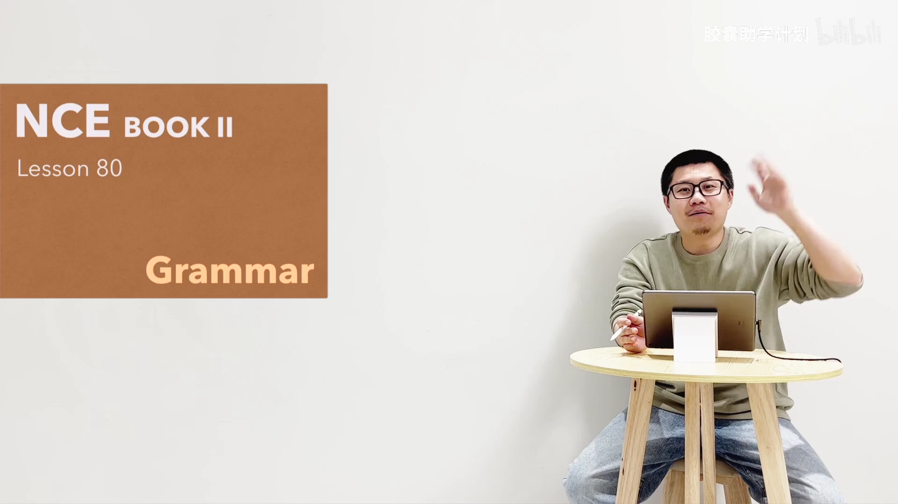

文字识别：NCE / BOOKⅡI / Lesson 80 / Grammar

### 画面 00:00:02

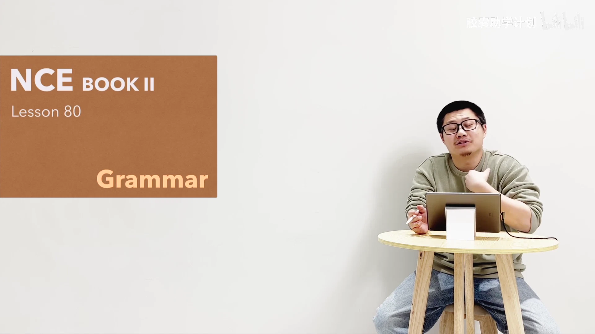

文字识别：NCE / BOOKⅡI / Lesson 80 / Grammar

### 画面 00:00:04

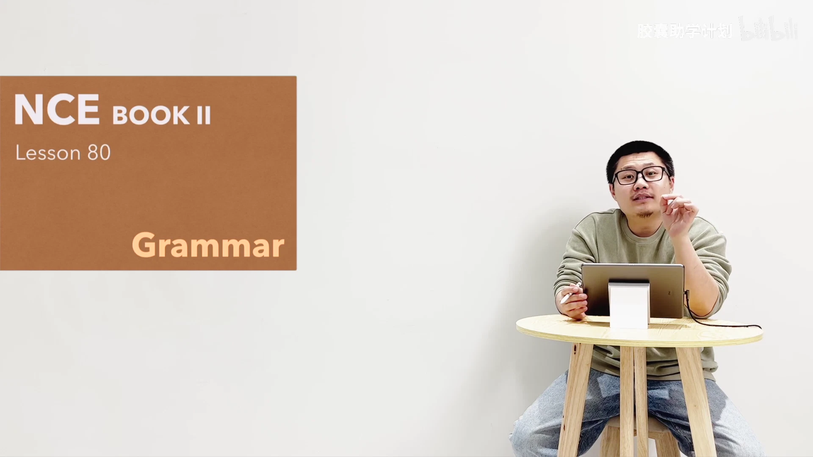

文字识别：NCE / BOOKII / Lesson 80 / Grammar

### 画面 00:00:07

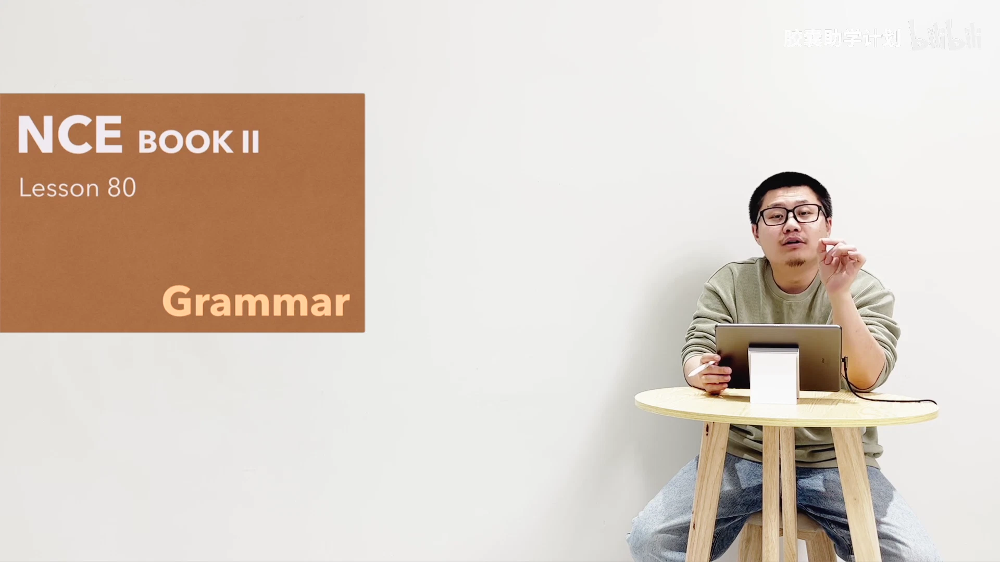

文字识别：NCE / BOOKⅡI / Lesson 80 / Grammar

### 画面 00:00:09

文字识别： bibii / 胶囊助学计划 / •

### 画面 00:00:13

### 画面 00:00:15

文字识别：囊助字计划 / adj+er/est / more/most... / 6时间 / 1主 / 2谓 / 3宾 / 4方式 / 5地点 / 6时间 / When? / Who? / action / Who? / How? / Where? / When? / Which? / (v.+v.变化) / Which? / What? / What?

## 00:00:30–00:01:00

学过很多遍了，对吧？所以在这里呢，我们就是以练代讲，过一下就完事儿了，不会再仔细讲一遍了啊。那我们先看第一个 repetition，只有听说练习，我问您答就可以了啊。其实基本上就是个跟读练习啊。来了，Is it a very big building? Oh yes, it's one of the biggest buildings in the world。你看这不第八课咱们给的关键句吗？剩

### 画面 00:00:37

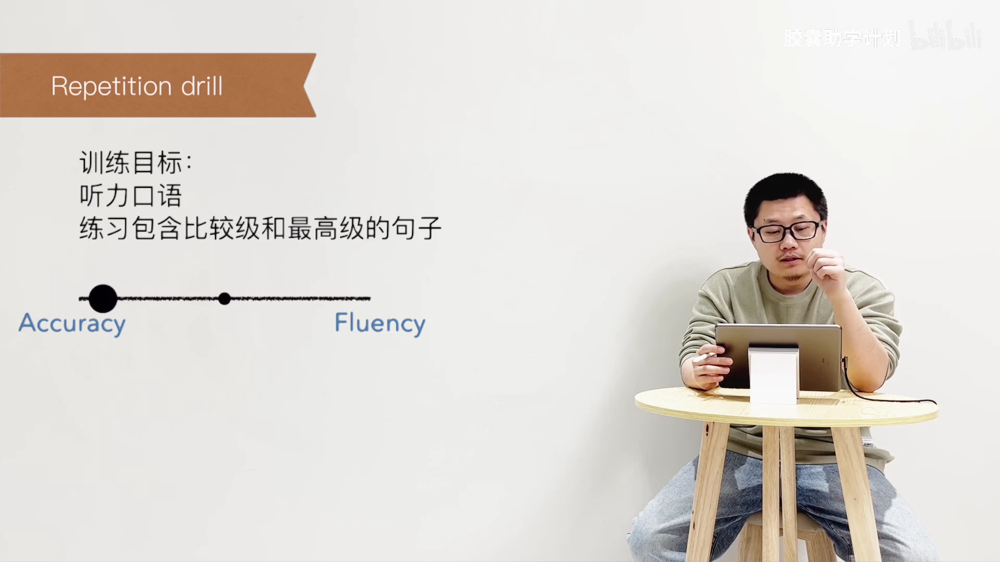

文字识别：Repetition drill / 训练目标： / 听力口语 / 练习包含比较级和最高级的句子 / Accuracy / Fluency

### 画面 00:00:40

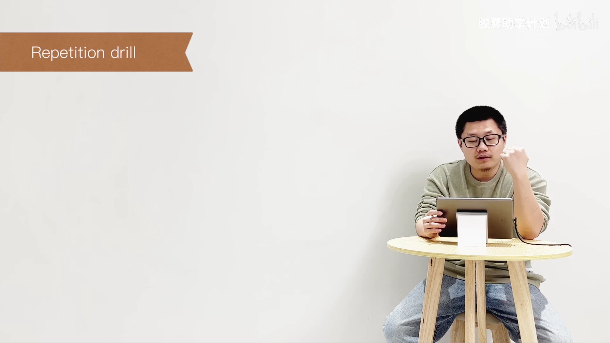

文字识别：助字计划 / Repetition drill

### 画面 00:00:50

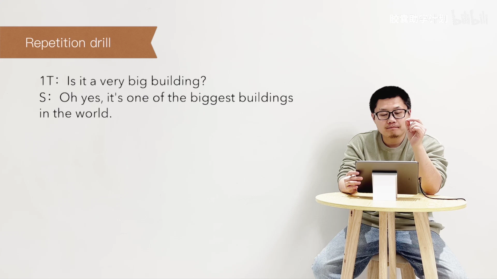

文字识别：Repetition drill / 1T: Is it a very big building? / S: Oh yes, it's one of the biggest buildings / in the world.

## 00:01:00–00:01:30

海都一样，记住张嘴跟我读，repeat after me. Is it an extraordinary bu a exhibition? Oh yes, is one of the most extraordinary exhibitions in the world. Is he a very famous writer? Oh yes, he's one of the most famous writers in the world. Is she a

### 画面 00:01:00

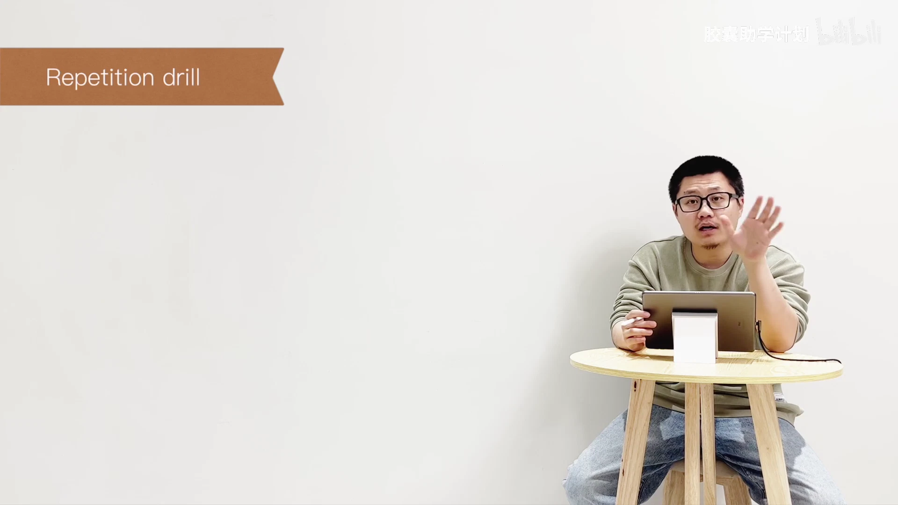

文字识别：毫助子计划 / Repetition drill

### 画面 00:01:08

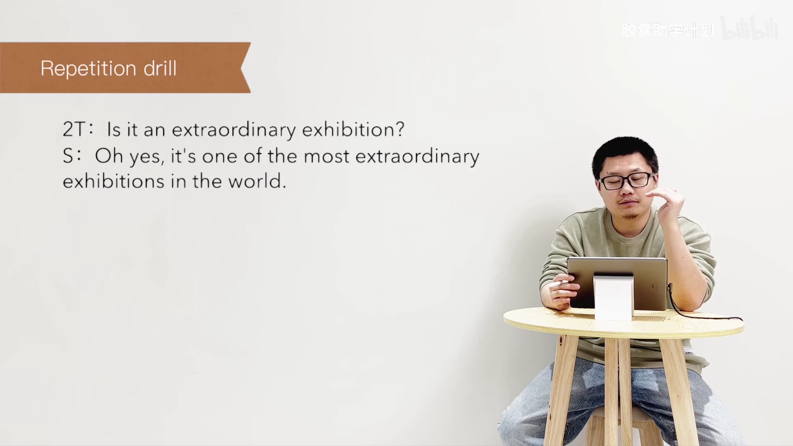

文字识别：Repetition drill / 2T: Is it an extraordinary exhibition? / S: Oh yes, it's one of the most extraordinary / exhibitions in the world.

### 画面 00:01:16

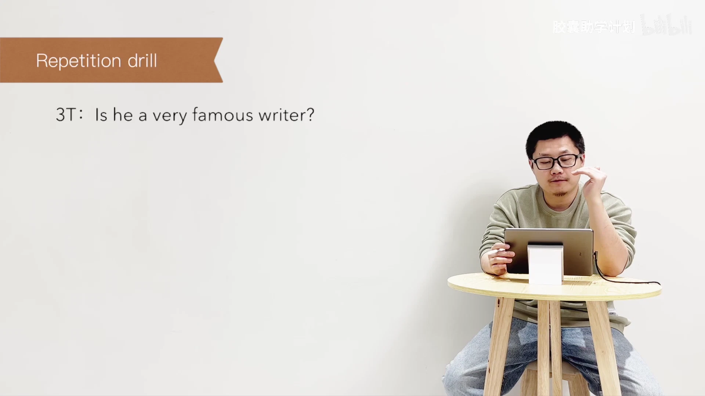

文字识别：Repetition drill / 3T: Is he a very famous writer?

## 00:01:30–00:02:00

beautiful actress? Oh yes, she's one of the most beautiful actresses in the world. Is it a very large ship? Oh yes, it's one of the largest ships in the world. Is it a very expensive car? Oh yes, it's one of the most expensive cars in the world.

### 画面 00:01:31

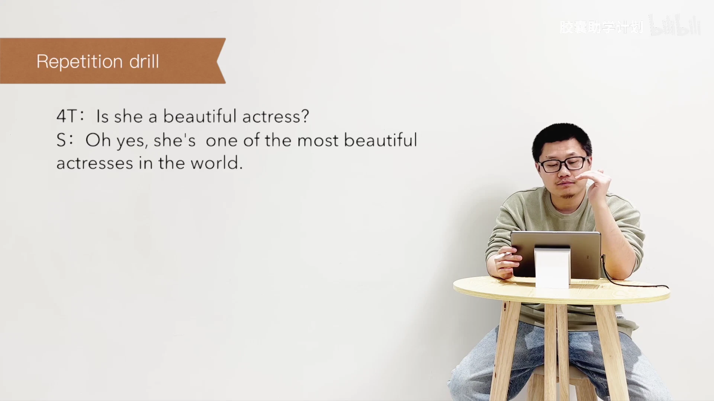

文字识别：Repetition drill / 4T: Is she a beautiful actress? / S: Oh yes, she's one of the most beautiful / actresses in the world.

### 画面 00:01:38

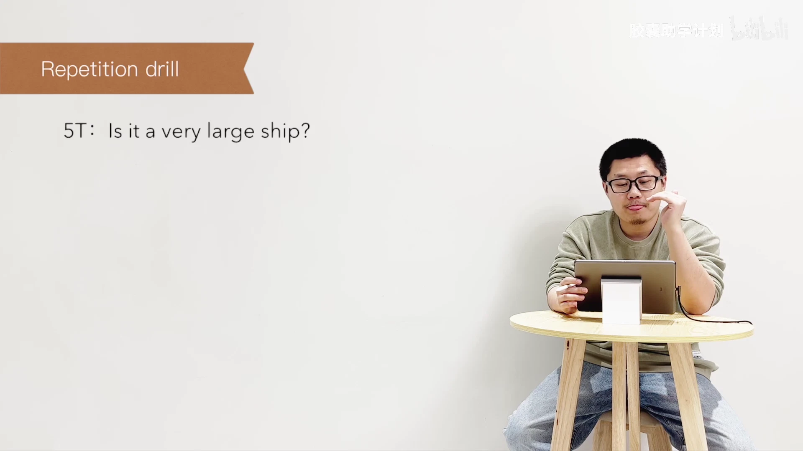

文字识别：Repetition drill / 5T: Is it a very large ship?

### 画面 00:01:51

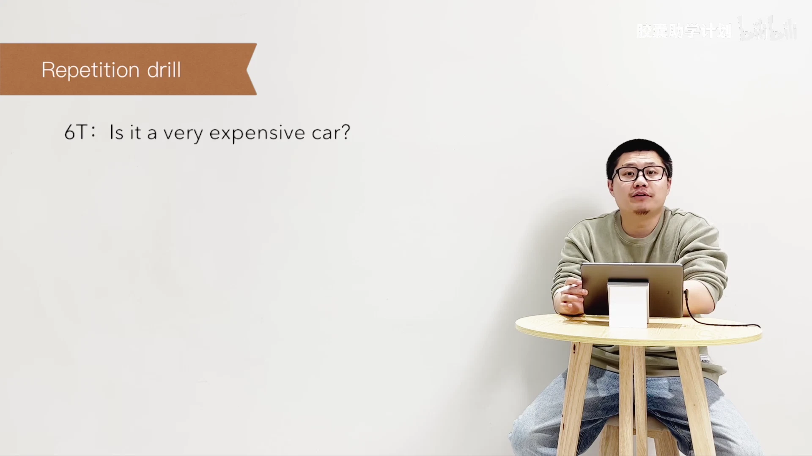

文字识别：墓助字计划 / Repetition drill / 6T: Is it a very expensive car?

### 画面 00:01:53

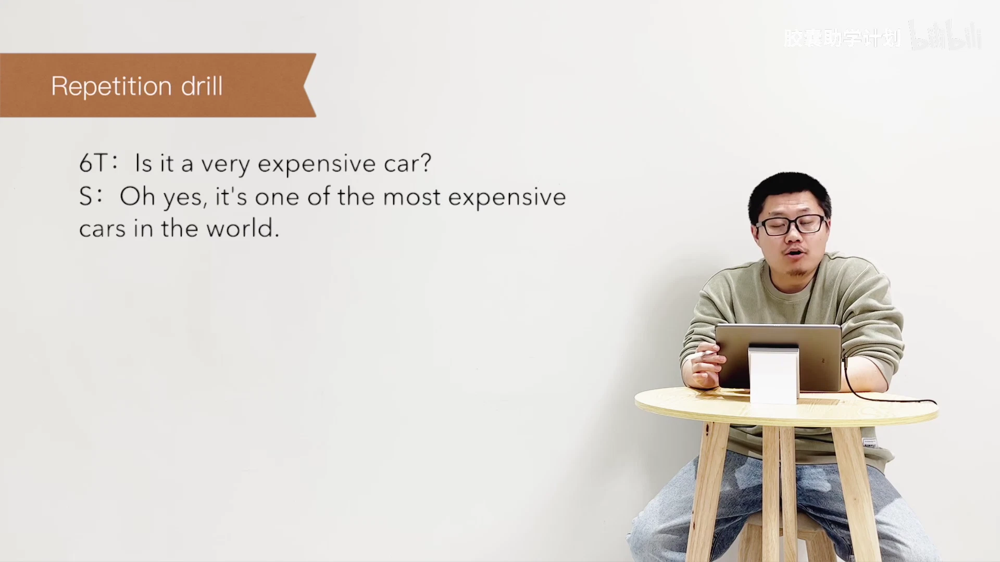

文字识别：Repetition drill / 6T: Is it a very expensive car? / S: Oh yes, it's one of the most expensive / cars in the world.

## 00:02:00–00:02:30

Is it a very bad experience? Oh yes, it's one of the most, it's one of the worst experiences in the world. 全世界最高糟糕的体验. Is he a very successful businessman? Oh yes, he's one of the most successful businessmen in the world. Is it a very old bridge?

### 画面 00:02:00

文字识别：Repetition drill / 7T: Is it a very bad experience?

### 画面 00:02:16

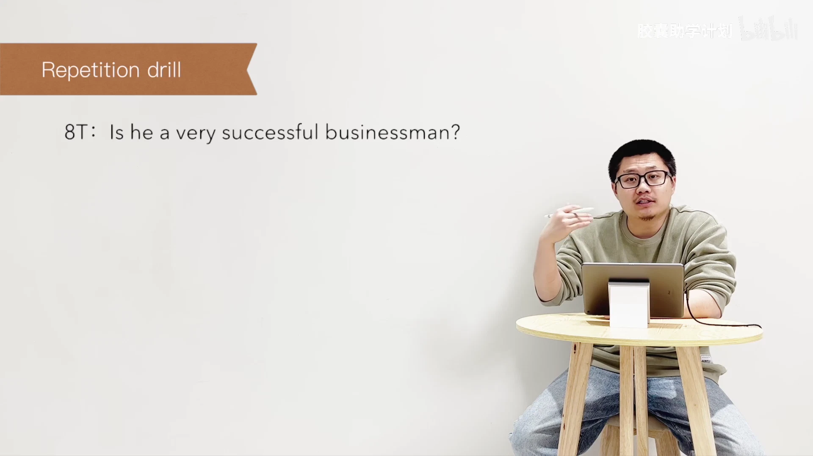

文字识别：Repetition drill / 8T: Is he a very successful businessman?

### 画面 00:02:18

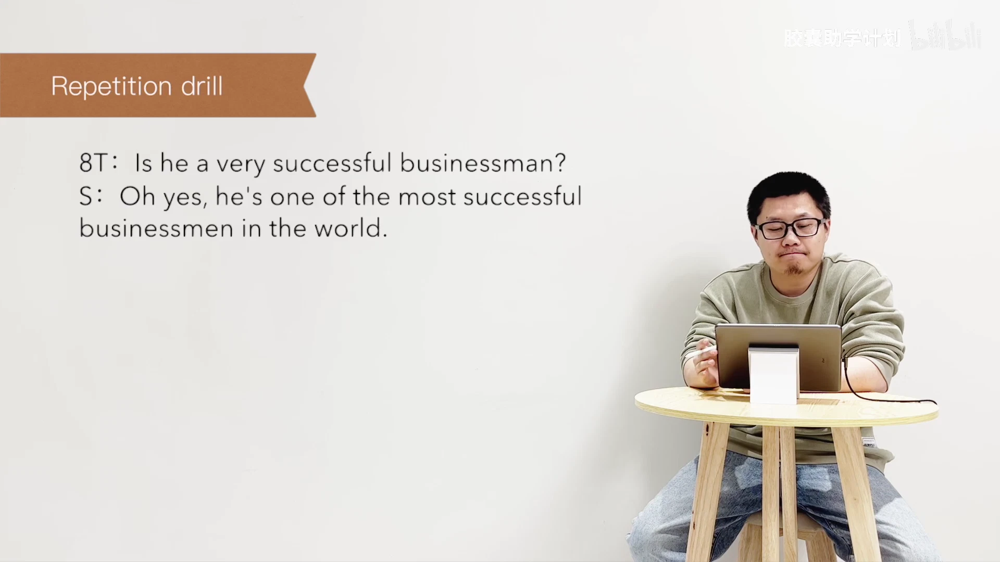

文字识别：Repetition drill / 8T: Is he a very successful businessman? / S: Oh yes, he's one of the most successful / businessmen in the world.

### 画面 00:02:26

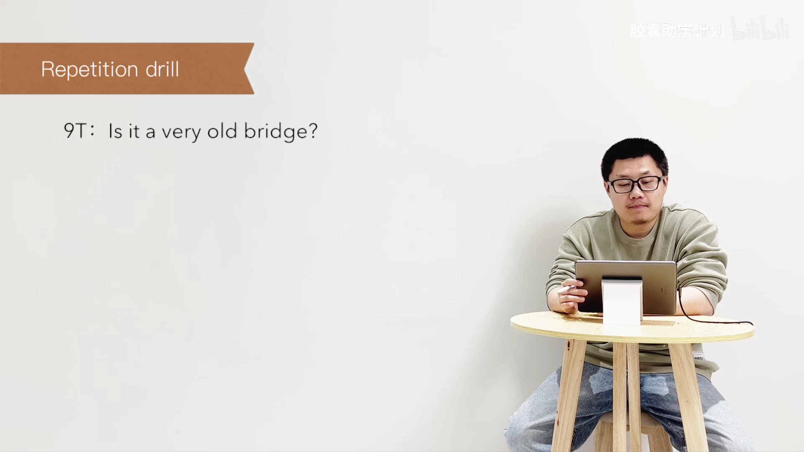

文字识别：Repetition drill / 9T: Is it a very old bridge?

## 00:02:30–00:03:00

Oh yes, is one of the oldest bridges in the world. Is he a very good singer? Oh yes, he's one of the best singers in the world. Next one, pattern drill, 对吧？哎，我们练习这个比较级和最高级的句子。呃，老习惯啊，我说 sesr，然后各位搞清楚了之后，课下自己往里

### 画面 00:02:40

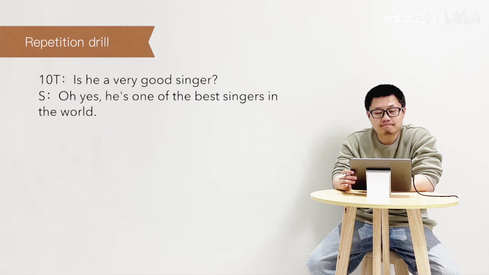

文字识别：Repetition drill / 10T: Is he a very good singer? / S: Oh yes, he's one of the best singers in / the world.

### 画面 00:02:47

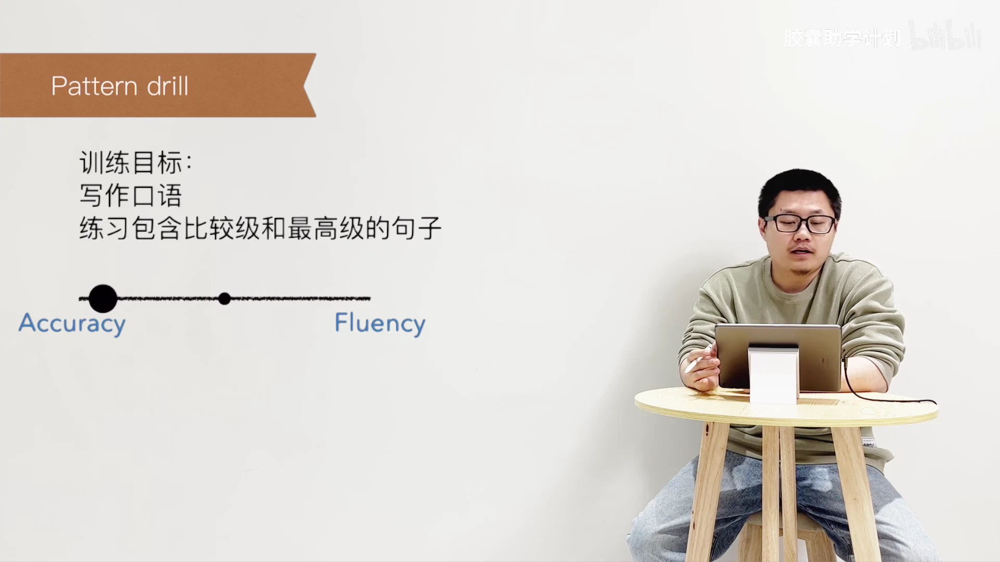

文字识别：Pattern drill / 训练目标： / 写作口语 / 练习包含比较级和最高级的句子 / Accuracy / Fluency

### 画面 00:02:52

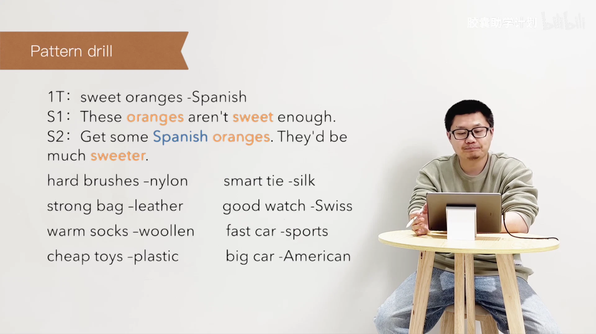

文字识别：Pattern drill / 1T: sweet oranges -Spanish / S1: These oranges aren't sweet enough. / S2:Get some /  Spanish oranges. They'd be / much / sweeter. / hard brushes -nylon / smart tie -silk / strong bag -leather / good watch -Swiss / warm socks -woollen / fast car -sports / cheap toys -plastic / big car -American

### 画面 00:02:54

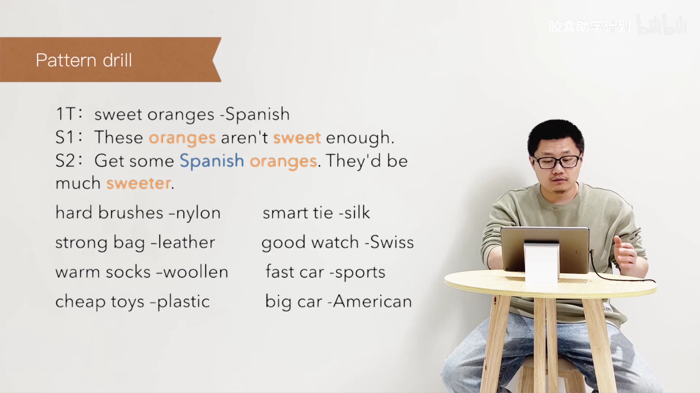

文字识别：Pattern drill / 1T: sweet oranges -Spanish / S1: These oranges aren't sweet enough. / S2: Get some Spanish oranges. They'd be / much / sweeter. / hard brushes -nylon / smart tie -silk / strong bag -leather / good watch -Swiss / warm socks -woollen / fast car -sports / cheap toys -plastic / big car -American

### 画面 00:02:56

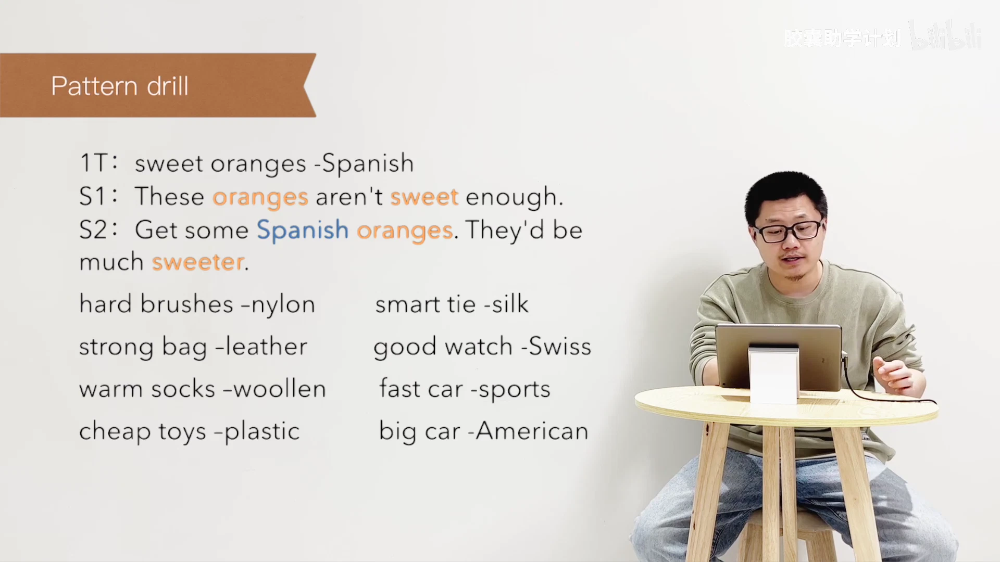

文字识别：Pattern drill / 1T: sweet oranges -Spanish / S1: These oranges aren't sweet enough. / S2:Get some /  Spanish oranges. They'd be / much / sweeter. / hard brushes -nylon / smart tie -silk / strong bag -leather / good watch -Swiss / warm socks -woollen / fast car -sports / cheap toys -plastic / big car -American

### 画面 00:02:58

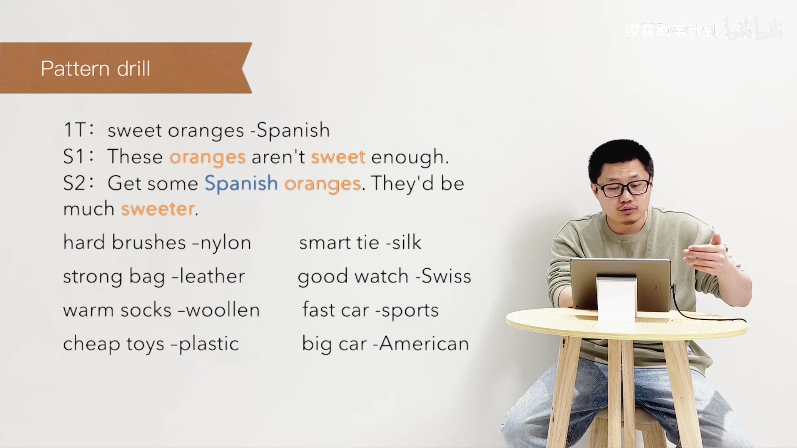

文字识别：Pattern drill / 1T: sweet oranges -Spanish / S1: These oranges aren't sweet enough. / S2: Get some Spanish oranges. They'd be / much / sweeter. / hard brushes -nylon / smart tie -silk / strong bag -leather / good watch -Swiss / Warm socks -woollen / fast car -sports / cheap toys -plastic / big car -American

## 00:03:00–00:03:30

去带，对吧？Okay.呃，说these oranges unsweet enough.这些橘子不足够甜。Get some Spanish oranges.找一些西班牙的橘子。说they'll be much sweeter.首先，sweeter叫做更甜。那much sweeter什么意思？叫甜的多，对吧？比如说，我们说甜是有加号的嘛？啊，我这个具体我也不太懂。我们随便举一个例子，比如说平均甜度如果是五，对吧？那sweeter六就是sweeter了。那如果

### 画面 00:03:01

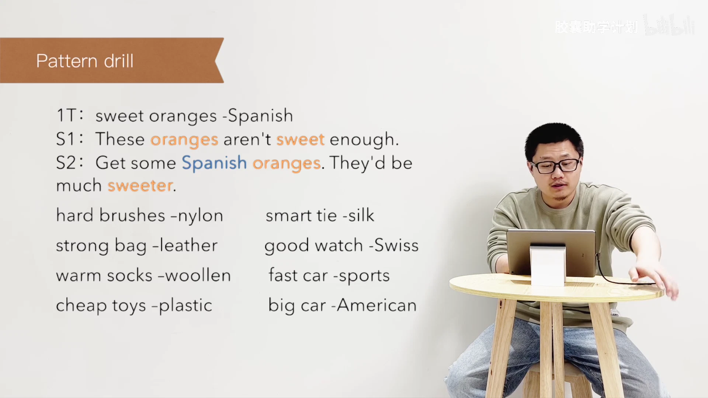

文字识别：Pattern drill / 1T: sweet oranges -Spanish / S1: These oranges aren't sweet enough. / S2:Get some S / : Spanish oranges. They'd be / much / sweeter. / hard brushes -nylon / smart tie -silk / strong bag -leather / good watch -Swiss / warm socks -woollen / fast car -sports / cheap toys -plastic / big car -American

### 画面 00:03:15

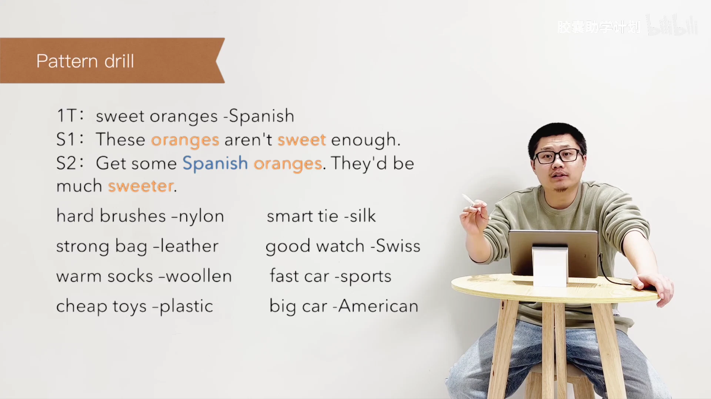

文字识别：Pattern drill / 1T: sweet oranges -Spanish / S1: These oranges aren't sweet enough. / S2: Get some Spanish oranges. They'd be / much / sweeter. / hard brushes -nylon / smart tie -silk / strong bag -leather / good watch -Swiss / warm socks -woollen / fast car -sports / cheap toys -plastic / big car -American

### 画面 00:03:18

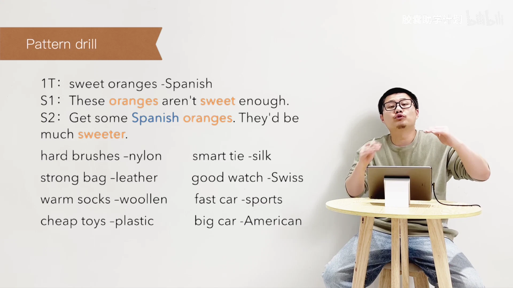

文字识别：Pattern drill / 1T:sweet oranges -Spanish / S1: These oranges aren't sweet enough. / S2: Get some Spanish oranges. They'd be / much / sweeter. / hard brushes -nylon / smart tie -silk / strong bag -leather / good watch -Swiss / Warm socks -woollen / fast car -sports / cheap toys -plastic / big car -American

### 画面 00:03:20

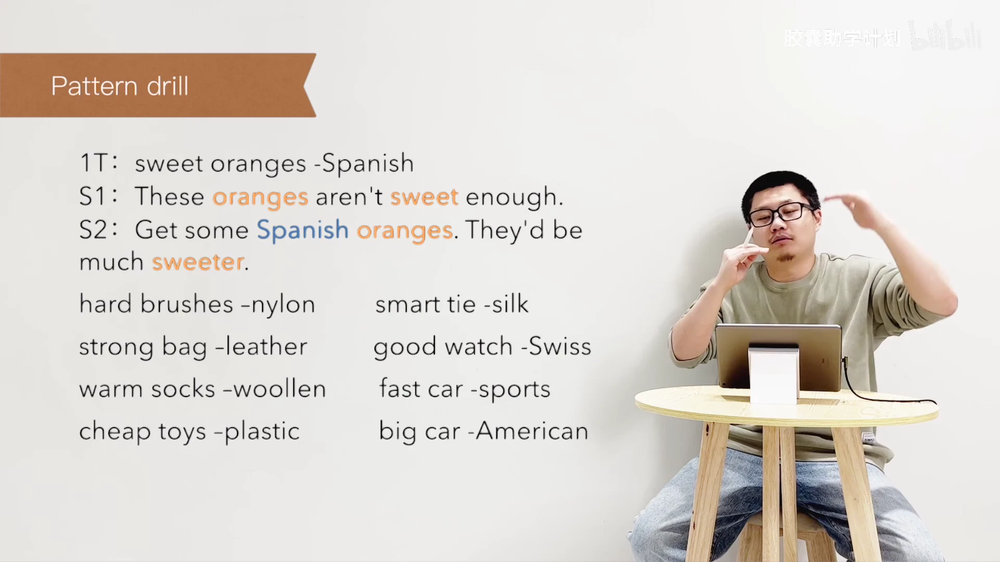

文字识别：Pattern drill / 1T: sweet oranges -Spanish / S1: These oranges aren't sweet enough. / S2: Get some Spanish oranges. They'd be / much / sweeter. / hard brushes -nylon / smart tie -silk / strong bag -leather / good watch -Swiss / Warm socks -woollen / fast car -sports / cheap toys -plastic / big car -American

### 画面 00:03:22

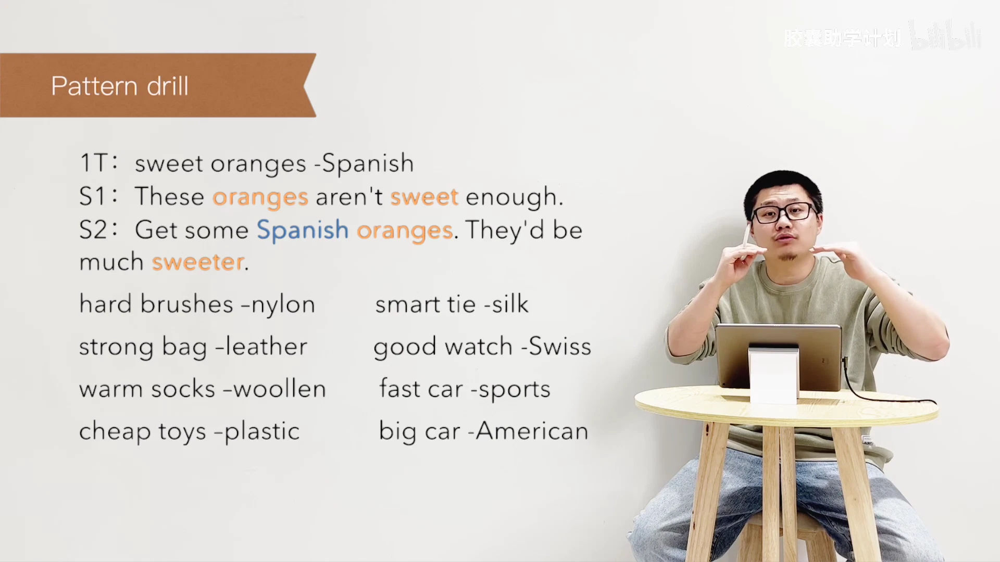

文字识别：Pattern drill / 1T: sweet oranges -Spanish / S1: These oranges aren't sweet enough. / S2: Get some Spanish oranges. They'd be / much / sweeter. / hard brushes -nylon / smart tie -silk / strong bag -leather / good watch -Swiss / warm socks -woollen / fast car -sports / cheap toys -plastic / big car -American

## 00:03:30–00:04:00

是二十或者五十的甜度，可能就叫 much sweeter，对吧？这个很好理解啊，记住往里面去带。第二个，Was there much dirt on the floor？哎，地上有没有很多的灰尘呢？No， there. It wasn't any dirtier than usual. 并没有比平常 than usual 就比平常更脏，对吧？哎， dirtier，往里面去带。

### 画面 00:03:30

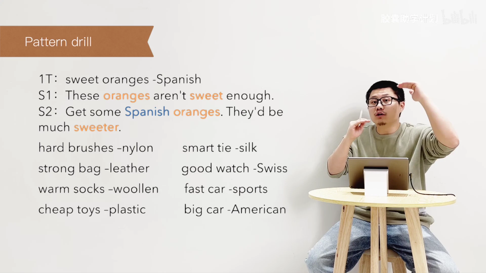

文字识别：Pattern drill / 1T: sweet oranges -Spanish / S1: These oranges aren't sweet enough. / S2: Get some Spanish oranges. They'd be / much / sweeter. / hard brushes -nylon / smart tie -silk / strong bag -leather / good watch -Swiss / warm socks -woollen / fast car -sports / cheap toys -plastic / big car -American

### 画面 00:03:33

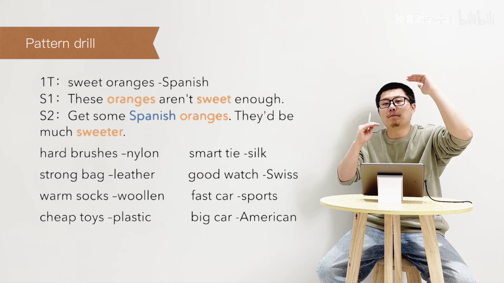

文字识别：Pattern drill / 1T: sweet oranges -Spanish / S1: These oranges a / aren't sweet enough. / S2:Get some / Spanish oranges. They'd be / much / sweeter. / hard brushes -nylon / smart tie -silk / strong bag -leather / good watch -Swiss / warm socks -woollen / fast car -sports / cheap toys -plastic / big car -American

### 画面 00:03:35

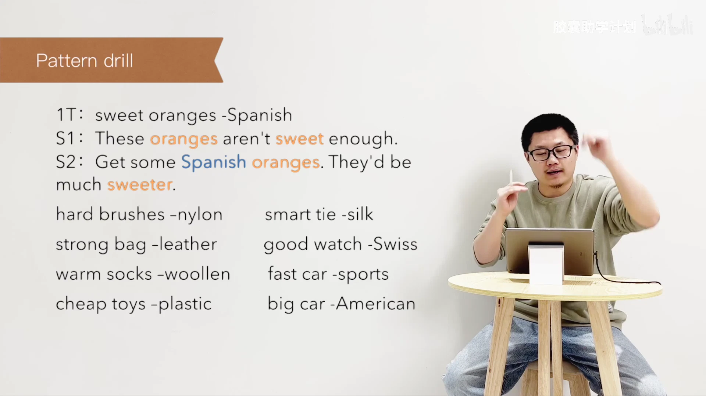

文字识别：Pattern drill / 1T: sweet oranges -Spanish / S1: These oranges aren't sweet enough. / S2:Get some / Spanish oranges. They'd be / much / sweeter. / hard brushes -nylon / smart tie -silk / strong bag -leather / good watch -Swiss / warm socks -woollen / fast car -sports / cheap toys -plastic / big car -American

### 画面 00:03:37

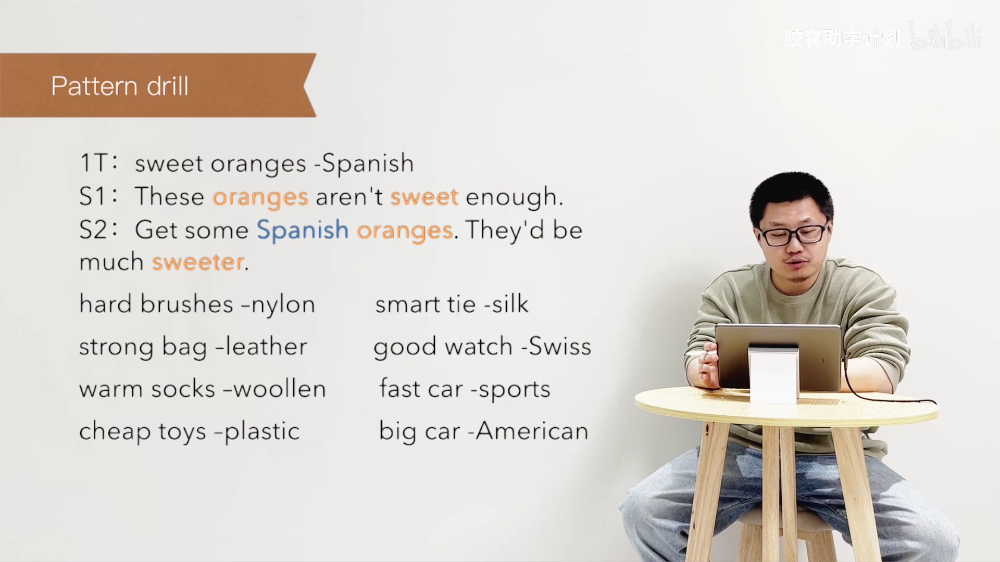

文字识别：Pattern drill / 1T: sweet oranges -Spanish / S1: These oranges aren't sweet enough. / S2:Get some / Spanish oranges. They'd be / much / sweeter. / hard brushes -nylon / smart tie -silk / strong bag -leather / good watch -Swiss / warm socks -woollen / fast car -sports / cheap toys -plastic / big car -American

### 画面 00:03:39

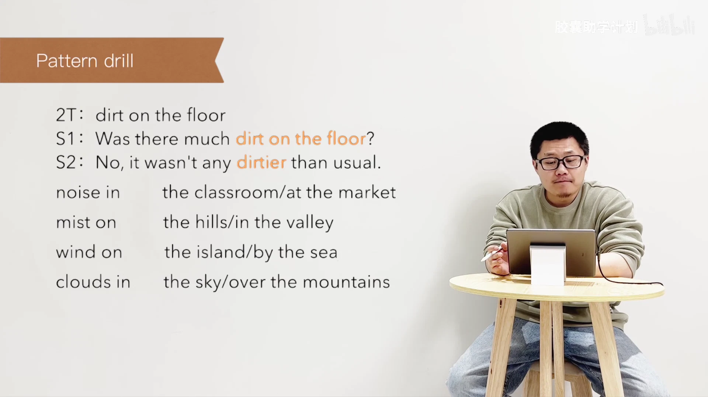

文字识别：Pattern drill / 2T: dirt on the floor / S1: Was there much dirt on the floor? / S2: No, it wasn't any dirtier than usual. / noise in / the classroom/at the market / mist on / the hills/in the valley / wind on / the island/by the sea / clouds in / the sky/over the mountains

### 画面 00:03:51

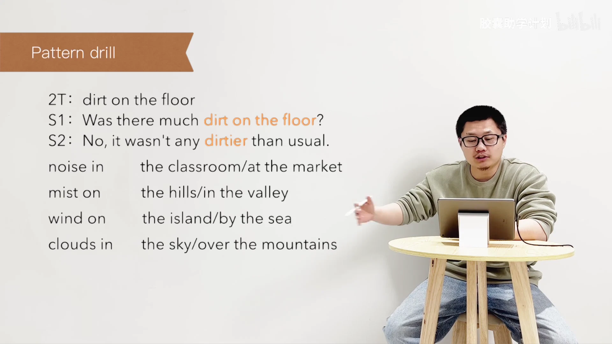

文字识别：Pattern drill / 2T: dirt on the floor / S1: Was there much dirt on the floor? / S2: No, it wasn't any dirtier than usual. / noise in / the classroom/at the market / mist on / the hills/in the valley / wind on / the island/by the sea / clouds in / the sky/over the mountains

### 画面 00:03:58

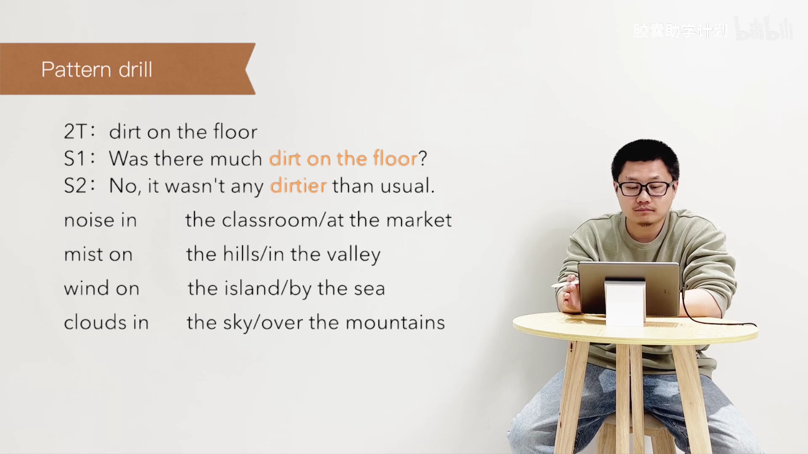

文字识别：Pattern drill / 2T: dirt on the floor / S1: Was there much dirt on the floor? / S2: No, it wasn't any dirtier than usual. / noise in / the classroom/at the market / mist on / the hills/in the valley / wind on / the island/by the sea / clouds in / the sky/over the mountains

## 00:04:00–00:04:30

下一个, she's the most attractive person I've ever met.这这个女子是我见过最吸引人的、最有魅力的一个女人。嗯, she's not as attractive as you are.啊，她没有你吸引人，对吧？啊，这个有点土味情话的感觉。S E S二，啊，各位往里面去带，对吧？那这里要注意一个事情，就是attractive。你回想一下，我们新概念一册当时就

### 画面 00:04:00

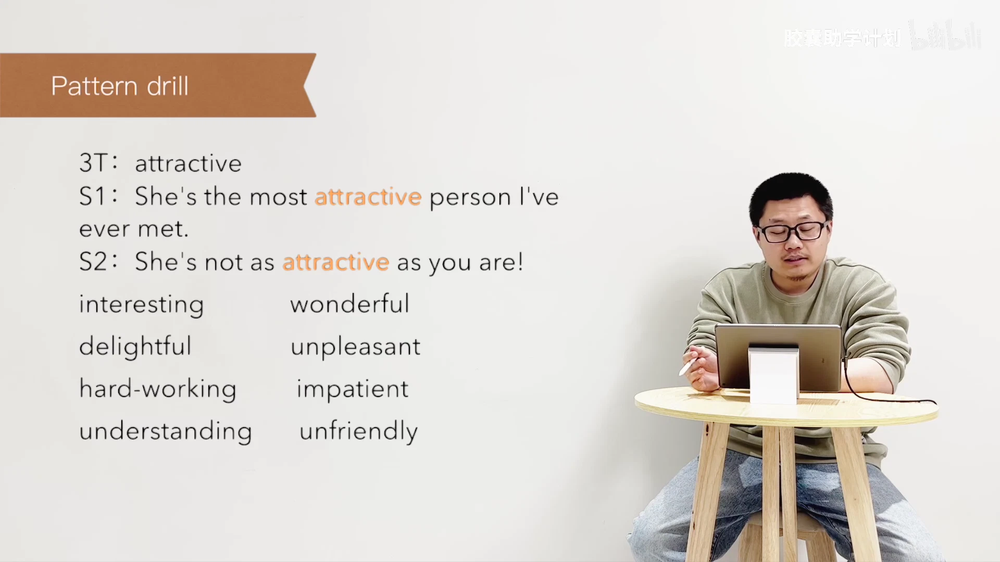

文字识别：Pattern drill / 3T：attractive / S1: She's the most attractive person I've / ever met. / S2: She's not as attractive as you are! / interesting / wonderful / delightful / unpleasant / hard-working / impatient / understanding / unfriendly

### 画面 00:04:07

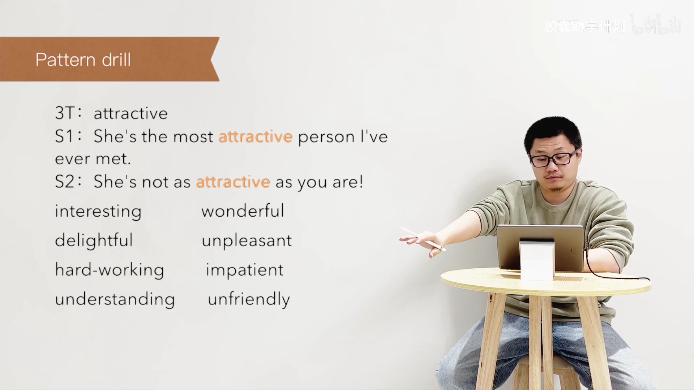

文字识别：Pattern drill / 3T：attractive / S1: She's the most attractive person I've / ever met. / S2: She's not as attractive as you are! / interesting / wonderful / delightful / unpleasant / hard-working / impatient / understanding / unfriendly

### 画面 00:04:10

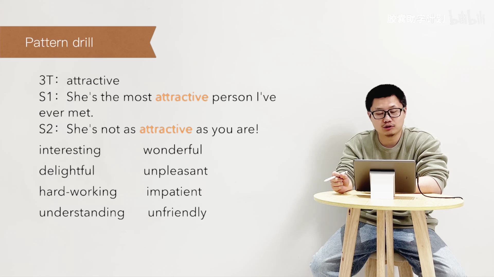

文字识别：Pattern drill / 3T：attractive / S1: She's the most attractive person I've / ever met. / S2: She's not as attractive as you are! / interesting / wonderful / delightful / unpleasant / hard-working / impatient / understanding / unfriendly

## 00:04:30–00:05:00

讲过，包括新概念二册第八课讲过的，说形容词它去这个变比较级最高级的时候，实际上要分音节的，一个音节怎么办？两个音节怎么办？三个音节怎么办？学到今天您还记得吗？如果不记得了，我给你的建议就是一定要回去翻看一下，复习，复习还是复习，对吧？这是第三个，第四个，最后一个，He drove as quickly as he could，他尽可能快的去开这个 as quickly as he could， as soon as

### 画面 00:04:40

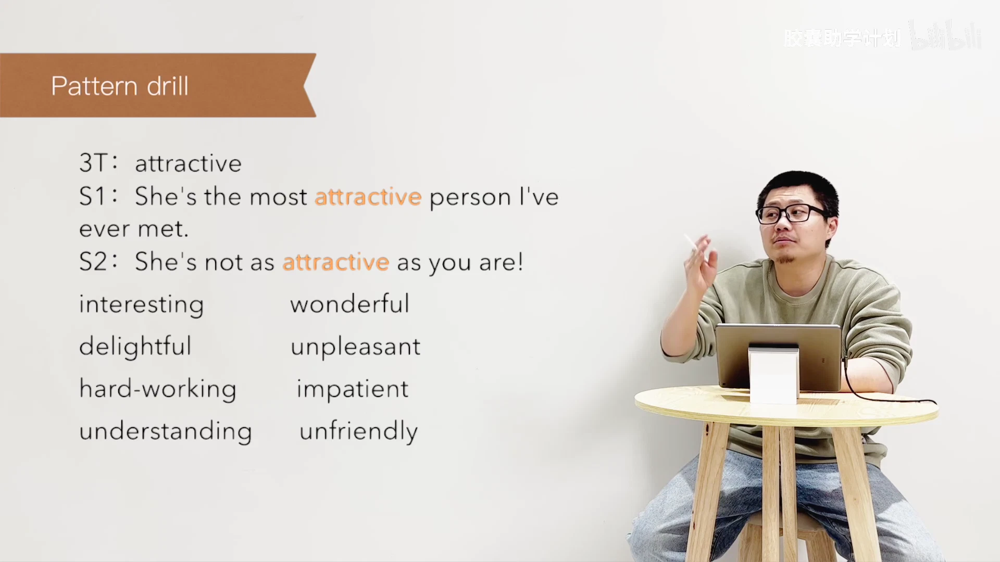

文字识别：Pattern drill / 3T：attractive / S1: She's the most attractive person I've / ever met. / S2: She's not as attractive as you are! / interesting / wonderful / delightful / unpleasant / hard-working / impatient / understanding / unfriendly

### 画面 00:04:50

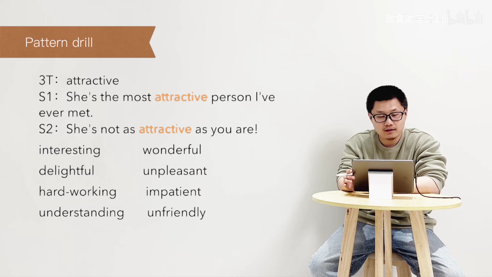

文字识别：Pattern drill / 3T：attractive / S1: She's the most attractive person I've / ever met. / S2: She's not as attractive as you are! / interesting / wonderful / delightful / unpleasant / hard-working / impatient / understanding / unfriendly

### 画面 00:04:52

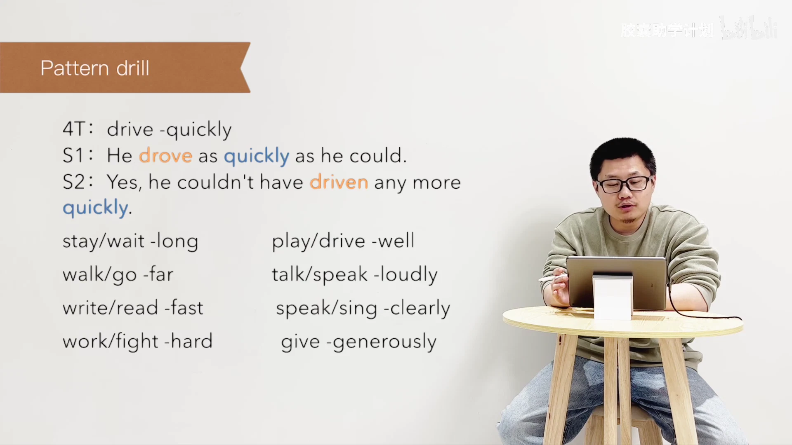

文字识别：Pattern drill / 4T:drive-quickly / S1: He drove as quickly as he could. / S2: Yes, he couldn't have driven any more / quickly. / stay/wait -long / play/drive -well / walk/go -far / talk/speak -loudly / write/read -fast / speak/sing -clearly / work/fight -hard / give-generously

## 00:05:00–00:05:30

possible. We've seen this many times before. I said you basically don't need to treat it as a comparative. Just treat it as a fixed collocation. Yes, he couldn't have driven any more quickly. He couldn't have driven any more quickly. He couldn't have driven any more quickly. He couldn't have driven any more quickly. He couldn't have driven any more quickly. He couldn't have driven any more quickly. He couldn't have driven any more quickly. He couldn't have driven any more quickly. He couldn't have driven any more quickly. He couldn't have driven any more quickly. He couldn't have driven any more

### 画面 00:05:04

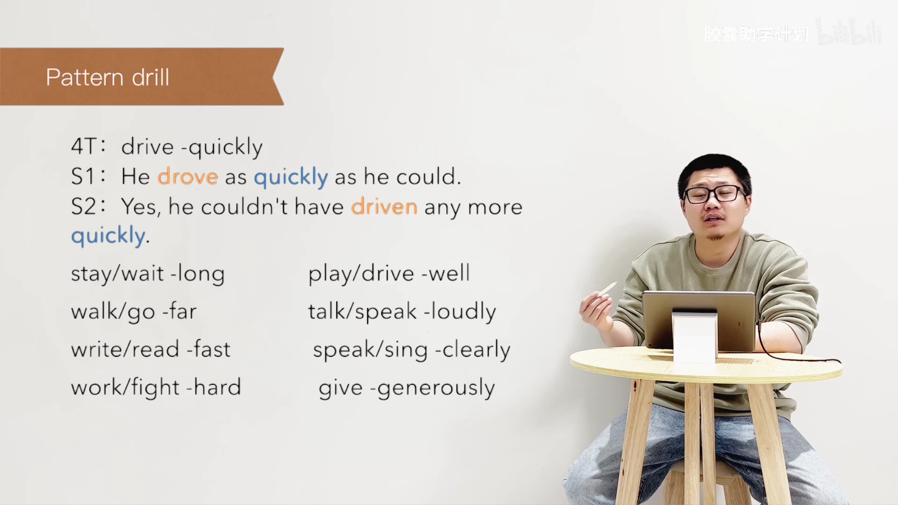

文字识别：Pattern drill / 4T:drive-quickly / S1: He drove as quickly as he could. / S2: Yes, he couldn't have driven any more / quickly. / stay/wait -long / play/drive -well / walk/go -far / talk/speak -loudly / write/read -fast / speak/sing -clearly / work/fight -hard / give-generously

### 画面 00:05:10

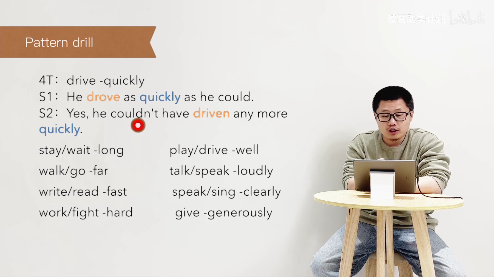

文字识别：Pattern drill / 4T:drive-quickly / S1: He drove as quickly as he could. / S2: Yes, he couldn't have( / driven any more / quickly. / stay/wait -long / play/drive -well / walk/go -far / talk/speak -loudly / write/read -fast / speak/sing -clearly / work/fight -hard / give -generously

### 画面 00:05:29

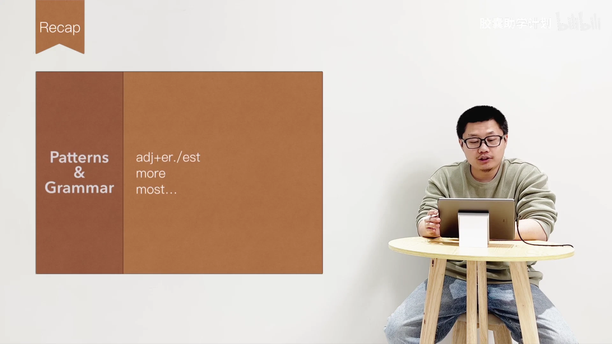

文字识别：Recap / Patterns / adj+er./est / more / Grammar / most.

## 00:05:30–00:06:00

呢很简单，我们其实就是去做了一些小小的练习。第四单元很多的课都是这个样子的啊。OK，那家庭作业 pattern drill 四乘四记得写。然后呢，今天的语法呢，这个我希望您之前已经讲过很多遍了。那其实对于各位来说，可能就是要复习一下。然后呢，红皮书初级和中级，这里我只给了中级，但初级如果您没写二册也给他补齐。这个我们尽量在进入三册之前，把

### 画面 00:05:31

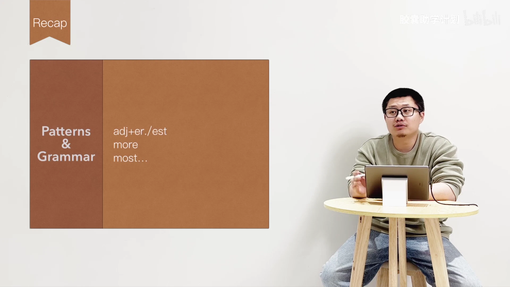

文字识别：Recap / 秦助字计划 / Patterns / adj+er./est / more / Grammar / most.

### 画面 00:05:33

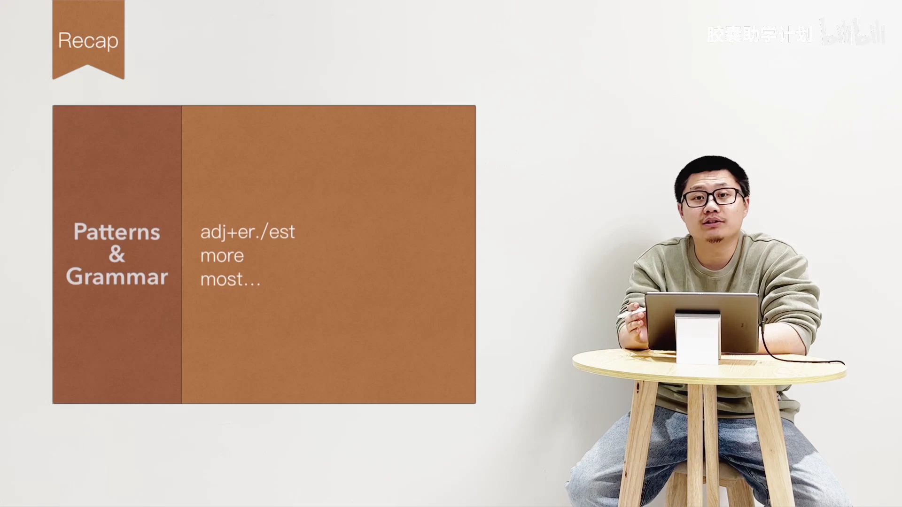

文字识别：Recap / Patterns / adj+er./est / ＆ / more / Grammar / most.

### 画面 00:05:35

文字识别：Recap / 辜助字计划 / Patterns / adj+er./est / ＆ / more / Grammar / most.

### 画面 00:05:37

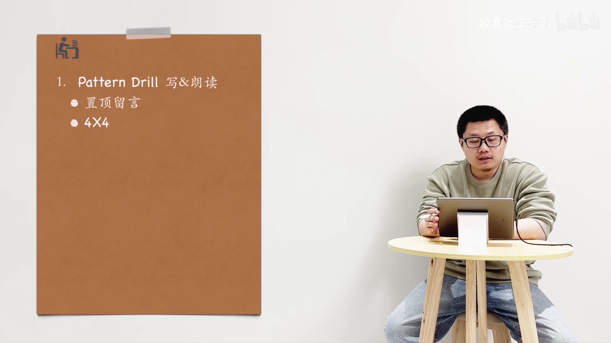

文字识别：達助字计划 / 1. / Pattern Drill写&朗读 / 置顶留言 / 4×4

### 画面 00:05:39

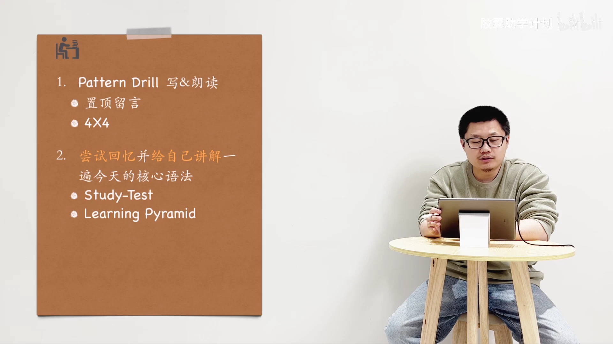

文字识别：Pattern Drill 写&朗读 / 1. / 置顶留言 / 4×4 / 尝试回忆并给自己讲解一 / 遍今天的核心语法 / Study-Test / Learning Pyramid

### 画面 00:05:41

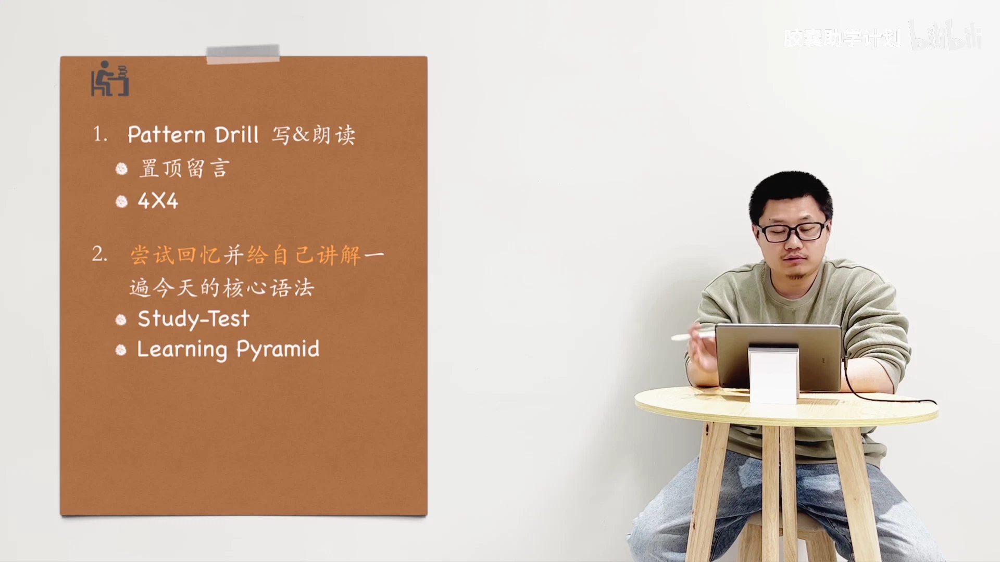

文字识别：Pattern Drill写&朗读 / 1. / 置顶留言 / 4×4 / 尝试回忆并给自己讲解一 / 遍今天的核心语法 / Study-Test / Learning Pyramid

### 画面 00:05:44

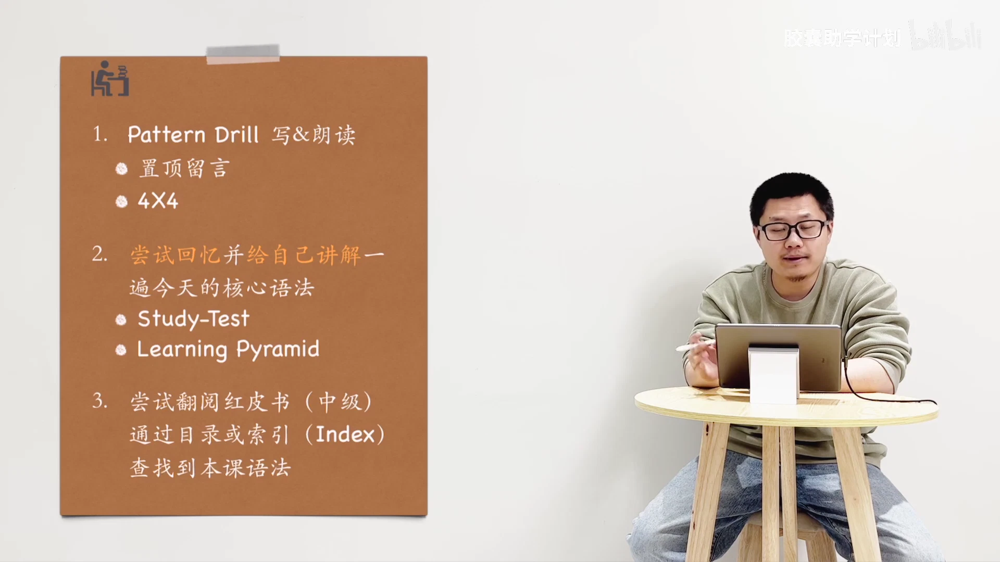

文字识别：Pattern Drill 写&朗读 / 置顶留言 / 4×4 / 尝试回忆并给自己讲解一 / 遍今天的核心语法 / Study-Test / Learning Pyramid / 尝试翻阅红皮书（中级） / 通过目录或索引(Index) / 查找到本课语法

### 画面 00:05:46

文字识别：Pattern Drill写&朗读 / 1. / 置顶留言 / 4×4 / 尝试回忆并给自己讲解一 / 遍今天的核心语法 / Study-Test / Learning Pyramid / 尝试翻阅红皮书（中级） / 通过目录或索引(Index) / 查找到本课语法

### 画面 00:05:48

文字识别：Pattern Drill 写&朗读 / 1. / 置顶留言 / 4×4 / 尝试回忆并给自己讲解一 / 遍今天的核心语法 / Study-Test / Learning Pyramid / 尝试翻阅红皮书（中级） / 通过目录或索引(Index) / 查找到本课语法

### 画面 00:05:50

文字识别：Pattern Drill写&朗读 / 1. / 置顶留言 / 4×4 / 尝试回忆并给自己讲解一 / 遍今天的核心语法 / Study-Test / Learning Pyramid / 尝试翻阅红皮书（中级） / 通过目录或索引(Index) / 查找到本课语法

### 画面 00:05:53

文字识别：Pattern Drill写&朗读 / 1. / 置顶留言 / 4×4 / 尝试回忆并给自己讲解一 / 遍今天的核心语法 / Study-Test / Learning Pyramid / 尝试翻阅红皮书（中级） / 通过目录或索引(Index) / 查找到本课语法

### 画面 00:05:55

文字识别：Pattern Drill 写&朗读 / 置顶留言 / 4×4 / 尝试回忆并给自己讲解一 / 遍今天的核心语法 / Study-Test / Learning Pyramid / 尝试翻阅红皮书（中级） / 通过目录或索引(Index) / 查找到本课语法

### 画面 00:05:59

文字识别：Pattern Drill 写&朗读 / 1. / 置顶留言 / 4×4 / 尝试回忆并给自己讲解一 / 遍今天的核心语法 / Study-Test / Learning Pyramid / 尝试翻阅红皮书（中级） / 通过目录或索引(Index) / 查找到本课语法

## 00:06:00–00:06:30

至少在一测二测当中学到的语法红皮书当中对应都给他写完，对吧？OK，那以上呢就是本期视频的全部内容了。如果各位喜欢我们的课程呢，欢迎各位关注、订阅、一键三连，分享给那些需要的朋友来帮助我们快速成长。See you next time.

### 画面 00:06:01

文字识别：Pattern Drill写&朗读 / 1. / 置顶留言 / 4×4 / 尝试回忆并给自己讲解一 / 遍今天的核心语法 / Study-Test / Learning Pyramid / 尝试翻阅红皮书（中级） / 通过目录或索引(Index) / 查找到本课语法

### 画面 00:06:03

文字识别：1. f / Pattern Drill写&朗读 / 置顶留言 / 4×4 / 尝试回忆并给自己讲解一 / 遍今天的核心语法 / Study-Test / Learning Pyramid / 尝试翻阅红皮书（中级） / 通过目录或索引(Index) / 查找到本课语法

### 画面 00:06:05

文字识别：囊助字计划调

### 画面 00:06:08

文字识别：奏助字计划 / 不

### 画面 00:06:10

文字识别：泰助学计划園

### 画面 00:06:19

文字识别：助字计划一

### 画面 00:06:21

文字识别：CAPSULEACADEMY / 胶囊助学计划 / 小红书 / Lecturer / OE

### 画面 00:06:23

文字识别：臺珈字計物 / CAPSULEACADEMY / 胶囊助学计划 / 小红书 / □ / Photoara-l / OE

### 画面 00:06:26

文字识别：臺聖珈学計切 / CAPSULEACADEMY / 胶囊助学计划 / 『 / 小红书 / Editor / Berlin / OE

### 画面 00:06:29

文字识别：CAPSULEACADEMY / 胶囊助学计划 / 小红书

## 00:06:30–00:06:33

### 画面 00:06:31

文字识别：bilibili / 胶囊助学计划

### 画面 00:06:32

文字识别：bilibili / 胶囊助学计划

