# 080 练习

快速机器解析：语音为单模型转写，未进行独立交叉校对或人工复核；画面每秒采样并按变化选帧，短时文字和标记可能遗漏。截图时间约有 1 秒误差。图片有损压缩；遇到疑点请按时间查看 Google Drive 原视频。

## 00:00:00–00:00:30

Hello everyone, welcome to Capsule Academy. This is Leo. Today we are going to learn new concept English Book Two Lesson Eighty Practices. 那注意，咱们进行如下练习，唯一的前提就是文章您必须熟读成诵，不用完全背下来，读到特别特别熟，以至于就快能背下来了，叫熟读成诵啊。否则请勿开始。 Hope you gonna enjoy. 第一题 comprehension 啊，听懂一般疑问

### 画面 00:00:00

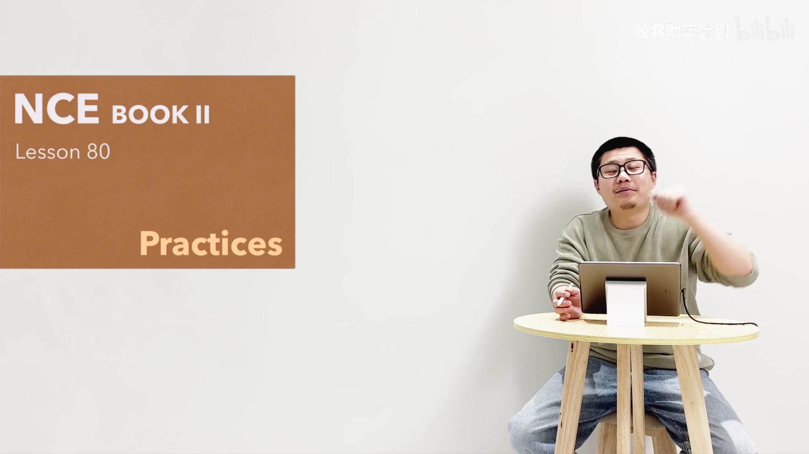

文字识别：NCE / BOOKII / Lesson 80 / Practices

### 画面 00:00:02

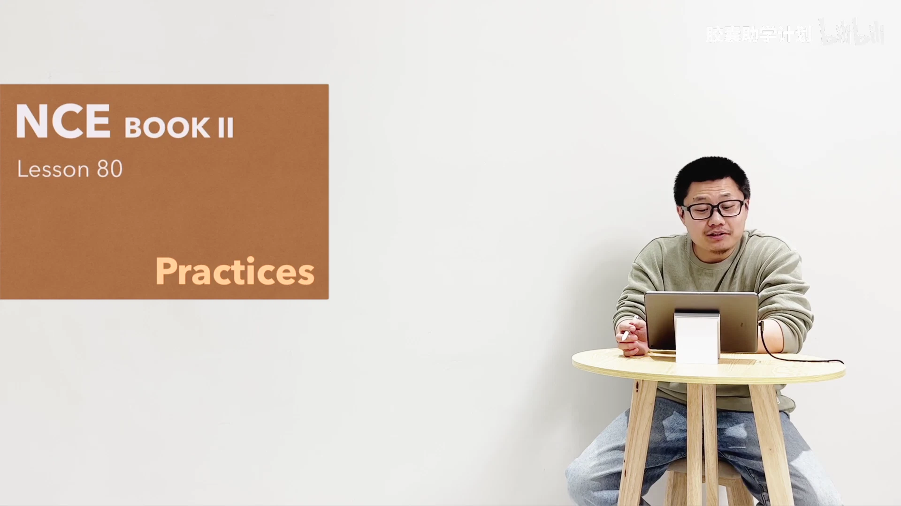

文字识别：NCE / BOOKII / Lesson 80 / Practices

### 画面 00:00:05

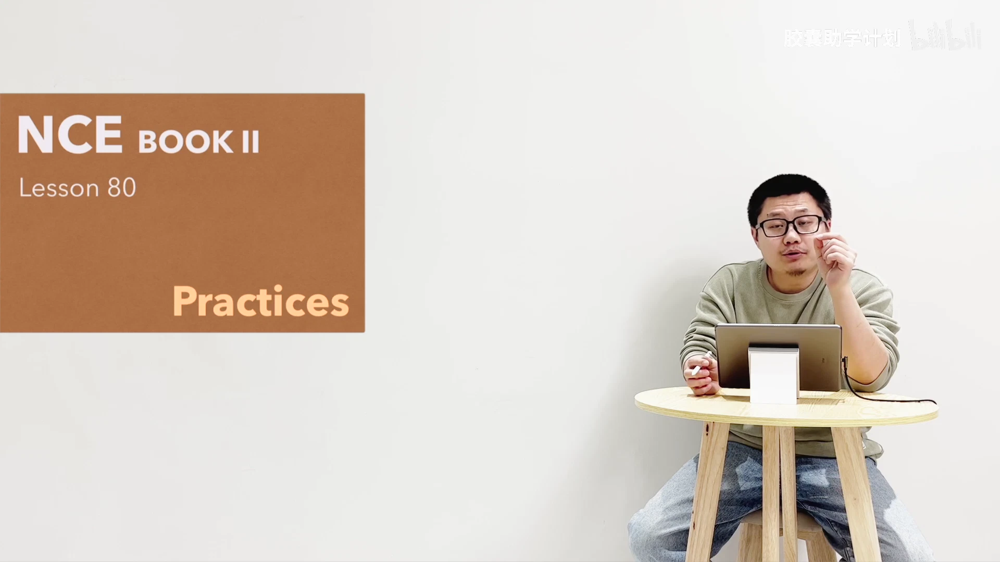

文字识别：NCE / BOOKII / Lesson 80 / Practices

### 画面 00:00:08

文字识别：进行如下练习唯一前提 / 文章跟读至熟读成诵 / 否则请勿开始

### 画面 00:00:22

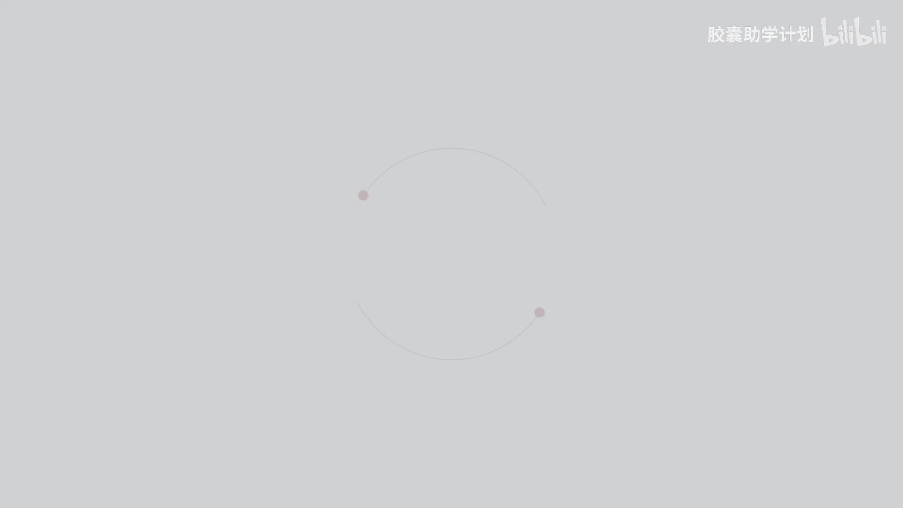

文字识别：胶囊助学计划bili / •

### 画面 00:00:26

### 画面 00:00:28

文字识别：Comprehension / 训练目标： / 听懂一般疑问句＆特殊疑问句

## 00:00:30–00:01:00

句和特殊疑问句，我问您答，就这么简单。来了啊，Is the Crystal Palace an ordinary or an extraordinary building? Ordinary就是普通的，extraordinary就是非凡不普通的，对吧？那答案就是an extraordinary one. Next one, Was it built in the eighteenth or the nineteenth century? Nineteenth.

### 画面 00:00:34

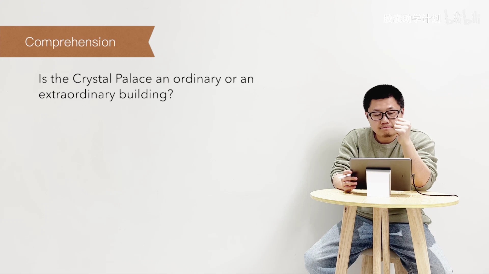

文字识别：Comprehension / Is the Crystal Palace an ordinary or an / extraordinary building?

### 画面 00:00:51

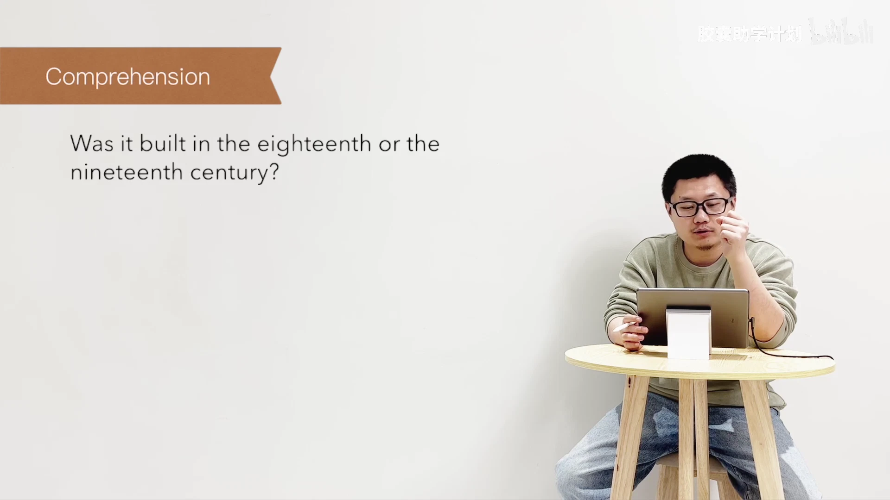

文字识别：Comprehension / Was it built in the eighteenth or the / nineteenth century?

## 00:01:00–00:01:30

Where was it built? In Hyde Park. What was it built for? For the Great Exhibition of 1851. How was it different from all other buildings in the world? It was made of iron and glass. Were

### 画面 00:01:00

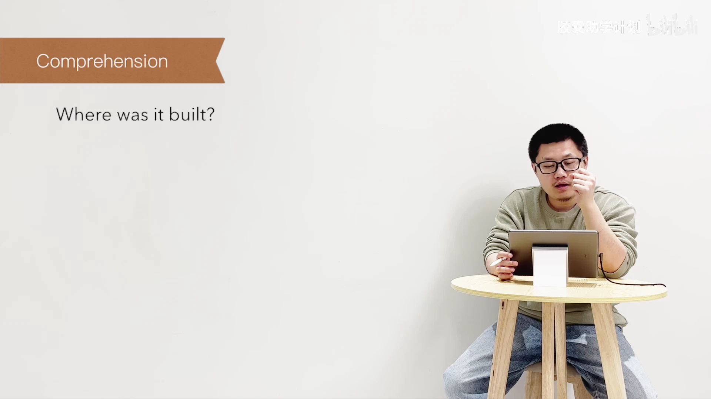

文字识别：Comprehension / Where was it built?

### 画面 00:01:23

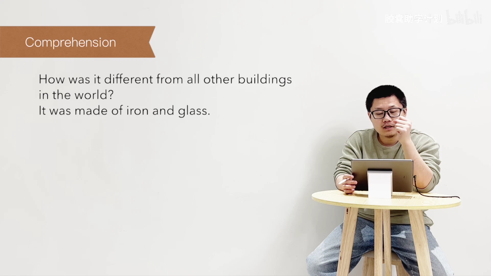

文字识别：Comprehension / How was it different from all other buildings / in the world? / It was made of iron and glass.

### 画面 00:01:28

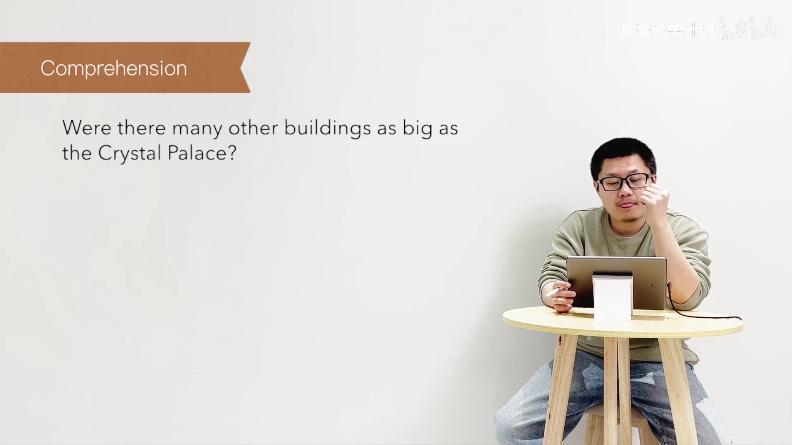

文字识别：Comprehension / Were there many other buildings as big as / the Crystal Palace?

## 00:01:30–00:02:00

there many other buildings as big as the Crystal Palace? No, there weren't. Who came to see it? A lot of people from many countries, or from various parts of the world. What was sent to the exhibition from abroad? A great many goods. What

### 画面 00:01:41

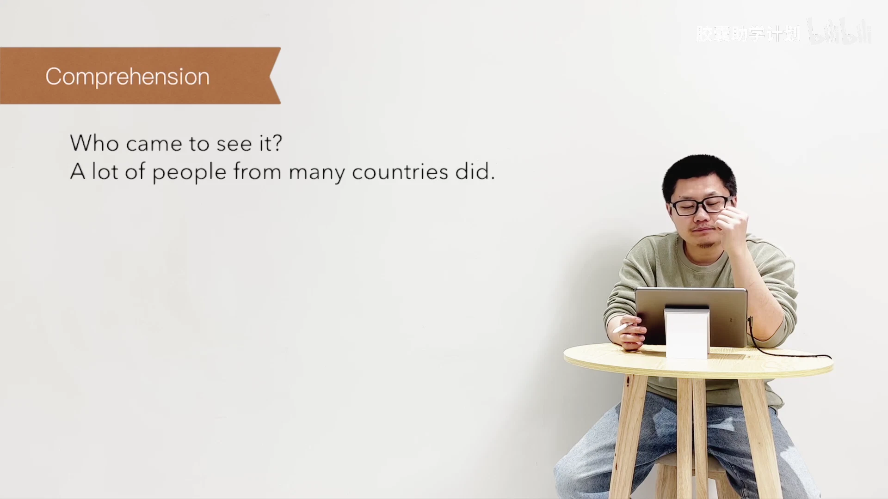

文字识别：Comprehension / Who came to see it? / A lot of people from many countries did.

### 画面 00:01:45

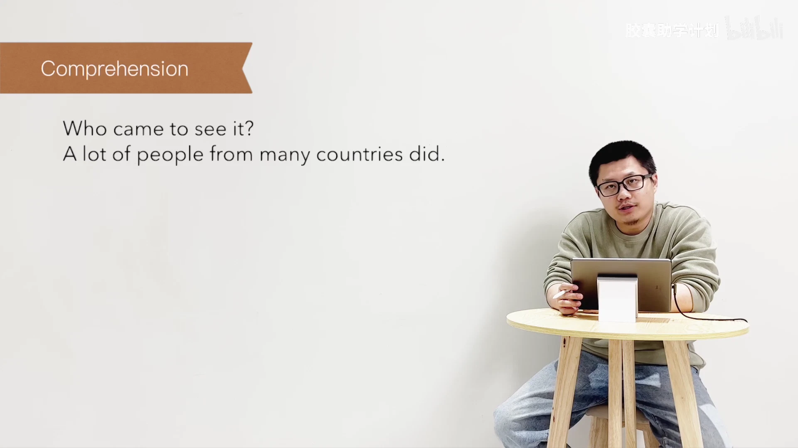

文字识别：Comprehension / Who came to see it? / A lot of people from many countries did.

### 画面 00:01:49

文字识别：学计划 / Comprehension

## 00:02:00–00:02:30

else was on display? A great deal of machinery. What was the most wonderful piece of machinery on show? Nasmyth steam hammer. Asking questions, 四句型啊，不多说。第一个例子, ask me if the crystal palace was built in the 19th century. 一般过去是被动, was

### 画面 00:02:14

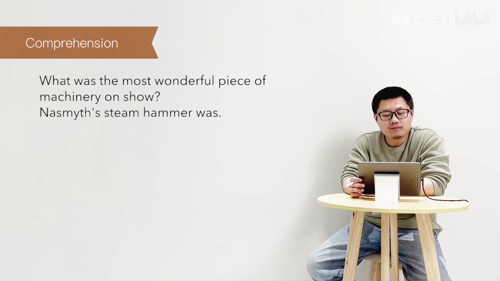

文字识别：Comprehension / What was the most wonderful piece of / machinery on show? / Nasmyth's steam hammer was.

### 画面 00:02:19

文字识别：Asking questions / 训练目标： / 会说一般疑问句＆特殊疑问句 / Accuracy / Fluency

### 画面 00:02:23

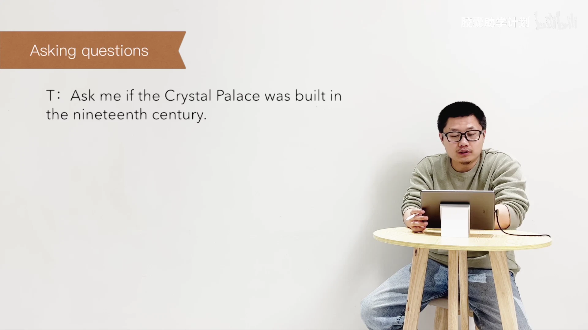

文字识别：Asking questions / T: Ask me if the Crystal Palace was built in / the nineteenth century.

### 画面 00:02:29

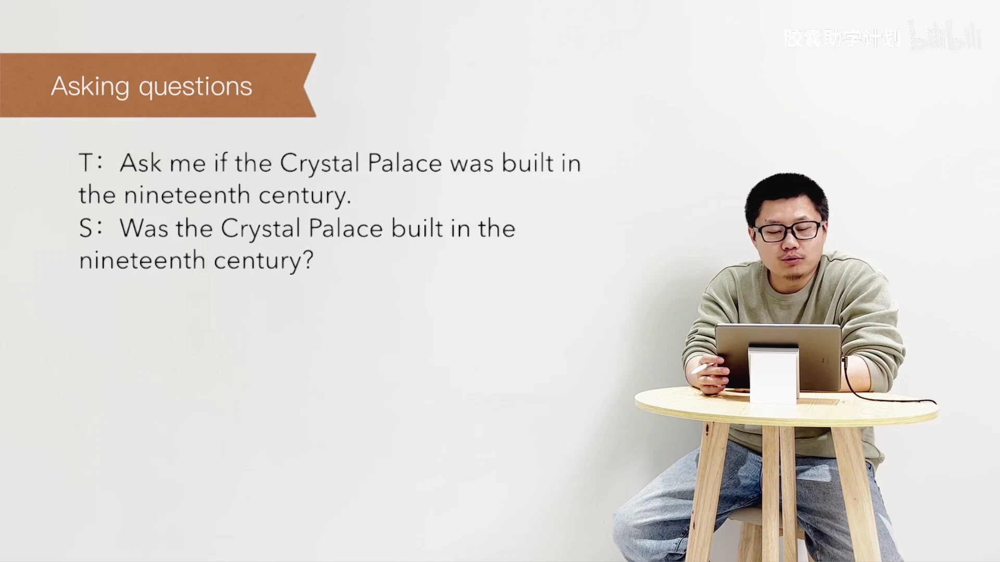

文字识别：Asking questions / T: Ask me if the Crystal Palace was built in / the nineteenth century. / S: Was the Crystal Palace built in the / nineteenth century?

## 00:02:30–00:03:00

提前。When，那就是对时间呗，把时间一去掉，这个事儿结束了，对吧？呃，What，如果是What，还是对这句话，那你就是把主语直接去掉，不用变一般疑问句了。也，第二个，It was built in Hyde Park。那你把was提前，变一般疑问句。Where对In Hyde Park提问。It was built for the Great Exhibition of 1851。你把was往前一提，Why？

### 画面 00:02:36

文字识别：Asking questions / 1.The Crystal Palace was built in the / nineteenth century.(When)(What)

### 画面 00:02:53

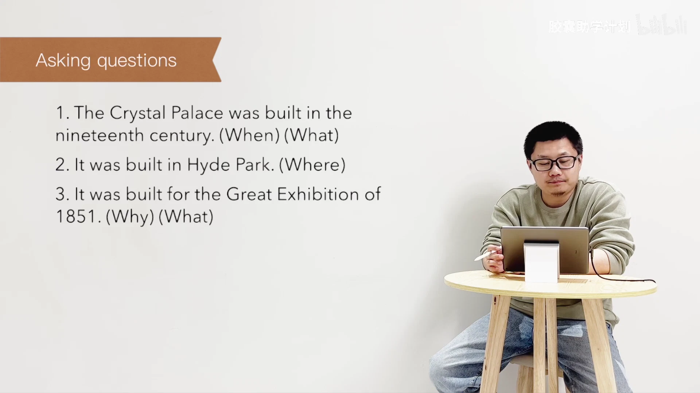

文字识别：Asking questions / 1.The Crystal Palace was built in the / nineteenth century.(When)(What) / 2. It was built in Hyde Park. (Where) / 3. It was built for the Great Exhibition of / 1851.(Why)(What)

## 00:03:00–00:03:30

啊 for the Great Exhibition of 1851嘛对吧哎呃 what 对主语提问啊就是 the Crystal Palace it was different from all other buildings in the world was 提前那 what 注意啊 what was different from all other buildings in the world对吧 how 你也可以直接说 how was it different from all other can啊 all other buildings in the world它是如何不同的呢当然你说

### 画面 00:03:16

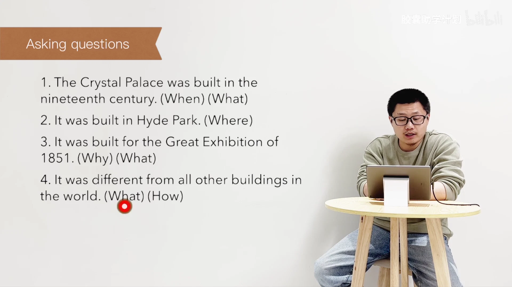

文字识别：Asking questions / 1. The Crystal Palace was built in the / nineteenth century.(When)(What) / 2. It was built in Hyde Park. (Where) / 3. It was built for the Great Exhibition of / 1851.(Why)(What) / 4. Ilt was different from all other buildings in / the world.(What) (How)

### 画面 00:03:29

文字识别：字计划 / Asking questions

## 00:03:30–00:04:00

why 的话也是整句话。第五个， it was made of iron and glass. Was 提前， what 对 iron and glass 提问。 A lot of people came to see it. 注意这里用的是 came，对吧？把 did 提前，动词换回原形 come。啊，那 how many 就是对 a lot of 提问，但是注意它是对主语的一部分，所以答答案叫 how many people came to see it。不用变一般疑问句了。 They came from many

### 画面 00:03:40

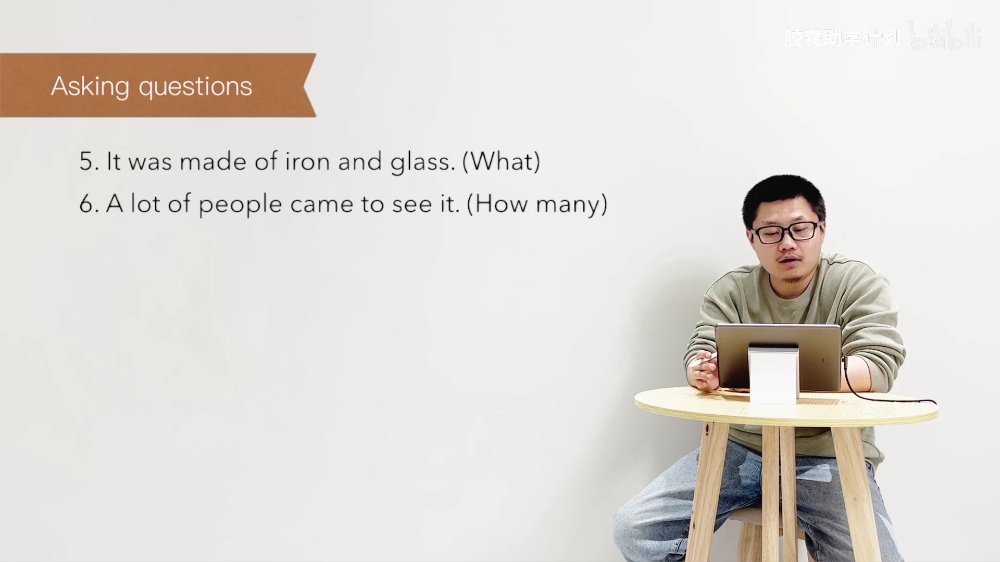

文字识别：Asking questions / 5. It was made of iron and glass. (What) / 6.A lot of people came to see it. (How many)

## 00:04:00–00:04:30

countries. Did提前where对from啊对many countries. Where did they come from? This is very simple. New Concept One. A great many goods were sent to the exhibition. Were提前how many对a great many提问不用变一般疑问句. They came from various parts of the world. Did提前对吧? Did they come from all parts of the world? Okay, where? Where

### 画面 00:04:06

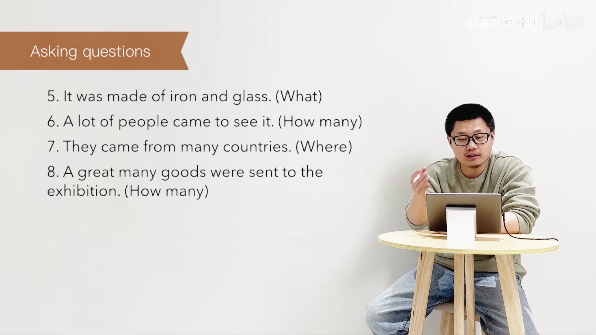

文字识别：Asking questions / 5. It was made of iron and glass. (What) / 6.A lot of people came to see it. (How many) / 7. They came from many countries.(Where) / 8.A great many goods were sent to the / exhibition.(How many)

## 00:04:30–00:05:00

world. Ah,其实就是还是刚才跟第七句话是一样的啊. Where did they come from? Tell the story.也没有什么说的了，只是注意还是提醒，这个练的是我们的流利性，而不是准确性，对吧？呃，更练流利性，你也不能错的太多，所以文章要熟读成诵嘛。嗯，summary writing注意一点，我们进入第四单元是两篇summary writing，这是第一篇，这是第二篇，它们的区别是连词稍有不同，

### 画面 00:04:36

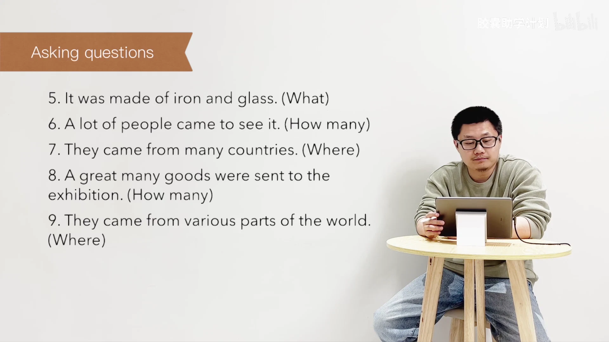

文字识别：Asking questions / 5. It was made of iron and glass. (What) / 6.A lot of people came to see it. (How many) / 7. They came from many countries.(Where) / 8.A great many goods were sent to the / exhibition.(How many) / 9. They came from various parts of the world. / (Where)

### 画面 00:04:38

文字识别：臺助子计划 / Tell the story / 训练目标： / 口语复述能力 / Accuracy / Fluency

### 画面 00:04:40

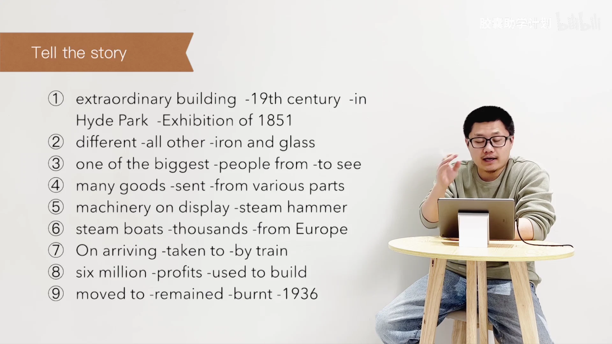

文字识别：助字计划 / Tell the story / 1 / extraordinary building -19th century -in / Hyde Park -Exhibition of 1851 / different -all other -iron and glass / one of the biggest -people from -to see / 3 / many goods -sent -from various parts / machinery on display -steam hammer / 5 / steam boats -thousands -from Europe / 6 / On arriving -taken to -by train / 7 / 8 / six million -profits -used to build / 9 / moved to -remained -burnt -1936

### 画面 00:04:51

文字识别：Summary writing: Key / 训练目标： / 写作复述能力

### 画面 00:04:56

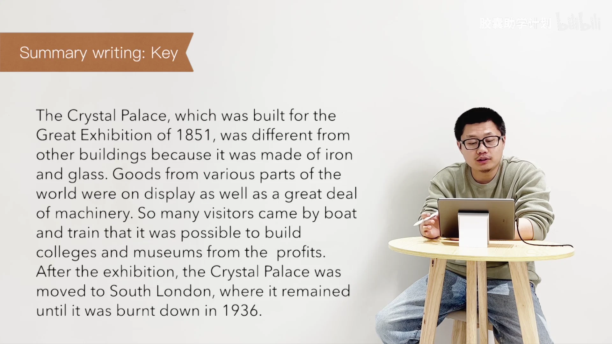

文字识别：助字计划 / Summary writing: Key / The Crystal Palace, which was built for the / Great Exhibition of 1851, was different from / other buildings because it was made of iron / and glass. Goods from various parts of the / world were on display as well as a great deal / of machinery. So many visitors came by boat / and train that it was possible to build / colleges and museums from the profits. / After the exhibition, the Crystal Palace was / moved to South London, where it remained / until it was burnt down in 1936.

### 画面 00:04:58

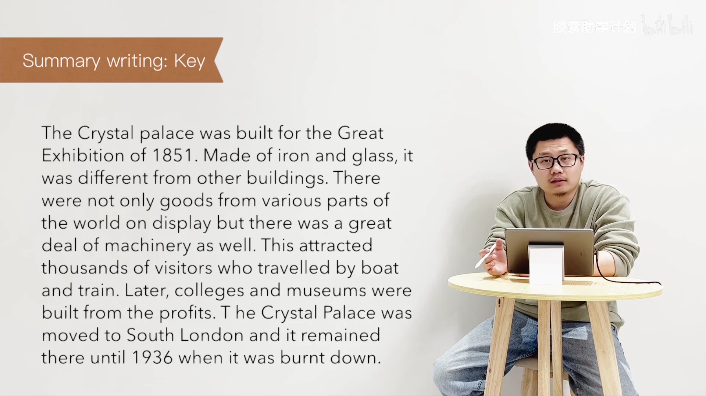

文字识别：助学计划 / Summary writing: Key / The Crystal palace was built for the Great / Exhibition of 1851. Made of iron and glass, it / was different from other buildings. There / were not only goods from various parts of / the world on display but there was a great / deal of machinery as well. This attracted / thousands of visitors who travelled by boat / and train. Later, colleges and museums were / built from the profits. T he Crystal Palace was / moved to South London and it remained / there until 1936 when it was burnt down.

## 00:05:00–00:05:30

这个你要自己去看教材，一看就能明白啊，我就不多解释了。然后 topic for discussion 呢，老习惯，我只是说一下题啊，让各位心里有一个数，对吧？ Tell us about an exhibition you have visited recently. 聊聊最近你去过的一个展览。 Describe the most wonderful building you have seen. Why and when was it built? 我聊聊你见过最棒的建筑物，对吧？它为啥被建造？何时

### 画面 00:05:04

文字识别：Topics for discussion / 训练目标： / 完全自由的对话 / Accuracy / Fluency

### 画面 00:05:06

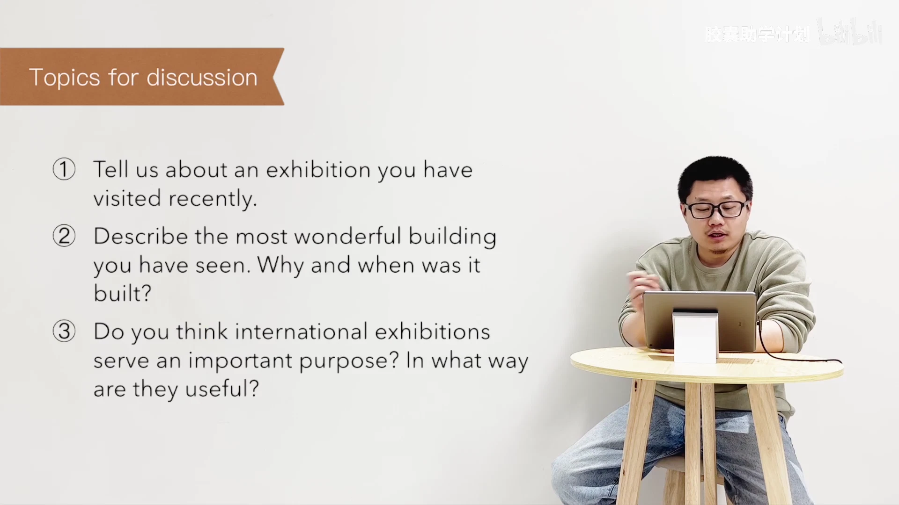

文字识别：Topics for discussion / Tell us about an exhibition you have / visited recently. / Describe the most wonderful building / you have seen. Why and when was it / built? / Do you think international exhibitions / serve an important purpose? In what way / are they useful?

## 00:05:30–00:06:00

被建造？哎，Do you think international exhibitions serve an important purpose? In what way are they useful?所以说，你认为这个 international exhibitions，说这个国际上，比如就像世博会，世博会就是 international exhibitions，用国际上的展览展会是吧？哎，起到一个什么样的目的？起到一个什么样的作用呢？是吧？它在什么样的方式层面上是有用的呢？哎，比如说促进国际贸易等等的。

### 画面 00:05:36

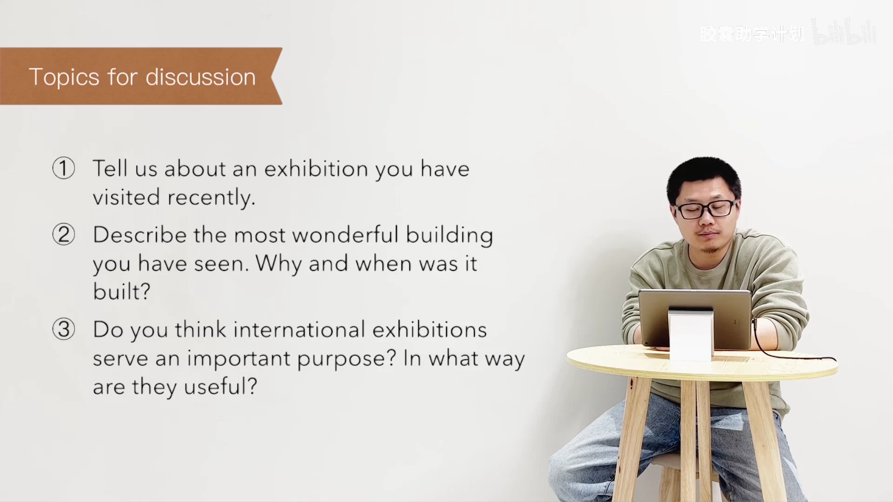

文字识别：Topics for discussion / Tell us about an exhibition you have / visited recently. / Describe the most wonderful building / you have seen. Why and when was it / built? / Do you think international exhibitions / serve an important purpose? In what way / are they useful?

## 00:06:00–00:06:30

OK，那这个我们就不多说了。呃，家庭作业，Ask Smith写完朗读，这要写作两篇，不要忘。Tell the story，您要一直去练。工作生活当中非常有用的一个技能叫复述，对吧？Paraphrasing。然后呢，置顶留言咱能找到重复间隔的学习材料。那以上呢就是本期视频的全部内容了。如果各位喜欢我们的课程呢，欢迎各位关注、订阅、一键三连，分享给那些需要的朋

### 画面 00:06:02

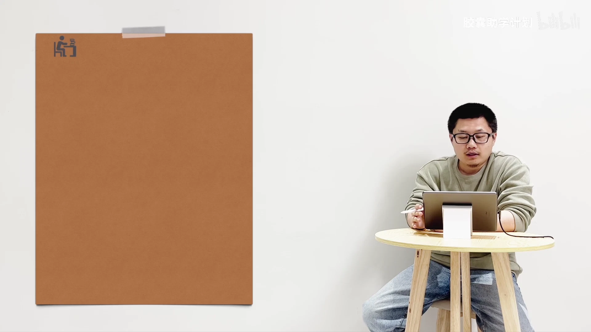

文字识别：助字计划

### 画面 00:06:04

文字识别：1.Ask me if写&朗读 / 2. / 摘要写作写&答案

### 画面 00:06:06

文字识别：1.Ask me if写&朗读 / 摘要写作写&答案 / 3.Tell the story 口语复述

### 画面 00:06:08

文字识别：1.Ask me if写&朗读 / 摘要写作写&答案 / 3.Tell the story 口语复述

### 画面 00:06:10

文字识别：1.Ask me if写&朗读 / 摘要写作写&答案 / 3.Tell the story 口语复述

### 画面 00:06:15

文字识别：1.Ask me if写&朗读 / 摘要写作写&答案 / 3.Tell the story 口语复述 / 4.重复间隔（置顶留言)

### 画面 00:06:19

文字识别：建助字计划 / 👍

### 画面 00:06:21

文字识别：虞助字计划一 / ￥ / 不

### 画面 00:06:24

文字识别：産助字计划一调 / 餐

### 画面 00:06:26

文字识别：建助学计划一

## 00:06:30–00:06:45

友，来帮助我们快速成长。See you next time.

### 画面 00:06:33

### 画面 00:06:35

文字识别：CAPSULEACADEMY / 胶囊助学计划 / 小红书 / Lecturer / □ / Leo

### 画面 00:06:38

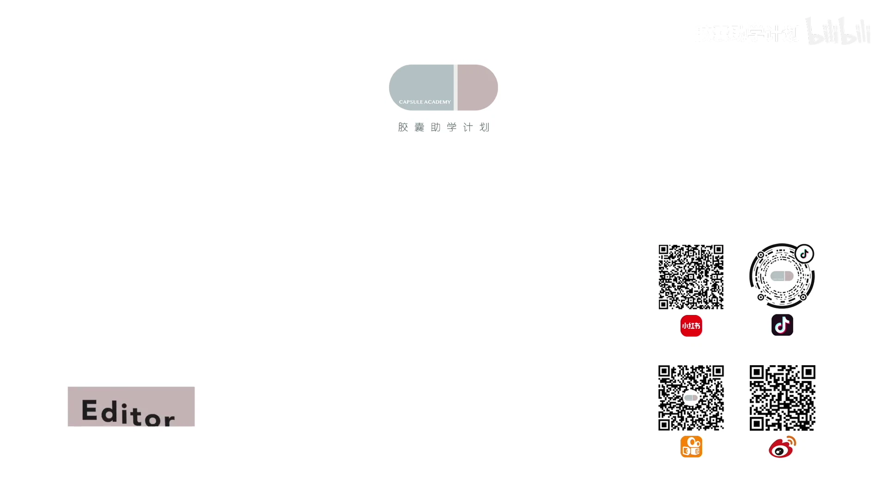

文字识别：CAPSULEACADEMY / 胶囊助学计划 / 小红书 / □ / 口 / Editor / OE

### 画面 00:06:41

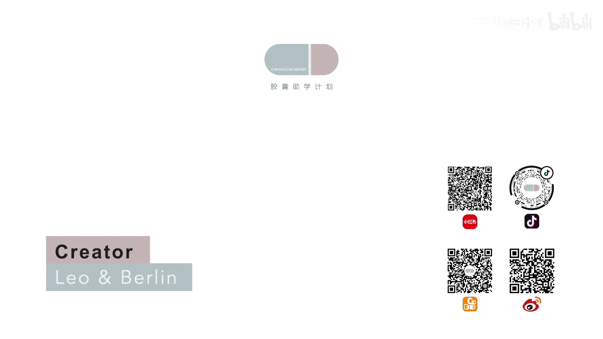

文字识别：CAPSULEACADEMY / 胶囊助学计划 / 小红书 / Creator / Leo & Berlin

### 画面 00:06:43

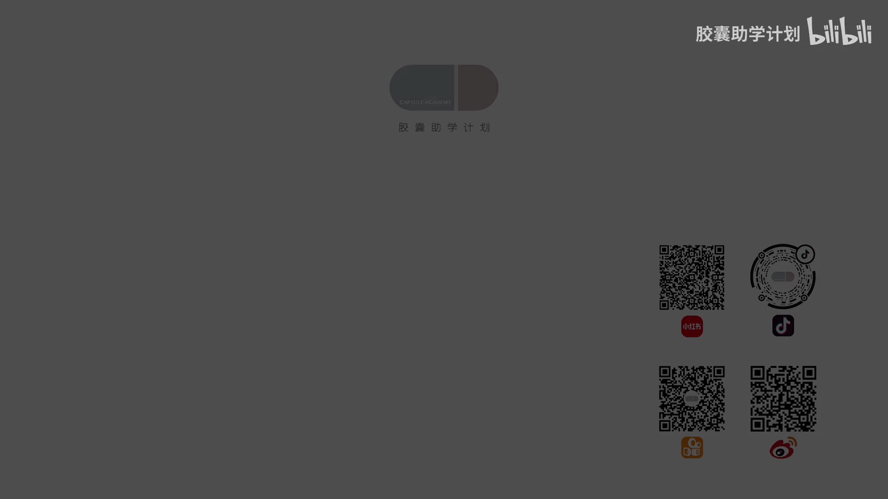

文字识别：bilbili / 胶囊助学计划 / 胶囊助学计划 / 小红书 / 处控□ / OE

### 画面 00:06:45

文字识别：bilbili / 胶囊助学计划

