# 081 单词 语法

快速机器解析：语音为单模型转写，未进行独立交叉校对或人工复核；画面每秒采样并按变化选帧，短时文字和标记可能遗漏。截图时间约有 1 秒误差。图片有损压缩；遇到疑点请按时间查看 Google Drive 原视频。

## 00:00:00–00:00:30

Hello everyone, welcome to Capsule Cafe. This is Leo. Today we're going to learn New Concept English Book Two, Lesson 81 Words and Grammar. 那老习惯进入正式课程之前呢，咱们先看几个小的问题。首先啊，如何表达变化非常的快啊，变化迅速？接下来呢，如何表达痛击或者说猛击啊？带着这两个问题，Hope you guys enjoy. 讲单词之

### 画面 00:00:00

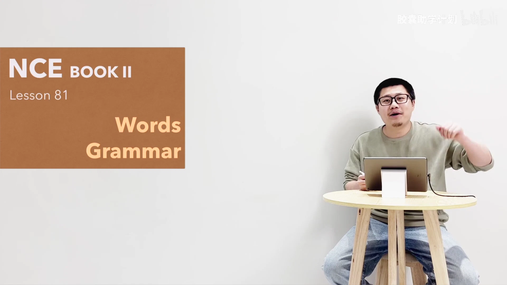

文字识别：NCE / BOOKII / Lesson 81 / Words / Grammar

### 画面 00:00:02

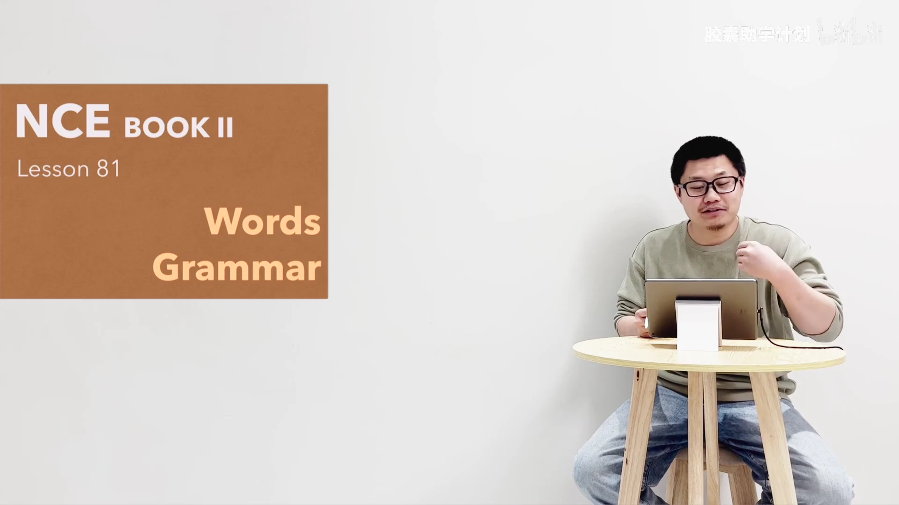

文字识别：NCE / BOOKII / Lesson 81 / Words / Grammar

### 画面 00:00:04

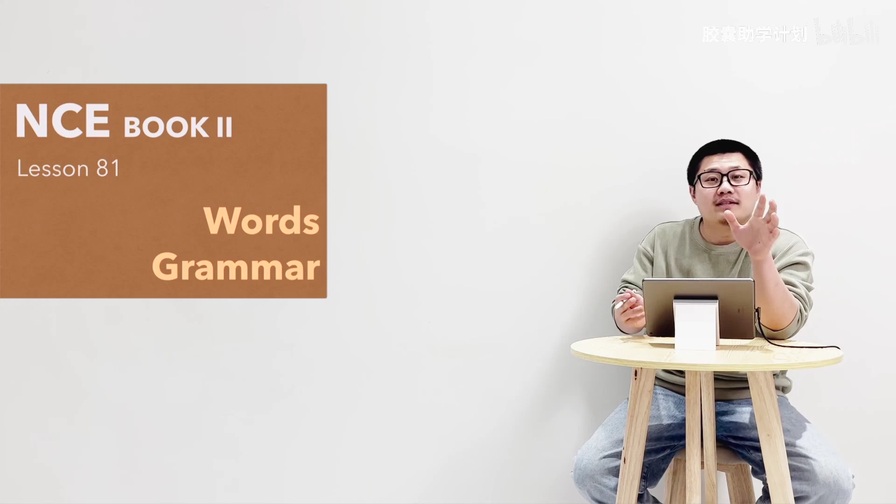

文字识别：NCE / BOOKII / Lesson 81 / Words / Grammar

### 画面 00:00:06

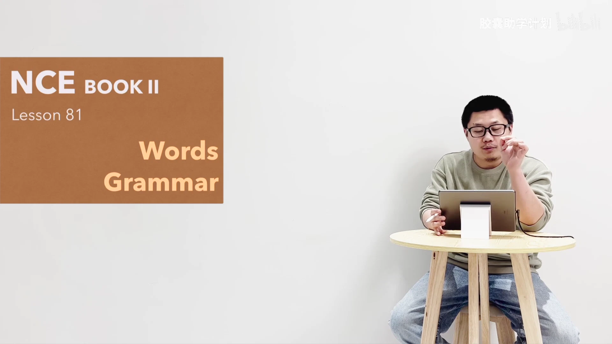

文字识别：NCE / BOOKII / Lesson 81 / Words / Grammar

### 画面 00:00:12

文字识别：臺助学计划一

### 画面 00:00:14

文字识别：助学计划 / ①如何表达“变化迅速”？

### 画面 00:00:17

文字识别：①如何表达“变化迅速”？ / 孟击”

### 画面 00:00:19

文字识别：①如何表达“变化迅速”？ / 如何表达“痛击/猛击”?

### 画面 00:00:24

文字识别：bibi / 胶囊助学计划 / •

### 画面 00:00:28

文字识别：養助学计划 / 胶囊助学计划

## 00:00:30–00:01:00

前，还是我提醒一下，我们进入第四单元最主要的目的就是复习整个新二，那甚至包括了新一，对吧？我们会利用一切的方法，其中就包含了单词造句。我们先看第一个单词 prisoner，prisoner，prisoner。OK，那它指的是这种囚犯。OK，那 prison 这个单词，你看后边加了 er，表示囚犯。prison 就是监狱的意思，它是一个名词。我们想拿它去造句，必

### 画面 00:00:30

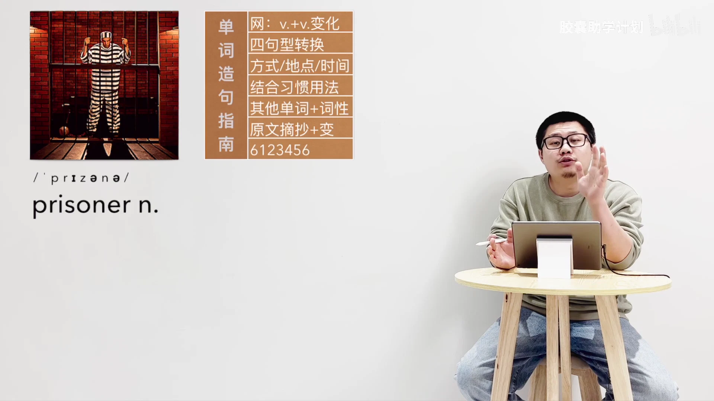

文字识别：单词造句指南 / 网：v.+v.变化 / 囊助字计划 / 四句型转换 / 方式/地点/时间 / 结合习惯用法 / 其他单词+词性 / 原文摘抄+变 / 6123456 / /'prizanal / prisoner n.

### 画面 00:00:35

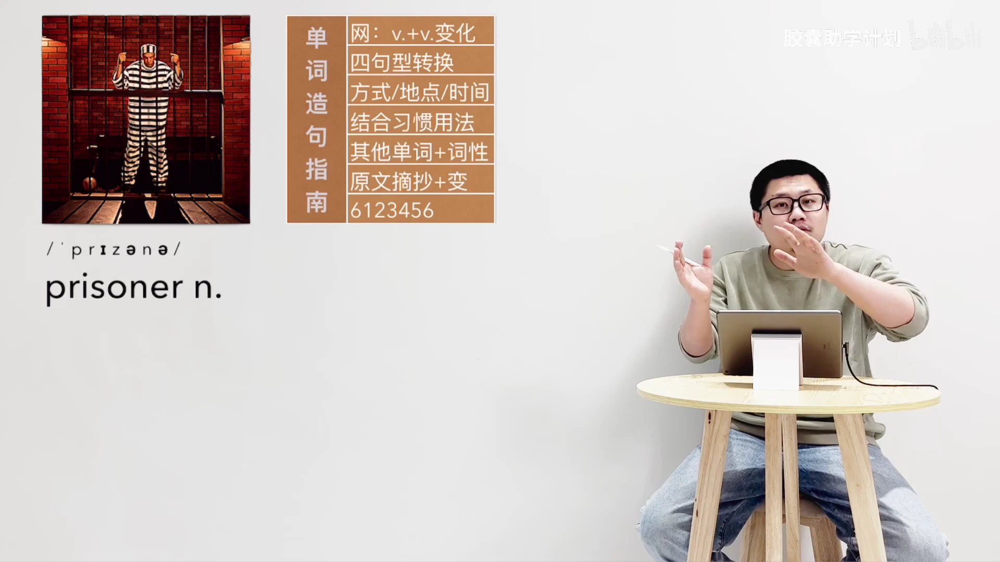

文字识别：单词造句指南 / 网：v.+v.变化 / 囊助字计划一 / 四句型转换 / 方式/地点/时间 / 结合习惯用法 / 其他单词+词性 / 原文摘抄+变 / 6123456 / /'prizana/ / prisoner n.

### 画面 00:00:52

文字识别：单词造句指南 / 网：v.+v.变化 / 奏助字计划 / 四句型转换 / 方式/地点/时间 / 结合习惯用法 / 其他单词+词性 / 原文摘抄+变 / 6123456 / /'prizanal / prisonel

### 画面 00:00:56

文字识别：单词造句指南 / 网：v.+v.变化 / 辜助字计划圖 / 四句型转换 / 方式/地点/时间 / 结合习惯用法 / 其他单词+词性 / 原文摘抄+变 / 6123456 / /'prizana/ / prisoner n.

## 00:01:00–00:01:30

定要想这个词性的事情，对吧？找其他的动词跟这个 prisoner 连在一起。同样，我们去想六一二三四五六当中，它可能最常出现的位置一和三这样的两个位置，造一个句子。 Repeat after me, OK? When he realized that the prisoner was standing in front of him, he felt frightened. 好了，当他意识到站在他面前的时候，他感到非常的害怕。 Next one, he spent ten

### 画面 00:01:00

文字识别：单词造句指南 / 网：v.+v.变化 / 喜助字计划 / 四句型转换 / 方式/地点/时间 / 结合习惯用法 / 其他单词+词性 / 原文摘抄+变 / 6123456 / /'ｐrīzana/ / prisoner n.

### 画面 00:01:05

文字识别：单词造句指南 / 网：v.+v.变化 / 辜助字计划 / 四句型转换 / 方式/地点/时间 / 结合习惯用法 / 其他单词+词性 / 原文摘抄+变 / 6123456 / /'prizana/ / prisoner n.

### 画面 00:01:10

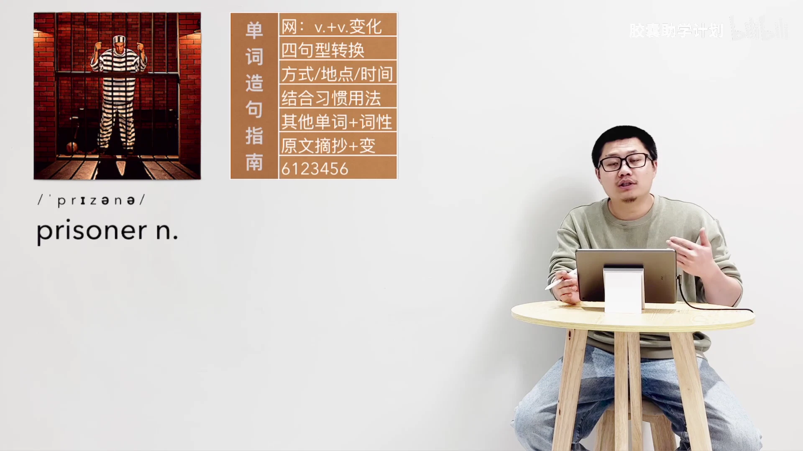

文字识别：单词造句指南 / 网：v.+v.变化 / 喜助字计划 / 四句型转换 / 方式/地点/时间 / 结合习惯用法 / 其他单词+词性 / 原文摘抄+变 / 6123456 / /'prīzana/ / prisoner n.

### 画面 00:01:13

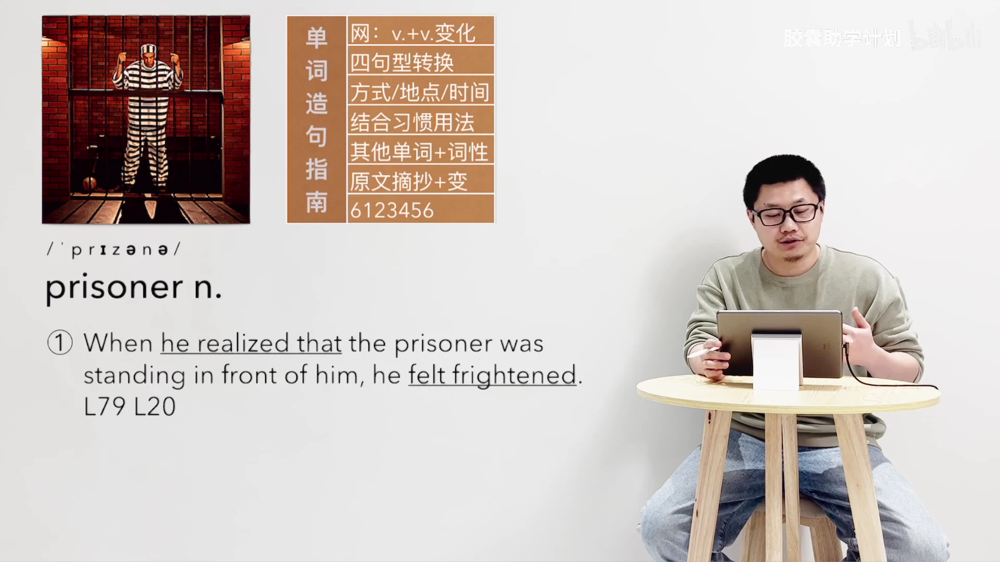

文字识别：单词造句指南 / 网：v.+v.变化 / 四句型转换 / 方式/地点/时间 / 结合习惯用法 / 其他单词+词性 / 原文摘抄+变 / 6123456 / /'ｐrīzanal / prisoner n. / When he realized that the prisoner was / standing in front of him, he felt frightened. / L79 L20

### 画面 00:01:15

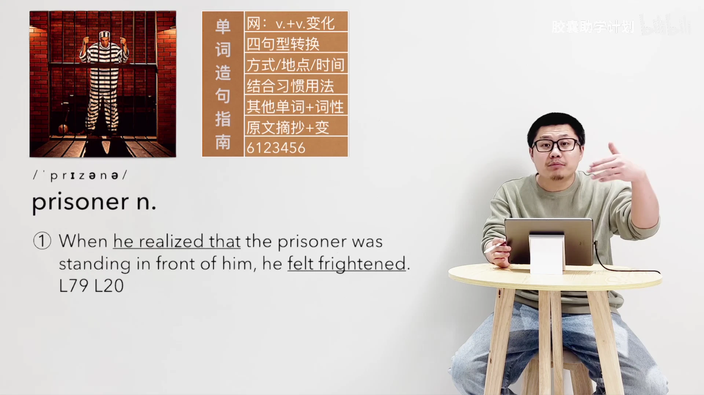

文字识别：单词造句指南 / 网：v.+v.变化 / 四句型转换 / 方式/地点/时间 / 结合习惯用法 / 其他单词+词性 / 原文摘抄+变 / 6123456 / /prīzana/ / prisoner n. / When he realized that the prisoner was / standing in front of him, he felt frightened. / L79 L20

### 画面 00:01:20

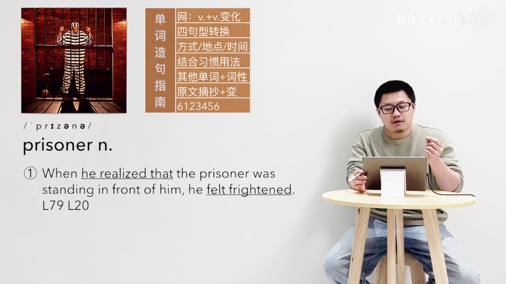

文字识别：单词造句指南 / 网：v.+v.变化 / 学计划 / 四句型转换 / 方式/地点/时间 / 结合习惯用法 / 其他单词+词性 / 原文摘抄+变 / 6123456 / /'prizana/ / prisoner n. / When he realized that the prisoner was / standing in front of him, he felt frightened. / L79 L20

### 画面 00:01:25

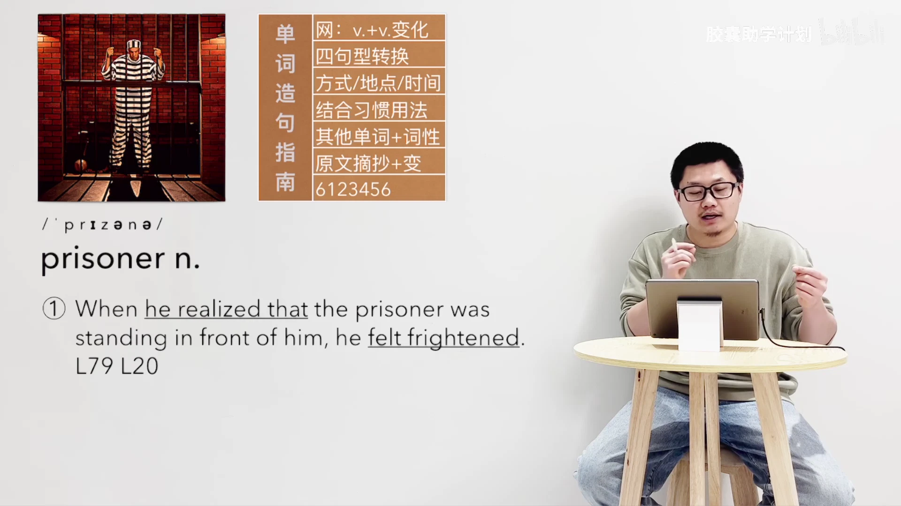

文字识别：单词造句指南 / 网：v.+v.变化 / 四句型转换 / 方式/地点/时间 / 结合习惯用法 / 其他单词+词性 / 原文摘抄+变 / 6123456 / /'prizanal / prisoner n. / When he realized that the prisoner was / standing in front of him, he felt frightened. / L79 L20

### 画面 00:01:29

文字识别：单词造句指南 / 网：v.+v.变化 / 四句型转换 / 方式/地点/时间 / 结合习惯用法 / 其他单词+词性 / 原文摘抄+变 / 6123456 / /'prizanal / prisoner n. /  When he realized that the prisoner was / standing in front of him, he felt frightened. / L79 L20 / He spent ten years studying these / prisoners. L59

## 00:01:30–00:02:00

years studying these prisoners.他花费了十年的时间去研究这些囚犯。那我们可能理解为，比如说变态心理学，对吧？研究这帮囚犯他们的心理状况。OK, very good. No more psychology. Next one. He agreed to meet the prisoner tonight.这里边用了一个习惯用法，agree to do something.那同意干什么呢？见一见他。今天晚上再读一遍这个单词，prisoner. Very good.

### 画面 00:01:31

文字识别：单词造句指南 / 网：v.+v.变化 / 四句型转换 / 方式/地点/时间 / 结合习惯用法 / 其他单词+词性 / 原文摘抄+变 / 6123456 / /'prizａna/ / prisoner n. /  When he realized that the prisoner was / standing in front of him, he felt frightened. / L79 L20 / He spent ten years studying these / prisoners. L59

### 画面 00:01:36

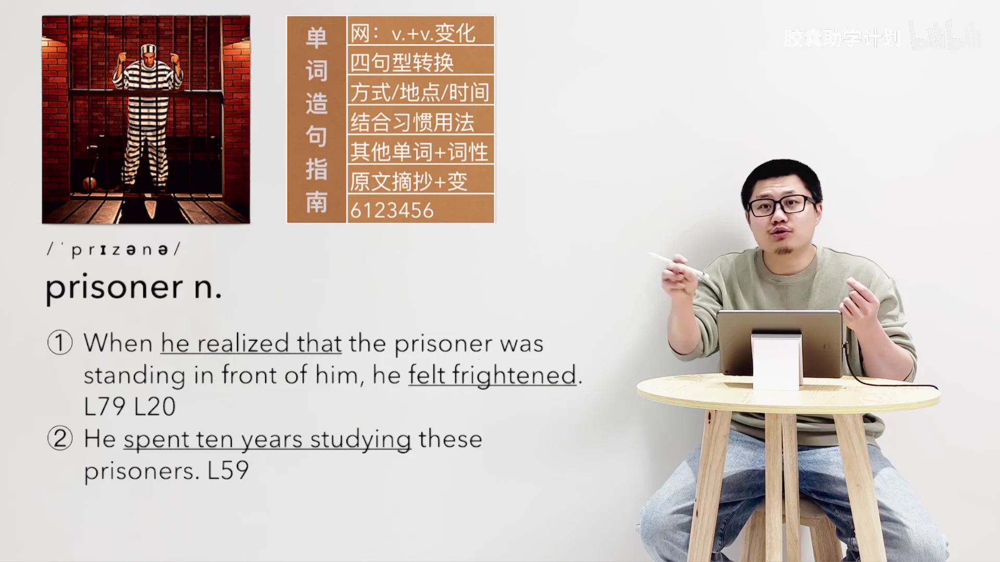

文字识别：单词造句指南 / 网：v.+v.变化 / 四句型转换 / 方式/地点/时间 / 结合习惯用法 / 其他单词+词性 / 原文摘抄+变 / 6123456 / /'ｐrizanal / prisoner n. /  When he realized that the prisoner was / standing in front of him, he felt frightened. / L79 L20 / He spent ten years studying these / prisoners. L59

### 画面 00:01:43

文字识别：单词造句指南 / 网：v.+v.变化 / 四句型转换 / 方式/地点/时间 / 结合习惯用法 / 其他单词+词性 / 原文摘抄+变 / 6123456 / /'ρrizanal / prisoner n. /  When he realized that the prisoner was / standing in front of him, he felt frightened. / L79 L20 / He spent ten years studying these / prisoners. L59

### 画面 00:01:45

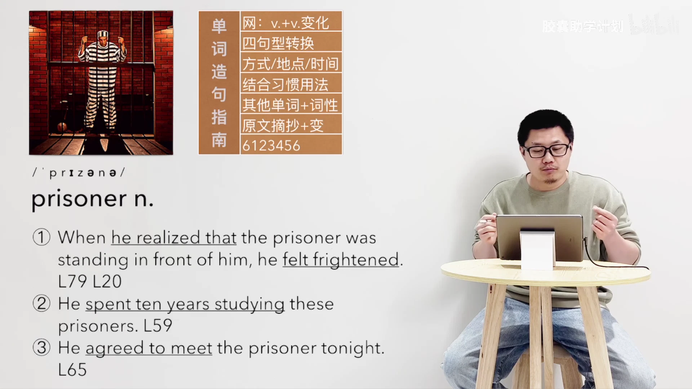

文字识别：单词造句指南 / 网：v.+v.变化 / 四句型转换 / 方式/地点/时间 / 结合习惯用法 / 其他单词+词性 / 原文摘抄+变 / 6123456 / /'prīzana/ / prisoner n. /  When he realized that the prisoner was / 1 / standing in front of him, he felt frightened. / L79 L20 / He spent ten years studying these / prisoners. L59 / He agreed to meet the prisoner tonight. / L65

### 画面 00:01:50

文字识别：单词造句指南 / 网：v.+v.变化 / 四句型转换 / 方式/地点/时间 / 结合习惯用法 / 其他单词+词性 / 原文摘抄+变 / 6123456 / /'prīzana/ / prisoner n. / ① When he realized that the prisoner was / standing in front of him, he felt frightened. / L79 L20 / He spent ten years studying these / prisoners. L59 / He agreed to meet the prisoner tonight. / L65

### 画面 00:01:57

文字识别：单词造句指南 / 网：v.+v.变化 / 计划 / 四句型转换 / 方式/地点/时间 / 结合习惯用法 / 其他单词+词性 / 原文摘抄+变 / 6123456 / /'prīzana/ / prisoner n. /  When he realized that the prisoner was / standing in front of him, he felt frightened. / L79 L20 / He spent ten years studying these / prisoners. L59 / He agreed to meet the prisoner tonight. / L65

## 00:02:00–00:02:30

下一个单词 bush, bush, 啊 bush, 你要注意啊，如果它大写的话，它就是可以是人的呃名或姓，对吧？你比如说呃 George W. Bush, 对吧？布什这个各位都听过，对吧？OK, next one呢？那注意它如果是小写，表示的就是这种灌木丛啊 bush，也可以有复数 bushes. OK, 那我们造一句话，比如说 Before planting the bushes, we should water the ground first. 那这里面注意一个小的点，

### 画面 00:02:00

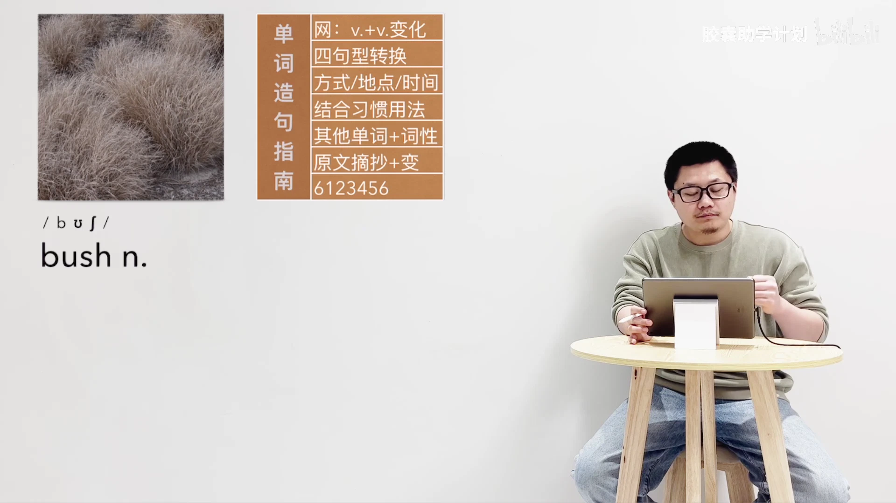

文字识别：单词造句指南 / 网：v.+v.变化 / 奏助学计划 / 四句型转换 / 方式/地点/时间 / 结合习惯用法 / 其他单词+词性 / 原文摘抄+变 / 6123456 / / bu∫ 1 / bush n.

### 画面 00:02:05

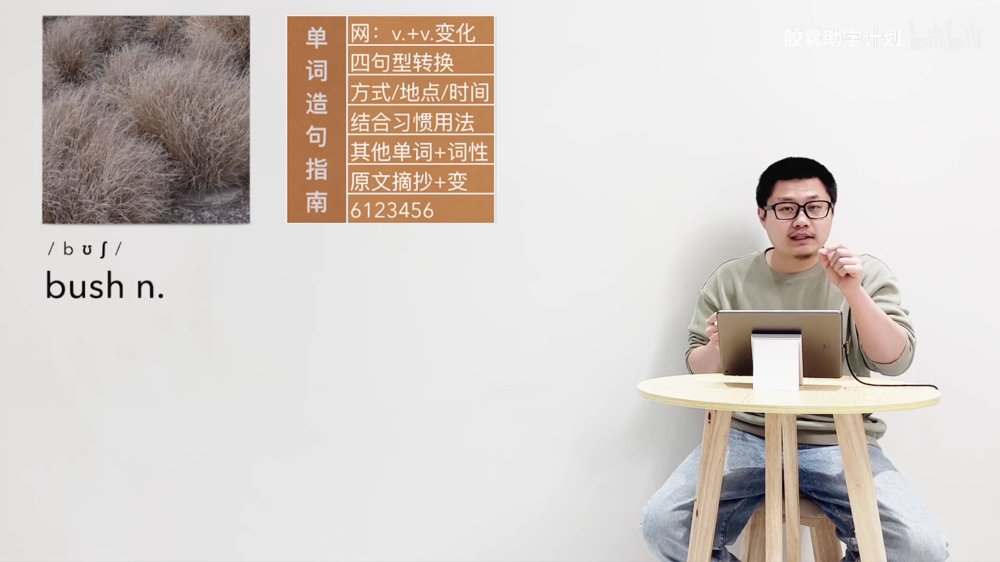

文字识别：单词造句指南 / 网：v.+v.变化 / 美助学计划陽 / 四句型转换 / 方式/地点/时间 / 结合习惯用法 / 其他单词+词性 / 原文摘抄+变 / 6123456 / / bu∫ 1 / bush n.

### 画面 00:02:15

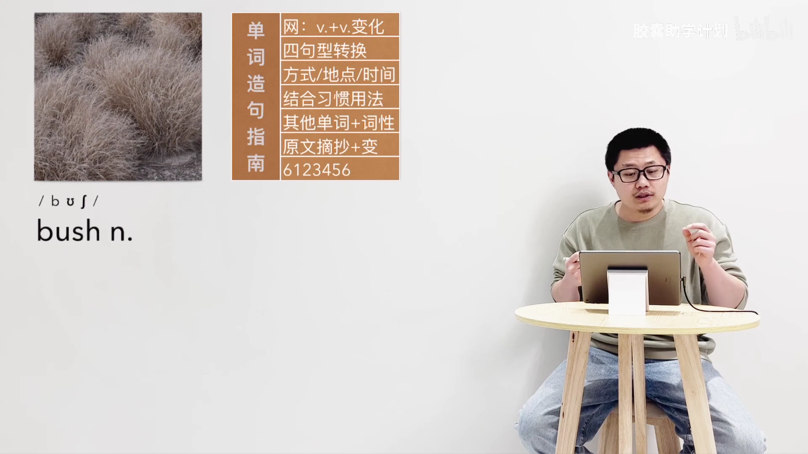

文字识别：单词造句指南 / 网：v.+v.变化 / 妻助学计划 / 四句型转换 / 方式/地点/时间 / 结合习惯用法 / 其他单词+词性 / 原文摘抄+变 / 6123456 / / bu∫ 1 / bush n.

### 画面 00:02:20

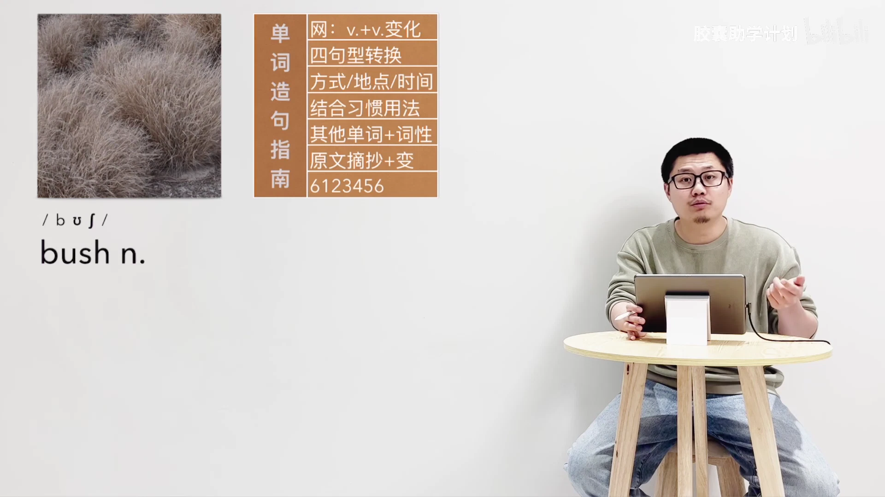

文字识别：单词造句指南 / 网：v.+v.变化 / 囊助字计划 / 四句型转换 / 方式/地点/时间 / 结合习惯用法 / 其他单词+词性 / 原文摘抄+变 / 6123456 / / bu∫ 1 / bush n.

### 画面 00:02:22

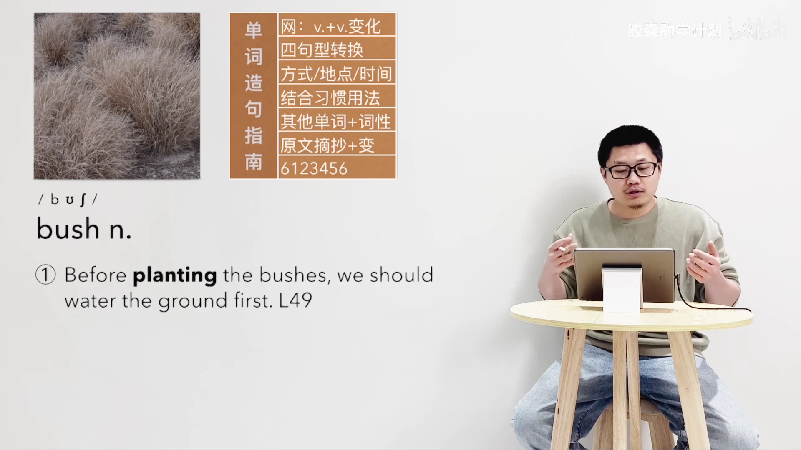

文字识别：单词造句指南 / 网：v.+v.变化 / 四句型转换 / 方式/地点/时间 / 结合习惯用法 / 其他单词+词性 / 原文摘抄+变 / 6123456 / / bu∫ 1 / bush n. / ① Before planting the bushes, we should / water the ground first. L49

### 画面 00:02:26

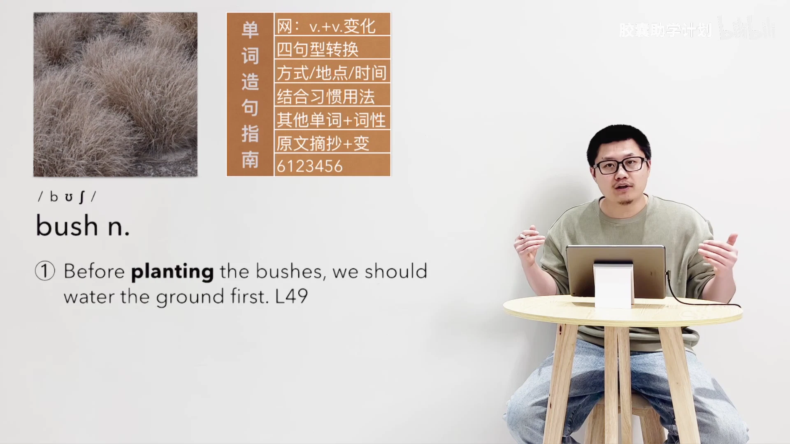

文字识别：单词造句指南 / 网：v.+v.变化 / 四句型转换 / 方式/地点/时间 / 结合习惯用法 / 其他单词+词性 / 原文摘抄+变 / 6123456 / / bu∫ 1 / bush n. / ① Before planting the bushes, we should / water the ground first. L49

## 00:02:30–00:03:00

planting主语是谁？是we，对吧？然后你要去想主动被动呢？主动，对吧？这个其实对于各位来说，呃，学多了啊，写多了之后，基本上就是呃，这个动笔就能写出来的一个知识点。Next one, as soon as一怎么怎么样就怎么怎么样。We planted the bushes in our garden. It started to rain.天公作美，我们一

### 画面 00:02:46

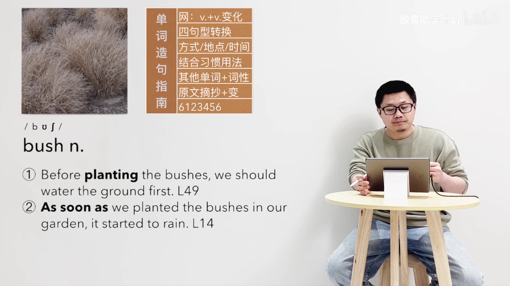

文字识别：单词造句指南 / 网：v.+v.变化 / 四句型转换 / 方式/地点/时间 / 结合习惯用法 / 其他单词+词性 / 原文摘抄+变 / 6123456 / /bu∫ / / bush n. / ① Before planting the bushes, we should / water the ground first. L49 / As soon as we planted the bushes in our / garden, it started to rain. L14

### 画面 00:02:50

文字识别：单词造句指南 / 网：v.+v.变化 / 四句型转换 / 方式/地点/时间 / 结合习惯用法 / 其他单词+词性 / 原文摘抄+变 / 6123456 / / bu∫/ / bush n. / ① Before planting the bushes, we should / water the ground first. L49 / As soon as we planted the bushes in our / garden, it started to rain. L14

## 00:03:00–00:03:30

在这个院子里把这个灌木丛给种上，就开始下雨了。Very good. Next one, say the children enjoy hiding in the bushes.孩子们非常享受在这个灌木丛里边躲着，对吧？Enjoy doing something,玩藏猫猫。Very good.再读一遍这个单词bush. Very good.下一个单词，看一下音标叫做rapidly啊，rapidly。注意它的词性是副词。那我们单词造句就要去想这

### 画面 00:03:00

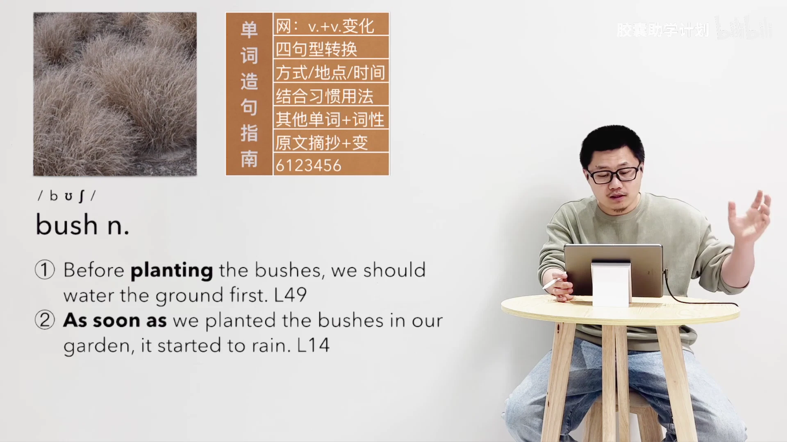

文字识别：单词造句指南 / 网：v.+v.变化 / 四句型转换 / 方式/地点/时间 / 结合习惯用法 / 其他单词+词性 / 原文摘抄+变 / 6123456 / /bu∫/ / bush n. / ① Before planting the bushes, we should / water the ground first. L49 / As soon as we planted the bushes in our / garden, it started to rain. L14

### 画面 00:03:06

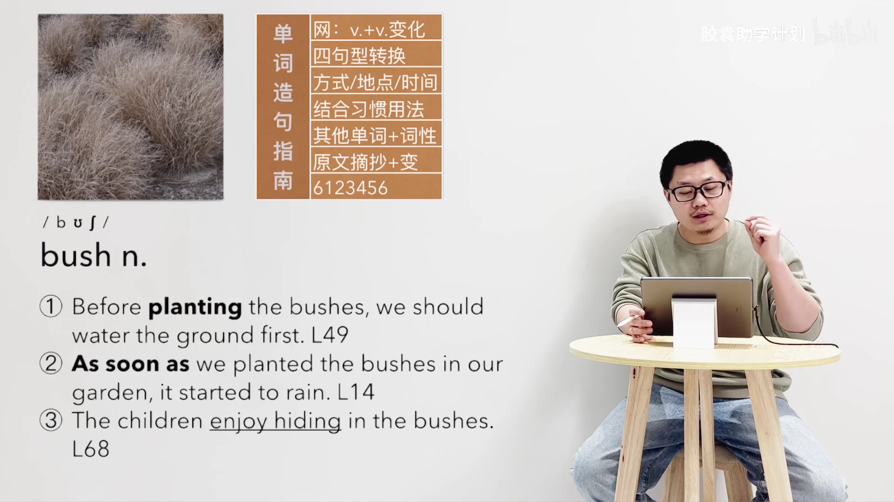

文字识别：单词造句指南 / 网：v.+v.变化 / 四句型转换 / 方式/地点/时间 / 结合习惯用法 / 其他单词+词性 / 原文摘抄+变 / 6123456 / / bu∫ 1 / bush n. / ① Before planting the bushes, we should / water the ground first. L49 / As soon as we planted the bushes in our / garden, it started to rain. L14 / The children enjoy hiding in the bushes. / L68

### 画面 00:03:12

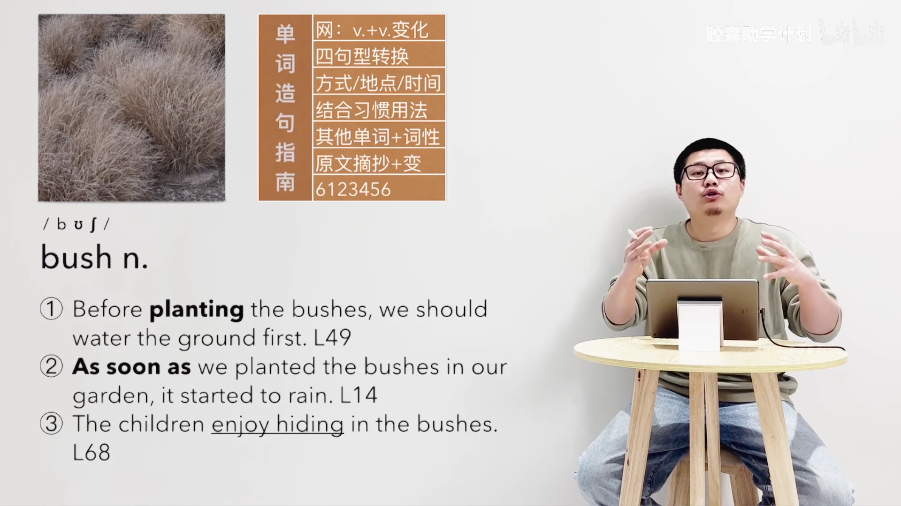

文字识别：单词造句指南 / 网：v.+v.变化 / 四句型转换 / 方式/地点/时间 / 结合习惯用法 / 其他单词+词性 / 原文摘抄+变 / 6123456 / / bu∫ 1 / bush n. / ① Before planting the bushes, we should / water the ground first. L49 / As soon as we planted the bushes in our / garden, it started to rain. L14 / The children enjoy hiding in the bushes. / L68

### 画面 00:03:19

文字识别：单词造句指南 / 网：v.+v.变化 / 妻助字计划 / 四句型转换 / 方式/地点/时间 / 结合习惯用法 / 其他单词+词性 / 原文摘抄+变 / 6123456 / /ræprdli/ / rapidly adv.

### 画面 00:03:22

文字识别：单词造句指南 / 网：v.+v.变化 / 喜助学计划 / 四句型转换 / 方式/地点/时间 / 结合习惯用法 / 其他单词+词性 / 原文摘抄+变 / 6123456 / /ræprdli/ / rapidly adv.

### 画面 00:03:26

文字识别：单词造句指南 / 网：v.+v.变化 / 喜助字计划 / 四句型转换 / 方式/地点/时间 / 结合习惯用法 / 其他单词+词性 / 原文摘抄+变 / 6123456 / /ræprdli/ / rapidly adv.

## 00:03:30–00:04:00

件事情啊，很多的时候都要从这个角度去出发。它是一个副词，最常修饰的肯定是要加上各种动词。呃，对于各位初学者来说啊，哪怕其实是你像我已经不是初学者，我已经成为一名老师了，我也没有办法完全由汉语去判断 rapidly 到底是不是可以用汉语去判定 a 这个由它的意思迅速的，对吧？类似于 quickly 去判定它和哪些动词能连在一起，还是要由实际情

### 画面 00:03:30

文字识别：单词造句指南 / 网：v.+v.变化 / 四句型转换 / 方式/地点/时间 / 结合习惯用法 / 其他单词+词性 / 原文摘抄+变 / 6123456 / /'ræprdli/ / rapidly adv.

### 画面 00:03:35

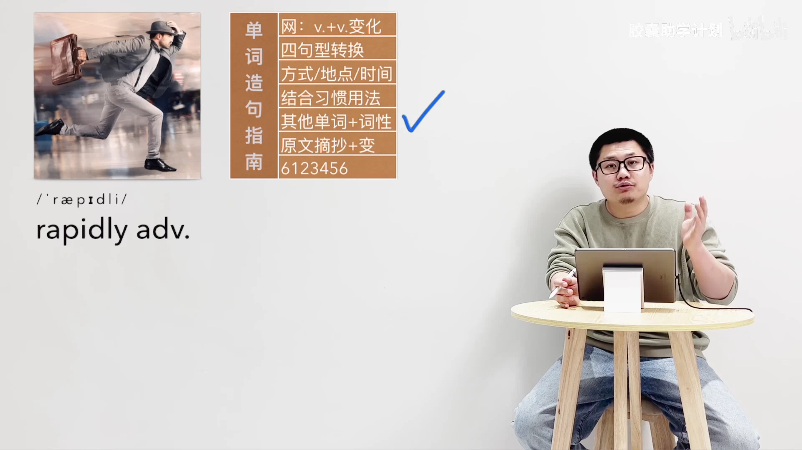

文字识别：单词造句指南 / 网：v.+v.变化 / 喜助字计划陽 / 四句型转换 / 方式/地点/时间 / 结合习惯用法 / 其他单词+词性 / 原文摘抄+变 / 6123456 / /ræprdli/ / rapidly adv.

### 画面 00:03:41

文字识别：单词造句指南 / 网：v.+v.变化 / 奏助字计划情 / 四句型转换 / 方式/地点/时间 / 结合习惯用法 / 其他单词+词性 / 原文摘抄+变 / 6123456 / /ræprdli/ / rapidly adv. + V.

### 画面 00:03:45

文字识别：单词造句指南 / 网：v.+v.变化 / 臺助学计划 / 四句型转换 / 方式/地点/时间 / 结合习惯用法 / 其他单词+词性 / 原文摘抄+变 / 6123456 / /ræprdli/ / rapidly adv. ↓V.

### 画面 00:03:50

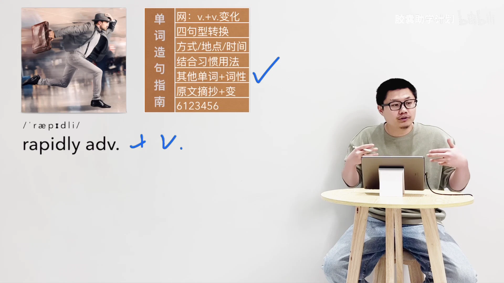

文字识别：单词造句指南 / 网：v.+v.变化 / 奏助学计划 / 四句型转换 / 方式/地点/时间 / 结合习惯用法 / 其他单词+词性 / 原文摘抄+变 / 6123456 / /ræprdli/ / rapidly adv. I V.

## 00:04:00–00:04:30

况，我见过，我再这么去用。所以，我们一直在说英语学习叫多模仿，少创造，少自己去乱用，对吧？好，那我们通过去呃查阅这个呃这个这个这个语料库啊，让我们意识到一件事，它最常用的和 grow，比如说成长、生长和 change 改变、move 移动啊这样的三个动词可以连到一起。那有它了之后，我们就可以随便去造句子了。那我又加了一些之前我们学过的东西，复习

### 画面 00:04:00

文字识别：单词造句指南 / 网：v.+v.变化 / 四句型转换 / 方式/地点/时间 / 结合习惯用法 / 其他单词+词性 / 原文摘抄+变 / 6123456 / /ræpidli/ / rapidly adv. + V. / ① grow/change/move.

### 画面 00:04:05

文字识别：单词造句指南 / 网：v.+v.变化 / 囊助字计划陽洲 / 四句型转换 / 方式/地点/时间 / 结合习惯用法 / 其他单词+词性 / 原文摘抄+变 / 6123456 / /ræpidli/ / rapidly adv. + V. / ① grow/change/move.

### 画面 00:04:10

文字识别：单词造句指南 / 网：v.+v.变化 / 菱助字计划 / 四句型转换 / 方式/地点/时间 / 结合习惯用法 / 其他单词+词性 / 原文摘抄+变 / 6123456 / /ræpidli/ / rapidly adv. + V. / ① grow/change/move.

### 画面 00:04:24

文字识别：单词造句指南 / 网：v.+v.变化 / 四句型转换 / 方式/地点/时间 / 结合习惯用法 / 其他单词+词性 / 原文摘抄+变 / 6123456 / /ræpidli/ / rapidly adv. ↓ V. / ① grow/change/move... / No matter what you do, children will grow / 2 / up rapidly and leave you someday in the / future. L68 L60

### 画面 00:04:26

文字识别：单词造句指南 / 网：v.+v.变化 / 学计划 / 四句型转换 / 方式/地点/时间 / 结合习惯用法 / 其他单词+词性 / 原文摘抄+变 / 6123456 / /ræpidli/ / rapidly adv. ↓ V. / ① grow/change/move... /  No matter what you do, children will grow / 2） / up rapidly and leave you someday in the / future.L68 L60

## 00:04:30–00:05:00

嘛。来，No matter what you do, children will grow up rapidly and leave you someday in the future. Ah, repeat after me,不要忘啊。我们说一下意思。无论你怎么做，无论你你做什么，孩子的成长都会非常的快，然后在未来的某一天会离开你，去追逐他自己的生命，对吧？生活。Next one, I'm fairly confident that. 复习，我相当自信。They are moving rapidly right now. 他们现在正在迅速

### 画面 00:04:37

文字识别：单词造句指南 / 网：v.+v.变化 / 四句型转换 / 方式/地点/时间 / 结合习惯用法 / 其他单词+词性 / 原文摘抄+变 / 6123456 / /ræpidli/ / rapidly adv. ↓V. / ① grow/change/move... / ) No matter what you do, children will grow / 2) / up rapidly and leave you someday in the / future. L68 L60

### 画面 00:04:47

文字识别：单词造句指南 / 网：v.+v.变化 / 学计划 / 四句型转换 / 方式/地点/时间 / 结合习惯用法 / 其他单词+词性 / 原文摘抄+变 / 6123456 / /ræpidli/ / rapidly adv. ↓ V. / ① grow/change/move... /  No matter what you do, children will grow / 2) / up rapidly and leave you someday in the / future. L68 L60

### 画面 00:04:51

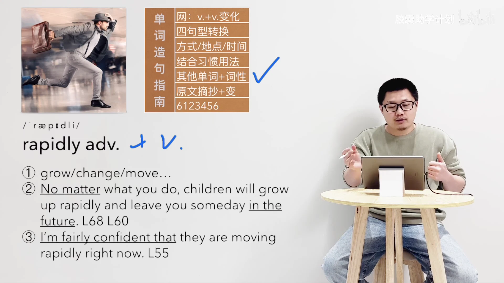

文字识别：单词造句指南 / 网：v.+v.变化 / 学计划 / 四句型转换 / 方式/地点/时间 / 结合习惯用法 / 其他单词+词性 / 原文摘抄+变 / 6123456 / /ræpidli/ / rapidly adv. + V. / ① grow/change/move... / ② No matter what you do, children will grow / up rapidly and leave you someday in the / future. L68 L60 / I'm fairly confident that they are moving / rapidly right now. L55

### 画面 00:04:55

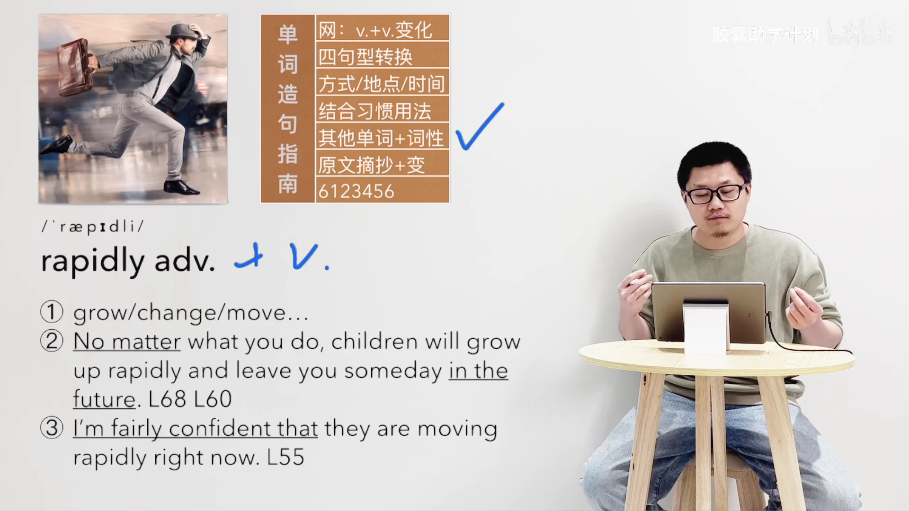

文字识别：单词造句指南 / 网：v.+v.变化 / 四句型转换 / 方式/地点/时间 / 结合习惯用法 / 其他单词+词性 / 原文摘抄+变 / 6123456 / /ræpidli/ / rapidly adv. + V. / ① grow/change/move... / ② No matter what you do, children will grow / up rapidly and leave you someday in the / future. L68 L60 / I'm fairly confident that they are moving / rapidly right now. L55

## 00:05:00–00:05:30

the word "rapidly" is similar to "quickly." Before, we also said that in many exams, including IELTS, TOEFL, college entrance exams, and the college entrance exam, actually, including actually, our Chinese is the same. It has a similar synonym. Language needs to learn synonyms. This is a big thing. We can understand it as similar to "seeing the mountain but not the flat." Right? That is, you still need to have different synonyms to use in one article. Don't use "quickly." You will have an additional word called.

### 画面 00:05:06

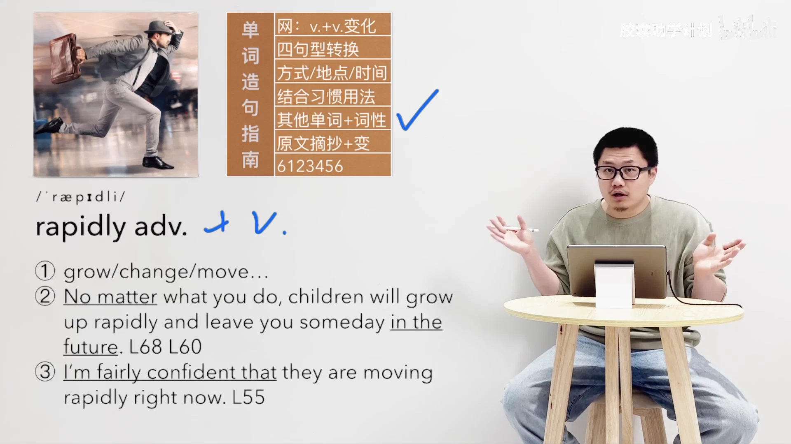

文字识别：单词造句指南 / 网：v.+v.变化 / 臺助学计划 / 四句型转换 / 方式/地点/时间 / 结合习惯用法 / 其他单词+词性 / 原文摘抄+变 / 6123456 / /ræpidli/ / rapidly adv. ↓ V. / ① grow/change/move... / ② No matter what you do, children will grow / 2) / up rapidly and leave you someday in the / future. L68 L60 / I'm fairly confident that they are moving / rapidly right now. L55

### 画面 00:05:10

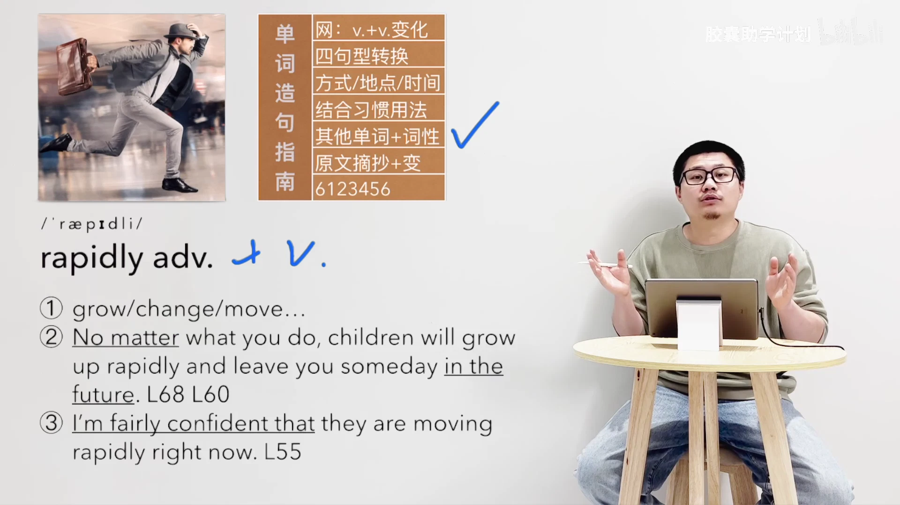

文字识别：单词造句指南 / 网：v.+v.变化 / 四句型转换 / 方式/地点/时间 / 结合习惯用法 / 其他单词+词性 / 原文摘抄+变 / 6123456 / /ræpidli/ / rapidly adv. ↓ V. / ① grow/change/move... / ② No matter what you do, children will grow / up rapidly and leave you someday in the / future. L68 L60 / I'm fairly confident that they are moving / rapidly right now. L55

## 00:05:30–00:06:00

quickly，你以后就会多了一个叫 rapidly，多一个选择，对吧？ Okay，好，再读一遍这个单词 rapidly。那接下来咱们注意力集中，听一个电影片段。 I saw them forty minutes ago. They're moving rapidly. Very good. Next one，下一个单词叫 uniform。 uniform， uniform 就是我们所谓的制服，它可以指的是工装的制服，也可以指咱们学校的制服。那学校的制服就是 school uniform。那你要想清楚一件事， school 加

### 画面 00:05:37

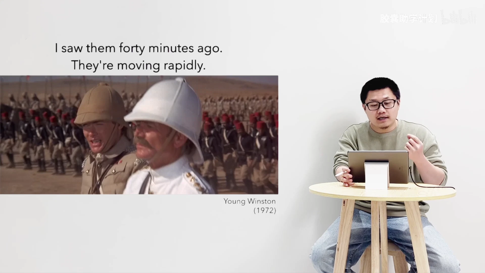

文字识别：I saw them forty minutes ago. / They're moving rapidly. / Young Winston / (1972)

### 画面 00:05:41

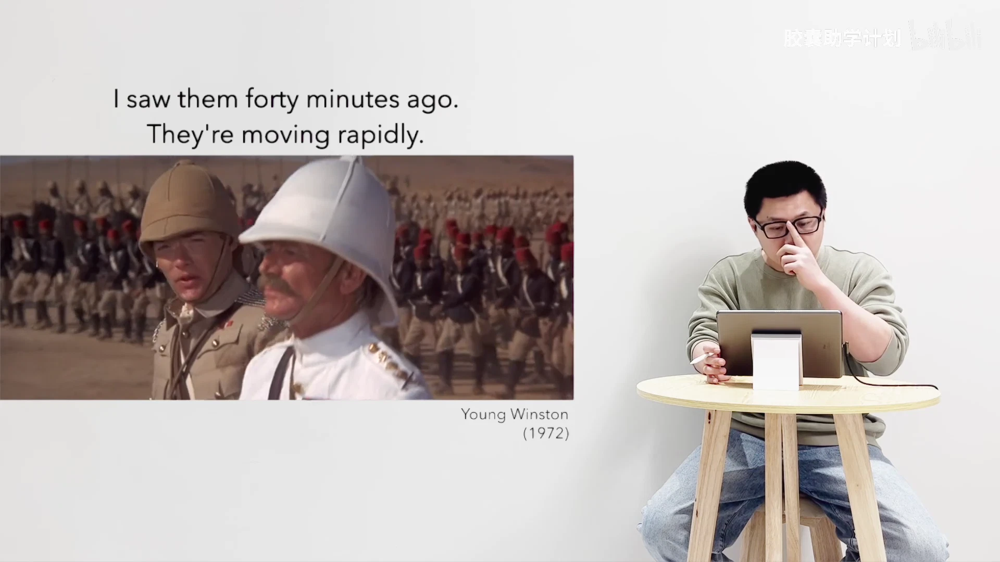

文字识别：I saw them forty minutes ago. / They're moving rapidly. / Young Winston / (1972)

### 画面 00:05:43

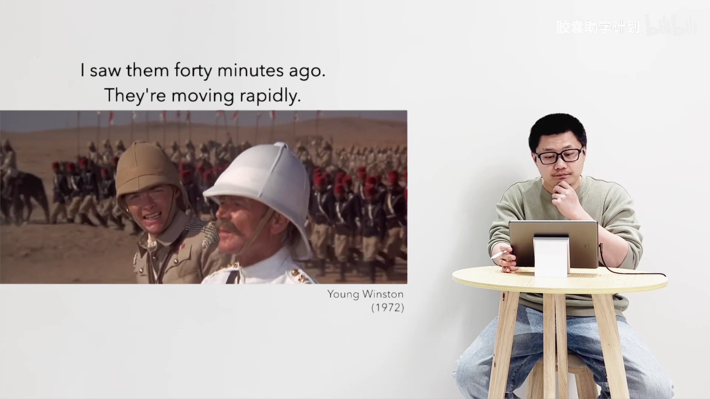

文字识别：I saw them forty minutes ago. / They're moving rapidly. / Young Winston / (1972)

### 画面 00:05:45

文字识别：单词造句指南 / 网：v.+v.变化 / 辜助子计划 / 四句型转换 / 方式/地点/时间 / 结合习惯用法 / 其他单词+词性 / 原文摘抄+变 / 6123456 / /'juinifo:m/ / uniform n.

### 画面 00:05:51

文字识别：单词造句指南 / 网：v.+v.变化 / 卖助字计划一 / 四句型转换 / 方式/地点/时间 / 结合习惯用法 / 其他单词+词性 / 原文摘抄+变 / 6123456 / /'juinifoim/ / uniform n.

### 画面 00:05:56

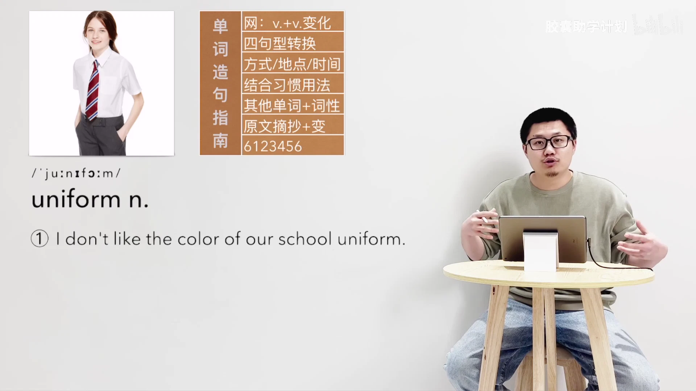

文字识别：单词造句指南 / 网：v.+v.变化 / 四句型转换 / 方式/地点/时间 / 结合习惯用法 / 其他单词+词性 / 原文摘抄+变 / 6123456 / /'juinifoim/ / uniform n. / ① I don't like the color of our school uniform.

## 00:06:00–00:06:30

uniform其实是我分享给您的，或者我传授给各位的，叫做咱们学校，你可以理解为校服嘛。它是一个名词。我想拿它去造句的时候，我首先要去判断，对吧？它什么词性跟它连起来比较多？形容词可以放在前面修饰它，定语从句可以放在后边修饰它。这我们新二学完了之后，脑海当中单词造句的时候要有的一个基本的概念，对吧？好，然后呢，这个我还去想它可能动词能连起来，比如说 I don't like the color of our

### 画面 00:06:00

文字识别：单词造句指南 / 网：v.+v.变化 / 四句型转换 / 方式/地点/时间 / 结合习惯用法 / 其他单词+词性 / 原文摘抄+变 / 6123456 / /'juinifoim/ / uniform n. / ① I don't like the color of our school uniform

### 画面 00:06:03

文字识别：单词造句指南 / 网：v.+v.变化 / 字计划 / 四句型转换 / 方式/地点/时间 / 结合习惯用法 / 其他单词+词性 / 原文摘抄+变 / 6123456 / /'juinIfo:m/ / uniform n. / ① I don't like the color of our school uniform

### 画面 00:06:05

文字识别：单词造句指南 / 网：v.+v.变化 / 四句型转换 / 方式/地点/时间 / 结合习惯用法 / 其他单词+词性 / 原文摘抄+变 / 6123456 / /'juinifoim/ / uniform n. / ① I don't like the color of ourschool uniform

### 画面 00:06:15

文字识别：单词造句指南 / 网：v.+v.变化 / 臺助字计划 / 四句型转换 / 方式/地点/时间 / 结合习惯用法 / 其他单词+词性 / 原文摘抄+变 / 6123456 / /'juinifoim/ / uniform n. / ① I don't like the color of ourschool uniform

### 画面 00:06:21

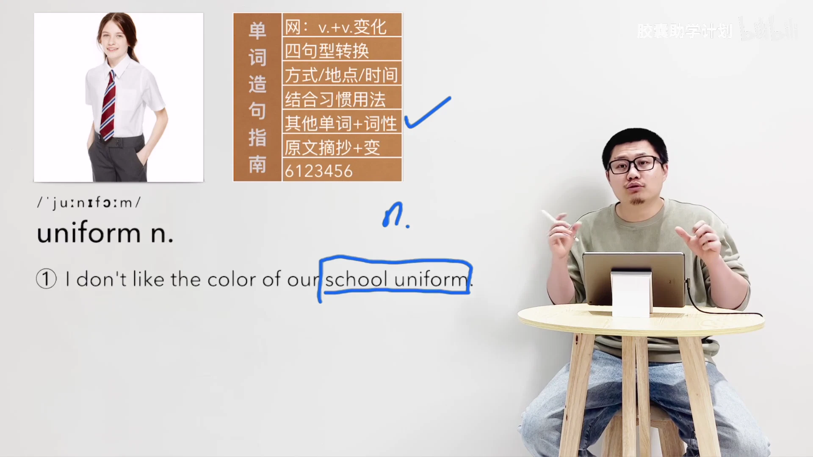

文字识别：单词造句指南 / 网：v.+v.变化 / 四句型转换 / 方式/地点/时间 / 结合习惯用法 / 其他单词+词性 / 原文摘抄+变 / 6123456 / /'juinifoim/ / uniform n. / ① I don't like the color of ounschool uniform

## 00:06:30–00:07:00

school uniform.由后往前翻译，不喜欢的是颜色，什么的颜色呢？A of B结构，对吧？由后往前翻译叫做校服，哎，这个的颜色啊。Next one, why don't you like your school uniform?这个实际上就是上面那句话的一个小的变体，但不是完全一样啊。因为底下我直接说的就是为什么你不喜欢，或者你可以把这两句话理解为一问一答，为什么不喜欢？因为我不喜欢它的颜色。OK. Next one, if

### 画面 00:06:35

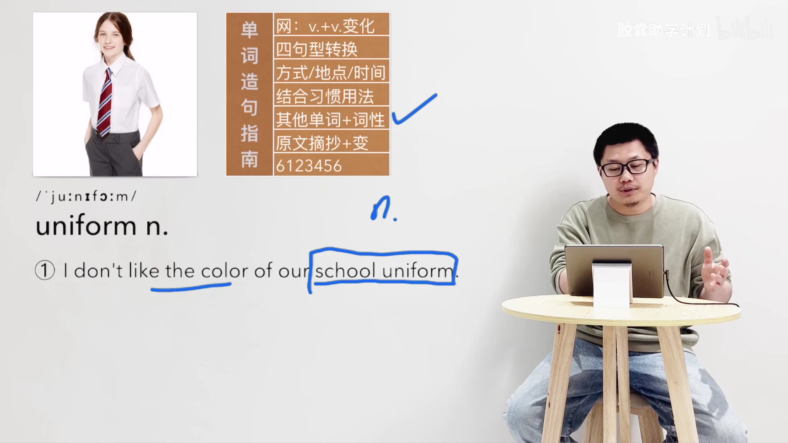

文字识别：单词造句指南 / 网：v.+v.变化 / 臺助字计划 / 四句型转换 / 方式/地点/时间 / 结合习惯用法 / 其他单词+词性 / 原文摘抄+变 / 6123456 / /'juinifo:m/ / uniform n. / ① I don't like the color of ounschool uniform

### 画面 00:06:37

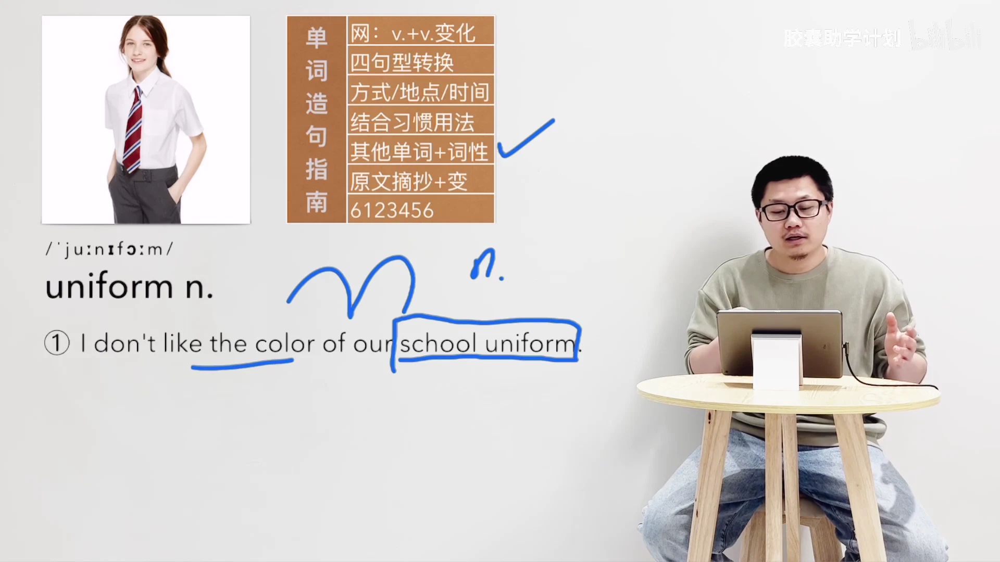

文字识别：单词造句指南 / 网：v.+v.变化 / 喜助字计划 / 四句型转换 / 方式/地点/时间 / 结合习惯用法 / 其他单词+词性 / 原文摘抄+变 / 6123456 / /'juinrfo:m/ / uniform n. / ① I don't like the color of ounschool uniform

### 画面 00:06:41

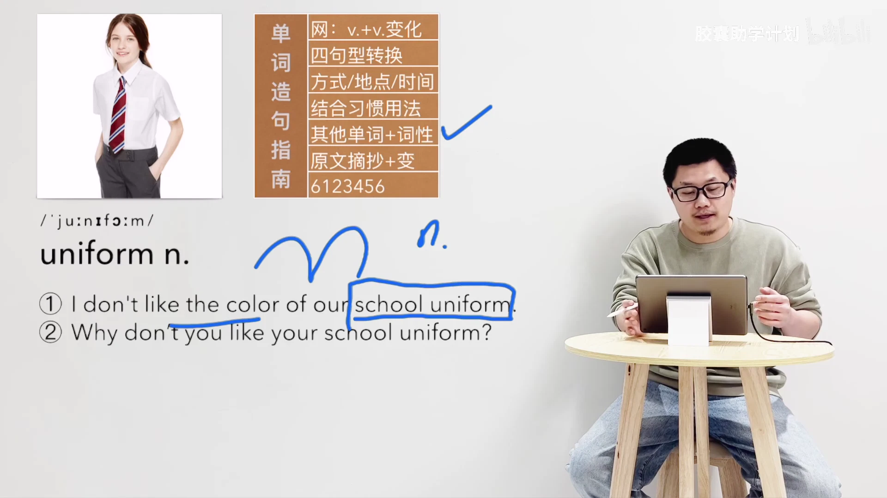

文字识别：单词造句指南 / 网：v.+v.变化 / 四句型转换 / 方式/地点/时间 / 结合习惯用法 / 其他单词+词性 / 原文摘抄+变 / 6123456 / /'juinifoim/ / uniform n. / ① I don't like the color of ounschool uniform / ② Why don't you like your school uniform?

### 画面 00:06:43

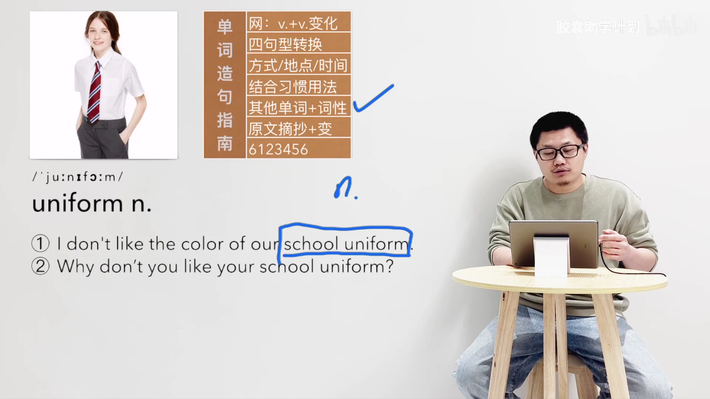

文字识别：单词造句指南 / 网：v.+v.变化 / 四句型转换 / 方式/地点/时间 / 结合习惯用法 / 其他单词+词性 / 原文摘抄+变 / 6123456 / /'juinifo:m/ / uniform n. / ① I don't like the color of ounschool uniform / ② Why don't you like your school uniform?

### 画面 00:06:45

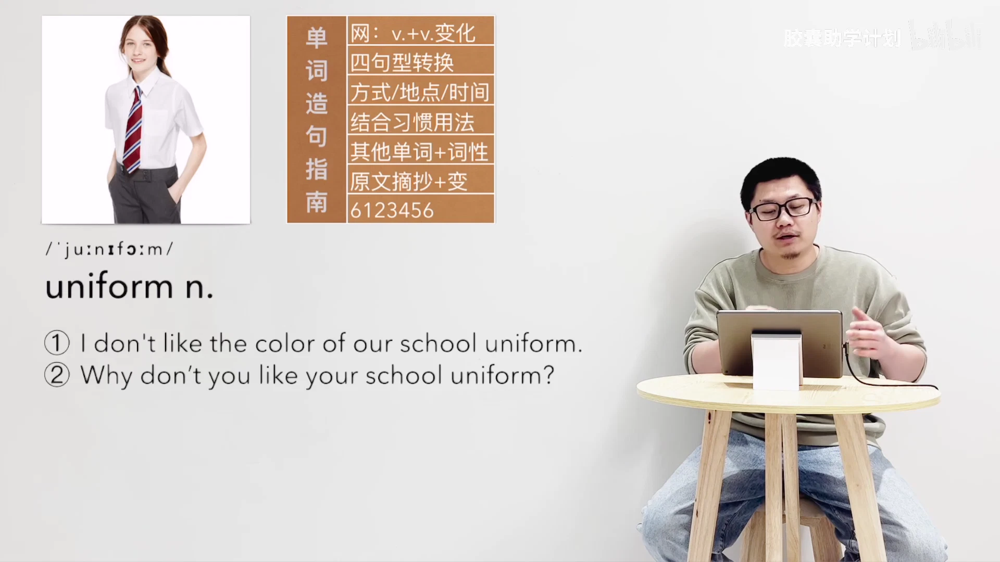

文字识别：单词造句指南 / 网：v.+v.变化 / 四句型转换 / 方式/地点/时间 / 结合习惯用法 / 其他单词+词性 / 原文摘抄+变 / 6123456 / /'juinifo:m/ / uniform n. / ① I don't like the color of our school uniform. / ② Why don't you like your school uniform?

### 画面 00:06:53

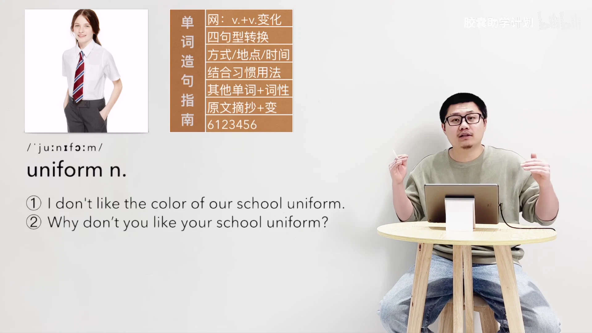

文字识别：单词造句指南 / 网：v.+v.变化 / 四句型转换 / 方式/地点/时间 / 结合习惯用法 / 其他单词+词性 / 原文摘抄+变 / 6123456 / /'juinifo:m/ / uniform n. / ① I don't like the color of our school uniform. / ② Why don't you like your school uniform?

### 画面 00:06:57

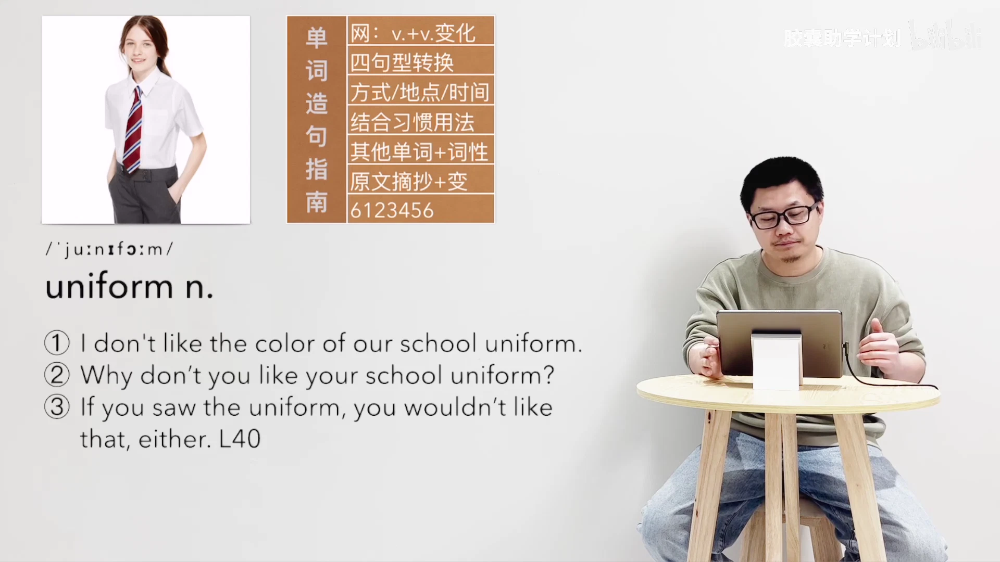

文字识别：单词造句指南 / 网：v.+v.变化 / 延字计划 / 四句型转换 / 方式/地点/时间 / 结合习惯用法 / 其他单词+词性 / 原文摘抄+变 / 6123456 / /'juinifoim/ / uniform n. / ① I don't like the color of our school uniform. / ② Why don't you like your school uniform? / If you saw the uniform, you wouldn't like / 3 / that, either. L40

## 00:07:00–00:07:30

you saw the uniform, you wouldn't like that either. Either都可以啊。嗯，如果你看见，你也不会喜欢的。但是你没看见，对吧？Okay.啊，与现在事实相反，虚拟语气复习。Next one. Wearing his uniform, he hitchhiked to New York.说穿着他的这个制服啊，他就搭着便车去了纽约。我们可以和比如说七十三课那课联系起来啊，就那小孩儿他不是搭车去了

### 画面 00:07:00

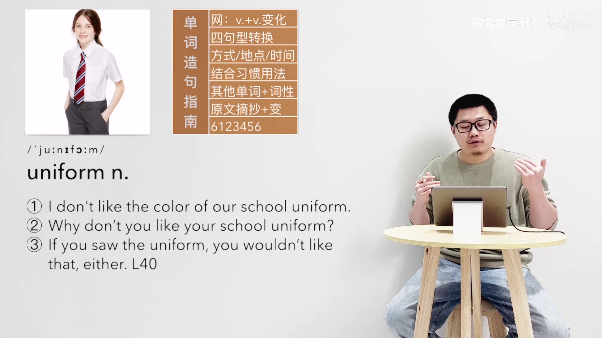

文字识别：单词造句指南 / 网：v.+v.变化 / 四句型转换 / 方式/地点/时间 / 结合习惯用法 / 其他单词+词性 / 原文摘抄+变 / 6123456 / /'juinifoim/ / uniform n. / ① I don't like the color of our school uniform. / ② Why don't you like your school uniform? / If you saw the uniform, you wouldn't like / 3 / that, either. L40

### 画面 00:07:08

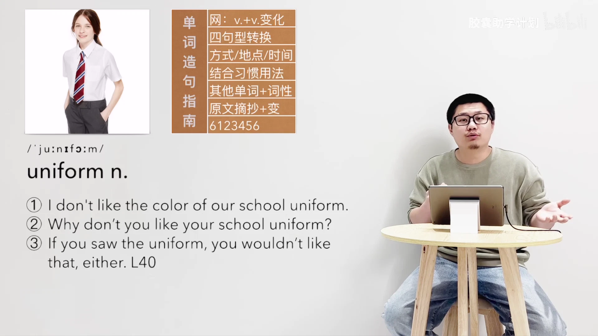

文字识别：单词造句指南 / 网：v.+v.变化 / 囊助学计划 / 四句型转换 / 方式/地点/时间 / 结合习惯用法 / 其他单词+词性 / 原文摘抄+变 / 6123456 / /'juinifoim/ / uniform n. / ① I don't like the color of our school uniform. / ② Why don't you like your school uniform? / If you saw the uniform, you wouldn't like / 3 / that, either. L40

### 画面 00:07:10

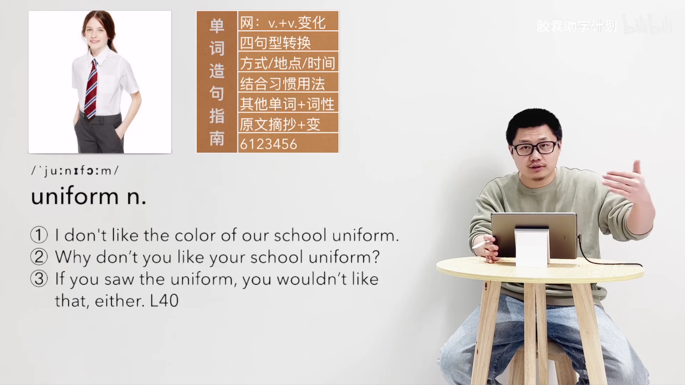

文字识别：单词造句指南 / 网：v.+v.变化 / 喜助字计划 / 四句型转换 / 方式/地点/时间 / 结合习惯用法 / 其他单词+词性 / 原文摘抄+变 / 6123456 / /'juinifoim/ / uniform n. / ① I don't like the color of our school uniform. / ② Why don't you like your school uniform? / If you saw the uniform, you wouldn't like / 3 / that, either. L40

### 画面 00:07:12

文字识别：单词造句指南 / 网：v.+v.变化 / 四句型转换 / 方式/地点/时间 / 结合习惯用法 / 其他单词+词性 / 原文摘抄+变 / 6123456 / /'juinifoim/ / uniform n. / ① I don't like the color of our school uniform. / ② Why don't you like your school uniform? / 3 /  If you saw the uniform, you wouldn't like / that, either. L40 / Wearing his uniform, he hitchhiked to New / York. L49 L73

### 画面 00:07:15

文字识别：单词造句指南 / 网：v.+v.变化 / 四句型转换 / 方式/地点/时间 / 结合习惯用法 / 其他单词+词性 / 原文摘抄+变 / 6123456 / /'juinifoim/ / uniform n. / ① I don't like the color of our school uniform. / ② Why don't you like your school uniform? / 3 / If you saw the uniform, you wouldn't like / that, either. L40 / Wearing his uniform, he hitchhiked to New / York. L49 L73

### 画面 00:07:19

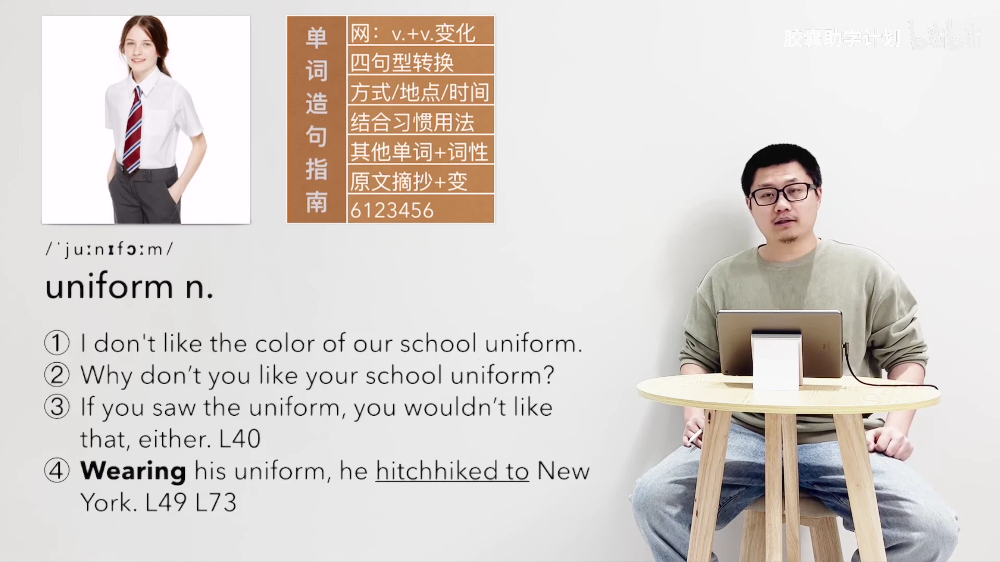

文字识别：单词造句指南 / 网：v.+v.变化 / 四句型转换 / 方式/地点/时间 / 结合习惯用法 / 其他单词+词性 / 原文摘抄+变 / 6123456 / /'juinifoim/ / uniform n. / ① I don't like the color of our school uniform. / ② Why don't you like your school uniform? / If you saw the uniform, you wouldn't like / 3 / that, either. L40 / Wearing his uniform, he hitchhiked to New / York. L49 L73

### 画面 00:07:21

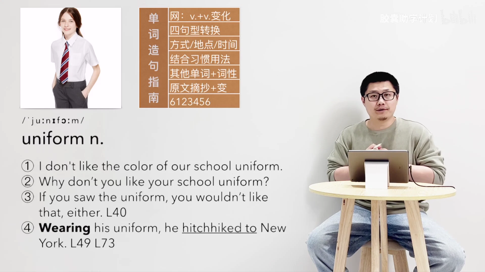

文字识别：单词造句指南 / 网：v.+v.变化 / 四句型转换 / 方式/地点/时间 / 结合习惯用法 / 其他单词+词性 / 原文摘抄+变 / 6123456 / /'juinifoim/ / uniform n. / ① I don't like the color of our school uniform. / ② Why don't you like your school uniform? / 3 / If you saw the uniform, you wouldn't like / that, either. L40 / Wearing his uniform, he hitchhiked to New / York. L49 L73

### 画面 00:07:26

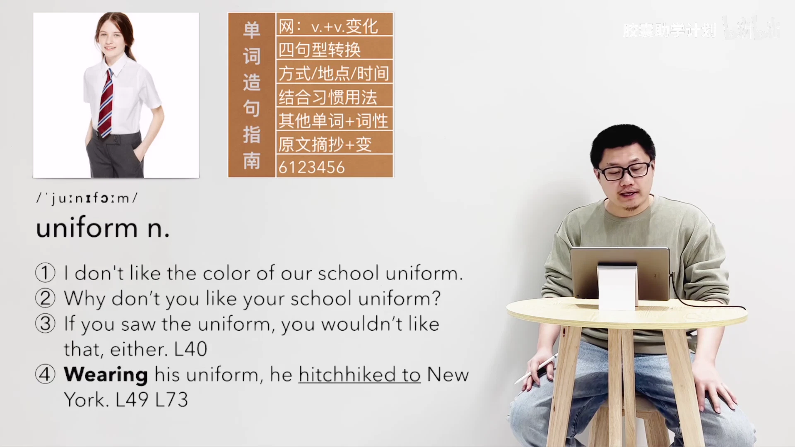

文字识别：单词造句指南 / 网：v.+v.变化 / 囊助学计划 / 四句型转换 / 方式/地点/时间 / 结合习惯用法 / 其他单词+词性 / 原文摘抄+变 / 6123456 / /'juinifoim/ / uniform n. / ① I don't like the color of our school uniform. / ② Why don't you like your school uniform? / 3 /  If you saw the uniform, you wouldn't like / that, either. L40 / Wearing his uniform, he hitchhiked to New / York. L49 L73

## 00:07:30–00:08:00

巴黎嘛？那你就想另外一个在美国的小孩儿穿着校服搭车就去了纽约，对吧？那这里边就是咱们四十九课学过的那个主动被动，对吧？哎，你要去想，然后主语是谁？这个很一目了然。OK，再读一遍这个单词 uniform. Again, next one rifle. 啊，来福枪或者说这种步枪啊，统称为 rifle. Again, 啊，它是一个名词，就比较好造句了。比如说 they armed him with a rifle. 他们给他武装上了一个来福枪. Next

### 画面 00:07:38

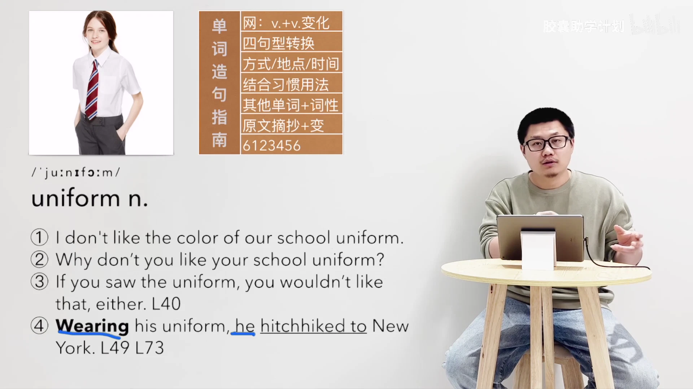

文字识别：单词造句指南 / 网：v.+v.变化 / 四句型转换 / 方式/地点/时间 / 结合习惯用法 / 其他单词+词性 / 原文摘抄+变 / 6123456 / /'juinifoim/ / uniform n. / ① I don't like the color of our school uniform. / ② Why don't you like your school uniform? / If you saw the uniform, you wouldn't like / 3 / that, either. L40 / Wearing his uniform, he hitchhiked to New / York. L49 L73

### 画面 00:07:45

文字识别：单词造句指南 / 网：v.+v.变化 / 四句型转换 / 方式/地点/时间 / 结合习惯用法 / 其他单词+词性 / 原文摘抄+变 / 6123456 / /'juinifoim/ / uniform n. / ① I don't like the color of our school uniform. / ② Why don't you like your school uniform? / 3 / If you saw the uniform, you wouldn't like / that, either. L40 / Wearing his uniform, he hitchhiked to New / York. L49 L73

### 画面 00:07:47

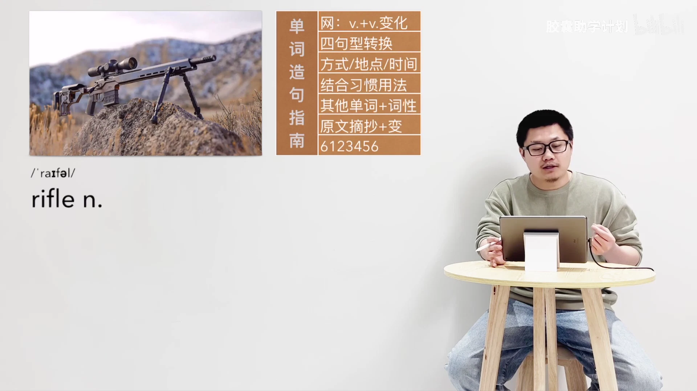

文字识别：单词造句指南 / 网：v.+v.变化 / 囊助字计划 / 四句型转换 / 方式/地点/时间 / 结合习惯用法 / 其他单词+词性 / 原文摘抄+变 / 6123456 / /'raifal/ / rifle n.

### 画面 00:07:50

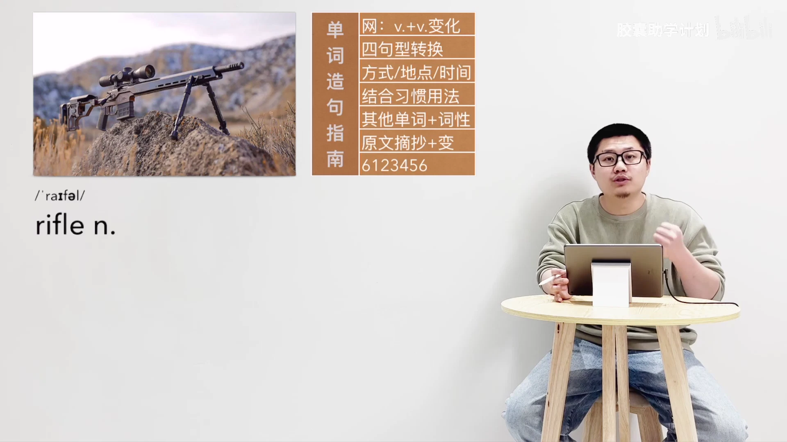

文字识别：单词造句指南 / 网：v.+v.变化 / 喜助字计划情 / 四句型转换 / 方式/地点/时间 / 结合习惯用法 / 其他单词+词性 / 原文摘抄+变 / 6123456 / /'raifal/ / rifle n.

### 画面 00:07:56

文字识别：单词造句指南 / 网：v.+v.变化 / 喜助字计划情 / 四句型转换 / 方式/地点/时间 / 结合习惯用法 / 其他单词+词性 / 原文摘抄+变 / 6123456 / /'raifal/ / rifle n. / ① They armed him with a rifle. L55

## 00:08:00–00:08:30

one, he succeeded in buying a rifle.六三十六课succeeded in doing something,对吧？就类似于managed这个啊，包括was were able to do啊，都成功的完成了某件事情. Next one, I look forward to seeing your new rifle.别忘了repeat after me. Okay,那这里复习了一下look forward to doing something.三十七课咱们学的叫做期待去做某件事情.

### 画面 00:08:00

文字识别：单词造句指南 / 网：v.+v.变化 / 四句型转换 / 方式/地点/时间 / 结合习惯用法 / 其他单词+词性 / 原文摘抄+变 / 6123456 / /'rarfal/ / rifle n. / ) They armed him with a rifle. L55 / He succeed in buying a rifle. L36

### 画面 00:08:05

文字识别：单词造句指南 / 网：v.+v.变化 / 四句型转换 / 方式/地点/时间 / 结合习惯用法 / 其他单词+词性 / 原文摘抄+变 / 6123456 / /'rarfal/ / rifle n. / ) They armed him with a rifle. L55 /  He succeed in buying a rifle. L36

### 画面 00:08:15

文字识别：单词造句指南 / 网：v.+v.变化 / 四句型转换 / 方式/地点/时间 / 结合习惯用法 / 其他单词+词性 / 原文摘抄+变 / 6123456 / /'raifal/ / rifle n. / ① They armed him with a rifle. L55 / He succeed in buying a rifle. L36 /  I look forward to seeing your new rifle. L37

### 画面 00:08:21

文字识别：单词造句指南 / 网：v.+v.变化 / 四句型转换 / 方式/地点/时间 / 结合习惯用法 / 其他单词+词性 / 原文摘抄+变 / 6123456 / /'rarfal/ / rifle n. / ① They armed him with a rifle. L55 / He succeed in buying a rifle. L36 / ) I look forward to seeing your new rifle. L37

### 画面 00:08:24

文字识别：单词造句指南 / 网：v.+v.变化 / 四句型转换 / 方式/地点/时间 / 结合习惯用法 / 其他单词+词性 / 原文摘抄+变 / 6123456 / /'rarfal/ / rifle n. / ① They armed him with a rifle. L55 / He succeed in buying a rifle. L36 /  I look forward to seeing your new rifle. L37

### 画面 00:08:26

文字识别：单词造句指南 / 网：v.+v.变化 / 四句型转换 / 方式/地点/时间 / 结合习惯用法 / 其他单词+词性 / 原文摘抄+变 / 6123456 / /'raifal/ / rifle n. / ① They armed him with a rifle. L55 /  He succeed in buying a rifle. L36 / ) I look forward to seeing your new rifle. L37 / 3

## 00:08:30–00:09:00

注意这里的 to，它不是一个 to do 结构。呃，这样的结构我们三三两两有几个特别常用的，基本上你单独记下来就可以了。它既是考试当中的考点，也是我们实际应用当中容易错的那个小的点啊。再读一遍这个单词 rifle. There you go. 下一个单词，身体的一部分啊，我们的肩部对吧？肩膀。 OK，啊，左膀右臂啊。这个 shoulder shoulder. There you go. 那我们造一句话，比如

### 画面 00:08:30

文字识别：单词造句指南 / 网：v.+v.变化 / 四句型转换 / 方式/地点/时间 / 结合习惯用法 / 其他单词+词性 / 原文摘抄+变 / 6123456 / /'raifal/ / rifle n. / ① They armed him with a rifle. L55 / He succeed in buying a rifle. L36 / ) I look forward to seeing your new rifle. L37 / 3

### 画面 00:08:35

文字识别：单词造句指南 / 网：v.+v.变化 / 四句型转换 / 方式/地点/时间 / 结合习惯用法 / 其他单词+词性 / 原文摘抄+变 / 6123456 / /'rarfal/ / rifle n. / ① They armed him with a rifle. L55 / He succeed in buying a rifle. L36 / I look forward to seeing your new rifle. L37

### 画面 00:08:48

文字识别：单词造句指南 / 网：v.+v.变化 / 辜助字计划陽 / 四句型转换 / 方式/地点/时间 / 结合习惯用法 / 其他单词+词性 / 原文摘抄+变 / 6123456 / /'∫ａuｌdａ/ / shoulder n.

### 画面 00:08:50

文字识别：单词造句指南 / 网：v.+v.变化 / 霆助字计划 / 四句型转换 / 方式/地点/时间 / 结合习惯用法 / 其他单词+词性 / 原文摘抄+变 / 6123456 / /'∫auｌda/ / shoulder n.

### 画面 00:08:53

文字识别：单词造句指南 / 网：v.+v.变化 / 四句型转换 / 方式/地点/时间 / 结合习惯用法 / 其他单词+词性 / 原文摘抄+变 / 6123456 / /'∫aulda/ / shoulder n.

### 画面 00:08:55

文字识别：单词造句指南 / 网：v.+v.变化 / 喜助学计划 / 四句型转换 / 方式/地点/时间 / 结合习惯用法 / 其他单词+词性 / 原文摘抄+变 / 6123456 / /'∫aulda/ / shoulder n.

### 画面 00:08:58

文字识别：单词造句指南 / 网：v.+v.变化 / 四句型转换 / 方式/地点/时间 / 结合习惯用法 / 其他单词+词性 / 原文摘抄+变 / 6123456 / / '∫au lda / / shoulder n. / D When I asked him if he wanted any lamb / shoulder, he shook his head. L47

## 00:09:00–00:09:30

说 When I asked him if he wanted any lamb shoulder, he shook his head. Okay.首先 shook somebody's head.嗯，摇头，对吧？Next one, lamb shoulder是什么意思？字面意思嘛，羊肩，对吧？Okay. Next one, we should pay him a visit for he hurt his shoulder last week.说我们应该去拜访一下他，因为啥呀？因为呀，他把他的肩膀给伤到了。He hurt

### 画面 00:09:00

文字识别：单词造句指南 / 网：v.+v.变化 / 四句型转换 / 方式/地点/时间 / 结合习惯用法 / 其他单词+词性 / 原文摘抄+变 / 6123456 / / '∫aulda/ / shoulder n. / ① When I asked him if he wanted any lamb / shoulder, he shook his head. L47

### 画面 00:09:05

文字识别：单词造句指南 / 网：v.+v.变化 / 四句型转换 / 方式/地点/时间 / 结合习惯用法 / 其他单词+词性 / 原文摘抄+变 / 6123456 / / '∫aulda / / shoulder n. / ① When I asked him if he wanted any lamb / shoulder, he shook his head. L47

### 画面 00:09:09

文字识别：单词造句指南 / 网：v.+v.变化 / 四句型转换 / 方式/地点/时间 / 结合习惯用法 / 其他单词+词性 / 原文摘抄+变 / 6123456 / / '∫au lda / / shoulder n. / ① When I asked him if he wanted any lamb / shoulder, he shook his head. L47

### 画面 00:09:11

文字识别：单词造句指南 / 网：v.+v.变化 / 学计划 / 四句型转换 / 方式/地点/时间 / 结合习惯用法 / 其他单词+词性 / 原文摘抄+变 / 6123456 / / '∫aulda/ / shoulder n. / ① When I asked him if he wanted any lamb / shoulder, he shook his head. L47

### 画面 00:09:13

文字识别：单词造句指南 / 网：v.+v.变化 / 四句型转换 / 方式/地点/时间 / 结合习惯用法 / 其他单词+词性 / 原文摘抄+变 / 6123456 / / '∫aulda/ / shoulder n. / ① When I asked him if he wanted any lamb / shoulder, he shook his head. L47

### 画面 00:09:15

文字识别：单词造句指南 / 网：v.+v.变化 / 学计划 / 四句型转换 / 方式/地点/时间 / 结合习惯用法 / 其他单词+词性 / 原文摘抄+变 / 6123456 / / ' ∫au lda / / shoulder n. / ① When I asked him if he wanted any lamb / shoulder, he shook his head. L47 / We should pay him a visit, for he hurt his / shoulder last week. L51

### 画面 00:09:20

文字识别：单词造句指南 / 网：v.+v.变化 / 学计划 / 四句型转换 / 方式/地点/时间 / 结合习惯用法 / 其他单词+词性 / 原文摘抄+变 / 6123456 / / ' ∫a u lda / / shoulder n. / ① When I asked him if he wanted any lamb / shoulder, he shook his head. L47 / We should pay him a visit, for he hurt his / shoulder last week. L51

### 画面 00:09:23

文字识别：单词造句指南 / 网：v.+v.变化 / 计切 / 四句型转换 / 方式/地点/时间 / 结合习惯用法 / 其他单词+词性 / 原文摘抄+变 / 6123456 / / ' ∫a u lda / / shoulder n. / ① When I asked him if he wanted any lamb / shoulder, he shook his head. L47 / We should pay him a visit, for he hurt his / shoulder last week. L51

### 画面 00:09:26

文字识别：单词造句指南 / 网：v.+v.变化 / 四句型转换 / 方式/地点/时间 / 结合习惯用法 / 其他单词+词性 / 原文摘抄+变 / 6123456 / / ' ∫a u lda / / shoulder n. / ① When I asked him if he wanted any lamb / shoulder, he shook his head. L47 / We should pay him a visit, for he hurt his / shoulder last week. L51

## 00:09:30–00:10:00

shoulder. Ah, pay somebody a visit. Review. If you touch my shoulder one more time, I will break your leg. Ah,放狠话，对吧？但是其实你看，他用的就是十六课的句型，主将从现啊，主起从现啊，十六课咱们学的条件状语从句嘛。好，他说，如果你再碰一次我的肩膀啊，我要把你腿骨折，对吧？哎，就是放狠话。再读一遍这个单词，shoulder, very good. Next one,下一个单词，我们一起读，叫做march.

### 画面 00:09:30

文字识别：单词造句指南 / 网：v.+v.变化 / 四句型转换 / 方式/地点/时间 / 结合习惯用法 / 其他单词+词性 / 原文摘抄+变 / 6123456 / / ' ∫a u lda / / shoulder n. / ① When I asked him if he wanted any lamb / shoulder, he shook his head. L47 / We should pay him a visit, for he hurt his / shoulder last week. L51

### 画面 00:09:34

文字识别：单词造句指南 / 网：v.+v.变化 / 四句型转换 / 方式/地点/时间 / 结合习惯用法 / 其他单词+词性 / 原文摘抄+变 / 6123456 / / ' ∫au lda / / shoulder n. / ① When I asked him if he wanted any lamb / shoulder, he shook his head. L47 / We should pay him a visit, for he hurt his / shoulder last week. L51 / If you touch my shoulder one more time, I / will break your leg. L16

### 画面 00:09:36

文字识别：单词造句指南 / 网：v.+v.变化 / 延学计划 / 四句型转换 / 方式/地点/时间 / 结合习惯用法 / 其他单词+词性 / 原文摘抄+变 / 6123456 / / ' ∫au lda / / shoulder n. / ① When I asked him if he wanted any lamb / shoulder, he shook his head. L47 / We should pay him a visit, for he hurt his / shoulder last week. L51 / If you touch my shoulder one more time, I / will break your leg. L16

### 画面 00:09:38

文字识别：单词造句指南 / 网：v.+v.变化 / 四句型转换 / 方式/地点/时间 / 结合习惯用法 / 其他单词+词性 / 原文摘抄+变 / 6123456 / / ' ∫au l da / / shoulder n. / ① When I asked him if he wanted any lamb / shoulder, he shook his head. L47 / We should pay him a visit, for he hurt his / shoulder last week. L51 / If you touch my shoulder one more time, I / will break your leg. L16

### 画面 00:09:40

文字识别：单词造句指南 / 网：v.+v.变化 / 四句型转换 / 方式/地点/时间 / 结合习惯用法 / 其他单词+词性 / 原文摘抄+变 / 6123456 / / ' ∫au lda / / shoulder n. / ① When I asked him if he wanted any lamb / shoulder, he shook his head. L47 / We should pay him a visit, for he hurt his / shoulder last week. L51 / If you touch my shoulder one more time, I / will break your leg. L16

### 画面 00:09:45

文字识别：单词造句指南 / 网：v.+v.变化 / 毫助学计划 / 四句型转换 / 方式/地点/时间 / 结合习惯用法 / 其他单词+词性 / 原文摘抄+变 / 6123456 / / ' ∫au lda / / shoulder n. / ① When I asked him if he wanted any lamb / shoulder, he shook his head. L47 / We should pay him a visit, for he hurt his / shoulder last week. L51 / If you touch my shoulder one more time, I / will break your leg. L16

### 画面 00:09:55

文字识别：单词造句指南 / 网：v.+v.变化 / 四句型转换 / 方式/地点/时间 / 结合习惯用法 / 其他单词+词性 / 原文摘抄+变 / 6123456 / / ' ∫au lda / / shoulder n. / ① When I asked him if he wanted any lamb / shoulder, he shook his head. L47 / We should pay him a visit, for he hurt his / shoulder last week. L51 / If you touch my shoulder one more time, I / will break your leg. L16

### 画面 00:09:57

文字识别：单词造句指南 / 网：v.+v.变化 / 四句型转换 / 方式/地点/时间 / 结合习惯用法 / 其他单词+词性 / 原文摘抄+变 / 6123456 / /mait ∫1 / march v.

## 00:10:00–00:10:30

march，这个单词我提一个小点，您自己去查。当然，我八成认为您应该是认识的。就是我们如果把这个 M 字母把它大写了，它变成了一个什么意思呢？好，我不多说了，这个我们可以自己去查一下。那 march 在这个地方呢，它可以指的是，如果是军人挺好，就是行军啊，就行军打仗的那个行军啊啊，日行一千里啊，这个夜行八百里的这个行就是 march， OK。

### 画面 00:10:00

文字识别：单词造句指南 / 网：v.+v.变化 / 臺助字计划 / 四句型转换 / 方式/地点/时间 / 结合习惯用法 / 其他单词+词性 / 原文摘抄+变 / 6123456 / /mait∫1 / march v.

### 画面 00:10:16

文字识别：单词造句指南 / 网：v.+v.变化 / 妻助学计划 / 四句型转换 / 方式/地点/时间 / 结合习惯用法 / 其他单词+词性 / 原文摘抄+变 / 6123456 / /mait ∫1 / march v.

### 画面 00:10:20

文字识别：单词造句指南 / 网：v.+v.变化 / 奏助字计划 / 四句型转换 / 方式/地点/时间 / 结合习惯用法 / 其他单词+词性 / 原文摘抄+变 / 6123456 / /mait∫/ / march v.

## 00:10:30–00:11:00

然后呢，如果他指的是咱们普通人呢，march其实就跟 walk啊，就跟 go啊没什么太大的区别，就是行进走。那我们造句子。The soldiers marched along the street. 哎，军人们 marched along the street，沿着这个路去行军，对吧？沿着这条街道往前行军。如果我们说普通人呢，说 she was very angry and march marched out of the

### 画面 00:10:39

文字识别：单词造句指南 / 网：v.+v.变化 / 四句型转换 / 方式/地点/时间 / 结合习惯用法 / 其他单词+词性 / 原文摘抄+变 / 6123456 / /mait∫1 / march v. / ① The soldiers marched along the street.

### 画面 00:10:41

文字识别：单词造句指南 / 网：v.+v.变化 / 四句型转换 / 方式/地点/时间 / 结合习惯用法 / 其他单词+词性 / 原文摘抄+变 / 6123456 / /mait∫1 / march v. / ① The soldiers marched along the street.

### 画面 00:10:45

文字识别：单词造句指南 / 网：v.+v.变化 / 四句型转换 / 方式/地点/时间 / 结合习惯用法 / 其他单词+词性 / 原文摘抄+变 / 6123456 / /mait∫/ / march v. / ① The soldiers marched along the street.

### 画面 00:10:55

文字识别：单词造句指南 / 网：v.+v.变化 / 四句型转换 / 方式/地点/时间 / 结合习惯用法 / 其他单词+词性 / 原文摘抄+变 / 6123456 / /mait∫1 / march v. / ① The soldiers marched along the street. / ) She was very angry and marched out of the / 2） / door.

### 画面 00:10:57

文字识别：单词造句指南 / 网：v.+v.变化 / 四句型转换 / 方式/地点/时间 / 结合习惯用法 / 其他单词+词性 / 原文摘抄+变 / 6123456 / /mait∫1 / march v. / ① The soldiers marched along the street. / ) She was very angry and marched out of the / door.

## 00:11:00–00:11:30

door,走出了这个门，对吧？你完全可以说，呃，went out of the door, walked out of the door, ran out of the door, rushed out of the door，全是咱们新二学的，对吧？词形转换老生常谈，咱们不多说了。再读一遍这个单词，march啊，这个词形转转换啊，还是再提一句啊，别我过去了，我过去了是因为我认为你能独立处理这件事了，别我过去你也过去了。你暂停屏幕还是要练的啊。好，

### 画面 00:11:01

文字识别：单词造句指南 / 网：v.+v.变化 / 学讨计划 / 四句型转换 / 方式/地点/时间 / 结合习惯用法 / 其他单词+词性 / 原文摘抄+变 / 6123456 / /mait∫/ / march v. / ① The soldiers marched along the street. / ) She was very angry and marched out of the / 2） / door.

### 画面 00:11:08

文字识别：单词造句指南 / 网：v.+v.变化 / 学计划 / 四句型转换 / 方式/地点/时间 / 结合习惯用法 / 其他单词+词性 / 原文摘抄+变 / 6123456 / /mait∫/ / march v. / ① The soldiers marched along the street. / ) She was very angry and marched out of the / 2 / door.

### 画面 00:11:11

文字识别：单词造句指南 / 网：v.+v.变化 / 四句型转换 / 方式/地点/时间 / 结合习惯用法 / 其他单词+词性 / 原文摘抄+变 / 6123456 / /mait∫1 / march v. / ① The soldiers marched along the street. / ) She was very angry and marched out of the / 2) / door.

### 画面 00:11:15

文字识别：单词造句指南 / 网：v.+v.变化 / 四句型转换 / 方式/地点/时间 / 结合习惯用法 / 其他单词+词性 / 原文摘抄+变 / 6123456 / /mait∫1 / march v. / ① The soldiers marched along the street. / ) She was very angry and marched out of the / 2） / door. / Was/why/who/where...

### 画面 00:11:19

文字识别：单词造句指南 / 网：v.+v.变化 / 四句型转换 / 方式/地点/时间 / 结合习惯用法 / 其他单词+词性 / 原文摘抄+变 / 6123456 / /mait∫/ / march v. / ① The soldiers marched along the street. / ) She was very angry and marched out of the / 2） / door. / was/why/who/where...

### 画面 00:11:21

文字识别：单词造句指南 / 网：v.+v.变化 / 四句型转换 / 方式/地点/时间 / 结合习惯用法 / 其他单词+词性 / 原文摘抄+变 / 6123456 / /mait∫1 / march v. / ① The soldiers marched along the street. /  She was very angry and marched out of the / 2) / was/why/who/where...

### 画面 00:11:26

文字识别：单词造句指南 / 网：v.+v.变化 / 四句型转换 / 方式/地点/时间 / 结合习惯用法 / 其他单词+词性 / 原文摘抄+变 / 6123456 / /mait∫/ / march v. / ① The soldiers marched along the street. / ② She was very angry and marched out of the / was/why/who/where...

### 画面 00:11:29

文字识别：单词造句指南 / 网：v.+v.变化 / 奏助学计划 / 四句型转换 / 方式/地点/时间 / 结合习惯用法 / 其他单词+词性 / 原文摘抄+变 / 6123456 / /'bauldli/ / boldly adv. walk/actspea.…

## 00:11:30–00:12:00

next one，这个单词跟我们一起读一下，叫boldly，boldly，那个d实际上可以浊化，不用把它读的很夸张，不用读成boldly，对吧？不用这个呀，这样子就我们的那个accent就是那个口音就会比较重，那个d你可以给它失去爆破，boldly，听见了吧？这个d呃其实基本不发出来啊，boldly，boldly指的就是你像这个人啊，这个速降啊，骑自行车从山山上往下速降啊，

### 画面 00:11:31

文字识别：单词造句指南 / 网：v.+v.变化 / 学计划 / 四句型转换 / 方式/地点/时间 / 结合习惯用法 / 其他单词+词性 / 原文摘抄+变 / 6123456 / /'bauldli/ / boldly adv. walk/act/speak…

### 画面 00:11:35

文字识别：单词造句指南 / 网：v.+v.变化 / 四句型转换 / 方式/地点/时间 / 结合习惯用法 / 其他单词+词性 / 原文摘抄+变 / 6123456 / /'bauldli/ / boldly adv. walk/act/speak…

### 画面 00:11:41

文字识别：单词造句指南 / 网：v.+v.变化 / 秦助字计划 / 四句型转换 / 方式/地点/时间 / 结合习惯用法 / 其他单词+词性 / 原文摘抄+变 / 6123456 / /'bauldli/ / boldly adv. walk/act/speak…

### 画面 00:11:46

文字识别：单词造句指南 / 网：v.+v.变化 / 四句型转换 / 方式/地点/时间 / 结合习惯用法 / 其他单词+词性 / 原文摘抄+变 / 6123456 / /'bauldli/ / boldly adv. walk/act/speak…

### 画面 00:11:55

文字识别：单词造句指南 / 网：v.+v.变化 / 臺助字计划 / 四句型转换 / 方式/地点/时间 / 结合习惯用法 / 其他单词+词性 / 原文摘抄+变 / 6123456 / /'bauldli/ / boldly adv. walk/act/speak…

## 00:12:00–00:12:30

那这个就是很胆子很大啊，很大胆。副词，一看它。动词，我得找动词。Walk, act, speak，啊，看句子。那说这个boldly啊，这个就是我们新三有很多单词我会这样去处理，就是我们又开始用英，我们因为随着我们单词量逐渐的提升，我们可以开始用英文学习英文了，这是一个我们进阶啊英语水平进阶的一个体现。我们看一下boldly

### 画面 00:12:00

文字识别：单词造句指南 / 网：v.+v.变化 / 囊助字计划 / 四句型转换 / 方式/地点/时间 / 结合习惯用法 / 其他单词+词性 / 原文摘抄+变 / 6123456 / /'bauldli/ / boldly adv. walk/act/speak…

### 画面 00:12:06

文字识别：单词造句指南 / 网：v.+v.变化 / 喜助字计划 / 四句型转换 / 方式/地点/时间 / 结合习惯用法 / 其他单词+词性 / 原文摘抄+变 / 6123456 / /'bauldli/ / boldly adv. walk/act/speak…

### 画面 00:12:10

文字识别：单词造句指南 / 网：v.+v.变化 / 四句型转换 / 方式/地点/时间 / 结合习惯用法 / 其他单词+词性 / 原文摘抄+变 / 6123456 / /'bauldli/ / boldly adv. walk/actspeak.…

### 画面 00:12:14

文字识别：单词造句指南 / 网：v.+v.变化 / 学计划 / 四句型转换 / 方式/地点/时间 / 结合习惯用法 / 其他单词+词性 / 原文摘抄+变 / 6123456 / /'bauldli/ / boldly adv. walkact/speak.. / ① in a brave and confident way, / without showing any fear

### 画面 00:12:16

文字识别：单词造句指南 / 网：v.+v.变化 / 四句型转换 / 方式/地点/时间 / 结合习惯用法 / 其他单词+词性 / 原文摘抄+变 / 6123456 / /'bauldli/ / boldly adv. walkact/speak.. / ① in a brave and confident way, / without showing any fear

### 画面 00:12:20

文字识别：单词造句指南 / 网：v.+v.变化 / 四句型转换 / 方式/地点/时间 / 结合习惯用法 / 其他单词+词性 / 原文摘抄+变 / 6123456 / /'bauldli/ / boldly adv. walkact/speak.. / ① in a brave and confident way, / without showing any fear

## 00:12:30–00:13:00

字典当中给的英文释义叫做 in a brave and confident way without showing any fear，就用一种特别勇敢、很自信的方式，哎，并且没有展现出来任何的恐惧。那 boldly 胆大的。那我们造一句话， she marched 也可以用 walked boldly out of the house. Next one，文章的原文对吧？我们造句子最保底的

### 画面 00:12:31

文字识别：单词造句指南 / 网：v.+v.变化 / 四句型转换 / 方式/地点/时间 / 结合习惯用法 / 其他单词+词性 / 原文摘抄+变 / 6123456 / /bauldli/ / boldly adv. walkact/speak.. / ① in a brave and confident way, / without showing any fear

### 画面 00:12:35

文字识别：单词造句指南 / 网：v.+v.变化 / 四句型转换 / 方式/地点/时间 / 结合习惯用法 / 其他单词+词性 / 原文摘抄+变 / 6123456 / /'bauldli/ / boldly adv. walk/actspeak... / ① in a brave and confident way, / without showing any fear

### 画面 00:12:40

文字识别：单词造句指南 / 网：v.+v.变化 / 四句型转换 / 方式/地点/时间 / 结合习惯用法 / 其他单词+词性 / 原文摘抄+变 / 6123456 / /'bauldli/ / boldly adv. walk/actspeak... / ① in a brave and confident way, / without showing any fear

### 画面 00:12:46

文字识别：单词造句指南 / 网：v.+v.变化 / 四句型转换 / 方式/地点/时间 / 结合习惯用法 / 其他单词+词性 / 原文摘抄+变 / 6123456 / /'bauldli/ / boldly adv. walkact/speak. / ① in a brave and confident way, / without showing any fear /  She marched/walked boldly out of the house.

### 画面 00:12:50

文字识别：单词造句指南 / 网：v.+v.变化 / 四句型转换 / 方式/地点/时间 / 结合习惯用法 / 其他单词+词性 / 原文摘抄+变 / 6123456 / /'bauldli/ / boldly adv. walk/act/speak. / ① in a brave and confident way, / without showing any fear / She marched/walked boldly out of the house.

### 画面 00:12:55

文字识别：单词造句指南 / 网：v.+v.变化 / 学计划 / 四句型转换 / 方式/地点/时间 / 结合习惯用法 / 其他单词+词性 / 原文摘抄+变 / 6123456 / /bauldli/ / boldly adv. walk/actspeak.… / ① in a brave and confident way, / without showing any fear / She marched/walked boldly out of the house. / [Story]: The prisoner marched boldly up and / 3 / down in front of the camp.

### 画面 00:12:59

文字识别：单词造句指南 / 网：v.+v.变化 / 四句型转换 / 方式/地点/时间 / 结合习惯用法 / 其他单词+词性 / 原文摘抄+变 / 6123456 / /'bauldli/ / boldly adv. walk/actspeak.. / ① in a brave and confident way, / without showing any fear / She marched/walked boldly out of the house. / [Story]: The prisoner marched boldly up and / 3 / down in front of the camp.

## 00:13:00–00:13:30

原文摘抄加变。The prisoner marched boldly up and down in front of the camp. Up and down，进入文章我们会学，这是本课的一个小的习惯用法。提前说一句，它不在这儿，并不是特指上上下下啊，指的其实来来往往啊，往返。那四句型转换，这个我们boldly就复习了啊，就学了一二三四五，对吧？OK，呃，自己造了一个

### 画面 00:13:01

文字识别：单词造句指南 / 网：v.+v.变化 / 四句型转换 / 方式/地点/时间 / 结合习惯用法 / 其他单词+词性 / 原文摘抄+变 / 6123456 / /bauldli/ / boldly adv. walk/actspeak.… / ① in a brave and confident way, / without showing any fear / She marched/walked boldly out of the house. / [Story]: The prisoner marched boldly up and / 3 / down in front of the camp.

### 画面 00:13:08

文字识别：单词造句指南 / 网：v.+v.变化 / 四句型转换 / 方式/地点/时间 / 结合习惯用法 / 其他单词+词性 / 原文摘抄+变 / 6123456 / /'bauldli/ / boldly adv. walk/act/speak.. / ① in a brave and confident way, / without showing any fear / She marched/walked boldly out of the house. / [Story]: The prisoner marched boldly yp and / 3 / down in front of the camp.

### 画面 00:13:10

文字识别：单词造句指南 / 网：v.+v.变化 / 计划 / 四句型转换 / 方式/地点/时间 / 结合习惯用法 / 其他单词+词性 / 原文摘抄+变 / 6123456 / /bauldli/ / boldly adv. walk/act/speak. / ① in a brave and confident way, / without showing any fear / She marched/walked boldly out of the house. / [Story]: The prisoner marched boldly yp and / 人 / down in front of the camp.

### 画面 00:13:20

文字识别：单词造句指南 / 网：v.+v.变化 / 学计划 / 四句型转换 / 方式/地点/时间 / 结合习惯用法 / 其他单词+词性 / 原文摘抄+变 / 6123456 / /'bauldli/ / boldly adv. walk/actspea.… / ① in a brave and confident way, / without showing any fear / She marched/walked boldly out of the house. / [Story]: The prisoner marched boldly yp and / 3 / down in front of the camp. / did/who/why/where/when...

### 画面 00:13:25

文字识别：单词造句指南 / 网：v.+v.变化 / 四句型转换 / 方式/地点/时间 / 结合习惯用法 / 其他单词+词性 / 原文摘抄+变 / 6123456 / /bauldli/ / boldly adv. walkactspeak.. / ① in a brave and confident way, / without showing any fear / She marched/walked boldly out of the house. / [Story]: The prisoner marched boldly yp and / 3 / down in front of the camp. / did/who/why/where/when...

### 画面 00:13:29

文字识别：单词造句指南 / 网：v.+v.变化 / 学计划 / 四句型转换 / 方式/地点/时间 / 结合习惯用法 / 其他单词+词性 / 原文摘抄+变 / 6123456 / /bauldli/ / boldly adv. walk/actspeak.. / ① in a brave and confident way, / without showing any fear / She marched/walked boldly out of the house. / [Story]: The prisoner marched boldly yp and / 3 / down in front of the camp. / didTwho/why/where/when... / He went there boldly and knocked on the door. / 5

## 00:13:30–00:14:00

句子，我们看一下。He went there boldly and knocked on the door, right? He胆子很大，哎，就过去了。然后呢，开始敲门，对吧？你给我出来！哎，He went there boldly and knocked on the door. 这句话你愿意四形转换，你也四形转换，没有问题啊。再读一遍这个单词 boldly, there you go. 下一个单词 blaze, blaze 就像这个放烟花这样，很耀眼的，很刺眼的，很闪耀的这样的一个单词叫 blaze。以后我们

### 画面 00:13:31

文字识别：单词造句指南 / 网：v.+v.变化 / 四句型转换 / 方式/地点/时间 / 结合习惯用法 / 其他单词+词性 / 原文摘抄+变 / 6123456 / /'bauldli/ / boldly adv. walk/actspeak.. / ① in a brave and confident way, / without showing any fear / She marched/walked boldly out of the house. / 3 / [Story]: The prisoner marched boldly yp and / down in front of the camp. / did/who/why/where/when... / ) He went there boldly and knocked on the door.

### 画面 00:13:35

文字识别：单词造句指南 / 网：v.+v.变化 / 正学计划 / 四句型转换 / 方式/地点/时间 / 结合习惯用法 / 其他单词+词性 / 原文摘抄+变 / 6123456 / /'bauldli/ / boldly adv. walk/act/speak.… / ① in a brave and confident way, / without showing any fear / She marched/walked boldly out of the house. / 3 / [Story]: The prisoner marched boldly yp and / down in front of the camp. / did/who/why/where/when... /  He went there boldly and knocked on the door.

### 画面 00:13:37

文字识别：单词造句指南 / 网：v.+v.变化 / 学计划 / 四句型转换 / 方式/地点/时间 / 结合习惯用法 / 其他单词+词性 / 原文摘抄+变 / 6123456 / /bauldli/ / boldly adv. walk/act/speak.. / ① in a brave and confident way, / without showing any fear / She marched/walked boldly out of the house. / [Story]: The prisoner marched boldly yp and / 3 / down in front of the camp. / did/who/why/where/when... / ) He went there boldly and knocked on the door.

### 画面 00:13:40

文字识别：单词造句指南 / 网：v.+v.变化 / 四句型转换 / 方式/地点/时间 / 结合习惯用法 / 其他单词+词性 / 原文摘抄+变 / 6123456 / /bauldli/ / boldly adv. walk/actspeak.. / ① in a brave and confident way, / without showing any fear / She marched/walked boldly out of the house. / [Story]: The prisoner marched boldly yp and / 3 / down in front of the camp. / did/who/why/where/when... / ) He went there boldly and knocked on the door.

### 画面 00:13:42

文字识别：单词造句指南 / 网：v.+v.变化 / 四句型转换 / 方式/地点/时间 / 结合习惯用法 / 其他单词+词性 / 原文摘抄+变 / 6123456 / /'bauldli/ / boldly adv. walkactspeak…. / ① in a brave and confident way, / without showing any fear /  She marched/walked boldly out of the house. / [Story]: The prisoner marched boldly yp and / 3 / down in front of the camp. / did/who/why/where/when... /  He went there boldly and knocked on the door.

### 画面 00:13:45

文字识别：单词造句指南 / 网：v.+v.变化 / 四句型转换 / 方式/地点/时间 / 结合习惯用法 / 其他单词+词性 / 原文摘抄+变 / 6123456 / /bauldli/ / boldly adv. walkactspeak.. / ① in a brave and confident way, / without showing any fear / She marched/walked boldly out of the house. / [Story]: The prisoner marched boldly yp and / 3 / down in front of the camp. / did/who/why/where/when... /  He went there boldly and knocked on the door.

### 画面 00:13:50

文字识别：单词造句指南 / 网：v.+v.变化 / 妻助学计划 / 四句型转换 / 方式/地点/时间 / 结合习惯用法 / 其他单词+词性 / 原文摘抄+变 / 6123456 / /blelz/ / blaze V.

### 画面 00:13:55

文字识别：单词造句指南 / 网：v.+v.变化 / 囊助学计划 / 四句型转换 / 方式/地点/时间 / 结合习惯用法 / 其他单词+词性 / 原文摘抄+变 / 6123456 / /blelz/ / blaze v.

### 画面 00:13:59

文字识别：单词造句指南 / 网：v.+v.变化 / 泰助学计划 / 四句型转换 / 方式/地点/时间 / 结合习惯用法 / 其他单词+词性 / 原文摘抄+变 / 6123456 / /blelz/ / blaze v.

## 00:14:00–00:14:30

新三还会再见到。那我们看这句话叫做 lights were blazing in every room last night。哎，首先先看后边，呃呃，先看后边说 in every room last night，在每一个房间 last night 昨晚。你看，我们实际上就是加了一个地点，加了一个时间。如果你只给说 lights were blazing，对吧？可能就显得句子相对比较干薄一点，对吧？我们加入添加更多的信息。这个呃，我们造句啊是要经历这样一个

### 画面 00:14:01

文字识别：单词造句指南 / 网：v.+v.变化 / 辜助字计划 / 四句型转换 / 方式/地点/时间 / 结合习惯用法 / 其他单词+词性 / 原文摘抄+变 / 6123456 / /blelz/ / blaze v. / ① Lights were blazing in every room last / night.

### 画面 00:14:04

文字识别：单词造句指南 / 网：v.+v.变化 / 四句型转换 / 方式/地点/时间 / 结合习惯用法 / 其他单词+词性 / 原文摘抄+变 / 6123456 / /blelz/ / blaze v. / ① Lights were blazing in every room last / night.

### 画面 00:14:10

文字识别：单词造句指南 / 网：v.+v.变化 / 喜助子计划 / 四句型转换 / 方式/地点/时间 / 结合习惯用法 / 其他单词+词性 / 原文摘抄+变 / 6123456 / /blelz/ / blaze v. / ① Lights were blazing in every room last / night.

### 画面 00:14:15

文字识别：单词造句指南 / 网：v.+v.变化 / 妻助字计划 / 四句型转换 / 方式/地点/时间 / 结合习惯用法 / 其他单词+词性 / 原文摘抄+变 / 6123456 / /blelz/ / blaze V. / ① Lights were blazing in every room last / night.

### 画面 00:14:18

文字识别：单词造句指南 / 网：v.+v.变化 / 喜助字计划 / 四句型转换 / 方式/地点/时间 / 结合习惯用法 / 其他单词+词性 / 原文摘抄+变 / 6123456 / /blelz/ / blaze v. / Lights were blazing in every room last / night.

### 画面 00:14:20

文字识别：单词造句指南 / 网：v.+v.变化 / 喜助字计划 / 四句型转换 / 方式/地点/时间 / 结合习惯用法 / 其他单词+词性 / 原文摘抄+变 / 6123456 / /blelz/ / blaze V. / Lights were / blazing / in every room last / night.

### 画面 00:14:29

文字识别：单词造句指南 / 网：v.+v.变化 / 臺助字计划 / 四句型转换 / 方式/地点/时间 / 结合习惯用法 / 其他单词+词性 / 原文摘抄+变 / 6123456 / /blelz/ / blaze v. / Lights were / blazing / in every room last / night.

## 00:14:30–00:15:00

过程的，就是由简入繁，再由繁归简，对吧？所以郑板桥说难得糊涂，对吧？你你不能上来就糊涂，你要先从糊涂变聪明，再从聪明变糊涂，和这个思路是一样的。我们造句子，先造最简单的，然后尽可能把它变得越来越复杂。但你记住，现实世界当中并不是越复杂越好。所以，但我能变复杂的时候，我是可以变复杂。然后我们再学习如何把复杂的东西变

### 画面 00:14:37

文字识别：单词造句指南 / 网：v.+v.变化 / 四句型转换 / 方式/地点/时间 / 结合习惯用法 / 其他单词+词性 / 原文摘抄+变 / 6123456 / /blelz/ / blaze v. / Lights were / blazing / in every room last / night.

### 画面 00:14:39

文字识别：单词造句指南 / 网：v.+v.变化 / 囊助学计划一 / 四句型转换 / 方式/地点/时间 / 结合习惯用法 / 其他单词+词性 / 原文摘抄+变 / 6123456 / /blelz/ / blaze V. / Lights were / blazing / in every room last / night.

## 00:15:00–00:15:30

简单，对吧？这是要一步一步往下去走的。好，那我们现在在学习的就是如何把简单变复杂。变复杂的方式就是加入地点，加入时间。If the lights in his room were blazing, he would feel frightened. 好，这个其实说的是一个非常简单的虚拟语气，对吧？好，不多说。Repeat after me. The sun were blazing. 太阳在闪耀着。And everyone in the garden had a great

### 画面 00:15:09

文字识别：单词造句指南 / 网：v.+v.变化 / 学计划 / 四句型转换 / 方式/地点/时间 / 结合习惯用法 / 其他单词+词性 / 原文摘抄+变 / 6123456 / /blelz/ / blaze v. / ① Lights were blazing in every room last / night. / If the lights in his room were blazing, he / would feel frightened. L79 L40

### 画面 00:15:11

文字识别：单词造句指南 / 网：v.+v.变化 / 四句型转换 / 方式/地点/时间 / 结合习惯用法 / 其他单词+词性 / 原文摘抄+变 / 6123456 / /bleiz/ / blaze v. / ① Lights were blazing in every room last / night. / If the lights in his room were blazing, he / would feel frightened. L79 L40

### 画面 00:15:14

文字识别：单词造句指南 / 网：v.+v.变化 / 四句型转换 / 方式/地点/时间 / 结合习惯用法 / 其他单词+词性 / 原文摘抄+变 / 6123456 / /bleiz/ / blaze Vv. / ① Lights were blazing in every room last / night. / If the lights in his room were blazing, he / would feel frightened. L79 L40

### 画面 00:15:20

文字识别：单词造句指南 / 网：v.+v.变化 / 四句型转换 / 方式/地点/时间 / 结合习惯用法 / 其他单词+词性 / 原文摘抄+变 / 6123456 / /blelz/ / blaze V. / ① Lights were blazing in every room last / night. / If the lights in his room were blazing, he / would feel frightened. L79 L40 / The sun were blazing, and everyone in the / garden had a great appetite. L78

### 画面 00:15:24

文字识别：单词造句指南 / 网：v.+v.变化 / 四句型转换 / 方式/地点/时间 / 结合习惯用法 / 其他单词+词性 / 原文摘抄+变 / 6123456 / /blelz/ / blaze V. / ① Lights were blazing in every room last / night. / If the lights in his room were blazing, he / would feel frightened. L79 L40 / The sun were blazing, and everyone in the / garden had a great appetite. L78

### 画面 00:15:29

文字识别：单词造句指南 / 网：v.+v.变化 / 虞助学计划 / 四句型转换 / 方式/地点/时间 / 结合习惯用法 / 其他单词+词性 / 原文摘抄+变 / 6123456 / /bleiz/ / blaze v. / ① Lights were blazing in every room last / night. / If the lights in his room were blazing, he / would feel frightened. L79 L40 / The sun were blazing, and everyone in the / garden had a great appetite. L78

## 00:15:30–00:16:00

appetite,有很好的胃口，对吧？太阳底下吃烤肉啊，blaze。下一个单词salute啊，salute, salute，敬礼啊，或者说这个致敬都可以叫salute。有时候造这么一句话说，If I could raise my hand, I would salute you。很简单，但是你注意，could raise, would salute，这是什么？没办法，做不到。

### 画面 00:15:33

文字识别：单词造句指南 / 网：v.+v.变化 / 四句型转换 / 方式/地点/时间 / 结合习惯用法 / 其他单词+词性 / 原文摘抄+变 / 6123456 / /bleiz/ / blaze v. / ① Lights were blazing in every room last / night. / If the lights in his room were blazing, he / would feel frightened. L79 L40 / The sun were blazing, and everyone in the / garden had a great appetite. L78

### 画面 00:15:35

文字识别：单词造句指南 / 网：v.+v.变化 / 囊助学计划 / 四句型转换 / 方式/地点/时间 / 结合习惯用法 / 其他单词+词性 / 原文摘抄+变 / 6123456 / /bleiz/ / blaze V. / ① Lights were blazing in every room last / night. / If the lights in his room were blazing, he / would feel frightened. L79 L40 / The sun were blazing, and everyone in the / garden had a great appetite. L78

### 画面 00:15:37

文字识别：单词造句指南 / 网：v.+v.变化 / 囊助字计划） / 四句型转换 / 方式/地点/时间 / 结合习惯用法 / 其他单词+词性 / 原文摘抄+变 / 6123456 / /sa'luit/ / salute V.

### 画面 00:15:39

文字识别：单词造句指南 / 网：v.+v.变化 / 奏助字计划医 / 四句型转换 / 方式/地点/时间 / 结合习惯用法 / 其他单词+词性 / 原文摘抄+变 / 6123456 / /sa'luit/ / salute v.

### 画面 00:15:47

文字识别：单词造句指南 / 网：v.+v.变化 / 臺助字计划 / 四句型转换 / 方式/地点/时间 / 结合习惯用法 / 其他单词+词性 / 原文摘抄+变 / 6123456 / /sa'luit/ / salute V. / ① If I could raise my hand, I would salute you. / L40

### 画面 00:15:49

文字识别：单词造句指南 / 网：v.+v.变化 / 四句型转换 / 方式/地点/时间 / 结合习惯用法 / 其他单词+词性 / 原文摘抄+变 / 6123456 / /sa'luit/ / salute v. / ① If I could raise my hand, I would salute you. / L40

### 画面 00:15:54

文字识别：单词造句指南 / 网：v.+v.变化 / 臺助字计划 / 四句型转换 / 方式/地点/时间 / 结合习惯用法 / 其他单词+词性 / 原文摘抄+变 / 6123456 / /sa'luit/ / salute V. / ① If I could raise my hand, I would salute you. / L40

### 画面 00:15:57

文字识别：单词造句指南 / 网：v.+v.变化 / 妻助字计划 / 四句型转换 / 方式/地点/时间 / 结合习惯用法 / 其他单词+词性 / 原文摘抄+变 / 6123456 / /sa'luit/ / salute v. / ① If I could raise my hand, I would salute you. / L40

### 画面 00:15:59

文字识别：单词造句指南 / 网：v.+v.变化 / 四句型转换 / 方式/地点/时间 / 结合习惯用法 / 其他单词+词性 / 原文摘抄+变 / 6123456 / /sa'luit/ / salute v. / ① If I could raise my hand, I would salute you. / L40 / The captain had no sooner got out of the / ship than everyone at the harbor saluted / him. L38

## 00:16:00–00:16:30

The captain had no sooner got out of the ship, no sooner than,对吧？几乎是刚怎么怎么样，就怎么怎么样了，对吧？然后就everyone at the harbor saluted him啊，所有在港口的人就向他敬礼，对吧？向他致敬，不一定非得是敬礼啊，不一定非得是军人的敬礼，也可以是致敬啊。比如说，he was dismayed to find out that no one saluted him.哎，他很沮丧的发现没

### 画面 00:16:04

文字识别：单词造句指南 / 网：v.+v.变化 / 四句型转换 / 方式/地点/时间 / 结合习惯用法 / 其他单词+词性 / 原文摘抄+变 / 6123456 / /sa'luit/ / salute v. / ① If I could raise my hand, I would salute you. / L40 / The captain had no sooner got out of the / ship than everyone at the harbor saluted / him. L38

### 画面 00:16:14

文字识别：单词造句指南 / 网：v.+v.变化 / 四句型转换 / 方式/地点/时间 / 结合习惯用法 / 其他单词+词性 / 原文摘抄+变 / 6123456 / /sa'luit/ / salute v. / ① If I could raise my hand, I would salute you. / L40 / The captain had no sooner got out of the / ship than everyone at the harbor saluted / him. L38

### 画面 00:16:16

文字识别：单词造句指南 / 网：v.+v.变化 / 四句型转换 / 方式/地点/时间 / 结合习惯用法 / 其他单词+词性 / 原文摘抄+变 / 6123456 / /sa'luit/ / salute V. / ① If I could raise my hand, I would salute you. / L40 /  The captain had no sooner got out of the / ship than everyone at the harbor saluted / him. L38 / He was dismayed to find out that no one / saluted him. L54

### 画面 00:16:19

文字识别：单词造句指南 / 网：v.+v.变化 / 四句型转换 / 方式/地点/时间 / 结合习惯用法 / 其他单词+词性 / 原文摘抄+变 / 6123456 / /sa'luit/ / salute v. / ① If I could raise my hand, I would salute you. / L40 / The captain had no sooner got out of the / ship than everyone at the harbor saluted / him. L38 / He was dismayed to find out that no one / saluted him. L54

## 00:16:30–00:17:00

有人向他致敬或者是敬礼啊！再读一遍这个单词，salute very good。那注意力集中，咱看这电影片段。What are you doing? Salute to the sun。哎，跟太阳这儿较劲呢，对吧？哎，我向太阳敬个礼，致个敬。Next one，下一个单词，这个单词特别像我们之前学过的一个单词，叫做old。old咱们原来学过是形容词嘛，老。这个单词读音不太一

### 画面 00:16:34

文字识别：单词造句指南 / 网：v.+v.变化 / 四句型转换 / 方式/地点/时间 / 结合习惯用法 / 其他单词+词性 / 原文摘抄+变 / 6123456 / /sa'luit/ / salute v. / ① If I could raise my hand, I would salute you. / L40 / The captain had no sooner got out of the / ship than everyone at the harbor saluted / him. L38 / He was dismayed to find out that no one / saluted him. L54

### 画面 00:16:36

文字识别：What? What are you doing? Salute to the sun. / The Men Who Stare at Goats / (2009)

### 画面 00:16:40

文字识别：What? What are you doing? Salute to the sun. / The Men Who Stare at Goats / (2009)

### 画面 00:16:42

文字识别：What? What are you doing? Salute to the sun. / The Men Who Stare at Goats / (2009)

### 画面 00:16:49

文字识别：单词造句指南 / 网：v.+v.变化 / 囊助字计划 / 四句型转换 / 方式/地点/时间 / 结合习惯用法 / 其他单词+词性 / 原文摘抄+变 / 6123456 / /'eldali/ / elderly adj. n.

### 画面 00:16:51

文字识别：单词造句指南 / 网：v.+v.变化 / 毒助字计划 / 四句型转换 / 方式/地点/时间 / 结合习惯用法 / 其他单词+词性 / 原文摘抄+变 / 6123456 / /'eldali/ / elderly adj. n.

### 画面 00:16:53

文字识别：单词造句指南 / 网：v.+v.变化 / 喜助字计划情 / 四句型转换 / 方式/地点/时间 / 结合习惯用法 / 其他单词+词性 / 原文摘抄+变 / 6123456 / /'eldali/ / elderly adj. n. / 0

### 画面 00:16:55

文字识别：单词造句指南 / 网：v.+v.变化 / 臺助字计划 / 四句型转换 / 方式/地点/时间 / 结合习惯用法 / 其他单词+词性 / 原文摘抄+变 / 6123456 / old. / /'eldali/ / elderly adj. n.

## 00:17:00–00:17:30

样，叫 elderly， elderly 也可以加儿化音啊， elderly， elderly， elderly 既可以是形容词，也可以是名词。形容词就是上年纪的，名词就是上年纪的人。那 elderly 这个单词其实它是一个 polite word for old， 它是一个对于老 old 这个单词的一个有礼貌的说法，对吧？OK，你比如说我们造个句子啊，你就放到语境当中去学。I can always learn something

### 画面 00:17:06

文字识别：单词造句指南 / 网：v.+v.变化 / 喜助学计划 / 四句型转换 / 方式/地点/时间 / 结合习惯用法 / 其他单词+词性 / 原文摘抄+变 / 6123456 / old. / /'eldali/ / elderly adj. n.

### 画面 00:17:09

文字识别：单词造句指南 / 网：v.+v.变化 / 虞助字计划 / 四句型转换 / 方式/地点/时间 / 结合习惯用法 / 其他单词+词性 / 原文摘抄+变 / 6123456 / old. / /'eldali/ / elderly adj. n.

### 画面 00:17:14

文字识别：单词造句指南 / 网：v.+v.变化 / 四句型转换 / 方式/地点/时间 / 结合习惯用法 / 其他单词+词性 / 原文摘抄+变 / 6123456 / old. / /'eldali/ / elderly adj. n. / ① polite word for old

### 画面 00:17:16

文字识别：单词造句指南 / 网：v.+v.变化 / 喜助学计划 / 四句型转换 / 方式/地点/时间 / 结合习惯用法 / 其他单词+词性 / 原文摘抄+变 / 6123456 / old. / /'eldali/ / elderly adj. n. / ① polite word for old

### 画面 00:17:19

文字识别：单词造句指南 / 网：v.+v.变化 / 四句型转换 / 方式/地点/时间 / 结合习惯用法 / 其他单词+词性 / 原文摘抄+变 / 6123456 / old. / /'eldali/ / elderly adj. n. / ① polite word for old

### 画面 00:17:24

文字识别：单词造句指南 / 网：v.+v.变化 / 四句型转换 / 方式/地点/时间 / 结合习惯用法 / 其他单词+词性 / 原文摘抄+变 / 6123456 / old. / /'eldali/ / elderly adj. n. / ① polite word for old

### 画面 00:17:26

文字识别：单词造句指南 / 网：v.+v.变化 / 四句型转换 / 方式/地点/时间 / 结合习惯用法 / 其他单词+词性 / 原文摘抄+变 / 6123456 / /'eldali/ / old. / elderly adj. n. / ① polite word for old / ② I can always learn something new when I went / out with the elderly (people).

### 画面 00:17:29

文字识别：单词造句指南 / 网：v.+v.变化 / 学计划 / 四句型转换 / 方式/地点/时间 / 结合习惯用法 / 其他单词+词性 / 原文摘抄+变 / 6123456 / /'eldali/ / old. / elderly adj. n. / ① polite word for old / ② I can always learn something new when I went / out with the elderly (people).

## 00:17:30–00:18:00

new. 我总能学一些新的东西. When I went out with the elderly, 后边那个 people 有没有都行，因为 elderly 自己如果是形容词，你就加 people；如果名词就单独用，没有任何问题。所以它在这儿使用起来是比较活的啊。呃，我和一些上了年纪的人，其实就类似于我们汉语当中说，比如说你你你你见到一个老人，你不尊重的方式就是糟老头子，对吧？哎，你很尊重的方

### 画面 00:17:34

文字识别：单词造句指南 / 网：v.+v.变化 / 四句型转换 / 方式/地点/时间 / 结合习惯用法 / 其他单词+词性 / 原文摘抄+变 / 6123456 / old. / /'eldali/ / elderly adj. n. / ① polite word for old / ② i can always learn something new when I went / out with the elderly (people).

### 画面 00:17:41

文字识别：单词造句指南 / 网：v.+v.变化 / 四句型转换 / 方式/地点/时间 / 结合习惯用法 / 其他单词+词性 / 原文摘抄+变 / 6123456 / /'eldali/ / old. / elderly adj. n. / ① polite word for old / ② i can always learn something new when I went / out with the elderly (people).

### 画面 00:17:44

文字识别：单词造句指南 / 网：v.+v.变化 / 四句型转换 / 方式/地点/时间 / 结合习惯用法 / 其他单词+词性 / 原文摘抄+变 / 6123456 / /'eldali/ / old. / elderly adj. n. / ① polite word for old / ② i can always learn something new when I went / out with the elderly (people).

### 画面 00:17:46

文字识别：单词造句指南 / 网：v.+v.变化 / 计划 / 四句型转换 / 方式/地点/时间 / 结合习惯用法 / 其他单词+词性 / 原文摘抄+变 / 6123456 / /'eldali/ / old. / elderly adj. n. / ① polite word for old / ② i can always learn something new when I went / out with the elderly (people).

### 画面 00:17:49

文字识别：单词造句指南 / 网：v.+v.变化 / 四句型转换 / 方式/地点/时间 / 结合习惯用法 / 其他单词+词性 / 原文摘抄+变 / 6123456 / /'eldali/ / old. / elderly adj. n. / ① polite word for old / ② i can always learn something new when I went / out with the elderly (people).

### 画面 00:17:54

文字识别：单词造句指南 / 网：v.+v.变化 / 四句型转换 / 方式/地点/时间 / 结合习惯用法 / 其他单词+词性 / 原文摘抄+变 / 6123456 / old. / /'eldali/ / elderly adj. n. / ① polite word for old / ② i can always learn something new when I went / out with the elderly (people).

### 画面 00:17:59

文字识别：单词造句指南 / 网：v.+v.变化 / 四句型转换 / 方式/地点/时间 / 结合习惯用法 / 其他单词+词性 / 原文摘抄+变 / 6123456 / / 'eldali/ / old. / elderly adj. n. / ① polite word for old / ② I can always learn something new when I went / out with the elderly (people).

## 00:18:00–00:18:30

式就是年长的人长辈啊，就是我们汉语其实也有类似的 old呢，就是没有那么有礼貌，但它绝对不是说类似于糟老头子这样的，是吧？啊，你可能还要加上一些语气助词，比如说 afterward，对吧？那 elderly 呢，就是比如说长辈啊，年长的人，就是一个比较有礼貌的单词 elderly。 Next one，说 the elderly man，这个年长的人后边跟了个定语从句， who persuaded you not to

### 画面 00:18:09

文字识别：单词造句指南 / 网：v.+v.变化 / 计划 / 四句型转换 / 方式/地点/时间 / 结合习惯用法 / 其他单词+词性 / 原文摘抄+变 / 6123456 / /'eldali/ / old. / elderly adj. n. / ① polite word for old / ② i can always learn something new when I went / out with the elderly (people).

### 画面 00:18:15

文字识别：单词造句指南 / 网：v.+v.变化 / 四句型转换 / 方式/地点/时间 / 结合习惯用法 / 其他单词+词性 / 原文摘抄+变 / 6123456 / /'eldali/ / old. / elderly adj. n. / ① polite word for old / ② i can always learn something new when I went / out with the elderly (people).

### 画面 00:18:19

文字识别：单词造句指南 / 网：v.+v.变化 / 四句型转换 / 方式/地点/时间 / 结合习惯用法 / 其他单词+词性 / 原文摘抄+变 / 6123456 / /'eldali/ / old. / elderly adj. n. / ① polite word for old / ② i can always learn something new when I went / out with the elderly (people).

### 画面 00:18:21

文字识别：单词造句指南 / 网：v.+v.变化 / 学计划 / 四句型转换 / 方式/地点/时间 / 结合习惯用法 / 其他单词+词性 / 原文摘抄+变 / 6123456 / /'eldali/ / old. / elderly adj. n. / ① polite word for old / ② I can always learn something new when I went / out with the elderly (people). / The elderly man (who persuaded you not to / smoke) is actually my father. L28 L54

### 画面 00:18:24

文字识别：单词造句指南 / 网：v.+v.变化 / 学计划 / 四句型转换 / 方式/地点/时间 / 结合习惯用法 / 其他单词+词性 / 原文摘抄+变 / 6123456 / /'eldali/ / old. / elderly adj. n. / ① polite word for old / ② I can always learn something new when I went / out with the elderly (people). / The elderly man (who persuaded you not to / smoke) is actually my father. L28 L54

### 画面 00:18:28

文字识别：单词造句指南 / 网：v.+v.变化 / 四句型转换 / 方式/地点/时间 / 结合习惯用法 / 其他单词+词性 / 原文摘抄+变 / 6123456 / / 'eldali/ / old. / elderly adj. n. / ① polite word for old / ② I can always learn something new when I went / out with the elderly (people). / The elderly man (who persuaded you not to / smoke) is actually my father. L28 L54

## 00:18:30–00:19:00

smoke is actually my father. 哎，讲定语从句，persuade somebody not to do something，劝某人不要去做某件事儿啊。实际上是我父亲。Next one, the windows need cleaning. 哎，这个 need doing 我们复习的并不多，我注意到了，拿过来用几次，对吧？Need doing 是四十四课咱们学的，各位非常容易忘。你看到 need 大多数情况下，各位要么加动词原形，要么加 to do，它还真可以加 doing，并且它加 doing 的时候是一个特殊用法，您还记

### 画面 00:18:30

文字识别：单词造句指南 / 网：v.+v.变化 / 四句型转换 / 方式/地点/时间 / 结合习惯用法 / 其他单词+词性 / 原文摘抄+变 / 6123456 / /'eldali/ / old. / elderly adj. n. / ① polite word for old / ② I can always learn something new when I went / out with the elderly (people). / The elderly man (who persuaded you not to / smoke) is actually my father. L28 L54

### 画面 00:18:34

文字识别：单词造句指南 / 网：v.+v.变化 / 学计划 / 四句型转换 / 方式/地点/时间 / 结合习惯用法 / 其他单词+词性 / 原文摘抄+变 / 6123456 / /'eldali/ / old. / elderly adj. n. / ① polite word for old / ② I can always learn something new when I went / out with the elderly (people). / The elderly man (who persuaded you not to / smoke) is actually my father. L28 L54

### 画面 00:18:37

文字识别：单词造句指南 / 网：v.+v.变化 / 学计划 / 四句型转换 / 方式/地点/时间 / 结合习惯用法 / 其他单词+词性 / 原文摘抄+变 / 6123456 / /'eldali/ / old. / elderly adj. n. / ① polite word for old / ② I can always learn something new when I went / out with the elderly (people). / The elderly man (who persuaded you not to / smoke) is actually my father. L28 L54

### 画面 00:18:39

文字识别：单词造句指南 / 网：v.+v.变化 / 助学计划 / 四句型转换 / 方式/地点/时间 / 结合习惯用法 / 其他单词+词性 / 原文摘抄+变 / 6123456 / /'eldali/ / old. / elderly adj. n. / ① polite word for old / ② I can always learn something new when I went / out with the elderly (people). / The elderly man (who persuaded you not to / smoke) is actually my father. L28 L54 / "The windows need cleaning' said the elderly. / L44

### 画面 00:18:43

文字识别：单词造句指南 / 网：v.+v.变化 / 助学计划 / 四句型转换 / 方式/地点/时间 / 结合习惯用法 / 其他单词+词性 / 原文摘抄+变 / 6123456 / /'eldali/ / old. / elderly adj. n. / ① polite word for old / ② I can always learn something new when I went / out with the elderly (people). / The elderly man (who persuaded you not to / smoke) is actually my father. L28 L54 / "The windows need cleaning' said the elderly. / L44

### 画面 00:18:46

文字识别：单词造句指南 / 网：v.+v.变化 / 毫助学计划 / 四句型转换 / 方式/地点/时间 / 结合习惯用法 / 其他单词+词性 / 原文摘抄+变 / 6123456 / /'eldali/ / old. / elderly adj. n. / ① polite word for old / ② I can always learn something new when I went / out with the elderly (people). / The elderly man (who persuaded you not to / smoke) is actually my father. L28 L54 / "The windows need cleaning' said the elderly. / L44

### 画面 00:18:48

文字识别：单词造句指南 / 网：v.+v.变化 / 助学计划 / 四句型转换 / 方式/地点/时间 / 结合习惯用法 / 其他单词+词性 / 原文摘抄+变 / 6123456 / /'eldali/ / old. / elderly adj. n. / ① polite word for old / ② I can always learn something new when I went / out with the elderly (people). / The elderly man (who persuaded you not to / smoke) is actually my father. L28 L54 / "The windows need cleaning' said the elderly. / L44

### 画面 00:18:50

文字识别：单词造句指南 / 网：v.+v.变化 / 助学计划 / 四句型转换 / 方式/地点/时间 / 结合习惯用法 / 其他单词+词性 / 原文摘抄+变 / 6123456 / /'eldali/ / old. / elderly adj. n. / ① polite word for old / ② I can always learn something new when I went / out with the elderly (people). / The elderly man (who persuaded you not to / smoke) is actually my father. L28 L54 / "The windows need cleaning' said the elderly. / L44

## 00:19:00–00:19:30

得吗？哎，如果不记得，在这一定要复习一下。表示的是被动，说的是这个窗户需要被打扫了，就类似于比如说 the room needs cleaning, the car needs repairing, 听见了吧？比如说这个 my clothes needs mending, 啊 repairing, fixing, 对吧？或者 this problem needs fixing, 啊, OK, 呃呃 needs

### 画面 00:19:02

文字识别：单词造句指南 / 网：v.+v.变化 / 虞助学计划 / 四句型转换 / 方式/地点/时间 / 结合习惯用法 / 其他单词+词性 / 原文摘抄+变 / 6123456 / /'eldali/ / old. / elderly adj. n. / ① polite word for old / ② I can always learn something new when I went / out with the elderly (people). / The elderly man (who persuaded you not to / smoke) is actually my father. L28 L54 / "The windows need cleaning'said the elderly. / L44

### 画面 00:19:04

文字识别：单词造句指南 / 网：v.+v.变化 / 助学计划 / 四句型转换 / 方式/地点/时间 / 结合习惯用法 / 其他单词+词性 / 原文摘抄+变 / 6123456 / /'eldali/ / old. / elderly adj. n. / ① polite word for old / ② I can always learn something new when I went / out with the elderly (people). / The elderly man (who persuaded you not to / smoke) is actually my father. L28 L54 / "The windows need cleaning'"' said the elderly. / L44

### 画面 00:19:09

文字识别：单词造句指南 / 网：v.+v.变化 / 四句型转换 / 方式/地点/时间 / 结合习惯用法 / 其他单词+词性 / 原文摘抄+变 / 6123456 / /'eldali/ / old. / elderly adj. n. / ① polite word for old / ② I can always learn something new when I went / out with the elderly (people). / The elderly man (who persuaded you not to / smoke) is actually my father. L28 L54 / "The windows need cleaning' said the elderly. / L44

### 画面 00:19:14

文字识别：单词造句指南 / 网：v.+v.变化 / （助学计划 / 四句型转换 / 方式/地点/时间 / 结合习惯用法 / 其他单词+词性 / 原文摘抄+变 / 6123456 / /'eldali/ / old. / elderly adj. n. / ① polite word for old / ② I can always learn something new when I went / out with the elderly (people). / The elderly man (who persuaded you not to / smoke) is actually my father. L28 L54 / "The windows need cleaning' said the elderly. / L44

### 画面 00:19:19

文字识别：单词造句指南 / 网：v.+v.变化 / 助字计划陽 / 四句型转换 / 方式/地点/时间 / 结合习惯用法 / 其他单词+词性 / 原文摘抄+变 / 6123456 / /'eldali/ / old. / elderly adj. n. / ① polite word for old / ② I can always learn something new when I went / out with the elderly (people). / The elderly man (who persuaded you not to / smoke) is actually my father. L28 L54 / "The windows need cleaning' said the elderly. / L44

### 画面 00:19:22

文字识别：单词造句指南 / 网：v.+v.变化 / 臺助学计划 / 四句型转换 / 方式/地点/时间 / 结合习惯用法 / 其他单词+词性 / 原文摘抄+变 / 6123456 / /'eldali/ / old. / elderly adj. n. / ① polite word for old / ② I can always learn something new when I went / out with the elderly (people). / The elderly man (who persuaded you not to / smoke) is actually my father. L28 L54 / "The windows need cleaning' said the elderly. / L44

### 画面 00:19:24

文字识别：单词造句指南 / 网：v.+v.变化 / 四句型转换 / 方式/地点/时间 / 结合习惯用法 / 其他单词+词性 / 原文摘抄+变 / 6123456 / /'eldali/ / old. / elderly adj. n. / ① polite word for old / ② I can always learn something new when I went / out with the elderly (people). / The elderly man (who persuaded you not to / smoke) is actually my father. L28 L54 / "The windows need cleaning' said the elderly. / L44

## 00:19:30–00:20:00

solving, right? Said a elderly,哎，这个上年纪的年长的这个人说道，呃，窗户需要清理一下了。Okay,再读一遍这个单词，elderly. There you go.那注意力集中，咱听一个电影片段。When I left, I saw an elderly man in another room.好，下一个单词gray啊，我们原来学的是灰的，今天他告诉你它有灰白的意思。这个单词过于的简单，我就不多说了。我只是跟

### 画面 00:19:30

文字识别：单词造句指南 / 网：v.+v.变化 / 四句型转换 / 方式/地点/时间 / 结合习惯用法 / 其他单词+词性 / 原文摘抄+变 / 6123456 / /'eldali/ / old. / elderly adj. n. / ① polite word for old / ② I can always learn something new when I went / out with the elderly (people). / The elderly man (who persuaded you not to / smoke) is actually my father. L28 L54 / "The windows need cleaning' said the elderly. / L44

### 画面 00:19:34

文字识别：单词造句指南 / 网：v.+v.变化 / 臺助学计划陽 / 四句型转换 / 方式/地点/时间 / 结合习惯用法 / 其他单词+词性 / 原文摘抄+变 / 6123456 / /'eldali/ / old. / elderly adj. n. / ① polite word for old / ② I can always learn something new when I went / out with the elderly (people). / The elderly man (who persuaded you not to / smoke) is actually my father. L28 L54 / "The windows need cleaning' said the elderly. / L44

### 画面 00:19:42

文字识别：When I left, I saw an elderly / man in another room. / 96 Souls / (2016)

### 画面 00:19:49

文字识别：When I left, I saw an elderly / man in another room. / 96 Souls / (2016)

### 画面 00:19:51

文字识别：单词造句指南 / 网：v.+v.变化 / 奏助字计划 / 四句型转换 / 方式/地点/时间 / 结合习惯用法 / 其他单词+词性 / 原文摘抄+变 / 6123456 / /grei/ / grey adj.

### 画面 00:19:54

文字识别：单词造句指南 / 网：v.+v.变化 / 囊助字计划圖 / 四句型转换 / 方式/地点/时间 / 结合习惯用法 / 其他单词+词性 / 原文摘抄+变 / 6123456 / /grei/ / grey adj.

### 画面 00:19:58

文字识别：单词造句指南 / 网：v.+v.变化 / 囊助字计划陽 / 四句型转换 / 方式/地点/时间 / 结合习惯用法 / 其他单词+词性 / 原文摘抄+变 / 6123456 / /grei/ / grey adj.

## 00:20:00–00:20:30

你来这么三个小的词组就行了。你你可以用 gray sky，灰白的天空，雾霾太大了。 Gray hair，就像这个图中一样漂染了，对吧？那 gray cat，没什么可说，灰白猫是吧？好，然后这个地这个去这个，因为我认为这个单词您应该是认识的，我也不去造句了啊。下一个单词，这两个单词要记一下。第一个 sharp，您学过，但您学的意思和今天这个意思不太一样。当年我们学 sharp，如果它是刀的话，啪，哎啊，划一口子 sharp，

### 画面 00:20:00

文字识别：单词造句指南 / 网：v.+v.变化 / 耄助学计划调 / 四句型转换 / 方式/地点/时间 / 结合习惯用法 / 其他单词+词性 / 原文摘抄+变 / 6123456 / /grei/ / grey adj. / ① a grey sky / ② / grey hair... / 3 / ) a grey cat ...

### 画面 00:20:05

文字识别：单词造句指南 / 网：v.+v.变化 / 產助学计划 / 四句型转换 / 方式/地点/时间 / 结合习惯用法 / 其他单词+词性 / 原文摘抄+变 / 6123456 / /grei/ / grey adj. / ① a grey sky / 2 / grey hair... / 3 /  a grey cat ...

### 画面 00:20:19

文字识别：单词造句指南 / 网：v.+v.变化 / 美助字计划情 / 四句型转换 / 方式/地点/时间 / 结合习惯用法 / 其他单词+词性 / 原文摘抄+变 / 6123456 / / ∫a:p/ / /blau/ / sharp adj. blow n.

### 画面 00:20:23

文字识别：单词造句指南 / 网：v.+v.变化 / 喜助字计划 / 四句型转换 / 方式/地点/时间 / 结合习惯用法 / 其他单词+词性 / 原文摘抄+变 / 6123456 / /∫a:p/ / /blau/ / sharp adj. blow n.

### 画面 00:20:25

文字识别：单词造句指南 / 网：v.+v.变化 / 喜助字计划 / 四句型转换 / 方式/地点/时间 / 结合习惯用法 / 其他单词+词性 / 原文摘抄+变 / 6123456 / /∫a:p/ / /blau/ / sharp adj. blow n.

## 00:20:30–00:21:00

你还记得吧？锋利的，blunt，钝的，对吧？这是咱们新一千二十课学的单词。下一个这个单词啊啊，这个那在这个地方呢，它指的是这个，它是一个形容词，指的这个呃，这个这个猛击啊，blow啊，sharp blow啊，合起来你基本上这两个单词我们放到一起去学就行了。在这儿啊，猛击，痛击啊。比如说原文给了一句话叫The prisoner knocked him to the ground with a sharp blow。这地方稍微有一点

### 画面 00:20:30

文字识别：单词造句指南 / 网：v.+v.变化 / 喜助字计划 / 四句型转换 / 方式/地点/时间 / 结合习惯用法 / 其他单词+词性 / 原文摘抄+变 / 6123456 / / ∫a:p/ / /blau/ / sharp adj. blow n.

### 画面 00:20:37

文字识别：单词造句指南 / 网：v.+v.变化 / 美助学计划 / 四句型转换 / 方式/地点/时间 / 结合习惯用法 / 其他单词+词性 / 原文摘抄+变 / 6123456 / /∫a:p/ / /blau/ / sharp adj. blow n.

### 画面 00:20:39

文字识别：单词造句指南 / 网：v.+v.变化 / 美助学计划洲 / 四句型转换 / 方式/地点/时间 / 结合习惯用法 / 其他单词+词性 / 原文摘抄+变 / 6123456 / a：p/ / /blau/ / sharp adj, / blow n.

### 画面 00:20:43

文字识别：单词造句指南 / 网：v.+v.变化 / 囊助字计划園 / 四句型转换 / 方式/地点/时间 / 结合习惯用法 / 其他单词+词性 / 原文摘抄+变 / 6123456 / a：p/ / /blau/ / sharp adj, / blow n.

### 画面 00:20:45

文字识别：单词造句指南 / 网：v.+v.变化 / 妻助学计划 / 四句型转换 / 方式/地点/时间 / 结合习惯用法 / 其他单词+词性 / 原文摘抄+变 / 6123456 / /blau/ / sharp adj, / blow n.

### 画面 00:20:52

文字识别：单词造句指南 / 网：v.+v.变化 / 囊助学计划 / 四句型转换 / 方式/地点/时间 / 结合习惯用法 / 其他单词+词性 / 原文摘抄+变 / 6123456 / a：p/ / /blau/ / sharp adj, / blow n. / ① [Story]: The prisoner knocked him to the / ground with a sharp blow.

### 画面 00:20:55

文字识别：单词造句指南 / 网：v.+v.变化 / 喜助字计划 / 四句型转换 / 方式/地点/时间 / 结合习惯用法 / 其他单词+词性 / 原文摘抄+变 / 6123456 / a：p/ / /blau/ / sharp adj, / blow n. /  [Story]: The prisoner knocked him to the / 1 / ground with a sharp blow.

## 00:21:00–00:21:30

out of the syllabus. Because knock somebody to the ground is a common usage in the article. We will make sentences later. Now just look at it. It means knocking someone to the ground with a sharp blow. Use a what? Ah, you can understand it as a punch. Ah, that's basically a punch. Ah, it doesn't necessarily translate into a straight punch, a left hook, or a right hook. It doesn't matter. It's just a blow. He fell to the ground, right? Sentence conversion, not much to say.

### 画面 00:21:00

文字识别：单词造句指南 / 网：v.+v.变化 / 喜助字计划 / 四句型转换 / 方式/地点/时间 / 结合习惯用法 / 其他单词+词性 / 原文摘抄+变 / 6123456 / a：p / / /blau/ / sharp adj, / blow n. / ) [Story]: The prisoner knocked him to the / 1 / ground with a sharp blow.

### 画面 00:21:03

文字识别：单词造句指南 / 网：v.+v.变化 / 臺助字计划 / 四句型转换 / 方式/地点/时间 / 结合习惯用法 / 其他单词+词性 / 原文摘抄+变 / 6123456 / a：p/ / /blau/ / sharp adj, / blow n. / ① [Story]: The prisoner knocked him to the / ground with a sharp blow.

### 画面 00:21:14

文字识别：单词造句指南 / 网：v.+v.变化 / 四句型转换 / 方式/地点/时间 / 结合习惯用法 / 其他单词+词性 / 原文摘抄+变 / 6123456 / /blau/ / sharp adj, / blow n. / ) [Story]: The prisoner knocked him to the / 1 / ground With a sharp blow.

### 画面 00:21:16

文字识别：单词造句指南 / 网：v.+v.变化 / 四句型转换 / 方式/地点/时间 / 结合习惯用法 / 其他单词+词性 / 原文摘抄+变 / 6123456 / a：p/ / /blau/ / sharp adj, / blow n. / ① [Story]: The prisoner knocked him to the / With a sharp blow. / ground

### 画面 00:21:18

文字识别：单词造句指南 / 网：v.+v.变化 / 秦助学计划 / 四句型转换 / 方式/地点/时间 / 结合习惯用法 / 其他单词+词性 / 原文摘抄+变 / 6123456 / a：p/ / /blau/ / sharp adj, / blow n. / ① [Story]: The prisoner knocked him to the / With a sharp blow. / ground

### 画面 00:21:20

文字识别：单词造句指南 / 网：v.+v.变化 / 妻助字计划 / 四句型转换 / 方式/地点/时间 / 结合习惯用法 / 其他单词+词性 / 原文摘抄+变 / 6123456 / a：p/ / /blau/ / sharp adj, / blow n. / ) [Story]: The prisoner knocked him to the / 1 / With a sharp blow. / ground

### 画面 00:21:25

文字识别：单词造句指南 / 网：v.+v.变化 / 臺助学计划 / 四句型转换 / 方式/地点/时间 / 结合习惯用法 / 其他单词+词性 / 原文摘抄+变 / 6123456 /  :p / / /blau/ / sharp adj, / blow n. /  [Story]: The prisoner knocked him to the / With a sharp blow. / ground

## 00:21:30–00:22:00

对吧？四形转换不多说了，我们再来一句话说，He was knocked down by a sharp blow，被一个 sharp blow knocked down 了，knocked down 就还是击倒嘛。On the shoulder，那当然这回不是打脸上了，打的是肩膀上，对吧？好，再读一遍这两个单词，sharp blow，猛击、痛击，合起来记就可以了，好吧？呃，四形转换没有什么太多可说的了。好，接下来呢，这个我们把单词跟语法放到一起了，因为这课语法实在

### 画面 00:21:30

文字识别：单词造句指南 / 网：v.+v.变化 / 囊助学计划 / 四句型转换 / 方式/地点/时间 / 结合习惯用法 / 其他单词+词性 / 原文摘抄+变 / 6123456 / a：p/ / /blau/ / sharp adj, / blow n. / [Story]: The prisoner knocked him to the / 1 / With a sharp blow. / ground / did/who7why/where...

### 画面 00:21:33

文字识别：单词造句指南 / 网：v.+v.变化 / 四句型转换 / 方式/地点/时间 / 结合习惯用法 / 其他单词+词性 / 原文摘抄+变 / 6123456 / Ja:p/ / /blau/ / sharp adj, / blow n. / ① [Story]: The prisoner knocked him to the / With a sharp blow. / ground / did/who/why/where... / He was knocked down by a sharp blow on / the shoulder.

### 画面 00:21:35

文字识别：单词造句指南 / 网：v.+v.变化 / 学计划 / 四句型转换 / 方式/地点/时间 / 结合习惯用法 / 其他单词+词性 / 原文摘抄+变 / 6123456 / a:p/ / /blau/ / sharp adj, / blow n. / ① [Story]: The prisoner knocked him to the / With a sharp blow. / groundW / did/who7why/where... / He was knocked down by a sharp blow on / the shoulder.

### 画面 00:21:40

文字识别：单词造句指南 / 网：v.+v.变化 / 四句型转换 / 方式/地点/时间 / 结合习惯用法 / 其他单词+词性 / 原文摘抄+变 / 6123456 / a：p/ / /blau/ / sharp adj, / blow n. / ① [Story]: The prisoner knocked him to the / With a sharp blow. / groundT / did/who7why/where... / He was knocked down by a sharp blow on / the shoulder.

### 画面 00:21:46

文字识别：单词造句指南 / 网：v.+v.变化 / 学计划 / 四句型转换 / 方式/地点/时间 / 结合习惯用法 / 其他单词+词性 / 原文摘抄+变 / 6123456 / a:p/ / /blau/ / sharp adj, / blow n. / ① [Story]: The prisoner knocked him to the / With a sharp blow. / groundT / did/who/why/where... / He was knocked down by a sharp blow on / the shoulder.

### 画面 00:21:50

文字识别：单词造句指南 / 网：v.+v.变化 / 四句型转换 / 方式/地点/时间 / 结合习惯用法 / 其他单词+词性 / 原文摘抄+变 / 6123456 / a:p/ / /blau/ / sharp adj, / blow n. / ① [Story]: The prisoner knocked him to the / With a sharp blow. / groundT / did/who7why/where... / He was knocked down by a sharp blow on / the shoulder.

### 画面 00:21:55

文字识别：秦助学计划 / Pattern drill / 训练目标： / 写作口语 / 练习包含prep.的句子 / Accuracy / Fluency

## 00:22:00–00:22:30

在太小了。第九课介词在第九课的时候，我们实际上就是略讲了，那到本课更要略讲了，对吧？我们就做一下这个 pattern drill 就可以了，呃，往里面去带一带啊。我们先看 S 一，呃，John said he'd be at the hall at six. At the hall 在这个地方，at six 在具体的时间点都用的是 at，对吧？Well, if he's not there in five minutes,五分钟之后，we'll have to go inside.

### 画面 00:22:11

文字识别：Pattern drill / 1T: hall -five minutes / S1: John said he'd be at the hall at six. / S2: Well, if he's not here in five minutes, / we'll have to go inside. / theatre/cinema / ----half an hour / restaurant/entrance -------ten minutes / stadium/exhibition -----a quarter of an hour / club/church / ---fifteen minutes

## 00:22:30–00:23:00

剩下往里面去带，没什么可说的。第二个, Mary's just gone into the library. 好, into进入了library。这新一三十五课咱就学过了，对吧？That's funny. I've just come out of还是新一三十五课out of the library, and I didn't see her in there。在那里面我没见到她，往里面去带，这是第二个patent drill。第三个, Have you taken the cake out of the oven yet? 好，你看out of还是刚才三十五课那个，对吧？Into,

### 画面 00:22:33

文字识别：Pattern drill / 2T：library / S1: Mary's just gone into the library. / S2: That's funny! I've just come out of the / library and I didn't see her in there. / Classroom / restaurant / dining room / pub / sitting room / station / waiting room / bank

### 画面 00:22:51

文字识别：Pattern drill / 3T: the cake out of the oven -tin / S1: Have you taken the cake out of the oven / yet? / S2: Yes, and I've put it in the tin. / someice-/milkfrom the fridge--jug / the beef/meat out of the fridge --oven / the apples/eggs out ofthe box ---bowl / some fruit/eggs from the basket --box

## 00:23:00–00:23:30

out of. Yes, I've put it in the tin.给它放到罐头里面了，是吧？啊，给它放到这个箱子里面了，是吧？哎，嗯，OK tin.然后呢，咱们把这个单词往里面去带就好了，没什么可说的。第四个，Isn't she going to change out of those jeans?这地方其实是本课的一个习惯用法，我们提前可以看一下。Change除了有改变的意思，还可以指换衣服。那如果是change out of，就是脱下来。其实change into就是换进去。

### 画面 00:23:13

文字识别：Pattern drill / 4T: jeans -a dress / S1: Isn't she going to change out of those / jeans? / S2: Yes, she's going to change into a dress. / shorts / s ---a shirt and blouse/a long dress / overalls --a suit/something cleaner / wet clothes ----something dry/pyjamas / old clothes ---something new/her new suit

## 00:23:30–00:24:00

比如说change out of jeans就是我不穿这个jeans了，给它换走。那change into a dress就是把它换成一个裙子，我穿成一个裙裙子，对吧？那叫change into啊。这个我们在进入文章的时候，呃，摘抄习惯用法那个地方也会重点去造句啊，所以各位不用担心，还是往里去带啊。那recap呢？除了本课单词这两个，呃，算是不能还不是一个特别典型的习惯用法，但算是一些需要各位记住的

### 画面 00:23:39

文字识别：Pattern drill / 4T: jeans -a dress / S1: Isn't she going to change out of those / jeans? / S2: Yes, she's going to change into a dress. / shorts / s ----a shirt and blouse/a long dress / overalls --a suit/something cleaner / wet clothes ----something dry/pyjamas / old clothes ----something new/her new suit

### 画面 00:23:41

文字识别：Pattern drill / 4T: jeans -a dress / S1: Isn't she going to change out of those / jeans? / S2: Yes, she's going to change into a dress. / shorts / s ---a shirt and blouse/a long dress / overalls --a suit/something cleaner / wet clothes ----something dry/pyjamas / old clothes ----something new/her new suit

### 画面 00:23:51

文字识别：Recap / Words / grow/change/move...+ rapidly / Expression / with a sharp blow

### 画面 00:23:53

文字识别：Recap / Words / grow/change/move...+ rapidly / Expression / with a sharp blow

### 画面 00:23:55

文字识别：Recap / Words / grow/change/move...+ rapidly / Expression / with a sharp blow

### 画面 00:23:57

文字识别：Recap / Words / grow/change/move...+ rapidly / Expression / with a sharp blow

### 画面 00:23:59

文字识别：Recap / Words / grow/change/move...+ rapidly / Expression / with a sharp blow

## 00:24:00–00:24:30

东西啊，这个造句的时候重点照顾一下。家庭作业、单词、老习惯、电影片段啊，置顶留言对吧？因为是这个两个视频放到一起了嘛，那Pat and Drill四乘四还是要提一句。然后核心语法呢，这个地方红皮书啊，包括红皮书，你可以去找一找那些介词。但在这地方我多提一句，如果您能看到这个地方，能听进去，那我多提一句，就是介词在大多数时

### 画面 00:24:01

文字识别：Recap / Words / grow/change/move...+ rapidly / Expression / with a sharp blow

### 画面 00:24:03

文字识别：喜助字计划

### 画面 00:24:05

文字识别：奏助字计划國 / 1. / 单词造句/对话 / 【单词造句指南】 / 每个5句

### 画面 00:24:07

文字识别：单词造句/对话 / 【单词造句指南】 / 每个5句 / 反复听电影片段，直到能 / 听出关键短语/句子 / 3.重复间隔（置顶留言）

### 画面 00:24:10

文字识别：臺助学计划

### 画面 00:24:12

文字识别：1.f / Pattern Drill 写&朗读 / 置顶留言 / 4×4

### 画面 00:24:14

文字识别：Pattern Drill写&朗读 / 1. / 置顶留言 / 4X4 / 尝试回忆并给自己讲解一 / 遍今天的核心语法 / Study-Test / Learning Pyramid

### 画面 00:24:16

文字识别：Pattern Drill 写&朗读 / 1. / 置顶留言 / 4×4 / 尝试回忆并给自己讲解一 / 遍今天的核心语法 / Study-Test / Learning Pyramid

### 画面 00:24:18

文字识别：壽助字计划 / Pattern Drill写&朗读 / 1.1 / 置顶留言 / 4×4 / 尝试回忆并给自己讲解一 / 遍今天的核心语法 / Study-Test / Learning Pyramid / 尝试翻阅红皮书（中级） / 通过目录或索引(Index) / 查找到本课语法

### 画面 00:24:20

文字识别：1. f / Pattern Drill写&朗读 / 置顶留言 / 4×4 / 尝试回忆并给自己讲解一 / 遍今天的核心语法 / Study-Test / Learning Pyramid / 尝试翻阅红皮书（中级） / 通过目录或索引(Index) / 查找到本课语法

### 画面 00:24:23

文字识别：1. f / Pattern Drill写&朗读 / 置顶留言 / 4×4 / 尝试回忆并给自己讲解一 / 遍今天的核心语法 / Study-Test / Learning Pyramid / 尝试翻阅红皮书（中级） / 通过目录或索引(Index) / 查找到本课语法

### 画面 00:24:25

文字识别：Pattern Drill写&朗读 / 1. / 置顶留言 / 4×4 / 尝试回忆并给自己讲解一 / 遍今天的核心语法 / Study-Test / Learning Pyramid / 尝试翻阅红皮书（中级） / 通过目录或索引(Index) / 查找到本课语法

## 00:24:30–00:25:00

候，首先它在考分当中占的比重没有那么的高，那你相对花的时间可以不那么多，你要忍受你拿不到一百五十分的这个点，对吧？就你不能拿满，你可能拿的不是满分啊。比如说高考，所以你错一点不用太担心，它不是我们最需要花大量时间精力去研究的事情，包括在红皮书当中也是啊。你会发现，其实你学了很多，依旧有很多的介词需要在实际生活场景当中一点一点

### 画面 00:24:30

文字识别：Pattern Drill写&朗读 / 1. / 置顶留言 / 4×4 / 尝试回忆并给自己讲解一 / 遍今天的核心语法 / Study-Test / Learning Pyramid / 尝试翻阅红皮书（中级） / 通过目录或索引(Index) / 查找到本课语法

### 画面 00:24:35

文字识别：1.f / Pattern Drill写&朗读 / 置顶留言 / 4×4 / 尝试回忆并给自己讲解一 / 遍今天的核心语法 / Study-Test / Learning Pyramid / 尝试翻阅红皮书（中级） / 通过目录或索引(Index) / 查找到本课语法

### 画面 00:24:39

文字识别：1. f / Pattern Drill 写&朗读 / 置顶留言 / 4×4 / 尝试回忆并给自己讲解一 / 遍今天的核心语法 / Study-Test / Learning Pyramid / 尝试翻阅红皮书（中级） / 通过目录或索引(Index) / 查找到本课语法

### 画面 00:24:43

文字识别：Pattern Drill写&朗读 / 1.f / 置顶留言 / 4×4 / 尝试回忆并给自己讲解一 / 遍今天的核心语法 / Study-Test / Learning Pyramid / 尝试翻阅红皮书（中级） / 通过目录或索引(Index) / 查找到本课语法

### 画面 00:24:45

文字识别：1. f / Pattern Drill写&朗读 / 置顶留言 / 4×4 / 尝试回忆并给自己讲解一 / 遍今天的核心语法 / Study-Test / Learning Pyramid / 尝试翻阅红皮书（中级） / 通过目录或索引(Index) / 查找到本课语法

### 画面 00:24:47

文字识别：1. f / Pattern Drill写&朗读 / 置顶留言 / 4×4 / 尝试回忆并给自己讲解一 / 遍今天的核心语法 / Study-Test / Learning Pyramid / 尝试翻阅红皮书（中级） / 通过目录或索引(Index) / 查找到本课语法

### 画面 00:24:50

文字识别：Pattern Drill 写&朗读 / 1.1 / 置顶留言 / 4×4 / 尝试回忆并给自己讲解一 / 遍今天的核心语法 / Study-Test / Learning Pyramid / 尝试翻阅红皮书（中级） / 通过目录或索引(Index) / 查找到本课语法

### 画面 00:24:59

文字识别：1. f / Pattern Drill 写&朗读 / 置顶留言 / 4×4 / 尝试回忆并给自己讲解一 / 遍今天的核心语法 / Study-Test / Learning Pyramid / 尝试翻阅红皮书（中级） / 通过目录或索引(Index) / 查找到本课语法

## 00:25:00–00:25:30

去积累，啊，日积月累，不是任何一个老师一讲这个事儿就能结束的啊。OK，那在这不多说了。以上呢就是本期视频的全部内容了。如果各位喜欢我们的课程呢，欢迎各位关注、订阅、一键三连、分享给那些需要的朋友，来帮助我们快速成长。See you next time.

### 画面 00:25:01

文字识别：Pattern Drill写&朗读 / 置顶留言 / 4×4 / 尝试回忆并给自己讲解一 / 遍今天的核心语法 / Study-Test / Learning Pyramid / 尝试翻阅红皮书（中级） / 通过目录或索引(Index) / 查找到本课语法

### 画面 00:25:06

文字识别：奏助字计划一州

### 画面 00:25:20

文字识别：星助字計切國一研

### 画面 00:25:22

文字识别：聖助字計划 / CAPSULEACADEMY / 胶囊助学计划 / 小红书 / Lecturer / Leo / OE

### 画面 00:25:25

文字识别：CAPSULEACADEMY / 胶囊助学计划 / 小红书 / OE

### 画面 00:25:28

文字识别：CAPSULEACADEMY / 胶囊助学计划 / 小红书 / Creator / Leo & Berlin / OE

## 00:25:30–00:25:33

### 画面 00:25:30

文字识别：bilbili / 胶囊助学计划 / CAPSULEACADEMY / 胶囊助学计划 / 小红书 / 品 / OE

### 画面 00:25:32

文字识别：bilbili / 胶囊助学计划

