# 081 文章

快速机器解析：语音为单模型转写，未进行独立交叉校对或人工复核；画面每秒采样并按变化选帧，短时文字和标记可能遗漏。截图时间约有 1 秒误差。图片有损压缩；遇到疑点请按时间查看 Google Drive 原视频。

## 00:00:00–00:00:30

Hello everyone, welcome to Capsule Academy. This is Leo. Today we're going to learn new concept English book two lesson eighty one story. Hope you gonna enjoy.好，我们先看一下本文的标题，就一个单词，上一课刚见过，叫 escape，对吧？啊，逃跑，逃脱。问的问题是 Why did the prisoner attack the driver? 说问的问题是这个

### 画面 00:00:00

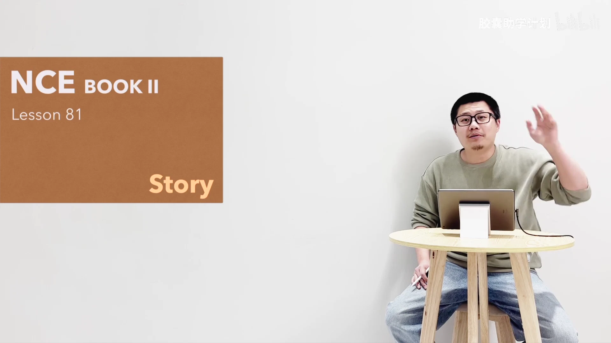

文字识别：NCE / BOOKⅡI / Lesson 81 / Story

### 画面 00:00:02

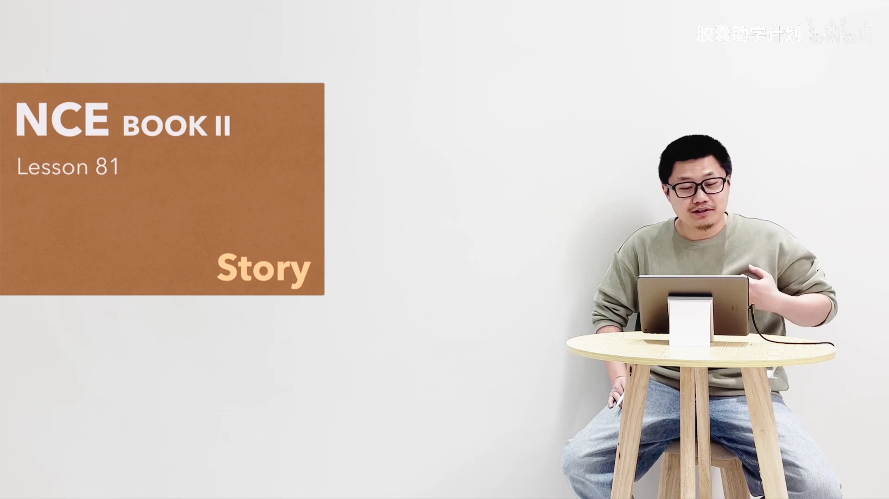

文字识别：NCE / BOOKII / Lesson 81 / Story

### 画面 00:00:08

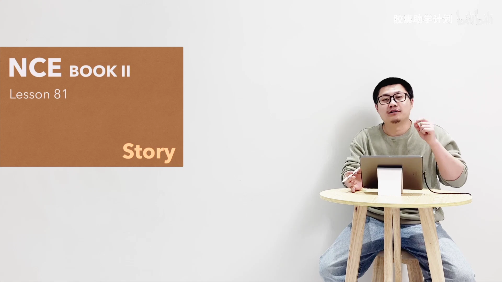

文字识别：臺助学计划 / NCE / BOOKII / Lesson 81 / Story

### 画面 00:00:10

文字识别：胶囊助学计划 bii

### 画面 00:00:13

### 画面 00:00:15

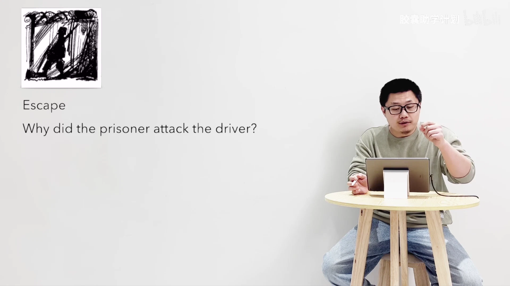

文字识别：臺助字计划 / Escape / Why did the prisoner attack the driver?

### 画面 00:00:28

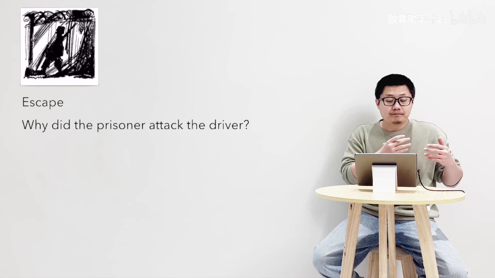

文字识别：助学计划 / Escape / Why did the prisoner attack the driver?

## 00:00:30–00:01:00

呃，这个囚犯为什么要袭击这个司机是吧？进入文章咱才能知道。来了，When he had killed the guard, the prisoner of war quickly dragged him into the bushes。说当他杀死这个守卫之后，这个囚犯 of war，那

### 画面 00:00:37

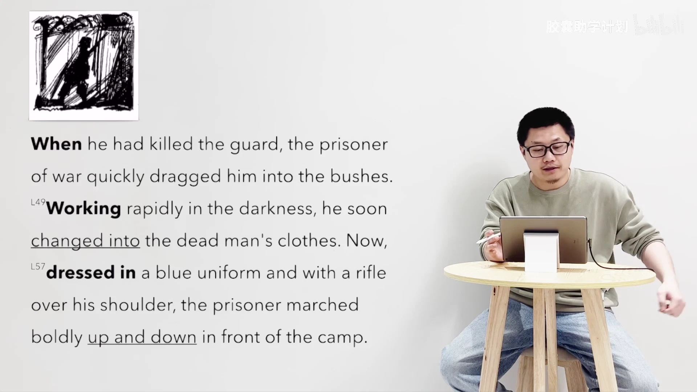

文字识别：When he had killed the guard, the prisoner / of war quickly dragged him into the bushes. / L49Working rapidly in the darkness, he soon / changed into the dead man's clothes. Now, / L57 / 'dressed in a blue uniform and with a rifle / over his shoulder, the prisoner marched / boldly up and down in front of the camp.

## 00:01:00–00:01:30

什么叫囚犯 of war啊？其实就是战争囚犯，是吧？呃，quickly迅速的，rapidly对吧？Drag him into the bushes，拖拽着他进入了这个灌木丛。那这里首先有几个小点啊。第一个，这个had killed，然后这里是drag，你能清清楚的看到两个时态不太一样，所以你应该能明白是先杀死了，

### 画面 00:01:07

文字识别：When he had killed the guard, the prisoner / of war quickly dragged him into the bushes. / L49Working rapidly in the darkness, he soon / changed into the dead man's clothes. Now, / L57 / 'dressed in a blue uniform and with a rifle / over his shoulder, the prisoner marched / boldly up and down in front of the camp.

## 00:01:30–00:02:00

后拖拽着他进入了这个灌木丛，对吧？好，呃，这是现啊过去完成时，这是一般过去时，对吧？然后这里的into呢，那就是表示进入，一个小的介词。下一句话，working rapidly in the darkness，你看这里rapidly和这里quickly，对吧？换了个词，he soon changed into the dead man's clothes。这地方基本上你看到开头上来一个working，要么动名词，二十课咱学的，要么四十

### 画面 00:01:36

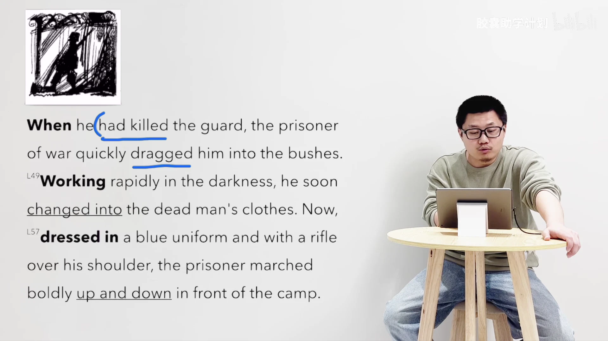

文字识别：When hehad killed the guard, the prisoner / of war quickly dragged him into the bushes. / L49Working rapidy in the darkness, he soon / changed into the dead man's clothes. Now, / L57 / 'dressed in a blue uniform and with a rifle / over his shoulder, the prisoner marched / boldly up and down in front of the camp.

### 画面 00:01:38

文字识别：When hehad killedthe guard, the prisoner / of war quickly / araggeo /  him into the bushes. / L49Working rapidly in the darkness, he soon / changed into the dead man's clothes. Now, / L57 / 'dressed in a blue uniform and with a rifle / over his shoulder, the prisoner marched / boldly up and down in front of the camp.

## 00:02:00–00:02:30

九课咱们学的，就是分词作状语，对吧？这就是分词作状语，主语是 he，主动被动，主动，对吧？就是他，呃，那你看这个 work，对于各位来说，动词最常见的意思其实就是工作，对吧？那你如果翻译成工作，这翻译成汉语就不通。你比如说工作，迅速的工作，在这黑暗当中，然后呢，他迅速的穿上了这个死人的衣服，change into 就是把我现在这一身，比如说这儿现在还有一身

### 画面 00:02:08

文字识别：When hehad killedthe guard, the prisoner / of war quickly / araggeo / o himintothe bushes. / L49Working rapidly in the darkness, he soon / changed into the dead man's clothes. Now, / L57 / 'dressed in a blue uniform and with a rifle / over his shoulder, the prisoner marched / boldly up and down in front of the camp.

### 画面 00:02:11

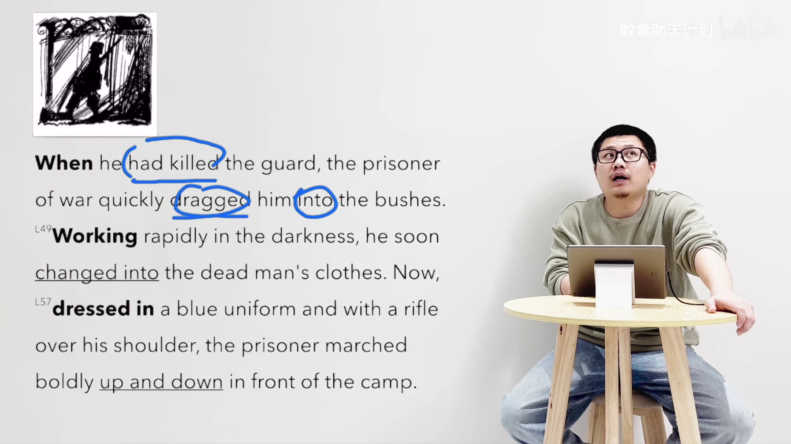

文字识别：When hehad killedthe guard, the prisoner / of war quickly / araggeo / o himntothe bushes. / L49Working rapidly in the darkness, he soon / changed into the dead man's clothes. Now, / L57 / 'dressed in a blue uniform and with a rifle / over his shoulder, the prisoner marched / boldly up and down in front of the camp.

### 画面 00:02:15

文字识别：When hehad killedthe guard, the prisoner / of war quickly / raggeo himintothe bushes. / L49Working rapidly in the darkness, he soon / changed into the dead man's clothes. Now, / L57 / 'dressed in a blue uniform and with a rifle / over his shoulder, the prisoner marched / boldly up and down in front of the camp.

### 画面 00:02:28

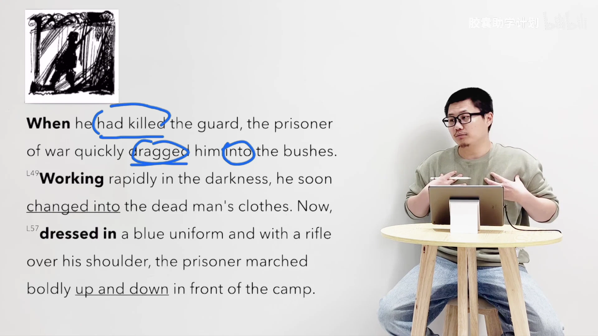

文字识别：When hehad killed the guard, the prisoner / of war quickly / raggeo him intothe bushes. / L49Working rapidly in the darkness, he soon / changed into the dead man's clothes. Now, / L57 / 'dressed in a blue uniform and with a rifle / over his shoulder, the prisoner marched / boldly up and down in front of the camp.

## 00:02:30–00:03:00

衣服啊，我现在是每这个，比如说这个呃，这个带货呃，这个呃服装的啊，有很多人不是做这样的视频嘛，对吧？我把我的衣服在这儿换了，换到那一身叫 change into，对吧？他把他自己的衣服换成了另外那一那个死去的刚刚他杀死的那个呃守卫的衣服，叫 change into the dead man's clothes。 OK，好，那这里的 working，你看你如果翻译成工作就不太好，但是你要翻译成我们所谓叫忙活了一段啊，他迅速的

### 画面 00:02:41

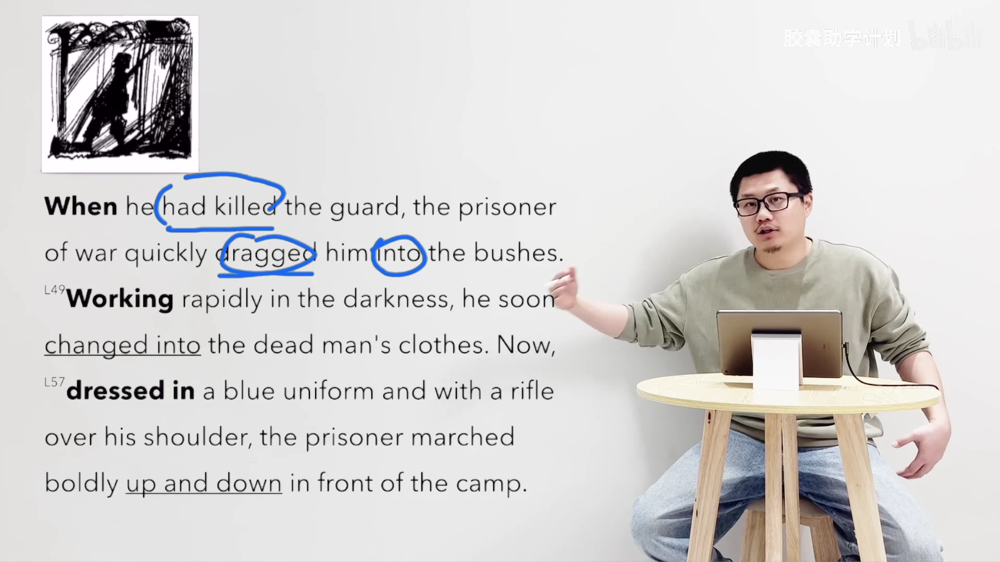

文字识别：When hehad killed the guard, the prisoner / of war quickly / raggeo himinto the bushes. / L49Working rapidly in the darkness, he soon / changed into the dead man's clothes. Now, / L57 / 'dressed in a blue uniform and with a rifle / over his shoulder, the prisoner marched / boldly up and down in front of the camp.

### 画面 00:02:43

文字识别：When hehad killed the guard, the prisoner / of war quickly / / araggeo himinto the bushes. / L49Working rapidly in the darkness, he soon / changed into the dead man's clothes. Now, / L57 / 'dressed in a blue uniform and with a rifle / over his shoulder, the prisoner marched / boldly up and down in front of the camp.

### 画面 00:02:46

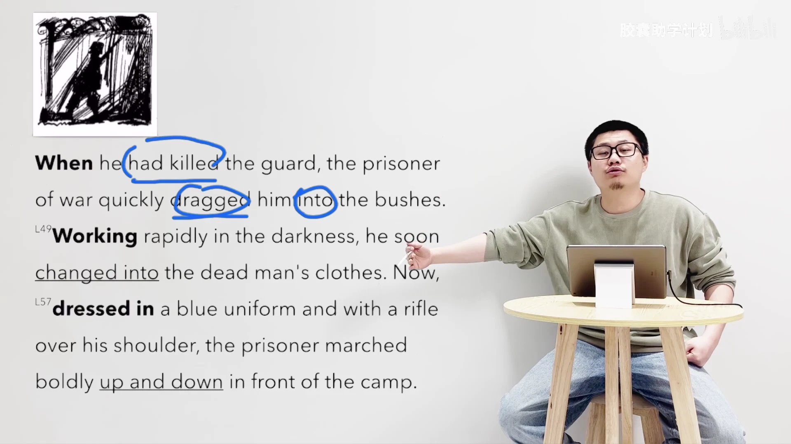

文字识别：When hehad killedthe guard, the prisoner / of war quickly / araggeo / o himinto the bushes. / L49Working rapidly in the darkness, he sgon / changed into the dead man's clothes. Now, / L57 / 'dressed in a blue uniform and with a rifle / over his shoulder, the prisoner marched / boldly up and down in front of the camp.

### 画面 00:02:52

文字识别：When hehad killedthe guard, the prisoner / of war quickly / araggeo / o himnto the bushes. / L49Working rapidly in the darkness, he soon / changed into the dead man's clothes. Now, / L57 / 'dressed in a blue uniform and with a rifle / over his shoulder, the prisoner marched / boldly up and down in front of the camp.

### 画面 00:02:54

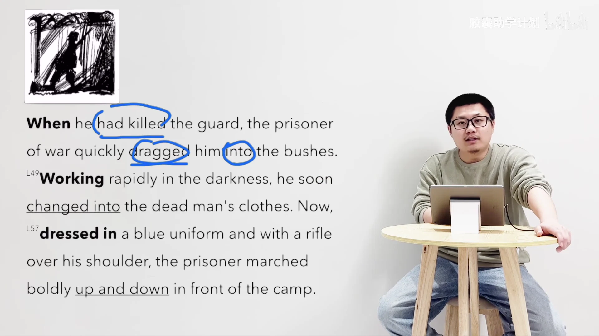

文字识别：When hehad killed the guard, the prisoner / of war quickly / araggeo / ∂ himntothe bushes. / L49Working rapidly in the darkness, he soon / changed into the dead man's clothes. Now, / L57 / 'dressed in a blue uniform and with a rifle / over his shoulder, the prisoner marched / boldly up and down in front of the camp.

## 00:03:00–00:03:30

忙活了一下，在这个这个黑暗当中，对吧？哎，呃，基本上还是OK的。那这个忙活是什么呢？你就脑补嘛，无非就是把死人衣服扒下来，把自己衣服脱下去，把死人衣服穿身上，整理一下身上的衣服啊。这个事儿就 working rapidly，对吧？Next one. Now dressed in a blue uniform and with the rifle over his shoulder, the prisoner marched boldly up and down in front of the camp. 这句话乍一看

### 画面 00:03:07

文字识别：When hehad killedthe guard, the prisoner / of war quickly / araggeo / o himintothe bushes. / L49Working rapidly in the darkness, he soon / changed into the dead man's clothes. Now, / L57 / 'dressed in a blue uniform and with a rifle / over his shoulder, the prisoner marched / boldly up and down in front of the camp.

## 00:03:30–00:04:00

好像挺长的，其实还好，其实还好。第一句话叫做 Dressed in a blue uniform with a rifle over his shoulder. 好，首先这个 dressed in 我们已经见过好几次了，五十七课咱也见过。后来我印象当中六十五课应该我们还见过，就是 Jumbo 讲树的那一个，是吧？小象那一个。呃，这个地方的 dressed 就是穿着着，是吧？然后你注意啊，主语就是 the prisoner嘛。这地方可以有两个理解方式，一个你就理解为它是个被动 be dressed in，另外一个

### 画面 00:03:37

文字识别：When hehad killedthe guard, the prisoner / of war quickly / araggeo him into the bushes. / L49Working rapidly in the darkness, he soon / changed into the dead man's clothes. Now, / L57 / 'dressed in a blue uniform and with a rifle / over his shoulder, Che prisoner marched / boldly up and down in front of the camp.

## 00:04:00–00:04:30

你就不用管它是什么了，反正 be dressed in 是一个习惯用法， be 被省略掉了，还是四十九课那个语法，对吧？只不过这个 be dressed in 这个习惯用法是五十七课咱学的啊。那翻译成穿着嘛，穿着一个蓝色的制服啊，那就是军人的服装。然后呢，有这么一个 rifle 来复枪或者步枪 over his shoulder 担在肩上，对吧？在肩的上面。这个囚犯怎么样了呢？哎，这个战俘，

### 画面 00:04:07

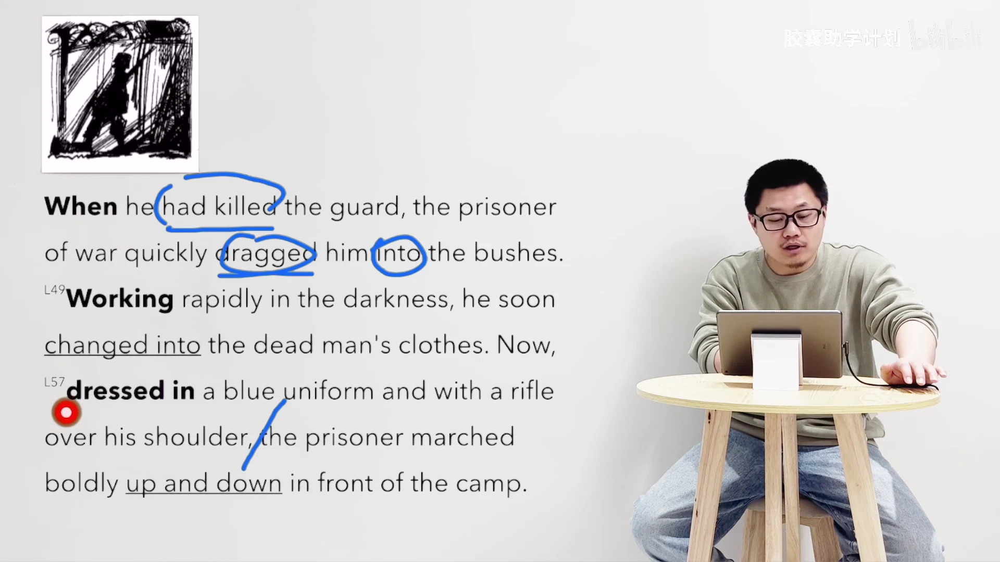

文字识别：When hehad killedthe guard, the prisoner / of war quickly / araggeo /  himntothe bushes. / L49Working rapidly in the darkness, he soon / changed into the dead man's clothes. Now, / L57dressed in a blue uniform and with a rifle / over his shoulder, Che prisoner marched / boldly up and down in front of the camp.

### 画面 00:04:23

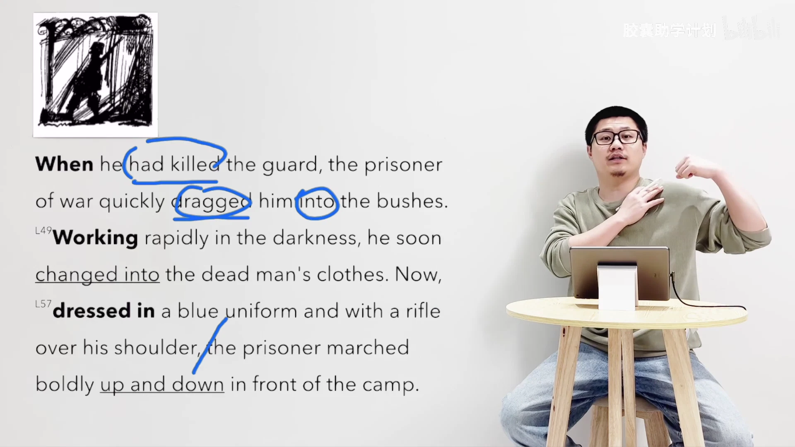

文字识别：When hehad killedthe guard, the prisoner / of war quickly / araggeo himIntothe bushes. / L49Working rapidly in the darkness, he soon / changed into the dead man's clothes. Now, / L57 / 'dressed in a blue uniform and with a rifle / over his shoulder, Che prisoner marched / boldly up and down in front of the camp.

### 画面 00:04:25

文字识别：When hehad killedthe guard, the prisoner / of war quickly / raggeo himintothe bushes. / L49Working rapidly in the darkness, he soon / changed into the dead man's clothes. Now, / L57 / 'dressed in a blue uniform and with a rifle / over his shoulder, Che prisoner marched / boldly up and down in front of the camp.

## 00:04:30–00:05:00

front of the camp, in front of the

### 画面 00:04:39

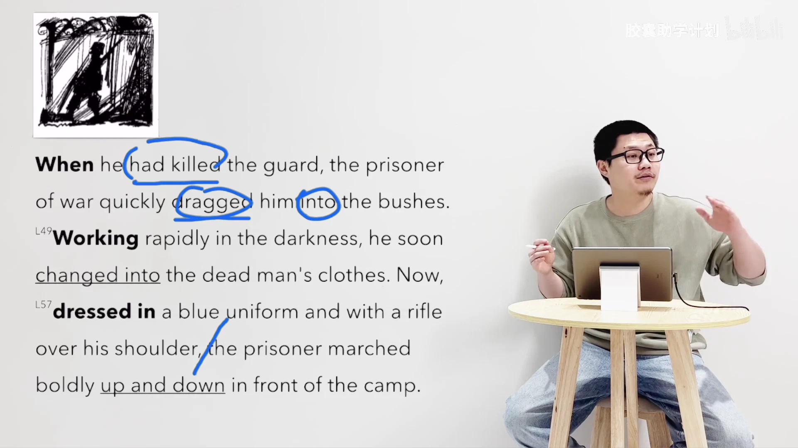

文字识别：When hehad killed the guard, the prisoner / of war quickly / raggeo himintothe bushes. / L49Working rapidly in the darkness, he soon / changed into the dead man's clothes. Now, / L57 / 'dressed in a blue uniform and with a rifle / over his shoulder, Che prisoner marched / boldly up and down in front of the camp.

### 画面 00:04:46

文字识别：When hehad killedthe guard, the prisoner / of war quickly / raggeo himintothe bushes. / L49Working rapidly in the darkness, he soon / changed into the dead man's clothes. Now, / L57 / 'dressed in a blue uniform and with a rifle / over his shoulder, Che prisoner marched / boldly up and down in front of the camp.

### 画面 00:04:48

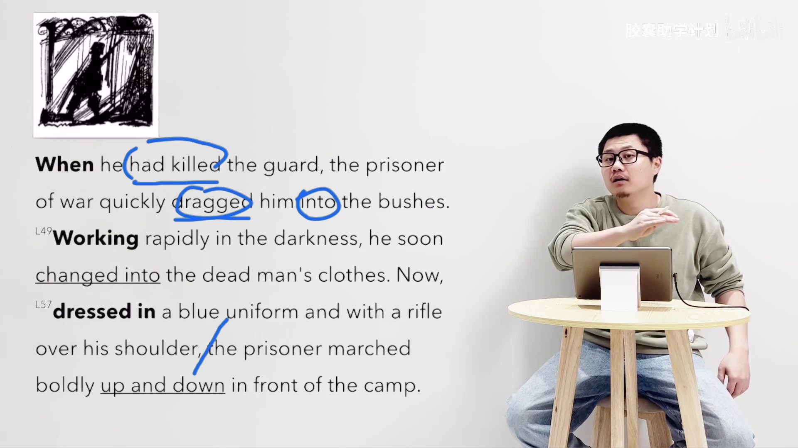

文字识别：When hehad killedthe guard, the prisoner / of war quickly / araggeo himIntothe bushes. / L49Working rapidly in the darkness, he soon / changed into the dead man's clothes. Now, / L57 / 'dressed in a blue uniform and with a rifle / over his shoulder, Che prisoner marched / boldly up and down in front of the camp.

### 画面 00:04:53

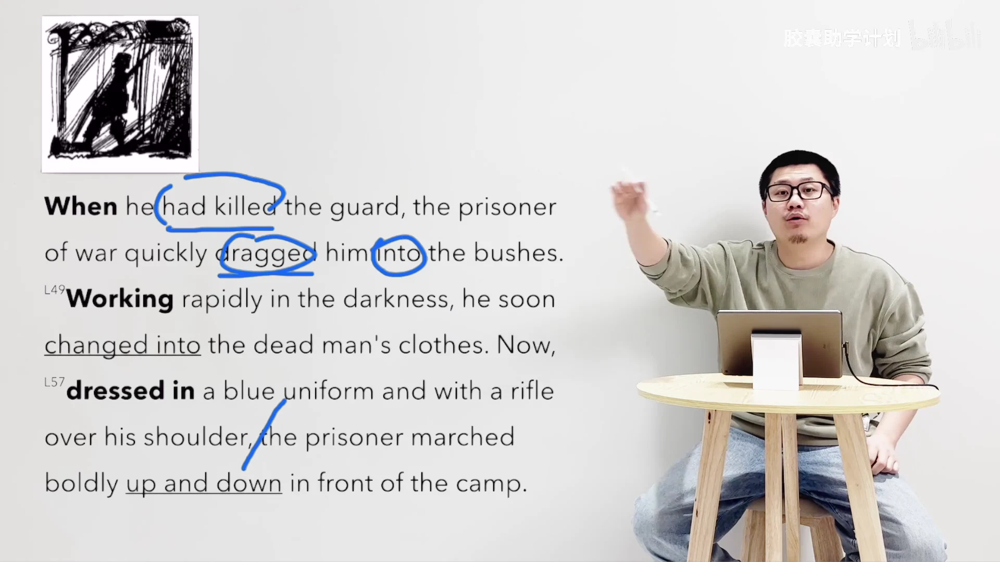

文字识别：When hehad killed the guard, the prisoner / of war quickly / raggeo himintothe bushes. / L49Working rapidly in the darkness, he soon / changed into the dead man's clothes. Now, / L57 / 'dressed in a blue uniform and with a rifle / over his shoulder, Che prisoner marched / boldly up and down in front of the camp.

### 画面 00:04:58

文字识别：He could 47hear shouting in the camp itself. / Lights were blazing and men were running / here and there: they had just discovered that / a prisoner had escaped. At that moment, a / large black car with four officers inside it, / stopped at the camp gates.

## 00:05:00–00:05:30

he could hear shouting in the camp itself.说他能听到，他可以听到shouting喊叫声in the camp，在这个营地里itself这个itself指的就是camp。在这里，首先我说这个itself完全可以省略in the camp就可以了。那in the camp itself和in the camp的含义没有区别，其实就是想表达在这个营地里啊，呃，然后这个hear doing

### 画面 00:05:19

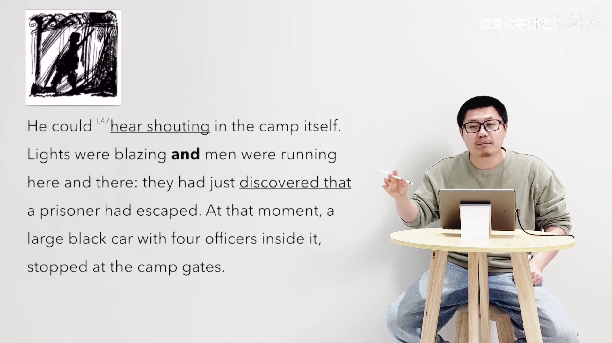

文字识别：He could 47hear shouting in the camp itself. / Lights were blazing and men were running / here and there: they had just discovered that / a prisoner had escaped. At that moment, a / large black car with four officers inside it, / stopped at the camp gates.

### 画面 00:05:28

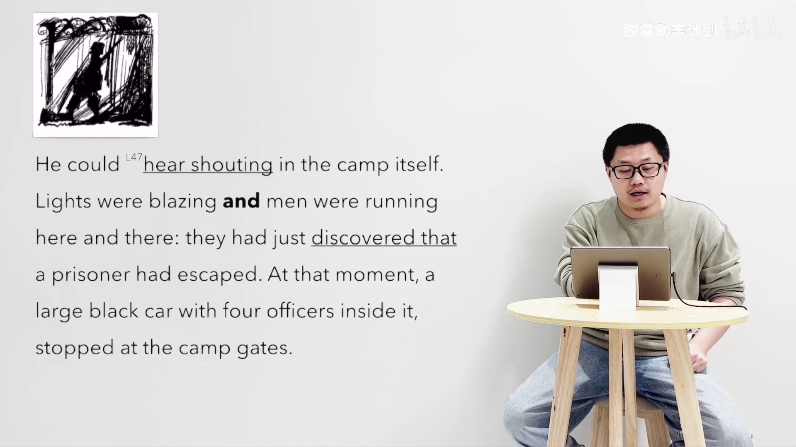

文字识别：He could 47hear shouting in the camp itself. / Lights were blazing and men were running / here and there: they had just discovered that / a prisoner had escaped. At that moment, a / large black car with four officers inside it, / stopped at the camp gates.

## 00:05:30–00:06:00

something 四十七课咱学到听到正在做，对吧？哎，lights were blazing，哎，这个灯啊一直在闪耀着，嗡嗡嗡，可能还有警报。And men were running here and there. 然后呢，这些军人们，对吧？那我为什么翻译成军人们？你又上下文语境出的嘛。跑，这里从这里跑到那里，那里跑，四处的跑。They had just discovered that a prisoner had escaped. 说他们刚刚发

### 画面 00:05:38

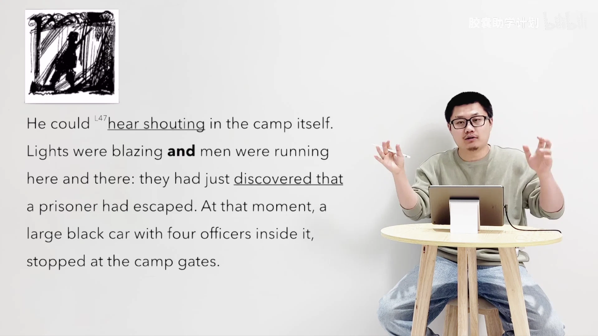

文字识别：He could 47hear shouting in the camp itself. / Lights were blazing and men were running / here and there: they had just discovered that / a prisoner had escaped. At that moment, a / large black car with four officers inside it, / stopped at the camp gates.

### 画面 00:05:40

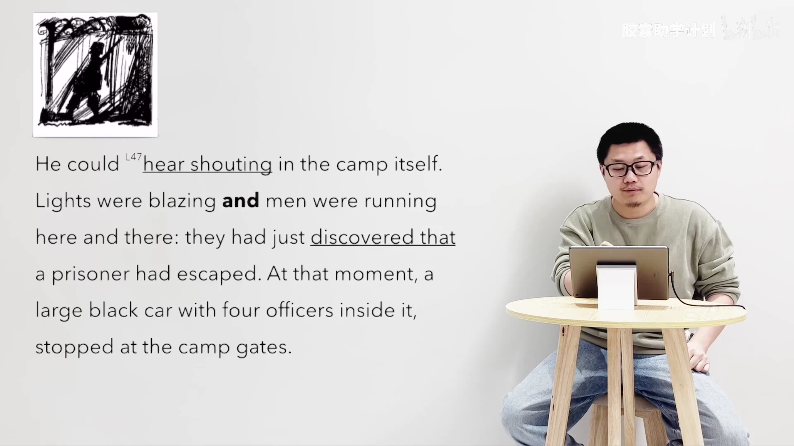

文字识别：He could 47hear shouting in the camp itself. / Lights were blazing and men were running / here and there: they had just discovered that / a prisoner had escaped. At that moment, a / large black car with four officers inside it, / stopped at the camp gates.

## 00:06:00–00:06:30

现了一件事情。Somebody discovered that后边加一句话，某人发现了一件事情，对吧？觉察到了一件事情。一个囚犯，一个战俘，had escaped已经跑了。At that moment，在那一刻，a large black car with four officers inside it stopped at the camp gates。说在

### 画面 00:06:10

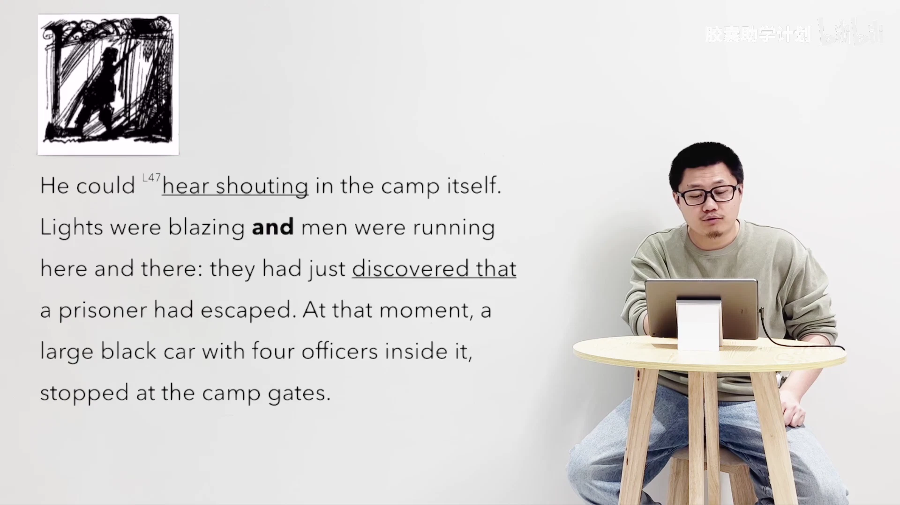

文字识别：He could 47hear shouting in the camp itself. / Lights were blazing and men were running / here and there: they had just discovered that / a prisoner had escaped. At that moment, a / large black car with four officers inside it, / stopped at the camp gates.

## 00:06:30–00:07:00

那一刻呢，一个很大的黑色的车带着什么呢？有四个 officers，军官 inside it 在里面啊，这样的一个大的车怎么样了呢？其实这合起来从这儿到这儿全是个主语啊，就是六一二三四五六里边的一。然后停在了在什么地方呢？停在了一个小地方，所以它一般用的是 at，就是 at 加小地方会多一点，但这绝不好使啊，因为 at the square 在广场

### 画面 00:06:40

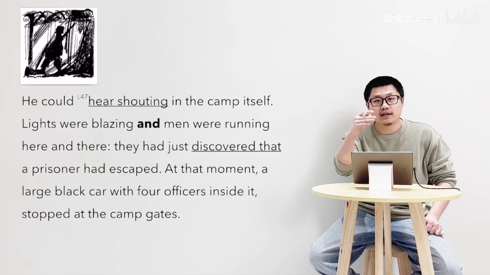

文字识别：He could 47hear shouting in the camp itself. / Lights were blazing and men were running / here and there: they had just discovered that / a prisoner had escaped. At that moment, a / large black car with four officers inside it, / stopped at the camp gates.

## 00:07:00–00:07:30

也是，因为大和小是相对的，所以这个其实就是我们一个一个记了啊。在什么地方呢？在呃 camp gates，在这个营地的大门处，是吧？停下来了。The officers got out and the prisoners stood to attention and saluted as they passed. 这几个小的词儿趴这么一斜，句子就被拆开了。警官走出来了。这个战俘呢，

### 画面 00:07:10

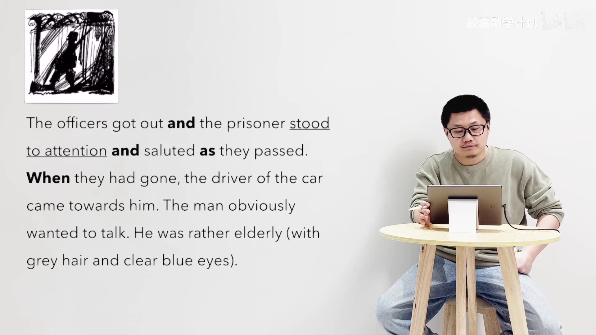

文字识别：The officers got out and the prisoner stood / to attention and saluted as they passed. / When they had gone, the driver of the car / came towards him. The man obviously / Wanted to talk. He was rather elderly (with / grey hair and clear blue eyes).

### 画面 00:07:22

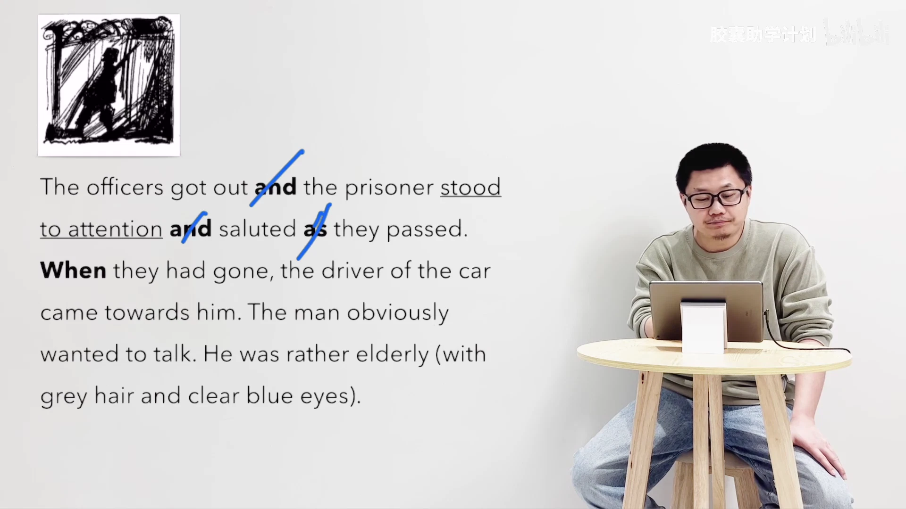

文字识别：The officers got out g hd the prisoner stood / to attention ayd saluted a they passed. / When they had gone, the driver of the car / came towards him. The man obviously / wanted to talk. He was rather elderly (with / grey hair and clear blue eyes).

## 00:07:30–00:08:00

stood to attention. Ah, stood to attention,对吧？哎，就是啊，加上saluted，什么意思呢？就是稍息，立正，立正，stood to attention, saluted，敬礼。这地方的as叫当，当they passed，当他们过去的时候啊，就理解为这四个军官往里走过去的时候，他稍息，立正，立正，然后敬礼，对吧？When they had gone, the driver of the

### 画面 00:07:32

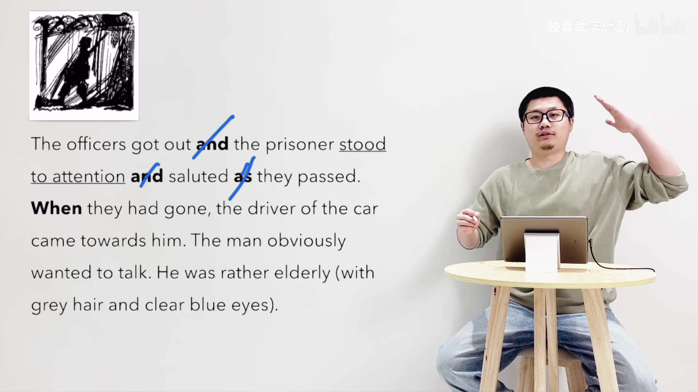

文字识别：The officers got out g hd the prisoner stood / to attention ayd saluted as they passed. / When they had gone, the driver of the car / came towards him. The man obviously / wanted to talk. He was rather elderly (with / grey hair and clear blue eyes).

### 画面 00:07:35

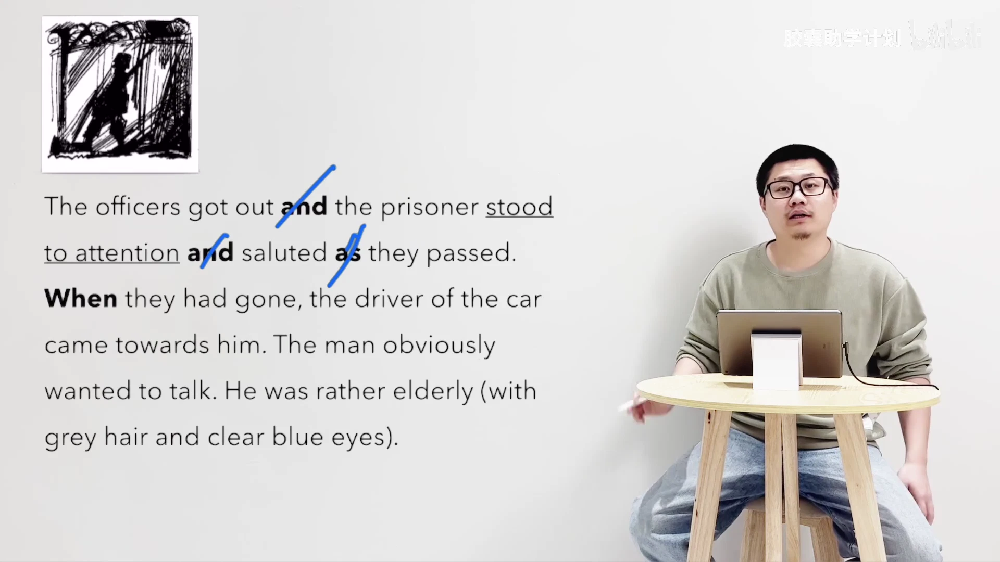

文字识别：The officers got out g hd the prisoner stood / to attention ayd saluted as they passed. / When they had gone, the driver of the car / came towards him. The man obviously / wanted to talk. He was rather elderly (with / grey hair and clear blue eyes).

### 画面 00:07:37

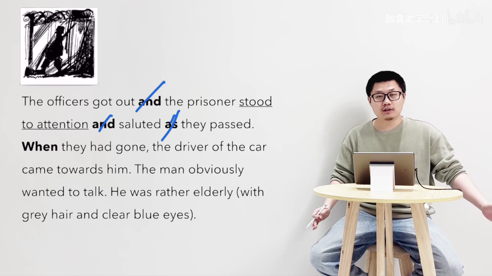

文字识别：The officers got out g hd the prisoner stood / to attention ayd saluted as they passed. / When they had gone, the driver of the car / came towards him. The man obviously / wanted to talk. He was rather elderly (with / grey hair and clear blue eyes).

### 画面 00:07:39

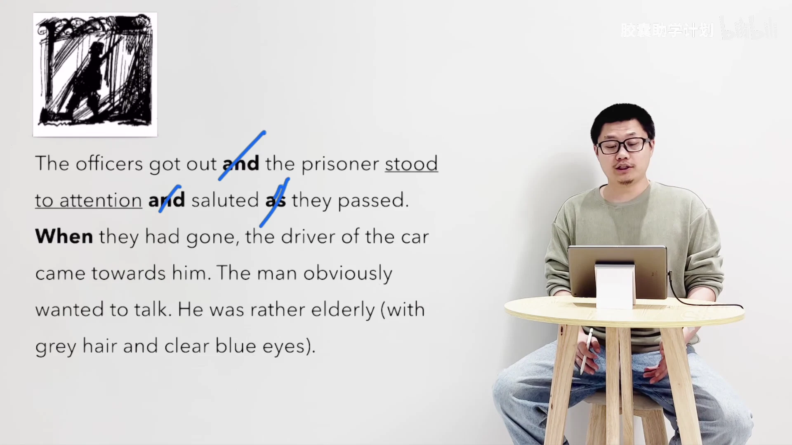

文字识别：The officers got out ghd the prisoner stood / to attention ayd saluted as they passed. / When they had gone, the driver of the car / came towards him. The man obviously / wanted to talk. He was rather elderly (with / grey hair and clear blue eyes).

### 画面 00:07:42

文字识别：The officers got out g nd the prisoner stood / to attention ayd saluted a they passed. / When they had gone, the driver of the car / came towards him. The man obviously / wanted to talk. He was rather elderly (with / grey hair and clear blue eyes).

### 画面 00:07:44

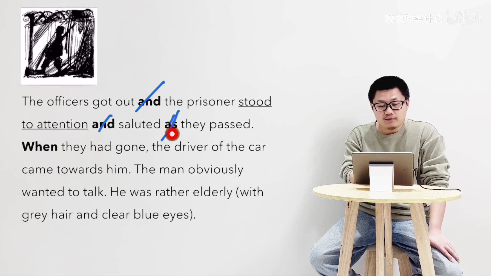

文字识别：The officers got out g hd the prisoner stood / to attention ayd saluted at / they passed. / When they had gone, the driver of the car / came towards him. The man obviously / wanted to talk. He was rather elderly (with / grey hair and clear blue eyes).

### 画面 00:07:49

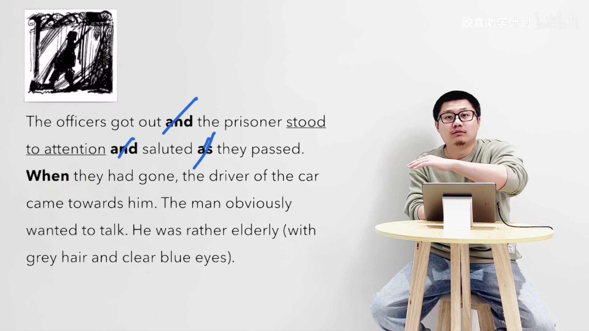

文字识别：The officers got out g hd the prisoner stood / to attention ayd saluted a they passed. / When they had gone, the driver of the car / came towards him. The man obviously / wanted to talk. He was rather elderly (with / grey hair and clear blue eyes).

### 画面 00:07:57

文字识别：The officers got out y hd the prisoner stood / to attention ayd saluted a they passed. / When they had gone, the driver of the car / came towards him. The man obviously / wanted to talk. He was rather elderly (with / grey hair and clear blue eyes).

## 00:08:00–00:08:30

car came towards him.说当这个四个战啊不是四个战俘四个军官已经走了之后，the driver of the car，有会往前翻译车的司机，其实不用the driver of the car有点费劲了，直接用the driver就可以了，没有任何问题啊。Came towards him，冲他就走过来了。The man obviously wanted to talk.说这个司机，这个the man指的就是the driver啊，很明显想要聊一聊。

### 画面 00:08:27

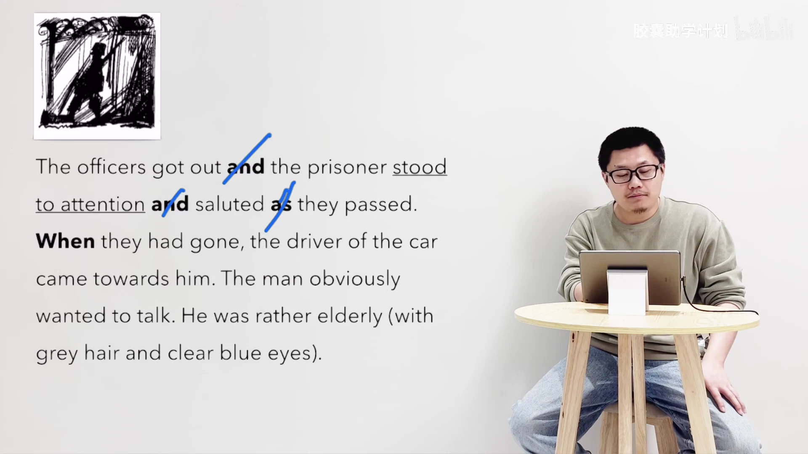

文字识别：The officers got out g hd the prisoner stood / to attention ayd saluted as they passed. / When they had gone, the driver of the car / came towards him. The man obviously / wanted to talk. He was rather elderly (with / grey hair and clear blue eyes).

## 00:08:30–00:09:00

He was rather elderly, with gray hair and clear blue eyes.说这个司机是怎么样呢？是相当的年长，还用的是个敬称，是吧？然后呢，有着灰色的头发，灰白的头发，上岁数了嘛？以及但是呢，很明亮、很清澈的蓝色的双眼。The prisoner felt sorry for him, but

### 画面 00:08:54

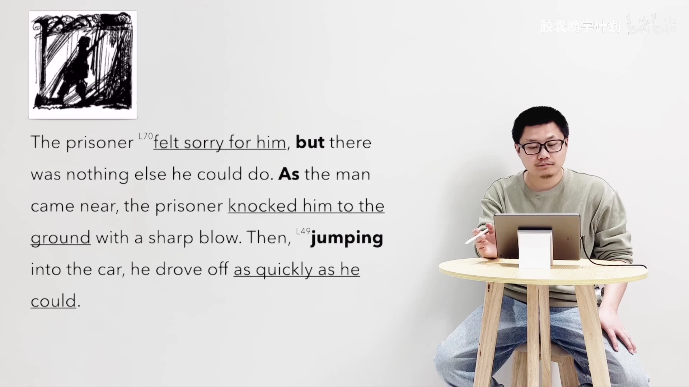

文字识别：The prisoner 7°felt sorry for him, but there / was nothing else he could do. As the man / came near, the prisoner knocked him to the / ground with a sharp blow. Then, 4jumping / into the car, he drove off as quickly as he / could.

## 00:09:00–00:09:30

there was nothing else he could do.说这个囚犯feel sorry for somebody感到很遗憾、很抱歉、很惋惜，对吧？为他感到很遗憾、很抱歉、很惋惜。但是呢，there was nothing又没有任何的事情，其他的事情他可以做，他又不能做任何的事情。这句话单看你其实是不太明白他到底想说啥的，基本上你要看下文才能明白。这句话直译过来就是：这个囚犯看见这个司机冲他走过来，然后很想，

### 画面 00:09:07

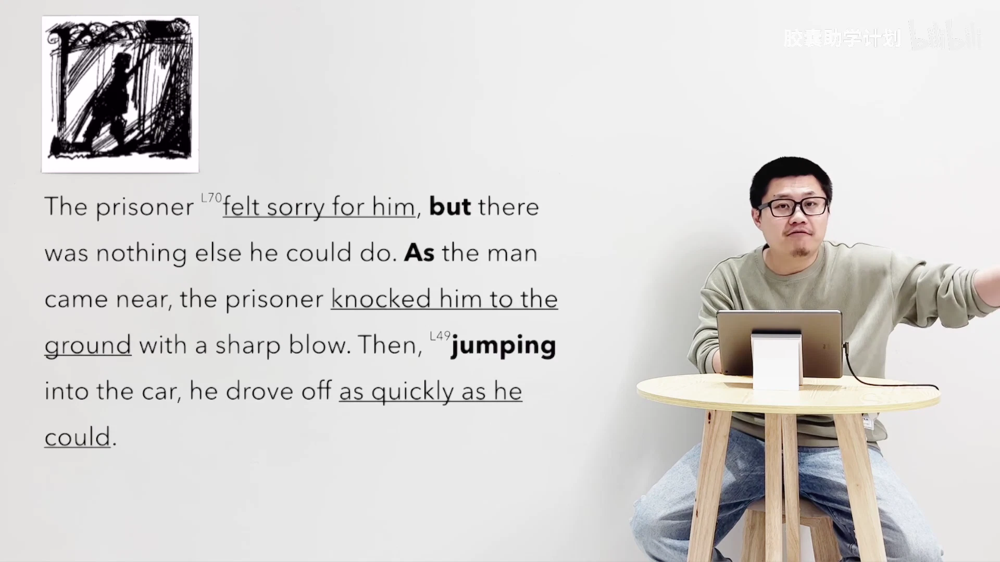

文字识别：The prisoner 7°felt sorry for him, but there / Was nothing else he could do. As the man / came near, the prisoner knocked him to the / ground with a sharp blow. Then, 4jumping / into the car, he drove off as quickly as he / could.

### 画面 00:09:17

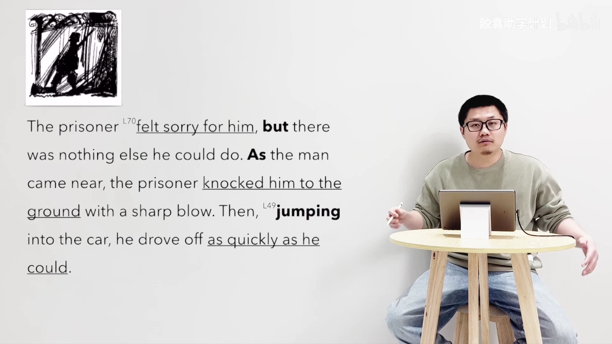

文字识别：The prisoner 7°felt sorry for him, but there / was nothing else he could do. As the man / came near, the prisoner knocked him to the / ground with a sharp blow. Then, 4jumping / into the car, he drove off as quickly as he / could.

### 画面 00:09:19

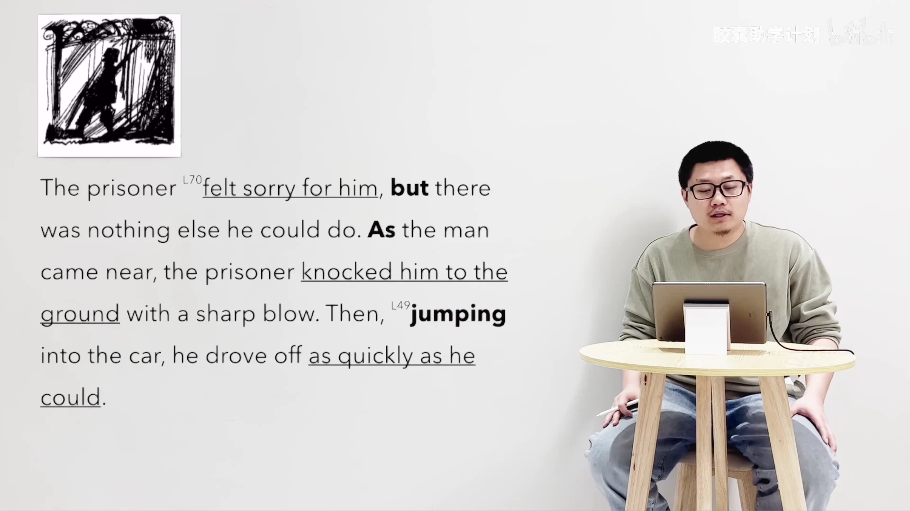

文字识别：The prisoner 7°felt sorry for him, but there / was nothing else he could do. As the man / came near, the prisoner knocked him to the / ground with a sharp blow. Then, "jumping / into the car, he drove off as quickly as he / could.

### 画面 00:09:21

文字识别：The prisoner 7°felt sorry for him, but there / was nothing else he could do. As the man / came near, the prisoner knocked him to the / ground with a sharp blow. Then, Wjumping / into the car, he drove off as quickly as he / could.

## 00:09:30–00:10:00

这司机很想跟他聊天儿。然后这个囚犯呢，就感觉很惋惜，很遗憾，但是他又啥也做不了。啊，你单听这句话，你就不明白。他冲我走过来，我遗憾什么呢？你要看下边。As the man came near, the prisoner knocked him to the ground with a sharp blow.说当这个司机走近的时候呢，这个战俘knocked him to the ground，把他击倒在地。用的是什么呢？A sharp blow，嘣一下

### 画面 00:09:41

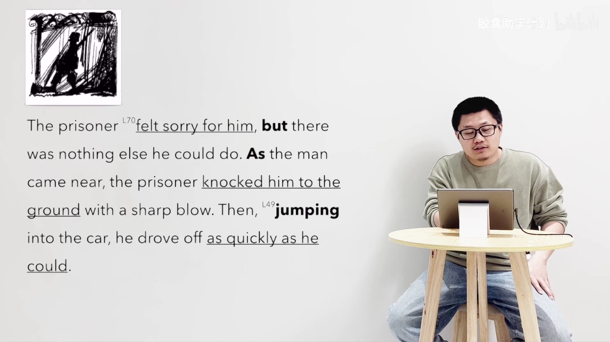

文字识别：The prisoner 7°felt sorry for him, but there / was nothing else he could do. As the man / came near, the prisoner knocked him to the / ground with a sharp blow. Then, 4jumping / into the car, he drove off as quickly as he / could.

## 00:10:00–00:10:30

啊，或者是拿那个枪枪把，咚，怼了一下。Then,然后jumping into the car, he drove off as quickly as he could. Jumping into the car,主语jumping是谁？是he。主动被动？主动，对吧？跳进了车，开走了。As quickly as he could，这个之前我们见过了，我们见过它的如下几个变体，全翻译成两个字儿：尽快。As quickly as

### 画面 00:10:00

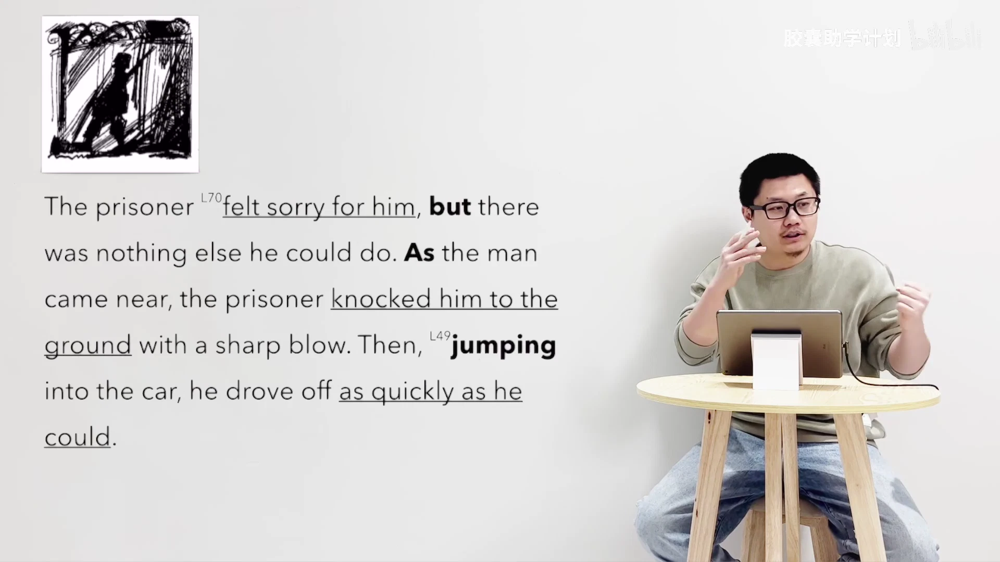

文字识别：The prisoner 7°felt sorry for him, but there / was nothing else he could do. As the man / came near, the prisoner knocked him to the / ground with a sharp blow. Then, 4jumping / into the car, he drove off as quickly as he / could.

### 画面 00:10:04

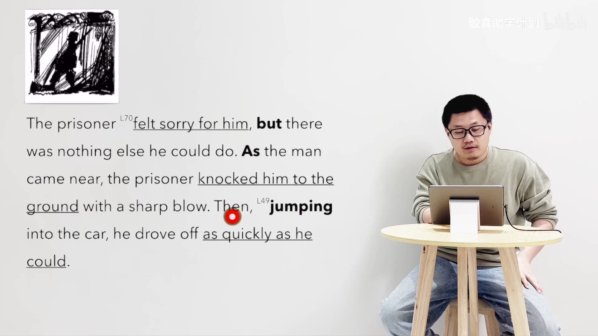

文字识别：The prisoner 7°felt sorry for him, but there / was nothing else he could do. As the man / came near, the prisoner knocked him to the / ground with a sharp blow.Then, "jumping / into the car, he drove off as quickly as he / could.

### 画面 00:10:21

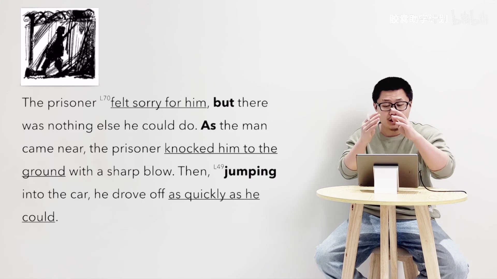

文字识别：The prisoner 7°felt sorry for him, but there / was nothing else he could do. As the man / came near, the prisoner knocked him to the / ground with a sharp blow. Then, 4jumping / into the car, he drove off as quickly as he / could.

### 画面 00:10:23

文字识别：The prisoner 7°felt sorry for him, but there / was nothing else he could do. As the man / came near, the prisoner knocked him to the / ground with a sharp blow. Then, 4jumping / into the car, he drove off as quickly as he / could.

### 画面 00:10:27

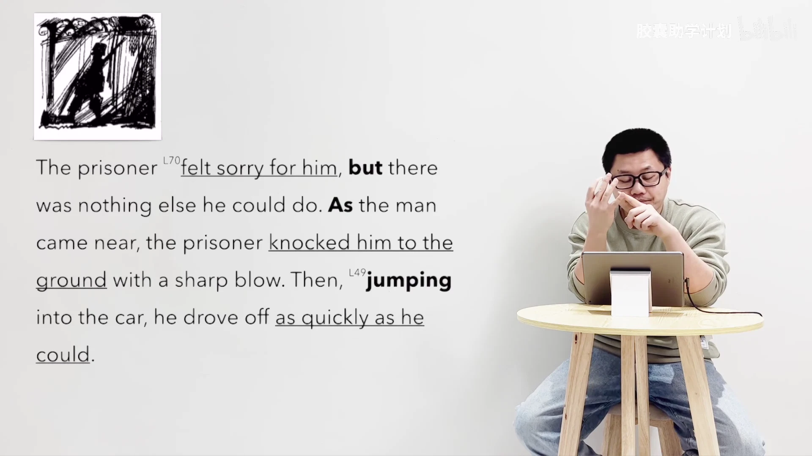

文字识别：The prisoner 7°felt sorry for him, but there / Was nothing else he could do. As the man / came near, the prisoner knocked him to the / ground with a sharp blow. Then, 4jumping / into the car, he drove off as quickly as he / could.

## 00:10:30–00:11:00

he could, as soon as he could, as quickly as possible, as soon as possible.你不用把它当成三十二课咱学那个什么as的点儿as是吧？什么同样地像不用那样去翻译，就是把它硬记住，这是最快的，就尽快啊，尽快就行了。本课习惯用法啊，没有什么新的语法习惯用法有如下几个，咱们老习惯造造句，迅

### 画面 00:10:53

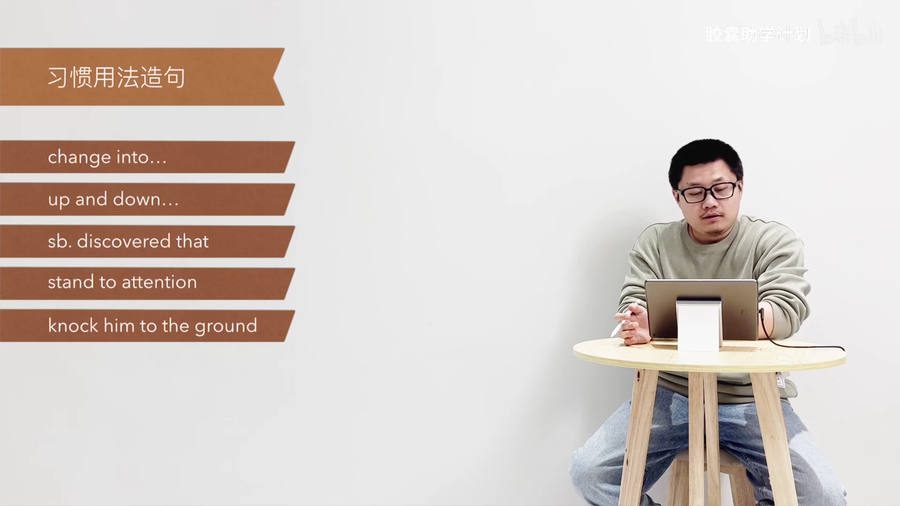

文字识别：习惯用法造句 / change into... / up and down.. / sb. discovered that / stand to attention / knock him to the ground

### 画面 00:10:55

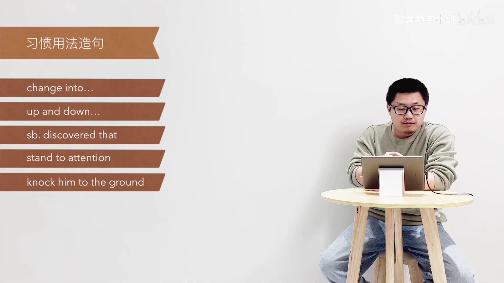

文字识别：习惯用法造句 / change into... / up and down.. / sb. discovered that / stand to attention / knock him to the ground

### 画面 00:10:57

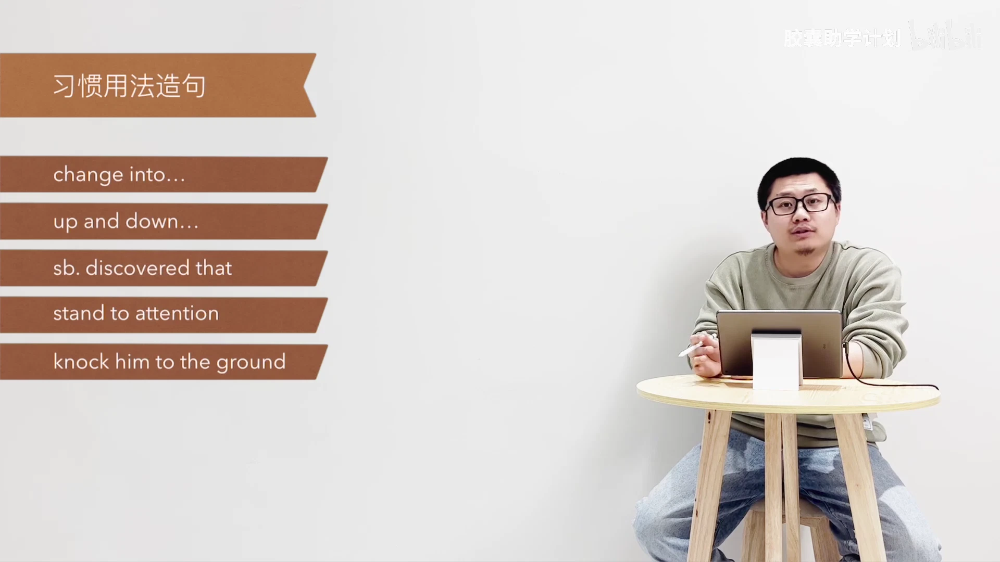

文字识别：习惯用法造句 / change into... / up and down.. / sb. discovered that / stand to attention / knock him to the ground

### 画面 00:10:59

文字识别：网：v.+v.变化 / 习惯用法造句指南 / 囊助字计划 / 四句型转换 / 方式/地点/时间 / 其他习惯用法 / 其他单词+词性 / 原文摘抄+变 / 6123456 / change into...

## 00:11:00–00:11:30

速过一下。Change into就是啊，对吧？比如说，He will be changing into his uniform.他会换他那身制服，对吧？穿上那身制服。那这个地方呢是will be doing。复习了一下十三课啊，说I'm curious to find out why you change into your best clothes.说我很好奇的想搞明白为啥你要换上你最新的这件最棒的这件衣服最好的这件衣服。呃，记住，repeat after me啊。说If you want to change into your work clothes,

### 画面 00:11:01

文字识别：网：v.+v.变化 / 习惯用法造句指南 / 壺助学计划 / 四句型转换 / 方式/地点/时间 / 其他习惯用法 / 其他单词+词性 / 原文摘抄+变 / 6123456 / change into...

### 画面 00:11:03

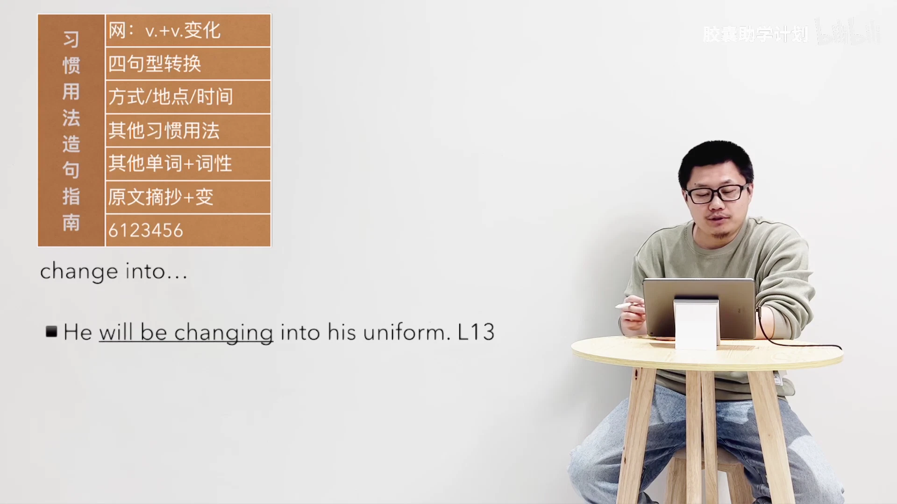

文字识别：网：v.+v.变化 / 习惯用法造句指南 / 辜助学计划 / 四句型转换 / 方式/地点/时间 / 其他习惯用法 / 其他单词+词性 / 原文摘抄+变 / 6123456 / change into... /  He will be changing into his uniform. L13

### 画面 00:11:05

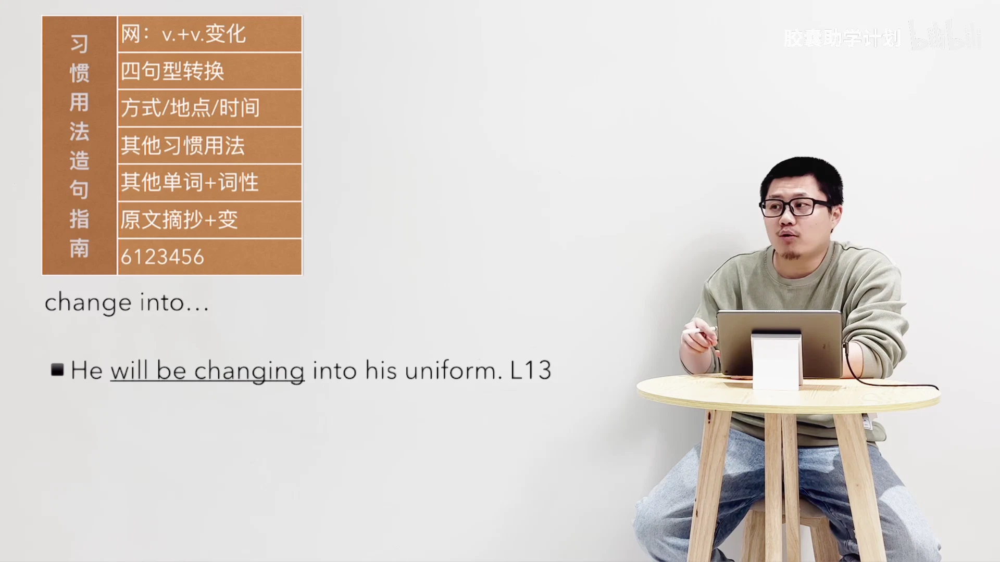

文字识别：网：v.+v.变化 / 习惯用法造句指南 / 喜助字计划 / 四句型转换 / 方式/地点/时间 / 其他习惯用法 / 其他单词+词性 / 原文摘抄+变 / 6123456 / change into... /  He will be changing into his uniform. L13

### 画面 00:11:09

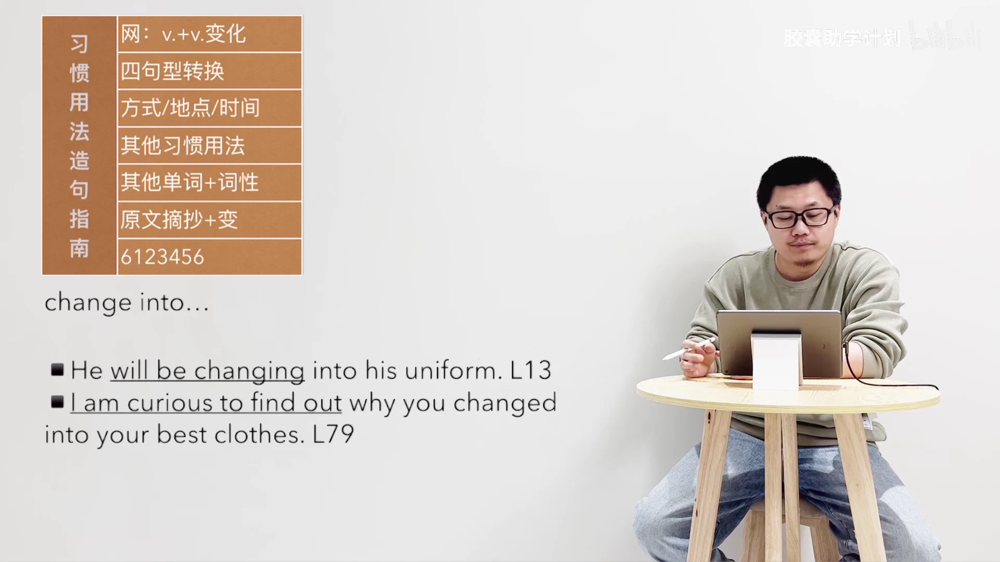

文字识别：网：v.+v.变化 / 习惯用法造句指南 / 四句型转换 / 方式/地点/时间 / 其他习惯用法 / 其他单词+词性 / 原文摘抄+变 / 6123456 / change into... /  He will be changing into his uniform. L13 /  am curious to find out why you changed / into your best clothes. L79

### 画面 00:11:14

文字识别：网：v.+v.变化 / 习惯用法造句指南 / 喜助学计划 / 四句型转换 / 方式/地点/时间 / 其他习惯用法 / 其他单词+词性 / 原文摘抄+变 / 6123456 / change into... /  He will be changing into his uniform. L13 / ■L am curious to find out why you changed / into your best clothes. L79

### 画面 00:11:19

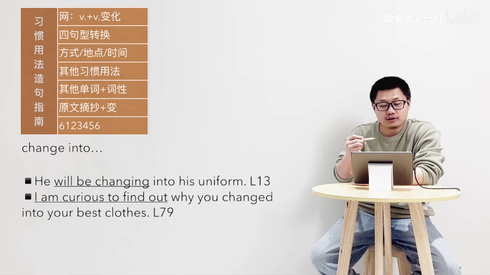

文字识别：网：v.+v.变化 / 习惯用法造句指南 / 奏助字计划 / 四句型转换 / 方式/地点/时间 / 其他习惯用法 / 其他单词+词性 / 原文摘抄+变 / 6123456 / change into... /  He will be changing into his uniform. L13 / ■ am curious to find out why you changed / into your best clothes. L79

### 画面 00:11:24

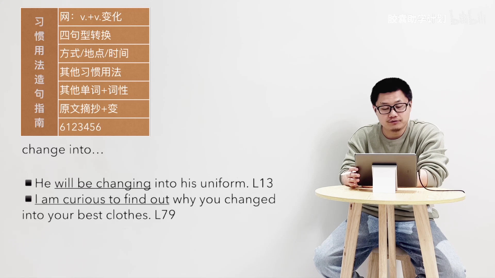

文字识别：网：v.+v.变化 / 习惯用法造句指南 / 助字计划 / 四句型转换 / 方式/地点/时间 / 其他习惯用法 / 其他单词+词性 / 原文摘抄+变 / 6123456 / change into... /  He will be changing into his uniform. L13 / ■Lam curious to find out why you changed / into your best clothes. L79

### 画面 00:11:26

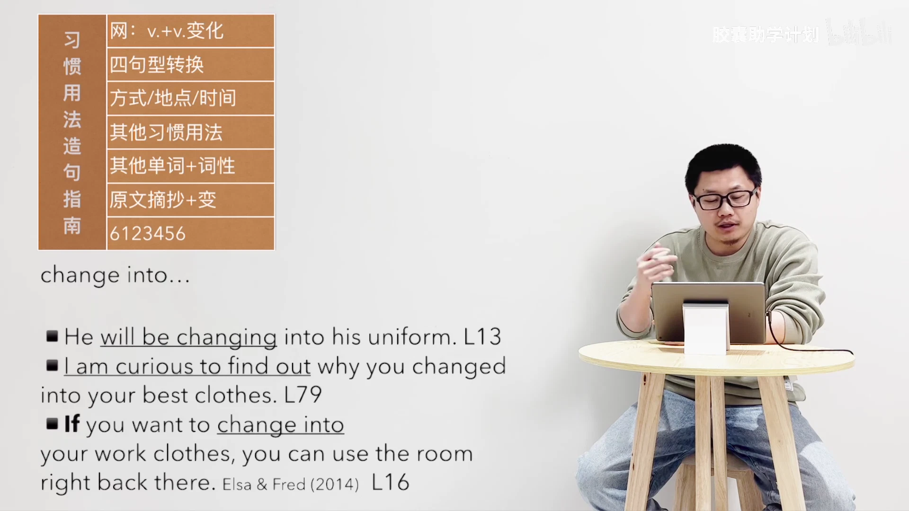

文字识别：网：v.+v.变化 / 习惯用法造句指南 / 菱助学计划 / 四句型转换 / 方式/地点/时间 / 其他习惯用法 / 其他单词+词性 / 原文摘抄+变 / 6123456 / change into... /  He will be changing into his uniform. L13 / ■ L am curious to find out why you changed / into your best clothes. L79 /  If you want to change into / your work clothes, you can use the room / right back there. Elsa & Fred (2014) L16

### 画面 00:11:29

文字识别：网：v.+v.变化 / 习惯 / 妻助学计划 / 四句型转换 / 预用法造句指南 / 方式/地点/时间 / 其他习惯用法 / 其他单词+词性 / 原文摘抄+变 / 6123456 / change into... /  He will be changing into his uniform. L13 / ■ am curious to find out why you changed / into your best clothes. L79 /  If you want to change into / your work clothes, you can use the room / right back there. Elsa & Fred (2014) L16

## 00:11:30–00:12:00

You can use the room right back there. 这是一个电影的片段，说如果你想换上你工作的那身衣服，你可以使后边的那个屋子，你去换衣服去，对吧？ Okay, next one. 那注意力集中，咱们听一下这个电影片段。那这个 appropriate 是一个呃超纲的词，但我提前告诉您什么意思。口语当中还挺常用的，不妨顺便给它记下来，就是合适啊，更合适， more appropriate，更合适的。 Could

### 画面 00:11:31

文字识别：网：v.+v.变化 / 习惯用法造句指南 / 妻助学计划 / 四句型转换 / 方式/地点/时间 / 其他习惯用法 / 其他单词+词性 / 原文摘抄+变 / 6123456 / change into... /  He will be changing into his uniform. L13 /  am curious to find out why you changed / into your best clothes. L79 /  If you want to change into / your work clothes, you can use the room / right back there. Elsa & Fred (2014) L16

### 画面 00:11:33

文字识别：网：v.+v.变化 / 习惯用法造句指南 / 妻助学计划 / 四句型转换 / 方式/地点/时间 / 其他习惯用法 / 其他单词+词性 / 原文摘抄+变 / 6123456 / change into... /  He will be changing into his uniform. L13 /  am curious to find out why you changed / into your best clothes. L79 /  If you want to change into / your work clothes, you can use the room / right back there. Elsa & Fred (2014) L16

### 画面 00:11:35

文字识别：网：v.+v.变化 / 习惯用法造句指南 / 妻助学计划 / 四句型转换 / 方式/地点/时间 / 其他习惯用法 / 其他单词+词性 / 原文摘抄+变 / 6123456 / change into... /  He will be changing into his uniform. L13 / ■ am curious to find out why you changed / into your best clothes. L79 /  If you want to change into / your work clothes, you can use the room / right back there. Elsa & Fred (2014) L16

### 画面 00:11:39

文字识别：网：v.+v.变化 / 习惯 / 奏助学计划 / 四句型转换 / 伙用法造句指南 / 方式/地点/时间 / 其他习惯用法 / 其他单词+词性 / 原文摘抄+变 / 6123456 / change into... /  He will be changing into his uniform. L13 / ■ am curious to find out why you changed / into your best clothes. L79 /  If you want to change into / your work clothes, you can use the room / right back there. Elsa & Fred (2014) L16

### 画面 00:11:42

文字识别：Could I change into / something more appropriate? / Basic Instinct / (1992)

## 00:12:00–00:12:30

change into something more appropriate? Very good.下一个 up and down.刚才我说了来来回回往返，对吧？那造句子就很容易了。Why do you walk up and down this street every day? 为啥你每天都在这条街上来来回回的溜的？Next one. They are still marching up and down the street. 说他们依旧沿着这条马路来来回回的在行军，对吧？Next one. His wife is having an operation right now.

### 画面 00:12:01

文字识别：Could I change into / something more appropriate? / Basic Instinct / (1992)

### 画面 00:12:03

文字识别：网：v.+v.变化 / 习惯用法造句指南 / 囊助学计划陽 / 四句型转换 / 方式/地点/时间 / 其他习惯用法 / 其他单词+词性 / 原文摘抄+变 / 6123456 / up and down...

### 画面 00:12:05

文字识别：网：v.+v.变化 / 习惯用法造句指南 / 囊助学计划陽 / 四句型转换 / 方式/地点/时间 / 其他习惯用法 / 其他单词+词性 / 原文摘抄+变 / 6123456 / up and down...

### 画面 00:12:07

文字识别：网：v.+v.变化 / 习惯用法造句指南 / 喜助学计划 / 四句型转换 / 方式/地点/时间 / 其他习惯用法 / 其他单词+词性 / 原文摘抄+变 / 6123456 / up and down... /  Why do you walk up and down this street / everyday?

### 画面 00:12:09

文字识别：网：v.+v.变化 / 习惯用法造句指南 / 奏助学计划 / 四句型转换 / 方式/地点/时间 / 其他习惯用法 / 其他单词+词性 / 原文摘抄+变 / 6123456 / up and down... /  Why do you walk up and down this street / everyday?

### 画面 00:12:14

文字识别：网：v.+v.变化 / 习惯用法造句指南 / 四句型转换 / 方式/地点/时间 / 其他习惯用法 / 其他单词+词性 / 原文摘抄+变 / 6123456 / up and down... /  Why do you walk up and down this street / everyday?

### 画面 00:12:17

文字识别：网：v.+v.变化 / 习惯用法造句指南 / 学计划 / 四句型转换 / 方式/地点/时间 / 其他习惯用法 / 其他单词+词性 / 原文摘抄+变 / 6123456 / up and down... /  Why do you walk up and down this street / everyday? /  They are still marching up and down the street.

### 画面 00:12:19

文字识别：网：v.+v.变化 / 习惯用法造句指南 / 学计划 / 四句型转换 / 方式/地点/时间 / 其他习惯用法 / 其他单词+词性 / 原文摘抄+变 / 6123456 / up and down... /  Why do you walk up and down this street / everyday? /  They are still marching up and down the street.

### 画面 00:12:23

文字识别：网：v.+v.变化 / 习惯用法造句指南 / 学计划 / 四句型转换 / 方式/地点/时间 / 其他习惯用法 / 其他单词+词性 / 原文摘抄+变 / 6123456 / up and down... /  Why do you walk up and down this street / everyday? /  They are still marching up and down the street.

### 画面 00:12:25

文字识别：网：v.+v.变化 / 习惯 / 喜助字计划 / 四句型转换 / 用 / 方式/地点/时间 / 法 / 么造句指南 / 其他习惯用法 / 其他单词+词性 / 原文摘抄+变 / 6123456 / up and down... /  Why do you walk up and down this street / everyday? /  They are still marching up and down the street. /  His wife is having an operation right now, and / he is walking up and down inside the waiting / room. L77

### 画面 00:12:29

文字识别：网：v.+v.变化 / 习惯 / 喜助字计划 / 四句型转换 / 用 / 方式/地点/时间 / 法 / 弘造句指南 / 其他习惯用法 / 其他单词+词性 / 原文摘抄+变 / 6123456 / up and down... /  Why do you walk up and down this street / everyday? /  They are still marching up and down the street. /  His wife is having an operation right now, and / he is walking up and down inside the waiting / room. L77

## 00:12:30–00:13:00

He wife is now undergoing surgery, and he's walking up and down inside the waiting room. You see, this sentence is very vivid,

### 画面 00:12:34

文字识别：网：v.+v.变化 / 习惯 / 毫助学计划 / 四句型转换 / 用 / 方式/地点/时间 / 法 / 弘造句指南 / 其他习惯用法 / 其他单词+词性 / 原文摘抄+变 / 6123456 / up and down... /  Why do you walk up and down this street / everyday? /  They are still marching up and down the street. /  His wife is having an operation right now, and / he is walking up and down inside the waiting / room. L77

### 画面 00:12:39

文字识别：网：v.+v.变化 / 习惯 / 四句型转换 / 用 / 方式/地点/时间 / 法 / 其他习惯用法 / 造 / 旭句指南 / 其他单词+词性 / 原文摘抄+变 / 6123456 / up and down... /  Why do you walk up and down this street / everyday? /  They are still marching up and down the street. /  His wife is having an operation right now, and / he is walking up and down inside the waiting / room. L77

### 画面 00:12:44

文字识别：网：v.+v.变化 / 习惯 / 星助字计划 / 四句型转换 / 用 / 方式/地点/时间 / 法 / 其他习惯用法 / 造 / 旭句指南 / 其他单词+词性 / 原文摘抄+变 / 6123456 / up and down... /  Why do you walk up and down this street / everyday? /  They are still marching up and down the street. /  His wife is having an operation right now, and / he is walking up and down inside the waiting / room. L77

### 画面 00:12:49

文字识别：网：v.+v.变化 / 习惯 / 四句型转换 / 用 / 方式/地点/时间 / 法 / 弘造句指南 / 其他习惯用法 / 其他单词+词性 / 原文摘抄+变 / 6123456 / up and down... /  Why do you walk up and down this street / everyday? /  They are still marching up and down the street. /  His wife is having an operation right now, and / he is walking up and down inside the waiting / room. L77

### 画面 00:12:54

文字识别：网：v.+v.变化 / 习惯 / 臺助学计划 / 四句型转换 / 用 / 方式/地点/时间 / 法 / 造 / 其他习惯用法 / 旭句指南 / 其他单词+词性 / 原文摘抄+变 / 6123456 / up and down... /  Why do you walk up and down this street / everyday? /  They are still marching up and down the street. /  His wife is having an operation right now, and / he is walking up and down inside the waiting / room. L77

### 画面 00:12:56

文字识别：He walks up and down / the streets every night...salting the sidewalks. / Home Alone / (1990)

## 00:13:00–00:13:30

吧。He walks up and down the streets every night, salting the sidewalk. Okay，好，下一个，Somebody discovered that某人哎发现哎就有点像learn，有点像意识到，对吧？啊，说I've discovered that我发现了，You are responsible for this，这事儿你负责。Next one, I've discovered that he is unaware of this。我注意到他其实不太了解这件事情。

### 画面 00:13:01

文字识别：He walks up and down / the streets every night... salting the sidewalks. / Home Alone / (1990)

### 画面 00:13:03

文字识别：He walks up and down / the streets every night..salting the sidewalks. / Home Alone / (1990)

### 画面 00:13:05

文字识别：He walks up and down / the streets every night...salting the sidewalks. / Home Alone / (1990)

### 画面 00:13:07

文字识别：网：v.+v.变化 / 习惯用法造句指南 / 囊助学计划園 / 四句型转换 / 方式/地点/时间 / 其他习惯用法 / 其他单词+词性 / 原文摘抄+变 / 6123456 / sb. discovered that

### 画面 00:13:09

文字识别：网：v.+v.变化 / 习惯用法造句指南 / 喜助字计划 / 四句型转换 / 方式/地点/时间 / 其他习惯用法 / 其他单词+词性 / 原文摘抄+变 / 6123456 / sb. discovered that

### 画面 00:13:11

文字识别：网：v.+v.变化 / 习惯用法造句指南 / 嘉助学计划 / 四句型转换 / 方式/地点/时间 / 其他习惯用法 / 其他单词+词性 / 原文摘抄+变 / 6123456 / sb. discovered that /  I've discovered that you are responsible / for this. 171

### 画面 00:13:13

文字识别：网：v.+v.变化 / 习惯用法造句指南 / 四句型转换 / 方式/地点/时间 / 其他习惯用法 / 其他单词+词性 / 原文摘抄+变 / 6123456 / sb. discovered that /  I've discovered that you are responsible / for this. 171

### 画面 00:13:15

文字识别：网：v.+v.变化 / 习惯用法造句指南 / 喜助字计划 / 四句型转换 / 方式/地点/时间 / 其他习惯用法 / 其他单词+词性 / 原文摘抄+变 / 6123456 / sb. discovered that /  I've discovered that you are responsible / for this. 171

### 画面 00:13:19

文字识别：网：v.+v.变化 / 习惯用法造句指南 / 喜助学计划 / 四句型转换 / 方式/地点/时间 / 其他习惯用法 / 其他单词+词性 / 原文摘抄+变 / 6123456 / sb. discovered that /  I've discovered that you are responsible / for this. 171

### 画面 00:13:22

文字识别：网：v.+v.变化 / 习惯用法造句指南 / 四句型转换 / 方式/地点/时间 / 其他习惯用法 / 其他单词+词性 / 原文摘抄+变 / 6123456 / sb. discovered that /  I've discovered that you are responsible / for this. 171 /  I've discovered that he is unaware of this. / L70

### 画面 00:13:24

文字识别：网：v.+v.变化 / 习惯用法造句指南 / 四句型转换 / 方式/地点/时间 / 其他习惯用法 / 其他单词+词性 / 原文摘抄+变 / 6123456 / sb. discovered that /  I've discovered that you are responsible / for this. 171 /  I've discovered that he is unaware of this. / L70

### 画面 00:13:29

文字识别：网：v.+v.变化 / 习惯用法造句指南 / 妻助学计划 / 四句型转换 / 方式/地点/时间 / 其他习惯用法 / 其他单词+词性 / 原文摘抄+变 / 6123456 / sb. discovered that /  I've discovered that you are responsible / for this. 171 /  I've discovered that he is unaware of this. / L70

## 00:13:30–00:14:00

Next one, I discovered that he really enjoyed talking to me.我我发现注意到是吧？怎么样？他特别享受和我聊天，哎，就乐意和我聊一聊. Okay, somebody discovered that.别忘了自己回去还要造句子啊！好，那咱注意力集中吧，咱听一下这个电影片段。你看一下啊，这句话当中其实连着用到了好几个从句，至少两个。第一个宾语从句，discovered that后边是宾语从句嘛？第二个，这个宾语从句

### 画面 00:13:31

文字识别：网：v.+v.变化 / 习惯用法造句指南 / 妻助学计划 / 四句型转换 / 方式/地点/时间 / 其他习惯用法 / 其他单词+词性 / 原文摘抄+变 / 6123456 / sb. discovered that /  I've discovered that you are responsible / for this. 171 /  I've discovered that he is unaware of this. / L70 /  I discovered that he really enjoyed talking / to me. L68

### 画面 00:13:34

文字识别：网：v.+v.变化 / 习惯用法造句指南 / 喜助字计划 / 四句型转换 / 方式/地点/时间 / 其他习惯用法 / 其他单词+词性 / 原文摘抄+变 / 6123456 / sb. discovered that /  I've discovered that you are responsible / for this. 171 /  I've discovered that he is unaware of this. / L70 / I discovered that he really enjoyed talking / to me. L68

### 画面 00:13:39

文字识别：网：v.+v.变化 / 习惯用法造句指南 / 辜助学计划 / 四句型转换 / 方式/地点/时间 / 其他习惯用法 / 其他单词+词性 / 原文摘抄+变 / 6123456 / sb. discovered that /  I've discovered that you are responsible / for this. 171 /  I've discovered that he is unaware of this. / L70 / I discovered that he really enjoyed talking / to me. L68

### 画面 00:13:42

文字识别：网：v.+v.变化 / 习惯用法造句指南 / 四句型转换 / 方式/地点/时间 / 其他习惯用法 / 其他单词+词性 / 原文摘抄+变 / 6123456 / sb. discovered that /  I've discovered that you are responsible / for this. 171 /  I've discovered that he is unaware of this. / L70 / I discovered that he really enjoyed talking / to me. L68

### 画面 00:13:44

文字识别：网：v.+v.变化 / 习惯用法造句指南 / 辜助学计划 / 四句型转换 / 方式/地点/时间 / 其他习惯用法 / 其他单词+词性 / 原文摘抄+变 / 6123456 / sb. discovered that /  I've discovered that you are responsible / for this. 171 /  I've discovered that he is unaware of this. / L70 /  I discovered that he really enjoyed talking / to me. L68

### 画面 00:13:47

文字识别：.….. and Ldiscovered that / he and that white woman / that he's living with are having a baby. / The Big Sick / (2017)

## 00:14:00–00:14:30

当中还有一个定语从句，你注意笔记中听一下。 I discovered that he and that white woman that he is living with are having a baby. Okay. Next one, stand to attention, 对吧？立正啊。比如说， the captain stood to attention and saluted. 这基本就是原文的一个改变。然后四句型咱们一定要做。接下来呢，加上一些之前学的习惯用法，复习嘛。说， we were ordered

### 画面 00:14:04

文字识别：... and Ldiscovered that / he and that white woman / that he's living with are having a baby. / The Big Sick / (2017)

### 画面 00:14:06

文字识别：… and Ldiscovered that / he and that white woman / that he's living with are having a baby. / The Big Sick / (2017)

### 画面 00:14:08

文字识别：… and Ldiscovered that / he and that white woman / that he's living with are having a baby. / The Big Sick / (2017)

### 画面 00:14:10

文字识别：…. and L discovered that / he and that white woman / that he's living with are having a baby. / The Big Sick / (2017)

### 画面 00:14:12

文字识别：网：v.+v.变化 / 习惯用法造句指南 / 囊助学计划園 / 四句型转换 / 方式/地点/时间 / 其他习惯用法 / 其他单词+词性 / 原文摘抄+变 / 6123456 / stand to attention

### 画面 00:14:15

文字识别：网：v.+v.变化 / 习惯用法造句指南 / 四句型转换 / 方式/地点/时间 / 其他习惯用法 / 其他单词+词性 / 原文摘抄+变 / 6123456 / stand to attention /  The captain stood to attention and saluted.

### 画面 00:14:20

文字识别：网：v.+v.变化 / 习惯用法造句指南 / 妻助学计划 / 四句型转换 / 方式/地点/时间 / 其他习惯用法 / 其他单词+词性 / 原文摘抄+变 / 6123456 / stand to attention /  The captain stood to attention and saluted.

### 画面 00:14:23

文字识别：网：v.+v.变化 / 习惯用法造句指南 / 四句型转换 / 方式/地点/时间 / 其他习惯用法 / 其他单词+词性 / 原文摘抄+变 / 6123456 / stand to attention /  The captain stood to attention and saluted. / did/who/why/when... /  We were ordered to stand to attention. / L43

### 画面 00:14:25

文字识别：网：v.+v.变化 / 习惯用法造句指南 / 四句型转换 / 方式/地点/时间 / 其他习惯用法 / 其他单词+词性 / 原文摘抄+变 / 6123456 / stand to attention /  The captain stood to attention and saluted. / did/who/why/when... /  We were ordered to stand to attention. / L43

## 00:14:30–00:15:00

Ah, we were ordered to stand to attention. Ah, we were ordered to

### 画面 00:14:30

文字识别：网：v.+v.变化 / 习惯用法造句指南 / 四句型转换 / 方式/地点/时间 / 其他习惯用法 / 其他单词+词性 / 原文摘抄+变 / 6123456 / stand to attention /  The captain stood to attention and saluted. / did/who/why/when... /  We were ordered to stand to attention. / L43

### 画面 00:14:32

文字识别：网：v.+v.变化 / 习惯用法造句指南 / 辜助字计划 / 四句型转换 / 方式/地点/时间 / 其他习惯用法 / 其他单词+词性 / 原文摘抄+变 / 6123456 / stand to attention /  The captain stood to attention and saluted. / did/who/why/when... /  We were ordered to stand to attention. / L43

### 画面 00:14:35

文字识别：网：v.+v.变化 / 习惯用法造句指南 / 四句型转换 / 方式/地点/时间 / 其他习惯用法 / 其他单词+词性 / 原文摘抄+变 / 6123456 / stand to attention /  The captain stood to attention and saluted. / did/who/why/when... /  We were ordered to stand to attention. / L43

### 画面 00:14:39

文字识别：网：v.+v.变化 / 习惯用法造句指南 / 臺助字计划 / 四句型转换 / 方式/地点/时间 / 其他习惯用法 / 其他单词+词性 / 原文摘抄+变 / 6123456 / knock him to the ground

### 画面 00:14:41

文字识别：网：v.+v.变化 / 习惯用法造句指南 / 囊助字计划 / 四句型转换 / 方式/地点/时间 / 其他习惯用法 / 其他单词+词性 / 原文摘抄+变 / 6123456 / knock him to the ground

### 画面 00:14:45

文字识别：网：v.+v.变化 / 习惯用法造句指南 / 囊助字计划 / 四句型转换 / 方式/地点/时间 / 其他习惯用法 / 其他单词+词性 / 原文摘抄+变 / 6123456 / knock him to the ground

### 画面 00:14:48

文字识别：网：v.+v.变化 / 习惯用法造句指南 / 辜助字计划 / 四句型转换 / 方式/地点/时间 / 其他习惯用法 / 其他单词+词性 / 原文摘抄+变 / 6123456 / knock him to the ground /  Did you knock him to the ground?

### 画面 00:14:50

文字识别：网：v.+v.变化 / 习惯用法造句指南 / 喜助学计划 / 四句型转换 / 方式/地点/时间 / 其他习惯用法 / 其他单词+词性 / 原文摘抄+变 / 6123456 / knock him to the ground /  Did you knock him to the ground?

### 画面 00:14:52

文字识别：网：v.+v.变化 / 习惯用法造句指南 / 囊助学计划 / 四句型转换 / 方式/地点/时间 / 其他习惯用法 / 其他单词+词性 / 原文摘抄+变 / 6123456 / knock him to the ground /  Did you knock him to the ground?

### 画面 00:14:55

文字识别：网：v.+v.变化 / 习惯用法造句指南 / 辜助字计划 / 四句型转换 / 方式/地点/时间 / 其他习惯用法 / 其他单词+词性 / 原文摘抄+变 / 6123456 / knock him to the ground /  Did you knock him to the ground?

### 画面 00:14:58

文字识别：网：v.+v.变化 / 习惯用法造句指南 / 四句型转换 / 方式/地点/时间 / 其他习惯用法 / 其他单词+词性 / 原文摘抄+变 / 6123456 / knock him to the ground /  Did you knock him to the ground? / why/when/who... /  You needn't have knocked him to the / ground. L41

## 00:15:00–00:15:30

needn't have knocked him to the ground. Say you本不必把他打倒在地的. Next one. Say he hit me so hard that he almost knocked me to the ground. Say他打我打的太狠了，以至于他把我直接就给干到地上去了，对吧？哎，一肘子或一拳就把我给撂到地上了. Very good. Recap.除了文章习惯用法，咱该造句

### 画面 00:15:00

文字识别：网：v.+v.变化 / 习惯用法造句指南 / 四句型转换 / 方式/地点/时间 / 其他习惯用法 / 其他单词+词性 / 原文摘抄+变 / 6123456 / knock him to the ground /  Did you knock him to the ground? / why/when/who... /  You needn't have knocked him to the / ground. L41

### 画面 00:15:05

文字识别：网：v.+v.变化 / 习惯用法造句指南 / 四句型转换 / 方式/地点/时间 / 其他习惯用法 / 其他单词+词性 / 原文摘抄+变 / 6123456 / knock him to the ground /  Did you knock him to the ground? / why/when/who... /  You needn't have knocked him to the / ground. L41

### 画面 00:15:07

文字识别：网：v.+v.变化 / 习惯用法造句指南 / 囊助学计划 / 四句型转换 / 方式/地点/时间 / 其他习惯用法 / 其他单词+词性 / 原文摘抄+变 / 6123456 / knock him to the ground /  Did you knock him to the ground? / why/when/who... /  You needn't have knocked him to the / ground. L41 /  He hit me so hard that he almost knocked / me to the ground. L35

### 画面 00:15:09

文字识别：网：v.+v.变化 / 习惯用法造句指南 / 奏助学计划 / 四句型转换 / 方式/地点/时间 / 其他习惯用法 / 其他单词+词性 / 原文摘抄+变 / 6123456 / knock him to the ground /  Did you knock him to the ground? / why/when/who... /  You needn't have knocked him to the / ground. L41 /  He hit me so hard that he almost knocked / me to the ground. L35

### 画面 00:15:11

文字识别：网：v.+v.变化 / 习惯用法造句指南 / 妻助学计划 / 四句型转换 / 方式/地点/时间 / 其他习惯用法 / 其他单词+词性 / 原文摘抄+变 / 6123456 / knock him to the ground /  Did you knock him to the ground? / why/when/who... /  You needn't have knocked him to the / ground. L41 /  He hit me so hard that he almost knocked / me to the ground. L35

### 画面 00:15:13

文字识别：网：v.+v.变化 / 习惯用法造句指南 / 妻助学计划 / 四句型转换 / 方式/地点/时间 / 其他习惯用法 / 其他单词+词性 / 原文摘抄+变 / 6123456 / knock him to the ground /  Did you knock him to the ground? / why/when/who... /  You needn't have knocked him to the / ground. L41 /  He hit me so hard that he almost knocked / me to the ground. L35

### 画面 00:15:15

文字识别：网：v.+v.变化 / 习惯用法造句指南 / 四句型转换 / 方式/地点/时间 / 其他习惯用法 / 其他单词+词性 / 原文摘抄+变 / 6123456 / knock him to the ground /  Did you knock him to the ground? / why/when/who... /  You needn't have knocked him to the / ground. L41 /  He hit me so hard that he almost knocked / me to the ground. L35

### 画面 00:15:20

文字识别：网：v.+v.变化 / 习惯用法造句指南 / 奏助学计划 / 四句型转换 / 方式/地点/时间 / 其他习惯用法 / 其他单词+词性 / 原文摘抄+变 / 6123456 / knock him to the ground /  Did you knock him to the ground? / why/when/who... /  You needn't have knocked him to the / ground. L41 /  He hit me so hard that he almost knocked / me to the ground. L35

### 画面 00:15:25

文字识别：Recap / change / into... / up and / down... / Expression / sb. discovered that / knock him to the ground / stand to attention

### 画面 00:15:27

文字识别：Recap / change / into... / upa / and / down... / Expression / sb. / discovered that / knock him to the ground / stand to attention

### 画面 00:15:29

文字识别：Recap / 喜助学计划 / change / into... / up and / down... / Expression / sb. discovered that / knock him to the ground / stand to attention

## 00:15:30–00:16:00

还是要造句啊，因为听说读写，我们都有很大的几率见到这一个又一个的习惯用法，而习惯用法只能是日积月累，没有办法一蹴而就啊。呃，习惯用法造句，文章熟读成诵，重复间隔置顶留言。那以上呢就是本期视频的全部内容了。如果各位喜欢我们的课程呢，欢迎各位关注、订阅、一键三连，分享给那些需要的朋友，来帮助我们快速成

### 画面 00:15:31

文字识别：Recap / change / into... / up and / down... / Expression / sb. discovered that / knock him to the ground / stand to attention

### 画面 00:15:33

文字识别：Recap / change / into... / up and / down... / Expression / sb. discovered that / knock him to the ground / stand to attention

### 画面 00:15:35

文字识别：Recap / change / into... / up and / down.. / Expression / sb. discovered that / knock him to the ground / stand to attention

### 画面 00:15:38

文字识别：Recap / change / into... / up and / down.. / Expression / sb. discovered that / knock him to the ground / stand to attention

### 画面 00:15:40

文字识别：Recap / change / into... / up and / down... / Expression / sb. discovered that / knock him to the ground / stand to attention

### 画面 00:15:42

文字识别：1. / 习惯用法造句/对话 / 【习惯用法造句指南】 / 每个5句

### 画面 00:15:44

文字识别：1. / 习惯用法造句/对话 / 【习惯用法造句指南】 / 每个5句 / 文章跟读至熟读成诵 / 内化单词+语法+习惯用法 / 听力+口语+写作练习

### 画面 00:15:46

文字识别：1. / 习惯用法造句/对话 / 【习惯用法造句指南】 / 每个5句 / 文章跟读至熟读成诵 / 内化单词+语法+习惯用法 / 听力+口语+写作练习 / 重复间隔（置顶留言）

### 画面 00:15:48

文字识别：虞助字计划

### 画面 00:15:54

文字识别：美助学计划關 / 不

## 00:16:00–00:16:14

长。See you next time.

### 画面 00:16:02

文字识别：CAPSULEACADEMY / 胶囊助学计划 / 小红书 / OE

### 画面 00:16:04

文字识别：CAPSULEACADEMY / 胶囊助学计划 / 小红书 / Leo / OE

### 画面 00:16:10

文字识别：CAPSULEACADEMY / 胶囊助学计划 / 小红书 / Creator / □ / Leo & Berlin / OE

### 画面 00:16:12

文字识别：bilibili / 胶囊助学计划

### 画面 00:16:13

文字识别：bilibili / 胶囊助学计划

