# 081 练习

快速机器解析：语音为单模型转写，未进行独立交叉校对或人工复核；画面每秒采样并按变化选帧，短时文字和标记可能遗漏。截图时间约有 1 秒误差。图片有损压缩；遇到疑点请按时间查看 Google Drive 原视频。

## 00:00:00–00:00:30

Hello everyone, welcome to Capsule Academy. This is Leo. Today we're going to learn New Concept English Book Two Lesson Eighty One Practices. 注意，进行如下练习唯一的前提就是咱们的文章要跟读至熟读成诵，否则请勿开始。 Hope you can enjoy. 第一题 comprehension，我们练习的是能听懂别人问问题的能力，对吧？别人问什么，我们要能回答。好，

### 画面 00:00:00

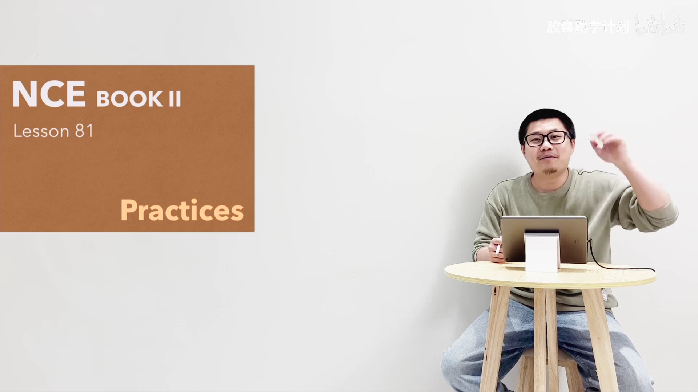

文字识别：NCE / BOOKII / Lesson 81 / Practices

### 画面 00:00:02

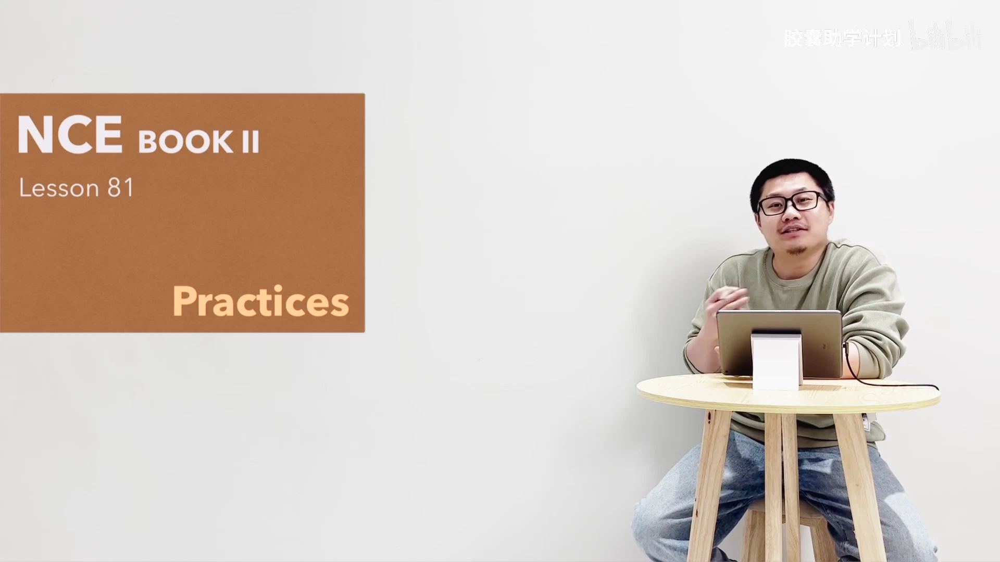

文字识别：NCE / BOOKII / Lesson 81 / Practices

### 画面 00:00:08

文字识别：进行如下练习唯一前提 / 文章跟读至熟读成诵 / 否则请勿开始

### 画面 00:00:17

文字识别： Bibii / 胶囊助学计划 / •

### 画面 00:00:21

文字识别：助字叶划園 / 囊助学计划 / 胶

### 画面 00:00:23

文字识别：Comprehension / 训练目标： / 听懂一般疑问句＆特殊疑问句

## 00:00:30–00:01:00

那我问您答，全是基于文章的来了。Who had killed the guard? Answer: The prisoner of war. Next one: Where did he drag the guard's body into the bushes? Was it dark? Yes, it was. Did the prisoner change his clothes? Yes, he did.

### 画面 00:00:32

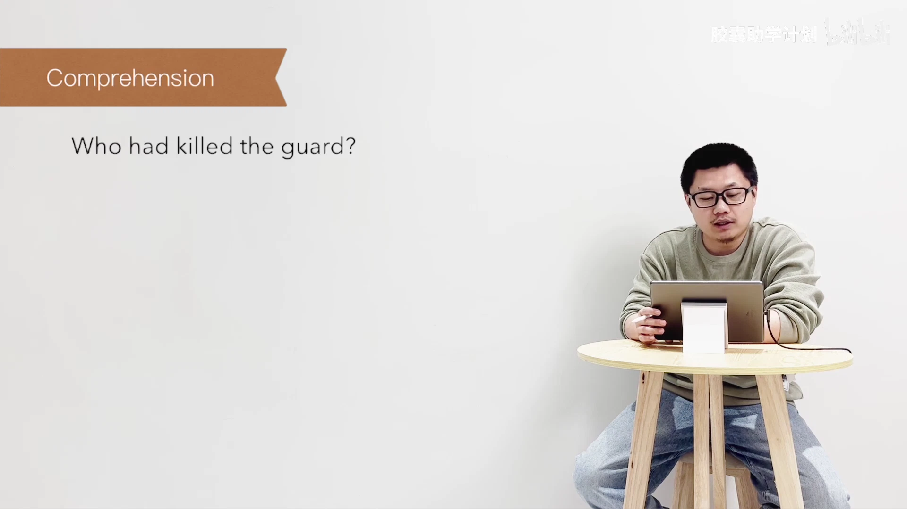

文字识别：Comprehension / Who had killed the guard?

## 00:01:00–00:01:30

Whose clothes did he change into? The guard's clothes. What was he now wearing? A blue uniform. Did he have a rifle? Yes, he did. Where did he march? Up and down in front of the camp.

### 画面 00:01:02

文字识别：Comprehension / Whose clothes did he change into?

## 00:01:30–00:02:00

What could he hear inside the camp? Shouting. Why were men running about inside? They had just discovered that a prisoner had escaped. What kind of car stopped just then at the camp gates? A large black car.

### 画面 00:01:32

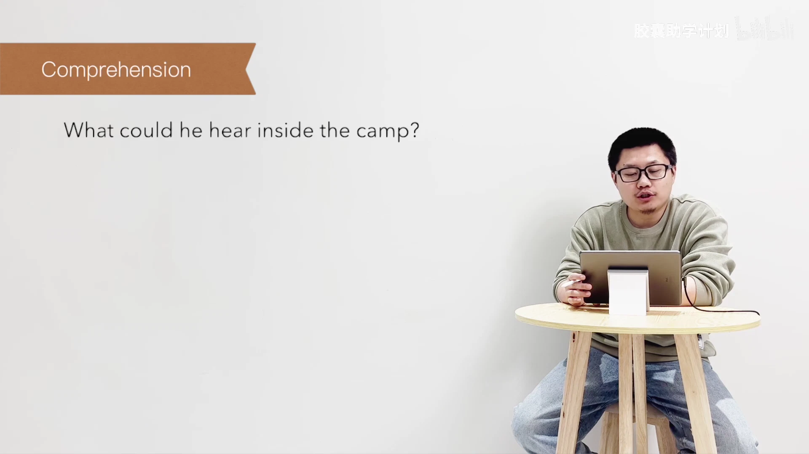

文字识别：Comprehension / What could he hear inside the camp?

### 画面 00:01:43

文字识别：Comprehension / Why were men running  / about inside? / They had just discovered that a prisoner had / escaped.

### 画面 00:01:50

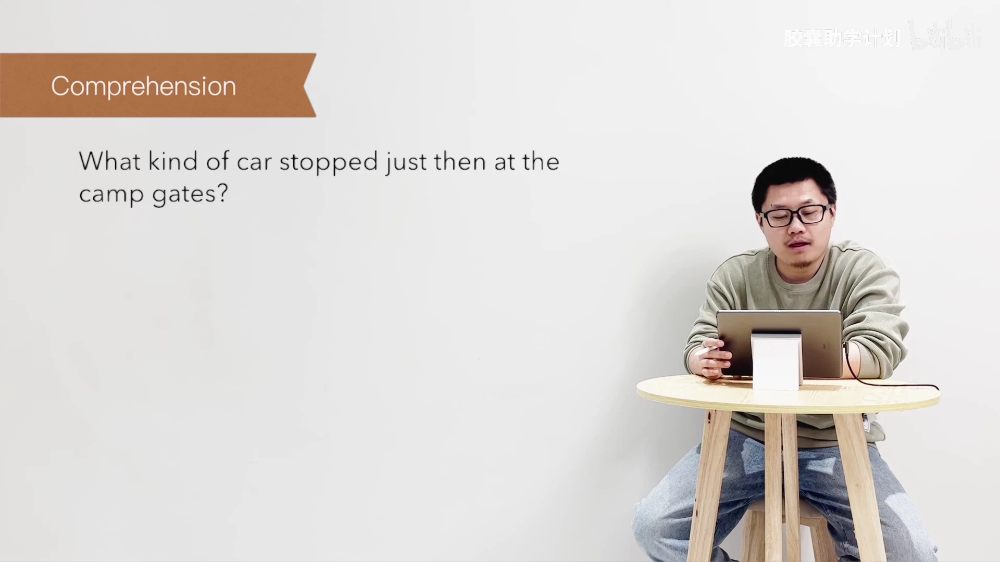

文字识别：Comprehension / What kind of car stopped just then at the / camp gates?

## 00:02:00–00:02:30

How many officers were inside it? Four. Did they get out? Yes, they did. What did the prisoner do as they passed? He stood to attention and saluted, asking questions. 四句型，第一个, ask me if the prisoner of war escaped from a camp.

### 画面 00:02:17

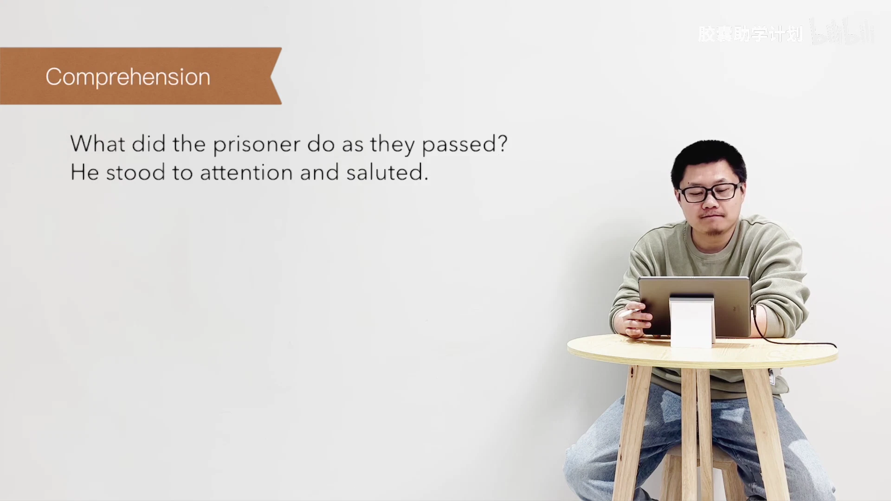

文字识别：Comprehension / What did the prisoner do as they passed? / He stood to attention and saluted.

### 画面 00:02:21

文字识别：Asking questions / 训练目标： / 会说一般疑问句＆特殊疑问句 / Accuracy / Fluency

### 画面 00:02:24

文字识别：臺助字计划 / Asking questions

### 画面 00:02:26

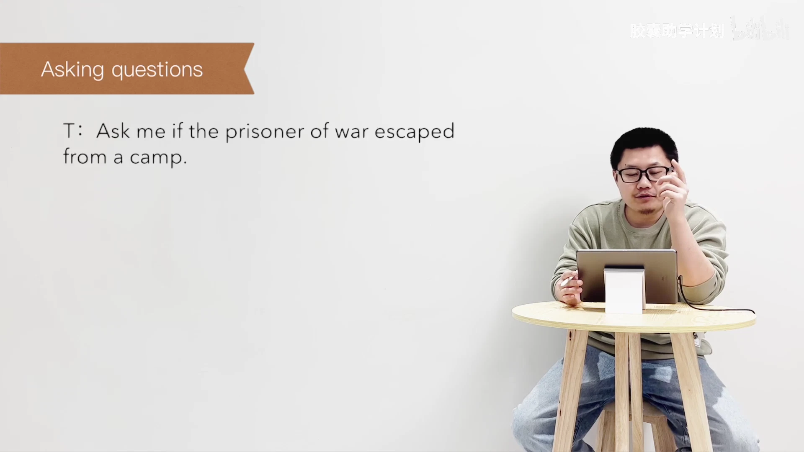

文字识别：Asking questions / T: Ask me if the prisoner of war escaped / from a camp.

## 00:02:30–00:03:00

一看 escape did 提前，动词换原形。Where they're they're from? 那肯定是对 camp 提问了，对吧？没什么可说的，直接替代就行了。呃，who 对主语提问？那你注意这个地方的主语不是 the prisoner 啊，是 the prisoner of war，要连到一起的啊，不用换一般疑问句了。答案直接就是 who escaped from a camp. 第二， he killed the guard. did 提前，动词换原形。Who？你可以对 he，也可以对 the guard。注意对谁提问变一般疑问句，对谁提

### 画面 00:02:31

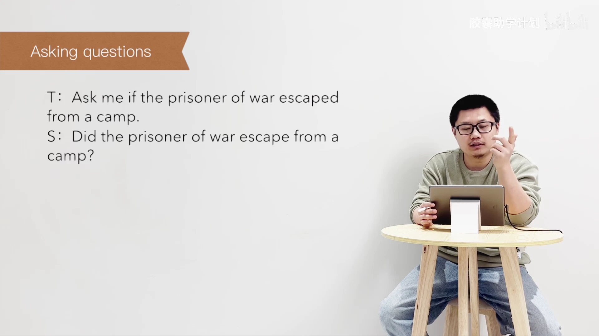

文字识别：Asking questions / T: Ask me if the prisoner of war escaped / from a camp. / S: Did the prisoner of war escape from a / camp?

### 画面 00:02:39

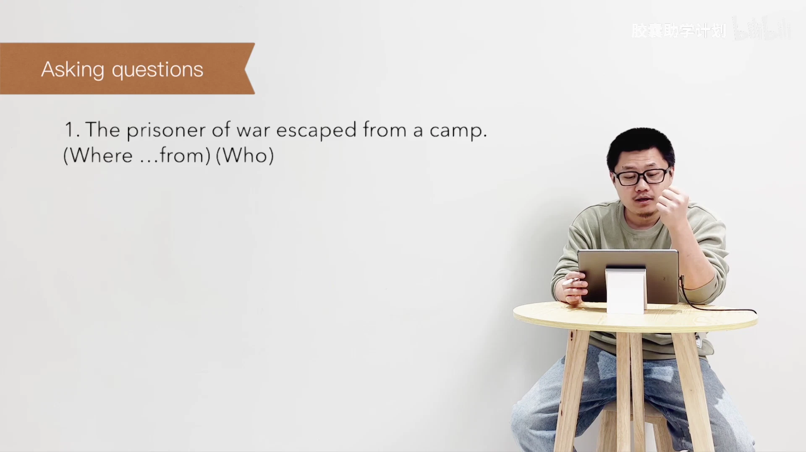

文字识别：Asking questions / 1.The prisoner of war escaped from a camp. / (Where ..from) (Who)

### 画面 00:02:45

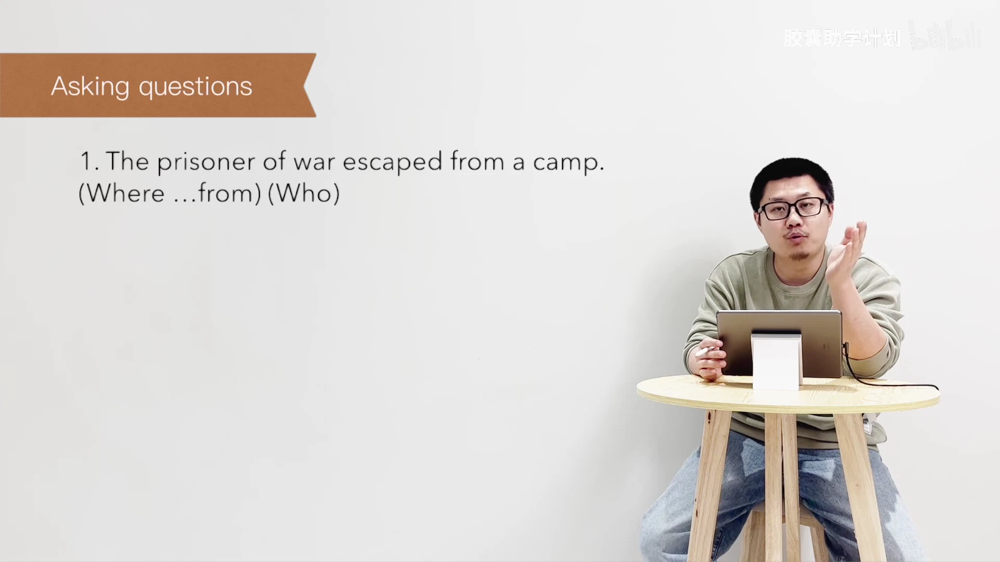

文字识别：Asking questions / 1.The prisoner of war escaped from a camp. / (Where ..from) (Who)

## 00:03:00–00:03:30

问不用变一般疑问句，这个要注意。He dragged him into the bushes. Did提前，Where into the bushes?提问。第四个，He worked rapidly. Did提前，How fast?对rapidly提问。He changed into the dead man's clothes. Did提前，What? What did he change into?对吧？Whose?那肯定是这个 dead man's，对吧？所以答案就是 whose clothes did he change into? Why?整句话。He was now dressed

### 画面 00:03:02

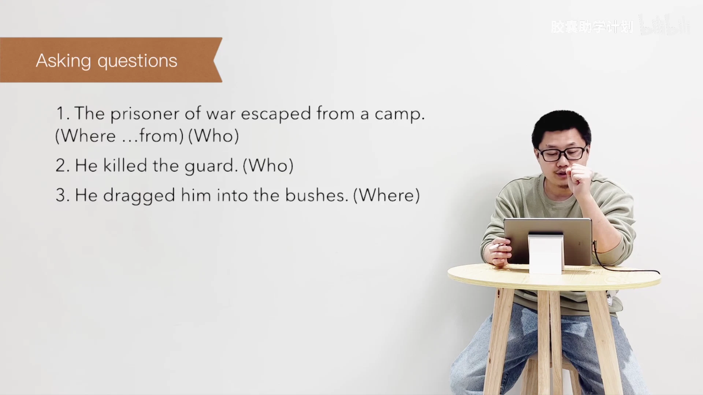

文字识别：Asking questions / 1.The prisoner of war escaped from a camp. / (Where ...from) (Who) / 2. He killed the guard.(Who) / 3. He dragged him into the bushes. (Where)

### 画面 00:03:04

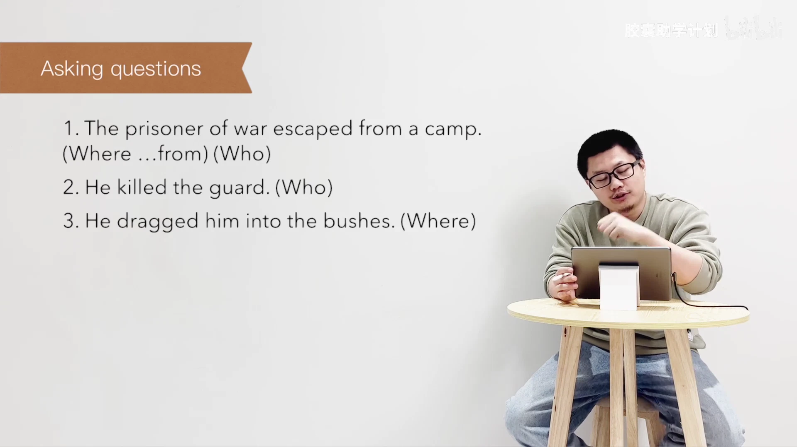

文字识别：Asking questions / 1.The prisoner of war escaped from a camp. / (Where ...from) (Who) / 2. He killed the guard.(Who) / 3. He dragged him into the bushes. (Where)

### 画面 00:03:06

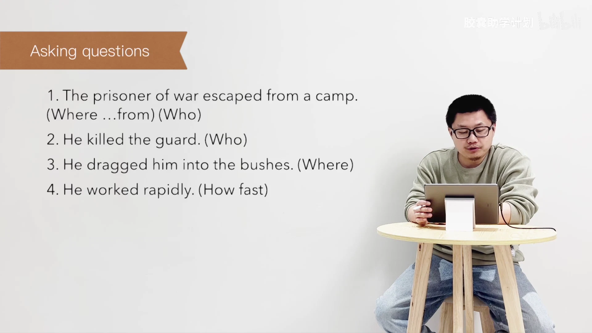

文字识别：Asking questions / 1.The prisoner of war escaped from a camp. / (Where ...from) (Who) / 2. He killed the guard. (Who) / 3. He dragged him into the bushes. (Where) / 4. He worked rapidly. (How fast)

### 画面 00:03:11

文字识别：助字计划 / Asking questions

### 画面 00:03:28

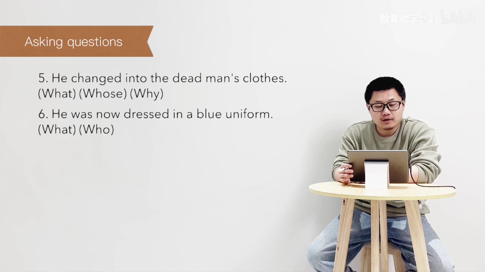

文字识别：Asking questions / 5. He changed into the dead man's clothes. / (What) (Whose)(Why) / 6. He was now dressed in a blue uniform. / (What)(Who)

## 00:03:30–00:04:00

in a blue uniform. Was提前What对a blue uniform提问Who对主语提问He put a rifle over his shoulder. 注意这里的put不是动词原形，而是过去式，所以是did提前，动词换回原形。只不过它原形跟过去式长得一样，所以答案就是Did he put a rifle over his shoulder? 那What就是对a rifle提问。He marched boldly up and down in front of the camp. Did提前

### 画面 00:03:53

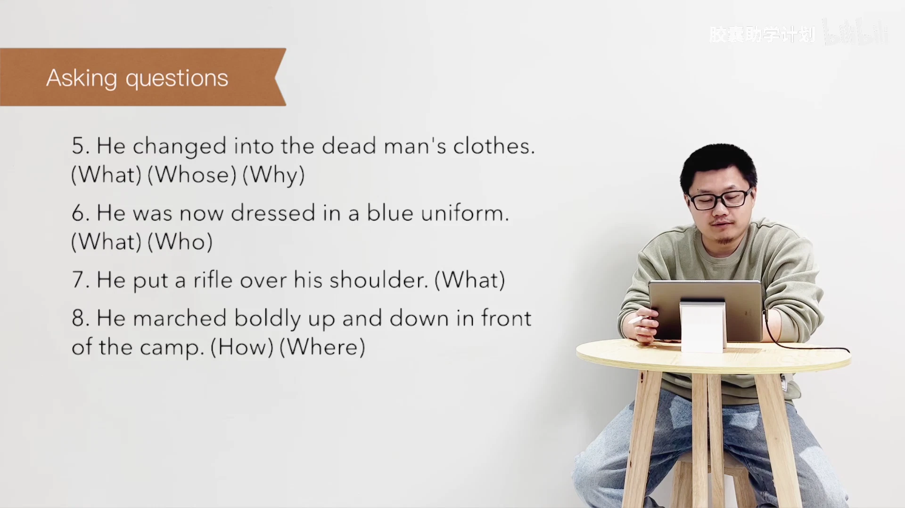

文字识别：Asking questions / 5. He changed into the dead man's clothes. / (What) (Whose)(Why) / 6. He was now dressed in a blue uniform. / (What)(Who) / 7. He put a rifle over his shoulder. (What) / 8. He marched boldly up and down in front / of the camp.(How) (Where)

## 00:04:00–00:04:30

how对boldly提问, where对up and down啊, where对in front of the camp提问,对吧啊, where did he march boldly up and down啊,或者你直接就说我觉得可以这样,甚至直接就说where did he march boldly啊,答案叫up and down in front of the camp. He could hear shouting in the camp itself. What提前,对吧,那what对shouting提问, what could he hear in the camp itself.

### 画面 00:04:23

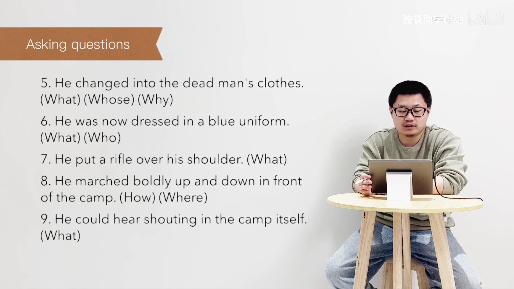

文字识别：Asking questions / 5. He changed into the dead man's clothes. / (What) (Whose)(Why) / 6. He was now dressed in a blue uniform. / (What)(Who) / 7. He put a rifle over his shoulder.(What) / 8. He marched boldly up and down in front / of the camp.(How) (Where) / 9. He could hear shouting in the camp itself. / (What)

## 00:04:30–00:05:00

tell the story. 不多说了，只注意一个点，就是 fluency，一定要有 fluency，可以错一点点，不能过于的慢，变成背文章啊。好，呃，summary writing，还是提醒，一共有两篇，这两篇用的连词不一样，而这是大面积提升我们写作水平的部分，一定要认真去处理，认真对待啊。第一个，第二个，写完来这对答案，不多说啊。然后呢，topic for

### 画面 00:04:30

文字识别：臺助字计划 / Tell the story / 训练目标： / 口语复述能力 / Accuracy / Fluency

### 画面 00:04:37

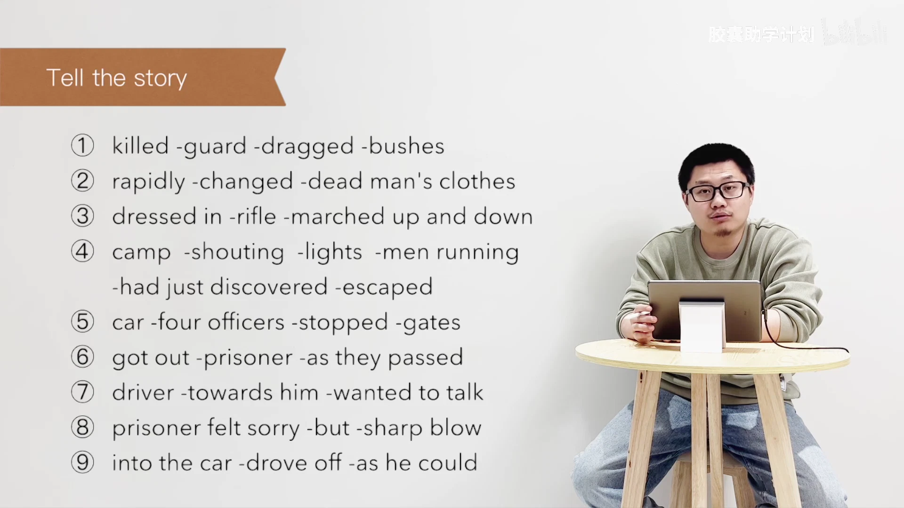

文字识别：Tell the story / killed -guard -dragged -bushes / 1 / rapidly -changed -dead man's clothes / dressed in -rifle -marched up and down / camp -shouting -lights -men running / 4 / -had just discovered -escaped / ) car -four officers -stopped -gates / 5 / 6 /  got out -prisoner -as they passed / driver -towards him -wanted to talk /  prisoner felt sorry -but -sharp blow / 8 / ⑨ into the car -drove off -as he could

### 画面 00:04:40

文字识别：Summary writing: Key / 训练目标： / 写作复述能力

### 画面 00:04:42

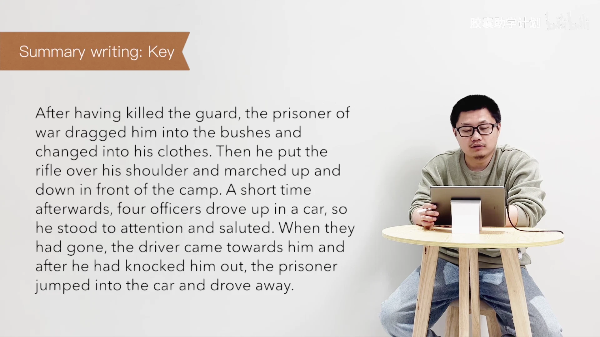

文字识别：助学计划 / Summary writing: Key / After having killed the guard, the prisoner of / war dragged him into the bushes and / changed into his clothes. Then he put the / rifle over his shoulder and marched up and / down in front of the camp. A short time / afterwards, four officers drove up in a car, so / he stood to attention and saluted. When they / had gone, the driver came towards him and / after he had knocked him out, the prisoner / jumped into the car and drove away.

### 画面 00:04:55

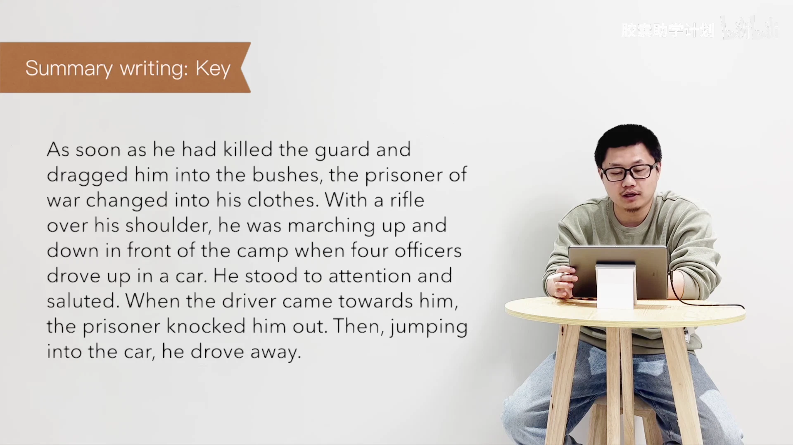

文字识别：助学计划 / Summary writing: Key / As soon as he had killed the guard and / dragged him into the bushes, the prisoner of / war changed into his clothes. With a rifle / over his shoulder, he was marching up and / down in front of the camp when four officers / drove up in a car. He stood to attention and / saluted. When the driver came towards him, / the prisoner knocked him out. Then, jumping / into the car, he drove away.

### 画面 00:04:58

文字识别：Topics for discussion / 训练目标： / 完全自由的对话 / Accuracy / Fluency

## 00:05:00–00:05:30

discussion, 完全自由的对话。我们现在还是只过一遍。Do you know any good escape stories? Tell us one.你们知不知道特别好的关于逃脱的故事？我们讲一个啊，直接推荐一个电影《肖申克的救赎》（Shawshank Redemption）。有空看一下就行了，是吧？IMDB常年排名第一，是吧？Was the prisoner in the story guilty of murder? Why? Why not?说这个在这个故事当中的这个

### 画面 00:05:01

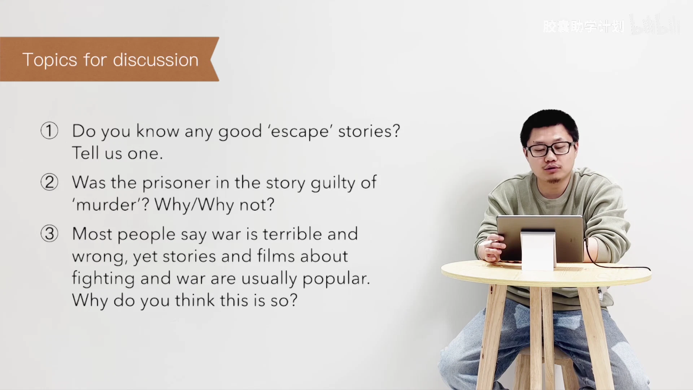

文字识别：Topics for discussion / Do you know any good 'escape'stories? / Tell us one. / Was the prisoner in the story guilty of / 'murder'? Why/Why not? / Most people say war is terrible and / wrong, yet stories and films about / fighting and war are usually popular. / Why do you think this is so?

## 00:05:30–00:06:00

战俘啊，他有没有谋杀罪呀？他杀了人，他算不算谋杀罪呀？你认为算？为啥算？不算？为啥不算？对吧？第三个说，Most people say war is terrible and wrong. Yet stories and films about fighting and war are usually popular. Why do you think this is so?说大多数人说战争啊很糟糕，也是不对的，但是故事和电影却经常描述这些场景。那

### 画面 00:05:31

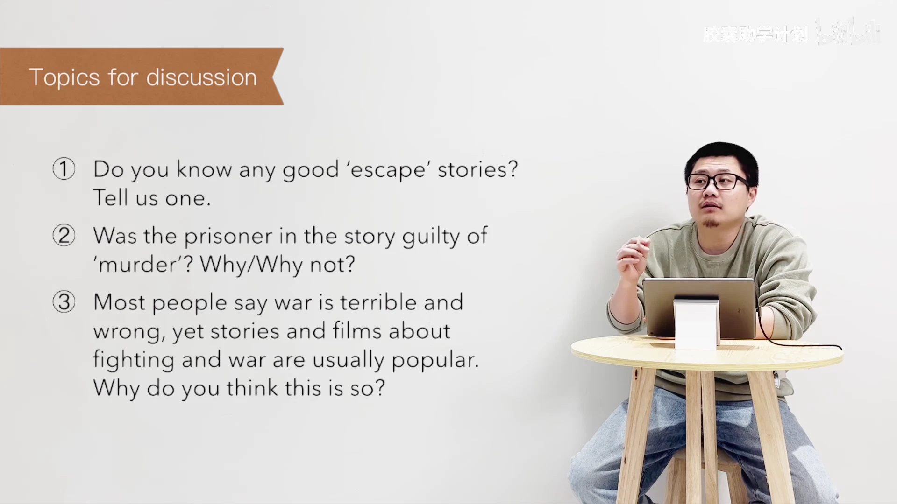

文字识别：Topics for discussion / Do you know any good 'escape' stories? / Tell us one. / Was the prisoner in the story guilty of / 'murder'? Why/Why not? / Most people say war is terrible and / 3 / wrong, yet stories and films about / fighting and war are usually popular. / Why do you think this is so?

## 00:06:00–00:06:30

你认为为什么是这样的？你看，这是一个特别好的，一听上去就是一个社会学或者心理学可能可以研究的一个话题，对吧？甚至可以直接就是一篇论文，围绕着这个思路。OK，那不多说了。呃，家庭作业：Ask if先写再朗读，只要写做记注有两篇，重点看连词，不写都行，但你一定要看连词。Tell the story进行口语复述，重复间隔。哎，这个置顶留言找重复间隔的学习材料。

### 画面 00:06:01

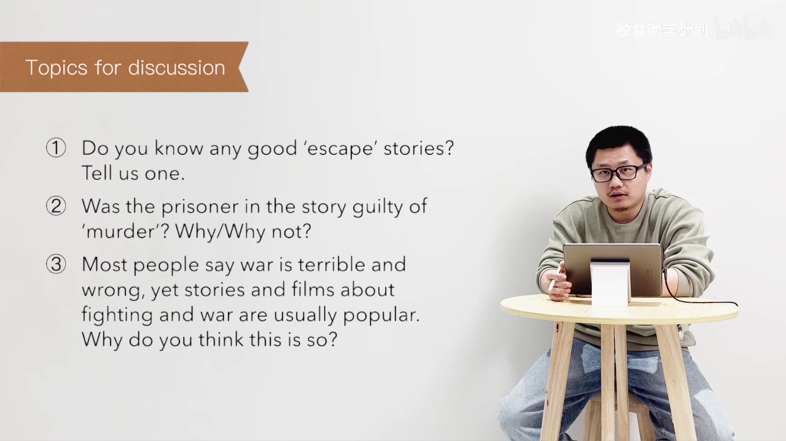

文字识别：Topics for discussion / Do you know any good 'escape'stories? / Tell us one. / Was the prisoner in the story guilty of / 'murder'? Why/Why not? / Most people say war is terrible and / wrong, yet stories and films about / fighting and war are usually popular. / Why do you think this is so?

### 画面 00:06:04

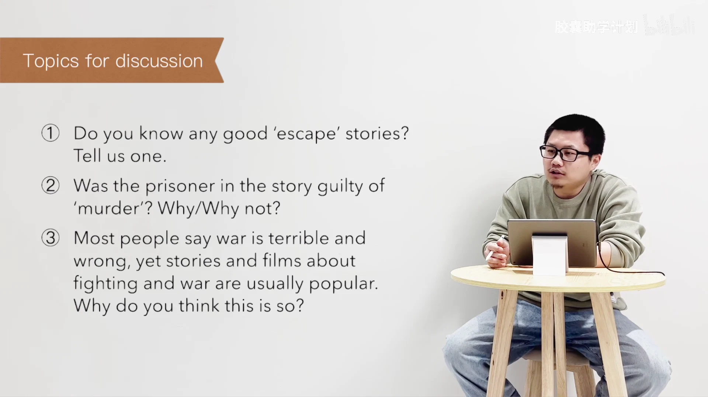

文字识别：Topics for discussion / Do you know any good 'escape'stories? / Tell us one. / Was the prisoner in the story guilty of / 'murder'? Why/Why not? / Most people say war is terrible and / wrong, yet stories and films about / fighting and war are usually popular. / Why do you think this is so?

### 画面 00:06:07

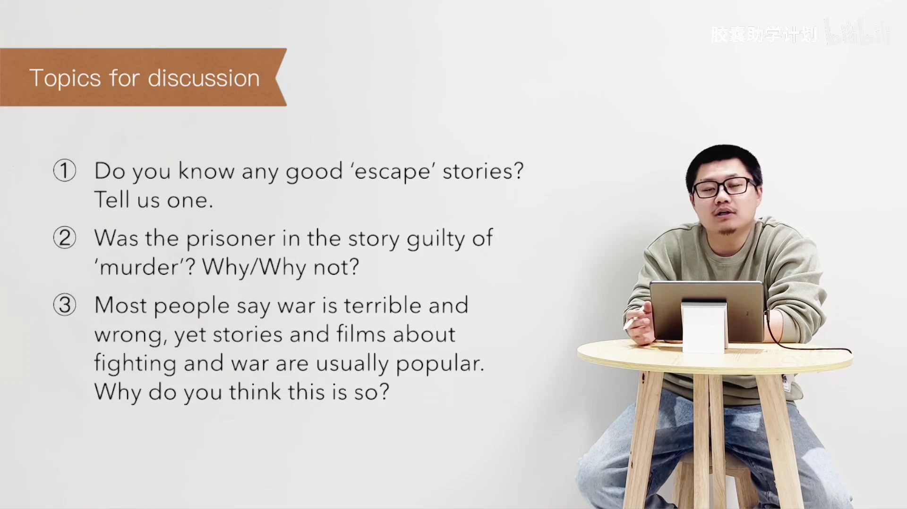

文字识别：Topics for discussion / Do you know any good 'escape'stories? / Tell us one. / Was the prisoner in the story guilty of / 'murder'? Why/Why not? / Most people say war is terrible and / wrong, yet stories and films about / fighting and war are usually popular. / Why do you think this is so?

### 画面 00:06:14

文字识别：毫助学计划

### 画面 00:06:16

文字识别：1. / Ask meif写&朗读 / 2. / 摘要写作写&答案

### 画面 00:06:18

文字识别：臺助学计划 / 1. / Ask meif写&朗读 / 2.摘要写作写&答案

### 画面 00:06:20

文字识别：喜助字计划園 / 1.Ask me if写&朗读 / 摘要写作写&答案 / 3.Tell the story 口语复述

### 画面 00:06:24

文字识别：妻助字计划 / 1.Ask me if写&朗读 / 2.摘要写作写&答案 / 3.Tell the story 口语复述 / 4.重复间隔（置顶留言)

### 画面 00:06:26

文字识别：1.Ask me if写&朗读 / 2.摘要写作写&答案 / 3.Tell the story 口语复述 / 4.重复间隔（置顶留言)

### 画面 00:06:29

文字识别：奏助字计划一

## 00:06:30–00:06:55

那以上呢就是本期视频的全部内容了。如果各位喜欢我们的课程呢，欢迎各位关注、订阅、一键三连，分享给那些需要的朋友，来帮助我们快速成长。See you next time.

### 画面 00:06:31

文字识别：囊助字计划一调 / ￥

### 画面 00:06:34

文字识别：奏助字计划一调 / 🌟

### 画面 00:06:42

文字识别：助字计划一

### 画面 00:06:44

文字识别：運聖動字計切 / CAPSULEACADEMY / 胶囊助学计划 / 小红书 / Lecturer / Leo / OE

### 画面 00:06:47

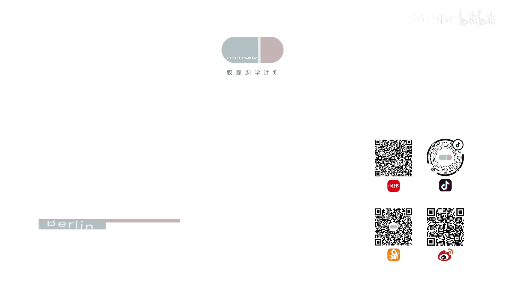

文字识别：CAPSULEACADEMY / 胶囊助学计划 / 小红书 / Berlin

### 画面 00:06:50

文字识别：CAPSULEACADEMY / 胶囊助学计划 / 小红书 / Creator / Leo & Berlin / OE

### 画面 00:06:52

文字识别：胶囊助学计划 / CAPSULEACADEMY / 胶囊助学计划 / 小红书 / OE

### 画面 00:06:54

文字识别：bilibili / 胶囊助学计划

