# 082 单词

快速机器解析：语音为单模型转写，未进行独立交叉校对或人工复核；画面每秒采样并按变化选帧，短时文字和标记可能遗漏。截图时间约有 1 秒误差。图片有损压缩；遇到疑点请按时间查看 Google Drive 原视频。

## 00:00:00–00:00:30

Hello everyone, welcome to Capsule Academy. This is Leo. Today we're going to learn New Concept English Book Two Lesson 82 words. 那老习惯进入正式课程之前，咱们先看一个问题，如何表达光辉榜样啊，就是一个特别好的 example 啊，好的榜样，你是别人的好榜样，怎么用英文表达呢？ Hope you guys enjoy. 好，我们看本课的生词。本课生词并不多。我们老习惯一边学这

### 画面 00:00:00

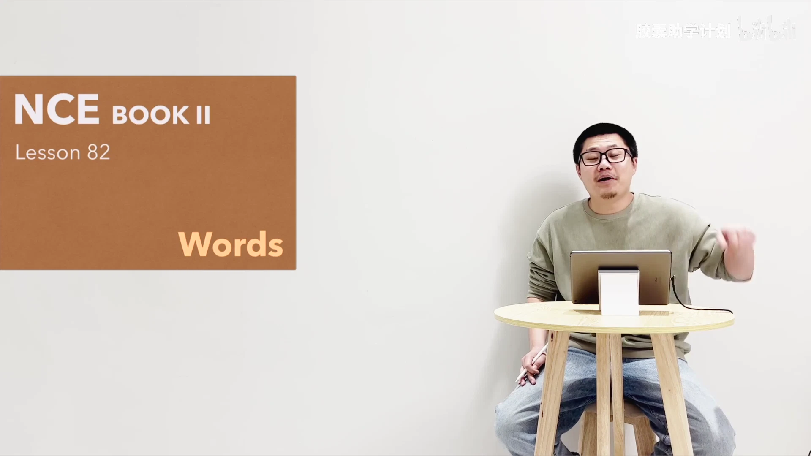

文字识别：NCE / BOOKⅡI / Lesson 82 / Words

### 画面 00:00:02

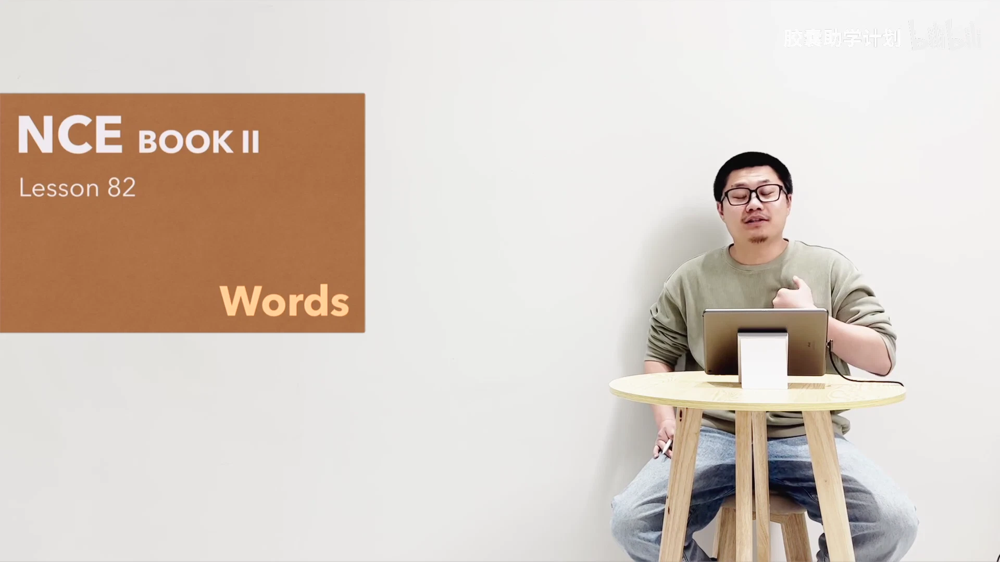

文字识别：NCE / BOOKII / Lesson 82 / Words

### 画面 00:00:05

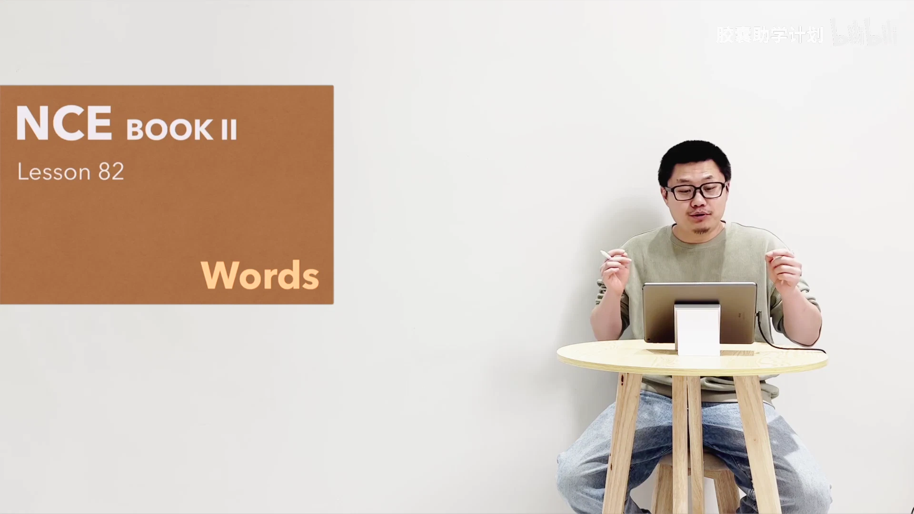

文字识别：NCE / BOOKII / Lesson 82 / Words

### 画面 00:00:10

文字识别：幸助学计划一州 / 洋”？

### 画面 00:00:12

文字识别：①如何表达“光辉榜样”？

### 画面 00:00:20

文字识别： bitbli / 胶囊助学计划 / •

### 画面 00:00:24

文字识别：胶囊助学计划 / 胶囊助学计划

### 画面 00:00:26

文字识别：单词造句指南 / 网：v.+v.变化 / 喜助字计划 / 四句型转换 / 方式/地点/时间 / 结合习惯用法 / 其他单词+词性 / 原文摘抄+变 / 6123456 / /'mpnsta/ / monster n.

### 画面 00:00:29

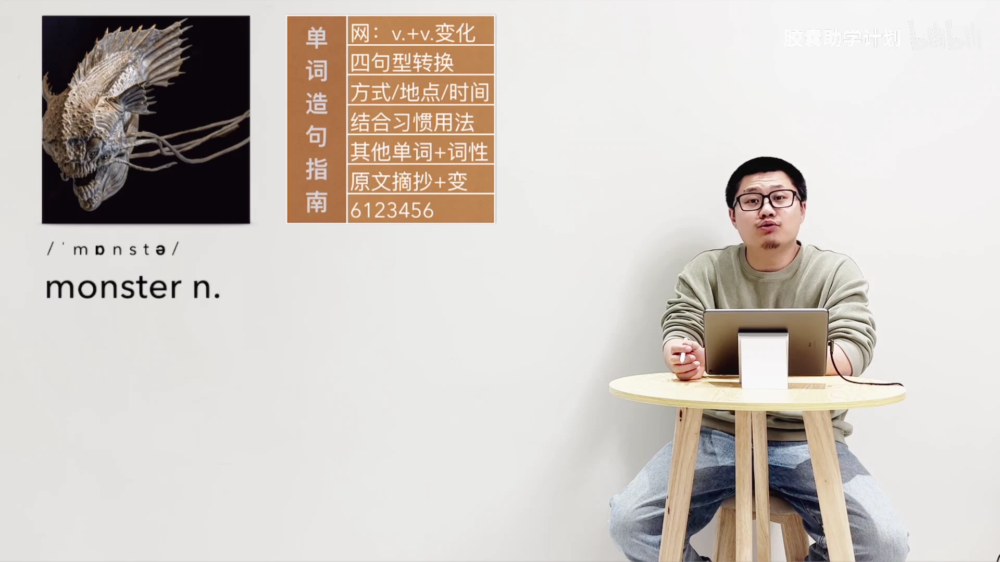

文字识别：单词造句指南 / 网：v.+v.变化 / 菱助学计划園 / 四句型转换 / 方式/地点/时间 / 结合习惯用法 / 其他单词+词性 / 原文摘抄+变 / 6123456 / /'mpnsta/ / monster n.

## 00:00:30–00:01:00

生词，一边去复习之前的内容。看第一个单词叫做 monster，monster，monster。首先有它最基本的意思就是怪物，对吧？那它也可以用来说人啊，比如说 you are a monster，你这个怪物。OK，好，那首先我们用它最基本的含义去造一个句子，叫做 the child insisted on seeing the monster standing in the yard，说这个孩子坚持他看到了一个怪

### 画面 00:00:32

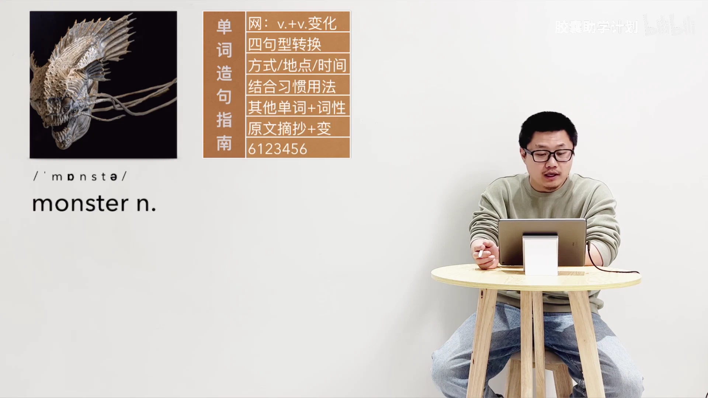

文字识别：单词造句指南 / 网：v.+v.变化 / 霆助学计划 / 四句型转换 / 方式/地点/时间 / 结合习惯用法 / 其他单词+词性 / 原文摘抄+变 / 6123456 / /'mpnsta/ / monster n.

### 画面 00:00:36

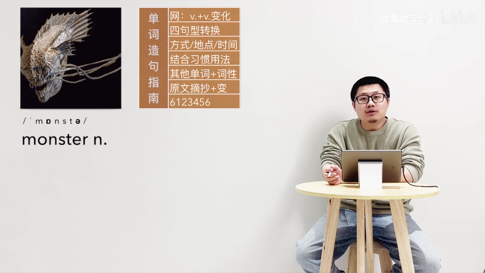

文字识别：单词造句指南 / 网：v.+v.变化 / 辜助字计划 / 四句型转换 / 方式/地点/时间 / 结合习惯用法 / 其他单词+词性 / 原文摘抄+变 / 6123456 / /'mpnsta/ / monster n.

### 画面 00:00:38

文字识别：单词造句指南 / 网：v.+v.变化 / 喜助字计划 / 四句型转换 / 方式/地点/时间 / 结合习惯用法 / 其他单词+词性 / 原文摘抄+变 / 6123456 / /'mpnsta/ / monster n.

### 画面 00:00:40

文字识别：单词造句指南 / 网：v.+v.变化 / 喜助学计划一 / 四句型转换 / 方式/地点/时间 / 结合习惯用法 / 其他单词+词性 / 原文摘抄+变 / 6123456 / /'mpnsta/ / monster n.

### 画面 00:00:44

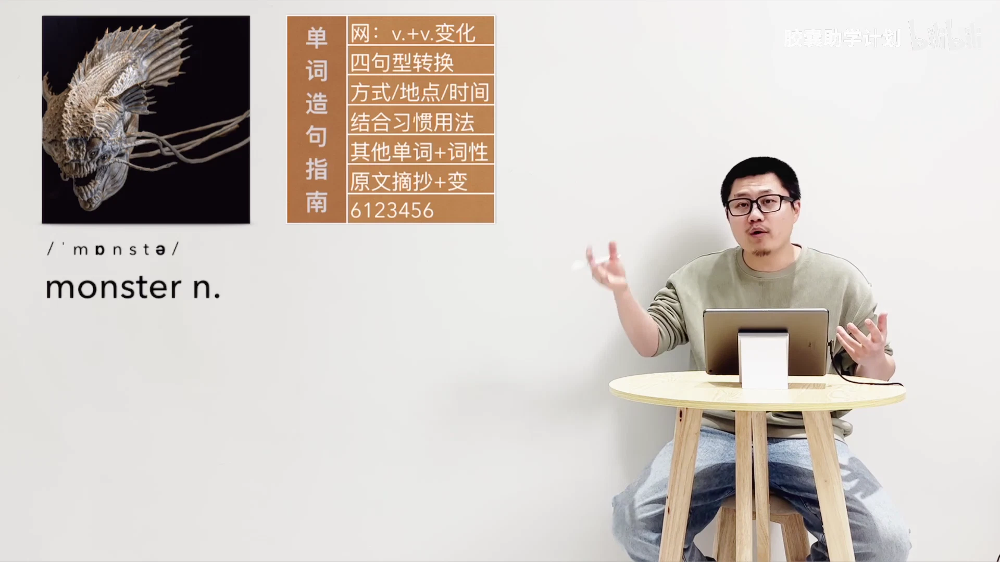

文字识别：单词造句指南 / 网：v.+v.变化 / 妻助字计划 / 四句型转换 / 方式/地点/时间 / 结合习惯用法 / 其他单词+词性 / 原文摘抄+变 / 6123456 / /'mpnsta/ / monster n.

### 画面 00:00:46

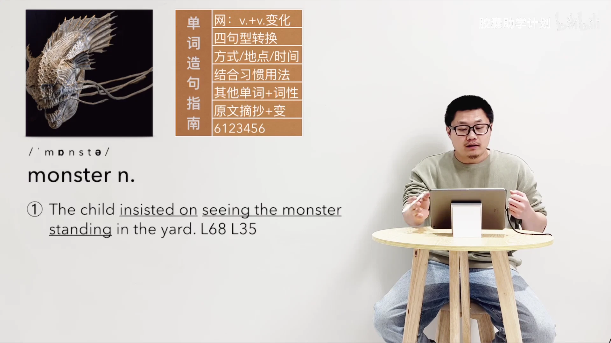

文字识别：单词造句指南 / 网：v.+v.变化 / 妻助学计划 / 四句型转换 / 方式/地点/时间 / 结合习惯用法 / 其他单词+词性 / 原文摘抄+变 / 6123456 / /'mpnsta/ / monster n. / ① The child insisted on seeing the monster / standing in the yard. L68 L35

### 画面 00:00:50

文字识别：单词造句指南 / 网：v.+v.变化 / 学计划 / 四句型转换 / 方式/地点/时间 / 结合习惯用法 / 其他单词+词性 / 原文摘抄+变 / 6123456 / /'mDnsta/ / monster n. / ① The child insisted on seeing the monster / standing in the yard. L68 L35

### 画面 00:00:55

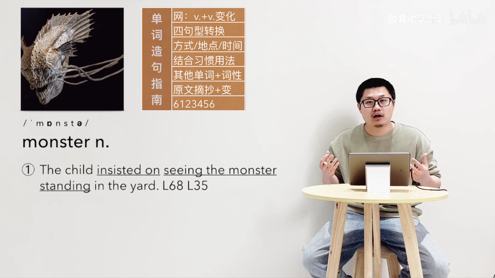

文字识别：单词造句指南 / 网：v.+v.变化 / 臺助字计划 / 四句型转换 / 方式/地点/时间 / 结合习惯用法 / 其他单词+词性 / 原文摘抄+变 / 6123456 / /'mpnsta/ / monster n. /  The child insisted on seeing the monster / standing in the yard. L68 L35

## 00:01:00–00:01:30

物正站在这个院子里面。OK，这里其实用到了两个习惯用法，第一个 insist on doing something，第二个叫 see somebody or someone doing something，对吧？OK， next one，下一个单词，你看这就变成了说人了。说 You are such a monster that no one wants to play with you。说你呀就是个怪物，以至于就没有人愿意和你玩，对吧？OK， next one，说

### 画面 00:01:02

文字识别：单词造句指南 / 网：v.+v.变化 / 四句型转换 / 方式/地点/时间 / 结合习惯用法 / 其他单词+词性 / 原文摘抄+变 / 6123456 / / 'mDnsta / / monster n. /  The child insisted on seeing the monster / standing in the yard. L68 L35

### 画面 00:01:05

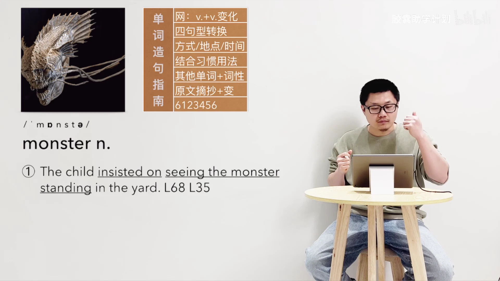

文字识别：单词造句指南 / 网：v.+v.变化 / 四句型转换 / 方式/地点/时间 / 结合习惯用法 / 其他单词+词性 / 原文摘抄+变 / 6123456 / /'mpnsta / / monster n. / ① The child insisted on seeing the monster / standing in the yard. L68 L35

### 画面 00:01:14

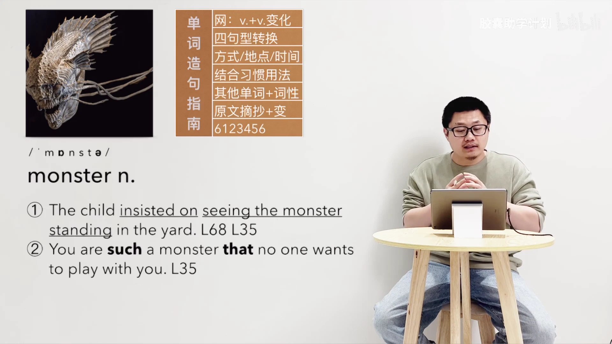

文字识别：单词造句指南 / 网：v.+v.变化 / 学计划 / 四句型转换 / 方式/地点/时间 / 结合习惯用法 / 其他单词+词性 / 原文摘抄+变 / 6123456 / /'mpnsta/ / monster n. / ① The child insisted on seeing the monster / standing in the yard. L68 L35 / ) You are such a monster that no one wants / to play with you. L35

### 画面 00:01:20

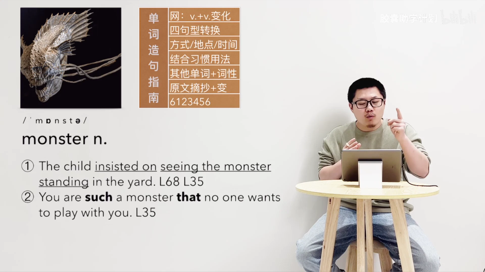

文字识别：单词造句指南 / 网：v.+v.变化 / 学计划 / 四句型转换 / 方式/地点/时间 / 结合习惯用法 / 其他单词+词性 / 原文摘抄+变 / 6123456 / /'mpnsta/ / monster n. / ① The child insisted on seeing the monster / standing in the yard. L68 L35 / ) You are such a monster that no one wants / to play with you. L35

## 00:01:30–00:02:00

this little monster here is my private collection. Say this little monster,哎，就这个小玩意儿，是我的私人收藏。Okay, one more. That read again this word monster. That we listen a word with emotion. Say human, say you this monster. English how to say? You are a monster. You are a monster, right? Okay, hope you remember. Next word sailor.

### 画面 00:01:30

文字识别：单词造句指南 / 网：v.+v.变化 / 四句型转换 / 方式/地点/时间 / 结合习惯用法 / 其他单词+词性 / 原文摘抄+变 / 6123456 / /'mpnsta/ / monster n. / ① The child insisted on seeing the monster / standing in the yard. L68 L35 / ) You are such a monster that no one wants / to play with you. L35 / This little monster here is my private / collection. L48

### 画面 00:01:43

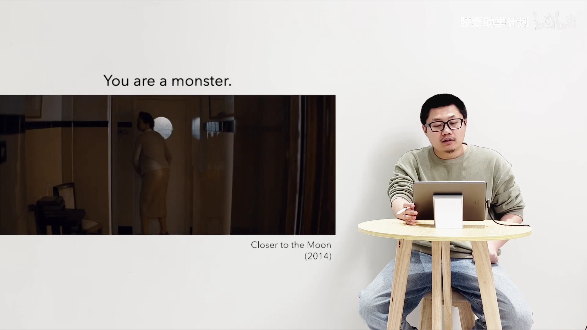

文字识别：臺助学计划 / You are a monster. / Closer to the Moon / (2014)

### 画面 00:01:52

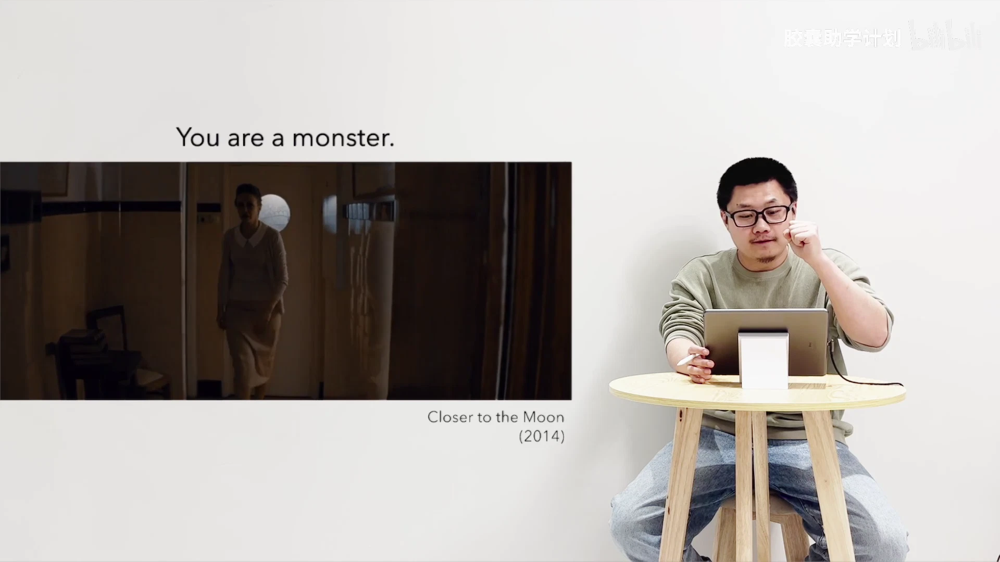

文字识别：You are a monster. / Closer to the Moon / (2014)

### 画面 00:01:54

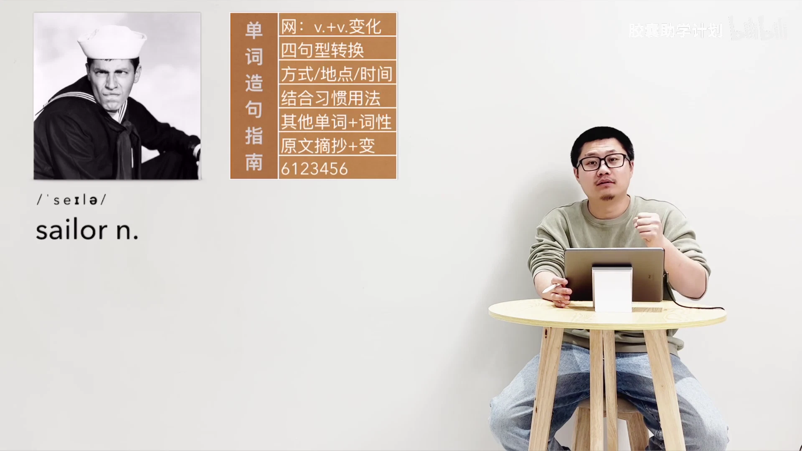

文字识别：单词造句指南 / 网：v.+v.变化 / 嘉助字计划 / 四句型转换 / 方式/地点/时间 / 结合习惯用法 / 其他单词+词性 / 原文摘抄+变 / 6123456 / /'seila/ / sailor n.

### 画面 00:01:57

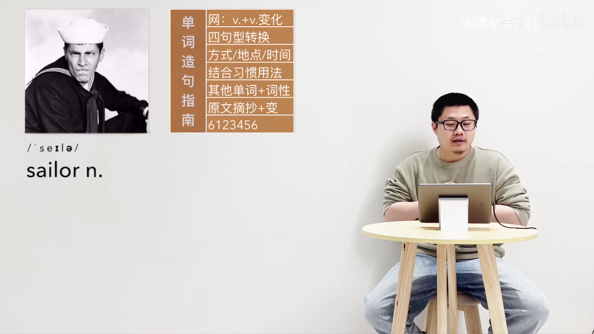

文字识别：单词造句指南 / 网：v.+v.变化 / 囊助字计划陽 / 四句型转换 / 方式/地点/时间 / 结合习惯用法 / 其他单词+词性 / 原文摘抄+变 / 6123456 / /'seila/ / sailor n.

## 00:02:00–00:02:30

啊 sailor就是我们指的水手啊。咱们之前咱们学过水手的老大是吧？Captain，今天你见到了老大的小弟啊，sailor. Very good. 那我们拿它造句子，其实就比较容易了，因为它是个名词，又是个人。其实Captain当年造的所有句子，你把Captain换成sailor，大多数都是适用的，对吧？那我随便造一些句子，比如说 tired of working on a ship, the sailor fired his boss. 这句话造的时

### 画面 00:02:03

文字识别：单词造句指南 / 网：v.+v.变化 / 卖助学计划！ / 四句型转换 / 方式/地点/时间 / 结合习惯用法 / 其他单词+词性 / 原文摘抄+变 / 6123456 / /'seila/ / sailor n.

### 画面 00:02:11

文字识别：单词造句指南 / 网：v.+v.变化 / 襄助学计划 / 四句型转换 / 方式/地点/时间 / 结合习惯用法 / 其他单词+词性 / 原文摘抄+变 / 6123456 / /'seila/ / sailor n. / ① Tired of working on a ship, the sailor fired / his boss. L49

### 画面 00:02:21

文字识别：单词造句指南 / 网：v.+v.变化 / 字计划 / 四句型转换 / 方式/地点/时间 / 结合习惯用法 / 其他单词+词性 / 原文摘抄+变 / 6123456 / /'seila/ / sailor n. / ① Tired of working on a ship, the sailor fired / his boss. L49

### 画面 00:02:26

文字识别：单词造句指南 / 网：v.+v.变化 / 四句型转换 / 方式/地点/时间 / 结合习惯用法 / 其他单词+词性 / 原文摘抄+变 / 6123456 / /'seila/ / sailor n. / ) Tired of working on a ship, the sailor fired / his boss. L49

## 00:02:30–00:03:00

候取了一点巧。首先，四十九课tired of sleeping on the floor.那我这儿说的是tired of working on the ship.说厌倦于了在这个船上工作怎么样了呢？这个水手就把他老板给开除了。什么意思？就我不干了，对吧？你不用你开除我，我自己把自己开除了。Okay, next one. The sailor decided to go on a diet.我要减减肥。Next one.说The sailor's brother went to college last year.说这

### 画面 00:02:30

文字识别：单词造句指南 / 网：v.+v.变化 / 四句型转换 / 方式/地点/时间 / 结合习惯用法 / 其他单词+词性 / 原文摘抄+变 / 6123456 / /'seila/ / sailor n. / ) Tired of working on a ship, the sailor fired / his boss. L49

### 画面 00:02:43

文字识别：单词造句指南 / 网：v.+v.变化 / 四句型转换 / 方式/地点/时间 / 结合习惯用法 / 其他单词+词性 / 原文摘抄+变 / 6123456 / /'seila/ / sailor n. /  Tired of working on a ship, the sailor fired / 1 / his boss. L49

### 画面 00:02:45

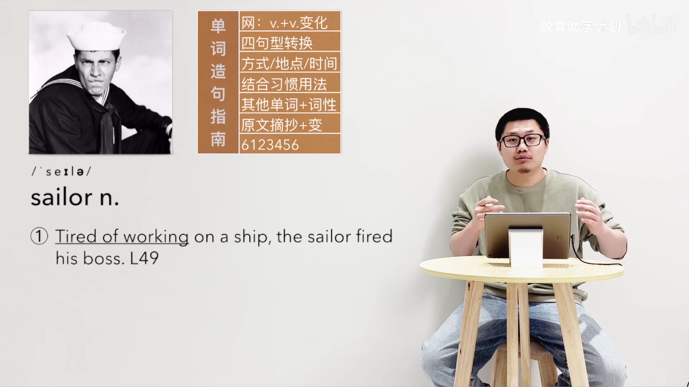

文字识别：单词造句指南 / 网：v.+v.变化 / 四句型转换 / 方式/地点/时间 / 结合习惯用法 / 其他单词+词性 / 原文摘抄+变 / 6123456 / /'seilal / sailor n. / ) Tired of working on a ship, the sailor fired / his boss. L49

### 画面 00:02:50

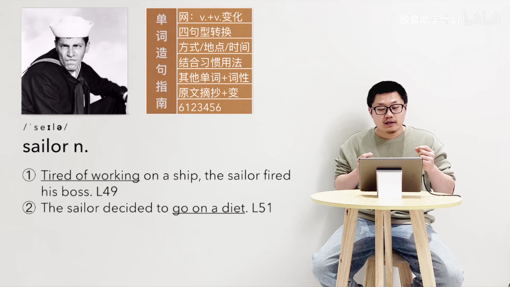

文字识别：单词造句指南 / 网：v.+v.变化 / 四句型转换 / 方式/地点/时间 / 结合习惯用法 / 其他单词+词性 / 原文摘抄+变 / 6123456 / /'seilal / sailor n. / ① Tired of working on a ship, the sailor fired / his boss. L49 / The sailor decided to go on a diet. L51

### 画面 00:02:55

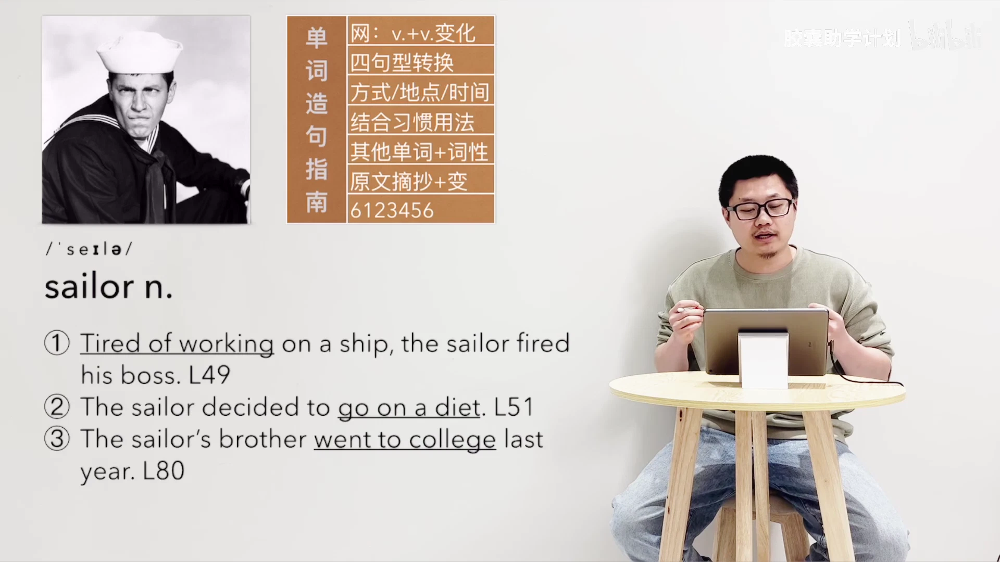

文字识别：单词造句指南 / 网：v.+v.变化 / 四句型转换 / 方式/地点/时间 / 结合习惯用法 / 其他单词+词性 / 原文摘抄+变 / 6123456 / /'seilal / sailor n. / ① Tired of working on a ship, the sailor fired / his boss. L49 / The sailor decided to go on a diet. L51 / The sailor's brother went to college last / year. L80

## 00:03:00–00:03:30

his brother how did he do? He went to college last year. You see, this is a, uh, such a sentence is very typical. We can do some four-sentence conversion, but here I won't do it. Please pause the screen and do it yourself. This exercise we need to do all the time, all the time, until the whole new three is over. OK, next one, the next word with me to read is sight. Sight. Pay attention, it is a verb. It means to see. Hey, observe to see. OK, of course, it doesn't have see or look.

### 画面 00:03:13

文字识别：单词造句指南 / 网：v.+v.变化 / 四句型转换 / 方式/地点/时间 / 结合习惯用法 / 其他单词+词性 / 原文摘抄+变 / 6123456 / /'seila/ / sailor n. / ① Tired of working on a ship, the sailor fired / his boss. L49 / The sailor decided to go on a diet. L51 / The sailor's brother went to college last / year. L80

### 画面 00:03:15

文字识别：单词造句指南 / 网：v.+v.变化 / 计划 / 四句型转换 / 方式/地点/时间 / 结合习惯用法 / 其他单词+词性 / 原文摘抄+变 / 6123456 / /'seila/ / sailor n. / ① Tired of working on a ship, the sailor fired / his boss. L49 / The sailor decided to go on a diet. L51 / The sailor's brother went to college last / year. L80

### 画面 00:03:18

文字识别：单词造句指南 / 网：v.+v.变化 / 学计划 / 四句型转换 / 方式/地点/时间 / 结合习惯用法 / 其他单词+词性 / 原文摘抄+变 / 6123456 / /'seila/ / sailor n. / ① Tired of working on a ship, the sailor fired / his boss. L49 / The sailor decided to go on a diet. L51 / The sailor's brother went to college last / year. L80

### 画面 00:03:20

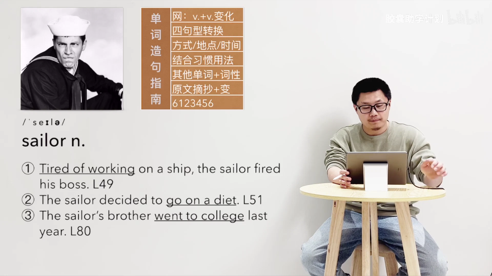

文字识别：单词造句指南 / 网：v.+v.变化 / 四句型转换 / 方式/地点/时间 / 结合习惯用法 / 其他单词+词性 / 原文摘抄+变 / 6123456 / /'seila/ / sailor n. / ① Tired of working on a ship, the sailor fired / his boss. L49 / The sailor decided to go on a diet. L51 / The sailor's brother went to college last / year. L80

### 画面 00:03:22

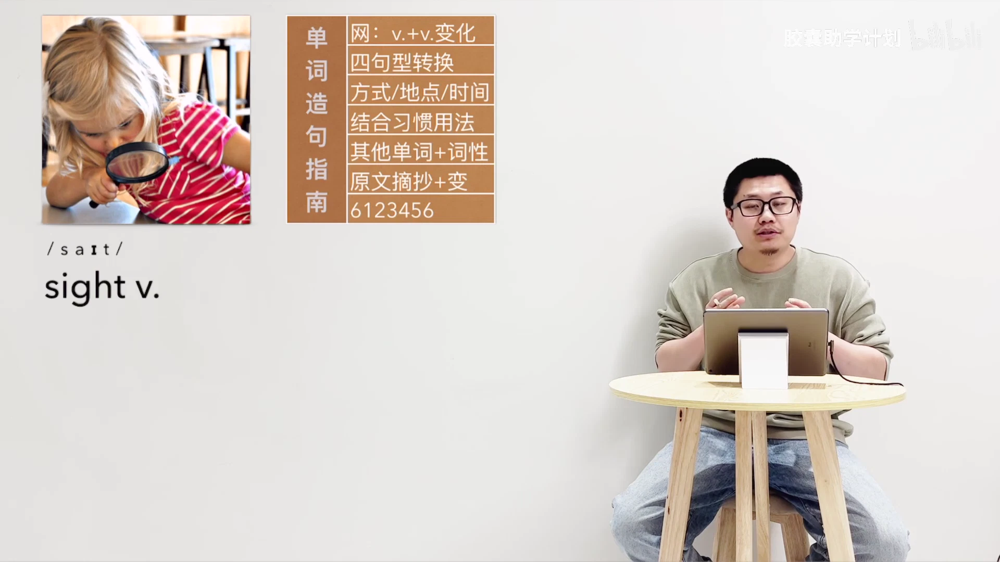

文字识别：单词造句指南 / 网：v.+v.变化 / 字计划 / 四句型转换 / 方式/地点/时间 / 结合习惯用法 / 其他单词+词性 / 原文摘抄+变 / 6123456 / /sait/ / sight v.

### 画面 00:03:25

文字识别：单词造句指南 / 网：v.+v.变化 / 四句型转换 / 方式/地点/时间 / 结合习惯用法 / 其他单词+词性 / 原文摘抄+变 / 6123456 / /sait/ / sight v.

## 00:03:30–00:04:00

OK。当然，它没有 see 啊或者 look at 更常用。那我们拿它造句子，问题也不大。比如说，After having traveled at sea for thirty days, they sighted land. Land, OK。说他们在海上航行了三十天之后，他们看到了土地，陆地。Next one, say the monster had been sighted. 注意，本课正好是第四单元第十课

### 画面 00:03:31

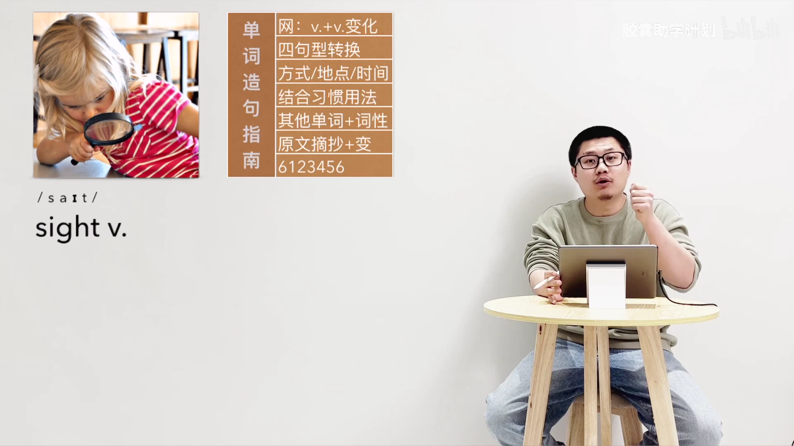

文字识别：单词造句指南 / 网：v.+v.变化 / 囊助学计划 / 四句型转换 / 方式/地点/时间 / 结合习惯用法 / 其他单词+词性 / 原文摘抄+变 / 6123456 / /sait/ / sight v.

### 画面 00:03:34

文字识别：单词造句指南 / 网：v.+v.变化 / 四句型转换 / 方式/地点/时间 / 结合习惯用法 / 其他单词+词性 / 原文摘抄+变 / 6123456 / /sait/ / sight v. / ① After having traveled at sea for 30 days, / they sighted land. L49

### 画面 00:03:36

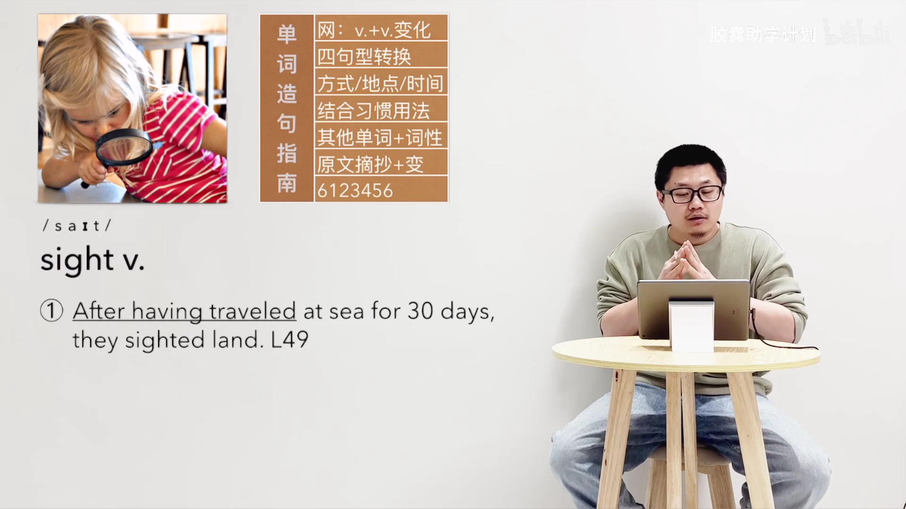

文字识别：单词造句指南 / 网：v.+v.变化 / 四句型转换 / 方式/地点/时间 / 结合习惯用法 / 其他单词+词性 / 原文摘抄+变 / 6123456 / /sait/ / sight v. / ① After having traveled at sea for 30 days, / they sighted land. L49

### 画面 00:03:40

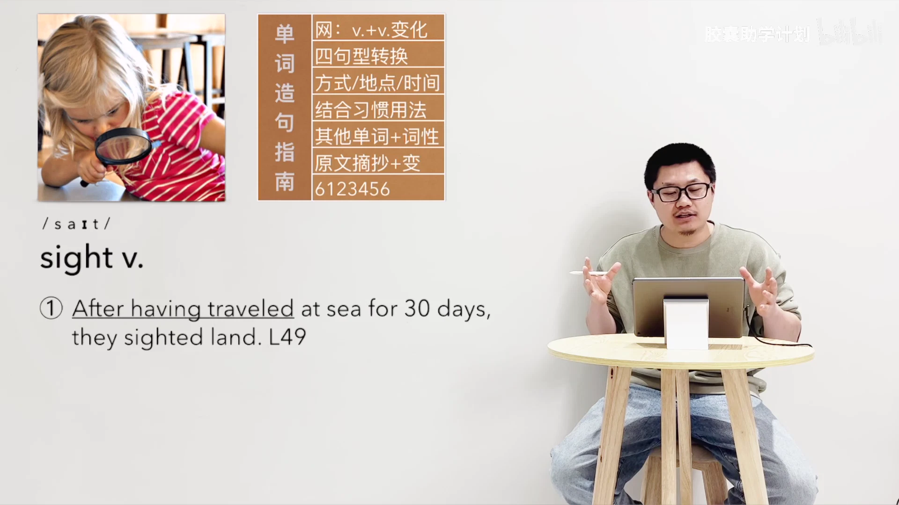

文字识别：单词造句指南 / 网：v.+v.变化 / 四句型转换 / 方式/地点/时间 / 结合习惯用法 / 其他单词+词性 / 原文摘抄+变 / 6123456 / /sait/ / sight v. / ① After having traveled at sea for 30 days, / they sighted land. L49

### 画面 00:03:45

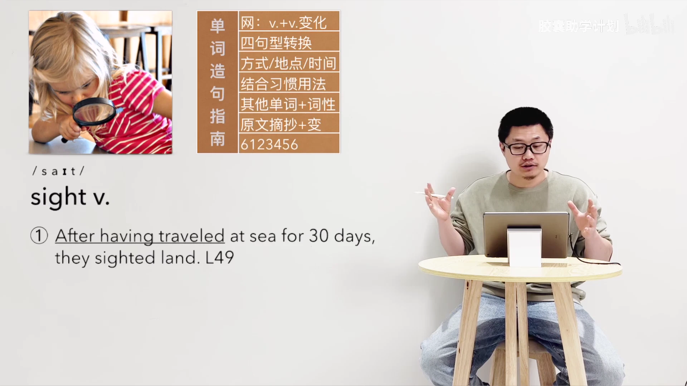

文字识别：单词造句指南 / 网：v.+v.变化 / 四句型转换 / 方式/地点/时间 / 结合习惯用法 / 其他单词+词性 / 原文摘抄+变 / 6123456 / /sait/ / sight v. / ① After having traveled at sea for 30 days, / they sighted land. L49

### 画面 00:03:48

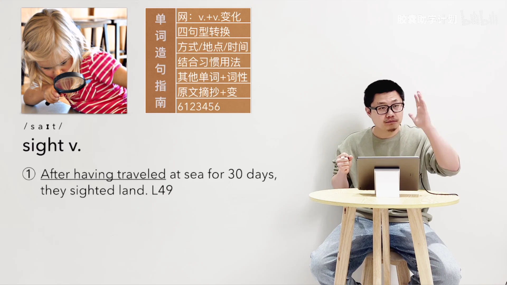

文字识别：单词造句指南 / 网：v.+v.变化 / 四句型转换 / 方式/地点/时间 / 结合习惯用法 / 其他单词+词性 / 原文摘抄+变 / 6123456 / /sait/ / sight v. / ① After having traveled at sea for 30 days, / they sighted land. L49

### 画面 00:03:50

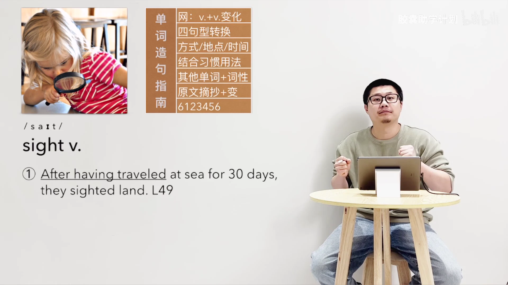

文字识别：单词造句指南 / 网：v.+v.变化 / 学计划 / 四句型转换 / 方式/地点/时间 / 结合习惯用法 / 其他单词+词性 / 原文摘抄+变 / 6123456 / /sait/ / sight v. / ① After having traveled at sea for 30 days, / they sighted land. L49

### 画面 00:03:52

文字识别：单词造句指南 / 网：v.+v.变化 / 四句型转换 / 方式/地点/时间 / 结合习惯用法 / 其他单词+词性 / 原文摘抄+变 / 6123456 / /sait/ / sight v. / ① After having traveled at sea for 30 days, / they sighted land. L49 / The monster had been sighted for several / times by the villagers.

### 画面 00:03:55

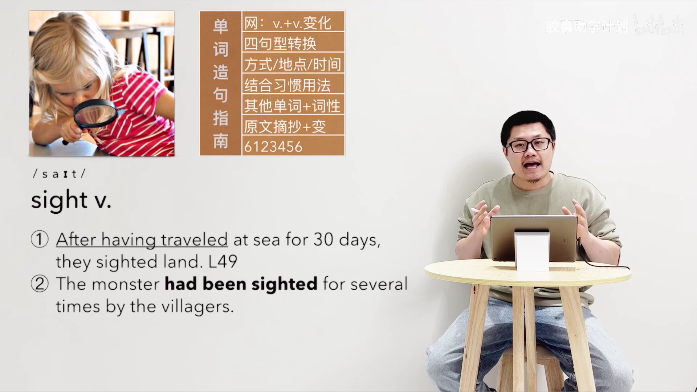

文字识别：单词造句指南 / 网：v.+v.变化 / 四句型转换 / 方式/地点/时间 / 结合习惯用法 / 其他单词+词性 / 原文摘抄+变 / 6123456 / /sait/ / sight v. / ① After having traveled at sea for 30 days, / they sighted land. L49 / The monster had been sighted for several / times by the villagers.

## 00:04:00–00:04:30

要复习被动了，又要复习被动了。那这里的 had been done 是我们实际上之前学过的过去完成时的被动，对吧？之前哎被看到了 for several times 数次 by the villagers 被村民们啊看到了数次。 Next one 四句型转换，您自己去处理。暂停屏幕，对吧？ OK，好，那再造一个很简单句子叫做 When were they sighted？那可能就来了个人问说你这 monster 是什么，对吧？哎，咱甭管他是

### 画面 00:04:07

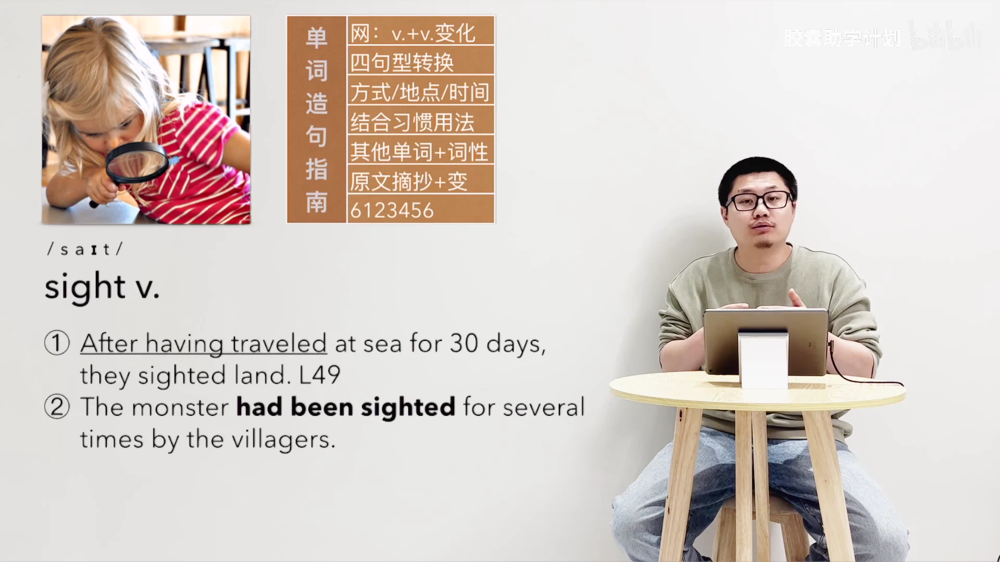

文字识别：单词造句指南 / 网：v.+v.变化 / 四句型转换 / 方式/地点/时间 / 结合习惯用法 / 其他单词+词性 / 原文摘抄+变 / 6123456 / /sait/ / sight v. / ① After having traveled at sea for 30 days, / they sighted land. L49 / The monster had been sighted for several / times by the villagers.

### 画面 00:04:15

文字识别：单词造句指南 / 网：v.+v.变化 / 十划 / 四句型转换 / 方式/地点/时间 / 结合习惯用法 / 其他单词+词性 / 原文摘抄+变 / 6123456 / /sait/ / sight v. / ① After having traveled at sea for 30 days, / they sighted land. L49 / The monster had been sighted for several / times by the villagers.

### 画面 00:04:20

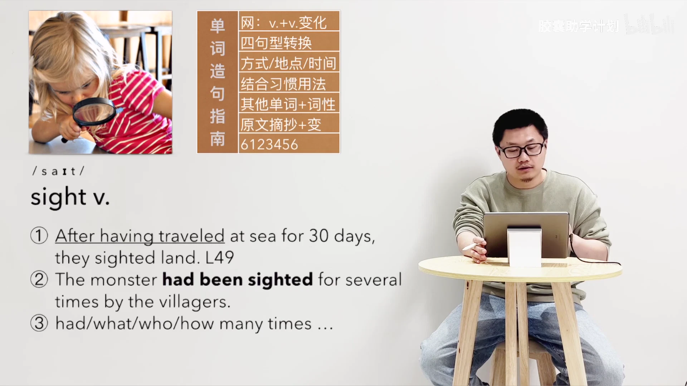

文字识别：单词造句指南 / 网：v.+v.变化 / 四句型转换 / 方式/地点/时间 / 结合习惯用法 / 其他单词+词性 / 原文摘抄+变 / 6123456 / /sait/ / sight v. / ① After having traveled at sea for 30 days, / they sighted land. L49 / The monster had been sighted for several / times by the villagers. /  had/what/who/how many times ...

### 画面 00:04:25

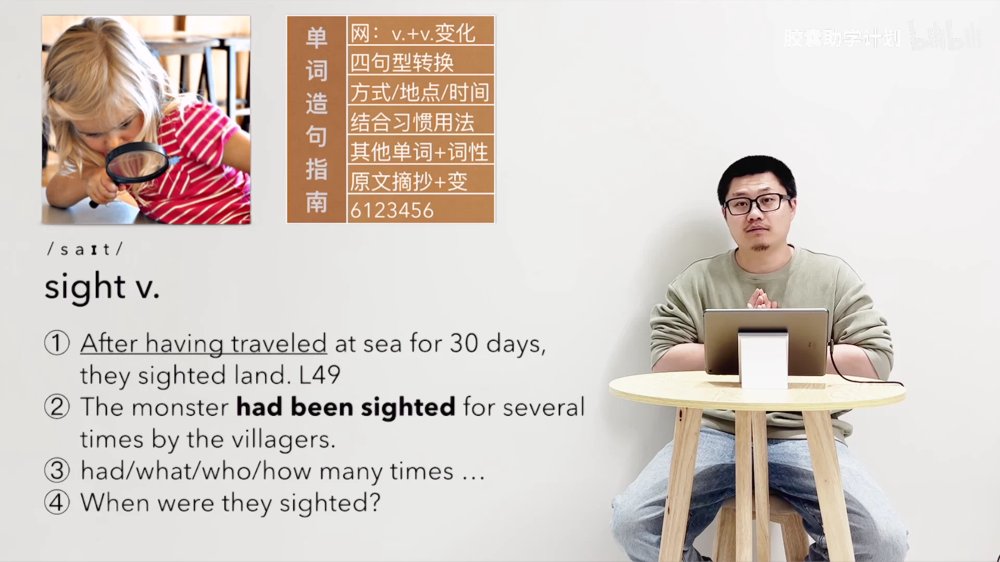

文字识别：单词造句指南 / 网：v.+v.变化 / 四句型转换 / 方式/地点/时间 / 结合习惯用法 / 其他单词+词性 / 原文摘抄+变 / 6123456 / /sait/ / sight v. / ① After having traveled at sea for 30 days, / they sighted land. L49 / The monster had been sighted for several / times by the villagers. / had/what/who/how many times .. / ) When were they sighted?

## 00:04:30–00:05:00

科学家来了还是道士来了，反正来了，问了一句话说 When were they sighted？他什么时候被看到的啊？有没有可能是别的东西呢？下一个单词，看音标，咱们一起读，叫 creature，creature。好，creature 指的是基本生物的意思啊，最常用 的生物啊，各种各样的生物，对吧？哎，陆地生物、海洋生物，这个生物用的叫做 creature。那咱们直接来一个小的短语，原文也出现

### 画面 00:04:31

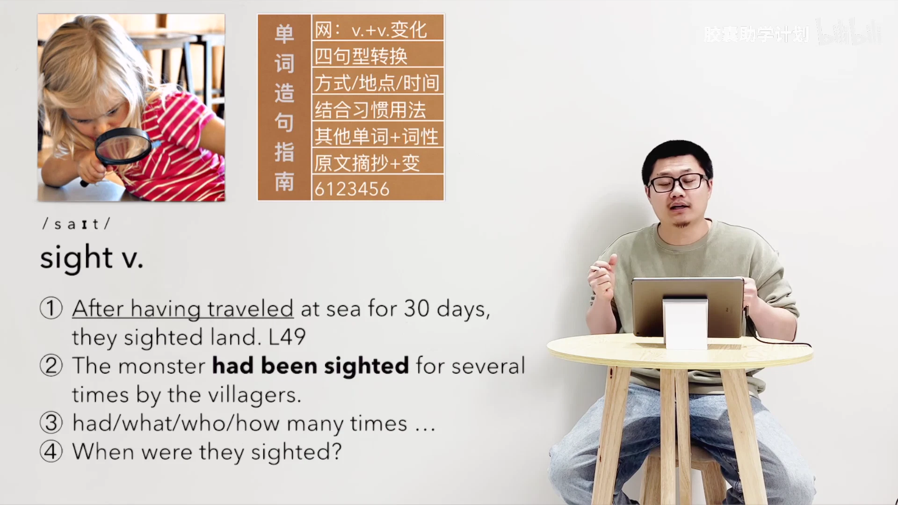

文字识别：单词造句指南 / 网：v.+v.变化 / 学计划 / 四句型转换 / 方式/地点/时间 / 结合习惯用法 / 其他单词+词性 / 原文摘抄+变 / 6123456 / /sait/ / sight v. / ① After having traveled at sea for 30 days, / they sighted land. L49 / The monster had been sighted for several / times by the villagers. / had/what/who/how many times ... / D When were they sighted?

### 画面 00:04:39

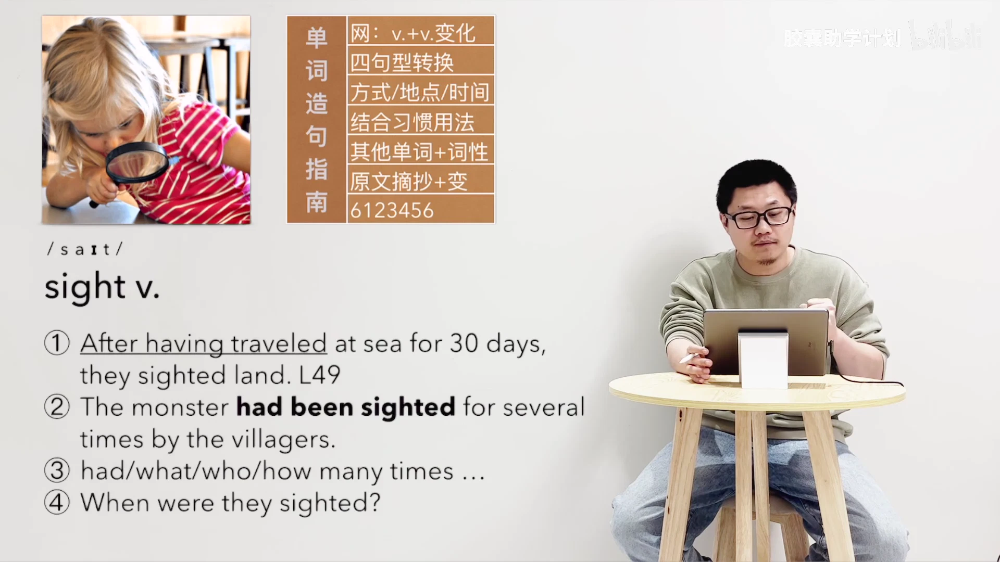

文字识别：单词造句指南 / 网：v.+v.变化 / 学计划 / 四句型转换 / 方式/地点/时间 / 结合习惯用法 / 其他单词+词性 / 原文摘抄+变 / 6123456 / /sait/ / sight v. / ① After having traveled at sea for 30 days, / they sighted land. L49 / The monster had been sighted for several / times by the villagers. / had/what/who/how many times ... / D When were they sighted?

### 画面 00:04:41

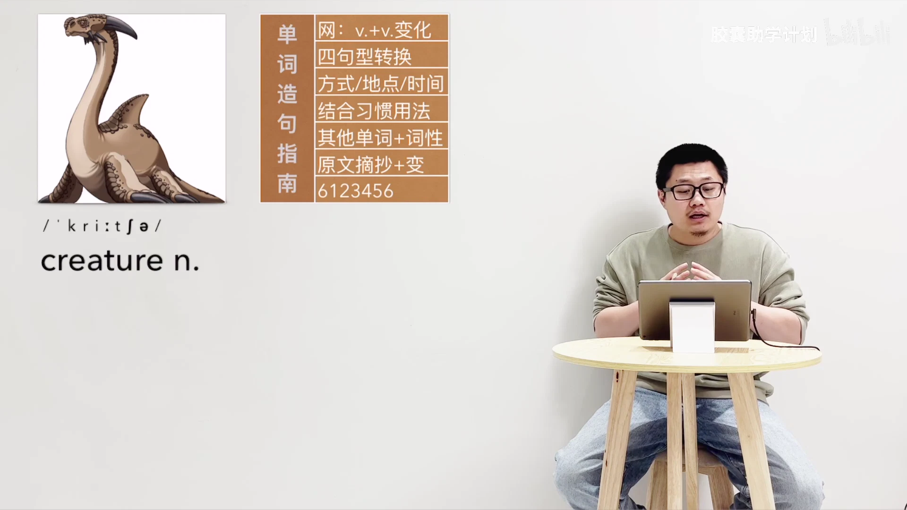

文字识别：单词造句指南 / 网：v.+v.变化 / 妻助学计划 / 四句型转换 / 方式/地点/时间 / 结合习惯用法 / 其他单词+词性 / 原文摘抄+变 / 6123456 / / kri:t∫a/ / creature n.

### 画面 00:04:45

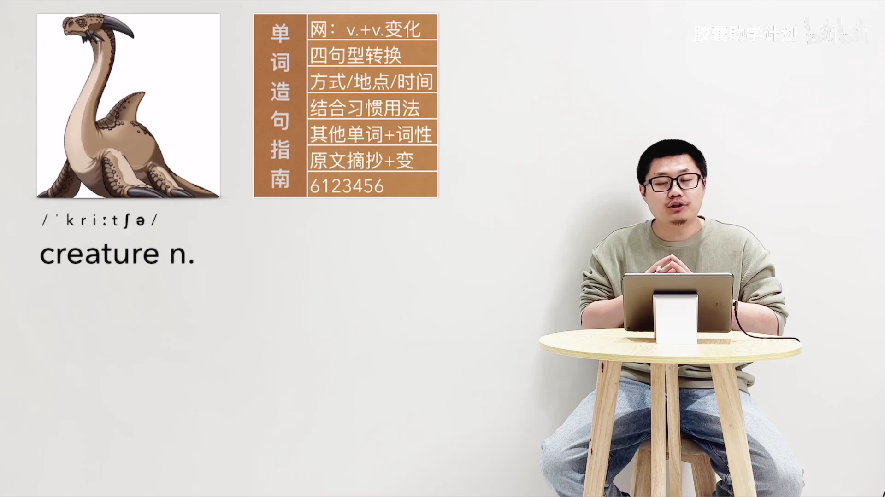

文字识别：单词造句指南 / 网：v.+v.变化 / 囊助字计划 / 四句型转换 / 方式/地点/时间 / 结合习惯用法 / 其他单词+词性 / 原文摘抄+变 / 6123456 / / ' kri:t∫a/ / creature n.

### 画面 00:04:52

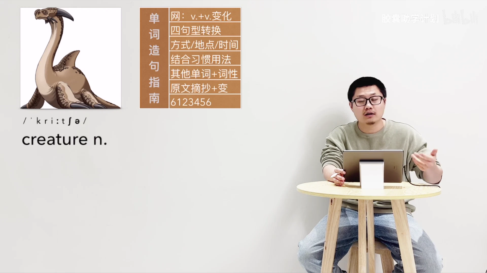

文字识别：单词造句指南 / 网：v.+v.变化 / 辜助字计划 / 四句型转换 / 方式/地点/时间 / 结合习惯用法 / 其他单词+词性 / 原文摘抄+变 / 6123456 / / ^kri:t∫a/ / creature n.

## 00:05:00–00:05:30

了啊，省得各位到原文呢，这个拿不准，我直接在这儿跟各位说一下，叫做 unusual creature，不同寻常的生物，对吧？比如说，this was such an unusual creature that he decided not to touch it。他说，他就这是一个特别不一样的生物，从来没见过，对吧？他决定还是别碰了。Next one，比如说，the owner of the unusual creature wants

### 画面 00:05:00

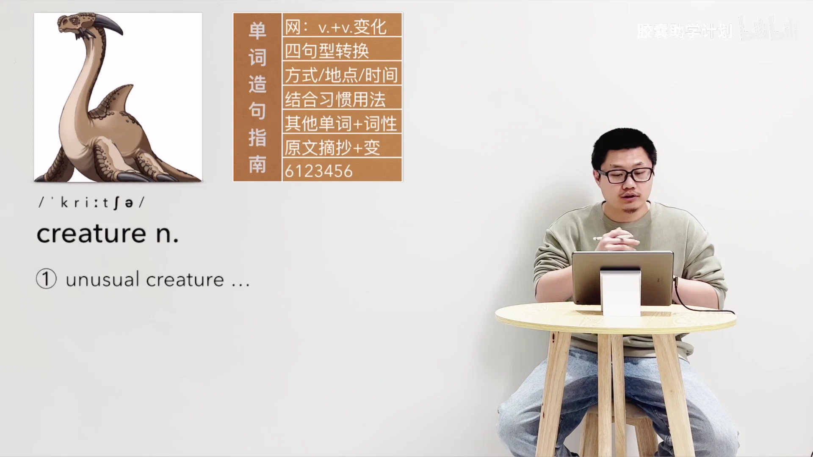

文字识别：单词造句指南 / 网：v.+v.变化 / 辜助字计划 / 四句型转换 / 方式/地点/时间 / 结合习惯用法 / 其他单词+词性 / 原文摘抄+变 / 6123456 / /  kri:t∫a/ / creature n. / unusual creature ..

### 画面 00:05:10

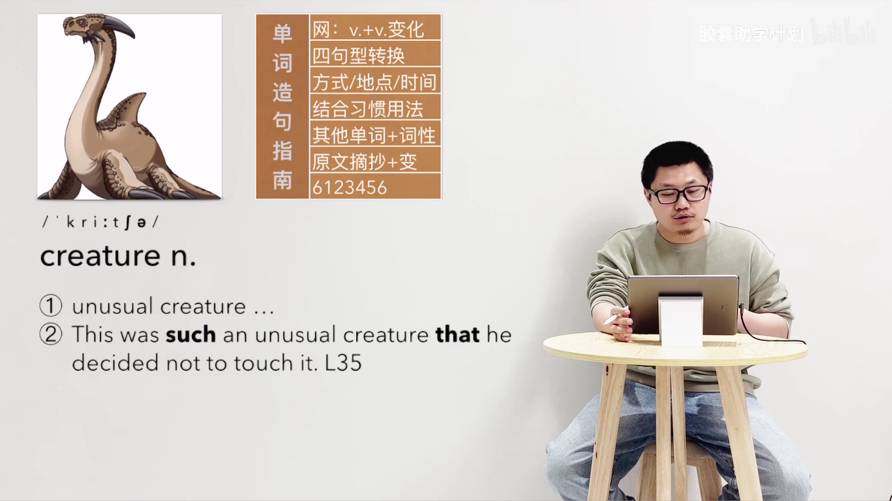

文字识别：单词造句指南 / 网：v.+v.变化 / 字计划 / 四句型转换 / 方式/地点/时间 / 结合习惯用法 / 其他单词+词性 / 原文摘抄+变 / 6123456 / / ' kri:tJa/ / creature n. / unusual creature . / This was such an unusual creature that he / decided not to touch it. L35

### 画面 00:05:15

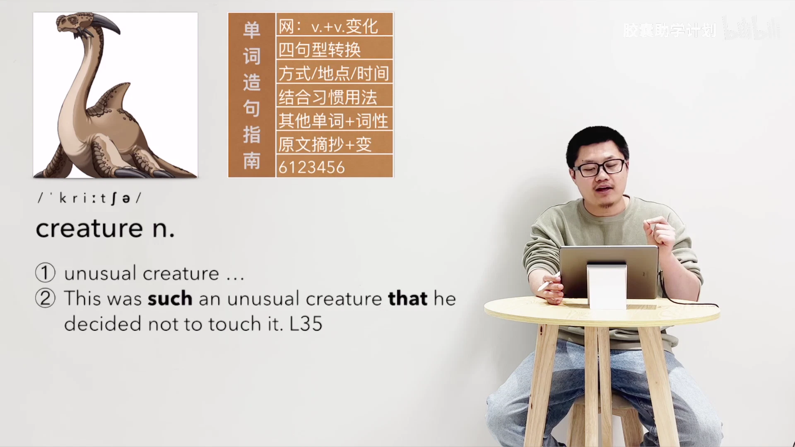

文字识别：单词造句指南 / 网：v.+v.变化 / 字计划 / 四句型转换 / 方式/地点/时间 / 结合习惯用法 / 其他单词+词性 / 原文摘抄+变 / 6123456 / / 'kri:t∫a/ / creature n. / unusual creature ... / This was such an unusual creature that he / decided not to touch it. L35

### 画面 00:05:25

文字识别：单词造句指南 / 网：v.+v.变化 / 四句型转换 / 方式/地点/时间 / 结合习惯用法 / 其他单词+词性 / 原文摘抄+变 / 6123456 / / ^ kri:t∫a/ / creature n. / unusual creature ….. / This was such an unusual creature that he / decided not to touch it. L35 / The owner of the unusual creature wants to / make a profit. L80

## 00:05:30–00:06:00

to make a profit. Ah, early years of many so-called circuses, not just like this, made a particularly strange animal, and then took it on a national tour, and then made this ticket money, right? Make a profit, profit, make a

### 画面 00:05:30

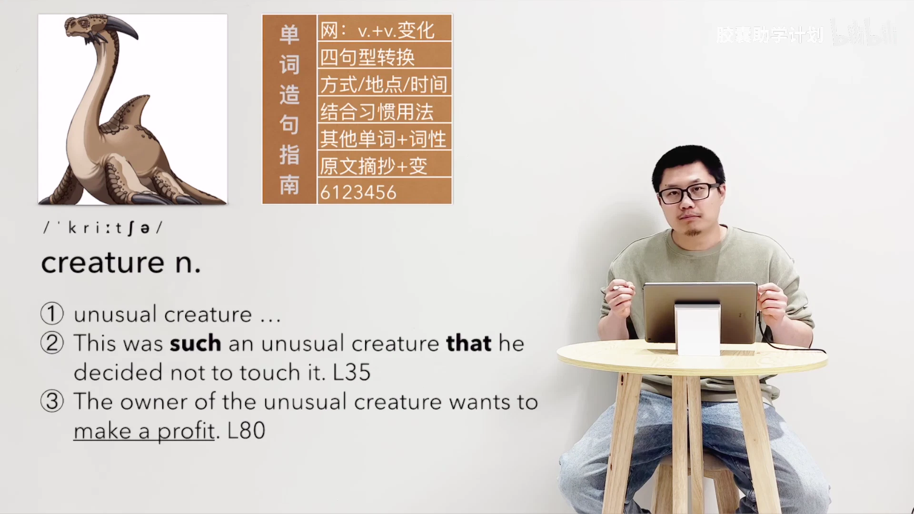

文字识别：单词造句指南 / 网：v.+v.变化 / 子计划 / 四句型转换 / 方式/地点/时间 / 结合习惯用法 / 其他单词+词性 / 原文摘抄+变 / 6123456 / / ^ kri:t∫a/ / creature n. / unusual creature ... / This was such an unusual creature that he / decided not to touch it. L35 / The owner of the unusual creature wants to / make a profit. L80

### 画面 00:05:43

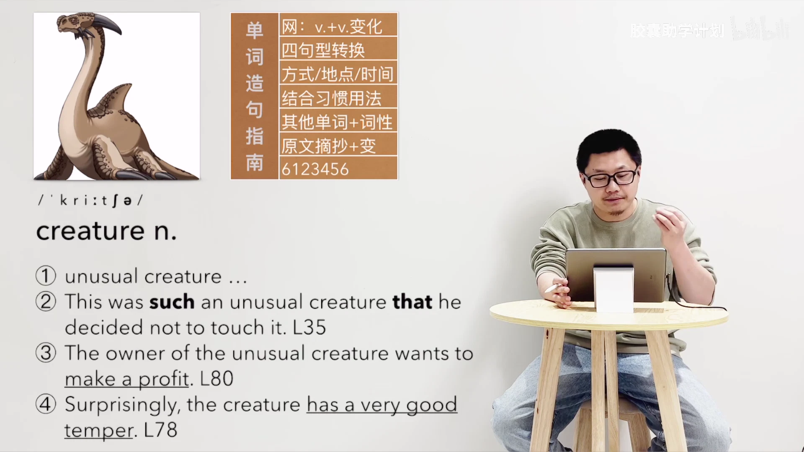

文字识别：单词造句指南 / 网：v.+v.变化 / 四句型转换 / 方式/地点/时间 / 结合习惯用法 / 其他单词+词性 / 原文摘抄+变 / 6123456 / / ' kri:t∫a/ / creature n. / unusual creature ... / This was such an unusual creature that he / decided not to touch it. L35 / The owner of the unusual creature wants to / make a profit. L80 / Surprisingly, the creature has a very good / temper. L78

### 画面 00:05:46

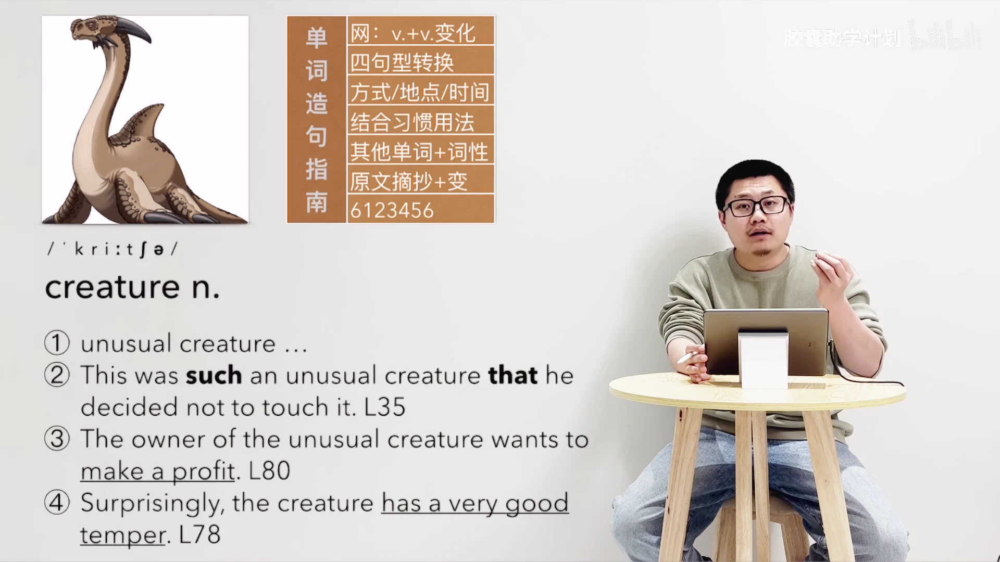

文字识别：单词造句指南 / 网：v.+v.变化 / 囊助字计划 / 四句型转换 / 方式/地点/时间 / 结合习惯用法 / 其他单词+词性 / 原文摘抄+变 / 6123456 / / ' kri:t∫a/ / creature n. / unusual creature ... / This was such an unusual creature that he / decided not to touch it. L35 / The owner of the unusual creature wants to / make a profit. L80 / Surprisingly, the creature has a very good / temper. L78

### 画面 00:05:51

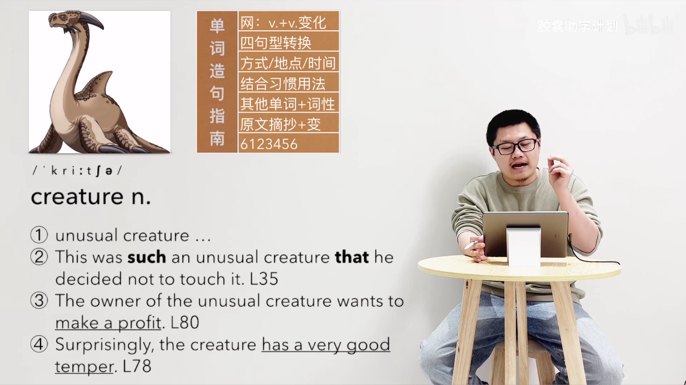

文字识别：单词造句指南 / 网：v.+v.变化 / 襄助字计划 / 四句型转换 / 方式/地点/时间 / 结合习惯用法 / 其他单词+词性 / 原文摘抄+变 / 6123456 / / ^ kri:t∫a/ / creature n. / unusual creature ... / This was such an unusual creature that he / decided not to touch it. L35 / The owner of the unusual creature wants to / make a profit. L80 / Surprisingly, the creature has a very good / temper. L78

### 画面 00:05:55

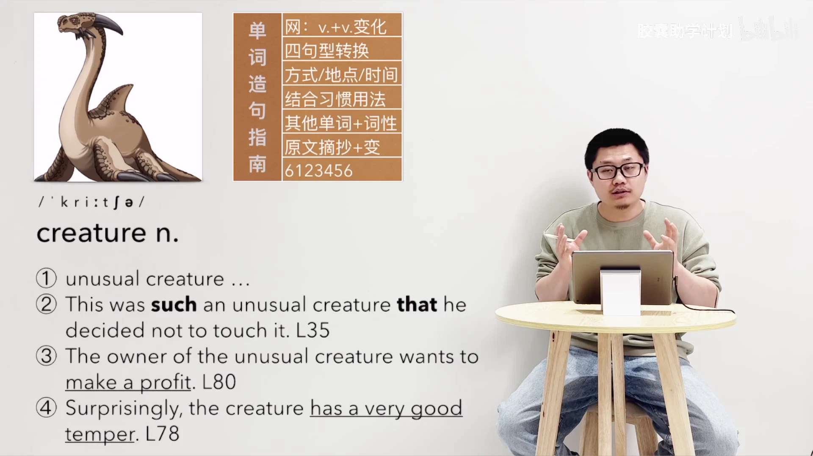

文字识别：单词造句指南 / 网：v.+v.变化 / 四句型转换 / 方式/地点/时间 / 结合习惯用法 / 其他单词+词性 / 原文摘抄+变 / 6123456 / / ^ kri:t∫a/ / creature n. / unusual creature ... / This was such an unusual creature that he / decided not to touch it. L35 / The owner of the unusual creature wants to / make a profit. L80 / Surprisingly, the creature has a very good / temper. L78

## 00:06:00–00:06:30

但是脾气格外的温和，对吧？OK，再读一遍这个单词 creature，very good。下一个单词 peculiar，peculiar，peculiar 就是奇形怪状的啊，有很奇特的啊，奇形怪状的。比如说那 peculiar，我们本课结合起来，咱就 peculiar fish呗，对吧？奇怪的鱼，比如说本课学的那个蒋鱼啊，长得就挺 peculiar 的，对吧？啊， next one，我们造一个句子，比如说 Leo

### 画面 00:06:07

文字识别：单词造句指南 / 网：v.+v.变化 / 喜助字计划 / 四句型转换 / 方式/地点/时间 / 结合习惯用法 / 其他单词+词性 / 原文摘抄+变 / 6123456 / /pr'kju:lia/ / peculiar adj.

### 画面 00:06:09

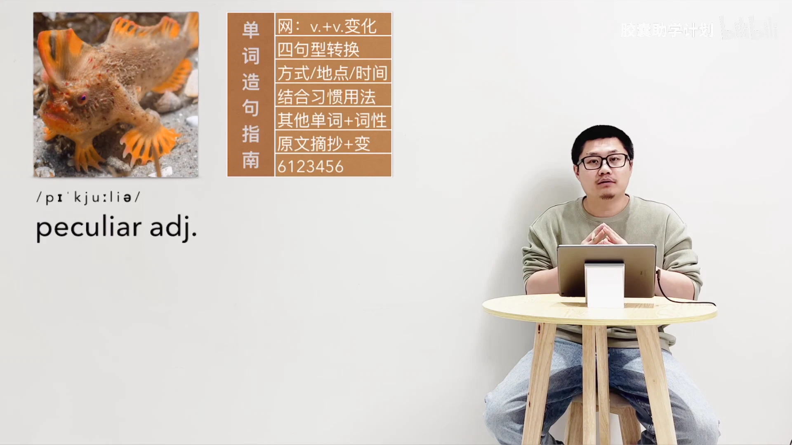

文字识别：单词造句指南 / 网：v.+v.变化 / 喜助字计划 / 四句型转换 / 方式/地点/时间 / 结合习惯用法 / 其他单词+词性 / 原文摘抄+变 / 6123456 / /pr'kju:lia/ / peculiar adj.

### 画面 00:06:11

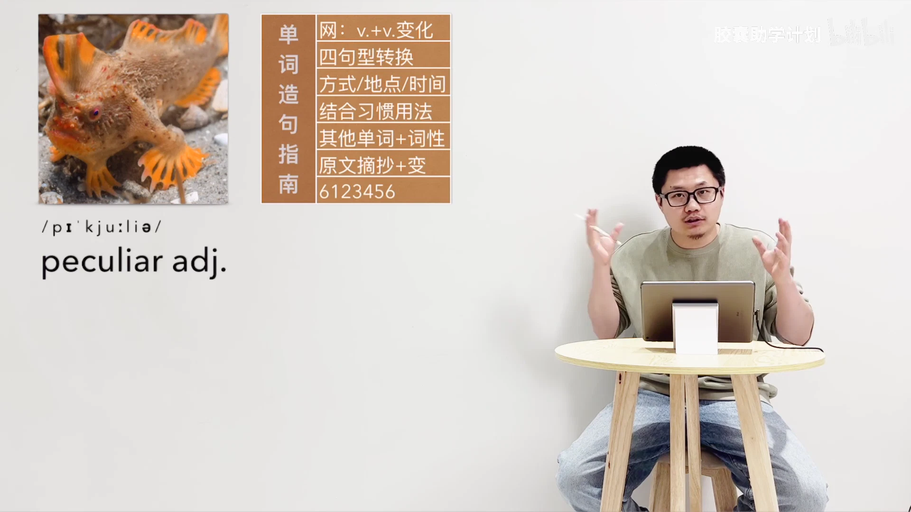

文字识别：单词造句指南 / 网：v.+v.变化 / 辜助学计划 / 四句型转换 / 方式/地点/时间 / 结合习惯用法 / 其他单词+词性 / 原文摘抄+变 / 6123456 / /pr'kju:lia/ / peculiar adj.

### 画面 00:06:15

文字识别：单词造句指南 / 网：v.+v.变化 / 辜助字计划 / 四句型转换 / 方式/地点/时间 / 结合习惯用法 / 其他单词+词性 / 原文摘抄+变 / 6123456 / /pr'kju:lia/ / peculiar adj. / ① peculiar fish...

### 画面 00:06:20

文字识别：单词造句指南 / 网：v.+v.变化 / 毫助学计划 / 四句型转换 / 方式/地点/时间 / 结合习惯用法 / 其他单词+词性 / 原文摘抄+变 / 6123456 / /pr'kju:lia/ / peculiar adj. / 1 / ) peculiar fish...

### 画面 00:06:25

文字识别：单词造句指南 / 网：v.+v.变化 / 毫助学计划 / 四句型转换 / 方式/地点/时间 / 结合习惯用法 / 其他单词+词性 / 原文摘抄+变 / 6123456 / /pr'kju:lia/ / peculiar adj. / ① peculiar fish...

### 画面 00:06:28

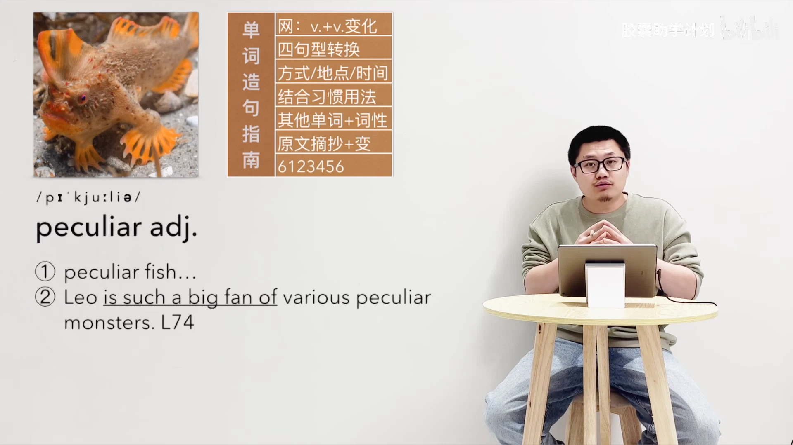

文字识别：单词造句指南 / 网：v.+v.变化 / 学计划 / 四句型转换 / 方式/地点/时间 / 结合习惯用法 / 其他单词+词性 / 原文摘抄+变 / 6123456 / /pr'kju:lia/ / peculiar adj. / ① peculiar fish... / Leo is such a big fan of various peculiar / monsters. L74

## 00:06:30–00:07:00

is such a big fan of various peculiar monsters. 啊，就特别喜欢克苏鲁文化，对吧？克苏鲁的这个概念，所以呢，他是是什么呢？ Such a big fan. 啊，是一个巨大的狂热粉丝，对吧？特别喜欢什么呢？不，各式各样的奇形怪状的那些怪物，对吧？ Okay. 哎，可以是人化的，可以是真的，呃，存在过的或者正在存在的。再来，比如说 This peculiar fish takes its name

### 画面 00:06:30

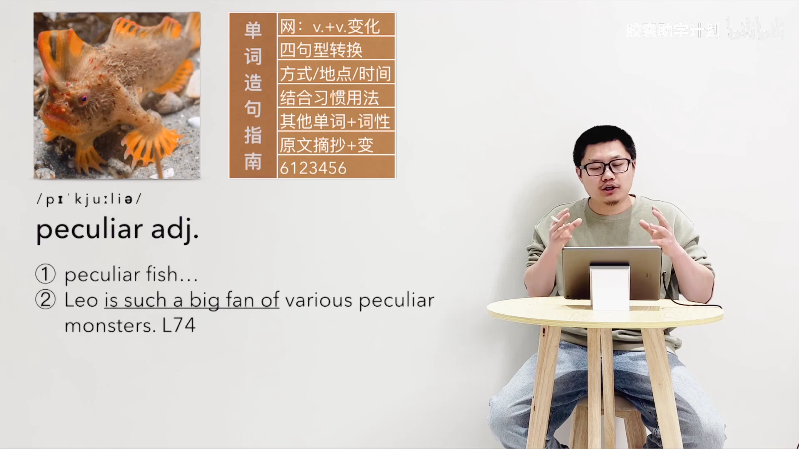

文字识别：单词造句指南 / 网：v.+v.变化 / 臺助字计划園 / 四句型转换 / 方式/地点/时间 / 结合习惯用法 / 其他单词+词性 / 原文摘抄+变 / 6123456 / /pr'kju:lia/ / peculiar adj. / ① peculiar fish... /  Leo is such a big fan of various peculiar / monsters. L74

### 画面 00:06:45

文字识别：单词造句指南 / 网：v.+v.变化 / 毫助学计划 / 四句型转换 / 方式/地点/时间 / 结合习惯用法 / 其他单词+词性 / 原文摘抄+变 / 6123456 / /pr'kju:lia/ / peculiar adj. / ① peculiar fish... /  Leo is such a big fan of various peculiar / monsters.L74

### 画面 00:06:51

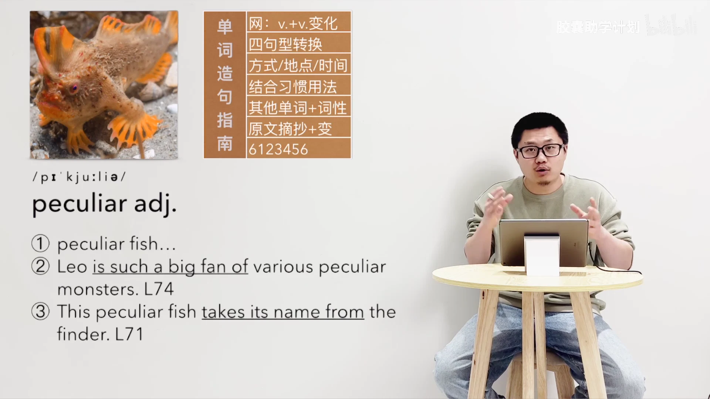

文字识别：单词造句指南 / 网：v.+v.变化 / 四句型转换 / 方式/地点/时间 / 结合习惯用法 / 其他单词+词性 / 原文摘抄+变 / 6123456 / /pr'kju:lia/ / peculiar adj. / ① peculiar fish... / ) Leo is such a big fan of various peculiar / monsters. L74 / This peculiar fish takes its name from the / finder. L71

### 画面 00:06:55

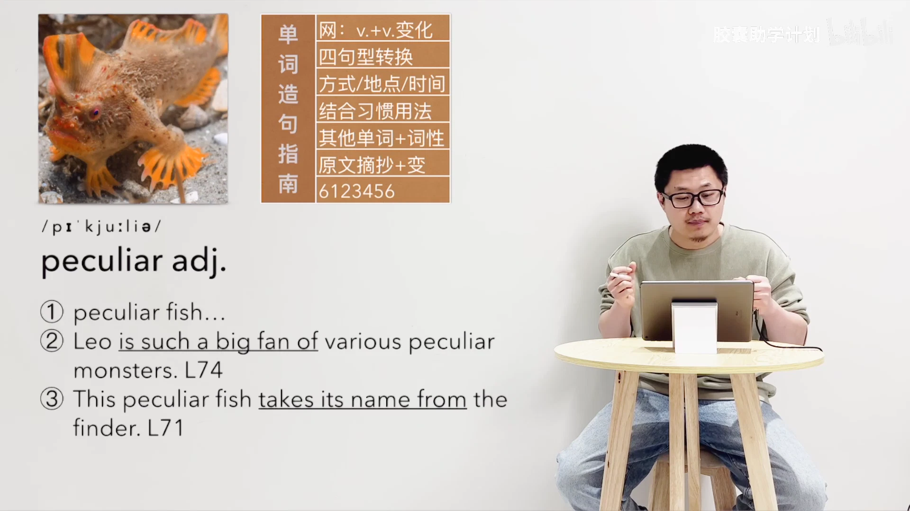

文字识别：单词造句指南 / 网：v.+v.变化 / 四句型转换 / 方式/地点/时间 / 结合习惯用法 / 其他单词+词性 / 原文摘抄+变 / 6123456 / /pr'kju:lia/ / peculiar adj. / ① peculiar fish... /  Leo is such a big fan of various peculiar / monsters. L74 / This peculiar fish takes its name from the / finder. L71

## 00:07:00–00:07:30

from the finder. That finder is what? I guess you guys can easily guess. Finder means to find. That finder is the person who found it, right? So this fish is named after its discoverer. Actually, ah, next one. So seeing the peculiar fish, everyone broke into cheers. Review了一下 broke into cheers. 开始哇欢呼，对吧？看到了这条鱼，所有人都欢呼欢呼。这里其实还隐藏了一个我没有标的，其实四十九课，各位

### 画面 00:07:00

文字识别：单词造句指南 / 网：v.+v.变化 / 计划 / 四句型转换 / 方式/地点/时间 / 结合习惯用法 / 其他单词+词性 / 原文摘抄+变 / 6123456 / /pr'kju:lia/ / peculiar adj. / ① peculiar fish... / ) Leo is such a big fan of various peculiar / monsters. L74 / This peculiar fish takes its name from the / finder. L71

### 画面 00:07:05

文字识别：单词造句指南 / 网：v.+v.变化 / 四句型转换 / 方式/地点/时间 / 结合习惯用法 / 其他单词+词性 / 原文摘抄+变 / 6123456 / /pr'kju:lia/ / peculiar adj. / ① peculiar fish... / ) Leo is such a big fan of various peculiar / monsters. L74 / This peculiar fish takes its name from the / finder. L71

### 画面 00:07:07

文字识别：单词造句指南 / 网：v.+v.变化 / 学计划 / 四句型转换 / 方式/地点/时间 / 结合习惯用法 / 其他单词+词性 / 原文摘抄+变 / 6123456 / /pr'kju:lia/ / peculiar adj. / ① peculiar fish... / ) Leo is such a big fan of various peculiar / monsters. L74 / This peculiar fish takes its name from the / finder. L71

### 画面 00:07:10

文字识别：单词造句指南 / 网：v.+v.变化 / 四句型转换 / 方式/地点/时间 / 结合习惯用法 / 其他单词+词性 / 原文摘抄+变 / 6123456 / /pr'kju:lia/ / peculiar adj. / ① peculiar fish... /  Leo is such a big fan of various peculiar / monsters. L74 / This peculiar fish takes its name from the / finder. L71

### 画面 00:07:14

文字识别：单词造句指南 / 网：v.+v.变化 / 四句型转换 / 方式/地点/时间 / 结合习惯用法 / 其他单词+词性 / 原文摘抄+变 / 6123456 / /pr'kju:lia/ / peculiar adj. / ① peculiar fish... / ) Leo is such a big fan of various peculiar / 2 / monsters. L74 / This peculiar fish takes its name from the / finder. L71 / ④ Seeing the peculiar fish, everyone broke / into cheers. L70

### 画面 00:07:16

文字识别：单词造句指南 / 网：v.+v.变化 / 庭助学计划 / 四句型转换 / 方式/地点/时间 / 结合习惯用法 / 其他单词+词性 / 原文摘抄+变 / 6123456 / /pr'kju:lia/ / peculiar adj. / ① peculiar fish... / ) Leo is such a big fan of various peculiar / 2 / monsters. L74 / This peculiar fish takes its name from the / finder. L71 / ④ Seeing the peculiar fish, everyone broke / into cheers. L70

### 画面 00:07:20

文字识别：单词造句指南 / 网：v.+v.变化 / 四句型转换 / 方式/地点/时间 / 结合习惯用法 / 其他单词+词性 / 原文摘抄+变 / 6123456 / /pr'kju:lia/ / peculiar adj. / ① peculiar fish... / ) Leo is such a big fan of various peculiar / 2） / monsters. L74 / This peculiar fish takes its name from the / finder. L71 / D Seeing the peculiar fish, everyone broke / into cheers. L70

### 画面 00:07:25

文字识别：单词造句指南 / 网：v.+v.变化 / 四句型转换 / 方式/地点/时间 / 结合习惯用法 / 其他单词+词性 / 原文摘抄+变 / 6123456 / /pr'kju:lia/ / peculiar adj. / ① peculiar fish... / ② Leo is such a big fan of various peculiar / 2) / monsters. L74 / This peculiar fish takes its name from the / finder. L71 / ④ Seeing the peculiar fish, everyone broke / into cheers. L70

## 00:07:30–00:08:00

可以自己标一下。四十九课的一个语法啊，分词做定语，这是一个。再读一遍这个单词，peculiar。Next one，下一个单词叫shining。shining其实这个单词对于各位来说，如果我们不从形容词的角度，从动词的角度，新一其实咱就见过，对吧？shine嘛，啊，the sun is shining in the sky，就是咱新一前四十课我印象当中就学过的啊，很简单的一个单词，照耀、闪耀，对吧？如果这里用

### 画面 00:07:33

文字识别：单词造句指南 / 网：v.+v.变化 / 四句型转换 / 方式/地点/时间 / 结合习惯用法 / 其他单词+词性 / 原文摘抄+变 / 6123456 / /pr'kju:lia/ / peculiar adj. / ① peculiar fish... / ) Leo is such a big fan of various peculiar / 2 / monsters.L74 / This peculiar fish takes its name from the / finder. L71 / ④ Seeing the peculiar fish, everyone broke / into cheers. L70

### 画面 00:07:35

文字识别：单词造句指南 / 网：v.+v.变化 / 学计划 / 四句型转换 / 方式/地点/时间 / 结合习惯用法 / 其他单词+词性 / 原文摘抄+变 / 6123456 / /pr'kju:lia/ / peculiar adj. / ① peculiar fish... / ) Leo is such a big fan of various peculiar / 2 / monsters. L74 / This peculiar fish takes its name from the / finder. L71 / ④ Seeing the peculiar fish, everyone broke / into cheers. L70

### 画面 00:07:37

文字识别：单词造句指南 / 网：v.+v.变化 / 喜助字计划 / 四句型转换 / 方式/地点/时间 / 结合习惯用法 / 其他单词+词性 / 原文摘抄+变 / 6123456 / /'Sai.nin/ / shining adj.

### 画面 00:07:40

文字识别：单词造句指南 / 网：v.+v.变化 / 葬助字计划 / 四句型转换 / 方式/地点/时间 / 结合习惯用法 / 其他单词+词性 / 原文摘抄+变 / 6123456 / /'Sai.nin/ / shining adj.

### 画面 00:07:45

文字识别：单词造句指南 / 网：v.+v.变化 / 四句型转换 / 方式/地点/时间 / 结合习惯用法 / 其他单词+词性 / 原文摘抄+变 / 6123456 / /'Sai.nin/ / shining adj.

### 画面 00:07:50

文字识别：单词造句指南 / 网：v.+v.变化 / 喜助字计划 / 四句型转换 / 方式/地点/时间 / 结合习惯用法 / 其他单词+词性 / 原文摘抄+变 / 6123456 / /'Sai.nin/ / shining adj.

### 画面 00:07:55

文字识别：单词造句指南 / 网：v.+v.变化 / 辜助字计划 / 四句型转换 / 方式/地点/时间 / 结合习惯用法 / 其他单词+词性 / 原文摘抄+变 / 6123456 / /'Sai.nin/ / shining adj.

## 00:08:00–00:08:30

shining 的，其实就是发光的啊，闪闪发光的。那我们在这里呢，补充一个它其实在口语当中很常用的短语叫做 a shining example，叫做光辉的事，但但这不是事例了，是榜样啊。其实就是类似于啊，比如说你从小是别人家的孩子啊，什么都获奖对吧？就这个琴棋书画样样精通啊，吹拉弹唱每个都行对吧？啊，那这个叫做 a shining example

### 画面 00:08:00

文字识别：单词造句指南 / 网：v.+v.变化 / 辜助字计划 / 四句型转换 / 方式/地点/时间 / 结合习惯用法 / 其他单词+词性 / 原文摘抄+变 / 6123456 / /'Sai.nin/ / shining adj.

### 画面 00:08:03

文字识别：单词造句指南 / 网：v.+v.变化 / 四句型转换 / 方式/地点/时间 / 结合习惯用法 / 其他单词+词性 / 原文摘抄+变 / 6123456 / /'∫aI.nin/ / shining adj. / ① I think we should turn our attention to him, / for he is a shining example to us. L70

### 画面 00:08:05

文字识别：单词造句指南 / 网：v.+v.变化 / 四句型转换 / 方式/地点/时间 / 结合习惯用法 / 其他单词+词性 / 原文摘抄+变 / 6123456 / /'∫ai.nin/ / shining adj. / ① I think we should turn our attention to him, / for he is a shining example to us. L70

### 画面 00:08:10

文字识别：单词造句指南 / 网：v.+v.变化 / 四句型转换 / 方式/地点/时间 / 结合习惯用法 / 其他单词+词性 / 原文摘抄+变 / 6123456 / /∫ai.nin/ / shining adj. / ① I think we should turn our attention to him, / for he is a shining example to us. L70

### 画面 00:08:15

文字识别：单词造句指南 / 网：v.+v.变化 / 四句型转换 / 方式/地点/时间 / 结合习惯用法 / 其他单词+词性 / 原文摘抄+变 / 6123456 / /∫ai.nin/ / shining adj. / ① I think we should turn our attention to him, / for he is a shining example to us. L70

### 画面 00:08:20

文字识别：单词造句指南 / 网：v.+v.变化 / 四句型转换 / 方式/地点/时间 / 结合习惯用法 / 其他单词+词性 / 原文摘抄+变 / 6123456 / /'∫ai.nin/ / shining adj. / ① I think we should turn our attention to him, / for he is a shining example to us. L70

### 画面 00:08:25

文字识别：单词造句指南 / 网：v.+v.变化 / 学诗划 / 四句型转换 / 方式/地点/时间 / 结合习惯用法 / 其他单词+词性 / 原文摘抄+变 / 6123456 / /'Sai.nin/ / shining adj. / ① I think we should turn our attention to him, / for he is a shining example to us. L70

## 00:08:30–00:09:00

Transcribe the exact words in their original spoken languages. Never translate. Preserve repetitions, questions and examples.

### 画面 00:08:30

文字识别：单词造句指南 / 网：v.+v.变化 / 四句型转换 / 方式/地点/时间 / 结合习惯用法 / 其他单词+词性 / 原文摘抄+变 / 6123456 / /'∫ai.nin/ / shining adj. / ① I think we should turn our attention to him, / for he is a shining example to us. L70

### 画面 00:08:35

文字识别：单词造句指南 / 网：v.+v.变化 / 四句型转换 / 方式/地点/时间 / 结合习惯用法 / 其他单词+词性 / 原文摘抄+变 / 6123456 / /'∫ai.nin/ / shining adj. / ① I think we should turn our attention to him, / for he is a shining example to us. L70

### 画面 00:08:40

文字识别：单词造句指南 / 网：v.+v.变化 / 四句型转换 / 方式/地点/时间 / 结合习惯用法 / 其他单词+词性 / 原文摘抄+变 / 6123456 / /'∫ai.nin/ / shining adj. / ① I think we should turn our attention to him, / for he is a shining example to us. L70

### 画面 00:08:45

文字识别：单词造句指南 / 网：v.+v.变化 / 学计划 / 四句型转换 / 方式/地点/时间 / 结合习惯用法 / 其他单词+词性 / 原文摘抄+变 / 6123456 / /'Sai.nin/ / shining adj. / ① I think we should turn our attention to him, / for he is a shining example to us. L70

### 画面 00:08:48

文字识别：单词造句指南 / 网：v.+v.变化 / 四句型转换 / 方式/地点/时间 / 结合习惯用法 / 其他单词+词性 / 原文摘抄+变 / 6123456 / /'∫ai.nin/ / shining adj. / ① I think we should turn our attention to him, / for he is a shining example to us. L70

### 画面 00:08:50

文字识别：单词造句指南 / 网：v.+v.变化 / 四句型转换 / 方式/地点/时间 / 结合习惯用法 / 其他单词+词性 / 原文摘抄+变 / 6123456 / /∫ai.nin/ / shining adj. / ① I think we should turn our attention to him, / for he is a shining example to us. L70

### 画面 00:08:53

文字识别：单词造句指南 / 网：v.+v.变化 / 四句型转换 / 方式/地点/时间 / 结合习惯用法 / 其他单词+词性 / 原文摘抄+变 / 6123456 / /'Sai.nin/ / shining adj. / ① I think we should turn our attention to him, / for he is a shining example to us. L70 / It is no use pretending that you are not a / shining example to us. L68

### 画面 00:08:55

文字识别：单词造句指南 / 网：v.+v.变化 / 四句型转换 / 方式/地点/时间 / 结合习惯用法 / 其他单词+词性 / 原文摘抄+变 / 6123456 / /'Sar.nin/ / shining adj. / ① I think we should turn our attention to him, / for he is a shining example to us. L70 / It is no use pretending that you are not a / shining example to us. L68

## 00:09:00–00:09:30

shining example to us.说你假装你对我们人不是一个很好的例子，这个事儿没用，对吧？我们都看得到，啊，大家都不瞎，对吧？Next one,说I will turn you into a shining example for all of us.说我要把你变成对我们所有人来说都是一个闪闪发光的例子。Okay,再读一遍这个单词shining。那咱注意力集中吧，咱听听这电影片段。哎，我的父母对于我来说是一个shining example，就很容易理解了嘛。

### 画面 00:09:00

文字识别：单词造句指南 / 网：v.+v.变化 / 四句型转换 / 方式/地点/时间 / 结合习惯用法 / 其他单词+词性 / 原文摘抄+变 / 6123456 / /'Sai.nin/ / shining adj. / ① I think we should turn our attention to him, / for he is a shining example to us. L70 / It is no use pretending that you are not a / shining example to us. L68

### 画面 00:09:05

文字识别：单词造句指南 / 网：v.+v.变化 / 四句型转换 / 方式/地点/时间 / 结合习惯用法 / 其他单词+词性 / 原文摘抄+变 / 6123456 / /'Sai.nin/ / shining adj. / ① I think we should turn our attention to him, / for he is a shining example to us. L70 / It is no use pretending that you are not a / shining example to us. L68

### 画面 00:09:08

文字识别：单词造 / 网：v.+v.变化 / 学计划 / 四句型转换 / 方式/地点/时间 / 旭句指南 / 结合习惯用法 / 其他单词+词性 / 原文摘抄+变 / 6123456 / /'Sai.nin/ / shining adj. / ① I think we should turn our attention to him, / for he is a shining example to us. L70 / It is no use pretending that you are not a / shining example to us. L68 / 3 I will turn you into a shining example for all / of us. L66

### 画面 00:09:10

文字识别：单词造句指南 / 网：v.+v.变化 / 四句型转换 / 方式/地点/时间 / 结合习惯用法 / 其他单词+词性 / 原文摘抄+变 / 6123456 / /'Sai.nin/ / shining adj. / ① I think we should turn our attention to him, / for he is a shining example to us. L70 / It is no use pretending that you are not a / shining example to us. L68 / ) I will turn you into a shining example for all / of us. L66

### 画面 00:09:15

文字识别：单词造 / 网：v.+v.变化 / 四句型转换 / 方式/地点/时间 / 旭句指南 / 结合习惯用法 / 其他单词+词性 / 原文摘抄+变 / 6123456 / /'Sai.nin/ / shining adj. / ① I think we should turn our attention to him, / for he is a shining example to us. L70 / It is no use pretending that you are not a / shining example to us. L68 / ) I will turn you into a shining example for all / of us. L66

### 画面 00:09:20

文字识别：单词造 / 网：v.+v.变化 / 四句型转换 / 方式/地点/时间 / 旭句指南 / 结合习惯用法 / 其他单词+词性 / 原文摘抄+变 / 6123456 / /'Sai.nin/ / shining adj. / ① I think we should turn our attention to him, / for he is a shining example to us. L70 / It is no use pretending that you are not a / shining example to us. L68 /  I will turn you into a shining example for all / of us. L66

### 画面 00:09:22

文字识别：My parents were, and still are, / a shining example for me. / Royal Matchmaker / (2018)

## 00:09:30–00:10:00

My parents were and still are a shining example for me.好，这个电影片段好好在哪儿呢？顺便还帮我们复习了一下两个时态，一般过去时，一般现在时。你看他说的是My parents were，说我的父母曾经是对于我来说是一个很好的榜样，但是他后边又紧接了一个still are。如果不加still are呢？一般如果你说My parents were a

### 画面 00:09:31

文字识别：My parents were, and still are, / a shining example for me. / Royal Matchmaker / (2018)

### 画面 00:09:33

文字识别：My parents were, and still are, / a shining example for me. / Royal Matchmaker / (2018)

### 画面 00:09:35

文字识别：My parents were, and still are, / a shining example for me. / Royal Matchmaker / (2018)

### 画面 00:09:37

文字识别：My parents were, and still are, / a shining example for me. / Royal Matchmaker / (2018)

### 画面 00:09:40

文字识别：My parents were, and still are, / a shining example for me. / Royal Matchmaker / (2018)

### 画面 00:09:42

文字识别：My parents were, and stillare, / a shining example for me. / Royal Matchmaker / (2018)

### 画面 00:09:46

文字识别：My parents were, and stillare, / a shining example for me. / Royal Matchmaker / (2018)

### 画面 00:09:49

文字识别：My parents were, and stillare, / a shining example for me. / Royal Matchmaker / (2018)

## 00:10:00–00:10:30

shining example for me，那其实可能有两方面的含义。第一个，他的父母没了，去世了，对吧？走了，家和西归了。另外一种方式呢，可能就是曾经是一个 shining example，然后后来呢，做了很多违法乱纪的事情，我再也不会把他当做我的 shining example 了。现在他已经不是了，对吧？所以用 were。但是他说的是 were and still are，就是曾经是，现在还是，对吧？OK。最后一个单词没什么可

### 画面 00:10:19

文字识别：My parentswere, and stillare, / a shining example for me. / Royal Matchmaker / (2018)

### 画面 00:10:27

文字识别：单词造句指南 / 网：v.+v.变化 / 囊助学计划 / 四句型转换 / 方式/地点/时间 / 结合习惯用法 / 其他单词+词性 / 原文摘抄+变 / 6123456 / 10:1 / oarfish n.

## 00:10:30–00:11:00

讲的。实话实说，这个鱼啊，在我这个呃给咱们这个背新概念二册之前，我也不知道它叫锦鱼，又叫黄带鱼，特别的大啊！你可以自己去找一些网图看一看。这个没有什么可讲的，拿它去造句子，跟 fish 本身造句子没什么区别，无非就是呃，你能找到一个动词跟它连起来就行了，对吧？这也不是你必须要记下来的单词啊。OK，所以在这儿只是提一句

### 画面 00:10:30

文字识别：单词造句指南 / 网：v.+v.变化 / 妻助学计划 / 四句型转换 / 方式/地点/时间 / 结合习惯用法 / 其他单词+词性 / 原文摘抄+变 / 6123456 / 10:1 / oarfish n.

### 画面 00:10:32

文字识别：单词造句指南 / 网：v.+v.变化 / 泰助学计划 / 四句型转换 / 方式/地点/时间 / 结合习惯用法 / 其他单词+词性 / 原文摘抄+变 / 6123456 / 10:1 / oarfish n.

### 画面 00:10:39

文字识别：单词造句指南 / 网：v.+v.变化 / 囊助学计划一 / 四句型转换 / 方式/地点/时间 / 结合习惯用法 / 其他单词+词性 / 原文摘抄+变 / 6123456 / 10:1 / oarfish n. / 桨鱼;皇带鱼

### 画面 00:10:41

文字识别：单词造句指南 / 网：v.+v.变化 / 囊助学计划園 / 四句型转换 / 方式/地点/时间 / 结合习惯用法 / 其他单词+词性 / 原文摘抄+变 / 6123456 / 10:1 / oarfish n. / 桨鱼;皇带鱼

### 画面 00:10:45

文字识别：单词造句指南 / 网：v.+v.变化 / 囊助学计划 / 四句型转换 / 方式/地点/时间 / 结合习惯用法 / 其他单词+词性 / 原文摘抄+变 / 6123456 / 10:1 / oarfish n. / 桨鱼;皇带鱼

### 画面 00:10:50

文字识别：单词造句指南 / 网：v.+v.变化 / 套助学计划 / 四句型转换 / 方式/地点/时间 / 结合习惯用法 / 其他单词+词性 / 原文摘抄+变 / 6123456 / 10:1 / oarfish n. / 桨鱼;皇带鱼

### 画面 00:10:56

文字识别：单词造句指南 / 网：v.+v.变化 / 卖助学计划！ / 四句型转换 / 方式/地点/时间 / 结合习惯用法 / 其他单词+词性 / 原文摘抄+变 / 6123456 / 10:1 / oarfish n. / 桨鱼;皇带鱼

## 00:11:00–00:11:30

就行了，叫做 or fish very good. 那 recap 本课除了单词以外，只有一个很重要的短语需要您格外单独去记一下，叫做 shining example. 好，老习惯，看家家长作业，单词咱们要造句，然后呢，电影片段你要反复去看。咱们看一下这个置顶留言呢，就能找到那些重复间隔的学习材料了。那以上呢就是本期视频的全部内容了。如果各位喜欢我们的课程呢，

### 画面 00:11:02

文字识别：Recap / Words / Expression / shining example

### 画面 00:11:04

文字识别：Recap / Words / Expression / shining example

### 画面 00:11:06

文字识别：Recap / Words / Expression / shining example

### 画面 00:11:08

文字识别：Recap / Words / Expression / shining example

### 画面 00:11:10

文字识别：Recap / 臺助学计划 / Words / Expression / shining example

### 画面 00:11:12

文字识别：臺助学计划一

### 画面 00:11:14

文字识别：喜助字计划国 / 单词造句/对话 / 1. / 【单词造句指南】 / 每个5句

### 画面 00:11:16

文字识别：辜助学计划医 / 1. / 单词造句/对话 / 【单词造句指南】 / 每个5句

### 画面 00:11:18

文字识别：单词造句/对话 / 【单词造句指南】 / 每个5句 / 2.反复听电影片段，直到能 / 听出关键短语/句子

### 画面 00:11:20

文字识别：单词造句/对话 / 【单词造句指南】 / 每个5句 / 2.反复听电影片段，直到能 / 听出关键短语/句子 / 3.重复间隔（置顶留言）

### 画面 00:11:24

文字识别：单词造句/对话 / 【单词造句指南】 / 每个5句 / 反复听电影片段，直到能 / 听出关键短语/句子 / 3.重复间隔（置顶留言）

### 画面 00:11:26

文字识别：奏助字计划一

## 00:11:30–00:11:50

欢迎各位关注、订阅、一键三连、分享给那些需要的朋友，来帮助我们快速成长。See you next time.

### 画面 00:11:37

文字识别：助字计划一州

### 画面 00:11:39

文字识别：運動字計划 / CAPSULEACADEMY / 胶囊助学计划 / 小红书 / Lecturer / Leo / OG

### 画面 00:11:42

文字识别：聖珈字計划 / CAPSULEACADEMY / 胶囊助学计划 / 小红书 / Berlin

### 画面 00:11:45

文字识别：CAPSULEACADEMY / 胶囊助学计划 / 小红书 / Creator / Leo & Berlin / OE

### 画面 00:11:48

文字识别：bilibili / 胶囊助学计划

### 画面 00:11:49

文字识别：bilibili / 胶囊助学计划

