# 082 语法

快速机器解析：语音为单模型转写，未进行独立交叉校对或人工复核；画面每秒采样并按变化选帧，短时文字和标记可能遗漏。截图时间约有 1 秒误差。图片有损压缩；遇到疑点请按时间查看 Google Drive 原视频。

## 00:00:00–00:00:30

Hello everyone, welcome to Capsule Academy. This is Leo. Today we are going to learn New Concept English Book Two Lesson Eighty Two Grammar. Hope you can enjoy.本课是第四单元第十课，每课每个单元的第十课和第二十一课，我们要处理的都是跟被动相关的。只不过呢，第十课处理的更多的都是跟时态呃时态相关的被动，而第二十一课大多数要处理的都是跟

### 画面 00:00:00

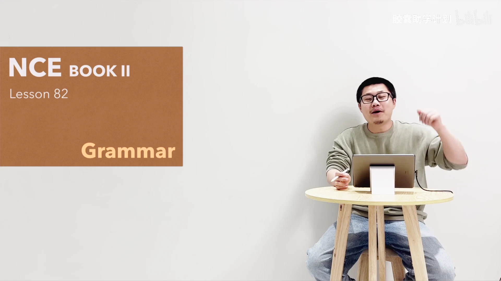

文字识别：NCE / BOOKⅡI / Lesson 82 / Grammar

### 画面 00:00:02

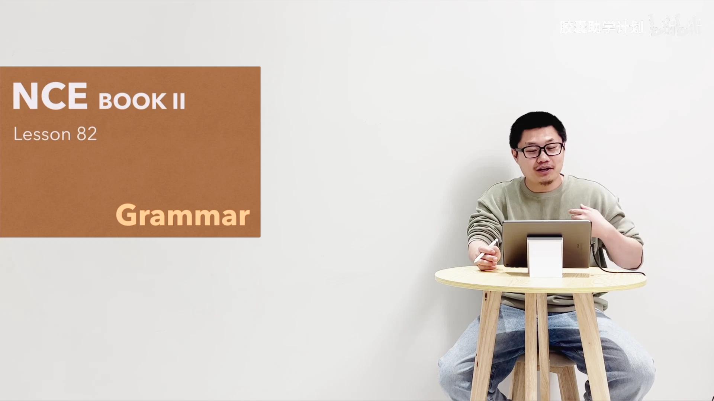

文字识别：NCE / BOOKⅡI / Lesson 82 / Grammar

### 画面 00:00:04

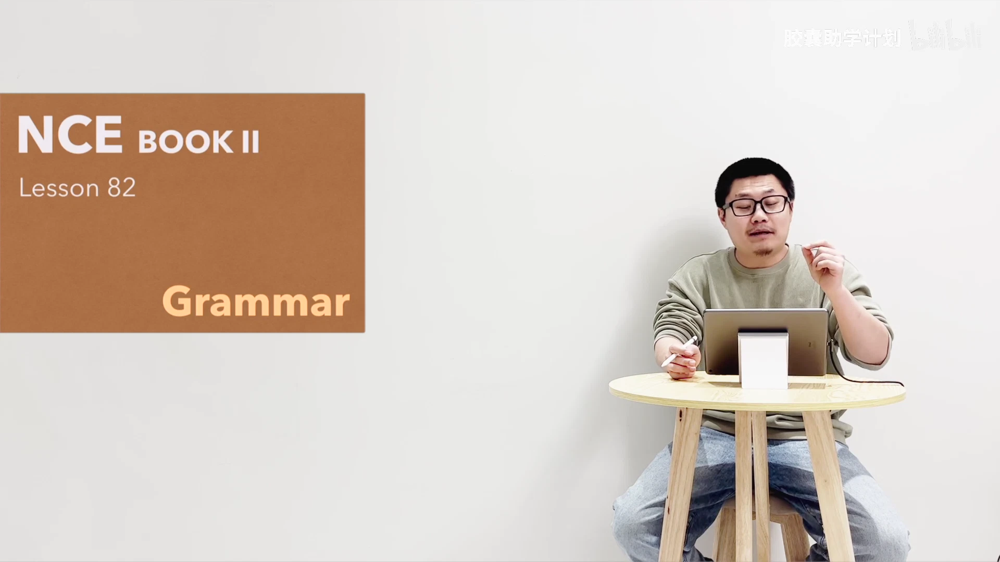

文字识别：NCE / BOOK"I / Lesson 82 / Grammar

### 画面 00:00:09

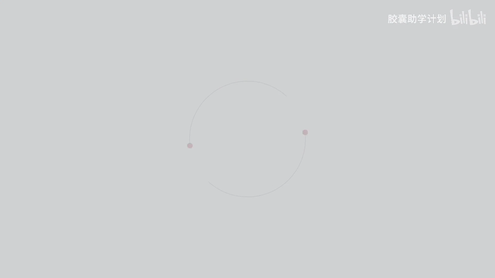

文字识别：Jbitb / 胶囊助学计划 / • / •

### 画面 00:00:13

### 画面 00:00:15

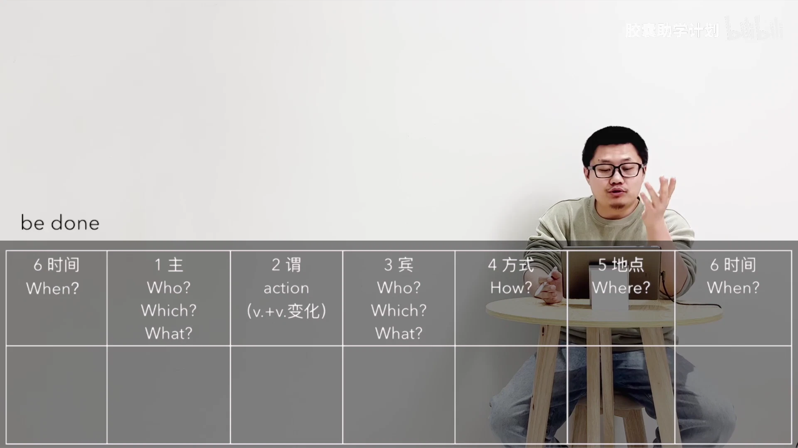

文字识别：囊助学计划 / be done / 6时间 / 1主 / 2谓 / 3宾 / 4方式 / 5地点 / 6时间 / When? / Who? / action / Who? / How? / Where? / When? / Which? / (v.+v.变化) / Which? / What? / What?

## 00:00:30–00:01:00

情态动词或情态助动词相关的被动，对吧？那这里呢，我们前面几乎全讲过了，以练代讲，直接上手，咱们就练就完了，好吧？好，也就是说，如果你忘了哪个东西的话，你要翻到呃，尤其是第一单元的第十课和第二十一课去复习，对吧？在这儿是不起到这个作用，我们就是张嘴练一下就好了。我问您答啊啊，全程repeat after me，OK？Tell me about the car. Who is buying it?

### 画面 00:00:40

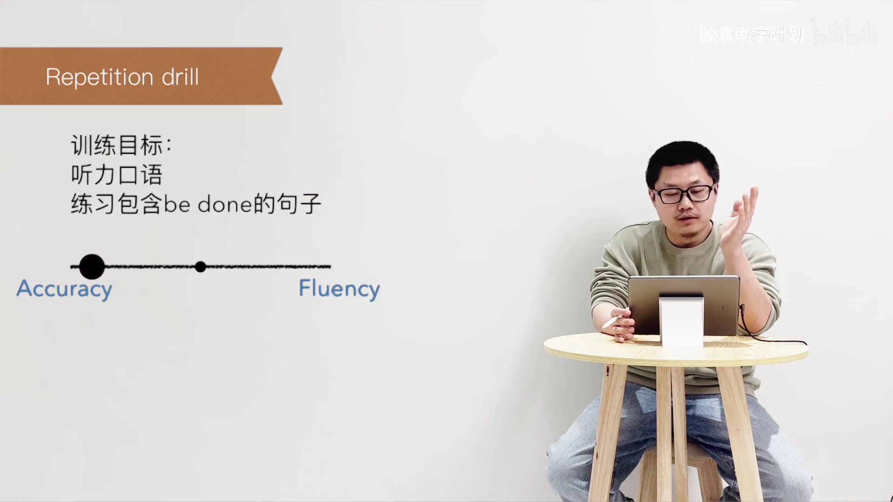

文字识别：Repetition drill / 训练目标： / 听力口语 / 练习包含be done的句子 / Accuracy / Fluency

### 画面 00:00:43

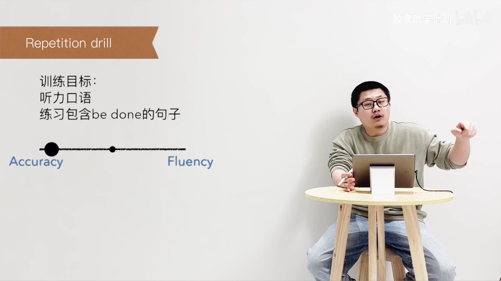

文字识别：Repetition drill / 训练目标： / 听力口语 / 练习包含be done的句子 / Accuracy / Fluency

### 画面 00:00:51

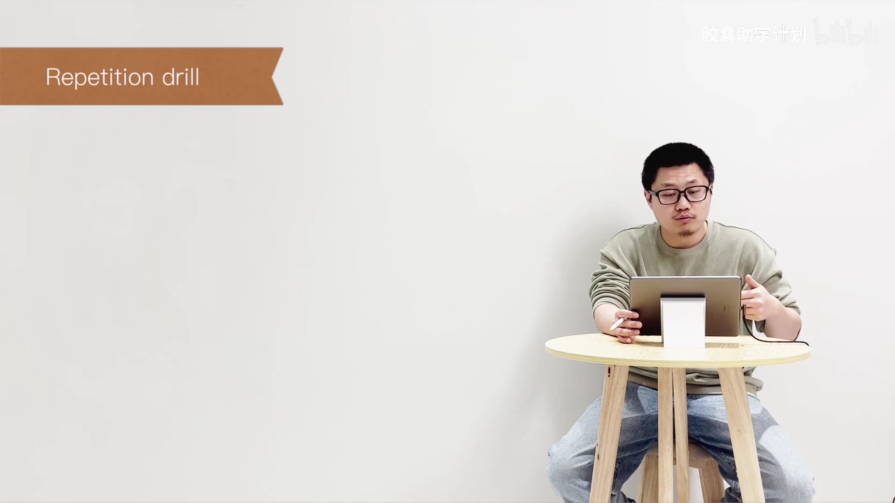

文字识别：辜助字计划 / Repetition drill

### 画面 00:00:55

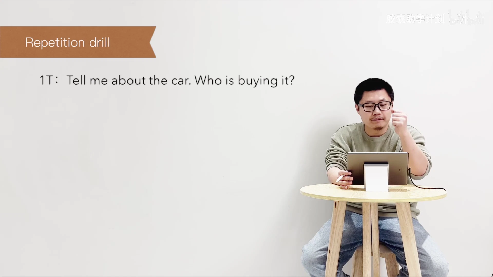

文字识别：Repetition drill / 1T: Tell me about the car. Who is buying it?

## 00:01:00–00:01:30

George is.造一句话说 the car is being bought by George.对于各位来说，各位的眼睛重点要放在这里，叫做正在被他买，对吧？好，Next one. Tell me about the goods. Who sends them abroad? Your firm does. The goods are sent abroad by my firm.啊，firm就是company一个意思，公司。

### 画面 00:01:02

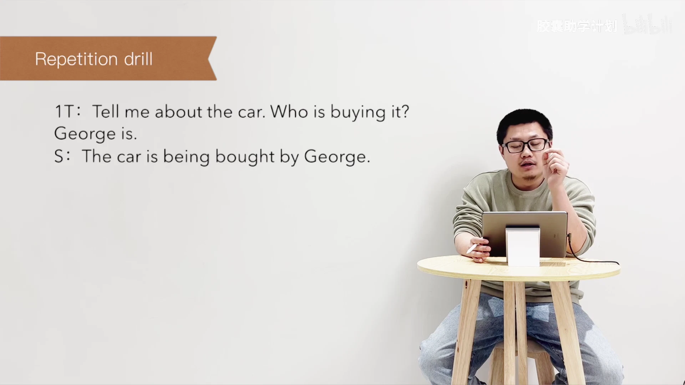

文字识别：Repetition drill / 1T: Tell me about the car. Who is buying it? / George is. / S: The car is being bought by George.

### 画面 00:01:10

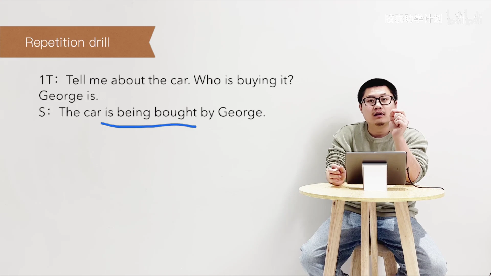

文字识别：Repetition drill / 1T: Tell me about the car. Who is buying it? / George is. / S: The car is being / bought by George.

### 画面 00:01:13

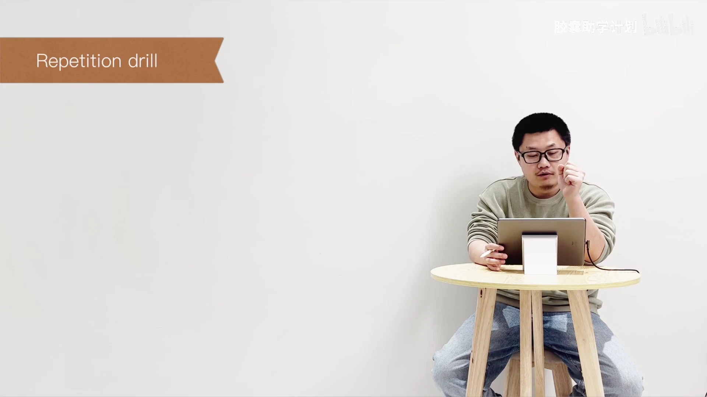

文字识别：毫助字计划 / Repetition drill

### 画面 00:01:21

文字识别：Repetition drill / 2T: Tell me about the goods. Who sends / them abroad? / Your firm does. / S: The goods are sent abroad by my firm.

### 画面 00:01:29

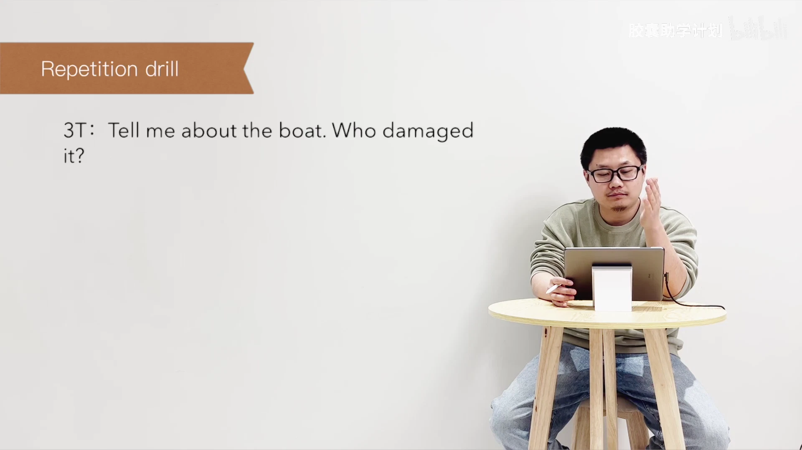

文字识别：Repetition drill / 3T: Tell me about the boat. Who damaged / it?

## 00:01:30–00:02:00

Tell me about the boat. Who damaged it? The sailor did. The boat was damaged by the sailor. Next one. Tell me about the story. Who has told it to you? A fisherman has. 现在完成时的被动啊. The story has been told to me by a fisherman. Tell me about

### 画面 00:01:45

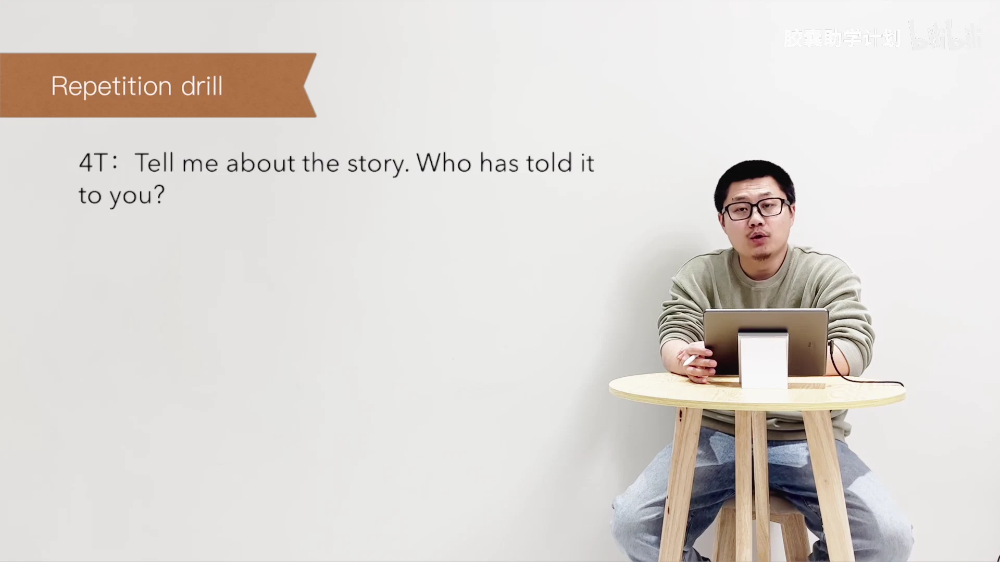

文字识别：Repetition drill / 4T: Tell me about the story. Who has told it / to you?

### 画面 00:01:49

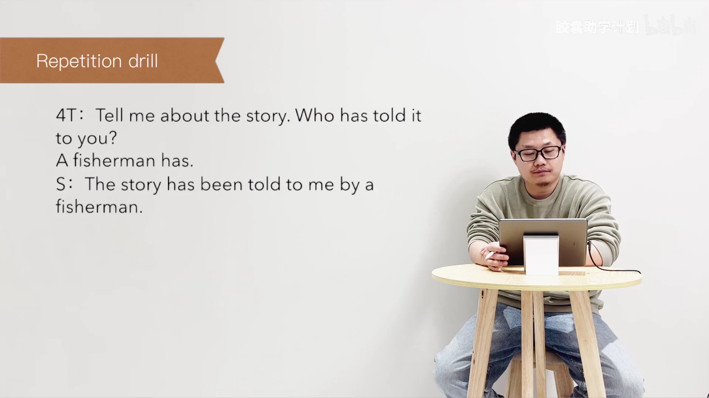

文字识别：Repetition drill / 4T: Tell me about the story. Who has told it / to you? / A fisherman has. / S: The story has been told to me by a / fisherman.

### 画面 00:01:58

文字识别：Repetition drill / 5T: Tell me about the boy. Who examined / him?

## 00:02:00–00:02:30

the boy, who examined him, a doctor. The boy was examined by a doctor.一般过去式的被动。Tell me about the prisoner, who has caught him. The guards have. The prisoner has been caught by the guards.好，has been，但现在完成式的被动。Tell me about the children,

### 画面 00:02:18

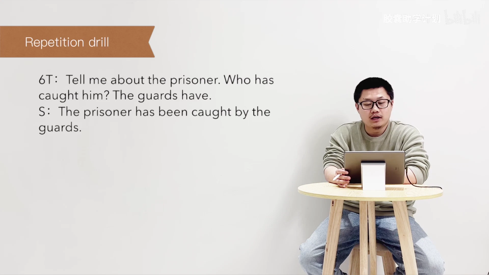

文字识别：Repetition drill / 6T: Tell me about the prisoner. Who has / caught him? The guards have. / S:The r / prisoner has been caught by the / guards.

### 画面 00:02:27

文字识别：毫助学计划 / Repetition drill

## 00:02:30–00:03:00

Who takes them to school? Their mother does. The children are taken to school by their mother. Tell me about this house. Who is buying it? A friend of mine is. This house is being bought by a friend of yours. Tell me about the boy. Who has found him? The police have.

### 画面 00:02:35

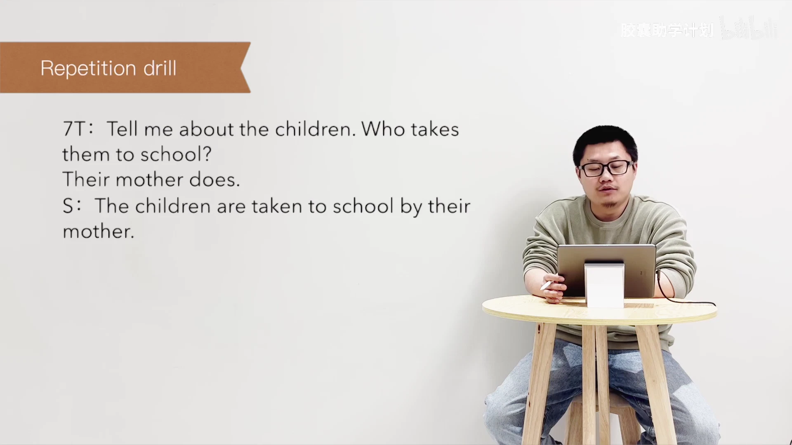

文字识别：Repetition drill / 7T: Tell me about the children. Who takes / them to school? / Their mother does. / S: The children are taken to school by their / mother.

### 画面 00:02:39

文字识别：Repetition drill / 8T: Tell me about this house. Who is buying / it?

### 画面 00:02:49

文字识别：Repetition drill / 8T: Tell me about this house. Who is buying / it? / A friend of mine is. / S: This house is being bought by a friend of / yours.

### 画面 00:02:53

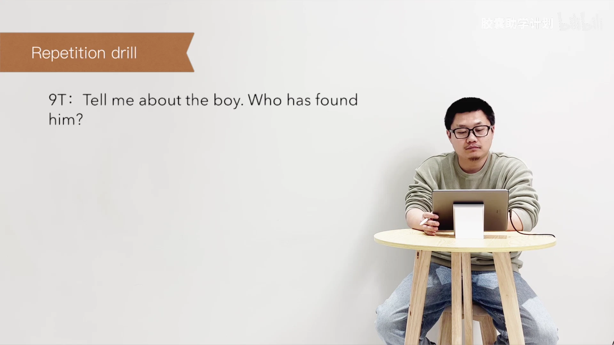

文字识别：Repetition drill / 9T: Tell me about the boy. Who has found / him?

## 00:03:00–00:03:30

The boy has been found by the police. Tell me about this building. Who is designing it? 注意现在进行时, a famous architect. This building is being designed by a famous architect. Okay, pendulum, four times four. 咱们先看啊，第一个. Someone must warn John immediately.

### 画面 00:03:12

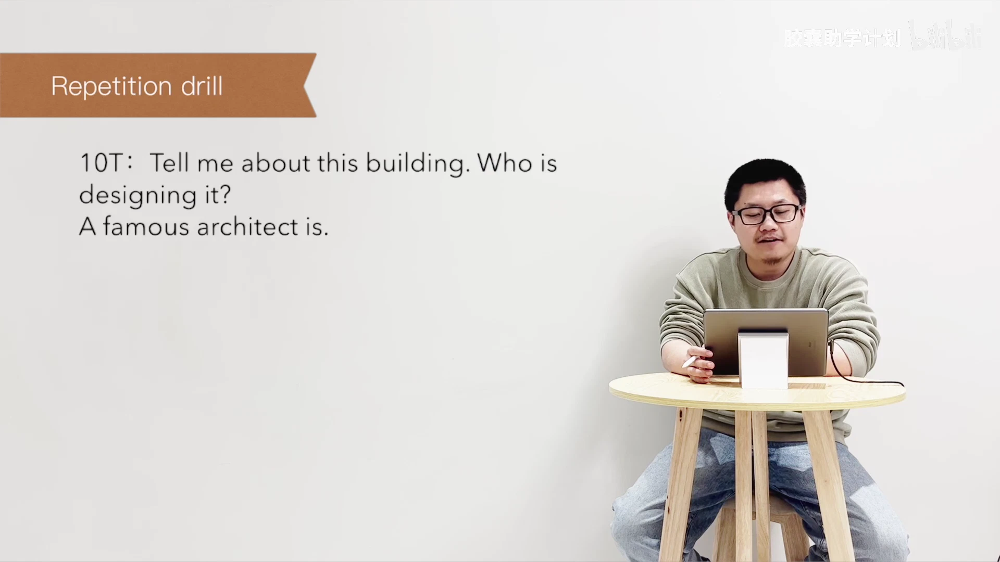

文字识别：Repetition drill / 10T: Tell me about this building. Who is / designing it? / A famous architect is.

### 画面 00:03:21

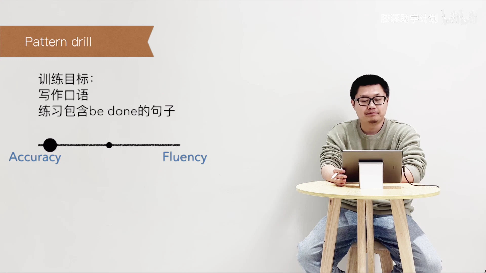

文字识别：Pattern drill / 训练目标： / 写作口语 / 练习包含be done的句子 / Accuracy / Fluency

### 画面 00:03:24

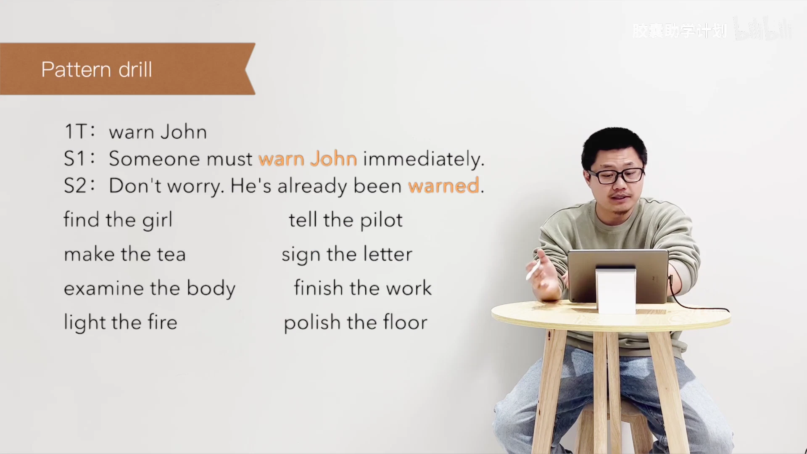

文字识别：Pattern drill / 1T:Warn John / S1: Someone must warn John immediately. / S2: Don't worry. He's already been warned. / find the girl / tell the pilot / make the tea / sign the letter / examine the body / finish the work / light the fire / polish the floor

### 画面 00:03:26

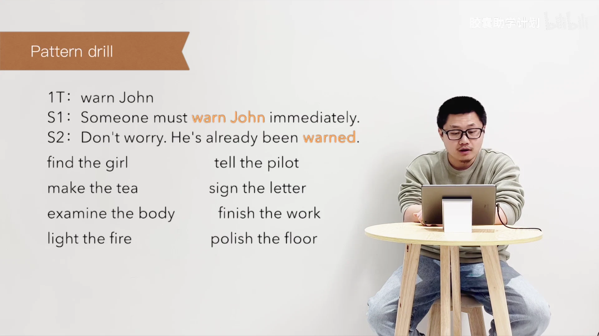

文字识别：Pattern drill / 1T:Warn John / S1: Someone must warn John immediately. / S2: Don't worry. He's already been warned. / find the girl / tell the pilot / make the tea / sign the letter / examine the body / finish the work / light the fire / polish the floor

## 00:03:30–00:04:00

哎，有人必须要迅速的去提醒一下John. Just don't worry. He's already been warned.哎，这个P.S.是has，现在完成时被动，他已经被警告了。这里就复习对吧？第二个，Have the man been caught yet?他已经被抓到了吗？One of them was caught yesterday.一般过去是被动，But the other hasn't been caught yet.另一个还没有被捉到，对吧？

### 画面 00:03:45

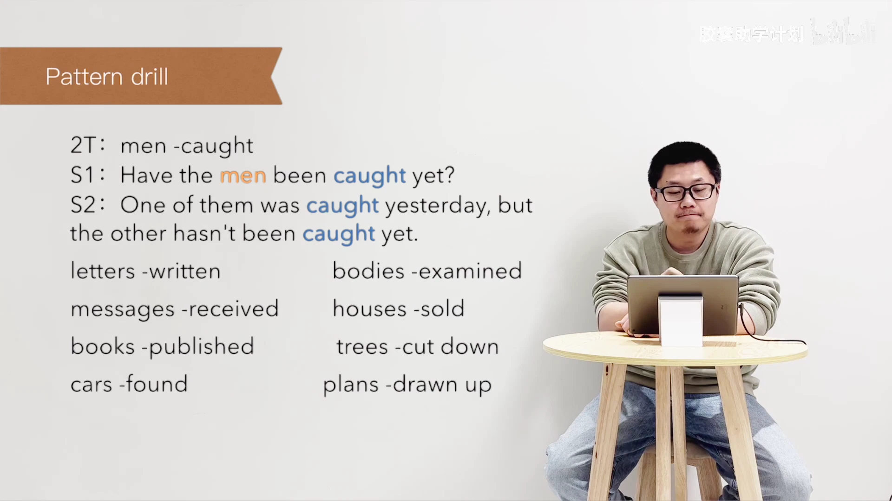

文字识别：Pattern drill / 2T:men-caught / S1: Have the men been caught yet? / S2: One of them was caught yesterday, but / the other hasn't been caught yet. / letters -written / bodies-examined / houses -sold / messages -received / books -published / trees-cut down / cars -found / plans -drawn up

## 00:04:00–00:04:30

哎，这个现在完成时的被动往里面去带啊，带的时候无非就是替代这些有颜色的单词。下一个，哎，这地方要先提一个叫 be supposed to do something，算是一个超纲的小习惯用法啊。其实 be supposed，呃呃，然后这里其实表达就是呃应该怎么怎么样，对吧？I'm not supposed to be here啊。说 Why isn't that man working？他为什么在那儿正在？他为什么没有在工作呢？I don't know. He's

### 画面 00:04:07

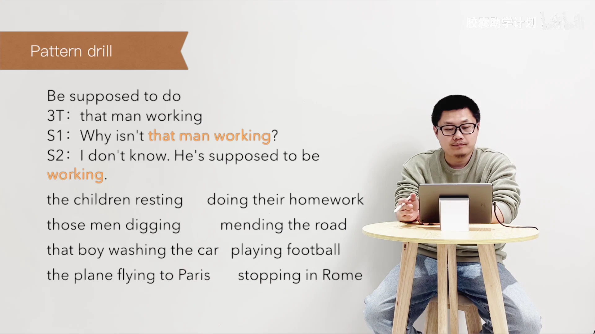

文字识别：Pattern drill / Be supposed to do / 3T:that man working / S1: Why isn't that man working? / S2: I don't know. He's supposed to be / working. / the children resting / doing their homework / those men digging / mending the road / that boy washing the car / r playing football / the plane flying to Paris / stopping in Rome

## 00:04:30–00:05:00

supposed to be working. He should have been finished hours ago. You see, this is the same sentence as in the previous sentence.

### 画面 00:04:35

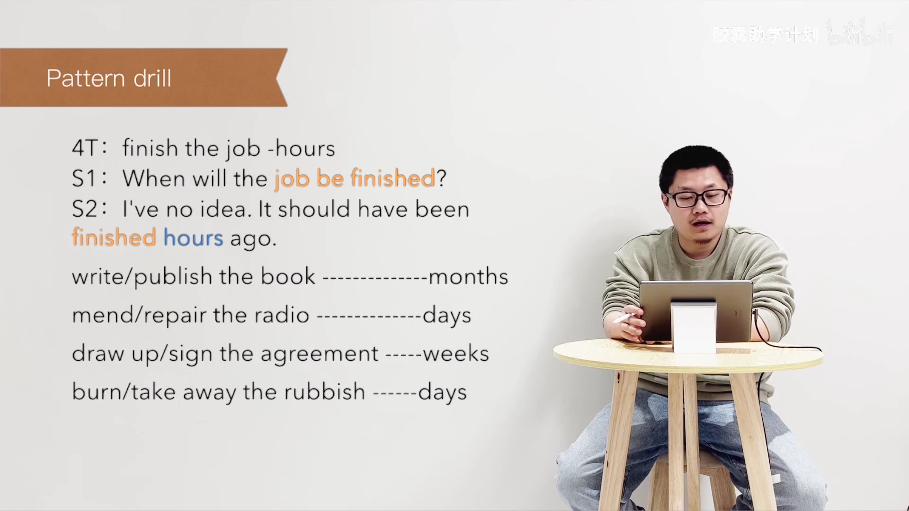

文字识别：Pattern drill / 4T: finish the job -hours / S1: When will the job be finished? / S2: I've no idea. It should have been / finished hours ago. / write/publish the book / ------months / mendrtidays / draw up/sign the agreement ---weeks / burn/takeaway therubbish -days

## 00:05:00–00:05:30

首先，should have done叫做本应该做却没做啊。You should have helped me，你本应该帮我，but you didn't。Why not？对吧？那这里用的是should have been done，叫本应该被怎么怎么样，但是却没有。所以这里说的是这工作什么时候完成了，我没概念。说它本应该在数小时前就已经被完成了，should have been done，对吧？OK，这是第四个。那不都说了，recap本课重点，复习了各种各样的被动，我们以练

### 画面 00:05:05

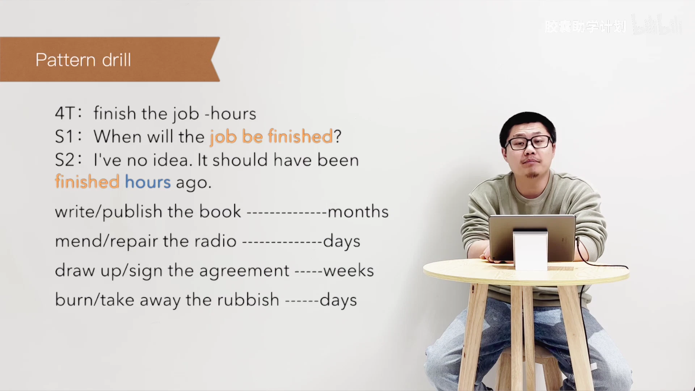

文字识别：Pattern drill / 4T: finish the job -hours / S1: When will the job be finished? / S2: I've no idea. It should have been / finished hours ago. / write/publish the book / -----months / mendrtraiodays / draw up/sign the agreement ---weeks / burn/takeaway therubbish -days

### 画面 00:05:24

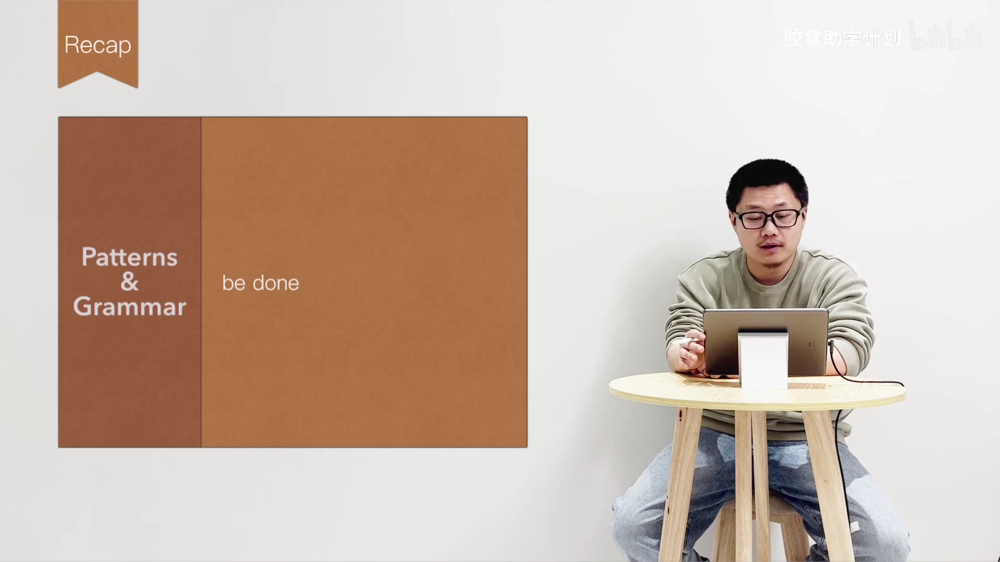

文字识别：Recap / 辜助字计划 / Patterns / ＆ / be done / Grammar

### 画面 00:05:26

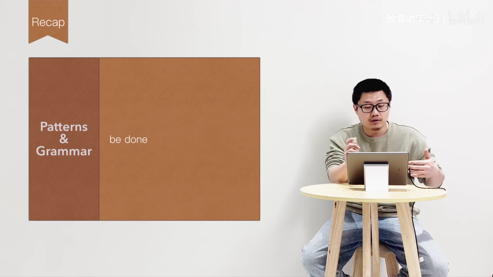

文字识别：Recap / 辜助字计划 / Patterns / ＆ / be done / Grammar

### 画面 00:05:28

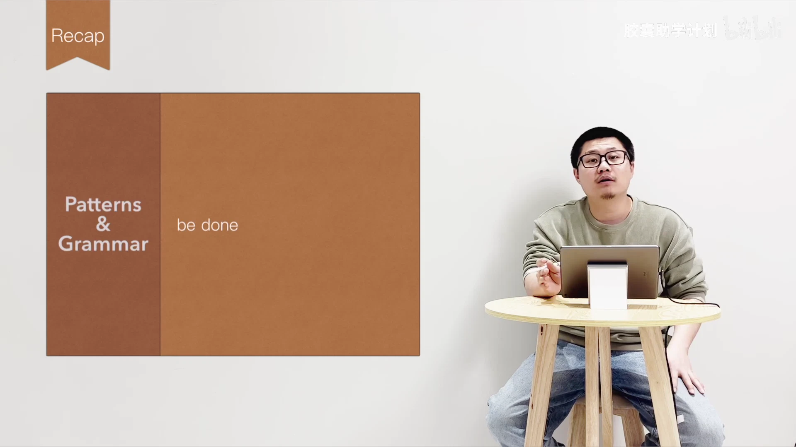

文字识别：Recap / 喜助字计划 / Patterns / ＆ / be done / Grammar

## 00:05:30–00:06:00

代讲。红皮书你一定要抓紧了。所以这里呢，patent drill你去写一下，我们就是在夯实一下基础，为了进入三册学习更顺利，打下一个坚实的基础。那你给自己讲一下语法吧，这是咱老生常谈的东西。然后翻红皮书，哎，初级这里说的是中级对吧？但是咱初级、中级到第四单元都给它扫一扫尾，都尽量的去写一写啊。还好我们这个第四单元没有什么新的语法，你的任务相对会少一点啊。OK，

### 画面 00:05:30

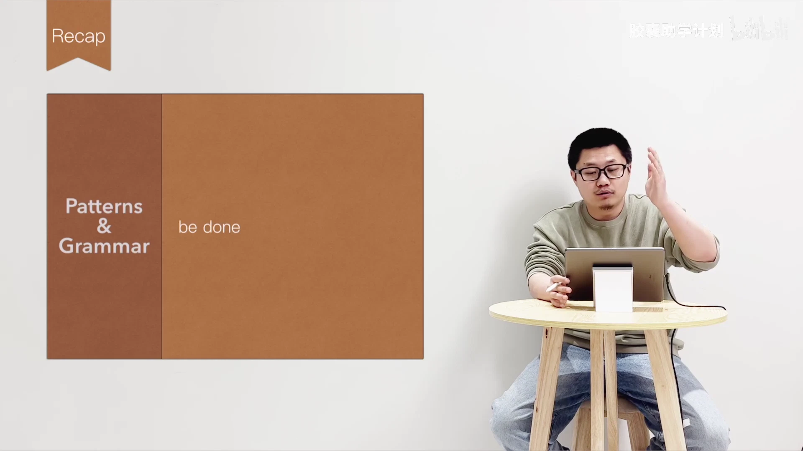

文字识别：Recap / 奏助学计划 / Patterns / ＆ / be done / Grammar

### 画面 00:05:32

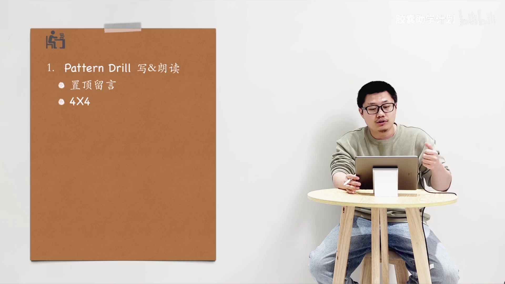

文字识别：妻助学计划 / 1.f / Pattern Drill写&朗读 / 置顶留言 / 4×4

### 画面 00:05:34

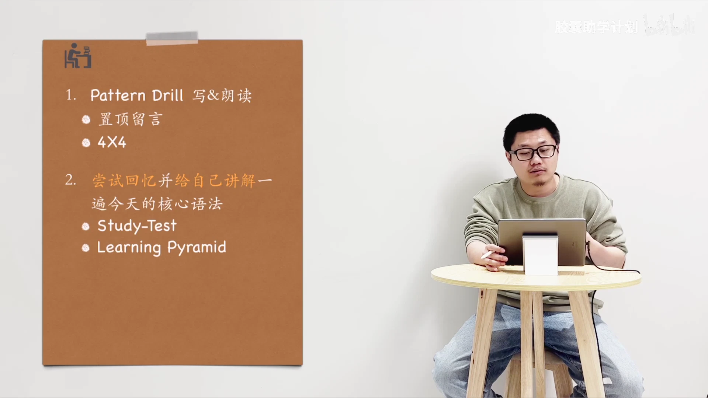

文字识别：Pattern Drill写&朗读 / 1. / 置顶留言 / 4×4 / 尝试回忆并给自己讲解一 / 遍今天的核心语法 / Study-Test / Learning Pyramid

### 画面 00:05:36

文字识别：Pattern Drill写&朗读 / 置顶留言 / 4×4 / 尝试回忆并给自己讲解一 / 遍今天的核心语法 / Study-Test / Learning Pyramid

### 画面 00:05:39

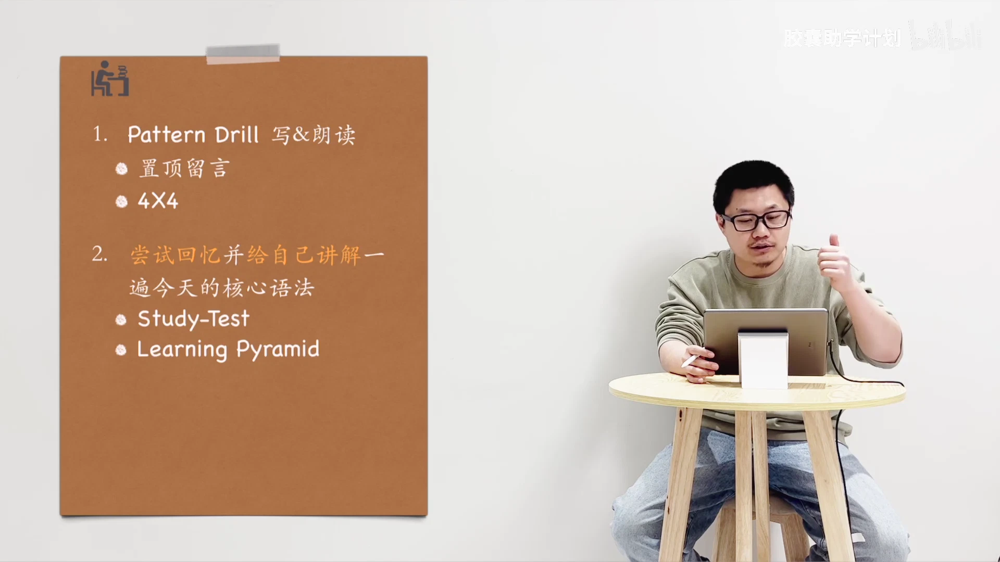

文字识别：Pattern Drill写&朗读 / 1. / 置顶留言 / 4×4 / 尝试回忆并给自己讲解一 / 遍今天的核心语法 / Study-Test / Learning Pyramid

### 画面 00:05:41

文字识别：Pattern Drill写&朗读 / 置顶留言 / 4X4 / 尝试回忆并给自己讲解一 / 遍今天的核心语法 / Study-Test / Learning Pyramid

### 画面 00:05:43

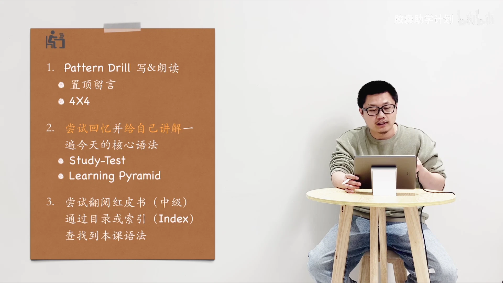

文字识别：1. f / Pattern Drill写&朗读 / 置顶留言 / 4×4 / 尝试回忆并给自己讲解一 / 遍今天的核心语法 / Study-Test /  Learning Pyramid / 尝试翻阅红皮书（中级） / 通过目录或索引(Index) / 查找到本课语法

### 画面 00:05:45

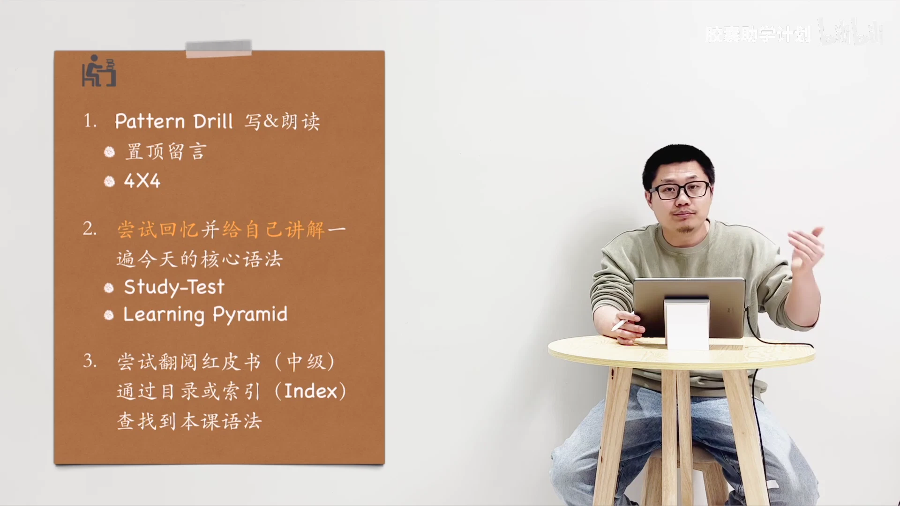

文字识别：Pattern Drill 写&朗读 / 置顶留言 / 4×4 / 尝试回忆并给自己讲解一 / 遍今天的核心语法 / Study-Test / Learning Pyramid / 尝试翻阅红皮书（中级） / 通过目录或索引(Index) / 查找到本课语法

### 画面 00:05:50

文字识别：1. f / Pattern Drill写&朗读 / 置顶留言 / 4×4 / 尝试回忆并给自己讲解一 / 遍今天的核心语法 / Study-Test / Learning Pyramid / 尝试翻阅红皮书（中级） / 通过目录或索引(Index) / 查找到本课语法

### 画面 00:05:55

文字识别：1. f / Pattern Drill 写&朗读 / 置顶留言 / 4×4 / 尝试回忆并给自己讲解一 / 遍今天的核心语法 / Study-Test / Learning Pyramid / 尝试翻阅红皮书（中级） / 通过目录或索引(Index) / 查找到本课语法

## 00:06:00–00:06:26

那以上呢就是本期视频的全部内容了。如果各位喜欢我们的课程呢，欢迎各位关注、订阅、一键三连，分享给那些需要的朋友，来帮助我们快速成长。See you next time.

### 画面 00:06:00

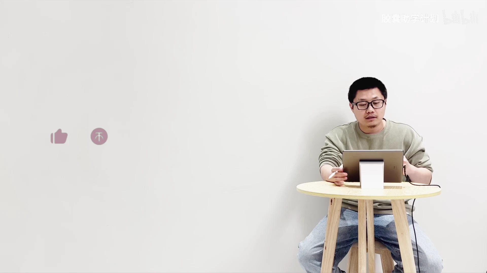

文字识别：奏助字计划明

### 画面 00:06:05

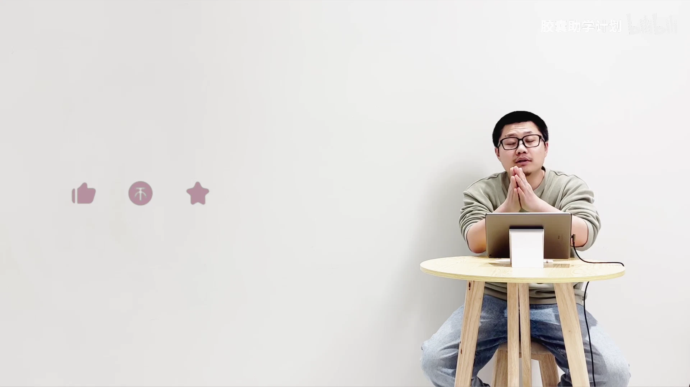

文字识别：囊助学计划 / 不

### 画面 00:06:11

文字识别：虞助字计划一

### 画面 00:06:14

### 画面 00:06:16

文字识别：CAPSULEACADEMY / 胶囊助学计划 / 小红书 / Lecturer / Leo / OE

### 画面 00:06:19

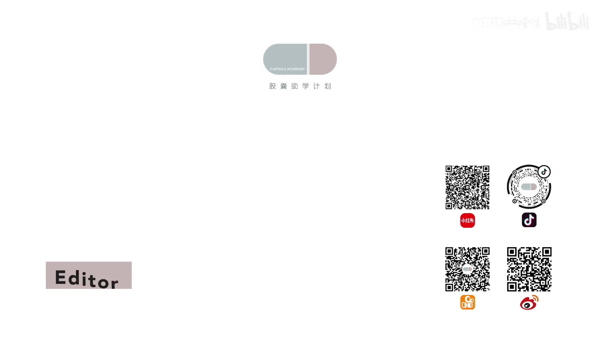

文字识别：CAPSULEACADEMY / 胶囊助学计划 / 小红书 / □ / Editor / OE

### 画面 00:06:22

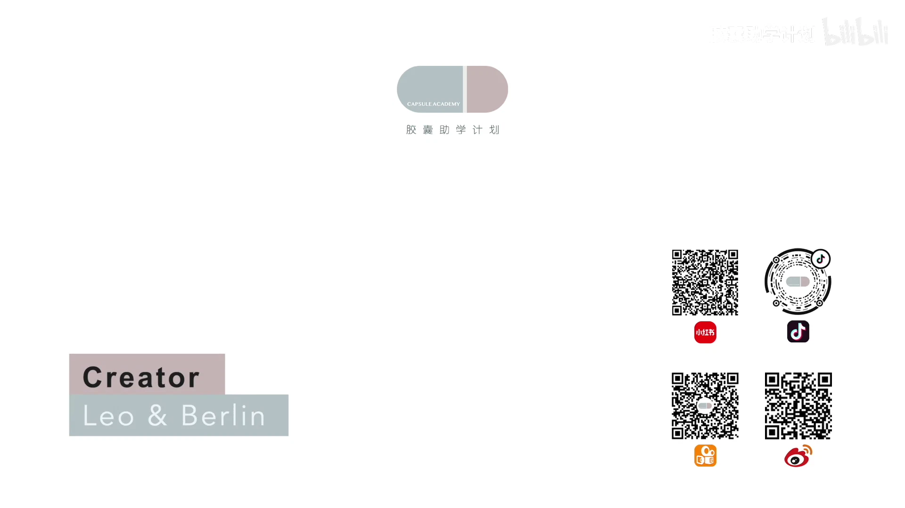

文字识别：珈学針物 / CAPSULEACADEMY / 胶囊助学计划 / 『 / 小红书 / Creator / Leo & Berlin / OE

### 画面 00:06:24

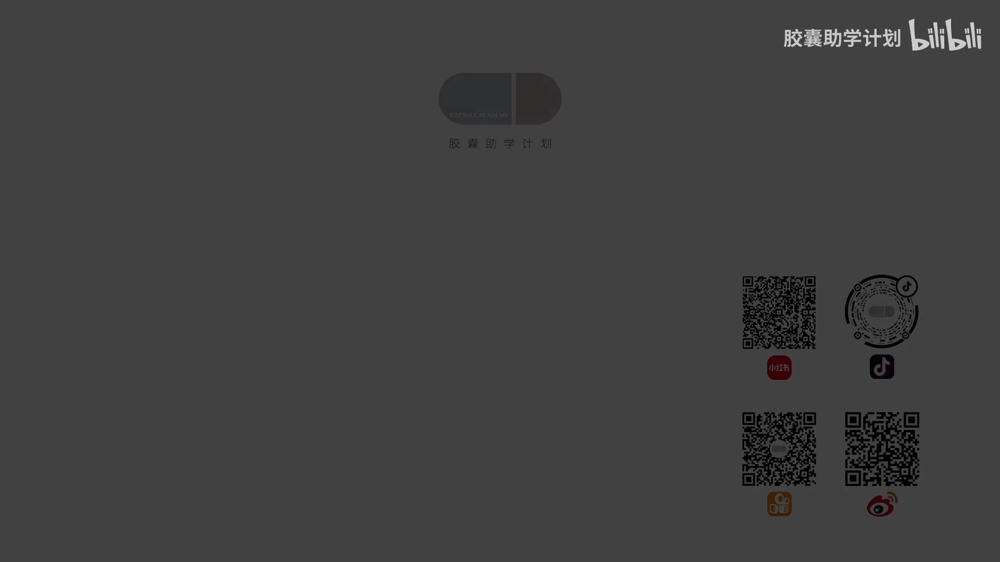

文字识别：bilibili / 胶囊助学计划 / 胶囊助学计划 / 小红书 / OE

### 画面 00:06:26

文字识别：bilbili / 胶囊助学计划

