# 082 文章

快速机器解析：语音为单模型转写，未进行独立交叉校对或人工复核；画面每秒采样并按变化选帧，短时文字和标记可能遗漏。截图时间约有 1 秒误差。图片有损压缩；遇到疑点请按时间查看 Google Drive 原视频。

## 00:00:00–00:00:30

Hello everyone, welcome to Capsule Academy. This is Leo. Today we're going to learn New Concept English Book Two Lesson 82 Story. Hope you can enjoy it.我们先看标题和问题，标题叫 Monster or Fish，啊到底是怪物还是鱼呢？那我们进入文章看呗。然后下一个说 What was the monster called？啊这个文章当中出现了一个具体的加引号的 monster，我们看看它到底叫

### 画面 00:00:00

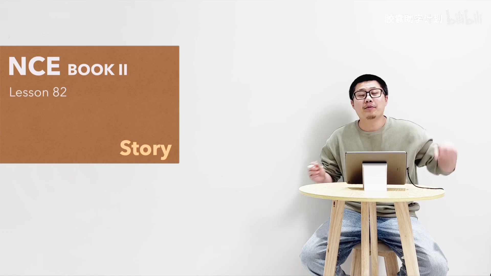

文字识别：NCE / BOOKII / Lesson 82 / Story

### 画面 00:00:05

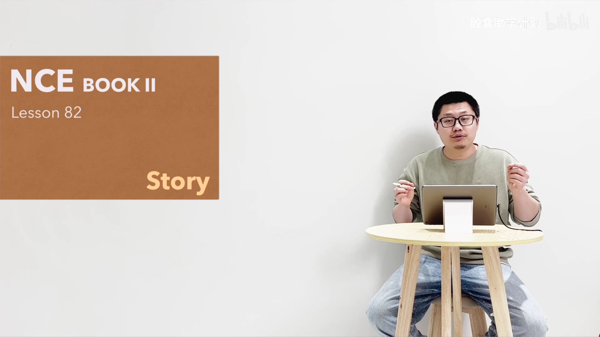

文字识别：NCE / BOOK"I / Lesson 82 / Story

### 画面 00:00:09

文字识别：胶囊助学计划bii / •

### 画面 00:00:13

文字识别：動学計

### 画面 00:00:15

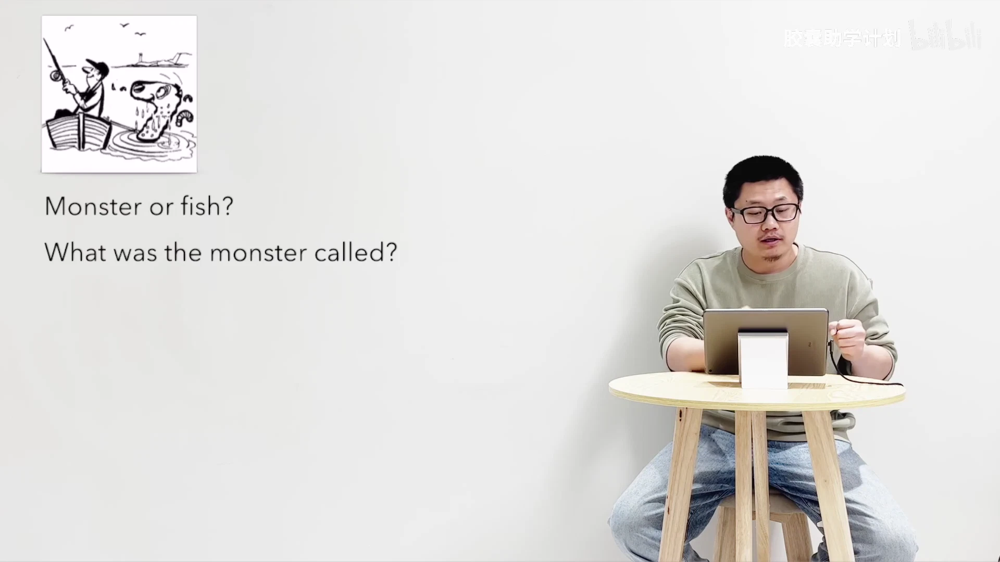

文字识别：Monster or fish? / What was the monster called?

## 00:00:30–00:01:00

叫做什么啊？当然这里还用的是被动，was called，被叫做什么？看文章，这篇文章还长难句不少，注意力集中，咱一起看一下。Fishermen and sailors sometimes claim to have seen monsters in the sea. A和B，渔夫和水手，有的时候呢，本课的一个习惯用法，新三上来咱们就又能见到，说声称已经看到了，

### 画面 00:00:35

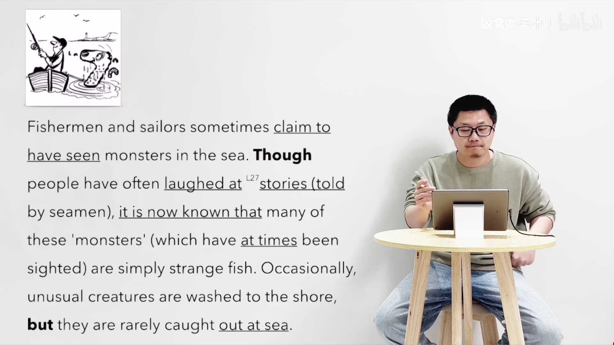

文字识别：Fishermen and sailors sometimes claim to / have seen monsters in the sea. Though / people have often laughed at [2'stories (told / by seamen), it is now known that many of / these'monsters'(which have at times been / sighted) are simply strange fish. Occasionally, / unusual creatures are washed to the shore, / but they are rarely caught out at sea.

### 画面 00:00:37

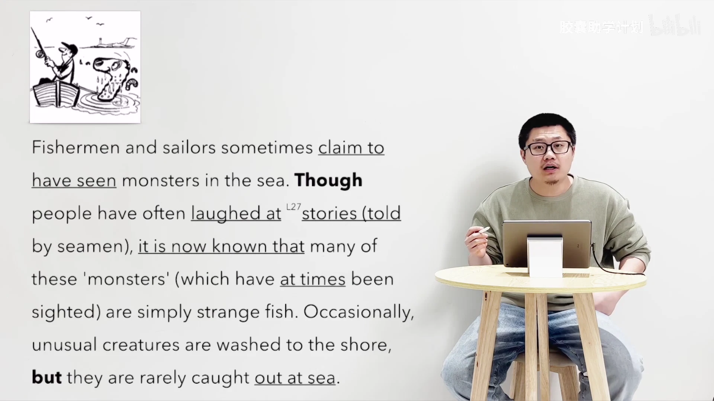

文字识别：Fishermen and sailors sometimes claim to / have seen monsters in the sea. Though / people have often laughed at 2²stories (told / by seamen), it is now known that many of / these'monsters'(which have at times been / sighted) are simply strange fish. Occasionally, / unusual creatures are washed to the shore, / but they are rarely caught out at sea.

### 画面 00:00:40

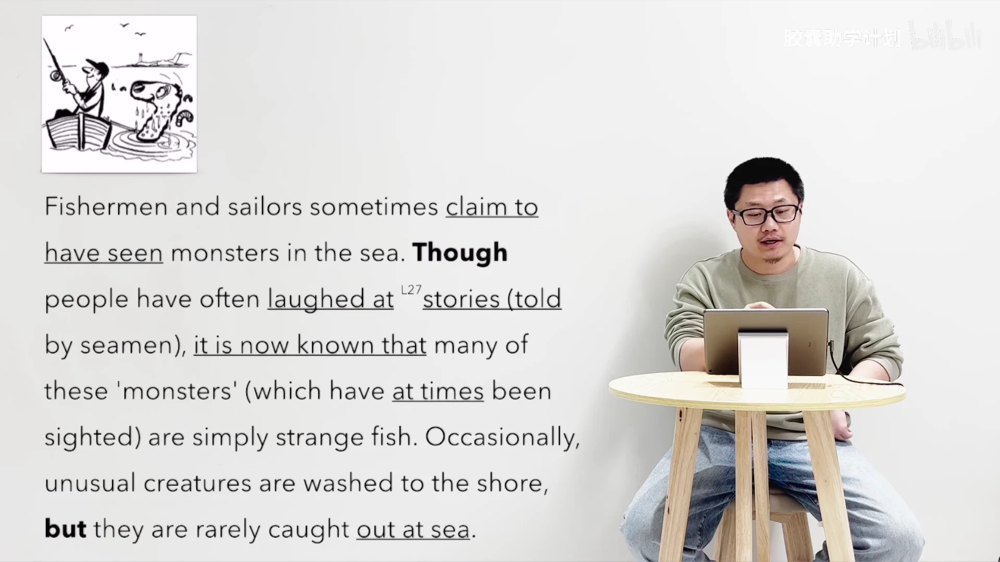

文字识别：Fishermen and sailors sometimes claim to / have seen monsters in the sea. Though / people have often laughed at [²'stories (told / by seamen), it is now known that many of / these'monsters'(which have at times been / sighted) are simply strange fish. Occasionally, / unusual creatures are washed to the shore, / but they are rarely caught out at sea.

## 00:01:00–00:01:30

经常啊，时不时的就会生成看到了 monsters，怪物 in the sea 在海上。下一句话就很长，咱们注意力集中，我先都给他读一遍。Though people have often loved at stories told by seamen, it is now known that many of these monsters, which have at times been sighted, are simply

### 画面 00:01:10

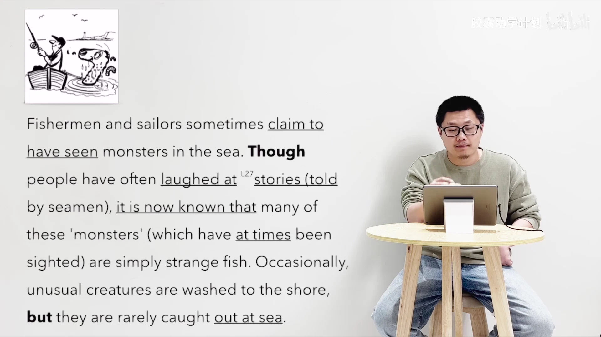

文字识别：Fishermen and sailors sometimes claim to / have seen monsters in the sea. Though / people have often laughed at 2²stories (told / by seamen), it is now known that many of / these'monsters' (which have at times been / sighted) are simply strange fish. Occasionally, / unusual creatures are washed to the shore, / but they are rarely caught out at sea.

## 00:01:30–00:02:00

strange fish.好，呃，这句话乍一看是挺长的，但是我们实际上通过一些连词逗号可以把它去进行一下拆分。首先，我们拆出来第一句话叫做Though people have often laugh at stories told by seamen，说尽管人们have often laugh at，经常会laugh at somebody or something呢，指的就是嘲笑啊，这个是本课的习惯用法。一会儿咱们造句，经常会嘲笑什么呢？

### 画面 00:01:34

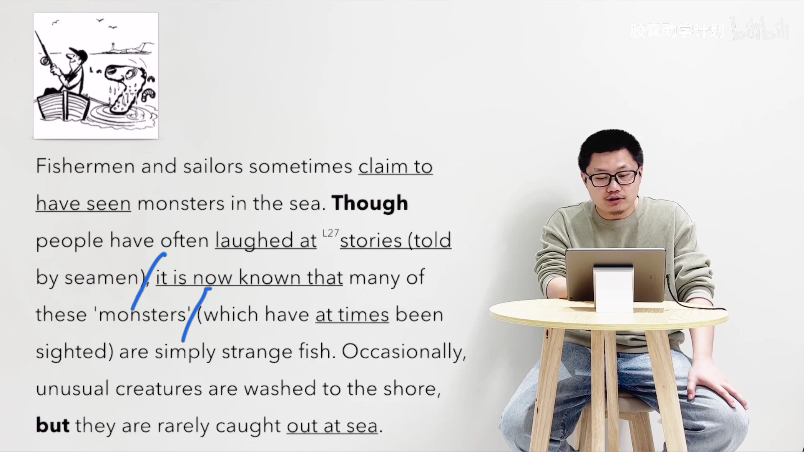

文字识别：Fishermen and sailors sometimes claim to / have seen monsters in the sea. Though / people have often laughed at [²'stories (told / by seamenyit is now known that many of / these'monsters'/(which have at times been / sighted) are simply strange fish. Occasionally, / unusual creatures are washed to the shore, / but they are rarely caught out at sea.

### 画面 00:01:36

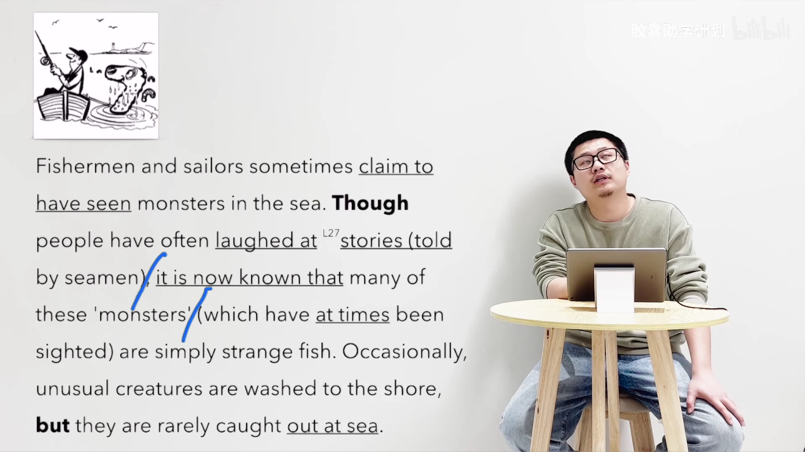

文字识别：Fishermen and sailors sometimes claim to / have seen monsters in the sea. Though / people have often laughed at [²'stories (told / by seameny/it is now known that many of / these 'monsters'/(which have at times been / sighted) are simply strange fish. Occasionally, / unusual creatures are washed to the shore, / but they are rarely caught out at sea.

## 00:02:00–00:02:30

Stories，一些故事，什么样的故事呢？后边有一个二八二九三十，定语从啊，定语对吧？这个是分词引导的短语做定语，被，sea men，sea men指的就是sailors，对吧？被这些水手们讲述的故事。那这个tell the story其实是二十七课咱们学过的一个短语啊。好，首先要注意，再强调一遍，这个told by sea men是一个被分词啊，这个叫呃过去分词

### 画面 00:02:06

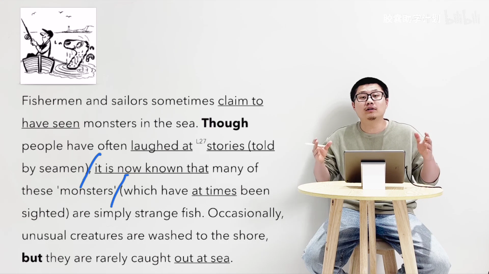

文字识别：Fishermen and sailors sometimes claim to / have seen monsters in the sea. Though / people have often laughed at [²'stories (told / by seameny/it is now known that many of / these'monsters'/(which have at times been / sighted) are simply strange fish. Occasionally, / unusual creatures are washed to the shore, / but they are rarely caught out at sea.

## 00:02:30–00:03:00

后置做定语了，叫做被水手们讲述过的故事。人们经常嘲笑这些被水手们讲的故事。接下来，It is now known that many of these monsters，先不管这括号里的东西，直接看后边 are simply strange fish。首先，第一个要解释这个，这是本课一个非常重要的习惯用法，咱们给它摘出来，叫做现在已经被知

### 画面 00:02:36

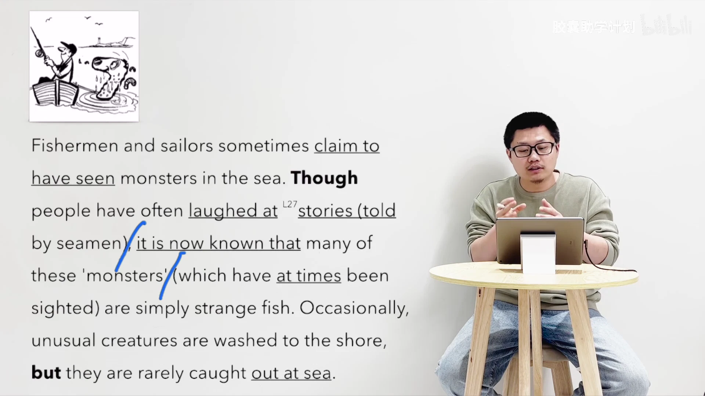

文字识别：Fishermen and sailors sometimes claim to / have seen monsters in the sea. Though / people have often laughed at 2²stories (told / by seamenyit is now known that many of / these'monsters'/(which have at times been / sighted) are simply strange fish. Occasionally, / unusual creatures are washed to the shore, / but they are rarely caught out at sea.

### 画面 00:02:56

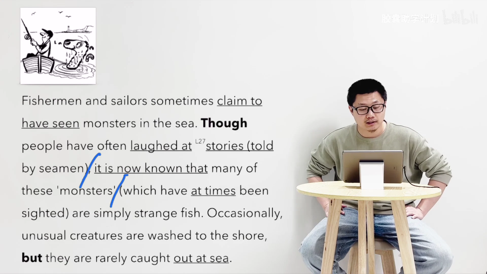

文字识别：Fishermen and sailors sometimes claim to / have seen monsters in the sea. Though / people have often laughed at [²'stories (told / by seamenyit is now known that many of / these'monsters'/(which have at times been / sighted) are simply strange fish. Occasionally, / unusual creatures are washed to the shore, / but they are rarely caught out at sea.

## 00:03:00–00:03:30

道了，哎，我们汉语这样翻译起来有点怪。首先你要知道它是个被动，is that，对吧？但是我们汉语一般就直接说，就现在人们知道了就可以了啊。然后在这里呢，其实有两个点，各位可能要注意一下。第一个就是 it is that，这可能跟五十八课学过的那个强调句是类似的，但是呢，强调句不能强调的是什么呢？动词。所以这个保不齐又是另一个东西了。所以在那这是另一个东西呢，我们就两种讲法。

### 画面 00:03:03

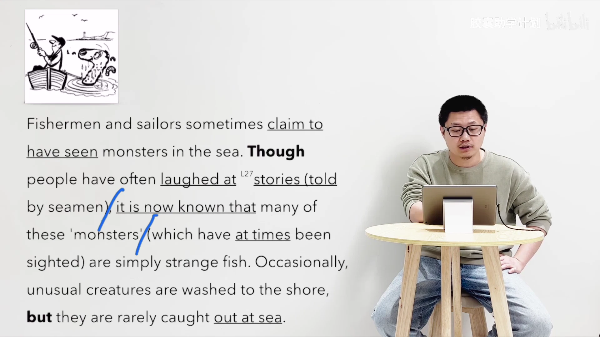

文字识别：Fishermen and sailors sometimes claim to / have seen monsters in the sea. Though / people have often laughed at [²'stories (told / by seamenyit is now known that many of / these'monsters'/(which have at times been / sighted) are simply strange fish. Occasionally, / unusual creatures are washed to the shore, / but they are rarely caught out at sea.

## 00:03:30–00:04:00

一种讲法呢，我之前跟各位说，我很推崇的，叫做哎，叫做 it is now known that 后边加一句话，我们就拿它一遍一遍造句。我们把高难语法习惯用法化，对吧？这个语法听上去有点复杂，主语从句嘛，我我不管它什么从句，反正我以后想表达，现在已经知道了一件事儿，叫做 it is now known that 后边加一句话，我就拿这个造句，造十句话，将来张嘴我就能说出来了。这是我们一会儿哎，这个进入习惯用法造句

### 画面 00:03:33

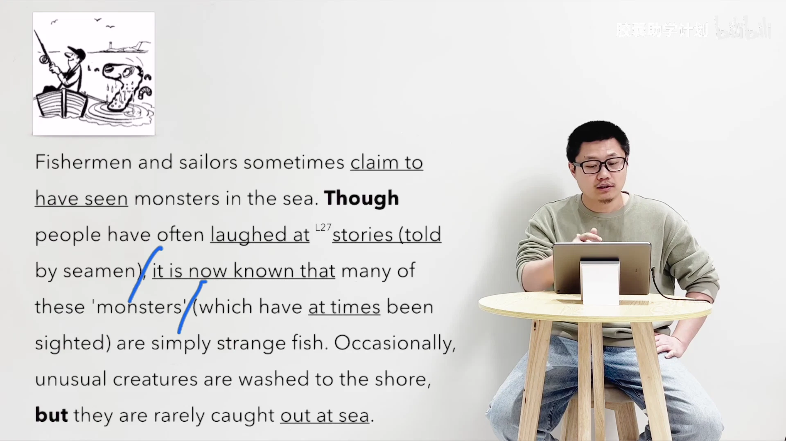

文字识别：Fishermen and sailors sometimes claim to / have seen monsters in the sea. Though / people have often laughed at 2²stories (told / by seamenyit is now known that many of / these'monsters'/(which have at times been / sighted) are simply strange fish. Occasionally, / unusual creatures are washed to the shore, / but they are rarely caught out at sea.

### 画面 00:03:44

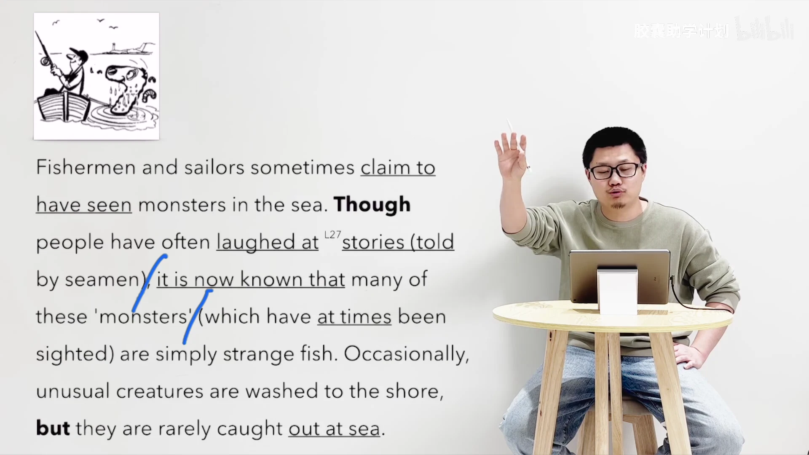

文字识别：Fishermen and sailors sometimes claim to / have seen monsters in the sea. Though / people have often laughed at [²'stories (told / by seamenyit is now known that many of / these'monsters'/(which have at times been / sighted) are simply strange fish. Occasionally, / unusual creatures are washed to the shore, / but they are rarely caught out at sea.

## 00:04:00–00:04:30

的那个环节要处理的事情，那现在呢，简单说一下怎么就主语从句了呢？其实就是这样，it is now known，it is，it is now known，它现在知道了，被知道了。那你必然会问我一个问题，它指代的是谁？指代的是谁呢？就是 that 后边引导的那一句话，听明白了吧？所以其实后边这个是一个跟 that 是一样的东西，哎，这就是英文当中的主从，听懂了就懂了，不懂完全不影响使用，听见了啊？

### 画面 00:04:04

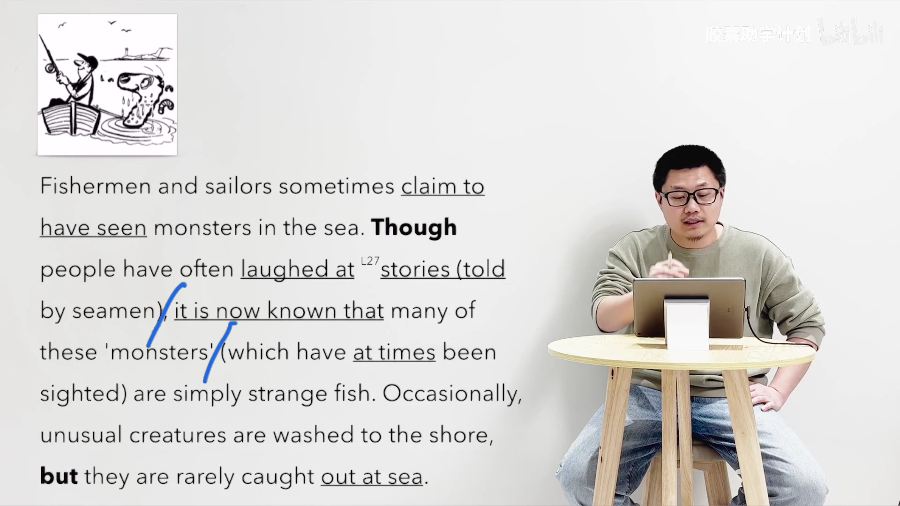

文字识别：Fishermen and sailors sometimes claim to / have seen monsters in the sea. Though / people have often laughed at [²'stories (told / by seamenyit is now known that many of / these'monsters'/(which have at times been / sighted) are simply strange fish. Occasionally, / unusual creatures are washed to the shore, / but they are rarely caught out at sea.

## 00:04:30–00:05:00

好，说现在已经知道了什么事情呢？看后边这句话叫 many many of these monsters are simply strange fish。说许多这些所谓的怪物加引号了，只是很简单，就是一个奇怪的鱼，对吧？就是人们分不清，就当做怪物了呗。中间来了个定语从句，定语从句修饰这个所谓的怪物。这种怪物呢，at times先不管它，叫做 have been sighted，

### 画面 00:04:34

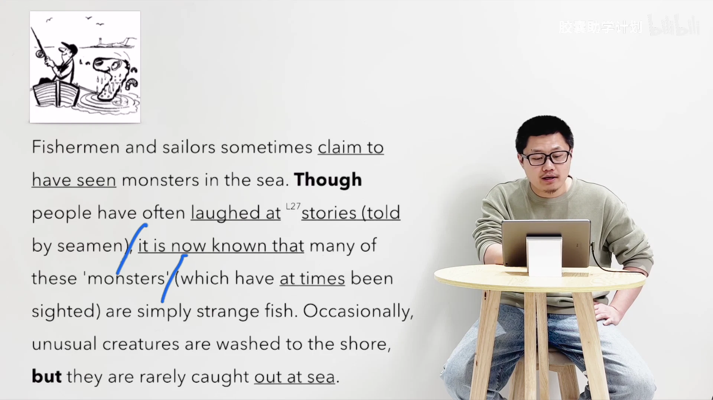

文字识别：Fishermen and sailors sometimes claim to / have seen monsters in the sea. Though / people have often laughed at 2²stories (told / by seamenyit is now known that many of / these'monsters'/(which have at times been / sighted) are simply strange fish. Occasionally, / unusual creatures are washed to the shore, / but they are rarely caught out at sea.

### 画面 00:04:57

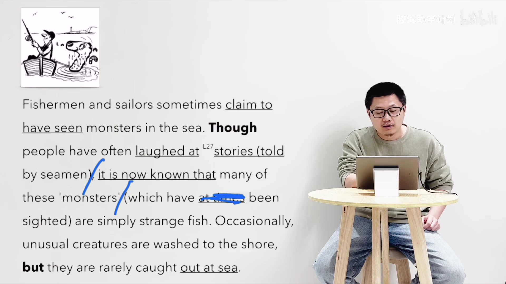

文字识别：Fishermen and sailors sometimes claim to / have seen monsters in the sea. Though / people have often laughed at [²'stories (told / by seameny/it is now known that many of / these'monsters'(which have at. / been / sighted) are simply strange fish. Occasionally, / unusual creatures are washed to the shore, / but they are rarely caught out at sea.

## 00:05:00–00:05:30

叫做已经被人们看到了的怪物。所以这句话要翻译成叫做现在知道的事情是许多这些被人们看到的怪物，它仅仅就是一个奇怪的鱼。这句话翻译就结束了。那这里的 at times 呢，就类似于 sometimes，叫做有时或者说间或，对吧？OK，啊，呃，at times 这样一个小的习惯用法，一会儿咱们造句。现在知道什么意思就可以了。Occasionally, unusual

### 画面 00:05:15

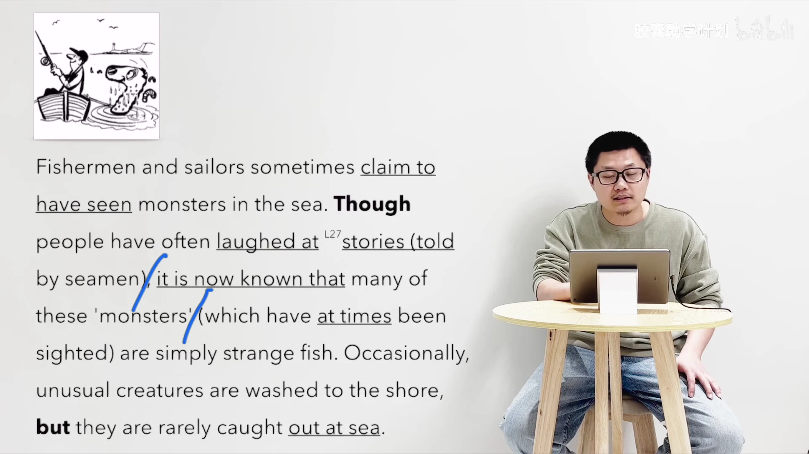

文字识别：Fishermen and sailors sometimes claim to / have seen monsters in the sea. Though / people have often laughed at [²'stories (told / by seamenyit is now known that many of / these'monsters'/(which have at times been / sighted) are simply strange fish. Occasionally, / unusual creatures are washed to the shore, / but they are rarely caught out at sea.

## 00:05:30–00:06:00

creatures are washed to the shore, but they are rarely caught out at sea. Occasionally,时不时地，时不时地，哎，怎么样的呢？一些不同寻常的生物被动被冲刷到了海岸上，但是它们呢，rarely caught are caught一般现在是被动被捉到，基本不会被捉到。Rarely其实是类似于一个

### 画面 00:05:45

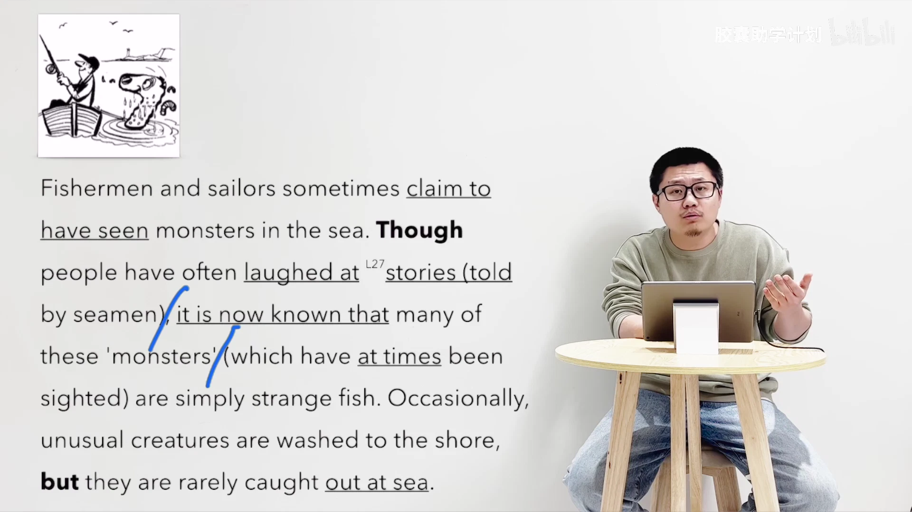

文字识别：Fishermen and sailors sometimes claim to / have seen monsters in the sea. Though / people have often laughed at [²'stories (told / by seamenyit is now known that many of / these'monsters'/(which have at times been / sighted) are simply strange fish. Occasionally, / unusual creatures are washed to the shore, / but they are rarely caught out at sea.

## 00:06:00–00:06:30

否定词的，对吧？就是很罕见的会被捉到. Out at sea, out at sea两种翻译方式，一个叫在海上，一个叫在远海，都可以没有问题啊。呃呃，其实字面意思也好理解。你比如说at sea就是在海上，out at sea就是在海的外面，对吧？不是在近海，不是在海边儿。海边儿就shore了吗？对吧？Next one. Some time ago, however, a peculiar fish was

### 画面 00:06:01

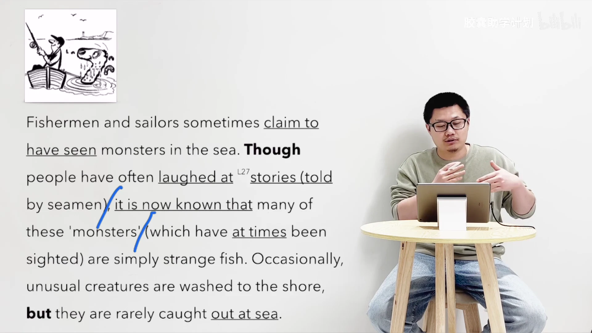

文字识别：Fishermen and sailors sometimes claim to / have seen monsters in the sea. Though / people have often laughed at [²'stories (told / by seamenyit is now known that many of / these'monsters'/(which have at times been / sighted) are simply strange fish. Occasionally, / unusual creatures are washed to the shore, / but they are rarely caught out at sea.

### 画面 00:06:04

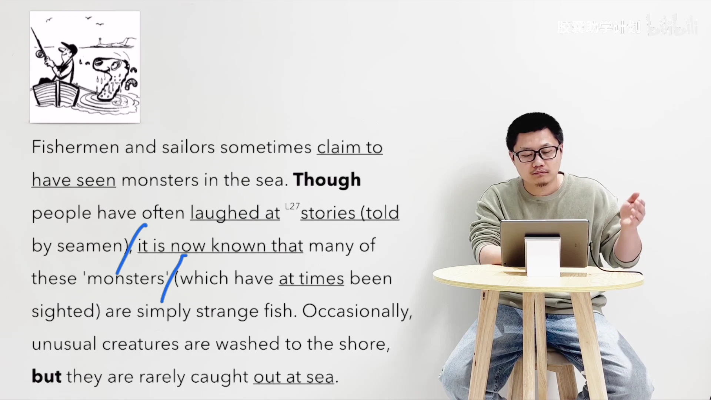

文字识别：Fishermen and sailors sometimes claim to / have seen monsters in the sea. Though / people have often laughed at [²'stories (told / by seamenyit is now known that many of / these'monsters'/(which have at times been / sighted) are simply strange fish. Occasionally, / unusual creatures are washed to the shore, / but they are rarely caught out at sea.

### 画面 00:06:24

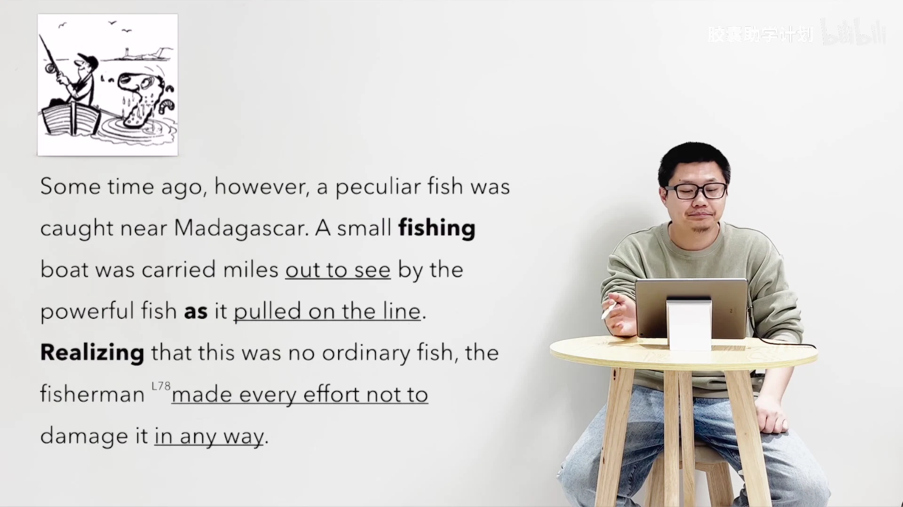

文字识别：Some time ago, however, a peculiar fish was / caught near Madagascar. A small fishing / boat was carried miles out to see by the / powerful fish as it pulled on the line. / Realizing that this was no ordinary fish, the / fisherman / L78 / 'made every effort not to / damage it in any way.

## 00:06:30–00:07:00

caught near, uh, Madagascar. Ah, e, ah, this, this, uh,不久前啊,呃,然而呢,说一个特别奇怪的鱼被捉到了在Madagascar附近,马达加斯加附近,对吧?好,注意这里的was caught,一般过去式被动. A small fishing boat was carried miles out to sea by the powerful fish as it pulled on the line.

### 画面 00:06:54

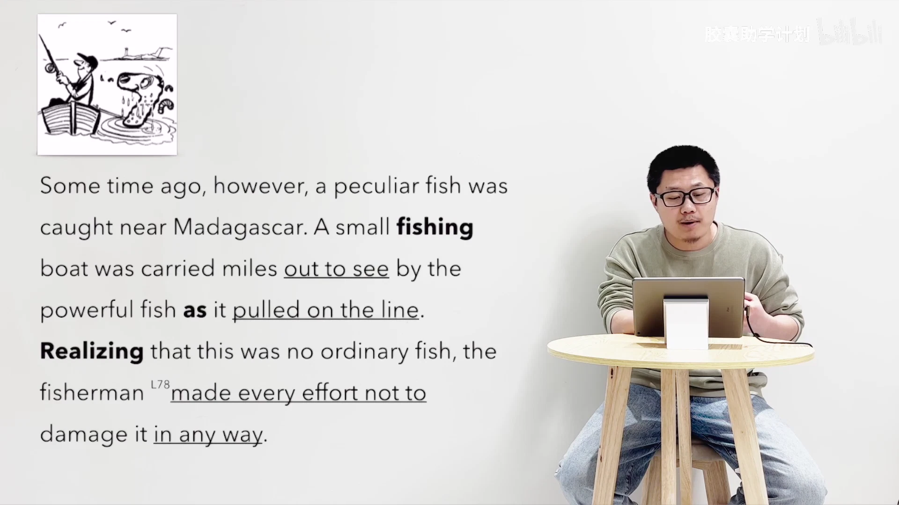

文字识别：Some time ago, however, a peculiar fish was / caught near Madagascar. A smallfishing / boat was carried miles out to see by the / powerful fish as it pulled on the line. / Realizing that this was no ordinary fish, the / fisherman / L78 / 'made every effort not to / damage it in any way.

## 00:07:00–00:07:30

So,有一个小的 fishing boat.你看这个 fishing 在这不就类似于一个形容词的作用了，对吧？渔船被携带着，被啊，其实如果你要加上上下文语境，你就知道其实是被拉着，对吧？被拉着 miles out to the sea, miles 数英里 out to the sea, 去海里面，对吧？哎，这里面的 sea 应该是 sea，就是一个典型的 type sea 是海哦。By the pole for

### 画面 00:07:24

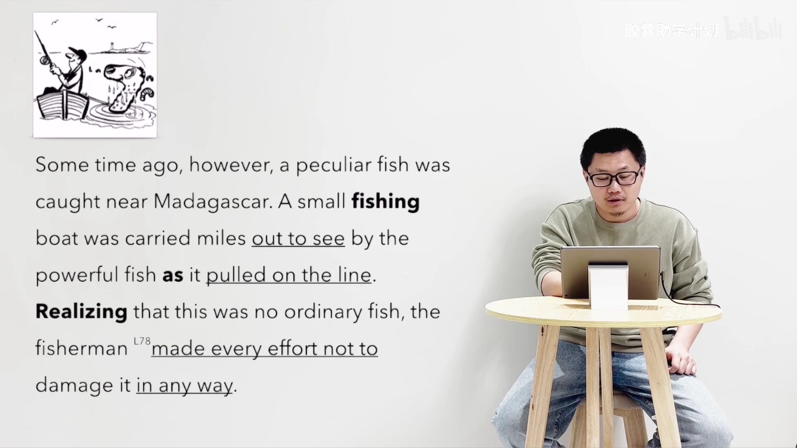

文字识别：Some time ago, however, a peculiar fish was / caught near Madagascar. A small fishing / boat was carried miles out to see by the / powerful fish as it pulled on the line. / Realizing that this was no ordinary fish, the / fisherman / L78 / 'made every effort not to / damage it in any way.

## 00:07:30–00:08:00

fish,被这个力量很强的这个鱼说，因为什么呢？因为它咬着这个线啊，其实就是上钩了嘛。Pull就是拽的意思，拽着这个线。那我问你，什么叫鱼拽着线？那就是其实就是鱼上钩的意思。但是它字面意思就是拽着这个线啊，就是因为这个鱼拽着线，然后这个小的渔船就被拖着拖到了数英里的海上。Okay, realizing

### 画面 00:07:40

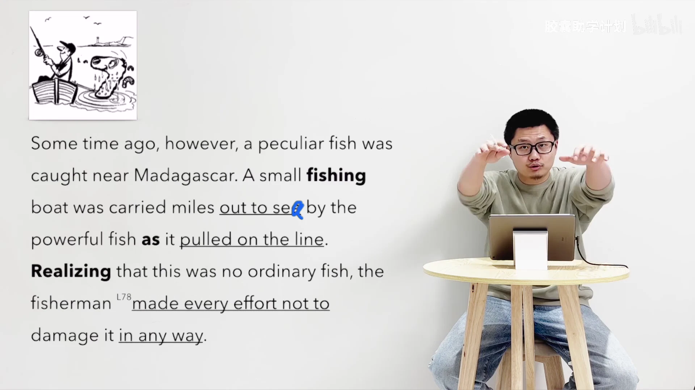

文字识别：Some time ago, however, a peculiar fish was / caught near Madagascar. A small fishing / boat was carried miles out to se@by the / powerful fish as it pulled on the line. / Realizing that this was no ordinary fish, the / fisherman / L78 / 'made every effort not to / damage it in any way.

### 画面 00:07:44

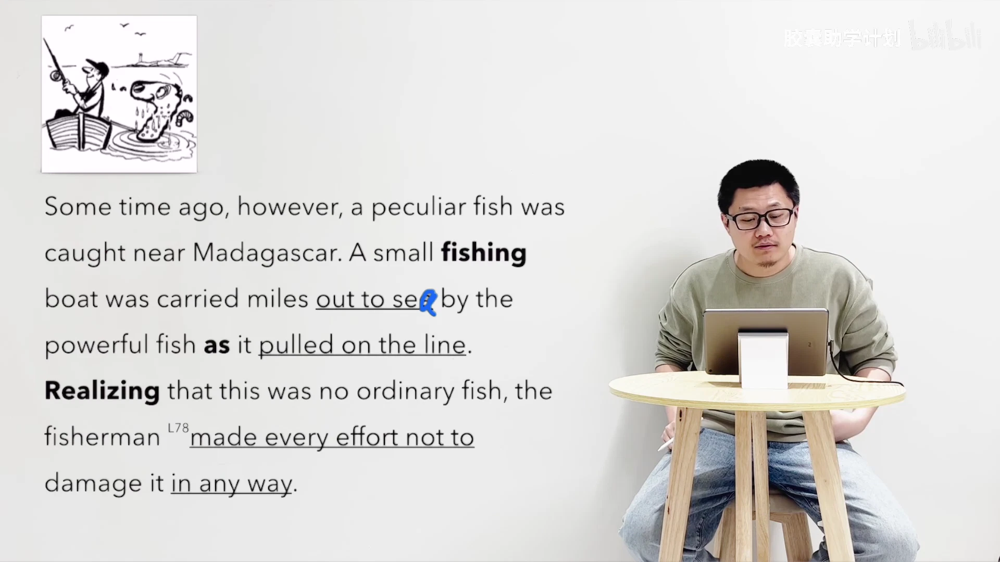

文字识别：Some time ago, however, a peculiar fish was / caught near Madagascar. A smallfishing / boat was carried miles out to se@by the / powerful fish as it pulled on the line. / Realizing that this was no ordinary fish, the / fisherman / L78 / 'made every effort not to / damage it in any way.

## 00:08:00–00:08:30

that this was no ordinary fish, the fisherman made every effort now to damage it in any way.那这里要处理的事情是，咱先分分开，对吧？Realizing that,好了，realizing主语the fisherman realize他注意到了。那somebody realize that，这不就咱之前学过的习惯用法吗？某人意识到一件事情，对吧？所以这个渔夫主动被动加ing，主动说这个渔夫意识到

### 画面 00:08:14

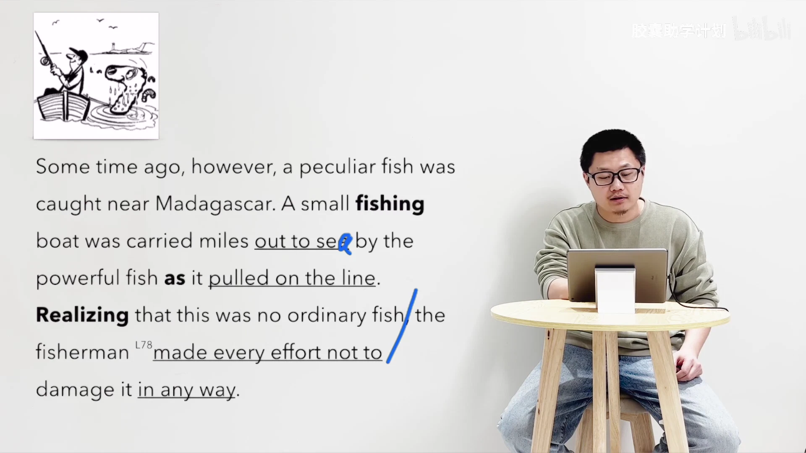

文字识别：Some time ago, however, a peculiar fish was / caught near Madagascar. A small fishing / boat was carried miles out to se@by the / powerful fish as it pulled on the line. / Realizing that this was no ordinary fish/the / fisherman / L78 / 'made every effort not to / damage it in any way.

## 00:08:30–00:09:00

说这不是 ordinary fish. Ordinary 在 extraordinary 那个讲那个单词的时候，咱们见过，他俩几乎是反义词嘛。 Extraordinary 就是不同寻常的，不平凡的。那 ordinary 就是平凡的。所以这句话给的意思说这不是一条平凡的鱼，普通的鱼。那其实就是一个 an odd extraordinary fish，嘛，对吧？说注意到这不是一条普通的鱼，不是一条平平凡凡的鱼，对吧？不是一条，哎，你这

### 画面 00:08:44

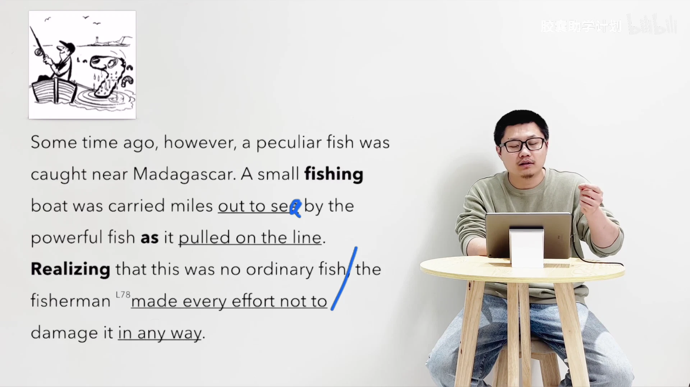

文字识别：Some time ago, however, a peculiar fish was / caught near Madagascar. A smallfishing / boat was carried miles out to se@by the / powerful fish as it pulled on the line. / Realizing that this was no ordinary fish/the / fisherman / L78 / 'made every effort not to / damage it in any way.

## 00:09:00–00:09:30

个菜市场能买到的鱼，就是这样的一种感觉啊。这个 fisherman 怎么样了呢？ Made every effort not to damage it in any way. 好，首先七十八课咱们学过的叫做 make no effort，叫做毫不努力去做某件事情。那 make every effort 就是使出了浑身的力气去做这件，那其实就是使用浑身解数。怎么样呢？不要去破坏它或者伤害掉它，对吧？这条鱼别弄坏、弄残了，变成一

### 画面 00:09:14

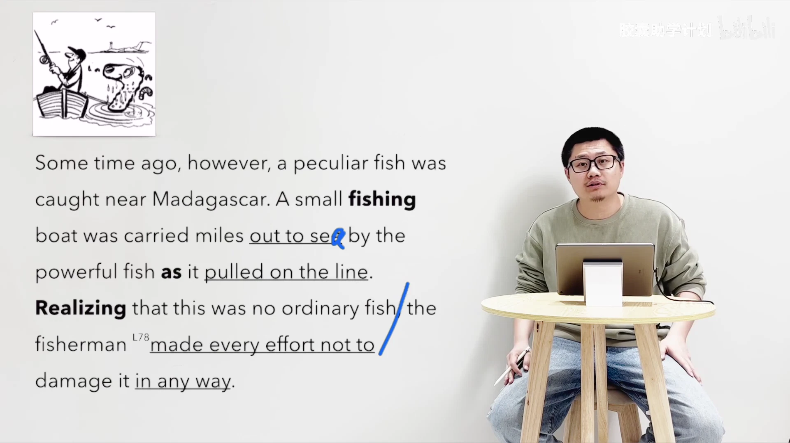

文字识别：Some time ago, however, a peculiar fish was / caught near Madagascar.A smallfishing / boat was carried miles out to se@by the / powerful fish as it pulled on the line. / Realizing that this was no ordinary fish/the / fisherman / L78 / 'made every effort not to / damage it in any way.

## 00:09:30–00:10:00

半了，弄死了不？In any way，本课习惯用法，以任何一种方式，way不有方式跟路的意思嘛？In any way就是以任何一种方式都不要去弄伤它，对吧？或者弄坏它。Continue。When it was eventually brought to shore, it was found to be over thirteen feet long。说当啊，它最终eventually最终brought to

### 画面 00:09:44

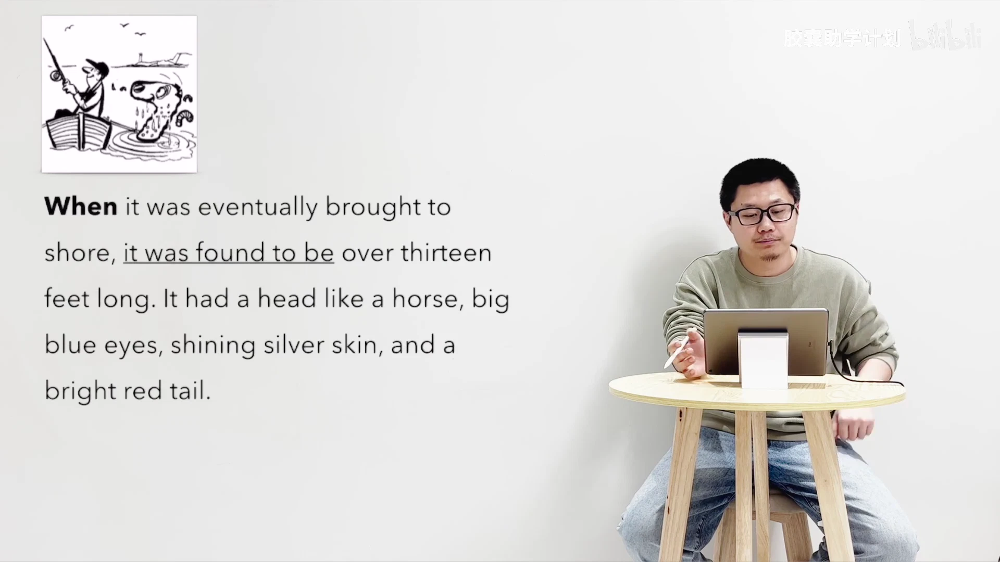

文字识别：When it was eventually brought to / shore, it was found to be over thirteen / feet long. It had a head like a horse, big / blue eyes, shining silver skin, and a / bright red tail.

## 00:10:00–00:10:30

shore, 被带到了岸上的时候呢，它被发现。呃, it was found to be 后边加形容词、名词啊这些东西、介词短语啊。一会儿是一个习惯用法，叫它被发现怎么样呢？是超过了十三英尺长的，好长的。 It had a head like a horse. 它有一个头，像马一样的头。 Big blue eyes, 瞪着俩滴溜啊大蓝眼睛。 Shining silver skin, 闪闪发光的银

### 画面 00:10:14

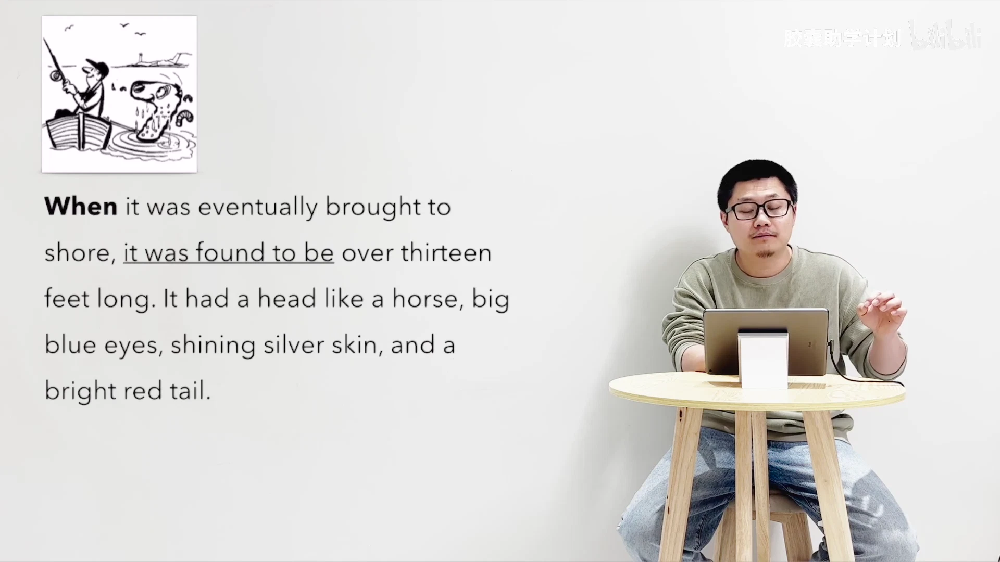

文字识别：When it was eventually brought to / shore, it was found to be over thirteen / feet long. It had a head like a horse, big / blue eyes, shining silver skin, and a / bright red tail.

## 00:10:30–00:11:00

银色的皮肤，或者咱们也可以直接说就鳞，对吧？鱼嘛，and a bright red tail，这个听上去就画龙点睛了，亮红色的尾巴，浑身是银色的，只有尾巴那一撇是亮红色的，很漂亮。The fish，一个逗号，一个逗号，我的天，咱先不看中间那个句子，看起来有点复杂，我们先不管它，咱就看前后。The fish

### 画面 00:10:43

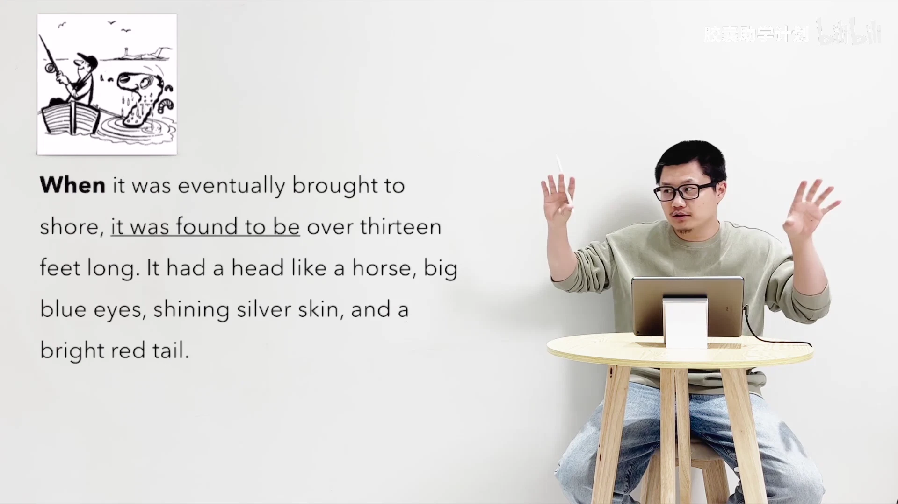

文字识别：When it was eventually brought to / shore, it was found to be over thirteen / feet long. It had a head like a horse, big / blue eyes, shining silver skin, and a / bright red tail.

### 画面 00:10:47

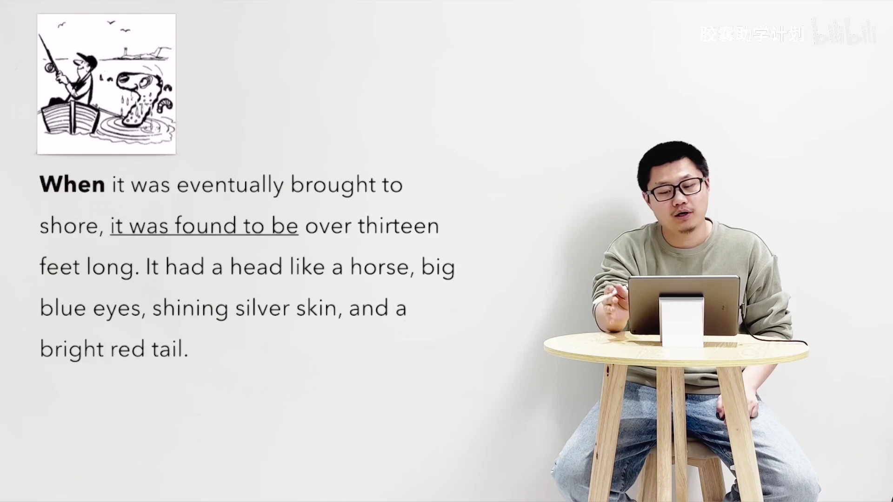

文字识别：When it was eventually brought to / shore, it was found to be over thirteen / feet long. It had a head like a horse, big / blue eyes, shining silver skin, and a / bright red tail.

### 画面 00:10:49

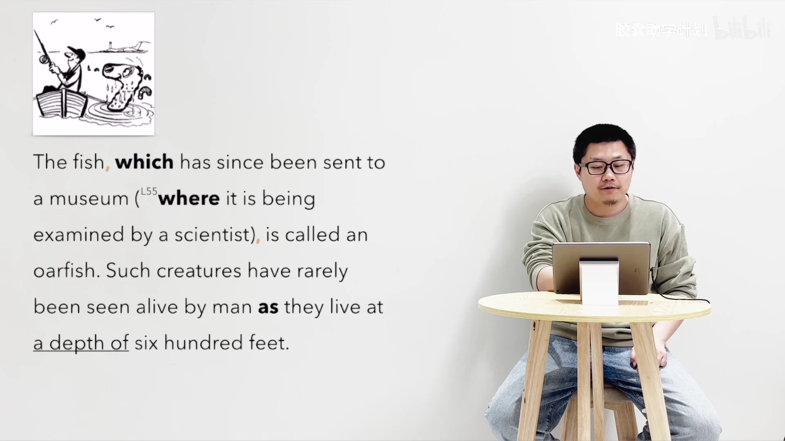

文字识别：The fish, which has since been sent to / a museum (L5where it is being / examined by a scientist), is called an / oarfish. Such creatures have rarely / been seen alive by man as they live at / a depth of six hundred feet.

### 画面 00:10:57

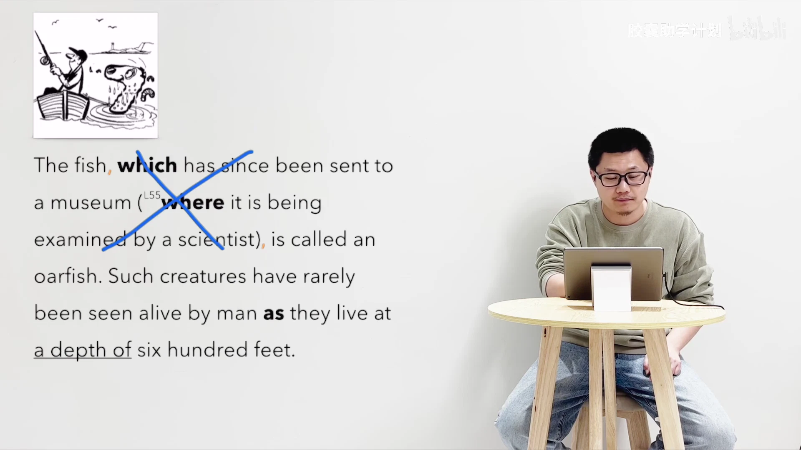

文字识别：The fish, which has since been sent to / a museum (15yhere it is being / examined by a scientist), is called an / oarfish. Such creatures have rarely / been seen alive by man as they live at / a depth of six hundred feet.

## 00:11:00–00:11:30

is called an oarfish. 这个句子就很简单了。Is called被叫做什么呢？An oarfish，江鱼，黄带鱼。刚才咱们说了，对吧？好，那我们看两个逗号中间是啥？逗号，非限定性定语从句。为什么可以用非限定性的？因为我整篇文章就讲这条鱼的，你已经知道我说啥了，我补充点信息就可以了，我完全可以不用再限定了，对吧？

### 画面 00:11:13

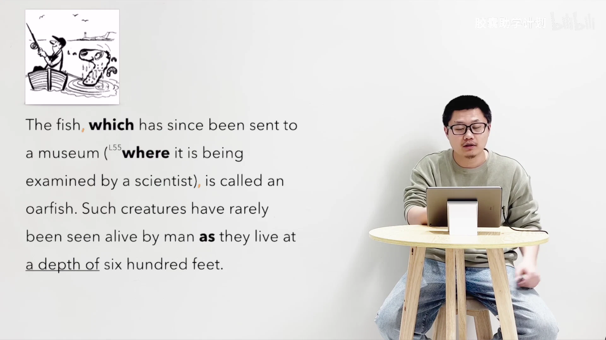

文字识别：The fish, which has since been sent to / a museum (L55where it is being / examined by a scientist), is called an / oarfish. Such creatures have rarely / been seen alive by man as they live at / a depth of six hundred feet.

## 00:11:30–00:12:00

补充信息，补充什么样的信息呢？这个定语从句里边又嵌套了一个定语从句，说这条鱼 has since been sent to a museum，说从那个时候开始就被送往了，has been，但现在完成时被动，就已经被送往了一个 museum，一个博物馆。后边五十五课学定语从句，where 和 whose，咱们都那课学的，叫做在那里，叫做在那个 museum 里，对吧？In that museum, it is being examined

### 画面 00:11:43

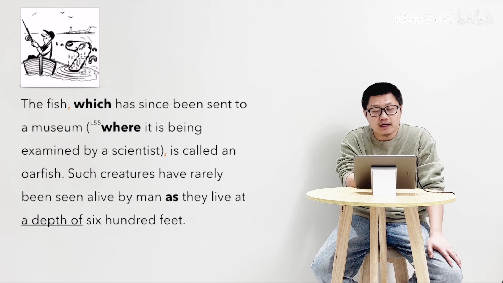

文字识别：The fish, which has since been sent to / a museum (L5where it is being / examined by a scientist), is called an / oarfish. Such creatures have rarely / been seen alive by man as they live at / a depth of six hundred feet.

## 00:12:00–00:12:30

by a scientist.现在进行时的被动，它正在被检查，被一个科学家检查。在哪儿呢？在那个博物馆里，对吧？所以这句话啊，就是说对于各位来说，那你就可能有一些同学会有一些实际操作上的问题。就这句话对于我来说，我要获取哪些信息呢？其实首先你都要获取，但你不用按它的这个语序去获取，对吧？你读完了之后，你如果能拿到类似于我这样的一个翻译就可以了。这条

### 画面 00:12:13

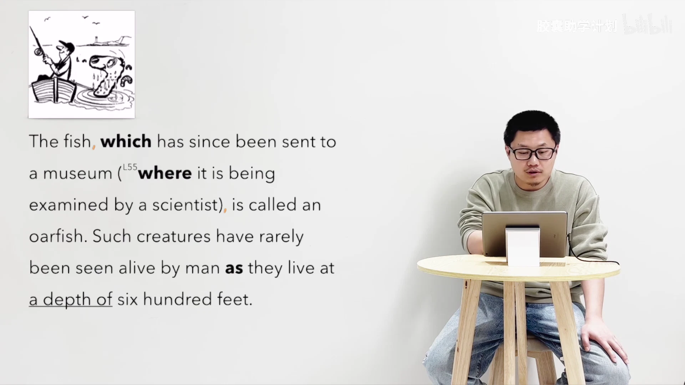

文字识别：The fish, which has since been sent to / a museum (L55where it is being / examined by a scientist), is called an / oarfish. Such creatures have rarely / been seen alive by man as they live at / a depth of six hundred feet.

### 画面 00:12:17

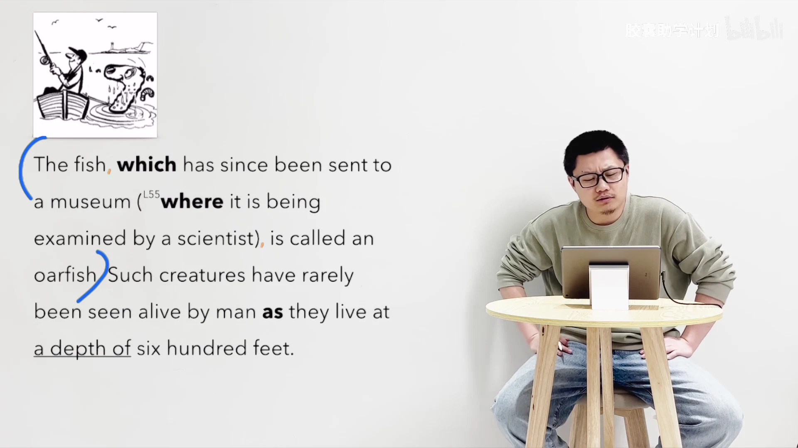

文字识别：The fish, which has since been sent to / a museum (L5where it is being / examined by a scientist), is called an / oarfishSuch creatures have rarely / been seen alive by man as they live at / a depth of six hundred feet.

### 画面 00:12:19

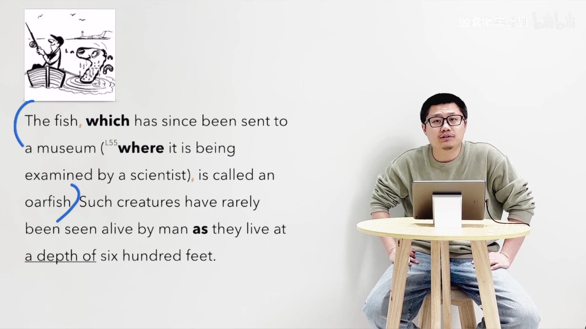

文字识别：The fish, which has since been sent to / a museum (L5where it is being / examined by a scientist), is called an / oarfishSuch creatures have rarely / been seen alive by man as they live at / a depth of six hundred feet.

## 00:12:30–00:13:00

鱼叫蒋鱼，被叫做蒋鱼，然后它被送往了一个博物馆。这个，然后呢，有一个科学家在这个博物馆里正在检查这条鱼。三条信息对于您来说，对吧？我们其实就是把这样一个左括弧右括弧这么长的一句话分成了三句话，对吧？Okay, such creatures have rarely been seen alive by man, as they live at

### 画面 00:12:42

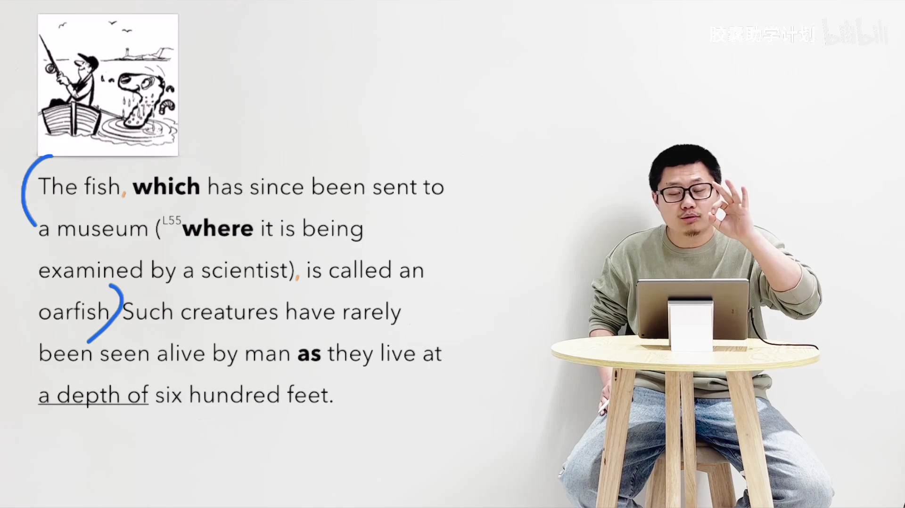

文字识别：The fish, which has since been sent to / a museum (L5where it is being / examined by a scientist), is called an / oarfish_Such creatures have rarely / been seen alive by man as they live at / a depth of six hundred feet.

## 00:13:00–00:13:30

a depth of six hundred feet,说这样的生物啊，have先不管rarely, have been seen就已经被看到了，再加个rarely就是很不容易被看到。Alive活着的，很不容易被看到是活着的。By man就被人们，对吧？就换一句话来说，这句话的意思就是人们一般来说看不到这条这种生物活着的状态，都是可能是比如说有深海状态，比如说带鱼，对吧？都是这个在深海里

### 画面 00:13:12

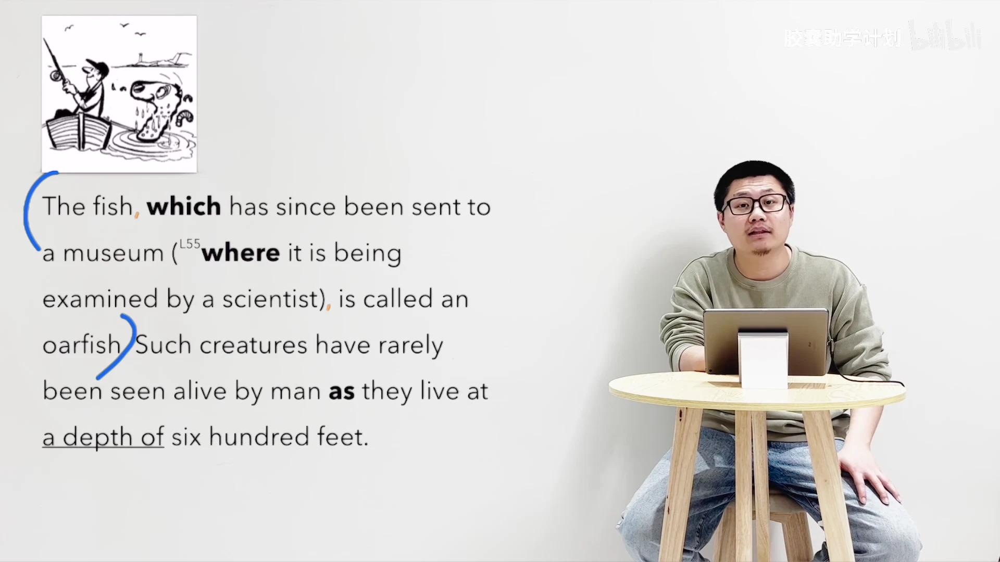

文字识别：The fish, which has since been sent to / a museum (L5where it is being / examined by a scientist), is called an / oarfishSuch creatures have rarely / been seen alive by man as they live at / a depth of six hundred feet.

## 00:13:30–00:14:00

边捞上来就已经没了，已经死了，对吧？因为 they live at a depth of six hundred feet，说因为他们住在 a depth of，他们生活在什么呢？什么什么样的一个深度？a depth of 什么深度呢？six hundred feet，六百英尺深的水下这样一个深度。OK，这儿一个习惯用法，本课不少啊。文章其实倒还行啊，文章的这个长难句挺多啊，这其实是我们三册的常态，

### 画面 00:13:42

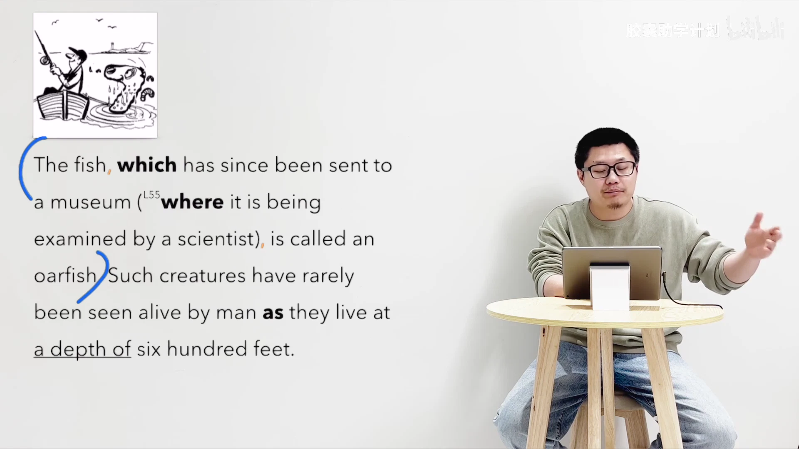

文字识别：The fish, which has since been sent to / a museum (L5where it is being / examined by a scientist), is called an / oarfish_Such creatures have rarely / been seen alive by man as they live at / a depth of six hundred feet.

### 画面 00:13:50

文字识别：习惯用法造句 / claim to have done sth. / laugh at.. / it is now known that.. / at times... / out at sea... / in any way / it was found to be. / a depth of...

### 画面 00:13:52

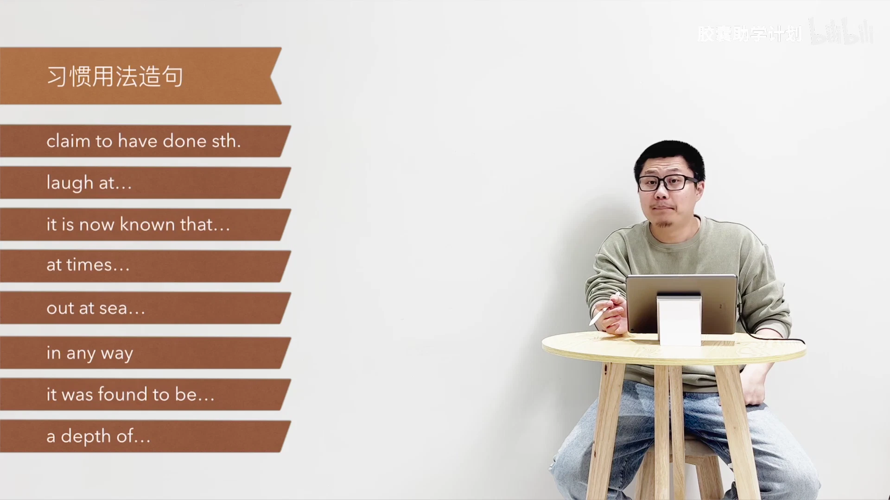

文字识别：习惯用法造句 / claim to have done sth. / laugh at... / it is now known that.. / at times... / out at sea.. / in any way / it was found to be. / a depth of...

### 画面 00:13:54

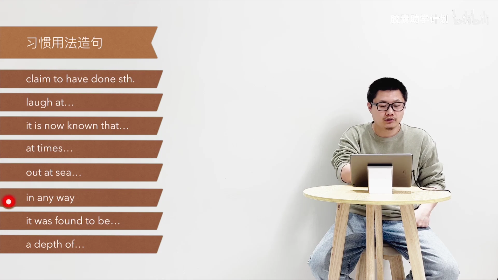

文字识别：习惯用法造句 / claim to have done sth. / laugh at... / it is now known that.. / at times... / out at sea.. / in any way / it was found to be. / a depth of...

### 画面 00:13:56

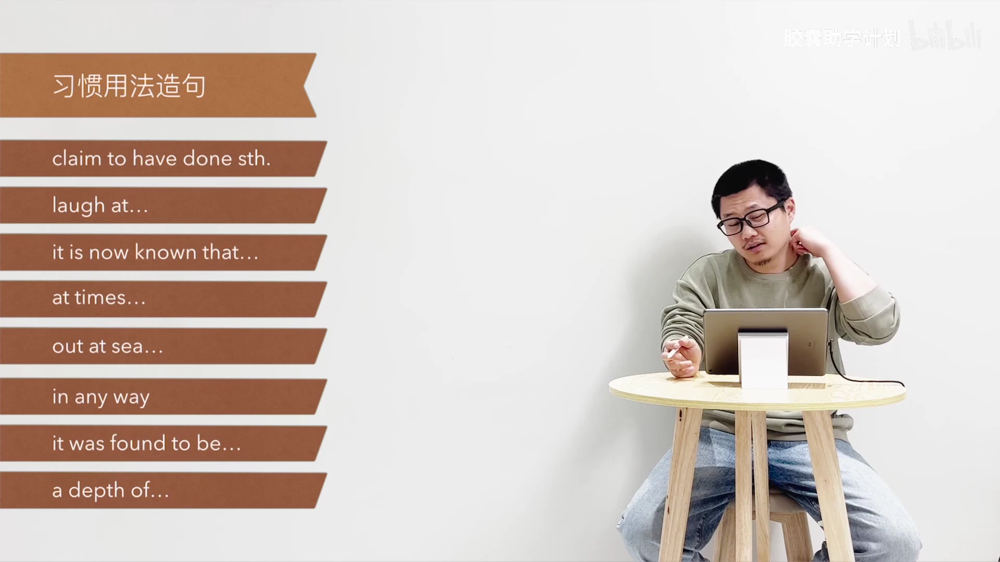

文字识别：习惯用法造句 / claim to have done sth. / laugh at... / it is now known that.. / at times... / out at sea... / in any way / it was foundto / be. / a depth of...

### 画面 00:13:58

文字识别：习惯用法造句 / claim to have done sth. / laugh at... / it is now known that.. / at times... / out at sea... / in any way / it was foundto k / be. / a depth of...

## 00:14:00–00:14:30

提前适应一下，习惯用法也很多。咱们挨个造句，有点耐心就行了，这没什么可说的。第一个 claim to have done，声称已经怎么怎么样，比如说 repeat after me，不要忘了。 She claimed to have set up a new world record. 哎，她声称已经建立了一个新的世界纪录，对吧？好， next one，咱们继续啊。说 she

### 画面 00:14:00

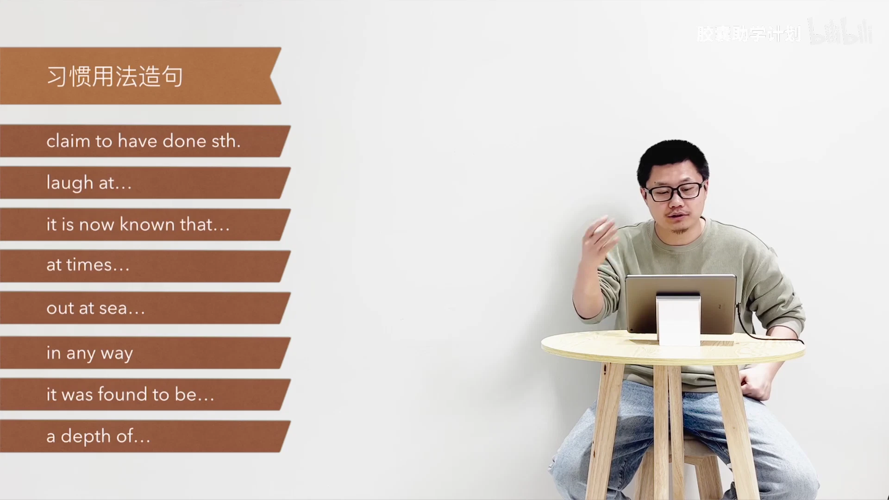

文字识别：习惯用法造句 / claim to have done sth. / laugh at.. / it is now known that.. / at times... / out at sea.. / in any way / it was found to / be. / a depth of...

### 画面 00:14:02

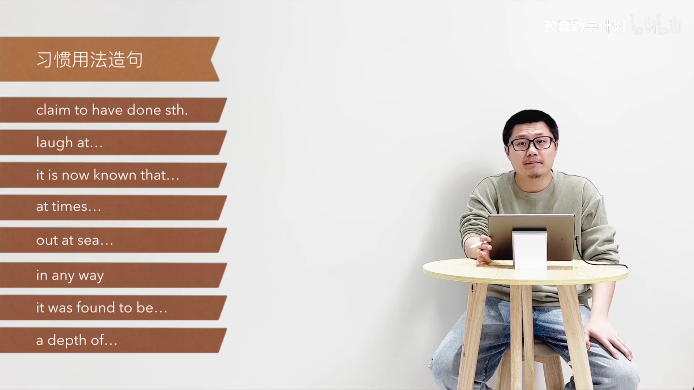

文字识别：习惯用法造句 / claim to have done sth. / laugh at... / it is now known that.. / at times... / out at sea.. / in any way / it was found to be. / a depth of...

### 画面 00:14:04

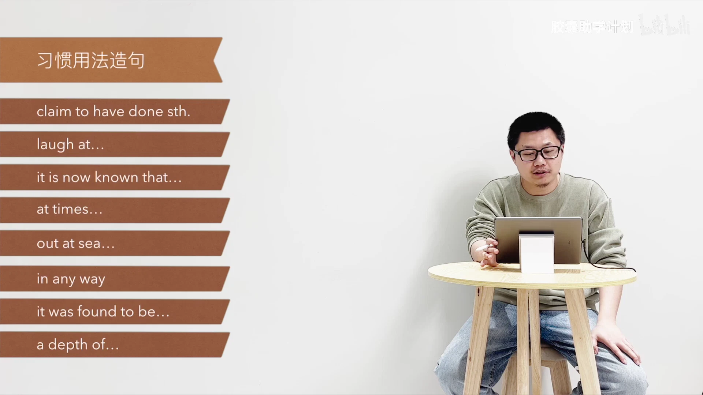

文字识别：习惯用法造句 / claim to have done sth. / laugh at.. / it is now known that.. / at times... / out at sea... / in any way / it was found to be. / a depth of..

### 画面 00:14:06

文字识别：网：v.+v.变化 / 习惯用法造句指南 / 童助字计划 / 四句型转换 / 方式/地点/时间 / 其他习惯用法 / 其他单词+词性 / 原文摘抄+变 / 6123456 / claim to have done sth.

### 画面 00:14:08

文字识别：网：v.+v.变化 / 习惯用法造句指南 / 辜助字计划 / 四句型转换 / 方式/地点/时间 / 其他习惯用法 / 其他单词+词性 / 原文摘抄+变 / 6123456 / claim to have done sth.

### 画面 00:14:10

文字识别：网：v.+v.变化 / 习惯用法造句指南 / 四句型转换 / 方式/地点/时间 / 其他习惯用法 / 其他单词+词性 / 原文摘抄+变 / 6123456 / claim to have done sth. / She claimed to have set up a new world / - / record. L36

### 画面 00:14:12

文字识别：网：v.+v.变化 / 习惯用法造句指南 / 四句型转换 / 方式/地点/时间 / 其他习惯用法 / 其他单词+词性 / 原文摘抄+变 / 6123456 / claim to have done sth. / She claimed to have set up a new world / record. L36

### 画面 00:14:14

文字识别：网：v.+v.变化 / 习惯用法造句指南 / 四句型转换 / 方式/地点/时间 / 其他习惯用法 / 其他单词+词性 / 原文摘抄+变 / 6123456 / claim to have done sth. / She claimed to have set up a new world / record. L36

### 画面 00:14:16

文字识别：网：v.+v.变化 / 习惯用法造句指南 / 计划 / 四句型转换 / 方式/地点/时间 / 其他习惯用法 / 其他单词+词性 / 原文摘抄+变 / 6123456 / claim to have done sth. / She claimed to have set up a new world / record. L36

### 画面 00:14:19

文字识别：网：v.+v.变化 / 习惯用法造句指南 / 四句型转换 / 方式/地点/时间 / 其他习惯用法 / 其他单词+词性 / 原文摘抄+变 / 6123456 / claim to have done sth. /  She claimed to have set up a new world / record. L36

### 画面 00:14:24

文字识别：网：v.+v.变化 / 习惯用法造句指南 / 四句型转换 / 方式/地点/时间 / 其他习惯用法 / 其他单词+词性 / 原文摘抄+变 / 6123456 / claim to have done sth. / She claimed to have set up a new world / record. L36

### 画面 00:14:29

文字识别：网：v.+v.变化 / 习惯用法造句指南 / 四句型转换 / 方式/地点/时间 / 其他习惯用法 / 其他单词+词性 / 原文摘抄+变 / 6123456 / claim to have done sth. /  She claimed to have set up a new world / record. L36 /  She claimed to have returned the book to / Leo.L45

## 00:14:30–00:15:00

claimed to have returned the book to Leo. 她声称已经把这本书还给了 Leo. Okay, very good. 再来, she claimed to have made a profit. 注意 have that 后边都是 that, 对吧？这个地方注意，她说她声称已经怎么样了呢？盈利了. Very good. Next one, 注意力集中，咱听一下这个电影片段. She claimed to have seen her dead son at the Quebec ferry terminal three weeks ago. 哎，声称看

### 画面 00:14:31

文字识别：网：v.+v.变化 / 习惯用法造句指南 / 字计划 / 四句型转换 / 方式/地点/时间 / 其他习惯用法 / 其他单词+词性 / 原文摘抄+变 / 6123456 / claim to have done sth. /  She claimed to have set up a new world / record. L36 /  She claimed to have returned the book to / Leo.L45

### 画面 00:14:34

文字识别：网：v.+v.变化 / 习惯用法造句指南 / 四句型转换 / 方式/地点/时间 / 其他习惯用法 / 其他单词+词性 / 原文摘抄+变 / 6123456 / claim to have done sth. /  She claimed to have set up a new world / record. L36 /  She claimed to have returned the book to / Leo.L45

### 画面 00:14:39

文字识别：网：v.+v.变化 / 习惯用法造句指南 / 四句型转换 / 方式/地点/时间 / 其他习惯用法 / 其他单词+词性 / 原文摘抄+变 / 6123456 / claim to have done sth. /  She claimed to have set up a new world / record. L36 /  She claimed to have returned the book to / Leo.L45 /  She claimed to have made a profit. L80

### 画面 00:14:44

文字识别：网：v.+v.变化 / 习惯用法造句指南 / 四句型转换 / 方式/地点/时间 / 其他习惯用法 / 其他单词+词性 / 原文摘抄+变 / 6123456 / claim to have done sth. /  She claimed to have set up a new world / record. L36 /  She claimed to have returned the book to / Leo. L45 /  She claimed to have made a profit. L80

### 画面 00:14:49

文字识别：She claimed to have seen her dead son... / at the Quebec ferry terminal three weeks ago. / Taking Lives / (2004)

### 画面 00:14:54

文字识别：She claimed to have seen her dead son... / at the Quebec ferry terminal three weeks ago. / Taking Lives / (2004)

### 画面 00:14:56

文字识别：She claimed to have seen her dead son... / at the Quebec ferry terminal three weeks ago. / Taking Lives / (2004)

### 画面 00:14:58

文字识别：She claimed to have seen her dead son... / at the Quebec ferry terminal three weeks ago. / Taking Lives / (2004)

## 00:15:00–00:15:30

见了，对吧？好，Laugh at，嘲笑。那嘲笑就是某人某事儿吧，往往。比如说，Before I leave this room, I will laugh at you. Next one，电影片段。If they were your friends, they wouldn't laugh at you.好，wouldn't。你看我黑字部分，if were wouldn't。首先，这个是电影片段，这不是我造的句子。但是，这是不是用到了咱们新概念二册四十课的语法，对吧？Next one，You're gonna

### 画面 00:15:00

文字识别：网：v.+v.变化 / 习惯用法造句指南 / 喜助字计划 / 四句型转换 / 方式/地点/时间 / 其他习惯用法 / 其他单词+词性 / 原文摘抄+变 / 6123456 / laugh at...

### 画面 00:15:04

文字识别：网：v.+v.变化 / 习惯用法造句指南 / 四句型转换 / 方式/地点/时间 / 其他习惯用法 / 其他单词+词性 / 原文摘抄+变 / 6123456 / laugh at... /  Before Ileave this room, I will laugh at you.

### 画面 00:15:08

文字识别：网：v.+v.变化 / 习惯用法造句指南 / 四句型转换 / 方式/地点/时间 / 其他习惯用法 / 其他单词+词性 / 原文摘抄+变 / 6123456 / laugh at... /  Before Ileave this room, I will laugh at you.

### 画面 00:15:10

文字识别：网：v.+v.变化 / 习惯用法造句指南 / 四句型转换 / 方式/地点/时间 / 其他习惯用法 / 其他单词+词性 / 原文摘抄+变 / 6123456 / laugh at... /  Before Ileave this room, I will laugh at you. /  If they were your friends, they wouldn't / laugh at you. Do the Right Thing (1989) L40

### 画面 00:15:14

文字识别：网：v.+v.变化 / 习惯用法造句指南 / 四句型转换 / 方式/地点/时间 / 其他习惯用法 / 其他单词+词性 / 原文摘抄+变 / 6123456 / laugh at... /  Before Ileave this room, I will laugh at you. /  If they were your friends, they wouldn't / laugh at you. Do the Right Thing (1989) L40

### 画面 00:15:20

文字识别：网：v.+v.变化 / 习惯用法造句指南 / 四句型转换 / 方式/地点/时间 / 其他习惯用法 / 其他单词+词性 / 原文摘抄+变 / 6123456 / laugh at... /  Before I leave this room, I will laugh at you. /  If they were your friends, they wouldn't / laugh at you. Do the Right Thing (1989) L40

### 画面 00:15:24

文字识别：网：v.+v.变化 / 习惯用法造句指南 / 四句型转换 / 方式/地点/时间 / 其他习惯用法 / 其他单词+词性 / 原文摘抄+变 / 6123456 / laugh at... /  Before I leave this room, I will laugh at you. /  If they were your friends, they wouldn't / laugh at you. Do the Right Thing (1989) L40

### 画面 00:15:27

文字识别：网：v.+v.变化 / 习惯用法造句指南 / 四句型转换 / 方式/地点/时间 / 其他习惯用法 / 其他单词+词性 / 原文摘抄+变 / 6123456 / laugh at... /  Before I leave this room, I will laugh at you. /  If they were your friends, they wouldn't / laugh at you. Do the Right Thing (1989) L40

### 画面 00:15:29

文字识别：网：v.+v.变化 / 习惯用法造句指南 / 四句型转换 / 方式/地点/时间 / 其他习惯用法 / 其他单词+词性 / 原文摘抄+变 / 6123456 / laugh at... /  Before I leave this room, I will laugh at you. /  If they were your friends, they wouldn't / laugh at you. Do the Right Thing (1989) L40 / You're gonna laugh at / what I'm gonna say, go ahead,

## 00:15:30–00:16:00

laugh at what I'm gonna say. Go ahead, I don't care.哎，说你将嘲笑我接下来要说的事情啊。继续，我不在乎啊。Very good.那再看一遍这个习惯用法，laugh at嘲笑某人，对吧？比如说，别嘲笑我，Don't laugh at me. Very good.呃，注意力集中，咱听一个电影片段啊，《阳光小美女》. Everyone is gonna laugh at her mom.

### 画面 00:15:34

文字识别：网：v.+v.变化 / 习惯用法造句指南 / 四句型转换 / 方式/地点/时间 / 其他习惯用法 / 其他单词+词性 / 原文摘抄+变 / 6123456 / laugh at... /  Before Ileave this room, I will laugh at you. /  If they were your friends, they wouldn't / laugh at you. Do the Right Thing (1989) L40 / You're gonna laugh at / what I'm gonna say, go ahead, / I don't care. L46

### 画面 00:15:39

文字识别：网：v.+v.变化 / 习惯用法造句指南 / 字计划 / 四句型转换 / 方式/地点/时间 / 其他习惯用法 / 其他单词+词性 / 原文摘抄+变 / 6123456 / laugh at... /  Before I leave this room, I will laugh at you. /  If they were your friends, they wouldn't / laugh at you. Do the Right Thing (1989) L40 / You're gonna laugh at / what I'm gonna say, go ahead, / I don't care. L46

### 画面 00:15:44

文字识别：网：v.+v.变化 / 习惯用法造句指南 / 四句型转换 / 方式/地点/时间 / 其他习惯用法 / 其他单词+词性 / 原文摘抄+变 / 6123456 / laugh at... /  Before I leave this room, I will laugh at you. /  If they were your friends, they wouldn't / laugh at you. Do the Right Thing (1989) L40 / You're gonna laugh at / what I'm gonna say, go ahead, / I don't care. L46

### 画面 00:15:49

文字识别：网：v.+v.变化 / 习惯 / 字计划 / 四句型转换 / 伙用法造句指南 / 方式/地点/时间 / 其他习惯用法 / 其他单词+词性 / 原文摘抄+变 / 6123456 / laugh at... /  Before I leave this room, I will laugh at you. /  If they were your friends, they wouldn't / laugh at you. Do the Right Thing (1989) L40 / You're gonna laugh at / what I'm gonna say, go ahead, / I don't care. L46

### 画面 00:15:51

文字识别：Everyone is gonna laugh at her, Mom. / Little Miss Sunshine / (2006)

### 画面 00:15:57

文字识别：Everyone is gonna laugh at her, Mom. / Little Miss Sunshine / (2006)

### 画面 00:15:59

文字识别：Everyone is gonna laugh at her, Mom. / Little Miss Sunshine / (2006)

## 00:16:00–00:16:30

There you go.下一个叫做It is known that我们和原文稍有不同，原文是给的是It is now known that。你看now有没有都可以，对吧？就这个句话就是知道了，这个事儿是人们知道的。比如说It is known that说知道的这件事情怎么样呢？He knocked her to the ground with a sharp blow last night。刚才那个全是咱们八十一课学过的，我就不挨个说了，是吧？说哎知我们知道这件事情叫做怎么怎么样了。OK, next one。说It

### 画面 00:16:01

文字识别：网：v.+v.变化 / 习惯用法造句指南 / 囊助学计划 / 四句型转换 / 方式/地点/时间 / 其他习惯用法 / 其他单词+词性 / 原文摘抄+变 / 6123456 / it is known that...

### 画面 00:16:04

文字识别：网：v.+v.变化 / 习惯用法造句指南 / 辜助字计划 / 四句型转换 / 方式/地点/时间 / 其他习惯用法 / 其他单词+词性 / 原文摘抄+变 / 6123456 / it is known that...

### 画面 00:16:09

文字识别：网：v.+v.变化 / 习惯用法造句指南 / 辜助字计划 / 四句型转换 / 方式/地点/时间 / 其他习惯用法 / 其他单词+词性 / 原文摘抄+变 / 6123456 / it is known that...

### 画面 00:16:11

文字识别：网：v.+v.变化 / 习惯用法造句指南 / 子计划 / 四句型转换 / 方式/地点/时间 / 其他习惯用法 / 其他单词+词性 / 原文摘抄+变 / 6123456 / it is known that... /  It is known that he knocked her to the / ground with a sharp blow last night. L81

### 画面 00:16:13

文字识别：网：v.+v.变化 / 习惯用法造句指南 / 四句型转换 / 方式/地点/时间 / 其他习惯用法 / 其他单词+词性 / 原文摘抄+变 / 6123456 / it is known that... /  It is known that he knocked her to the / ground with a sharp blow last night. L81

### 画面 00:16:15

文字识别：网：v.+v.变化 / 习惯用法造句指南 / 字计划 / 四句型转换 / 方式/地点/时间 / 其他习惯用法 / 其他单词+词性 / 原文摘抄+变 / 6123456 / it is known that... /  It is known that he knocked her to the / ground with a sharp blow last night. L81

### 画面 00:16:17

文字识别：网：v.+v.变化 / 习惯用法造句指南 / 四句型转换 / 方式/地点/时间 / 其他习惯用法 / 其他单词+词性 / 原文摘抄+变 / 6123456 / it is known that... /  It is known that he knocked her to the / ground with a sharp blow last night. L81

### 画面 00:16:19

文字识别：网：v.+v.变化 / 习惯用法造句指南 / 四句型转换 / 方式/地点/时间 / 其他习惯用法 / 其他单词+词性 / 原文摘抄+变 / 6123456 / it is known that... /  It is known that he knocked her to the / ground with a sharp blow last night. L81

### 画面 00:16:21

文字识别：网：v.+v.变化 / 习惯用法造句指南 / 四句型转换 / 方式/地点/时间 / 其他习惯用法 / 其他单词+词性 / 原文摘抄+变 / 6123456 / it is known that... /  It is known that he knocked her to the / ground with a sharp blow last night. L81

### 画面 00:16:24

文字识别：网：v.+v.变化 / 习惯用法造句指南 / 四句型转换 / 方式/地点/时间 / 其他习惯用法 / 其他单词+词性 / 原文摘抄+变 / 6123456 / it is known that... /  It is known that he knocked her to the / ground with a sharp blow last night. L81

### 画面 00:16:28

文字识别：网：v.+v.变化 / 习惯用法造句指南 / 四句型转换 / 方式/地点/时间 / 其他习惯用法 / 其他单词+词性 / 原文摘抄+变 / 6123456 / it is known that... /  It is known that he knocked her to the / ground with a sharp blow last night. L81 /  It is known that he is the man who planted / a bomb at the station. L79 L28

## 00:16:30–00:17:00

is known that啊人们是知道的.He is the man后边加定语从句who planted a bomb at the station.Planted bomb中了个炸弹，哎，安装炸弹。那你看在这里我多加了一个小单词，这以后你一定会见到，叫做It is well known that翻译成汉语众所周知.Cats feel frightened when strangers enter the room.说猫会感觉害怕，当

### 画面 00:16:30

文字识别：网：v.+v.变化 / 习惯用法造句指南 / 四句型转换 / 方式/地点/时间 / 其他习惯用法 / 其他单词+词性 / 原文摘抄+变 / 6123456 / it is known that... /  Ilt is known that he knocked her to the / ground with a sharp blow last night. L81 /  It is known that he is the man who planted / a bomb at the station. L79 L28

### 画面 00:16:34

文字识别：网：v.+v.变化 / 习惯用法造句指南 / 四句型转换 / 方式/地点/时间 / 其他习惯用法 / 其他单词+词性 / 原文摘抄+变 / 6123456 / it is known that... /  It is known that he knocked her to the / ground with a sharp blow last night. L81 /  It is known that he is the man who planted / a bomb at the station. L79 L28

### 画面 00:16:39

文字识别：网：v.+v.变化 / 习惯用法造句指南 / 计划 / 四句型转换 / 方式/地点/时间 / 其他习惯用法 / 其他单词+词性 / 原文摘抄+变 / 6123456 / it is known that... /  lt is known that he knocked her to the / ground with a sharp blow last night. L81 /  It is known that he is the man who planted / a bomb at the station. L79 L28

### 画面 00:16:42

文字识别：网：v.+v.变化 / 习惯 / 四句型转换 / 用 / 方式/地点/时间 / 巾法造句指南 / 其他习惯用法 / 其他单词+词性 / 原文摘抄+变 / 6123456 / it is known that... /  It is known that he knocked her to the / ground with a sharp blow last night. L81 /  Ilt is known that he is the man who planted / a bomb at the station. L79 L28 /  It is well known that cats feel frightened / when strangers enter the room. L79

### 画面 00:16:44

文字识别：网：v.+v.变化 / 习惯 / 四句型转换 / 用法 / 方式/地点/时间 / 么造句指南 / 其他习惯用法 / 其他单词+词性 / 原文摘抄+变 / 6123456 / it is known that... /  It is known that he knocked her to the / ground with a sharp blow last night. L81 /  Ilt is known that he is the man who planted / a bomb at the station. L79 L28 /  It is well known that cats feel frightened / when strangers enter the room. L79

### 画面 00:16:49

文字识别：网：v.+v.变化 / 习惯 / 四句型转换 / 用法 / 方式/地点/时间 / 么造句指南 / 其他习惯用法 / 其他单词+词性 / 原文摘抄+变 / 6123456 / it is known that... /  Ilt is known that he knocked her to the / ground with a sharp blow last night. L81 /  Ilt is known that he is the man who planted / a bomb at the station. L79 L28 /  It is well known that cats feel frightened / when strangers enter the room. L79

### 画面 00:16:54

文字识别：网：v.+v.变化 / 习惯 / 奏助学计划 / 四句型转换 / 伙用法造句指南 / 方式/地点/时间 / 其他习惯用法 / 其他单词+词性 / 原文摘抄+变 / 6123456 / it is known that... /  Ilt is known that he knocked her to the / ground with a sharp blow last night. L81 /  Ilt is known that he is the man who planted / a bomb at the station. L79 L28 /  It is well known that cats feel frightened / when strangers enter the room. L79

### 画面 00:16:56

文字识别：网：v.+v.变化 / 习惯 / 奏助学计划 / 四句型转换 / 伙用法造句指南 / 方式/地点/时间 / 其他习惯用法 / 其他单词+词性 / 原文摘抄+变 / 6123456 / it is known that... /  lt is known that he knocked her to the / ground with a sharp blow last night. L81 /  Ilt is known that he is the man who planted / a bomb at the station. L79 L28 /  It is well known that cats feel frightened / when strangers enter the room. L79

### 画面 00:16:59

文字识别：网：v.+v.变化 / 习惯用法造句指南 / 毫助字计划 / 四句型转换 / 方式/地点/时间 / 其他习惯用法 / 其他单词+词性 / 原文摘抄+变 / 6123456 / it is known that... /  Ilt is known that he knocked her to the / ground with a sharp blow last night. L81 /  It is known that he is the man who planted / a bomb at the station. L79 L28 /  It is well known that cats feel frightened / when strangers enter the room. L79

## 00:17:00–00:17:30

陌生人进入这个房间的时候。Okay, very good.那注意力集中，咱听一个电影片段啊。But it is known that horses do love my music. Very good.下一个，at times就类似于sometimes，很容易造句啊，很简单，随便造几个。复习，He loses his temper at times.时不时的就发脾气。I'm curious to find out why he loses his temper at times.

### 画面 00:17:04

文字识别：网：v.+v.变化 / 习惯 / 庭助学计划 / 四句型转换 / 用法 / 方式/地点/时间 / 么造句指南 / 其他习惯用法 / 其他单词+词性 / 原文摘抄+变 / 6123456 / it is known that.. /  lt is known that he knocked her to the / ground with a sharp blow last night. L81 /  Ilt is known that he is the man who planted / a bomb at the station. L79 L28 /  It is well known that cats feel frightened / when strangers enter the room. L79

### 画面 00:17:06

文字识别：But it is known that horses do love my music. / Interlude In Prague / (2017)

### 画面 00:17:10

文字识别：But it is known that horses do love my music. / Interlude In Prague / (2017)

### 画面 00:17:12

文字识别：But it is known that horses do love my music. / Interlude In Prague / (2017)

### 画面 00:17:14

文字识别：网：v.+v.变化 / 习惯用法造句指南 / 喜助字计划 / 四句型转换 / 方式/地点/时间 / 其他习惯用法 / 其他单词+词性 / 原文摘抄+变 / 6123456 / at times...

### 画面 00:17:16

文字识别：网：v.+v.变化 / 习惯用法造句指南 / 泰助字计划 / 四句型转换 / 方式/地点/时间 / 其他习惯用法 / 其他单词+词性 / 原文摘抄+变 / 6123456 / at times...

### 画面 00:17:18

文字识别：网：v.+v.变化 / 习惯用法造句指南 / 四句型转换 / 方式/地点/时间 / 其他习惯用法 / 其他单词+词性 / 原文摘抄+变 / 6123456 / at times... /  He loses his temper at times. L78

### 画面 00:17:20

文字识别：网：v.+v.变化 / 习惯用法造句指南 / 字计划 / 四句型转换 / 方式/地点/时间 / 其他习惯用法 / 其他单词+词性 / 原文摘抄+变 / 6123456 / at times... /  He loses his temper at times. L78

### 画面 00:17:24

文字识别：网：v.+v.变化 / 习惯用法造句指南 / 四句型转换 / 方式/地点/时间 / 其他习惯用法 / 其他单词+词性 / 原文摘抄+变 / 6123456 / at times... /  He loses his temper at times. L78 /  am curious to find out why he loses his / temper at times. L79

### 画面 00:17:27

文字识别：网：v.+v.变化 / 习惯用法造句指南 / 四句型转换 / 方式/地点/时间 / 其他习惯用法 / 其他单词+词性 / 原文摘抄+变 / 6123456 / at times... /  He loses his temper at times. L78 / ■ am curious to find out why he loses his / temper at times. L79

### 画面 00:17:29

文字识别：网：v.+v.变化 / 习惯用法造句指南 / 四句型转换 / 方式/地点/时间 / 其他习惯用法 / 其他单词+词性 / 原文摘抄+变 / 6123456 / at times... /  He loses his temper at times. L78 /  am curious to find out why he loses his / temper at times. L79

## 00:17:30–00:18:00

是吧？你看全是之前习惯用法。我很好奇，想弄明白为啥他时不时就发脾气。He would change into his uniform and walk up and down the street at night.哎，他会穿上他这个制服，然后at at times不是at night啊，然后时不时的就在马路上来回来去溜达，是吧？Out at sea,在远海，对吧？在远洋，看几个句子，说The boats are

### 画面 00:17:31

文字识别：网：v.+v.变化 / 习惯用法造句指南 / 四句型转换 / 方式/地点/时间 / 其他习惯用法 / 其他单词+词性 / 原文摘抄+变 / 6123456 / at times... /  He loses his temper at times. L78 / Lam curious to find out why he loses his / temper at times. L79

### 画面 00:17:34

文字识别：网：v.+v.变化 / 习惯用法造句指南 / 四句型转换 / 方式/地点/时间 / 其他习惯用法 / 其他单词+词性 / 原文摘抄+变 / 6123456 / at times... /  He loses his temper at times. L78 /  am curious to find out why he loses his / temper at times. L79

### 画面 00:17:36

文字识别：网：v.+v.变化 / 习惯用法造句指南 / 学计划 / 四句型转换 / 方式/地点/时间 / 其他习惯用法 / 其他单词+词性 / 原文摘抄+变 / 6123456 / at times... /  He loses his temper at times. L78 / Lam curious to find out why he loses his / temper at times. L79 /  He would change into his uniform and / walk up and down the street at times. L81

### 画面 00:17:39

文字识别：网：v.+v.变化 / 习惯用法造句指南 / 四句型转换 / 方式/地点/时间 / 其他习惯用法 / 其他单词+词性 / 原文摘抄+变 / 6123456 / at times... /  He loses his temper at times. L78 / Lam curious to find out why he loses his / temper at times. L79 /  He would change into his uniform and / walk up and down the street at times. L81

### 画面 00:17:44

文字识别：网：v.+v.变化 / 习惯用法造句指南 / 学计划 / 四句型转换 / 方式/地点/时间 / 其他习惯用法 / 其他单词+词性 / 原文摘抄+变 / 6123456 / at times... /  He loses his temper at times. L78 / am curious to find out why he loses his / temper at times. L79 /  He would change into his uniform and / walk up and down the street at times. L81

### 画面 00:17:49

文字识别：网：v.+v.变化 / 习惯用法造句指南 / 四句型转换 / 方式/地点/时间 / 其他习惯用法 / 其他单词+词性 / 原文摘抄+变 / 6123456 / at times... /  He loses his temper at times. L78 / Lam curious to find out why he loses his / temper at times. L79 /  He would change into his uniform and / walk up and down the street at times. L81

### 画面 00:17:52

文字识别：网：v.+v.变化 / 习惯用法造句指南 / 喜助字计划 / 四句型转换 / 方式/地点/时间 / 其他习惯用法 / 其他单词+词性 / 原文摘抄+变 / 6123456 / out at sea...

### 画面 00:17:54

文字识别：网：v.+v.变化 / 习惯用法造句指南 / 秦助字计划 / 四句型转换 / 方式/地点/时间 / 其他习惯用法 / 其他单词+词性 / 原文摘抄+变 / 6123456 / out at sea...

### 画面 00:17:56

文字识别：网：v.+v.变化 / 习惯用法造句指南 / 四句型转换 / 方式/地点/时间 / 其他习惯用法 / 其他单词+词性 / 原文摘抄+变 / 6123456 / out at sea... / The boats are all out at sea. are/where/ / why/what ...

### 画面 00:17:58

文字识别：网：v.+v.变化 / 习惯用法造句指南 / 四句型转换 / 方式/地点/时间 / 其他习惯用法 / 其他单词+词性 / 原文摘抄+变 / 6123456 / out at sea... /  The boats are all out at sea. are/where/ / why/what ...

## 00:18:00–00:18:30

all out at sea. 其实你看这句话翻译成汉语就是船都出海了，就这么简单，对吧？再来， the fishing boats have been out at sea for three days. 咱用了现在完成时，对吧？第二呃第第三课、第四课、第五课都在跟它相关，哎，第四课、第五课吧，主要是对吧？现在完成时，每个单元的第四课、第五课都是现在完成时，对吧？已经在海上持续了三天，从过去持续到现在。复习，再来，

### 画面 00:18:00

文字识别：网：v.+v.变化 / 习惯用法造句指南 / 四句型转换 / 方式/地点/时间 / 其他习惯用法 / 其他单词+词性 / 原文摘抄+变 / 6123456 / out at sea... / The boats are all out at sea. are/where/ / why/what ...

### 画面 00:18:04

文字识别：网：v.+v.变化 / 习惯用法造句指南 / 喜助字计划 / 四句型转换 / 方式/地点/时间 / 其他习惯用法 / 其他单词+词性 / 原文摘抄+变 / 6123456 / out at sea... / The boats are all out at sea. are/where/ / why/what ...

### 画面 00:18:06

文字识别：网：v.+v.变化 / 习惯用法造句指南 / 夏助字计划 / 四句型转换 / 方式/地点/时间 / 其他习惯用法 / 其他单词+词性 / 原文摘抄+变 / 6123456 / out at sea... / The boats are all out at sea. are/where/ / why/what ...

### 画面 00:18:08

文字识别：网：v.+v.变化 / 习惯用法造句指南 / 四句型转换 / 方式/地点/时间 / 其他习惯用法 / 其他单词+词性 / 原文摘抄+变 / 6123456 / out at sea... /  The boats are all out at sea. are/where/ / why/what ... / The fishing boats have been out at sea for / three days.

### 画面 00:18:10

文字识别：网：v.+v.变化 / 习惯用法造句指南 / 四句型转换 / 方式/地点/时间 / 其他习惯用法 / 其他单词+词性 / 原文摘抄+变 / 6123456 / out at sea... / The boats are all out at sea. are/where/ / why/what ... / The fishing boats have been out at sea for / three days.

### 画面 00:18:14

文字识别：网：v.+v.变化 / 习惯用法造句指南 / 四句型转换 / 方式/地点/时间 / 其他习惯用法 / 其他单词+词性 / 原文摘抄+变 / 6123456 / out at sea... / The boats are all out at sea. are/where/ / why/what ... / The fishing boats have been out at sea for / three days.

### 画面 00:18:20

文字识别：网：v.+v.变化 / 习惯用法造句指南 / 四句型转换 / 方式/地点/时间 / 其他习惯用法 / 其他单词+词性 / 原文摘抄+变 / 6123456 / out at sea... /  The boats are all out at sea. are/where/ / why/what ... / The fishing boats have been out at sea for / three days.

### 画面 00:18:22

文字识别：网：v.+v.变化 / 习惯用法造句指南 / 四句型转换 / 方式/地点/时间 / 其他习惯用法 / 其他单词+词性 / 原文摘抄+变 / 6123456 / out at sea... / The boats are all out at sea. are/where/ / why/what ... / The fishing boats have been out at sea for / three days.

### 画面 00:18:24

文字识别：网：v.+v.变化 / 习惯用法造句指南 / 四句型转换 / 方式/地点/时间 / 其他习惯用法 / 其他单词+词性 / 原文摘抄+变 / 6123456 / out at sea... / The boats are all out at sea. are/where/ / why/what ... / The fishing boats have been out at sea for / three days.

### 画面 00:18:27

文字识别：网：v.+v.变化 / 习惯用法造句指南 / 四句型转换 / 方式/地点/时间 / 其他习惯用法 / 其他单词+词性 / 原文摘抄+变 / 6123456 / out at sea... / The boats are all out at sea. are/where/ / why/what ... / The fishing boats have been out at sea for / three days.

### 画面 00:18:29

文字识别：网：v.+v.变化 / 习惯用法造句指南 / 產助学计划 / 四句型转换 / 方式/地点/时间 / 其他习惯用法 / 其他单词+词性 / 原文摘抄+变 / 6123456 / out at sea... /  The boats are all out at sea. are/where/ / why/what ... / The fishing boats have been out at sea for / three days. /  After the fishing boats had been out at sea / for three days, they finally came back.

## 00:18:30–00:19:00

repeat after me. After the fishing boat had been out at sea for three days, they finally came back. 注意，你看，以先做了一件事，持续了一段时间，had been，然后结束了，然后他们 came back了，对吧？Okay, out at sea,啊，出海。In any way呢，就是用任何一种方式，对吧？以任何一种方式，用任何一种方式。那咱们造个句子，比如说，He refused to help me in any way.

### 画面 00:18:32

文字识别：网：v.+v.变化 / 习惯用法造句指南 / 四句型转换 / 方式/地点/时间 / 其他习惯用法 / 其他单词+词性 / 原文摘抄+变 / 6123456 / out at sea... /  The boats are all out at sea. are/where/ / why/what ... / The fishing boats have been out at sea for / three days. /  After the fishing boats had been out at sea / for three days, they finally came back.

### 画面 00:18:34

文字识别：网：v.+v.变化 / 习惯用法造句指南 / 四句型转换 / 方式/地点/时间 / 其他习惯用法 / 其他单词+词性 / 原文摘抄+变 / 6123456 / out at sea... / The boats are all out at sea. are/where/ / why/what ... / The fishing boats have been out at sea for / three days. /  After the fishing boats had been out at sea / for three days, they finally came back.

### 画面 00:18:39

文字识别：网：v.+v.变化 / 习惯用法造句指南 / 字计划 / 四句型转换 / 方式/地点/时间 / 其他习惯用法 / 其他单词+词性 / 原文摘抄+变 / 6123456 / out at sea... / The boats are all out at sea. are/where/ / why/what ... / The fishing boats have been out at sea for / three days. /  After the fishing boats had been out at sea / for three days, they finally came back.

### 画面 00:18:42

文字识别：网：v.+v.变化 / 习惯用法造句指南 / 字计划 / 四句型转换 / 方式/地点/时间 / 其他习惯用法 / 其他单词+词性 / 原文摘抄+变 / 6123456 / out at sea... / The boats are all out at sea. are/where/ / why/what ... / The fishing boats have been out at sea for / three days. /  After the fishing boats had been out at sea / for three days, they finally came back.

### 画面 00:18:44

文字识别：网：v.+v.变化 / 习惯用法造句指南 / 四句型转换 / 方式/地点/时间 / 其他习惯用法 / 其他单词+词性 / 原文摘抄+变 / 6123456 / out at sea... / The boats are all out at sea. are/where/ / why/what ... / The fishing boats have been out at sea for / three days. /  After the fishing boats had been out at sea / for three days, they finally came back.

### 画面 00:18:47

文字识别：网：v.+v.变化 / 习惯用法造句指南 / 毫助学计划 / 四句型转换 / 方式/地点/时间 / 其他习惯用法 / 其他单词+词性 / 原文摘抄+变 / 6123456 / in any way

### 画面 00:18:49

文字识别：网：v.+v.变化 / 习惯用法造句指南 / 塞助字计划 / 四句型转换 / 方式/地点/时间 / 其他习惯用法 / 其他单词+词性 / 原文摘抄+变 / 6123456 / in any way

### 画面 00:18:51

文字识别：网：v.+v.变化 / 习惯用法造句指南 / 建助字计划 / 四句型转换 / 方式/地点/时间 / 其他习惯用法 / 其他单词+词性 / 原文摘抄+变 / 6123456 / in any way

### 画面 00:18:54

文字识别：网：v.+v.变化 / 习惯用法造句指南 / 建助字计划 / 四句型转换 / 方式/地点/时间 / 其他习惯用法 / 其他单词+词性 / 原文摘抄+变 / 6123456 / in any way

### 画面 00:18:56

文字识别：网：v.+v.变化 / 习惯用法造句指南 / 四句型转换 / 方式/地点/时间 / 其他习惯用法 / 其他单词+词性 / 原文摘抄+变 / 6123456 / in any way /  He refused to help me in any way. L9

### 画面 00:18:58

文字识别：网：v.+v.变化 / 习惯用法造句指南 / 建助字计划 / 四句型转换 / 方式/地点/时间 / 其他习惯用法 / 其他单词+词性 / 原文摘抄+变 / 6123456 / in any way /  He refused to help me in any way. L9

## 00:19:00–00:19:30

拒绝帮助我以任何一种方式帮助我，他都拒绝了。再来，I'm not trying to hurt you in any way.我没有尝试以任何方式去伤害你。再来，I'm not trying to avoid meeting you in any way.我没有尝试着避免见到你用任何一种方式，对吧？Okay, in any way.下一个，你可以说something，也可以说somebody，然后be found out to be，哎，

### 画面 00:19:00

文字识别：网：v.+v.变化 / 习惯用法造句指南 / 计划 / 四句型转换 / 方式/地点/时间 / 其他习惯用法 / 其他单词+词性 / 原文摘抄+变 / 6123456 / in any way /  He refused to help me in any way. L9

### 画面 00:19:03

文字识别：网：v.+v.变化 / 习惯用法造句指南 / 四句型转换 / 方式/地点/时间 / 其他习惯用法 / 其他单词+词性 / 原文摘抄+变 / 6123456 / in any way /  He refused to help me in any way. L9

### 画面 00:19:05

文字识别：网：v.+v.变化 / 习惯用法造句指南 / 四句型转换 / 方式/地点/时间 / 其他习惯用法 / 其他单词+词性 / 原文摘抄+变 / 6123456 / in any way /  He refused to help me in any way. L9 / I'm not trying to hurt you in any way.

### 画面 00:19:07

文字识别：网：v.+v.变化 / 习惯用法造句指南 / 子计划 / 四句型转换 / 方式/地点/时间 / 其他习惯用法 / 其他单词+词性 / 原文摘抄+变 / 6123456 / in any way /  He refused to help me in any way. L9 / I'm not trying to hurt you in any way.

### 画面 00:19:09

文字识别：网：v.+v.变化 / 习惯用法造句指南 / 子计划 / 四句型转换 / 方式/地点/时间 / 其他习惯用法 / 其他单词+词性 / 原文摘抄+变 / 6123456 / in any way /  He refused to help me in any way. L9 / I'm not trying to hurt you in any way.

### 画面 00:19:11

文字识别：网：v.+v.变化 / 习惯用法造句指南 / 子计划 / 四句型转换 / 方式/地点/时间 / 其他习惯用法 / 其他单词+词性 / 原文摘抄+变 / 6123456 / in any way /  He refused to help me in any way. L9 / I'm not trying to hurt you in any way. / I'm not trying to avoid meeting you in any / way. L68

### 画面 00:19:14

文字识别：网：v.+v.变化 / 习惯用法造句指南 / 四句型转换 / 方式/地点/时间 / 其他习惯用法 / 其他单词+词性 / 原文摘抄+变 / 6123456 / in any way /  He refused to help me in any way. L9 / I'm not trying to hurt you in any way. / I'm not trying to avoid meeting you in any / way. L68

### 画面 00:19:17

文字识别：网：v.+v.变化 / 习惯用法造句指南 / 四句型转换 / 方式/地点/时间 / 其他习惯用法 / 其他单词+词性 / 原文摘抄+变 / 6123456 / in any way /  He refused to help me in any way. L9 / I'm not trying to hurt you in any way. / I'm not trying to avoid meeting you in any / way. L68

### 画面 00:19:19

文字识别：网：v.+v.变化 / 习惯用法造句指南 / 四句型转换 / 方式/地点/时间 / 其他习惯用法 / 其他单词+词性 / 原文摘抄+变 / 6123456 / in any way /  He refused to help me in any way. L9 / I'm not trying to hurt you in any way. / I'm not trying to avoid meeting you in any / way. L68

### 画面 00:19:23

文字识别：网：v.+v.变化 / 习惯用法造句指南 / 喜助字计划 / 四句型转换 / 方式/地点/时间 / 其他习惯用法 / 其他单词+词性 / 原文摘抄+变 / 6123456 / sth./sb. was found to be...

### 画面 00:19:25

文字识别：网：v.+v.变化 / 习惯用法造句指南 / 喜助字计划 / 四句型转换 / 方式/地点/时间 / 其他习惯用法 / 其他单词+词性 / 原文摘抄+变 / 6123456 / sth./sb. was found to be...

### 画面 00:19:27

文字识别：网：v.+v.变化 / 习惯用法造句指南 / 喜助字计划 / 四句型转换 / 方式/地点/时间 / 其他习惯用法 / 其他单词+词性 / 原文摘抄+变 / 6123456 / sth./sb. was found to be...

### 画面 00:19:29

文字识别：网：v.+v.变化 / 习惯用法造句指南 / 喜助字讨划 / 四句型转换 / 方式/地点/时间 / 其他习惯用法 / 其他单词+词性 / 原文摘抄+变 / 6123456 / sth./sb. was found to be...

## 00:19:30–00:20:00

被发现怎么怎么样，某事儿被发现怎么怎么样，或者某人被发现怎么怎么样。比如说，He was found to be a bad parent.说他被发现实际上是一个很很烂很差的家长。再来，比如说，If you are found to be worthless in a company, you will be fired.你看这里不就是咱们二十一课学的那个被动吗？对吧？说如果你被发现，在公司当中是没有价值的，那你将被怎么样？Fired.你

### 画面 00:19:31

文字识别：网：v.+v.变化 / 习惯用法造句指南 / 子计划 / 四句型转换 / 方式/地点/时间 / 其他习惯用法 / 其他单词+词性 / 原文摘抄+变 / 6123456 / sth./sb. was found to be... /  He was found to be a bad parent.

### 画面 00:19:33

文字识别：网：v.+v.变化 / 习惯用法造句指南 / 四句型转换 / 方式/地点/时间 / 其他习惯用法 / 其他单词+词性 / 原文摘抄+变 / 6123456 / sth./sb. was found to be... /  He was found to be a bad parent.

### 画面 00:19:35

文字识别：网：v.+v.变化 / 习惯用法造句指南 / 四句型转换 / 方式/地点/时间 / 其他习惯用法 / 其他单词+词性 / 原文摘抄+变 / 6123456 / sth./sb. was found to be... /  He was found to be a bad parent.

### 画面 00:19:39

文字识别：网：v.+v.变化 / 习惯用法造句指南 / 四句型转换 / 方式/地点/时间 / 其他习惯用法 / 其他单词+词性 / 原文摘抄+变 / 6123456 / sth./sb. was found to be... /  He was found to be a bad parent.

### 画面 00:19:41

文字识别：网：v.+v.变化 / 习惯用法造句指南 / 四句型转换 / 方式/地点/时间 / 其他习惯用法 / 其他单词+词性 / 原文摘抄+变 / 6123456 / sth./sb. was found to be... /  He was found to be a bad parent.

### 画面 00:19:43

文字识别：网：v.+v.变化 / 习惯用法造句指南 / 四句型转换 / 方式/地点/时间 / 其他习惯用法 / 其他单词+词性 / 原文摘抄+变 / 6123456 / sth./sb. was found to be... /  He was found to be a bad parent. /  If you are found to be worthless in a / company, you will be fired.

### 画面 00:19:45

文字识别：网：v.+v.变化 / 习惯用法造句指南 / 学计划 / 四句型转换 / 方式/地点/时间 / 其他习惯用法 / 其他单词+词性 / 原文摘抄+变 / 6123456 / sth./sb. was found to be... /  He was found to be a bad parent. /  If you are found to be worthless in a / company, you will be fired.

### 画面 00:19:49

文字识别：网：v.+v.变化 / 习惯用法造句指南 / 四句型转换 / 方式/地点/时间 / 其他习惯用法 / 其他单词+词性 / 原文摘抄+变 / 6123456 / sth./sb. was found to be... /  He was found to be a bad parent. /  If you are found to be worthless in a / company, you will be fired.

### 画面 00:19:52

文字识别：网：v.+v.变化 / 习惯用法造句指南 / 四句型转换 / 方式/地点/时间 / 其他习惯用法 / 其他单词+词性 / 原文摘抄+变 / 6123456 / sth./sb. was found to be... /  He was found to be a bad parent. /  If you are found to be worthless in a / company, you will be fired.

### 画面 00:19:54

文字识别：网：v.+v.变化 / 习惯用法造句指南 / 四句型转换 / 方式/地点/时间 / 其他习惯用法 / 其他单词+词性 / 原文摘抄+变 / 6123456 / sth./sb. was found to be... /  He was found to be a bad parent. /  If you are found to be worthless in a / company, you will be fired.

### 画面 00:19:59

文字识别：网：v.+v.变化 / 习惯用法造句指南 / 计划 / 四句型转换 / 方式/地点/时间 / 其他习惯用法 / 其他单词+词性 / 原文摘抄+变 / 6123456 / sth./sb. was found to be... /  He was found to be a bad parent. /  If you are found to be worthless in a / company, you will be fired.

## 00:20:00–00:20:30

fired. Next one. But the next day, his body was found to be missing.但是接下来的这一天，他的尸体被发现怎么样了呢？哎，没了，消失了。啊，这是一个电影片段啊，咱们不多说了。注意力集中，咱听一下电影片段。The window in the room is found to be wide open.哎，这是林肯这部电影的电影片段，对吧？他说，呃，the window in

### 画面 00:20:01

文字识别：网：v.+v.变化 / 习惯用法造句指南 / 四句型转换 / 方式/地点/时间 / 其他习惯用法 / 其他单词+词性 / 原文摘抄+变 / 6123456 / sth./sb. was found to be... /  He was found to be a bad parent. /  If you are found to be worthless in a / company, you will be fired.

### 画面 00:20:03

文字识别：网：v.+v.变化 / 习惯用法造句指南 / 四句型转换 / 方式/地点/时间 / 其他习惯用法 / 其他单词+词性 / 原文摘抄+变 / 6123456 / sth./sb. was found to be... /  He was found to be a bad parent. /  If you are found to be worthless in a / company, you will be fired. /  But the next day his body was found to be / missing. House of 1000 Corpses (2003)

### 画面 00:20:05

文字识别：网：v.+v.变化 / 习惯用法造句指南 / 四句型转换 / 方式/地点/时间 / 其他习惯用法 / 其他单词+词性 / 原文摘抄+变 / 6123456 / sth./sb. was found to be... /  He was found to be a bad parent. /  If you are found to be worthless in a / company, you will be fired. /  But the next day his body was found to be / missing. House of 1000 Corpses (2003)

### 画面 00:20:10

文字识别：网：v.+v.变化 / 习惯用法造句指南 / 四句型转换 / 方式/地点/时间 / 其他习惯用法 / 其他单词+词性 / 原文摘抄+变 / 6123456 / sth./sb. was found to be... /  He was found to be a bad parent. /  If you are found to be worthless in a / company, you will be fired. /  But the next day his body was found to be / missing. House of 1000 Corpses (2003)

### 画面 00:20:14

文字识别：网：v.+v.变化 / 习惯用法造句指南 / 四句型转换 / 方式/地点/时间 / 其他习惯用法 / 其他单词+词性 / 原文摘抄+变 / 6123456 / sth./sb. was found to be... /  He was found to be a bad parent. /  If you are found to be worthless in a / company, you will be fired. /  But the next day his body was found to be / missing. House of 1000 Corpses (2003)

### 画面 00:20:16

文字识别：网：v.+v.变化 / 习惯用法造句指南 / 四句型转换 / 方式/地点/时间 / 其他习惯用法 / 其他单词+词性 / 原文摘抄+变 / 6123456 / sth./sb. was found to be... /  He was found to be a bad parent. /  If you are found to be worthless in a / company, you will be fired. /  But the next day his body was found to be / missing. House of 1000 Corpses (2003)

### 画面 00:20:18

文字识别：The window in the room was found to be / wide open. / 区 / Lincoln / (2012)

### 画面 00:20:23

文字识别：The window in the room was found to be / wide open. / Lincoln / (2012)

### 画面 00:20:25

文字识别：The window in the room was found to be / wide open. / 区 / Lincoln / (2012)

## 00:20:30–00:21:00

the room was found to be something be found to be wide open，对吧？被发现是四敞大开的。Next one，a depth of深度啊。我们造个句子，比如说the cave。我们文章说的是水，咱也可以说山洞，对吧？比如说the cave is found to be over a depth of six hundred feet。刚才六百英尺嘛，没区别，超过六百英尺。你看这里还用了一个叫做be found to do，

### 画面 00:20:37

文字识别：网：v.+v.变化 / 习惯用法造句指南 / 霆助字计划 / 四句型转换 / 方式/地点/时间 / 其他习惯用法 / 其他单词+词性 / 原文摘抄+变 / 6123456 / a depth of...

### 画面 00:20:39

文字识别：网：v.+v.变化 / 习惯用法造句指南 / 霆助字计划 / 四句型转换 / 方式/地点/时间 / 其他习惯用法 / 其他单词+词性 / 原文摘抄+变 / 6123456 / a depth of...

### 画面 00:20:41

文字识别：网：v.+v.变化 / 习惯用法造句指南 / 计划 / 四句型转换 / 方式/地点/时间 / 其他习惯用法 / 其他单词+词性 / 原文摘抄+变 / 6123456 / a depth of... /  The cave is found to be over a depth of six / hundred feet.

### 画面 00:20:43

文字识别：网：v.+v.变化 / 习惯用法造句指南 / 産助字计划 / 四句型转换 / 方式/地点/时间 / 其他习惯用法 / 其他单词+词性 / 原文摘抄+变 / 6123456 / a depth of... /  The cave is found to be over a depth of six / hundred feet.

### 画面 00:20:45

文字识别：网：v.+v.变化 / 习惯用法造句指南 / 四句型转换 / 方式/地点/时间 / 其他习惯用法 / 其他单词+词性 / 原文摘抄+变 / 6123456 / a depth of... / The cave is found to be over a depth of six / hundred feet.

### 画面 00:20:50

文字识别：网：v.+v.变化 / 习惯用法造句指南 / 四句型转换 / 方式/地点/时间 / 其他习惯用法 / 其他单词+词性 / 原文摘抄+变 / 6123456 / a depth of... / The cave is found to be over a depth of six / hundred feet.

### 画面 00:20:54

文字识别：网：v.+v.变化 / 习惯用法造句指南 / 四句型转换 / 方式/地点/时间 / 其他习惯用法 / 其他单词+词性 / 原文摘抄+变 / 6123456 / a depth of... / The cave is found to be over a depth of six / hundred feet.

### 画面 00:20:56

文字识别：网：v.+v.变化 / 习惯用法造句指南 / 四句型转换 / 方式/地点/时间 / 其他习惯用法 / 其他单词+词性 / 原文摘抄+变 / 6123456 / a depth of... / The cave is found to be over a depth of six / hundred feet.

### 画面 00:20:58

文字识别：网：v.+v.变化 / 习惯用法造句指南 / 四句型转换 / 方式/地点/时间 / 其他习惯用法 / 其他单词+词性 / 原文摘抄+变 / 6123456 / a depth of... / The cave is found to be over a depth of six / hundred feet. /  Water was found at a depth of 30 metres. / L10

## 00:21:00–00:21:30

啊，比如说 water was found at a depth of thirty meters，水在三十英尺以下的地方，三十英米以下的地方，哎，这三十米以下的地方，哎，才被发现，对吧？你看， be done，还用了一般过去式被动，再来， the grasses，草籽啊， should be planted，还是被动， should be done，对吧？ at a depth of two feet，应该被种在一

### 画面 00:21:00

文字识别：网：v.+v.变化 / 习惯用法造句指南 / 四句型转换 / 方式/地点/时间 / 其他习惯用法 / 其他单词+词性 / 原文摘抄+变 / 6123456 / a depth of... / The cave is found to be over a depth of six / hundred feet. /  Water was found at a depth of 30 metres. / L10

### 画面 00:21:05

文字识别：网：v.+v.变化 / 习惯用法造句指南 / 四句型转换 / 方式/地点/时间 / 其他习惯用法 / 其他单词+词性 / 原文摘抄+变 / 6123456 / a depth of... / The cave is found to be over a depth of six / hundred feet. /  Water was found at a depth of 30 metres. / L10

### 画面 00:21:09

文字识别：网：v.+v.变化 / 习惯用法造句指南 / 四句型转换 / 方式/地点/时间 / 其他习惯用法 / 其他单词+词性 / 原文摘抄+变 / 6123456 / a depth of... /  The cave is found to be over a depth of six / hundred feet. /  Water was found at a depth of 30 metres. / L10

### 画面 00:21:11

文字识别：网：v.+v.变化 / 习惯用法造句指南 / 子计划 / 四句型转换 / 方式/地点/时间 / 其他习惯用法 / 其他单词+词性 / 原文摘抄+变 / 6123456 / a depth of... / The cave is found to be over a depth of six / hundred feet. /  Water was found at a depth of 30 metres. / L10

### 画面 00:21:13

文字识别：网：v.+v.变化 / 习惯用法造句指南 / 子计划 / 四句型转换 / 方式/地点/时间 / 其他习惯用法 / 其他单词+词性 / 原文摘抄+变 / 6123456 / a depth of... / The cave is found to be over a depth of six / hundred feet. /  Water was found at a depth of 30 metres. / L10

### 画面 00:21:15

文字识别：网：v.+v.变化 / 习惯用法造句指南 / 四句型转换 / 方式/地点/时间 / 其他习惯用法 / 其他单词+词性 / 原文摘抄+变 / 6123456 / a depth of... /  The cave is found to be over a depth of six / hundred feet. /  Water was found at a depth of 30 metres. / L10

### 画面 00:21:19

文字识别：网：v.+v.变化 / 习惯用法造句指南 / 四句型转换 / 方式/地点/时间 / 其他习惯用法 / 其他单词+词性 / 原文摘抄+变 / 6123456 / a depth of... /  The cave is found to be over a depth of six / hundred feet. /  Water was found at a depth of 30 metres. / L10 /  The grass seeds should be planted at a / depth of 2 feet.

### 画面 00:21:21

文字识别：网：v.+v.变化 / 习惯用法造句指南 / 四句型转换 / 方式/地点/时间 / 其他习惯用法 / 其他单词+词性 / 原文摘抄+变 / 6123456 / a depth of... /  The cave is found to be over a depth of six / hundred feet. /  Water was found at a depth of 30 metres. / L10 /  The grass seeds should be planted at a / depth of 2 feet.

### 画面 00:21:25

文字识别：网：v.+v.变化 / 习惯用法造句指南 / 字计划 / 四句型转换 / 方式/地点/时间 / 其他习惯用法 / 其他单词+词性 / 原文摘抄+变 / 6123456 / a depth of... / The cave is found to be over a depth of six / hundred feet. /  Water was found at a depth of 30 metres. / L10 /  The grass seeds should be planted at a / depth of 2 feet.

### 画面 00:21:27

文字识别：网：v.+v.变化 / 习惯用法造句指南 / 四句型转换 / 方式/地点/时间 / 其他习惯用法 / 其他单词+词性 / 原文摘抄+变 / 6123456 / a depth of... / The cave is found to be over a depth of six / hundred feet. /  Water was found at a depth of 30 metres. / L10 /  The grass seeds should be planted at a / depth of 2 feet.

## 00:21:30–00:22:00

个两英尺深度的地方。There you go.习惯用法本课不少。哎，我给各位造了一些句子，这无非就是抛砖引玉，您还是要自己来，对吧？所以习惯用法，咱该造句还是要造句。文章呢，熟读成诵。其实这些习惯用法，至少我都会了。呃，置顶留言，咱们可以看重复这个，找到重复间隔的这些学习材料。那以上呢，就是本期视频的全部内容了。如果各位

### 画面 00:21:30

文字识别：网：v.+v.变化 / 习惯用法造句指南 / 四句型转换 / 方式/地点/时间 / 其他习惯用法 / 其他单词+词性 / 原文摘抄+变 / 6123456 / a depth of... /  The cave is found to be over a depth of six / hundred feet. /  Water was found at a depth of 30 metres. / L10 /  The grass seeds should be planted at a / depth of 2 feet.

### 画面 00:21:34

文字识别：Recap / claim to have done sth. / laugh at... / it is now known that... / out at sea... / Expression / at times... / ina / any way / it was found to be... / a depth of...

### 画面 00:21:36

文字识别：Recap / claim to have done sth. / laugh at. / itis nowk / known that.. / out at sea... / Expression / at times... / in any way / it was found to be... / a depth of..

### 画面 00:21:38

文字识别：Recap / claim to have done sth. / laugh at.. / it is now / known that.. / out at sea... / Expression / at times... / in / any way / it was found to be... / a depth of...

### 画面 00:21:40

文字识别：Recap / claim to have done sth. / laugh at.. / itis now k / known that.. / out at sea... / Expression / at times... / in / any way / it was found to be... / a depth of...

### 画面 00:21:42

文字识别：1. / 习惯用法造句/对话 / 【习惯用法造句指南】 / 每个5句

### 画面 00:21:44

文字识别：习惯用法造句/对话 / 1. / 【习惯用法造句指南】 / 每个5句 / 文章跟读至熟读成诵 / 内化单词+语法+习惯用法 / 听力+口语+写作练习

### 画面 00:21:46

文字识别：习惯用法造句/对话 / 1. / 【习惯用法造句指南】 / 每个5句 / 文章跟读至熟读成诵 / 内化单词+语法+习惯用法 / 听力+口语+写作练习

### 画面 00:21:48

文字识别：习惯用法造句/对话 / 1. / 【习惯用法造句指南】 / 每个5句 / 文章跟读至熟读成诵 / 内化单词+语法+习惯用法 / 听力+口语+写作练习

### 画面 00:21:50

文字识别：1. / 习惯用法造句/对话 / 【习惯用法造句指南】 / 每个5句 / 文章跟读至熟读成诵 / 内化单词+语法+习惯用法 / 听力+口语+写作练习 / 3. / 重复间隔（置顶留言）

### 画面 00:21:55

文字识别：星助学计划一

## 00:22:00–00:22:21

喜欢我们的课程呢，欢迎各位关注、订阅、一键三连，分享给那些需要的朋友，来帮助我们快速成长。See you next time.

### 画面 00:22:04

文字识别：助字计划一州 / O

### 画面 00:22:09

### 画面 00:22:11

文字识别：臺珈字計划 / CAPSULEACADEMY / 胶囊助学计划 / 『 / 小红书 / Lecturer / Leo / OE

### 画面 00:22:14

文字识别：CAPSULEACADEMY / 胶囊助学计划 / 『 / 小红书 / Editor / OE

### 画面 00:22:17

文字识别：珈学針物 / CAPSULEACADEMY / 胶囊助学计划 / 小红书 / Creator / □ / Leo & Berlin / OE

### 画面 00:22:19

文字识别：bilibili / 胶囊助学计划 / 胶囊助学计划 / 小红书 / OE

### 画面 00:22:21

文字识别：bilbili / 胶囊助学计划

