# 082 练习

快速机器解析：语音为单模型转写，未进行独立交叉校对或人工复核；画面每秒采样并按变化选帧，短时文字和标记可能遗漏。截图时间约有 1 秒误差。图片有损压缩；遇到疑点请按时间查看 Google Drive 原视频。

## 00:00:00–00:00:30

Hello everyone, welcome to Capsule Academy. This is Leo. Today we're going to learn New Concept English Book Two Lesson 82 Practices. Ah,注意进行如下练习的唯一前提叫文章跟读至熟读成诵，否则请勿开始。Hope you can enjoy. 第一题 comprehension，咱们要练的是听懂别人问问题的能力。我问，您答。第一题，What do

### 画面 00:00:00

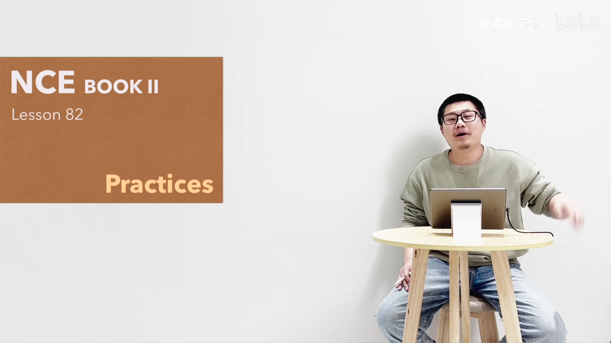

文字识别：NCE / BOOKII / Lesson 82 / Practices

### 画面 00:00:05

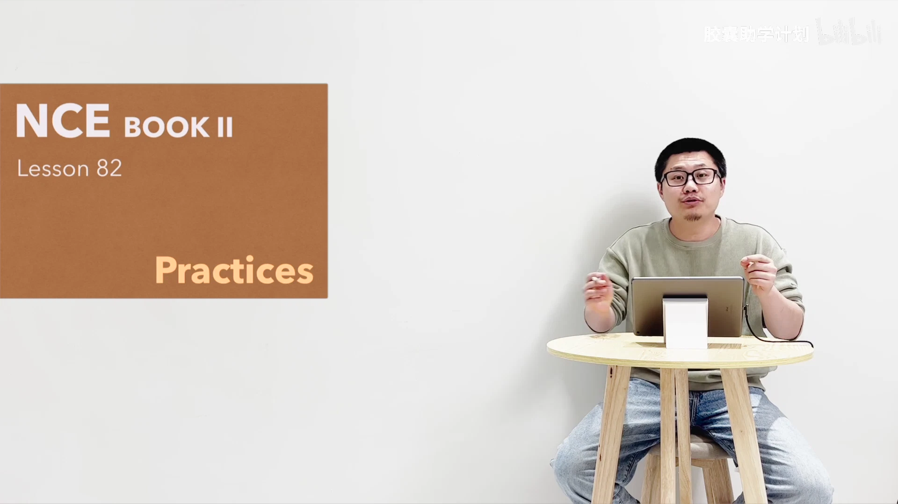

文字识别：NCE / BOOKII / Lesson 82 / Practices

### 画面 00:00:08

文字识别：进行如下练习唯一前提 / 文章跟读至熟读成诵 / 否则请勿开始

### 画面 00:00:16

文字识别：biltbil / 胶囊助学计划 / •

### 画面 00:00:20

文字识别：臺助字计划優州 / 胶囊助学计划

### 画面 00:00:22

文字识别：Comprehension / 训练目标： / 听懂一般疑问句＆特殊疑问句

### 画面 00:00:28

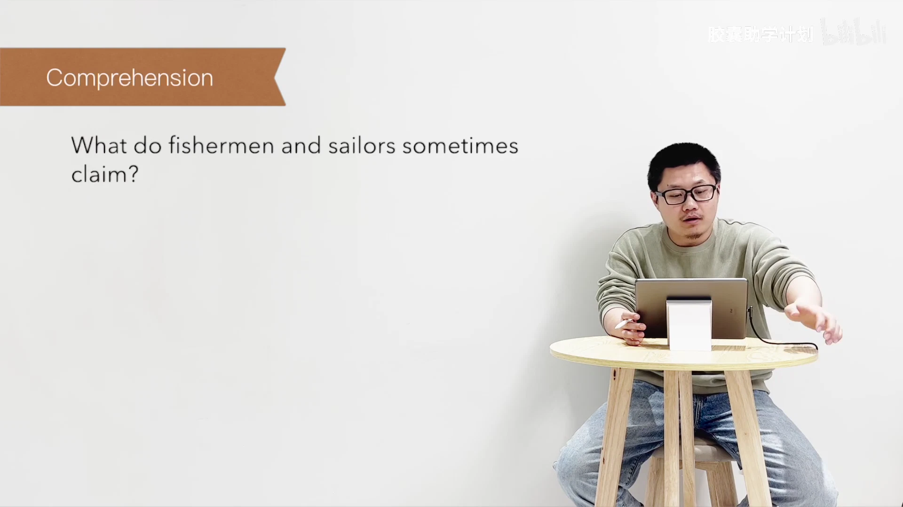

文字识别：Comprehension / What do fishermen and sailors sometimes / claim?

## 00:00:30–00:01:00

fishermen and sailors sometimes claim to have seen monsters in the sea? Next one. What have people often laughed at at stories told by seamen? What is now known that many of these monsters are simply strange fish?

### 画面 00:00:40

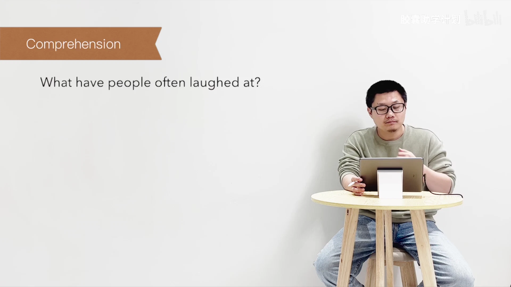

文字识别：Comprehension / What have people often laughed at?

### 画面 00:00:55

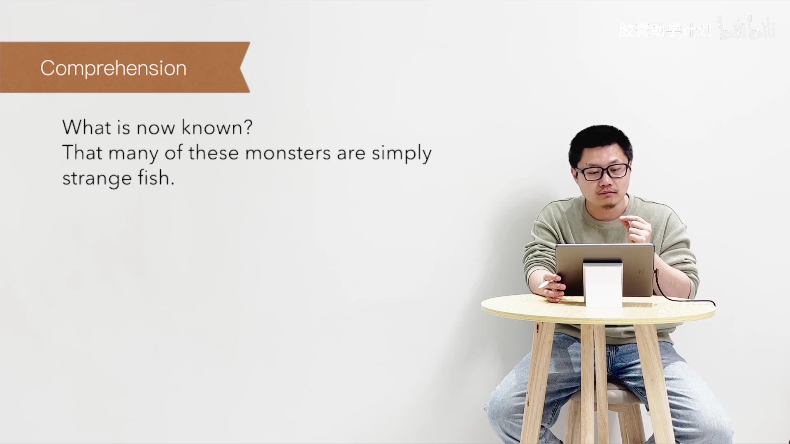

文字识别：Comprehension / What is now known? / That many of these monsters are simply / strange fish.

## 00:01:00–00:01:30

What happens occasionally? Anuro creatures are washed to the shore. How often are they caught out at sea? Rarely. Where was a peculiar fish caught? Near Madagascar. When was it caught? Some time ago.

### 画面 00:01:01

文字识别：Comprehension / What happens occasionally?

## 00:01:30–00:02:00

How was a small fishing boat carried miles out to sea? By the powerful fish pulling on the line. What did the fisherman realize? That this was no ordinary fish. What did he try hard not to do? Damage it. Where was it eventually

### 画面 00:01:31

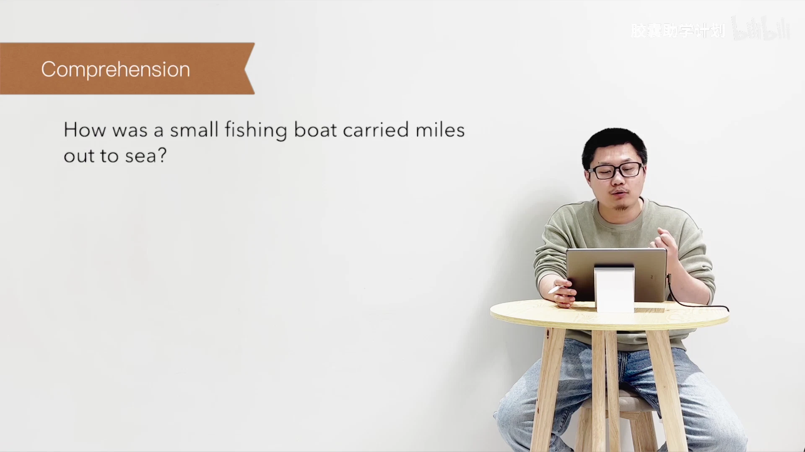

文字识别：Comprehension / How was a small fishing boat carried miles / out to sea?

### 画面 00:01:44

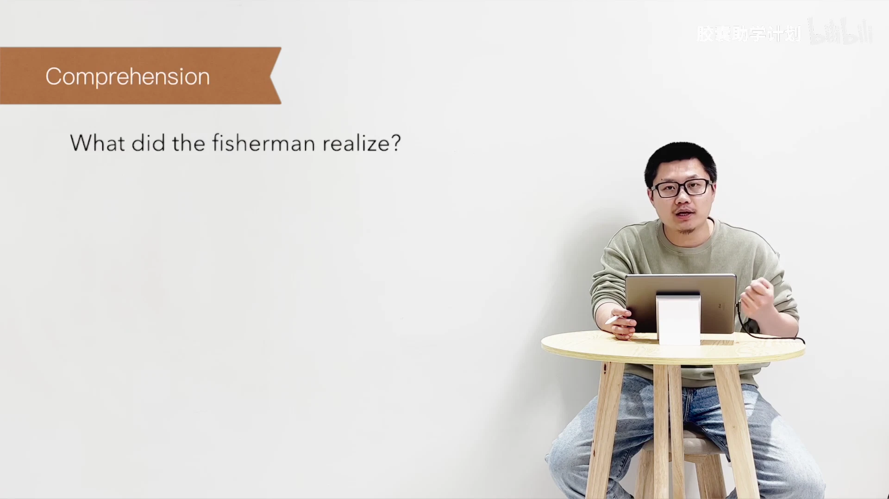

文字识别：Comprehension / What did the fisherman realize?

## 00:02:00–00:02:30

brought to shore? How long was it found to be? Over thirteen feet long. What kind of head had it got? One like a horse. What color were its eyes? Blue. Asking questions, 四句型啊，第一个例

### 画面 00:02:14

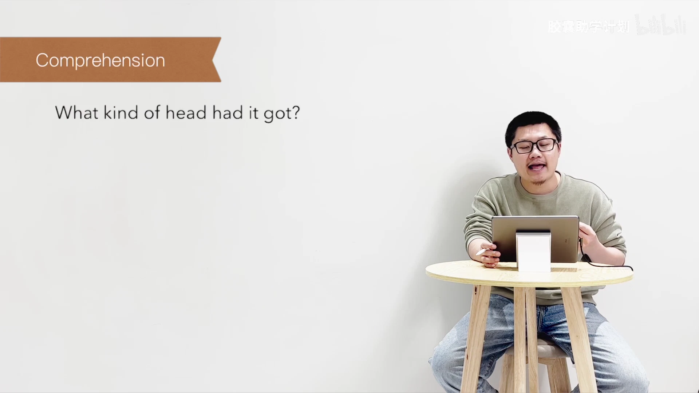

文字识别：Comprehension / What kind of head had it got?

### 画面 00:02:27

文字识别：Asking questions / 训练目标： / 会说一般疑问句＆特殊疑问句 / Accuracy / Fluency

### 画面 00:02:29

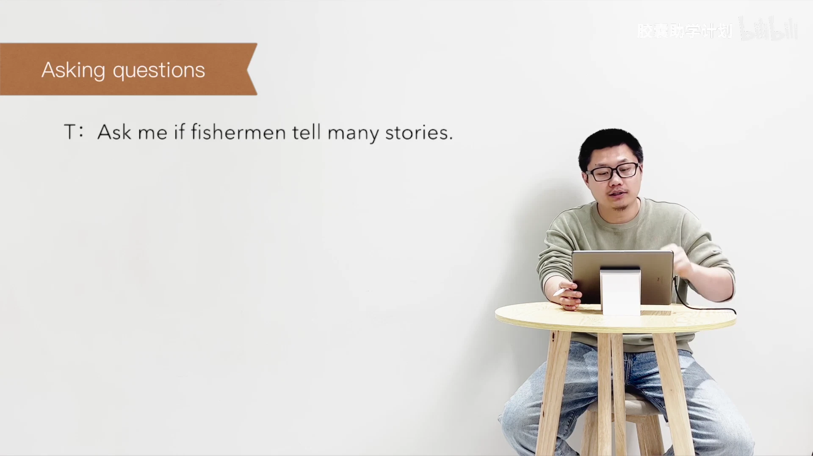

文字识别：Asking questions / T: Ask me if fishermen tell many stories.

## 00:02:30–00:03:00

子，呃，Ask me if fishermen tell many stories. Do提前，What stories? 那肯定是many stories呗，对吧？What stories do fishermen tell? 呃，Who对fishermen提问，直接替代。They sometimes claim to have seen monsters in the sea. 你把do提前，这地方要看claim啊，不要看后边的to have seen啊。那What对monsters提问呗？Where对in the sea? People laugh at

### 画面 00:02:32

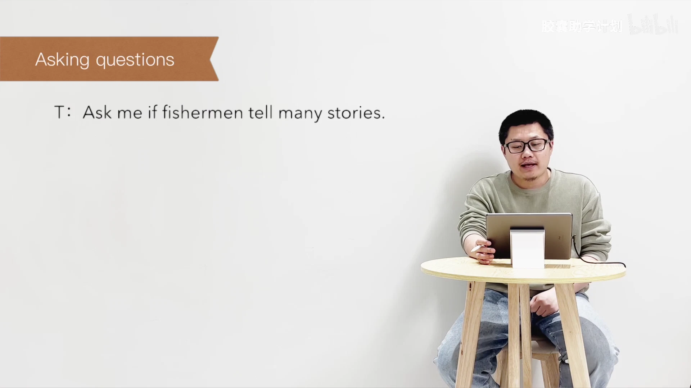

文字识别：Asking questions / T: Ask me if fishermen tell many stories.

### 画面 00:02:35

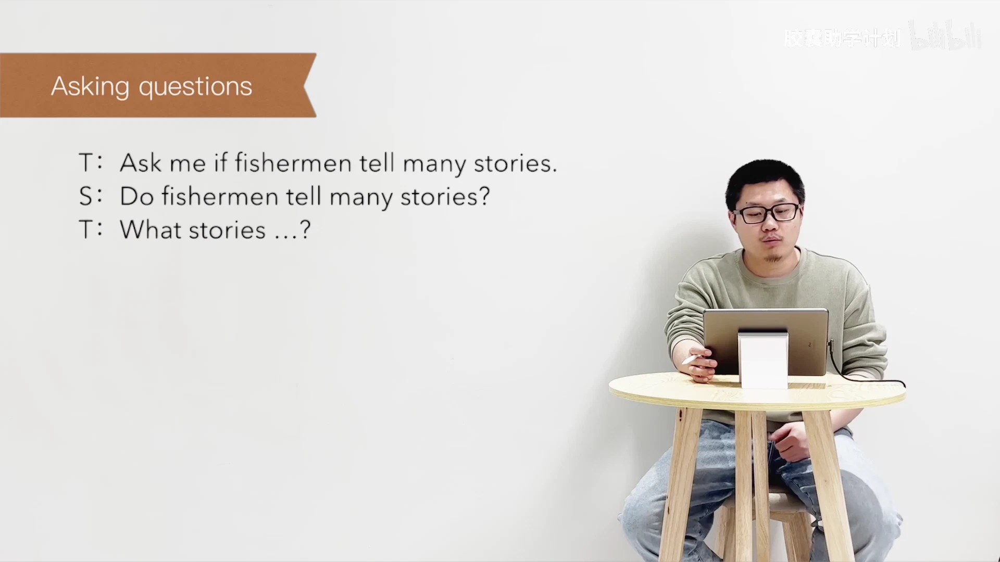

文字识别：Asking questions / T: Ask me if fishermen tell many stories. / S: Do fishermen tell many stories? / T: What stories ..?

### 画面 00:02:37

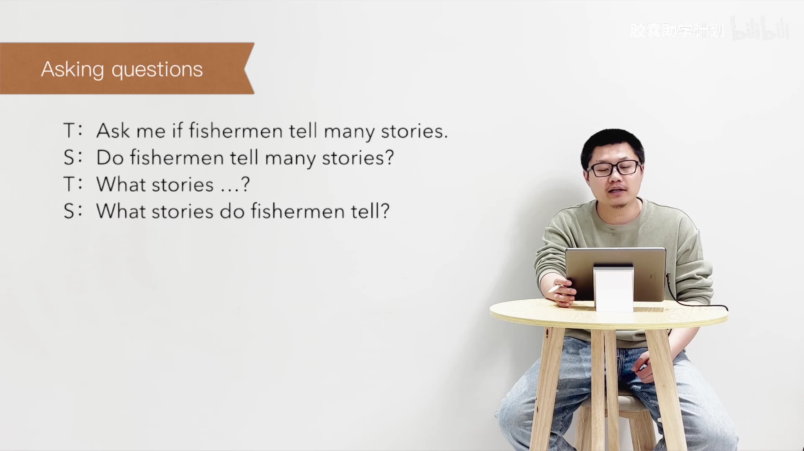

文字识别：Asking questions / T: Ask me if fishermen tell many stories. / S: Do fishermen tell many stories? / T: What stories ...? / S: What stories do fishermen tell?

### 画面 00:02:41

文字识别：Asking questions

### 画面 00:02:45

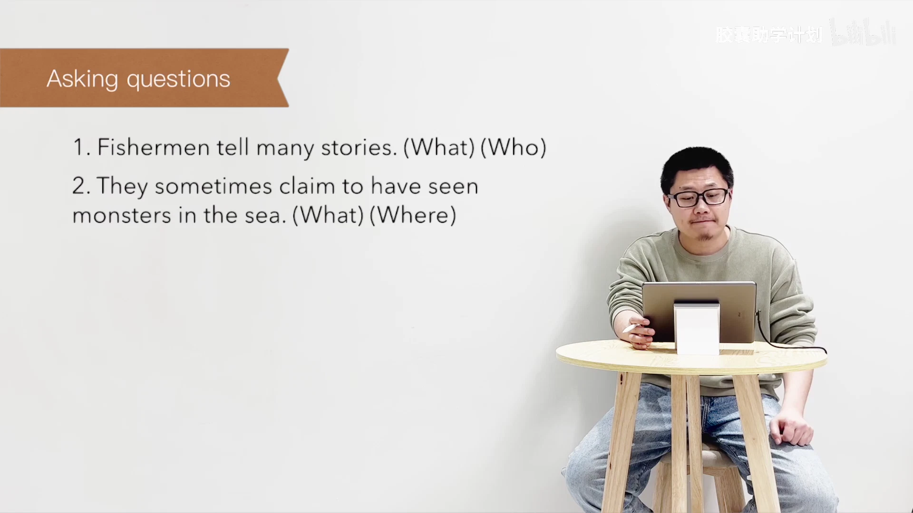

文字识别：Asking questions / 1. Fishermen tell many stories. (What) (Who) / 2.They sometimes claim to have seen / monsters in the sea.(What) (Where)

## 00:03:00–00:03:30

stories told by seamen. Do提前，What对呃stories told by seamen外加整句话，对吧？所以What答案就是What do people laugh at？四Many of these monsters are simply strange fish.二提前就行了。What对simply strange fish提问。第五个，Unusual creatures are occasionally washed to the shore.一般现在是被动，你把are提前，对吧？How often对occasionally

### 画面 00:03:03

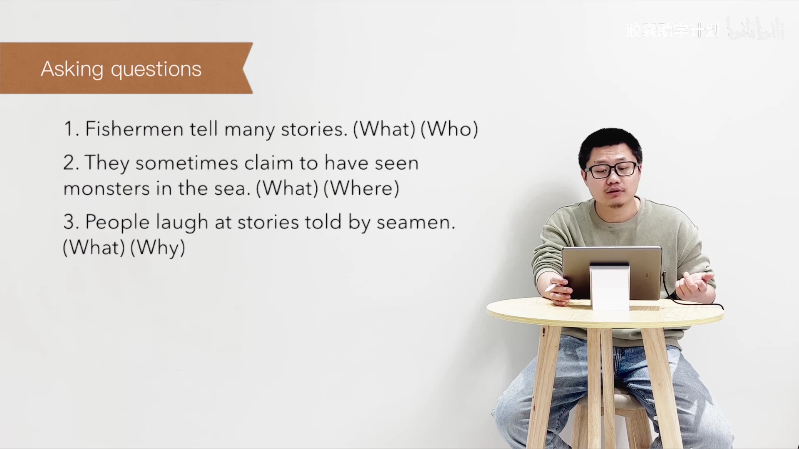

文字识别：Asking questions / 1. Fishermen tell many stories. (What) (Who) / 2.They sometimes claim to have seen / monsters in the sea. (What) (Where) / 3. People laugh at stories told by seamen. / (What)(Why)

### 画面 00:03:16

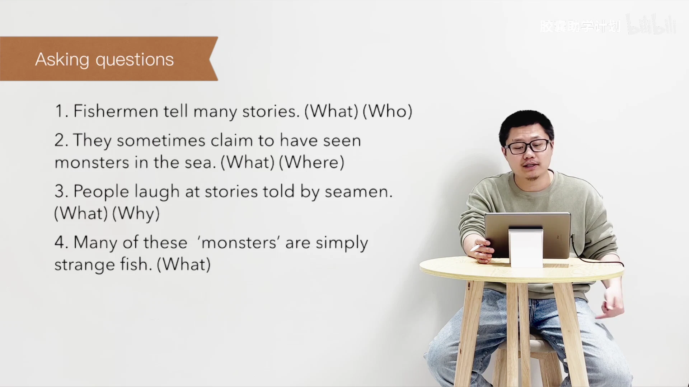

文字识别：Asking questions / 1. Fishermen tell many stories. (What) (Who) / 2. They sometimes claim to have seen / monsters in the sea. (What) (Where) / 3. People laugh at stories told by seamen. / (What) (Why) / 4. Many of these 'monsters' are simply / strange fish. (What)

### 画面 00:03:19

文字识别：動字计划 / Asking questions

### 画面 00:03:22

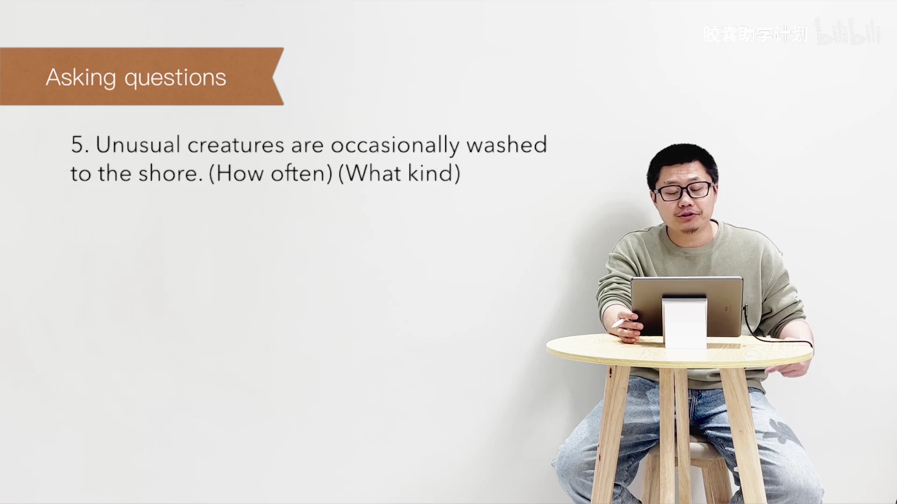

文字识别：Asking questions / 5. Unusual creatures are occasionally washed / to the shore.(How often) (What kind)

## 00:03:30–00:04:00

提问。What kind?其实是What kind of? What kind of在这里就是对unusual这个单词提问，所以其实直接替代主语的一部分，不用变一般疑问句，往后一插就行了，对吧？所以答案我跟你说一下，叫What kind of creatures are occasionally washed to the shore?第六个，They are rarely caught out at sea.一般现在一般现在是被动，二提前。Where对out at sea提问啊？就Where are they rarely caught?或者其实你把rarely也去掉也可以，

### 画面 00:03:52

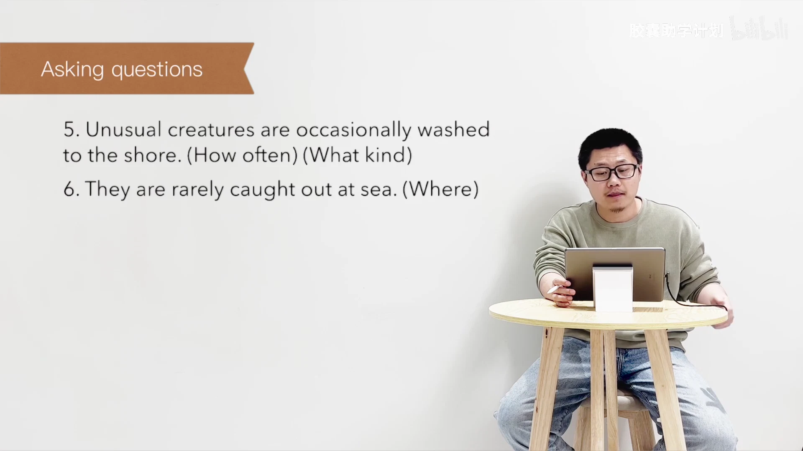

文字识别：Asking questions / 5. Unusual creatures are occasionally washed / to the shore.(How often) (What kind) / 6. They are rarely caught out at sea. (Where)

## 00:04:00–00:04:30

就 Where are they caught? A peculiar fish was caught some time ago near Madagascar. 这个地方 was caught 一般过去式被动，你把 was 提前，那 Where 肯定是对 near Madagascar 提问，对吧？呃，When 对 some time ago. It carried 不用往后看了，carry 动词一般过去时 did 提前，对吧？动词还原形。那 How far 肯定是对 miles 提问，What 是对 it 可以对

### 画面 00:04:02

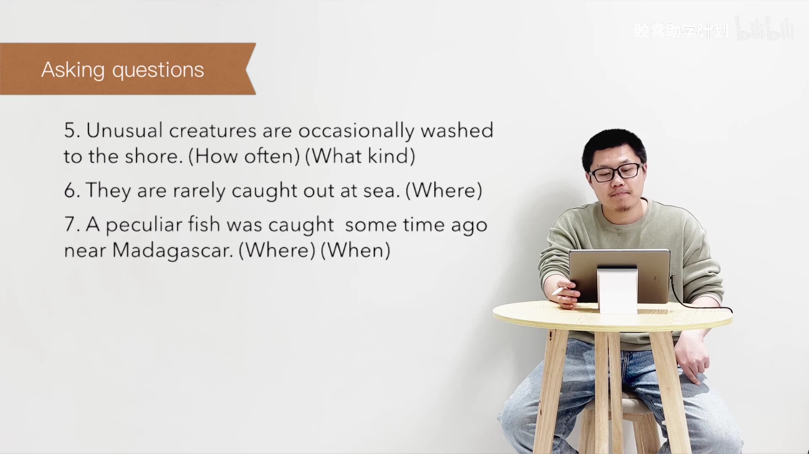

文字识别：Asking questions / 5. Unusual creatures are occasionally washed / to the shore.(How often) (What kind) / 6. They are rarely caught out at sea. (Where) / 7.A peculiar fish was caught some time ago / near Madagascar. (Where)(When)

### 画面 00:04:19

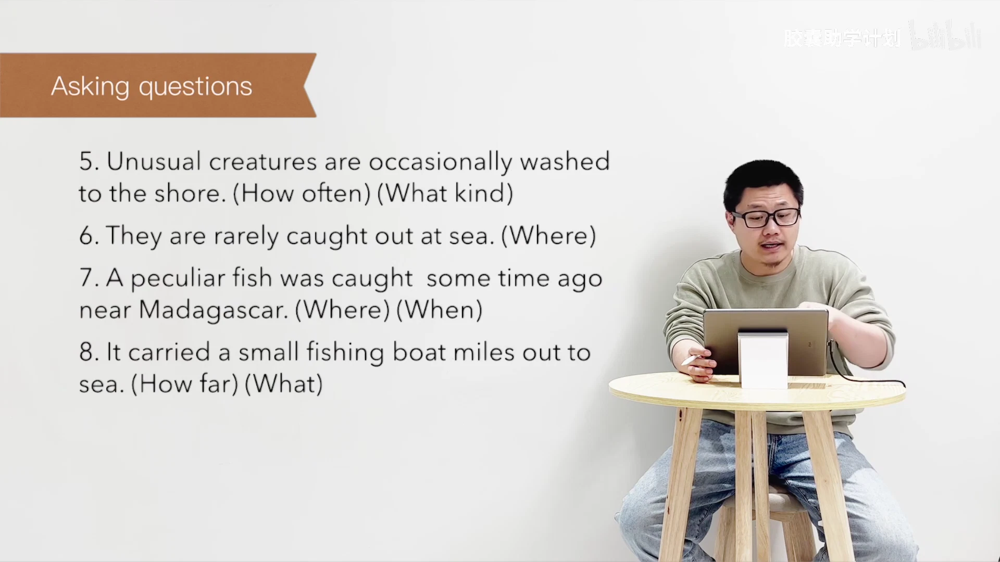

文字识别：Asking questions / 5. Unusual creatures are occasionally washed / to the shore.(How often) (What kind) / 6. They are rarely caught out at sea. (Where) / 7.A peculiar fish was caught some time ago / near Madagascar. (Where) (When) / 8. It carried a small fishing boat miles out to / sea.(How far)(What)

## 00:04:30–00:05:00

a small fishing boat提问也可以。Tell the story,练流利性。哎，您看着这儿，流利来一遍就可以了啊。暂停屏幕。第二个summary writing，这个对于各位所有的写作、工作、生活、考试、学习全有用，一定要重点去写。尤其是咱第四单元的两篇文章，重点看连词。这是第一篇，这是第二篇。好，topic for discussion，我给您说一遍题，咱们这个就结束了。

### 画面 00:04:34

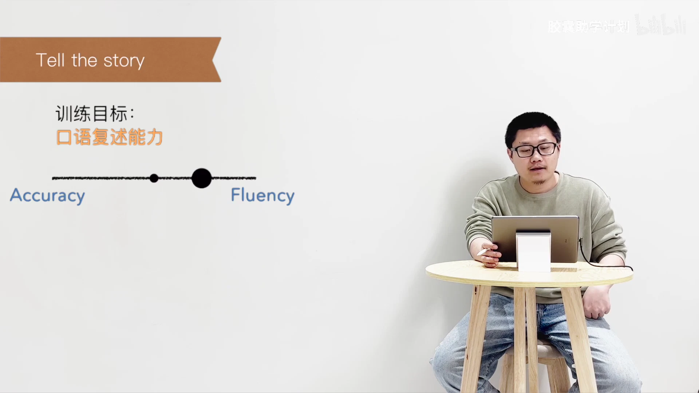

文字识别：Tell the story / 训练目标： / 口语复述能力 / Accuracy / Fluency

### 画面 00:04:36

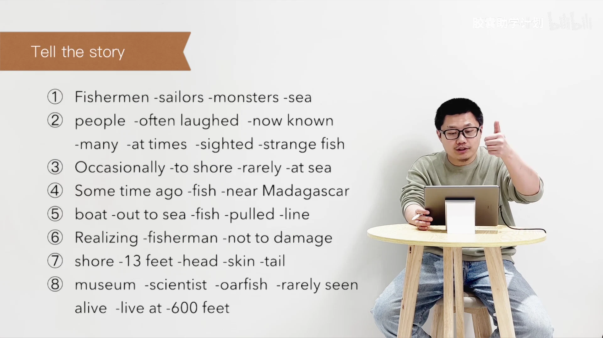

文字识别：Tell the story / Fishermen -sailors -monsters -sea / 1 / people -often laughed -now known / -many -at times -sighted -strange fish / Occasionally -to shore -rarely -at sea / ④ Some time ago -fish -near Madagascar /  boat -out to sea -fish -pulled -line / 5 / ⑥ Realizing -fisherman -not to damage / shore -13 feet -head -skin -tail / museum -scientist -oarfish -rarely seen / alive -live at-600 feet

### 画面 00:04:41

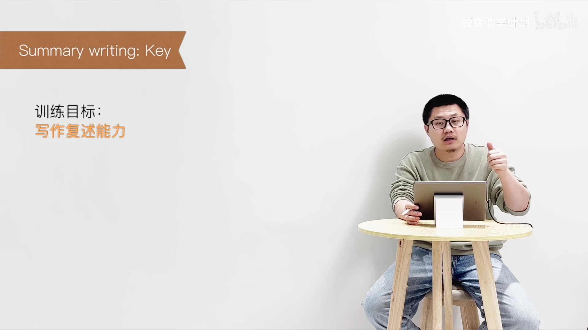

文字识别：Summary writing: Key / 训练目标： / 写作复述能力

### 画面 00:04:51

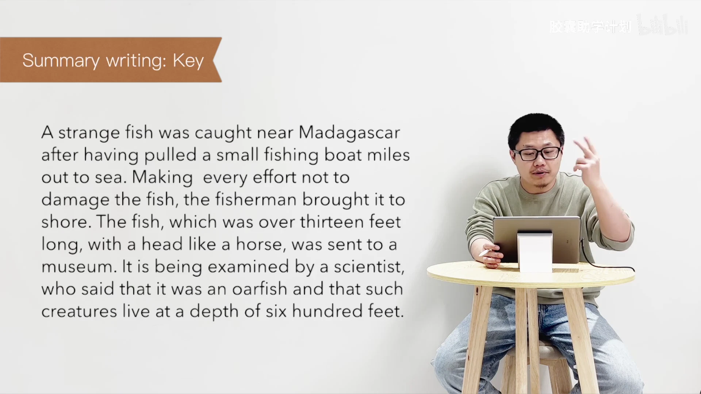

文字识别：Summary writing: Key / A strange fish was caught near Madagascar / after having pulled a small fishing boat miles / out to sea. Making every effort not to / damage the fish, the fisherman brought it to / shore. The fish, which was over thirteen feet / long, with a head like a horse, was sent to a / museum. It is being examined by a scientist, / who said that it was an oarfish and that such / creatures live at a depth of six hundred feet.

### 画面 00:04:54

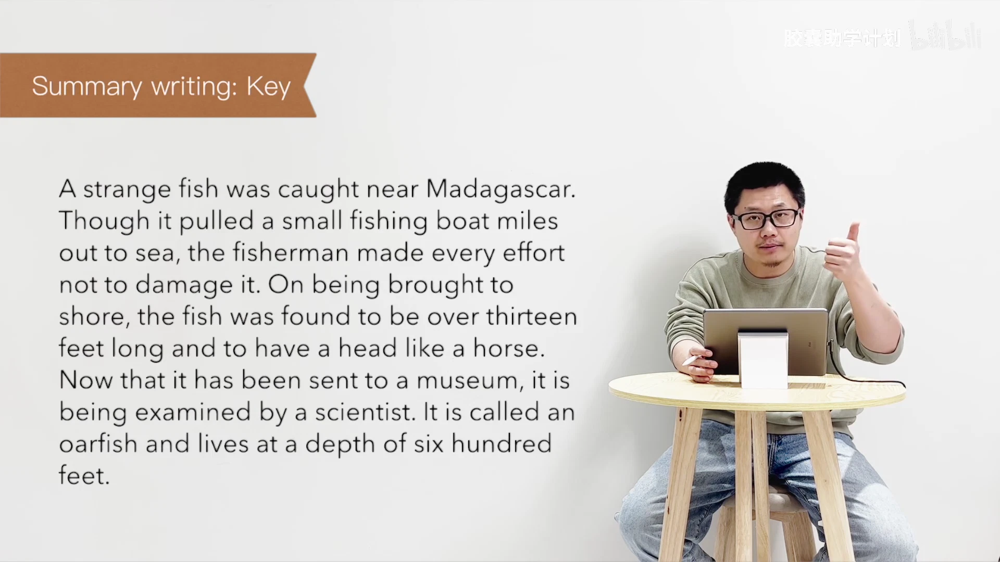

文字识别：Summary writing: Key / A strange fish was caught near Madagascar. / Though it pulled a small fishing boat miles / out to sea, the fisherman made every effort / not to damage it. On being brought to / shore, the fish was found to be over thirteen / feet long and to have a head like a horse. / Now that it has been sent to a museum, it is / being examined by a scientist. Itis called an / oarfish and lives at a depth of six hundred / feet.

### 画面 00:04:56

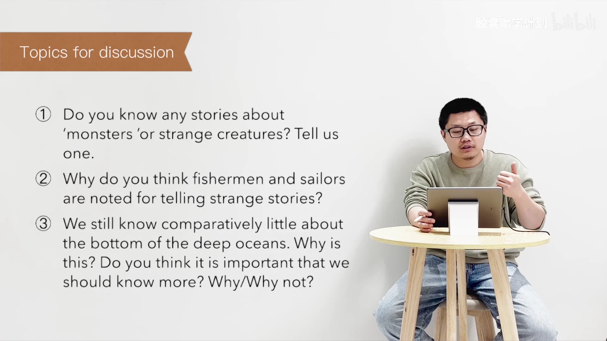

文字识别：Topics for discussion / Do you know any stories about / 'monsters'or strange creatures? Tell us / one. / Why do you think fishermen and sailors / are noted for telling strange stories? / We still know comparatively little about / the bottom of the deep oceans. Why is / this? Do you think it is important that we / should know more? Why/Why not?

## 00:05:00–00:05:30

第一个题说，Do you know any stories about monsters or strange creatures? Tell us one.你知不知道有一些关于奇怪的生物或者怪物的故事？我们讲一个。第二个，Why do you think fishermen and sailors are noted for telling st呃这个 strange stories？大概的意思就是说，为啥你觉得渔夫啊，这个水手啊，经常会讲一些奇奇怪怪的故事？哎，

### 画面 00:05:10

文字识别：Topics for discussion / Do you know any stories about / 'monsters'or strange creatures? Tell us / one. / Why do you think fishermen and sailors / are noted for telling strange stories? / We still know comparatively little about / the bottom of the deep oceans. Why is / this? Do you think it is important that we / should know more? Why/Why not?

## 00:05:30–00:06:00

第三个，We still know comparatively comparatively little about the bottom of the deep oceans. Why is this? Do you think it is important that we should know more? Why? Why not?说为啥咱们相对相对而言去了解海底世界信息非常少？为啥呢？说你认为我们应该了解更多这个事儿很重要吗？重要？为什么重要？不重要？为什么不重要？

### 画面 00:05:40

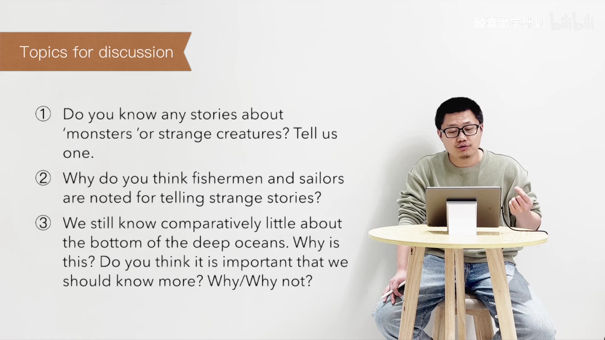

文字识别：Topics for discussion / Do you know any stories about / 'monsters'or strange creatures? Tell us / one. / Why do you think fishermen and sailors / are noted for telling strange stories? / We still know comparatively little about / the bottom of the deep oceans. Why is / this? Do you think it is important that we / should know more? Why/Why not?

### 画面 00:05:48

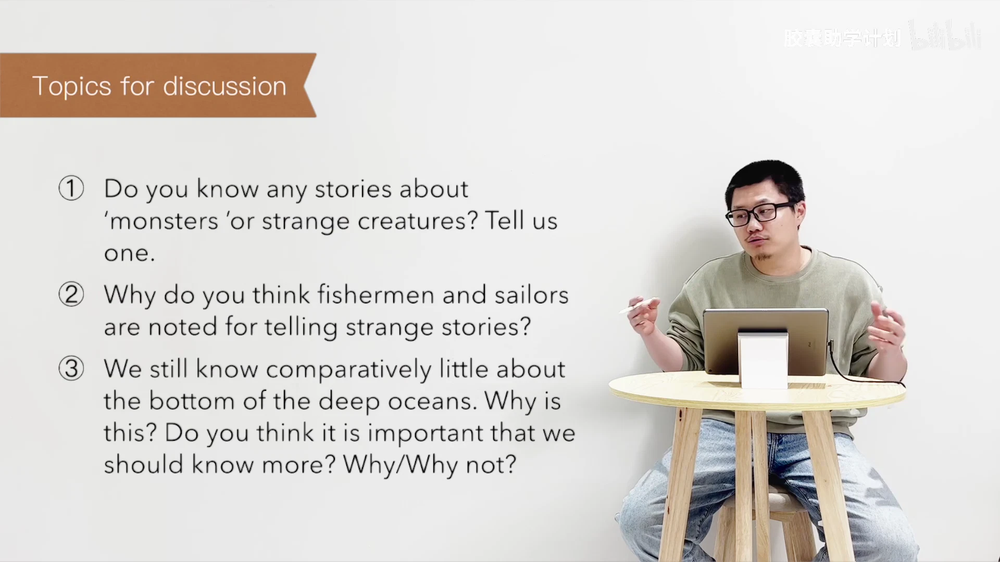

文字识别：Topics for discussion / Do you know any stories about / 'monsters'or strange creatures? Tell us / one. / Why do you think fishermen and sailors / are noted for telling strange stories? / We still know comparatively little about / the bottom of the deep oceans. Why is / this? Do you think it is important that we / should know more? Why/Why not?

## 00:06:00–00:06:30

对吧？OK，好。家庭作业，Ask Smith，先写再朗读。摘要写作注意两篇文章，重点看连词。Tell the story，流利性。哎，置顶留言可以找到重复间隔的学习材料。那以上就是本期视频的全部内容了。如果各位喜欢我们的课程呢，欢迎各位关注、订阅、一键三连，分享给那些需要的朋友，来帮助我们快速成长。See you next time.

### 画面 00:06:00

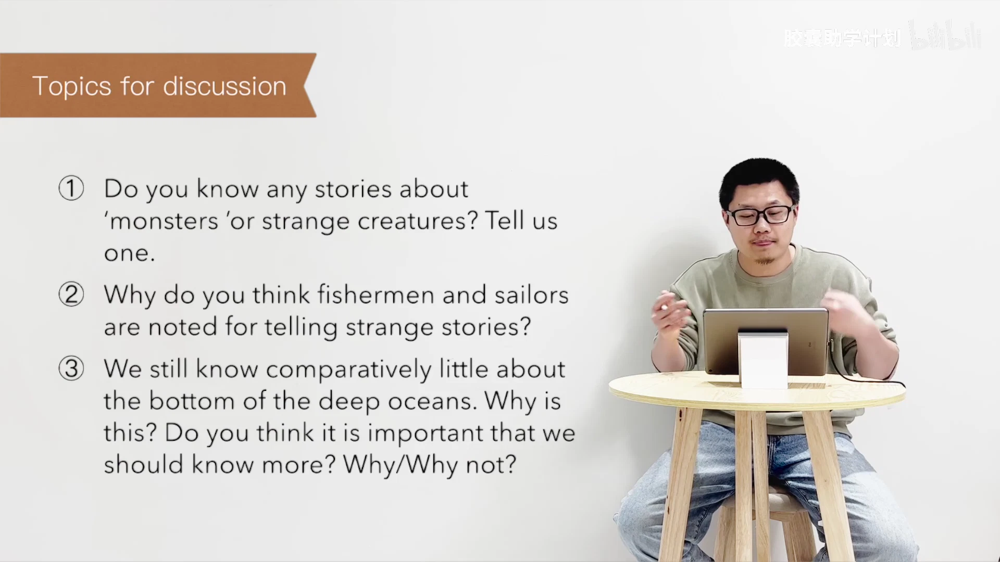

文字识别：Topics for discussion / Do you know any stories about / 'monsters'or strange creatures? Tell us / one. / Why do you think fishermen and sailors / are noted for telling strange stories? / We still know comparatively little about / the bottom of the deep oceans. Why is / this? Do you think it is important that we / should know more? Why/Why not?

### 画面 00:06:02

文字识别：助字计划 / 1.Ask me if写&朗读

### 画面 00:06:04

文字识别：1.Ask me if写&朗读 / 2. / 摘要写作写&答案

### 画面 00:06:06

文字识别：1.Ask me if写&朗读 / 2. / 摘要写作写&答案

### 画面 00:06:08

文字识别：1.Ask me if写&朗读 / 摘要写作写&答案 / 3.Tell the story 口语复述

### 画面 00:06:10

文字识别：1.Ask me if写&朗读 / 摘要写作写&答案 / 3.Tell the story 口语复述 / .重复间隔（置顶留言） / 4.

### 画面 00:06:14

文字识别：助字计划一

### 画面 00:06:18

文字识别：毫助学计划一

### 画面 00:06:27

### 画面 00:06:29

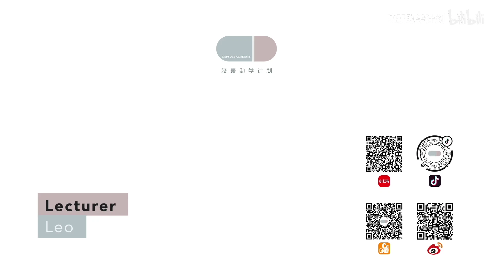

文字识别：聖珈字計划 / CAPSULEACADEMY / 胶囊助学计划 / 小红书 / Lecturer / Leo / OE

## 00:06:30–00:06:39

### 画面 00:06:32

文字识别：山 / 臺聖珈字計切 / CAPSULEACADEMY / 胶囊助学计划 / 小红书 / □ / 口 / Editor / OE

### 画面 00:06:35

文字识别：CAPSULEACADEMY / 胶囊助学计划 / 『 / 小红书 / Creator / □ / Leo & Berlin / OE

### 画面 00:06:37

文字识别：bilibili / 胶囊助学计划 / 胶囊助学计划 / 足品 / 小红书 / □

### 画面 00:06:39

文字识别：bilibili / 胶囊助学计划

