# 083 单词

快速机器解析：语音为单模型转写，未进行独立交叉校对或人工复核；画面每秒采样并按变化选帧，短时文字和标记可能遗漏。截图时间约有 1 秒误差。图片有损压缩；遇到疑点请按时间查看 Google Drive 原视频。

## 00:00:00–00:00:30

Hello everyone, welcome to Capsule Academy. This is Leo. Today we're going to learn new concept English Book Two Lesson Eighty Three Words. 那老习惯，进入正式课程之前呢，咱们看几个小的问题。第一，如何表达赢得选举？第二，如何表达对某件事情或某人很狂热？啊，那带着这两个问题，Hope you gonna enjoy. 我们先看第一个单词，

### 画面 00:00:00

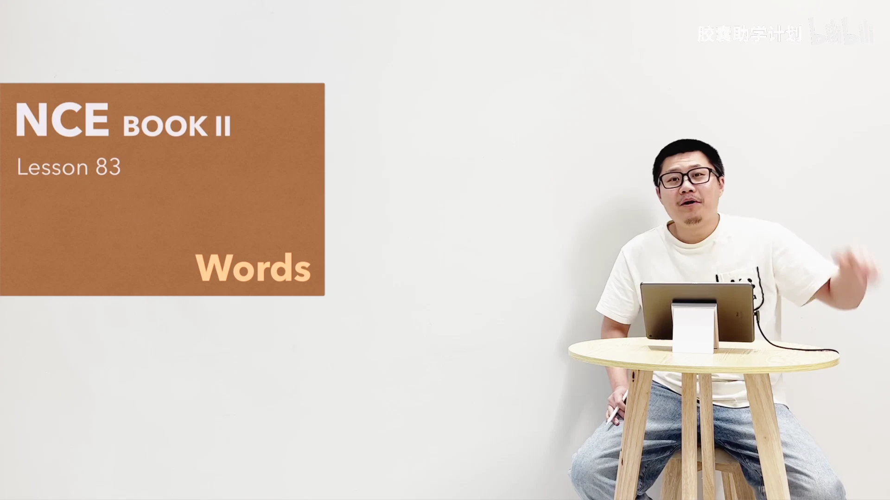

文字识别：交囊助学计划 / NCE / BOOKⅡI / Lesson 83 / Words

### 画面 00:00:09

文字识别：交囊助学计划州

### 画面 00:00:12

文字识别：囊助学计划 / ①如何表达“赢得选举”？

### 画面 00:00:14

文字识别：囊助学计划 / ①如何表达“赢得选举”？

### 画面 00:00:16

文字识别：交囊助学计划国 / ①如何表达“赢得选举”？ / 如何表达“对..狂热”?

### 画面 00:00:24

文字识别：胶囊助学计划i

### 画面 00:00:27

文字识别：胶囊助学计划册出 / 胶囊助学计划

### 画面 00:00:29

文字识别：单词造句指南 / 网：v.+v.变化 / 胶囊助学计划 / 四句型转换 / 方式/地点/时间 / 结合习惯用法 / 其他单词+词性 / ELECTION / 原文摘抄+变 / 6123456 / /i'lek.∫an/ / election n.

## 00:00:30–00:01:00

看一下音标叫 election. Election. Election 指的是选举的意思，对吧？OK，好，那它是一个名词。我们经常和它可以连到一起的动词叫 win the election，叫做赢得这个选举。我们造一个句子：If you won the election, I would give you two thousand dollars. 注意黑字加粗的部分提醒了你，我不是说真的是想

### 画面 00:00:32

文字识别：单词造句指南 / 网：v.+v.变化 / 胶囊助学计划 / 四句型转换 / 方式/地点/时间 / 结合习惯用法 / 其他单词+词性 / ELECTION / 原文摘抄+变 / 6123456 / /i'lek.∫an/ / election n.

### 画面 00:00:35

文字识别：单词造句指南 / 网：v.+v.变化 / 胶囊助学计划 / 四句型转换 / 方式/地点/时间 / 结合习惯用法 / 其他单词+词性 / ELECTION / 原文摘抄+变 / 6123456 / /i'lek.∫an/ / election n.

### 画面 00:00:39

文字识别：单词造句指南 / 网：v.+v.变化 / 校囊助学计划一淵 / 四句型转换 / 方式/地点/时间 / 结合习惯用法 / 其他单词+词性 / ELECTION / 原文摘抄+变 / 6123456 / /i'lek.∫an/ / election n. / If you won the election, I would give you / 2,000 dollars. L40

### 画面 00:00:41

文字识别：单词造句指南 / 网：v.+v.变化 / 校囊助学计划一脚 / 四句型转换 / 方式/地点/时间 / 结合习惯用法 / 其他单词+词性 / ELECTION / 原文摘抄+变 / 6123456 / /i'lek.∫an/ / election n. / If you won the election, I would give you / aanda / 2,000 dollars. L40

### 画面 00:00:43

文字识别：单词造句指南 / 网：v.+v.变化 / 校囊助学计划 / 四句型转换 / 方式/地点/时间 / 结合习惯用法 / 其他单词+词性 / ELECTION / 原文摘抄+变 / 6123456 / /i'lek.∫an/ / election n. / If you won the election, I would give you / 2,000 dollars. L40

### 画面 00:00:45

文字识别：单词造句指南 / 网：v.+v.变化 / 胶囊助学计划 / 四句型转换 / 方式/地点/时间 / 结合习惯用法 / 其他单词+词性 / ELECTION / 原文摘抄+变 / 6123456 / /i'lek.∫an/ / election n. / If you won the election, I would give you / 2,000 dollars. L40

### 画面 00:00:47

文字识别：单词造句指南 / 网：v.+v.变化 / 胶囊助学计划 / 四句型转换 / 方式/地点/时间 / 结合习惯用法 / 其他单词+词性 / ELECTION / 原文摘抄+变 / 6123456 / /i'lek.∫an/ / election n. / If you won the election, I would give you / 2,000 dollars. L40

### 画面 00:00:50

文字识别：单词造句指南 / 网：v.+v.变化 / 校囊助学计划 / 四句型转换 / 方式/地点/时间 / 结合习惯用法 / 其他单词+词性 / ELECTION / 原文摘抄+变 / 6123456 / /i'lek.∫an/ / election n. / If you won the election, I would give you / 2,000 dollars. L40

### 画面 00:00:58

文字识别：单词造句指南 / 网：v.+v.变化 / 交囊助学计划 / 四句型转换 / 方式/地点/时间 / 结合习惯用法 / 其他单词+词性 / ELECTION / 原文摘抄+变 / 6123456 / /i'lek.∫an/ / election n. / If you won the election, I would give you / 2,000 dollars. L40

## 00:01:00–00:01:30

表达你赢了我就给你两千刀，对吧？不是那个意思，是我就认为你赢不了。虚拟语气，对吧？Next one, she is used to winning the election, for she wins every time.说她已经习惯了赢得这个选举，因为啥呢？每次都她赢。当然了，这个地方多提一句，这个election这个选举啊，它不一定非要指的是国家层面上这么大的选举，对吧？你完全可以是班里边啊，什么这个

### 画面 00:01:02

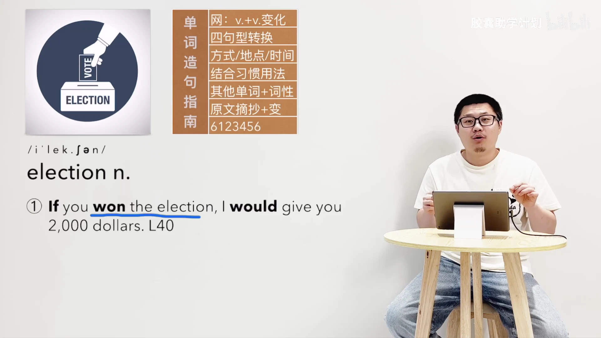

文字识别：单词造句指南 / 网：v.+v.变化 / 校囊助学计划 / 四句型转换 / 方式/地点/时间 / 结合习惯用法 / 其他单词+词性 / ELECTION / 原文摘抄+变 / 6123456 / /i'lek.∫an/ / election n. / If you won the election, I would give you / 2,000 dollars. L40

### 画面 00:01:05

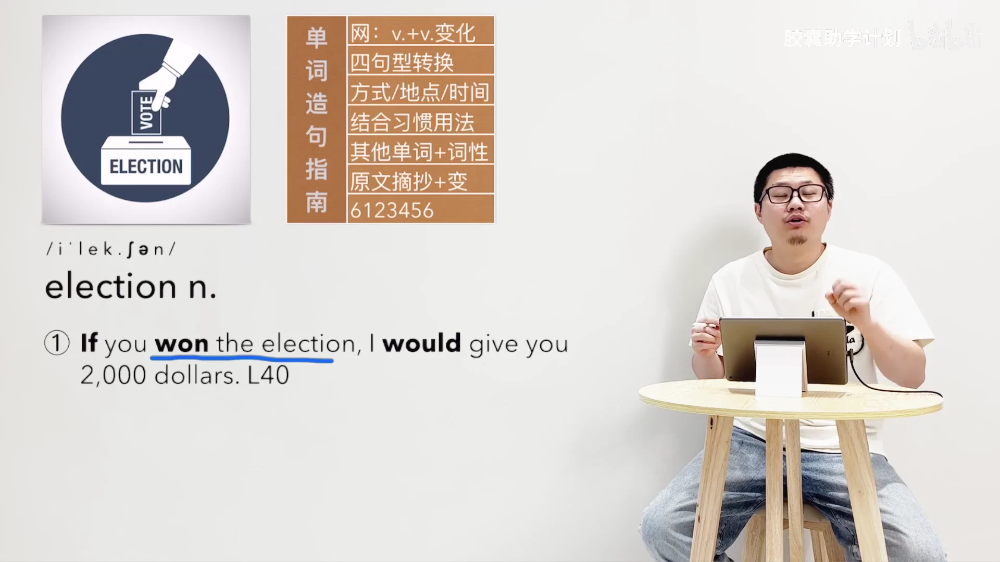

文字识别：单词造句指南 / 网：v.+v.变化 / 交囊助学计划 / 四句型转换 / 方式/地点/时间 / 结合习惯用法 / 其他单词+词性 / ELECTION / 原文摘抄+变 / 6123456 / /i'lek.∫an/ / election n. / If you won the election, I would give you / 2,000 dollars. L40

### 画面 00:01:08

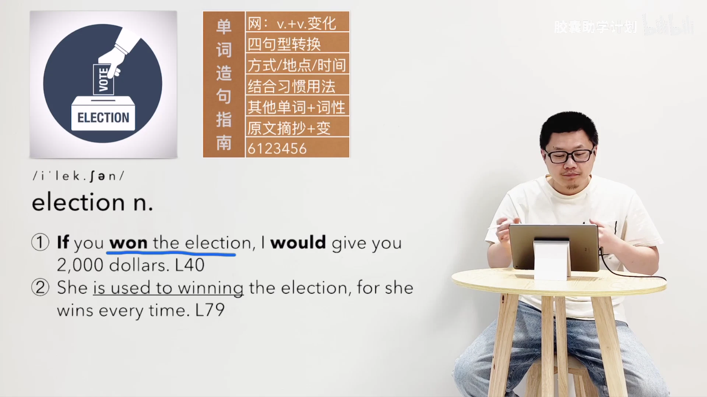

文字识别：单词造句指南 / 网：v.+v.变化 / 囊助学计划關 / 四句型转换 / 方式/地点/时间 / 结合习惯用法 / 其他单词+词性 / ELECTION / 原文摘抄+变 / 6123456 / /i'lek.San/ / election n. / If you won the election, l would give you / 2,000 dollars. L40 / She is used to winning the election, for she / wins every time. L79

### 画面 00:01:10

文字识别：单词造句指南 / 网：v.+v.变化 / 交囊助学计划 / 四句型转换 / 方式/地点/时间 / 结合习惯用法 / 其他单词+词性 / ELECTION / 原文摘抄+变 / 6123456 / /i'lek.San/ / election n. / If you won the election, I would give you / 2,000 dollars. L40 / She is used to winning the election, for she / wins every time. L79

### 画面 00:01:15

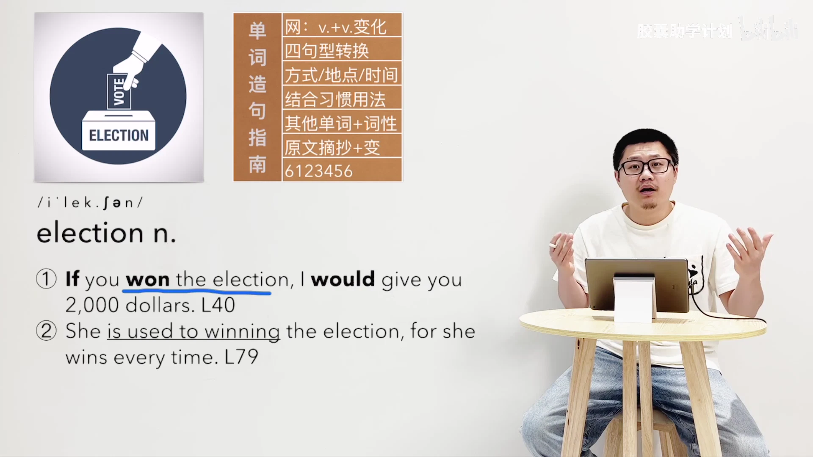

文字识别：单词造句指南 / 网：v.+v.变化 / 囊助学计划一淵 / 四句型转换 / 方式/地点/时间 / 结合习惯用法 / 其他单词+词性 / ELECTION / 原文摘抄+变 / 6123456 / /i'lek.∫an/ / election n. / If you won the election, I would give you / 2,000 dollars. L40 / She is used to winning the election, for she / wins every time. L79

### 画面 00:01:20

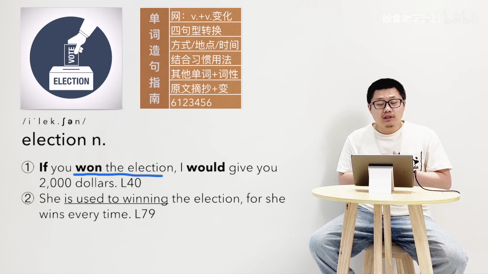

文字识别：单词造句指南 / 网：v.+v.变化 / 交囊助学计划 / 四句型转换 / 方式/地点/时间 / 结合习惯用法 / 其他单词+词性 / ELECTION / 原文摘抄+变 / 6123456 / /i'lek.San/ / election n. / If you won the election, would give you / 2,000 dollars. L40 / She is used to winning the election, for she / wins every time. L79

### 画面 00:01:29

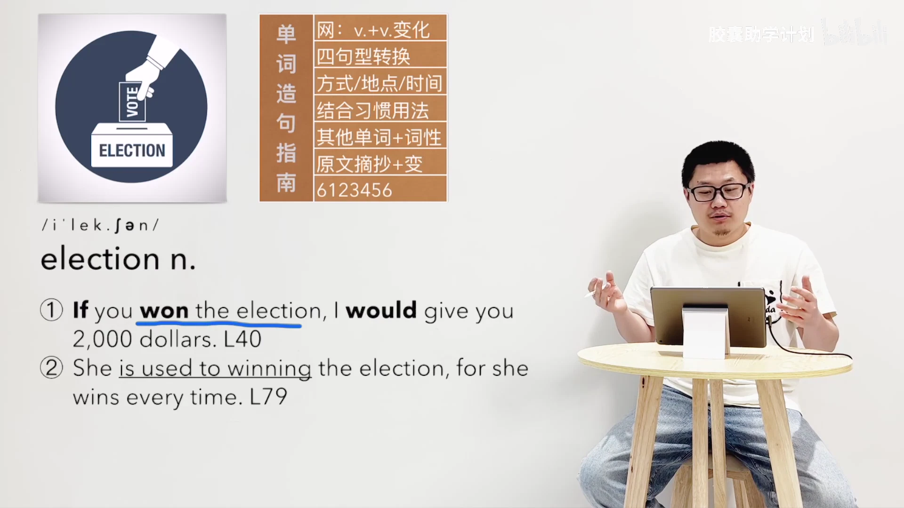

文字识别：单词造句指南 / 网：v.+v.变化 / 交囊助学计划 / 四句型转换 / 方式/地点/时间 / 结合习惯用法 / 其他单词+词性 / ELECTION / 原文摘抄+变 / 6123456 / /i'lek.∫an/ / election n. / If you won the election, I would give you / 2,000 dollars. L40 / She is used to winning the election, for she / wins every time. L79

## 00:01:30–00:02:00

小区里边啊，业主委员会等等啊，都可以叫 election 啊，选举啊，村儿里边都可以。 Next one, repeat after me. 别忘了啊。说 I'm sure that you will win the election. 说我很确信将你将赢得这个选举，叫 you will win the election. 所以在这里，对于各位来说最重要的第一个单词叫 election，第二个要确定要明白，记住哪个动词跟它连到一起叫做 win，对吧？赢得。

### 画面 00:01:36

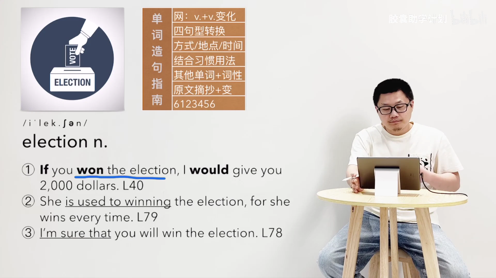

文字识别：单词造句指南 / 网：v.+v.变化 / 交囊助学计划 / 四句型转换 / 方式/地点/时间 / 结合习惯用法 / 其他单词+词性 / ELECTION / 原文摘抄+变 / 6123456 / /i'lek.∫an/ / election n. / If you won the election, I would give you / 2,000 dollars. L40 / She is used to winning the election, for she / wins every time. L79 / I'm sure that you will win the election. L78

### 画面 00:01:38

文字识别：单词造句指南 / 网：v.+v.变化 / 交囊助学计划 / 四句型转换 / 方式/地点/时间 / 结合习惯用法 / 其他单词+词性 / ELECTION / 原文摘抄+变 / 6123456 / /i'lek.∫an/ / election n. / If you won the election, l would give you / 2,000 dollars. L40 / She is used to winning the election, for she / wins every time. L79 / I'm sure that you will win the election. L78

### 画面 00:01:40

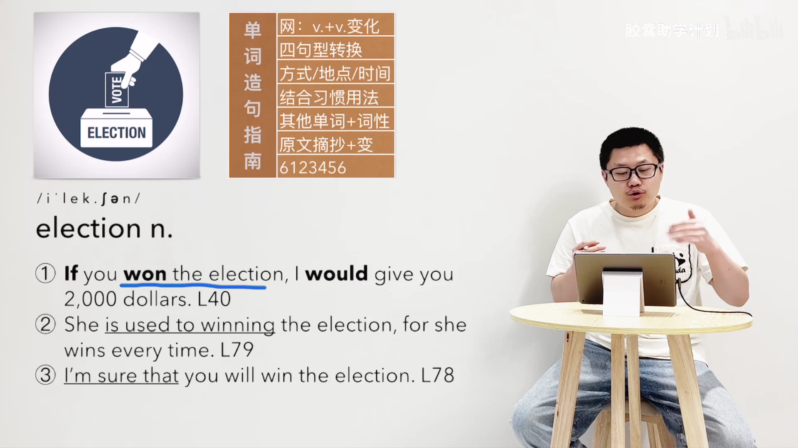

文字识别：单词造句指南 / 网：v.+v.变化 / 囊助学计划 / 四句型转换 / 方式/地点/时间 / 结合习惯用法 / 其他单词+词性 / ELECTION / 原文摘抄+变 / 6123456 / /i'lek.∫an/ / election n. / If you won the election, I would give you / 2,000 dollars. L40 / She is used to winning the election, for she / wins every time. L79 / I'm sure that you will win the election. L78

### 画面 00:01:45

文字识别：单词造句指南 / 网：v.+v.变化 / 交囊助学计划一洲 / 四句型转换 / 方式/地点/时间 / 结合习惯用法 / 其他单词+词性 / ELECTION / 原文摘抄+变 / 6123456 / /i'lek.∫an/ / election n. / If you won the election, I would give you / a / 2,000 dollars. L40 / She is used to winning the election, for she / wins every time. L79 / I'm sure that you will win the election. L78

### 画面 00:01:49

文字识别：单词造句指南 / 网：v.+v.变化 / 交囊助学计划 / 四句型转换 / 方式/地点/时间 / 结合习惯用法 / 其他单词+词性 / ELECTION / 原文摘抄+变 / 6123456 / /i'lek.San/ / election n. / If you won the election, I would give you / 2,000 dollars. L40 / She is used to winning the election, for she / wins every time. L79 / I'm sure that you will win the election. L78

### 画面 00:01:51

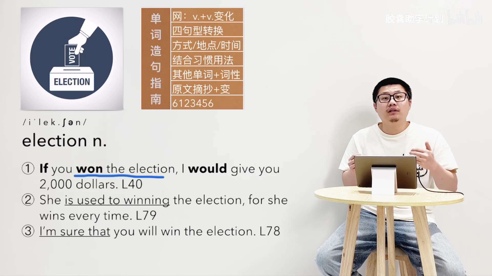

文字识别：单词造句指南 / 网：v.+v.变化 / 交妻助字计划一淵 / 四句型转换 / 方式/地点/时间 / 结合习惯用法 / 其他单词+词性 / ELECTION / 原文摘抄+变 / 6123456 / /i'lek.∫an/ / election n. / If you won the election, I would give you / da / 2,000 dollars. L40 / She is used to winning the election, for she / wins every time. L79 / I'm sure that you will win the election. L78

## 00:02:00–00:02:30

下一个单词，看音标，跟我一起读，叫做 former， former。 OK， former 是什么意思呢？ former 的意思就是之前的、前任的。比如说，经常啊，我们在新闻当中可以见到的，比如说 Barack Obama，我们现在他是什么呢？管他叫做 former president，叫做前总统，对吧？美国的前总统。 OK，那我们造这样一个句子，比如说 This building takes its name from the former

### 画面 00:02:01

文字识别：单词造句指南 / 网：v.+v.变化 / 胶囊助学计划 / 四句型转换 / 方式/地点/时间 / 结合习惯用法 / 其他单词+词性 / 原文摘抄+变 / 6123456 / / 'fo:.ma/ / former adj.

### 画面 00:02:03

文字识别：单词造句指南 / 网：v.+v.变化 / 校囊助学计划 / 四句型转换 / 方式/地点/时间 / 结合习惯用法 / 其他单词+词性 / 原文摘抄+变 / 6123456 / / 'fo:.ma/ / former adj.

### 画面 00:02:05

文字识别：单词造句指南 / 网：v.+v.变化 / 胶囊助学计划 / 四句型转换 / 方式/地点/时间 / 结合习惯用法 / 其他单词+词性 / 原文摘抄+变 / 6123456 / / 'fo:.ma/ / former adj.

### 画面 00:02:11

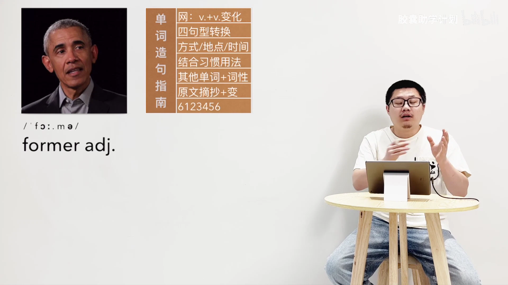

文字识别：单词造句指南 / 网：v.+v.变化 / 胶囊助学计划调 / 四句型转换 / 方式/地点/时间 / 结合习惯用法 / 其他单词+词性 / 原文摘抄+变 / 6123456 / / 'fo:.ma/ / former adj. / da

### 画面 00:02:15

文字识别：单词造句指南 / 网：v.+v.变化 / 胶囊助学计划 / 四句型转换 / 方式/地点/时间 / 结合习惯用法 / 其他单词+词性 / 原文摘抄+变 / 6123456 / / 'fo:.ma/ / former adj. / ① former president

### 画面 00:02:20

文字识别：单词造句指南 / 网：v.+v.变化 / 校囊助学计划 / 四句型转换 / 方式/地点/时间 / 结合习惯用法 / 其他单词+词性 / 原文摘抄+变 / 6123456 / / 'fo:.ma/ / former adj. / ① former president

### 画面 00:02:24

文字识别：单词造句指南 / 网：v.+v.变化 / 交囊助学计划淵 / 四句型转换 / 方式/地点/时间 / 结合习惯用法 / 其他单词+词性 / 原文摘抄+变 / 6123456 / / 'fo:.ma/ / former adj. / ① former president / This building takes its name from the / former president. L71

### 画面 00:02:26

文字识别：单词造句指南 / 网：v.+v.变化 / 交囊助学计划洲 / 四句型转换 / 方式/地点/时间 / 结合习惯用法 / 其他单词+词性 / 原文摘抄+变 / 6123456 / / 'fo:.ma/ / former adj. / ① former president / This building takes its name from the / former president. L71

## 00:02:30–00:03:00

building, take name from the former president. This building, take name from the

### 画面 00:02:30

文字识别：单词造句指南 / 网：v.+v.变化 / 交囊助学计划 / 四句型转换 / 方式/地点/时间 / 结合习惯用法 / 其他单词+词性 / 原文摘抄+变 / 6123456 / / 'fo:.ma/ / former adj. / ① former president / This building takes its name from the / former president. L71

### 画面 00:02:33

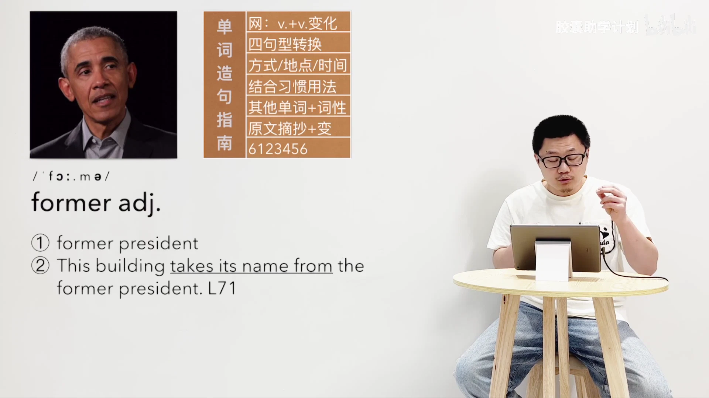

文字识别：单词造句指南 / 网：v.+v.变化 / 校囊助学计划调 / 四句型转换 / 方式/地点/时间 / 结合习惯用法 / 其他单词+词性 / 原文摘抄+变 / 6123456 / / 'fo:.ma/ / former adj. / ① former president / This building takes its name from the / former president. L71

### 画面 00:02:35

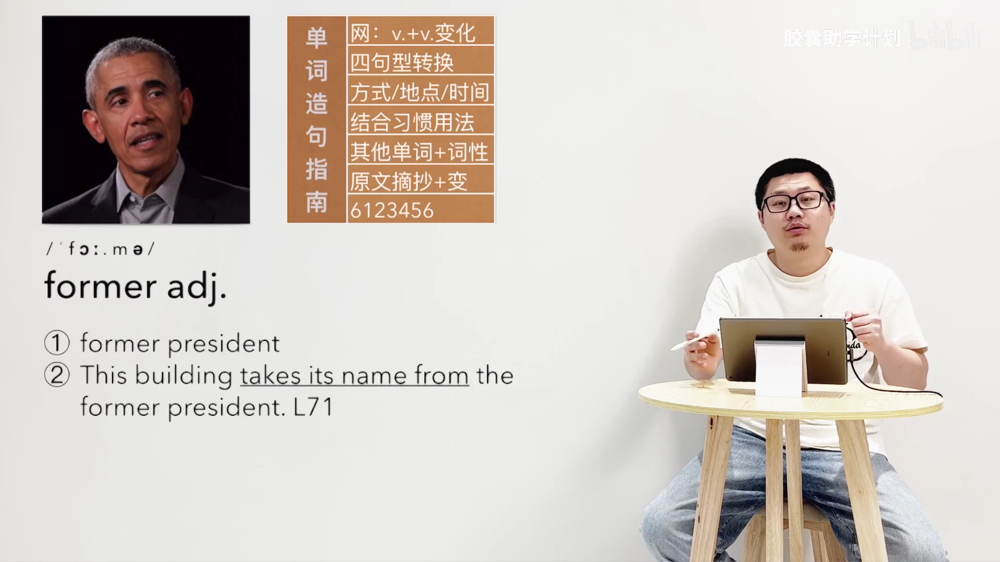

文字识别：单词造句指南 / 网：v.+v.变化 / 校囊助学计划州 / 四句型转换 / 方式/地点/时间 / 结合习惯用法 / 其他单词+词性 / 原文摘抄+变 / 6123456 / / 'fo:.ma/ / former adj. / ① former president / This building takes its name from the / former president. L71

### 画面 00:02:37

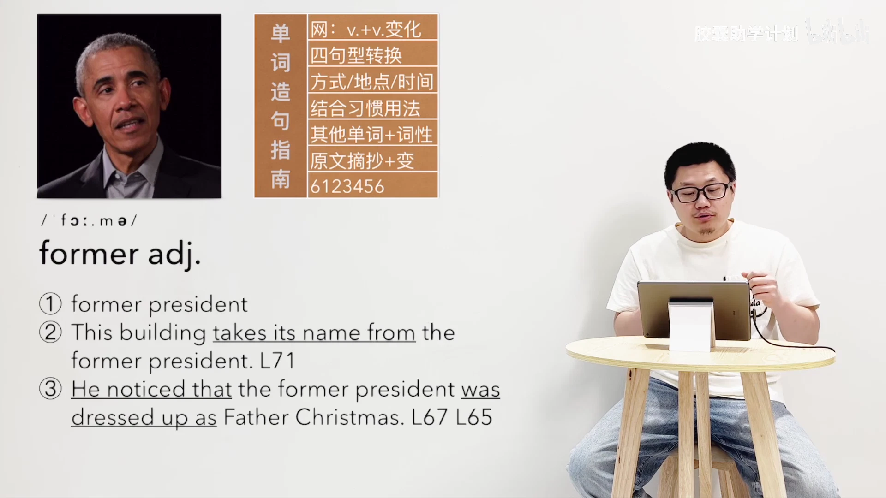

文字识别：单词造句指南 / 网：v.+v.变化 / 交囊助学计划 / 四句型转换 / 方式/地点/时间 / 结合习惯用法 / 其他单词+词性 / 原文摘抄+变 / 6123456 / / 'fo:.ma/ / former adj. / ① former president / ) This building takes its name from the / former president. L71 / He noticed that the former president was / dressed up as Father Christmas. L67 L65

### 画面 00:02:40

文字识别：单词造句指南 / 网：v.+v.变化 / 交囊助学计划 / 四句型转换 / 方式/地点/时间 / 结合习惯用法 / 其他单词+词性 / 原文摘抄+变 / 6123456 / / 'fo:.ma/ / former adj. / ① former president / This building takes its name from the / former president. L71 / He noticed that the former president was / dressed up as Father Christmas. L67 L65

### 画面 00:02:47

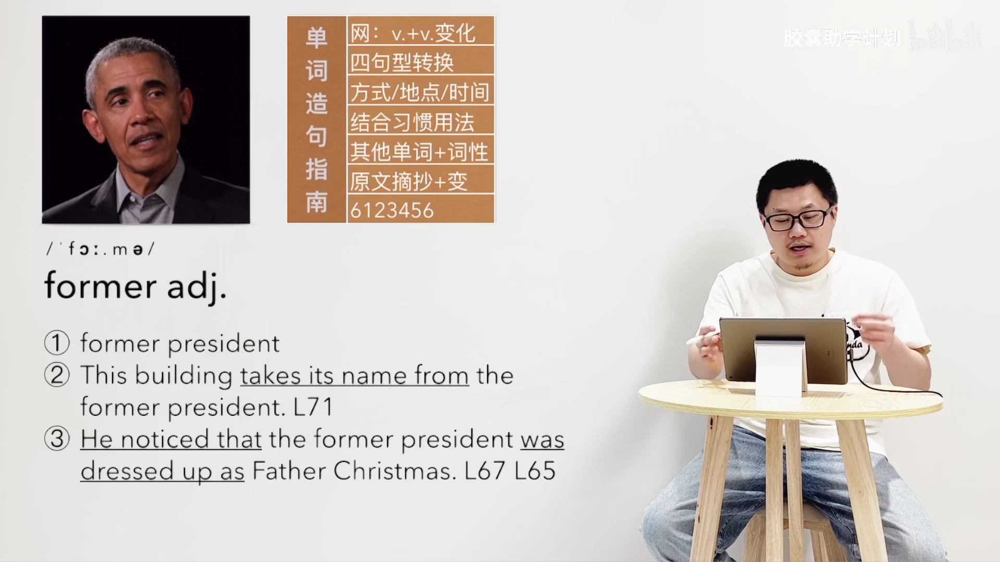

文字识别：单词造句指南 / 网：v.+v.变化 / 交囊助学计划一 / 四句型转换 / 方式/地点/时间 / 结合习惯用法 / 其他单词+词性 / 原文摘抄+变 / 6123456 / / 'fo:.ma/ / former adj. / ① former president / This building takes its name from the / former president. L71 / He noticed that the former president was / dressed up as Father Christmas. L67 L65

### 画面 00:02:51

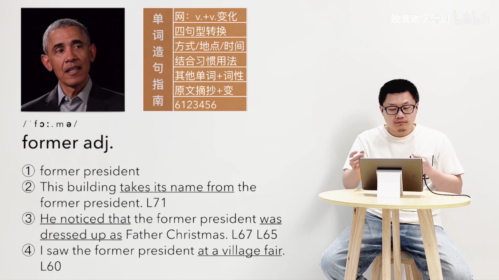

文字识别：单词造句指南 / 网：v.+v.变化 / 霆助学计划 / 四句型转换 / 方式/地点/时间 / 结合习惯用法 / 其他单词+词性 / 原文摘抄+变 / 6123456 / / 'fo:.ma/ / former adj. / ① former president / ) This building takes its name from the / former president. L71 / He noticed that the former president was / dressed up as Father Christmas. L67 L65 / ④ I saw the former president at a village fair. / L60

### 画面 00:02:55

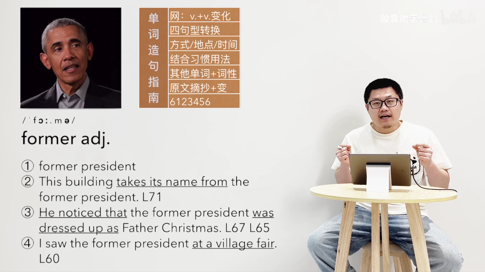

文字识别：单词造句指南 / 网：v.+v.变化 / 囊助学计划陽 / 四句型转换 / 方式/地点/时间 / 结合习惯用法 / 其他单词+词性 / 原文摘抄+变 / 6123456 / / 'fo:.ma/ / former adj. / ① former president / ) This building takes its name from the / former president. L71 / He noticed that the former president was / dressed up as Father Christmas. L67 L65 / ④ I saw the former president at a village fair. / L60

## 00:03:00–00:03:30

一个乡村的集市上。那在这个地方用到六十克的一个小的地点短语，叫做 at a village fair。 OK， very good。再跟我一起读一遍，former， former， very good。 Next one，下一个单词动词叫 defeat， defeat。那 defeat 它最物理意义上的含义就是打败击败。当然，这个打败击败可以除了打架以外的打败击败，对吧？ OK，可以指的是

### 画面 00:03:00

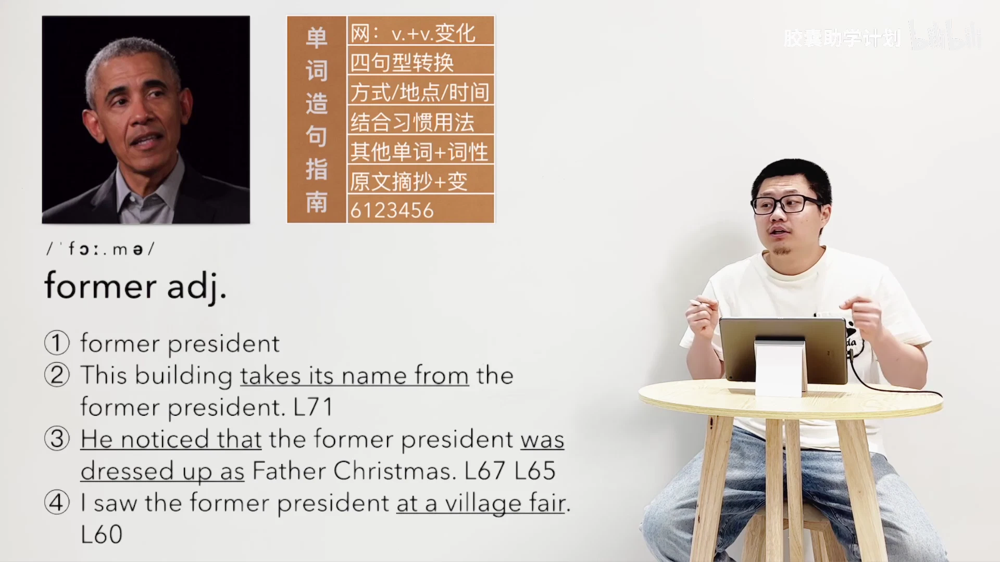

文字识别：单词造句指南 / 网：v.+v.变化 / 囊助学计划一调 / 四句型转换 / 方式/地点/时间 / 结合习惯用法 / 其他单词+词性 / 原文摘抄+变 / 6123456 / / 'fo:.ma/ / former adj. / ① former president / 0 / ) This building takes its name from the / former president. L71 / He noticed that the former president was / dressed up as Father Christmas. L67 L65 / ④ I saw the former president at a village fair. / L60

### 画面 00:03:14

文字识别：2 / 单词造句指南 / 网：v.+v.变化 / 交囊助学计划 / 四句型转换 / 方式/地点/时间 / 结合习惯用法 / 其他单词+词性 / 原文摘抄+变 / 6123456 / /dr'fi :t/ / defeat v.

### 画面 00:03:16

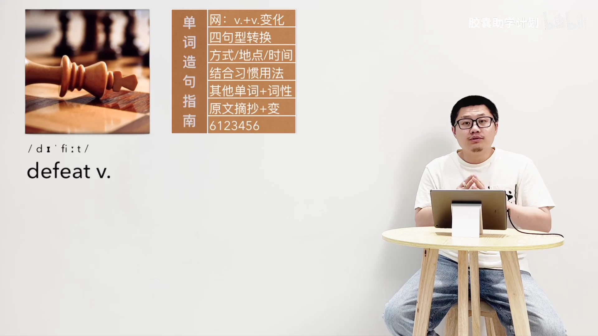

文字识别：- / 单词造句指南 / 网：v.+v.变化 / 交囊助学计划 / 四句型转换 / 方式/地点/时间 / 结合习惯用法 / 其他单词+词性 / 原文摘抄+变 / 6123456 / /dr'fi :t/ / defeat v.

### 画面 00:03:20

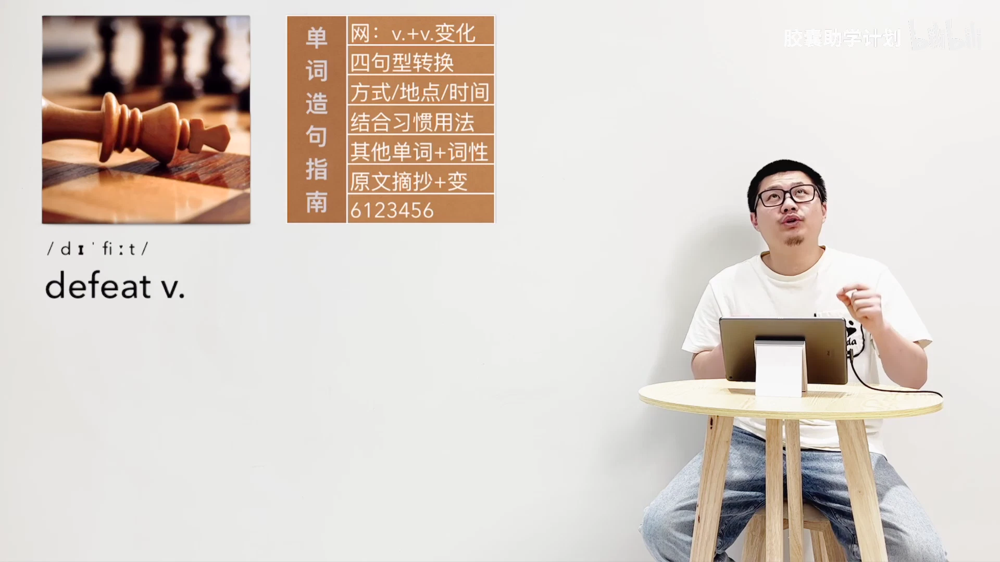

文字识别：单词造句指南 / 网：v.+v.变化 / 交囊助学计划 / 四句型转换 / 方式/地点/时间 / 结合习惯用法 / 其他单词+词性 / 原文摘抄+变 / 6123456 / /dr'fi :t/ / defeat v. / a

### 画面 00:03:25

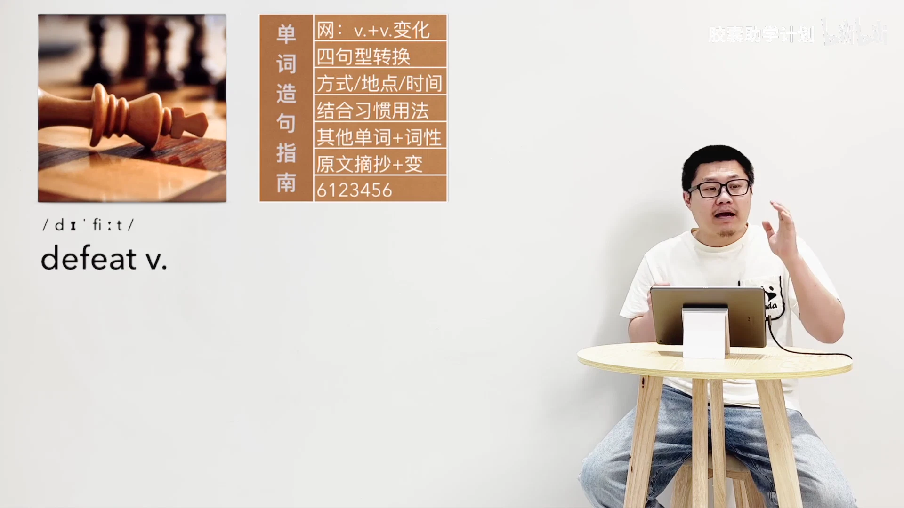

文字识别：- / 单词造句指南 / 网：v.+v.变化 / 交囊助学计划 / 四句型转换 / 方式/地点/时间 / 结合习惯用法 / 其他单词+词性 / 原文摘抄+变 / 6123456 / /dr'fi :t/ / defeat v.

## 00:03:30–00:04:00

比如说在商战当中啊，在这个选举当中都可以。好，比如说 he has been defeated in the recent election，说他已经被击败了在最近的这场选举当中。上一课我们刚刚实际上复习了各种时态的被动，在这儿咱们立刻就看到了叫做 has been defeated，现在完成时的被动。好，接下来词句型转换，老生常谈，您暂停屏幕，自己去做口语或

### 画面 00:03:30

文字识别：- / 单词造句指南 / 网：v.+v.变化 / 胶囊助学计划 / 四句型转换 / 方式/地点/时间 / 结合习惯用法 / 其他单词+词性 / 原文摘抄+变 / 6123456 / /dr'fi :t/ / defeat v.

### 画面 00:03:35

文字识别：单词造句指南 / 网：v.+v.变化 / 妻助学计划 / - / 四句型转换 / 方式/地点/时间 / 结合习惯用法 / 其他单词+词性 / 原文摘抄+变 / 6123456 / /dr'fi :t/ / defeat v. / ① He has been defeated in the recent election.

### 画面 00:03:40

文字识别：单词造句指南 / 网：v.+v.变化 / 交囊助学计划一淵 / - / 四句型转换 / 方式/地点/时间 / 结合习惯用法 / 其他单词+词性 / 原文摘抄+变 / 6123456 / /dr'fi :t/ / defeat v. / ① He has been defeated in the recent election.

### 画面 00:03:44

文字识别：- / 单词造句指南 / 网：v.+v.变化 / 交妻助学计划一淵 / 四句型转换 / 方式/地点/时间 / 结合习惯用法 / 其他单词+词性 / 原文摘抄+变 / 6123456 / /dr'fi:t/ / defeat v. / ① He has been defeated in the recent election.

### 画面 00:03:46

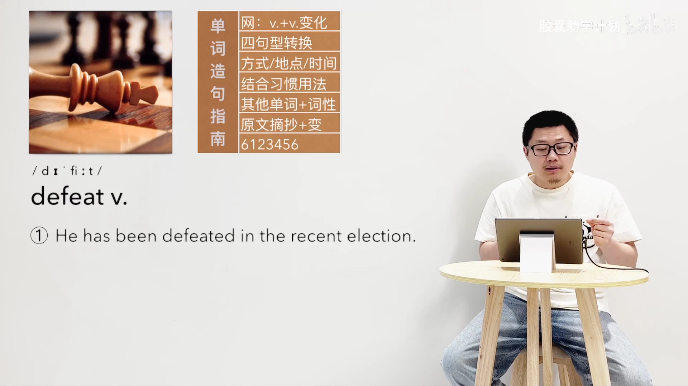

文字识别：- / 单词造句指南 / 网：v.+v.变化 / 囊助学计划 / 四句型转换 / 方式/地点/时间 / 结合习惯用法 / 其他单词+词性 / 原文摘抄+变 / 6123456 / /dr'fi:t/ / defeat v. / ① He has been defeated in the recent election.

### 画面 00:03:52

文字识别：单词造句指南 / 网：v.+v.变化 / 囊助字计划 / 四句型转换 / 方式/地点/时间 / 结合习惯用法 / 其他单词+词性 / 原文摘抄+变 / 6123456 / /dr'fi :t/ / defeat v. / ① He has been defeated in the recent election. / mda

### 画面 00:03:56

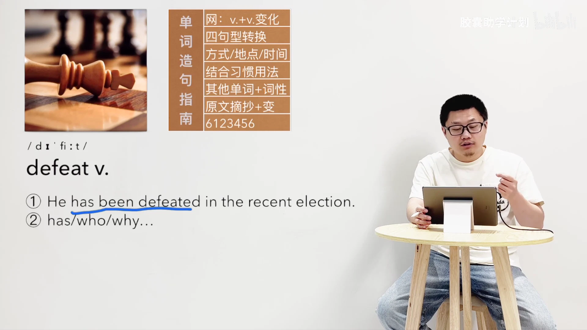

文字识别：- / 单词造句指南 / 网：v.+v.变化 / 交囊助学计划一 / 四句型转换 / 方式/地点/时间 / 结合习惯用法 / 其他单词+词性 / 原文摘抄+变 / 6123456 / /dr'fi :t/ / defeat v. / ① He has been defeated in the recent election. / ) has/who/why...

## 00:04:00–00:04:30

写作训练都可以啊。Next one, so if you can defeat him, we will give you two thousand dollars.你注意，你看这里和最开始我造的那个句子，在election那个单词造的句子就不一样了。这用的是十六课，它是真实条件状语从啊，真实条件从句什么意思呢？我真的就想表达，如果A发生，B就会发生。就你打败他，我就给你两千。我并不是说觉得你没法打败他，对吧？或者说你没办法赢得这

### 画面 00:04:01

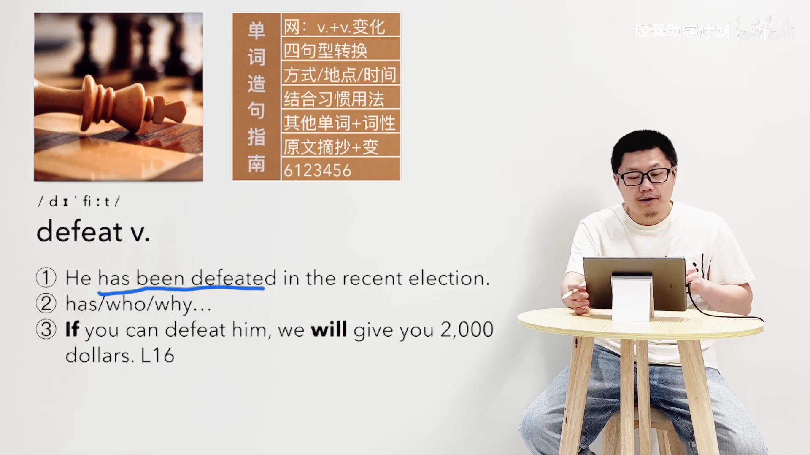

文字识别：单词造句指南 / 网：v.+v.变化 / 喜助学计划 / 四句型转换 / 方式/地点/时间 / 结合习惯用法 / 其他单词+词性 / 原文摘抄+变 / 6123456 / /dr'fi:t/ / defeat v. / ① He has been defeated in the recent election. / has/who/why... / 2 / If you can defeat him, we will give you 2,000 / dollars. L16

### 画面 00:04:04

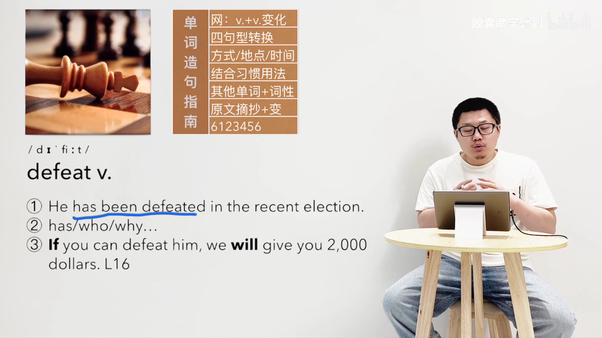

文字识别：- / 单词造句指南 / 网：v.+v.变化 / 毒助学计划 / 四句型转换 / 方式/地点/时间 / 结合习惯用法 / 其他单词+词性 / 原文摘抄+变 / 6123456 / /dr'fi:t/ / defeat v. / ① He has been defeated in the recent election. / has/who/why... / 2 / If you can defeat him, we will give you 2,000 / dollars. L16

### 画面 00:04:07

文字识别：单词造句指南 / 网：v.+v.变化 / 寶助学计划一 / - / 四句型转换 / 方式/地点/时间 / 结合习惯用法 / 其他单词+词性 / 原文摘抄+变 / 6123456 / /dr'fi:t/ / defeat v. / ① He has been defeated in the recent election. /  has/who/why... / 2 / If you can defeat him, we will give you 2,000 / dollars. L16

### 画面 00:04:13

文字识别：单词造句指南 / 网：v.+v.变化 / 妻助学计划 / - / 四句型转换 / 方式/地点/时间 / 结合习惯用法 / 其他单词+词性 / 原文摘抄+变 / 6123456 / /dr'fi :t/ / defeat v. / ① He has been defeated in the recent election. / has/who/why... / If you can defeat him, we will give you 2,000 / dollars. L16

### 画面 00:04:15

文字识别：单词造句指南 / 网：v.+v.变化 / 妻助学计划 / 四句型转换 / 方式/地点/时间 / 结合习惯用法 / 其他单词+词性 / 原文摘抄+变 / 6123456 / /dr'fi:t/ / defeat v. / ① He has been defeated in the recent election. / ) has/who/why... / If you can defeat him, we will give you 2,000 / dollars. L16

### 画面 00:04:18

文字识别：单词造句指南 / 网：v.+v.变化 / 妻助学计划 / 四句型转换 / 方式/地点/时间 / 结合习惯用法 / 其他单词+词性 / 原文摘抄+变 / 6123456 / /dr'fi:t/ / defeat v. / ① He has been defeated in the recent election. / ) has/who/why... / 2 / If you can defeat him, we will give you 2,000 / dollars. L16

### 画面 00:04:20

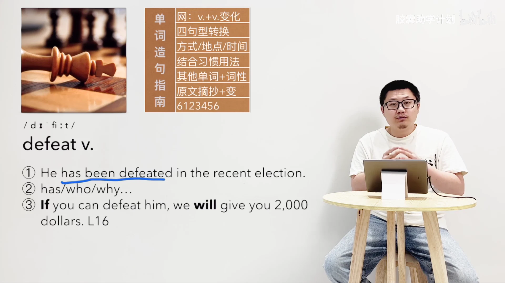

文字识别：单词造句指南 / 网：v.+v.变化 / 囊助字计划 / 四句型转换 / 方式/地点/时间 / 结合习惯用法 / 其他单词+词性 / 原文摘抄+变 / 6123456 / /dr'fi :t/ / defeat v. / ① He has been defeated in the recent election. / has/who/why... / 2 / If you can defeat him, we will give you 2,000 / dollars. L16

### 画面 00:04:25

文字识别：单词造句指南 / 网：v.+v.变化 / 妻助学计划 / 四句型转换 / 方式/地点/时间 / 结合习惯用法 / 其他单词+词性 / 原文摘抄+变 / 6123456 / /dr'fi:t/ / defeat v. / ① He has been defeated in the recent election. /  has/who/why... / 2 / If you can defeat him, we will give you 2,000 / dollars. L16

### 画面 00:04:28

文字识别：- / 单词造句指南 / 网：v.+v.变化 / 囊助学计划一州 / 四句型转换 / 方式/地点/时间 / 结合习惯用法 / 其他单词+词性 / 原文摘抄+变 / 6123456 / /dr'fi :t/ / defeat v. / ① He has been defeated in the recent election. / ) has/who/why... / 2 / If you can defeat him, we will give you 2,000 / dollars. L16

## 00:04:30–00:05:00

场选举。OK，好，Next one，说It was Leo who defeated the monster. Now you啊，这我又给我自己脸上贴金了，是吧？主要说是Leo啊，那个呃打败了这个怪兽啊，不是你。那你注意这里的打败是不是就是物理意义上的打败，对吧？就不是指的是什么商战啊，对吧？不是这种情况啊。再读一遍这个单词defeat，where you go？那注意力集中，咱看一下这个电影片段。很简单的一句话，

### 画面 00:04:30

文字识别：单词造句指南 / 网：v.+v.变化 / 奏助学计划陽 / 四句型转换 / 方式/地点/时间 / 结合习惯用法 / 其他单词+词性 / 原文摘抄+变 / 6123456 / /dr'fi :t/ / defeat v. / ① He has been defeated in the recent election. / ) has/who/why... / 2 / If you can defeat him, we will give you 2,000 / dollars. L16

### 画面 00:04:33

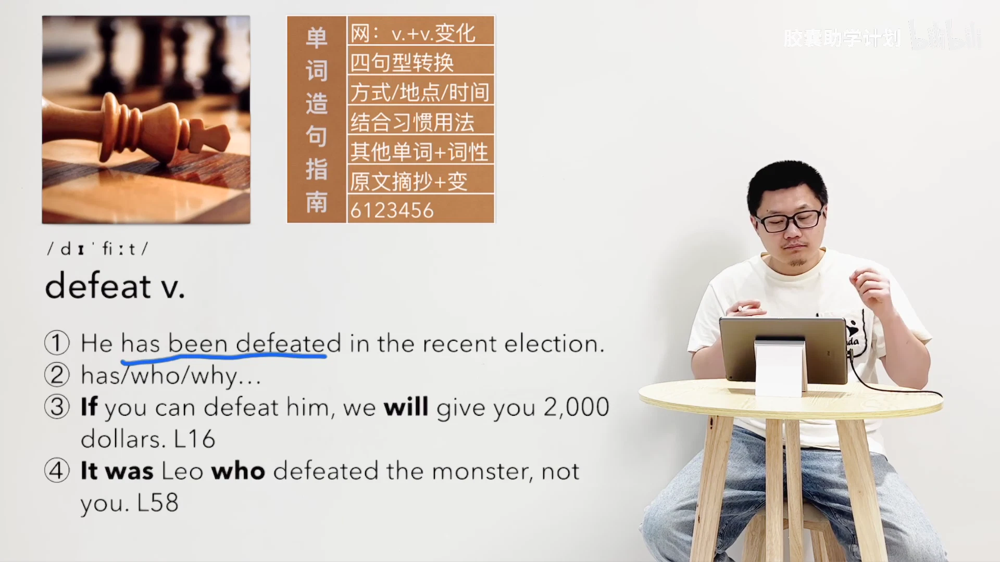

文字识别：单词造句指南 / 网：v.+v.变化 / 妻助学计划 / 四句型转换 / 方式/地点/时间 / 结合习惯用法 / 其他单词+词性 / 原文摘抄+变 / 6123456 / /dr 'fi :t/ / defeat v. / ① He has been defeated in the recent election. / ② has/who/why.. / If you can defeat him, we will give you 2,000 / dollars. L16 / It was Leo who defeated the monster, not / you. L58

### 画面 00:04:35

文字识别：单词造句指南 / 网：v.+v.变化 / 妻助字计划 / - / 四句型转换 / 方式/地点/时间 / 结合习惯用法 / 其他单词+词性 / 原文摘抄+变 / 6123456 / /dr'fi:t/ / defeat v. / ① He has been defeated in the recent election. / nda / ② has/who/why... / If you can defeat him, we will give you 2,000 / dollars. L16 / It was Leo who defeated the monster, not / you. L58

### 画面 00:04:40

文字识别：单词造句指南 / 网：v.+v.变化 / 妻助学计划！ / - / 四句型转换 / 方式/地点/时间 / 结合习惯用法 / 其他单词+词性 / 原文摘抄+变 / 6123456 / /dr'fi:t/ / defeat v. / ① He has been defeated in the recent election. / ② has/who/why.. / If you can defeat him, we will give you 2,000 / dollars. L16 / It was Leo who defeated the monster, not / you.L58

### 画面 00:04:46

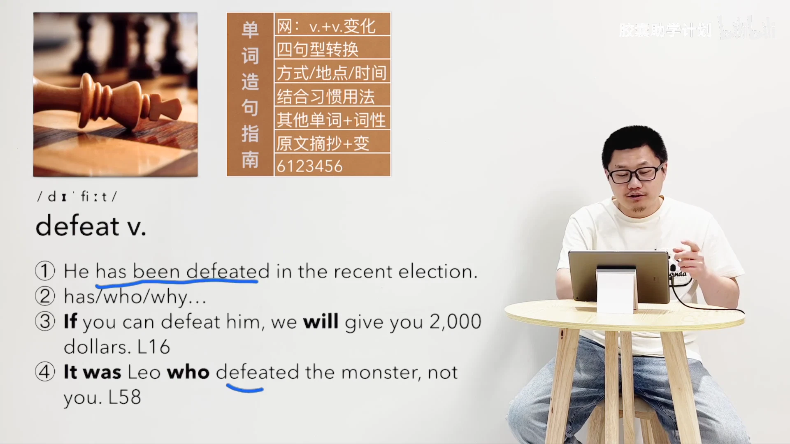

文字识别：单词造句指南 / 网：v.+v.变化 / 妻助学计划 / - / 四句型转换 / 方式/地点/时间 / 结合习惯用法 / 其他单词+词性 / 原文摘抄+变 / 6123456 / /dr 'fi :t/ / defeat v. / ① He has been defeated in the recent election. / anda / ② has/who/why... / If you can defeat him, we will give you 2,000 / dollars. L16 / It was Leo who defeated the monster, not / you.L58

### 画面 00:04:49

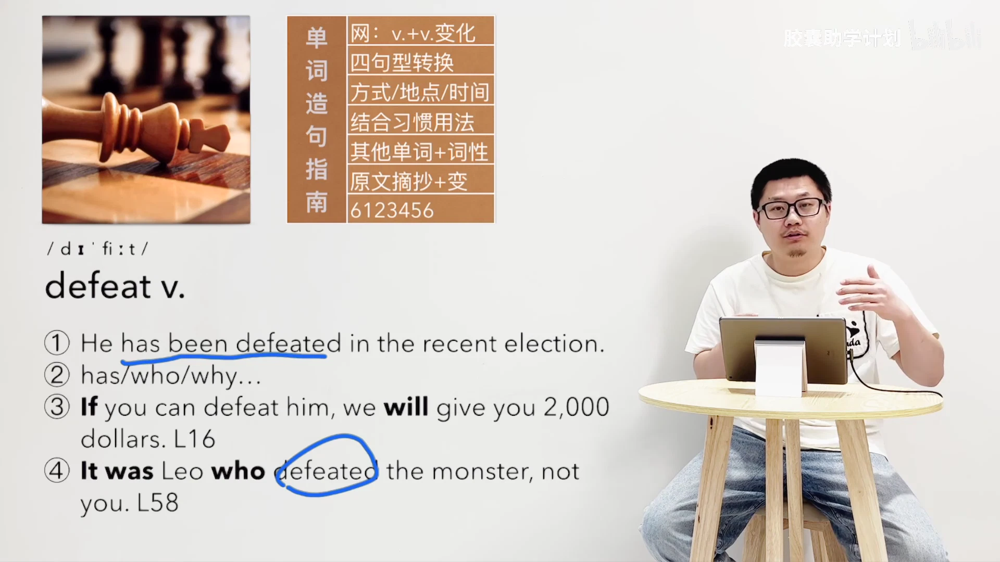

文字识别：单词造句指南 / 网：v.+v.变化 / 囊助字计划 / 四句型转换 / 方式/地点/时间 / 结合习惯用法 / 其他单词+词性 / 原文摘抄+变 / 6123456 / /dr'fi:t/ / defeat v. / ① He has been defeated in the recent election. / ② has/who/why... / 2) / If you can defeat him, we will give you 2,000 / dollars. L16 / It was Leo who / defeated / the monster, not / you. L58

### 画面 00:04:55

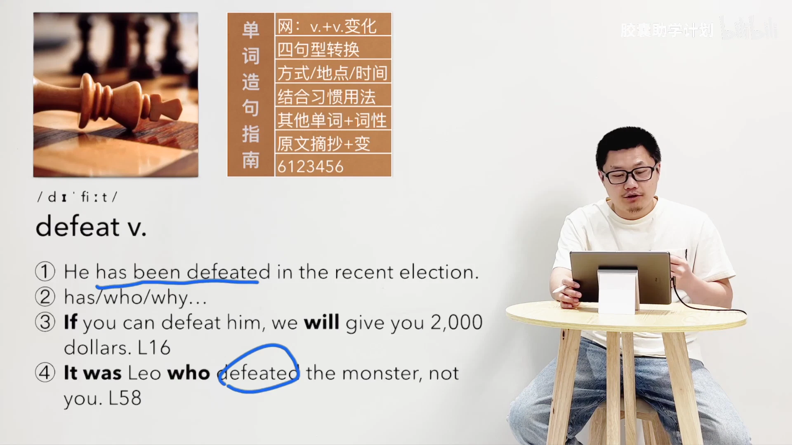

文字识别：- / 单词造句指南 / 网：v.+v.变化 / 囊助学计划 / 四句型转换 / 方式/地点/时间 / 结合习惯用法 / 其他单词+词性 / 原文摘抄+变 / 6123456 / /dr'fi :t/ / defeat v. / ① He has been defeated in the recent election. / 2 / ② has/who/why... / If you can defeat him, we will give you 2,000 / dollars. L16 / It was Leo who / defeated / the monster, not / you. L58

### 画面 00:04:57

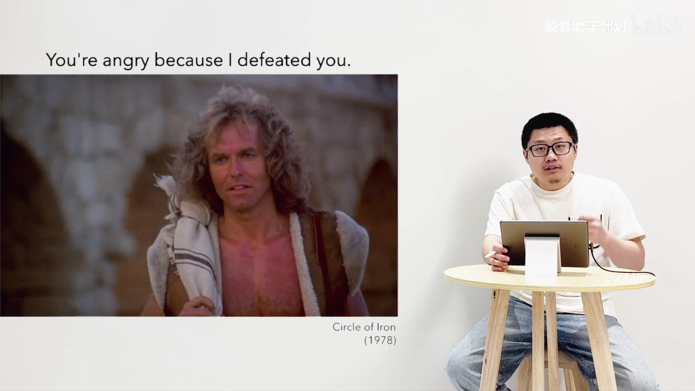

文字识别：交囊助学计划酬 / You're angry because I defeated you. / Circle of lron / (1978)

## 00:05:00–00:05:30

我们做一个听力训练啊。You're angry because I defeated you. 好，next one下一个单词，看一下音标叫fanatical。OK，fanatical啊。比如说我们经常fanatical这个单词，经常跟哪些在哪些领域当中出现的会多一点呢？比如说宗教啊，比如说这个这个这个政治啊，比如说各种球类运动，尤其是足球，对吧？当然了，偶尔还

### 画面 00:05:03

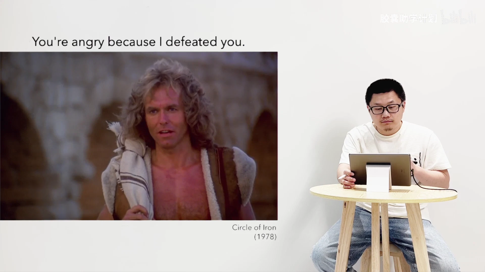

文字识别：喜助学计划園卿 / You're angry because I defeated you. / Circle of lron / (1978)

### 画面 00:05:05

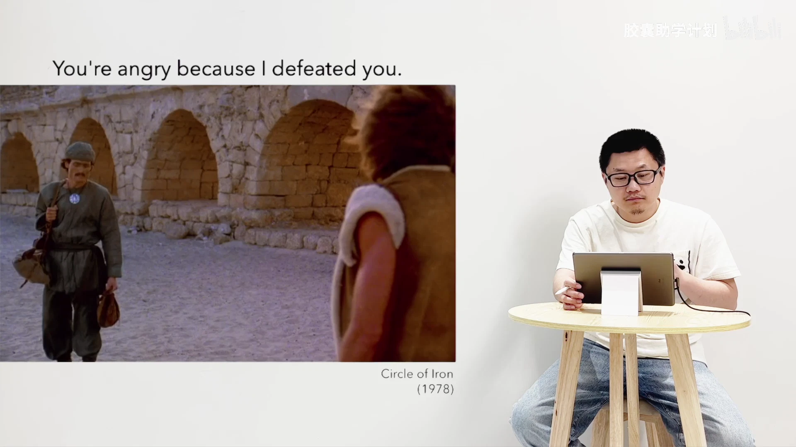

文字识别：辜助学计划 / You're angry because I defeated you. / Circle of lron / (1978)

### 画面 00:05:07

文字识别：单词造句指南 / 网：v.+v.变化 / 交囊助学计划一 / 四句型转换 / 方式/地点/时间 / 结合习惯用法 / 其他单词+词性 / 原文摘抄+变 / 6123456 / /fa'næetikal/ / fanatical adj.

### 画面 00:05:10

文字识别：单词造句指南 / 网：v.+v.变化 / 交囊助学计划 / 四句型转换 / 方式/地点/时间 / 结合习惯用法 / 其他单词+词性 / 原文摘抄+变 / 6123456 / /fa'næetikal/ / fanatical adj.

## 00:05:30–00:06:00

会用在科学界啊，比如说是什么什么的 fanatical，呃，这个这个 supporter 啊，这个狂热的支持者啊，呃，所以 fanatical 就是狂热的意思，比如说狂热粉丝等等。比如说我们可以造一个句子，看图叫做 He is a fanatical football fan，呃，他是一个狂热的足球粉丝啊，特别喜欢足球，对吧？哎，退钱哥，比如说啊， next one，比如说 be fanatical about something or doing something，就是对某件事情很

### 画面 00:05:35

文字识别：单词造句指南 / 网：v.+v.变化 / 交囊助学计划 / 四句型转换 / 方式/地点/时间 / 结合习惯用法 / 其他单词+词性 / 原文摘抄+变 / 6123456 / /fa'næetikal/ / fanatical adj.

### 画面 00:05:40

文字识别：单词造句指南 / 网：v.+v.变化 / 交囊助学计划 / 四句型转换 / 方式/地点/时间 / 结合习惯用法 / 其他单词+词性 / 原文摘抄+变 / 6123456 / /fa'næetikal/ / fanatical adj.

### 画面 00:05:43

文字识别：单词造句指南 / 网：v.+v.变化 / 交囊助学计划 / 四句型转换 / 方式/地点/时间 / 结合习惯用法 / 其他单词+词性 / 原文摘抄+变 / 6123456 / /fa'næetikal/ / fanatical adj. / ① He is a fanatical football fan.

### 画面 00:05:47

文字识别：单词造句指南 / 网：v.+v.变化 / 妻助学计划は卿 / 四句型转换 / 方式/地点/时间 / 结合习惯用法 / 其他单词+词性 / 原文摘抄+变 / 6123456 / /fa'næetikal/ / fanatical adj. / ① He is a fanatical football fan.

### 画面 00:05:50

文字识别：单词造句指南 / 网：v.+v.变化 / 交囊助学计划一棚 / 四句型转换 / 方式/地点/时间 / 结合习惯用法 / 其他单词+词性 / 原文摘抄+变 / 6123456 / /fa'næetikal/ / fanatical adj. / ① He is a fanatical football fan.

### 画面 00:05:54

文字识别：单词造句指南 / 网：v.+v.变化 / 囊助学计划！ / 四句型转换 / 方式/地点/时间 / 结合习惯用法 / 其他单词+词性 / 原文摘抄+变 / 6123456 / /fa'nætikal/ / fanatical adj. / ① He is a fanatical football fan. / ② be fanatical about sth./doing sth.

## 00:06:00–00:06:30

狂热，或者是对做某件事情很狂热。我们造个句子，比如说 He is fanatical about football. 我们在这儿临时给他造个句，比如说说 You are fanatical about learning English. 哎，你对于学英语这件事情很狂热，对吧？这是一个很夸张的词了啊。再来，比如说 He is fanatical about watching football games. Very good. Continue. 我们还可以造一个句子，比如说就

### 画面 00:06:00

文字识别：单词造句指南 / 网：v.+v.变化 / 囊助学计划園園 / 四句型转换 / 方式/地点/时间 / 结合习惯用法 / 其他单词+词性 / 原文摘抄+变 / 6123456 / /fa'nætikal/ / fanatical adj. / ① He is a fanatical football fan. / ② be fanatical about sth./doing sth.

### 画面 00:06:03

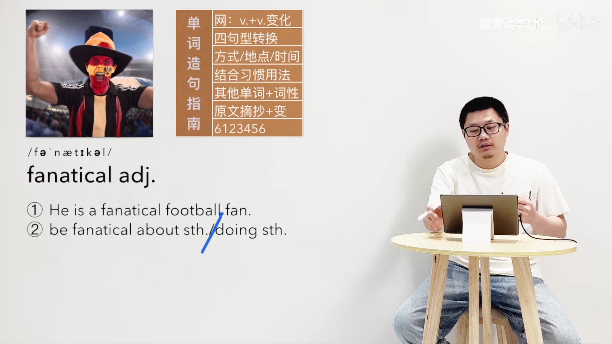

文字识别：单词造句指南 / 网：v.+v.变化 / 交囊助学计划一淵 / 四句型转换 / 方式/地点/时间 / 结合习惯用法 / 其他单词+词性 / 原文摘抄+变 / 6123456 / /fa'nætikal/ / fanatical adj. / ① He is a fanatical football,fan. / ② be fanatical about sth./doing sth.

### 画面 00:06:05

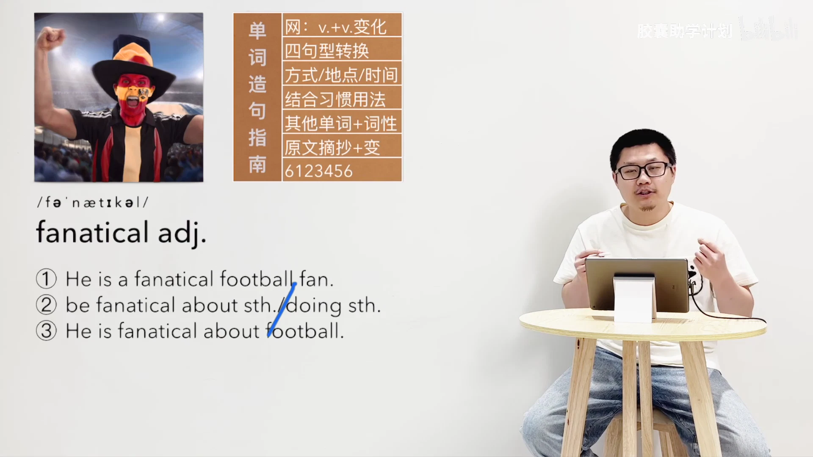

文字识别：单词造句指南 / 网：v.+v.变化 / 囊助学计划 / 四句型转换 / 方式/地点/时间 / 结合习惯用法 / 其他单词+词性 / 原文摘抄+变 / 6123456 / /fa'nætikal/ / fanatical adj. / ① He is a fanatical football,fan. / ② be fanatical about sth./doing sth. / ) He is fanatical about football

### 画面 00:06:14

文字识别：单词造句指南 / 网：v.+v.变化 / 囊助学计划一 / 四句型转换 / 方式/地点/时间 / 结合习惯用法 / 其他单词+词性 / 原文摘抄+变 / 6123456 / /fa'nætikal/ / fanatical adj. / ① He is a fanatical footballyfan. / ② be fanatical about sth./doing sth. / ) He is fanatical about football.

### 画面 00:06:18

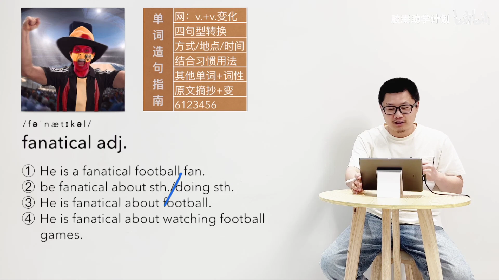

文字识别：单词造句指南 / 网：v.+v.变化 / 囊助学计划 / 四句型转换 / 方式/地点/时间 / 结合习惯用法 / 其他单词+词性 / 原文摘抄+变 / 6123456 / /fa'nætikal/ / fanatical adj. / ① He is a fanatical footballfan. / ② be fanatical about sth./doing sth. / ) He is fanatical about football. / He is fanatical about watching football / games.

### 画面 00:06:20

文字识别：单词造句指南 / 网：v.+v.变化 / 妻助学计划情 / 四句型转换 / 方式/地点/时间 / 结合习惯用法 / 其他单词+词性 / 原文摘抄+变 / 6123456 / /fa'nætikal/ / fanatical adj. / ① He is a fanatical footballfan. / ② be fanatical about sth./doing sth. /  He is fanatical about fotball. / He is fanatical about watching football / games.

### 画面 00:06:28

文字识别：单词造句指南 / 网：v.+v.变化 / 妻助学计划陽 / 四句型转换 / 方式/地点/时间 / 结合习惯用法 / 其他单词+词性 / 原文摘抄+变 / 6123456 / /fa'nætikal/ / fanatical adj. / ① He is a fanatical footballyfan. / ② be fanatical about sth./doing sth. / ③ He is fanatical about football. / 3） /  He is fanatical about watching football / games. / Why are people so fanatical about this / 5 / place?

## 00:06:30–00:07:00

是我们去了一个地方旅游，发现哇塞，全是人。那我可能就由衷啊，有感而发了一句话，叫 Why are people so fanatical about this place? 对吧？哎，说，比如说，就像我从小长大的那片海边，对吧？哎，对，我是秦皇岛人嘛，从小长大那片海边，现在就有很多的游客去玩。我小的时候，那就是一个荒山野岭的地方，是吧？当然不是荒山野岭，是吧？这个是哎，一个野沙滩。现在呢，变成了呃，所有人都去，所以我可能觉

### 画面 00:06:33

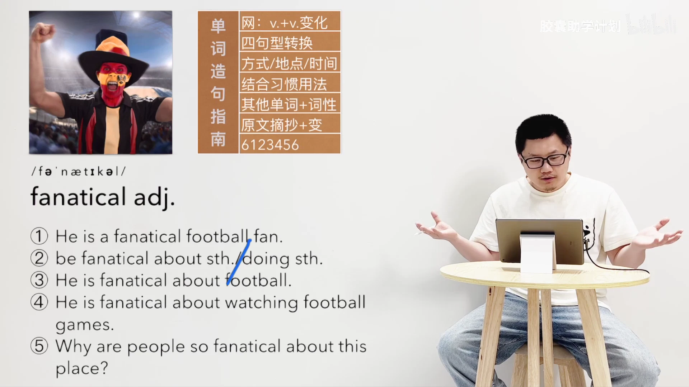

文字识别：单词造句指南 / 网：v.+v.变化 / 妻助学计划！ / 四句型转换 / 方式/地点/时间 / 结合习惯用法 / 其他单词+词性 / 原文摘抄+变 / 6123456 / /fa'næetikal/ / fanatical adj. / ① He is a fanatical footballfan. / ② be fanatical about sth./doing sth. / ) He is fanatical about football. / 3 / ) He is fanatical about watching football / games. / Why are people so fanatical about this / 5 / place?

### 画面 00:06:37

文字识别：单词造句指南 / 网：v.+v.变化 / 妻助字计划！ / 四句型转换 / 方式/地点/时间 / 结合习惯用法 / 其他单词+词性 / 原文摘抄+变 / 6123456 / /fa'næetikal/ / fanatical adj. / ① He is a fanatical footballfan. / ② be fanatical about sth./doing sth. / ) He is fanatical about football. / 3 / ) He is fanatical about watching football / games. / Why are people so fanatical about this / 5 / place?

### 画面 00:06:51

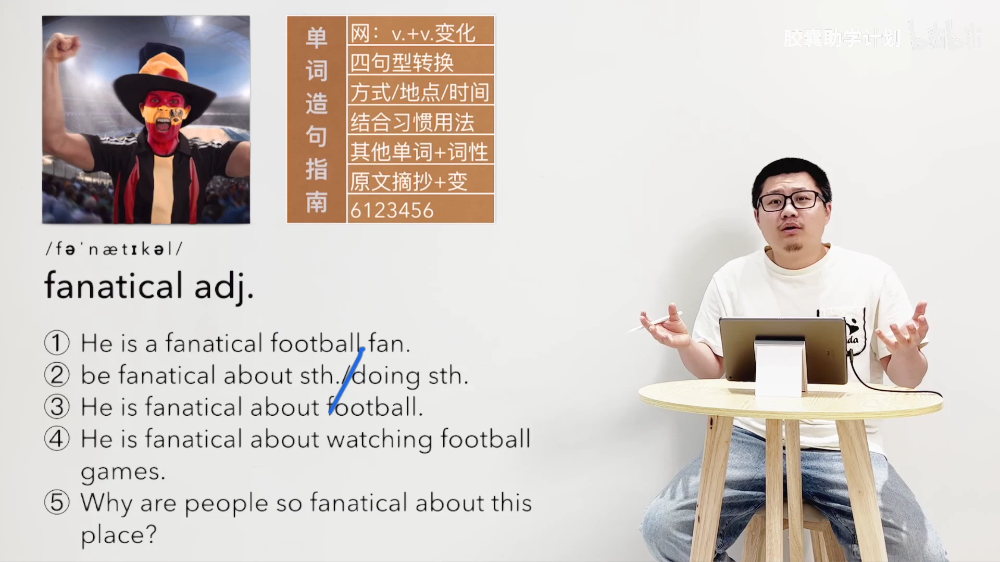

文字识别：单词造句指南 / 网：v.+v.变化 / 四句型转换 / 方式/地点/时间 / 结合习惯用法 / 其他单词+词性 / 原文摘抄+变 / 6123456 / /fa'næetikal/ / fanatical adj. / ① He is a fanatical footballfan. / ② be fanatical about sth./doing sth. / ) He is fanatical about fotball. / 3 / ) He is fanatical about watching football / games. / Why are people so fanatical about this / 5 / place?

### 画面 00:06:55

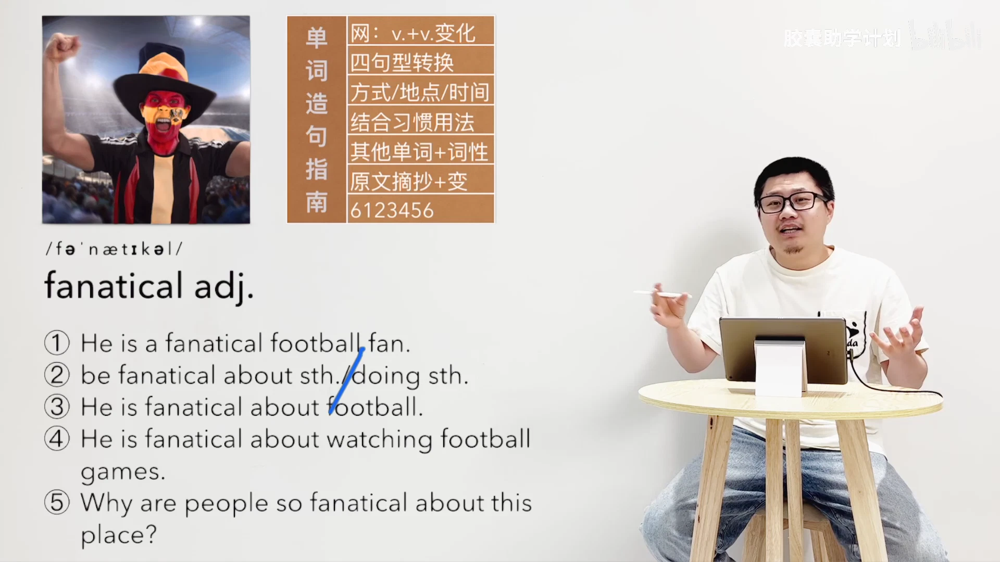

文字识别：单词造句指南 / 网：v.+v.变化 / 妻助学计划 / 四句型转换 / 方式/地点/时间 / 结合习惯用法 / 其他单词+词性 / 原文摘抄+变 / 6123456 / /fa'næetikal/ / fanatical adj. / ① He is a fanatical footballfan. / ② be fanatical about sth./doing sth. / ③ He is fanatical about football. / 3 / ) He is fanatical about watching football / games. / Why are people so fanatical about this / 5 / place?

## 00:07:00–00:07:30

哎，怎么小时候人那么少，现在这么多人？问了一句话，Why are people so fanatical about this place? 对吧？Okay. 那咱注意力集中，听一个电影片段。 Sure, everyone here is fanatical about architecture. 哎，我很确信这儿人对于建筑这个事儿都非常建筑学，对，都非常的狂热啊。其实就是很喜欢 love，有的时候有这种

### 画面 00:07:00

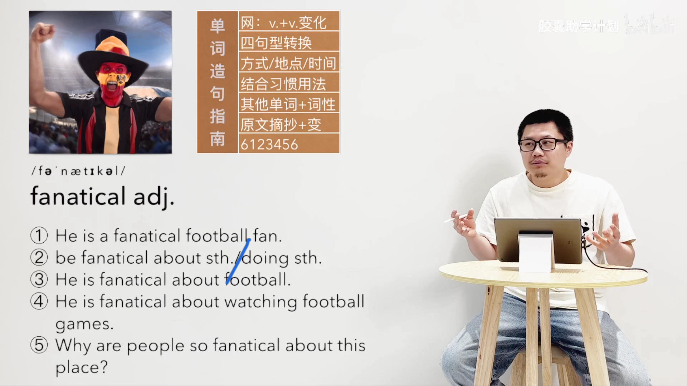

文字识别：单词造句指南 / 网：v.+v.变化 / 妻助字计划 / 四句型转换 / 方式/地点/时间 / 结合习惯用法 / 其他单词+词性 / 原文摘抄+变 / 6123456 / /fa'nætikal/ / fanatical adj. / ① He is a fanatical footballfan. / ② be fanatical about sth./doing sth. / ) He is fanatical about fotball. / 3 / ) He is fanatical about watching football / games. / Why are people so fanatical about this / 5 / place?

### 画面 00:07:06

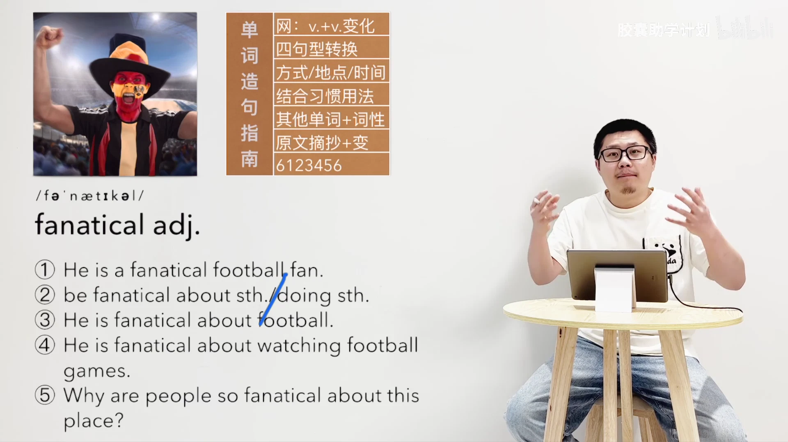

文字识别：单词造句指南 / 网：v.+v.变化 / 四句型转换 / 方式/地点/时间 / 结合习惯用法 / 其他单词+词性 / 原文摘抄+变 / 6123456 / /fa'næetikal/ / fanatical adj. / ① He is a fanatical footballfan. / ② be fanatical about sth./doing sth. / ) He is fanatical about football. / 3） / ) He is fanatical about watching football / games. / Why are people so fanatical about this / 5 / place?

### 画面 00:07:09

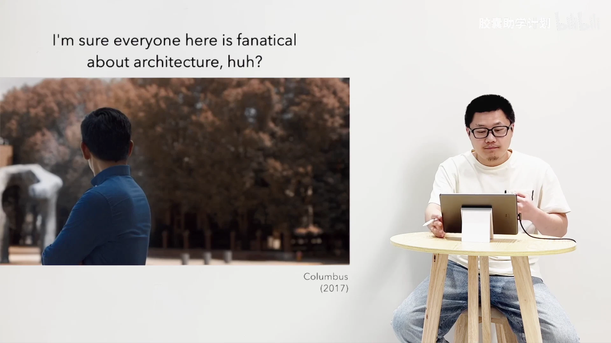

文字识别：I'm sure everyone here is fanatical / about architecture, huh? / Columbus / (2017)

### 画面 00:07:15

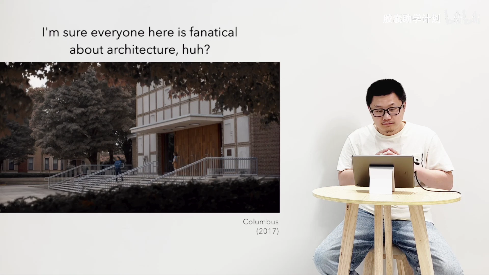

文字识别：I'm sure everyone here is fanatical / about architecture, huh? / Columbus / (2017)

### 画面 00:07:27

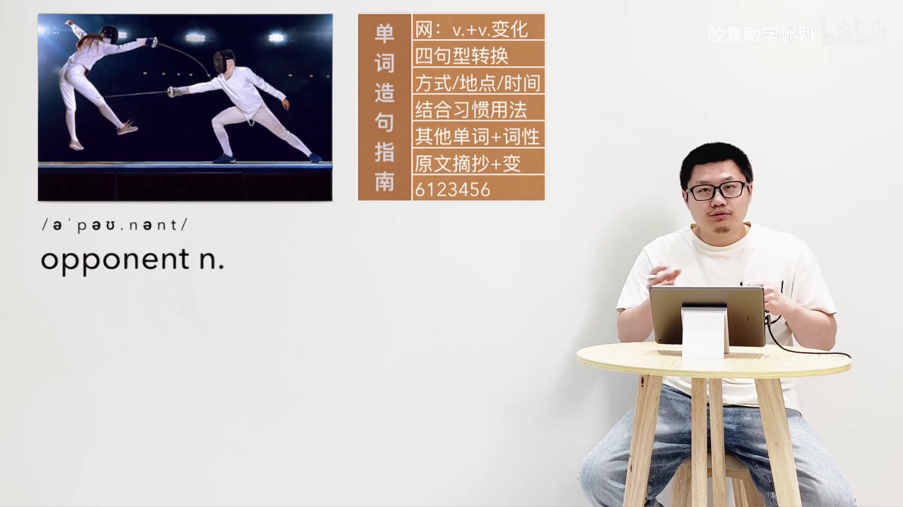

文字识别：单词造句指南 / 网：v.+v.变化 / 校囊助字计划 / 四句型转换 / 方式/地点/时间 / 结合习惯用法 / 其他单词+词性 / 原文摘抄+变 / 6123456 / /a'pau.nant/ / opponent n.

### 画面 00:07:29

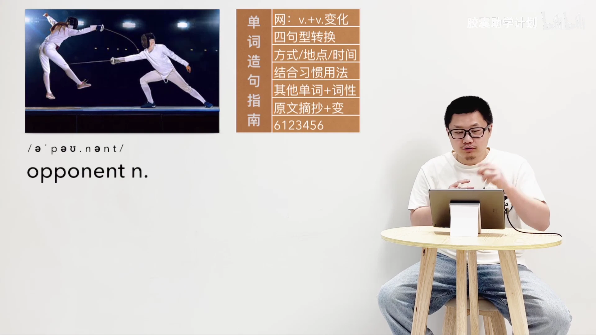

文字识别：单词造句指南 / 网：v.+v.变化 / 交囊助学计划州 / 四句型转换 / 方式/地点/时间 / 结合习惯用法 / 其他单词+词性 / 原文摘抄+变 / 6123456 / /a'pau.nant/ / opponent n.

## 00:07:30–00:08:00

感觉啊。好，next one，看这个单词，我们一起看一下音标啊。Opponent， opponent， opponent， opponent，是什么？呢是这个对手，竞争对手是吧？反对者啊，反对者。好，比如说 he knocked his opponent to the ground，说他把他的竞争对手直接就给干倒、干翻在地，对吧？一拳击倒在地。Next one， he urged his opponent

### 画面 00:07:31

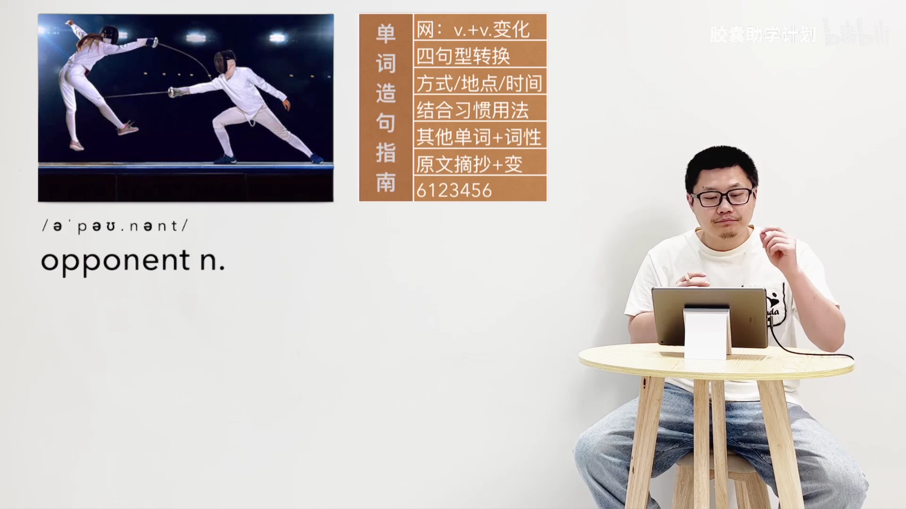

文字识别：单词造句指南 / 网：v.+v.变化 / 交囊助学计划 / 四句型转换 / 方式/地点/时间 / 结合习惯用法 / 其他单词+词性 / 原文摘抄+变 / 6123456 / /a'pau.nant/ / opponent n.

### 画面 00:07:34

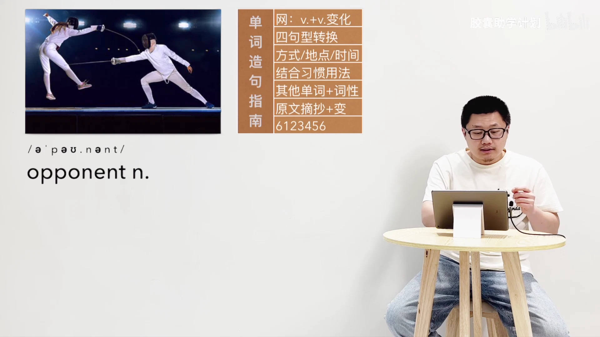

文字识别：单词造句指南 / 网：v.+v.变化 / 交囊助学计划 / 四句型转换 / 方式/地点/时间 / 结合习惯用法 / 其他单词+词性 / 原文摘抄+变 / 6123456 / /a'pau.nant/ / opponent n. / cnda

### 画面 00:07:45

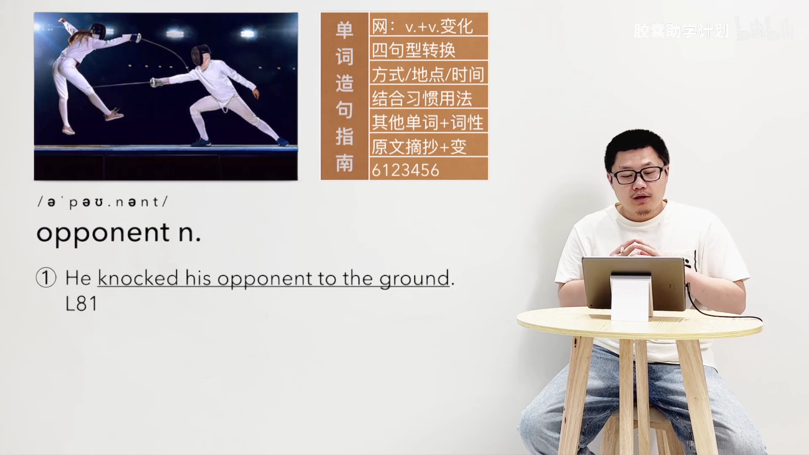

文字识别：单词造句指南 / 网：v.+v.变化 / 囊助学计划 / 四句型转换 / 方式/地点/时间 / 结合习惯用法 / 其他单词+词性 / 原文摘抄+变 / 6123456 / /a'pau.nant/ / opponent n. / ① He knocked his opponent to the ground. / L81

### 画面 00:07:56

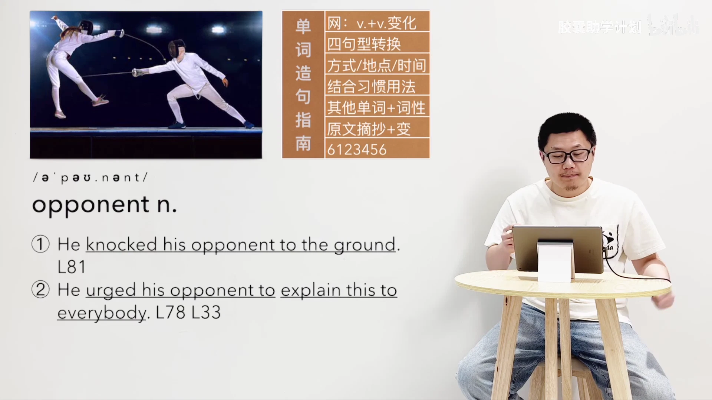

文字识别：单词造句指南 / 网：v.+v.变化 / 四句型转换 / 方式/地点/时间 / 结合习惯用法 / 其他单词+词性 / 原文摘抄+变 / 6123456 / /a'pau.nant/ / opponent n. / ① He knocked his opponent to the ground. / L81 / He urged his opponent to explain this to / everybody. L78 L33

## 00:08:00–00:08:30

to explain this to everyone.说他怂恿着，对吧？催促着，督促着他的这个呃反对者去把这件事情给大家解释一下，对吧？哎，你反对我，你自己也有这个问题，你把这事儿得给大家解释清楚了，对吧？哎，好，Next one. He defeated his opponent in the election.咱们刚学的几个单词：defeated击败，opponent他的竞争对手，election选举。四句型转换啊，老生常谈。

### 画面 00:08:00

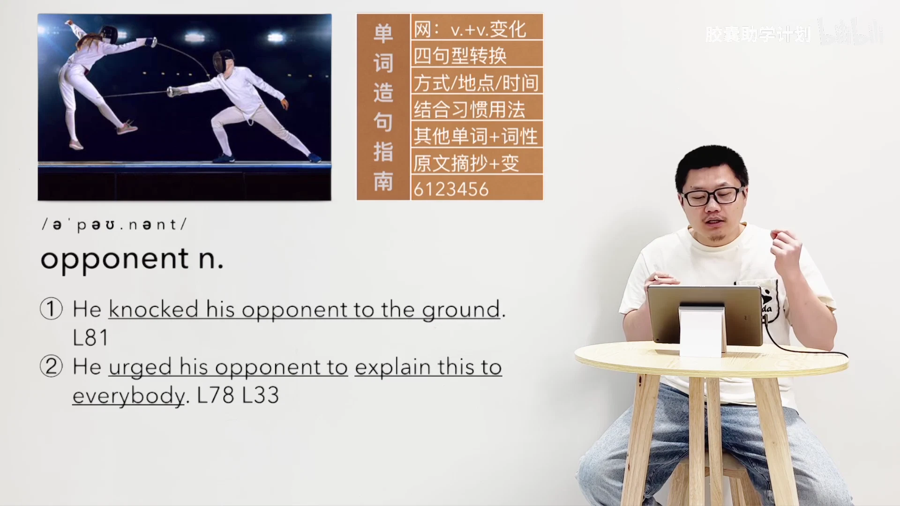

文字识别：单词造句指南 / 网：v.+v.变化 / 妻助学计划 / 四句型转换 / 方式/地点/时间 / 结合习惯用法 / 其他单词+词性 / 原文摘抄+变 / 6123456 / /a'pau.nant/ / opponent n. / ① He knocked his opponent to the ground. / L81 / He urged his opponent to explain this to / everybody. L78 L33

### 画面 00:08:05

文字识别：单词造句指南 / 网：v.+v.变化 / 四句型转换 / 方式/地点/时间 / 结合习惯用法 / 其他单词+词性 / 原文摘抄+变 / 6123456 / /a'pau.nant/ / opponent n. / ① He knocked his opponent to the ground. / L81 / He urged his opponent to explain this to / everybody. L78 L33

### 画面 00:08:10

文字识别：单词造句指南 / 网：v.+v.变化 / 妻助学计划 / 四句型转换 / 方式/地点/时间 / 结合习惯用法 / 其他单词+词性 / 原文摘抄+变 / 6123456 / /a'pau.nant/ / opponent n. / ① He knocked his opponent to the ground. / L81 / He urged his opponent to explain this to / everybody. L78 L33

### 画面 00:08:15

文字识别：单词造句指南 / 网：v.+v.变化 / 囊助学计划陽 / 四句型转换 / 方式/地点/时间 / 结合习惯用法 / 其他单词+词性 / 原文摘抄+变 / 6123456 / /a'pau.nant/ / opponent n. / ① He knocked his opponent to the ground. / L81 / He urged his opponent to explain this to / everybody. L78 L33

### 画面 00:08:20

文字识别：单词造句指南 / 网：v.+v.变化 / 四句型转换 / 方式/地点/时间 / 结合习惯用法 / 其他单词+词性 / 原文摘抄+变 / 6123456 / /a'pau.nant/ / opponent n. / ① He knocked his opponent to the ground. / L81 / He urged his opponent to explain this to / everybody. L78 L33 / He defeated his opponent in the election.

### 画面 00:08:27

文字识别：单词造句指南 / 网：v.+v.变化 / 四句型转换 / 方式/地点/时间 / 结合习惯用法 / 其他单词+词性 / 原文摘抄+变 / 6123456 / /a'pau.nant/ / opponent n. / ① He knocked his opponent to the ground. / L81 / He urged his opponent to explain this to / everybody. L78 L33 / He defeated his opponent in the election. / ) did/how/who...

## 00:08:30–00:09:00

Next one，下一个单词叫 radical。 radical 跟刚才的 fanatic， fanatic 啊，这个还稍有点不太一样。 fanatic， fanatic 它的意思是狂热的，这个 radical 指的是激进的，对吧？哎，比如说，呃，如果我们把人类啊对于某一呃一个比如说事情的意见从左极端变到右极端，变成了一个这样的光谱，对吧？那

### 画面 00:08:30

文字识别：单词造句指南 / 网：v.+v.变化 / 交囊助学计划 / KE / 四句型转换 / RIO / 方式/地点/时间 / 结合习惯用法 / 其他单词+词性 / 原文摘抄+变 / 6123456 / /'rædikal/ / radical adj.

### 画面 00:08:35

文字识别：单词造句指南 / 网：v.+v.变化 / 囊助学计划 / 四句型转换 / RI / 方式/地点/时间 / 结合习惯用法 / 其他单词+词性 / 原文摘抄+变 / 6123456 / /'rædikal/ / radical adj.

### 画面 00:08:39

文字识别：单词造句指南 / 网：v.+v.变化 / 胶囊助学计划 / 四句型转换 / RIO / 方式/地点/时间 / 结合习惯用法 / 其他单词+词性 / 原文摘抄+变 / 6123456 / /'rædikal/ / radical adj.

### 画面 00:08:41

文字识别：单词造句指南 / 网：v.+v.变化 / 交囊助学计划 / RIC / 四句型转换 / RIO / 方式/地点/时间 / 结合习惯用法 / 其他单词+词性 / 原文摘抄+变 / 6123456 / /'rædikal/ / radical adj.

### 画面 00:08:45

文字识别：单词造句指南 / 网：v.+v.变化 / 交囊助学计划 / 四句型转换 / RIO / 方式/地点/时间 / 结合习惯用法 / 其他单词+词性 / 原文摘抄+变 / 6123456 / /'rædikal/ / radical adj.

### 画面 00:08:56

文字识别：单词造句指南 / 网：v.+v.变化 / 交囊助字计划 / RIC / 四句型转换 / RIO / 方式/地点/时间 / 结合习惯用法 / 其他单词+词性 / 原文摘抄+变 / 6123456 / /'rædikal/ / radical adj.

## 00:09:00–00:09:30

不同的人是落在不同的地方的。那我们有的时候所谓叫左派右派对吧？就是他在政治上的某一个意见是比较激进的，对啊，比如说极左或者极右啊。那他的这个view或者他的这个opinion啊，他的这个想法或者观点啊，就是比较radical比较激进的啊。在本课当中呢，它其实是一个党派的名称，倒也不是很重要。但是呢，呃，那个党派的名称不是很重要，但是这个单词还是比较常见

### 画面 00:09:01

文字识别：单词造句指南 / 网：v.+v.变化 / 校囊助学计划 / RIC / 四句型转换 / RIO / 方式/地点/时间 / 结合习惯用法 / 其他单词+词性 / 原文摘抄+变 / 6123456 / /'rædikal/ / radical adj.

### 画面 00:09:05

文字识别：单词造句指南 / 网：v.+v.变化 / 交囊助学计划！ / 四句型转换 / RIO / 方式/地点/时间 / 结合习惯用法 / 其他单词+词性 / 原文摘抄+变 / 6123456 / /'rædikal/ / radical adj.

### 画面 00:09:11

文字识别：单词造句指南 / 网：v.+v.变化 / 交囊助学计划 / KE / 四句型转换 / RIO / 方式/地点/时间 / 结合习惯用法 / 其他单词+词性 / 原文摘抄+变 / 6123456 / /'rædikal/ / radical adj.

### 画面 00:09:15

文字识别：单词造句指南 / 网：v.+v.变化 / 交卖助学计划 / 四句型转换 / RI / 方式/地点/时间 / 结合习惯用法 / 其他单词+词性 / 原文摘抄+变 / 6123456 / /'rædikal/ / radical adj.

### 画面 00:09:24

文字识别：单词造句指南 / 网：v.+v.变化 / 校囊助学计划 / KE / 四句型转换 / RI9 / 方式/地点/时间 / 结合习惯用法 / 其他单词+词性 / 原文摘抄+变 / 6123456 / /'rædikal/ / radical adj.

### 画面 00:09:26

文字识别：单词造句指南 / 网：v.+v.变化 / 交囊助学计划！ / RIC / KE / 四句型转换 / RIO / 方式/地点/时间 / 结合习惯用法 / 其他单词+词性 / 原文摘抄+变 / 6123456 / /'rædikal/ / radical adj.

## 00:09:30–00:10:00

的，所以我跟大家简单造几个句子。比如说，His opinions are very radical. 说他的这些想法实际上非常的激进，对吧？这个往往是可能是我们注意到是年轻人会更容易这样，比如说大学生，对吧？再来，比如说，I was shocked by her radical views. I was shocked. 第十课咱们就学了，我震惊了，什么震惊了？比如说被他的这些激进的呃言论啊，或者说他是激进的这些观点啊，被震

### 画面 00:09:30

文字识别：单词造句指南 / 网：v.+v.变化 / 囊助学计划 / RIC / 四句型转换 / RIO / 方式/地点/时间 / 结合习惯用法 / 其他单词+词性 / 原文摘抄+变 / 6123456 / /'rædikal/ / radical adj. / ① His opinions are very radical.

### 画面 00:09:35

文字识别：单词造句指南 / 网：v.+v.变化 / 囊助学计划 / 四句型转换 / RIO / 方式/地点/时间 / 结合习惯用法 / 其他单词+词性 / 原文摘抄+变 / 6123456 / /'rædikal/ / radical adj. / ① His opinions are very radical.

### 画面 00:09:40

文字识别：单词造句指南 / 网：v.+v.变化 / 囊助学计划は / 四句型转换 / RI9 / 方式/地点/时间 / 结合习惯用法 / 其他单词+词性 / 原文摘抄+变 / 6123456 / /'ræedikal/ / radical adj. / ① His opinions are very radical.

### 画面 00:09:45

文字识别：单词造句指南 / 网：v.+v.变化 / 妻助字计划陽 / 四句型转换 / RI9 / 方式/地点/时间 / 结合习惯用法 / 其他单词+词性 / 原文摘抄+变 / 6123456 / /'rædikal/ / radical adj. / ① His opinions are very radical. / nda / ) I was shocked by her radical views. L10

### 画面 00:09:47

文字识别：单词造句指南 / 网：v.+v.变化 / 囊助学计划 / 四句型转换 / RIO / 方式/地点/时间 / 结合习惯用法 / 其他单词+词性 / 原文摘抄+变 / 6123456 / /'rædikal/ / radical adj. / ① His opinions are very radical. /  I was shocked by her radical views. L10

### 画面 00:09:51

文字识别：单词造句指南 / 网：v.+v.变化 / 雲助学计划陽 / 四句型转换 / RI9 / 方式/地点/时间 / 结合习惯用法 / 其他单词+词性 / 原文摘抄+变 / 6123456 / /'rædikal/ / radical adj. / ① His opinions are very radical. /  I was shocked by her radical views. L10

### 画面 00:09:54

文字识别：单词造句指南 / 网：v.+v.变化 / 妻助学计划陽 / 四句型转换 / RI9 / 方式/地点/时间 / 结合习惯用法 / 其他单词+词性 / 原文摘抄+变 / 6123456 / /'rædikal/ / radical adj. / ① His opinions are very radical. / ) I was shocked by her radical views. L10

### 画面 00:09:56

文字识别：单词造句指南 / 网：v.+v.变化 / 妻助学计划陽 / 四句型转换 / RI9 / 方式/地点/时间 / 结合习惯用法 / 其他单词+词性 / 原文摘抄+变 / 6123456 / /'rædikal/ / radical adj. / ① His opinions are very radical. / ) I was shocked by her radical views. L10

## 00:10:00–00:10:30

惊了。好，next one，比如说 we should make a radical change in our way of learning English。哎，比如说你像我对于学英语这件事儿，对吧？和我们市场上大多数的那些呃呃教的方法，就不是完全是统一的，就有一些 radical opinions，会有一些相对激进一点。激进并不总是坏的哦，要注意。我们在儒家文化当中讲究中庸，但激进依旧不总是坏的，对吧？

### 画面 00:10:01

文字识别：单词造句指南 / 网：v.+v.变化 / 囊助字计划陽 / 四句型转换 / RI9 / 方式/地点/时间 / 结合习惯用法 / 其他单词+词性 / 原文摘抄+变 / 6123456 / /'rædikal/ / radical adj. / ① His opinions are very radical. / ) I was shocked by her radical views. L10 / We should make a radical change in our / way of learning English. L65

### 画面 00:10:05

文字识别：单词造句指南 / 网：v.+v.变化 / 妻助学计划陽 / 四句型转换 / RIO / 方式/地点/时间 / 结合习惯用法 / 其他单词+词性 / 原文摘抄+变 / 6123456 / /'rædikal/ / radical adj. / ① His opinions are very radical. / ) I was shocked by her radical views. L10 / We should make a radical change in our / way of learning English. L65

### 画面 00:10:15

文字识别：广 / 单词造句指南 / 网：v.+v.变化 / 妻助学计划は / 四句型转换 / RI9 / 方式/地点/时间 / 结合习惯用法 / 其他单词+词性 / 原文摘抄+变 / 6123456 / /'rædikal/ / radical adj. / ① His opinions are very radical. / ) I was shocked by her radical views. L10 / We should make a radical change in our / way of learning English. L65

## 00:10:30–00:11:00

比如说，哎，比如说背单词啊，我们比较激进的方式是，甚至我们要求大家不用一个一个去背，你去造句，去放到文章当中跟读，它其实效果要比一个单词一个单词背效果要好。那这就是一个 radical opinion 或者 radical change，对吧？那你看我造这句话就是有感而发，叫我们应该做出一些比较激进的改变，在我们学习英语的这个方式上，对吧？OK，那 repeat after me， we should make a radical change

### 画面 00:10:34

文字识别：单词造句指南 / 网：v.+v.变化 / 妻助学计划陽 / KE / 四句型转换 / RIO / 方式/地点/时间 / 结合习惯用法 / 其他单词+词性 / 原文摘抄+变 / 6123456 / /'rædikal/ / radical adj. / ① His opinions are very radical. /  I was shocked by her radical views. L10 / We should make a radical change in our / way of learning English. L65

### 画面 00:10:37

文字识别：单词造句指南 / 网：v.+v.变化 / 妻助学计划陽 / 四句型转换 / RIO / 方式/地点/时间 / 结合习惯用法 / 其他单词+词性 / 原文摘抄+变 / 6123456 / /'rædikal/ / radical adj. / ① His opinions are very radical. /  I was shocked by her radical views. L10 / 2 / We should make a radical change in our / way of learning English. L65

### 画面 00:10:41

文字识别：单词造句指南 / 网：v.+v.变化 / 窦助学计划一 / 四句型转换 / RIO / 方式/地点/时间 / 结合习惯用法 / 其他单词+词性 / 原文摘抄+变 / 6123456 / /'rædikal/ / radical adj. / ① His opinions are very radical. / da /  I was shocked by her radical views. L10 / We should make a radical change in our / way of learning English. L65

### 画面 00:10:43

文字识别：单词造句指南 / 网：v.+v.变化 / 妻助字计划！ / RIo / 四句型转换 / RIO / 方式/地点/时间 / 结合习惯用法 / 其他单词+词性 / 原文摘抄+变 / 6123456 / /'rædikal/ / radical adj. / ① His opinions are very radical. /  I was shocked by her radical views. L10 / We should make a radical change in our / way of learning English. L65

### 画面 00:10:45

文字识别：广 / 单词造句指南 / 网：v.+v.变化 / 妻助字计划陽 / 四句型转换 / RIO / 方式/地点/时间 / 结合习惯用法 / 其他单词+词性 / 原文摘抄+变 / 6123456 / /'rædikal/ / radical adj. / ① His opinions are very radical. / anda / ) I was shocked by her radical views. L10 / 2 / We should make a radical change in our / way of learning English. L65

### 画面 00:10:56

文字识别：单词造句指南 / 网：v.+v.变化 / 囊助学计划は / 四句型转换 / RIO / 方式/地点/时间 / 结合习惯用法 / 其他单词+词性 / 原文摘抄+变 / 6123456 / /'rædikal/ / radical adj. / ① His opinions are very radical. /  I was shocked by her radical views. L10 / We should make a radical change in our / way of learning English. L65

## 00:11:00–00:11:30

in our way of learning English. There you go,再读一遍这个单词radical.好，呃，注意力集中，咱听一下这个电影片段。那像这一句话，实际上就是新二第八课关键句型的那句话嘛，对吧？听一下。 He was the most radical guy I ever knew. Okay,下一个单词叫progressive. Progressive在本课还是那个党派的名称，radical pro啊，progressive party是吧？激进党。它这个progressive

### 画面 00:11:05

文字识别：辜助字计划 / He was the most radical guy I ever knew. / Big Wednesday / (1978)

### 画面 00:11:17

文字识别：囊助学计划 / He was the most radical guy I ever knew. / Big Wednesday / (1978)

### 画面 00:11:19

文字识别：单词造句指南 / 网：v.+v.变化 / 校囊助学计划 / 四句型转换 / 方式/地点/时间 / 结合习惯用法 / 其他单词+词性 / 原文摘抄+变 / 6123456 / /ｐrａ'ｇｒｅsｌv/ / progressive adj.

### 画面 00:11:21

文字识别：单词造句指南 / 网：v.+v.变化 / 校囊助学计划调 / 四句型转换 / 方式/地点/时间 / 结合习惯用法 / 其他单词+词性 / 原文摘抄+变 / 6123456 / /ｐrａ'ｇｒｅsｌν/ / progressive adj.

### 画面 00:11:25

文字识别：单词造句指南 / 网：v.+v.变化 / 妻助学计划 / 四句型转换 / 方式/地点/时间 / 结合习惯用法 / 其他单词+词性 / 原文摘抄+变 / 6123456 / /ｐrａ'ｇｒｅsｌν/ / progressive adj.

## 00:11:30–00:12:00

呢，在这儿你知道它是指的是进步的意思就可以了啊。然后呢，文章当中给了这么一个呃党派的名称，你能注意到前每个单词的字母首字母都在大写，对吧？ radical 激进，progressive 进步啊，激进党，对吧？然后这个 party party，各位脑海当中常见的意思指的是什么？聚会，对吧？那它其实还可以指，比如说一群人也可以用 party 啊， party so 啊。然后呢，它还有一个很常用的意思

### 画面 00:11:35

文字识别：单词造句指南 / 网：v.+v.变化 / 囊助学计划 / 四句型转换 / 方式/地点/时间 / 结合习惯用法 / 其他单词+词性 / 原文摘抄+变 / 6123456 / /ｐrａ'gｒｅsｌv/ / progressive adj. / ① Radical Progressive Party / nda

### 画面 00:11:50

文字识别：单词造句指南 / 网：v.+v.变化 / 妻助学计划園 / 四句型转换 / 方式/地点/时间 / 结合习惯用法 / 其他单词+词性 / 原文摘抄+变 / 6123456 / /ｐｒａ'ｇｒｅsｉν/ / progressive adj. / ① Radical Progressive Party

### 画面 00:11:56

文字识别：单词造句指南 / 网：v.+v.变化 / 妻助字计划園 / 四句型转换 / 方式/地点/时间 / 结合习惯用法 / 其他单词+词性 / 原文摘抄+变 / 6123456 / /ｐrａ'ｇｒｅsｌv/ / progressive adj. / ① Radical Progressive Party

## 00:12:00–00:12:30

就是党派，对吧？那比如说 radical progressive party 指的就是激进党啊。这个其实各位不需要专门去记，您记不下来没有任何的问题啊。好，呃，接下来这个 ex 它不是个单词，它是个我们所谓叫前缀，就放到很多的单词前面，它可以表示一个意思，就表示前任，是吧？上一任，比如说 ex wife 什么意思？前妻。那 ex boyfriend 呢？前男友。 ex girlfriend

### 画面 00:12:05

文字识别：单词造句指南 / 网：v.+v.变化 / 妻助学计划 / 四句型转换 / 方式/地点/时间 / 结合习惯用法 / 其他单词+词性 / 原文摘抄+变 / 6123456 / /ｐrａ'ｇｒｅsｌv/ / progressive adj. / ① Radical Progressive Party

### 画面 00:12:10

文字识别：单词造句指南 / 网：v.+v.变化 / 妻助学计划 / 四句型转换 / 方式/地点/时间 / 结合习惯用法 / 其他单词+词性 / 原文摘抄+变 / 6123456 / /eks/ / ex-

### 画面 00:12:12

文字识别：单词造句指南 / 网：v.+v.变化 / 囊助学计划 / 四句型转换 / 方式/地点/时间 / 结合习惯用法 / 其他单词+词性 / 原文摘抄+变 / 6123456 / /eks/ / ex-

### 画面 00:12:15

文字识别：单词造句指南 / 网：v.+v.变化 / 校囊助学计划一 / 四句型转换 / 方式/地点/时间 / 结合习惯用法 / 其他单词+词性 / 原文摘抄+变 / 6123456 / /eks/ / ex-

### 画面 00:12:20

文字识别：单词造句指南 / 网：v.+v.变化 / 交囊助学计划一 / 四句型转换 / 方式/地点/时间 / 结合习惯用法 / 其他单词+词性 / 原文摘抄+变 / 6123456 / /eks/ / ex- / ex-wife

### 画面 00:12:26

文字识别：单词造句指南 / 网：v.+v.变化 / 奏助学计划 / 四句型转换 / 方式/地点/时间 / 结合习惯用法 / 其他单词+词性 / 原文摘抄+变 / 6123456 / /eks/ / ex- / 1 / ex-wife / ex-boyfriend / 2）

## 00:12:30–00:13:00

前女友 ex husband，前夫，对吧？哎，知道这个就可以了。他往往是跟别的单词放到一起。你说他单独可以用吗？在电影当中，我确实也见到过。以后各位可以注意一下。比如说，哎，这有一个女的啊。假设啊，我们假设这样一个场景，这有个女的，我跟别人正聊天，过来一个女的，聊了一会儿天儿，然后走了。哎，她问我这是谁？我说啊， is my ex。啊，直接就说我的前任，其别人大概就能理解了。要

### 画面 00:12:31

文字识别：单词造句指南 / 网：v.+v.变化 / 妻助字计划 / 四句型转换 / 方式/地点/时间 / 结合习惯用法 / 其他单词+词性 / 原文摘抄+变 / 6123456 / /eks/ / ex- / 1 / ex-wife / ex-boyfriend / 2 / ex-girlfriend / 3 / ex-husband

### 画面 00:12:35

文字识别：单词造句指南 / 网：v.+v.变化 / 卖助学计划 / 四句型转换 / 方式/地点/时间 / 结合习惯用法 / 其他单词+词性 / 原文摘抄+变 / 6123456 / /eks/ / ex- / 1 / ex-wife / ex-boyfriend / 2 / ex-girlfriend / 3 / ex-husband

### 画面 00:12:39

文字识别：单词造句指南 / 网：v.+v.变化 / 寶助学计划 / 四句型转换 / 方式/地点/时间 / 结合习惯用法 / 其他单词+词性 / 原文摘抄+变 / 6123456 / /eks/ / ex- / 1 / ex-wife / ex-boyfriend / 2 / ex-girlfriend / 3 / ex-husband

### 画面 00:12:43

文字识别：单词造句指南 / 网：v.+v.变化 / 奏助学计划陽 / 四句型转换 / 方式/地点/时间 / 结合习惯用法 / 其他单词+词性 / 原文摘抄+变 / 6123456 / /eks/ / ex- / 1 / ex-wife / ex-boyfriend / 2 / ex-girlfriend / 3 / ex-husband

### 画面 00:12:45

文字识别：单词造句指南 / 网：v.+v.变化 / 交囊助学计划一 / 四句型转换 / 方式/地点/时间 / 结合习惯用法 / 其他单词+词性 / 原文摘抄+变 / 6123456 / /eks/ / ex- / 1 / ex-wife / ex-boyfriend / 2 / ex-girlfriend / 3 / ex-husband

## 00:13:00–00:13:30

么是前夫啊，要么是前妻，要么是前女友，对吧？反正直接就说X就可以了啊，也可以这样去用啊。好，嗯，下一个单词看一下音标叫suspicious，suspicious，suspicious就是可疑的，值得怀疑的啊。那它可以跟比如说look联系起来，比如说he looked suspicious，说他呀看起来非常值得怀疑，很可疑。为什么呢？因为后边给了一个for，he

### 画面 00:13:07

文字识别：单词造句指南 / 网：v.+v.变化 / 囊助学计划 / 四句型转换 / 方式/地点/时间 / 结合习惯用法 / 其他单词+词性 / 原文摘抄+变 / 6123456 / /sa'ｓｐт ∫as/ / suspicious adj.

### 画面 00:13:10

文字识别：单词造句指南 / 网：v.+v.变化 / 交囊助学计划陽 / 四句型转换 / 方式/地点/时间 / 结合习惯用法 / 其他单词+词性 / 原文摘抄+变 / 6123456 / /sa'sｐт ∫aｓ/ / suspicious adj. / pandc

### 画面 00:13:18

文字识别：单词造句指南 / 网：v.+v.变化 / 妻助字计划園 / 四句型转换 / 方式/地点/时间 / 结合习惯用法 / 其他单词+词性 / 原文摘抄+变 / 6123456 / /sa'sｐi ∫a s / / suspicious adj. / ① He looked suspicious, for he walked up and / down the street all night. L81

### 画面 00:13:20

文字识别：单词造句指南 / 网：v.+v.变化 / 妻助字计划 / 四句型转换 / 方式/地点/时间 / 结合习惯用法 / 其他单词+词性 / 原文摘抄+变 / 6123456 / /sa' sｐi ∫a s / / suspicious adj. / ① He looked suspicious, for he walked up and / down the street all night. L81

## 00:13:30–00:14:00

he walked up and down the street all night. 说因为啊，他呀 walked up and down the street 是什么意思呢？就是前前后后的走啊，前前往返来来回回的走。哎，沿着这条街 all night 一整晚，就你一整晚连着一条马路来来回回的走，那不很可疑吗？对吧？哎，难道你是保安人员啊？再然后，那也可以跟 see 连起来，比如说 if you see anything suspicious，啊，其实是 anything 跟 suspicious 连起来啊。

### 画面 00:13:42

文字识别：单词造句指南 / 网：v.+v.变化 / 囊助学计划 / 四句型转换 / 方式/地点/时间 / 结合习惯用法 / 其他单词+词性 / 原文摘抄+变 / 6123456 / /sa' sｐi ∫a s / / suspicious adj. / ① He looked suspicious, for he walked up and / down the street all night. L81

### 画面 00:13:45

文字识别：单词造句指南 / 网：v.+v.变化 / 襄助学计划 / 四句型转换 / 方式/地点/时间 / 结合习惯用法 / 其他单词+词性 / 原文摘抄+变 / 6123456 / / sa ' sｐi ∫a s / / suspicious adj. / ① He looked suspicious, for he walked up and / down the street all night. L81

### 画面 00:13:52

文字识别：单词造句指南 / 网：v.+v.变化 / 四句型转换 / 方式/地点/时间 / 结合习惯用法 / 其他单词+词性 / 原文摘抄+变 / 6123456 / /sa'sｐｌ ∫as / / suspicious adj. / ① He looked suspicious, for he walked up and / a / down the street all night. L81 / If you see anything suspicious, just call me. / L16

### 画面 00:13:55

文字识别：单词造句指南 / 网：v.+v.变化 / 四句型转换 / 方式/地点/时间 / 结合习惯用法 / 其他单词+词性 / 原文摘抄+变 / 6123456 / / sa'sｐi ∫a s / / suspicious adj. / ① He looked suspicious, for he walked up and / down the street all night. L81 / If you see anything suspicious, just call me. / L16

## 00:14:00–00:14:30

说如果你看到了任何啊值得可疑的东西，just call me，你给我打个电话，对吧？我来处理。Next one，就Why do you think that is suspicious？啊，为什么你认为那个事情是很可疑的呢？这是口语当中很容易出现的一个句型啊！不多说了，那注意力集中，咱们看电影片段。Did Blanc find anything suspicious at the house？Okay，啊，他有找到任何可疑的东西吗？

### 画面 00:14:00

文字识别：单词造句指南 / 网：v.+v.变化 / 四句型转换 / 方式/地点/时间 / 结合习惯用法 / 其他单词+词性 / 原文摘抄+变 / 6123456 / / sa'sｐi ∫a s / / suspicious adj. / ① He looked suspicious, for he walked up and / down the street all night. L81 / If you see anything suspicious, just call me. / L16

### 画面 00:14:04

文字识别：单词造句指南 / 网：v.+v.变化 / 四句型转换 / 方式/地点/时间 / 结合习惯用法 / 其他单词+词性 / 原文摘抄+变 / 6123456 / / sa'sｐi ∫a s / / suspicious adj. / ① He looked suspicious, for he walked up and / down the street all night. L81 / If you see anything suspicious, just call me. / L16

### 画面 00:14:09

文字识别：单词造句指南 / 网：v.+v.变化 / 四句型转换 / 方式/地点/时间 / 结合习惯用法 / 其他单词+词性 / 原文摘抄+变 / 6123456 / / sa'sｐi ∫a s / / suspicious adj. / ① He looked suspicious, for he walked up and / down the street all night. L81 / If you see anything suspicious, just call me. / L16 / ③ Why do you think that is suspicious?

### 画面 00:14:14

文字识别：单词造句指南 / 网：v.+v.变化 / 四句型转换 / 方式/地点/时间 / 结合习惯用法 / 其他单词+词性 / 原文摘抄+变 / 6123456 / / sa'sｐi∫a s / / suspicious adj. / ① He looked suspicious, for he walked up and / da / down the street all night. L81 /  If you see anything suspicious, just call me. / 2 / L16 / ③ Why do you think that is suspicious?

### 画面 00:14:18

文字识别：Did Blanc find anything suspicious / at the house? / Knives Out / (2019)

### 画面 00:14:24

文字识别：妻助学计划陽 / Did Blanc find anything suspicious / at the house? / Knives Out / (2019)

### 画面 00:14:26

文字识别：臺助学计划 / Did Blanc find anything suspicious / at the house? / Knives Out / (2019)

## 00:14:30–00:15:00

吗？OK，那 recap 除了单词以外，那肯定就是习惯用法了，对吧？同样的重要，造句的时候重点关照一下这两个兄弟啊。好，家庭作业，单词造句，造对话也行啊。然后呢，电影片段您反复听，置顶留言可以找到重复间隔的学习材料。那以上呢就是本期视频的全部内容了。如果各位喜欢我们的课程呢，欢迎各位关注、订阅、一键三连，分享给那些需要的朋友，来帮

### 画面 00:14:30

文字识别：Recap / 達助学计划 / Words / win the election / Expression / be fanatical about sth./doing sth.

### 画面 00:14:32

文字识别：Recap / 葬助字计划 / Words / win the election / Expression / be fanatical about sth./doing sth.

### 画面 00:14:34

文字识别：Recap / 交囊助字计划 / Words / win the election / Expression / be fanatical about sth./doing sth.

### 画面 00:14:39

文字识别：Recap / 校妻助学计划 / Words / win the election / Expression / be fanatical about sth./doing sth.

### 画面 00:14:41

文字识别：辜助字计划博 / 1. / 单词造句/对话 / 【单词造句指南】 / 每个5句

### 画面 00:14:43

文字识别：交囊助字计划一 / 单词造句/对话 / 1. / 【单词造句指南】 / 每个5句

### 画面 00:14:45

文字识别：交囊助学计划一 / 单词造句/对话 / 1. / 【单词造句指南】 / 每个5句 / 反复听电影片段，直到能 / 听出关键短语/句子

### 画面 00:14:47

文字识别：胶囊助学计划调 / 单词造句/对话 / 【单词造句指南】 / 每个5句 / 2.反复听电影片段，直到能 / 听出关键短语/句子 / 3.重复间隔（置顶留言）

### 画面 00:14:49

文字识别：囊助字计划

## 00:15:00–00:15:15

助我们快速成长。See you next time.

### 画面 00:15:03

### 画面 00:15:05

文字识别：運動学計切 / CAPSULEACADEMY / 胶囊助学计划 / 『 / 小红书 / Lecturer / Leo / OE

### 画面 00:15:08

文字识别：CAPSULEACADEMY / 胶囊助学计划 / 『 / 小红书 / Editor / OE

### 画面 00:15:11

文字识别：泰酬学計划 / CAPSULEACADEMY / 胶囊助学计划 / 小红书 / Creator / Leo & Berlin / OE

### 画面 00:15:13

文字识别：bilibili / 胶囊助学计划 / 品 / 小红粉 / 1年

### 画面 00:15:15

文字识别：bilbili / 胶囊助学计划

