# 083 文章

快速机器解析：语音为单模型转写，未进行独立交叉校对或人工复核；画面每秒采样并按变化选帧，短时文字和标记可能遗漏。截图时间约有 1 秒误差。图片有损压缩；遇到疑点请按时间查看 Google Drive 原视频。

## 00:00:00–00:00:30

Hello everyone, welcome to Capsule Academy. This is Leo. Today we're going to learn new concept English book two lesson eighty three story. Hope you're gonna enjoy.好，我们上来先看它的标题和问的问题啊。问的呃，标题是 After the elections，叫做大选之后啊，它指这个指的是国家层面的选举。然后他问的问题是 Why did Patrick keep on asking the same question？

### 画面 00:00:00

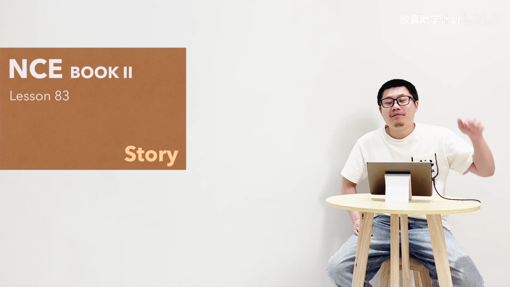

文字识别：胶囊助学计划调 / NCE / BOOKⅡI / Lesson 83 / Story

### 画面 00:00:04

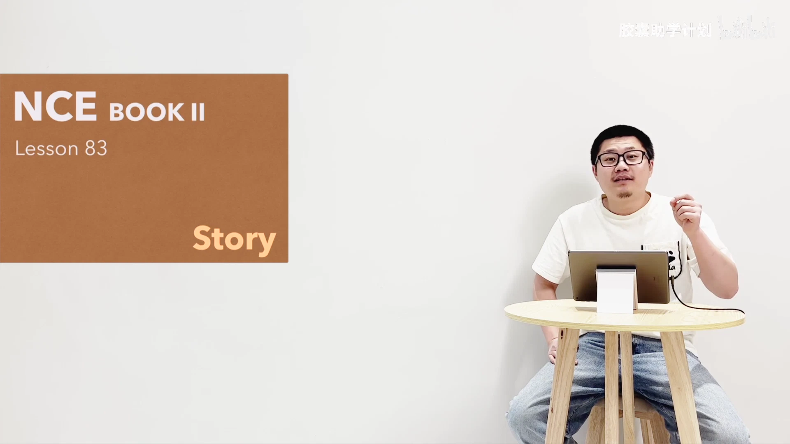

文字识别：胶囊助学计划 / NCE / BOOKII / Lesson 83 / Story

### 画面 00:00:10

文字识别：胶囊助学计划 bil

### 画面 00:00:13

文字识别：胶囊助学计划 / 胶囊助学计划

### 画面 00:00:15

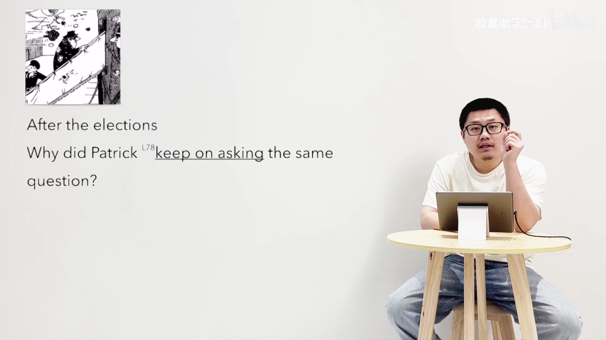

文字识别：校囊助学计划 / After the elections / Why did Patrick |78keep on asking the same / question?

### 画面 00:00:19

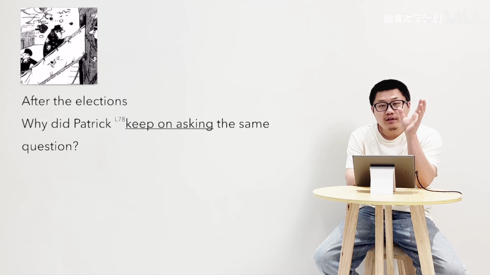

文字识别：校囊助学计划關 / After the elections / Why did Patrick [7⁸keep on asking the same / question?

## 00:00:30–00:01:00

哎，这个标题当中就出现了一个七十八课咱们学过的习惯用法，就 keep on doing something，对吧？哎，说为什么 Patrick 持续不断的问相同的问题？那问的是什么？其实我们也很感兴趣。咱进入文章，一起看一下。The former Prime Minister Mr. Wentworth Lane was defeated in the recent elections. 好，这个 former Prime Minister 指的是前首相，英国首相嘛，对吧？前首相这个人怎么样

### 画面 00:00:43

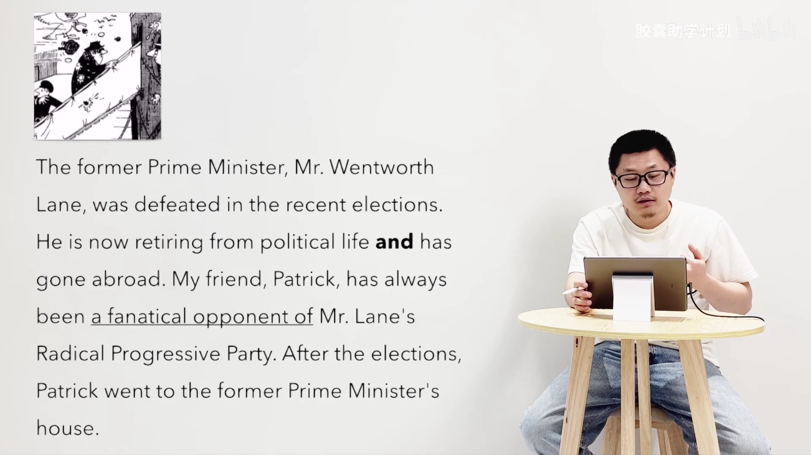

文字识别：囊助学计划 / The former Prime Minister, Mr. Wentworth / Lane, was defeated in the recent elections. / He is now retiring from political life and has / gone abroad. My friend, Patrick, has always / been a fanatical opponent of Mr. Lane's / Radical Progressive Party. After the elections, / Patrick went to the former Prime Minister's / house.

## 00:01:00–00:01:30

了呢？注意，一般过去是被动，被击败了。在最近的这场选举当中，那当然你注意这个 elections 一系列的选举大选当中，He's now retiring from political life and has gone abroad.他最近呢，正在从政治生涯当中退休出来。然后这是第二句话，对吧？怎么样了呢？Go abroad.之前咱学过 study abroad, go abroad, travel abroad.

### 画面 00:01:13

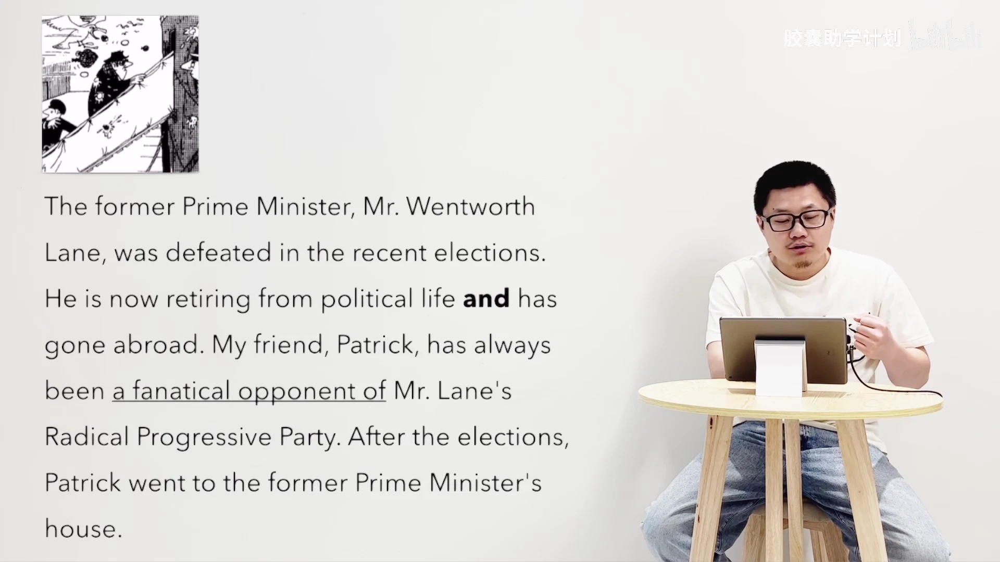

文字识别：囊助学计划 / The former Prime Minister, Mr. Wentworth / Lane, was defeated in the recent elections. / He is now retiring from political life and has / gone abroad. My friend, Patrick, has always / been a fanatical opponent of Mr. Lane's / Radical Progressive Party. After the elections, / Patrick went to the former Prime Minister's / house.

## 00:01:30–00:02:00

哎，出国其实就是 my friend Patrick同位语，对吧？哎，四十六课咱学同位语从句，后来又见过很多同位语，包括这个 a prime minister 和这个 Mister Windworthland 也是同位语。Has always been a fanatical opponent of Mister Land's radical progressive party. 我朋友 Patrick，这是主语，他怎么样了呢？Has always been。注意，先看一下时态，

### 画面 00:01:43

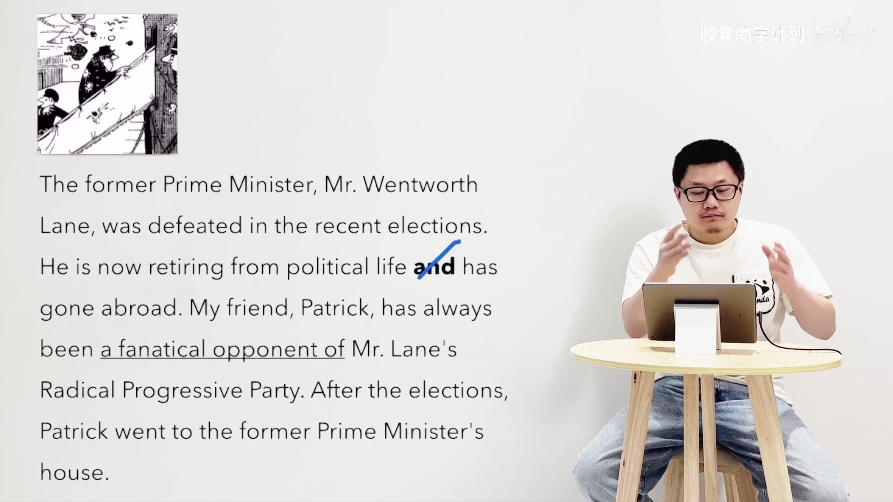

文字识别：囊助学计划 / The former Prime Minister, Mr. Wentworth / Lane, was defeated in the recent elections. / He is now retiring from political life ahd has / gone abroad. My friend, Patrick, has always / nda / been a fanatical opponent of Mr. Lane's / Radical Progressive Party. After the elections, / Patrick went to the former Prime Minister's / house.

## 00:02:00–00:02:30

has加been现在完成时，两个用法，言之过去意在当下，或从过去持续到现在。你又给我加了个always，八成就指的是从过去持续到现在，所以直接翻译成汉语就一直都啊，一直都是一个什么呢？狂热的反对者，什么的反对者呢？是Mr. Lenz Radical Progressive Party，是Mr. Lenz的什么Radical Progressive Party激进党，就是呃Mr. Lenz的

### 画面 00:02:13

文字识别：囊助学计划 / The former Prime Minister, Mr. Wentworth / Lane, was defeated in the recent elections. / He is now retiring from political life ahd has / gone abroad. My friend, Patrick, has always / been a fanatical opponent of Mr. Lane's / Radical Progressive Party. After the elections, / Patrick went to the former Prime Minister's / house.

## 00:02:30–00:03:00

的激进党的狂热反对者，对吧？就是他的，你可以理解为，但是他他到不上他的政敌的这个概念啊，但是就是呃反对他这个政党，对吧？After the elections, Patrick went to the former prime minister's house.说在这个选举之后啊，Patrick怎么样了呢？就去了前首相他们这个呃府邸，对吧？或者说他这个住处

### 画面 00:02:43

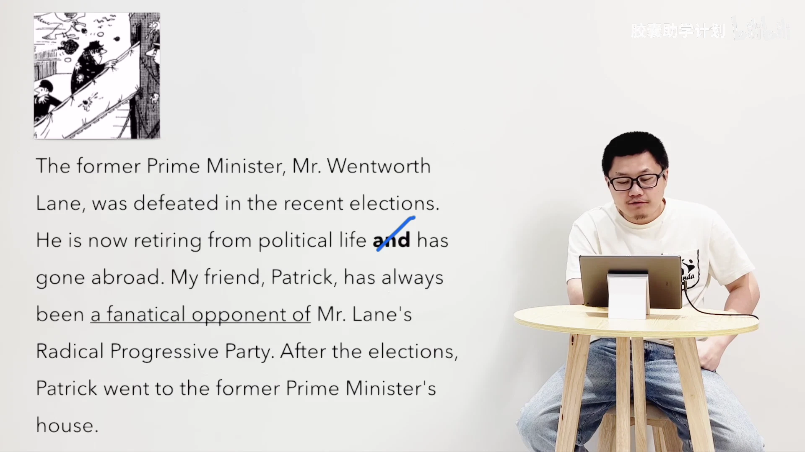

文字识别：嚢助学计划 / The former Prime Minister, Mr. Wentworth / Lane, was defeated in the recent elections. / He is now retiring from political life ahd has / gone abroad. My friend, Patrick, has always / nda / been a fanatical opponent of Mr. Lane's / Radical Progressive Party. After the elections, / Patrick went to the former Prime Minister's / house.

## 00:03:00–00:03:30

啊去了这个地方，我们去看他干啥去了啊？When he asked if Mr. Lane lived there, the policeman on duty told him that since his defeat, the ex prime minister had gone abroad.这句话乍一看又挺长，但是呢，逗号啊，that呀这些东西其实对我们来说都是一个断句的东西，对吧？比如说，当他问到，那他指的就是Patrick

### 画面 00:03:02

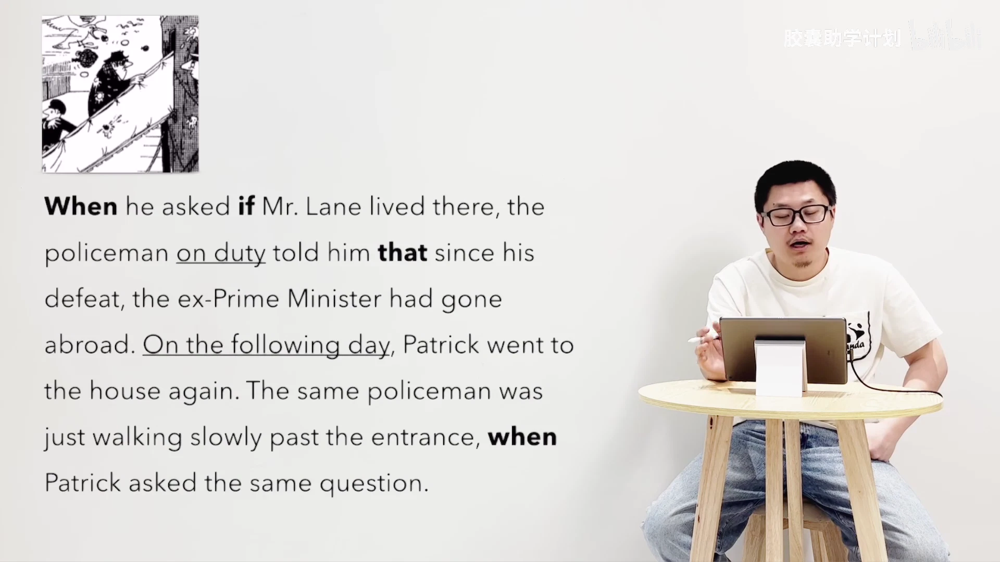

文字识别：ｌ助学计划 / When he asked if Mr. Lane lived there, the / policeman on duty told him that since his / defeat, the ex-Prime Minister had gone / abroad. On the following day, Patrick went to / the house again. The same policeman was / just walking slowly past the entrance, when / Patrick asked the same question.

## 00:03:30–00:04:00

啊，就是作者的my friend。当他问到这里的if，注意if常见的两个含义，如果或是否，对吧？你拿不准你就挨个都往里带，拿得准呢，就是你语法比较扎实，对吧？新一百三十九您学了，新二三十九您学了，那你就能注意到这里是一个非常典型的宾语从句，一般疑问句做宾语从句，对吧？说当他问问的是什么呢？叫Mr. Lane是否住在那里？为什么翻译成是否？因为这有一个

### 画面 00:03:32

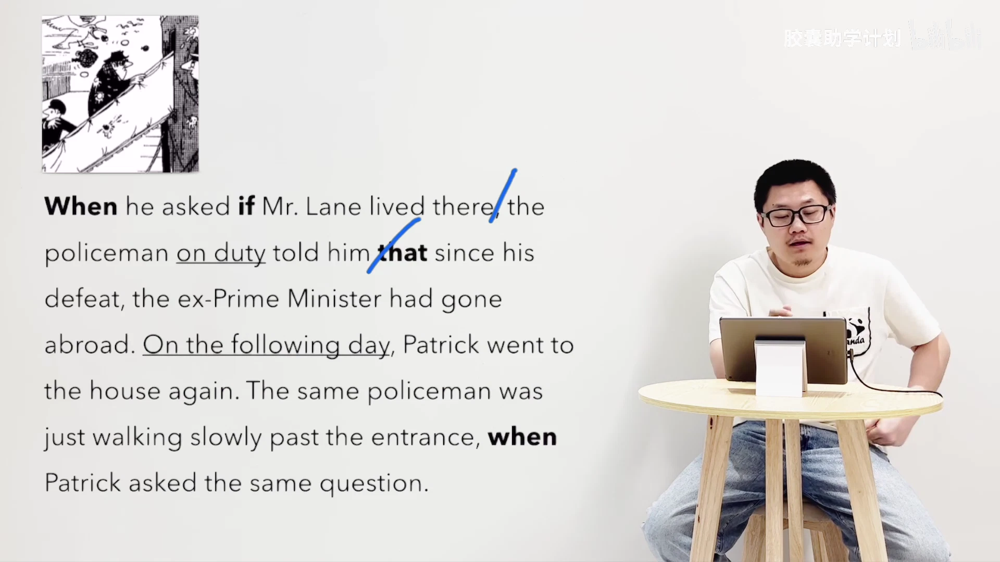

文字识别：助学计划 / When he asked if Mr. Lane lived there/the / policeman on duty told him yhat since his / defeat, the ex-Prime Minister had gone / abroad. On the following day, Patrick went to / anda / the house again. The same policeman was / just walking slowly past the entrance, when / Patrick asked the same question.

## 00:04:00–00:04:30

if 啊，这个知识点一定要回想一下，很容易忘的哦。说当他问到说 Mr. Lan 是否住在那里的时候呢？The policeman on duty told him. 那这个 on duty 其实是后置了，说的就是 policeman 什么样的警察呢？On duty, 职勤值班的这个警察告诉他一件事儿，又宾语从句。自从他打败的这件事情以来，自从这件事情以来，the ex 前首相

### 画面 00:04:02

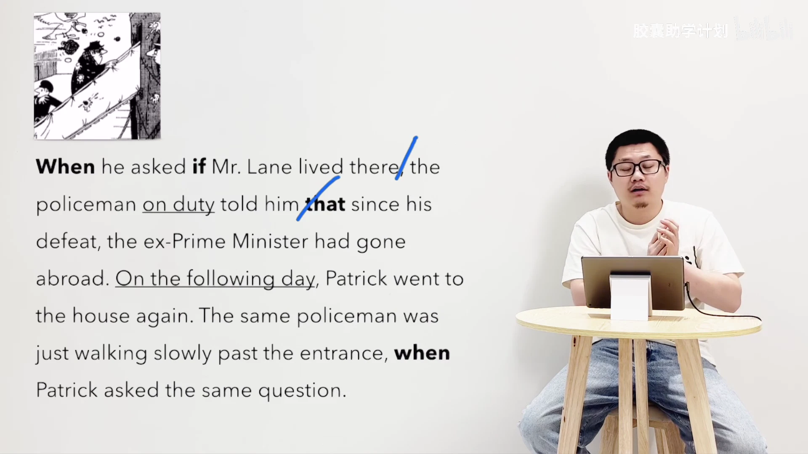

文字识别：量助学计划 / When he asked if Mr. Lane lived there/the / policeman on duty told him yhat since his / defeat, the ex-Prime Minister had gone / abroad. On the following day, Patrick went to / the house again. The same policeman was / just walking slowly past the entrance, when / Patrick asked the same question.

## 00:04:30–00:05:00

已经出国了，其实跟刚才是一样的嘛，对吧？ On the following day, 啊，这个习惯用法一会儿我们造句，这个一会儿我们也造句啊，就是在接下来的这一天啊，就就其实就是第二天 next day，类似于 Patrick went to the house again. 他又去了，又去这个房子了. The same policeman was just walking slowly past the entrance when Patrick asked the same question. 相同的这个警察正在走，慢慢

### 画面 00:04:32

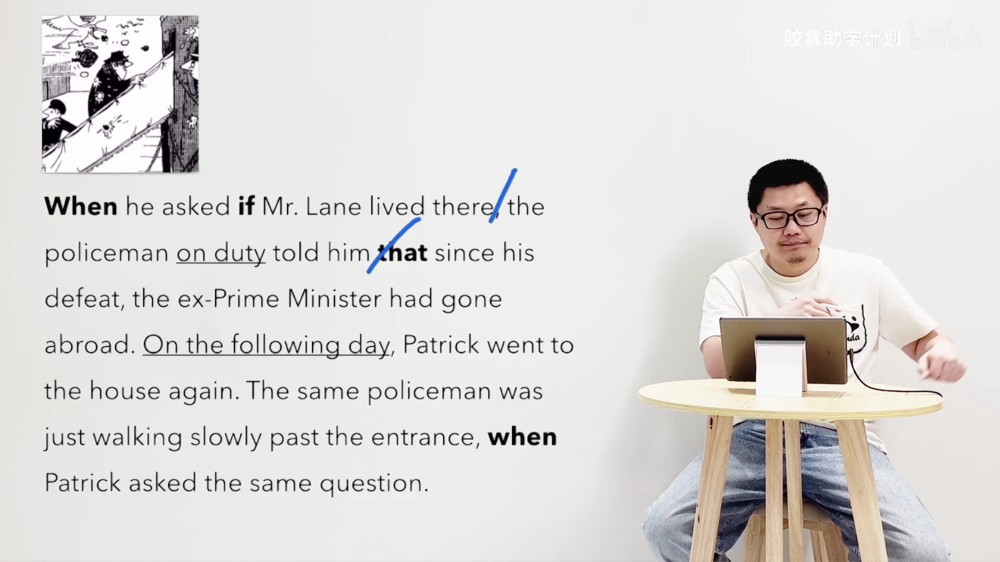

文字识别：妻助学计划！ / When he asked if Mr. Lane lived there/the / policeman on duty told him yhat since his / defeat, the ex-Prime Minister had gone / abroad. On the following day, Patrick went to / the house again. The same policeman was / just walking slowly past the entrance, when / Patrick asked the same question.

### 画面 00:04:34

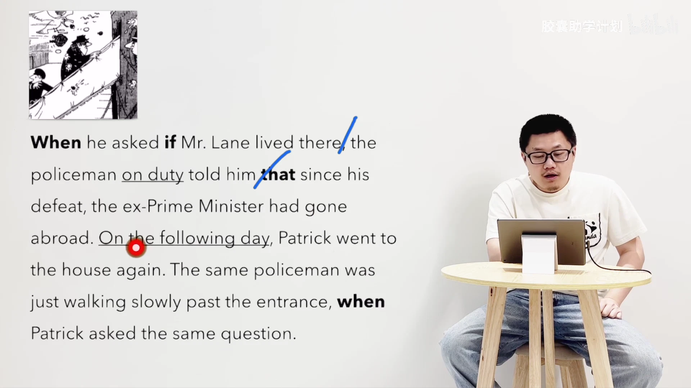

文字识别：囊助学计划 / When he asked if Mr. Lane lived there/the / policeman on duty told him yhat since his / defeat, the ex-Prime Minister had gone / abroad. On the following day, Patrick went to / nda / the house again. The same policeman was / just walking slowly past the entrance, when / Patrick asked the same question.

### 画面 00:04:36

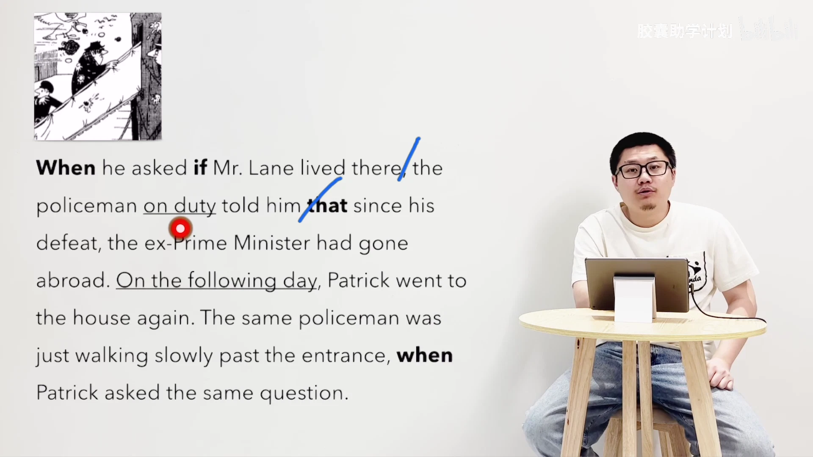

文字识别：囊助学计划 / When he asked if Mr. Lane lived there/the / policeman on duty told him yhat since his / defeat, the ex-Prime Minister had gone / abroad. On the following day, Patrick went to / nda / the house again. The same policeman was / just walking slowly past the entrance, when / Patrick asked the same question.

## 00:05:00–00:05:30

的走，路过 entrance，路过路口，对吧？他在巡逻嘛， up and down，记得吧？哎，呃，相同的这个警察正在在这个门口来回来去巡逻的，说正好路过这个门口的时候，哎，这个时候怎么样了呢？Patrick asked the same question. Patrick 问了相同的问题。 Continue, though the police was a little suspicious this time. 说尽管呢，说这个警察是有一点点

### 画面 00:05:03

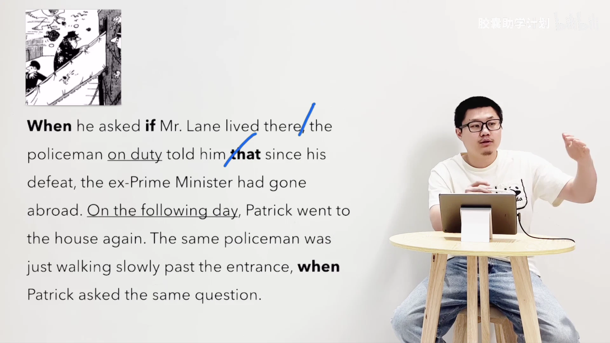

文字识别：妻助学计划 / When he asked if Mr. Lane lived there/the / policeman on duty told him yhat since his / defeat, the ex-Prime Minister had gone / abroad. On the following day, Patrick went to / the house again. The same policeman was / just walking slowly past the entrance, when / Patrick asked the same question.

### 画面 00:05:08

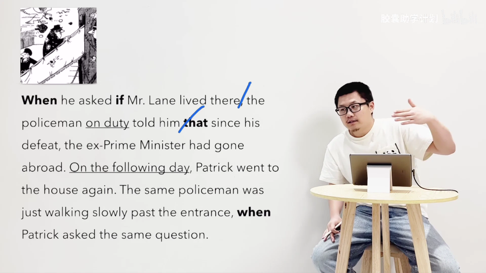

文字识别：囊助学计划 / When he asked if Mr. Lane lived there/the / policeman on duty told him zhat since his / defeat, the ex-Prime Minister had gone / abroad. On the following day, Patrick went to / the house again. The same policeman was / just walking slowly past the entrance, when / Patrick asked the same question.

### 画面 00:05:12

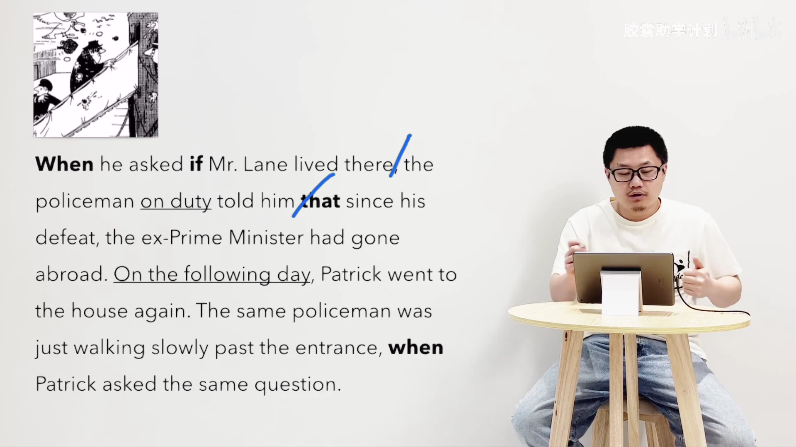

文字识别：鬘助学计划 / When he asked if Mr. Lane lived there/the / policeman on duty told him zhat since his / defeat, the ex-Prime Minister had gone / abroad. On the following day, Patrick went to / the house again. The same policeman was / just walking slowly past the entrance, when / Patrick asked the same question.

### 画面 00:05:20

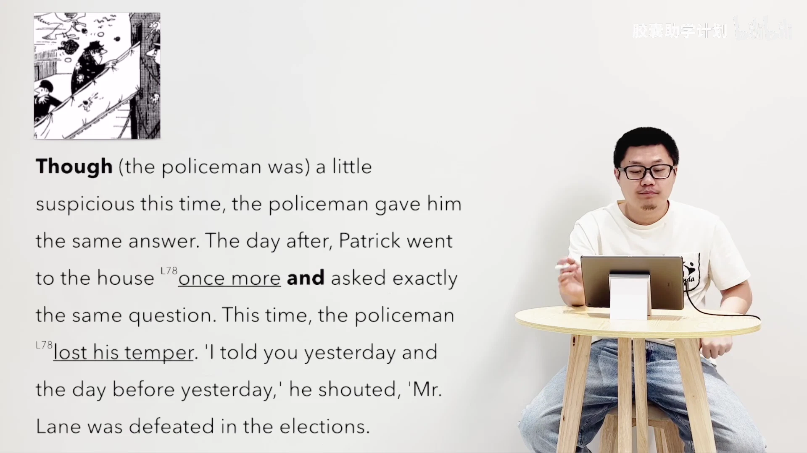

文字识别：囊助学计划！ / Though (the policeman was) a little / suspicious this time, the policeman gave him / the same answer. The day after, Patrick went / to the house / L78 / once more and asked exactly / the same question.This time, the policeman / L78lost his temper.'I told you yesterday and / the day before yesterday,' he shouted, 'Mr. / Lane was defeated in the elections.

## 00:05:30–00:06:00

怀疑的。这一次，他觉得，哎，你怎么总来问我这个问题？你问了两遍了，对吧？这是第二遍了。The policeman gave him the same answer，说警察还是给了他相同的答案，就是他被击败了，然后他出国了，对吧？这样一套话。The day after，这人是真有意思。The day after就是在 on the fall，你看第一天他去了，问了个问题，然后 on the following day是第二天，the day after就是 on the following day的第三

### 画面 00:05:50

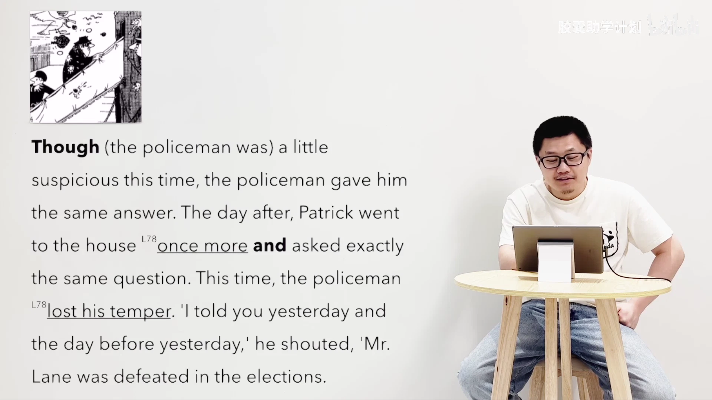

文字识别：嚢助学计划 / Though (the policeman was) a little / suspicious this time, the policeman gave him / the same answer. The day after, Patrick went / to the house / L78 / once more and asked exactly / the same question.This time, the policeman / L78lost his temper.'I told you yesterday and / the day before yesterday,' he shouted, 'Mr. / Lane was defeated in the elections.

### 画面 00:05:54

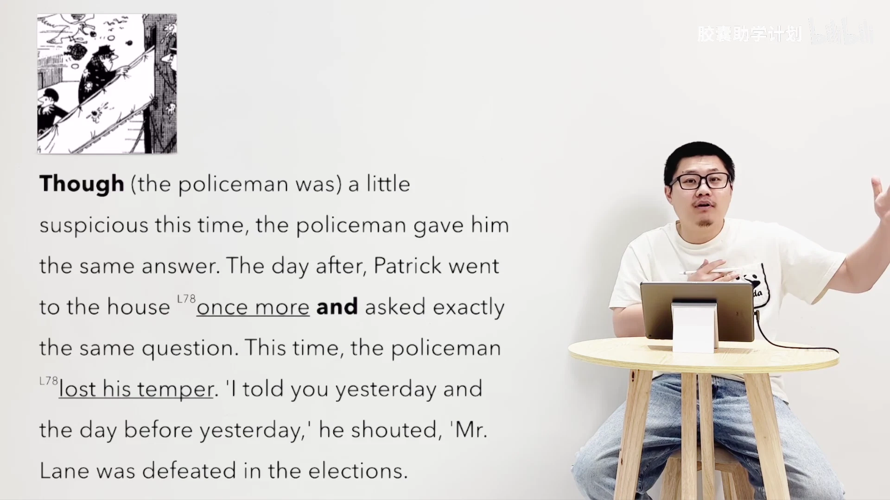

文字识别：嚢助学计划 / Though (the policeman was) a little / suspicious this time, the policeman gave him / the same answer. The day after, Patrick went / to the house / L78 / once more and asked exactly / the same question.This time, the policeman / L78lost his temper.' told you yesterday and / the day before yesterday,' he shouted, 'Mr. / Lane was defeated in the elections.

### 画面 00:05:58

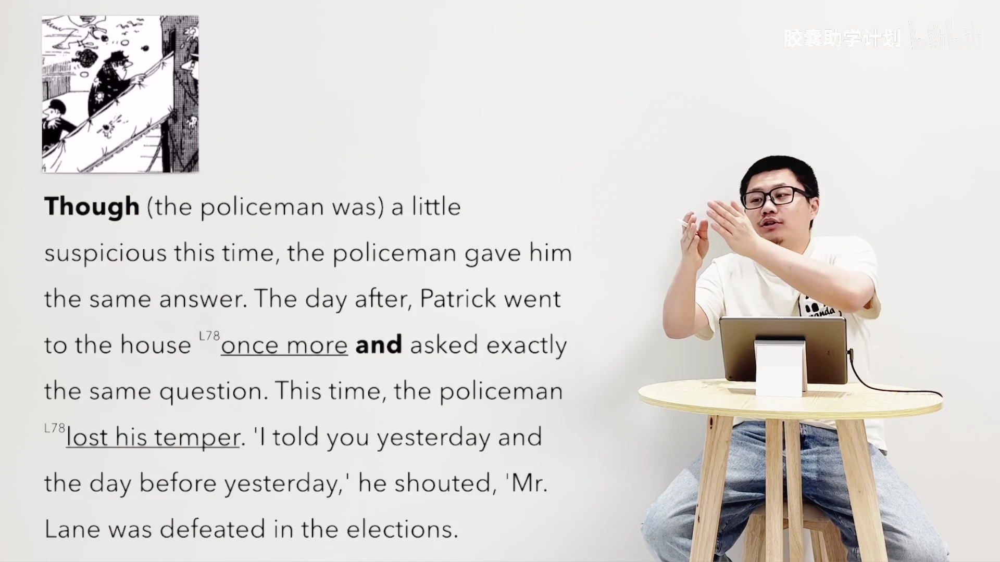

文字识别：囊助学计划 / Though (the policeman was) a little / suspicious this time, the policeman gave him / the same answer. The day after, Patrick went / aa / to the house / L78 / once more and asked exactly / the same question.This time, the policeman / L78lost his temper.' told you yesterday and / the day before yesterday,' he shouted, 'Mr. / Lane was defeated in the elections.

## 00:06:00–00:06:30

天，对吧？你这个理解为第一天去了，on the following day是第二天，然后the day after是第三天。The day after第三天呢，Patrick went to the house once more and asked exactly the same question.他又去了这个房子once more，又一次，对吧？Yesterday once more，昨日重现嘛，这很有名的一首歌嘛。Once more，哎，再来一次。Asked exactly，恰恰非常准确，就是相同的问题啊，完

### 画面 00:06:00

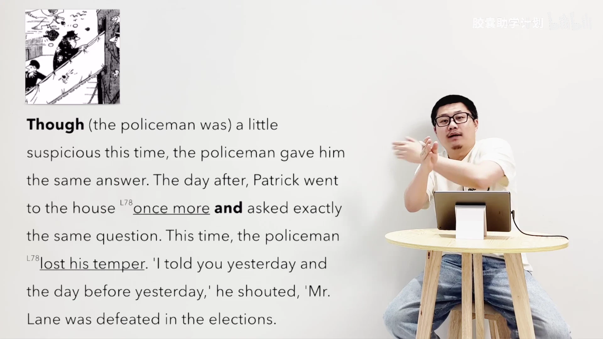

文字识别：囊助学计划！ / Though (the policeman was) a little / suspicious this time, the policeman gave him / the same answer. The day after, Patrick went / to the house / L78 / once more and asked exactly / the same question.This time, the policeman / L78lost his temper.' told you yesterday and / the day before yesterday,' he shouted, 'Mr. / Lane was defeated in the elections.

### 画面 00:06:05

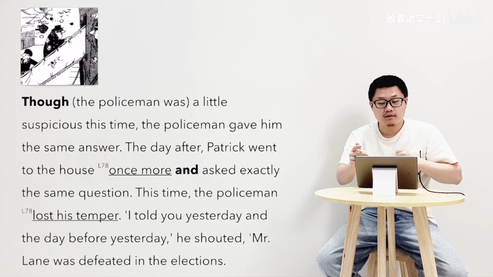

文字识别：嚢助学计划 / Though (the policeman was) a little / suspicious this time, the policeman gave him / the same answer. The day after, Patrick went / to the house / L78 / once more and asked exactly / the same question.This time, the policeman / L78lost his temper.'I told you yesterday and / the day before yesterday,' he shouted, 'Mr. / Lane was defeated in the elections.

## 00:06:30–00:07:00

全一模一样，相同的问题。This time,这次，a policeman lost his temper，怎么样，发脾气了？Lost somebody's temper，咱们之前学过，对吧？I told you yesterday and the day before yesterday, he shouted. Mr. Lin was defeated in the elections.我昨儿给你讲了，前儿也给你讲了。He shouted，他喊道，对吧？所以说，I told you yesterday and the day before

### 画面 00:06:35

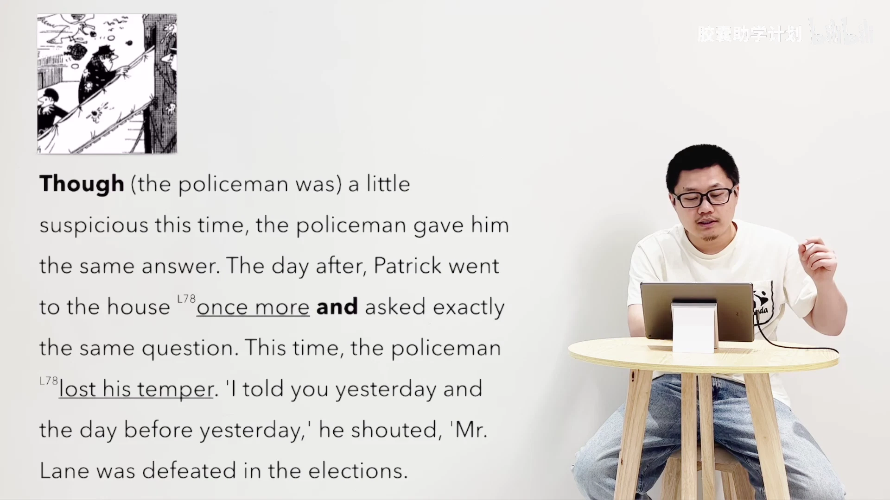

文字识别：嚢助学计划！ / Though (the policeman was) a little / suspicious this time, the policeman gave him / the same answer. The day after, Patrick went / to the house / L78 / once more and asked exactly / da / the same question.This time, the policeman / L78lost his temper.'I told you yesterday and / the day before yesterday,' he shouted, 'Mr. / Lane was defeated in the elections.

## 00:07:00–00:07:30

yesterday,是吧？大概这样感觉. He shouted.然后怎么样了呢？说Mr. Land was defeated in the elections.这个Patrick想听的就是这句话是什么呢？说Mr. Land在大选当中被击败了，对吧？就没有成，没有赢嘛。然后说He has retired from political life and gone to live abroad.他已经从他的政治生涯当中退休了，然后

### 画面 00:07:01

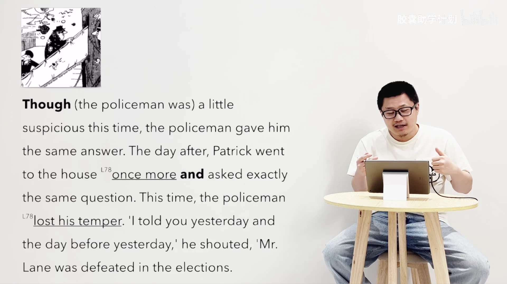

文字识别：嚢助学计划！ / Though (the policeman was) a little / suspicious this time, the policeman gave him / the same answer. The day after, Patrick went / to the house / L78 / once more and asked exactly / the same question.This time, the policeman / L78lost his temper.'I told you yesterday and / the day before yesterday,' he shouted, 'Mr. / Lane was defeated in the elections.

### 画面 00:07:04

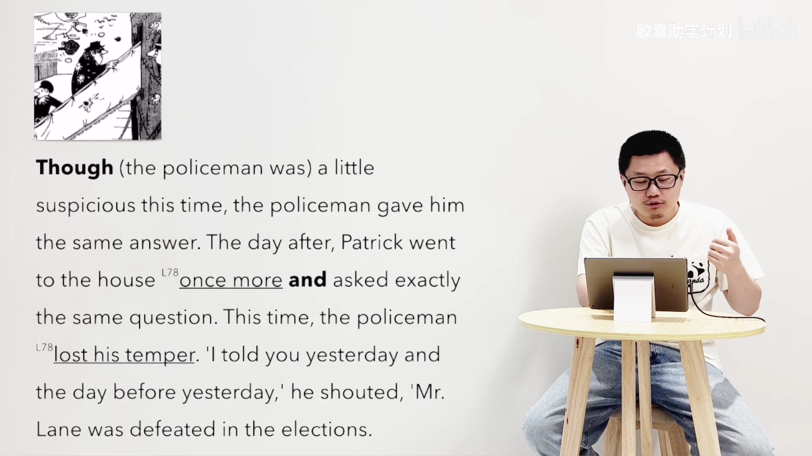

文字识别：嚢助学计划！ / Though (the policeman was) a little / suspicious this time, the policeman gave him / the same answer. The day after, Patrick went / to the house / L78 / once more and asked exactly / the same question.This time, the policeman / L78lost his temper.'I told you yesterday and / the day before yesterday,' he shouted, 'Mr. / Lane was defeated in the elections.

### 画面 00:07:18

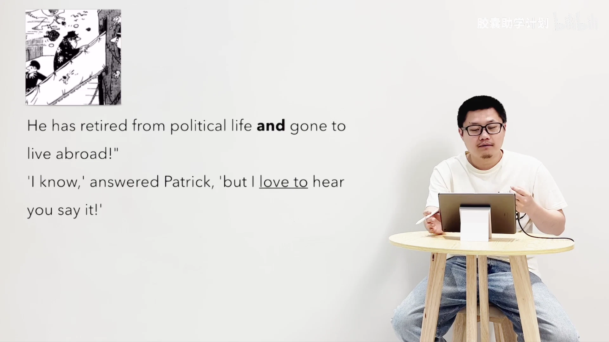

文字识别：囊助学计划 / He has retired from political life and gone to / live abroad!" / 'I know,' answered Patrick,'but I love to hear / you say it!'

## 00:07:30–00:08:00

住往国外了。你看 Patrick 说啥？I know answered Patrick, but I love to hear you say it. 但是我特别喜欢听你啊说这个事儿。哎，那你要反映一下，Patrick 是 Mr. Lenz Radical Progressive Party 的什么来着？Fanatical opponent，狂热的什么反对者，对

### 画面 00:07:45

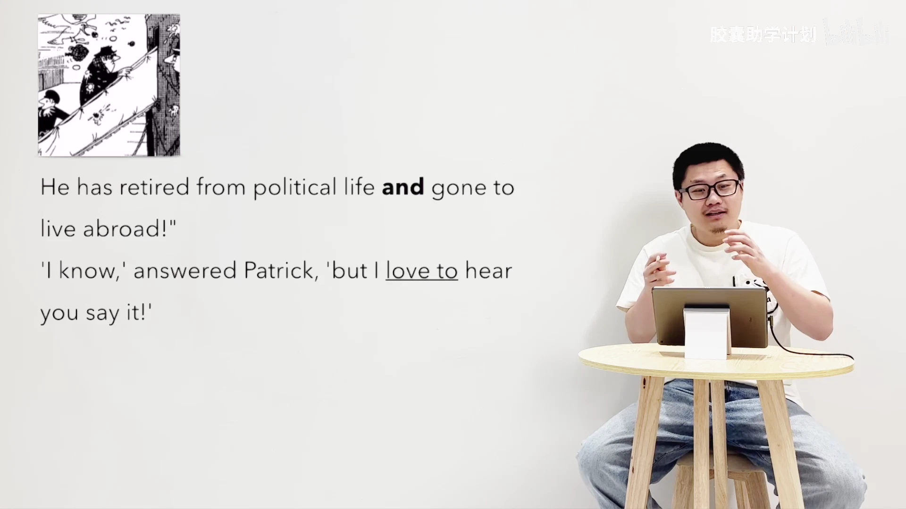

文字识别：臺助学计划 / He has retired from political life and gone to / live abroad!" / 'I know,' answered Patrick,'but I love to hear / you say it!'

### 画面 00:07:48

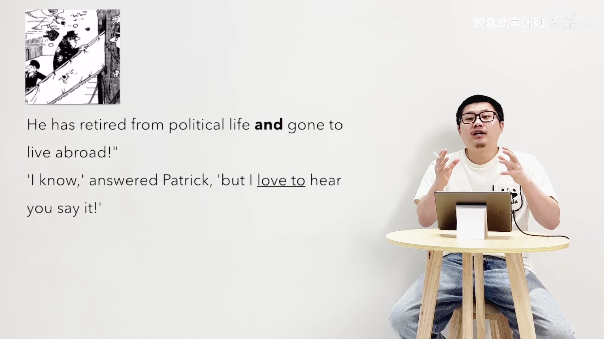

文字识别：辜助正字计划 / He has retired from political life and gone to / live abroad!" / 'I know,' answered Patrick,'but I love to hear / you say it!'

## 00:08:00–00:08:30

吧？好，那所以呢，他每次去，第一天去，第二天去，第三天去，就是为了听 policeman 跟他说那句话，叫做他失败了。然后呢，出国避难啊，也不一定是避难吧，反正就是哎，出国去火了，对吧？不在国内火了，他就是为了听到这句话，是吧？哎，这个还沉浸在他自己的喜悦当中，是吧？OK 啊，很有意思。那这篇文章呢，还行，没有什么太多的长难句、习惯用法，甚至

### 画面 00:08:12

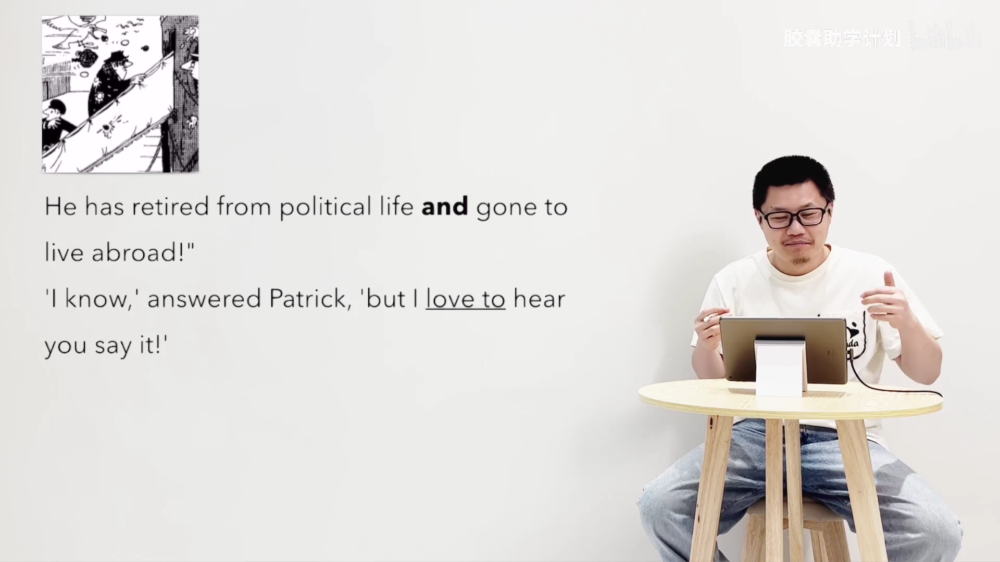

文字识别：He has retired from political life and gone to / live abroad!" / 'I know,' answered Patrick, 'but I love to hear / you say it!'

### 画面 00:08:20

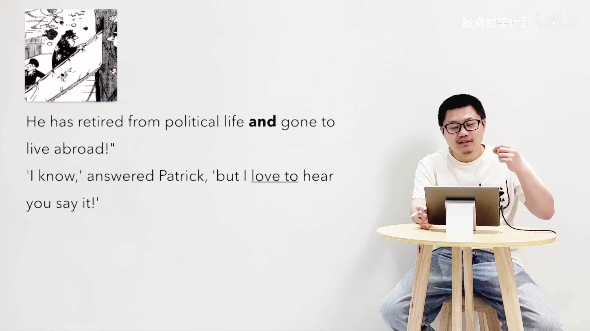

文字识别：臺助学计划 / He has retired from political life and gone to / live abroad!" / 'I know,' answered Patrick,'but I love to hear / you say it!'

### 画面 00:08:24

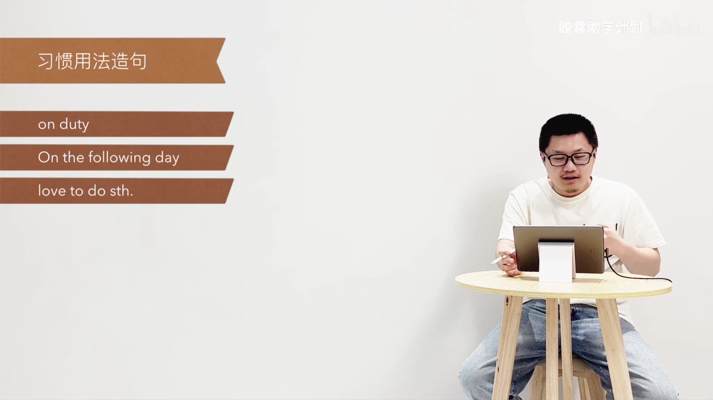

文字识别：交囊助学计划 / 习惯用法造句 / on duty / On the following day / love to do sth.

### 画面 00:08:26

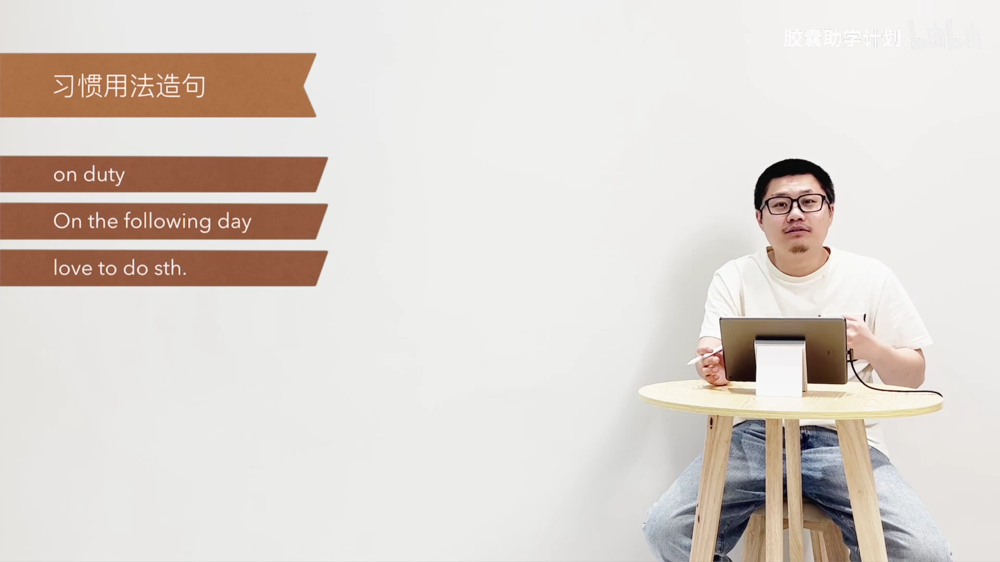

文字识别：胶囊助学计划 / 习惯用法造句 / on duty / On the following day / love to do sth.

### 画面 00:08:29

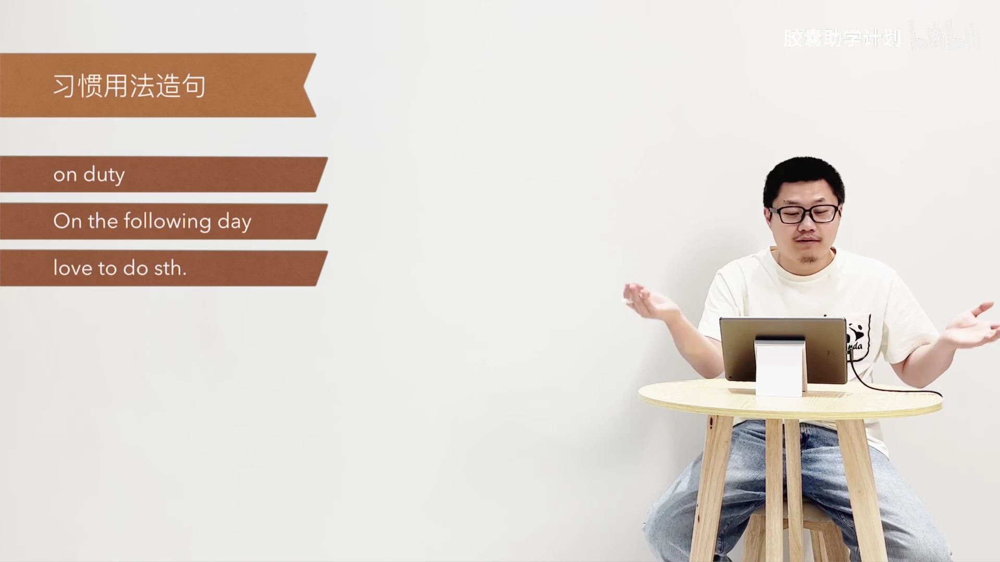

文字识别：交囊助学计划 / 习惯用法造句 / on duty / On the following day / love to do sth. / rda

## 00:08:30–00:09:00

也不多，对吧？生词甚至也不是很多。那我们就简单造几个句子啊。首先 on duty，值班执勤都行，对吧？那你要由场景去决定是值班还是执勤，是吧？比如说 the doctor，你可以理解为就是值班嘛。呃，the doctor on duty fear that worry that 一个意思，对吧？六十四个咱学的，the patient would get worse，啊，会变糟啊，变得情况更糟糕。Next one，第十个咱们学的，呃，you are not allowed to drink alcohol on duty，所以

### 画面 00:08:31

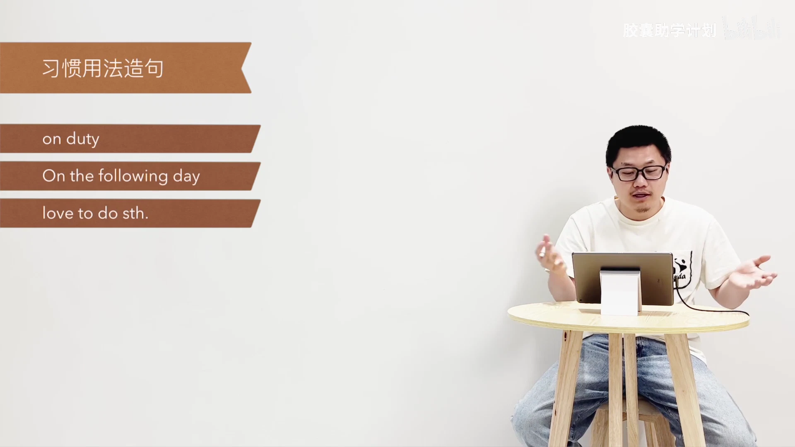

文字识别：校囊助学计划 / 习惯用法造句 / on duty / On the following day / love to do sth.

### 画面 00:08:34

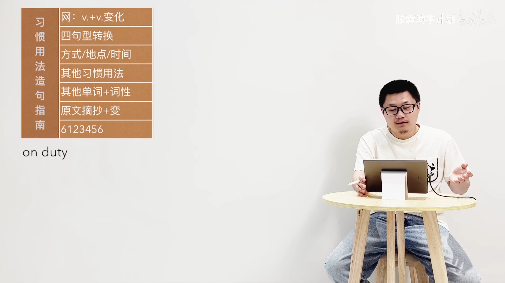

文字识别：网：v.+v.变化 / 胶囊助学计划 / 习惯用法造句指南 / 四句型转换 / 方式/地点/时间 / 其他习惯用法 / 其他单词+词性 / 原文摘抄+变 / 6123456 / on duty

### 画面 00:08:36

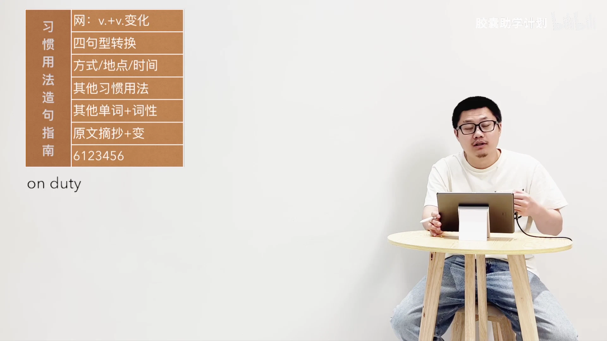

文字识别：习惯用法造句指南 / 网：v.+v.变化 / 胶囊助学计划 / 四句型转换 / 方式/地点/时间 / 其他习惯用法 / 其他单词+词性 / 原文摘抄+变 / 6123456 / on duty

### 画面 00:08:40

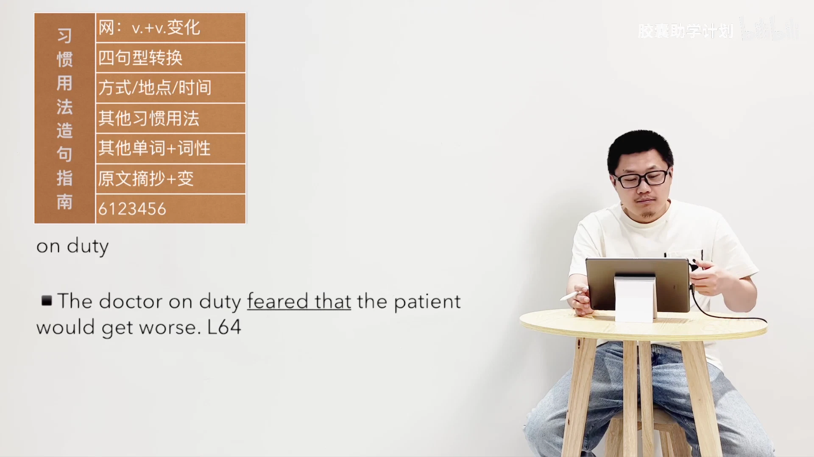

文字识别：网：v.+v.变化 / 习惯用法造句指南 / 胶囊助学计划淵 / 四句型转换 / 方式/地点/时间 / 其他习惯用法 / 其他单词+词性 / 原文摘抄+变 / 6123456 / on duty /  The doctor on duty feared that the patient / would get worse. L64

### 画面 00:08:43

文字识别：网：v.+v.变化 / 习惯用法造句指南 / 胶囊助学计划淵 / 四句型转换 / 方式/地点/时间 / 其他习惯用法 / 其他单词+词性 / 原文摘抄+变 / 6123456 / on duty /  The doctor on duty feared that the patient / would get worse. L64

### 画面 00:08:45

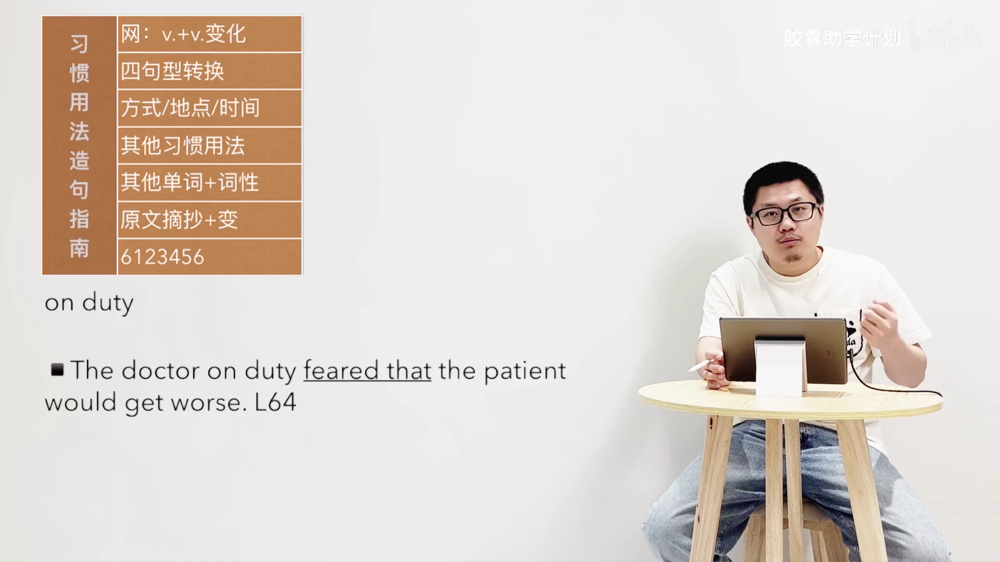

文字识别：网：v.+v.变化 / 习惯用法造句指南 / 胶囊助学计划州 / 四句型转换 / 方式/地点/时间 / 其他习惯用法 / 其他单词+词性 / 原文摘抄+变 / 6123456 / on duty / da /  The doctor on duty feared that the patient / would get worse. L64

### 画面 00:08:52

文字识别：网：v.+v.变化 / 习惯用法造句指南 / 胶囊助学计划淵 / 四句型转换 / 方式/地点/时间 / 其他习惯用法 / 其他单词+词性 / 原文摘抄+变 / 6123456 / on duty /  The doctor on duty feared that the patient / would get worse. L64

### 画面 00:08:55

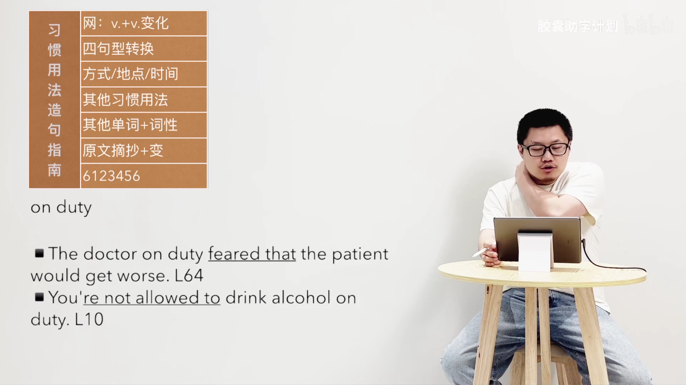

文字识别：网：v.+v.变化 / 习惯用法造句指南 / 校囊助学计划 / 四句型转换 / 方式/地点/时间 / 其他习惯用法 / 其他单词+词性 / 原文摘抄+变 / 6123456 / on duty /  The doctor on duty feared that the patient / would get worse. L64 /  You're not allowed to drink alcohol on / duty. L10

## 00:09:00–00:09:30

duty? Shouldn't you be on duty? Shouldn't you be on duty? Shouldn't you

### 画面 00:09:01

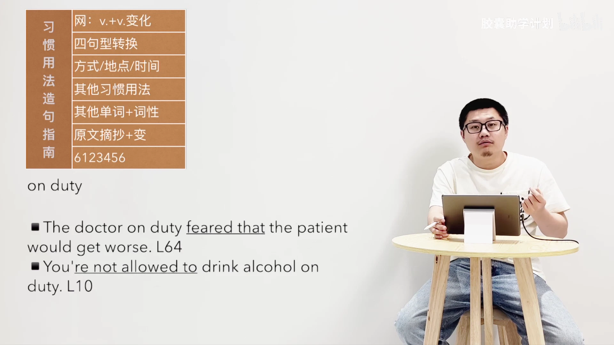

文字识别：网：v.+v.变化 / 习惯用法造句指南 / 校囊助学计划 / 四句型转换 / 方式/地点/时间 / 其他习惯用法 / 其他单词+词性 / 原文摘抄+变 / 6123456 / on duty /  The doctor on duty feared that the patient / would get worse. L64 /  You're not allowed to drink alcohol on / duty. L10

### 画面 00:09:05

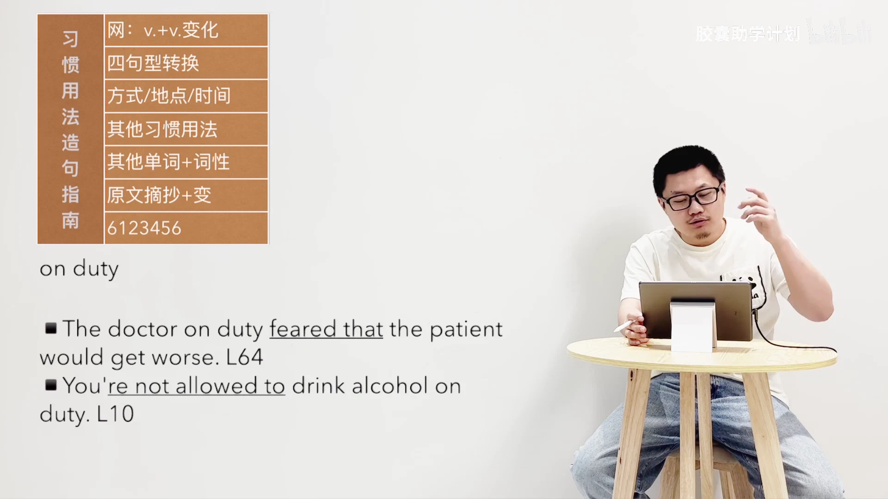

文字识别：网：v.+v.变化 / 习惯用法造句指南 / 交囊助学计划 / 四句型转换 / 方式/地点/时间 / 其他习惯用法 / 其他单词+词性 / 原文摘抄+变 / 6123456 / on duty /  The doctor on duty feared that the patient / would get worse. L64 /  You're not allowed to drink alcohol on / duty. L10

### 画面 00:09:08

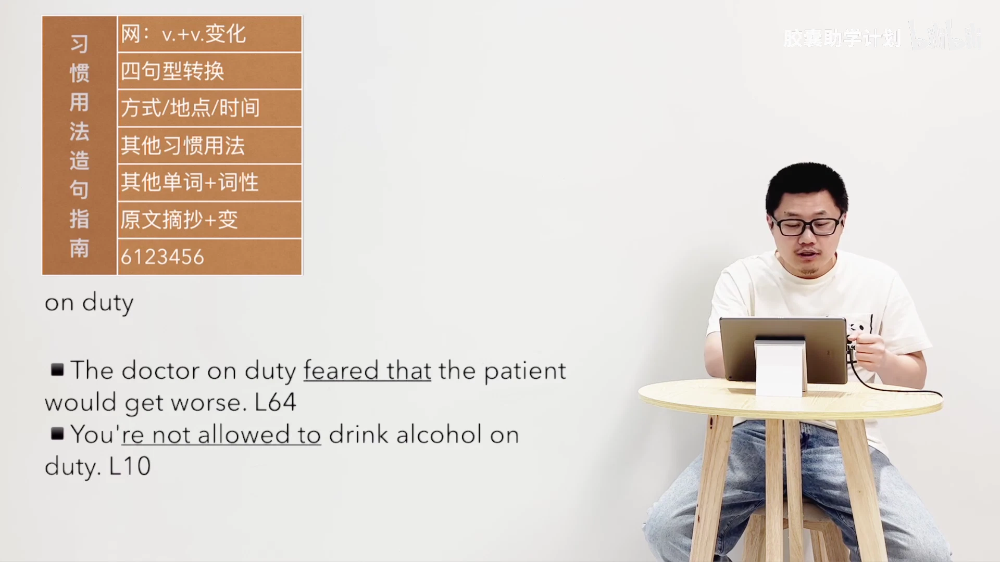

文字识别：网：v.+v.变化 / 习惯用法造句指南 / 胶囊助学计划 / 四句型转换 / 方式/地点/时间 / 其他习惯用法 / 其他单词+词性 / 原文摘抄+变 / 6123456 / on duty /  The doctor on duty feared that the patient / would get worse. L64 /  You're not allowed to drink alcohol on / duty. L10

### 画面 00:09:10

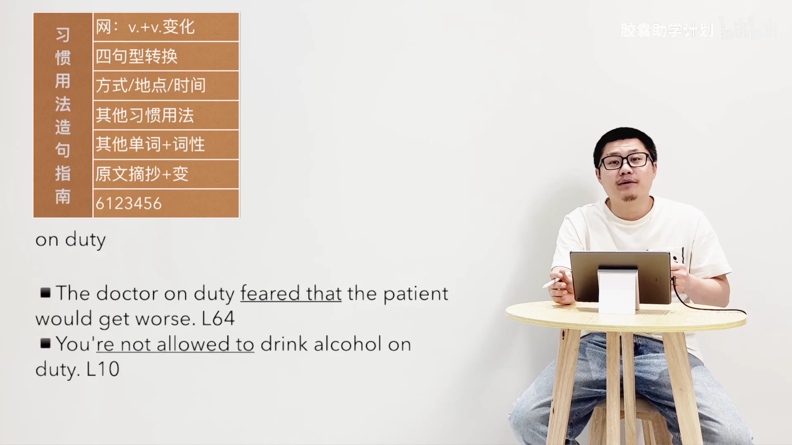

文字识别：网：v.+v.变化 / 校囊助学计划 / 习惯用法造句指南 / 四句型转换 / 方式/地点/时间 / 其他习惯用法 / 其他单词+词性 / 原文摘抄+变 / 6123456 / on duty /  The doctor on duty feared that the patient / would get worse. L64 /  You're not allowed to drink alcohol on / duty. L10

### 画面 00:09:15

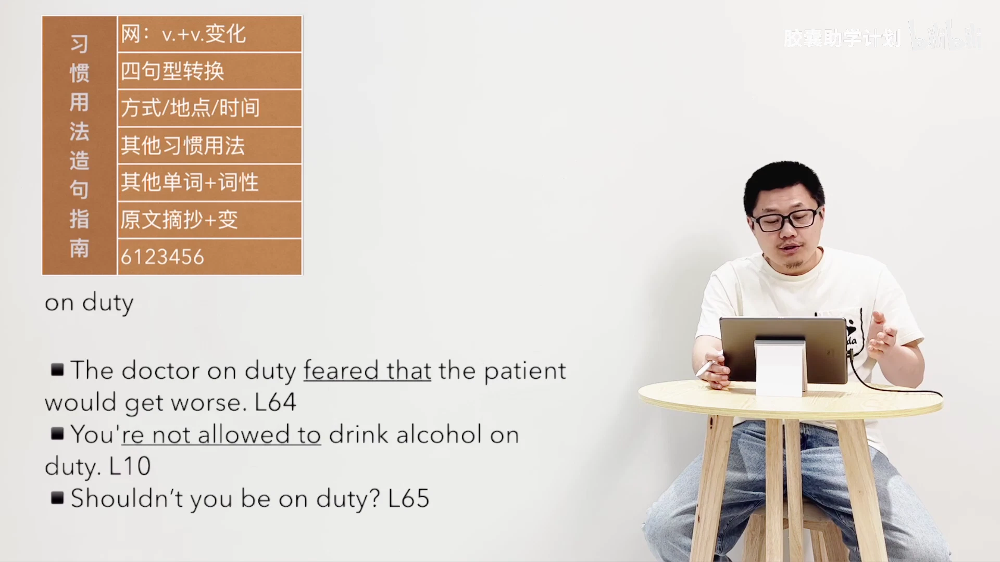

文字识别：网：v.+v.变化 / 交囊助学计划 / 习惯用法造句指南 / 四句型转换 / 方式/地点/时间 / 其他习惯用法 / 其他单词+词性 / 原文摘抄+变 / 6123456 / on duty /  The doctor on duty feared that the patient / would get worse. L64 /  You're not allowed to drink alcohol on / duty. L10 /  Shouldn't you be on duty? L65

### 画面 00:09:20

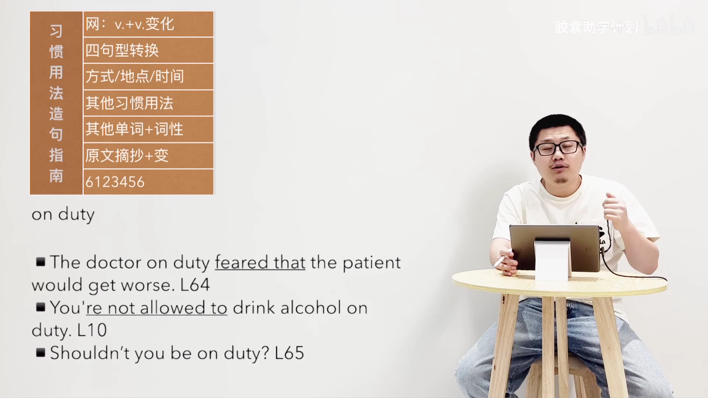

文字识别：网：v.+v.变化 / 习惯用法造句指南 / 囊助学计划 / 四句型转换 / 方式/地点/时间 / 其他习惯用法 / 其他单词+词性 / 原文摘抄+变 / 6123456 / on duty / a /  The doctor on duty feared that the patient / would get worse. L64 /  You're not allowed to drink alcohol on / duty. L10 /  Shouldn't you be on duty? L65

### 画面 00:09:26

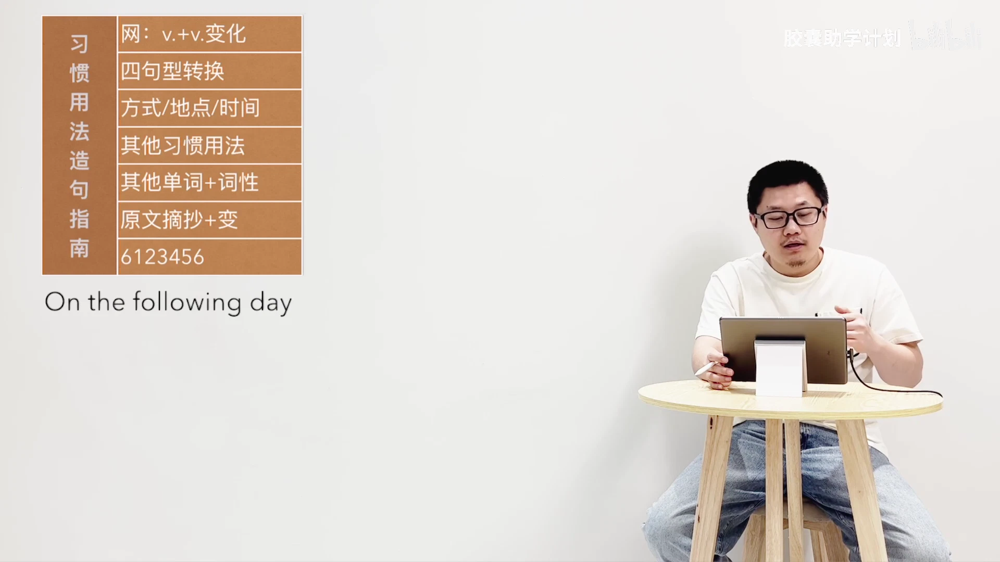

文字识别：习惯用法造句指南 / 网：v.+v.变化 / 胶囊助学计划 / 四句型转换 / 方式/地点/时间 / 其他习惯用法 / 其他单词+词性 / 原文摘抄+变 / 6123456 / On the following day

### 画面 00:09:28

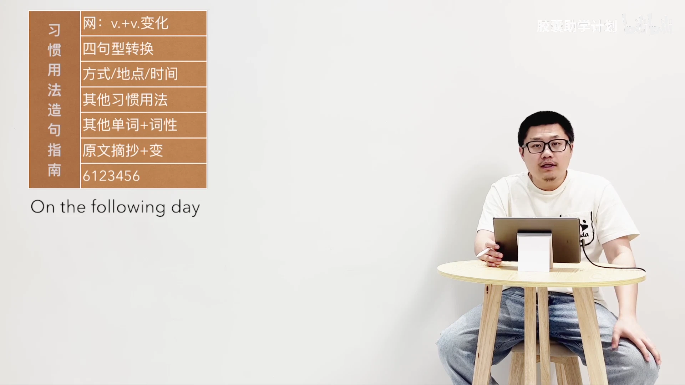

文字识别：习惯用法造句指南 / 网：v.+v.变化 / 胶囊助学计划 / 四句型转换 / 方式/地点/时间 / 其他习惯用法 / 其他单词+词性 / 原文摘抄+变 / 6123456 / On the following day

## 00:09:30–00:10:00

个意思。所以在六一二三四五六当中，我们确定了它无非就是做个六。那既然我确定了它是做六，那剩下的其实就我随便造个句子都可以接 on the following day，对吧？我就随便造的啊。比如说 he received a reward from his parents. On the following day还可以放在最前，可以放在最后，对吧？On the following day, he helped me to plant the bushes in the garden.他帮助我把这个灌木丛啊种到了这个花园里面。Next one, repeat

### 画面 00:09:30

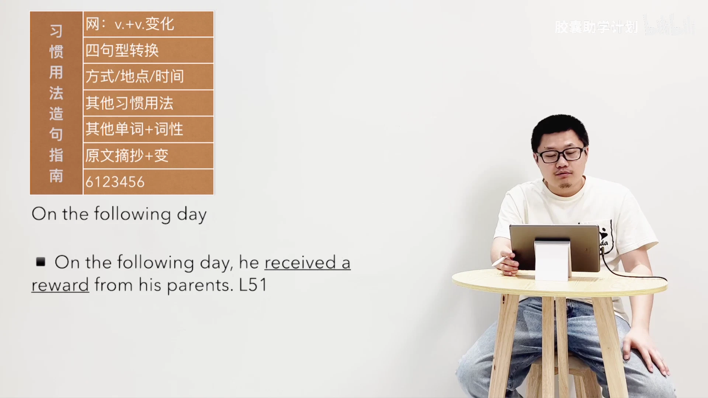

文字识别：网：v.+v.变化 / 习惯用法造句指南 / 胶囊助学计划一淵 / 四句型转换 / 方式/地点/时间 / 其他习惯用法 / 其他单词+词性 / 原文摘抄+变 / 6123456 / On the following day /  On the following day, he received a / reward from his parents. L51

### 画面 00:09:35

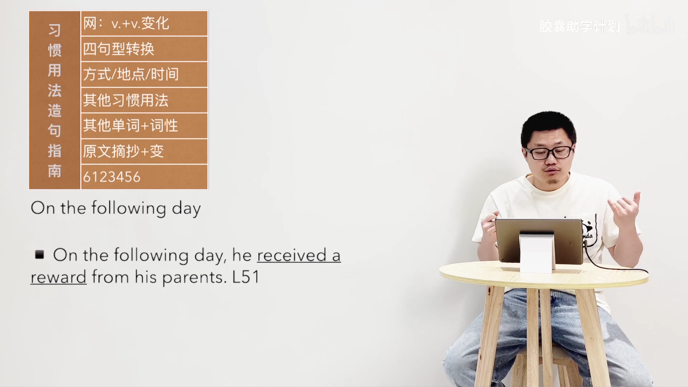

文字识别：网：v.+v.变化 / 校囊助学计划 / 习惯用法造句指南 / 四句型转换 / 方式/地点/时间 / 其他习惯用法 / 其他单词+词性 / 原文摘抄+变 / 6123456 / On the following day / nda /  On the following day, he received a / reward from his parents. L51

### 画面 00:09:40

文字识别：网：v.+v.变化 / 校囊助学计划 / 习惯用法造句指南 / 四句型转换 / 方式/地点/时间 / 其他习惯用法 / 其他单词+词性 / 原文摘抄+变 / 6123456 / On the following day /  On the following day, he received a / reward from his parents. L51

### 画面 00:09:45

文字识别：网：v.+v.变化 / 习惯用法造句指南 / 胶囊助学计划 / 四句型转换 / 方式/地点/时间 / 其他习惯用法 / 其他单词+词性 / 原文摘抄+变 / 6123456 / On the following day /  On the following day, he received a / reward from his parents. L51

### 画面 00:09:49

文字识别：习惯用法造句指南 / 网：v.+v.变化 / 交囊助学计划 / 四句型转换 / 方式/地点/时间 / 其他习惯用法 / 其他单词+词性 / 原文摘抄+变 / 6123456 / On the following day /  On the following day, he received a / reward from his parents. L51 /  On the following day, he helped me to / plant the bushes in the garden. L52

### 画面 00:09:51

文字识别：网：v.+v.变化 / 习惯用法造句指南 / 囊助学计划 / 四句型转换 / 方式/地点/时间 / 其他习惯用法 / 其他单词+词性 / 原文摘抄+变 / 6123456 / On the following day /  On the following day, he received a / reward from his parents. L51 /  On the following day, he helped me to / plant the bushes in the garden. L52

### 画面 00:09:53

文字识别：网：v.+v.变化 / 交囊助学计划 / 习惯用法造句指南 / 四句型转换 / 方式/地点/时间 / 其他习惯用法 / 其他单词+词性 / 原文摘抄+变 / 6123456 / On the following day /  On the following day, he received a / reward from his parents. L51 /  On the following day, he helped me to / plant the bushes in the garden. L52

### 画面 00:09:55

文字识别：网：v.+v.变化 / 习惯用法造句指南 / 校囊助学计划 / 四句型转换 / 方式/地点/时间 / 其他习惯用法 / 其他单词+词性 / 原文摘抄+变 / 6123456 / On the following day / ada /  On the following day, he received a / reward from his parents. L51 /  On the following day, he helped me to / plant the bushes in the garden. L52

### 画面 00:09:57

文字识别：网：v.+v.变化 / 习惯用法造句指南 / 校囊助学计划！ / 四句型转换 / 方式/地点/时间 / 其他习惯用法 / 其他单词+词性 / 原文摘抄+变 / 6123456 / On the following day /  On the following day, he received a / reward from his parents. L51 /  On the following day, he helped me to / plant the bushes in the garden. L52

## 00:10:00–00:10:30

after me.别忘了. On the following day, he found out that Leo owns a gold mine,是吧？说哎我我有个金矿是吧？啊，摊牌了，富二代，然后就大概这种感觉啊。Okay,呃, love to do something这个很简单啊，就是热爱做某事儿。比如说Jesus love to run in the evening，喜欢夜跑，这个很容易造句嘛。I love to eat，我喜欢吃，and I like all sorts of holidays，我也喜欢各种各样的假期，因为假期里边我可以去不同的地方吃，对

### 画面 00:10:00

文字识别：网：v.+v.变化 / 交囊助学计划 / 习惯 / 四句型转换 / 用 / 方式/地点/时间 / 法 / 么造句指南 / 其他习惯用法 / 其他单词+词性 / 原文摘抄+变 / 6123456 / On the following day /  On the following day, he received a / reward from his parents. L51 /  On the following day, he helped me to / plant the bushes in the garden. L52 /  On the following day, she found out that / Leo owns a gold mine. L55

### 画面 00:10:05

文字识别：网：v.+v.变化 / 交囊助学计划 / 习惯 / 四句型转换 / 用 / 方式/地点/时间 / 法 / 其他习惯用法 / 造 / 旭句指南 / 其他单词+词性 / 原文摘抄+变 / 6123456 / On the following day /  On the following day, he received a / reward from his parents. L51 /  On the following day, he helped me to / plant the bushes in the garden. L52 /  On the following day, she found out that / Leo owns a gold mine. L55

### 画面 00:10:08

文字识别：网：v.+v.变化 / 交囊助学计划 / 习惯 / 四句型转换 / 用 / 方式/地点/时间 / 法 / 么造句指南 / 其他习惯用法 / 其他单词+词性 / 原文摘抄+变 / 6123456 / On the following day /  On the following day, he received a / reward from his parents. L51 /  On the following day, he helped me to / plant the bushes in the garden. L52 /  On the following day, she found out that / Leo owns a gold mine. L55

### 画面 00:10:10

文字识别：网：v.+v.变化 / 交囊助学计划 / 习惯 / 四句型转换 / 用 / 方式/地点/时间 / 法 / 么造句指南 / 其他习惯用法 / 其他单词+词性 / 原文摘抄+变 / 6123456 / On the following day /  On the following day, he received a / reward from his parents. L51 /  On the following day, he helped me to / plant the bushes in the garden. L52 /  On the following day, she found out that / Leo owns a gold mine. L55

### 画面 00:10:12

文字识别：网：v.+v.变化 / 习惯用法造句指南 / 胶囊助学计划 / 四句型转换 / 方式/地点/时间 / 其他习惯用法 / 其他单词+词性 / 原文摘抄+变 / 6123456 / love to do sth. / da

### 画面 00:10:14

文字识别：习惯用法造句指南 / 网：v.+v.变化 / 胶囊助学计划 / 四句型转换 / 方式/地点/时间 / 其他习惯用法 / 其他单词+词性 / 原文摘抄+变 / 6123456 / love to do sth.

### 画面 00:10:16

文字识别：习惯用法造句指南 / 网：v.+v.变化 / 胶囊助学计划關 / 四句型转换 / 方式/地点/时间 / 其他习惯用法 / 其他单词+词性 / 原文摘抄+变 / 6123456 / love to do sth. /  They just love to run in the evening.

### 画面 00:10:18

文字识别：网：v.+v.变化 / 胶囊助学计划關 / 习惯用法造句指南 / 四句型转换 / 方式/地点/时间 / 其他习惯用法 / 其他单词+词性 / 原文摘抄+变 / 6123456 / love to do sth. /  They just love to run in the evening.

### 画面 00:10:20

文字识别：网：v.+v.变化 / 习惯用法造句指南 / 校囊助学计划渊 / 四句型转换 / 方式/地点/时间 / 其他习惯用法 / 其他单词+词性 / 原文摘抄+变 / 6123456 / love to do sth. /  They just love to run in the evening. / I love to eat, and I like all sorts of holidays. / L63

### 画面 00:10:25

文字识别：网：v.+v.变化 / 习惯用法造句指南 / 胶囊助学计划 / 四句型转换 / 方式/地点/时间 / 其他习惯用法 / 其他单词+词性 / 原文摘抄+变 / 6123456 / love to do sth. /  They just love to run in the evening. / I love to eat, and Ilike all sorts of holidays. / L63

## 00:10:30–00:11:00

吧？Next one, I love to pay my grandparents a visit. 说我愿意，我想去，是吧？我愿意怎么样呢？说拜访一下我的祖父母，对吧？Pay somebody a visit，之前学的，对吧？拜访一下某人。呃，Recap文章以外三个习惯用法，牢牢记住。第一造句，第二文章跟读，第三那置顶留言找重复间隔学习材料呗，好吧？那以上呢就是本期视频的全部内容了。

### 画面 00:10:30

文字识别：网：v.+v.变化 / 习惯用法造句指南 / 校囊助学计划淵 / 四句型转换 / 方式/地点/时间 / 其他习惯用法 / 其他单词+词性 / 原文摘抄+变 / 6123456 / love to do sth. /  They just love to run in the evening. / I love to eat, and I like all sorts of holidays. / L63 / I love to pay my grandparents a visit. L51

### 画面 00:10:35

文字识别：网：v.+v.变化 / 习惯用法造句指南 / 交囊助学计划 / 四句型转换 / 方式/地点/时间 / 其他习惯用法 / 其他单词+词性 / 原文摘抄+变 / 6123456 / love to do sth. /  They just love to run in the evening. / I love to eat, and I like all sorts of holidays. / L63 / I love to pay my grandparents a visit. L51

### 画面 00:10:40

文字识别：网：v.+v.变化 / 习惯用法造句指南 / 校囊助学计划 / 四句型转换 / 方式/地点/时间 / 其他习惯用法 / 其他单词+词性 / 原文摘抄+变 / 6123456 / love to do sth. / da /  They just love to run in the evening. / I love to eat, and Ilike all sorts of holidays. / L63 / I love to pay my grandparents a visit. L51

### 画面 00:10:43

文字识别：Recap / 胶囊助学计划 / on duty / Expression / on the following day / love to do sth.

### 画面 00:10:45

文字识别：胶囊助学计划 / Recap / on duty / Expression / on the following day / love to do sth.

### 画面 00:10:48

文字识别：Recap / 胶囊助学计划 / on duty / Expression / on the following day / love to do sth.

### 画面 00:10:50

文字识别：胶囊助学计划 / 1. / 习惯用法造句/对话 / 【习惯用法造句指南】 / 每个5句

### 画面 00:10:52

文字识别：胶囊助学计划 / 习惯用法造句/对话 / 1. / 【习惯用法造句指南】 / 每个5句 / 文章跟读至熟读成诵 / 内化单词+语法+习惯用法 / 听力+口语+写作练习 / 重复间隔（置顶留言） / 3.

### 画面 00:10:55

文字识别：胶囊助学计划 / 1. / 习惯用法造句/对话 / 【习惯用法造句指南】 / 每个5句 / 文章跟读至熟读成诵 / 内化单词+语法+习惯用法 / 听力+口语+写作练习 / 3. / 重复间隔（置顶留言）

### 画面 00:10:57

文字识别：交囊助学计划

## 00:11:00–00:11:22

如果各位喜欢我们的课程呢，欢迎各位关注、订阅、一键三连、分享给那些需要的朋友，来帮助我们快速成长。See you next time.

### 画面 00:11:02

文字识别：胶囊助学计划一 / 不 / ￥

### 画面 00:11:05

文字识别：交囊助学计划

### 画面 00:11:09

### 画面 00:11:11

文字识别：CAPSULEACADEMY / 胶囊助学计划 / 『 / 小红书 / Lecturer / Leo / OE

### 画面 00:11:14

文字识别：CAPSULEACADEMY / 胶囊助学计划 / 小红书

### 画面 00:11:17

文字识别：聖動字計划 / CAPSULEACADEMY / 胶囊助学计划 / 小红书 / Creator / Leo & Berlin / OE

### 画面 00:11:19

文字识别：bilbili / 胶囊助学计划 / CAPSULEACADEMY / 胶囊助学计划 / 小红书 / OE

### 画面 00:11:21

文字识别：bilibili / 胶囊助学计划

