# 083 练习

快速机器解析：语音为单模型转写，未进行独立交叉校对或人工复核；画面每秒采样并按变化选帧，短时文字和标记可能遗漏。截图时间约有 1 秒误差。图片有损压缩；遇到疑点请按时间查看 Google Drive 原视频。

## 00:00:00–00:00:30

Hello everyone, welcome to Capsule Academy. This is Leo. Today we're going to learn New Concept English Book Two Lesson Eighty Three Practices. That注意进行如下练习，唯一的前提就是咱文章能跟读至熟读成诵，否则请勿开始。Hope you gonna enjoy.嗯，第一题 comprehension，对吧？练习咱们听懂一般疑问句和特殊疑问句的能力。我问您答就好了。Who was defeated in the recent

### 画面 00:00:00

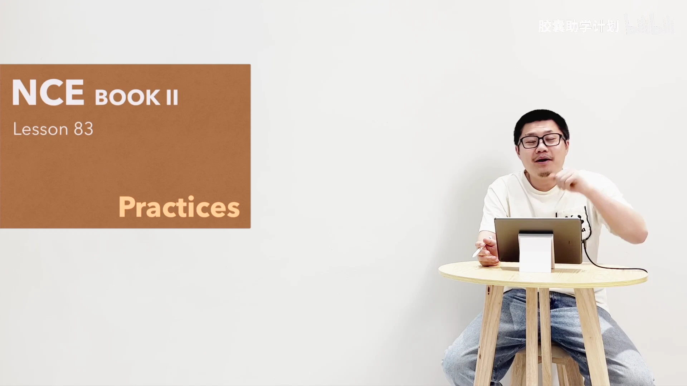

文字识别：胶囊助学计划 / NCE / BOOKⅡI / Lesson 83 / Practices

### 画面 00:00:02

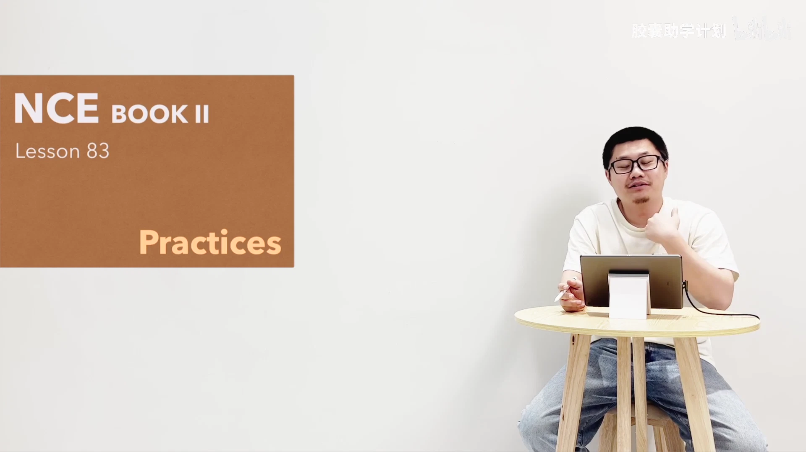

文字识别：胶囊助学计划 / NCE / BOOKII / Lesson 83 / Practices

### 画面 00:00:05

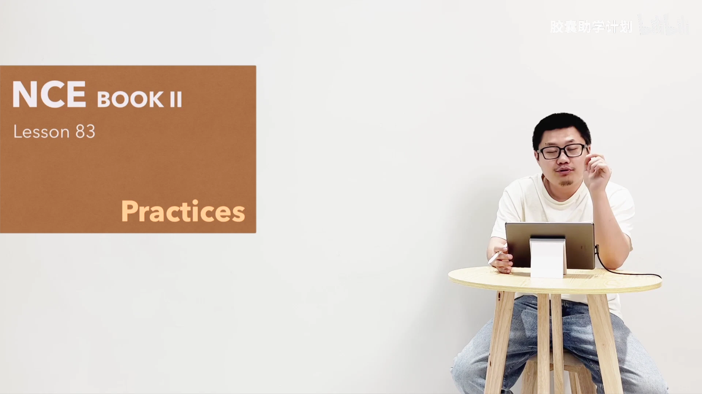

文字识别：胶囊助学计划 / NCE / BOOKII / Lesson 83 / Practices

### 画面 00:00:08

文字识别：胶囊助学计划 / 进行如下练习唯一前提 / 文章跟读至熟读成诵 / 否则请勿开始

### 画面 00:00:16

文字识别：bibi / 胶囊助学计划 / •

### 画面 00:00:20

文字识别：動字叶划 / 胶囊助学计划

### 画面 00:00:22

文字识别：胶囊助学计划调 / Comprehension / 训练目标： / 听懂一般疑问句＆特殊疑问句

### 画面 00:00:28

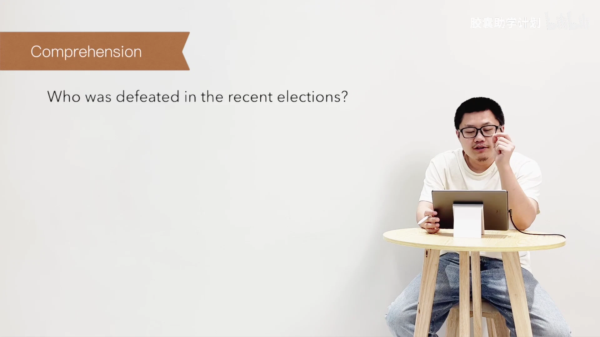

文字识别：胶囊助学计划 / Comprehension / Who was defeated in the recent elections?

## 00:00:30–00:01:00

elections? Mr. Wentworth Lam, the former prime minister. Next one. What's he doing now?很简单, he's retiring from political life. Where has he gone?一个单词abroad. Next one. What's your friend called? Patrick.

### 画面 00:00:43

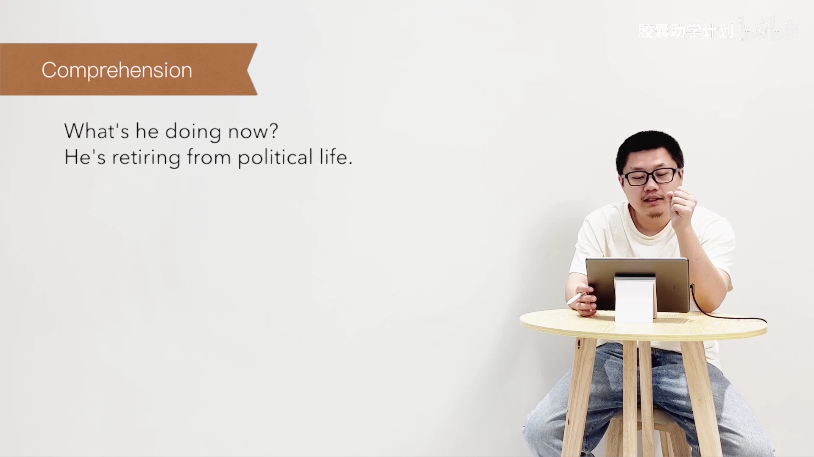

文字识别：校囊助学计划 / Comprehension / What's he doing now? / He's retiring from political life.

## 00:01:00–00:01:30

What's Mister Lan's party called? The Radical Progressive Party. Does Patrick support the party? No, he doesn't. He's always been a fanatical opponent of it, hasn't he? Yes, he has. Where did he go after

### 画面 00:01:09

文字识别：胶囊助学计划 / Comprehension / Does Patrick support the party?

### 画面 00:01:23

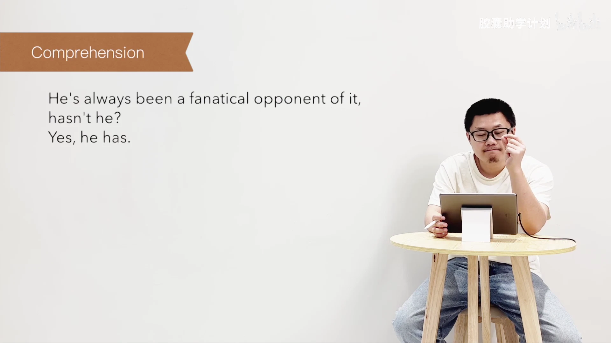

文字识别：校囊助学计划 / Comprehension / He's always been a fanatical opponent of it, / hasn't he? / Yes, he has.

### 画面 00:01:27

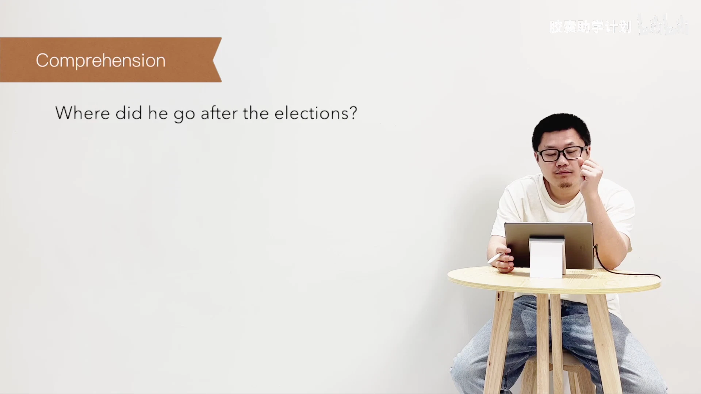

文字识别：交囊助学计划間 / Comprehension / Where did he go after the elections?

## 00:01:30–00:02:00

the elections? To Mr. Len's house. What did he ask the policeman? If Mr. Len lived there. How did the policeman reply? That the ex prime minister had gone abroad. Did

### 画面 00:01:50

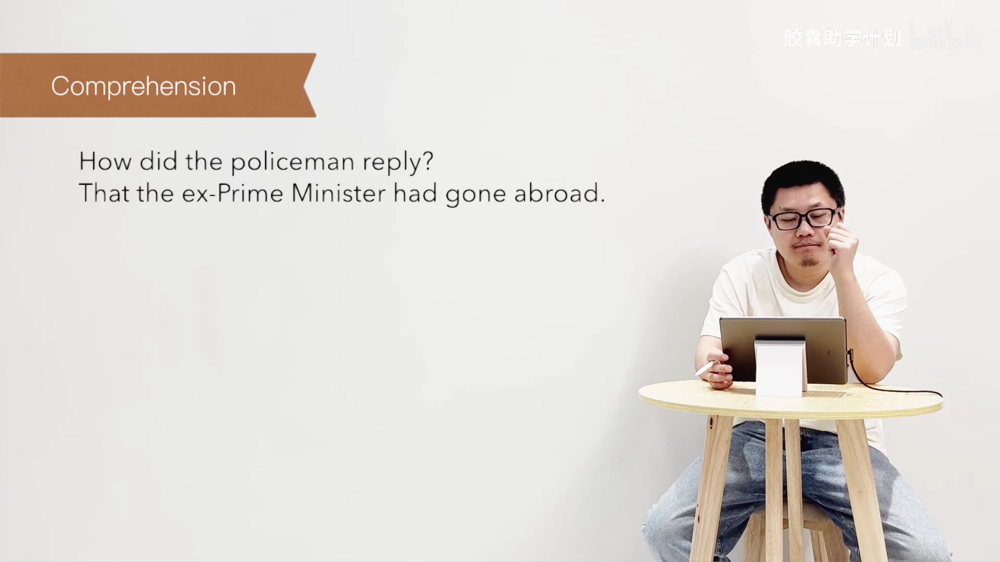

文字识别：校囊助学计划 / Comprehension / How did the policeman reply? / That the ex-Prime Minister had gone abroad.

### 画面 00:01:59

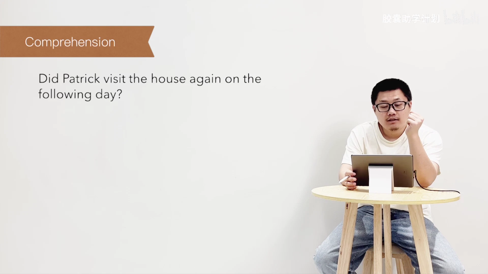

文字识别：校囊助学计划 / Comprehension / Did Patrick visit the house again on the / following day?

## 00:02:00–00:02:30

Patrick visit the house again on the following day? Yes, he did. Was the same policeman on duty? Yes, he was. What did Patrick ask him? The same question. Did he receive the same answer? Yes, he did. Asking questions, 四句型转换啊，咱们直接

### 画面 00:02:17

文字识别：胶囊助学计划 / Comprehension / What did Patrick ask him? / The same question.

### 画面 00:02:26

文字识别：胶囊助学计划關 / Asking questions / 训练目标： / 会说一般疑问句＆特殊疑问句 / Accuracy / Fluency

### 画面 00:02:29

文字识别：胶囊助学计划 / Asking questions

## 00:02:30–00:03:00

看例子。呃，Ask me if Mr. Lane was Prime Minister. Was提前，What? 主要What was Mr. Lane? 对吧？其实就是我觉得用Who，个人觉得更舒服一点啊。Who was he? 对吧？呃，所以你看接下来给了一个Who，对吧？呃，He was leader of the Radical Progressive Party. 你把Was提前就行了。Which party? 肯定是对The Radical Progressive Party提问的，对吧？Who对主语提问。He was defeated in the recent

### 画面 00:02:31

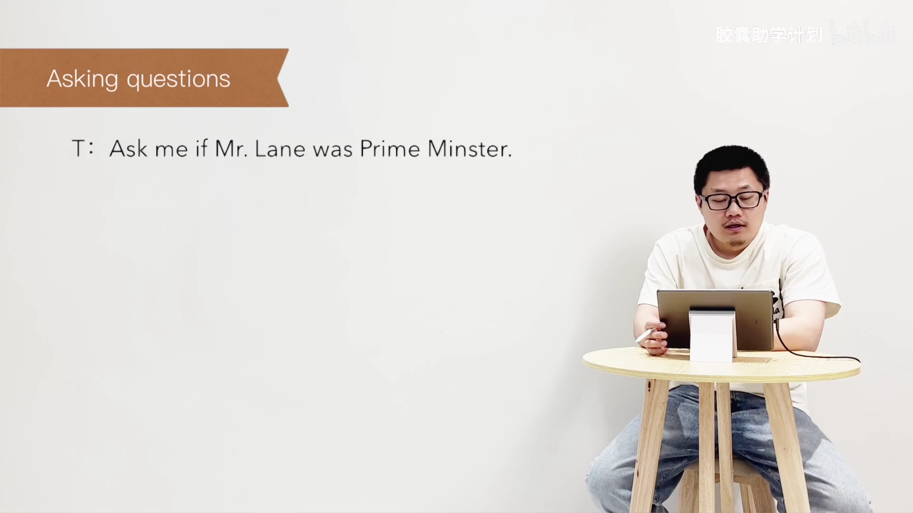

文字识别：校囊助学计划断 / Asking questions / T: Ask me if Mr. Lane was Prime Minster.

### 画面 00:02:35

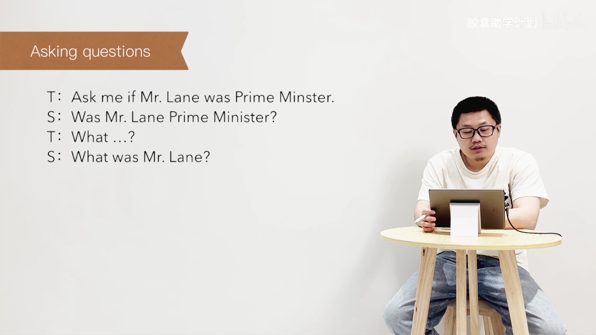

文字识别：交囊助学计划 / Asking questions / T: Ask me if Mr. Lane was Prime Minster. / S: Was Mr. Lane Prime Minister? / T: What ...? / S: What was Mr. Lane?

### 画面 00:02:38

文字识别：校囊助学计划 / Asking questions

### 画面 00:02:42

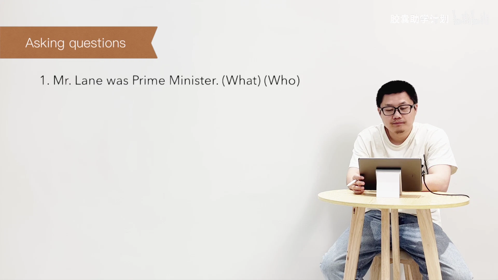

文字识别：校囊助学计划 / Asking questions / 1. Mr. Lane was Prime Minister. (What) (Who)

### 画面 00:02:46

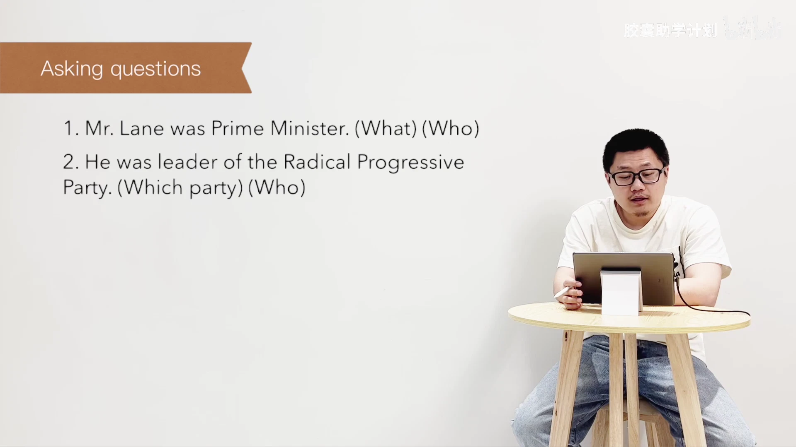

文字识别：交囊助学计划 / Asking questions / 1. Mr. Lane Was Prime Minister. (What) (Who) / 2. He was leader of the Radical Progressive / Party. (Which party) (Who)

## 00:03:00–00:03:30

elections. You put was was提前，然后when肯定是可以对in the recent elections，对吧？呃，然后who对主语提问。He's retiring from political life. Is提前，who你可以对主语提问啊。第五个，he's gone abroad. 注意这里的ps跟四的ps不太一样。四的ps是is，这里的ps是has，对吧？所以你肯定是把has提前。那where呢？Where has he gone?对abroad提问。Why？整句话who

### 画面 00:03:08

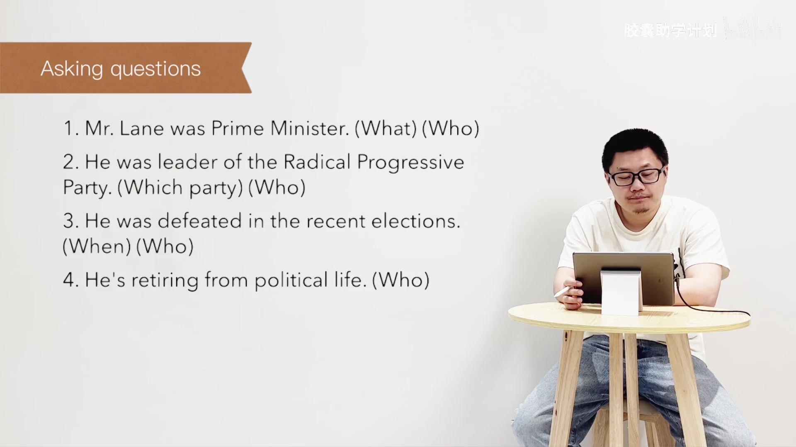

文字识别：囊助学计划 / Asking questions / 1. Mr. Lane was Prime Minister. (What) (Who) / 2. He was leader of the Radical Progressive / Party. (Which party) (Who) / 3. He was defeated in the recent elections. / (When)(Who) / 4. He's retiring from political life. (Who)

### 画面 00:03:13

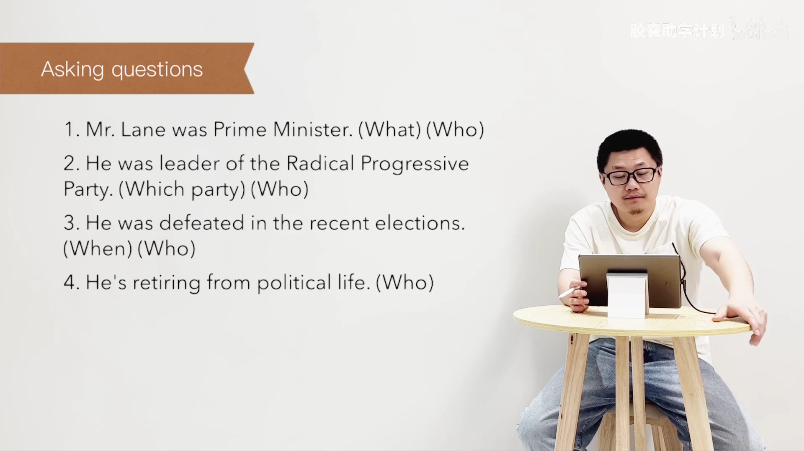

文字识别：泰助学计划 / Asking questions / 1. Mr. Lane was Prime Minister. (What) (Who) / 2. He was leader of the Radical Progressive / Party. (Which party) (Who) / 3. He was defeated in the recent elections. / (When)(Who) / 4. He's retiring from political life.(Who)

### 画面 00:03:15

文字识别：囊助学计划 / Asking questions / 1. Mr. Lane was Prime Minister. (What) (Who) / 2. He was leader of the Radical Progressive / Party. (Which party) (Who) / 3. He was defeated in the recent elections. / (When)(Who) / 4. He's retiring from political life. (Who) / 5. He's gone abroad. (Where) (Why) (Who)

### 画面 00:03:18

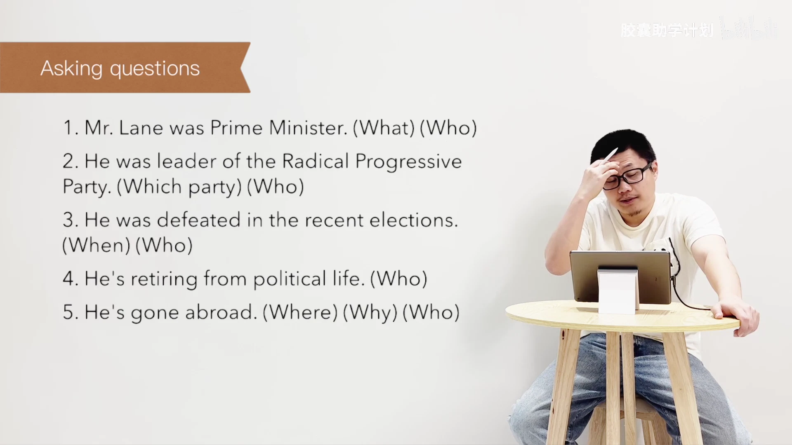

文字识别：嚢助学计划 / Asking questions / 1. Mr. Lane was Prime Minister. (What) (Who) / 2. He was leader of the Radical Progressive / Party. (Which party) (Who) / 3. He was defeated in the recent elections. / (When)(Who) / 4. He's retiring from political life. (Who) / 5. He's gone abroad. (Where) (Why) (Who)

### 画面 00:03:22

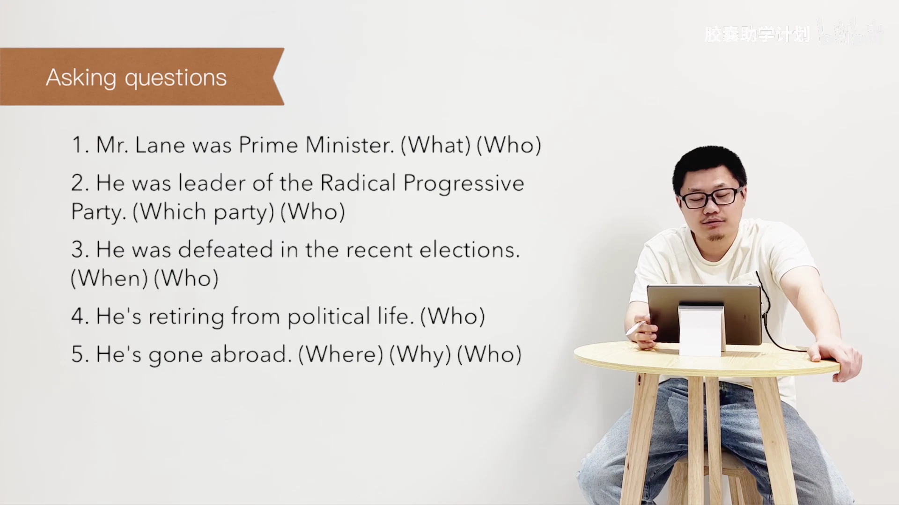

文字识别：壺助学计划 / Asking questions / 1. Mr. Lane was Prime Minister. (What) (Who) / 2. He was leader of the Radical Progressive / Party. (Which party) (Who) / 3. He was defeated in the recent elections. / (When)(Who) / 4. He's retiring from political life. (Who) / 5. He's gone abroad. (Where) (Why) (Who)

## 00:03:30–00:04:00

主语. Patrick's always been an opponent of Mr. Lane's party.这个地方的P.S.是has，要注意啊，has always been，对吧？那你肯定把has提前。然后这个地方有一个很好玩的问题，叫How long? How long?其实在这里啊，他我个人感觉更偏向于问的是always，就一直都是，有多长时间了呢？一直都是，对吧？哎，按说大多数情况下，我们对always，often

### 画面 00:03:31

文字识别：校囊助学计划 / Asking questions

### 画面 00:03:46

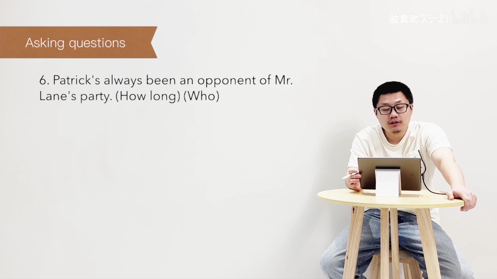

文字识别：交囊助学计划一關 / Asking questions / 6. Patrick's always been an opponent of Mr. / Lane's party.(How long) (Who)

## 00:04:00–00:04:30

often 这样的单词应该是用 how often 去提问，对吧？但这里用 how long 去提问啊，互对主语嘛，对吧？ He went to Mr. Lane's house after the election. D 的提前就可以了。 Where 对地点提问，When 对 after election 外加整句。 A policeman was there on duty. Was 提问 Why？看啊，注意这里的 Why 是可以用两种问法的。第一个整句，为什么在那儿的警察在值

### 画面 00:04:07

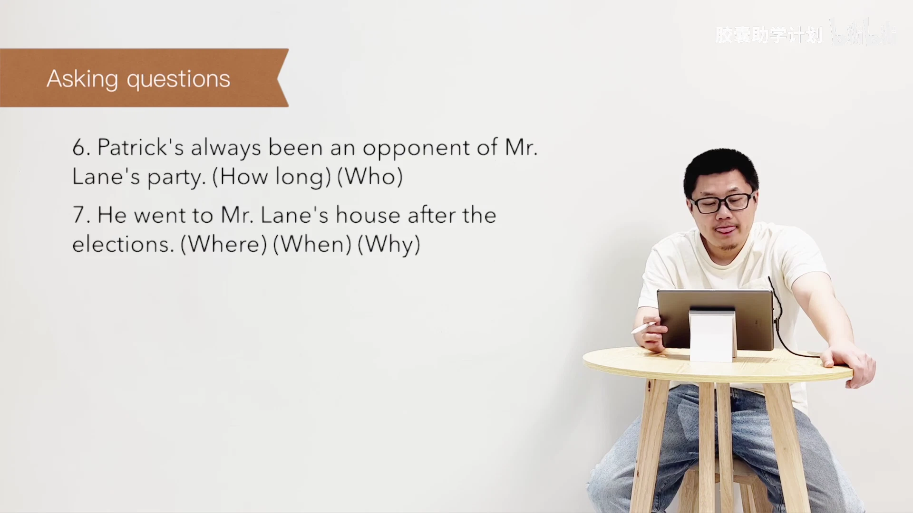

文字识别：囊助学计划 / Asking questions / 6. Patrick's always been an opponent of Mr. / Lane's party.(How long) (Who) / 7. He went to Mr. Lane's house after the / elections.(Where)(When)(Why)

### 画面 00:04:22

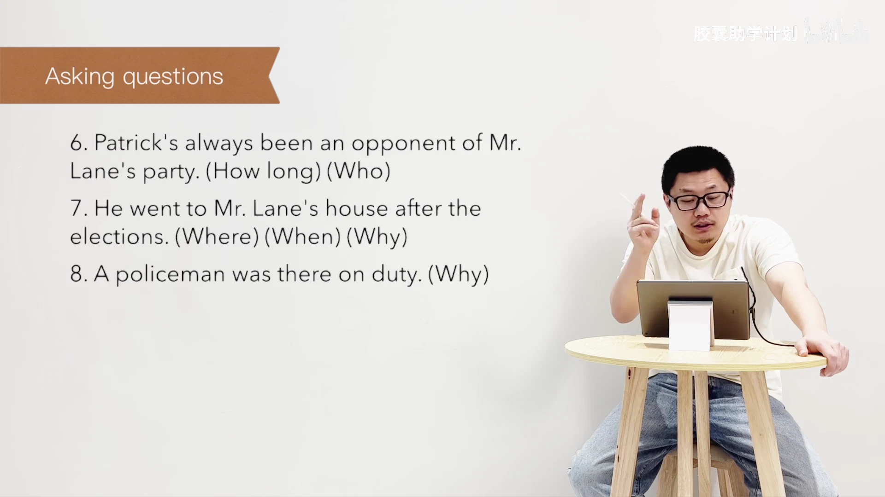

文字识别：囊助学计划！ / Asking questions / 6. Patrick's always been an opponent of Mr. / Lane's party. (How long) (Who) / 7. He went to Mr. Lane's house after the / elections.(Where)(When) (Why) / 8.A policeman was there on duty. (Why)

## 00:04:30–00:05:00

班？警察在那儿值班。第二个是警察为什么在那儿？答案叫值班，对吧？所以 why 可以加整句，也可以替代 on duty 都可以。呃，Patrick asked the policeman if Mr. Lin lived there。那你这里肯定不要看 if 后边的，后边是个宾语从句，对吧？你要把这个看 asked，看主句，把 did 提前。那 what 呢？是可以对整个宾语从句的内容提问的，所以答案可以是 What did Patrick ask the policeman？互对主语提

### 画面 00:04:40

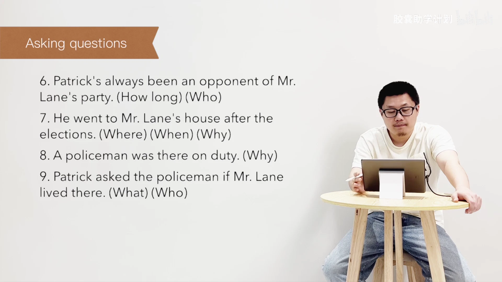

文字识别：囊助学计划！ / Asking questions / 6. Patrick's always been an opponent of Mr. / Lane's party. (How long) (Who) / 7. He went to Mr. Lane's house after the / elections. (Where)(When)(Why) / 8.A policeman was there on duty. (Why) / 9. Patrick asked the policeman if Mr. Lane / lived there.(What) (Who)

## 00:05:00–00:05:30

提问啊。Tell the story fluency练习咱们流畅度，各位直接处理就完了啊，没什么可说的。Summary writing两篇文章，重点放在连词上，对我们呃呃，不管是这个应试考试还是实际应用啊，这两大层面上所有的写作全有帮助啊啊！所以认真看，第一个是这个，第二个是这个，对吧？这全是进行练习的。接下来呢，topic for

### 画面 00:05:00

文字识别：胶囊助学计划 / Tell the story / 训练目标： / 口语复述能力 / Accuracy / Fluency

### 画面 00:05:04

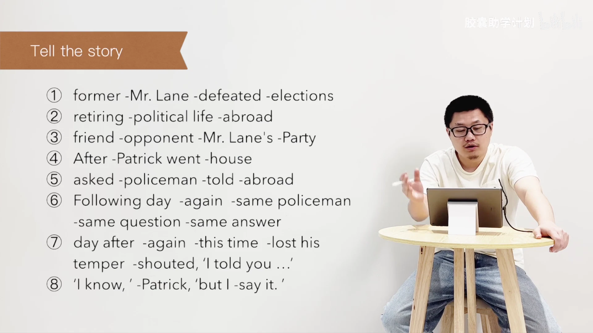

文字识别：嚢助学计划 / Tell the story / ① / ) former -Mr. Lane -defeated -elections / retiring -political life -abroad / friend -opponent -Mr. Lane's -Party / After -Patrick went -house / asked -policeman -told -abroad / Following day -again -same policeman / -same question -same answer / day after -again -this time -lost his / temper -shouted, 'I told you  / 'I know,'-Patrick,'butI-say it.

### 画面 00:05:07

文字识别：胶囊助学计划 / Summary writing: Key / 训练目标： / 写作复述能力

### 画面 00:05:14

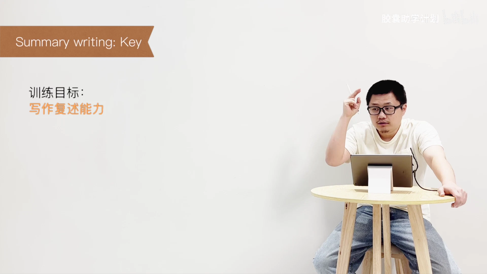

文字识别：胶囊助学计划 / Summary writing: Key / 训练目标： / 写作复述能力

### 画面 00:05:22

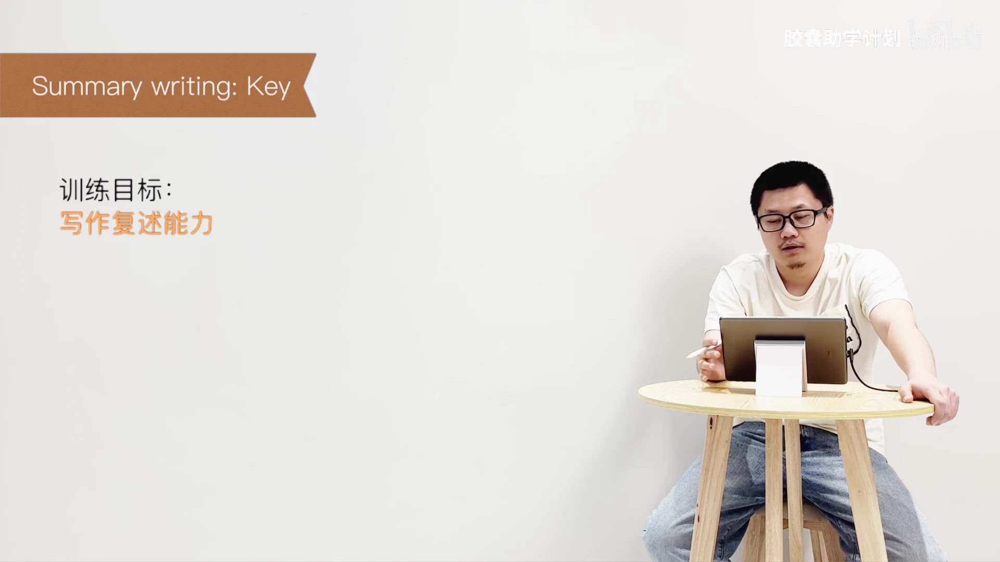

文字识别：胶囊助学计划 / Summary writing: Key / 训练目标： / 写作复述能力

### 画面 00:05:24

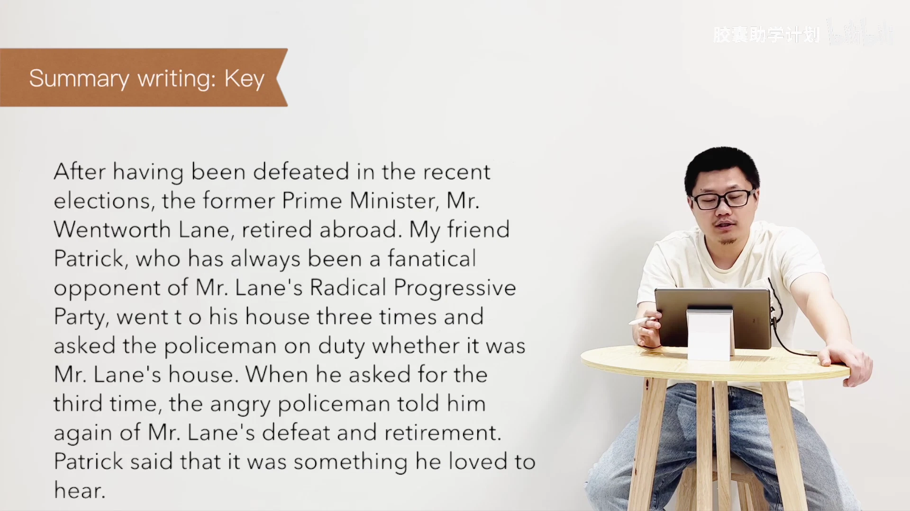

文字识别：囊助学计划 / Summary writing: Key / After having been defeated in the recent / elections, the former Prime Minister, Mr. / Wentworth Lane, retired abroad. My friend / Patrick, who has always been a fanatical / opponent of Mr. Lane's Radical Progressive / Party, went t o his house three times and / asked the policeman on duty whether it was / Mr. Lane's house. When he asked for the / third time, the angry policeman told him / again of Mr. Lane's defeat and retirement. / Patrick said that it was something he loved to / hear.

### 画面 00:05:26

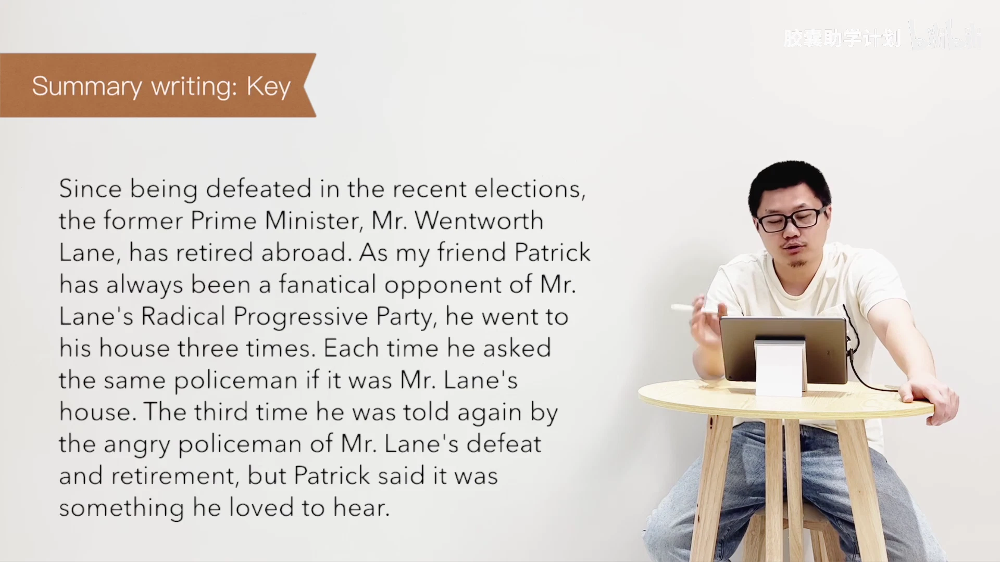

文字识别：囊助学计划 / Summary writing: Key / Since being defeated in the recent elections, / the former Prime Minister, Mr. Wentworth / Lane, has retired abroad. As my friend Patrick / has always been a fanatical opponent of Mr. / Lane's Radical Progressive Party, he went to / his house three times. Each time he asked / the same policeman if it was Mr. Lane's / house. The third time he was told again by / the angry policeman of Mr. Lane's defeat / and retirement, but Patrick said it was / something he loved to hear.

### 画面 00:05:28

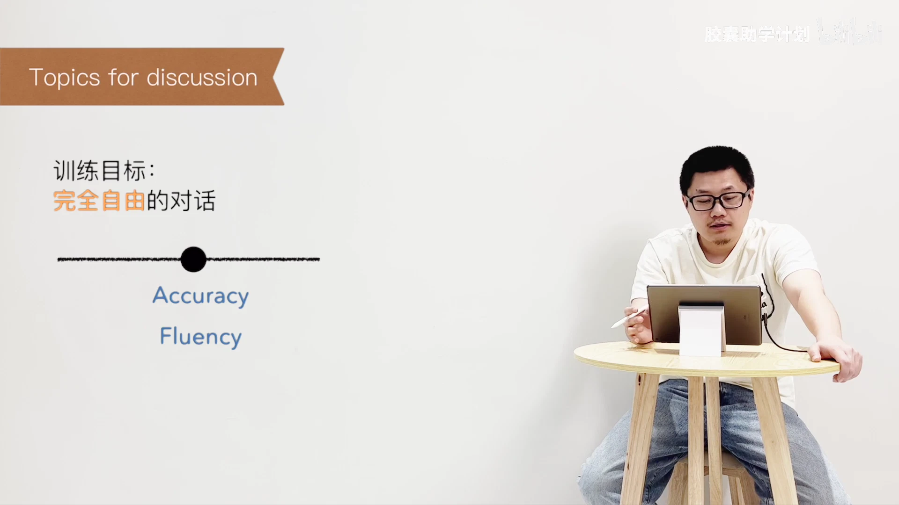

文字识别：胶囊助学计划 / Topics for discussion / 训练目标： / 完全自由的对话 / Accuracy / Fluency

## 00:05:30–00:06:00

discussion. 老习惯，我只说汉语翻译。 Why do you suppose that Mr. Lan decided to retire from political life? 啊，说你为什么认为 Mr. Lan 决定要从政治生涯当中退出来了呢？不继续参政了呢？ Ah, what qualities do you think a person must have to be a good or successful politician? 说你认为一个非常好的或者非常成功的，注意这是两个不同的概念，成功不一定代

### 画面 00:05:30

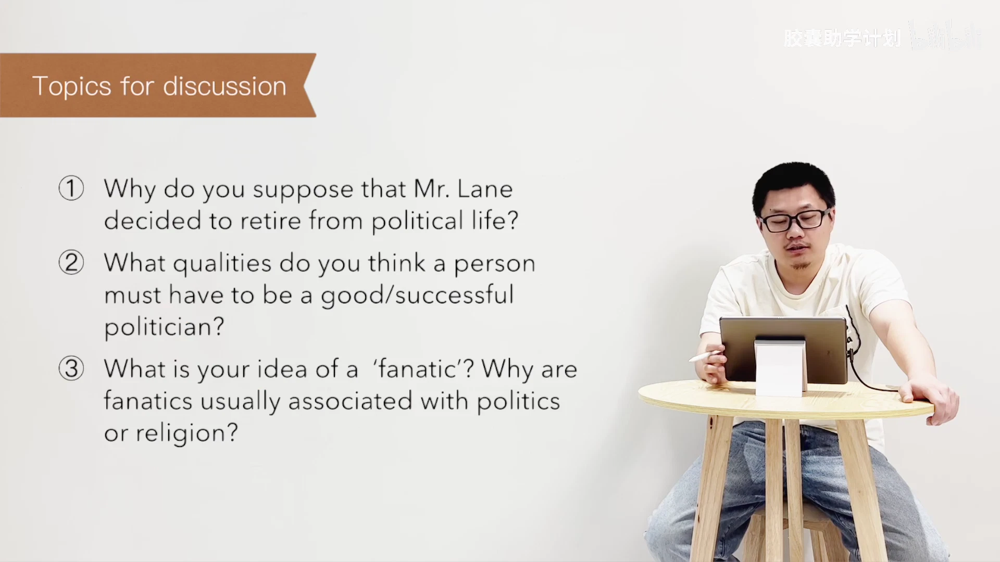

文字识别：嚢助学计划 / Topics for discussion / Why do you suppose that Mr. Lane / decided to retire from political life? / What qualities do you think a person / must have to be a good/successful / politician? / What is your idea of a 'fanatic'? Why are / fanatics usually associated with politics / or religion?

### 画面 00:05:56

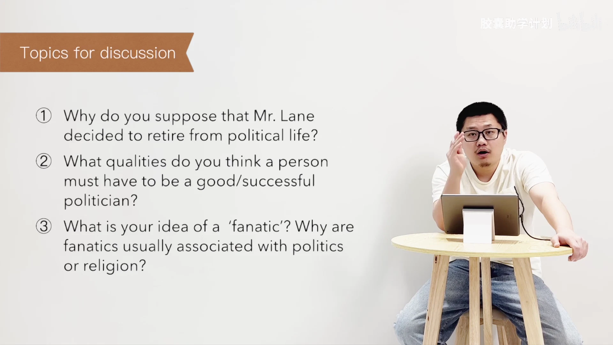

文字识别：囊助学计划 / Topics for discussion / Why do you suppose that Mr. Lane / decided to retire from political life? / What qualities do you think a person / must have to be a good/successful / politician? / What is your idea of a 'fanatic'? Why are / fanatics usually associated with politics / or religion?

## 00:06:00–00:06:30

表好，对吧？好也不一定成功啊！一个特别好或一个特别成功的政治家应该有哪些品质特质？第三个，What is your idea of fanatic? Why are fanatics usually associated with politics or religion?说你觉得这些狂热者，对吧？我们就是狂热粉丝啊，就是狂热支持者呀，这帮人，哎，是是是什么概概念，对吧？你怎么去看，对吧？

### 画面 00:06:23

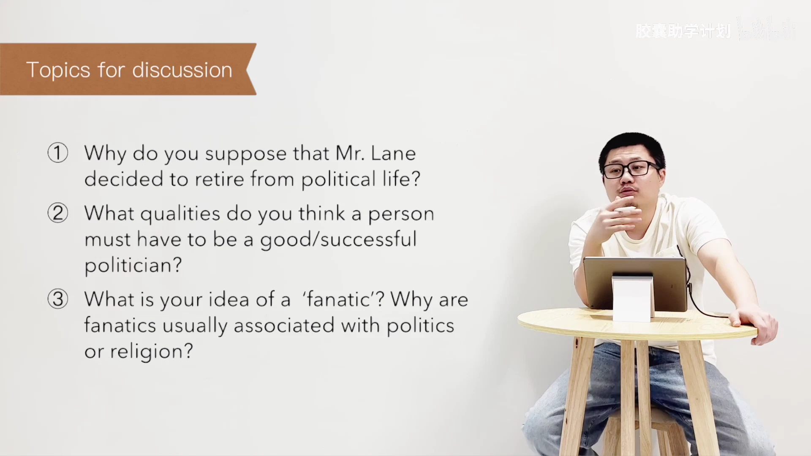

文字识别：囊助字计划 / Topics for discussion / Why do you suppose that Mr. Lane / decided to retire from political life? / What qualities do you think a person / must have to be a good/successful / politician? / What is your idea of a 'fanatic'? Why are / fanatics usually associated with politics / or religion?

### 画面 00:06:29

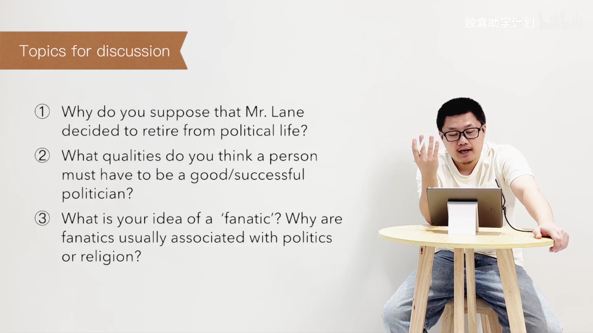

文字识别：囊助学计划 / Topics for discussion / Why do you suppose that Mr. Lane / decided to retire from political life? / What qualities do you think a person / must have to be a good/successful / politician? / What is your idea of a 'fanatic'? Why are / fanatics usually associated with politics / or religion?

## 00:06:30–00:07:00

为什么他们这些狂热者经常实际上跟政治或者是宗教是有所联系的？你看又是一个特别好的这种社会学的问题对吧？好，不多说，家庭作业，Asmif写完朗读，这要写作，记住啊，两篇文章，重点看连词，Tell the story口语复述，呃，置顶留言看重复间隔的学习材料。那以上呢就是本期视频的全部内容了。如果各位喜欢我们的

### 画面 00:06:41

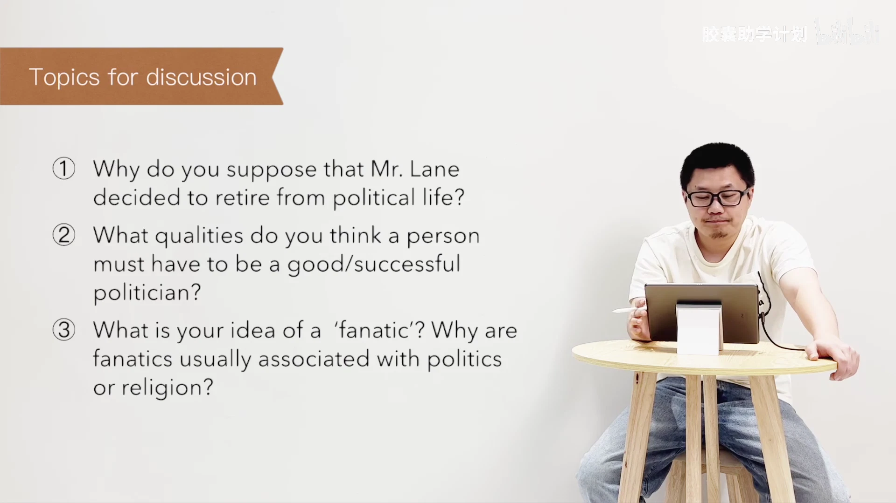

文字识别：囊助学计划 / Topics for discussion / Why do you suppose that Mr. Lane / decided to retire from political life? / What qualities do you think a person / must have to be a good/successful / politician? / What is your idea of a 'fanatic'? Why are / fanatics usually associated with politics / or religion?

### 画面 00:06:43

文字识别：胶囊助学计划 / 1.Ask me if写&朗读

### 画面 00:06:45

文字识别：胶囊助学计划 / 1. / Ask me if写&朗读 / 2.摘要写作写&答案

### 画面 00:06:50

文字识别：胶囊助学计划 / 1.Ask me if写&朗读 / 摘要写作写&答案 / 3.Tell the story 口语复述

### 画面 00:06:52

文字识别：胶囊助学计划 / 1.Ask me if写&朗读 / 摘要写作写&答案 / 3.Tell the story 口语复述 / 4. / 4.重复间隔（置顶留言）

### 画面 00:06:55

文字识别：交囊助学计划

### 画面 00:06:57

文字识别：校囊助学计划 / ￥

## 00:07:00–00:07:21

课程呢，欢迎各位关注、订阅、一键三连、分享给那些需要的朋友，来帮助我们快速成长。See you next time.

### 画面 00:07:01

文字识别：胶囊助学计划 / 不

### 画面 00:07:03

文字识别：校囊助学计划

### 画面 00:07:08

### 画面 00:07:10

文字识别：CAPSULEACADEMY / 胶囊助学计划 / 小红书 / Lecturer / Leo / OE

### 画面 00:07:13

文字识别：CAPSULEACADEMY / 胶囊助学计划 / 小红书 / OE

### 画面 00:07:16

文字识别：洲学計物 / CAPSULEACADEMY / 胶囊助学计划 / 小红书 / Creator / 回 / Leo & Berlin / OE

### 画面 00:07:18

文字识别：胶囊助学计划出 / CAPSULEACADEMY / 胶囊助学计划 / 小红书 / OE

### 画面 00:07:20

文字识别：bilbili / 胶囊助学计划

