# 084 单词

快速机器解析：语音为单模型转写，未进行独立交叉校对或人工复核；画面每秒采样并按变化选帧，短时文字和标记可能遗漏。截图时间约有 1 秒误差。图片有损压缩；遇到疑点请按时间查看 Google Drive 原视频。

## 00:00:00–00:00:30

Hello everyone, welcome to Capsule Academy. This is Leo. Today we're going to learn New Concept English Book Two Lesson Eighty Four Words. 那老习惯。进入正式课程之前呢，咱们看几个小的问题啊。首先，如何表达罢工？接下来呢，如何表达达成协议？最后一个，如何表达自愿做某事儿？啊，那带着这三个问题，Hope you guys enjoy.

### 画面 00:00:00

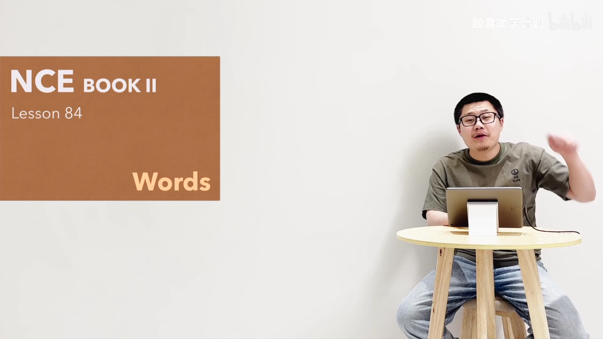

文字识别：NCE / BOOKI"I / Lesson 84 / Words

### 画面 00:00:02

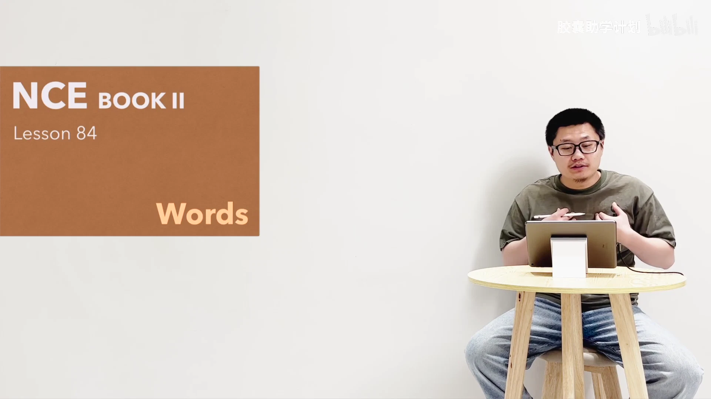

文字识别：NCE / BOOKII / Lesson 84 / Words

### 画面 00:00:05

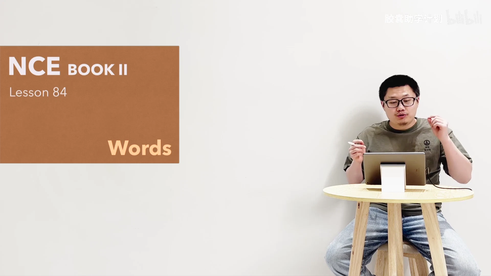

文字识别：NCE / BOOKⅡI / Lesson 84 / Words / NU / WIR

### 画面 00:00:10

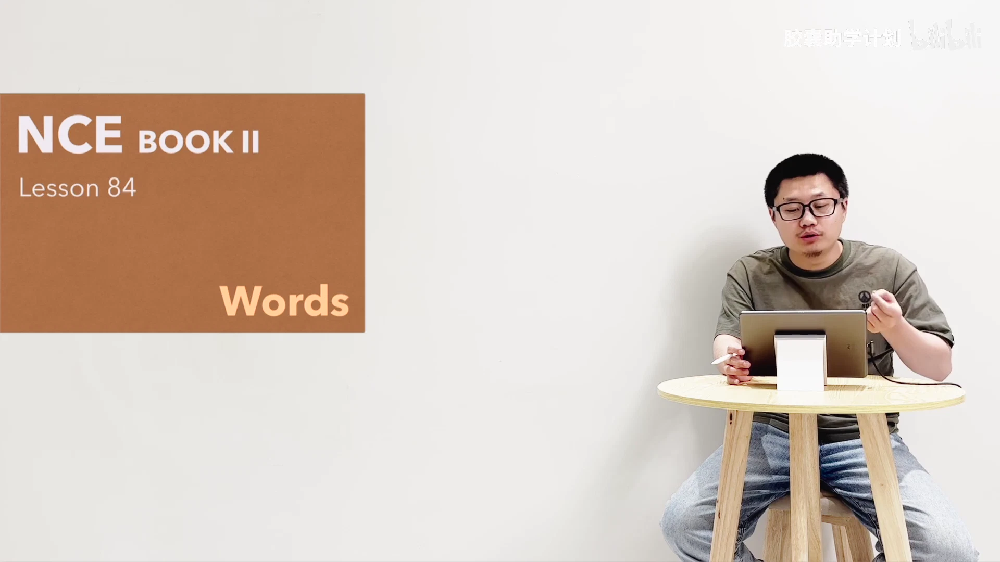

文字识别：NCE / BOOKII / Lesson 84 / Words

### 画面 00:00:12

文字识别：妻助学计划调

### 画面 00:00:14

文字识别：①如何表达“罢工”？ / WnB / NL

### 画面 00:00:16

文字识别：①如何表达“罢工”？ / 何表达“达成协议”?

### 画面 00:00:18

文字识别：①如何表达“罢工”？ / 如何表达“达成协议”? / NU

### 画面 00:00:20

文字识别：①如何表达“罢工”? / 如何表达“达成协议”? / 如何表达“自愿做某事”?

### 画面 00:00:23

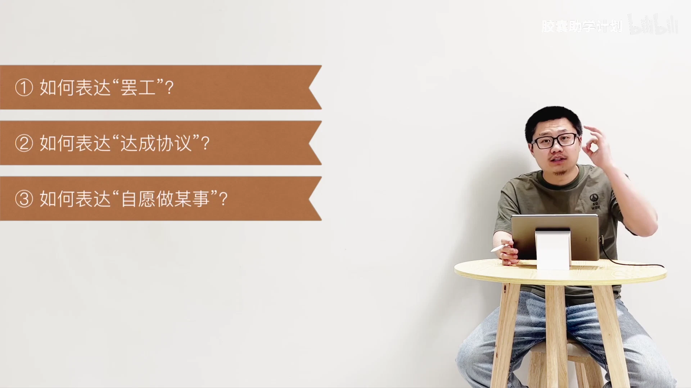

文字识别：①如何表达“罢工”? / 如何表达“达成协议”? / 如何表达“自愿做某事”? / NO

### 画面 00:00:25

文字识别：bitbli / 胶囊助学计划

### 画面 00:00:29

文字识别：囊助学计划洞 / 胶囊助学计划

## 00:00:30–00:01:00

好，那我们上来先看第一个单词啊，第一个单词这个地方记得要浊化一下，跟我一起读，叫strike，strike就罢工的意思。但是你能看到，我们脑海当中这个罢工啊，在汉语当中是不分什么动词、名词，它永远都是罢工。而这个strike它是个名词，那就有一个问题是，我现在想造一个句子，我得有动词啊，怎么表达呢？Go on strike，原文也给了我们这个短语，我们

### 画面 00:00:31

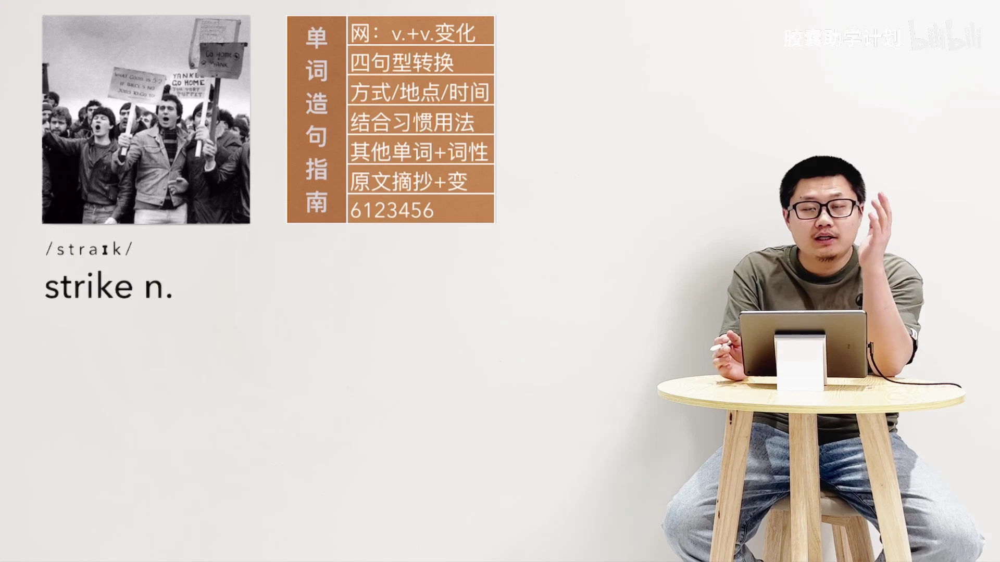

文字识别：单词造句指南 / 网：v.+v.变化 / 喜助字计划 / Co 4omL / 四句型转换 / ANK. / WHAT CoOn Is32 / YANKE / J085 0.C0 10 / IF IMCLS NO / GO HOME / 方式/地点/时间 / UPPIT / 结合习惯用法 / 其他单词+词性 / 原文摘抄+变 / 6123456 / /straik/ / strike n.

### 画面 00:00:36

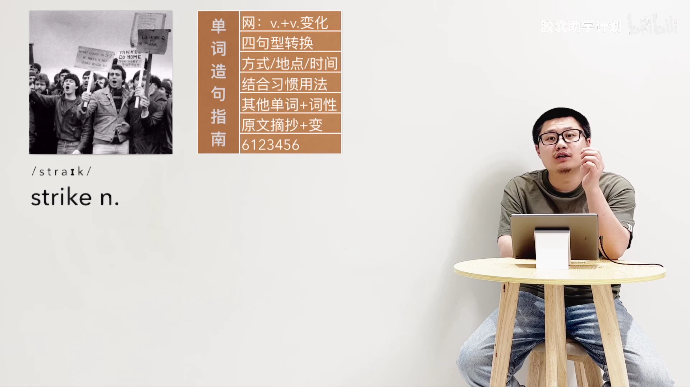

文字识别：单词造句指南 / 网：v.+v.变化 / 囊助学计划 / Co omL / 四句型转换 / ANK / MAT CoOD 1s5-2 / YANKE / IF BHECL S NO / CO HOME / 方式/地点/时间 / WTPET / YOY / 结合习惯用法 / 其他单词+词性 / 原文摘抄+变 / 6123456 / /straik/ / strike n.

### 画面 00:00:40

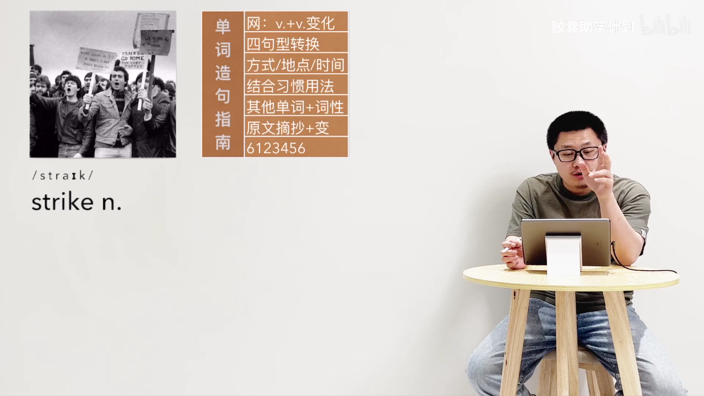

文字识别：单词造句指南 / 网：v.+v.变化 / 妻助字计划 / CoomE / 四句型转换 / VANK. / WHAT CoOD s52 / YANKE / F DHCL S NO / CO HOME / 方式/地点/时间 / Joes O Go TO / 结合习惯用法 / 其他单词+词性 / 原文摘抄+变 / 6123456 / /straik/ / strike n.

### 画面 00:00:55

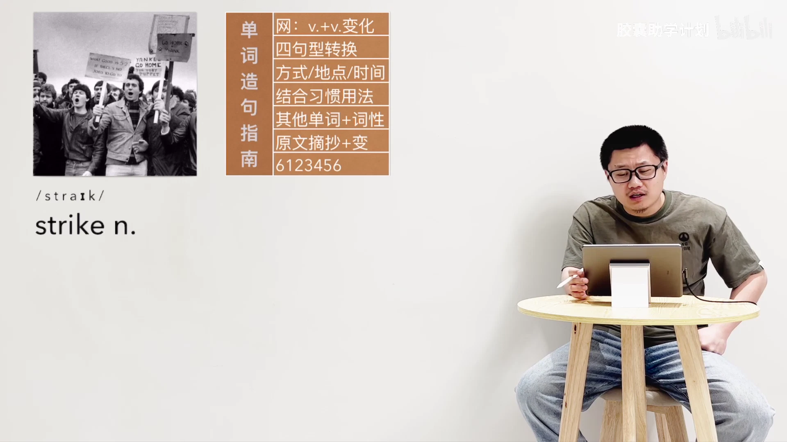

文字识别：单词造句指南 / 网：v.+v.变化 / 囊助字计划陽 / 四句型转换 / ANK. / WAT Co00 5-2 / YANKE / JOS DGo FO / IE BHCL NO / GO HOME / 方式/地点/时间 / 结合习惯用法 / 其他单词+词性 / 原文摘抄+变 / 6123456 / /straik/ / strike n. / NU

### 画面 00:00:59

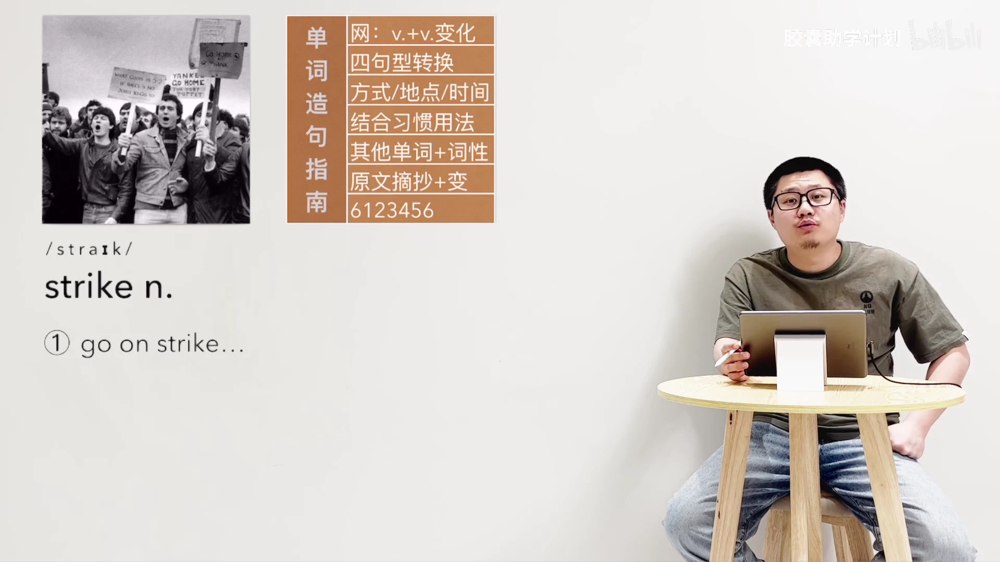

文字识别：单词造句指南 / 网：v.+v.变化 / 囊助字计划陽 / Co HomES / 四句型转换 / ANK. / HAT Co00 s52 / YANKE / J08S 0CO1O / F THCLS NO / GO HOME / 方式/地点/时间 / 结合习惯用法 / 其他单词+词性 / 原文摘抄+变 / 6123456 / /straik/ / strike n. / NO / ① / go on strike...

## 00:01:00–00:01:30

就拿它造句。第一个句子，Repeat after me. Are teachers allowed to go on strike? 哎，说老师，哎，可以被允许去罢工吗？啊，那那老师罢工了，那学生怎么上课呀？Next one, say the workers decided to go on strike. 哎，说工人们啊，决定干嘛呢？要去罢工。Decide to do something. 啊，这是前十课咱们就学过的习惯用法。四句型转换老习惯。接下来呢？

### 画面 00:01:02

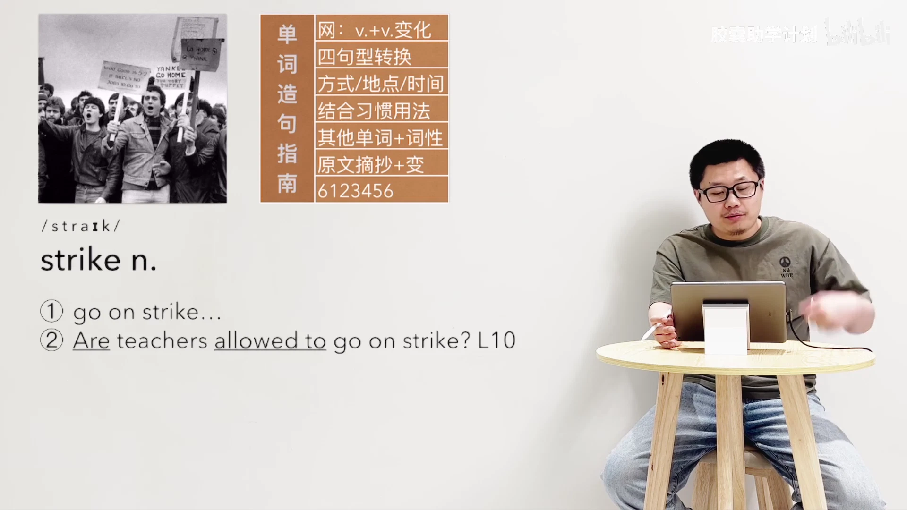

文字识别：单词造句指南 / 网：v.+v.变化 / 臺助字计划 / Co omE / 四句型转换 / VANK / WHAT COOP Is52 / YANKE / IF BECLS NO / GO HOME / 方式/地点/时间 / J085 0C01O / VORY / 结合习惯用法 / 其他单词+词性 / 原文摘抄+变 / 6123456 / /straik/ / strike n. / 1 / go on strike... / 2) / ) Are teachers allowed to go on strike? L10

### 画面 00:01:18

文字识别：单词造句指南 / 网：v.+v.变化 / 助学计划陽 / Co HomL / 四句型转换 / VANK / KHAT COOns52 / YANKE / IF BECLS NO / CO HOME / 方式/地点/时间 / Jo85 0 Co 10 / VORY / 结合习惯用法 / 其他单词+词性 / 原文摘抄+变 / 6123456 / /straik/ / strike n. / ① go on strike... / ② Are teachers allowed to go on strike? L10 / ) The workers decided to go on strike. / 3

### 画面 00:01:20

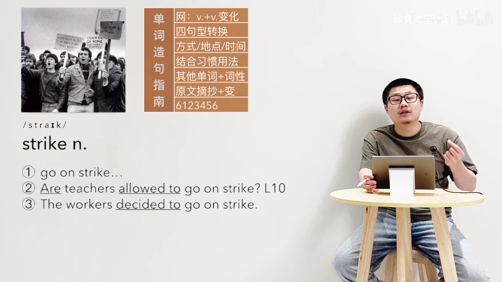

文字识别：单词造句指南 / 网：v.+v.变化 / 寶助学计划園 / Co Home / 四句型转换 / ANK / WHAT Coon Is52 / YANKE / IF BECLS NO / CO HOME / 方式/地点/时间 / J085 R.CO TO / 结合习惯用法 / 其他单词+词性 / 原文摘抄+变 / 6123456 / /straik/ / strike n. / NU / 1 /  go on strike... / ② Are teachers allowed to go on strike? L10 / ) The workers decided to go on strike. / 3

## 00:01:30–00:02:00

哎，说 the workers refuse to go on strike, refuse to do something. 第九课学的习惯用法，对吧？再读一遍这个单词 strike 并不是很难，包括这个句子，你也可以去把它做四四句型的转换，对吧？OK, next one 下一个单词叫 busman. Busman 这个单词各位能看到它是 bus 加了 man，它跟 bus driver 的意思没什么本质的区别啊，所以它既然是一个名词，又是一个人，那想造句子就很容易了。六一二三

### 画面 00:01:30

文字识别：单词造句指南 / 网：v.+v.变化 / CoHome / 四句型转换 / SANK / WHAT COON 1852 / YANKE / IF BECL NO / CO HOME / 方式/地点/时间 / FORY / 结合习惯用法 / 其他单词+词性 / 原文摘抄+变 / 6123456 / /straik/ / strike n. / ① go on strike... / ② Are teachers allowed to go on strike? L10 / The workers decided to go on strike. / 3 / did/who/when/why ... /  The workers refused to go on strike. L9

### 画面 00:01:45

文字识别：单词造句指南 / 网：v.+v.变化 / 四句型转换 / 方式/地点/时间 / 结合习惯用法 / 其他单词+词性 / 原文摘抄+变 / 6123456 / / b Λ sm a n / / busman n. bus driver / NU

### 画面 00:01:47

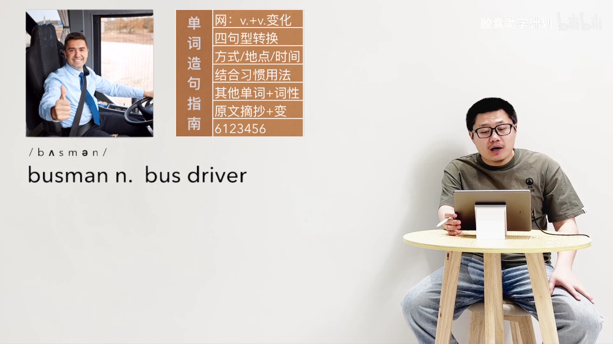

文字识别：单词造句指南 / 网：v.+v.变化 / 喜助字计划 / 四句型转换 / 方式/地点/时间 / 结合习惯用法 / 其他单词+词性 / 原文摘抄+变 / 6123456 / / b Λ sm an / / busman n. bus driver / NU

### 画面 00:01:51

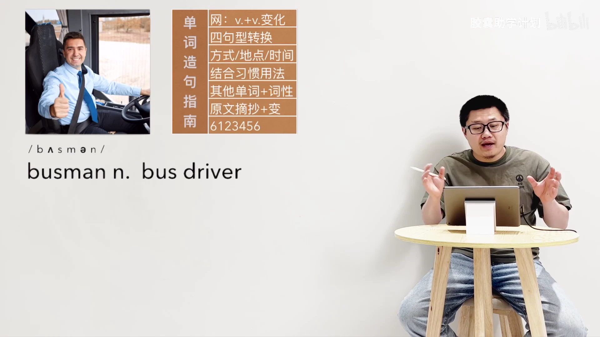

文字识别：单词造句指南 / 网：v.+v.变化 / 四句型转换 / 方式/地点/时间 / 结合习惯用法 / 其他单词+词性 / 原文摘抄+变 / 6123456 / / b Λ s m a n / / busman n. bus driver / NO

## 00:02:00–00:02:30

四五六，主要就是一和三，找个动词跟它一连就造出来了，对吧？我们随便造几个句子啊。Almost all the bus drivers went on strike last Friday.你看，我们首先不仅用上了刚刚学过的"go on strike"，接下来呢，我们又添加了一个时间叫"last Friday"。你愿意加个地点也可以加，对吧？OK，那这样的句子就很容易去做一些四句型的转换啊。暂停屏幕，口语练习或写作练

### 画面 00:02:03

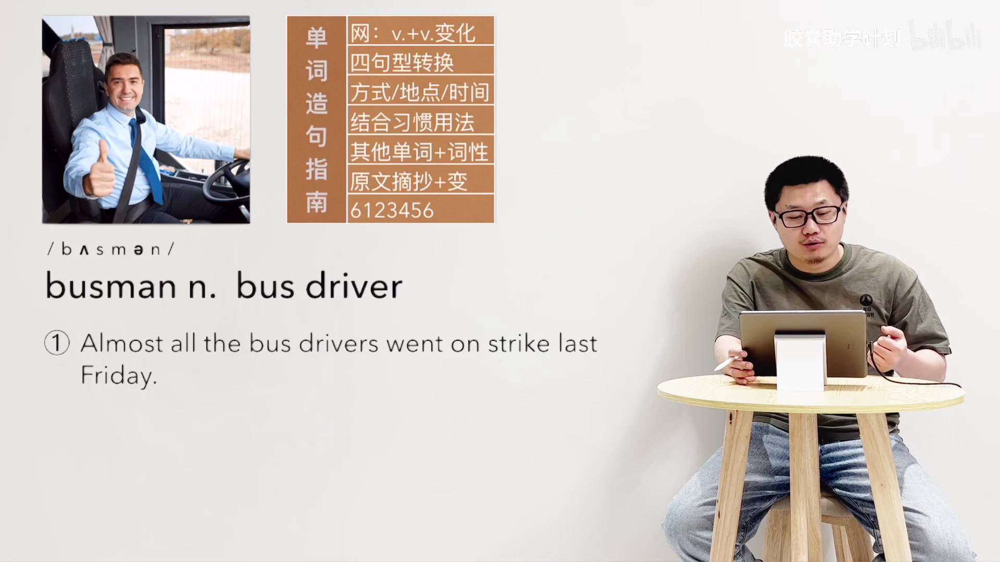

文字识别：单词造句指南 / 网：v.+v.变化 / 四句型转换 / 方式/地点/时间 / 结合习惯用法 / 其他单词+词性 / 原文摘抄+变 / 6123456 / / b Λ sm a n / / busman n. bus driver / 1t / ① Almost all the bus drivers went on strike last / Friday.

### 画面 00:02:20

文字识别：单词造句指南 / 网：v.+v.变化 / 学计划 / 四句型转换 / 方式/地点/时间 / 结合习惯用法 / 其他单词+词性 / 原文摘抄+变 / 6123456 / / b Λ s m an / / busman n. bus driver / ① Almost all the bus drivers went on strike last / Friday.

## 00:02:30–00:03:00

习都可以啊。学到今天，我觉得你口语练习就可以了啊，给自己嘚啵一遍啊，嘚啵一遍就可以了。第三个句子说，The busman discovered that八十一课咱们刚学的，One passenger was very suspicious。说这个公交车司机啊，注意到一件事儿，怎么样了呢？说有一个乘客特别的可疑，suspicious，咱们刚学的单词，可疑。Next one，跟我读一下这个单词，叫state，state，state。注意在这里是一个动词，它是声明啊，

### 画面 00:02:30

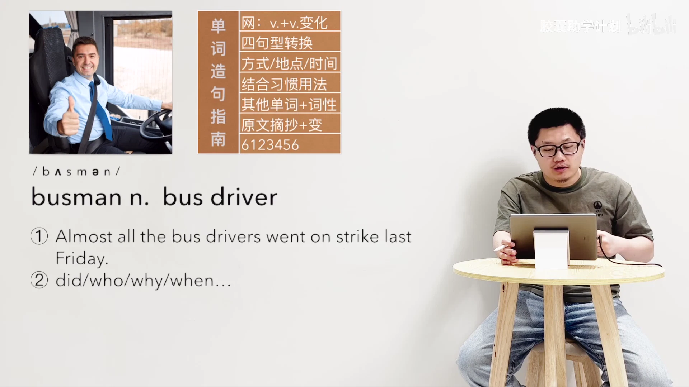

文字识别：单词造句指南 / 网：v.+v.变化 / 四句型转换 / 方式/地点/时间 / 结合习惯用法 / 其他单词+词性 / 原文摘抄+变 / 6123456 / / b Λ sm an / / busman n. bus driver / NU / ① Almost all the bus drivers went on strike last / Friday. / did/who/why/when...

### 画面 00:02:32

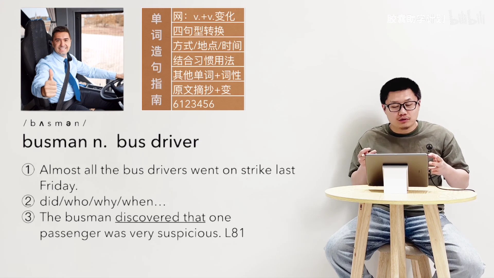

文字识别：单词造句指南 / 网：v.+v.变化 / 四句型转换 / 方式/地点/时间 / 结合习惯用法 / 其他单词+词性 / 原文摘抄+变 / 6123456 / / b Λ sm an / / busman n. bus driver / ① Almost all the bus drivers went on strike last / Friday. / did/who/why/when... / The busman discovered that one / passenger was very suspicious. L81

### 画面 00:02:38

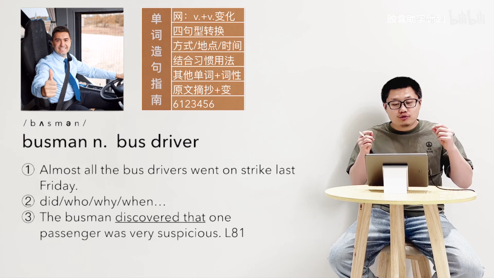

文字识别：单词造句指南 / 网：v.+v.变化 / 学计划 / 四句型转换 / 方式/地点/时间 / 结合习惯用法 / 其他单词+词性 / 原文摘抄+变 / 6123456 / / b Λ sm an / / busman n. bus driver / ① Almost all the bus drivers went on strike last / Friday. / did/who/why/when... / The busman discovered that one / passenger was very suspicious. L81

### 画面 00:02:48

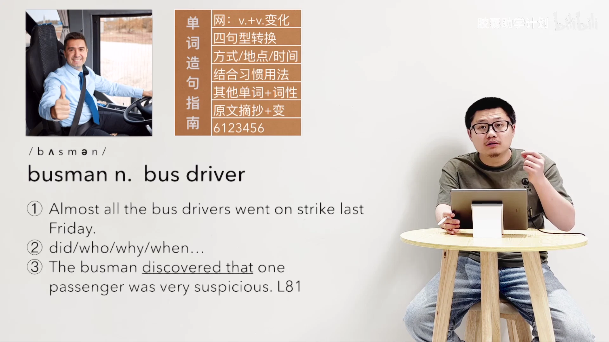

文字识别：单词造句指南 / 网：v.+v.变化 / 四句型转换 / 方式/地点/时间 / 结合习惯用法 / 其他单词+词性 / 原文摘抄+变 / 6123456 / / b Λ sman / / busman n. bus driver / ① Almost all the bus drivers went on strike last / Friday. / did/who/why/when... / The busman discovered that one / passenger was very suspicious. L81

### 画面 00:02:52

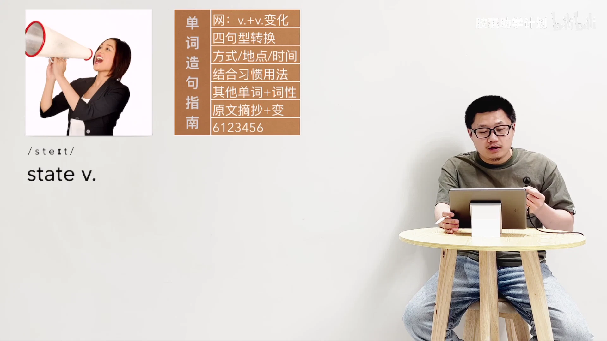

文字识别：单词造句指南 / 网：v.+v.变化 / 妻助学计划 / 四句型转换 / 方式/地点/时间 / 结合习惯用法 / 其他单词+词性 / 原文摘抄+变 / 6123456 / /steit/ / state v.

### 画面 00:02:58

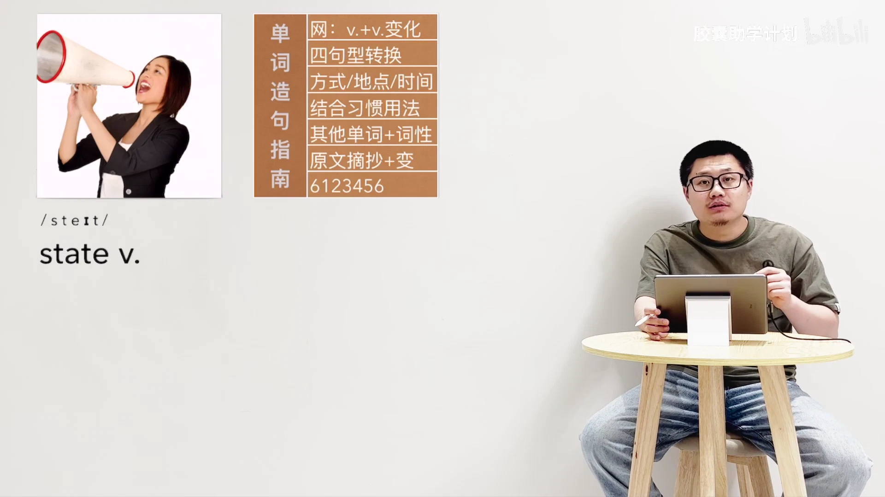

文字识别：单词造句指南 / 网：v.+v.变化 / 囊助学计划陽 / 四句型转换 / 方式/地点/时间 / 结合习惯用法 / 其他单词+词性 / 原文摘抄+变 / 6123456 / /steit/ / state v.

## 00:03:00–00:03:30

呃发呃就是这个说发言啊，声明某件事情，对吧？哎，比如说我声明怎么怎么样，有一个小的习惯用法叫 somebody。当然你可以不用 have stated that，这只不过是原文给了我们这样一个习惯用法，对吧？我们直接用一般过去时也可以，哎，不用现在完成时，对吧？就某人声明了一件事情，比如说我在这儿用的一般过去时，说 he stated that，说他声明了 he recognized the voice of Leo。

### 画面 00:03:01

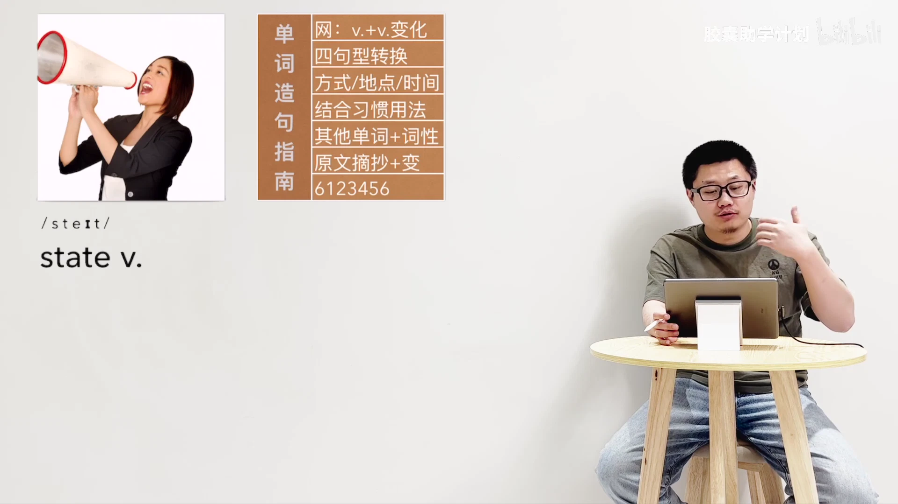

文字识别：单词造句指南 / 网：v.+v.变化 / 囊助学计划 / 四句型转换 / 方式/地点/时间 / 结合习惯用法 / 其他单词+词性 / 原文摘抄+变 / 6123456 / /steit/ / state v. / NU

### 画面 00:03:10

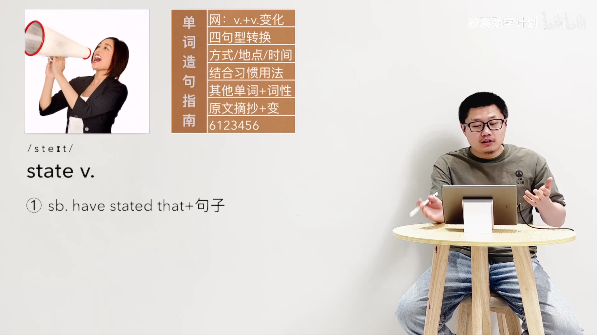

文字识别：单词造句指南 / 网：v.+v.变化 / 妻助学计划 / 四句型转换 / 方式/地点/时间 / 结合习惯用法 / 其他单词+词性 / 原文摘抄+变 / 6123456 / /steit/ / state v. / WHR / NO / ① sb.have stated that+句子

### 画面 00:03:18

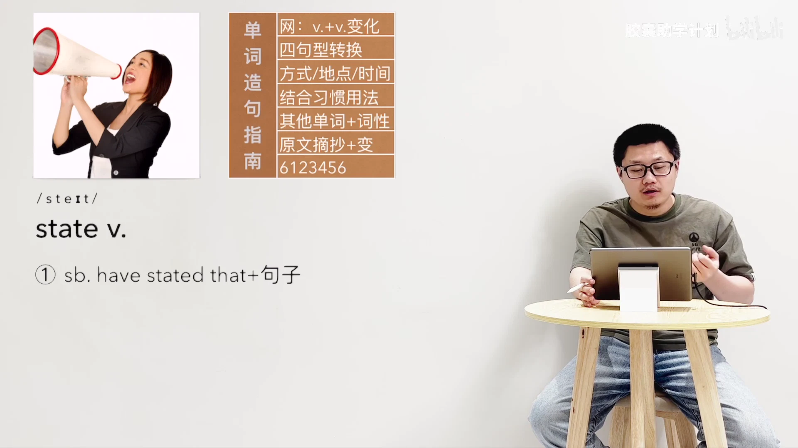

文字识别：单词造句指南 / 网：v.+v.变化 / 囊助学计划 / 四句型转换 / 方式/地点/时间 / 结合习惯用法 / 其他单词+词性 / 原文摘抄+变 / 6123456 / /steit/ / state v. / VIE / ① sb. have stated that+句子

### 画面 00:03:25

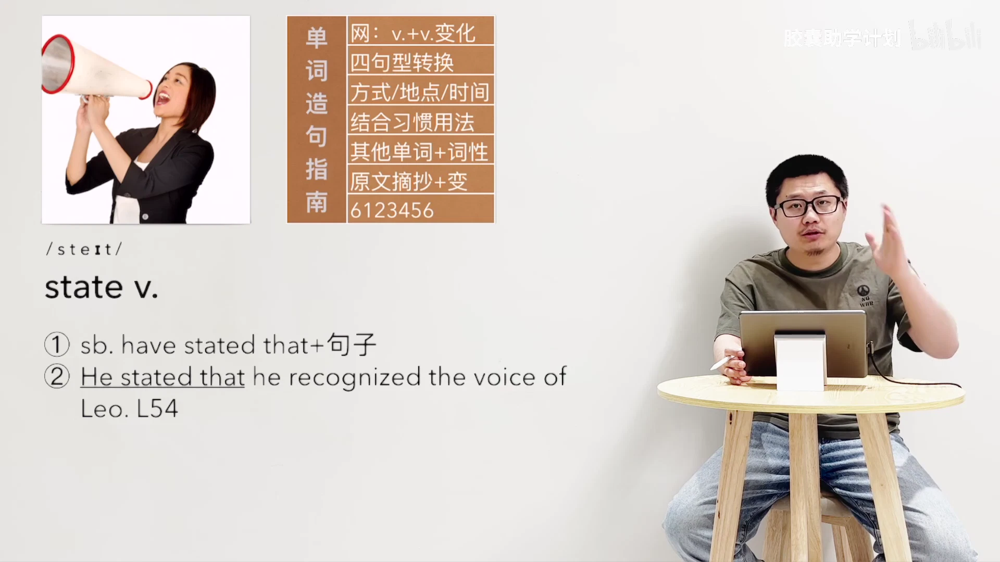

文字识别：单词造句指南 / 网：v.+v.变化 / 四句型转换 / 方式/地点/时间 / 结合习惯用法 / 其他单词+词性 / 原文摘抄+变 / 6123456 / /steit/ / state v. / W / ① sb. have stated that+句子 / He stated that he recognized the voice of / Leo.L54

## 00:03:30–00:04:00

其实这里的stated就几乎可以理解为是say say s a y啊的同义词啊，没有问题。就是你把这儿换成said that，这个句子整体含义其实差别没有那么大啊。Next one，这是一个小的电影片段，我们看一下他怎么说的啊。他说的是Jesse immediately stated that he wanted to tell us about it。这地方其实有两个小的连读，第一个是tell us，第二个是

### 画面 00:03:31

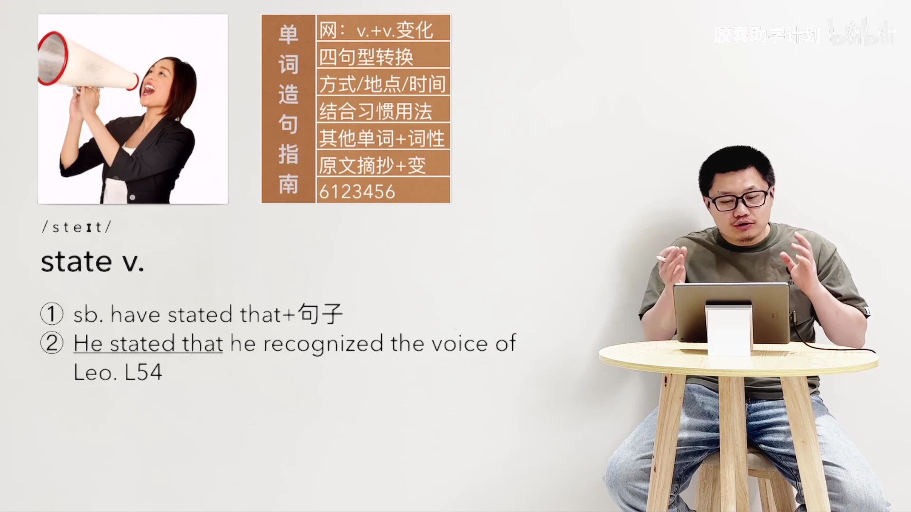

文字识别：单词造句指南 / 网：v.+v.变化 / 四句型转换 / 方式/地点/时间 / 结合习惯用法 / 其他单词+词性 / 原文摘抄+变 / 6123456 / /steit/ / state V. / ① sb.have stated that+句子 / He stated that he recognized the voice of / Leo.L54

### 画面 00:03:33

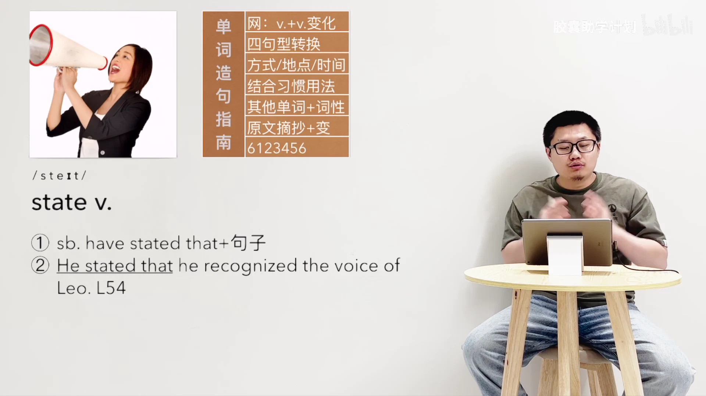

文字识别：单词造句指南 / 网：v.+v.变化 / 四句型转换 / 方式/地点/时间 / 结合习惯用法 / 其他单词+词性 / 原文摘抄+变 / 6123456 / /steit/ / state V. / ① sb. have stated that+句子 / He stated that he recognized the voice of / Leo.L54

### 画面 00:03:35

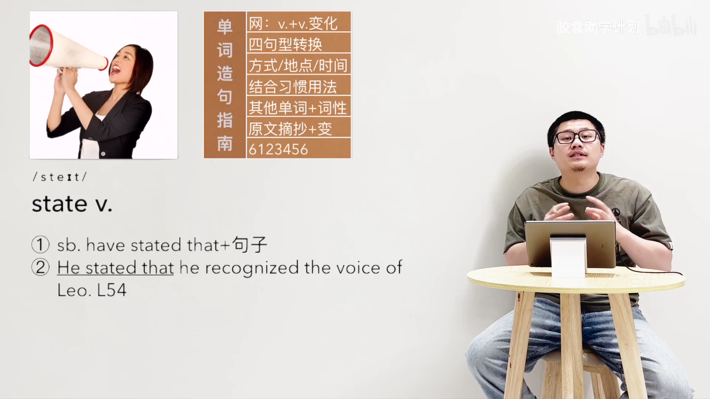

文字识别：单词造句指南 / 网：v.+v.变化 / 四句型转换 / 方式/地点/时间 / 结合习惯用法 / 其他单词+词性 / 原文摘抄+变 / 6123456 / /steit/ / state V. / ① sb. have stated that+句子 / He stated that he recognized the voice of / Leo.L54

### 画面 00:03:45

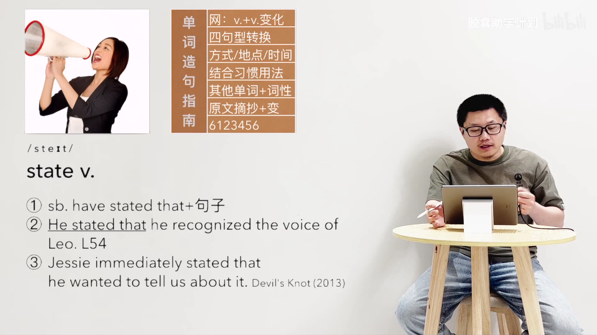

文字识别：单词造句指南 / 网：v.+v.变化 / 四句型转换 / 方式/地点/时间 / 结合习惯用法 / 其他单词+词性 / 原文摘抄+变 / 6123456 / /stelt/ / state v. / NU / ① sb. have stated that+句子 / ) He stated that he recognized the voice of / Leo.L54 / ) Jessie immediately stated that / 3 / he wanted to tell us about it. Devil's Knot(2013)

### 画面 00:03:50

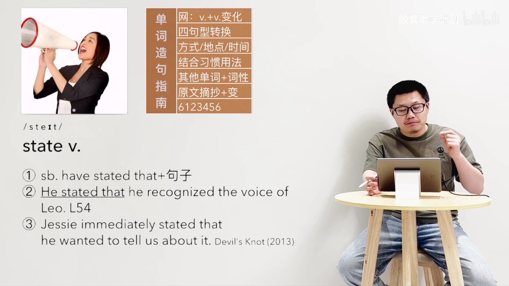

文字识别：单词造句指南 / 网：v.+v.变化 / 四句型转换 / 方式/地点/时间 / 结合习惯用法 / 其他单词+词性 / 原文摘抄+变 / 6123456 / /steit/ / state v. / NU / IR / ① sb. have stated that+句子 / ) He stated that he recognized the voice of / Leo.L54 / ) Jessie immediately stated that / 3 / he wanted to tell us about it. Devil's Knot(2013)

### 画面 00:03:58

文字识别：单词造句指南 / 网：v.+v.变化 / 贴学计划 / 四句型转换 / 方式/地点/时间 / 结合习惯用法 / 其他单词+词性 / 原文摘抄+变 / 6123456 / /steit/ / state v. / NO / ① sb. have stated that+句子 / ) He stated that he recognized the voice of / Leo.L54 /  Jessie immediately stated that / 3 / he wanted to tell us about it. Devil's Knot(2013)

## 00:04:00–00:04:30

about it，对吧？那给它连起来读，叫 tell us about it。 Okay， very good。哎，立刻就声明了怎么怎么样。最后一个句子我们自己来一个，叫做 he stated that his boss refused to stick to the plan。说他声明啊，他老板啊怎么样呢？拒绝哎，跟随着这个计划去往下工作，对吧？拒绝坚守计划，stick to the plan。五十四和咱们学的一个习惯用法。那再读一遍这个单词，state，

### 画面 00:04:03

文字识别：单词造句指南 / 网：v.+v.变化 / 学计划 / 四句型转换 / 方式/地点/时间 / 结合习惯用法 / 其他单词+词性 / 原文摘抄+变 / 6123456 / /steit/ / state V. / ① sb. have stated that+句子 / ) He stated that he recognized the voice of / Leo.L54 / ) Jessie immediately stated that / 3 / he wanted to tell us aboutit, Devil's Knot(2013)

### 画面 00:04:05

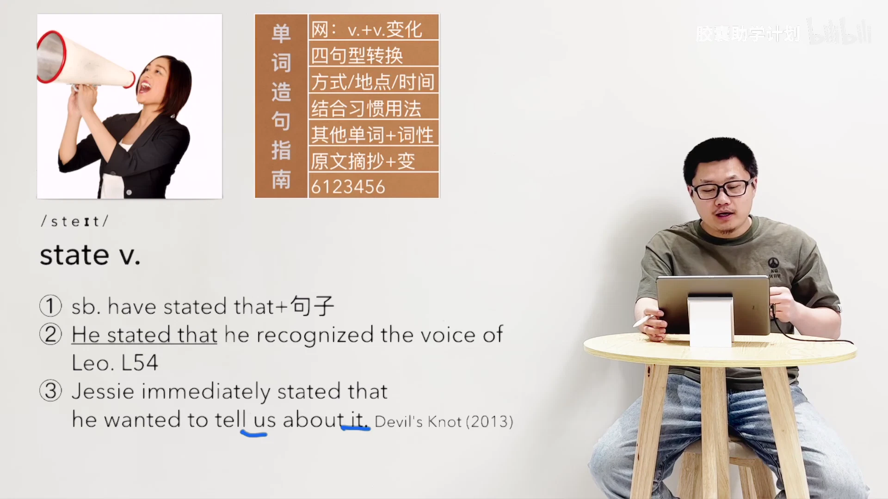

文字识别：单词造句指南 / 网：v.+v.变化 / 四句型转换 / 方式/地点/时间 / 结合习惯用法 / 其他单词+词性 / 原文摘抄+变 / 6123456 / /steit/ / state v. / NU / ① sb. have stated that+句子 / He stated that he recognized the voice of / Leo.L54 / Jessie immediately stated that / he wanted to tell us aboutit, Devil's Knot(2013)

### 画面 00:04:08

文字识别：单词造句指南 / 网：v.+v.变化 / 学计划 / 四句型转换 / 方式/地点/时间 / 结合习惯用法 / 其他单词+词性 / 原文摘抄+变 / 6123456 / /steit/ / state v. / ① sb. have stated that+句子 / ) He stated that he recognized the voice of / Leo.L54 / ) Jessie immediately stated that / 3 / he wanted to tell us about it. Devil's Knot(2013) / He stated that his boss refused to stick to / the plan. L54

### 画面 00:04:15

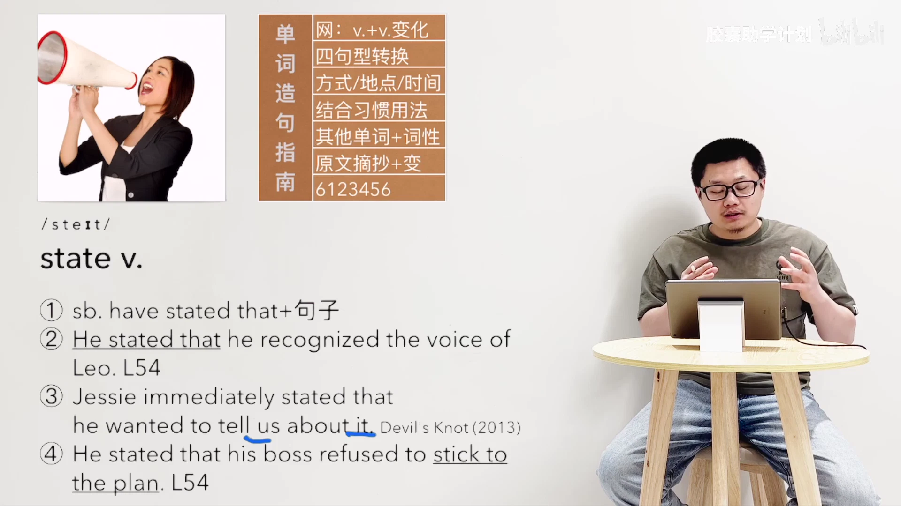

文字识别：单词造句指南 / 网：v.+v.变化 / 四句型转换 / 方式/地点/时间 / 结合习惯用法 / 其他单词+词性 / 原文摘抄+变 / 6123456 / /steit/ / state v. / WHE / ① sb. have stated that+句子 / ) He stated that he recognized the voice of / Leo.L54 / ) Jessie immediately stated that / 3 / he wanted to tell us aboutit. Devil's Knot(2013) / He stated that his boss refused to stick to / the plan. L54

### 画面 00:04:20

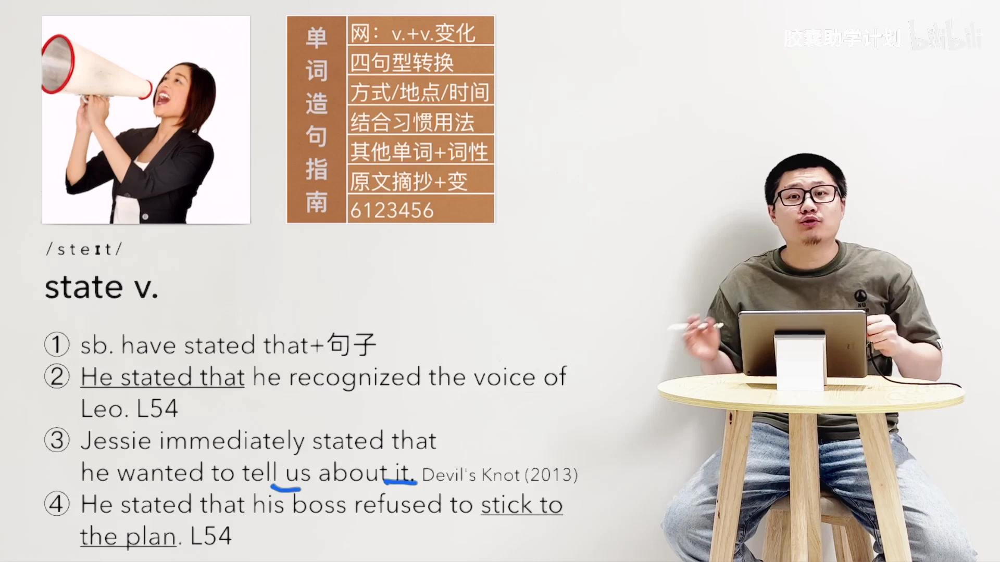

文字识别：单词造句指南 / 网：v.+v.变化 / 四句型转换 / 方式/地点/时间 / 结合习惯用法 / 其他单词+词性 / 原文摘抄+变 / 6123456 / /steit/ / state v. / ① sb. have stated that+句子 / ) He stated that he recognized the voice of / Leo.L54 / ) Jessie immediately stated that / 3 / he wanted to tell us aboutit, Devil's Knot(2013) / He stated that his boss refused to stick to / the plan. L54

## 00:04:30–00:05:00

very good啊，声明。那咱听一个小的电影片段吧。这个电影片段当中，几乎我看了一下每一个单词，咱们都是学过的，只有一个小的习惯用法。这个地方呢，我简单说一下，叫做 know something by heart，烂熟于胸啊，熟记于胸。OK，听一下。 She stated that she had heard the same story over and over many times from John and felt she almost knew it by heart. OK，下一个单词叫

### 画面 00:04:30

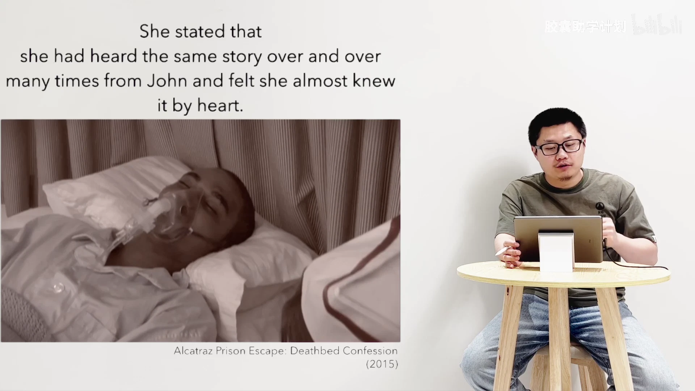

文字识别：She stated that / she had heard the same story over and over / many times from John and felt she almost knew / it by heart. / NU / Alcatraz Prison Escape: Deathbed Confession / (2015)

### 画面 00:04:40

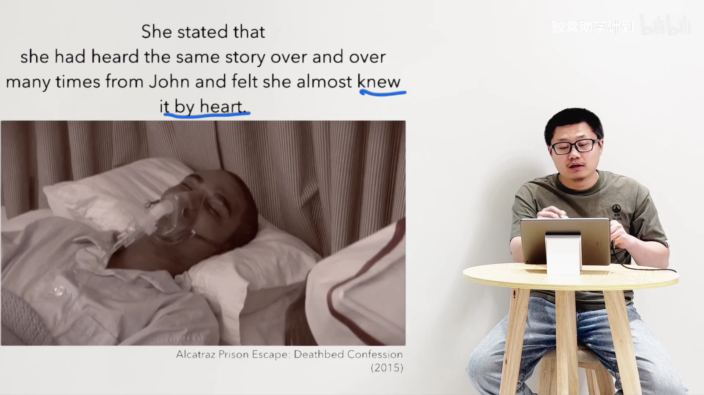

文字识别：She stated that / she had heard the same story over and over / many times from John and felt she almost knew / it by heart. / NO / Alcatraz Prison Escape: Deathbed Confession / (2015)

### 画面 00:04:50

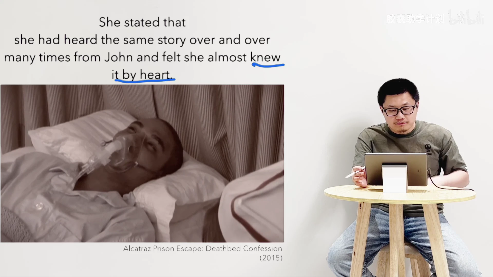

文字识别：She stated that / she had heard the same story over and over / many times from John and felt she almost knew / it by heart. / NU / Alcatraz Prison Escape: Deathbed Confession / (2015)

### 画面 00:04:52

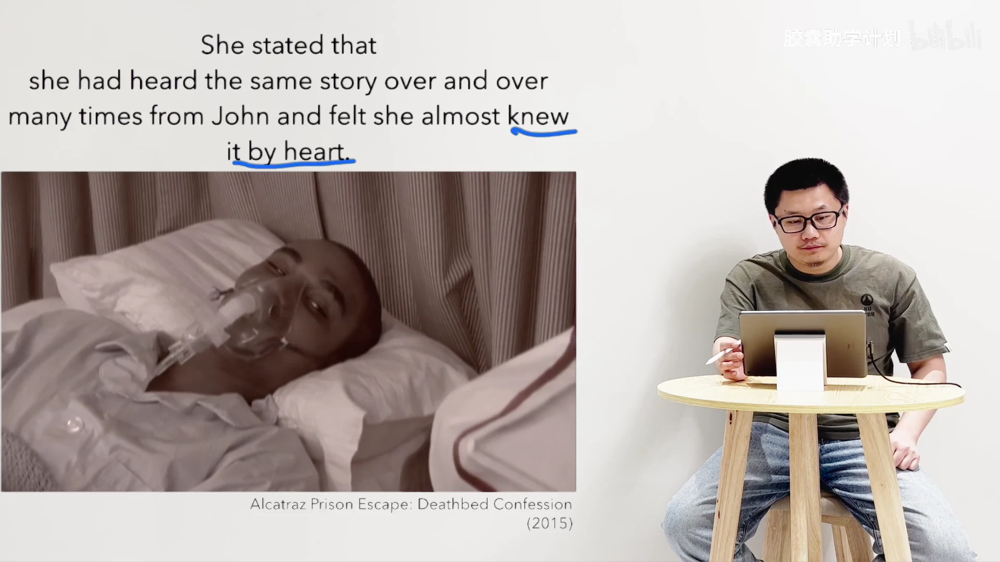

文字识别：She stated that / she had heard the same story over and over / many times from John and felt she almost knew / it by heart. / Alcatraz Prison Escape: Deathbed Confession / (2015)

### 画面 00:04:54

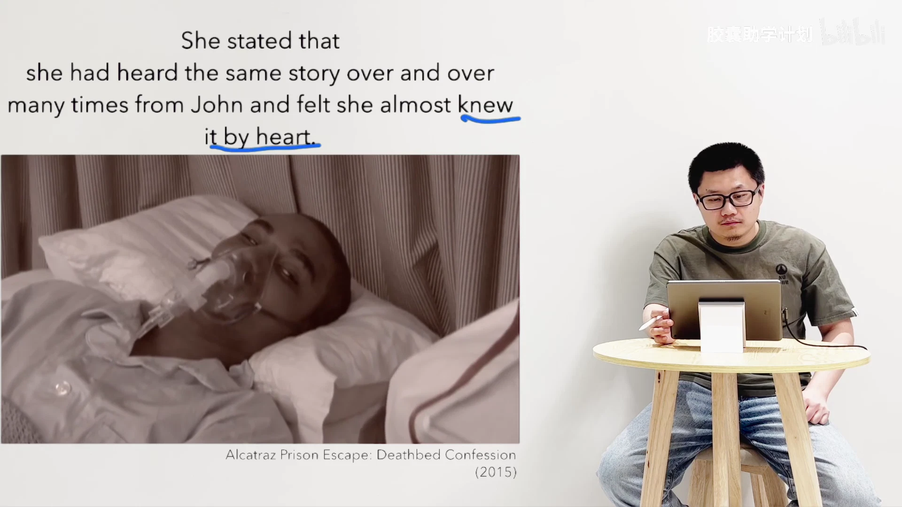

文字识别：She stated that / she had heard the same story over and over / many times from John and felt she almost knew / it by heart. / NU / Alcatraz Prison Escape: Deathbed Confession / (2015)

### 画面 00:04:56

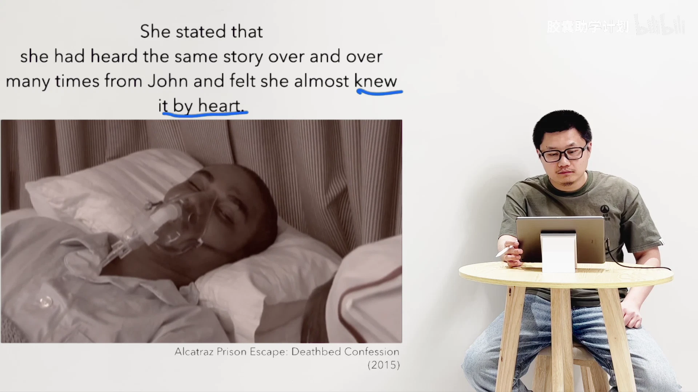

文字识别：She stated that / she had heard the same story over and over / many times from John and felt she almost knew / it by heart. / Alcatraz Prison Escape: Deathbed Confession / (2015)

### 画面 00:04:58

文字识别：单词造句指南 / 网：v.+v.变化 / 奏助学计划 / 四句型转换 / 方式/地点/时间 / 结合习惯用法 / 其他单词+词性 / 原文摘抄+变 / 6123456 / /a'gri:mant / / agreement n. / NO / ynn

## 00:05:00–00:05:30

agreement. Agreement 这个单词很有意思。首先，它实际上是一个 agree. Agree 这个单词当动词的时候， agree to do something.之前咱们学过这个习惯用法，对吧？包括 agree with somebody，对吧？哎，叫做同意某人啊，赞同某人。Agreement 加了一个 ment，变成名词了之后，它表示了一种协议啊，达成一种协议。比如说原文就给了我们这样一个小的短语，叫 agreement is rage about something，

### 画面 00:05:01

文字识别：单词造句指南 / 网：v.+v.变化 / 喜助字计划 / 四句型转换 / 方式/地点/时间 / 结合习惯用法 / 其他单词+词性 / 原文摘抄+变 / 6123456 / /a'gri:mant / / agreement n.

### 画面 00:05:04

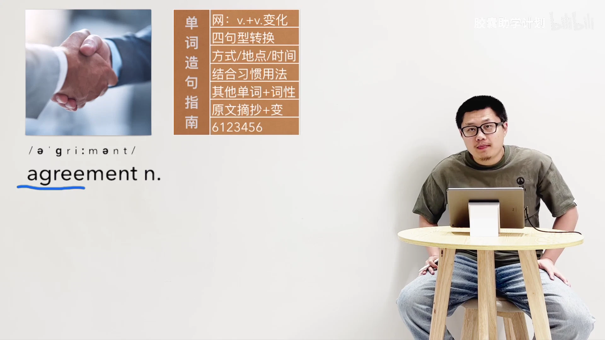

文字识别：单词造句指南 / 网：v.+v.变化 / 毫助学计划 / 四句型转换 / 方式/地点/时间 / 结合习惯用法 / 其他单词+词性 / 原文摘抄+变 / 6123456 / /a'gri:mant/ / agreement n.

### 画面 00:05:07

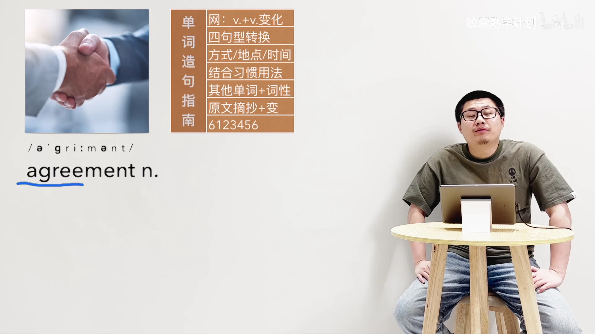

文字识别：单词造句指南 / 网：v.+v.变化 / 毫助学计划 / 四句型转换 / 方式/地点/时间 / 结合习惯用法 / 其他单词+词性 / 原文摘抄+变 / 6123456 / /a'griimant/ / agreement n. / NU / WIR

### 画面 00:05:20

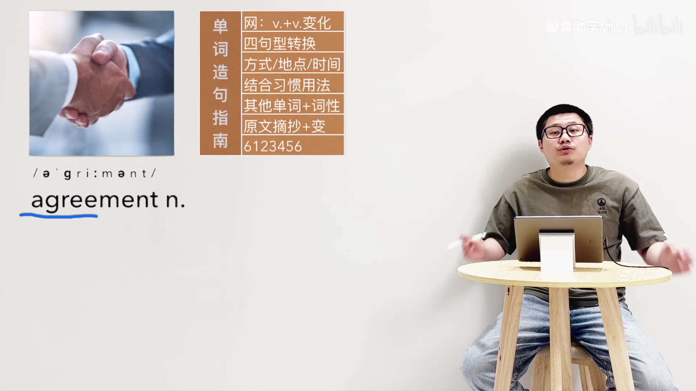

文字识别：单词造句指南 / 网：v.+v.变化 / 喜助字计划 / 四句型转换 / 方式/地点/时间 / 结合习惯用法 / 其他单词+词性 / 原文摘抄+变 / 6123456 / /a'griimant / / agreement n. / NU / WnR

## 00:05:30–00:06:00

对吧？就是关于某件事情达成了协议。但是注意这里用的是个被动，为什么是被动呢？因为协议是被人们所达成的。那给它换成主动就很简单了，叫做 reach an agreement，叫达成协议，意思没有区别，只是主动被动啊。好，我们造一个句子吧，比如说 again they fail to reach an agreement，说哎呀，又一次他们没有达成协议，对吧？Fail to do

### 画面 00:05:30

文字识别：单词造句指南 / 网：v.+v.变化 / 学计划 / 四句型转换 / 方式/地点/时间 / 结合习惯用法 / 其他单词+词性 / 原文摘抄+变 / 6123456 / /a'griimant/ / agreement n. / agreement is reached about sth.

### 画面 00:05:35

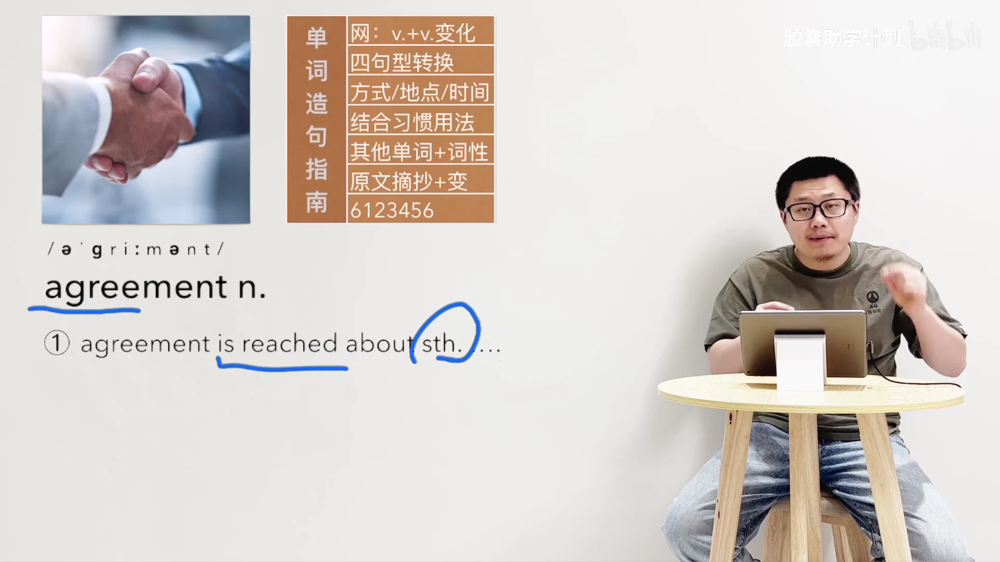

文字识别：单词造句指南 / 网：v.+v.变化 / 字计划 / 四句型转换 / 方式/地点/时间 / 结合习惯用法 / 其他单词+词性 / 原文摘抄+变 / 6123456 / /a'griimant / / agreement n. / agreement is reached aboutsth.

### 画面 00:05:38

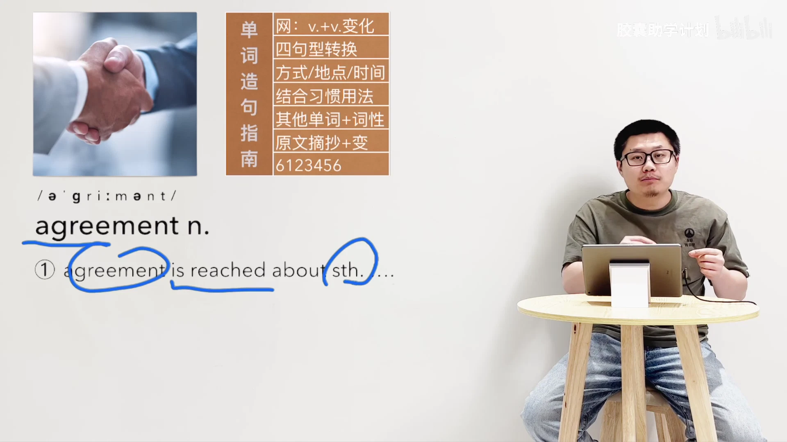

文字识别：单词造句指南 / 网：v.+v.变化 / 四句型转换 / 方式/地点/时间 / 结合习惯用法 / 其他单词+词性 / 原文摘抄+变 / 6123456 / /a'gri:mant/ / agreement n. / NU / WnR / greementis reached aboutsth.

### 画面 00:05:43

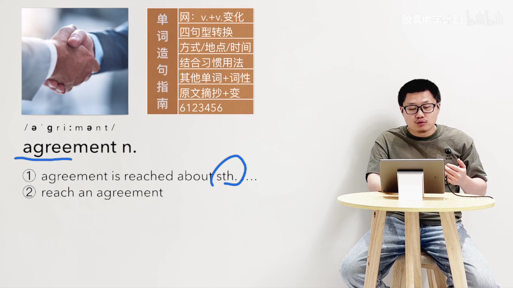

文字识别：单词造句指南 / 网：v.+v.变化 / 奏助学计划 / 四句型转换 / 方式/地点/时间 / 结合习惯用法 / 其他单词+词性 / 原文摘抄+变 / 6123456 / /a'griimant/ / agreement n. / WIR / NU / agreement is reached aboutsth. / reach an agreement

### 画面 00:05:45

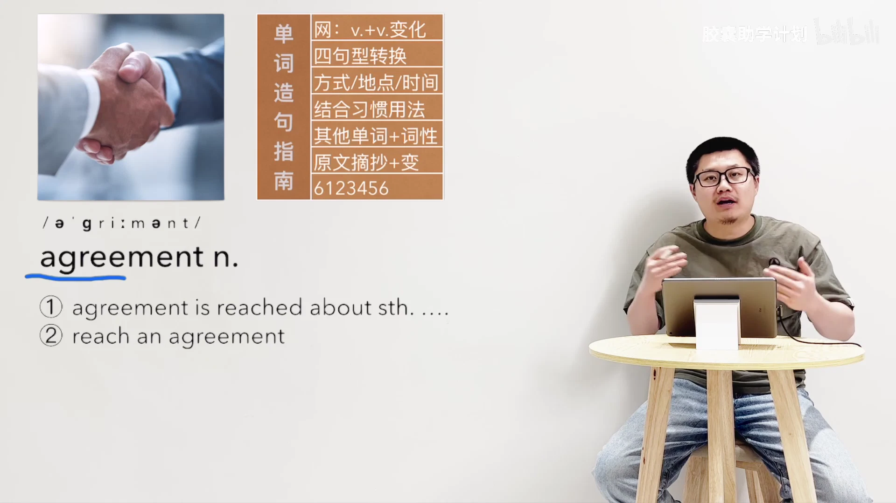

文字识别：单词造句指南 / 网：v.+v.变化 / 四句型转换 / 方式/地点/时间 / 结合习惯用法 / 其他单词+词性 / 原文摘抄+变 / 6123456 / /a'griimant/ / agreement n. / agreement is reached about sth. / reach an agreement

### 画面 00:05:57

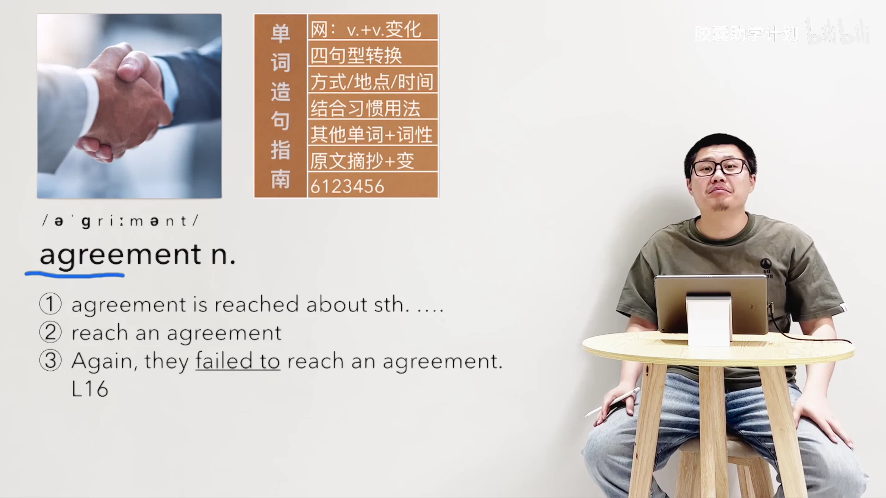

文字识别：单词造句指南 / 网：v.+v.变化 / 四句型转换 / 方式/地点/时间 / 结合习惯用法 / 其他单词+词性 / 原文摘抄+变 / 6123456 / /a'gri:man t / / agreement n. / NU / TIR / へ / agreement is reached about sth. / reach an agreement / 2） / Again, they failed to reach an agreement. / 3 / L16

## 00:06:00–00:06:30

something，十六课咱们学过啊。再来说，They managed to reach an agreement. Manage to do something，像这样的基本的大的结构，你一定要给它牢牢记住。听说读写啊，不管是在应试考试还是实际应用里面，总用总出现啊。Next one，说They hope to reach an agreement tonight.他们希望今天晚上能达成一个协议。Hope to do something，三十六课，哎，本课正好我们也是要去复

### 画面 00:06:01

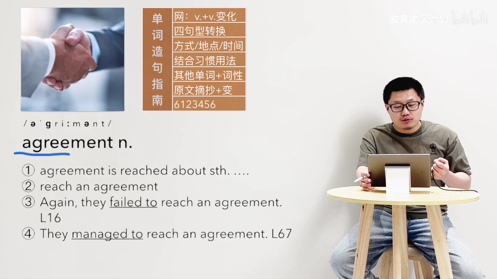

文字识别：单词造句指南 / 网：v.+v.变化 / 四句型转换 / 方式/地点/时间 / 结合习惯用法 / 其他单词+词性 / 原文摘抄+变 / 6123456 / /a'griimant / / agreement n. / WAR / NO / agreement is reached about sth. / 7 / 2) / reach an agreement / Again, they failed to reach an agreement. / 3 / L16 / ) They managed to reach an agreement. L67

### 画面 00:06:18

文字识别：单词造句指南 / 网：v.+v.变化 / 学计划 / 四句型转换 / 方式/地点/时间 / 结合习惯用法 / 其他单词+词性 / 原文摘抄+变 / 6123456 / /a'gri:mant / / agreement n. / ① / agreement is reached about sth. / ② reach an agreement / 3 / Again, they failed to reach an agreement. / L16 / They managed to reach an agreement. L67 / 5 /  They hope to reach an agreement tonight. / L36

### 画面 00:06:25

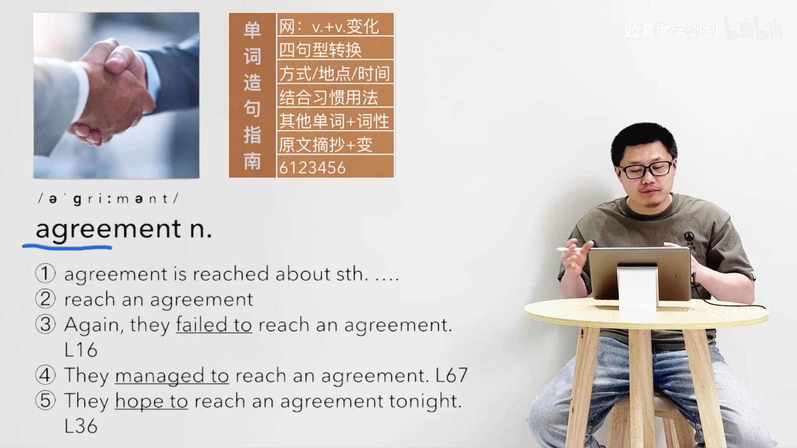

文字识别：单词造句指南 / 网：v.+v.变化 / 四句型转换 / 方式/地点/时间 / 结合习惯用法 / 其他单词+词性 / 原文摘抄+变 / 6123456 / /a'gri:mant / / agreement n. / 1 / agreement is reached about sth. / ② reach an agreement / ③ / Again, they failed to reach an agreement. / L16 / They managed to reach an agreement. L67 / 4) /  They hope to reach an agreement tonight. / L36

## 00:06:30–00:07:00

习什么呢？和将来相关的那些时态或者是用法。你像这个用法，hope to do something，包括intend to do something，都是咱们三十六课学的。它虽然是一般现在时，从时态的角度，但实际上它在说事情的时候说的依旧是将来的事儿。为什么呢？因为我希望完成某件事情，肯定是将来，对吧？过去就不存在希望，已经成为既定事实了，要么成就成，要么没成就没成，对吧？所以这个小的结构，

### 画面 00:06:55

文字识别：单词造句指南 / 网：v.+v.变化 / 学计划 / 四句型转换 / 方式/地点/时间 / 结合习惯用法 / 其他单词+词性 / 原文摘抄+变 / 6123456 / /a'griimant / / agreement n. / NU / 1 / agreement is reached about sth. / ② reach an agreement / 3 / Again, they failed to reach an agreement. / L16 / They managed to reach an agreement. L67 / 5 / They hope to reach an agreement tonight. / L36

## 00:07:00–00:07:30

我在这拿出来专门带你复习一下，叫 they hope to do something。啊，再读一遍这个单词 agreement。Very good. Next one，那咱们不多说了，直接听电影片段啊。Gandhi, how can we reach an agreement with Jinnah if you can't agree with Jawah?哎，这个电影片片片段呢，还是真是呃用心找了半天。为什么呢？我挑了一个我觉得最好的啊。有很多电影片段都有 reach an agreement，但是这里还出现

### 画面 00:07:02

文字识别：单词造句指南 / 网：v.+v.变化 / 臺助学计划 / 四句型转换 / 方式/地点/时间 / 结合习惯用法 / 其他单词+词性 / 原文摘抄+变 / 6123456 / /a'gri:mant / / agreement n. / NU / 1 / agreement is reached about sth. / ② reach an agreement / 3 / Again, they failed to reach an agreement. / L16 / They managed to reach an agreement. L67 / 4 / 5 /  They hope to reach an agreement tonight. / L36

### 画面 00:07:05

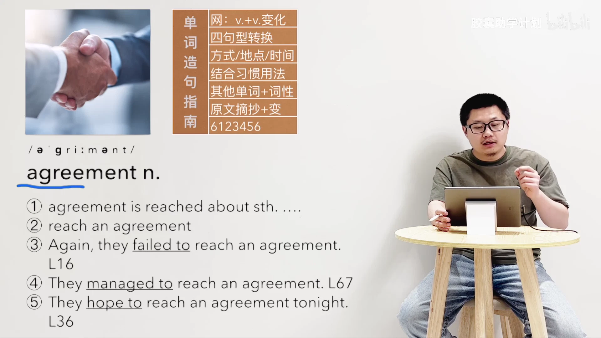

文字识别：单词造句指南 / 网：v.+v.变化 / 毫助学计划 / 四句型转换 / 方式/地点/时间 / 结合习惯用法 / 其他单词+词性 / 原文摘抄+变 / 6123456 / /a'griimant/ / agreement n. / 1 / agreement is reached about sth. / ② r / reach an agreement / 3 / Again, they failed to reach an agreement. / L16 / They managed to reach an agreement. L67 / 4 / 5 / They hope to reach an agreement tonight. / L36

### 画面 00:07:08

文字识别：Gandhiji, how can we reach an agreement / with Jinnah if you can't agree with Jawahar? / NO / Viceroy's House / (2017)

### 画面 00:07:13

文字识别：Gandhiji, how can we reach an agreement / with Jinnah if you can't agree with Jawahar? / Viceroy's House / (2017)

### 画面 00:07:15

文字识别：Gandhiji, how can we reach an agreement / with Jinnah if you can't agree with Jawahar? / Viceroy's House / (2017)

### 画面 00:07:17

文字识别：Gandhiji, how can we reach an agreement / with Jinnah if you can't agree with Jawahar? / Viceroy's House / (2017)

### 画面 00:07:22

文字识别：Gandhiji, how c / can we! / reach an agreement / with Jinnah if you can't agree with Jawahar? / Viceroy's House / (2017)

### 画面 00:07:24

文字识别：Gandhiji, how c / reach an agreement / can we / with Jinnah if you can't a / agree with Jawahar? / NU / Viceroy's House / (2017)

## 00:07:30–00:08:00

了一个我们之前学过的agree with somebody,对吧？它是agree这个单词的动词用法。哎，在这儿你就同时看到，在一个句子当中出现了。Very good,啊，不多说了。下一个单词relieve, relieve, relieve最基本的意思就是减轻、缓解的意思。你比如说压力太大了，听听音乐放松一下。这个放松一下就是relieve pressure,对吧？就relieve啊。好，那我们看一个它的小的习惯用法，叫somebody be relieved to hear

### 画面 00:07:39

文字识别：单词造句指南 / 网：v.+v.变化 / 奏助学计划 / 四句型转换 / 方式/地点/时间 / 结合习惯用法 / 其他单词+词性 / 原文摘抄+变 / 6123456 / /r1^li:v/ / relieve v. / NO

### 画面 00:07:41

文字识别：单词造句指南 / 网：v.+v.变化 / 辜助字计划 / 四句型转换 / 方式/地点/时间 / 结合习惯用法 / 其他单词+词性 / 原文摘抄+变 / 6123456 / /r1^li:v/ / relieve v. / NU / YIR

### 画面 00:07:45

文字识别：单词造句指南 / 网：v.+v.变化 / 囊助字计划 / 四句型转换 / 方式/地点/时间 / 结合习惯用法 / 其他单词+词性 / 原文摘抄+变 / 6123456 / /r1^ li:v/ / relieve v. / WAR / NO

### 画面 00:07:55

文字识别：单词造句指南 / 网：v.+v.变化 / 四句型转换 / 方式/地点/时间 / 结合习惯用法 / 其他单词+词性 / 原文摘抄+变 / 6123456 / / r Ⅰ ^ | i : v / / relieve v. / ① sb be relieved to hear that +句子

### 画面 00:07:59

文字识别：单词造句指南 / 网：v.+v.变化 / 四句型转换 / 方式/地点/时间 / 结合习惯用法 / 其他单词+词性 / 原文摘抄+变 / 6123456 / /r1^li:v/ / relieve v. / yIR / NU / ① sb be relieved to hear that + 句子

## 00:08:00–00:08:30

that, 加一句话。那这句话意思是什么呢？就是某人呢感到非常的放松，哎，很宽慰，很欣慰，或者说松了一口气，听到某件事情。我们造一个句子，比如说 I'm so relieved to hear that. 哎，像这个东西，我让各位放到这儿。其实你完全可以不用分析它的语法结构。我需要您记住，有印象吧？高难语法习惯用法话，我需要各位记住的就是 I'm so relieved to hear that. 后边加一句话，那句话你

### 画面 00:08:05

文字识别：单词造句指南 / 网：v.+v.变化 / 囊助字计划 / 四句型转换 / 方式/地点/时间 / 结合习惯用法 / 其他单词+词性 / 原文摘抄+变 / 6123456 / /r1^li:v/ / relieve v. / ① sb be relieved to hear that + 句子

### 画面 00:08:09

文字识别：单词造句指南 / 网：v.+v.变化 / 囊助学计划陽 / 四句型转换 / 方式/地点/时间 / 结合习惯用法 / 其他单词+词性 / 原文摘抄+变 / 6123456 / /r1^li:v/ / relieve v. / WIR / NU / ① sb be relieved to hear that + 句子

### 画面 00:08:12

文字识别：单词造句指南 / 网：v.+v.变化 / 学计划 / 四句型转换 / 方式/地点/时间 / 结合习惯用法 / 其他单词+词性 / 原文摘抄+变 / 6123456 / /r1^li:v/ / relieve v. / NU / WIR / ① sb be relieved to hear that + 句子 / ② I'm so relieved to hear that he has won the / election.L83

### 画面 00:08:14

文字识别：单词造句指南 / 网：v.+v.变化 / 学计划 / 四句型转换 / 方式/地点/时间 / 结合习惯用法 / 其他单词+词性 / 原文摘抄+变 / 6123456 / /ri^ li:v/ / relieve v. / WIR / NO / ① sb be relieved to hear that + 句子 / ② I'm so relieved to hear that he has won the / 2 / election.L83

### 画面 00:08:20

文字识别：单词造句指南 / 网：v.+v.变化 / 四句型转换 / 方式/地点/时间 / 结合习惯用法 / 其他单词+词性 / 原文摘抄+变 / 6123456 / / r Ⅰ ^ l i : v / / relieve v. / ① sb be relieved to hear that + 句子 / ② I'm so relieved to hear that he has won the / election.L83

### 画面 00:08:24

文字识别：单词造句指南 / 网：v.+v.变化 / 辜助字计划 / 四句型转换 / 方式/地点/时间 / 结合习惯用法 / 其他单词+词性 / 原文摘抄+变 / 6123456 / /rr^ li:v/ / relieve v. / NU / ① sb be relieved to hear that + 句子 /  I'm so relieved to hear that he has won the / election.L83

## 00:08:30–00:09:00

十句，最后的结果并不是把那十句话记下来了，是通过造那十句话，其实最后你记住的是 I'm so relieved to hear that. 就听到某件事儿，我松了一口气，你将来张嘴就能说出来，对吧？ Okay, 比如说 He has won the election. 他赢得了选举。哎，听到这个事儿，我松了一口气。说 I'm relieved to hear that they finally made a profit last year. 这个就是我朋友面对我做这件事儿，是吧？我和 Berlin 做这件事儿的一个心情，

### 画面 00:08:32

文字识别：单词造句指南 / 网：v.+v.变化 / 四句型转换 / 方式/地点/时间 / 结合习惯用法 / 其他单词+词性 / 原文摘抄+变 / 6123456 / /rI^ li:v/ / relieve v. / NU / ① sb be relieved to hear that + 句子 / ② I'm so relieved to hear that he has won the / election.L83

### 画面 00:08:37

文字识别：单词造句指南 / 网：v.+v.变化 / 奏助学计划園 / 四句型转换 / 方式/地点/时间 / 结合习惯用法 / 其他单词+词性 / 原文摘抄+变 / 6123456 / /rI^ li:v/ / relieve v. / ① sb be relieved to hear that + 句子 / ② I'm so relieved to hear that he has won the / election.L83

### 画面 00:08:39

文字识别：单词造句指南 / 网：v.+v.变化 / 四句型转换 / 方式/地点/时间 / 结合习惯用法 / 其他单词+词性 / 原文摘抄+变 / 6123456 / / r I ^ l i : v / / relieve v. / ① sb be relieved to hear that + 句子 / ② I'm so relieved to hear that he has won the / election.L83

### 画面 00:08:45

文字识别：单词造句指南 / 网：v.+v.变化 / 学计划 / 四句型转换 / 方式/地点/时间 / 结合习惯用法 / 其他单词+词性 / 原文摘抄+变 / 6123456 / /ri^li:v/ / relieve v. / NU / WIR / ① sb be relieved to hear that + 句子 /  I'm so relieved to hear that he has won the / election.L83

### 画面 00:08:49

文字识别：单词造句指南 / 网：v.+v.变化 / 四句型转换 / 方式/地点/时间 / 结合习惯用法 / 其他单词+词性 / 原文摘抄+变 / 6123456 / /ri^ li:v/ / relieve v. / NU / ① sb be relieved to hear that + 句子 / ② I'm so relieved to hear that he has won the / election. L83 / ) I'm relieved to hear that they finally made a / profit last year. L80

### 画面 00:08:56

文字识别：单词造句指南 / 网：v.+v.变化 / 子计划 / 四句型转换 / 方式/地点/时间 / 结合习惯用法 / 其他单词+词性 / 原文摘抄+变 / 6123456 / /ri'li:v/ / relieve V. / NU / ① sb be relieved to hear that + 句子 / ② I'm so relieved to hear that he has won the / election. L83 / ) I'm relieved to hear that they finally made a / profit last year. L80

### 画面 00:08:59

文字识别：单词造句指南 / 网：v.+v.变化 / 四句型转换 / 方式/地点/时间 / 结合习惯用法 / 其他单词+词性 / 原文摘抄+变 / 6123456 / /ri^li:v/ / relieve V. / NU / ① sb be relieved to hear that + 句子 / ② I'm so relieved to hear that he has won the / election.L83 / ) I'm relieved to hear that they finally made a / profit last year. L80

## 00:09:00–00:09:30

是吧？这是有感而发，我造了这样一个句子，对吧？我朋友特别逗，是吧？就是去他们家吃饭，他说，哎呀，之前都不敢问你赚没赚钱，怕你一直没赚钱，怕戳到你的这个痛点，是吧？然后我告诉他，啊，我们这个有收入了，啊，这个能养活自己了。然后他就来这么一句话，是吧？类似于，哎呀， I'm so relieved to hear that you finally made a profit last year，是吧？你们终于稍微赚了点钱，是吧？OK， next one，那直接口语就可以用一句话叫 I'm relieved

### 画面 00:09:08

文字识别：单词造句指南 / 网：v.+v.变化 / 四句型转换 / 方式/地点/时间 / 结合习惯用法 / 其他单词+词性 / 原文摘抄+变 / 6123456 / /ri^ li:v/ / relieve V. / NU / ① sb be relieved to hear that + 句子 / ② I'm so relieved to hear that he has won the / election. L83 / ) I'm relieved to hear that they finally made a / 3 / profit last year. L80

### 画面 00:09:11

文字识别：单词造句指南 / 网：v.+v.变化 / 学计切 / 四句型转换 / 方式/地点/时间 / 结合习惯用法 / 其他单词+词性 / 原文摘抄+变 / 6123456 / /ri^ li:v/ / relieve V. / NU / ① sb be relieved to hear that + 句子 / ② I'm so relieved to hear that he has won the / election. L83 / ) I'm relieved to hear that they finally made a / profit last year. L80

### 画面 00:09:14

文字识别：单词造句指南 / 网：v.+v.变化 / 学计划 / 四句型转换 / 方式/地点/时间 / 结合习惯用法 / 其他单词+词性 / 原文摘抄+变 / 6123456 / /ri^ li:v/ / relieve v. / ① sb be relieved to hear that + 句子 / ② I'm so relieved to hear that he has won the / election. L83 / ) I'm relieved to hear that they finally made a / profit last year. L80

### 画面 00:09:27

文字识别：单词造句指南 / 网：v.+v.变化 / 四句型转换 / 方式/地点/时间 / 结合习惯用法 / 其他单词+词性 / 原文摘抄+变 / 6123456 / /r1 ^ li:v/ / relieve V. / ① sb be relieved to hear that + 句子 / ② I'm so relieved to hear that he has won the / election. L83 / ) I'm relieved to hear that they finally made a / 3 / profit last year. L80 / ④ I'm relieved to hear that.

### 画面 00:09:29

文字识别：单词造句指南 / 网：v.+v.变化 / 四句型转换 / 方式/地点/时间 / 结合习惯用法 / 其他单词+词性 / 原文摘抄+变 / 6123456 / /ri^ li:v/ / relieve V. / ① sb be relieved to hear that + 句子 / ② I'm so relieved to hear that he has Won the / election.L83 / ) I'm relieved to hear that they finally made a / 3 / profit last year. L80 / ④ I'm relieved to hear that.

## 00:09:30–00:10:00

hear that. 哎，就说对，听到这个事儿，我松了一口气啊。这个你可以看到啊，这个 that 就不是后边再加句子了，这个 that 指的就是那件事儿了，是吧？直接代替了后边这个句子，用 that 代替了这件事儿，对吧？OK，下一个单词，看一下音标啊，叫做 pressure. Pressure. Pressure 什么意思呢？压力，压力啊。那本文的呃，这个这个，我们刚刚学过的 relieve 跟 pressure 就很好的能结合到一起，

### 画面 00:09:31

文字识别：单词造句指南 / 网：v.+v.变化 / 四句型转换 / 方式/地点/时间 / 结合习惯用法 / 其他单词+词性 / 原文摘抄+变 / 6123456 / /ri^ li:v/ / relieve V. / NU / ① sb be relieved to hear that + 句子 / ② I'm so relieved to hear that he has won the / election. L83 / ) I'm relieved to hear that they finally made a / 3 / profit last year. L80 / ④ I'm relieved to hear that.

### 画面 00:09:35

文字识别：单词造句指南 / 网：v.+v.变化 / 四句型转换 / 方式/地点/时间 / 结合习惯用法 / 其他单词+词性 / 原文摘抄+变 / 6123456 / /ri^ li:v/ / relieve V. / NU / WIR / ① sb be relieved to hear that + 句子 / ② I'm so relieved to hear that he has won the / election. L83 / ) I'm relieved to hear that they finally made a / 3 / profit last year. L80 / ④ I'm relieved to hear that.

### 画面 00:09:39

文字识别：单词造句指南 / 网：v.+v.变化 / 学计划 / 四句型转换 / 方式/地点/时间 / 结合习惯用法 / 其他单词+词性 / 原文摘抄+变 / 6123456 / /ri ^ li:v/ / relieve V. / ① sb be relieved to hear that + 句子 / ② I'm so relieved to hear that he has won the / election.L83 / ) I'm relieved to hear that they finally made a / 3 / profit last year. L80 / ④ I'm relieved to hear that.

### 画面 00:09:45

文字识别：单词造句指南 / 网：v.+v.变化 / 四句型转换 / 方式/地点/时间 / 结合习惯用法 / 其他单词+词性 / 原文摘抄+变 / 6123456 / /'ｐre∫a / / pressure n. / NU / WHR

### 画面 00:09:51

文字识别：单词造句指南 / 网：v.+v.变化 / 四句型转换 / 方式/地点/时间 / 结合习惯用法 / 其他单词+词性 / 原文摘抄+变 / 6123456 / /'ｐre ∫a / / pressure n.

### 画面 00:09:54

文字识别：单词造句指南 / 网：v.+v.变化 / 四句型转换 / 方式/地点/时间 / 结合习惯用法 / 其他单词+词性 / 原文摘抄+变 / 6123456 / / 'pre ∫a / / pressure n. / NU / ) relieve pressure / 1

## 00:10:00–00:10:30

relieve pressure，减轻压力，减缓压力，对吧？让人放松下来。好，我们造个句子，比如说，this will relieve pressure on him，说这将会给他减少不少的压力，对吧？好，咱们再来一个，比如说，the kid is under a lot of pressure， for his father has a very bad temper。那这地方是一个新的习惯用法，叫做 under a lot of pressure，是什么意思呢？

### 画面 00:10:14

文字识别：单词造句指南 / 网：v.+v.变化 / 四句型转换 / 方式/地点/时间 / 结合习惯用法 / 其他单词+词性 / 原文摘抄+变 / 6123456 / / 'ｐ re ∫a / / pressure n. / NR / NU / relieve pressure / This will relieve pressure on him. / The kid is under a lot of pressure, for his / father has a very bad temper. L78

## 00:10:30–00:11:00

在很多的压力之下，其实就是压力很大，听明白了吧？但是你要注意，它第一个不是个动词，人家是个介词，对吧？所以往往前面可能是有am is are这样的be动词的。因为什么呢？因为后边那句话我们之前学过，His father has a very bad temper. Repeat after me.他父亲脾气特别差，啊，隔三差五就揍他呀，骂他呀，对吧？哎，心理生理上的攻击呀，那这孩子就压力很大，一天到晚的。OK，

### 画面 00:10:44

文字识别：单词造句指南 / 网：v.+v.变化 / 四句型转换 / 方式/地点/时间 / 结合习惯用法 / 其他单词+词性 / 原文摘抄+变 / 6123456 / / 'ｐre ∫a / / pressure n. / ) relieve pressure . / This will relieve pressure on him. / The kid is under a lot of pressure, for his / father has a very bad temper. L78

## 00:11:00–00:11:30

下一句话，He noticed that he'd been under a lot of pressure。说他注意到啊，这个人最近压力特别的大。哎，Somebody noticed that某人注意到，这个咱们不多说了啊。再读一遍这个单词，pressure。Very good，注意力集中，咱听这电影片段啊。He works so hard, and when he works, he sometimes gets stressed, and when he's under a lot of pressure, he drinks a lot.

### 画面 00:11:00

文字识别：单词造句指南 / 网：v.+v.变化 / 计切 / 四句型转换 / 方式/地点/时间 / 结合习惯用法 / 其他单词+词性 / 原文摘抄+变 / 6123456 / / 'pre ∫a / / pressure n. / NU / ① relieve pressure .. /  This will relieve pressure on him. / 2) / The kid is under a lot of pressure, for his / father has a very bad temper. L78 / He noticed that he'd been under a lot of / pressure. L67

### 画面 00:11:04

文字识别：单词造句指南 / 网：v.+v.变化 / 学计划 / 四句型转换 / 方式/地点/时间 / 结合习惯用法 / 其他单词+词性 / 原文摘抄+变 / 6123456 / / 'ｐr e ∫a / / pressure n. / ① relieve pressure .. / ② This will relieve pressure on him. / The kid is under a lot of pressure, for his / father has a very bad temper. L78 / He noticed that he'd been under a lot of / pressure. L67

### 画面 00:11:14

文字识别：单词造句指南 / 网：v.+v.变化 / 学计划 / 四句型转换 / 方式/地点/时间 / 结合习惯用法 / 其他单词+词性 / 原文摘抄+变 / 6123456 / / 'ｐ re ∫a / / pressure n. / ① relieve pressure .. / ② This will relieve pressure on him. / The kid is under a lot of pressure, for his / 3 / father has a very bad temper. L78 / He noticed that he'd been under a lot of / pressure. L67

### 画面 00:11:17

文字识别：He works so hard and when he works, he / sometimes gets stressed and when he's under a / lot of pressure, he drinks a lot. / Columbus Circle / (2012)

### 画面 00:11:22

文字识别：He works so hard and when he works, he / sometimes gets stressed and when he's under a / lot of pressure, he drinks a lot. / Columbus Circle / (2012)

### 画面 00:11:24

文字识别：He works so hard and when he works, he / sometimes gets stressed and when he's under a / lot of pressure, he drinks a lot. / Columbus Circle / (2012)

### 画面 00:11:26

文字识别：He works so hard and when he works, he / sometimes gets stressed and when he's under a / lot of pressure, he drinks a lot. / Columbus Circle / (2012)

### 画面 00:11:28

文字识别：He works so hard and when he works, he / sometimes gets stressed and when he's under a / lot of pressure, he drinks a lot. / Columbus Circle / (2012)

## 00:11:30–00:12:00

You like,这么长的一句话，我们学到今天，这里边可能只有一个小的短语您不太熟，叫 gas stressed，和 under a lot of pressure 几乎就是同义词，就是压力很大，对吧？我们看下一个单词叫 extend, extend 叫程度啊，它基本上不用单独出现，直接来一个常用短语叫 to some extent，叫某种程度上来说，某种程度上，我们造一个句子叫 I agree

### 画面 00:11:30

文字识别：He works so hard and when he works, he / sometimes gets stressed and when he's under a / lot of pressure, he drinks a lot. / Columbus Circle / (2012)

### 画面 00:11:34

文字识别：He works so hard and when he works, he / sometimes gets stressed and when he's under a / lot of pressure, he drinks a lot. / Columbus Circle / (2012)

### 画面 00:11:46

文字识别：单词造句指南 / 网：v.+v.变化 / 喜助字计划 / 四句型转换 / 方式/地点/时间 / 结合习惯用法 / 其他单词+词性 / 原文摘抄+变 / 6123456 / /ik'stent/ / extent n.

### 画面 00:11:49

文字识别：单词造句指南 / 网：v.+v.变化 / 辜助子计划 / 四句型转换 / 方式/地点/时间 / 结合习惯用法 / 其他单词+词性 / 原文摘抄+变 / 6123456 / /ik'stent/ / extent n.

### 画面 00:11:54

文字识别：单词造句指南 / 网：v.+v.变化 / 囊助学计划 / 四句型转换 / 方式/地点/时间 / 结合习惯用法 / 其他单词+词性 / 原文摘抄+变 / 6123456 / /ik'stent/ / extent n. / ① to some extent ..

### 画面 00:11:59

文字识别：单词造句指南 / 网：v.+v.变化 / 喜助字计划 / 四句型转换 / 方式/地点/时间 / 结合习惯用法 / 其他单词+词性 / 原文摘抄+变 / 6123456 / /ik'stent/ / extent n. / ① to some extent ... / ② | agree with you to some extent. L65

## 00:12:00–00:12:30

with you to some extent. 某种程度上来说，我是赞同你的，对吧？哎， I agree with somebody. Next one, to some extent. 哎，某种程度上来说， she was responsible for the accident. Somebody be responsible for something 叫做对某事负有责任啊。复习一下四句型，不多说了。然后呢，这个接下来是一个小电影片段，注意力集中啊。 So to some extent, you feel

### 画面 00:12:09

文字识别：单词造句指南 / 网：v.+v.变化 / 秦助学计划 / 四句型转换 / 方式/地点/时间 / 结合习惯用法 / 其他单词+词性 / 原文摘抄+变 / 6123456 / /ik'stent/ / extent n. / ① to some extent ... / ② I agree with you to some extent. L65 /  To some extent, she was responsible for the / 3 / accident. L71

### 画面 00:12:19

文字识别：单词造句指南 / 网：v.+v.变化 / 毫助字计划 / 四句型转换 / 方式/地点/时间 / 结合习惯用法 / 其他单词+词性 / 原文摘抄+变 / 6123456 / /ik'stent/ / extent n. / ① to some extent ... / ② I agree with you to some extent. L65 /  To some extent, she was responsible for the / 3 / accident. L71 / ) do/was/who/why...

### 画面 00:12:21

文字识别：So to some extent / you feel responsible for Nicole's death. / Animal Kingdom / (2010)

### 画面 00:12:27

文字识别：So to some extent / you feel responsible for Nicole's death. / Animal Kingdom / (2010)

### 画面 00:12:29

文字识别：So to some extent / you feel responsible for Nicole's death. / Animal Kingdom / (2010)

## 00:12:30–00:13:00

responsible for Nicole's death. 哎，这为什么？其实在这多多废话两句啊，多让我絮叨两句是吧？就是为什么咱们要加这个电影片段呢？其实就是让各位注意到注意一件事啊，很多人都会觉得说，哎，新概念里我学的东西是不是过时了？没那事儿是吧？大多数几乎所有东西是不过时的。你总不能会觉得二零一零年的一个电影说里边说的话是过时了吧？那你看这里全是咱们学过的 to some extent，还有 feel responsible

### 画面 00:12:31

文字识别：So to some extent / you feel responsible for Nicole's death. / Animal Kingdom / (2010)

### 画面 00:12:43

文字识别：So to some extent / you feel responsible for Nicole's death. / Animal Kingdom / (2010)

## 00:13:00–00:13:30

for.那这里的feel也可以换成am is are,对吧？be动词没有问题啊。好，下一个单词叫做volunteer。注意重音在后面叫volunteer volunteer啊。那volunteer这个单词是什么意思呢？它其实可以动词，可以名词。名词volunteer就是志愿者。动词呢还是志愿，只不过它不是者了，是志愿做某事儿，对吧？比如说，呃，有一个习惯用法很常见啊，这也是

### 画面 00:13:05

文字识别：单词造句指南 / 网：v.+v.变化 / 四句型转换 / 方式/地点/时间 / 结合习惯用法 / 其他单词+词性 / 原文摘抄+变 / 6123456 / /vрlan'tiａ/ / volunteer v. n.

### 画面 00:13:09

文字识别：单词造句指南 / 网：v.+v.变化 / 四句型转换 / 方式/地点/时间 / 结合习惯用法 / 其他单词+词性 / 原文摘抄+变 / 6123456 / /vplan'tia/ / volunteer v. n.

### 画面 00:13:29

文字识别：单词造句指南 / 网：v.+v.变化 / 四句型转换 / 方式/地点/时间 / 结合习惯用法 / 其他单词+词性 / 原文摘抄+变 / 6123456 / /vplan'tia/ / volunteer v. n. / ① volunteer to do sth.

## 00:13:30–00:14:00

们从原文摘抄出来的，叫做 volunteer to do something，叫做志愿去做某件事情。比如说我们造一个句子叫做 they volunteered to teach English。比如说这我在上大学的时候，我去甘肃文县支教，对吧？虽然没有几天，但是我在那儿就给人家讲的是英文，这不就是我当时做的事儿？叫做 I volunteered to teach English，对吧？OK，啊，我志愿去做的，没有人给我钱，自己掏钱去嘛。四句型转换啊，不多说。接下来下一句话

### 画面 00:13:39

文字识别：单词造句指南 / 网：v.+v.变化 / 四句型转换 / 方式/地点/时间 / 结合习惯用法 / 其他单词+词性 / 原文摘抄+变 / 6123456 / /vp lan'tia / / volunteer v. n. / ① volunteer to do sth. / ) They volunteered to teach English.

### 画面 00:13:49

文字识别：单词造句指南 / 网：v.+v.变化 / 四句型转换 / 方式/地点/时间 / 结合习惯用法 / 其他单词+词性 / 原文摘抄+变 / 6123456 / /vp lan'tia / / volunteer v. n. / NU / WIR / ① volunteer to do sth. / ) They volunteered to teach English.

### 画面 00:13:58

文字识别：单词造句指南 / 网：v.+v.变化 / 计划 / 四句型转换 / 方式/地点/时间 / 结合习惯用法 / 其他单词+词性 / 原文摘抄+变 / 6123456 / /vp lan'tia / / volunteer v. n. / ① volunteer to do sth. / They volunteered to teach English. / 2 / did/who/why/what... / ④ Will anyone volunteer to help me to clean / up this mess? L52

## 00:14:00–00:14:30

说，Will anyone volunteer to help me to clean up this mess? 所以有没有任何人？你看，注意这里的 anyone 叫任何人啊，有没有任何人？哎，志愿去帮我去清扫这这一团糟啊，clean up this mess。当然，这个 clean up this mess，你注意它有两种可能性，你要由具体的场景决定翻译成什么样。可以指的是物理意义上的很脏，比如说家里遍地都是纸啊杂屑，那可以用 clean

### 画面 00:14:01

文字识别：单词造句指南 / 网：v.+v.变化 / 四句型转换 / 方式/地点/时间 / 结合习惯用法 / 其他单词+词性 / 原文摘抄+变 / 6123456 / /vplan'tia/ / volunteer v. n. / ① volunteer to do sth. / They volunteered to teach English. / 2 / did/who/why/what... / ④ Will anyone volunteer to help me to clean / up this mess? L52

### 画面 00:14:04

文字识别：单词造句指南 / 网：v.+v.变化 / 四句型转换 / 方式/地点/时间 / 结合习惯用法 / 其他单词+词性 / 原文摘抄+变 / 6123456 / /vplan'tia/ / volunteer v. n. / ① volunteer to do sth. / They volunteered to teach English. / 2 / did/who/why/what... / ④ Will anyone volunteer to help me to clean / up this mess? L52

### 画面 00:14:09

文字识别：单词造句指南 / 网：v.+v.变化 / 四句型转换 / 方式/地点/时间 / 结合习惯用法 / 其他单词+词性 / 原文摘抄+变 / 6123456 / /vplan'tia/ / volunteer v. n. / ① volunteer to do sth. / They volunteered to teach English. / 2 / did/who/why/what... / ④ Will anyone volunteer to help me to clean / up this mess? L52

### 画面 00:14:11

文字识别：单词造句指南 / 网：v.+v.变化 / 四句型转换 / 方式/地点/时间 / 结合习惯用法 / 其他单词+词性 / 原文摘抄+变 / 6123456 / / vp lan'tia / / volunteer v. n. / ① volunteer to do sth. / They volunteered to teach English. / 2 / did/who/why/what... / ④ Will anyone volunteer to help me to clean / up this mess? L52

### 画面 00:14:25

文字识别：单词造句指南 / 网：v.+v.变化 / 学计划 / 四句型转换 / 方式/地点/时间 / 结合习惯用法 / 其他单词+词性 / 原文摘抄+变 / 6123456 / / vp lan'tia / / volunteer v. n. / ① volunteerto do sth. / They volunteered to teach English. / 2 / did/who/why/what... / ④ Will anyone volunteer to help me to clean / up this mess? L52

### 画面 00:14:28

文字识别：单词造句指南 / 网：v.+v.变化 / 学计划 / 四句型转换 / 方式/地点/时间 / 结合习惯用法 / 其他单词+词性 / 原文摘抄+变 / 6123456 / /vplan'tia/ / volunteer V. n. / NU / ① volunteer to do sth. / They volunteered to teach English. / 2 / did/who/why/what... / ④ Will anyone volunteer to help me to clean / up this mess? L52

## 00:14:30–00:15:00

up this mess, 对吧？那也可以指的是事情变得很糟糕啊。呃，你也可以用 clean up this mess, 对吧？都可以啊。下面我们用一个它的名词形式啊，叫做 I need a volunteer. 注意名词了吧？我需要一个志愿者干嘛呢？To take charge of this place. 哎，去怎么样？接管这里，控制这里，掌管这里，对吧？哎，接手这里啊。哎，就是你把这个地方给我

### 画面 00:14:32

文字识别：单词造句指南 / 网：v.+v.变化 / 四句型转换 / 方式/地点/时间 / 结合习惯用法 / 其他单词+词性 / 原文摘抄+变 / 6123456 / /vplan'tia/ / volunteer v. n. / ① volunteer to do sth. / They volunteered to teach English. / 2 / did/who/why/what... / ④ Will anyone volunteer to help me to clean / up this mess? L52

### 画面 00:14:39

文字识别：单词造句指南 / 网：v.+v.变化 / 四句型转换 / 方式/地点/时间 / 结合习惯用法 / 其他单词+词性 / 原文摘抄+变 / 6123456 / /vplan'tia/ / volunteer V. n. / ① volunteer to do sth. / They volunteered to teach English. / 2） / did/who/why/what... / 3 / ④ Will anyone volunteer to help me to clean / up this mess? L52 / I need a volunteer to take charge of this / 5 / place. L79

### 画面 00:14:45

文字识别：单词造句指南 / 网：v.+v.变化 / 四句型转换 / 方式/地点/时间 / 结合习惯用法 / 其他单词+词性 / 原文摘抄+变 / 6123456 / /vplan'tia/ / volunteer v. n. / ① volunteer to do sth. / They volunteered to teach English. / 2) / did/who/why/what... / 3 / ④ Will anyone volunteer to help me to clean / up this mess? L52 /  I need a volunteer to take charge of this / 5 / place. L79

## 00:15:00–00:15:30

处理好啊。I need a volunteer to take charge of this place. Very good.那注意力集中，咱听一个电影片段啊。这里面应该是每一个单词咱们都认的。All right, we need a volunteer. See just how deep that water is. Jerome. Yes, Sergeant. Ah, OK,没问题了。嗯，下一个单词跟我一起读，叫gratitude. Gratitude. Gratitude

### 画面 00:15:00

文字识别：单词造句指南 / 网：v.+v.变化 / 四句型转换 / 方式/地点/时间 / 结合习惯用法 / 其他单词+词性 / 原文摘抄+变 / 6123456 / /vplan'tia/ / volunteer v. n. / 0 / ① volunteer to do sth. / They volunteered to teach English. / 2) / did/who/why/what... / 3 / ④ Will anyone volunteer to help me to clean / up this mess? L52 /  I need a volunteer to take charge of this / 5 / place. L79

### 画面 00:15:04

文字识别：All right, we need a volunteer to / see just how deep that water is. / Jerome? Yes, Sergeant? / NU / Biloxi Blues / (1988)

### 画面 00:15:11

文字识别：All right, we need a volunteer to / see just how deep that water is. / Jerome? Yes, Sergeant? / Biloxi Blues / (1988)

### 画面 00:15:13

文字识别：All right, we need a volunteer to / see just how deep that water is. / Jerome? Yes, Sergeant? / Biloxi Blues / (1988)

### 画面 00:15:15

文字识别：All right, we need a volunteer to / see just how deep that water is. / Jerome? Yes, Sergeant? / Biloxi Blues / (1988)

### 画面 00:15:17

文字识别：All right, we need a volunteer to / see just how deep that water is. / Jerome? Yes, Sergeant? / Biloxi Blues / (1988)

### 画面 00:15:19

文字识别：All right, we need a volunteer to / see just how deep that water is. / Jerome? Yes, Sergeant? / Biloxi Blues / (1988)

### 画面 00:15:21

文字识别：All right, we need a volunteer to / see just how deep that water is. / Jerome? Yes, Sergeant? / Biloxi Blues / (1988)

### 画面 00:15:23

文字识别：单词造句指南 / 网：v.+v.变化 / 四句型转换 / 方式/地点/时间 / 结合习惯用法 / 其他单词+词性 / 原文摘抄+变 / 6123456 / /grætitju:d/ / gratitude n. / NU

### 画面 00:15:25

文字识别：单词造句指南 / 网：v.+v.变化 / 四句型转换 / 方式/地点/时间 / 结合习惯用法 / 其他单词+词性 / 原文摘抄+变 / 6123456 / /grætitju:d/ / gratitude n. / NO

## 00:15:30–00:16:00

示的是感恩感激，对吧？Gratitude，你注意到它又是一个名词。我想表达我对对对对某人表达了感激，我怎么说？我现在不知道，没事儿，咱立刻就会了，叫做express somebody's gratitude to somebody，叫做表达某人的感激给某人。比如说我表达我的感激给他，对吧？好，好，注意，我们造个句子，你立刻就会了。比如说I would like to, I would love to，一样啊。我想

### 画面 00:15:34

文字识别：单词造句指南 / 网：v.+v.变化 / 四句型转换 / 方式/地点/时间 / 结合习惯用法 / 其他单词+词性 / 原文摘抄+变 / 6123456 / /grætitju:d/ / gratitude n.

### 画面 00:15:40

文字识别：单词造句指南 / 网：v.+v.变化 / 学计划 / 四句型转换 / 方式/地点/时间 / 结合习惯用法 / 其他单词+词性 / 原文摘抄+变 / 6123456 / /'grætitju:d/ / gratitude n. / express sb.'s gratitude to sb. .

### 画面 00:15:49

文字识别：单词造句指南 / 网：v.+v.变化 / 四句型转换 / 方式/地点/时间 / 结合习惯用法 / 其他单词+词性 / 原文摘抄+变 / 6123456 / /'grætitju:d/ / gratitude n. / express sb.'s gratitude to sb. .

### 画面 00:15:54

文字识别：单词造句指南 / 网：v.+v.变化 / 四句型转换 / 方式/地点/时间 / 结合习惯用法 / 其他单词+词性 / 原文摘抄+变 / 6123456 / /grætitju:d/ / gratitude n. / WHR / D express sb's gratitude to sb... / 1 / ) I would like to express my gratitude / to everyone that helped us.

### 画面 00:15:57

文字识别：单词造句指南 / 网：v.+v.变化 / 计切 / 四句型转换 / 方式/地点/时间 / 结合习惯用法 / 其他单词+词性 / 原文摘抄+变 / 6123456 / /grætitju:d/ / gratitude n. / VHR / NU / express sb.'s gratitude to sb. .. / 1 /  I would like to express my gratitude / to everyone that helped us.

### 画面 00:15:59

文字识别：单词造句指南 / 网：v.+v.变化 / 四句型转换 / 方式/地点/时间 / 结合习惯用法 / 其他单词+词性 / 原文摘抄+变 / 6123456 / /'grætitju:d/ / gratitude n. / D express sb's gratitude to sb... / 1 / ) I would like to express my gratitude / to everyone that helped us.

## 00:16:00–00:16:30

I want to express my gratitude to everyone. 我想把我的这个感激表达给所有人，是不是全世界所有人呢？不是，后边跟了一个定语从句，叫做 that helped us，帮过我们的，帮助过我们的所有人。Okay, next one. I would like to express my gratitude to everyone.还是这个东西没区别，但你注意后面叫做 for their hard

### 画面 00:16:05

文字识别：单词造句指南 / 网：v.+v.变化 / 计划 / 四句型转换 / 方式/地点/时间 / 结合习惯用法 / 其他单词+词性 / 原文摘抄+变 / 6123456 / / grætitju:d/ / gratitude n. / ① express sb's gratitude to sb... / ②I would like to express my gratitude / 2 / to everyone that helped us.

### 画面 00:16:19

文字识别：单词造句指南 / 网：v.+v.变化 / 计划 / 四句型转换 / 方式/地点/时间 / 结合习惯用法 / 其他单词+词性 / 原文摘抄+变 / 6123456 / /grætitju:d/ / gratitude n. / ① express sb's gratitude to sb. ... / ) I would like to express my gratitude / to everyone that helped us.

### 画面 00:16:21

文字识别：单词造句指南 / 网：v.+v.变化 / 四句型转换 / 方式/地点/时间 / 结合习惯用法 / 其他单词+词性 / 原文摘抄+变 / 6123456 / /'grætitju:d/ / gratitude n. / ① express sb's gratitude to sb. ... / ② I would like to express my gratitude / to everyone that helped us. / ) I would like to express my gratitude / 3 / to everyone for their hard work.

### 画面 00:16:24

文字识别：单词造句指南 / 网：v.+v.变化 / 子计划 / 四句型转换 / 方式/地点/时间 / 结合习惯用法 / 其他单词+词性 / 原文摘抄+变 / 6123456 / /'grætitju:d/ / gratitude n. / WIR / NU / ① express sb's gratitude to sb. ... / ② I would like to express my gratitude / to everyone that helped us. / ③ I would like to express my gratitude / 3 / to everyone for their hard work.

## 00:16:30–00:17:00

work，哎，因为他们的努力工作。那你理解为，比如说是一个公司的大老板，年会的时候啊，手底下几万的员工啊，几千、几十都可以。然后呢，他可以来这么一句话，叫做哎呃，这个比如说今天晚宴啊，我在最后开始之前，我在最后说一句话啊，我想感谢大家一年来的辛勤劳作啊，工作啊，对吧？Express my gratitude to everyone for

### 画面 00:16:34

文字识别：单词造句指南 / 网：v.+v.变化 / 子计划 / 四句型转换 / 方式/地点/时间 / 结合习惯用法 / 其他单词+词性 / 原文摘抄+变 / 6123456 / /'grætitju:d/ / gratitude n. / WHE / ① express sb's gratitude to sb. ... / ② I would like to express my gratitude / to everyone that helped us. / ) I would like to express my gratitude / 3 / to everyone for their hard work.

### 画面 00:16:39

文字识别：单词造句指南 / 网：v.+v.变化 / 处学计划 / 四句型转换 / 方式/地点/时间 / 结合习惯用法 / 其他单词+词性 / 原文摘抄+变 / 6123456 / /'grætitju:d/ / gratitude n. / WI / NO / ① express sb's gratitude to sb. ... / ② I would like to express my gratitude / to everyone that helped us. / ) I would like to express my gratitude / 3 / to everyone for their hard work.

### 画面 00:16:50

文字识别：单词造句指南 / 网：v.+v.变化 / 计划 / 四句型转换 / 方式/地点/时间 / 结合习惯用法 / 其他单词+词性 / 原文摘抄+变 / 6123456 / /'grætitju:d/ / gratitude n. / NO / ① express sb's gratitude to sb. ... / ② I would like to express my gratitude / to everyone that helped us. / ③ I would like to express my gratitude / 3 / to everyone for their hard work.

### 画面 00:16:59

文字识别：单词造句指南 / 网：v.+v.变化 / 学计划 / 四句型转换 / 方式/地点/时间 / 结合习惯用法 / 其他单词+词性 / 原文摘抄+变 / 6123456 / /'grætitju:d/ / gratitude n. / ① express sb's gratitude to sb. ... / ② I would like to express my gratitude / to everyone that helped us. / ③ I would like to express my gratitude / 3 / to everyone for their hard work.

## 00:17:00–00:17:30

their hard work. Okay, next one. Say we should have expressed our gratitude to him. We六十五课学的，本应该但没这么做，对吧？我们本应该 express our gratitude, but we didn't.但是我们没有做，should have done，对吧？再读一遍这个单词 gratitude.下一个单词 press. Press这个单词名词的时候指的是新闻啊、报刊啊、期这个期刊杂志

### 画面 00:17:02

文字识别：单词造句指南 / 网：v.+v.变化 / 助学计划 / 四句型转换 / 方式/地点/时间 / 结合习惯用法 / 其他单词+词性 / 原文摘抄+变 / 6123456 / /'grætitju:d/ / gratitude n. / WI / ① express sb's gratitude to sb. ... / ② I would like to express my gratitude / to everyone that helped us. / ③ I would like to express my gratitude / 3) / to everyone for their hard work. / 4 We should have expressed our gratitude / to him. L65

### 画面 00:17:04

文字识别：单词造句指南 / 网：v.+v.变化 / 建助字计划 / 四句型转换 / 方式/地点/时间 / 结合习惯用法 / 其他单词+词性 / 原文摘抄+变 / 6123456 / /'grætitju:d/ / gratitude n. / ① express sb's gratitude to sb. ... / ② I would like to express my gratitude / to everyone that helped us. / ③ I would like to express my gratitude / 3) / to everyone for their hard work. / ④ We should have expressed our gratitude / to him. L65

### 画面 00:17:09

文字识别：单词造句指南 / 网：v.+v.变化 / 助字计划 / 四句型转换 / 方式/地点/时间 / 结合习惯用法 / 其他单词+词性 / 原文摘抄+变 / 6123456 / /'grætitju:d/ / gratitude n. / NU / ① express sb.'s gratitude to sb. .. / ② I would like to express my gratitude / to everyone that helped us. / ③ I would like to express my gratitude / 3) / to everyone for their hard work. / 4 We should have expressed our gratitude / to him. L65

### 画面 00:17:21

文字识别：单词造句指南 / 网：v.+v.变化 / 辜助字计划 / 四句型转换 / PRESS / BI / 方式/地点/时间 / TOP NEWS / 结合习惯用法 / 其他单词+词性 / 原文摘抄+变 / 6123456 / /pres/ / press n. v. / NU

### 画面 00:17:24

文字识别：单词造句指南 / 网：v.+v.变化 / 辜助学计划 / 四句型转换 / BI / PRESS / 方式/地点/时间 / TOP NEWS / 结合习惯用法 / 其他单词+词性 / 原文摘抄+变 / 6123456 / /pres/ / press n. v.

### 画面 00:17:29

文字识别：单词造句指南 / 网：v.+v.变化 / 喜助字计划 / 四句型转换 / PRESS / BI / 方式/地点/时间 / TOP NEWS / 结合习惯用法 / 其他单词+词性 / 原文摘抄+变 / 6123456 / /pres/ / press n. v.

## 00:17:30–00:18:00

啊，对吧？就是所有这个统称啊，新闻界呀，都是这个单词。如果是动词呢，就是咱们之前学过的一个单词，就是摁压，对吧？OK。比如说，我们造一个句子，说 He gave the news to the press last night. 他昨晚把这个新闻给了新闻界。什么叫给了新闻界？就是比如说给了报社，对吧？都可以。呃，四运形转换，这个我不多说啊，这个是您自己下课或者说在这暂停屏幕去练的。Next one, you must

### 画面 00:17:35

文字识别：单词造句指南 / 网：v.+v.变化 / 喜助学计划 / 四句型转换 / PRESS / BI / 方式/地点/时间 / TOP NEWS / 结合习惯用法 / 其他单词+词性 / 原文摘抄+变 / 6123456 / /pres / / press n. v. / NO

### 画面 00:17:40

文字识别：单词造句指南 / 网：v.+v.变化 / 奏助学计划 / 四句型转换 / BI / PRESS / 方式/地点/时间 / TOP NEWS / 结合习惯用法 / 其他单词+词性 / 原文摘抄+变 / 6123456 / /pres/ / press n. v. / NU / WR / ① He gave the news to the press last night.

### 画面 00:17:45

文字识别：单词造句指南 / 网：v.+v.变化 / 囊助字计划 / 四句型转换 / PRESS / BI / 方式/地点/时间 / TOPNEWS / 结合习惯用法 / 其他单词+词性 / 原文摘抄+变 / 6123456 / /pres/ / press n. v. / WI / NO / ① He gave the news to the press last night.

### 画面 00:17:53

文字识别：单词造句指南 / 网：v.+v.变化 / 四句型转换 / PRESS / BI / 方式/地点/时间 / TOP NEWS / 结合习惯用法 / 其他单词+词性 / 原文摘抄+变 / 6123456 / /pres/ / press n. v. / NO / ① He gave the news to the press last night. / did/who/what/when... / 2 / 3 / You must press this button to start the / radio.

## 00:18:00–00:18:30

press this button to start the radio. You注意这里的press不就变成了动词吗？说你必须要按这个按钮去打开这个录音机，对吧？好，再来，比如说Lil won the election.啊，又开始往自己脸上贴金了。然后呢，I read about it in the press. In the press，在杂志上，在报纸上，在新闻里。In the press, OK，它是一个统称啊。

### 画面 00:18:13

文字识别：单词造句指南 / 网：v.+v.变化 / 四句型转换 / BI / PRESS / 方式/地点/时间 / TOP NEWS / 结合习惯用法 / 其他单词+词性 / 原文摘抄+变 / 6123456 / /pres / / press n. v. / NU / ① He gave the news to the press last night. / ② did/who/what/when... / 3 / ) You must press this button to start the / radio. /  Leo won the election and I read about it in / the press. L83

### 画面 00:18:19

文字识别：单词造句指南 / 网：v.+v.变化 / 学计划 / 四句型转换 / BI / PRESS / 方式/地点/时间 / TOP NEWS / 结合习惯用法 / 其他单词+词性 / 原文摘抄+变 / 6123456 / /pres/ / press n. v. / ① He gave the news to the press last night. / ② did/who/what/when... / 3 / ) You must press this button to start the / radio. /  Leo won the election and I read about it in / the press. L83

## 00:18:30–00:19:00

uh. That note this place can't use read, it has to use read past tense, right? Ah, read again this word press. Next word object, object, verb, reject, oppose. Objection directly is reject, oppose, right? Noun, note its gender, ah, uh, habit usage. For example, somebody have objected that add sentence, say someone how is it? A E oppose.

### 画面 00:18:38

文字识别：单词造句指南 / 网：v.+v.变化 / 字计划 / 四句型转换 / 方式/地点/时间 / 结合习惯用法 / 其他单词+词性 / 原文摘抄+变 / 6123456 / /'pbd3ekt/ / object v. objection n. / NU

## 00:19:00–00:19:30

样了呢？哎，一反对某件事情。比如说，我们造个句子。比如说，I objected。我反对的是什么呢？说反对说了这么一个话啊。说He was too young for the job。他对于这份工作来说太年轻了。我反对啊。再来，那四形转换咱们不多说了啊。比如说，the local busman，busman，bus driver，还记得吧？Have objected to the plans。这是他的第二个习惯用法，很常用，叫

### 画面 00:19:03

文字识别：单词造句指南 / 网：v.+v.变化 / 四句型转换 / 方式/地点/时间 / 结合习惯用法 / 其他单词+词性 / 原文摘抄+变 / 6123456 / /'pbdzekt/ / object v. objection n. / NO / ① sb. have objected that + 句子 / ② I objected that he was too young for the / job.

### 画面 00:19:19

文字识别：单词造句指南 / 网：v.+v.变化 / 四句型转换 / 方式/地点/时间 / 结合习惯用法 / 其他单词+词性 / 原文摘抄+变 / 6123456 / /'obdzekt/ / object v. objection n. / WHR / NU / ① sb. have objected that + 句子 / ② I objected that he was too young for the / job. / did/what/why... / The local busmen have objected to the / plans.

## 00:19:30–00:20:00

object to something，就是反对某事儿。那这个地方说的就是本地的这些公交车司机怎么样了呢？已经拒绝了，或者说反对了这个提案或者这些建议 plans 或者这些计划啊，已经反对了。好，哎呀，这一看本课这习惯用法不少，是不是？单词部分多努努力，多费费心，百分之可能六七十、七八十在我

### 画面 00:19:48

文字识别：Recap / Words / go ons / strike / sb. / have / statedt / that+句子 / agreement is reached / about sth. / reach / an agreement / sb / be / relieved to hear that +句子 / relieve / pressure / Expression / undera / lotof / pressure / a / to / some / extent / volunteer to / do / sth. / expressed / sb.'s / gratitude to sb. / sb. / have / objected / that+句子 / object to / sth./sb.

### 画面 00:19:50

文字识别：Recap / Words / go ons / strike / sb. / have / stated / that+句子 / agreement is reached / about sth. / reach / an agreement / ® / NO / sb / be / relieved to hear that + 句子 / WIR / relieve / pressure / Expression / under / lotof / pressure / a / to / some / extent / volunteer to / do / sth. / expressed / sb.'s / gratitude to sb. / sb. / have / objected / that+句子 / object to / sth./sb.

### 画面 00:19:52

文字识别：Recap / Words / on strike / go / sb. / have / stated / that+句子 / agreement is reached / about sth. / reach / an agreement / sb / be / relieved to hear that + 句子 / relieve / pressure / Expression / under / lot of / pressure / a / to / some / extent / volunteer to / do / sth. / expressed / sb.'s / gratitude to sb. / sb. / .have / objected / that+句子 / object to / sth./sb.

### 画面 00:19:54

文字识别：Recap / Words / go on strike / sb. / have / statedt / that+句子 / agreement is reached / about sth. / reach / an agreement / sb / be / relieved to hear that +句子 / relieve / pressure / Expression / under / lotof / pressure / a / to / some / extent / volunteer to / do / sth. / expressed / sb.'s / gratitude to sb. / sb. / have / objected / that+句子 / object to / sth./sb.

### 画面 00:19:57

文字识别：Recap / Words / go ons / strike / sb. / have / stated / that+句子 / agreement is reached / about sth. / reach / an agreement / sb / be / relieved to hear that +句子 / relieve / pressure / Expression / under / lotof / pressure / a / to / some / extent / volunteer to / do / sth. / expressed / sb.'s / gratitude to sb. / sb. / have / objected / that+句子 / object to / sth./sb.

### 画面 00:19:59

文字识别：Recap / Words / go on strike / sb. / have / statedt / that+句子 / agreement is reached / about sth. / reach / an agreement / sb / be / relieved to hear that +句子 / relieve / pressure / Expression / under a / lotof / pressure / a / to / some / extent / volunteer to do / sth. / expressed / sb.'s / gratitude to sb. / sb. / .have / objected / that+句子 / object to / sth./sb.

## 00:20:00–00:20:30

们的原文当中都会出现，您在这儿努努力造造句子，进入原文就轻松很多，对吧？好，家庭作业呢，造句呗，电影片段反复听呗，置顶留言找重复间隔学习材料吧，好吧。然后呢，那以上就是本期视频的全部内容了。如果各位喜欢我们的课程呢，欢迎各位关注、订阅、一键三连、分享给那些需要的朋友，来帮助我们快速成长。See you next time.

### 画面 00:20:01

文字识别：Recap / Words / go on strike / sb. / have / stated that+句子 / agreement is reached / about sth. / reach / an agreement / sb / be / relieved to hear that +句子 / relieve / pressure / Expression / under a / lotof / pressure / a / to / some / extent / volunteer to do / sth. / expressed / sb.'s / gratitude to sb. / sb. / .have / objected / that+句子 / object to / sth./sb.

### 画面 00:20:03

文字识别：Recap / Words / go on strike / sb. / have / stated that+句子 / agreement is reached / about sth. / reach / an agreement / sb / be / relieved to hear that +句子 / relieve / pressure / Expression / under a / a / lotof / pressure / to / some / extent / volunteer to do / sth. / expressed / sb.'s / gratitude to sb. / sb. / .have / objected / that+句子 / object to / sth./sb.

### 画面 00:20:05

文字识别：Recap / Words / go ons / strike / sb. / have / stated / that+句子 / agreement is reached / about sth. / reach / an agreement / sb / be / relieved to hear that + 句子 / relieve / pressure / Expression / under / lot of / pressure / a / to / some / extent / volunteer to / do / sth. / expressed / sb.'s / gratitude to sb. / sb. / have / objected / that+句子 / object to / sth./sb.

### 画面 00:20:07

### 画面 00:20:09

文字识别：单词造句/对话 / 1. / 【单词造句指南】 / 每个5句

### 画面 00:20:11

文字识别：单词造句/对话 / 【单词造句指南】 / 每个5句 / 2.反复听电影片段，直到能 / 听出关键短语/句子 / 3.重复间隔（置顶留言）

### 画面 00:20:15

文字识别：虞助学计划

### 画面 00:20:28

文字识别：助字计划一

## 00:20:30–00:20:41

### 画面 00:20:30

文字识别：CAPSULEACADEMY / 胶囊助学计划 / 小红书 / Lecturer / Leo / OE

### 画面 00:20:33

文字识别：聖珈字計切 / CAPSULEACADEMY / 胶囊助学计划 / 小红书 / Berlin / OE

### 画面 00:20:36

文字识别：CAPSULEACADEMY / 胶囊助学计划 / 小红书 / Creator / 口 / Leo & Berlin / OE

### 画面 00:20:39

文字识别：bilibili / 胶囊助学计划

### 画面 00:20:40

文字识别：bilbili / 胶囊助学计划

