# 084 语法

快速机器解析：语音为单模型转写，未进行独立交叉校对或人工复核；画面每秒采样并按变化选帧，短时文字和标记可能遗漏。截图时间约有 1 秒误差。图片有损压缩；遇到疑点请按时间查看 Google Drive 原视频。

## 00:00:00–00:00:30

Hello everyone, welcome to Capsule Academy. This is Leo. Today we're going to learn the Concept English Book Two Lesson 84 Grammar. Hope you guys enjoy.呃，本课大多数复习的是跟呃将来时这个时态哎相关的一些简单的知识点，呃，全是之前学过的，所以不会挨个去讲了。您如果忘了的话呢，就去找这

### 画面 00:00:00

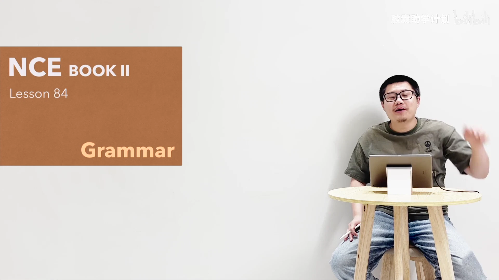

文字识别：NCE / BOOK I"I / Lesson 84 / Grammar / NO

### 画面 00:00:02

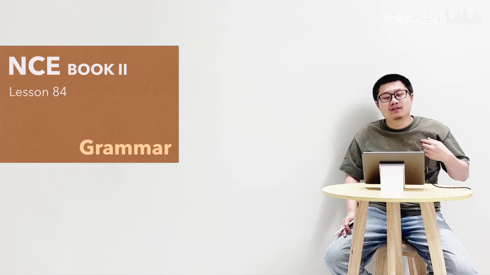

文字识别：NCE / BOOKII / Lesson 84 / Grammar

### 画面 00:00:04

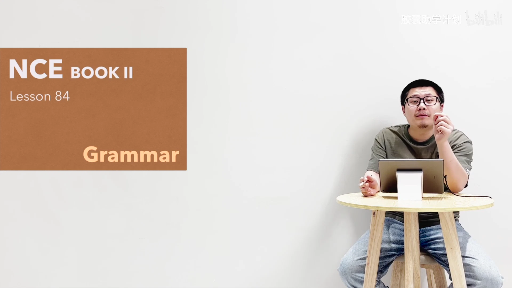

文字识别：NCE / BOOKII / Lesson 84 / Grammar

### 画面 00:00:06

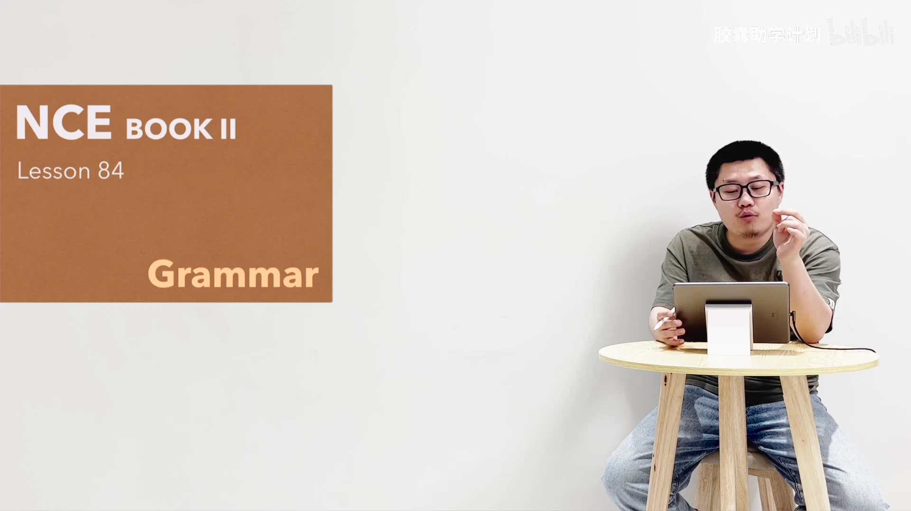

文字识别：NCE / BOOKⅡI / Lesson 84 / Grammar

### 画面 00:00:09

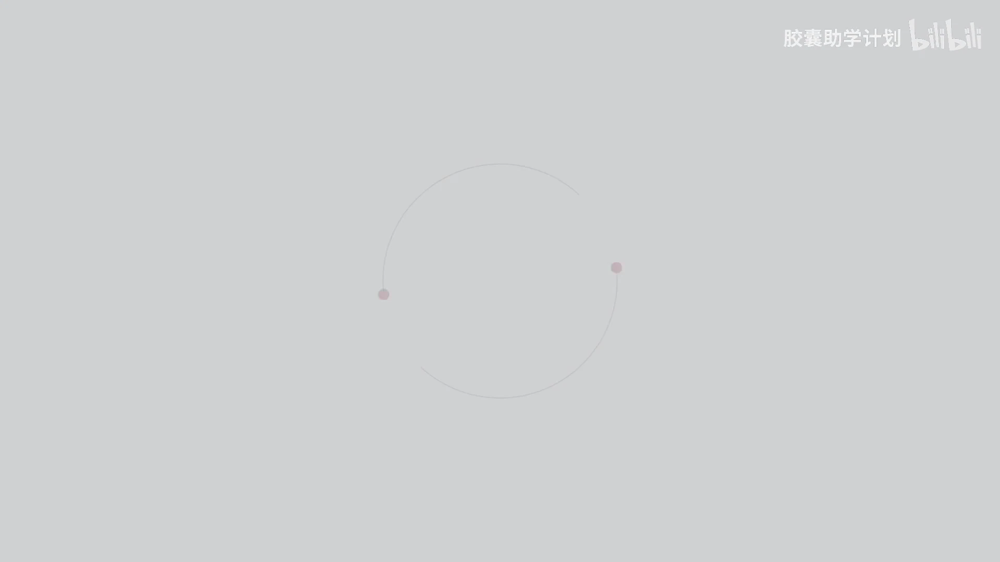

文字识别：胶囊助学计划 / •

### 画面 00:00:13

### 画面 00:00:15

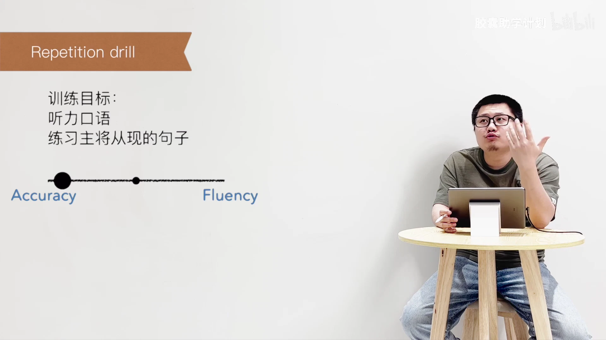

文字识别：Repetition drill / 训练目标： / 听力口语 / 练习主将从现的句子 / Accuracy / Fluency

## 00:00:30–00:01:00

样十二十三这种跟将来时态相关的课程，自己去看复习，对吧？好，呃，在这个地方呢，我们以练代讲。比如说这里就要复习一个知识点，叫做主将从现，对吧？什么叫主将从现呢？我们先看一个句子啊，而问说 When will you let me know？你什么时候让我知道？The moment he arrives，他到达的那一刻，我们实际上是要把这两个东西给它变成一句话，变成了叫 I'll let you

### 画面 00:00:43

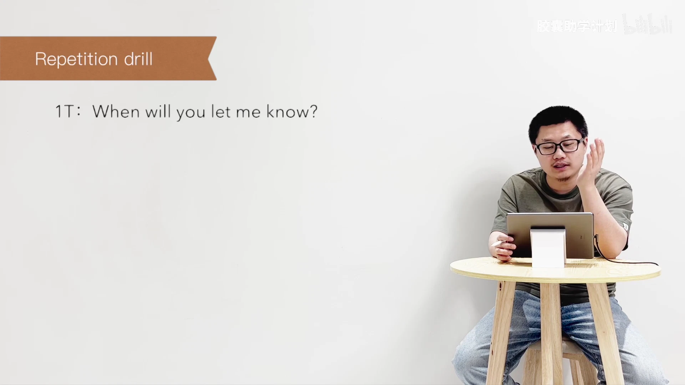

文字识别：Repetition drill / 1T: When will you let me know?

### 画面 00:00:46

文字识别：Repetition drill / 1T: When will you let me know? / The moment he arrives. / S: I'll let you know the moment he arrives.

## 00:01:00–00:01:30

know.注意P L L是will的缩写。The moment我印象当中是六十课咱们学的，类似于as soon as一怎么怎么样就怎么怎么样，对吧？He arrives叫他到达。什么叫主将从现呢？之前咱们学过，我要带你复习一下。主将从现的意思就是，如果我在主句当中用的是一般将来时，这个从句当中如果也想表将来，不用一般将来时，用的是一般现在时，所以叫主将从现。其实跟十

### 画面 00:01:16

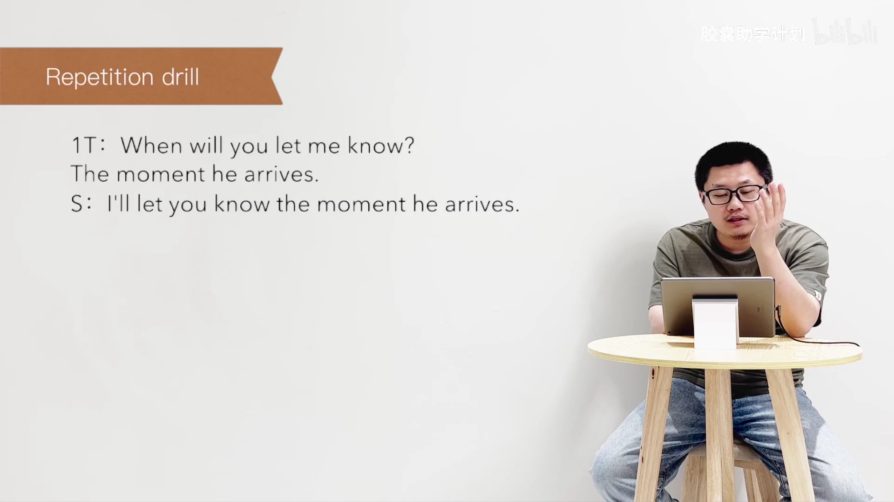

文字识别：Repetition drill / 1T: When will you let me know? / The moment he arrives. / S: I'll let you know the moment he arrives.

## 00:01:30–00:02:00

六课那个是有点类似的，对吧？这个从句，那怎么判断谁是主句谁是从句？那连词引导的就是从句喽。你看，说我会让你知道，我将让你知道，他一到达我就会让你知道的。你注意，那他一到达是不是也是将来的事儿？但是在这儿，它依旧用的是 he arrives 一般现在时，所以主句是一般将来时，从句用一般现在时，主将从现。

### 画面 00:01:46

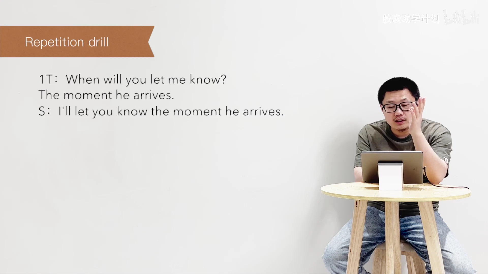

文字识别：Repetition drill / 1T: When will you let me know? / The moment he arrives. / S: I'll let you know the moment he arrives.

## 00:02:00–00:02:30

呃，这是非常典型，在我们大多数考试当中几乎一定会考的一个知识点啊，所以你要牢牢记住它，好吧？那剩下的就是您张嘴跟我读啊，呃，全是主将从现啊，注意力集中，只不过这个连词换了换啊，跟我读。How long will you wait here until he comes? I'll wait here until he comes.

### 画面 00:02:00

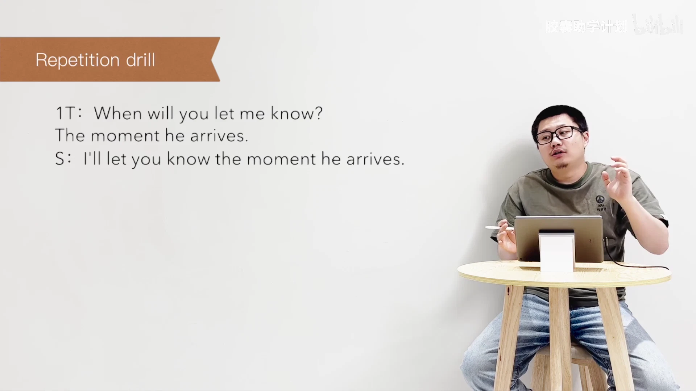

文字识别：Repetition drill / 1T: When will you let me know? / The moment he arrives. / S: I'll let you know the moment he arrives. / NU / WIR

### 画面 00:02:02

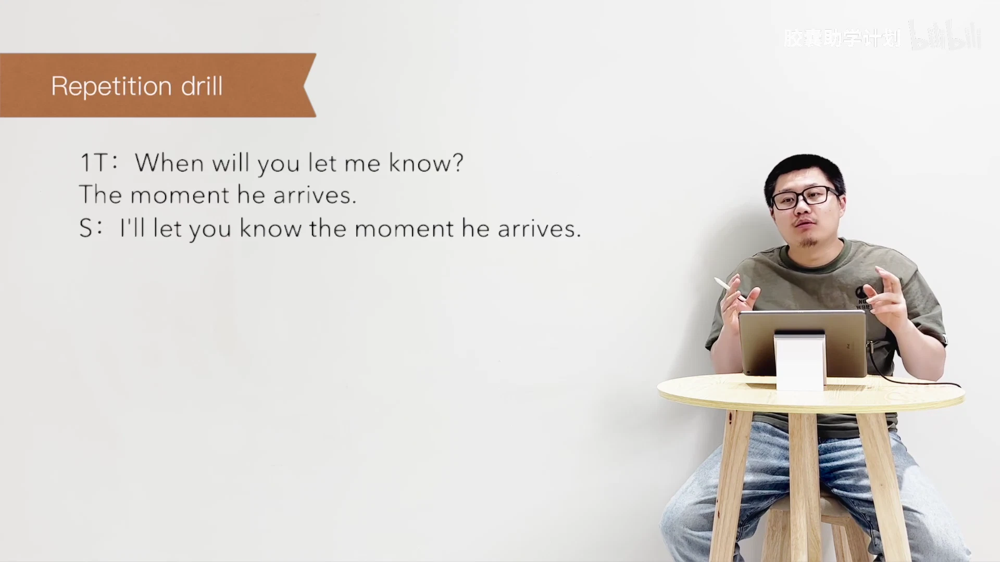

文字识别：Repetition drill / 1T: When will you let me know? / The moment he arrives. / S: I'll let you know the moment he arrives.

### 画面 00:02:06

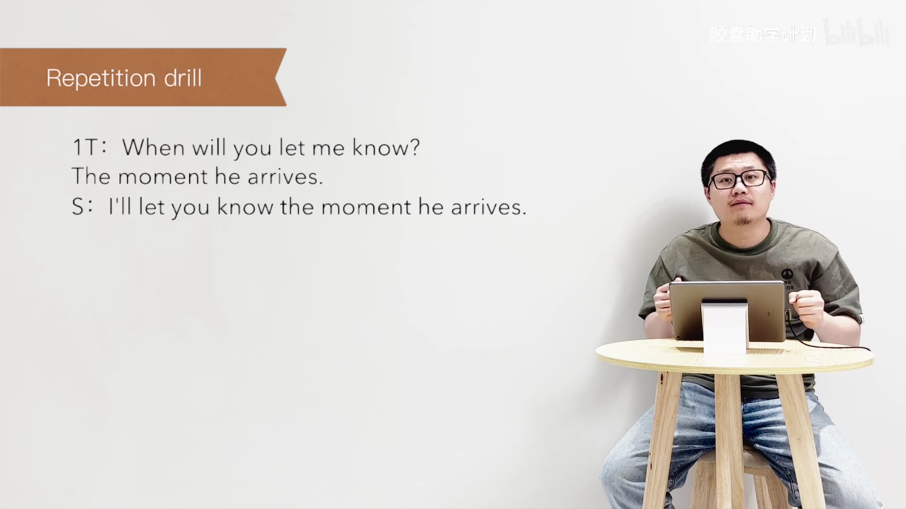

文字识别：Repetition drill / 1T: When will you let me know? / The moment he arrives. / S: I'll let you know the moment he arrives. / NO

### 画面 00:02:08

文字识别：Repetition drill / 1T: When will you let me know? / The moment he arrives. / S: I'll let you know the moment he arrives.

### 画面 00:02:10

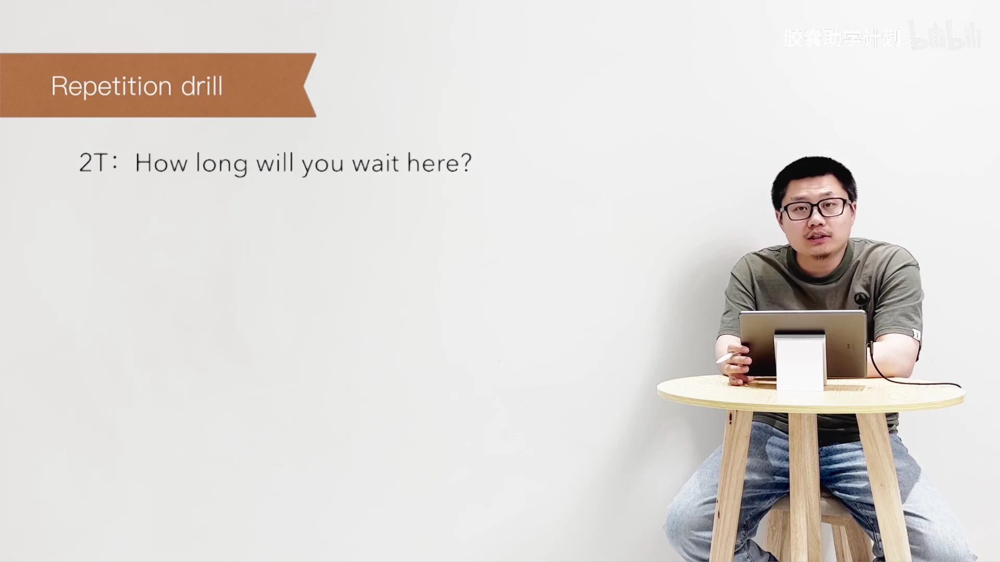

文字识别：Repetition drill / 2T: How long will you wait here?

### 画面 00:02:16

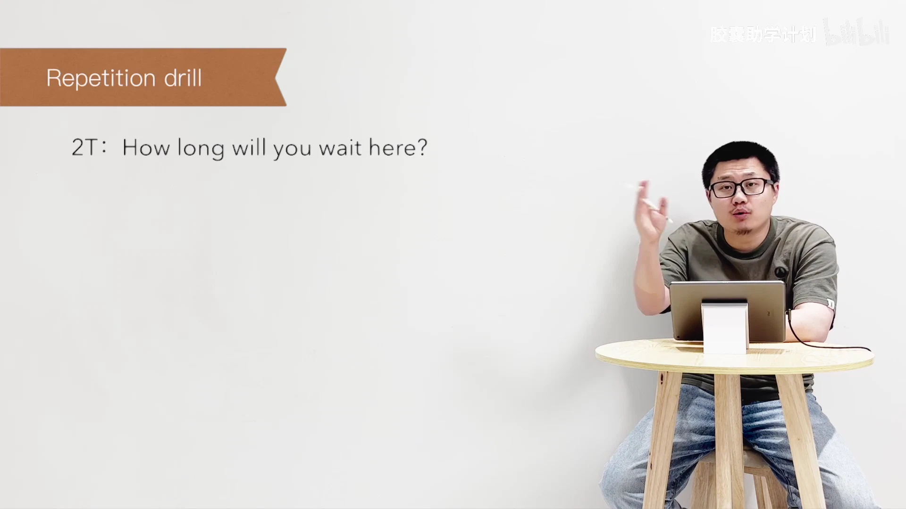

文字识别：Repetition drill / 2T: How long will you wait here?

### 画面 00:02:25

文字识别：Repetition drill / 2T: How long will you wait here? / Until he comes. / S: I'll wait here until he comes.

## 00:02:30–00:03:00

When will you give him the message? When he returns, I'll give him the message when he returns. 哎，主将从现，你看，即使他回来是将来的事情，我也用一般现在时。他在从句当中，对吧？ When will you go out? Repeat after me. As soon as the rain stops, I'll go out. As

### 画面 00:02:30

文字识别：Repetition drill / 3T: When will you give him the message?

### 画面 00:02:57

文字识别：Repetition drill / 4T: When will you go out? / As soon as the rain stops. / S: I'll go out as soon as the rain stops.

## 00:03:00–00:03:30

soon as the rain stops. How long will you drive to work? While the strike lasts. I'll drive to work while the strike lasts. When will you telephone him? Before my aunt arrives. I'll telephone him before my aunt arrives. When will you be able to drive by yourself?

### 画面 00:03:03

文字识别：Repetition drill / 5T: How long will you drive to work?

### 画面 00:03:20

文字识别：Repetition drill / 6T: When will you telephone him? / Before my aunt arrives. / S: I'll telephone him before my aunt arrives.

### 画面 00:03:26

文字识别：Repetition drill / 7T: When will you be able to drive by / yourself?

## 00:03:30–00:04:00

when I pass my test. This pass my test, uh, through my test, through my this test. Ah, this if you are good at English, you can guess it. If you don't know, then we will see it in the text. Don't worry. I'll be able to drive by myself when I pass my test. How long will you go on trying? Go on doing something. Review it. Until I succeed,

### 画面 00:03:45

文字识别：Repetition drill / 7T: When will you be able to drive by / yourself? / When I pass my test. / S: I'll be able to drive by myself when I pass / my test.

### 画面 00:03:49

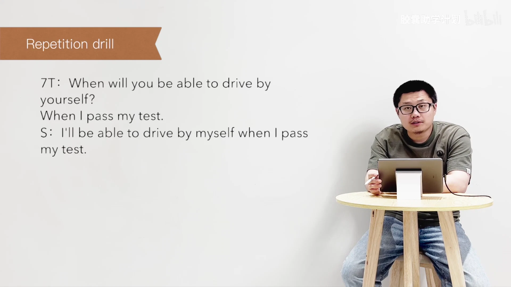

文字识别：Repetition drill / 7T: When will you be able to drive by / yourself? / When I pass my test. / S: I'll be able to drive by myself when I pass / my test.

### 画面 00:03:51

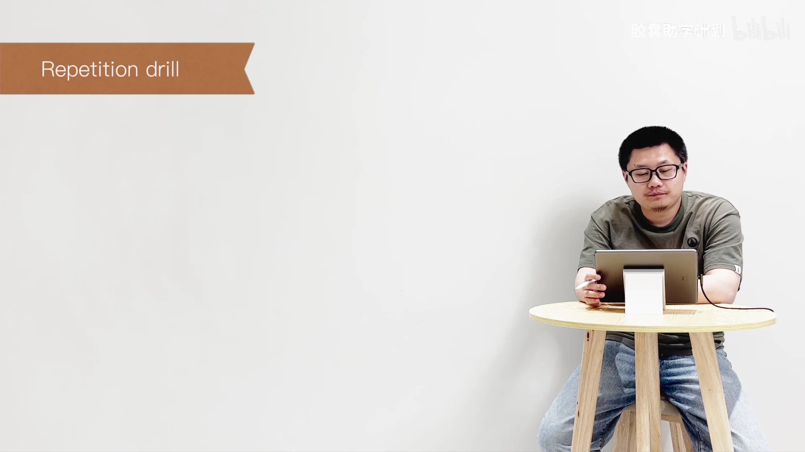

文字识别：動字计物 / Repetition drill

### 画面 00:03:58

文字识别：Repetition drill / 8T: How long will you go on trying? / UntilI succeed.

## 00:04:00–00:04:30

I'll go on trying until I succeed. When will you go home? When I finish my work, I'll go home when I finish my work. When will you When will you decide what to do? As soon as I learn the truth,啊，注意这里的 learn 是什么意思？不是学会真，学会真理啊，肯定不是这么翻译，

### 画面 00:04:05

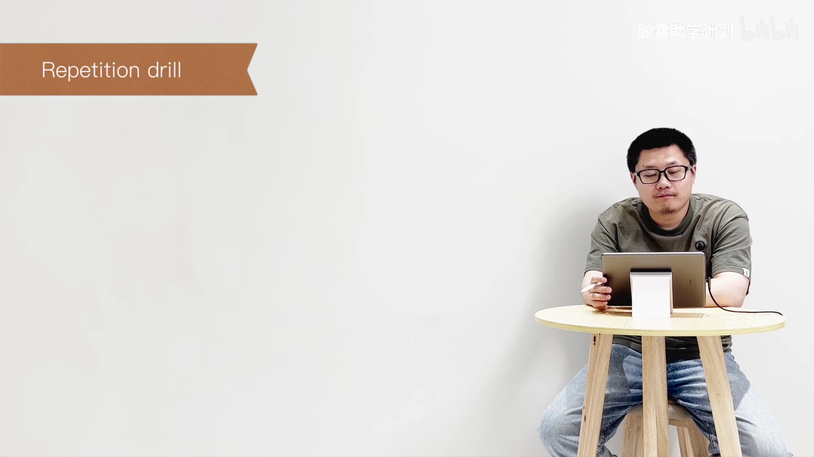

文字识别：Repetition drill

### 画面 00:04:27

文字识别：Repetition drill / 10T: When will you decide what to do? / As soon as I learn the truth.

## 00:04:30–00:05:00

是当我了解真相啊，读说 I'll decide what to do as soon as I learn the truth。好，repetition只有过去了，pattern只有，呃，复习将来相关时态的句子呗，对吧？这个其实就是夯实一下基础，理论上您应该都会了。第一个句子说 How long will they be away？是吧？呃，他们将会离开多久？这是个副词，对吧？你可以理解为啊，你甭管它是副词还是介词，这个不重要，你就

### 画面 00:04:35

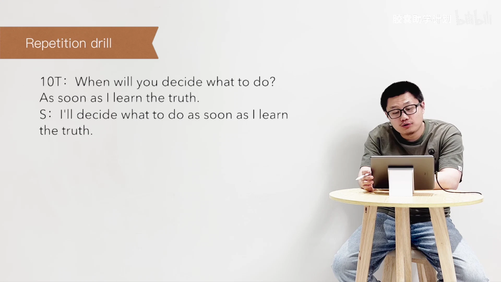

文字识别：Repetition drill / 10T: When will you decide what to do? / As soon as I learn the truth. / S: I'll decide what to do as soon as I learn / the truth.

### 画面 00:04:39

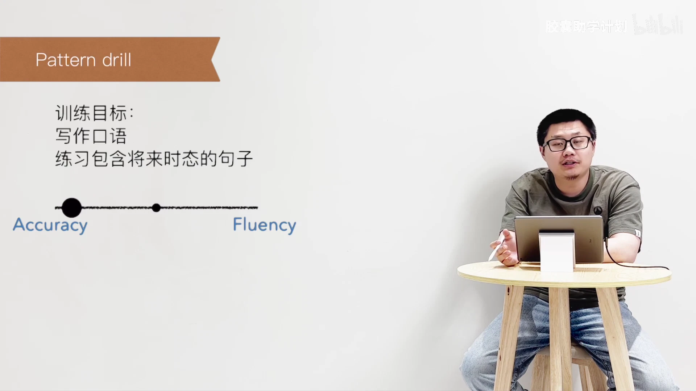

文字识别：Pattern drill / 训练目标： / 写作口语 / 练习包含将来时态的句子 / Accuracy / Fluency

### 画面 00:04:45

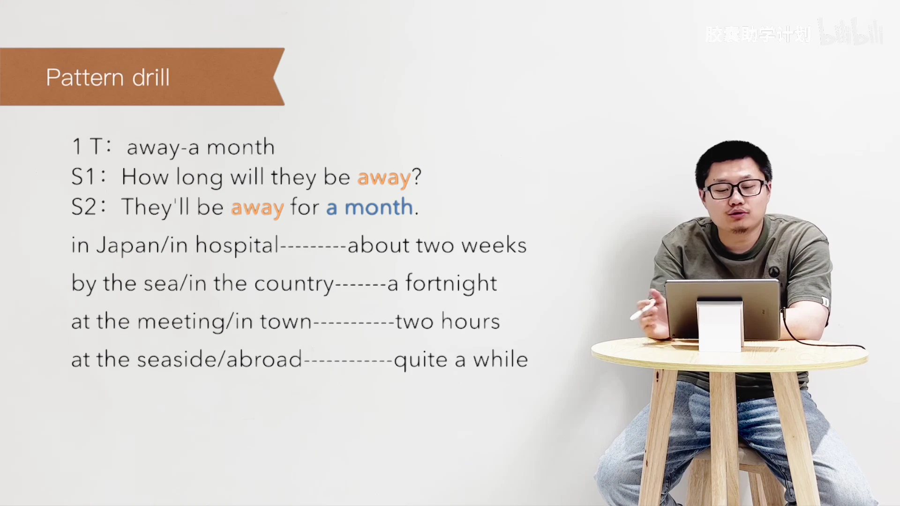

文字识别：Pattern drill / 1 T: away-a month / S1: How long will they be away? / S2: They'll be away / for a month. / in Japan/in hospital---about two weeks / by the sea/in the country-a fortnight / at themeetiing/intown----two hours / at the seaside/abroad--- / -quite a while

## 00:05:00–00:05:30

是呃，哎，其实就不用提这个，你就知道，反正它的意思叫 away，叫离开，是吧？但它不是个动词就行了。说 there will be away for month。哎，他们将离开一整个月。底下往里边去带，这事儿结束了。第二， how long will they take to climb the mountain？他们要花多长时间爬上这座山呢？They'll climb it in three weeks。哎，说怎么样呢？他们三周后，哎，

### 画面 00:05:15

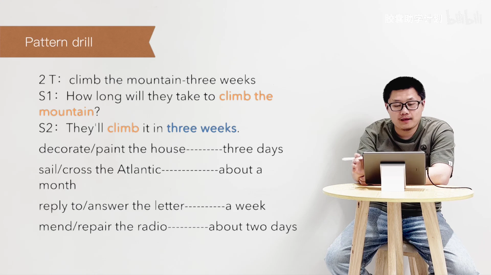

文字识别：Pattern drill / 2 T: climb the mountain-three weeks / S1: How long willthey take to climb the / mountain? / S2: They'll climb it in three weeks. / decorate/paint the house---threedays / sail/cross the Atlantic-- / --about a / month / reply to/answer the letter---a week / mend/repair theradio--about twodays

## 00:05:30–00:06:00

三周内爬上去，对吧？哎，底下往里一带，完事儿。第三个，So we're going to see the film. Do you want to come?哎，我们准备be going to do，这新一就学过了，三十七课、三十九课就学过了啊。看电影，这个你们想去吗？No, thanks. I'll go and see later.说我呀，稍后看吧，对吧？哎，后来later往里带。最后一个，He's going into hospital sometime. Is he? Let me know

### 画面 00:05:34

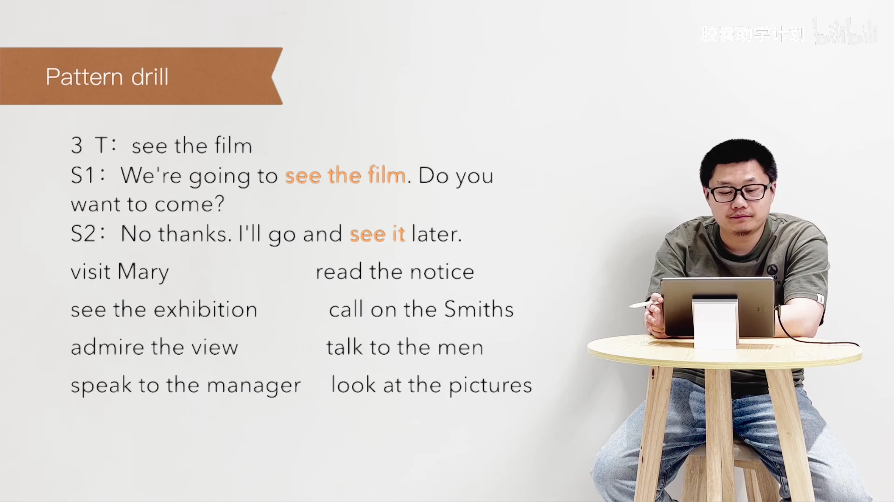

文字识别：Pattern drill / 3 T: see the film / S1: We're going to see the film. Do you / want to come? / S2: No thanks.l'll go and see it later. / visit Mary / read the notice / see the exhibition / call on the Smiths / admire the view / talk to the men / speak to the manager / look at the pictures

### 画面 00:05:54

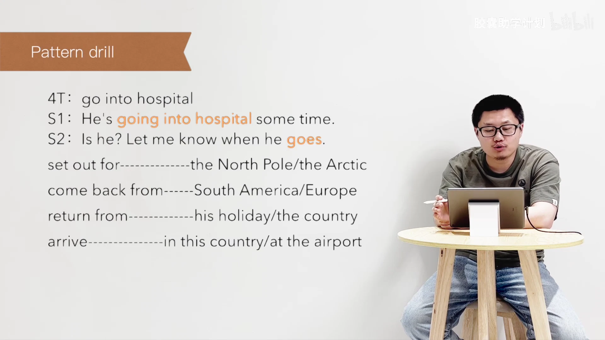

文字识别：Pattern drill / 4T: go into hospital / S1: He's going into hospital some time. / S2: Is he? Let me know when he goes. / set out for------- / ----the North Pole/the Arctic / come back from--- South America/Europe / return from-- / -his holiday/the country / -in this country/at the airport / arrive-

## 00:06:00–00:06:30

when he goes.说他要去医院了，住院了。你可以理解为是吗？哎，当他去的时候，你要让我知道哟。OK。那 recap 本课呢，其实就是复习了一个两个东西。第一个主将从现，第二个是 will 和 be going to do。因为这些东西过于的简单了，我们就是以练代讲了，直接上练习，复习一下就结束啊。那加上作业啊，拍连之友老习惯，然后这个呃尝试回

### 画面 00:06:11

文字识别：Recap / Patterns / 复习主将从现 / ＆ / 复习will / be going to do / Grammar

### 画面 00:06:13

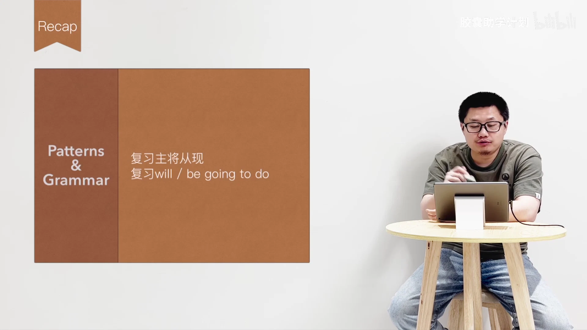

文字识别：Recap / Patterns / 复习主将从现 / & / 复习wil/ be going to do / Grammar

### 画面 00:06:15

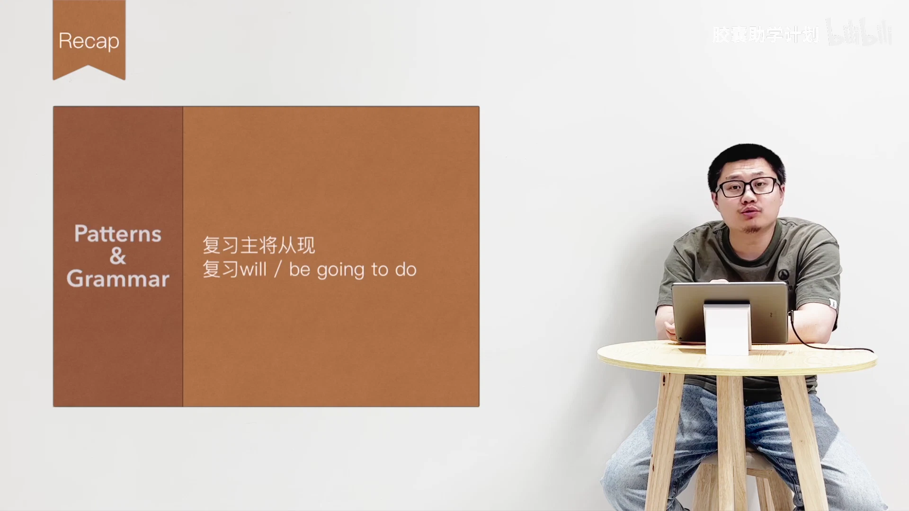

文字识别：Recap / Patterns / 复习主将从现 / & / 复习will/ be going to do / Grammar

### 画面 00:06:20

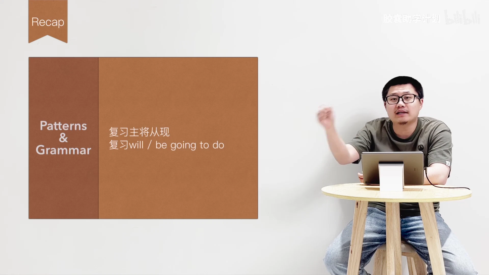

文字识别：Recap / Patterns / 复习主将从现 / & / 复习will/ be going to do / Grammar

### 画面 00:06:22

文字识别：Recap / Patterns / 复习主将从现 / 复习will / be going to do / Grammar

### 画面 00:06:24

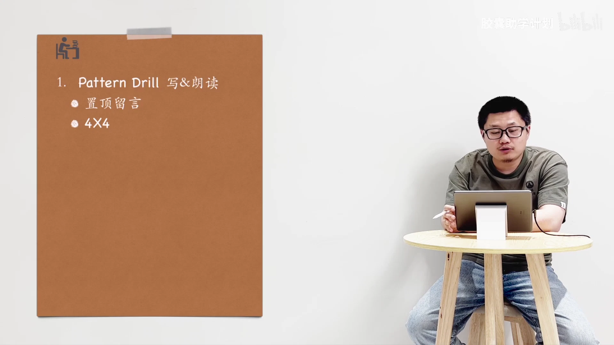

文字识别：1.f / Pattern Drill 写&朗读 / 置顶留言 / 4X4

### 画面 00:06:26

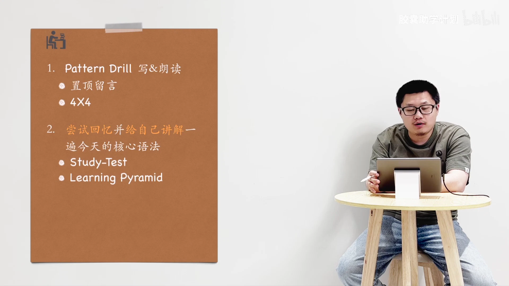

文字识别：1. / Pattern Drill写&朗读 / 置顶留言 / 4X4 / 尝试回忆并给自己讲解一 / 遍今天的核心语法 / Study-Test / Learning Pyramid

## 00:06:30–00:07:00

忆给自己讲解今天这个核心语法，对吧？然后红皮书还是初级加中级第四单元，咱都给他写了，好吧？呃，那以上呢就是本期视频的全部内容了。如果各位喜欢我们的课程呢，欢迎各位关注、订阅、一键三连，分享给那些需要的朋友，来帮助我们快速成长。See you next time.

### 画面 00:06:30

文字识别：Pattern Drill写&朗读 / 置顶留言 / 4×4 / 尝试回忆并给自己讲解一 / 遍今天的核心语法 / Study-Test / Learning Pyramid

### 画面 00:06:32

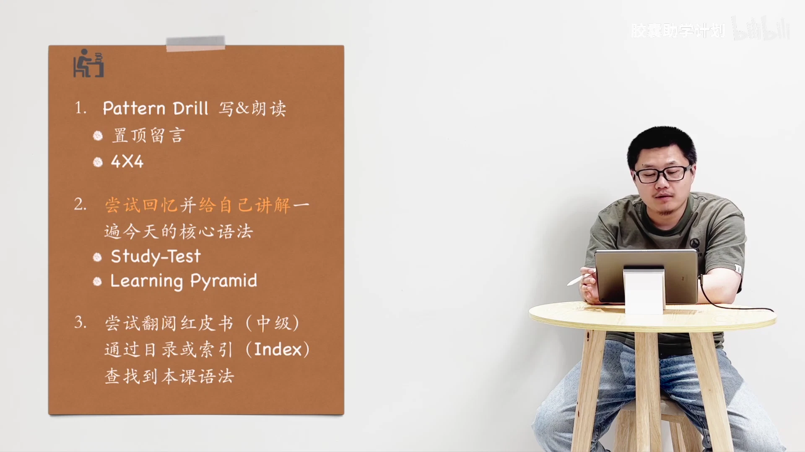

文字识别：1. f / Pattern Drill 写&朗读 / 置顶留言 / 4×4 / 尝试回忆并给自己讲解一 / 遍今天的核心语法 / Study-Test / Learning Pyramid / 尝试翻阅红皮书（中级） / 通过目录或索引(Index) / 查找到本课语法

### 画面 00:06:34

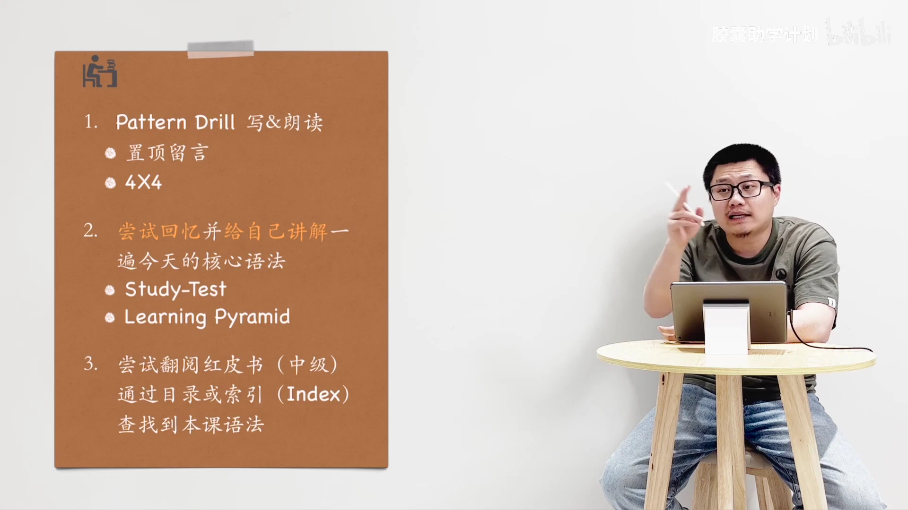

文字识别：1. f / Pattern Drill写&朗读 / 置顶留言 / 4×4 / 尝试回忆并给自己讲解一 / 遍今天的核心语法 / Study-Test / Learning Pyramid / 尝试翻阅红皮书（中级） / 通过目录或索引(Index) / 查找到本课语法

### 画面 00:06:36

文字识别：1. / Pattern Drill写&朗读 / 置顶留言 / 4×4 / 尝试回忆并给自己讲解一 / 遍今天的核心语法 / Study-Test / Learning Pyramid / 尝试翻阅红皮书（中级） / 通过目录或索引(Index) / 查找到本课语法

### 画面 00:06:38

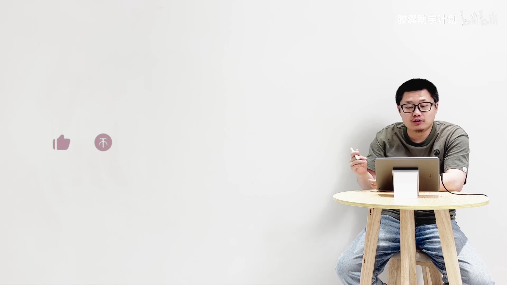

文字识别：助学计划

### 画面 00:06:40

文字识别：臺助字计划国 / ￥

### 画面 00:06:42

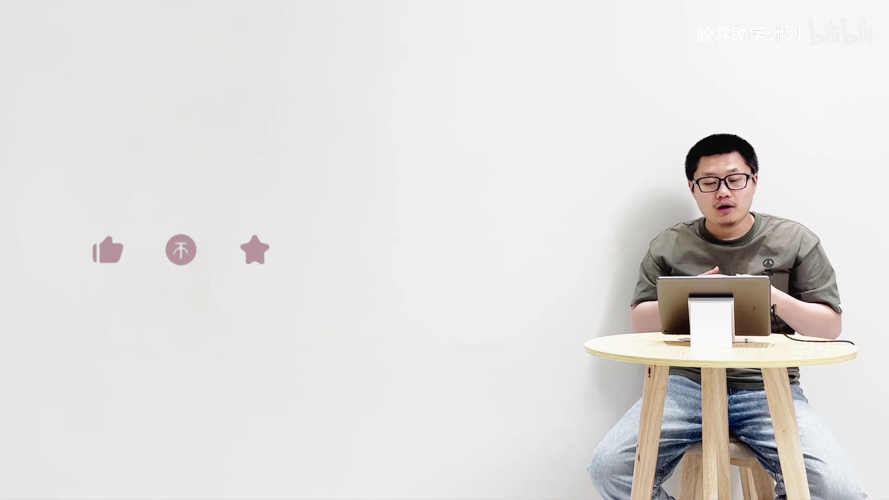

文字识别：臺助字计划 / 餐

### 画面 00:06:49

文字识别：毫助学计划

### 画面 00:06:51

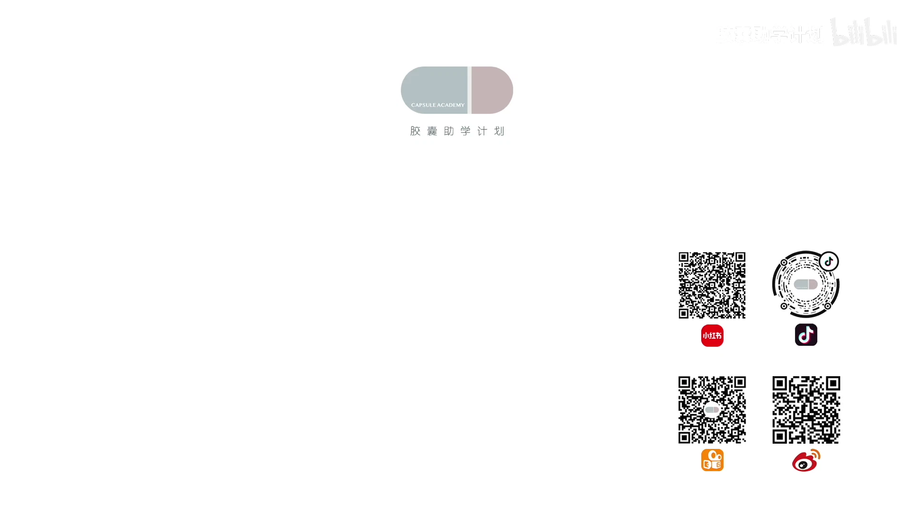

文字识别：CAPSULEACADEMY / 胶囊助学计划 / 小红书 / 品 / OE

### 画面 00:06:53

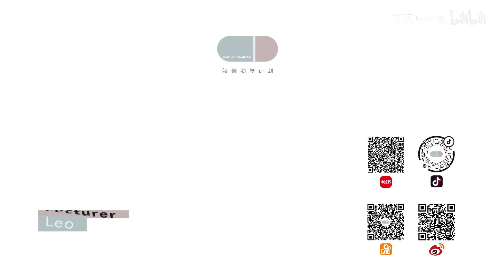

文字识别：CAPSULEACADEMY / 胶囊助学计划 / 小红书 / 品 / cturer / Leo / OE

### 画面 00:06:59

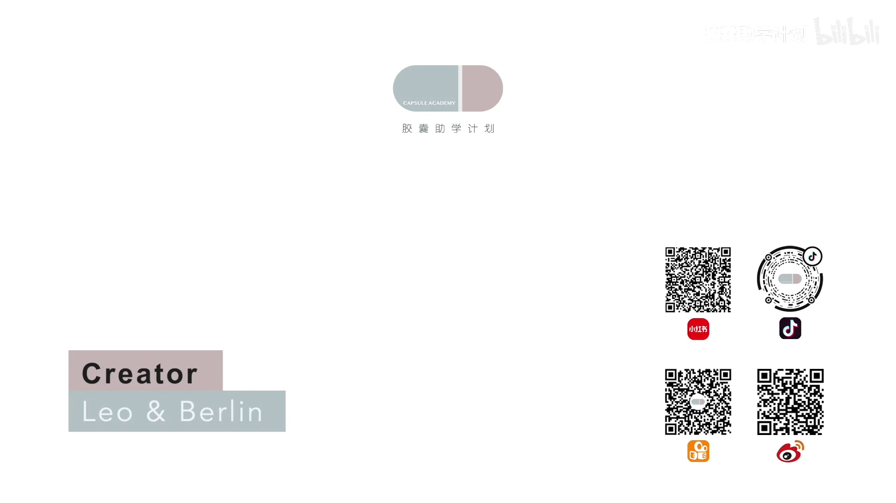

文字识别：CAPSULEACADEMY / 胶囊助学计划 / 小红书 / Creator / Leo & Berlin / OE

## 00:07:00–00:07:03

### 画面 00:07:01

文字识别：bilbili / 胶囊助学计划

### 画面 00:07:02

文字识别：bilbili / 胶囊助学计划

