# 084 文章

快速机器解析：语音为单模型转写，未进行独立交叉校对或人工复核；画面每秒采样并按变化选帧，短时文字和标记可能遗漏。截图时间约有 1 秒误差。图片有损压缩；遇到疑点请按时间查看 Google Drive 原视频。

## 00:00:00–00:00:30

Hello everyone, welcome to Capsule Academy. This is Leo. Today we're going to learn new concept English Book Two Lesson Eighty Four Story. Hope you guys enjoyed. 我们一起看一下这篇文章的标题叫 On Strike，简单粗暴罢工。问的问题是 Who will be driving the buses next week? 哎，文章的标题是罢工，然后底下说的是下下礼拜

### 画面 00:00:00

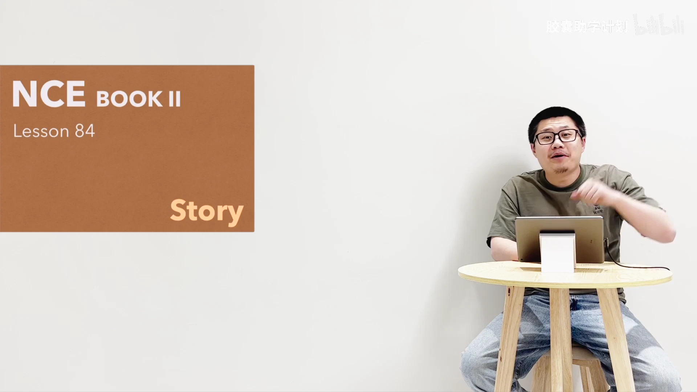

文字识别：NCE / BOOKⅡI / Lesson 84 / Story / NU

### 画面 00:00:07

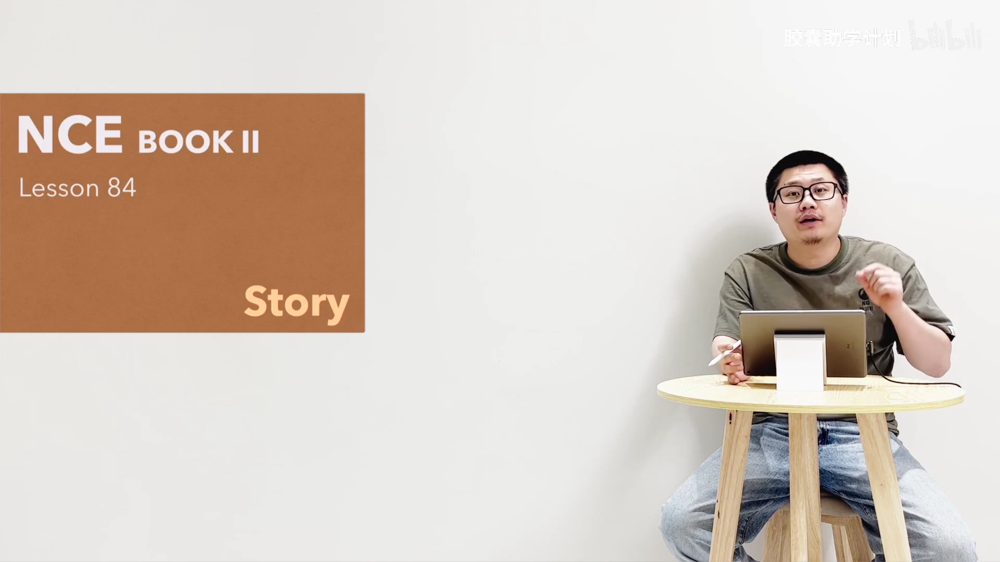

文字识别：NCE / BOOKⅡI / Lesson 84 / Story

### 画面 00:00:09

文字识别：胶囊助学计划 bii / •

### 画面 00:00:13

### 画面 00:00:15

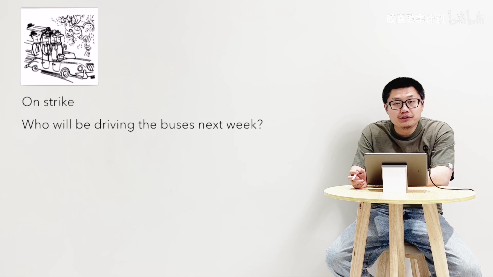

文字识别：On strike / Who will be driving the buses next week?

## 00:00:30–00:01:00

下周谁开公交车？这个乍一听风马牛好像有点不相及呀，是吧？咱看一下文章啊，上来了，Busmen have decided to go on strike next week. 答案直接给了，是吧？第一句话就给了。这篇文章可以不读了。说公交车司机决定了，已经决定了一件事，要罢工 next week，下个礼拜，对吧？你看时间啊，没有地点，有人物啊，有要做的事情啊，全有了，一句话全解释

### 画面 00:00:37

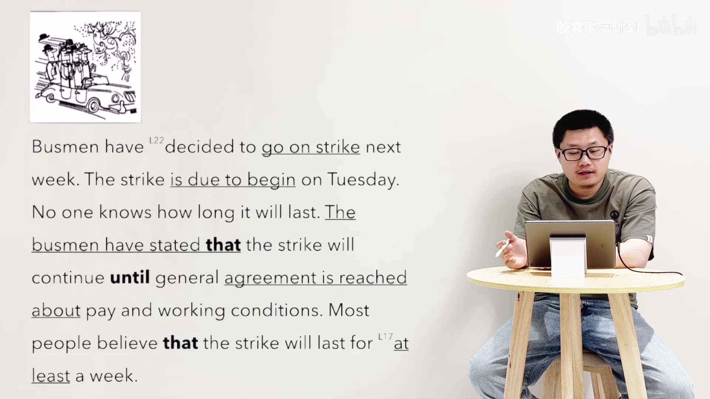

文字识别：Busmen have [2decided to go on strike next / week. The strike is due to begin on Tuesday. / No one knows how long it will last. Ihe / busmen have stated that the strike will / continue until general agreement is reached / about pay and working conditions. Most / people believe that the strike will last for [7at / least a week.

### 画面 00:00:44

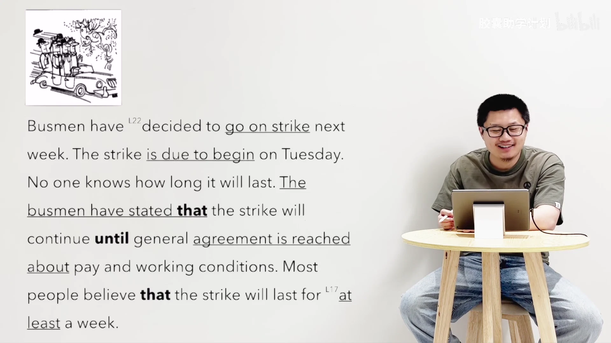

文字识别：Busmen have [²decided to go on strike next / week. The strike is due to begin on Tuesday. / No one knows how long it will last. Ihe / busmen have stated that the strike will / continue until general agreement is reached / about pay and working conditions. Most / people believe that the strike wil last for ['at / least a week.

### 画面 00:00:47

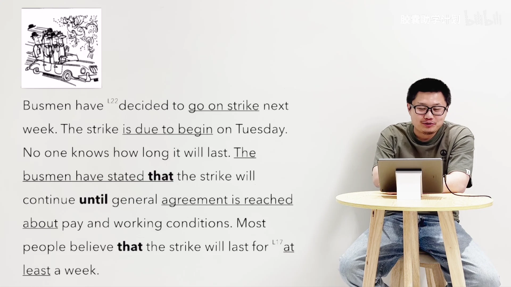

文字识别：Busmen have [²decided to go on strike next / week. The strike is due to begin on Tuesday. / No one knows how long it will last. Ihe / busmen have stated that the strike will / continue until general agreement is reached / about pay and working conditions. Most / people believe that the strike will last for [17at / least a week.

## 00:01:00–00:01:30

The strike is due to begin on Tuesday。说这个罢工啊，这个 be due to do，其实它可以翻译成，比如说定于某个某个时间。呃，如果给它模糊翻译一下，其实就非常像计划打算 be going to do，对吧？哎，你比如说，你完全可以把这句话咱给它改编一下，比如说变成

### 画面 00:01:17

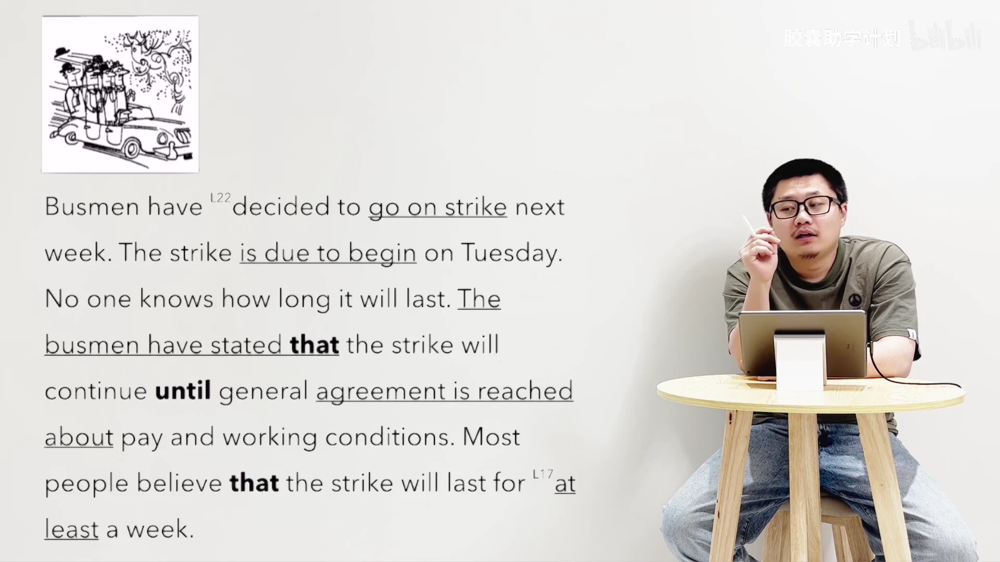

文字识别：Busmen have [²decided to go on strike next / week. The strike is due to begin on Tuesday. / No one knows how long it will last. Ihe / busmen have stated that the strike will / continue until general agreement is reached / about pay and working conditions. Most / people believe that the strike will last for [17at / least a week.

## 00:01:30–00:02:00

bus men are going to go on strike on Tuesday。这两句话的含义几乎是一样的，没什么差别。所以你记住啊，这个一会儿咱们还会造句啊，叫 be due to do 表示的什么呢？就是定啊，定于什么什么时间做什么什么事情啊，于什么什么时间做什么事情。或者你实在这样不好记呢，你就直接给它记成计划打算啊，问题不是特别大啊。呃，

### 画面 00:01:47

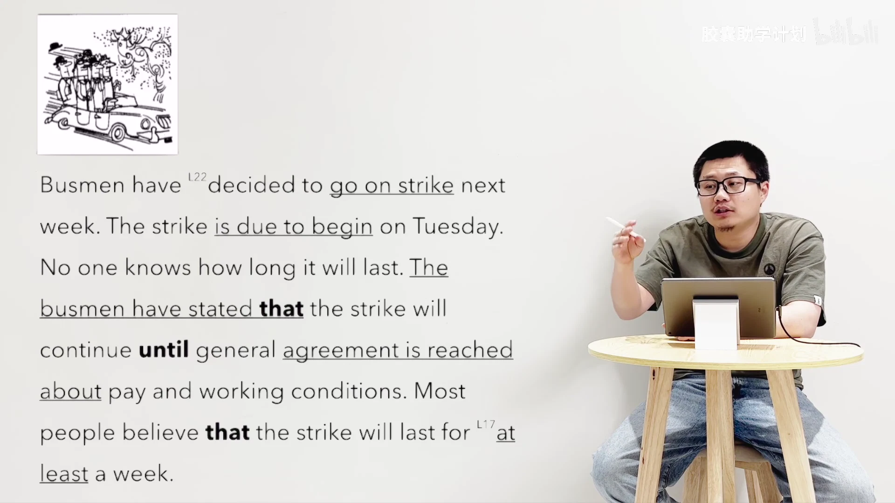

文字识别：Busmen have [²decided to go on strike next / week. The strike is due to begin on Tuesday. / No one knows how long it will last. Ihe / busmen have stated that the strike will / continue until general agreement is reached / about pay and working conditions. Most / people believe that the strike will last for [17at / least a week.

## 00:02:00–00:02:30

OK，继续啊。说No one knows，没有人知道how long it will last。说没有人知道的后边是一个事儿，你告诉我这是个什么从句？这是个动词，后边是一句话，对吧？哎，它会持续多长时间？是不是很像一个宾宾从？你自己去想一想。这个我卖个官司，我先不说了，对吧？好，因为咱们前面已经学了那么多了，我相信你到这应该是会了。The busmen have stated that.

### 画面 00:02:17

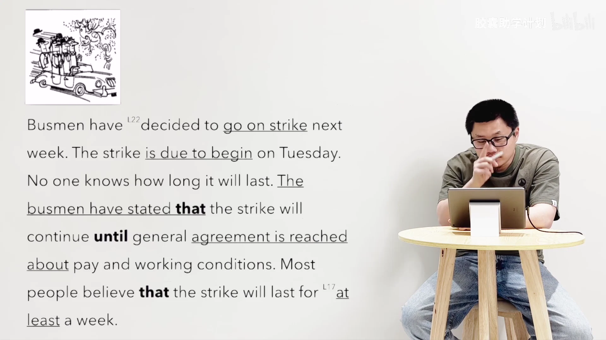

文字识别：Busmen have [²decided to go on strike next / week. The strike is due to begin on Tuesday. / No one knows how long it will last. Ihe / busmen have stated that the strike will / continue until general agreement is reached / about pay and working conditions. Most / people believe that the strike will last for [17at / least a week.

### 画面 00:02:20

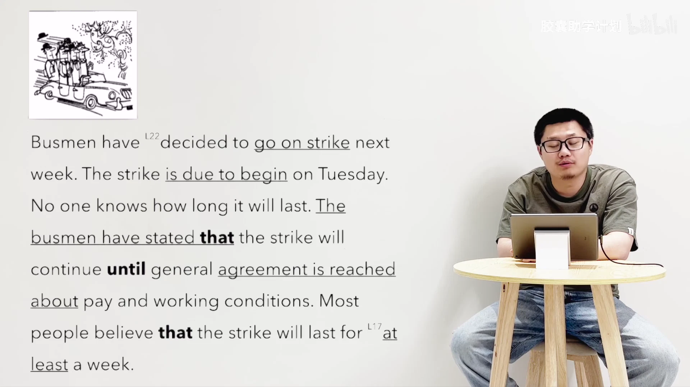

文字识别：Busmen have [²decided to go on strike next / week. The strike is due to begin on Tuesday. / No one knows how long it will last. Ihe / busmen have stated that the strike will / continue until general agreement is reached / about pay and working conditions. Most / people believe that the strike will last for [17at / least a week.

### 画面 00:02:23

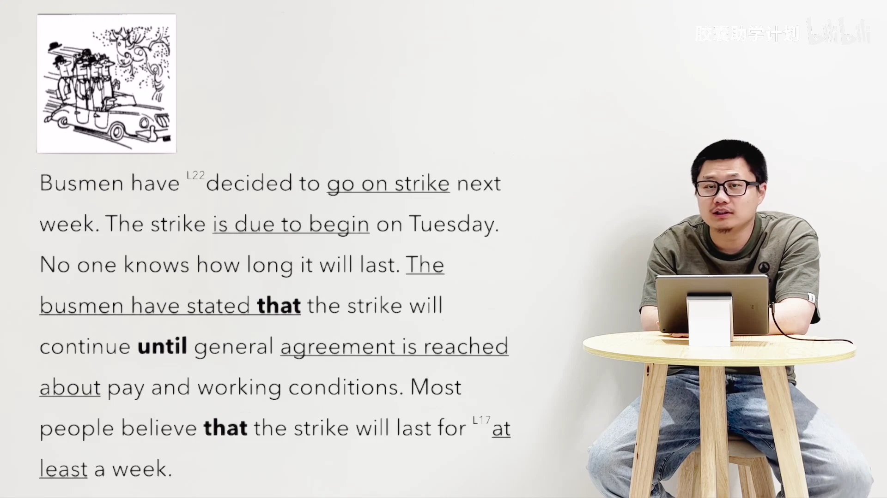

文字识别：Busmen have [²decided to go on strike next / week. The strike is due to begin on Tuesday. / No one knows how long it will last. Ihe / busmen have stated that the strike will / continue until general agreement is reached / about pay and working conditions. Most / people believe that the strike will last for [17at / least a week.

## 00:02:30–00:03:00

接下来这句话可长了，注意力集中。The strike will continue until general agreement is reached about pay and working conditions.如果您现在的水平是我从第第一个单词读到最后一个单词，你竟然跟上了，并且几乎就懂这句话什么意思了，那我祝贺您，您的这个呃语法基础还

### 画面 00:02:39

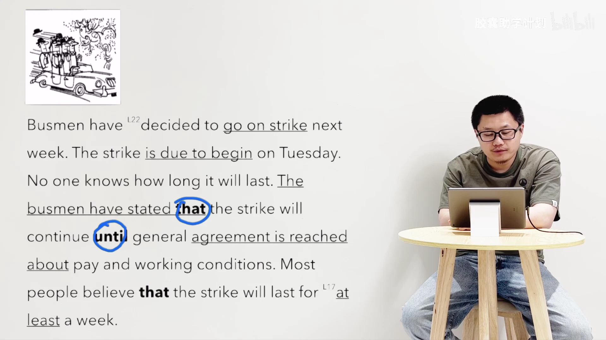

文字识别：Busmen have [2decided to go on strike next / week. The strike is due to begin on Tuesday. / No one knows how long it will last. The / busmen have statedThatthe strike will / continue / unti / general agreement is reached / about pay and working conditions. Most / people believe that the strike will last for [1at / least a week.

## 00:03:00–00:03:30

还是不错，前面学的很好。我们慢点来看一下，这个圈儿呢，就是告诉你断句嘛。说这这些公交车司机啊，声明，哎，声明了一件事儿，后边整个是那件事儿，什么事儿？我们看一下，The strike will continue，说这个罢工将会继续。没没别的说了，我们看后边叫until，叫直到什么时候？就直到什么时候我们就不罢工了？其实是另一个事儿，对吧？

### 画面 00:03:09

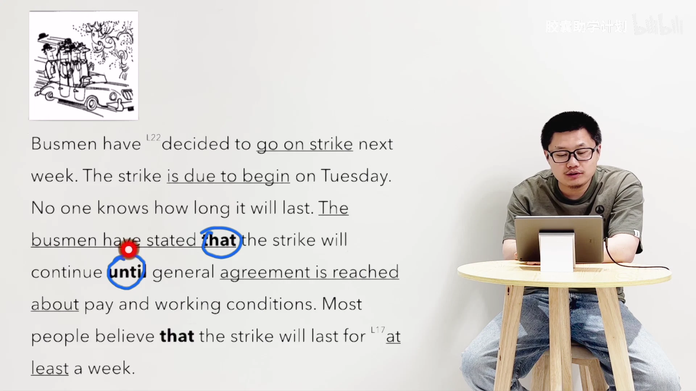

文字识别：Busmen have [²decided to go on strike next / week. The strike is due to begin on Tuesday. / No one knows how long it will last. The / busmen haxe /  statedThat the strike will / continue / unti / general agreement is reached / about pay and working conditions. Most / people believe that the strike will last for [1at / least a week.

## 00:03:30–00:04:00

或者换一句话来说，叫我们会罢工到什么时候？也不能没完没了，一辈子就罢工了呀，对吧？我们要罢工到什么时候呢？General agreement is reached。好了，我们先不往后看了。Agreement is reached, reach an agreement。单词部分我们认认真真的讲过了，达成协议。那general是什么意思呢？有好几个意思，最常见的其实往往指的是普遍意义上来说的，但在这儿呢，它

### 画面 00:03:39

文字识别：Busmen have [2decided to go on strike next / week. The strike is due to begin on Tuesday. / No one knows how long it will last. The / busmen have statedThat the strike will / continue / unti / general agreement is reached / about pay and working conditions. Most / people believe that the strike will last for [17at / least a week.

### 画面 00:03:54

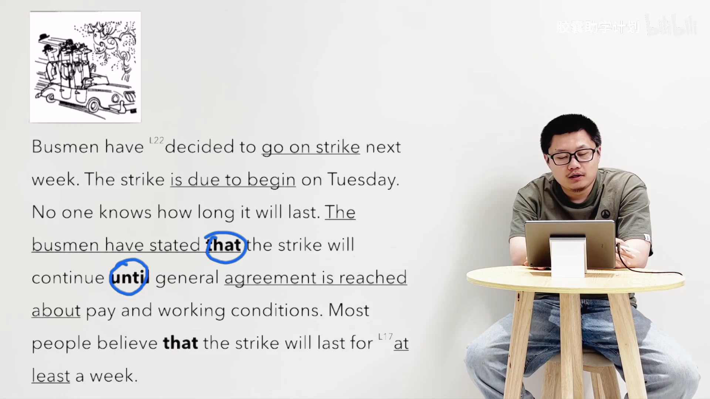

文字识别：Busmen have [²decided to go on strike next / week. The strike is due to begin on Tuesday. / No one knows how long it will last. Ihe / busmen have statedThat the strike will / continue / unti / general agreement is reached / about pay and working conditions. Most / people believe that the strike will last for [1at / least a week.

### 画面 00:03:59

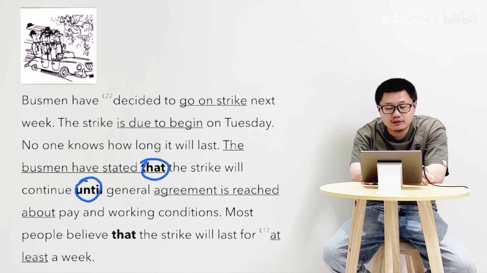

文字识别：Busmen have [²decided to go on strike next / week. The strike is due to begin on Tuesday. / No one knows how long it will last. Ihe / busmen have statedThat the strike will / continue / unti / general agreement is reached / about pay and working conditions. Most / people believe that the strike will last for [1at / least a week.

## 00:04:00–00:04:30

这个 general 不是普遍的，指的是整体上的啊，大体上的整体上，就是整体上的这些协议能达成啊。你别跟我说我有二十条协议，你达成了一条一条就想让我恢复，那不行。比如说二十条，咱达成了大概整体上达成了十七八条，哎，我们可以考虑不罢工了，对吧？剩下咱慢慢谈。整体上的这个协议已经被达成了之后呢，注意这里还是个被动，叫 is reached，对吧？

### 画面 00:04:29

文字识别：Busmen have [²decided to go on strike next / week. The strike is due to begin on Tuesday. / No one knows how long it will last. Ihe / busmen have statedThat the strike will / continue / unti / general agreement is reached / about pay and working conditions. Most / people believe that the strike willast for [7at / least a week.

## 00:04:30–00:05:00

关于 about，叫关于嘛？关于 pay and working conditions。 pay 这个单词在各位脑海当中，大多数是个动词词性，表示的是支付，pay for，对吧？在这里它是个名词词性，薪水跟 salary 差不多，以及 working conditions。 working conditions 什么意思呢？啊，就是工作条件嘛，工作环境嘛，对吧？哎，是不是有五险一金啊？还是三险一金，对吧？然后福利待遇是什么？全叫 working

### 画面 00:04:40

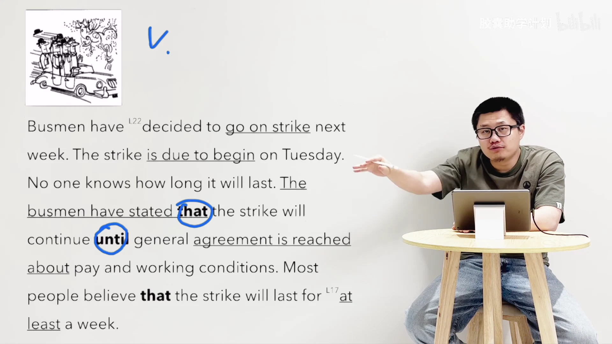

文字识别：Busmen have [²decided to go on strike next / week. The strike is due to begin on Tuesday. / No one knows how long it will last. Ihe / busmen have statedThat the strike will / continue / unti / general agreement is reached / about pay and working conditions. Most / people believe that the strike will last for [7at / least a week.

### 画面 00:04:42

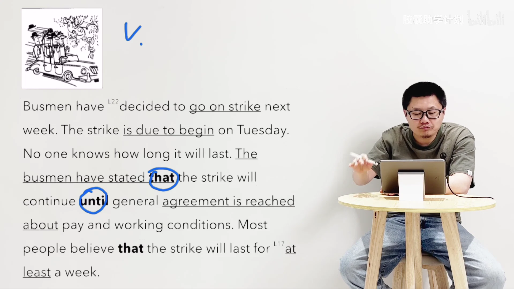

文字识别：Busmen have [²decided to go on strike next / week. The strike is due to begin on Tuesday. / No one knows how long it will last. Ihe / busmen have statedThat the strike will / continue / unti / general agreement is reached / about pay and working conditions. Most / people believe that the strike will last for [1at / least a week.

### 画面 00:04:46

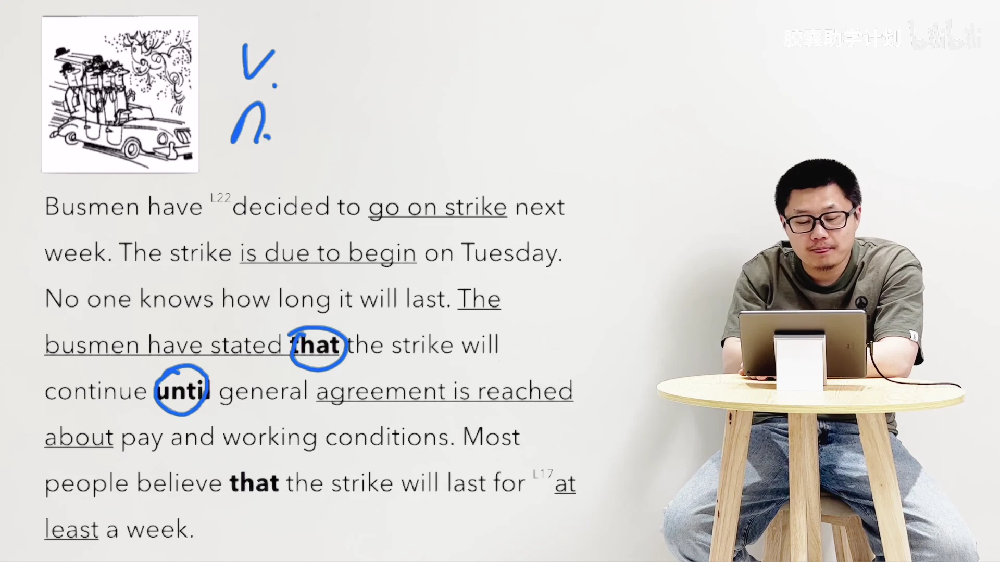

文字识别：V / N. / Busmen have [2decided to go on strike next / week. The strike is due to begin on Tuesday. / No one knows how long it will last. The / busmen have statedThat the strike will / continue / unti / general agreement is reached / about pay and working conditions. Most / people believe that the strike wil last for [7at / least a week.

## 00:05:00–00:05:30

conditions，是吧？Most people believe，大多数人的相信的是 that the strike will last for at least a week。大多数人坚信一件事儿，后边是一句话。这个事儿是什么呢？这个罢工将持续。注意这里的 last 是个动词，叫表示持续。将会持续多长时间呢？At least a week。十七课咱们就学了 at least，叫至少一周。

### 画面 00:05:16

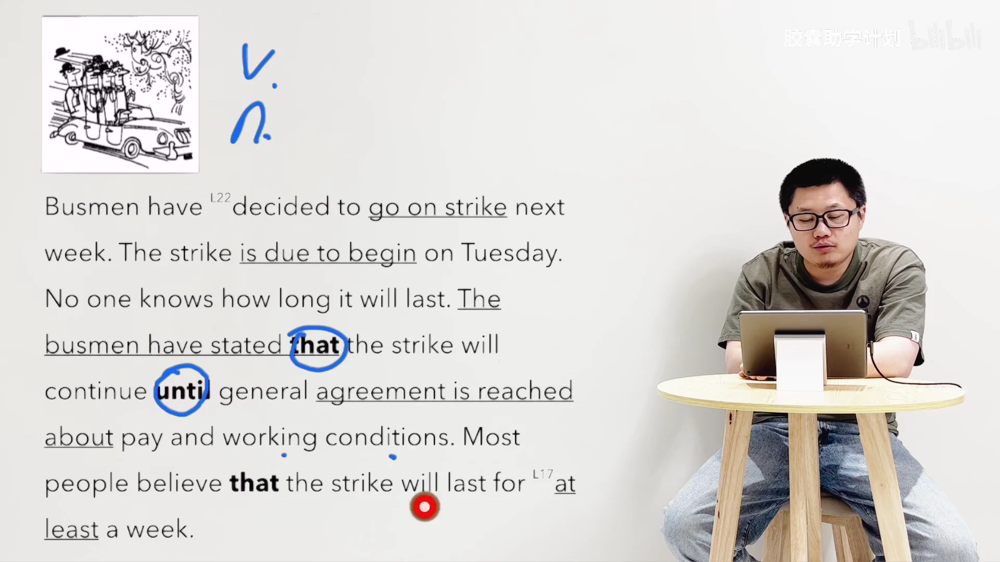

文字识别：N. / Busmen have [²decided to go on strike next / week. The strike is due to begin on Tuesday. / No one knows how long it will last. The / busmen have statedThat the strike will / continue / unti / general agreement is reached / about pay and working conditions. Most / people believe that the strike wil last for ['at / least a week.

## 00:05:30–00:06:00

Continue. Many owners of private cars are going to offer free rides to people on their way to work.我们先看主语是什么？主语叫做 many owners of private cars，许多拥有者，私家车的拥有者啊，所许多私家车的拥有者啊，或者说私家车司机，计划打算要怎么样呢？ Offer something to somebody. 七十八课咱们学过 offer somebody

### 画面 00:05:30

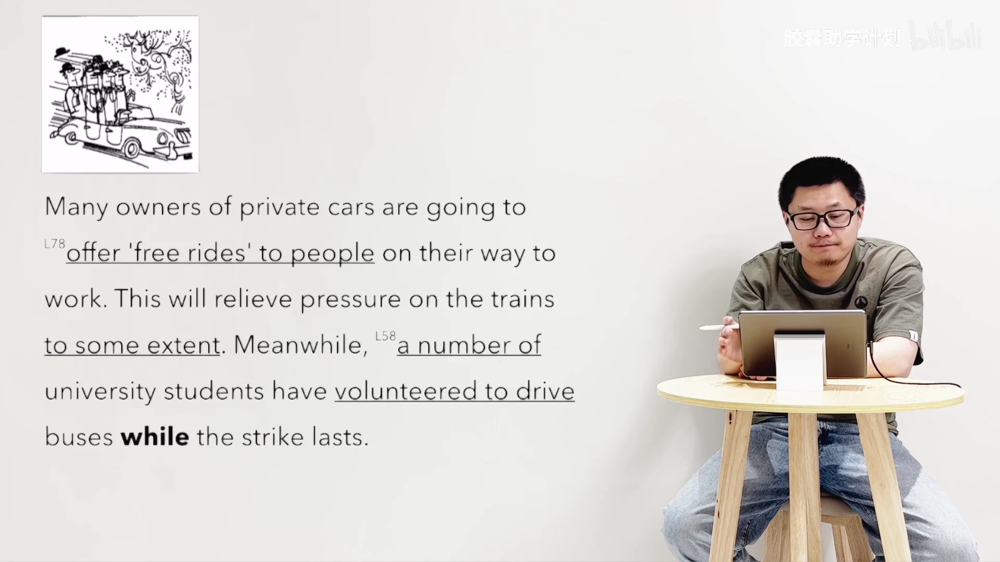

文字识别：Many owners of private cars are going to / L78 / 'offer 'free rides' to people on their way to / work. This will relieve pressure on the trains / to some extent. Meanwhile, 5a number of / university students have volunteered to drive / buses while the strike lasts.

### 画面 00:05:59

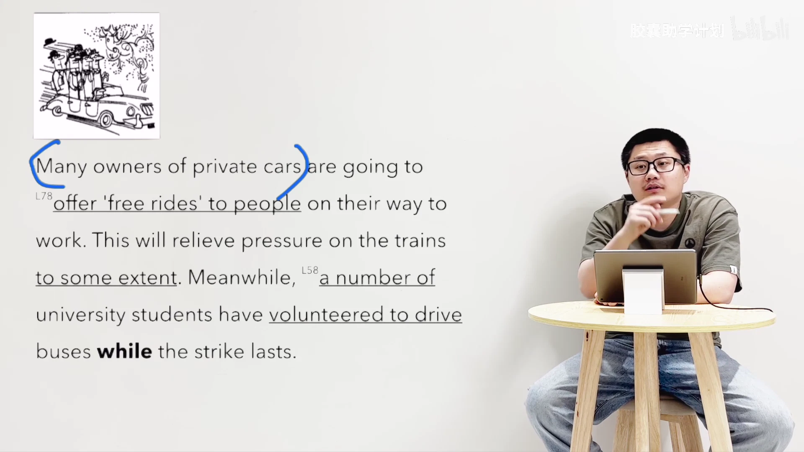

文字识别：Many owners of private cars are going to / L78 / offer'free rides' to people on their way to / work. This will relieve pressure on the trains / to some extent. Meanwhile, L5a number of / L58 / university students have volunteered to drive / buses while the strike lasts.

## 00:06:00–00:06:30

something，其实就跟那个 give 早在新一二十一课咱们学过 give somebody something， give something to somebody 没什么本质区别，这儿只不过给它换成了叫 offer something to somebody，对吧？叫提供免费的搭乘给人们，对吧？给人们提供免费的搭乘。 On their way to work，顺风车嘛，在他们上班的路上免费搭乘别人，对吧？你可以坐我的车，没有问题，我不让钱啊。

### 画面 00:06:02

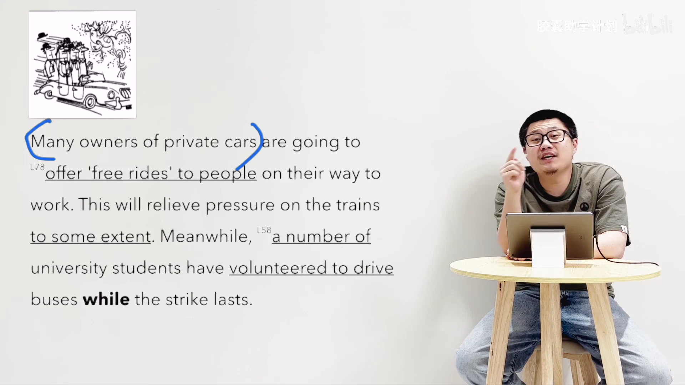

文字识别：Many owners of private cars are going to / L78 / offer'free rides' to people on their way to / work. This will relieve pressure on the trains / to some extent. Meanwhile, 58a number of / L58 / university students have volunteered to drive / buses while the strike lasts.

### 画面 00:06:25

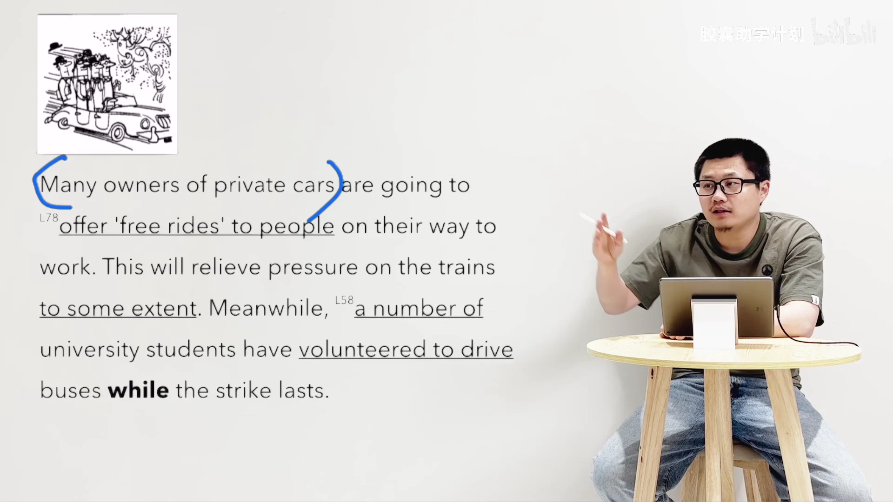

文字识别：Many owners of private cars are going to / L78 / offer'free rides' to people on their way to / work. This will relieve pressure on the trains / to some extent. Meanwhile, 5a number of / university students have volunteered to drive / buses while the strike lasts.

## 00:06:30–00:07:00

This will relieve pressure on the trains to some extent.说这将减缓压力对什么的压力呢？对于轨道交通啊，trains轨道交通to some extent叫做在某种程度上。注意这个地方的trains，你脑海当中，因为每个国家真的特别不一样。比如说，如果你去过日本，你就能理解它的trains和我们的trains的感受是不一样的。如果你把它翻译成纯是火车，你会觉得这是城

### 画面 00:06:49

文字识别：Many owners of private cars are going to / L78 / offer'free rides' to people on their way to / work. This will relieve pressure on the trains / to some extent. Meanwhile, 5a number of / university students have volunteered to drive / buses while the strike lasts.

### 画面 00:06:51

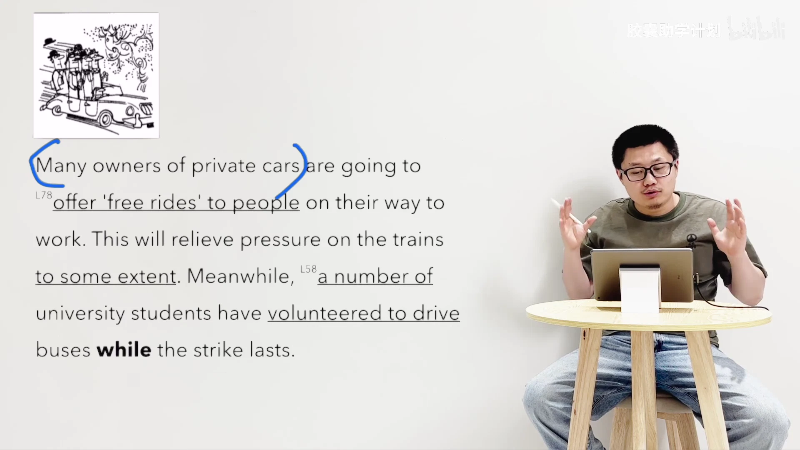

文字识别：Many owners of private cars are going to / L78 / offer'free rides' to people on their way to / work. This will relieve pressure on the trains / to some extent. Meanwhile, 5a number of / university students have volunteered to drive / buses while the strike lasts.

### 画面 00:06:53

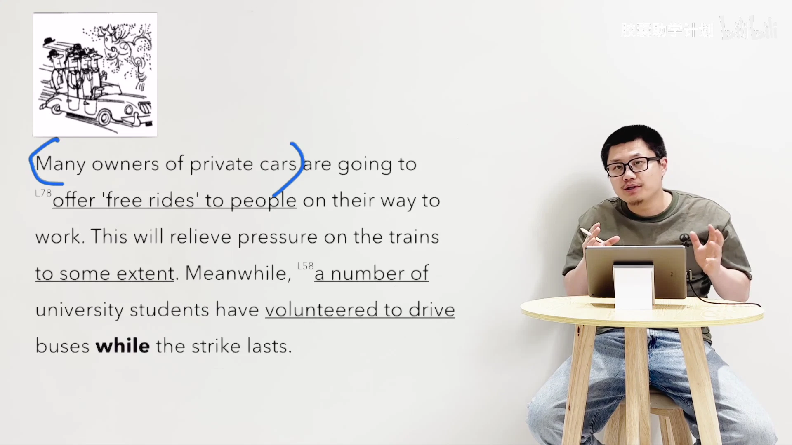

文字识别：Many owners of private cars are going to / L78 / offer'free rides' to people on their way to / work. This will relieve pressure on the trains / to some extent. Meanwhile, 58a number of / university students have volunteered to drive / buses while the strike lasts.

## 00:07:00–00:07:30

市和城市之间，你会有一种纳闷的感觉，因为中国并不是大多数人是在室内工作，而不是跨市去工作。而各位中国人脑海当中，这个 trains 呢都是跨市的火车嘛，对吧？坐我从，比如说北京去去去沈阳，对吧？哎，它是跨市的，你很少能想象到说这个一个人在沈阳居住，每天坐火车来北京上班，对吧？所以你会有一个蒙圈的感觉，

### 画面 00:07:18

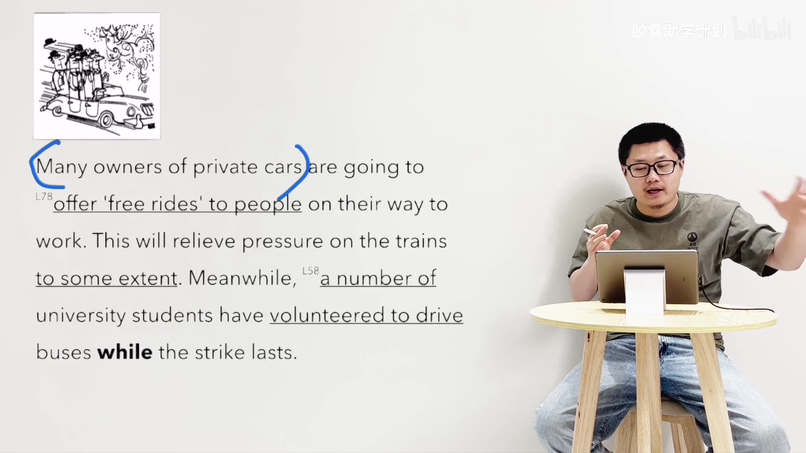

文字识别：Many owners of private cars are going to / L78 / offer'free rides' to people on their way to / work. This will relieve pressure on the trains / NUI / to some extent. Meanwhile, L5⁸a number of / L58 / university students have volunteered to drive / buses while the strike lasts.

### 画面 00:07:27

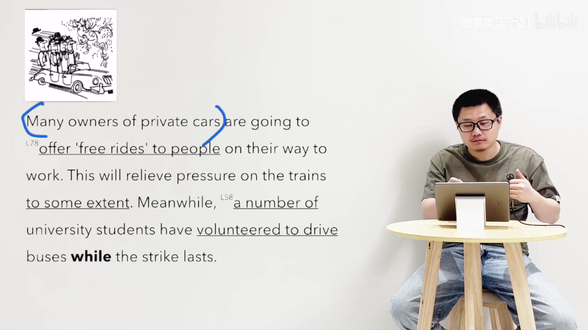

文字识别：Many owners of private cars are going to / L78 / offer'free rides' to people on their way to / work. This will relieve pressure on the trains / to some extent. Meanwhile, 58a number of / university students have volunteered to drive / buses while the strike lasts.

## 00:07:30–00:08:00

叫公交车司机这个上班和我这个 trains 有什么联系呢？所以它这个 trains 普遍指的是一种轨道交通。所以你比如说什么轻轨呀，对吧？比如说地铁呀，你全给它统称为 trains，是问题不是特别大的啊，这样就好理解了，对吧？轻轨呀，地铁呀，对吧？啊，你这个你就理解，你像北京啊，北京有很多条线儿，像五号线、八通线，它不都是在室内是地下，走着走着就跑地上去了，包括四号线，对吧？

### 画面 00:07:57

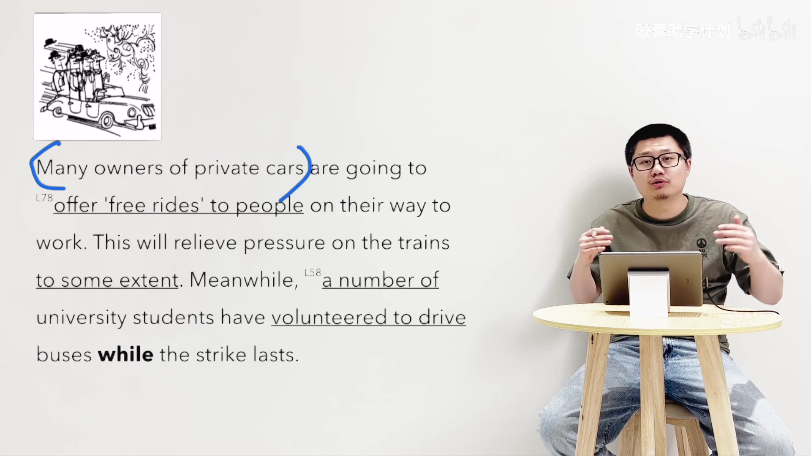

文字识别：Many owners of private cars are going to / L78 / offer'free rides' to people on their way to / work. This will relieve pressure on the trains / to some extent. Meanwhile, L5a number of / L58 / university students have volunteered to drive / buses while the strike lasts.

## 00:08:00–00:08:30

走跑大兴来就跑地上去了嘛，它就变轻轨嘛，对吧？所以统称为 trains 就可以啊。这儿你要明白一下，别懵啊，别以为是火车。Meanwhile，与此同时。In the same time，对吧？A number of university students have volunteered to drive buses while the strike lasts. A number of 五十八课咱们学过，就类似于 several some， OK，一些 university students，有

### 画面 00:08:01

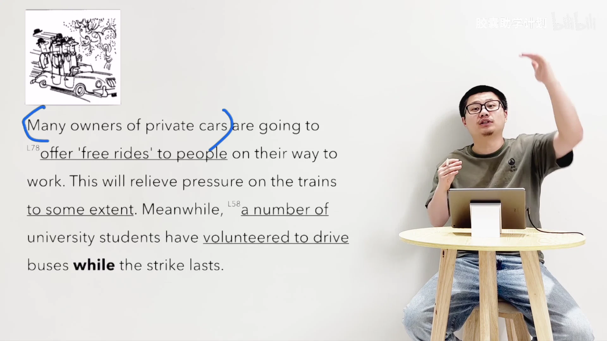

文字识别：Many owners of private cars are going to / L78 / offer'free rides' to people on their way to / work. This will relieve pressure on the trains / to some extent. Meanwhile, 5⁸a number of / L58 / university students have volunteered to drive / buses while the strike lasts.

### 画面 00:08:03

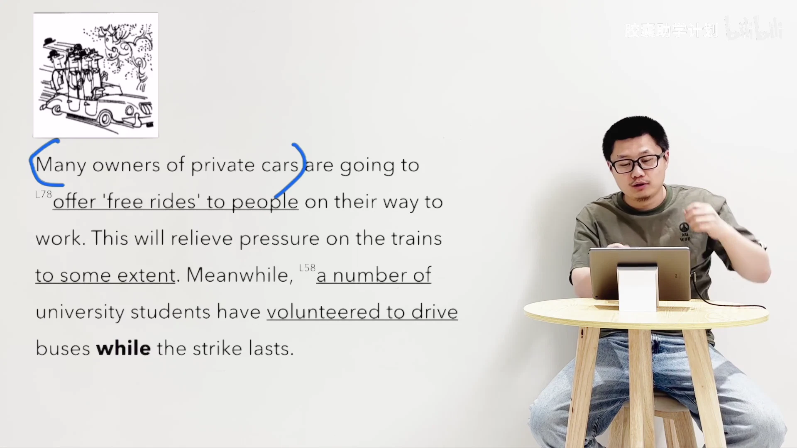

文字识别：Many owners of private cars are going to / L78 / offer'free rides' to people on their way to / work. This will relieve pressure on the trains / NU / to some extent. Meanwhile, 5a number of / university students have volunteered to drive / buses while the strike lasts.

### 画面 00:08:06

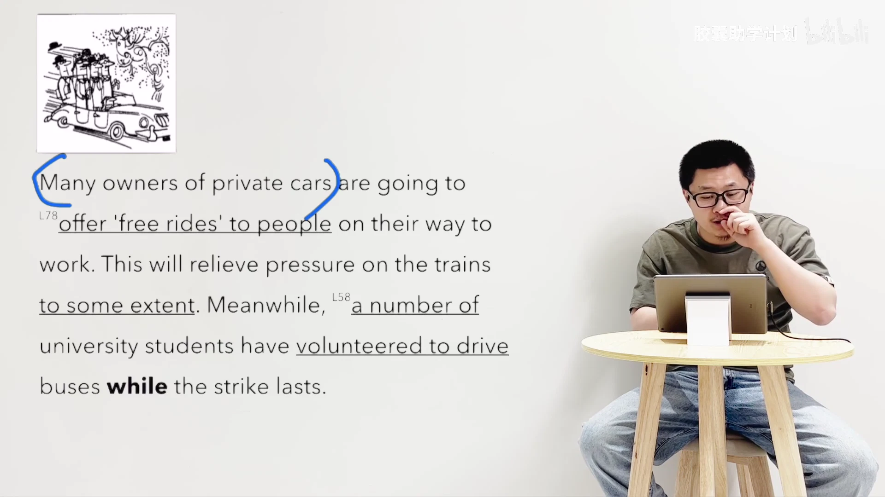

文字识别：Many owners of private cars are going to / L78 / offer'free rides' to people on their way to / W / work. This will relieve pressure on the trains / to some extent. Meanwhile, L5a number of / L58 / university students have volunteered to drive / buses while the strike lasts.

### 画面 00:08:09

文字识别：Many owners of private cars are going to / L78 / offer'free rides' to people on their way to / work. This will relieve pressure on the trains / to some extent. Meanwhile, 5⁸a number of / L58 / university students have volunteered to drive / buses while the strike lasts.

## 00:08:30–00:09:00

一些大学的学生已经 volunteer to do something,志愿去开公交车。当这个罢工持续的这个过程当中啊，这个last咱们刚才刚说对吧？啊，除了last week表示上一个这样的一个意思以外，它表动词，它有动词的含义，表示的是持续，对吧？你比如说，经常有一句话叫做 nothing nothing lasts forever，是吧？没有任何事情能永远的持续下去。

### 画面 00:08:39

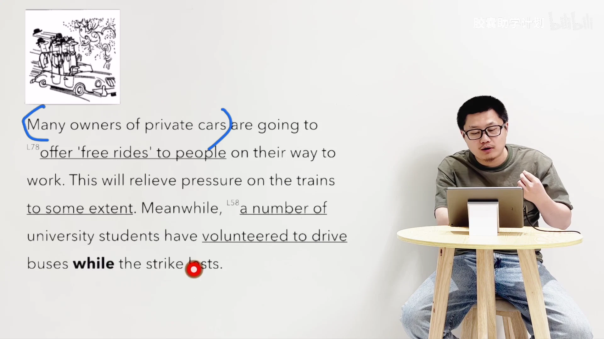

文字识别：Many owners of private cars are going to / L78 / offer'free rides' to people on their way to / work. This will relieve pressure on the trains / to some extent. Meanwhile, L5a number of / L58 / university students have volunteered to drive / buses while the strike / sts.

### 画面 00:08:53

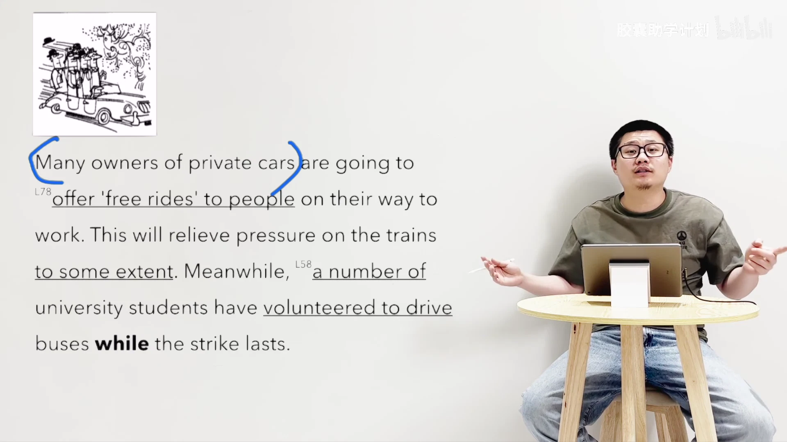

文字识别：Many owners of private cars are going to / L78 / offer'free rides' to people on their way to / work. This will relieve pressure on the trains / to some extent. Meanwhile, L5a number of / L58 / university students have yolunteered to drive / buses while the strike lasts.

### 画面 00:08:55

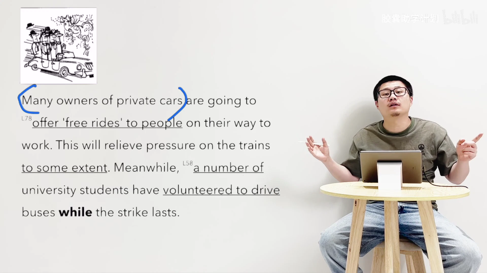

文字识别：Many owners of private cars are going to / L78 / offer 'free rides' to people on their way to / work. This will relieve pressure on the trains / to some extent. Meanwhile, L5a number of / L58 / university students have volunteered to drive / buses while the strike lasts.

### 画面 00:08:57

文字识别：Many owners of private cars are going to / L78 / offer'free rides' to people on their way to / work. This will relieve pressure on the trains / to some extent. Meanwhile, L5a number of / L58 / university students have volunteered to drive / buses while the strike lasts.

### 画面 00:08:59

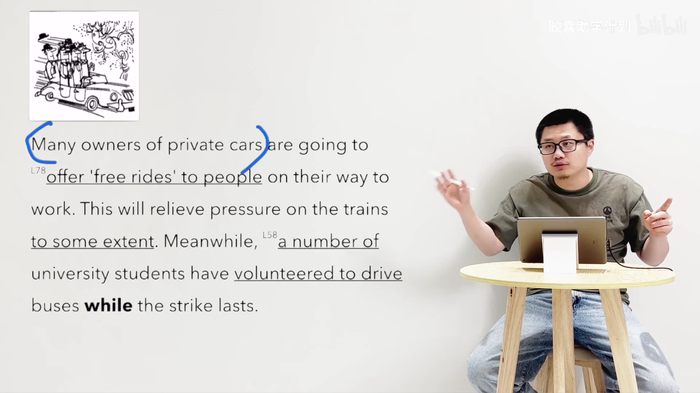

文字识别：Many owners of private cars are going to / L78 / offer'free rides' to people on their way to / work. This will relieve pressure on the trains / to some extent. Meanwhile, 5a number of / university students have volunteered to drive / buses while the strike lasts.

## 00:09:00–00:09:30

就像汉语说那句话叫“天下没有不散的宴席”，对吧？好，let's continue. All the students are expert drivers, but before they drive any of the buses, they will have to pass a special test. 哎，我已经帮您画好了，对吧？这怎么画的呢？啊，还是要分享一下。这首先这有一个连词

### 画面 00:09:05

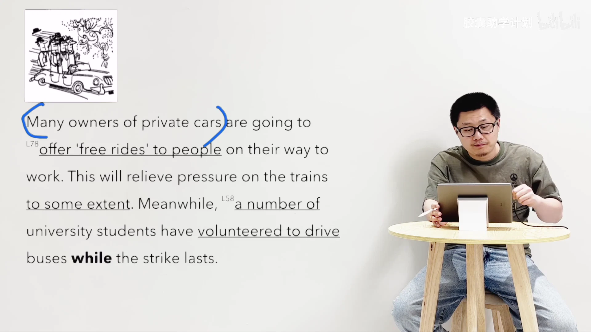

文字识别：Many owners of private cars are going to / L78 / offer'free rides' to people on their way to / work. This will relieve pressure on the trains / to some extent. Meanwhile, 5a number of / university students have yolunteered to drive / buses while the strike lasts.

### 画面 00:09:07

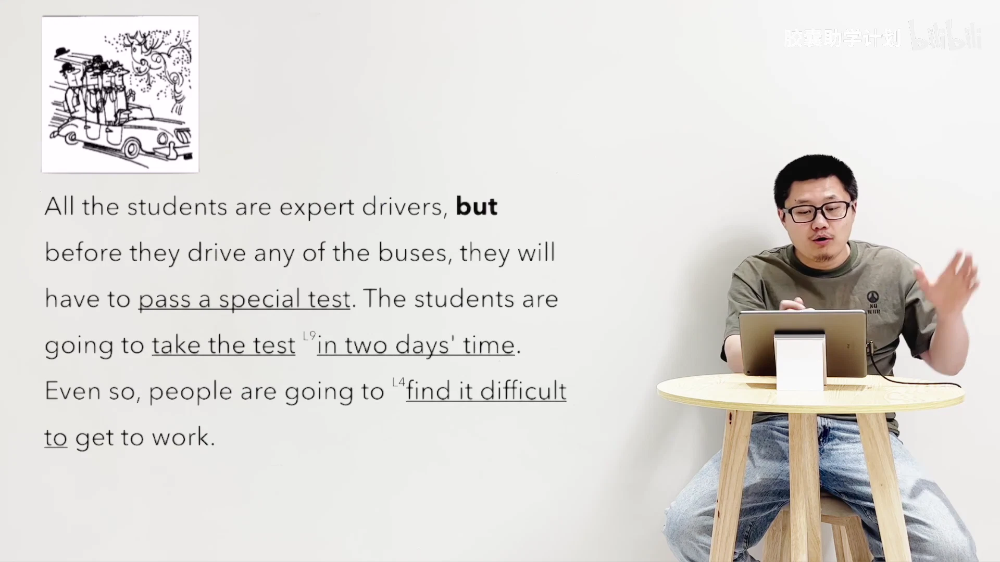

文字识别：All the students are expert drivers, but / before they drive any of the buses, they will / have to pass a special test. The students are / WII / NU / going to take the test 'in two days'time. / Even so, people are going to 4find it difficult / to get to work.

## 00:09:30–00:10:00

嘛，我一看很容易能理解。第二，这有个逗号嘛，我很容易就断个句，对吧？说所有的学生都是开车方面的专家，哎，都是开车方面的专家啊。他其实稍微有点夸张哈，但是就是告诉你都是老司机啊。翻译成汉语就都老司机了。但是呢，before they drive any of the buses，在他们开任何公交车之前，他们将必须或者不得不

### 画面 00:09:36

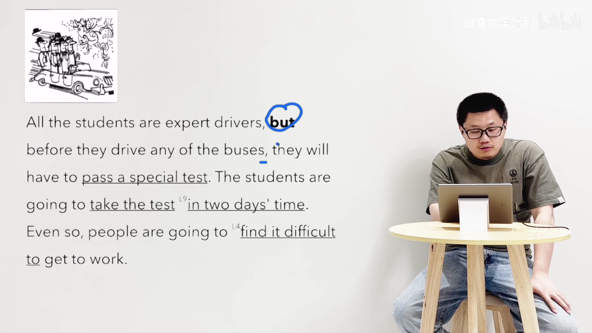

文字识别：All the students are expert drivers, / before they drive any of the buses, they will / have to pass a special test. The students are / NO / WIR / going to take the test 'in two days'time. / Even so, people are going to find it difficult / to get to work.

## 00:10:00–00:10:30

哎，will have to，这咱们之前就学过了，对吧？将必须或不得不，啊，pass a special test，这个其实就是语法那个地方，我说在文章我们会学的那个嘛，叫做通过一个特殊的测试，啊，也是本科的一个习惯用法，我们会造句的。一会儿，它其实都是字面意思啊，通过一个特殊的测试，不是很难的习惯用法，字面意思能猜出来。The students are going to take the test in

### 画面 00:10:06

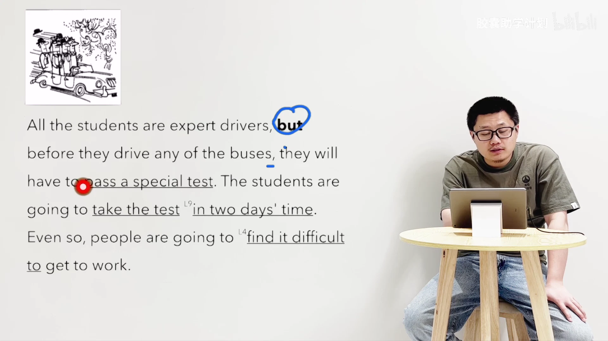

文字识别：All the students are expert drivers, / before they drive any of the buses, they will / have to / pass a special test. The students are / NIR / going to take the test 'in two days'time. / Even so, people are going to find it difficult / to get to work.

## 00:10:30–00:11:00

two days' time.就这些学生啊，要接受这个测试啊，考这个就或者去考这个试。两天后，Even so,尽管如此，Even就啊，尽管是啊，哪怕是这样，其实可以这样翻译，对吧？So指的是this，就是上面这些事儿，什么事儿呢？就是什么私家车司机又给你免费搭乘，然后呢，学生又愿意去开公交车，哎哎，尽管这样，哎，就指的是

### 画面 00:10:36

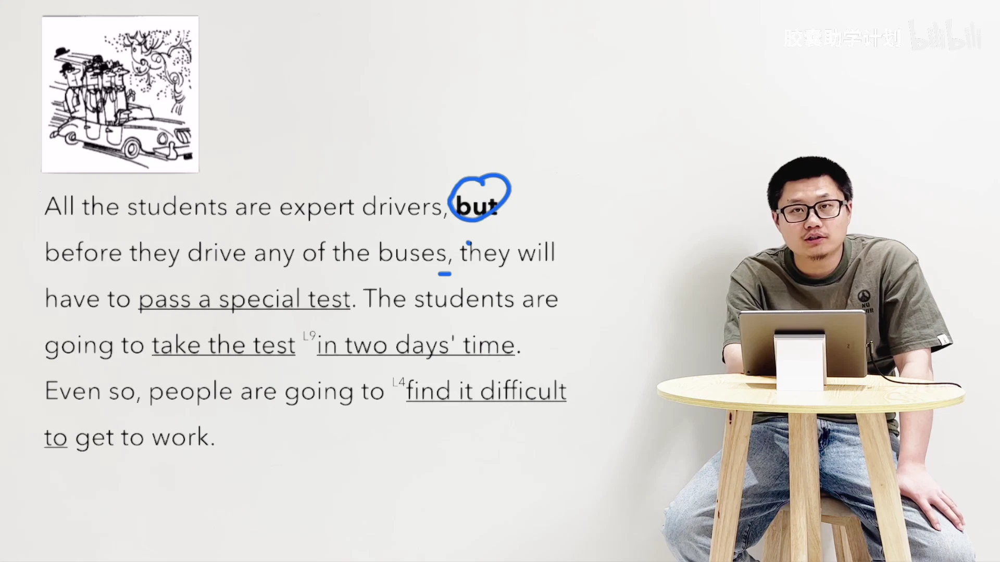

文字识别：All the students are expert drivers, / before they drive any of the buses, they will / have to pass a special test. The students are / NIR / going to take the test 'in two days'time. / Even so, people are going to find it difficult / to get to work.

### 画面 00:10:50

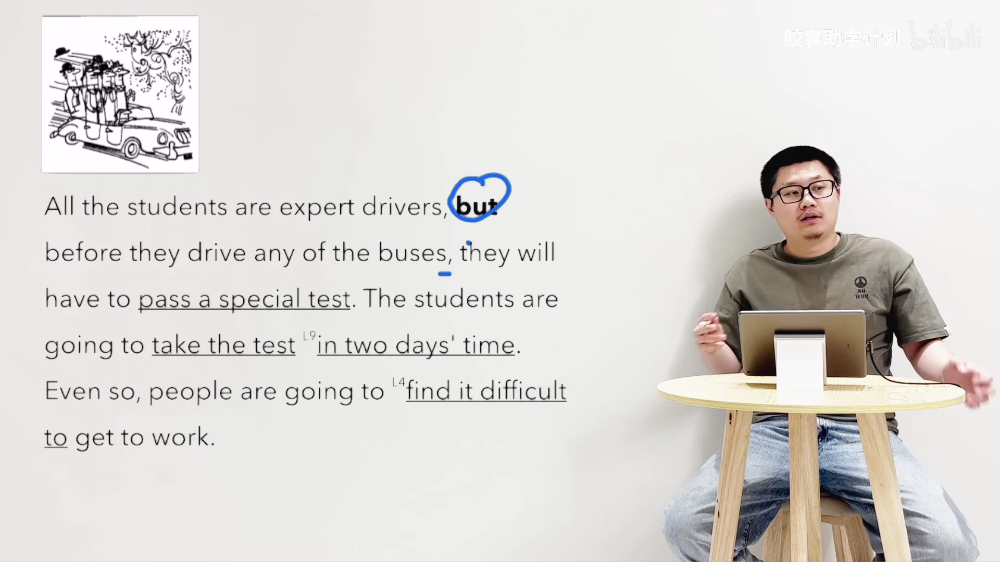

文字识别：All the students are expert drivers, / before they drive any of the buses, they will / have to pass a special test. The students are / NU / WIE / going to take the test 'in two days'time. / Even so, people are going to 4find it difficult / to get to work.

## 00:11:00–00:11:30

刚才我说这些事儿。People are going to find it difficult to get work.说人们依旧会怎么样呢？会发现，会觉得这个事儿很难。会 find it difficult，会觉得这件事情很难。哪件事情呢？To get to work，去工作的这件事情会觉得很难。这个你要是真从语法的角度去分析它，它就又麻烦了。不用从语法的角度去分析，直接就是单词去理解。为什么？因为人

### 画面 00:11:02

文字识别：All the students are expert drivers, / before they drive any of the buses, they will / have to pass a special test. The students are / going to take the test 'in two days'time. / Even so, people are going to find it difficult / to get to work.

## 00:11:30–00:12:00

类的基本逻辑你是有的。如果我直接不给后边那句话，什么叫你是有人类基本逻辑的？叫做我如果只让你看这句话，不给你任何上下文场景，你一定会问我一个问题，叫做it指代的是啥？这是你翻译成汉语了之后，你人类的逻辑决定的，你就想问，因为你跟我说说人们会觉得它很难，你一定会问我你指的是啥很难？那你再往后读这个啥就自然而然就补充

### 画面 00:11:32

文字识别：All the students are expert drivers, / before they drive any of the buses, they will / have to pass a special test. The students are / going to take the test 'in two days'time. / Even so, people are going to find it difficult / to get to work.

### 画面 00:11:36

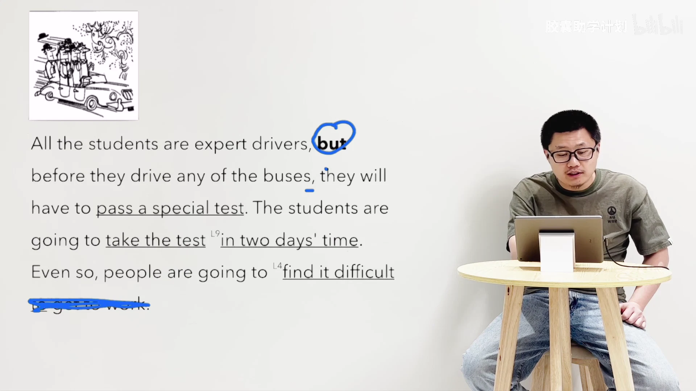

文字识别：All the students are expert drivers, / before they drive any of the buses, they will / have to pass a special test. The students are / NO / going to take the test 'in two days'time. / Even so, people are going to find it difficult

### 画面 00:11:38

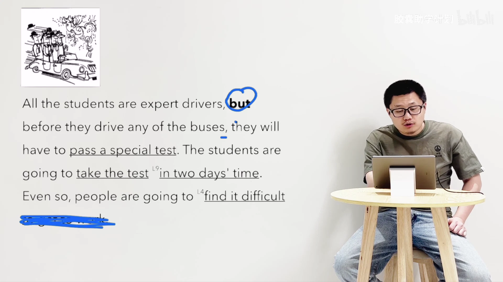

文字识别：All the students are expert drivers, / before they drive any of the buses, they will / have to pass a special test. The students are / NIR / going to take the test 'in two days'time. / Even so, people are going to 4find it difficult

### 画面 00:11:40

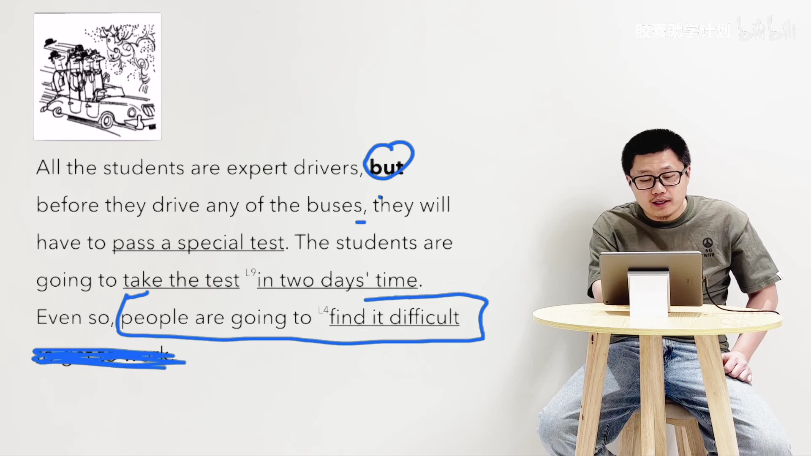

文字识别：All the students are expert drivers, / before they drive any of the buses, they will / have to pass a special test. The students are / going to take the test 'in two days'time. / Even so,people are going to 4find it difficult

### 画面 00:11:42

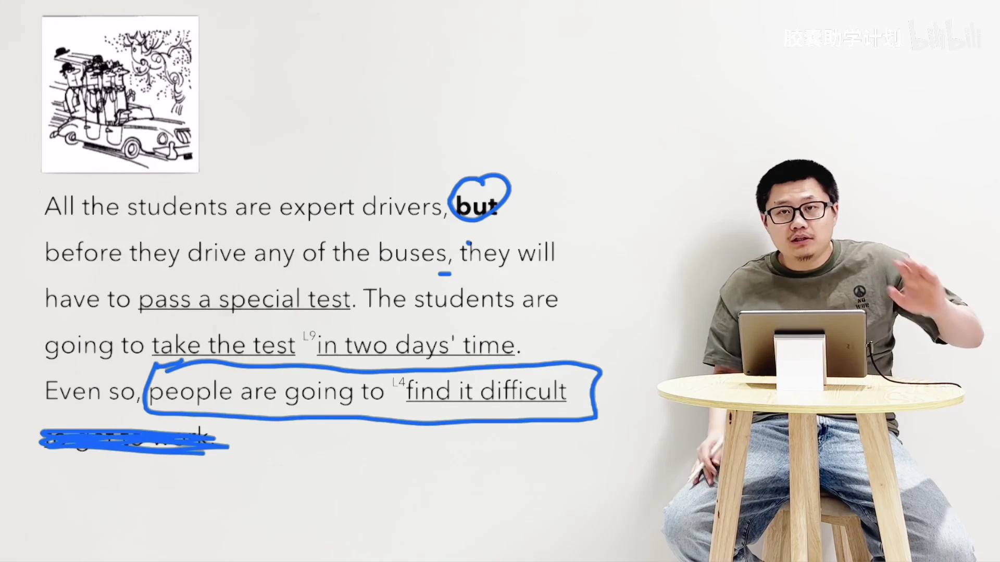

文字识别：All the students are expert drivers, / before they drive any of the buses, they will / have to pass a special test. The students are / going to take the test "'in two days' time. / Even so,people are going to 4find it difficult

### 画面 00:11:44

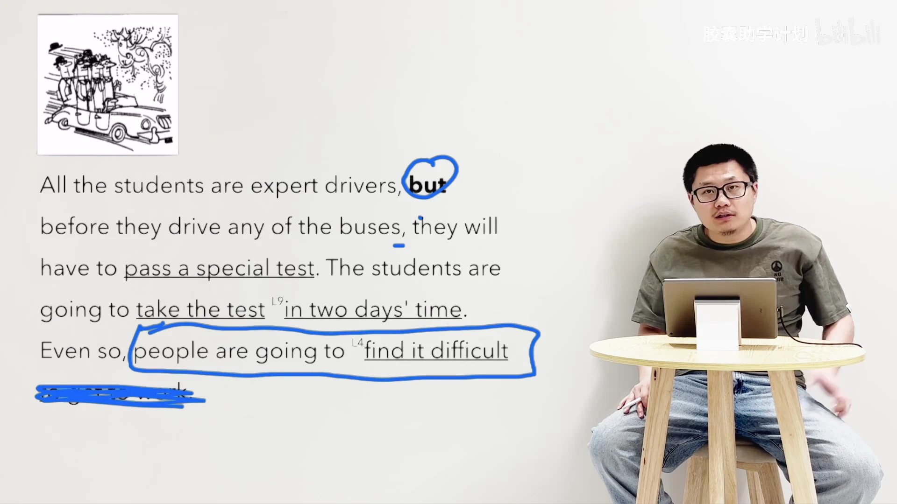

文字识别：All the students are expert drivers, / before they drive any of the buses, they will / have to pass a special test. The students are / going to take the test "'in two days' time. / Even so,people are going to 4find it difficult

### 画面 00:11:46

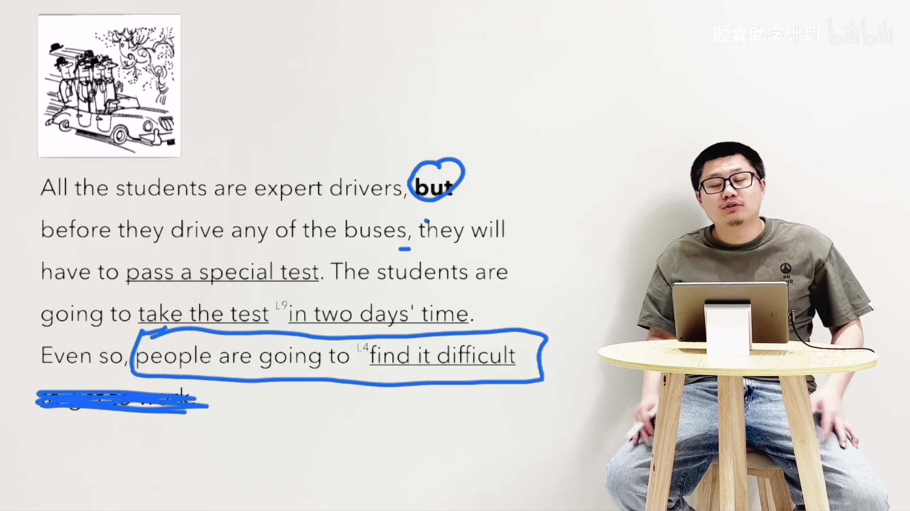

文字识别：All the students are expert drivers, / before they drive any of the buses, they will / have to pass a special test. The students are / NU / going to take the test 'in two days'time. / Even so,people are going to 4find it difficult

### 画面 00:11:57

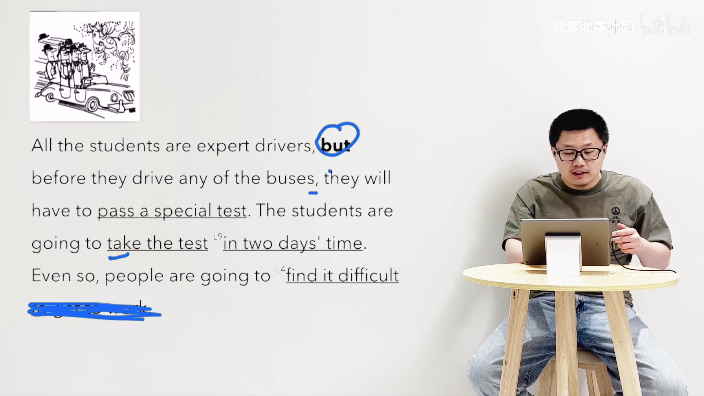

文字识别：All the students are expert drivers, / before they drive any of the buses, they will / have to pass a special test. The students are / WIR / NU / going to take the test 'in two days'time. / Even so, people are going to 4find it difficult

### 画面 00:11:59

文字识别：All the students are expert drivers, / before they drive any of the buses, they will / have to pass a special test. The students are / going to take the test 'in two days'time. / Even so, people are going to find it difficult / to get to work.

## 00:12:00–00:12:30

了，叫做去上班很难，对吧？好，最后一块啊，But so far，但是截止到目前为止，The public has expressed its gratitude to the students in letters to the press。截止到目前为止呢，说公共公众啊，就是大众已经怎么样了呢？说哎，持续不断的在express its gratitude to somebody，说在表

### 画面 00:12:01

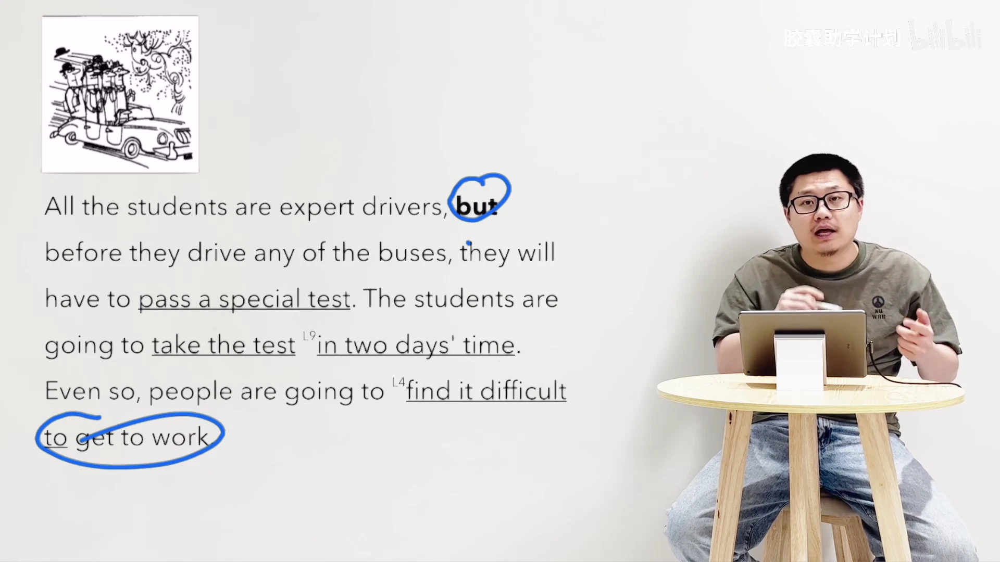

文字识别：All the students are expert drivers, / before they drive any of the buses, they will / have to pass a special test. The students are / going to take the test 'in two days'time. / Even so, people are going to 4find it difficult / to / get to work

### 画面 00:12:03

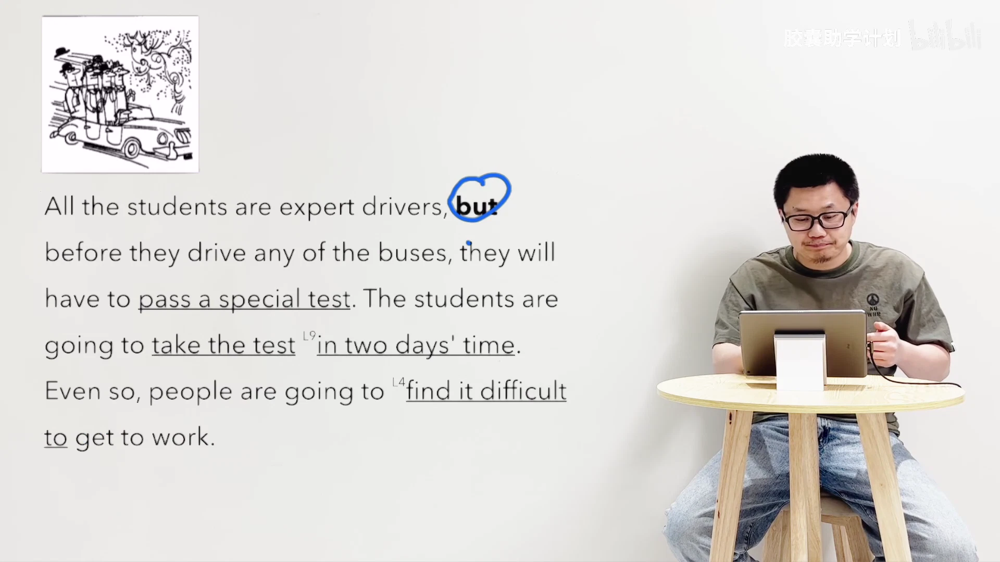

文字识别：All the students are expert drivers, / before they drive any of the buses, they will / have to pass a special test. The students are / going to take the test 'in two days'time. / Even so, people are going to find it difficult / to get to work.

### 画面 00:12:05

文字识别：But so far, the public has expressed its / gratitude to the students in letters to the / Press. 7°Only one or two people have / objected that the students will drive too fast!

### 画面 00:12:08

文字识别：Out so far, the public has expressed its / gratitude to the students in letters to the / Press. 79Only one or two people have / objected that the students will drive too fast!

## 00:12:30–00:13:00

达他们的这种感激和感谢给谁呢？给学生。In letters，在信里面给谁的信里面呢？To the press，给新闻界的这些邮件、信封、哎信件当中表达感激。最后补了一小句话，这小句话我倒觉得挺有趣。Only one or two people have objected that。说只有一或两个人，哎，就这么几个人嘛，一到两个人。

### 画面 00:12:38

文字识别：But so far, the public has expressed its / gratitude to the students in letters to the / Press. 7°Only one or two people have / objected that the students will drive too fast!

### 画面 00:12:42

文字识别：But so far, the public has expressed its / gratitude to the students in letters to the / Press. 79Only one or two people have / objected that the students will drive too fast!

### 画面 00:12:47

文字识别：But so far, the public has expressed its / gratitude to the students in letters to the / Press. 79Only one or two people have / objected that the students will drive too fast!

## 00:13:00–00:13:30

哎，其实它有点像一个呃汉语里边的这个虚词。我们说九重天，并不是真的是九层，是吧？这个三六九很多不都是这个虚词嘛，是吧？啊，这个 one or two people，你也不用细细聊，就是人不多的意思。哎，字面意思就是一两个啊。说仅仅只有一两个人，怎么样了呢？说已经反对了，反对说什么呢？说的是 the students will drive too fast。说这

### 画面 00:13:17

文字识别：But so far, the public has expressed its / gratitude to the students in letters to the / Press. 79Only one or two people have / objected that the students will drive too fast!

## 00:13:30–00:14:00

bunch of students, hormones are secreted excessively, right? Driving always wants to race, right? Is against. Why? Because this bunch of students, driving is always too fast, right? I can't stand it, like racing. Just come up with such a sentence, which is very interesting. In this place, why did I mark only this place as seventy-nine? This depends on how well you learned seventy-nine lessons. Seventy-nine lessons. If I ask this question, you won't. You go back to seventy-nine lessons of grammar. Do you hear me? The problem is, why is there no inversion here? Why is there no

### 画面 00:13:31

文字识别：But so far, the public has expressed its / gratitude to the students in letters to the / Press. 79Only one or two people have / objected that the students will drive too fast!

### 画面 00:13:58

文字识别：But so far, the public has expressed its / gratitude to the students in letters to the / Press. 7°Only one or two people have / objected that the students will drive too fast!

## 00:14:00–00:14:30

没倒装？为什么没把 have 提到这里来？七十九课我讲的就是 only 放在句首的时候要倒装，但当时专门提了一句，有一种情况别倒装，在这儿出现了。您能不能想起来？如果不能想起来，在这儿我也不会讲了。你翻到七十九课，认真再去看一遍，你不亏，学习越主动效果越好啊！不多说了，接下来两个习惯用法，咱们直接造句。第一个 be due to

### 画面 00:14:01

文字识别：But so far, the public has expressed its / gratitude to the students in letters to the / Press. 7°Only one or two people have / objected that the students will drive too fast!

### 画面 00:14:03

文字识别：But so far, the public has expressed its / gratitude to the students in letters to the / Press. 7°Onlyone or two people have / objected that the students will drive too fast!

### 画面 00:14:25

文字识别：习惯用法造句 / be due to do... / pass/take the test

### 画面 00:14:27

文字识别：习惯用法造句 / be due to do... / pass/take the test

### 画面 00:14:29

文字识别：网：v.+v.变化 / if someone is due to do something, / 习惯用法造句指南 / 妻助学计划 / 四句型转换 / they are expected to do it or going to / do it: / 方式/地点/时间 / 其他习惯用法 / 其他单词+词性 / 原文摘抄+变 / 6123456 / be due to do..

## 00:14:30–00:15:00

啊，这个呢，我们直接先这个看一下英文翻译。If someone is due to do something，如果他要 do to do something 了，怎么样呢？They are expected to do it or going to do it。说他们被期待去做某件事情，或者是就计划会去做它。你看，直接都说了，or going to do it， be going to do嘛？啊，我说了嘛？我说如果你记不住，你就模

### 画面 00:14:31

文字识别：网：v.+v.变化 / if someone is due to do something, / 习惯用法造句指南 / 妻助字计划 / 四句型转换 / they are expected to do it or going to / do it: / 方式/地点/时间 / 其他习惯用法 / 其他单词+词性 / 原文摘抄+变 / 6123456 / be due to do...

### 画面 00:14:35

文字识别：网：v.+v.变化 / if someone is due to do something, / 习惯用法造句指南 / 臺助字计划 / 四句型转换 / they are expected to do it or going to / do it: / 方式/地点/时间 / 其他习惯用法 / 其他单词+词性 / 原文摘抄+变 / 6123456 / be due to do...

### 画面 00:14:41

文字识别：网：v.+v.变化 / if someone is due to do something, / 习惯用法造句指南 / 辜助字计划 / 四句型转换 / they are expected to do it or going to / do it: / 方式/地点/时间 / 其他习惯用法 / 其他单词+词性 / 原文摘抄+变 / 6123456 / be due to do...

### 画面 00:14:45

文字识别：网：v.+v.变化 / if someone is due to do something, / 习惯用法造句指南 / 臺助字计划 / 四句型转换 / they are expected to do it or going / do it: / 方式/地点/时间 / 其他习惯用法 / 其他单词+词性 / 原文摘抄+变 / 6123456 / be due to do...

### 画面 00:14:50

文字识别：网：v.+v.变化 / if someone is due to do something, / 习惯用法造句指南 / 妻助字计划 / 四句型转换 / they are expected to do it or going to / do it: / 方式/地点/时间 / 其他习惯用法 / 其他单词+词性 / 原文摘抄+变 / 6123456 / be due to do...

### 画面 00:14:55

文字识别：网：v.+v.变化 / if someone is due to do something, / 习惯用法造句指南 / 四句型转换 / they are expected to do it or going to / do it: / 方式/地点/时间 / 其他习惯用法 / 其他单词+词性 / 原文摘抄+变 / 6123456 / be due to do..

## 00:15:00–00:15:30

糊的记住，它就类似于 be going to do，没有任何问题啊。比如说，你看，我们造一句话，The former president, 前总统, is due to arrive here in New York later next month. Is due to arrive here. 定期啊，定于这个要要定在哎，要到达这里，对吧？定期到达这里，呃，到纽约，哎，这个稍后啊，嗯，下个月。那你看这里什么？其实就是 is going to arrive here，听到了吧？

### 画面 00:15:00

文字识别：网：v.+v.变化 / if someone is due to do something, / 习惯用法造句指南 / 臺助字计划 / 四句型转换 / they are expected to do it or going to / do it: / 方式/地点/时间 / 其他习惯用法 / 其他单词+词性 / 原文摘抄+变 / 6123456 / be due to do...

### 画面 00:15:03

文字识别：网：v.+v.变化 / if someone is due to do something, / 习惯用法造句指南 / 四句型转换 / they are expected to do it or going to / do it: / 方式/地点/时间 / 其他习惯用法 / 其他单词+词性 / 原文摘抄+变 / 6123456 / be due to do... /  The former president is due to / arrive here in New York later next month.

### 画面 00:15:05

文字识别：网：v.+v.变化 / if someone is due to do something, / 习惯用法造句指南 / 四句型转换 / they are expected to do it or going to / do it: / 方式/地点/时间 / 其他习惯用法 / 其他单词+词性 / 原文摘抄+变 / 6123456 / be due to do... /  The former president is due to / arrive here in New York later next month.

### 画面 00:15:08

文字识别：网：v.+v.变化 / if someone is due to do something, / 习惯用法造句指南 / 四句型转换 / they are expected to do it or going to / do it: / 方式/地点/时间 / 其他习惯用法 / 其他单词+词性 / 原文摘抄+变 / 6123456 / be due to do... /  The former president is due to / arrive here in New York later next month.

### 画面 00:15:10

文字识别：网：v.+v.变化 / if someone is due to do something, / 习惯用法造句指南 / 计划 / 四句型转换 / they are expected to do it or going to / do it: / 方式/地点/时间 / 其他习惯用法 / 其他单词+词性 / 原文摘抄+变 / 6123456 / be due to do... /  The former president is due to / arrive here in New York later next month.

### 画面 00:15:15

文字识别：网：v.+v.变化 / if someone is due to do something, / 习惯用法造句指南 / 字计划 / 四句型转换 / they are expected to do it or going to / do it: / 方式/地点/时间 / 其他习惯用法 / 其他单词+词性 / 原文摘抄+变 / 6123456 / be due to do... /  The former president is due to / arrive here in New York later next month.

### 画面 00:15:25

文字识别：网：v.+v.变化 / if someone is due to do something, / 习惯用法造句指南 / 四句型转换 / they are expected to do it or going to / do it: / 方式/地点/时间 / 其他习惯用法 / 其他单词+词性 / 原文摘抄+变 / 6123456 / be due to do... /  The former president is due to / arrive here in New York later next month.

## 00:15:30–00:16:00

好，就类似，很像，很像。The captain is due to leave in a few hours. 什么意思呢？就是说，他定在了几个小时之后离开这里，对吧？好，再来说，We are due to receive two thousand dollars from you in one week. 说我们应该在呃这个一周之后，从您那儿应该能接受到什么呢？两千美元，对吧？Okay, very good. 下一个 pass 或者是 take the test. 那注

### 画面 00:15:30

文字识别：网：v.+v.变化 / if someone is due to do something, / 习惯用法造句指南 / 四句型转换 / they are expected to do it or going to / do it: / 方式/地点/时间 / 其他习惯用法 / 其他单词+词性 / 原文摘抄+变 / 6123456 / be due to do... /  The former president is due to / arrive here in New York later next month. /  The captain is due to leave in a few hours.

### 画面 00:15:35

文字识别：网：v.+v.变化 / if someone is due to do something, / 习惯用法造句指南 / 毫助学计划 / 四句型转换 / they are expected to do it or going to / do it: / 方式/地点/时间 / 其他习惯用法 / 其他单词+词性 / 原文摘抄+变 / 6123456 / be due to do... /  The former president is due to / arrive here in New York later next month. /  The captain is due to leave in a few hours.

### 画面 00:15:40

文字识别：网：v.+v.变化 / if someone is due to do something, / 习惯用法造句指南 / 四句型转换 / they are expected to do it or going to / do it: / 方式/地点/时间 / 其他习惯用法 / 其他单词+词性 / 原文摘抄+变 / 6123456 / be due to do... /  The former president is due to / arrive here in New York later next month. / The captain is due to leave in a few hours. /  We are due to receive 2,000 dollars from / you in one week. L4

### 画面 00:15:45

文字识别：网：v.+v.变化 / if someone is due to do something, / 习惯 / 延字计划 / 四句型转换 / they are expected to do it or going to / 用法造句指南 / do it: / 方式/地点/时间 / 其他习惯用法 / 其他单词+词性 / 原文摘抄+变 / 6123456 / be due to do... /  The former president is due to / arrive here in New York later next month. / The captain is due to leave in a few hours. /  We are due to receive 2,000 dollars from / you in one week. L4

### 画面 00:15:50

文字识别：网：v.+v.变化 / if someone is due to do something, / 习惯用法造句指南 / 字计划 / 四句型转换 / they are expected to do it or going to / do it: / 方式/地点/时间 / 其他习惯用法 / 其他单词+词性 / 原文摘抄+变 / 6123456 / be due to do... /  The former president is due to / arrive here in New York later next month. / The captain is due to leave in a few hours. /  We are due to receive 2,000 dollars from / you in one week. L4

### 画面 00:15:55

文字识别：网：v.+v.变化 / if someone is due to do something, / 习惯用法造句指南 / 四句型转换 / they are expected to do it or going to / do it: / 方式/地点/时间 / 其他习惯用法 / 其他单词+词性 / 原文摘抄+变 / 6123456 / be due to do... /  The former president is due to / arrive here in New York later next month. / The captain is due to leave in a few hours. /  We are due to receive 2,000 dollars from / you in one week. L4

### 画面 00:15:57

文字识别：网：v.+v.变化 / 习惯用法造句指南 / 辜助子计划 / 四句型转换 / 方式/地点/时间 / 其他习惯用法 / 其他单词+词性 / 原文摘抄+变 / 6123456 / pass/take the test

## 00:16:00–00:16:30

意这里其实是原文都出现了pass叫通过，take叫参加，是吧？你可以理解为或者考这个试啊，就是take了。那我们造个句子说，You will be passing the test.这是十三课学的，will be doing，马上也该复习了。在这提前看一眼，说You should have taken the test.哎，你你应该你本应该参加这个测试，你怎么没参加呢？On the following day，刚学啊，第二天，He took the test.他参加了这个测试啊，考

### 画面 00:16:00

文字识别：网：v.+v.变化 / 习惯用法造句指南 / 四句型转换 / 方式/地点/时间 / 其他习惯用法 / 其他单词+词性 / 原文摘抄+变 / 6123456 / pass/take the test

### 画面 00:16:05

文字识别：网：v.+v.变化 / 习惯用法造句指南 / 四句型转换 / 方式/地点/时间 / 其他习惯用法 / 其他单词+词性 / 原文摘抄+变 / 6123456 / pass/take the test /  You will be passing the test. L13

### 画面 00:16:10

文字识别：网：v.+v.变化 / 习惯用法造句指南 / 四句型转换 / 方式/地点/时间 / 其他习惯用法 / 其他单词+词性 / 原文摘抄+变 / 6123456 / pass/take the test /  You will be passing the test. L13

### 画面 00:16:14

文字识别：网：v.+v.变化 / 习惯用法造句指南 / 四句型转换 / 方式/地点/时间 / 其他习惯用法 / 其他单词+词性 / 原文摘抄+变 / 6123456 / pass/take the test /  You will be passing the test. L13 /  You should have taken the test. L65

### 画面 00:16:16

文字识别：网：v.+v.变化 / 习惯用法造句指南 / 四句型转换 / 方式/地点/时间 / 其他习惯用法 / 其他单词+词性 / 原文摘抄+变 / 6123456 / pass/take the test /  You will be passing the test. L13 /  You should have taken the test. L65

### 画面 00:16:20

文字识别：网：v.+v.变化 / 习惯用法造句指南 / 囊助学计划 / 四句型转换 / 方式/地点/时间 / 其他习惯用法 / 其他单词+词性 / 原文摘抄+变 / 6123456 / pass/take the test /  You will be passing the test. L13 /  You should have taken the test. L65

### 画面 00:16:25

文字识别：网：v.+v.变化 / 习惯用法造句指南 / 四句型转换 / 方式/地点/时间 / 其他习惯用法 / 其他单词+词性 / 原文摘抄+变 / 6123456 / pass/take the test /  You will be passing the test. L13 /  You should have taken the test. L65 /  On the following day, he took the test. L83

## 00:16:30–00:17:00

试。OK， recap两个习惯用法啊，造句该造句，咱一定要造句。听说读写都用得到，对吧？尤其是写作当中啊，当然还有口语。呃，文章咱们还是要熟读成诵啊。然后呢，这个置顶留言可以找到重复间隔的学习材料。那以上呢就是本期视频的全部内容了。如果各位喜欢我们的课程呢，欢迎各位关注、订阅、一键三连，分享

### 画面 00:16:31

文字识别：Recap / be due to begin.. / Expression / pass/take the test

### 画面 00:16:33

文字识别：Recap / be due to begin.. / Expression / pass/take the test

### 画面 00:16:35

文字识别：1. / 习惯用法造句/对话 / 【习惯用法造句指南】 / 每个5句

### 画面 00:16:38

文字识别：1. / 习惯用法造句/对话 / 【习惯用法造句指南】 / 每个5句

### 画面 00:16:40

文字识别：习惯用法造句/对话 / 1. / 【习惯用法造句指南】 / 每个5句 / 文章跟读至熟读成诵 / 内化单词+语法+习惯用法 / 听力+口语+写作练习

### 画面 00:16:42

文字识别：习惯用法造句/对话 / 1. / 【习惯用法造句指南】 / 每个5句 / 文章跟读至熟读成诵 / 内化单词+语法+习惯用法 / 听力+口语+写作练习

### 画面 00:16:45

文字识别：习惯用法造句/对话 / 1. / 【习惯用法造句指南】 / 每个5句 / 文章跟读至熟读成诵 / 内化单词+语法+习惯用法 / 听力+口语+写作练习

### 画面 00:16:47

文字识别：1. / 习惯用法造句/对话 / 【习惯用法造句指南】 / 每个5句 / 文章跟读至熟读成诵 / 内化单词+语法+习惯用法 / 听力+口语+写作练习 / 重复间隔（置顶留言） / 3.

### 画面 00:16:50

文字识别：习惯用法造句/对话 / 1. / 【习惯用法造句指南】 / 每个5句 / 文章跟读至熟读成诵 / 内化单词+语法+习惯用法 / 听力+口语+写作练习 / 3. / 重复间隔（置顶留言）

### 画面 00:16:52

文字识别：助学计划 / ￥ / ND / wnR

## 00:17:00–00:17:17

给那些需要的朋友，来帮助我们快速成长。See you next time.

### 画面 00:17:05

### 画面 00:17:07

文字识别：極動字計划 / CAPSULEACADEMY / 胶囊助学计划 / 小红书 / Lecturer / □ / Leo / OE

### 画面 00:17:09

文字识别：CAPSULEACADEMY / 胶囊助学计划 / 小红书 / Photographer / Berlin / OG

### 画面 00:17:11

文字识别：CAPSULEACADEMY / 胶囊助学计划 / 『 / 小红书 / Editor / Berlin / OE

### 画面 00:17:14

文字识别：CAPSULEACADEMY / 胶囊助学计划 / 小红书

### 画面 00:17:16

文字识别：bilibili / 胶囊助学计划

