# 084 练习

快速机器解析：语音为单模型转写，未进行独立交叉校对或人工复核；画面每秒采样并按变化选帧，短时文字和标记可能遗漏。截图时间约有 1 秒误差。图片有损压缩；遇到疑点请按时间查看 Google Drive 原视频。

## 00:00:00–00:00:30

Hello everyone, welcome to Capsule Academy. This is Leo. Today we're going to learn New Concept English Book Two Lesson Eighty Four Practices. 注意，进行如下练习唯一的前提就是文章要熟读成诵，否则请勿开始。 Hope you're gonna enjoy it. 我们上来先看第一题 Comprehension 练习我们听懂别人发问的能力。我问您答。第一题，Who's decided

### 画面 00:00:00

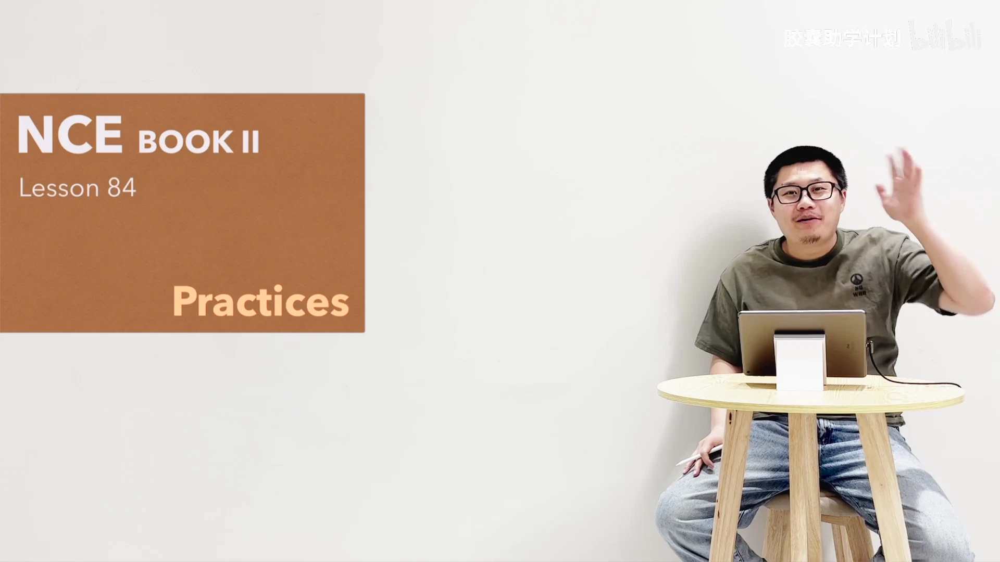

文字识别：NCE / BOOK"I / Lesson 84 / Practices / WAR

### 画面 00:00:02

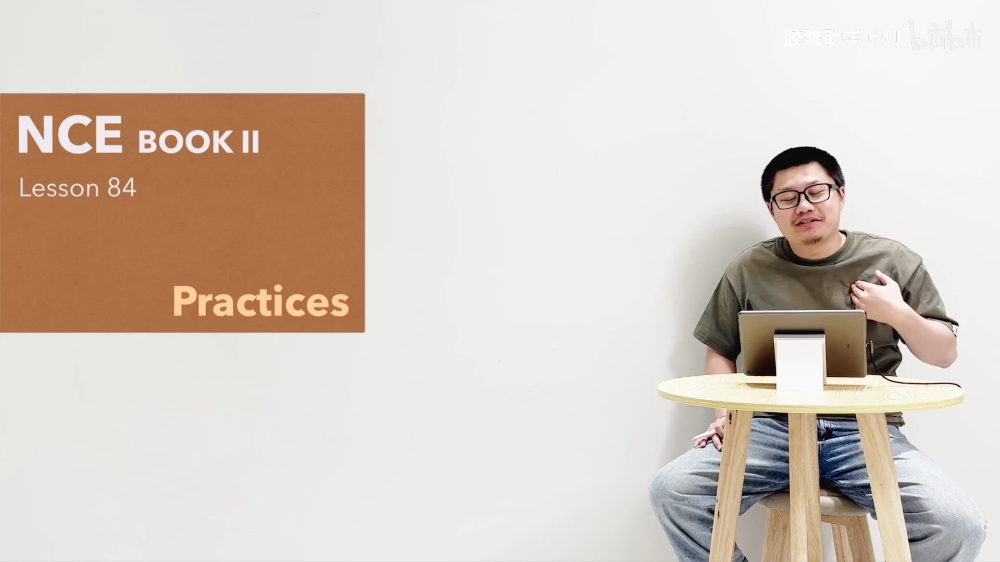

文字识别：NCE / BOOK"I / Lesson 84 / Practices

### 画面 00:00:04

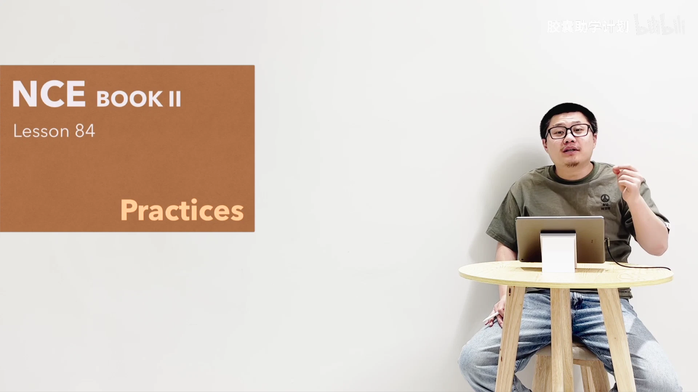

文字识别：NCE / BOOKII / Lesson 84 / Practices / NU / WIR

### 画面 00:00:07

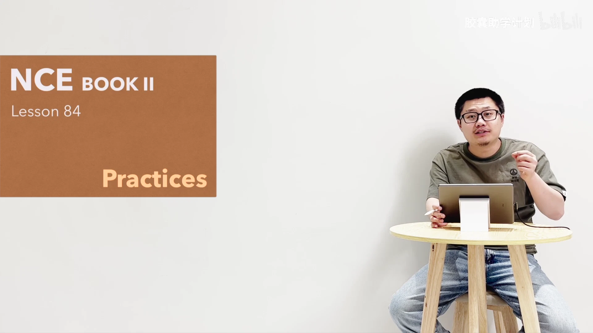

文字识别：NCE / BOOKII / Lesson 84 / Practices / NU / WIR

### 画面 00:00:09

文字识别：进行如下练习唯一前提 / 文章跟读至熟读成诵 / 否则请勿开始 / NU / WIR

### 画面 00:00:16

文字识别：bibi / 胶囊助学计划 / • / •

### 画面 00:00:20

文字识别：胶囊助学计划 / 胶囊助学计划

### 画面 00:00:22

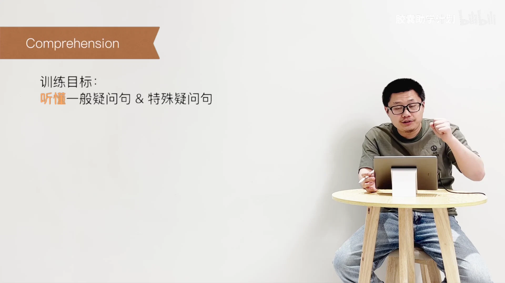

文字识别：Comprehension / 训练目标： / 听懂一般疑问句＆特殊疑问句

### 画面 00:00:26

文字识别：毫助字计划 / Comprehension / d

## 00:00:30–00:01:00

to go on strike? Busman. When are they going to do so? Next week. When is the strike due to begin? On Tuesday. Does anyone know how long it will last? No, they don't. How long have the busmen stated

### 画面 00:00:56

文字识别：Comprehension / How long have the busmen stated that the / strike will continue?

## 00:01:00–00:01:30

that the strike will continue until general agreement is reached about pay and working conditions? How long do most people believe it will last? For at least a week. Who's going to offer free rides? Owners of private cars.

### 画面 00:01:03

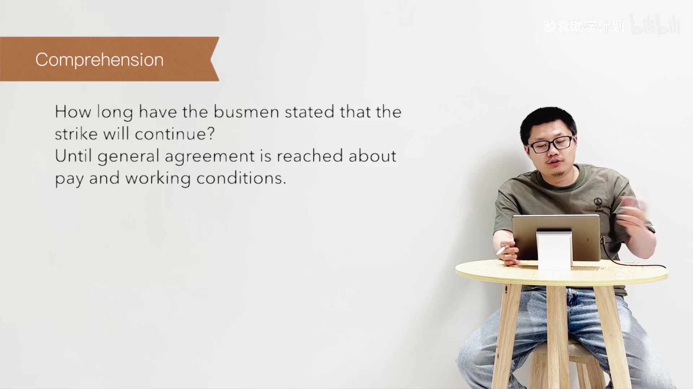

文字识别：Comprehension / How long have the busmen stated that the / strike will continue? / Until general agreement is reached about / pay and working conditions.

### 画面 00:01:05

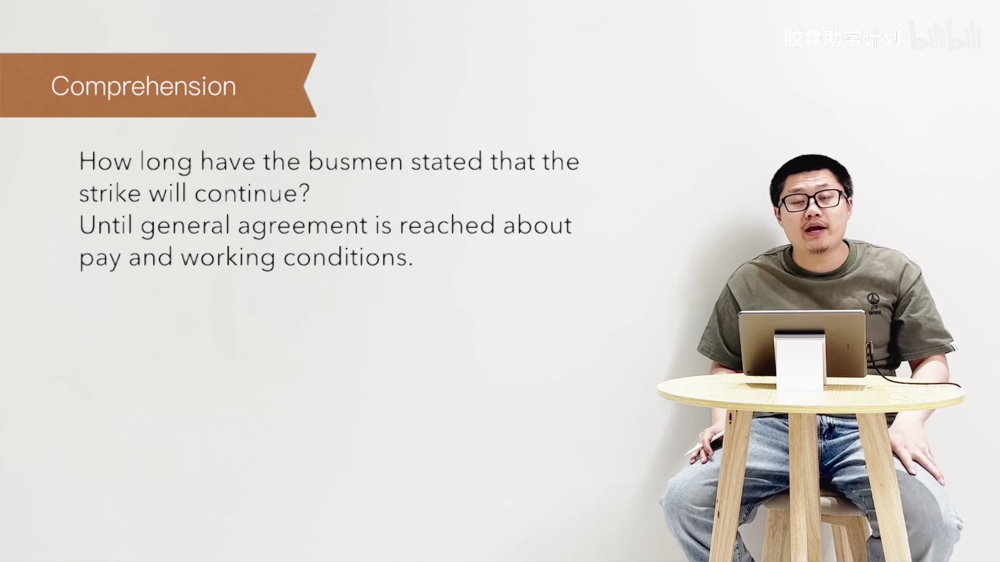

文字识别：Comprehension / How long have the busmen stated that the / strike will continue? / Until general agreement is reached about / pay and working conditions.

### 画面 00:01:07

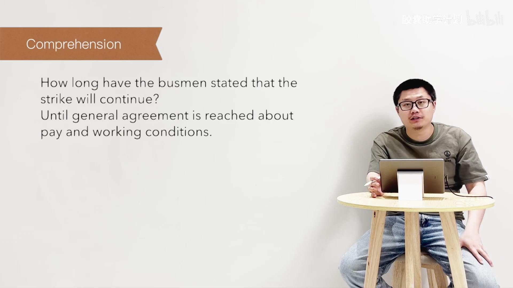

文字识别：Comprehension / How long have the busmen stated that the / strike will continue? / Until general agreement is reached about / pay and working conditions.

### 画面 00:01:09

文字识别：Comprehension / How long do most people believe it will last? / NO

### 画面 00:01:25

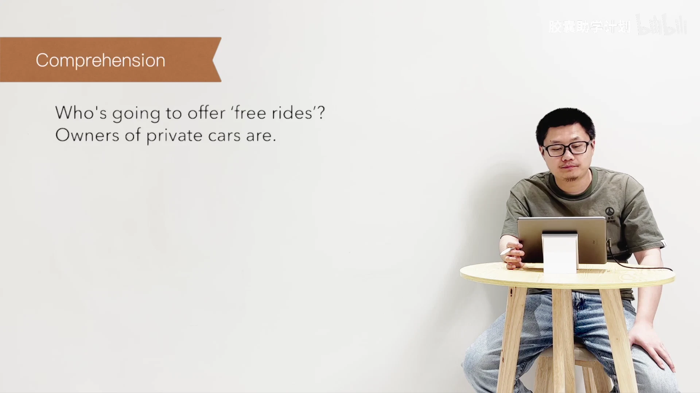

文字识别：Comprehension / Who's going to offer 'free rides'? / Owners of private cars are. / NO

## 00:01:30–00:02:00

Who will they offer them to? To people on their way to work. What will this do? Relieve pressure on the trains. Who's volunteered to drive buses? University students. What kind of drivers are they? And expert

### 画面 00:01:30

文字识别：Comprehension / Who will they offer them to?

### 画面 00:01:52

文字识别：Comprehension / Who's volunteered to drive buses? / University students have.

### 画面 00:01:59

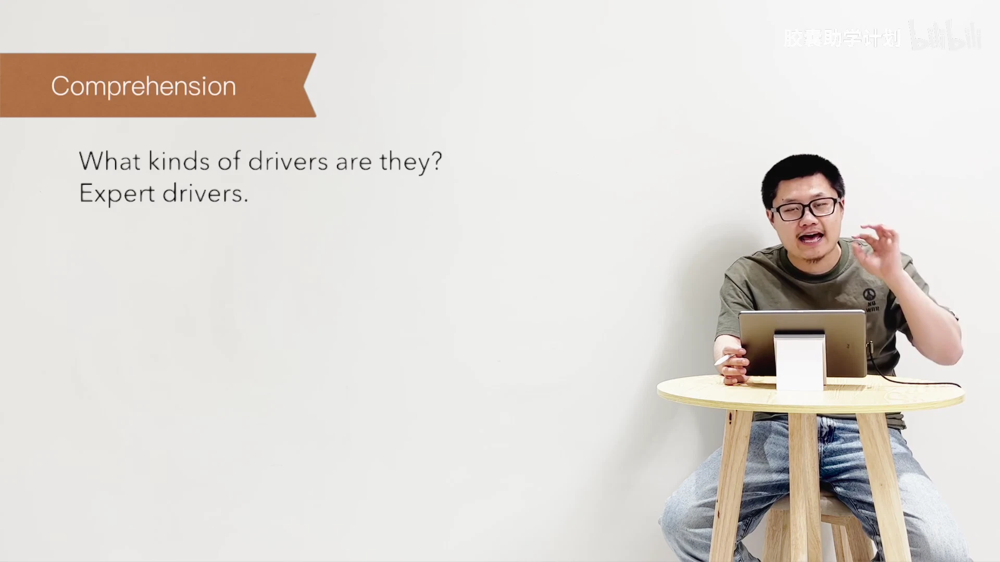

文字识别：Comprehension / What kinds of drivers are they? / Expert drivers. / NU / wnr

## 00:02:00–00:02:30

drivers? What will they have to do before driving any of the buses? Take a test. When are they going to take it? In two days' time. Asking questions, 时序性转换啊，好，呃，第一个例子， busmen have decided to go on strike next week. 你把 have 提前就可以了，

### 画面 00:02:03

文字识别：Comprehension / What will they have to do before driving any / of the buses?

### 画面 00:02:19

文字识别：Asking questions / 训练目标： / 会说一般疑问句＆特殊疑问句 / Accuracy / Fluency

### 画面 00:02:22

文字识别：Asking questions / VIR / NU

### 画面 00:02:25

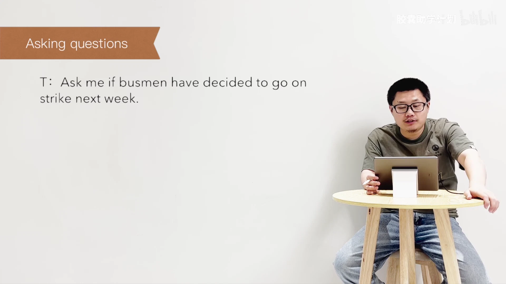

文字识别：Asking questions / T: Ask me if busmen have decided to go on / strike next week.

### 画面 00:02:27

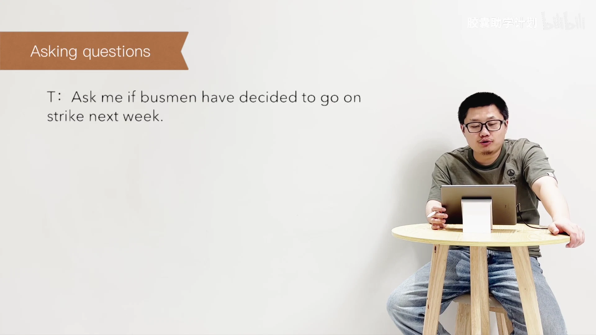

文字识别：Asking questions / T: Ask me if busmen have decided to go on / strike next week. / WI

## 00:02:30–00:03:00

现在完成时嘛，问肯定是对next week提问，对吧？一去掉直接带。Who主语提问，巴斯曼一替代完事儿。然后the strike will begin on呃Tuesday, will提前，which day肯定是对on Tuesday提问嘛，对吧？Most people believe the strike will last for at least a week. Most people believe后边其实是有一个that省略了，对吧？所以你要

### 画面 00:02:30

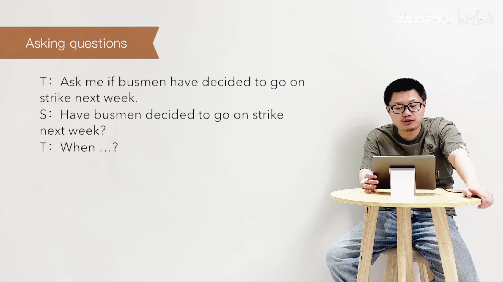

文字识别：Asking questions / T: Ask me if busmen have decided to go on / strike next week. / S: Have busmen decided to go on strike / next week? / T: When ...?

### 画面 00:02:32

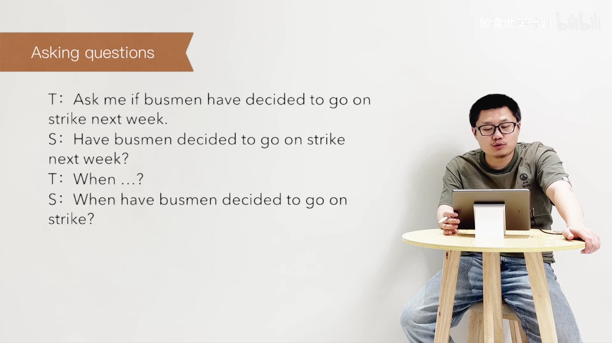

文字识别：Asking questions / T: Ask me if busmen have decided to go on / strike next week. / S: Have busmen decided to go on strike / next week? / T: When ...? / NU / WIR / S: When have busmen decided to go on / strike?

### 画面 00:02:35

文字识别：Asking questions

### 画面 00:02:41

文字识别：Asking questions / 1. Busmen have decided to go on strike next / week.(When)(Who) / 2. The strike will begin on Tuesday.(Which / day)

### 画面 00:02:50

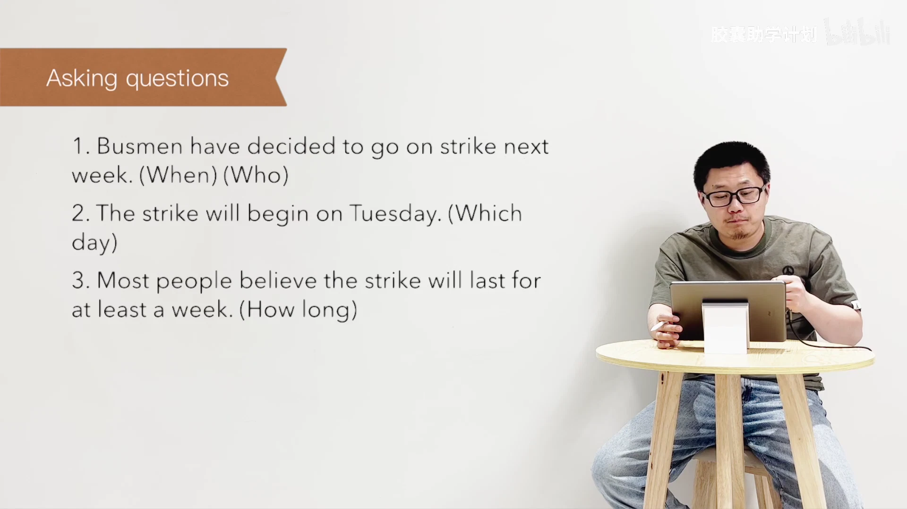

文字识别：Asking questions / 1. Busmen have decided to go on strike next / week. (When)(Who) / 2.The strike will begin on Tuesday. (Which / day) / 3. Most people believe the strike will last for / at least a week.(How long)

## 00:03:00–00:03:30

把do提前啊。那How long？你对那个for at least a week。然后The busman want more pay啊。注意这里的pay是个名词，对吧？呃，Do the busman want more pay？啊，What do they want？对吧？What do the busman want？答案就more pay嘛。They also want better work working conditions。do提前。What else？其实就What else do they want？对吧？The strike will continue until agreement is reached。

### 画面 00:03:16

文字识别：Asking questions

### 画面 00:03:25

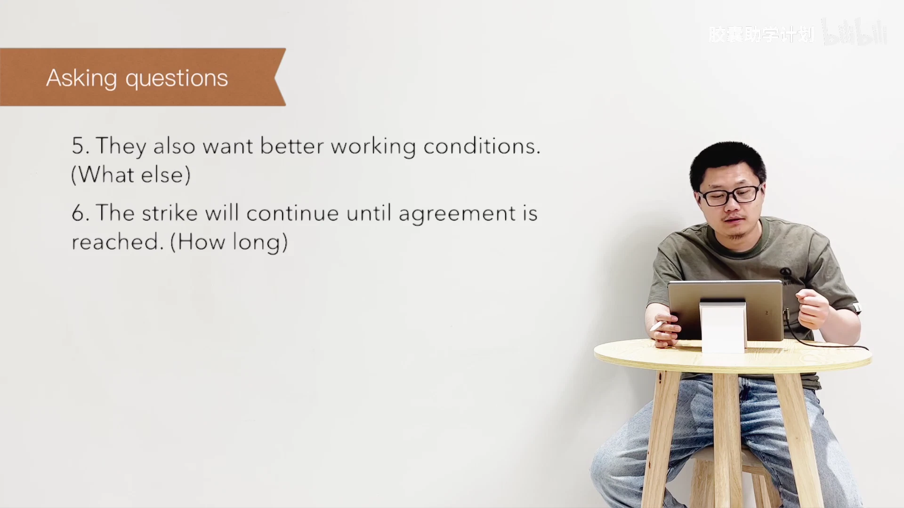

文字识别：Asking questions / 5. They also want better working conditions. / (What else) / 6. The strike will continue until agreement is / reached.(How long)

## 00:03:30–00:04:00

那你注意这个地方的 until 后边连的是一个这个呃从句，你别用这 is 提前，你要把这个 will 提前，对吧？那 how long 哎，你其实 how long 可以直接对 until agreement is reached 提问。你看我问一下，叫 how long will the strike continue？它会持续多长时间呢？直到达成协议，对吧？持续这么长时间，对吧？啊，它不是一个具体的时间啊，呃，它是对整个时间状语从句提问，说 owners of

### 画面 00:03:35

文字识别：Asking questions / 5. They also want better working conditions. / (What else) / 6. The strike will continue / ntil / agreement is / reached.(How long)

### 画面 00:03:41

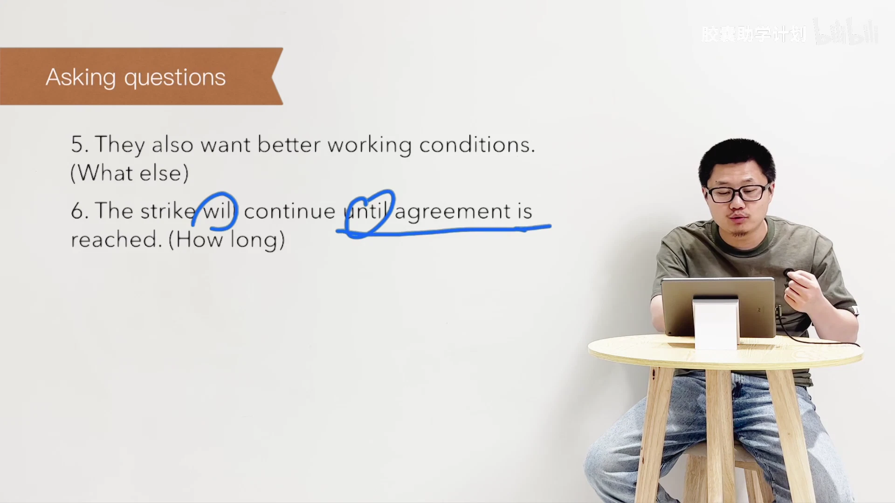

文字识别：Asking questions / 5. They also want better working conditions. / (What else) / 6. The strikewil) / continue / ntil / agreement is / reached.(HoWlong)

### 画面 00:03:45

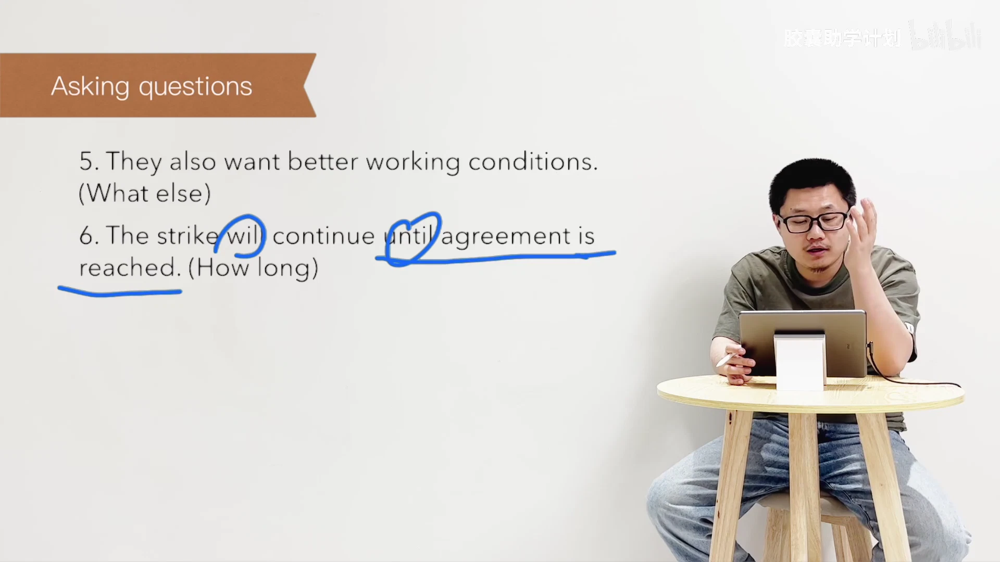

文字识别：Asking questions / 5. They also want better working conditions. / (What else) / 6. The strikewil / continue / ntil / agreement is / reached.(HoWlong)

### 画面 00:03:49

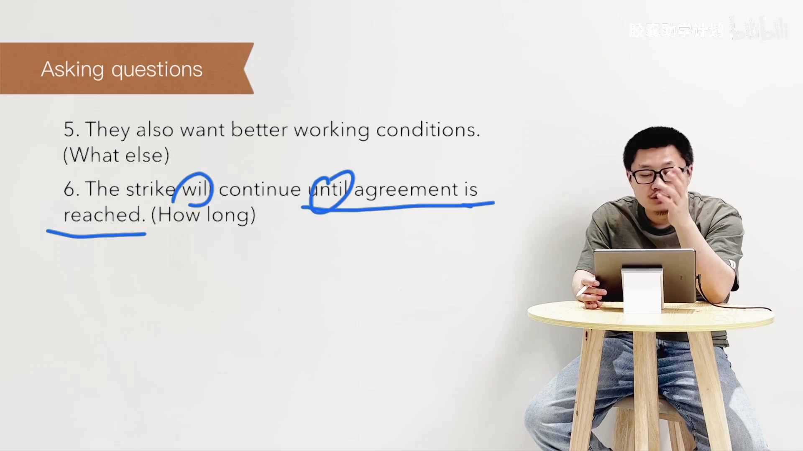

文字识别：Asking questions / 5. They also want better working conditions. / (What else) / 6. The strikewil / continue / ntil / agreement is / reached.(HoWlong)

### 画面 00:03:54

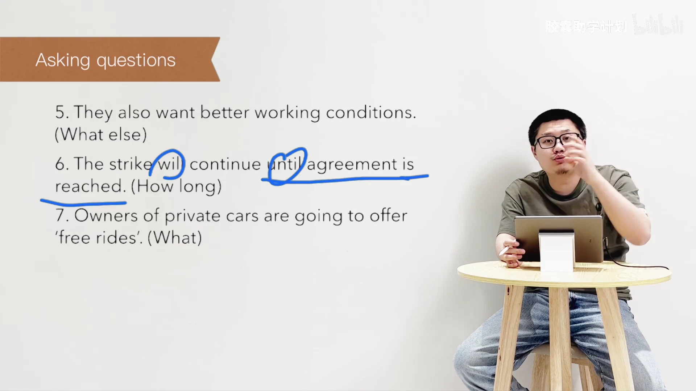

文字识别：Asking questions / 5. They also want better working conditions. / (What else) / 6. The strikewil / continue / ntil / agreement is / reached.(HoWlong) / 7. Owners of private cars are going to offer / 'free rides'. (What)

### 画面 00:03:59

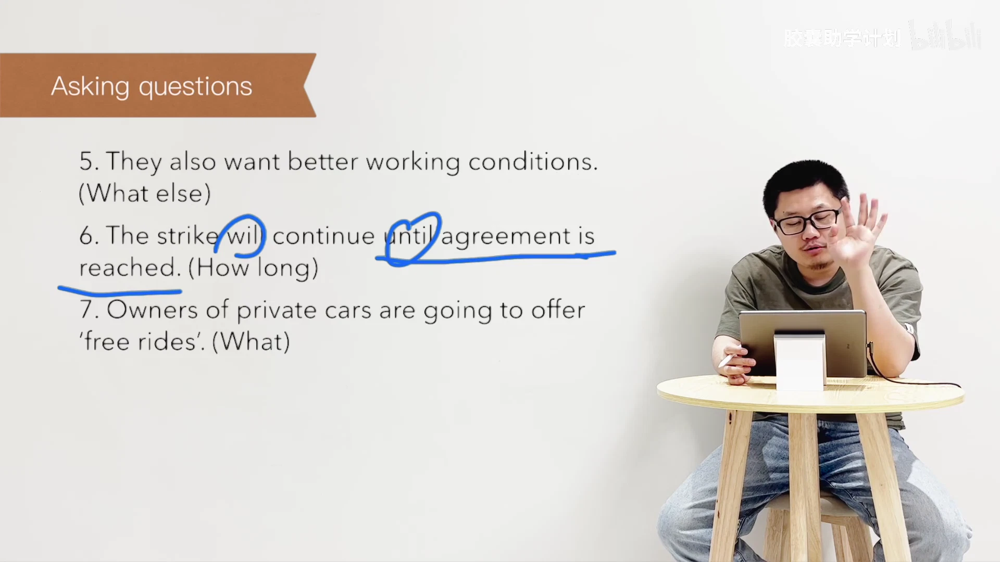

文字识别：Asking questions / 5. They also want better working conditions. / (What else) / 6. The strikewil / )continue / yntil / agreement is / reached.(HoWlong) / 7. Owners of private cars are going to offer / 'free rides'. (What)

## 00:04:00–00:04:30

private cars are going to offer free rides. Be going to do 二提前，这个你肯定是熟熟悉的。那 what肯定对 free rides，对吧？这个免费的搭乘。好，第八个，People will still get work.一般疑问句，首先你肯定是把 will提前，对吧？那这个 where呢，在这个地方这么一看呢，稍微有一点点这个不是特别直观。但是这里我认为它应该是对这个 work提问，对吧？去工作去哪里，对吧？所以它答案叫做 Where will people still get to？他

### 画面 00:04:08

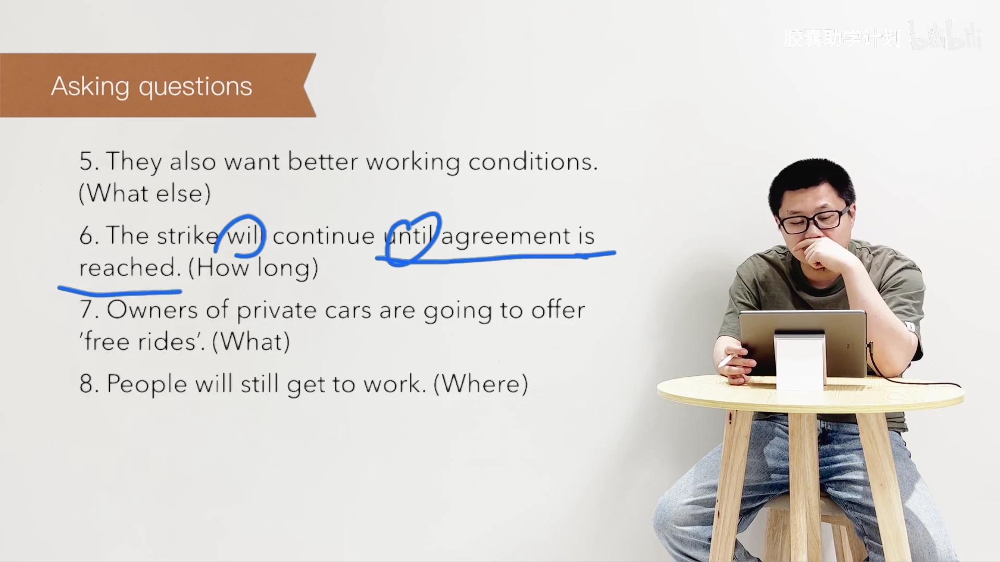

文字识别：Asking questions / 5. They also want better working conditions. / (What else) / 6. The strikewil / Dcontinue / yntil / agreement is / reached.(HoWlong) / 7. Owners of private cars are going to offer / 'free rides'. (What) / 8. People will still get to work. (Where)

## 00:04:30–00:05:00

can get to. They can get

### 画面 00:04:35

文字识别：Tell the story / 训练目标： / 口语复述能力 / Accuracy / Fluency

### 画面 00:04:40

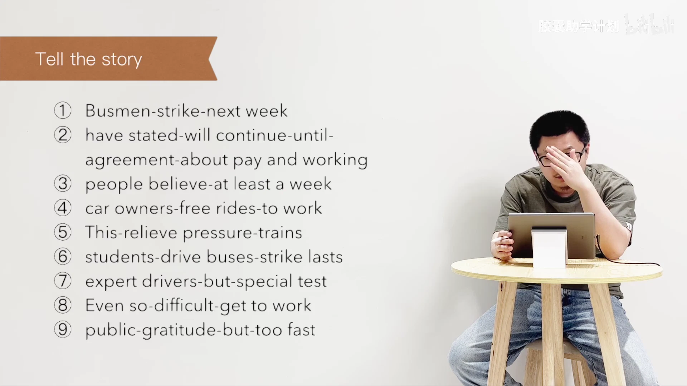

文字识别：Tell the story / ① / Busmen-strike-next week / 2 / have stated-will continue-until- / agreement-about pay and working / people believe-at least a week / car owners-free rides-to work / This-relieve pressure-trains / students-drive buses-strike lasts / expert drivers-but-special test / Even so-difficult-get to work / 8 / public-gratitude-but-too fast / 9

### 画面 00:04:44

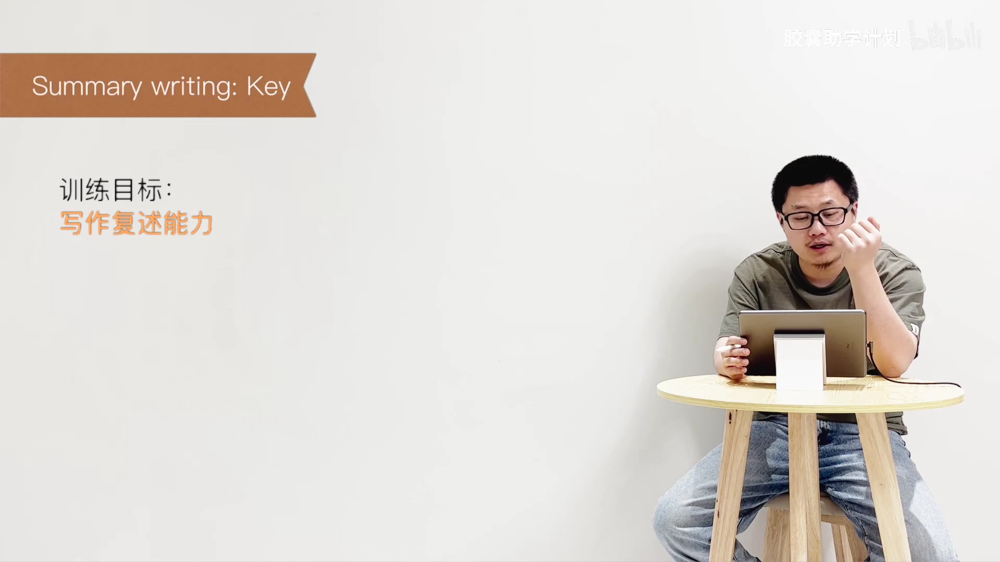

文字识别：Summary writing: Key / 训练目标： / 写作复述能力

### 画面 00:04:54

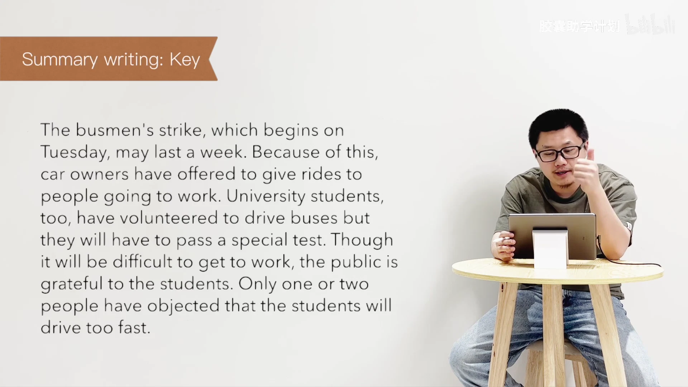

文字识别：助字计划 / Summary writing: Key / The busmen's strike, which begins on / Tuesday, may last a week. Because of this, / car owners have offered to give rides to / people going to work. University students, / too, have volunteered to drive buses but / they wil have to pass a special test. Though / it will be difficult to get to work, the public is / grateful to the students. Only one or two / people have objected that the students will / drive too fast.

### 画面 00:04:56

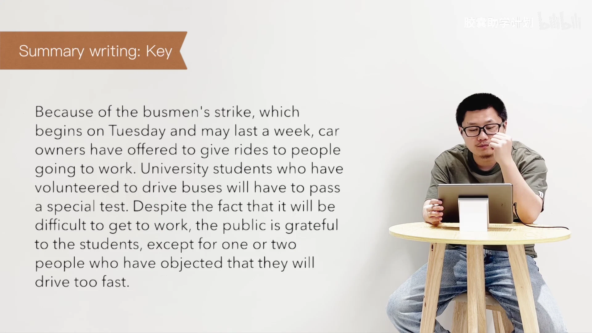

文字识别：助字计划 / Summary writing: Key / Because of the busmen's strike, which / begins on Tuesday and may last a week, car / owners have offered to give rides to people / going to work. University students who have / Volunteered to drive buses will have to pass / a special test. Despite the fact that it will be / difficult to get to work, the public is grateful / to the students, except for one or two / people who have objected that they will / drive too fast.

### 画面 00:04:58

文字识别：Topics for discussion / Why do you suppose the'expert drivers' / had to take a special test before being / allowed to drive buses? / Would you like to be a bus or a train / driver? Why/Why not? / Which do you think is more important in / a job: good pay or good working / conditions? Why?

## 00:05:00–00:05:30

儿。第一个说, What do you suppose the expert drivers had to take a special test before? Ah, why do you suppose before being allowed to drive buses?说为什么你认为这些专业的司机啊，其实就所谓大学生嘛，他在开这个公交车是公交车之前需要参加一个特殊的考试，特殊的测试。这个很容易理解，本儿不一样是吧？好，第二个说, Would you like to be a bus

### 画面 00:05:12

文字识别：Topics for discussion / Why do you suppose the'expert drivers' / had to take a special test before being / allowed to drive buses? / Would you like to be a bus or a train / driver? Why/Why not? / Which do you think is more important in / a job: good pay or good working / conditions? Why?

### 画面 00:05:26

文字识别：Topics for discussion / Why do you suppose the'expert drivers' / had to take a special test before being / allowed to drive buses? / Would you like to be a bus or a train / driver? Why/Why not? / WIR / NU / Which do you think is more important in / a job: good pay or good working / conditions? Why?

## 00:05:30–00:06:00

or a train driver? Why? Why not? Ah, you,

### 画面 00:05:34

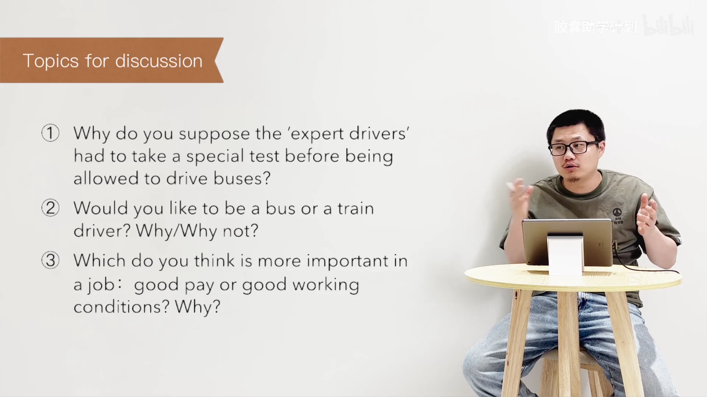

文字识别：Topics for discussion / Why do you suppose the'expert drivers' / had to take a special test before being / allowed to drive buses? / Would you like to be a bus or a train / driver? Why/Why not? / Which do you think is more important in / a job: good pay or good working / conditions? Why?

### 画面 00:05:39

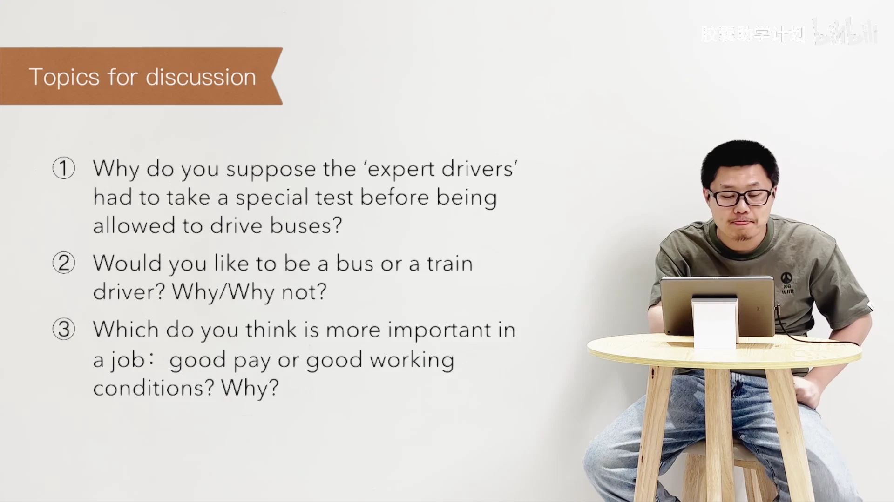

文字识别：Topics for discussion / Why do you suppose the'expert drivers' / had to take a special test before being / allowed to drive buses? / Would you like to be a bus or a train / driver? Why/Why not? / WIR / NU / Which do you think is more important in / a job: good pay or good working / conditions? Why?

### 画面 00:05:46

文字识别：Topics for discussion / Why do you suppose the'expert drivers' / had to take a special test before being / allowed to drive buses? / Would you like to be a bus or a train / driver? Why/Why not? / Which do you think is more important in / a job: good pay or good working / conditions? Why?

### 画面 00:05:57

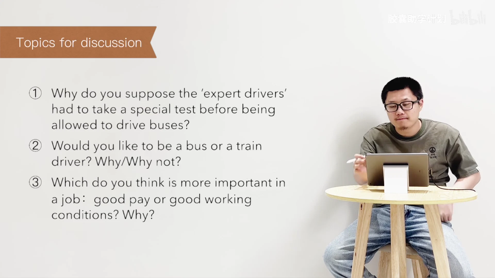

文字识别：Topics for discussion / Why do you suppose the'expert drivers' / had to take a special test before being / allowed to drive buses? / Would you like to be a bus or a train / driver? Why/Why not? / NU / Which do you think is more important in / a job: good pay or good working / conditions? Why?

### 画面 00:05:59

文字识别：1.Ask me if写&朗读 / WIR

## 00:06:00–00:06:30

完了，保证对了。然后看着自己的答案，大声朗读出来。摘要写作写完对答案，Tell the story口语复述。然后找这个置顶留言去做，这找这个置顶留言去找这个重复间隔的学习材料。那以上呢就是本期视频的全部内容了。如果各位喜欢我们的课程呢，欢迎各位关注、订阅、一键三连，分享给那些需要的朋友，来帮助我们快速成长。See you next time.

### 画面 00:06:02

文字识别：1. / Ask meif写&朗读 / 2. / 摘要写作写&答案

### 画面 00:06:05

文字识别：喜助字计划 / 1.Ask me if写&朗读 / 摘要写作写&答案 / 3.Tell the story 口语复述

### 画面 00:06:07

文字识别：1.Ask me if写&朗读 / 摘要写作写&答案 / 3.Tell the story 口语复述 / 4.重复间隔（置顶留言）

### 画面 00:06:10

文字识别：妻助学计划園州 / 1.Ask me if写&朗读 / 摘要写作写&答案 / 3.Tell the story 口语复述 / 4.重复间隔（置顶留言）

### 画面 00:06:13

文字识别：臺助学计划一州 / NU

### 画面 00:06:16

文字识别：助学计划

### 画面 00:06:18

文字识别：虞助学计划園州 / 不

### 画面 00:06:25

文字识别：奏助学计划州

### 画面 00:06:27

文字识别：CAPSULEACADEMY / 胶囊助学计划 / 『 / 小红书 / OE

### 画面 00:06:29

文字识别：CAPSULEACADEMY / 胶囊助学计划 / 『 / 小红书 / OE

## 00:06:30–00:06:39

### 画面 00:06:35

文字识别：CAPSULEACADEMY / 胶囊助学计划 / 小红书 / Creator / □ / Leo & Berlin / OE

### 画面 00:06:37

文字识别：bilibili / 胶囊助学计划

### 画面 00:06:38

文字识别：bilibili / 胶囊助学计划

