# 085 单词 语法

快速机器解析：语音为单模型转写，未进行独立交叉校对或人工复核；画面每秒采样并按变化选帧，短时文字和标记可能遗漏。截图时间约有 1 秒误差。图片有损压缩；遇到疑点请按时间查看 Google Drive 原视频。

## 00:00:00–00:00:30

Hello everyone, welcome to Capsule Academy. This is Liu. Today we're going to learn New Concept English Book Two, Lesson eighty-five words and grammar. That old habit. Enter formal course before? Then let's look at a few small questions. Ah, first, how to express informing someone about something. Next, how to express donating. Ah, the last question, how to express losing patience. Ah, no patience. That with these three questions, hope you can enjoy.

### 画面 00:00:00

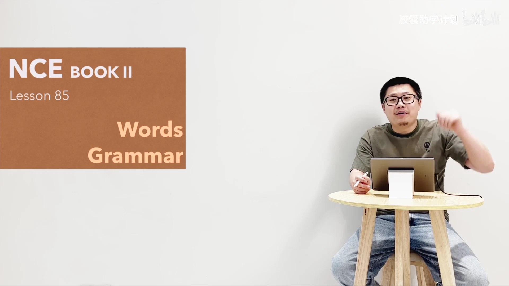

文字识别：泰助学计划 / NCE / BOOK I"I / Lesson 85 / Words / Grammar

### 画面 00:00:02

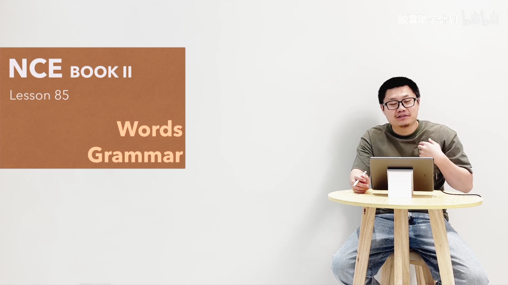

文字识别：葬助字计划 / NCE / BOOK I"I / Lesson 85 / Words / Grammar

### 画面 00:00:04

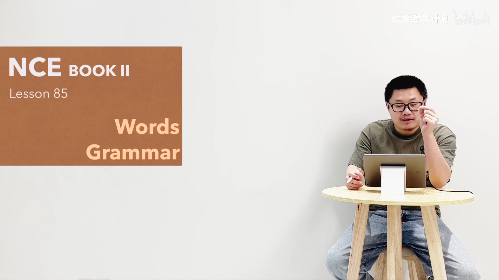

文字识别：達助字计划 / NCE / BOOKI"I / Lesson 85 / Words / Grammar

### 画面 00:00:06

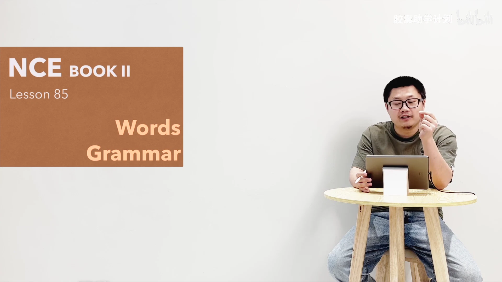

文字识别：交囊助字计划 / NCE / BOOK I"I / Lesson 85 / Words / Grammar

### 画面 00:00:10

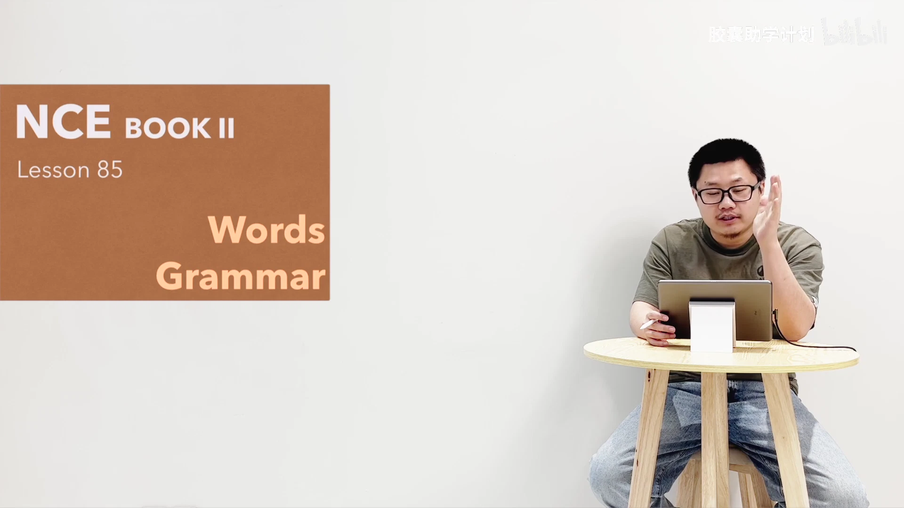

文字识别：交囊助学计划 / NCE / BOOK I"I / Lesson 85 / Words / Grammar

### 画面 00:00:12

文字识别：妻助字计划一州

### 画面 00:00:14

文字识别：囊助字计划调 / ①如何表达“通知某人某事”？

### 画面 00:00:16

文字识别：交囊助字计划一淵 / ①如何表达“通知某人某事”？

### 画面 00:00:18

文字识别：囊助学计划陽调 / ①如何表达“通知某人某事”? / 如何表达“捐赠

### 画面 00:00:20

文字识别：囊助字计划 / ①如何表达“通知某人某事”？ / 如何表达“捐赠 / Aa

### 画面 00:00:22

文字识别：臺助字计划 / ①如何表达“通知某人某事”？ / 如何表达“捐赠 / 如何表达“丧失耐心”?

### 画面 00:00:24

文字识别：①如何表达“通知某人某事”？ / 如何表达“捐赠 / 如何表达“丧失耐心”?

### 画面 00:00:26

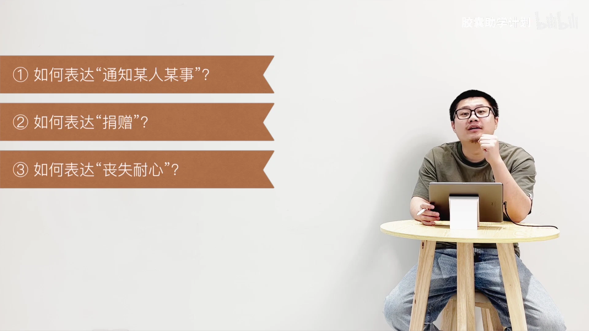

文字识别：奏助学计划 / ①如何表达“通知某人某事”？ / 如何表达“捐赠 / 如何表达“丧失耐心”?

### 画面 00:00:28

文字识别：胶囊助学计划

## 00:00:30–00:01:00

好，呃，本课生词不少，然后呢，每个生词都还有很常用的习惯用法啊。我们有一点耐心啊，我们一起来看一下这些单词。第一个单词，inform，inform，哎，它其实就通知、告知的意思，对吧？那原文给了我们一个很常用的习惯用法，这样一个句型，叫做 somebody inform somebody that，再加一句话，

### 画面 00:00:31

### 画面 00:00:33

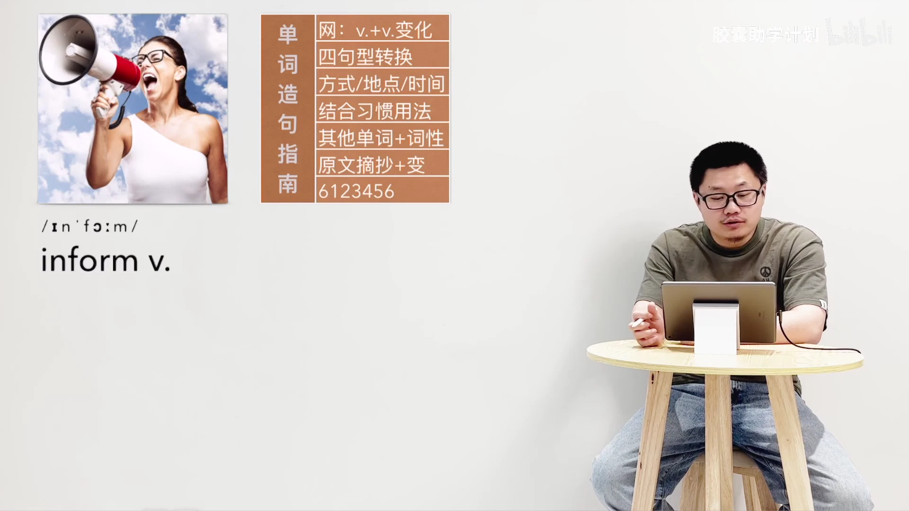

文字识别：单词造句指南 / 网：v.+v.变化 / 泰助学计划陽 / 四句型转换 / 方式/地点/时间 / 结合习惯用法 / 其他单词+词性 / 原文摘抄+变 / 6123456 / /In'fo:m/ / inform v.

### 画面 00:00:36

文字识别：单词造句指南 / 网：v.+v.变化 / 囊助学计划 / 四句型转换 / 方式/地点/时间 / 结合习惯用法 / 其他单词+词性 / 原文摘抄+变 / 6123456 / /In'fo:m/ / inform v.

### 画面 00:00:43

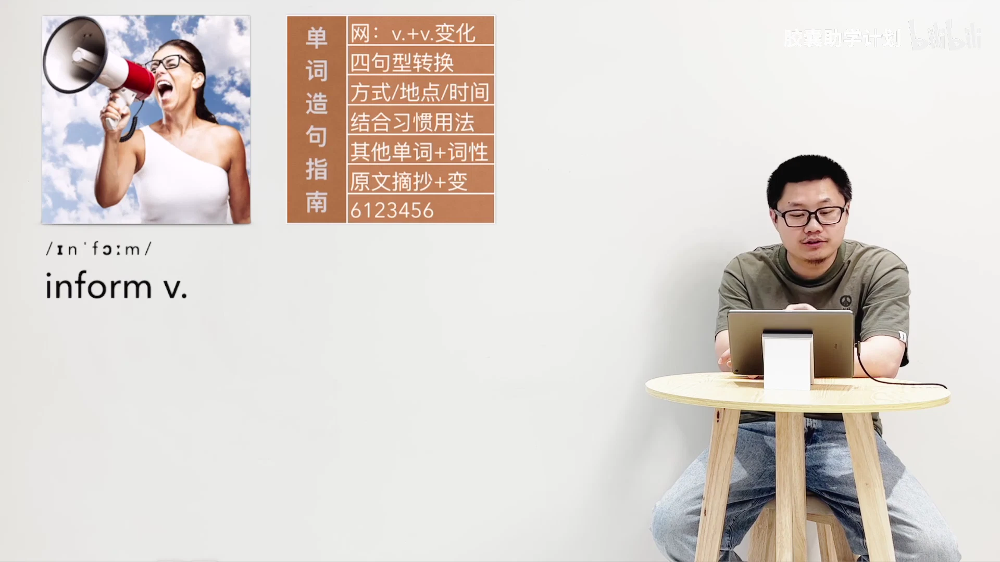

文字识别：单词造句指南 / 网：v.+v.变化 / 囊助字计划一 / 四句型转换 / 方式/地点/时间 / 结合习惯用法 / 其他单词+词性 / 原文摘抄+变 / 6123456 / /In'fo:m/ / inform v.

## 00:01:00–00:01:30

怎么翻译呢？就是某人通知某人啊，就是比如说A通知B这么一件事情。我们造个句子，The captain informed me that he won the election again.我们看一下它满不满足上面这个结构啊？Somebody captain inform换了个时态，somebody me that that后边加一句话，后边加了he won the election again啊，他又一

### 画面 00:01:08

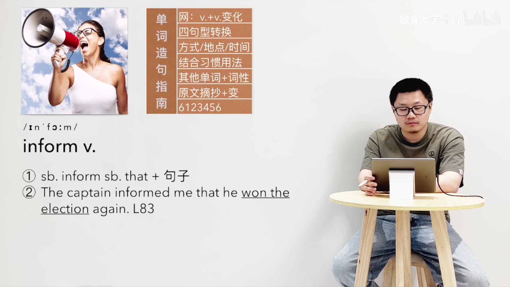

文字识别：单词造句指南 / 网：v.+v.变化 / 囊助字计划 / 四句型转换 / 方式/地点/时间 / 结合习惯用法 / 其他单词+词性 / 原文摘抄+变 / 6123456 / /In'fo:m/ / inform v. / ① sb.inform sb.that + 句子 / The captain informed me that he won the / election again. L83

### 画面 00:01:11

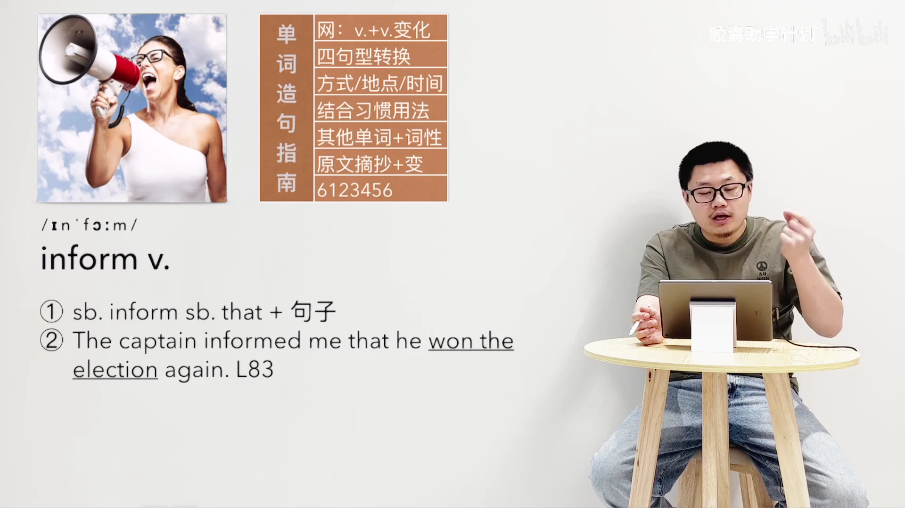

文字识别：单词造句指南 / 网：v.+v.变化 / 美助字计划國 / 四句型转换 / 方式/地点/时间 / 结合习惯用法 / 其他单词+词性 / 原文摘抄+变 / 6123456 / /In'fo:m/ / inform v. / ) sb.inform sb.that + 句子 / The captain informed me that he won the / election again. L83

### 画面 00:01:19

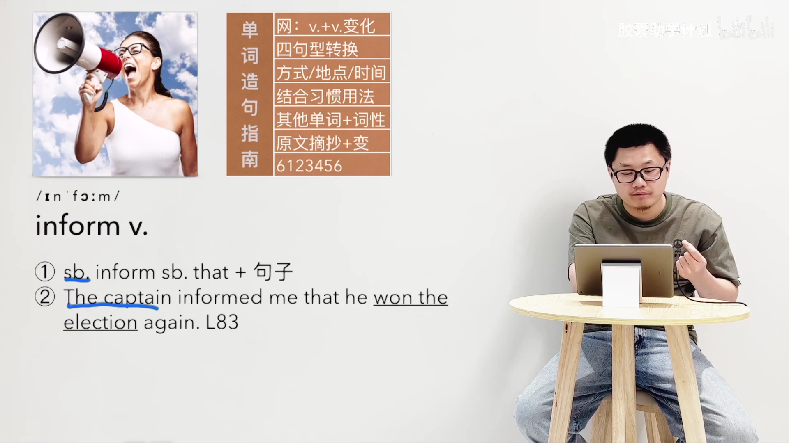

文字识别：单词造句指南 / 网：v.+v.变化 / 囊助字计划 / 四句型转换 / 方式/地点/时间 / 结合习惯用法 / 其他单词+词性 / 原文摘抄+变 / 6123456 / /In'fo:m/ / inform v. / sb.inform sb.that + 句子 / The captain informed me that he won the / election again. L83

### 画面 00:01:22

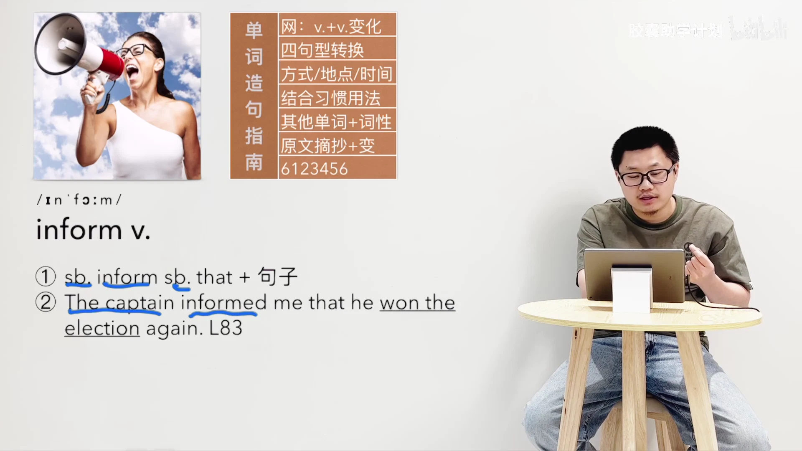

文字识别：单词造句指南 / 网：v.+v.变化 / 四句型转换 / 方式/地点/时间 / 结合习惯用法 / 其他单词+词性 / 原文摘抄+变 / 6123456 / /In'fo:m/ / inform v. / sb. inform sb. that + 句子 / The captain informed me that he won the / election again. L83

### 画面 00:01:25

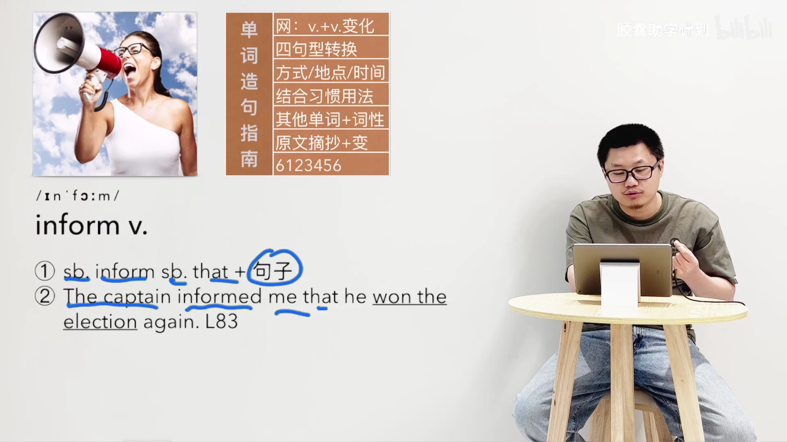

文字识别：单词造句指南 / 网：v.+v.变化 / 囊助字计划 / 四句型转换 / 方式/地点/时间 / 结合习惯用法 / 其他单词+词性 / 原文摘抄+变 / 6123456 / /In'fo:m/ / inform v. / sb. inform sb. that + / 句子 / The captain informed me that he won the / election again. L83

## 00:01:30–00:02:00

次赢得了这个选举. Okay, ah,通知了我这么一件事儿. Okay, very good.下一句话, the teacher informed the kids' parents that he lost his temper in the class.好，这我们造句的时候，其实现在还是结合之前学过的单词、语法、习惯用法，对吧？好，lost somebody's temper其实八课咱们学的，发脾气了。啊，别忘了repeat after me. Next one, he's just informed

### 画面 00:01:30

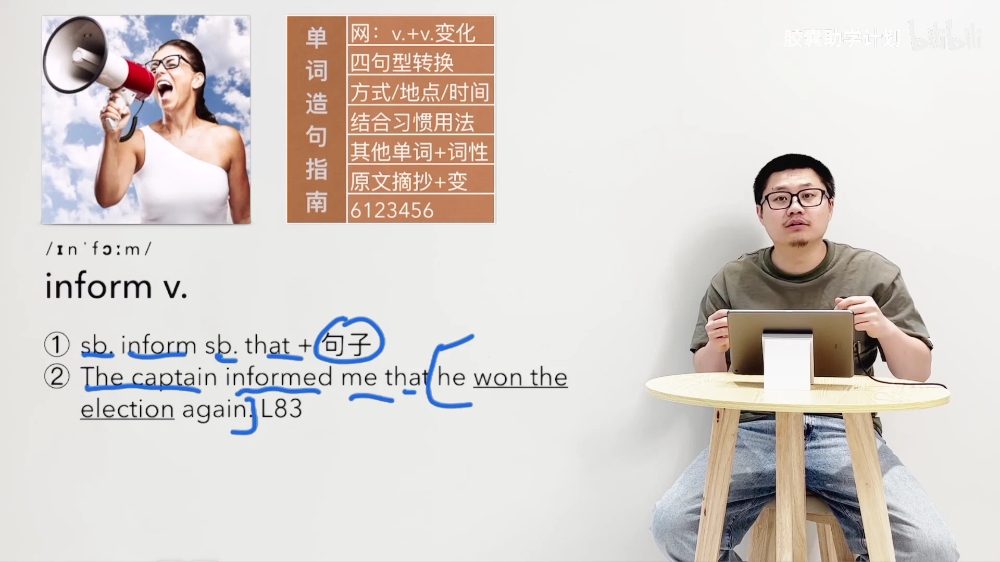

文字识别：单词造句指南 / 网：v.+v.变化 / 妻助字计划 / 四句型转换 / 方式/地点/时间 / 结合习惯用法 / 其他单词+词性 / 原文摘抄+变 / 6123456 / /In'fo:m/ / inform v. / sb. inform sb. that + / 句子 / The captain informed me that he won the / election again]L83

### 画面 00:01:33

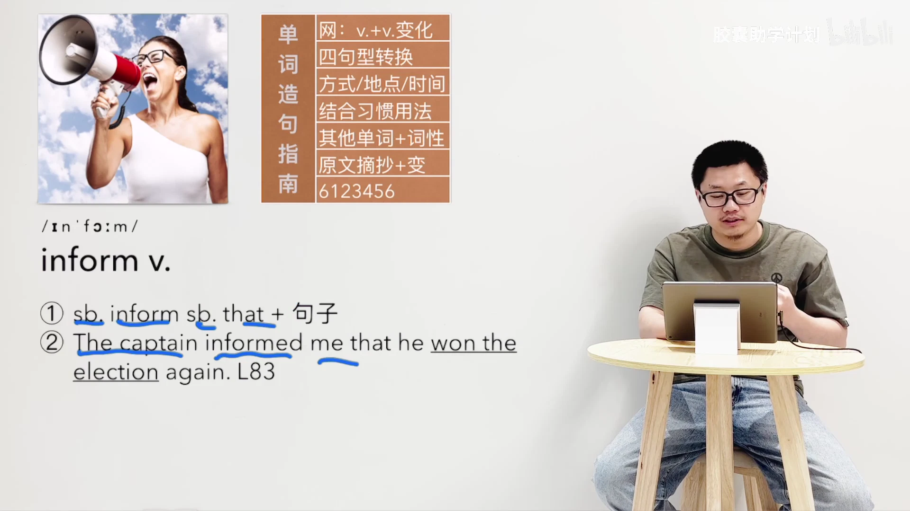

文字识别：单词造句指南 / 网：v.+v.变化 / 四句型转换 / 方式/地点/时间 / 结合习惯用法 / 其他单词+词性 / 原文摘抄+变 / 6123456 / /In'fo:m/ / inform v. / sb.inform sb. that + 句子 / The captain informed me that he won the / election again. L83

### 画面 00:01:35

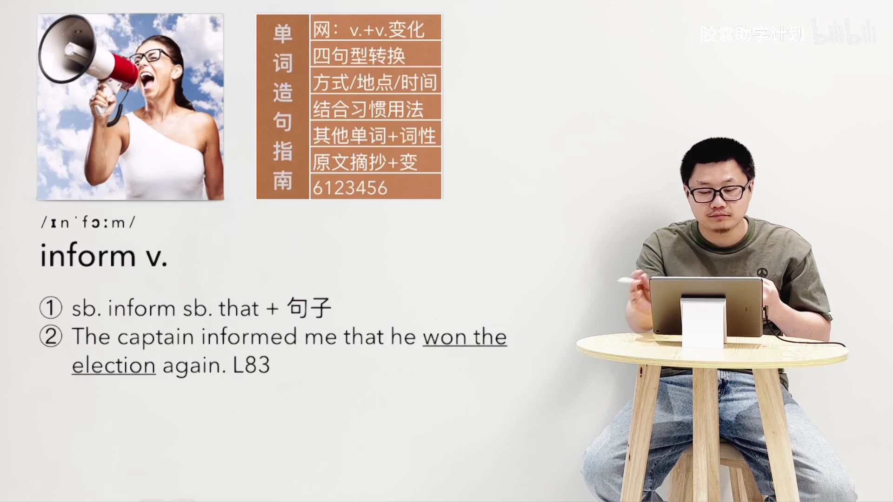

文字识别：单词造句指南 / 网：v.+v.变化 / 妻助字计划陽 / 四句型转换 / 方式/地点/时间 / 结合习惯用法 / 其他单词+词性 / 原文摘抄+变 / 6123456 / /In'fo:m/ / inform v. / ① sb.inform sb.that + 句子 / The captain informed me that he won the / election again. L83

### 画面 00:01:37

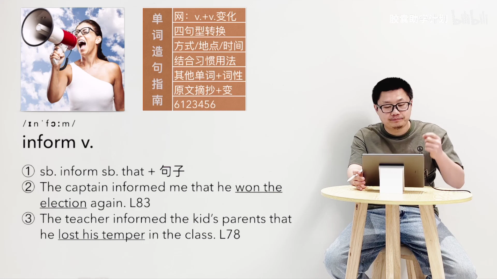

文字识别：单词造句指南 / 网：v.+v.变化 / 囊助字计划 / 四句型转换 / 方式/地点/时间 / 结合习惯用法 / 其他单词+词性 / 原文摘抄+变 / 6123456 / /In'fo:m/ / inform v. / ① sb.inform sb.that + 句子 / The captain informed me that he won the / election again. L83 / The teacher informed the kid's parents that / he lost his temper in the class. L78

### 画面 00:01:40

文字识别：单词造句指南 / 网：v.+v.变化 / 妻助学计划 / 四句型转换 / 方式/地点/时间 / 结合习惯用法 / 其他单词+词性 / 原文摘抄+变 / 6123456 / /In'fo:m/ / inform v. / ① sb.inform sb.that + 句子 / The captain informed me that he won the / election again.L83 / The teacher informed the kid's parents that / he lost his temper in the class. L78

### 画面 00:01:57

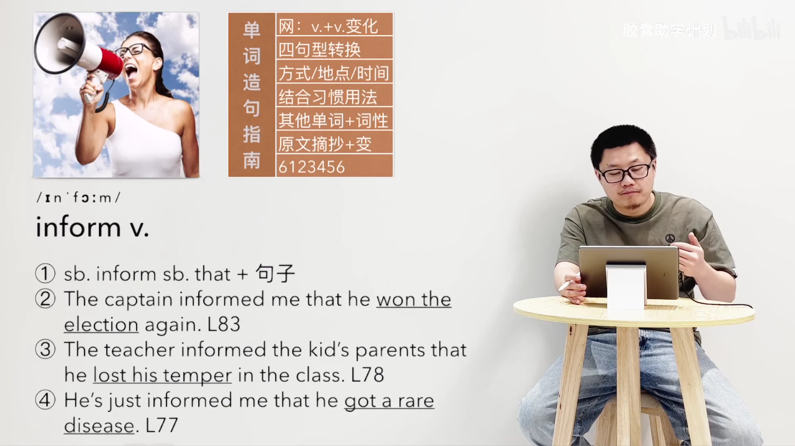

文字识别：单词造句指南 / 网：v.+v.变化 / 妻助字计划 / 四句型转换 / 方式/地点/时间 / 结合习惯用法 / 其他单词+词性 / 原文摘抄+变 / 6123456 / /In'fo:m/ / inform v. / ① sb.inform sb.that + 句子 / ) The captain informed me that he won the / election again. L83 / The teacher informed the kid's parents that / he lost his temper in the class. L78 / He's just informed me that he got a rare / disease. L77

## 00:02:00–00:02:30

me that he got a rare disease.说他刚刚通知我一件事儿，叫做怎么样了呢？他得了一个非常罕见的疾病，对吧？Okay, 其实这课咱们学的，再读一遍这个单词inform. Okay, very good. Next one, 下一个单词叫headmaster. Headmaster, headmaster这个单词，其实你把它当做两个单词、三个单词去记。第一个是headmaster这个单词本身，校长。第二个呢是head头，头部的，

### 画面 00:02:14

文字识别：单词造句指南 / 网：v.+v.变化 / 囊助学计划一 / 四句型转换 / 方式/地点/时间 / 结合习惯用法 / 其他单词+词性 / 原文摘抄+变 / 6123456 / /hed'ma:sta/ / headmaster n.

### 画面 00:02:22

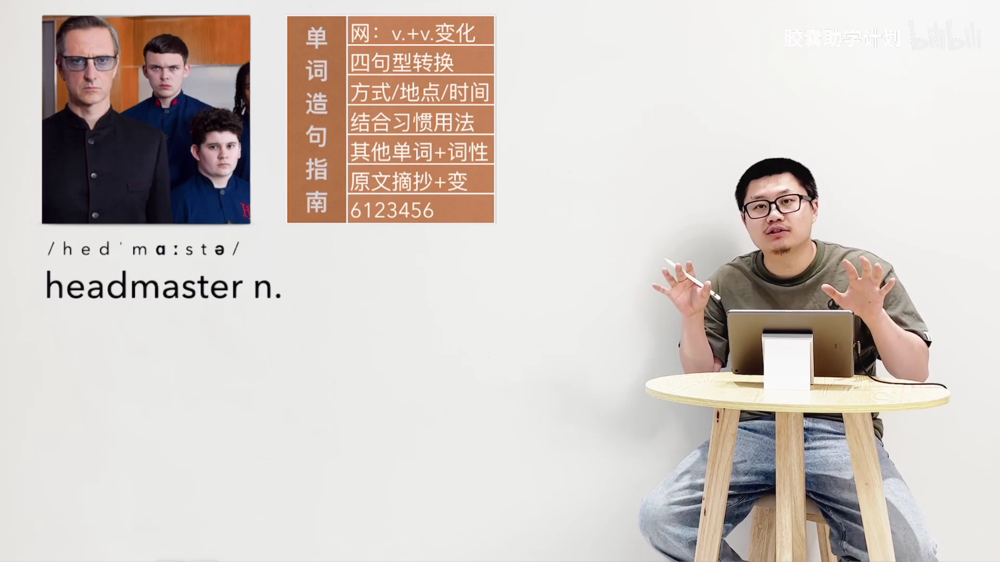

文字识别：单词造句指南 / 网：v.+v.变化 / 四句型转换 / 方式/地点/时间 / 结合习惯用法 / 其他单词+词性 / 原文摘抄+变 / 6123456 / /hed'ma:sta/ / headmaster n.

### 画面 00:02:24

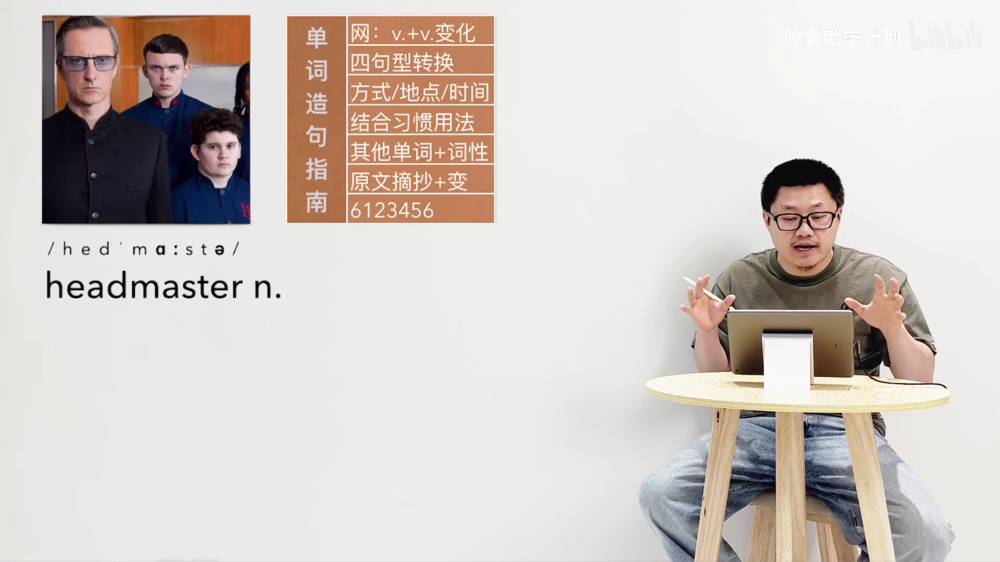

文字识别：单词造句指南 / 网：v.+v.变化 / 臺助字计划 / 四句型转换 / 方式/地点/时间 / 结合习惯用法 / 其他单词+词性 / 原文摘抄+变 / 6123456 / /hed'ma:sta/ / headmaster n.

### 画面 00:02:26

文字识别：单词造句指南 / 网：v.+v.变化 / 交妻助字计划州 / 四句型转换 / 方式/地点/时间 / 结合习惯用法 / 其他单词+词性 / 原文摘抄+变 / 6123456 / /hed'maista/ / headmaster n.

## 00:02:30–00:03:00

对吧？OK啊，包括我们早在呃先二前二十课就学了呃，the head of a very呃large business company对吧？是这个商业应该是三十一课啊，这样突然间这么一想，应该是三十一课咱们学的，就是一个大的商业公司的头头头是吧？Boss。OK，那这个master呢，他自己本身有一个叫师傅啊，或者说这个呃这个这个这个呃，对，基本就是师傅就可以了。

### 画面 00:02:56

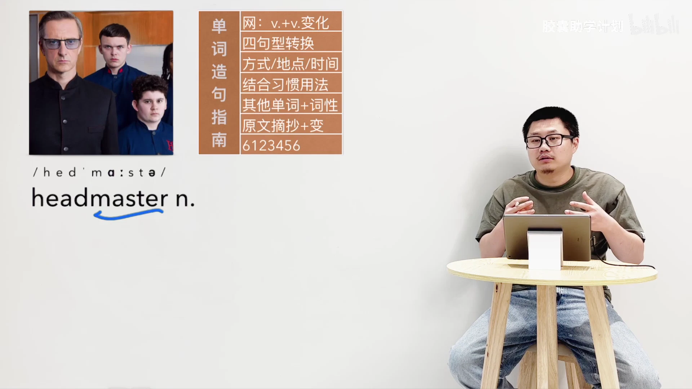

文字识别：单词造句指南 / 网：v.+v.变化 / 臺助字计划 / 四句型转换 / 方式/地点/时间 / 结合习惯用法 / 其他单词+词性 / 原文摘抄+变 / 6123456 / /hed'maista/ / headmaster n.

## 00:03:00–00:03:30

比如说，这个我很多年前看中央四台，我印象当中那个英文版的《西游记》，他叫师傅的时候啊，底下那个英文写的就是 master，OK，那 head master，啊，基本上就是头部的领导是什么？校长在这个地方可以理解为，那既然是一个人，拿它去造句，哎，只要一提到人，咱们就提这个单词 captain，本质上没什么区别，captain 能用的 head master 大多数也都可以用啊，所以拿它造句呢就轻松一点。先跟我一起读一遍啊，

### 画面 00:03:25

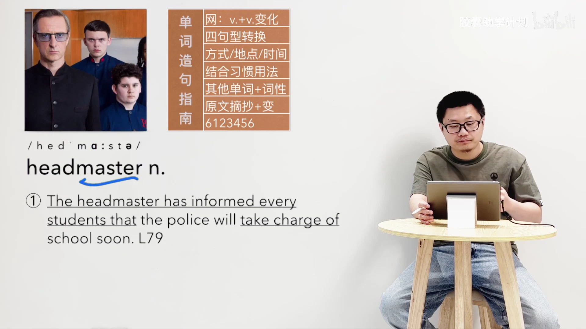

文字识别：单词造句指南 / 网：v.+v.变化 / 四句型转换 / 方式/地点/时间 / 结合习惯用法 / 其他单词+词性 / 原文摘抄+变 / 6123456 / /hed'maista/ / headmaster n. / ① The headmaster has informed every / students that the police will take charge of / school soon. L79

## 00:03:30–00:04:00

The headmaster has informed every students that the police will take charge of school soon.好，这里首先我们实际上不仅啊，那你拿headmaster造句肯定包含它，还用到了叫做inform a inform b that后边加一句话，对吧？刚刚学过的习惯用法。然后呢，这个地方还有一个叫take charge of，叫做这个接管，对吧？哎，说这个警察很快要接管这个学校了。Okay, next

### 画面 00:03:55

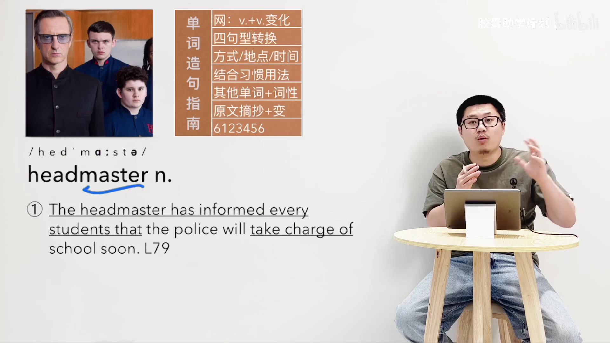

文字识别：单词造句指南 / 网：v.+v.变化 / 四句型转换 / 方式/地点/时间 / 结合习惯用法 / 其他单词+词性 / 原文摘抄+变 / 6123456 / /hed'ma:sta/ / headmaster n. / ① The headmaster has informed every / students that the police will take charge of / school soon. L79

### 画面 00:03:59

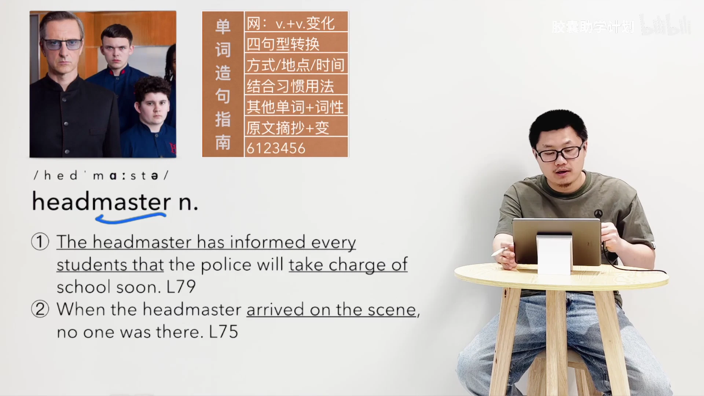

文字识别：单词造句指南 / 网：v.+v.变化 / 四句型转换 / 方式/地点/时间 / 结合习惯用法 / 其他单词+词性 / 原文摘抄+变 / 6123456 / /hed'ma:sta/ / headmaster n. / ① The headmaster has informed every / students that the police will take charge of / school soon. L79 / When the headmaster arrived on the scene, / no one was there. L75

## 00:04:00–00:04:30

one. Repeat after me. When the headmaster arrived on the scene, no one was there.说当校长到达现场的时候，发现没有人在那个地方. Okay, arrive on the scene.这个咱们之前学过的习惯用法，复习. Next one. The school takes its name from the headmaster,是吧？这个学校取名字，它的校长啊，巴拉巴拉. Okay,再读一遍这个单词headmaster. Very good.接下来下一个单词，看一下音标啊，叫做contribute,

### 画面 00:04:15

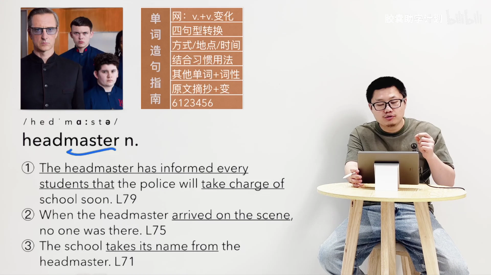

文字识别：单词造句指南 / 网：v.+v.变化 / 奏助字计划 / 四句型转换 / 方式/地点/时间 / 结合习惯用法 / 其他单词+词性 / 原文摘抄+变 / 6123456 / /hed'maista/ / headmaster n. / ① The headmaster has informed every / students that the police will take charge of / school soon.L79 / When the headmaster arrived on the scene, / no one was there. L75 / The school takes its name from the / headmaster. L71

### 画面 00:04:25

文字识别：单词造句指南 / 网：v.+v.变化 / 喜助字计划 / 四句型转换 / 方式/地点/时间 / 结合习惯用法 / 其他单词+词性 / 原文摘抄+变 / 6123456 / /kan'tribjuit/ / contribute v.

## 00:04:30–00:05:00

contribute，contribute，contribute。其实各位要记它最重要的那个含义，就像图中一样，就是起到一个贡献的作用，贡献，对吧？哎，起对一个什么项目或者对一件事情，我有所贡献的这个字叫做 contribute。啊，那 contribute 还有一些由这个贡献引申出来的含义，比如说捐助、捐赠、捐钱，哎，也是其实对于什么什么有贡献，对吧？那我们看一个小

### 画面 00:04:55

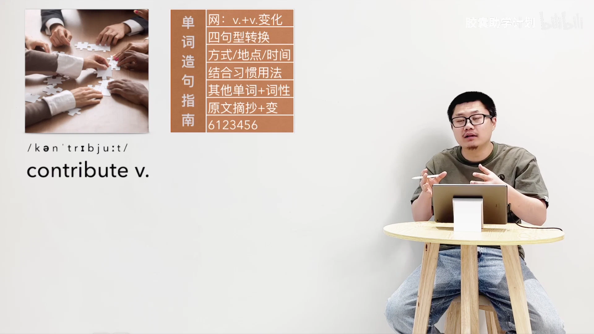

文字识别：单词造句指南 / 网：v.+v.变化 / 四句型转换 / 方式/地点/时间 / 结合习惯用法 / 其他单词+词性 / 原文摘抄+变 / 6123456 / /kan'tribjuit/ / contribute v.

## 00:05:00–00:05:30

的呃，它的变体叫做 contribute。我们把它做一点小的变体，变成 t i o n，叫做 contribution。而我们之前学过很多 t i o n 结尾的，我跟各位说过，对吧？英文单词 t i o n 结尾，很大的概率上它是一个名词。那 contribute 和 contribution 其实放到一起去记，对于各位来说反而更容易，对吧？ contribution 是一样的贡献，对吧？然后你可以理解为是捐赠，但是它是一个名词。想把它动

### 画面 00:05:25

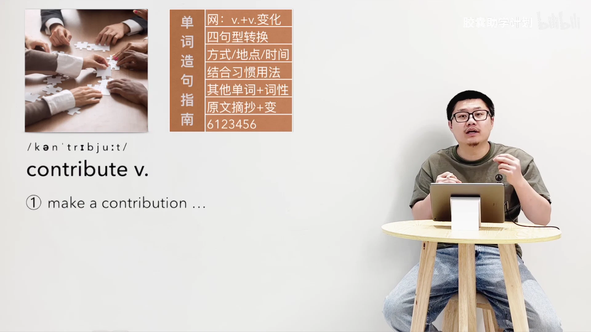

文字识别：单词造句指南 / 网：v.+v.变化 / 四句型转换 / 方式/地点/时间 / 结合习惯用法 / 其他单词+词性 / 原文摘抄+变 / 6123456 / /kan'tribjuit/ / contribute v. / ① make a contribution

## 00:05:30–00:06:00

词化呢，就变成了叫 make a contribution。现在想去造句就容易多了。比如说，我们先用 contribute 去造句啊。So I'd like to contribute to his college fund. A college fund 什么？就是他的大学基金啊啊！为了上大学要钱嘛，提前存一笔钱叫 college fund。那什么叫做 contribute to his college fund？最基本的含义就是为他的大学基金做一些贡献。那你去结合上下文以及我们汉语基本

### 画面 00:05:41

文字识别：单词造句指南 / 网：v.+v.变化 / 四句型转换 / 方式/地点/时间 / 结合习惯用法 / 其他单词+词性 / 原文摘抄+变 / 6123456 / /kan'tribjuit/ / contribute V. / ① make a contribution .. /  I'd like to contribute to his college fund.

## 00:06:00–00:06:30

的语感，你其实隐约的，所以我一直说 contribute，你不用记它那么多意思，记住它最常用、最本质的意思，结合上下文都能猜出来。其实这句话什么叫 contribute to college fund？不就是给他的 college fund 里面添砖加瓦，放点钱吗？本来你有三万，我再给两千，对吧？哎，叫 contribute，你可以理解为捐助、捐款都可以，或者说就说是贡献也没有问题啊。 Next one，咱们再来，repeat after

### 画面 00:06:11

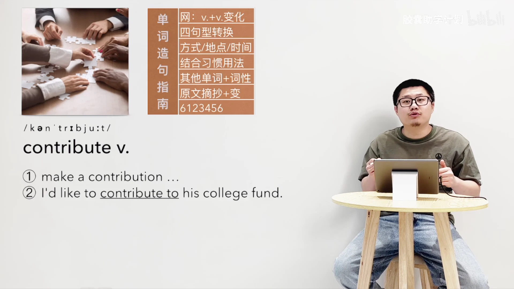

文字识别：单词造句指南 / 网：v.+v.变化 / 四句型转换 / 方式/地点/时间 / 结合习惯用法 / 其他单词+词性 / 原文摘抄+变 / 6123456 / /kan'tribjuit/ / contribute v. / ① make a contribution /  I'd like to contribute to his college fund.

### 画面 00:06:16

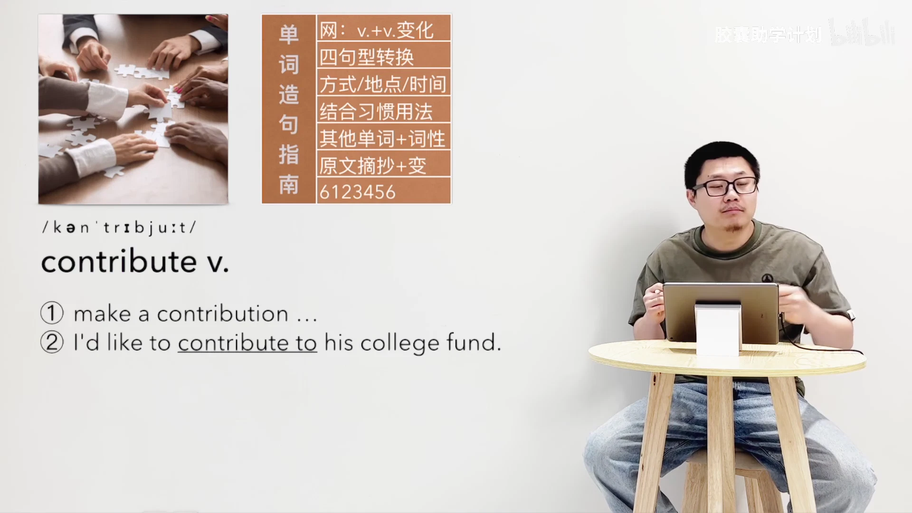

文字识别：单词造句指南 / 网：v.+v.变化 / 四句型转换 / 方式/地点/时间 / 结合习惯用法 / 其他单词+词性 / 原文摘抄+变 / 6123456 / /kan'tribjuit/ / contribute V. / ① make a contribution /  I'd like to contribute to his college fund.

### 画面 00:06:18

文字识别：单词造句指南 / 网：v.+v.变化 / 四句型转换 / 方式/地点/时间 / 结合习惯用法 / 其他单词+词性 / 原文摘抄+变 / 6123456 / /kan'tribjuit/ / contribute V. / ① make a contribution /  I'd like to contribute to his college fund.

### 画面 00:06:26

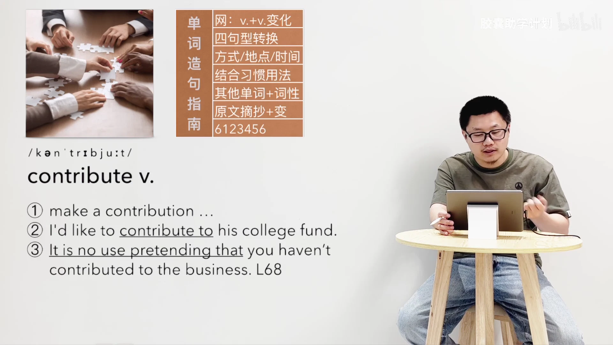

文字识别：单词造句指南 / 网：v.+v.变化 / 四句型转换 / 方式/地点/时间 / 结合习惯用法 / 其他单词+词性 / 原文摘抄+变 / 6123456 / /kan'tribjuit/ / contribute v. / ① make a contribution .. / ② I'd like to contribute to his college fund. / It is no use pretending that you haven't / contributed to the business. L68

## 00:06:30–00:07:00

me. It is no use pretending that you haven't contributed to the business.说装做一件事儿是没有用的，什么事儿呢？就是你没有给这个business，没有给这个商业行为，对吧？哎，做出贡献，在这儿可以理解为不是捐款了，对吧？好，你像这句话，比如说我就可以假，比如说假设啊，我跟Berlin聊，对吧？然后呢，他谦虚了一下，我说，哎，你别装啊，不用谦虚啊，说你这个说你没有给咱们这个

### 画面 00:06:32

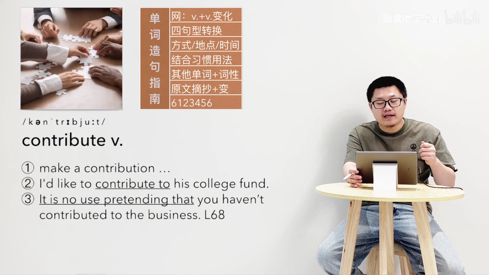

文字识别：单词造句指南 / 网：v.+v.变化 / 四句型转换 / 方式/地点/时间 / 结合习惯用法 / 其他单词+词性 / 原文摘抄+变 / 6123456 / /kan'tribjuit/ / contribute V. / ① make a contribution .. / ② I'd like to contribute to his college fund. / It is no use pretending that you haven't / contributed to the business. L68

### 画面 00:06:46

文字识别：单词造句指南 / 网：v.+v.变化 / 四句型转换 / 方式/地点/时间 / 结合习惯用法 / 其他单词+词性 / 原文摘抄+变 / 6123456 / /kan'tribjuit/ / contribute v. / ① make a contribution .. / ② I'd like to contribute to his college fund. / It is no use pretending that you haven't / contributed to the business. L68

## 00:07:00–00:07:30

个事业啊，business，对吧？胶囊助学计划这个事业做贡献这个事儿呢是没有用的。Okay, it is no use pretending that you haven't contributed to the business or to our business. Okay,下一个直接是一个小的电影片段，我觉得呃很好。它还用到了我们十九课和四十二课学过的两个语法，一个是might，对吧？表示可能，另外一个是be able to do，表示能。

### 画面 00:07:14

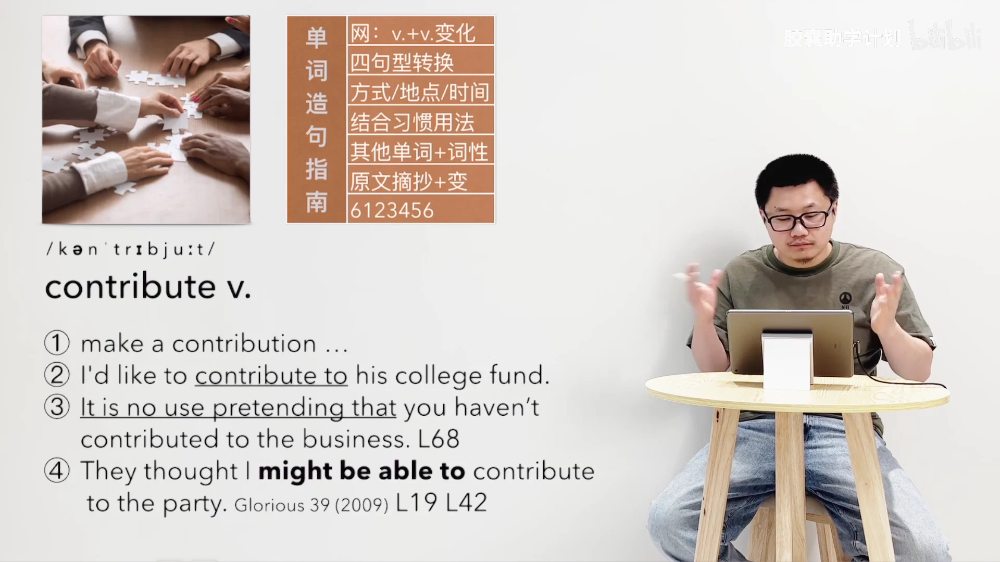

文字识别：单词造句指南 / 网：v.+v.变化 / 四句型转换 / 方式/地点/时间 / 结合习惯用法 / 其他单词+词性 / 原文摘抄+变 / 6123456 / /kan'tribjuit/ / contribute v. / ① make a contribution  / ② I'd like to contribute to his college fund. / It is no use pretending that you haven't / 3 / contributed to the business. L68 / They thought I might be able to contribute / to the party. Glorious 39 (2009) L19 L42

### 画面 00:07:17

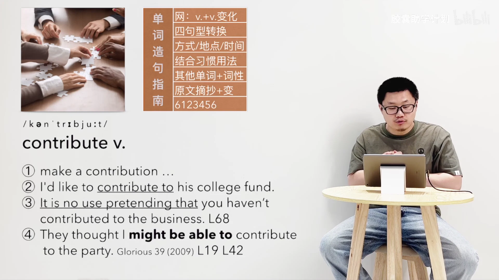

文字识别：单词造句指南 / 网：v.+v.变化 / 子计划 / 四句型转换 / 方式/地点/时间 / 结合习惯用法 / 其他单词+词性 / 原文摘抄+变 / 6123456 / /kan'tribjuit/ / contribute v. / ① make a contribution .. / ② I'd like to contribute to his college fund. /  It is no use pretending that you haven't / 3 / contributed to the business. L68 / They thought I might be able to contribute / to the party. Glorious 39 (2009) L19 L42

### 画面 00:07:21

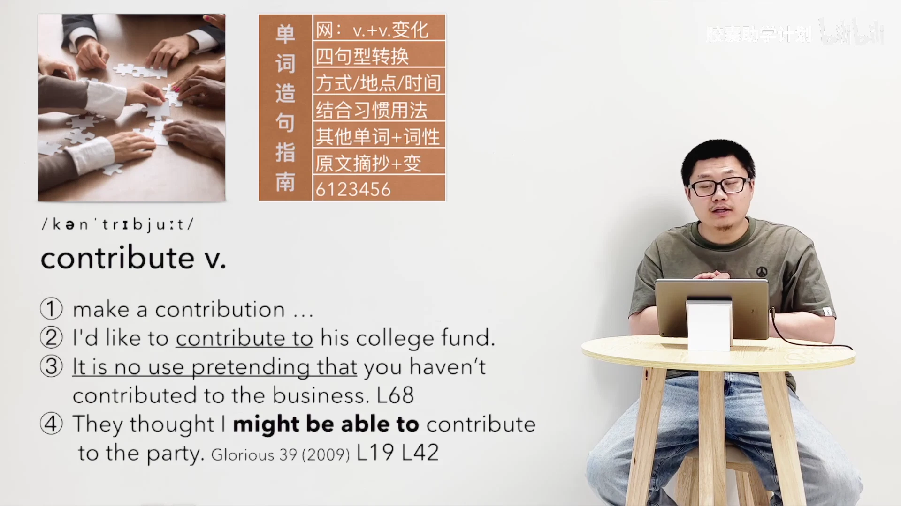

文字识别：单词造句指南 / 网：v.+v.变化 / 四句型转换 / 方式/地点/时间 / 结合习惯用法 / 其他单词+词性 / 原文摘抄+变 / 6123456 / /kan'tribjuit/ / contribute v. / ① make a contribution  / ② I'd like to contribute to his college fund. / It is no use pretending that you haven't / 3 / contributed to the business. L68 / They thought I might be able to contribute / to the party. Glorious 39 (2009) L19 L42

## 00:07:30–00:08:00

们看一下这个句子叫做 They thought I might be able to contribute to the party. 他们说，他们认为啊，我可能会对这个 party 聚会有所贡献。那你注意啊，如果我们把它翻译成捐款，自己本身首先有一点小的问题，在至少在这句话当中，对吧？就是 party 为什么要捐款，对吧？其次呢，你这个贡献和捐款它是不一样的，就是说捐款只是贡献的方式之一。我没出钱，我可以出人出力，

### 画面 00:07:51

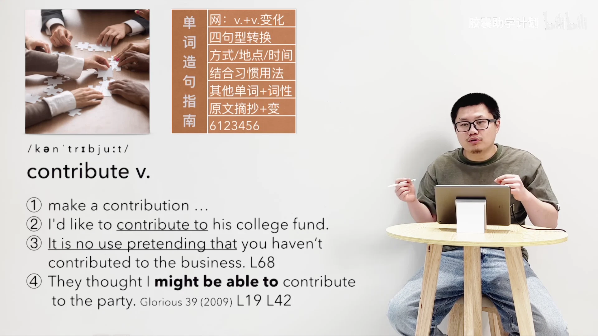

文字识别：单词造句指南 / 网：v.+v.变化 / 计场 / 四句型转换 / 方式/地点/时间 / 结合习惯用法 / 其他单词+词性 / 原文摘抄+变 / 6123456 / /kan'tribjuit/ / contribute V. / ① make a contribution .. / ② I'd like to contribute to his college fund. /  It is no use pretending that you haven't / 3 / contributed to the business. L68 / They thought I might be able to contribute / to the party. Glorious 39 (2009) L19 L42

## 00:08:00–00:08:30

对吧？我可以在别的地方去帮助，但我可能一分钱也没有掏，对吧？所以，但 contribute to the party，整体上来说，就是不管你以什么方式，你对这件事有贡献，就叫做 contribute。希望各位牢牢记住它最核心的含义。再跟我读一遍 contribute， very good. Next one，看一下这个单词很简单啊。我甚至有点隐约的印象，我们之前在某个地方见过，叫做 gift， gift 类似于 present，对吧？

### 画面 00:08:15

文字识别：单词造句指南 / 网：v.+v.变化 / 四句型转换 / 方式/地点/时间 / 结合习惯用法 / 其他单词+词性 / 原文摘抄+变 / 6123456 / /kan'tribjuit/ / contribute v. / ① make a contribution .. / ② I'd like to contribute to his college fund. / It is no use pretending that you haven't / 3 / contributed to the business. L68 / They thought I might be able to contribute / to the party. Glorious 39 (2009) L19 L42

### 画面 00:08:18

文字识别：单词造句指南 / 网：v.+v.变化 / 子计划 / 四句型转换 / 方式/地点/时间 / 结合习惯用法 / 其他单词+词性 / 原文摘抄+变 / 6123456 / /gift/ / gift n.

### 画面 00:08:20

文字识别：单词造句指南 / 网：v.+v.变化 / 四句型转换 / 方式/地点/时间 / 结合习惯用法 / 其他单词+词性 / 原文摘抄+变 / 6123456 / /gift/ / gift n.

## 00:08:30–00:09:00

礼物是个名词，想造句，你这个地方就肯定是要找其他的动词词性了，对吧？好，呃，比如说 he is eager to give her a gift，说他很渴望给她一份礼物。Repeat after me， eager to do啊。Next one， repeat after me， my girlfriend persuaded me not to buy her a gift this year。说我女朋友劝我说怎么样呢？不要今年再给她买礼物了啊。Okay，啊，比如经济

### 画面 00:08:30

文字识别：单词造句指南 / 网：v.+v.变化 / 四句型转换 / 方式/地点/时间 / 结合习惯用法 / 其他单词+词性 / 原文摘抄+变 / 6123456 / /gift/ / gift n.

### 画面 00:08:37

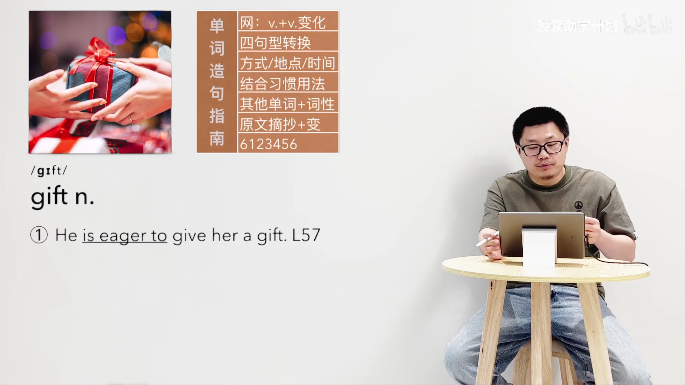

文字识别：单词造句指南 / 网：v.+v.变化 / 四句型转换 / 方式/地点/时间 / 结合习惯用法 / 其他单词+词性 / 原文摘抄+变 / 6123456 / /gift/ / gift n. / ① He is eager to give her a gift. L57

### 画面 00:08:44

文字识别：单词造句指南 / 网：v.+v.变化 / 臺助字计划 / 四句型转换 / 方式/地点/时间 / 结合习惯用法 / 其他单词+词性 / 原文摘抄+变 / 6123456 / /gift/ / gift n. / ① He is eager to give her a gift. L57

### 画面 00:08:46

文字识别：单词造句指南 / 网：v.+v.变化 / 四句型转换 / 方式/地点/时间 / 结合习惯用法 / 其他单词+词性 / 原文摘抄+变 / 6123456 / /gift/ / gift n. / ① He is eager to give her a gift. L57 / My girlfriend persuaded me not to buy her / a gift this year. L 54

### 画面 00:08:53

文字识别：单词造句指南 / 网：v.+v.变化 / 四句型转换 / 方式/地点/时间 / 结合习惯用法 / 其他单词+词性 / 原文摘抄+变 / 6123456 / /gift/ / gift n. / ① He is eager to give her a gift. L57 / My girlfriend persuaded me not to buy her / 2) / a gift this year. L 54

## 00:09:00–00:09:30

有点紧张啊，我们哎先不花钱买礼物了，咱们先做一些别的事情。说That's actually a good idea.哎，五十二课咱们学的一个口语句型，说那实际上是一个很好的主意。We should buy him a gift.我们应该给他买一份礼物。Buy somebody something，对吧？哎，给买给某人某物啊。Buy him a gift.再读一遍这个单词，gift very good。像这些句子你都可以做四句型的转换啊。Next one，下一个单

### 画面 00:09:00

文字识别：单词造句指南 / 网：v.+v.变化 / 四句型转换 / 方式/地点/时间 / 结合习惯用法 / 其他单词+词性 / 原文摘抄+变 / 6123456 / /gift/ / gift n. / ① He is eager to give her a gift. L57 / My girlfriend persuaded me not to buy her / a gift this year. L 54

### 画面 00:09:05

文字识别：单词造句指南 / 网：v.+v.变化 / 四句型转换 / 方式/地点/时间 / 结合习惯用法 / 其他单词+词性 / 原文摘抄+变 / 6123456 / /gift/ / gift n. / ① He is eager to give her a gift. L57 / ② My girlfriend persuaded me not to buy her / a gift this year. L 54 / That's actually a good idea. We should buy / him a gift. L52

### 画面 00:09:10

文字识别：单词造句指南 / 网：v.+v.变化 / 四句型转换 / 方式/地点/时间 / 结合习惯用法 / 其他单词+词性 / 原文摘抄+变 / 6123456 / /gift/ / gift n. / ① He is eager to give her a gift. L57 / ② My girlfriend persuaded me not to buy her / a gift this year. L 54 / That's actually a good idea. We should buy / him a gift. L52

### 画面 00:09:28

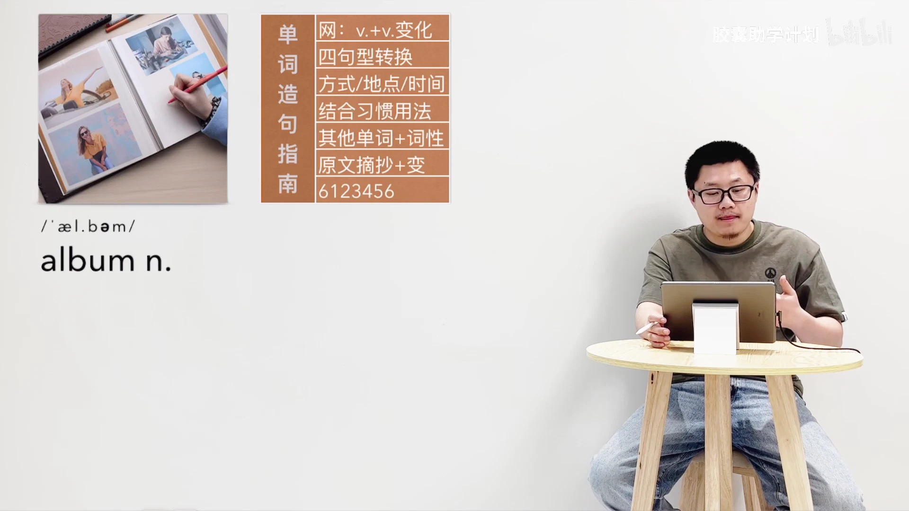

文字识别：单词造句指南 / 网：v.+v.变化 / 喜助字计划 / 四句型转换 / 方式/地点/时间 / 结合习惯用法 / 其他单词+词性 / 原文摘抄+变 / 6123456 / /'æl.bam/ / album n.

## 00:09:30–00:10:00

词叫 album。这地方我多提一个小点，就这个小点儿，其实是我帮你去区分一下音节啊。呃，有的有，有的没有。OK, album, album就是这种相册，是吧？这种相册 album，那拿它去造句。六一二三四五六当中，你想一三五肯定是它常见的位置，对吧？那我们先造一个句子，叫做啊，包括它是个名词，你要去找动词。动词可以是单独的动词，也可以之前学过的习惯用法，对吧？动词这个包含动

### 画面 00:09:43

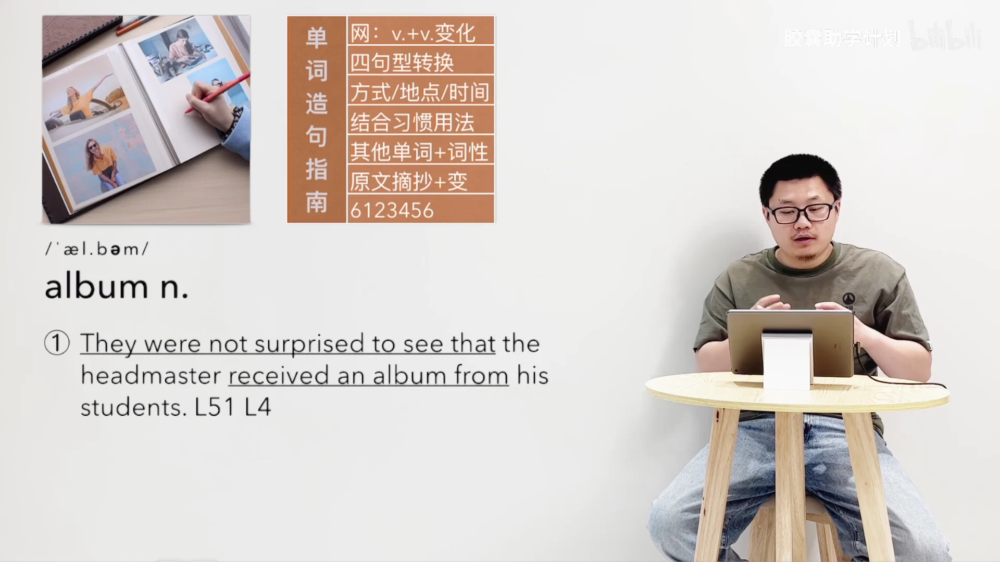

文字识别：单词造句指南 / 网：v.+v.变化 / 四句型转换 / 方式/地点/时间 / 结合习惯用法 / 其他单词+词性 / 原文摘抄+变 / 6123456 / /'æl.bam/ / album n. / ① They were not surprised to see that the / headmaster received an album from his / students.L51 L4

## 00:10:00–00:10:30

词的习惯用法和这个 album 连起来。我们看这样一句话啊，说 they were not surprised to see that。哎，这个咱们之前学过五十一课学的对吧？哎，他们看到这件事并不感到惊讶。减肥那课咱们学的吗？Hugh 那课对吧？说 the headmaster received an album from his students。说他们看到这件事并不感到惊讶。哪件事情呢？叫做校长收到了来自于他学生的一个相册，对吧？哎，记录着

### 画面 00:10:13

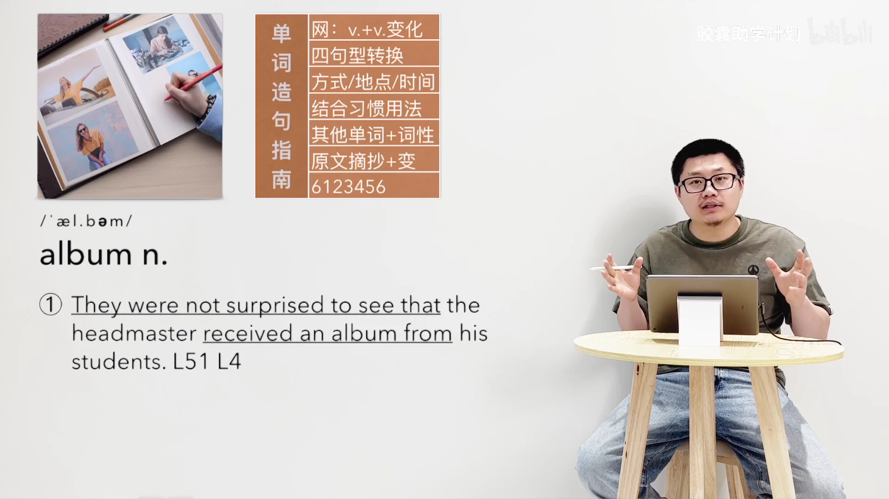

文字识别：单词造句指南 / 网：v.+v.变化 / 四句型转换 / 方式/地点/时间 / 结合习惯用法 / 其他单词+词性 / 原文摘抄+变 / 6123456 / /'æel.bam/ / album n. / ① They were not surprised to see that the / headmaster received an album from his / students. L51 L4

## 00:10:30–00:11:00

点点滴滴，包括你可以在相册里写一些什么话，对吧？Okay, next one. I regretted giving him that album.说我把这个相册给他，我后悔了啊！我后悔我做了这件事。Okay, next one. When he saw the album, he burst into tears.啊，burst into tears是之前七十二课咱们学的，就是突然间猛的就哭出来了，对吧？哎，一下就哭出来了。说当他看到这个相册的时候啊，往

### 画面 00:10:42

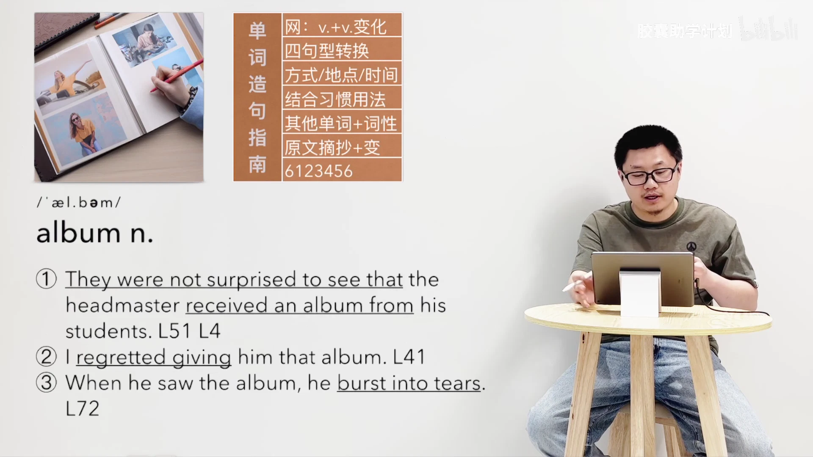

文字识别：单词造句指南 / 网：v.+v.变化 / 四句型转换 / 方式/地点/时间 / 结合习惯用法 / 其他单词+词性 / 原文摘抄+变 / 6123456 / /'æel.bam/ / album n. / ① They were not surprised to see that the / headmaster received an album from his / students.L51 L4 / I regretted giving him that album. L41 /  When he saw the album, he burst into tears. / 3 / L72

## 00:11:00–00:11:30

我这个往事历历在目啊，然后夸一下就动情了，burst into tears。再读一遍这个单词，album，very good。Next one，下一个单词看一下音标还是音节，拿点儿给各位画好了。第一个音节patience，连起来patience，patience，patience指的是耐心，对吧？但是你注意，人家是个名词，对吧？好，那名词的话，往往可能是要跟各种各

### 画面 00:11:10

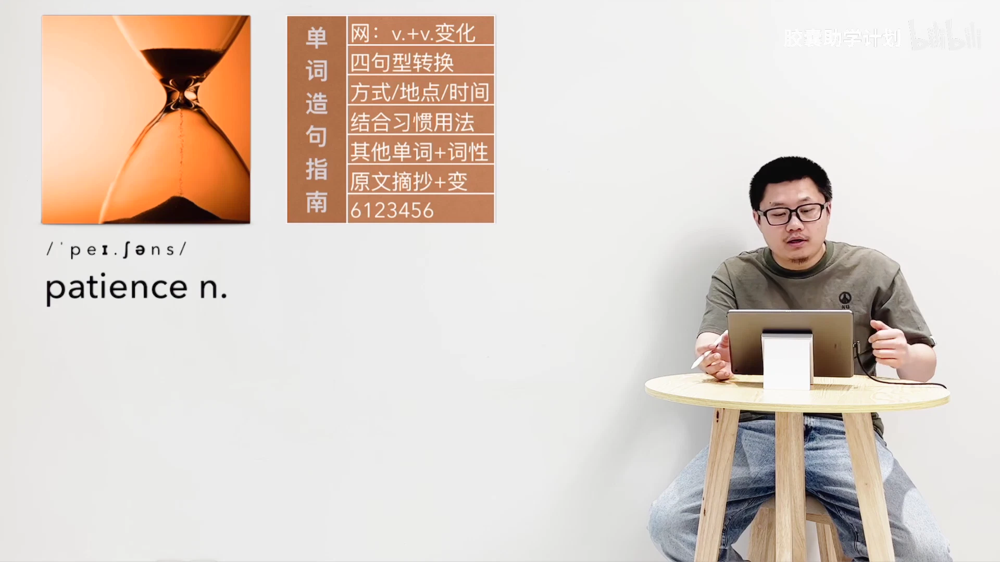

文字识别：单词造句指南 / 网：v.+v.变化 / 辜助字计划 / 四句型转换 / 方式/地点/时间 / 结合习惯用法 / 其他单词+词性 / 原文摘抄+变 / 6123456 / /'pel.∫ans/ / patience n.

### 画面 00:11:14

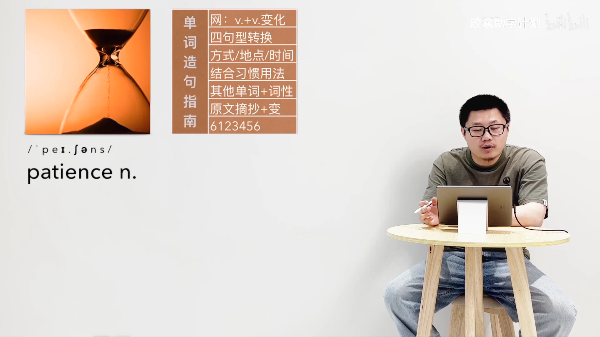

文字识别：单词造句指南 / 网：v.+v.变化 / 喜助字计划 / 四句型转换 / 方式/地点/时间 / 结合习惯用法 / 其他单词+词性 / 原文摘抄+变 / 6123456 / /'pel.∫ans/ / patience n.

### 画面 00:11:19

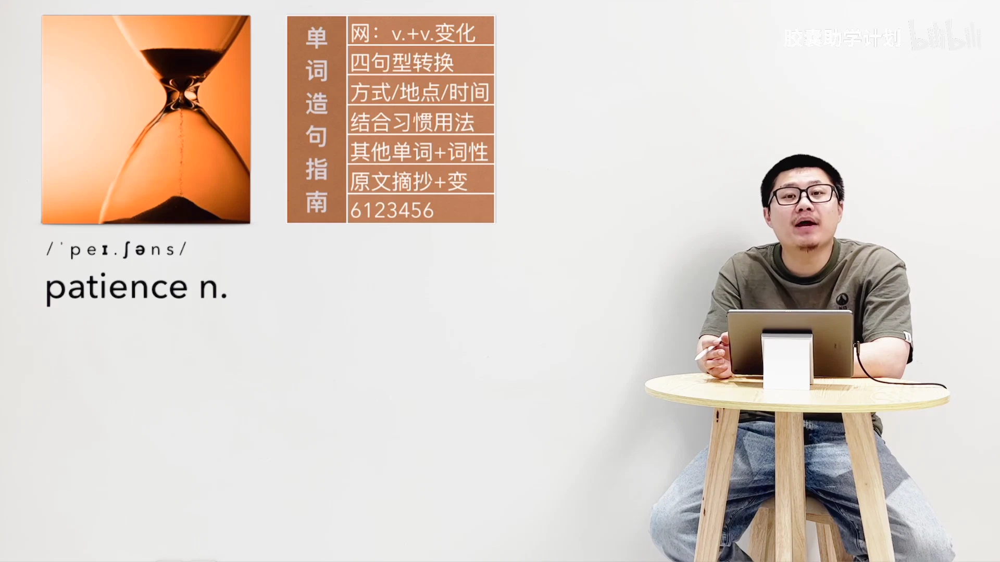

文字识别：单词造句指南 / 网：v.+v.变化 / 囊助字计划 / 四句型转换 / 方式/地点/时间 / 结合习惯用法 / 其他单词+词性 / 原文摘抄+变 / 6123456 / /'pel.∫ans/ / patience n.

### 画面 00:11:25

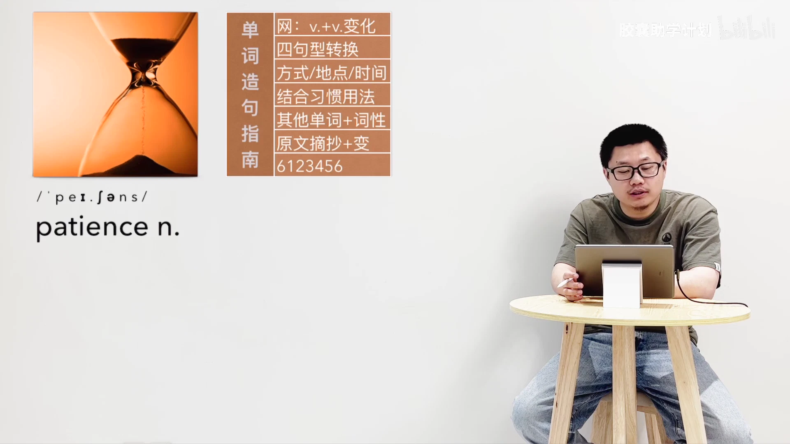

文字识别：单词造句指南 / 网：v.+v.变化 / 喜助字计划 / 四句型转换 / 方式/地点/时间 / 结合习惯用法 / 其他单词+词性 / 原文摘抄+变 / 6123456 / /'pel.∫ans/ / patience n.

## 00:11:30–00:12:00

样的动词连到一起。首先，比如说感谢您很有耐心，叫做 thanks for your patience。这句话其实就是直接就是口语听力当中各位经常听到的或者经常可以说到的一句话，感谢你的耐心，thanks for your patience。接下来呢，我们说两个跟它连起来的动词，第一个叫做 lose somebody's patience，其实很像我们之前学过的 lose somebody's temper，啊，这个发脾气，对吧？失去

### 画面 00:11:30

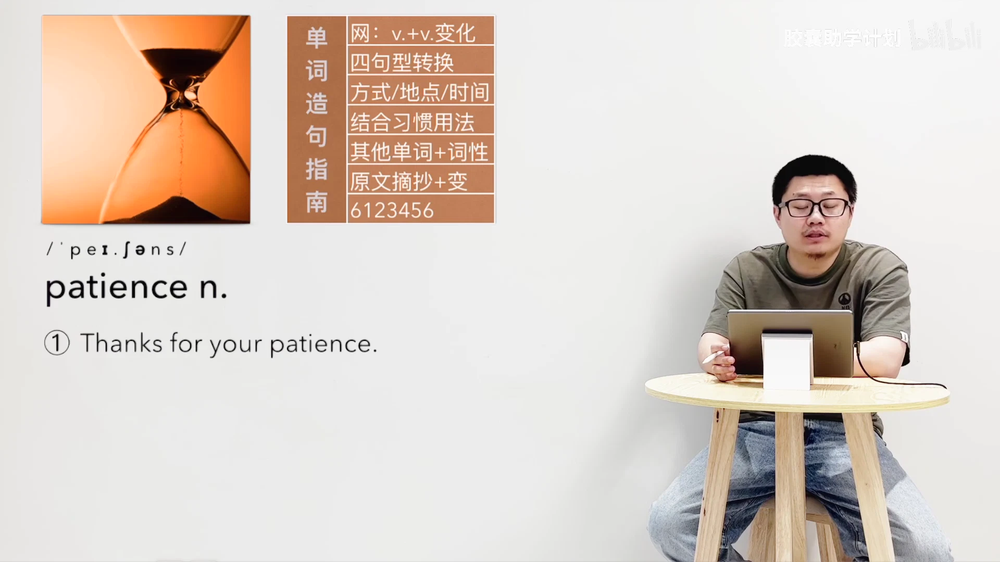

文字识别：单词造句指南 / 网：v.+v.变化 / 四句型转换 / 方式/地点/时间 / 结合习惯用法 / 其他单词+词性 / 原文摘抄+变 / 6123456 / /'pel.∫ans/ / patience n. / D Thanks for your patience.

### 画面 00:11:32

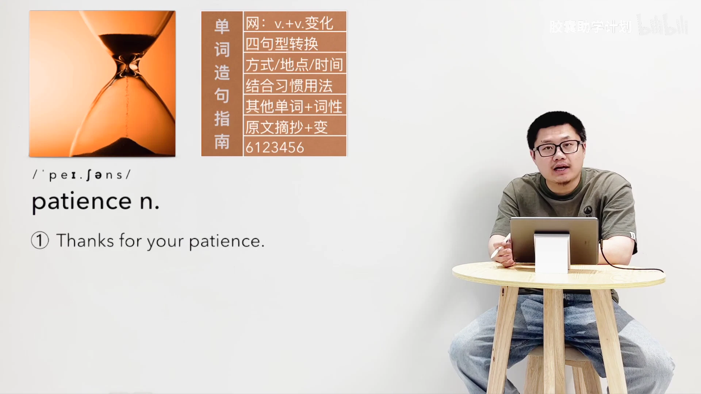

文字识别：单词造句指南 / 网：v.+v.变化 / 四句型转换 / 方式/地点/时间 / 结合习惯用法 / 其他单词+词性 / 原文摘抄+变 / 6123456 / /'pel.∫ans/ / patience n. / ) Thanks for your patience.

### 画面 00:11:38

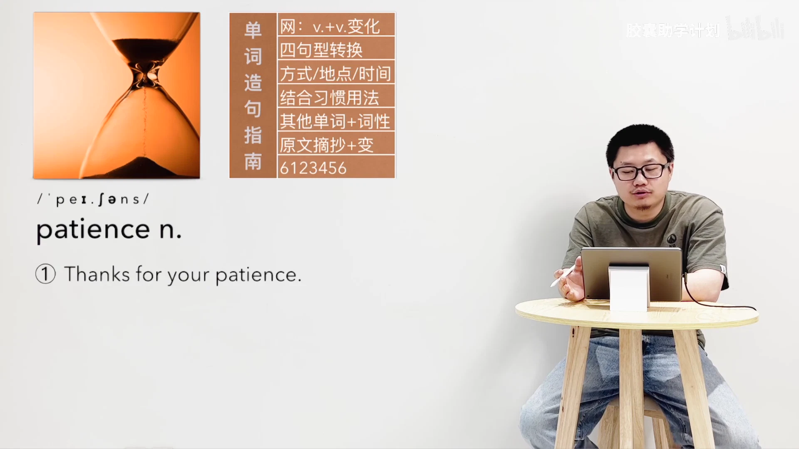

文字识别：单词造句指南 / 网：v.+v.变化 / 喜助子计划 / 四句型转换 / 方式/地点/时间 / 结合习惯用法 / 其他单词+词性 / 原文摘抄+变 / 6123456 / /'pel.∫ans/ / patience n. /  Thanks for your patience.

### 画面 00:11:44

文字识别：单词造句指南 / 网：v.+v.变化 / 计划 / 四句型转换 / 方式/地点/时间 / 结合习惯用法 / 其他单词+词性 / 原文摘抄+变 / 6123456 / /'pei.∫ans/ / patience n. / ① Thanks for your patience. / ② lose sb's patience / have a lot of patience

## 00:12:00–00:12:30

了某人的脾气就发脾气。那 lose somebody's patience 就是失去了耐心。那如果说 have a lot of patience 呢？那你肯定就是很有耐心，对吧？好，咱们造个句子。He kept on crying and I lost my patience. 哎，他持续不断的哭，没完没了的哭，然后我就失去了耐心。Keep on doing something. Next one. In the end, I could not bear it. I turned around again. 又回到了第一课，对吧？

### 画面 00:12:02

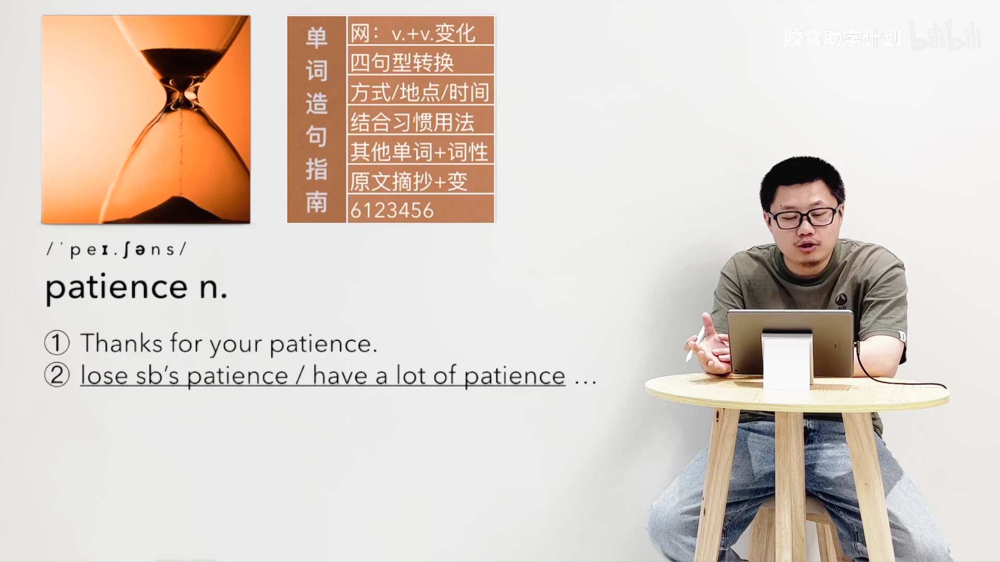

文字识别：单词造句指南 / 网：v.+v.变化 / 四句型转换 / 方式/地点/时间 / 结合习惯用法 / 其他单词+词性 / 原文摘抄+变 / 6123456 / /'pei.∫ans/ / patience n. / ① Thanks for your patience. / ② lose sb's patience / have a lot of patience

### 画面 00:12:16

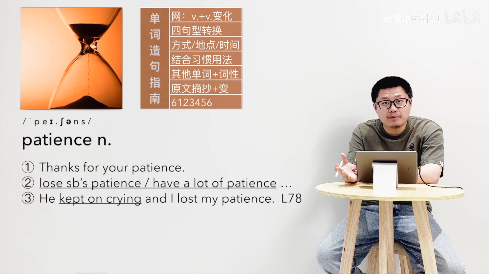

文字识别：单词造句指南 / 网：v.+v.变化 / 四句型转换 / 方式/地点/时间 / 结合习惯用法 / 其他单词+词性 / 原文摘抄+变 / 6123456 / /'pel.∫ans/ / patience n. / ① Thanks for your patience. / ② lose sb's patience / have a lot of patience … /  He kept on crying and I lost my patience. L78 / 3

### 画面 00:12:25

文字识别：单词造句指南 / 网：v.+v.变化 / 子计划 / 四句型转换 / 方式/地点/时间 / 结合习惯用法 / 其他单词+词性 / 原文摘抄+变 / 6123456 / /'pei.∫ans/ / patience n. / ① Thanks for your patience. / ② lose sb's patience / have a lot of patience .. / He kept on crying and Ilost my patience. L78 / 3 / ) In the end I lost my patience and shouted at / 4 / her. L1

### 画面 00:12:29

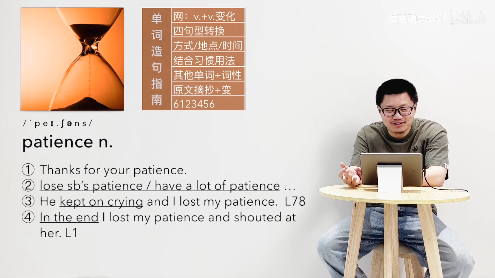

文字识别：单词造句指南 / 网：v.+v.变化 / 四句型转换 / 方式/地点/时间 / 结合习惯用法 / 其他单词+词性 / 原文摘抄+变 / 6123456 / /'per.∫ans/ / patience n. / ① Thanks for your patience. / ② lose sb's patience / have a lot of patience . . / He kept on crying and Ilost my patience. L78 / 3 / ) In the end I lost my patience and shouted at / 4 / her. L1

## 00:12:30–00:13:00

所以我希望你还记得这个。In the end,啊，最后第一课咱们学的，I lost my patience and shouted at her.哎，最后怎么样？我失去了耐心，然后冲她大声吼叫了起来。Okay, next one. I ask for your patience and your help.哎，注意这ask for，哎，我向你寻求什么什么样的东西，对吧？我希望得到你的耐心和你的帮助。Okay, I ask for your patience

### 画面 00:12:31

文字识别：单词造句指南 / 网：v.+v.变化 / 子计划 / 四句型转换 / 方式/地点/时间 / 结合习惯用法 / 其他单词+词性 / 原文摘抄+变 / 6123456 / /pei.∫ans/ / patience n. / ① Thanks for your patience. / ② lose sb's patience / have a lot of patience .. / He kept on crying and Ilost my patience. L78 / 3 /  In the end Ilost my patience and shouted at / 4 / her. L1

### 画面 00:12:44

文字识别：单词造句指南 / 网：v.+v.变化 / 学计划 / 四句型转换 / 方式/地点/时间 / 结合习惯用法 / 其他单词+词性 / 原文摘抄+变 / 6123456 / /pei.∫ans/ / patience n. / ① Thanks for your patience. / ② lose sb's patience / have a lot of patience … /  He kept on crying and I lost my patience. L78 / 3 / 4 / D In the end Ilost my patience and shouted at / her. L1 / ⑤ I ask for your patience and your help. L6

### 画面 00:12:51

文字识别：单词造句指南 / 网：v.+v.变化 / [助学计划 / 四句型转换 / 方式/地点/时间 / 结合习惯用法 / 其他单词+词性 / 原文摘抄+变 / 6123456 / / pei.∫ans/ / patience n. / ① Thanks for your patience. / ② lose sb's patience / have a lot of patience … / He kept on crying and Ilost my patience. L78 / 3 / ) In the end I lost my patience and shouted at / 4 / her. L1 / ⑤ I ask for your patience and your help. L6

### 画面 00:12:55

文字识别：单词造句指南 / 网：v.+v.变化 / 建助学计划 / 四句型转换 / 方式/地点/时间 / 结合习惯用法 / 其他单词+词性 / 原文摘抄+变 / 6123456 / /pei.∫ans/ / patience n. / ① Thanks for your patience. / ② lose sb's patience / have a lot of patience … / ) He kept on crying and Ilost my patience. L78 / ③ / 4 / D In the end I lost my patience and shouted at / her. L1 / ⑤ I ask for your patience and your help. L6

## 00:13:00–00:13:30

and your help.再读一遍这个单词 patience, very good.那咱们这个注意力集中，听一个很短的电影片段. I'm beginning to lose my patience.哎，我正在逐渐的丧失我的耐心啊. Lose my patience.好, next one, 看这个单词够长啊，叫做 encouragement. Encouragement是什么？就像这图中一样啊，不要灰

### 画面 00:13:04

文字识别：I'm beginning to lose my patience. / Cat Run / (2011)

### 画面 00:13:10

文字识别：I'm beginning to lose my patience. / Cat Run / (2011)

### 画面 00:13:12

文字识别：I'm beginning to lose my patience. / Cat Run / (2011)

### 画面 00:13:19

文字识别：单词造句指南 / 网：v.+v.变化 / 四句型转换 / 方式/地点/时间 / 结合习惯用法 / 其他单词+词性 / 原文摘抄+变 / 6123456 / /Ⅰn'kΛrId3mant/ / encouragement n.

### 画面 00:13:21

文字识别：单词造句指南 / 网：v.+v.变化 / 四句型转换 / 方式/地点/时间 / 结合习惯用法 / 其他单词+词性 / 原文摘抄+变 / 6123456 / /Ⅰn'kλrId3mant/ / encouragement n.

### 画面 00:13:25

文字识别：单词造句指南 / 网：v.+v.变化 / 四句型转换 / 方式/地点/时间 / 结合习惯用法 / 其他单词+词性 / 原文摘抄+变 / 6123456 / /Ⅰn'kλrId3mant/ / encouragement n.

## 00:13:30–00:14:00

心丧气啊，给别人一些鼓励叫做 encouragement。好，包括像我们刚刚学过的那个单词 agreement，对吧？达成协议 reach an agreement。这个 ment 也是很多名词的后缀，换一句话来说，有点像 tion，对吧？好， encouragement 鼓励，口语当中直接就可以用的，比如像刚才那个叫做 thanks for your patience，你直接一换叫 thank you for the encouragement，感谢你的鼓

### 画面 00:13:48

文字识别：单词造句指南 / 网：v.+v.变化 / 四句型转换 / 方式/地点/时间 / 结合习惯用法 / 其他单词+词性 / 原文摘抄+变 / 6123456 / /Ⅰn'kΛrｌd3maｎt/ / encouragement n.

### 画面 00:13:51

文字识别：单词造句指南 / 网：v.+v.变化 / 四句型转换 / 方式/地点/时间 / 结合习惯用法 / 其他单词+词性 / 原文摘抄+变 / 6123456 / /Ⅰn'kΛrⅠd3mant / / encouragement n. /  Thank you for the encouragement. ATime to Kill / (1996)

### 画面 00:13:56

文字识别：单词造句指南 / 网：v.+v.变化 / 四句型转换 / 方式/地点/时间 / 结合习惯用法 / 其他单词+词性 / 原文摘抄+变 / 6123456 / /Ⅰn'kΛrⅠd3mant / / encouragement n. / ① Thank you for the encouragement. ATime to Kill / (1996)

## 00:14:00–00:14:30

励，口语当中随时用得到。Next one,呃，我们找一个动词跟它连起来，给某人鼓励，这是我们汉语当中也很常用的一个短语，对吧？那give somebody encouragement，我们造个句子。My father loved to give me encouragement.说我父亲这个人呢，特别喜欢给我一些鼓励，对吧？Love to do something，咱们刚刚学过。Next one, if my father had given me

### 画面 00:14:00

文字识别：单词造句指南 / 网：v.+v.变化 / 四句型转换 / 方式/地点/时间 / 结合习惯用法 / 其他单词+词性 / 原文摘抄+变 / 6123456 / /In'kΛrⅠd3mant / / encouragement n. / ① Thank you for the encouragement. A Time to Kill / (1996)

### 画面 00:14:05

文字识别：单词造句指南 / 网：v.+v.变化 / 四句型转换 / 方式/地点/时间 / 结合习惯用法 / 其他单词+词性 / 原文摘抄+变 / 6123456 / /Ⅰn'kΛrｌd3maｎt/ / encouragement n. / D Thank you for the encouragement. A Time to Kill / (1996) / give sb.encouragement ..

### 画面 00:14:14

文字识别：单词造句指南 / 网：v.+v.变化 / 四句型转换 / 方式/地点/时间 / 结合习惯用法 / 其他单词+词性 / 原文摘抄+变 / 6123456 / /In'kΛrтd3mant/ / encouragement n. / ① Thank you for the encouragement. A Time to Kill / (1996) / give sb.encouragement .. / ③ My father love to give me encouragement. L83

### 画面 00:14:18

文字识别：单词造句指南 / 网：v.+v.变化 / 四句型转换 / 方式/地点/时间 / 结合习惯用法 / 其他单词+词性 / 原文摘抄+变 / 6123456 / /In'kΛrｉd3mａnt / / encouragement n. / ① Thank you for the encouragement. ATime to Kill / (1996) / give sb. encouragement .. / ③ My father love to give me encouragement. L83

### 画面 00:14:20

文字识别：单词造句指南 / 网：v.+v.变化 / 四句型转换 / 方式/地点/时间 / 结合习惯用法 / 其他单词+词性 / 原文摘抄+变 / 6123456 / /In'kΛrld3mant/ / encouragement n. / ① Thank you for the encouragement. ATime to Kill / (1996) / give sb. encouragement .. / ③ My father love to give me encouragement. L83

### 画面 00:14:23

文字识别：单词造句指南 / 网：v.+v.变化 / 四句型转换 / 方式/地点/时间 / 结合习惯用法 / 其他单词+词性 / 原文摘抄+变 / 6123456 / /тn'kΛrｌd3mant/ / encouragement n. / ① Thank you for the encouragement. ATime to Kill / (1996) / give sb. encouragement .. / ③ My father love to give me encouragement. L83

### 画面 00:14:25

文字识别：单词造句指南 / 网：v.+v.变化 / 四句型转换 / 方式/地点/时间 / 结合习惯用法 / 其他单词+词性 / 原文摘抄+变 / 6123456 / /Ⅰn'kΛrⅠd3mant / / encouragement n. / ① Thank you for the encouragement. ATime to Kil / (1996) / give sb.encouragement .. / 2 / 3 / My father love to give me encouragement. L83 / If my father had given me encouragement like / 4 / your father did, I would have gone to college. / L80 L64

## 00:14:30–00:15:00

encouragement like your father did, I would have gone to college.好了，我们看一下这句话。首先，黑字部分你能清楚的看到，这是我们在复习六十四课学过的虚拟语气，只不过与过去时是相反。所以，我们先翻译一下它的字面意思，叫做如果我的父亲给了我什么呢？鼓励，像你的父亲那样，就是像你的父亲给你的鼓励那样。那后面没有必要就省略掉了啊，用一个单词 did

### 画面 00:14:30

文字识别：单词造句指南 / 网：v.+v.变化 / 四句型转换 / 方式/地点/时间 / 结合习惯用法 / 其他单词+词性 / 原文摘抄+变 / 6123456 / /Ⅰn'kΛrⅠd3mant / / encouragement n. / ① Thank you for the encouragement. ATime to Kill / (1996) / give sb.encouragement ... / 2 / My father love to give me encouragement. L83 / 3 / If my father had given me encouragement like / your father did, I would have gone to college. / L80 L64

### 画面 00:14:36

文字识别：单词造句指南 / 网：v.+v.变化 / 四句型转换 / 方式/地点/时间 / 结合习惯用法 / 其他单词+词性 / 原文摘抄+变 / 6123456 / /Ⅰn'kΛrⅠd3mant / / encouragement n. / ① Thank you for the encouragement. ATime to Kill / (1996) / give sb. encouragement ... / My father love to give me encouragement. L83 / 3 / If my father had given me encouragement like / your father did, I would have gone to college. / L80 L64

### 画面 00:14:39

文字识别：单词造句指南 / 网：v.+v.变化 / 四句型转换 / 方式/地点/时间 / 结合习惯用法 / 其他单词+词性 / 原文摘抄+变 / 6123456 / /Ⅰn'kΛrⅠd3mant / / encouragement n. / ① Thank you for the encouragement. ATime to Kill / (1996) / give sb. encouragement ... / My father love to give me encouragement. L83 / 3 / If my father had given me encouragement like / your father did, I would have gone to college. / L80 L64

### 画面 00:14:51

文字识别：单词造句指南 / 网：v.+v.变化 / 四句型转换 / 方式/地点/时间 / 结合习惯用法 / 其他单词+词性 / 原文摘抄+变 / 6123456 / /Ⅰn'kΛrⅠd3mant / / encouragement n. / ① Thank you for the encouragement. ATime to Kill / (1996) / give sb.encouragement ... / My father love to give me encouragement. L83 / 3 / If my father had given me encouragement like / 4 / your father did, I would have gone to college. / L80 L64

### 画面 00:14:58

文字识别：单词造句指南 / 网：v.+v.变化 / 四句型转换 / 方式/地点/时间 / 结合习惯用法 / 其他单词+词性 / 原文摘抄+变 / 6123456 / /Ⅰn'kΛrⅠd3mant / / encouragement n. / ① Thank you for the encouragement. A Time to Kill / (1996) / give sb. encouragement ... / My father love to give me encouragement. L83 / 3 / If my father had given me encouragement like / your father did, I would have gone to college. / L80 L64

## 00:15:00–00:15:30

就行了。I would have gone to college. Go to college.八十课咱们刚学的，去上大学。那我也会去上大学了。这是它的字面意思。但是因为有黑这个加黑的这个地方，这个结构，那我们知道它是表示对过去的虚拟。所以这句话其实我想分享给你的意思是如下这些，叫做当我小的时候，我的父亲并没有给我像你的父亲给你鼓励的那样的一些鼓励，对吧？你父亲给了你不少鼓励，我的父亲

### 画面 00:15:01

文字识别：单词造句指南 / 网：v.+v.变化 / 四句型转换 / 方式/地点/时间 / 结合习惯用法 / 其他单词+词性 / 原文摘抄+变 / 6123456 / /Ⅰn'kΛrⅠd3mant / / encouragement n. / ① Thank you for the encouragement. A Time to Kill / (1996) / give sb.encouragement ... / My father love to give me encouragement. L83 / 3 / If my father had given me encouragement like / your father did, I would have gone to college. / L80 L64

### 画面 00:15:08

文字识别：单词造句指南 / 网：v.+v.变化 / 四句型转换 / 方式/地点/时间 / 结合习惯用法 / 其他单词+词性 / 原文摘抄+变 / 6123456 / /Ⅰn'kΛrⅠd3mant / / encouragement n. / ① Thank you for the encouragement. ATime to Kill / (1996) / give sb.encouragement ... / My father love to give me encouragement. L83 / 3 / If my father had given me encouragement like / your father did, I would have gone to college. / L80 L64

### 画面 00:15:11

文字识别：单词造句指南 / 网：v.+v.变化 / 四句型转换 / 方式/地点/时间 / 结合习惯用法 / 其他单词+词性 / 原文摘抄+变 / 6123456 / /Ⅰn'kΛrⅠd3mant / / encouragement n. / ① Thank you for the encouragement. ATime to Kill / (1996) / give sb. encouragement ... / My father love to give me encouragement. L83 / 3 / If my father had given me encouragement like / your father did, I would have gone to college. / L80 L64

### 画面 00:15:15

文字识别：单词造句指南 / 网：v.+v.变化 / 四句型转换 / 方式/地点/时间 / 结合习惯用法 / 其他单词+词性 / 原文摘抄+变 / 6123456 / /Ⅰn'kΛrⅠd3mant / / encouragement n. / ① Thank you for the encouragement. ATime to Kill / (1996) / give sb.encouragement .. / My father love to give me encouragement. L83 / 3 / If my father had given me encouragement like / your father did, I would have gone to college. / L80 L64

## 00:15:30–00:16:00

没有给我这些鼓励。然后呢，你去上大学了，而我呢就没有上成大学，对吧？我就这个不管是自尊心、自信心啊，学习方面各个方面遭受打击，我就早早进入社会，而没有去上大学了。OK，所以这地方 if had done would have done，对吧？好，读一遍这个单词 encouragement。OK，那注意力啊，咱集中电影片段啊。你看这句话实际上跟刚才我造那句话特别特别的像，

### 画面 00:15:37

文字识别：单词造句指南 / 网：v.+v.变化 / 四句型转换 / 方式/地点/时间 / 结合习惯用法 / 其他单词+词性 / 原文摘抄+变 / 6123456 / /Ⅰn'kΛrⅠd3mant / / encouragement n. / ① Thank you for the encouragement. ATime to Kill / (1996) / give sb.encouragement ... / My father love to give me encouragement. L83 / 3 / If my father had given me encouragement like / your father did, I would have gone to college. / L80 L64

### 画面 00:15:40

文字识别：单词造句指南 / 网：v.+v.变化 / 四句型转换 / 方式/地点/时间 / 结合习惯用法 / 其他单词+词性 / 原文摘抄+变 / 6123456 / /Ⅰn'kΛrⅠd3mant / / encouragement n. / ① Thank you for the encouragement. ATime to Kill / (1996) / give sb. encouragement ... / My father love to give me encouragement. L83 / 3 / If my father had given me encouragement like / your father did, I would have gone to college. / L80 L64

### 画面 00:15:45

文字识别：单词造句指南 / 网：v.+v.变化 / 四句型转换 / 方式/地点/时间 / 结合习惯用法 / 其他单词+词性 / 原文摘抄+变 / 6123456 / /Ⅰn'kΛrⅠd3mant / / encouragement n. / ① Thank you for the encouragement. ATime to Kill / (1996) / give sb.encouragement ... / My father love to give me encouragement. L83 / 3 / If my father had / given me encouragement like / your father did, I would have gone to college. / L80 L64

### 画面 00:15:52

文字识别：Wow. if my family had given me that kind of / encouragement, my whole life / would be different. / If l Were You / (2012)

## 00:16:00–00:16:30

嗯，这样乍一看每一个单词都是学过的，咱听一下。Wow, if my family had given me that kind of encouragement, my whole life would be different. Very good. 下一个单词 farewell，拜拜啊 farewell 啊，那 farewell 这个地方咱们单独用它其实不太好造句，但是 a farewell dinner 晚餐，一个什么样的晚餐呢？就是送别餐是吧？Farewell dinner 啊，送别

### 画面 00:16:07

文字识别：Wow. if my family had given me that kind of / encouragement, my whole life / would be different. / If l Were You / (2012)

### 画面 00:16:10

文字识别：Wow. if my family had given me that kind of / encouragement, my whole life / would be different. / If l Were You / (2012)

### 画面 00:16:13

文字识别：- / 单词造句指南 / 网：v.+v.变化 / 喜助学计划 / 四句型转换 / 方式/地点/时间 / 结合习惯用法 / 其他单词+词性 / 原文摘抄+变 / 6123456 / /fea'wel/ / farewell n.

### 画面 00:16:15

文字识别：单词造句指南 / 网：v.+v.变化 / 喜助子计划 / 四句型转换 / 方式/地点/时间 / 结合习惯用法 / 其他单词+词性 / 原文摘抄+变 / 6123456 / / fea'we l/ / farewell n.

### 画面 00:16:20

文字识别：单词造句指南 / 网：v.+v.变化 / 学计划 / 四句型转换 / 方式/地点/时间 / 结合习惯用法 / 其他单词+词性 / 原文摘抄+变 / 6123456 / / fea'we l / / farewell n. / ① [Story]: attend a farewell dinner...

### 画面 00:16:25

文字识别：- / 单词造句指南 / 网：v.+v.变化 / 四句型转换 / 方式/地点/时间 / 结合习惯用法 / 其他单词+词性 / 原文摘抄+变 / 6123456 / /fea'we l/ / farewell n. / ① [Story]: attend a farewell dinner...

## 00:16:30–00:17:00

啊。OK，那attend就是参加嘛。我们造一个句子说，She was relieved to hear that，说她听到这件事情感到非常的放松，松了一口气。怎么样呢？She didn't have to attend the farewell dinner啊，她不用去参加这个告别晚宴，对吧？好，那可能比如说她本身社恐，很内向，呃，这个告别晚宴呢，可能注意力又不得不放在她的身上，有一些，比如说她就是这个女女女女主角，是吧？是这个这个这个这

### 画面 00:16:31

文字识别：单词造句指南 / 网：v.+v.变化 / 子计划 / 四句型转换 / 方式/地点/时间 / 结合习惯用法 / 其他单词+词性 / 原文摘抄+变 / 6123456 / /fea'we l/ / farewell n. / ① [Story]: attend a farewell dinner... / ② She was relieved to hear that she didn't / have to attend the farewell dinner. L84

### 画面 00:16:36

文字识别：单词造句指南 / 网：v.+v.变化 / 四句型转换 / 方式/地点/时间 / 结合习惯用法 / 其他单词+词性 / 原文摘抄+变 / 6123456 / / fe a'w e l / / farewell n. / ① [Story]: attend a farewell dinner... / ② She was relieved to hear that she didn't / have to attend the farewell dinner. L84

### 画面 00:16:42

文字识别：单词造句指南 / 网：v.+v.变化 / 计划 / 四句型转换 / 方式/地点/时间 / 结合习惯用法 / 其他单词+词性 / 原文摘抄+变 / 6123456 / /fea'we l/ / farewell n. / ① [Story]: attend a farewell dinner... / ② She was relieved to hear that she didn't / have to attend the farewell dinner. L84

### 画面 00:16:56

文字识别：单词造句指南 / 网：v.+v.变化 / 四句型转换 / 方式/地点/时间 / 结合习惯用法 / 其他单词+词性 / 原文摘抄+变 / 6123456 / /fea'we l/ / farewell n. / ① [Story]: attend a farewell dinner... / 2 /  She was relieved to hear that she didn't / have to attend the farewell dinner. L84

## 00:17:00–00:17:30

这次告别晚宴的女主角。那怎么办呢？她又不想去，所以当她听到这句话说她可以不去的时候，她感觉松了一口气啊。 Continue, she claimed to have attended a farewell dinner last night. 说她声称昨天晚上她去参加了一个告别晚宴啊。 Next one, he changed into his best suits and attended a farewell ah dinner. 好，change into八十一课咱们学战服那课

### 画面 00:17:00

文字识别：单词造句指南 / 网：v.+v.变化 / 学计划 / 四句型转换 / 方式/地点/时间 / 结合习惯用法 / 其他单词+词性 / 原文摘抄+变 / 6123456 / /fea'wel/ / farewell n. / ① [Story]: attend a farewell dinner... / ② She was relieved to hear that she didn't / have to attend the farewell dinner. L84

### 画面 00:17:08

文字识别：单词造句指南 / 网：v.+v.变化 / 四句型转换 / 方式/地点/时间 / 结合习惯用法 / 其他单词+词性 / 原文摘抄+变 / 6123456 / /fea'wel/ / farewell n. / ① [Story]: attend a farewell dinner... / ② She was relieved to hear that she didn't / have to attend the farewell dinner. L84 / She claimed to have attended a farewell / dinner last night. L82

### 画面 00:17:11

文字识别：单词造句指南 / 网：v.+v.变化 / 四句型转换 / 方式/地点/时间 / 结合习惯用法 / 其他单词+词性 / 原文摘抄+变 / 6123456 / /fea'wel/ / farewell n. / ① [Story]: attend a farewell dinner... / ② She was relieved to hear that she didn't / have to attend the farewell dinner. L84 / She claimed to have attended a farewell / dinner last night. L82

### 画面 00:17:17

文字识别：单词造句指南 / 网：v.+v.变化 / 四句型转换 / 方式/地点/时间 / 结合习惯用法 / 其他单词+词性 / 原文摘抄+变 / 6123456 / / fea'w el / / farewell n. / ① [Story]: attend a farewell dinner... / ② She was relieved to hear that she didn't / have to attend the farewell dinner. L84 / She claimed to have attended a farewell / dinner last night. L82

### 画面 00:17:20

文字识别：单词造句指南 / 网：v.+v.变化 / 子计划 / 四句型转换 / 方式/地点/时间 / 结合习惯用法 / 其他单词+词性 / 原文摘抄+变 / 6123456 / /fea'wel/ / farewell n. / ① [Story]: attend a farewell dinner... / ② She was relieved to hear that she didn't / have to attend the farewell dinner. L84 / ) She claimed to have attended a farewell / dinner last night. L82 / ) He changed into his best suits and / attended a farewell dinner. L81

## 00:17:30–00:18:00

咱们学 prisoner，对吧？ Of war，那课咱们学的。 Change into，就是他穿上了他最棒的这一身行头，对吧？我们所谓行头啊，或者说这个西服套装啊，然后去参加了一个告别晚宴。再读一下 farewell， there you go. 呃，那咱们继续吧，看一下这个电影片段啊。这里边还出现了几个啊，这个咱们之前学过的小的点，我提前给您标一下，对吧？

### 画面 00:17:43

文字识别：单词造句指南 / 网：v.+v.变化 / 毫助学计划 / 四句型转换 / 方式/地点/时间 / 结合习惯用法 / 其他单词+词性 / 原文摘抄+变 / 6123456 / /fea'wel/ / farewell n. / ① [Story]: attend a farewell dinner... / ② She was relieved to hear that she didn't / have to attend the farewell dinner. L84 / ) She claimed to have attended a farewell / dinner last night. L82 / He changed into his best suits and / attended a farewell dinner. L81

### 画面 00:17:45

文字识别：单词造句指南 / 网：v.+v.变化 / 四句型转换 / 方式/地点/时间 / 结合习惯用法 / 其他单词+词性 / 原文摘抄+变 / 6123456 / /fea'wel/ / farewell n. / ① [Story]: attend a farewell dinner... / ② She was relieved to hear that she didn't / have to attend the farewell dinner. L84 / ) She claimed to have attended a farewell / dinner last night. L82 / ) He changed into his best suits and / attended a farewell dinner. L81

### 画面 00:17:48

文字识别：Listen, I know this is your last night in New York.. / . so I was wondering if you would allow me to / take you out.. for a nice farewell dinner. / Going the Distance / (2010)

### 画面 00:17:59

文字识别：Listen, I know this is your last night in New York.. / . so I was wondering if you would allow me to / take you out. for a nice farewell dinner. / Going the Distance / (2010)

## 00:18:00–00:18:30

提前给您标一下。好，呃，不多说了，注意力集中，咱听一下这个电影片段。Listen, I know this is your last night in New York, so I was wondering if you would allow me to take you out for a nice farewell dinner. 哎，带你出去来顿特别棒的告别晚宴，对吧？晚餐啊，好。Next one，下一个单词 honor, honor。哎，这个我我个人觉得可能这几年在中国这

### 画面 00:18:06

文字识别：Listen, I know this is your last night in New York.. / . so I was wondering if you would allow me to / take you out...for a nice farewell dinner. / Going the Distance / (2010)

### 画面 00:18:08

文字识别：Listen, I know this is your last night in New York.. / . so I was wondering if you would allow me to / take you out.. for a nice farewell dinner. / Going the Distance / (2010)

### 画面 00:18:10

文字识别：Listen, I know this is your last night in New York.. / . so I was wondering if you would allow me to / take you out..for a nice farewell dinner. / Going the Distance / (2010)

### 画面 00:18:12

文字识别：Listen, I know this is your last night in New York.. / . so I was wondering if you would allow me to / take you out...for a nice farewell dinner. / Going the Distance / (2010)

### 画面 00:18:14

文字识别：Listen, I know this is your last night in New York.. / . so I was wondering if you would allow me to / take you out..for a nice farewell dinner. / Going the Distance / (2010)

### 画面 00:18:22

文字识别：单词造句指南 / 网：v.+v.变化 / 喜助字计划 / 四句型转换 / 方式/地点/时间 / 结合习惯用法 / 其他单词+词性 / 原文摘抄+变 / 6123456 / pna/ / honour honor n.

### 画面 00:18:25

文字识别：单词造句指南 / 网：v.+v.变化 / 喜助字计划 / 四句型转换 / 方式/地点/时间 / 结合习惯用法 / 其他单词+词性 / 原文摘抄+变 / 6123456 / Dna/ / honour honor n.

## 00:18:30–00:19:00

个单词应该是挺熟了，具体原因我不就说了，我就不说了，可能涉嫌打广告。但是这个单词你很可能是认识的，叫做 honor 啊。好，它有一种荣耀啊，然后呢这个荣誉啊的意思，在这个地方呢，我们把它摘出来看它一个习惯用法，叫做 in somebody's honor，叫做对某人人致敬。这地方我写了两种拼写，一种有 you，一种没有 you。呃，我们文章当中那种是英式

### 画面 00:18:32

文字识别：单词造句指南 / 网：v.+v.变化 / 毫助字计划 / 四句型转换 / 方式/地点/时间 / 结合习惯用法 / 其他单词+词性 / 原文摘抄+变 / 6123456 / Dna/ / honour honor n.

### 画面 00:18:34

文字识别：单词造句指南 / 网：v.+v.变化 / 囊助字计划 / 四句型转换 / 方式/地点/时间 / 结合习惯用法 / 其他单词+词性 / 原文摘抄+变 / 6123456 / Dna/ / honour honor n.

### 画面 00:18:53

文字识别：单词造句指南 / 网：v.+v.变化 / 壺助学计划 / 四句型转换 / 方式/地点/时间 / 结合习惯用法 / 其他单词+词性 / 原文摘抄+变 / 6123456 / /pna/ / honour honor n. / NO / WmR / ① in sb's honor...敬意

## 00:19:00–00:19:30

的，另一种就是美式的。但这二者呢，几乎在大多数情况下，啊，各位的工作、生活、学习、考试，除非这个考试格外，很少有这样的考试啊。首先，但除非这个考试定了，说你只能用英式拼写或美式拼写，那基本上你混着用没有任何问题。那 in somebody's honor呢，就是对某人致敬。比如说，我们造一句话说 I'm gonna win this game tonight in his honor。我们先不管 in his honor，说今天晚

### 画面 00:19:23

文字识别：单词造句指南 / 网：v.+v.变化 / 四句型转换 / 方式/地点/时间 / 结合习惯用法 / 其他单词+词性 / 原文摘抄+变 / 6123456 / / 'pna / / honour honor n. / ① in sb's honor...敬意 /  I'm gonna win this game tonight in his honor. / 2

## 00:19:30–00:20:00

这场比赛我会赢的，作为什么呢？对他的一个致敬。好，再来，哎，我们经常说电影当中有一些镜头是致敬之前的某个某个电影或者导演嘛，就是 in somebody's honor, 对吧？比如再来，就是一个电影片段说了一句话叫 We'd like to invite you to join us for a party in your honor, 对你一个致敬，对吧？OK, next one. So we're gonna name him Marcus in your honor. 我们要把他

### 画面 00:19:36

文字识别：单词造句指南 / 网：v.+v.变化 / 毒助学计划 / 四句型转换 / 方式/地点/时间 / 结合习惯用法 / 其他单词+词性 / 原文摘抄+变 / 6123456 / / 'pna / / honour honor n. / ① in sb's honor...敬意 /  I'm gonna win this game tonight in his honor. / 2） / We'd like to invite you to join us for a party in / 3 / your honor! Hard Target 2 (2016)

### 画面 00:19:55

文字识别：单词造句指南 / 网：v.+v.变化 / 臺助字计划 / 四句型转换 / 方式/地点/时间 / 结合习惯用法 / 其他单词+词性 / 原文摘抄+变 / 6123456 / / 'pna / / honour honor n. / ① in sb's honor...敬意 / ② I'm gonna win this game tonight in his honor. / 3 /  We'd like to invite you to join us for a party in / your honor! Hard Target 2 (2016) / We're gonna name him Marcus in your honor. / Vacation Friends (2021) L67

## 00:20:00–00:20:30

起名字叫做Marcus，作为对你的一个致敬。这个是我们英美文化，呃，和中国文化有点不同的，呃，点，对吧？你像我，呃，前几天回家过年，还跟父母讨论了一个问题，就是我的名字为什么是现在这个名字，而不是另一个名字，对吧？因为另一个名字和我家里的长辈是有所冲突的。而英文这个这个当中啊，它其实经常，比如说，我为了想纪念你，我会把我的孩子，

### 画面 00:20:25

文字识别：单词造句指南 / 网：v.+v.变化 / 蠢助字计划 / 四句型转换 / 方式/地点/时间 / 结合习惯用法 / 其他单词+词性 / 原文摘抄+变 / 6123456 / / 'pna / / honour honor n. / ① in sb's honor...敬意 / ② I'm gonna win this game tonight in his honor. /  We'd like to invite you to join us for a party in / 3 / your honor! Hard Target 2 (2016) / We're gonna name him Marcus in your honor. / Vacation Friends (2021) L67

## 00:20:30–00:21:00

哪怕你是长辈啊，比如说我爷爷，我会把我的孩子的名字就起是我爷爷的名字，这在儒家文化或者说哪怕是现在的中国依旧是不被接受的，对吧？现在中国也是儒家文化啊，只不过可能相对来说没有那么严，那就是呃影响没有那么深了，是吧？至少和比如说五百年前相比，或者两百年前相比，那在英美文化当中，你完全可以作为致敬就起他的名字，听明白了吧？比如说叫大小布什，对

### 画面 00:20:55

文字识别：单词造句指南 / 网：v.+v.变化 / 建助学计划 / 四句型转换 / 方式/地点/时间 / 结合习惯用法 / 其他单词+词性 / 原文摘抄+变 / 6123456 / /·pna l / honour honor n. / NU / WnR / ① in sb's honor...敬意 / ② I'm gonna win this game tonight in his honor. /  We'd like to invite you to join us for a party in / 3 / your honor! Hard Target 2 (2016) / We're gonna name him Marcus in your honor. / Vacation Friends (2021) L67

## 00:21:00–00:21:30

吧？OK，好，不多说了啊。下一个单词，哎，coincidence啊，这是俩美女都穿白衣服撞衫了，巧了，coincidence，very good。你能注意到它又是个名词？哎，拿它去造句呢？直接给您一个句型，叫做It is a curious coincidence that，这是我们原文给的。然后至于这个地方的a curious，可以完全换成别的单词或者

### 画面 00:21:02

文字识别：单词造句指南 / 网：v.+v.变化 / 囊助字计划 / 四句型转换 / 方式/地点/时间 / 结合习惯用法 / 其他单词+词性 / 原文摘抄+变 / 6123456 / /kau'Insidans/ / coincidence n.

### 画面 00:21:08

文字识别：单词造句指南 / 网：v.+v.变化 / 四句型转换 / 方式/地点/时间 / 结合习惯用法 / 其他单词+词性 / 原文摘抄+变 / 6123456 / /kau'Insidans/ / coincidence n.

### 画面 00:21:19

文字识别：单词造句指南 / 网：v.+v.变化 / 字计划 / 四句型转换 / 方式/地点/时间 / 结合习惯用法 / 其他单词+词性 / 原文摘抄+变 / 6123456 / /kau'Insidans / / coincidence n. / ① It is a curious coincidence that + 句子

### 画面 00:21:26

文字识别：单词造句指南 / 网：v.+v.变化 / 子计划 / 四句型转换 / 方式/地点/时间 / 结合习惯用法 / 其他单词+词性 / 原文摘抄+变 / 6123456 / /kau'Insidans / / coincidence n. / ① It isa curioudcoincidence that +句子

## 00:21:30–00:22:00

不加，对吧？那这句话什么意思呢？就是这是一个很奇异、很有趣的巧合。什么巧合呢？后边加一句话。所以，如果我们面对这样的句子，永远是有两种学习方式。一种呢，是我个人不是非常推崇，但是你懂是没有问题的。但你绝对不能停留在这儿，叫做它是个什么从句，对吧？哎，说这个 it 和后边这个句子有什么联系啊？等等。另外一种呢，我的一个思路

### 画面 00:21:40

文字识别：单词造句指南 / 网：v.+v.变化 / 囊助学计划 / 四句型转换 / 方式/地点/时间 / 结合习惯用法 / 其他单词+词性 / 原文摘抄+变 / 6123456 / /kau'īnsidans / / coincidence n. / NO / WHN / ① It isa curioue coincidencethat +句子

### 画面 00:21:55

文字识别：单词造句指南 / 网：v.+v.变化 / 毫助学计划 / 四句型转换 / 方式/地点/时间 / 结合习惯用法 / 其他单词+词性 / 原文摘抄+变 / 6123456 / /kau'Insidaｎs / coinciaence n. / a curioue coincidencethat +句子 / is

### 画面 00:21:57

文字识别：单词造句指南 / 网：v.+v.变化 / 四句型转换 / 方式/地点/时间 / 结合习惯用法 / 其他单词+词性 / 原文摘抄+变 / 6123456 / / kau'īnsidans/ / coincidence n. / ① It isa curioue coincidencethat +句子

## 00:22:00–00:22:30

就是，我们学习它就是为了将来在听说读写当中张嘴就能用出来，对吧？我们不用关心它具体是一个什么从句，我们更要关心的事情是拿它去造句。好，比如说，It can't be a coincidence. 你注意，你看这里，我只是把 is a curious 换成了 can't be. Can't be 你学过第十七课学的，对吧？一定不是一个巧合。什么？呢I saw you here this morning. 今儿早上我在这看见你了。这个事儿绝对不是一个巧合。

### 画面 00:22:07

文字识别：单词造句指南 / 网：v.+v.变化 / 四句型转换 / 方式/地点/时间 / 结合习惯用法 / 其他单词+词性 / 原文摘抄+变 / 6123456 / /kau'īnsidans / / coincidence n. / ① It isa curioue coincidencethat +句子

### 画面 00:22:09

文字识别：单词造句指南 / 网：v.+v.变化 / 四句型转换 / 方式/地点/时间 / 结合习惯用法 / 其他单词+词性 / 原文摘抄+变 / 6123456 / /kau'Insidans/ / coincidence n. / NO / VHR / ① It is a curious coincidence that + 句子

### 画面 00:22:11

文字识别：单词造句指南 / 网：v.+v.变化 / 四句型转换 / 方式/地点/时间 / 结合习惯用法 / 其他单词+词性 / 原文摘抄+变 / 6123456 / /kau'īnsidans / / coincidence n. / NU / ① It is a curious coincidence that + 句子 / It can't be a coincidence that I saw you here / this morning. L17

### 画面 00:22:16

文字识别：单词造句指南 / 网：v.+v.变化 / 四句型转换 / 方式/地点/时间 / 结合习惯用法 / 其他单词+词性 / 原文摘抄+变 / 6123456 / / kau'īnsidans/ / coincidence n. / NU / WHR / ① It js a curious coincidence that + 句子 / 2) / It can't be a coincidence that I saw you here / this morning. L17

## 00:22:30–00:23:00

所以你能感觉到，其实后边这个句子就是 it 的内容。你啊，你看我再给你翻一遍啊，这句话要翻译成“今儿早上在这见到你了”这个事儿绝不可能是一个巧合。你发现发现后边这个从句其实跟 it 是一码事儿，it 指代的就是后边这个从句啊，这不就有点像主从吗？对不对？好，但是我需要你做的其实是不是分析它的语法，而是真正自己能造出这样的句子。再来，所以 is

### 画面 00:22:31

文字识别：单词造句指南 / 网：v.+v.变化 / 四句型转换 / 方式/地点/时间 / 结合习惯用法 / 其他单词+词性 / 原文摘抄+变 / 6123456 / /kau'īnsidans/ / coincidence n. / WUR / NU / ① Itjs a curious coincidencethat + 句子 / 2 / It can't be a coincidencethat I saw you here / this morning. L17

### 画面 00:22:33

文字识别：单词造句指南 / 网：v.+v.变化 / 建助字计划 / 四句型转换 / 方式/地点/时间 / 结合习惯用法 / 其他单词+词性 / 原文摘抄+变 / 6123456 / /kau'īnsidans/ / coincidence n. / NO / ts a curious coincidencethat + 句子 / 1 / It can't be a coincidencethat I saw you here / this morning / L17

### 画面 00:22:54

文字识别：单词造句指南 / 网：v.+v.变化 / 四句型转换 / 方式/地点/时间 / 结合习惯用法 / 其他单词+词性 / 原文摘抄+变 / 6123456 / /kau'īnsidans / / coincidence n. / ① Itjs a curious coincidencethat + 句子 / 2 / It can't be a coincidencethat I saw you here / this morning / L17

### 画面 00:22:56

文字识别：单词造句指南 / 网：v.+v.变化 / 四句型转换 / 方式/地点/时间 / 结合习惯用法 / 其他单词+词性 / 原文摘抄+变 / 6123456 / / kau'īnsidans / / coincidence n. / ① It is a curious coincidence that + 句子 / It can't be a coincidence that I saw you here / this morning. L17

### 画面 00:22:58

文字识别：单词造句指南 / 网：v.+v.变化 / 四句型转换 / 方式/地点/时间 / 结合习惯用法 / 其他单词+词性 / 原文摘抄+变 / 6123456 / /kau'insidans/ / coincidence n. / ① It is a curious coincidence that + 句子 / ② It can't be a coincidence that I saw you here / this morning. L17 / It's no coincidence that people went on / strike on the same day that he won the / election. L84 L83

## 00:23:00–00:23:30

no coincidence that you注意到，其实我在it is a curious coincidence这个地方，我把a curious去掉，换成了一个no，叫做这绝不是一个巧合。什么事儿呢？People went on went on strike on the same day that he won the election。说人们去罢工了，在相同的一天，哪天呢？叫做他赢得选举的这一天，人们去罢工了。这绝对是不是一个巧合？是有预谋的，是提前规

### 画面 00:23:04

文字识别：单词造句指南 / 网：v.+v.变化 / 学计划 / 四句型转换 / 方式/地点/时间 / 结合习惯用法 / 其他单词+词性 / 原文摘抄+变 / 6123456 / / kau'īnsidans / / coincidence n. / WIR / NU / ① It is a curious coincidence that + 句子 / 2 / It can't be a coincidence that I saw you here / this morning. L17 / It's no coincidence that people went on / strike on the same day that he won the / election. L84 L83

### 画面 00:23:07

文字识别：单词造句指南 / 网：v.+v.变化 / 四句型转换 / 方式/地点/时间 / 结合习惯用法 / 其他单词+词性 / 原文摘抄+变 / 6123456 / /kau'īnsidans / / coincidence n. / NO / WIIR / ① It is c curioDs coincidence that + 句子 / 2 / It can't be a coincidence that I saw you here / this morning. L17 / It's no coincidence that people went on / strike on the same day that he won the / election. L84 L83

### 画面 00:23:14

文字识别：单词造句指南 / 网：v.+v.变化 / 四句型转换 / 方式/地点/时间 / 结合习惯用法 / 其他单词+词性 / 原文摘抄+变 / 6123456 / /kau'insidans/ / coincidence n. / ①It isa curiovs coincidence that + 句子 / It can't be a coincidence that I saw you here / this morning. L17 / It's Ocoincidence that people went on / strike on the same day that he won the / election.L84 L83

## 00:23:30–00:24:00

划安排好的，对吧？所以叫做 it's no coincidence, coincidence that, ah, coincidence that. Very good.那下一个单词，我们一起读一下，叫做 total, total, total, total，就总共。那 total of 还是总共的意思，只不过是一个常用的小短语啊。我们造个句子吧。They received a total of twenty letters from fans last week. Received something from somebody.我们只不过把 something

### 画面 00:23:39

文字识别：单词造句指南 / 网：v.+v.变化 / 喜助学计划 / 四句型转换 / 方式/地点/时间 / 结合习惯用法 / 其他单词+词性 / 原文摘抄+变 / 6123456 / /'tautal/ / total n.

### 画面 00:23:41

文字识别：单词造句指南 / 网：v.+v.变化 / 霆助学计划， / 四句型转换 / 方式/地点/时间 / 结合习惯用法 / 其他单词+词性 / 原文摘抄+变 / 6123456 / /'tautal/ / total n.

### 画面 00:23:50

文字识别：单词造句指南 / 网：v.+v.变化 / 学计划 / 四句型转换 / 方式/地点/时间 / 结合习惯用法 / 其他单词+词性 / 原文摘抄+变 / 6123456 / /'tautal/ / total n. / ① a total of /  They received a total of 20 letters from fans / last week. L4

### 画面 00:23:55

文字识别：单词造句指南 / 网：v.+v.变化 / 四句型转换 / 方式/地点/时间 / 结合习惯用法 / 其他单词+词性 / 原文摘抄+变 / 6123456 / /'tautal/ / total n. / ① a total of / They received a total of 20 letters from fans / last week. L4

## 00:24:00–00:24:30

with a total of twenty letters, right? Next one, repeat after me. A total of twenty people were killed last night.总共有二十个人昨天晚上被杀害了，对吧？哎，注意be killed这个be换成了was were，对吧？Okay. Next one. They tried to offer me a total of twenty thousand dollars. They tried to offer somebody something, or offer something to

### 画面 00:24:06

文字识别：单词造句指南 / 网：v.+v.变化 / 学计划 / 四句型转换 / 方式/地点/时间 / 结合习惯用法 / 其他单词+词性 / 原文摘抄+变 / 6123456 / /'tautal/ / total n. / ①a total of / They received a total of 20 letters from fans / last week. L4 / ) A total of twenty people were killed last / night. L10

### 画面 00:24:18

文字识别：单词造句指南 / 网：v.+v.变化 / 四句型转换 / 方式/地点/时间 / 结合习惯用法 / 其他单词+词性 / 原文摘抄+变 / 6123456 / /'tautal/ / total n. / ① a total of /  They received a total of 20 letters from fans / 2） / last week. L4 / ③ A total of twenty people were killed last / 3） / night. L10 / They tried to offer me a total of 20,000 / dollars. L79

### 画面 00:24:27

文字识别：单词造句指南 / 网：v.+v.变化 / 学计划 / 四句型转换 / 方式/地点/时间 / 结合习惯用法 / 其他单词+词性 / 原文摘抄+变 / 6123456 / /'tautal/ / total n. / NU / ① a total of / ) They received a total of 20 letters from fans / 2 / last week. L4 / ) A total of twenty people were killed last / night. L10 / They tried to offer me a total of 20,000 / dollars. L79

## 00:24:30–00:25:00

somebody,对吧？好，提供给某人某物。A total of twenty thousand dollars,两万美两万美金啊！他们尝试给我提供两万美金。Okay,再读一遍这个单词total, very good. Next one,下一个单词，本课单词很多，注意力集中，有点耐心，对吧？Have more patience.下一个单词，跟我一起读一下，叫做devote. Devote, devote有这种致力于或者把我自己奉献在什么

### 画面 00:24:31

文字识别：单词造句指南 / 网：v.+v.变化 / 四句型转换 / 方式/地点/时间 / 结合习惯用法 / 其他单词+词性 / 原文摘抄+变 / 6123456 / /'tautal/ / total n. / ① a total of / ) They received a total of 20 letters from fans / last week. L4 / ) A total of twenty people were killed last / night. L10 / They tried to offer me a total of 20, 000 / dollars. L79

### 画面 00:24:39

文字识别：单词造句指南 / 网：v.+v.变化 / 计划 / 四句型转换 / 方式/地点/时间 / 结合习惯用法 / 其他单词+词性 / 原文摘抄+变 / 6123456 / /'tautal/ / total n. / ① a total of /  They received a total of 20 letters from fans / 2) / last week. L4 / 3 A total of twenty people were killed last / 3 / night. L10 / They tried to offer me a total of 20,000 / dollars. L79

### 画面 00:24:43

文字识别：单词造句指南 / 网：v.+v.变化 / 四句型转换 / 方式/地点/时间 / 结合习惯用法 / 其他单词+词性 / 原文摘抄+变 / 6123456 / /dI'vaut/ / devote v.

### 画面 00:24:45

文字识别：单词造句指南 / 网：v.+v.变化 / 毫助字计划 / 四句型转换 / 方式/地点/时间 / 结合习惯用法 / 其他单词+词性 / 原文摘抄+变 / 6123456 / /dI'vaut/ / devote v.

### 画面 00:24:54

文字识别：单词造句指南 / 网：v.+v.变化 / 辜助学计划 / 四句型转换 / 方式/地点/时间 / 结合习惯用法 / 其他单词+词性 / 原文摘抄+变 / 6123456 / /dr'vaut/ / devote v.

### 画面 00:24:56

文字识别：单词造句指南 / 网：v.+v.变化 / 辜助字计划 / 四句型转换 / 方式/地点/时间 / 结合习惯用法 / 其他单词+词性 / 原文摘抄+变 / 6123456 / /dr'vaut/ / devote v.

## 00:25:00–00:25:30

什么层面上，对吧？好，比如说我们举个例子，devote oneself to something，叫做我呀把我自己的注意力放在某件事情上，或者致力于去做某件事情，对吧？那devote oneself to doing something就是做某件事情嘛。我们造个句子就好理解了。I devote myself to helping the poor。哎，你比如说这世界上有一些人啊，他可能就会说这样的话，叫做我呀致力于我要把我自己奉献给什么事业呢？帮助

### 画面 00:25:02

文字识别：单词造句指南 / 网：v.+v.变化 / 四句型转换 / 方式/地点/时间 / 结合习惯用法 / 其他单词+词性 / 原文摘抄+变 / 6123456 / /dI'vaut/ / devote v. / ① devote oneself to sth./ doing sth.

### 画面 00:25:05

文字识别：单词造句指南 / 网：v.+v.变化 / 四句型转换 / 方式/地点/时间 / 结合习惯用法 / 其他单词+词性 / 原文摘抄+变 / 6123456 / /dI'vaut/ / devote v. / ① devote oneself to sth./ doing sth.

### 画面 00:25:15

文字识别：单词造句指南 / 网：v.+v.变化 / 计划 / 四句型转换 / 方式/地点/时间 / 结合习惯用法 / 其他单词+词性 / 原文摘抄+变 / 6123456 / /dI'vaut/ / devote v. / ① devote oneself to sth./ doing sth. / ② I devote myself to helping the poor.

### 画面 00:25:21

文字识别：单词造句指南 / 网：v.+v.变化 / 学计划 / 四句型转换 / 方式/地点/时间 / 结合习惯用法 / 其他单词+词性 / 原文摘抄+变 / 6123456 / /dI'vaut/ / devote v. / ① devote oneself to sth./ doing sth. / ② I devote myself to helping the poor.

### 画面 00:25:23

文字识别：单词造句指南 / 网：v.+v.变化 / 四句型转换 / 方式/地点/时间 / 结合习惯用法 / 其他单词+词性 / 原文摘抄+变 / 6123456 / /dI'vaut/ / devote v. / ① devote oneself to sth./ doing sth. / ② I devote myself to helping the poor.

### 画面 00:25:25

文字识别：单词造句指南 / 网：v.+v.变化 / 四句型转换 / 方式/地点/时间 / 结合习惯用法 / 其他单词+词性 / 原文摘抄+变 / 6123456 / /dr'vaut/ / devote v. / NU / WnR / ① devote oneself to sth./ doing sth. / ② I devote myself to helping the poor.

## 00:25:30–00:26:00

穷人这件事业上，对吧？好，再来。比如说，After I had graduated, I continued to devote myself to research. 比如说，这个人特别喜欢学习，特别喜欢研究，搞科研。他说，在我毕业之后，我继续怎么样呢？Devote myself to research. 把我自己致力于干嘛？搞学术研究，对吧？把我自己的时间投入到学术研究里边去。OK,

### 画面 00:25:30

文字识别：单词造句指南 / 网：v.+v.变化 / 四句型转换 / 方式/地点/时间 / 结合习惯用法 / 其他单词+词性 / 原文摘抄+变 / 6123456 / /di'vaut/ / devote v. / NU / WIR / ① devote oneself to sth./ doing sth. / ② I devote myself to helping the poor.

### 画面 00:25:33

文字识别：单词造句指南 / 网：v.+v.变化 / 四句型转换 / 方式/地点/时间 / 结合习惯用法 / 其他单词+词性 / 原文摘抄+变 / 6123456 / /di'vaut/ / devote v. / ① devote oneself to sth./ doing sth. / ② I devote myself to helping the poor. / ③ After I had graduated, I continued / to devote myself to research. L42

### 画面 00:25:35

文字识别：单词造句指南 / 网：v.+v.变化 / 四句型转换 / 方式/地点/时间 / 结合习惯用法 / 其他单词+词性 / 原文摘抄+变 / 6123456 / /dI'vaut/ / devote v. / NO / R / ① devote oneself to sth./ doing sth. / ② I devote myself to helping the poor. / ③ After I had graduated, I continued / to devote myself to research. L42

### 画面 00:25:45

文字识别：单词造句指南 / 网：v.+v.变化 / 四句型转换 / 方式/地点/时间 / 结合习惯用法 / 其他单词+词性 / 原文摘抄+变 / 6123456 / /dI'vaut/ / devote v. / ① devote oneself to sth./ doing sth. / ② I devote myself to helping the poor. / ③ After I had graduated, I continued / to devote myself to research. L42

### 画面 00:25:50

文字识别：单词造句指南 / 网：v.+v.变化 / 四句型转换 / 方式/地点/时间 / 结合习惯用法 / 其他单词+词性 / 原文摘抄+变 / 6123456 / /di'vaut/ / devote v. / ① devote oneself to sth./ doing sth. / ② I devote myself to helping the poor. / ③ After I had graduated, I continued / to devote myself to research. L42

### 画面 00:25:55

文字识别：单词造句指南 / 网：v.+v.变化 / 四句型转换 / 方式/地点/时间 / 结合习惯用法 / 其他单词+词性 / 原文摘抄+变 / 6123456 / /dI'vaut/ / devote v. / ① devote oneself to sth./ doing sth. / ② I devote myself to helping the poor. / ③ After I had graduated, I continued / to devote myself to research. L42

## 00:26:00–00:26:30

very good. Next one, I really enjoy learning, learning and reading. I enjoy doing something. 我很享受这两件事。So I devote myself to knowledge. 哎，我把我自己怎么样，献身给知识。哎，就大概是这样一种意思。OK, 再读一下这个单词，devote, devote, very good. Next one, gardening, gardening. 好，garden这个单词咱们学过。那gardening，注意这里边的d，不用读成

### 画面 00:26:00

文字识别：单词造句指南 / 网：v.+v.变化 / 四句型转换 / 方式/地点/时间 / 结合习惯用法 / 其他单词+词性 / 原文摘抄+变 / 6123456 / /dI'vaut/ / devote v. / ① devote oneself to sth./ doing sth. / ② I devote myself to helping the poor. / ③ After I had graduated, I continued / to devote myself to research. L42 / ④ I really enjoy learning and reading, so I / devote myself to knowledge. L68

### 画面 00:26:05

文字识别：单词造句指南 / 网：v.+v.变化 / 四句型转换 / 方式/地点/时间 / 结合习惯用法 / 其他单词+词性 / 原文摘抄+变 / 6123456 / /dI'vaut/ / devote v. / ① devote oneself to sth./ doing sth. / ② I devote myself to helping the poor. / ③ After I had graduated, I continued / to devote myself to research. L42 / ④ I really enjoy learning and reading, so I / devote myself to knowledge. L68

### 画面 00:26:10

文字识别：单词造句指南 / 网：v.+v.变化 / 学计划 / 四句型转换 / 方式/地点/时间 / 结合习惯用法 / 其他单词+词性 / 原文摘抄+变 / 6123456 / /di'vaut/ / devote v. / ND / ① devote oneself to sth./ doing sth. / ② I devote myself to helping the poor. / ③ After I had graduated, I continued / to devote myself to research. L42 / ④ I really enjoy learning and reading, so I / devote myself to knowledge. L68

### 画面 00:26:20

文字识别：单词造句指南 / 网：v.+v.变化 / 四句型转换 / 方式/地点/时间 / 结合习惯用法 / 其他单词+词性 / 原文摘抄+变 / 6123456 / /'gaidanin/ / gardening n.

### 画面 00:26:29

文字识别：单词造句指南 / 网：v.+v.变化 / 四句型转换 / 方式/地点/时间 / 结合习惯用法 / 其他单词+词性 / 原文摘抄+变 / 6123456 / /'ga:danin/ / gardening n.

## 00:26:30–00:27:00

啊 gardening是吧 gardening这个的是可以把它省略，但你不省略是绝对不错的 gardening gardening也可以啊，它指的是园艺啊 garden咱们当时学的不是说这个院子嘛，对吧？那 gardening是园艺。我们看一下这句话，The headmaster has decided to devote himself to gardening。说这个校长啊已经决

### 画面 00:26:37

文字识别：单词造句指南 / 网：v.+v.变化 / 四句型转换 / 方式/地点/时间 / 结合习惯用法 / 其他单词+词性 / 原文摘抄+变 / 6123456 / /'gaidanin/ / gardening n.

### 画面 00:26:49

文字识别：单词造句指南 / 网：v.+v.变化 / 四句型转换 / 方式/地点/时间 / 结合习惯用法 / 其他单词+词性 / 原文摘抄+变 / 6123456 / /gaidanin/ / gardening n. / ① The headmaster has decided to devote / himself to gardening.

## 00:27:00–00:27:30

定了要怎么样，把他自己奉献给园艺啊，退休了吗？我天天搞园艺啊。好，next one，四句型转换啊，这是一些特别 stereotype 的东西。什么 stereotype？第一个，老年人得爱玩园艺，对吧？第二个，英国人很多人特别热衷于园艺啊。Next one，说 he is busy with the gardening now。哎，说他现在怎么样呢？正在忙着做园艺呢。

### 画面 00:27:12

文字识别：单词造句指南 / 网：v.+v.变化 / 四句型转换 / 方式/地点/时间 / 结合习惯用法 / 其他单词+词性 / 原文摘抄+变 / 6123456 / /'gaidanin/ / gardening n. / ① The headmaster has decided to devote / himself to gardening. / ② has/why/who/what..

### 画面 00:27:21

文字识别：单词造句指南 / 网：v.+v.变化 / 四句型转换 / 方式/地点/时间 / 结合习惯用法 / 其他单词+词性 / 原文摘抄+变 / 6123456 / /'gaidanin/ / gardening n. / ① The headmaster has decided to devote / himself to gardening. / has/why/who/what... / ) He is busy with the gardening now. L70 / 3

## 00:27:30–00:28:00

哎，be busy with something. 最后一个说，I'm just gonna do some gardening this afternoon. 今天下午我要做一些园艺上的事情啊，翻翻土啊，种种花啊，修剪一下啊，do some gardening. Okay, very good. 下一个单词，hobby, hobby, 哎，兴趣爱好。造个句子，My hobby is gardening. Are you interested in learning that? Be

### 画面 00:27:31

文字识别：单词造句指南 / 网：v.+v.变化 / 四句型转换 / 方式/地点/时间 / 结合习惯用法 / 其他单词+词性 / 原文摘抄+变 / 6123456 / /'gaidanin/ / gardening n. / ① The headmaster has decided to devote / himself to gardening. / has/why/who/what... / ) He is busy with the gardening now. L70 / 3 / ④ I'm just gonna do some gardening this / afternoon.

### 画面 00:27:46

文字识别：单词造句指南 / 网：v.+v.变化 / 囊助学计划 / 四句型转换 / 方式/地点/时间 / 结合习惯用法 / 其他单词+词性 / 原文摘抄+变 / 6123456 / / 'h obi / / hobby n. / NU

### 画面 00:27:53

文字识别：单词造句指南 / 网：v.+v.变化 / 四句型转换 / 方式/地点/时间 / 结合习惯用法 / 其他单词+词性 / 原文摘抄+变 / 6123456 / / ' h p b i / / hobby n. / ① My hobby is gardening. Are you interested / in learning that? L20

## 00:28:00–00:28:30

### 画面 00:28:01

文字识别：单词造句指南 / 网：v.+v.变化 / 四句型转换 / 方式/地点/时间 / 结合习惯用法 / 其他单词+词性 / 原文摘抄+变 / 6123456 / / ' h o b i / / hobby n. / ① My hobby is gardening. Are you interested / in learning that? L20

### 画面 00:28:06

文字识别：单词造句指南 / 网：v.+v.变化 / 四句型转换 / 方式/地点/时间 / 结合习惯用法 / 其他单词+词性 / 原文摘抄+变 / 6123456 / / ' h o b i / / hobby n. / ① My hobby is gardening. Are you interested / in learning that? L20 / ② need/get/have + a hobby …

### 画面 00:28:18

文字识别：单词造句指南 / 网：v.+v.变化 / 四句型转换 / 方式/地点/时间 / 结合习惯用法 / 其他单词+词性 / 原文摘抄+变 / 6123456 / /  h p b i / / hobby n. / ① My hobby is gardening. Are you interested / in learning that? L20 / need/get/have + a hobby / Everyone should have a hobby. L65

## 00:28:30–00:29:00

聊一聊这个呢？好，再读一遍这个单词 hobby。那注意力集中，咱听一下这个电影片段啊。Hey, I think it's great to have a hobby. OK，呃，语法呢？本课呃第十三课对吧？本课是第四单元第十三课，无非还是那些跟将来相关的时态。我们直接以练代讲，不挨个讲啊，直接以练代讲。如果您忘了，就翻到每个单元第

### 画面 00:28:35

文字识别：Hey, I think it's great to have a hobby. / Same Time, Next Year / (1978)

### 画面 00:28:40

文字识别：Hey, I think it's great to have a hobby. / Same Time, Next Year / (1978)

### 画面 00:28:42

文字识别：Hey, I think it's great to have a hobby. / Same Time, Next Year / (1978)

### 画面 00:28:44

文字识别：Pattern drill / 训练目标： / 写作口语 / 练习包含将来时态的句子 / Accuracy / Fluency

### 画面 00:28:46

文字识别：Pattern drill / 训练目标： / 写作口语 / 练习包含将来时态的句子 / Accuracy / Fluency / NU

### 画面 00:28:50

文字识别：Pattern drill / 训练目标： / 写作口语 / 练习包含将来时态的句子 / Accuracy / Fluency

### 画面 00:28:56

文字识别：Pattern drill / 1T: the library-read those papers / S1: How much longer will he be staying at / the library? / S2: He'l have to stay here until he's read / those papers. / NO / the hotel-----buy/find/rent a flat / school-------correct/take/mark the tests / home--find/get/startanewjob

### 画面 00:28:59

文字识别：Pattern drill / 1T: the library-read those papers / S1: How much longer will he be staying at / the library? / S2: He'l have to stay here until he's read / those papers. / the hotel-----buy/find/rent a flat / school-------correct/take/mark the tests / home----find/get/startanew job

## 00:29:00–00:29:30

十三课去复习就可以了啊，所以第四单元就是这样。第一个说 How much longer will he be staying at the library? 他要在图书馆要继续待多长时间？ He will have to. 哎，首先这个 will be doing 十三课咱学的将来进行时嘛。第二 will have to. 哎，will 加 have to，他将不得不停留在这里，直到他读完所有这些的 paper。 Paper 在各位脑海当中常见的意思是

### 画面 00:29:01

文字识别：Pattern drill / 1T: the library-read those papers / S1: How much longer will he be staying at / the library? / S2: He'll have to stay here until he's read / those papers. / NO / the hotel-----buy/find/rent a flat / school------correct/take/mark the tests / home--find/get/startanewjob

### 画面 00:29:03

文字识别：Pattern drill / 1T: the library-read those papers / S1: How much longer will he be staying at / the library? / S2: He'll have to stay here until he's read / those papers. / NU / the hotel-----buy/find/rent a flat / school-------correct/take/mark the tests / home--find/get/startanewjob

### 画面 00:29:05

文字识别：Pattern drill / 1T: the library-read those papers / S1: How much longer will he be staying at / the library? / S2: He'll have to stay here until he's read / those papers. / the hotel-----buy/find/rent a flat / school------correct/take/markthe tests / home--find/get/startanew job

### 画面 00:29:08

文字识别：Pattern drill / 1T: the library-read those papers / S1: How much longer will he be staying at / the library? / S2: He'l have to stay here until he's read / those papers. / NO / thehotel-----buy/find/rent a flat / school------correct/take/mark the tests / home--find/get/startanewjob

### 画面 00:29:11

文字识别：Pattern drill / 1T: the library-read those papers / S1: How much longer will he be staying at / the library? / S2: He'l have to stay here until he's read / those papers. / NO / aR / the hotel-----buy/find/rent a flat / school-------correct/take/mark the tests / home--find/get/startanewjob

### 画面 00:29:16

文字识别：Pattern drill / 1T: the library-read those papers / S1: How much longer will he be staying at / the library? / S2: He'l have to stay here until he's read / those papers. / NO / IR / thehotel-----buy/find/rent a flat / school-------correct/take/mark the tests / home--find/get/startanewjob

### 画面 00:29:21

文字识别：Pattern drill / 1T: the library-read those papers / S1: How much longer will he be staying at / the library? / S2: He'l have to stay here until he's read / those papers. / NU / 3R / the hotel-----buy/find/rent a flat / school-------correct/take/mark the tests / home--find/get/startanewjob

### 画面 00:29:23

文字识别：Pattern drill / 1T: the library-read those papers / S1: How much longer will he be staying at / the library? / S2: He'll have to stay here until he's read / those papers. / the hotel-----buy/find/rent a flat / school------correct/take/mark the tests / home--find/get/startanew job

### 画面 00:29:27

文字识别：Pattern drill / 1T: the library-read those papers / S1: How much longer will he be staying at / the library? / S2: He'l have to stay here until he's read / those papers. / the hotel-----buy/find/renta flat / school-------correct/take/mark the tests / home--find/get/startanew job

## 00:29:30–00:30:00

指，对吧？好，呃，或者报纸 newspaper 那个 paper，对吧？那在这儿的，如果是 library，那这个 paper 基本上指的就是论文啊，论文往里面去带，不多说。第二个，Will you be having invitations printed for the wedding？这个地方首先你要注意啊，Will be doing，刚才咱们说了，第二个是 have something，但六十六课咱们学的，对吧？所以你会找人把你这个 invitation，你这个呃婚礼的邀请

### 画面 00:29:30

文字识别：Pattern drill / 1T: the library-read those papers / S1: How much longer will he be staying at / the library? / S2: He' have to stay here until he's read / those papers. / the hotel-----buy/find/renta flat / school------correct/take/mark the tests / home--find/get/startanew job

### 画面 00:29:42

文字识别：Pattern drill / 2T：print invitations-wedding / S1:Will you be having / invitations printed / for the wedding? / S2: Yes, we will.I only hope they'll be / printed in time. / check the car/renew your passpor---trip / put up decorations/prepare food--dance / make costumes/print programmes----play

### 画面 00:29:48

文字识别：Pattern drill / 2T:print invitations-wedding / S1: Will you be having / invitations  / printed / for the wedding? / S2: Yes, we will.I only hope they'll be / printed in time. / check the car/renew your passpor---trip / 10 / put  up decorations/prepare food--dance / make costumes/print programmes--play

### 画面 00:29:54

文字识别：Pattern drill / 2T： / print invitations-wedding / S1: Will you be having / invitations  / printed / for the wedding? / S2: Yes, we will.I only hope they'll be / printed in time. / check the car/renew your passpor--trip / R / put up decorations/preparefood--dance / make costumes/print programmes---play

## 00:30:00–00:30:30

函给它印出来吗？Yes, we will.是的，我们会的。I only hope我仅仅希望的是什么呢？They will be printed in time. Will be done是吧？将会及时的被打印好，被印好，对吧？印刷好。OK，这实际上这个will be done是在二十一课学的。我印象当中啊，往里边去带。这是第二个，第三个。We can't visit the Smith now.我们现在不能去拜访他。They

### 画面 00:30:03

文字识别：Pattern drill / 2T: / print invitations-wedding / S1: Will you be having / invitations  / printed / for the wedding? / S2: Yes, we will.I only hope they'll be / printed in time. / check the car/renew your passport--trip / put up decorations/prepare food--dance / make costumes/print programmes--play

### 画面 00:30:06

文字识别：Pattern drill / 2T: / print invitations-wedding / S1: Will you be having / invitations / printed / for the wedding? / S2: Yes, we will.I only hope they'll be / printed in t / time. / check the car/renew your  passport--trip / put up c /  decorations/preparefood-dance / make costumes/print programmes--play

### 画面 00:30:10

文字识别：Pattern drill / 2T: / print invitations-wedding / S1: Will you be having / invitations  / printed / for the wedding? / S2: Yes, we will.I only hope they'll be / printed in time. / check the car/renew your passpor---trip / put  up decorations/prepare food-dance / make costumes/print programmes--play

### 画面 00:30:12

文字识别：Pattern drill / 2T：print invitations-wedding / S1: Will you be having / invitations / printed / for the wedding? / S2: Yes, we will.I only hope they'll be / printed in t / time. / check the car/renew your  passpor--trip / put up decorations/preparefood--dance / make costumes/print programmes--play

### 画面 00:30:16

文字识别：Pattern drill / 2T：print invitations-wedding / S1:Will you be having / invitations  / printed / for the wedding? / S2: Yes, we will.I only hope they'll be / printed in time. / check the car/renew your  passpor---trip / put up decorations/prepare food-dance / make costumes/print programmes--play

### 画面 00:30:19

文字识别：Pattern drill / 2T：print invitations-wedding / S1:Will you be having / invitations  / printed / for the wedding? / S2: Yes, we will.I only hope they'll be / printed in time. / check the car/renew your passpor---trip / put up decorations/prepare food--dance / make costumes/print programmes--play

### 画面 00:30:22

文字识别：Pattern drill / 3T:have lunch / S1: We can't visit the Smiths now. They'll be / having lunch. / S2: They'll have had lunch by now, surely? / have breakfast / pack their bags / have a rest / feed the horses/dogs / wash up / read the papers / do the shopping / put the children to bed

### 画面 00:30:24

文字识别：Pattern drill / 3T:have lunch / S1: We can't visit the Smiths now. They'll be / having lunch. / S2: They'll have had lunch by now, surely? / have breakfast / pack their bags / have a rest / feed the horses/dogs / wash up / read the papers / do the shopping / put the children to bed

### 画面 00:30:26

文字识别：Pattern drill / 3T:have lunch / S1: We can't visit the Smiths now. They'll be / having lunch. / S2: They'll have had lunch by now, surely? / have breakfast / pack their bags / have a rest / feed the horses/dogs / wash up / read the papers / do the shopping / put the children to bed

## 00:30:30–00:31:00

will be having lunch.他们将正在吃中午饭。Will be doing是吧？没什么说的。They will have had lunch by now. Surely，这是奥林匹克运动会那课咱学的，对吧？Will have done，will have done，have done是现在完成时，had done是过去完成时，will have done是将来完成时，对吧？By now，截止到现在，对吧？说截止到现在，他们一定应该是已经吃

### 画面 00:30:30

文字识别：Pattern drill / 3T:have lunch / S1: We can't visit the Smiths now. They'll be / having lunch. / S2: They'll have had lunch by now, surely? / have breakfast / pack their bags / have a rest / feed the horses/dogs / wash up / read the papers / do the shopping / put the children to bed

### 画面 00:30:32

文字识别：Pattern drill / 3T:have lunch / S1: We can't visit the Smiths now. They'll be / having lunch. / S2: They'll have had lunch by now, surely? / have breakfast / pack their bags / have a rest / feed the horses/dogs / wash up / read the papers / do the shopping / put the children to bed

### 画面 00:30:35

文字识别：Pattern drill / 3T:have lunch / S1: We can't visit the Smiths now. They'll be / having lunch. / S2: They'll have had lunch by now, surely? / have breakfast / pack their bags / have a rest / feed the horses/dogs / wash up / read the papers / do the shopping / put the children to bed

### 画面 00:30:42

文字识别：Pattern drill / 3T:have lunch / S1: We can't visit the Smiths now. They'll be / having lunch. / S2: They'l have had lunch by now, surely? / have breakfast / pack their bags / have a rest / feed the horses/dogs / wash up / read the papers / do the shopping / put the children to bed

### 画面 00:30:48

文字识别：Pattern drill / 3T:have lunch / S1: We can't visit the Smiths now. They'll be / having lunch. / S2: They'll have had lunch by now, surely? / have breakfast / pack their bags / have a rest / feed the horses/dogs / wash up / read the papers / do the shopping / put the children to bed

### 画面 00:30:51

文字识别：Pattern drill / 3T:have lunch / S1: We can't visit the Smiths now. They'll be / having lunch. / S2: They'll have had lunch by now, surely? / have breakfast / pack their bags / have a rest / feed the horses/dogs / wash up / read the papers / do the shopping / put the children to bed

## 00:31:00–00:31:30

完了，对吧？Will have done， OK，往里边去带啊，又是一个小的复习。Next one， Shall we visit the Smiths tonight or will they still be working？说今天晚上咱去拜访他们，还是说他们今天晚上还要工作呀？If they are，说如果他们还在工作，注意看下边这句话，六十一、六十二咱学了啊，They will have been working the whole day，是吧？你看咱

### 画面 00:31:05

文字识别：Pattern drill / 4T： / working / S1: / Shall / we visit the / Smiths tonight, or will / they still be working? / S2: / : If they / are, they'll have /  been working / the whole day! / painting / packing / revising / decorating / unpacking / practising / cleaning / studying / resting

### 画面 00:31:13

文字识别：Pattern drill / 4T：working / S1: / Shall / we / e visit the / Smiths tonight, or will / they still be / e working? / S2: / If they / are, they'll have / been working / the whole / day! / painting / packing / revising / decorating / unpacking / practising / cleaning / studying / resting

### 画面 00:31:19

文字识别：Pattern drill / 4T: / working / S1: / Shall / we visit the / Smiths tonight, or will / they still be / e working? / S2: / If they / are, they'll have / been working / the whole / day! / painting / packing / revising / decorating / unpacking / practising / cleaning / studying / resting

### 画面 00:31:21

文字识别：Pattern drill / 4T： / working / S1: / Shall / we visit the / Smiths tonight, or will / they still be working? / S2: / : If they / are, they'll have k / been working / the whole / day! / painting / packing / revising / decorating / unpacking / practising / cleaning / studying / resting

### 画面 00:31:25

文字识别：Pattern drill / 4T： / working / S1: / Shall / we / e visit the / Smiths tonight, or will / they still be / e working? / S2: / If they / are, they'll have / been working / the whole / day! / painting / packing / revising / decorating / unpacking / practising / cleaning / studying / resting

## 00:31:30–00:32:00

们在五十二课、五十三课分别学过了 have been doing 现在完成进行时，had been doing 过去完成进行时。然后到六十一课的时候，咱们又学了一个 will have been doing。这个在文章当中当时都没有出现，但我讲了，因为它叫将来完成进行时，并不难，对吧？啊，只是听名字很长，看结构很长。但其实现在完成进行时和过去完成进行时学会了之后，这个时态基本就会了。而且它出现频率极其的低。各位学

### 画面 00:31:33

文字识别：Pattern drill / 4T： / working / S1: / Shall / we / e visit the / Smiths tonight, or will / they still be / e working? / S2: / If they / are, they'll have / been working / the whole / day! / painting / packing / revising / decorating / unpacking / practising / cleaning / studying / resting

### 画面 00:31:35

文字识别：Pattern drill / 4T： / working / S1: / Shall / we / visit the / Smiths tonight, or will / they still be /  working? / S2: / If they / are, they'll have /  been working / the whole / day! / painting / packing / revising / decorating / unpacking / practising / cleaning / studying / resting

### 画面 00:31:47

文字识别：Pattern drill / 4T： / working / S1: / Shall / we / visit the / Smiths tonight, or will / they still be / e working? / S2: / If they / are, they'll have /  been working / the whole / day! / painting / packing / revising / decorating / unpacking / practising / cleaning / studying / resting

### 画面 00:31:50

文字识别：Pattern drill / 4T: / working / S1: / Shall / we / visit the / Smiths tonight, or will / they still be /  working? / S2: / If they / are, they'll have / been working / the whole / day! / painting / packing / revising / decorating / unpacking / practising / cleaning / studying / resting

### 画面 00:31:55

文字识别：Pattern drill / 4T: / working / S1: / Shall / we / visit the / Smiths tonight, or will / they s / still be / working? / S2: / If they / are, they'll have / been working / the / whole / day! / painting / packing / revising / decorating / unpacking / practising / cleaning / studying / resting

### 画面 00:31:58

文字识别：Pattern drill / 4T: / working / S1: / Shall / we / visit the / Smiths tonight, or will / they still be / working? / S2: / If they / are, they'll have /  been working / the whole / day! / painting / packing / revising / decorating / unpacking / practising / cleaning / studying / resting

## 00:32:00–00:32:30

到今天呢，不妨可以去我们的主页里边找一下，我们有一个语法专项，那个语法专项里边专门讲到了所有时态，所有时态对吧？呃，由频率高到频率低，一口气儿给捋了一遍，你可以当做一个复习的材料啊，包含了这个时态，这个时态我印象当中就是当时最后一个讲的，因为出现的频率是最低的啊。好，那这个咱们就不多说了。呃，recap本课生词是不是挺多的？习惯用法也不

### 画面 00:32:00

文字识别：Pattern drill / 4T： / working / S1: / Shall / we visit the / Smiths tonight, or will / they still be / e working? / S2: / : If they / are, they'll have /  been working / the whole / e day! / painting / packing / revising / decorating / unpacking / practising / cleaning / studying / resting

### 画面 00:32:05

文字识别：Pattern drill / 4T：V / working / S1: / Shall / we visit the / Smiths tonight, or will / they still be working? / S2: / : If they / are, they'll have been working / the whole / e day! / painting / packing / revising / decorating / unpacking / practising / cleaning / studying / resting

### 画面 00:32:15

文字识别：Pattern drill / 4T: / working / S1: / Shall / we / visit the / Smiths tonight, or will / they s / still be / working? / S2: / If they / are, they'll have /  been working / the whole / day! / painting / packing / revising / decorating / unpacking / practising / cleaning / studying / resting

### 画面 00:32:21

文字识别：Pattern drill / 4T: / working / S1: / Shall / we / visit the / Smiths tonight, or will / they still be /  working? / S2: / If they / are, they'll have / been working / the whole / day! / painting / packing / revising / decorating / unpacking / practising / cleaning / studying / resting

### 画面 00:32:23

文字识别：Pattern drill / 4T: / working / S1: / Shall / we visit the / Smiths tonight, or will / they still be / e working? / S2: / If they / are, they'll have / been working / the whole / e day! / painting / packing / revising / decorating / unpacking / practising / cleaning / studying / resting

### 画面 00:32:25

文字识别：Recap / Words / sb.inform sb. that + 句子 / make / a contribution / contribute to sth. / lose / sb's / patience / Expression / have / a / alotof / patience / give / sb. / encouragement / in / one's / honor / It is a / curious / coincidence that +句子 / a total / of / devote / oneself to sth./ doing sth.

### 画面 00:32:27

文字识别：Recap / Words / sb.inform sb.that +句子 / make / a contribution / contribute to sth. / lose / sb's / patience / Expression / have / a / alotof / patience / give / sb. / encouragement / in / one's / honor / It is a / curious / coincidence that +句子 / a total / of / devote / oneself to sth./ doing sth.

### 画面 00:32:29

文字识别：Recap / Words / sb.inform sb. that + 句子 / make / a contribution / contribute to sth. / lose / sb's patience / Expression / have / a / alot of / patience / give / sb. / encouragement / in / one's / honor / It is a / curious / coincidence that +句子 / a total / of / devote / oneself to sth./ doing sth.

## 00:32:30–00:33:00

少。那该造句咱造句，对吧？这些你要造句。电影片段，这个置顶留言。然后呢，它跟语法的 pattern drill，你要去写。尝试回忆 will be doing， will have done， will have been doing 这三个时态，你要去回顾。然后找红皮书，这三个时态全给他写了。就是到今天跟将来相关的时态，你初级、中级一口气儿都给他写了，好吧？哎，为我们三册打个基础吧。啊，那

### 画面 00:32:31

文字识别：单词造句/对话 / 1. / 【单词造句指南】 / 每个5句

### 画面 00:32:33

文字识别：单词造句/对话 / 【单词造句指南】 / 每个5句 / 反复听电影片段，直到能 / 听出关键短语/句子 / WIIR / NU

### 画面 00:32:35

文字识别：单词造句/对话 / 【单词造句指南】 / 每个5句 / 反复听电影片段，直到能 / 听出关键短语/句子 / WIIR / NO / 3.重复间隔（置顶留言）

### 画面 00:32:37

文字识别：1. / Pattern Drill 写&朗读 / 置顶留言 / 4×4

### 画面 00:32:39

文字识别：Pattern Drill 写&朗读 / 置顶留言 / 4X4 / 尝试回忆并给自己讲解一 / 遍今天的核心语法 / Study-Test / NO / Learning Pyramid

### 画面 00:32:41

文字识别：Pattern Drill 写&朗读 / 1. / 置顶留言 / 4×4 / 尝试回忆并给自己讲解一 / 遍今天的核心语法 / ND / Study-Test / WIR / Learning Pyramid

### 画面 00:32:43

文字识别：Pattern Drill写&朗读 / 置顶留言 / 4×4 / 尝试回忆并给自己讲解一 / 遍今天的核心语法 / Study-Test / Learning Pyramid

### 画面 00:32:45

文字识别：Pattern Drill写&朗读 / 置顶留言 / 4×4 / 尝试回忆并给自己讲解一 / 遍今天的核心语法 / NO / WAR / Study-Test / Learning Pyramid

### 画面 00:32:47

文字识别：Pattern Drill写&朗读 / 置顶留言 / 4×4 / 尝试回忆并给自己讲解一 / 遍今天的核心语法 / NU / WIIR / Study-Test / Learning Pyramid / 尝试翻阅红皮书（中级） / 通过目录或索引(Index) / 查找到本课语法

### 画面 00:32:49

文字识别：Pattern Drill写&朗读 / 置顶留言 / 4X4 / 尝试回忆并给自己讲解一 / 遍今天的核心语法 / NU / WIR / Study-Test / Learning Pyramid / 尝试翻阅红皮书（中级） / 通过目录或索引(Index) / 查找到本课语法

### 画面 00:32:51

文字识别：Pattern Drill写&朗读 / 1. / 置顶留言 / 4×4 / 尝试回忆并给自己讲解一 / 遍今天的核心语法 / NO / Study-Test / Learning Pyramid / 尝试翻阅红皮书（中级） / 通过目录或索引(Index) / 查找到本课语法

### 画面 00:32:53

文字识别：Pattern Drill 写&朗读 / 1. / 置顶留言 / 4X4 / 尝试回忆并给自己讲解一 / 遍今天的核心语法 / NO / Study-Test / WIR / Learning Pyramid / 尝试翻阅红皮书（中级） / 通过目录或索引(Index) / 查找到本课语法

### 画面 00:32:55

文字识别：Pattern Drill 写&朗读 / 1. / 置顶留言 / 4×4 / 尝试回忆并给自己讲解一 / 遍今天的核心语法 / Study-Test / Learning Pyramid / 尝试翻阅红皮书（中级） / 通过目录或索引(Index) / 查找到本课语法

### 画面 00:32:57

文字识别：毫助学计划間

## 00:33:00–00:33:25

以上呢就是本期视频的全部内容了。如果各位喜欢我们的课程呢，欢迎各位关注、订阅、一键三连，分享给那些需要的朋友，来帮助我们快速成长。See you next time.

### 画面 00:33:13

### 画面 00:33:15

文字识别：CAPSULEACADEMY / 胶囊助学计划 / 『 / 小红书 / Lecturer / □ / 口 / Leo / OE

### 画面 00:33:17

文字识别：CAPSULEACADEMY / 胶囊助学计划 / 『 / 小红书 / Photographer / Berlin / OE

### 画面 00:33:19

文字识别：CAPSULEACADEMY / 胶囊助学计划 / 『 / 小红书 / Editor / □ / Berlin / OE

### 画面 00:33:22

文字识别：CAPSULEACADEMY / 胶囊助学计划 / 小红书

### 画面 00:33:24

文字识别：bilbili / 胶囊助学计划

### 画面 00:33:25

文字识别：bilbili / 胶囊助学计划

