# 085 文章

快速机器解析：语音为单模型转写，未进行独立交叉校对或人工复核；画面每秒采样并按变化选帧，短时文字和标记可能遗漏。截图时间约有 1 秒误差。图片有损压缩；遇到疑点请按时间查看 Google Drive 原视频。

## 00:00:00–00:00:30

Hello everyone, welcome to Capsule Academy. This is Leo. Today we're going to learn New Concept English Book Two Lesson 85 Story. Hope you gonna enjoy it.好，我们先看本文的标题啊，Never too old to learn啊，这个就是我们那个公众号里边的一个logo是吧？叫做多大去学习都不算晚，对吧？哎，就是

### 画面 00:00:00

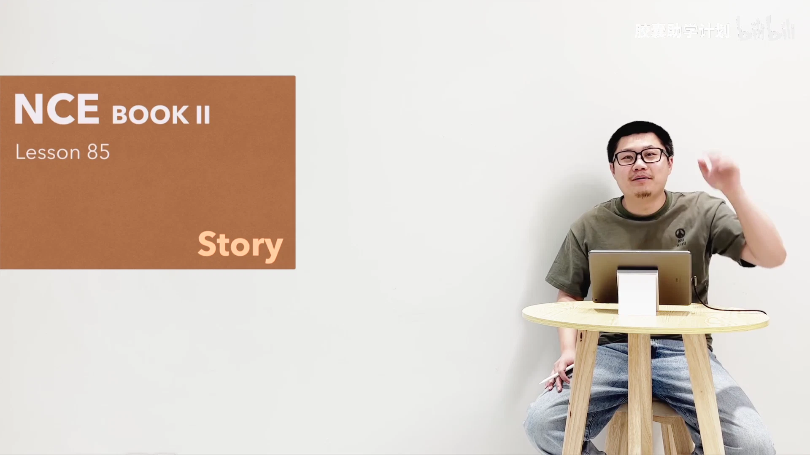

文字识别：囊助字计划 / NCE / BOOKⅡI / Lesson 85 / Story

### 画面 00:00:02

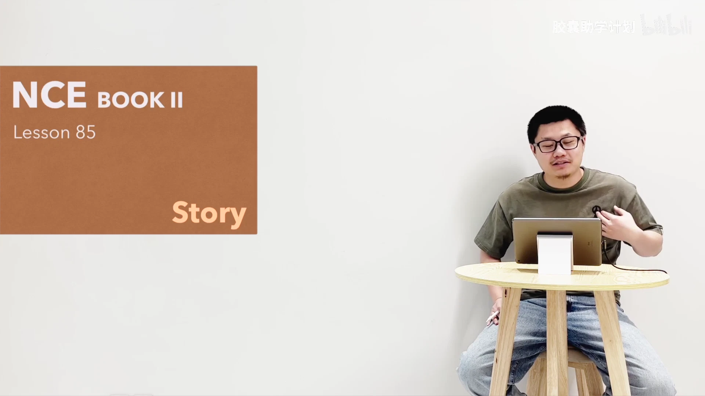

文字识别：囊助学计划 / NCE / BOOKII / Lesson 85 / Story

### 画面 00:00:04

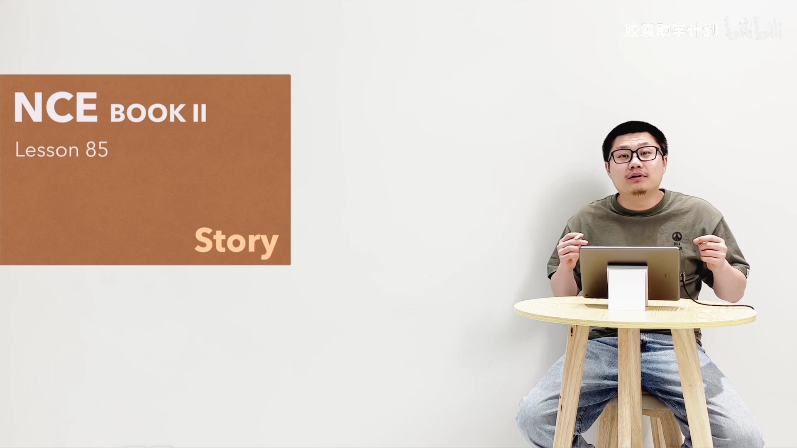

文字识别：囊助学计划 / NCE / BOOKⅡI / Lesson 85 / Story / NU

### 画面 00:00:06

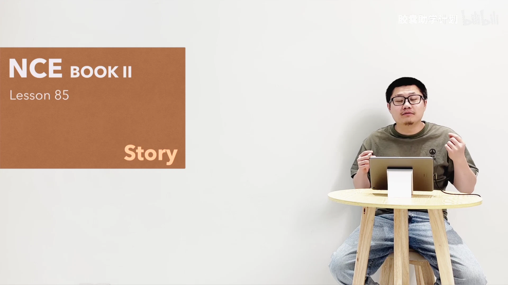

文字识别：交囊助学计划 / NCE / BOOKⅡI / Lesson 85 / Story

### 画面 00:00:09

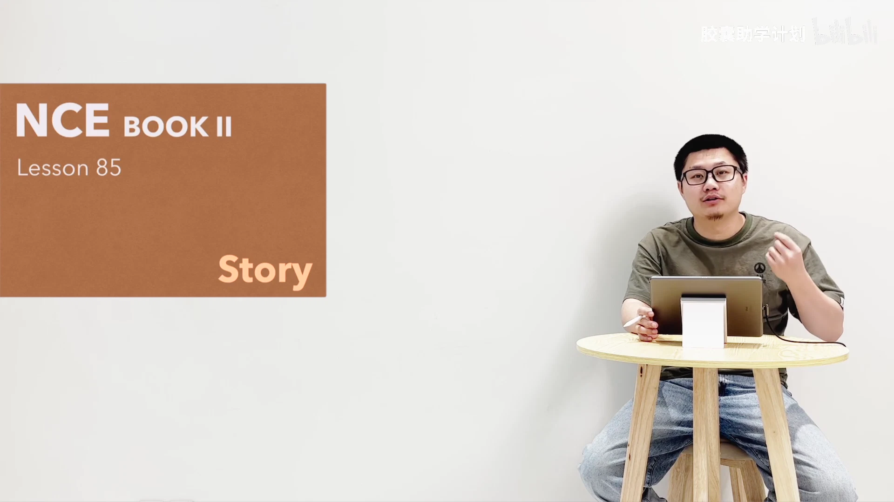

文字识别：喜助字计划 / NCE / BOOKⅡI / Lesson 85 / Story

### 画面 00:00:11

文字识别： biltbil / 胶囊助学计划

### 画面 00:00:14

文字识别：聖助字计划 / 胶囊助学计划

### 画面 00:00:16

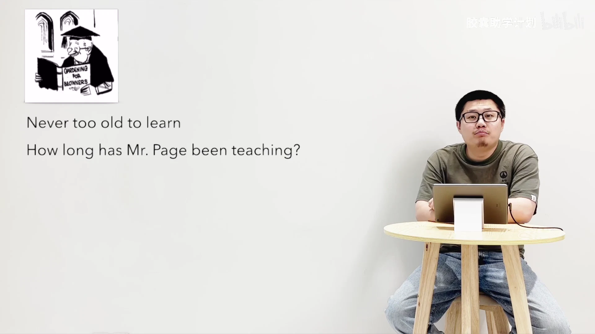

文字识别：GARDENING / PoR / BECINNERS / Never too old to learn / How long has Mr. Page been teaching?

## 00:00:30–00:01:00

呃，学习这个事儿永远不晚啊，学到或者说活到老学到老啊，给它翻译成汉语就是这样一个意思。然后呢，这个我们看一下他问的问题，说 How long has Mr. Page been teaching？啊， has been doing 现在完成进行时，说就是说他这个呃教书已经教了多少年了？那咱们确实得进入文章才能知道啊。活到老学到老啊。 I have

### 画面 00:00:46

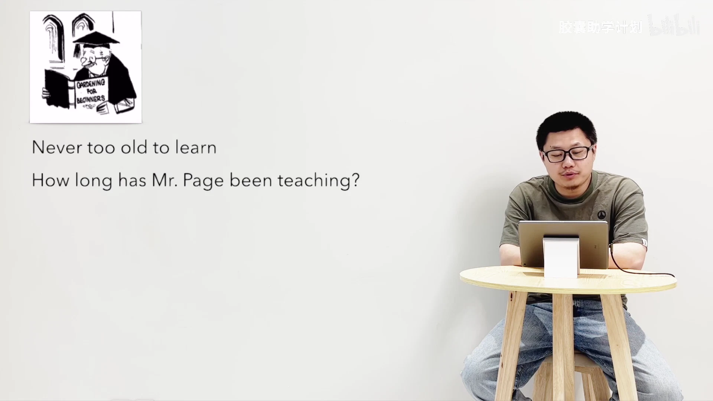

文字识别：囊助字计划 / GARDENING / PoR / BECINNERS / Never too old to learn / How long has Mr. Page been teaching?

### 画面 00:00:55

文字识别：[助字计划 / GARDENING / FOR / BECINNERS / I have just “received a letter from my old school, / informing me that my former headmaster, Mr. / Stuart Page, will be retiring next week. Pupils of / the school, old and new, will be 'sending him a / present to mark the occasion. All those (who have / contributed towards the gift) will sign their names / in a large album (which will be sent to the / headmaster's home).

## 00:01:00–00:01:30

just received a letter from my old school, informing me that my former headmaster, Mr. Store Page, will be retiring next week. 这句话这么乍一看其实是挺长的，是吧？这句话乍一看挺长的，这个样子啊，咱们给它简单的切切分几下。我们先看第一个，叫做我刚刚收到了一封信，receive something from somebody，对

### 画面 00:01:25

文字识别：助字计划 / GARDENING / PoR / BECINNERS / I have just 4received a letter from my old school / informing me that my former headmastey, Mr. / Stuart Page, will be retiring next week. Pupils of / the school, old and new, will be 'sending him a / present to mark the occasion. All those (who have / contributed towards the gift) will sign their names / in a large album (which will be sent to the / headmaster's home).

## 00:01:30–00:02:00

吧？哎，但这个地方不是 somebody，是呃一个拟人化的地方，叫做 my old school，啊，我的老学校。什么叫我的老学校啊？就是我毕业的那所学校，是吧？刚刚说到了一封信啊，来自于这个母校啊，母校 informing me that这个信告诉干嘛了呢？说通知给我 inform somebody something，对吧？通知给我的事情是什么呢？叫

### 画面 00:01:55

文字识别：GARDENING / PoR / BECINNERS / I have just 4received a letter from my old school / informing me that my former headmastey, Mr. / Stuart Page, will be retiring next week. Pupils of / the school, old and new, will be 'sending him a / present to mark the occasion. All those (who have / contributed towards the gift) will sign their names / in a large album (which will be sent to the / headmaster's home).

## 00:02:00–00:02:30

my former headmaster。我的 former 刚刚学的嘛，在选举那一刻，对吧？在失这个这个失去选举那一刻啊，然后跑到国外去这一刻，咱们刚学的 former 是吧？前任啊。那什么叫我的前？呃，就我的前校长，就他退休了嘛。然后呢，这俩是同位语。Mr. Store Page 是同位语啊。这个人的名字怎么样了呢？Will be retiring。十三课咱学的将来进行时，对吧？将退休 next week 下个礼拜。那这个 will be doing 和

### 画面 00:02:25

文字识别：GARDENING / PoR / BECINNERS / I have just 4received a letter from my old school / informing me that my former headmastey, Mr. / Stuart Page, will be retiring next week. Pupils of / the school, old and new, will be 'sending him a / present to mark the occasion. All those (who have / contributed towards the gift) will sign their names / in a large album (which will be sent to the / headmaster's home).

## 00:02:30–00:03:00

do.呃，如果硬要说有一点区别的话呢，确实有一点点，就是 will be doing 会更加的准确一点啊，更准确一点，就是基本上是定了的啊。大多数人的退休应该也不是说临时说的，是吧？基本上也就是提前告诉你了哪一天，比如说呃过生日哎结束当天您就退休了，对吧？荣退啊。再来， pupils of the school old and

### 画面 00:02:55

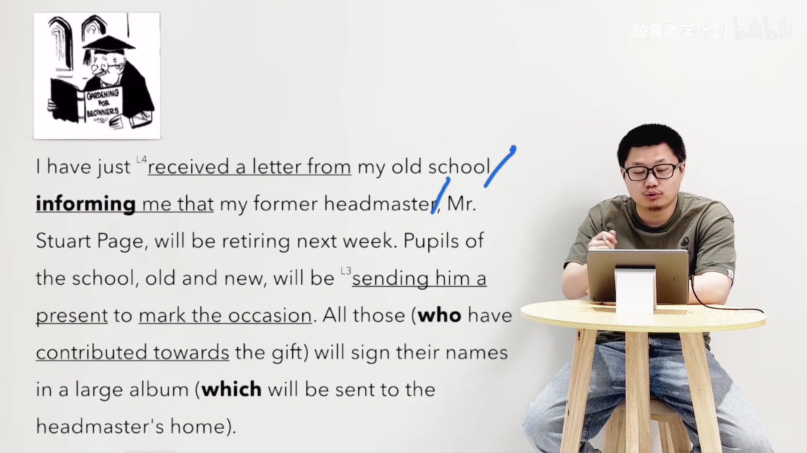

文字识别：助学计划 / GARDENING / PoR / BECINNERS / I have just 4received a letter from my old school / informing me that my former headmastey, Mr. / Stuart Page, will be retiring next week. Pupils of / the school, old and new, will be 'sending him a / present to mark the occasion. All those (who have / contributed towards the gift) will sign their names / in a large album (which will be sent to the / headmaster's home).

## 00:03:00–00:03:30

and new, will be sending him a present to mark the occasion.首先，第一个这个 pupil pupil 这个单词稍微有一点超纲，就是我们之前也并没见过。它有小学生的意思，也有学生的意思。听见了吧？好，说这个学校的学生 old and new，老学生和新学生什么意思？什么叫老学生和新学生？其实，在这个地方你就理解为，就是老学生就是那些已经毕了业的学生，新学生就是在这个学校正在上

### 画面 00:03:25

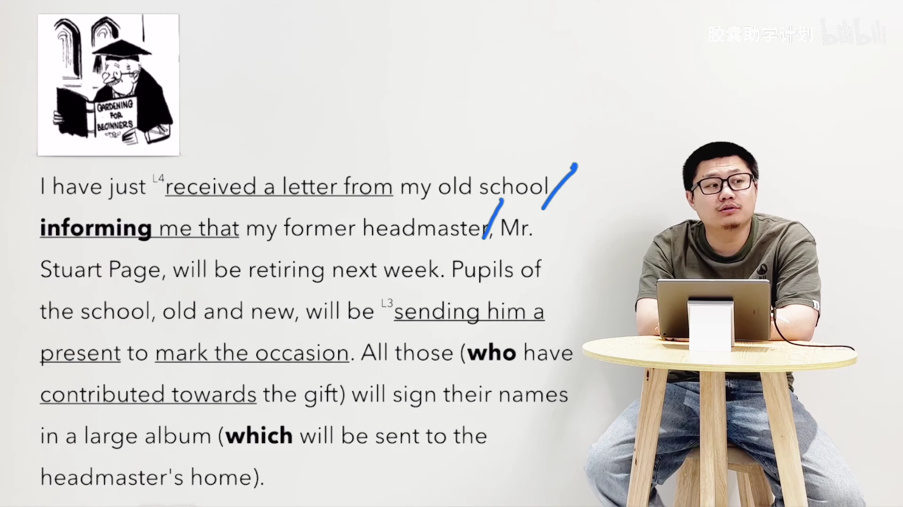

文字识别：GARDENING / PoR / BECINNERS / I have just 4received a letter from my old school / informing me that my former headmastey, Mr. / Stuart Page, will be retiring next week. Pupils of / the school, old and new, will be 'sending him a / present to mark the occasion. All those (who have / contributed towards the gift) will sign their names / in a large album (which will be sent to the / headmaster's home).

## 00:03:30–00:04:00

学的那些学生，对吧？哎，我可以这样去理解啊，不是非常的严谨。那你也可以理解为 old 是严谨一点，就是毕业了的和比如说，假设他是高中，那高高三的算 old，那高一算 new 呗，高二夹中间儿呗，是吧？反正他就整体想说的就是新老同学。将怎么样呢？ Send somebody something. Send him a present. 给他，哎，送给他一个什么呢？或者寄给，又寄给他一个礼物。目的是什么呢？ Mark

### 画面 00:03:55

文字识别：星助学计划 / GARDENING / POR / BECINNERS / I have just 4received a letter from my old school / informing me that my former headmastey, Mr. / Stuart Page, will be retiring next week. Pupils of / the school, old and new, will be 'sending him a / present to mark the occasion. All those (who have / contributed towards the gift) will sign their names / in a large album (which will be sent to the / headmaster's home).

## 00:04:00–00:04:30

the occasion. This is completely out of the box. This is a single habit. Mark this in the network. Many people may be if you are on the internet, that is, we use various websites. If you use it too much, mark it. This may be something you know. Actually, it is to mark it, record it, mark it, right? Then mark it. This occasion. What is it to mark this occasion? Say, send him a gift to commemorate this occasion, right? Commemorate his retirement.

### 画面 00:04:25

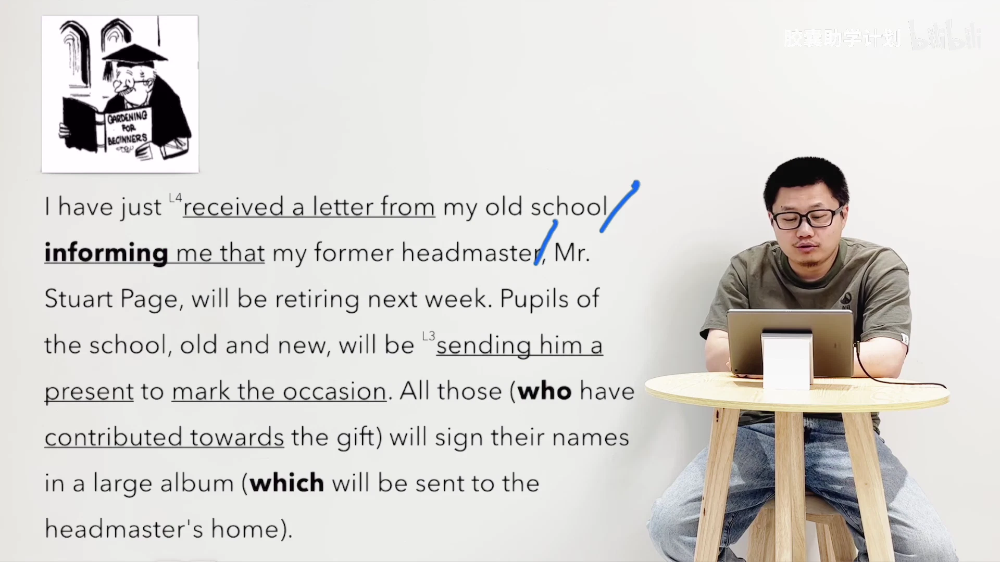

文字识别：動字计物 / GARDENING / PoR / BECINNERS / I have just 'received a letter from my old school / informing me that my former headmastey, Mr. / Stuart Page, will be retiring next week. Pupils of / the school, old and new, will be 'sending him a / present to mark the occasion. All those (who have / contributed towards the gift) will sign their names / in a large album (which will be sent to the / headmaster's home).

## 00:04:30–00:05:00

个场合，对吧？纪念一下他退休这件事儿啊。All those who have contributed towards the gift will sign their names in a large album, which will be sent to the headmaster's home. 这句话就是实际上多少隐隐约约代表了我们接下来三册的一个基础水平，就是从句比较多，英文的长难

### 画面 00:04:54

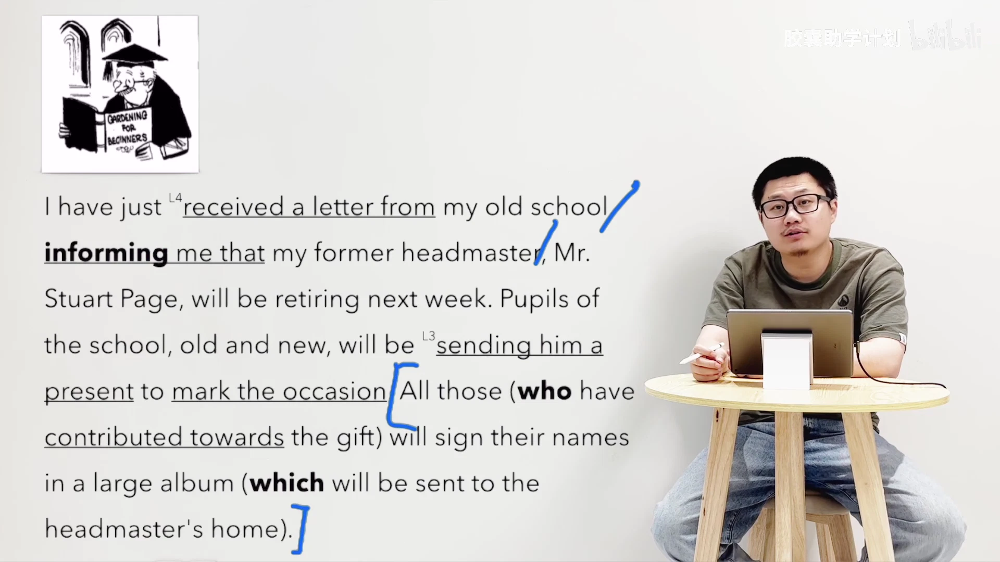

文字识别：GARDENING / PoR / BECINNERS / I have just 4received a letter from my old school / informing me that my former headmastey, Mr. / Stuart Page, will be retiring next week. Pupils of / the school, old and new, will be 'sending him a / present to mark the occasionAllthose (who have / contributed towards the gift) Will sign their names / in a large album (which will be sent to the / headmaster's home).

## 00:05:00–00:05:30

句这件事儿，对吧？好，那我们可以先看一下啊，我实际上已经把两个定语从句给各位标出来了，帮你去减少了一些难度。那我们先不看定语从句，直接看主句，就是 all those 叫所有那些人将 sign their names in a large album，将会签署他们的姓名在一个非常大的相册上签署姓名。这句话的主句就结束了。所以对于各位来说，长难句我们

### 画面 00:05:03

文字识别：GARDENING / PoR / BECINERS / I have just 4received a letter from my old school / informing me that my former headmastey, Mr. / Stuart Page, will be retiring next week. Pupils of / the school, old and new, will be 'sending him a / present to mark the occasion Al those (who have / contributed towards the gift) Will sign their names / in a large album (which will be sent to the / headmaster's home).

### 画面 00:05:10

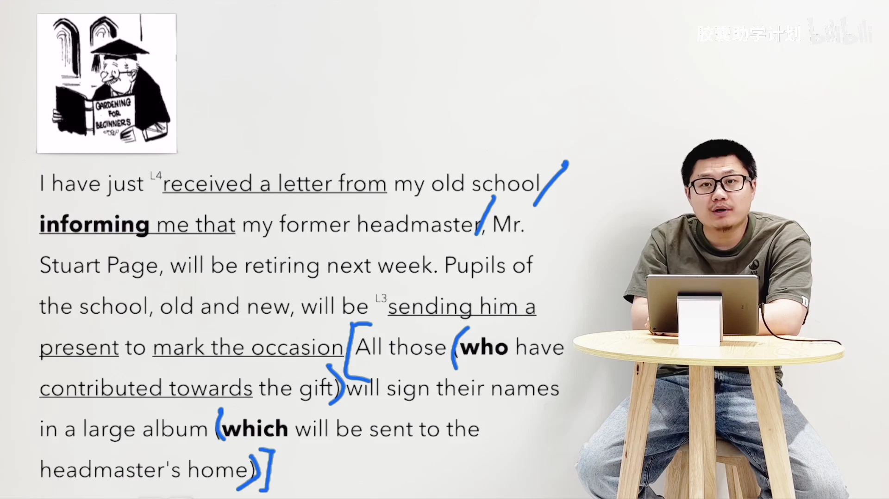

文字识别：GARDENING / PoR / BECINNERS / I have just 4received a letter from my old school / informing me that my former headmastey, Mr. / Stuart Page, will be retiring next week. Pupils of / the school, old and new, will be ['sending him a / present to mark the occasionAll thosewho have / contributed towards the gift)Will sign their names / in a large album (which will be sent to the / headmaster's home]

### 画面 00:05:26

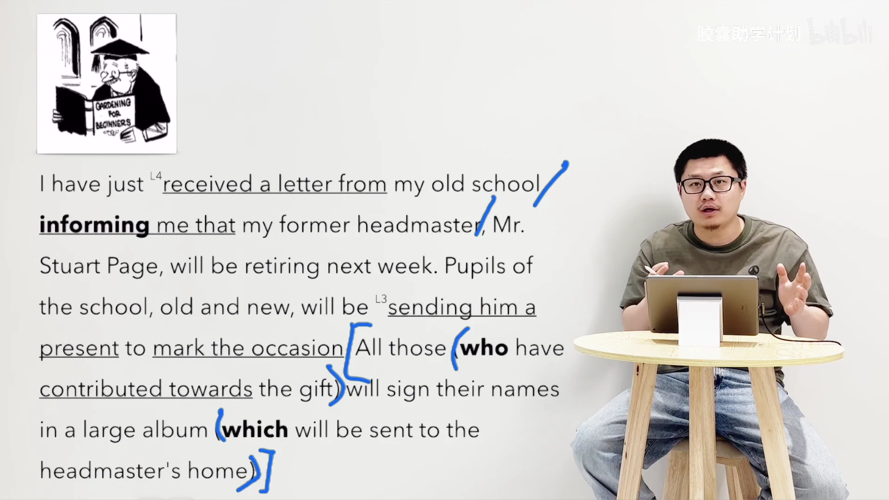

文字识别：GARDENING / PoR / BECINNERS / I have just 4received a letter from my old school / informing me that my former headmastey, Mr. / Stuart Page, will be retiring next week. Pupils of / the school, old and new, will be "sending him a / present to mark the occasionAll thosewho have / contributed towards the gift)Will sign their names / in a large album (which will be sent to the / headmaster's home]

### 画面 00:05:28

文字识别：豪助学计划 / GARDENING / FOR / BECINNERS / I have just 4received a letter from my old school / informing me that my former headmastey, Mr. / Stuart Page, will be retiring next week. Pupils of / the school, old and new, will be 'sending him a / present to mark the occasionAll thosewho have / contributed towards the gift)Will sign their names / in a large album (which wil be sent to the / headmaster's home)]

## 00:05:30–00:06:00

要做的事情无非是如下几件事情。第一，我得找到长难句当中的这种连词，当然还有隐藏的连词，那难度就更高一点。第二是，我得知道怎么去把这么长的一句话拆成几个小的短句。比如说，刚才我给各位拆了第一个短句，叫 All those will sign their names in a large album。那第二个短句其实就是第一个定语从句，叫做 They have

### 画面 00:05:31

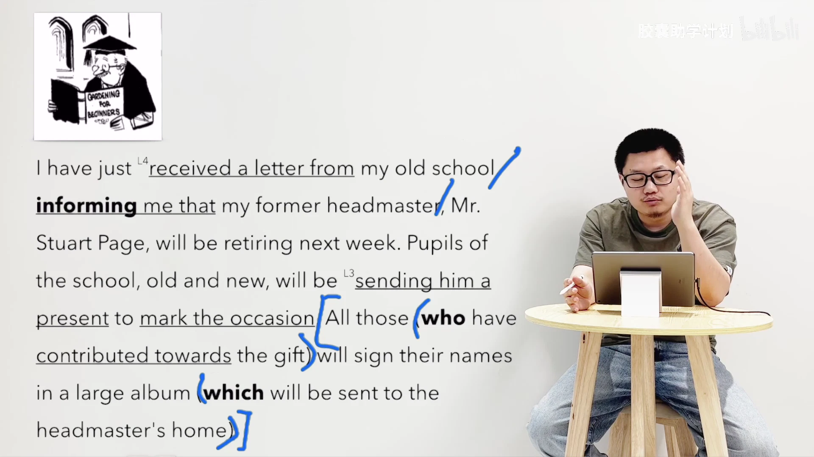

文字识别：GARDENING / PoR / BECINNERS / I have just "received a letter from my old school / informing me that my former headmastey, Mr. / Stuart Page, will be retiring next week. Pupils of / the school, old and new, will be 'sending him a / present to mark the occasionAll thosewho have / contributed towards the gift)Will sign their names / in a large album (which will be sent to the / headmaster's home]

### 画面 00:05:35

文字识别：助字计物 / GARDENING / POR / BECINNERS / I have just 4received a letter from my old school / informing me that my former headmastey, Mr. / Stuart Page, wil be retiring next week. Pupils of / the school, old and new, will be "sending him a / present to mark the occasionAll those / whg / have / contributed towards the gift)Will sign their names / in a large album / (which will be sent to the / headmaster's home]

### 画面 00:05:37

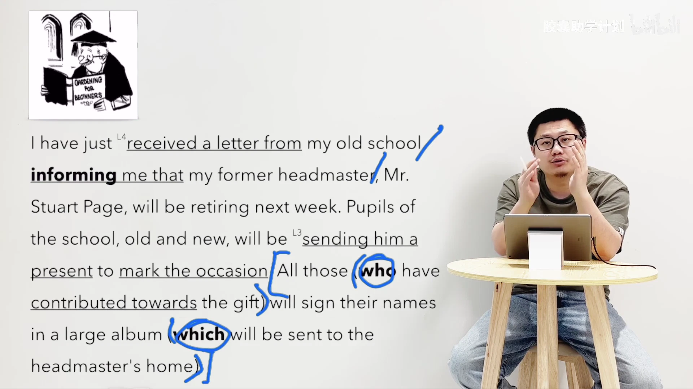

文字识别：GARDENING / POR / BECINNERS / I have just 4received a letter from my old school / informing me that my former headmastey, Mr. / Stuart Page, will be retiring next week. Pupils of / the school, old and new, will be 'sending him a / present to mark the occasionAll those / whg / have / contributed towards the gift)Will sign their names / whichwill be sent to the / in a large album / headmaster's home)]

## 00:06:00–00:06:30

contributed towards the gift.什么人呢？所有的什么人呢？所有的已经 a 对这个礼物有所贡献的人。我们原文给的是捐款，没有问题。我之前说了，对吧？只不过贡献是它更上一层的含义。我们记这个会更舒服一点啊。所以说，所有第一个啊，第二句话叫做他们给这个礼物做出了一些

### 画面 00:06:07

文字识别：GARDENING / FOR / BECINNERS / I have just 4received a letter from my old school / informing me that my former headmastey, Mr. / Stuart Page, will be retiring next week. Pupils of / the school, old and new, will be 'sending him a / present to mark the occasionAll those / whg / have / contributed towards the gift)Will sign their names / in a large album /  lwhichwill be sent to the / headmaster's home)]

## 00:06:30–00:07:00

贡献，可以是人力，可以是物力，也可以是捐款。这是第二句话，第三句话是修饰 album 的，所以这个 which 要换成这个 album，哎，咱就是 the album，对吧？怎么样了呢？ Will be sent，你看，一般将来时的被动，二十一个咱学的， will be sent，将被送往，将被发往 to the headmaster's home，校长家里面。所以这句话看完了之后，我们要得到三个信息，挺好。第一个信息，主

### 画面 00:06:37

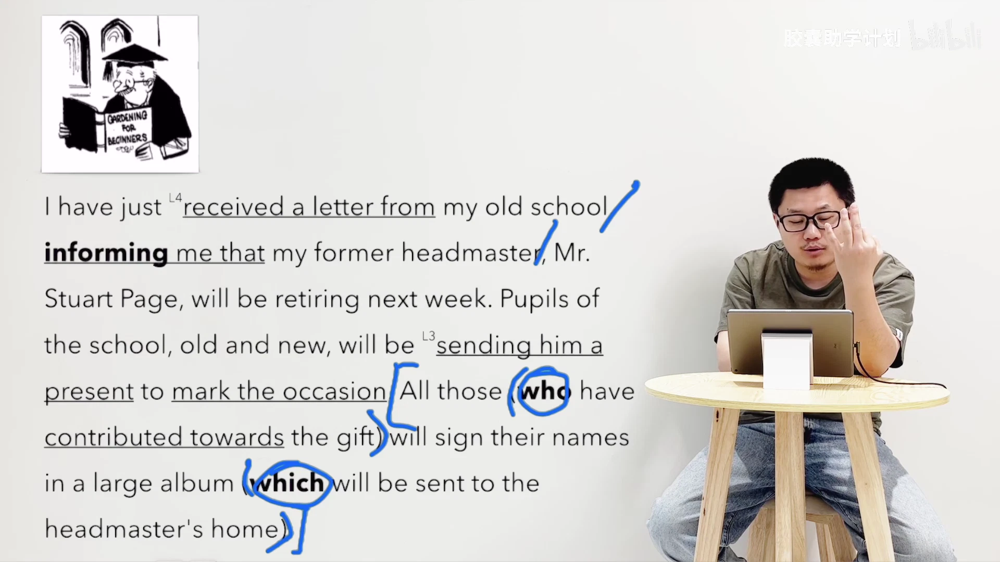

文字识别：GARDENING / FOR / BECINNERS / I have just 4received a letter from my old school / informing me that my former headmastey, Mr. / Stuart Page, will be retiring next week. Pupils of / the school, old and new, will be 'sending him a / present to mark the occasionAll those / whg / have / contributed towards the gift)Will sign their names /  lwhichwill be sent to the / in a large album / headmaster's home)]

## 00:07:00–00:07:30

句，所有人都会把他们的名字签在一个大的相册上。第二，修饰所有人什么样的所有人呢？叫做那些对这个礼品有所贡献的人。合理吗？你没有任何贡献，签名字干啥？这是第二句话。第二个信息，第三个信息就是关于album的，叫做the album将这个相册将被发往校长的家里面，也就是这么长的一句话。读

### 画面 00:07:07

文字识别：字话计节 / GARDENING / POR / BECINNERS / I have just “received a letter from my old school / informing me that my former headmastey, Mr. / Stuart Page, will be retiring next week. Pupils of / the school, old and new, will be 'sending him a / present to mark the occasionAll those / whg / have / contributed towards the gift)Will sign their names /  lwhichwill be sent to the / in a large album / headmaster's home)]

## 00:07:30–00:08:00

完，摘取这三个信息，您就把一个长难句拆成了三个短句。哎，这个其实就是我们去呃分析英语长难句的一个基本功啊。这个基本功之前我在直播的时候也提过，对吧？像美国的林肯啊，呃，像这个我印象当中英国的丘吉尔啊，他们都是在年轻的时候专门做过这样的训练的啊。你别看他英语是母语，他也会去做类似的训练。接下来，continue，we

### 画面 00:07:37

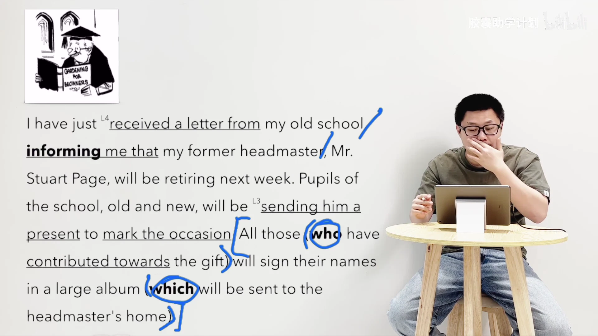

文字识别：GARDENING / FoR / BECINERS / I have just 4received a letter from my old school / informing me that my former headmastey, Mr. / Stuart Page, wil be retiring next week. Pupils of / the school, old and new, will be 'sending him a / present to mark the occasionAll those / whg / have / contributed towards the gift)Will sign their names /  lwhichwill be sent to the / in a large album / headmaster's home)]

### 画面 00:07:58

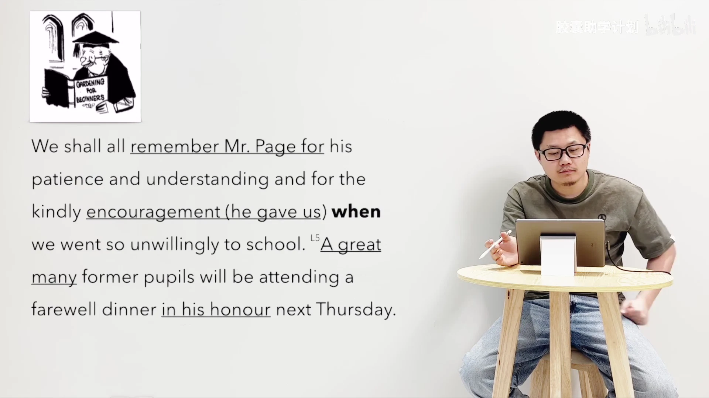

文字识别：GARDENING / POR / BECINNERS / We shall all remember Mr. Page for his / patience and understanding and for the / kindly encouragement(he gave us) when / we went so unwillingly to school. A great / many former pupils will be attending a / farewell dinner in his honour next Thursday.

## 00:08:00–00:08:30

we shall all remember Mr. Page for his patience and understanding, and for the kindly encouragement he gave us when we went so unwillingly to school. Wow,塞又好长一句话。那这句话还真不算典型意义上的长难句，虽然它也确实有几个从句啊。我们先看一下，我给各位拆了一下啊，说我们都将

### 画面 00:08:22

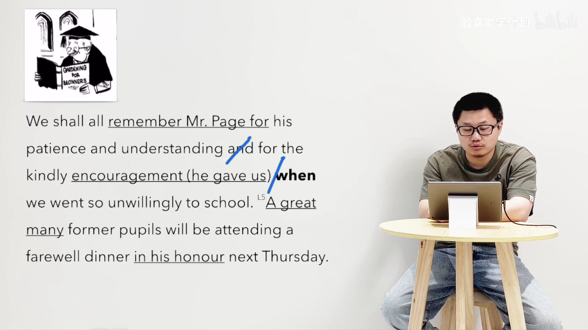

文字识别：GARDENING / PoR / BECINNERS / We shall all remember Mr. Page for his / patience and understanding ald for the / kindly encouragement(he gave us) when / we went so unwillingly to school. "5A great / many former pupils will be attending a / farewell dinner in his honour next Thursday.

## 00:08:30–00:09:00

记住 Mr. Page，就是他们这个校长的名字啊，Page先生。这个地方是一个习惯用法，叫 remember somebody for something，就是可以理解为说是因为他的某个事情而记住这个人，或者说记住这个人因为某件事情，对吧？因为他的某个品质或者特质。那我们都将会记住 Mr. Page，我们的校长，因为什么呢？因为他的 patience，因为他的耐

### 画面 00:08:52

文字识别：GARDENING / PoP / BECINNERS / We shall all remember Mr. Page for his / patience and understanding ald for the / kindly encouragement(he gave us) when / we went so unwillingly to school. "5A great / many former pupils will be attending a / farewell dinner in his honour next Thursday.

## 00:09:00–00:09:30

心和他的 understanding。 Understanding 算一个小的超纲词，但你要把它在这记住。你认识 understand，你可不一定认识 understanding。 Understand 叫理解， understanding 在这个地方叫做善解人意。哎，然后我们都会因为这件事情记住他他的耐心和善解人意。然后又来了一个 and，这个 and 其实在这我们可以小断一下句啊。这是第一个，第一个是 patience and understanding。第二个是什

### 画面 00:09:07

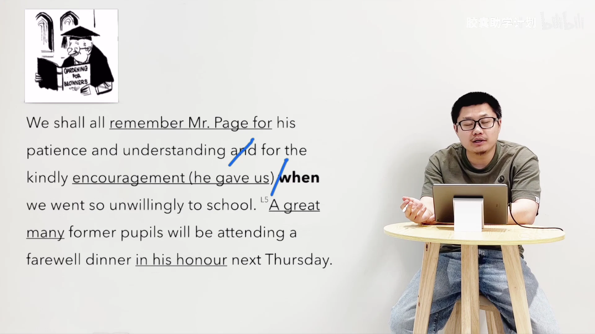

文字识别：GARDENING / PoR / BECINERS / We shall all remember Mr. Page for his / patience and understanding ald for the / kindly encouragement(he gave us)when / we went so unwillingly to school. "A great / many former pupils will be attending a / farewell dinner in his honour next Thursday.

### 画面 00:09:20

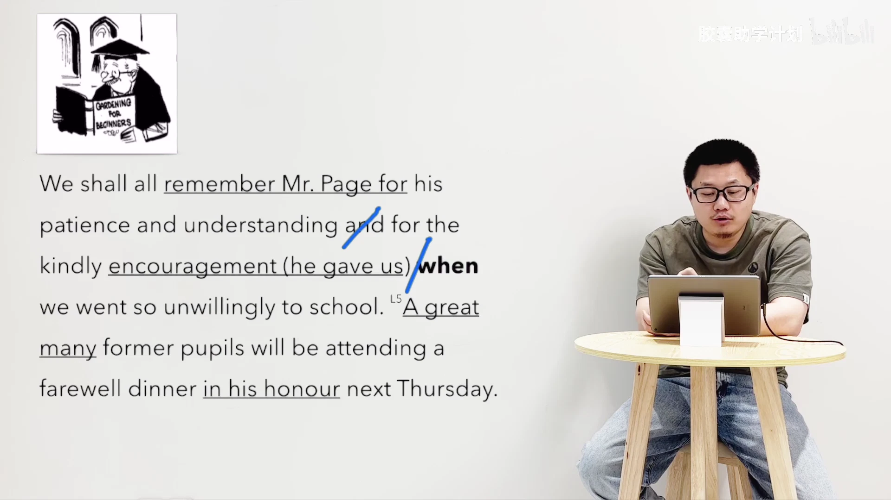

文字识别：GARDENING / PoP / BECINNERS / We shall all remember Mr. Page for his / patience and understanding ald for the / kindly encouragement(he gave us) when / we went so unwillingly to school. 5Agreat / many former pupils will be attending a / farewell dinner in his honour next Thursday.

## 00:09:30–00:10:00

么呢？ Kindly encouragement he gave us，以及特别友善的这些鼓励。 He gave us一个定语从句，定语从句修饰这个encouragement。什么样的encouragement呢？第一是很善良，第二放到后面叫他给我们的鼓励，对吧？ OK啊，所以这句话就翻译成，哎，很善良，他给我们的这些善意的鼓励就完事儿了。包括在讲encouragement

### 画面 00:09:50

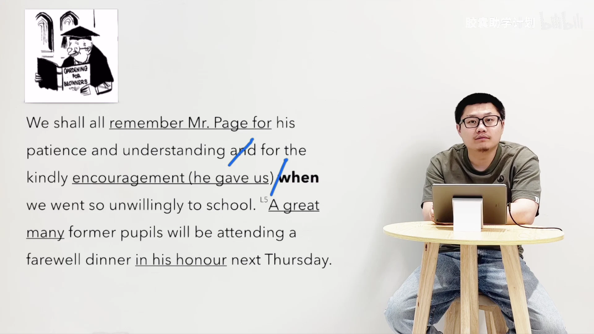

文字识别：GARDENING / PoR / BECINNERS / We shall all remember Mr. Page for his / patience and understanding ayld for the / kindly encouragement(he gave us) when / we went so unwillingly to school. "A great / many former pupils will be attending a / farewell dinner in his honour next Thursday.

## 00:10:00–00:10:30

的这个单词的时候，我们当时学了一个习惯用法，叫 give somebody encouragement，对吧？哎，给某人鼓励。所以你看，在这儿其实就是定语从句嘛。OK，这是我们所以读到这个地方啊，读到这个地方，我们其实总结了两个信息，我们记住它会因为其实几件事儿：patience， understanding， encouragement，这三个事儿我们会记住它。那后边呢给了一个小的时间状语从句，是吧？When，哎，但

### 画面 00:10:20

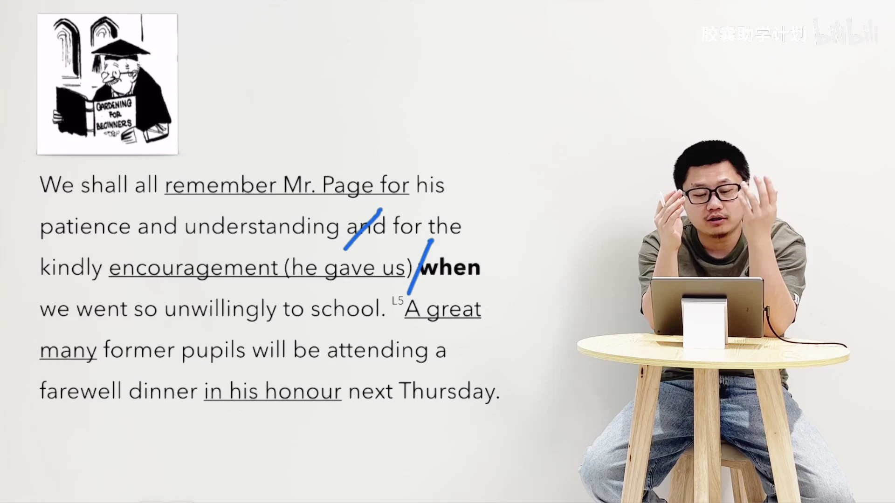

文字识别：毫助学计划 / GARDENING / PoP / BECINNERS / We shall all remember Mr. Page for his / patience and understanding ald for the / kindly encouragement(he gave us) when / we went so unwillingly to school. 5Agreat / many former pupils will be attending a / farewell dinner in his honour next Thursday.

## 00:10:30–00:11:00

但是你不用管它是什么从句，就当当什么呢？We went so unwillingly to school。先不管 so unwillingly，只管 we went to school，叫我们去上学。所以这句话当中唯一的难点就是 so unwillingly。 so 应该还好，就是如此这般，对吧？unwillingly be willing to do something，咱们之前学过，unwillingly 就是不情愿、勉强的，就是当我们很不情愿去上学、很勉

### 画面 00:10:50

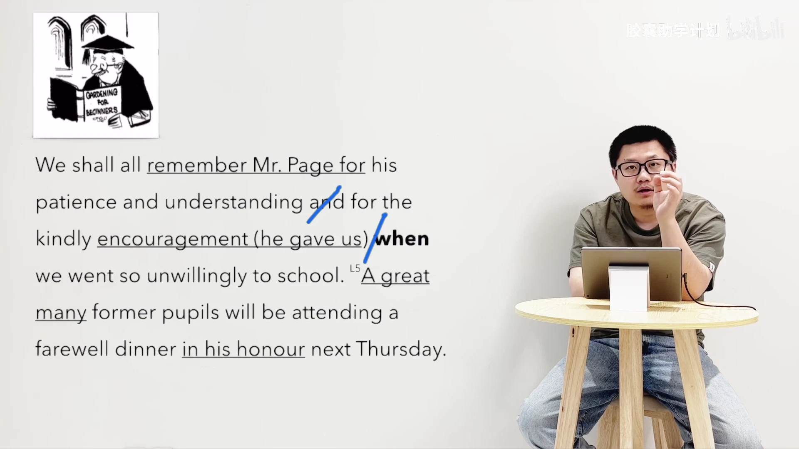

文字识别：GARDENING / PoR / BECINNERS / We shall all remember Mr. Page for his / patience and understanding ayld forthe / kindly encouragement(he gave us) when / we went so unwillingly to school. 5A great / many former pupils will be attending a / farewell dinner in his honour next Thursday.

## 00:11:00–00:11:30

强的时候，他给我们的那些善意的鼓励，听明白了吧？所以这个地方我们真是要把它拆开呢，拆出来。其实你可以理解为就是两小部分。第一部分我们会记住他，因为他的两个品质：耐心和善解人意。第二个品质是什么呢？第二个品质就是，当我们不想去上学的时候，当我们不想去上学的时候，他给我们的

### 画面 00:11:12

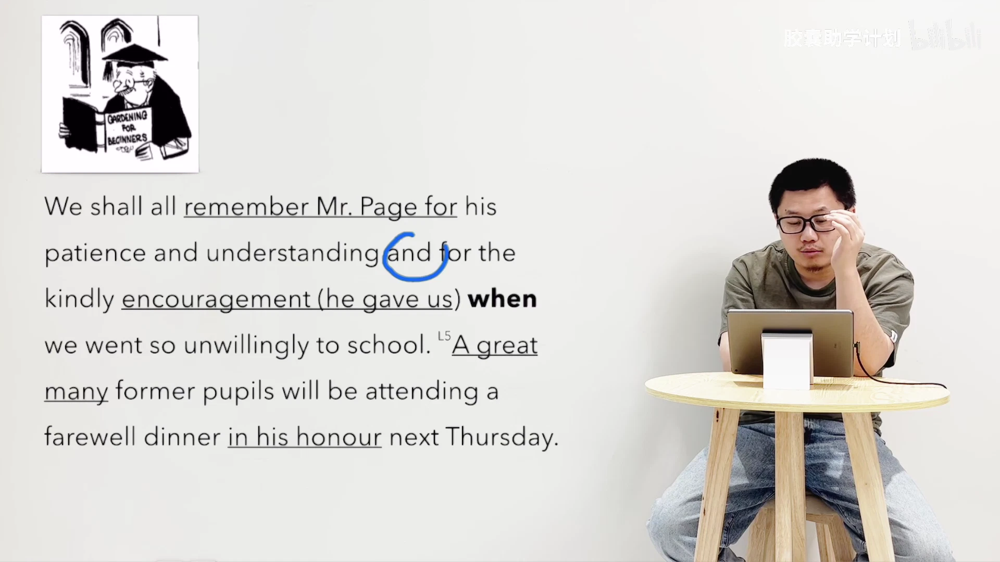

文字识别：GARDENING / PoR / BECINNERS / We shall all remember Mr. Page for his / patience and understanding and for the / kindly encouragement(he gave us) when / we went so unwillingly to school. Agreat / many former pupils will be attending a / farewell dinner in his honour next Thursday.

### 画面 00:11:15

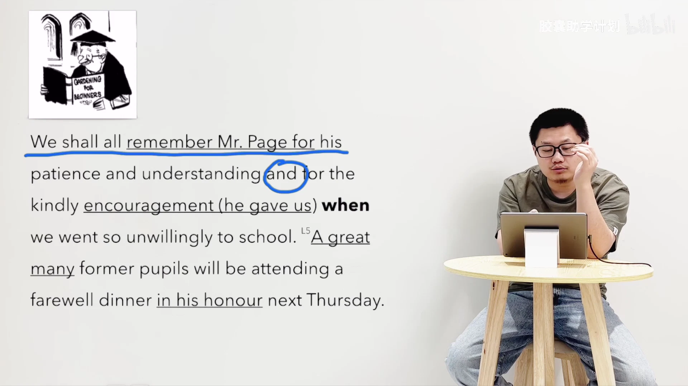

文字识别：GARDENING / PoR / BECINNERS / We shall all remember Mr. Page for his / patience and understanding / and tor the / kindly encouragement (he gave us) when / we went so unwillingly to school. Agreat / many former pupils will be attending a / farewell dinner in his honour next Thursday.

### 画面 00:11:17

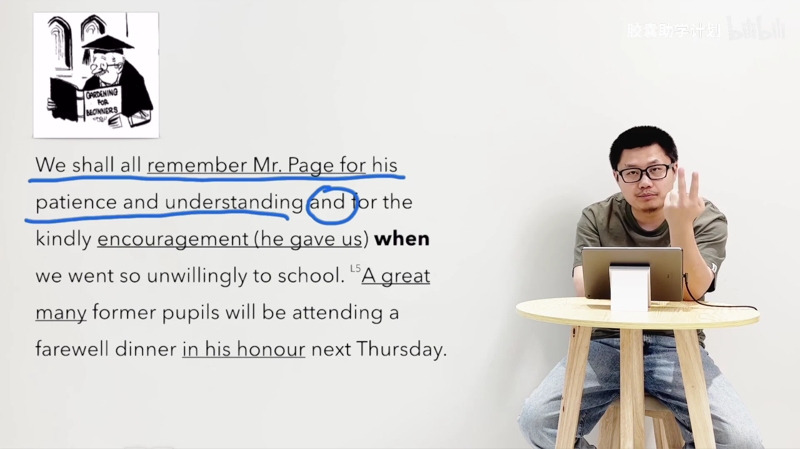

文字识别：GARDENING / POR / BECINNERS / We shall all remember Mr. Page for his / patience and understanding / and tor the / kindly encouragement(he gave us) when / we went so unwillingly to school. Agreat / many former pupils will be attending a / farewell dinner in his honour next Thursday.

## 00:11:30–00:12:00

那些充满善意的鼓励，我们会因为这也记住他，对吧？OK，再来啊。Agree many第五课学过许多，没啥可说的了啊。其实就类似于a lot of former pupils，之前的学生。什么叫之前的学生？就是我已经在这毕业了，这学校已经是我的母校了，对吧？之前之前的学生呢，will be attending a farewell dinner in his honor next

### 画面 00:11:38

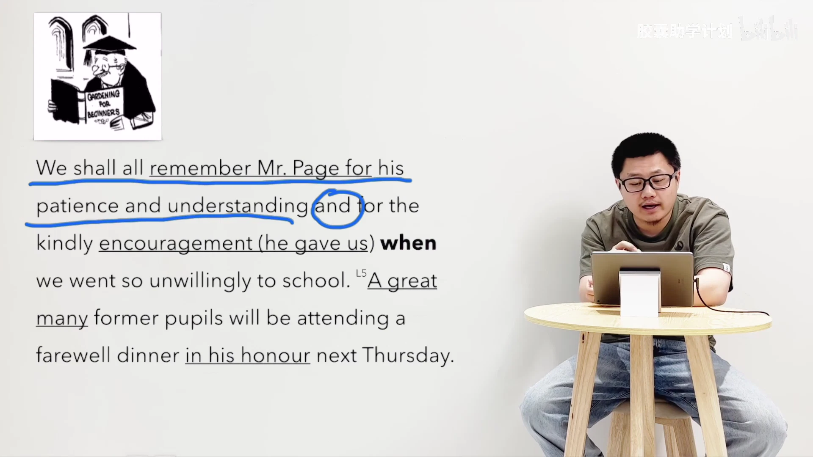

文字识别：GARDENING / PoR / BECINNERS / We shall all remember Mr. Page for his / patience and understanding / and tor the / kindly encouragement(he gave us) when / we went so unwillingly to school. Agreat / many former pupils will be attending a / farewell dinner in his honour next Thursday.

### 画面 00:11:40

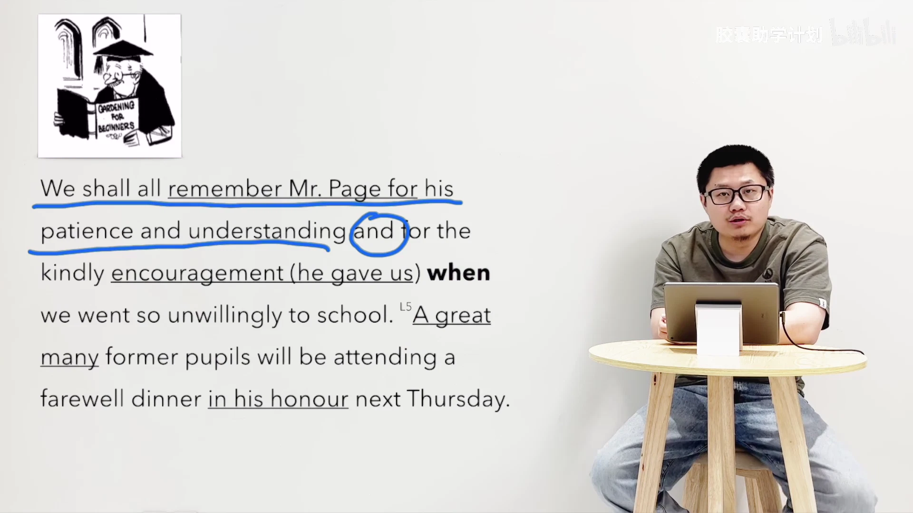

文字识别：GARDENING / PoR / BECINNERS / We shall all remember Mr. Page for his / patience and understanding / and tor the / kindly encouragement(he gave us) when / we went so unwillingly to school. Agreat / many former pupils will be attending a / farewell dinner in his honour next Thursday.

### 画面 00:11:51

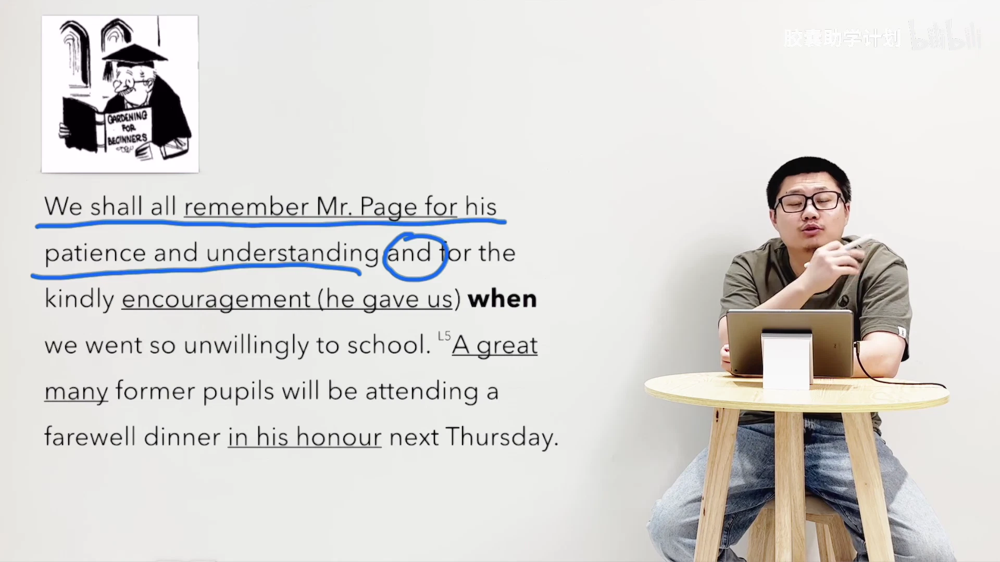

文字识别：GARDENING / PoR / BECINNERS / We shall all remember Mr. Page for his / patience and understanding / and tor the / kindly encouragement(he gave us) when / we went so unwillingly to school. Agreat / many former pupils will be attending a / farewell dinner in his honour next Thursday.

## 00:12:00–00:12:30

Thursday.许多的这个之前的学生将参加一个farewell dinner.讲单词部分咱们说过了，告别晚宴in his honor对他的致敬next Thursday下周四. It is a curious coincidence that the day before his retirement, Mr. Page will have been teaching for a total of forty years.第一个习惯用法，单词部分咱们讲过了。这是一个特别

### 画面 00:12:13

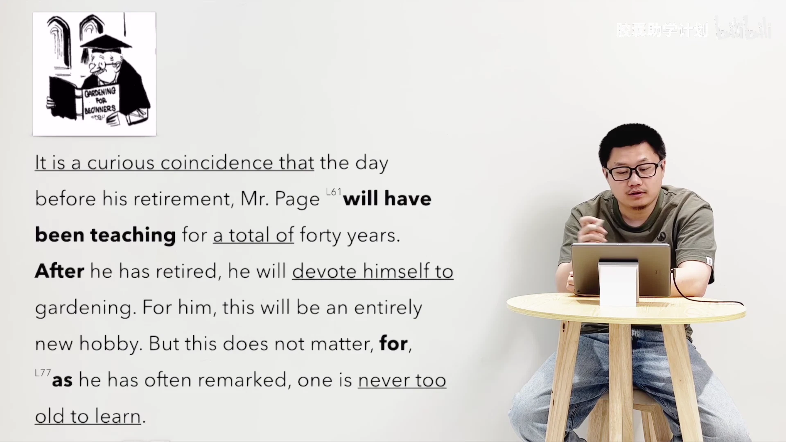

文字识别：GARDENING / PoR / BECINNERS / It is a curious coincidence that the day / before his retirement, Mr. Page l6'will have / been teaching for a total of forty years. / After he has retired, he will devote himself to / gardening. For him, this will be an entirely / new hobby. But this does not matter, for, / L77as he has often remarked, one is never too / old to learn.

## 00:12:30–00:13:00

奇异的巧合，奇怪的巧合，很有意思的巧合，很有趣的巧合都可以。The day before his retirement叫做在他退休的前一天。Mr. Page，我们的校长，will have been teaching六十一课哈勃望远镜那课咱学的，will have been doing将来完成进行时，对吧？截止到未来一件事情持续了多长时间？说将持续了，将持续教学多长

### 画面 00:12:43

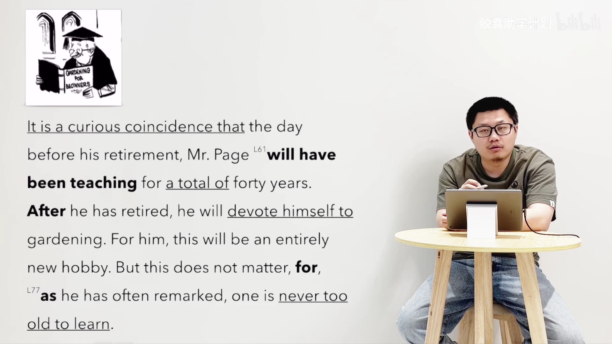

文字识别：GARDENING / FoR / BECINNERS / It is a curious coincidence that the day / before his retirement, Mr. Page [6'will have / been teaching for a total of forty years. / After he has retired, he will devote himself to / gardening. For him, this will be an entirely / new hobby. But this does not matter, for, / L77as he has often remarked, one is never too / old to learn.

## 00:13:00–00:13:30

时间了呢？A total of叫做总共四十年啊，OK吧？所以说在他退休的前一天，很巧了，是他截止到那一天将啊，现在还没退休呢嘛，对吧？将持续教学了四十年。你甭管从什么时候开始，是在未来持续到未来的某个点结束。Will have been doing啊，continue after he has retired, he will devote himself to gardening.

### 画面 00:13:13

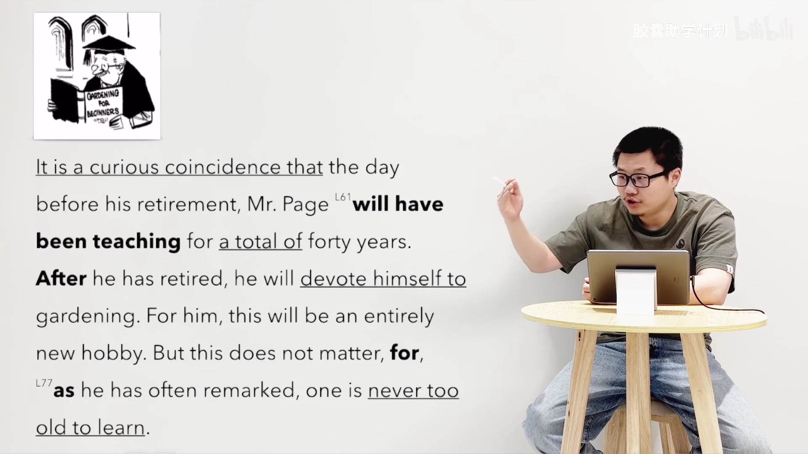

文字识别：GARDENING / PoR / BECINNERS / It is a curious coincidence that the day / before his rtirement, Mr. Page [6'will have / been teaching for a total of forty years. / After he has retired, he will devote himself to / gardening. For him, this will be an entirely / new hobby. But this does not matter, for, / [7as he has often remarked, one is never too / old to learn.

## 00:13:30–00:14:00

说在他退休之后啊，他将devote oneself to something，对吧？或者to啊，这个devote oneself to something就是献身于园艺事业，哎，就是就是致力于园艺事业，或者就是一门心思这个呃，这个埋到园艺事业上去，都是这个意思，对吧？就是一门心思就想干这事儿了。For him, this will be an entirely new hobby.

### 画面 00:13:43

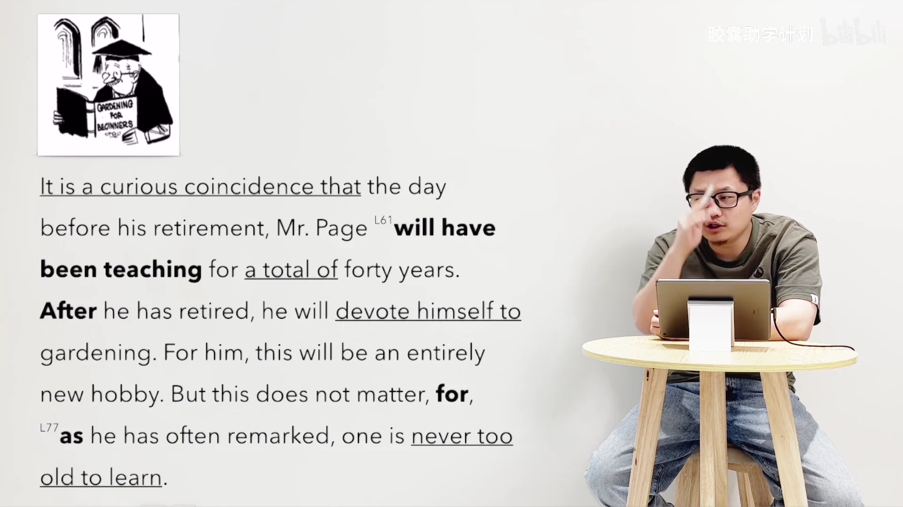

文字识别：GARDENING / PoR / BECINNERS / It is a curious coincidence that the day / before his rtirement, Mr. Page [“'will have / been teaching for a total of forty years. / After he has retired, he will devote himself to / gardening. For him, this will be an entirely / new hobby. But this does not matter, for, / L77as he has often remarked, one is never too / old to learn.

## 00:14:00–00:14:30

说对于他而言，这将是一个完全新的什么呢？Hobby,爱好，兴趣爱好，这没什么可说的。But this does not matter. For as he has often remarked, one is never too old to learn. This does not matter. What's the matter?有什么关系吗？This does not matter.说这并没有关系。什么并没有关系？其实就是前面那句话，叫

### 画面 00:14:13

文字识别：GARDENING / PoR / BECINERS / It is a curious coincidence that the day / before his rtirement, Mr. Page [6'will have / been teaching for a total of forty years. / After he has retired, he will devote himself to / gardening. For him, this will be an entirely / new hobby. But this does not matter, for, / L77as he has often remarked, one is never too / old to learn.

### 画面 00:14:24

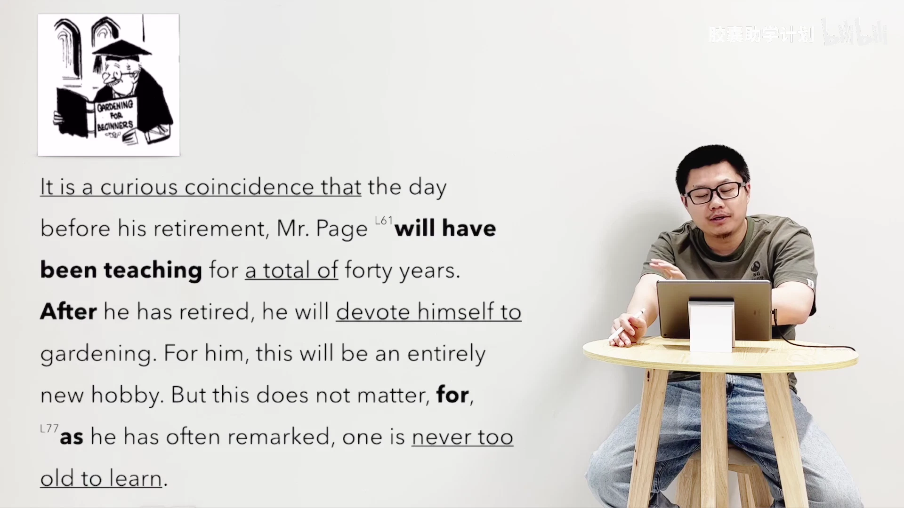

文字识别：GARDENING / PoR / BECINERS / It is a curious coincidence that the day / before his rtirement, Mr. Page [“'will have / been teaching for a total of forty years. / After he has retired, he will devote himself to / gardening. For him, this will be an entirely / new hobby. But this does not matter, for, / L77as he has often remarked, one is never too / old to learn.

## 00:14:30–00:15:00

做，这对于他来说是一个全新的爱好，这件事情并没有关系。所以 this 指的就是前面那句话啊， entirely new hobby 这件事儿没有关系。因为什么呢？因为就到了七十七课非限定性定语从句 which 可以引导 as 也可以引导的那个知识点了。说正如哎他经常评论的那样，remark 评论啊，remarked sadly，对吧？Needn't have done 那课咱学的嘛。

### 画面 00:14:32

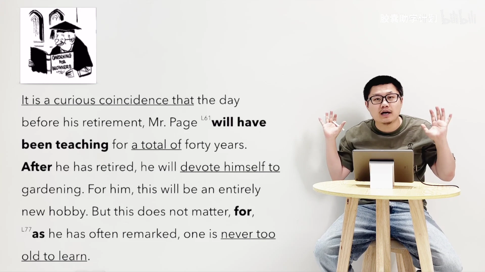

文字识别：助字计物 / GARDENING / PoR / BECINNERS / It is a curious coincidence that the day / before his retirement, Mr. Page l' will have / been teaching for a total of forty years. / NU / After he has retired, he will devote himself to / gardening. For him, this will be an entirely / new hobby. But this does not matter, for, / L7as he has often remarked, one is never too / old to learn.

### 画面 00:14:56

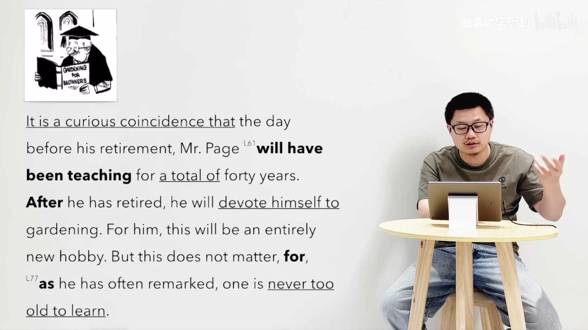

文字识别：GARDENING / PoR / BECINNERS / It is a curious coincidence that the day / before his retirement, Mr. Page [6'will have / been teaching for a total of forty years. / IR / After he has retired, he will devote himself to / gardening. For him, this will be an entirely / new hobby. But this does not matter, for, / L77as he has often remarked, one is never too / old to learn.

## 00:15:00–00:15:30

好，One is never too old to learn.这个没什么可说的了。新概首先呢，如果你从语不从语法的角度，就是活到老学到老就完了啊。Never too old to learn这句话经常出现，直接就硬记。如果从语法的角度，新一一百零三课to点儿点儿to这个结构，我们当时就很啊仔细的讲过，对吧？这个就不多说了啊。如果您忘了，就翻到我们的新概念一册一百零三课去讲啊，去去看一下就可以了啊。当时

### 画面 00:15:04

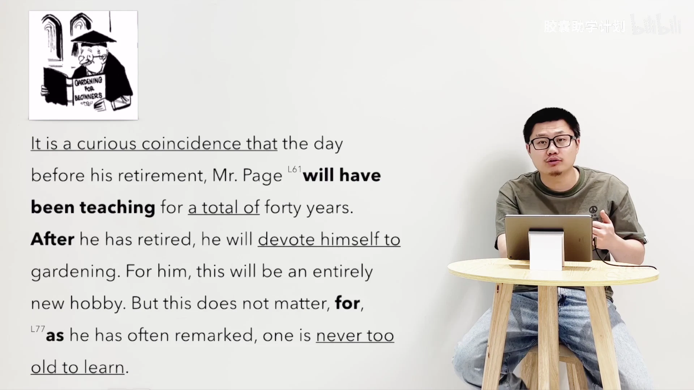

文字识别：GARDENING / FoR / BECINNERS / It is a curious coincidence that the day / before his rtirement, Mr. Page [6'will have / been teaching for a total of forty years. / After he has retired, he will devote himself to / gardening. For him, this will be an entirely / new hobby. But this does not matter, for, / L77as he has often remarked, one is never too / old to learn.

### 画面 00:15:06

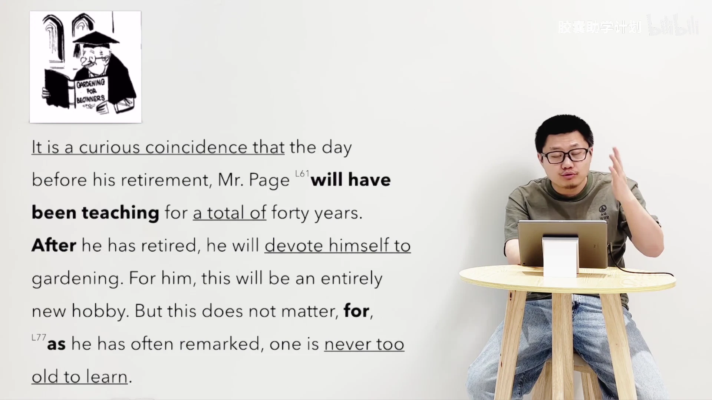

文字识别：助学计划 / GARDENING / FOR / BECINNERS / It is a curious coincidence that the day / before his retirement, Mr. Page [6'will have / been teaching for a total of forty years. / After he has retired, he will devote himself to / gardening. For him, this will be an entirely / new hobby. But this does not matter, for, / [77as he has often remarked, one is never too / old to learn.

### 画面 00:15:23

文字识别：助学计划 / GARDENING / FoR. / BECINNERS / It is a curious coincidence that the day / before his retirement, Mr. Page l' will have / been teaching for a total of forty years. / After he has retired, he will devote himself to / gardening. For him, this will be an entirely / new hobby. But this does not matter, for, / L77as he has often remarked, one is never too / old to learn.

## 00:15:30–00:16:00

专门学过本课的习惯用法有两个啊。我们分别造一下句。首先，mark the occasion什么意思呢？纪念一下这一刻嘛。比如说庆祝、纪念一下。说If you mark an occasion, you do something to celebrate.如果你要想mark一个occasion，那什么意思呢？就是你要做一些事情去庆祝它、纪念它，对吧？好，比如说，they gave him a gift to mark the occasion.他们给他了一个礼物，干嘛呢？

### 画面 00:15:31

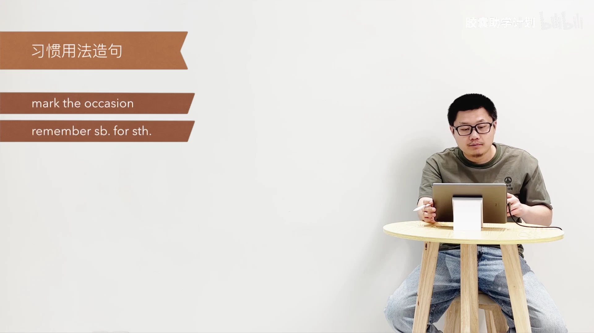

文字识别：喜助字计划 / 习惯用法造句 / mark the occasion / remember sb. for sth. / NU

### 画面 00:15:33

文字识别：网：v.+v.变化 / 习惯用法造句指南 / 交囊助学计划调 / 四句型转换 / 方式/地点/时间 / 其他习惯用法 / 其他单词+词性 / 原文摘抄+变 / 6123456 / mark the occasion / IR

### 画面 00:15:35

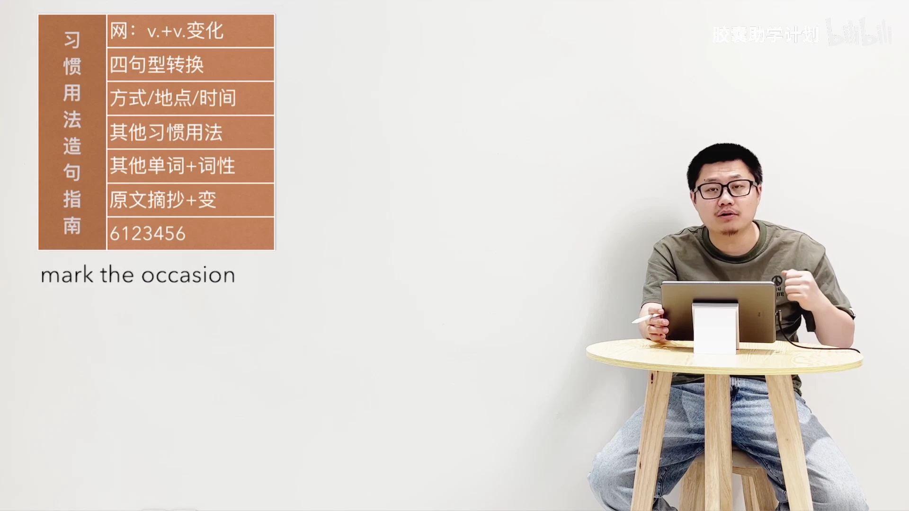

文字识别：网：v.+v.变化 / 校囊助学计划洲 / 习惯用法造句指南 / 四句型转换 / 方式/地点/时间 / 其他习惯用法 / 其他单词+词性 / 原文摘抄+变 / 6123456 / mark the occasion

### 画面 00:15:37

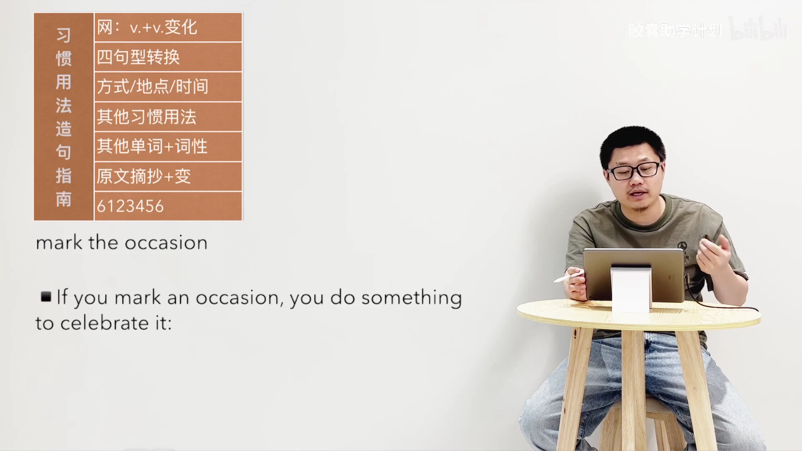

文字识别：网：v.+v.变化 / 交囊助学计划レ / 习惯用法造句指南 / 四句型转换 / 方式/地点/时间 / 其他习惯用法 / 其他单词+词性 / 原文摘抄+变 / 6123456 / mark the occasion /  If you mark an occasion, you do something / to celebrate it:

### 画面 00:15:39

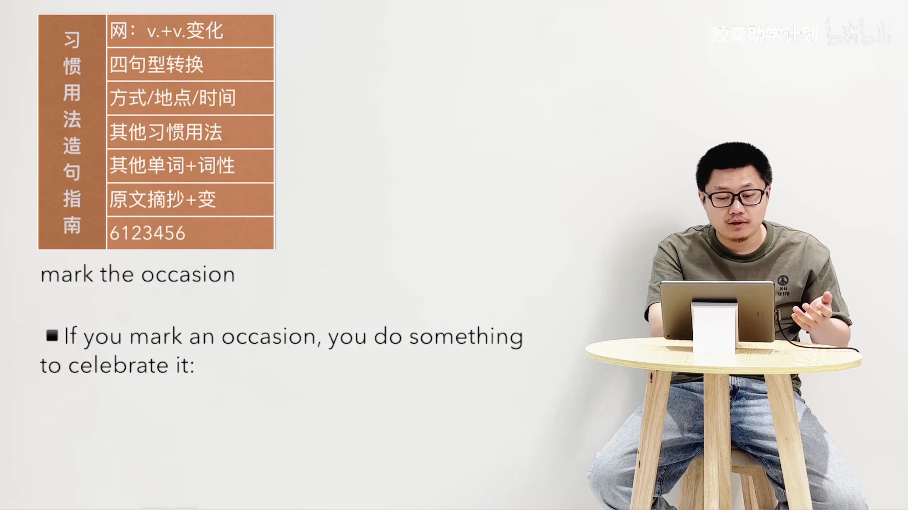

文字识别：网：v.+v.变化 / 习惯用法造句指南 / 交囊助学计划陽 / 四句型转换 / 方式/地点/时间 / 其他习惯用法 / 其他单词+词性 / 原文摘抄+变 / 6123456 / mark the occasion /  If you mark an occasion, you do something / to celebrate it:

### 画面 00:15:49

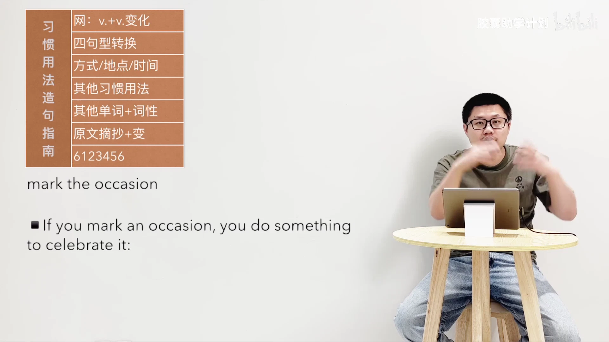

文字识别：网：v.+v.变化 / 习惯用法造句指南 / 交囊助学计划陽 / 四句型转换 / 方式/地点/时间 / 其他习惯用法 / 其他单词+词性 / 原文摘抄+变 / 6123456 / mark the occasion /  If you mark an occasion, you do something / to celebrate it:

### 画面 00:15:51

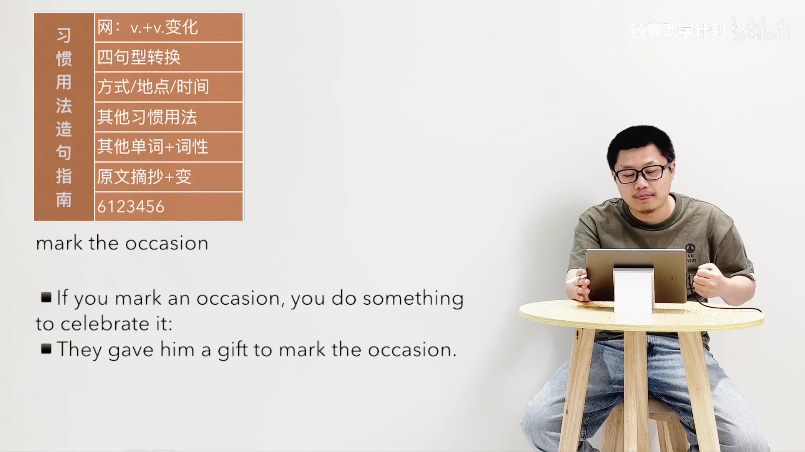

文字识别：网：v.+v.变化 / 习惯用法造句指南 / 囊助字计划 / 四句型转换 / 方式/地点/时间 / 其他习惯用法 / 其他单词+词性 / 原文摘抄+变 / 6123456 / mark the occasion / NU /  If you mark an occasion, you do something / to celebrate it: /  They gave him a gift to mark the occasion.

### 画面 00:15:53

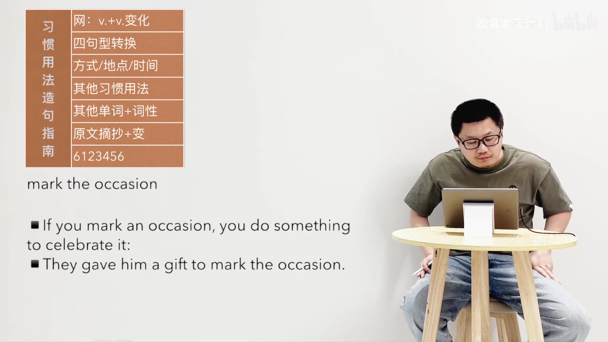

文字识别：网：v.+v.变化 / 习惯用法造句指南 / 妻助字计划陽 / 四句型转换 / 方式/地点/时间 / 其他习惯用法 / 其他单词+词性 / 原文摘抄+变 / 6123456 / mark the occasion /  If you mark an occasion, you do something / to celebrate it: /  They gave him a gift to mark the occasion.

### 画面 00:15:55

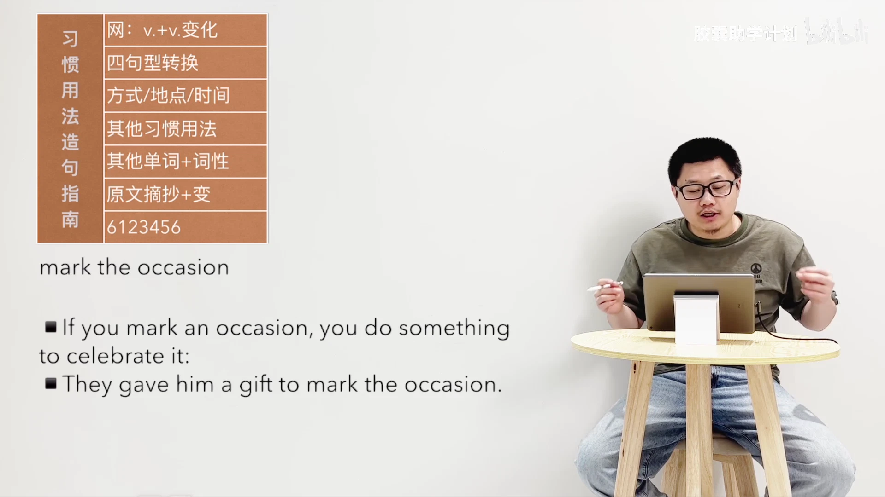

文字识别：网：v.+v.变化 / 习惯用法造句指南 / 囊助学计划陽 / 四句型转换 / 方式/地点/时间 / 其他习惯用法 / 其他单词+词性 / 原文摘抄+变 / 6123456 / mark the occasion / HR /  If you mark an occasion, you do something / to celebrate it: /  They gave him a gift to mark the occasion.

### 画面 00:15:57

文字识别：网：v.+v.变化 / 习惯用法造句指南 / 囊助学计划戲 / 四句型转换 / 方式/地点/时间 / 其他习惯用法 / 其他单词+词性 / 原文摘抄+变 / 6123456 / mark the occasion /  If you mark an occasion, you do something / to celebrate it: /  They gave him a gift to mark the occasion.

## 00:16:00–00:16:30

去纪念这一刻。四句型啊，你自己去做。电影片段说，I'd like to say a few words to mark the occasion。说我想说几句话，想说几个字儿啊，那不单肯定不是几个字儿了，几句话去纪念一下这一刻，去庆祝一下这一刻啊。好，那这个注意力集中，咱听一下这电影片段。Well, we should do something to mark the occasion, but

### 画面 00:16:02

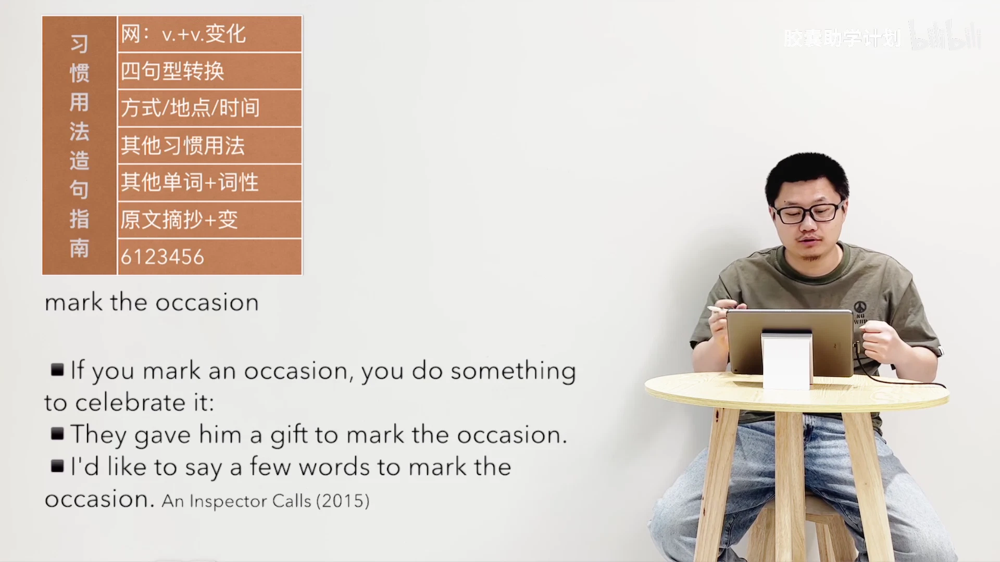

文字识别：网：v.+v.变化 / 习惯用法造句指南 / 囊助字计划 / 四句型转换 / 方式/地点/时间 / 其他习惯用法 / 其他单词+词性 / 原文摘抄+变 / 6123456 / mark the occasion / NU /  If you mark an occasion, you do something / to celebrate it: /  They gave him a gift to mark the occasion. / I'd like to say a few words to mark the / OCCasion. An Inspector Calls (2015)

### 画面 00:16:04

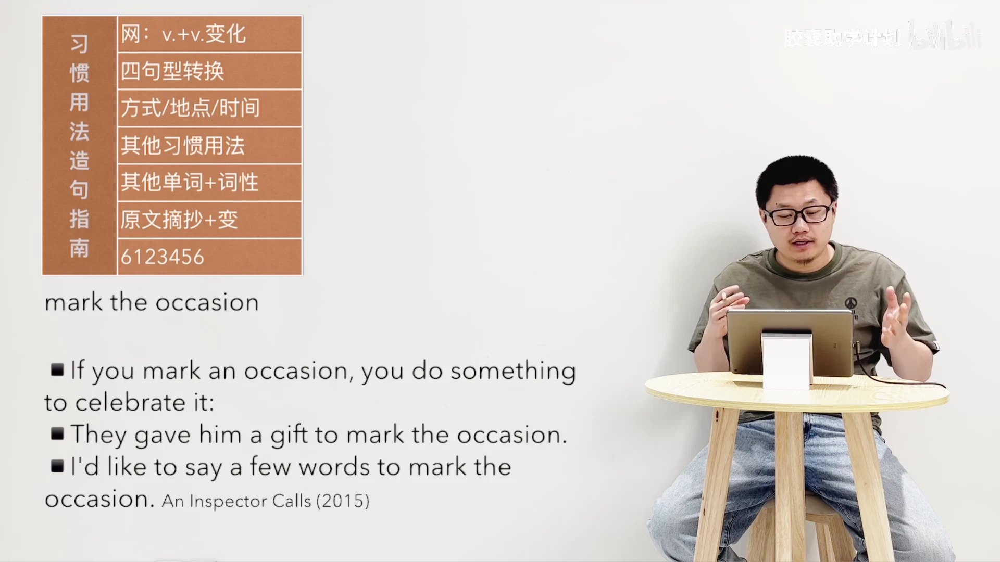

文字识别：网：v.+v.变化 / 习惯用法造句指南 / 囊助字计划 / 四句型转换 / 方式/地点/时间 / 其他习惯用法 / 其他单词+词性 / 原文摘抄+变 / 6123456 / mark the occasion /  If you mark an occasion, you do something / to celebrate it: /  They gave him a gift to mark the occasion. / I'd like to say a few words to mark the / OCCasion.An Inspector Calls (2015)

### 画面 00:16:15

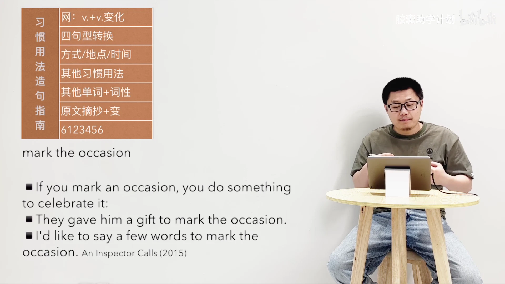

文字识别：网：v.+v.变化 / 习惯用法造句指南 / 囊助学计划 / 四句型转换 / 方式/地点/时间 / 其他习惯用法 / 其他单词+词性 / 原文摘抄+变 / 6123456 / mark the occasion /  If you mark an occasion, you do something / to celebrate it: /  They gave him a gift to mark the occasion. / I'd like to say a few words to mark the / OCCasion.An Inspector Calls (2015)

### 画面 00:16:20

文字识别：Well, we should do something to / mark the occasion, / but you've already turned me down. / VIR / NU / The Good Liar / (2019)

### 画面 00:16:28

文字识别：Well, we should do something to / mark the occasion, / but you've already turned me down. / The Good Liar / (2019)

## 00:16:30–00:17:00

You've already turned me down. 下一个叫 remember somebody for something，就是呃记住某因为某件事记住某人是吧？就这么简单，就字面意思啊。比如说 you will remember me for this，你会因为这件事记住我的。 Next one，说 they stated that they would remember him for his courage，说他们声称说怎么样呢？哎，这个他们将记住他，因为他的勇气而记住他 for his courage，

### 画面 00:16:31

文字识别：Well, we should do something to / mark the occasion, / but you've already turned me down. / The Good Liar / (2019)

### 画面 00:16:33

文字识别：网：v.+v.变化 / 习惯用法造句指南 / 校囊助学计划一淵 / 四句型转换 / 方式/地点/时间 / 其他习惯用法 / 其他单词+词性 / 原文摘抄+变 / 6123456 / remember sb.for + sth.

### 画面 00:16:37

文字识别：网：v.+v.变化 / 胶囊助学计划一 / 习惯用法造句指南 / 四句型转换 / 方式/地点/时间 / 其他习惯用法 / 其他单词+词性 / 原文摘抄+变 / 6123456 / remember sb.for + sth.

### 画面 00:16:39

文字识别：网：v.+v.变化 / 习惯用法造句指南 / 交囊助学计划レ / 四句型转换 / 方式/地点/时间 / 其他习惯用法 / 其他单词+词性 / 原文摘抄+变 / 6123456 / remember sb.for + sth. /  You will remember me for this.

### 画面 00:16:44

文字识别：网：v.+v.变化 / 习惯用法造句指南 / 交囊助学计划陽 / 四句型转换 / 方式/地点/时间 / 其他习惯用法 / 其他单词+词性 / 原文摘抄+变 / 6123456 / remember sb.for + sth. /  You will remember me for this. /  They stated that they would / remember him for his courage. L84

### 画面 00:16:49

文字识别：网：v.+v.变化 / 习惯用法造句指南 / 囊助学计划陽 / 四句型转换 / 方式/地点/时间 / 其他习惯用法 / 其他单词+词性 / 原文摘抄+变 / 6123456 / remember sb.for + sth. /  You will remember me for this. /  They stated that they would / remember him for his courage. L84

### 画面 00:16:54

文字识别：网：v.+v.变化 / 习惯用法造句指南 / 交妻助字计划陽 / 四句型转换 / 方式/地点/时间 / 其他习惯用法 / 其他单词+词性 / 原文摘抄+变 / 6123456 / remember sb.for + sth. /  You will remember me for this. /  They stated that they would / remember him for his courage. L84

## 00:17:00–00:17:30

对啊。Next one, 四句型转换，咱可以做。呃，注意力集中，咱听个电影片段。Everyone who worked with him will remember him for his courage and his loyalty. 啊，这个 courage 还算是一个其实生词了，是吧？勇气啊啊，那这个 loyalty 就是忠诚、忠实。呃， recap 两个习惯用法，咱得造句。这是第一个，文章你要熟读成诵啊，然后置顶留言去找这

### 画面 00:17:00

文字识别：网：v.+v.变化 / 寶助学计划陽 / 习惯用法造句指南 / 四句型转换 / 方式/地点/时间 / 其他习惯用法 / 其他单词+词性 / 原文摘抄+变 / 6123456 / remember sb.for + sth. /  You will remember me for this. /  They stated that they would / remember him for his courage. L84 /  did/who/why/what...

### 画面 00:17:03

文字识别：Everyone who worked with him will remember / him for his courage, and his loyalty. / Alex Rider: Operation Stormbreaker / (2006)

### 画面 00:17:07

文字识别：Everyone who worked with him will remember / him for his courage, and his loyalty. / Alex Rider: Operation Stormbreaker / (2006)

### 画面 00:17:10

文字识别：Everyone who worked with him will remember / him for his courage, and his loyalty. / AC / Alex Rider: Operation Stormbreaker / (2006)

### 画面 00:17:21

文字识别：Recap / 交奏助学计划棚 / mark the occasion / Expression / remember sb. for sth.

### 画面 00:17:23

文字识别：Recap / 奏助字计划園调 / mark the occasion / Expression / remember sb. for sth.

### 画面 00:17:25

文字识别：校卖助学计划调 / 1. / 习惯用法造句/对话 / 【习惯用法造句指南】 / 每个5句

### 画面 00:17:27

文字识别：交卖助学计划 / 习惯用法造句/对话 / 1. / 【习惯用法造句指南】 / 每个5句 / 文章跟读至熟读成诵 / 内化单词+语法+习惯用法 / 听力+口语+写作练习

### 画面 00:17:29

文字识别：交囊助学计划 / 习惯用法造句/对话 / 1. / 【习惯用法造句指南】 / 每个5句 / 文章跟读至熟读成诵 / 内化单词+语法+习惯用法 / 听力+口语+写作练习 / 重复间隔（置顶留言） / 3.

## 00:17:30–00:17:57

个重复间隔的学习材料。那以上呢就是本期视频的全部内容了。如果各位喜欢我们的课程呢，欢迎各位关注、订阅、一键三连，分享给那些需要的朋友，来帮助我们快速成长。See you next time.

### 画面 00:17:31

文字识别：囊助学计划一渊 / 👍

### 画面 00:17:40

文字识别：囊助学计划一调

### 画面 00:17:45

### 画面 00:17:47

文字识别：臺助字計切 / CAPSULEACADEMY / 胶囊助学计划 / 小红书 / Lecturer / Leo / OE

### 画面 00:17:49

文字识别：CAPSULEACADEMY / 胶囊助学计划 / 小红书 / Photographer / Berlin / OE

### 画面 00:17:51

文字识别：CAPSULEACADEMY / 胶囊助学计划 / 『 / 小红书 / Editor / Berlin / OE

### 画面 00:17:54

文字识别：CAPSULEACADEMY / 胶囊助学计划 / 小红书

### 画面 00:17:56

文字识别：bilibili / 胶囊助学计划

