# 085 练习

快速机器解析：语音为单模型转写，未进行独立交叉校对或人工复核；画面每秒采样并按变化选帧，短时文字和标记可能遗漏。截图时间约有 1 秒误差。图片有损压缩；遇到疑点请按时间查看 Google Drive 原视频。

## 00:00:00–00:00:30

Hello everyone, welcome to Capsule Academy. This is Liu. Today we're going to learn New Concept English Book Two Lesson Eighty Five Practices. 注意，进行如下练习唯一的前提就是文章要跟读至熟读成诵，否则请勿开始。 Hope you gonna enjoy. We, look at the first question. Comprehension. I ask, you answer. We practice oral listening. First question. Where have you just

### 画面 00:00:00

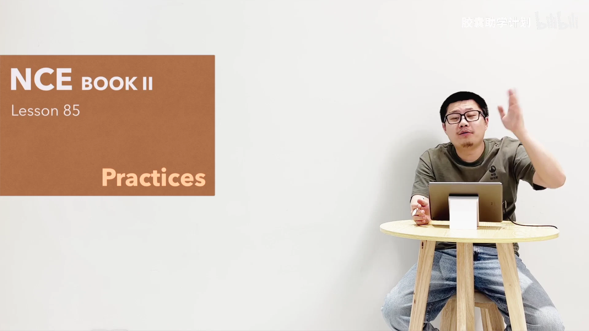

文字识别：嘉助学计划 / NCE / BOOKII / Lesson 85 / Practices / WIR / ND

### 画面 00:00:02

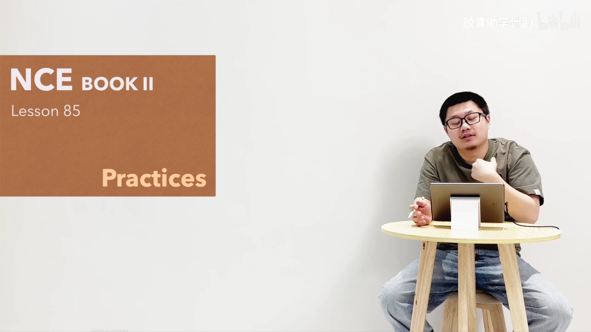

文字识别：喜助字计划 / NCE / BOOK I"I / Lesson 85 / Practices

### 画面 00:00:04

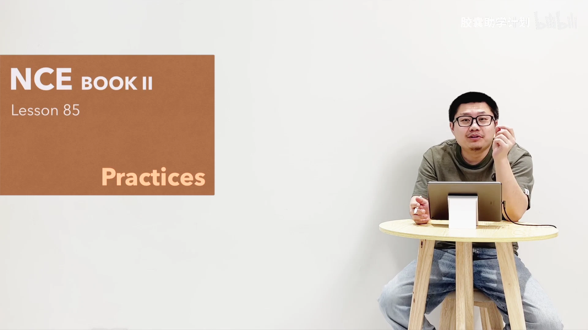

文字识别：嘉助字计划 / NCE / BOOKII / Lesson 85 / Practices

### 画面 00:00:06

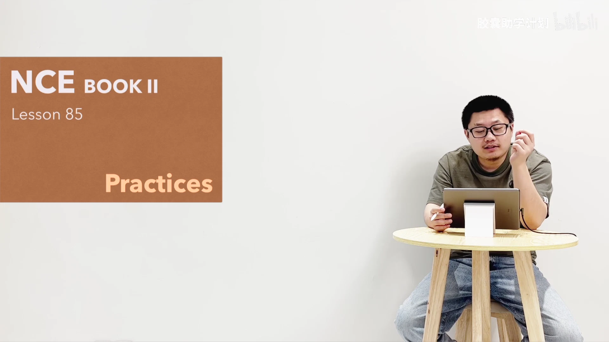

文字识别：嘉助学辻划 / NCE / BOOKII / Lesson 85 / Practices

### 画面 00:00:08

文字识别：交囊助学计划 / NCE / BOOKII / Lesson 85 / Practices

### 画面 00:00:10

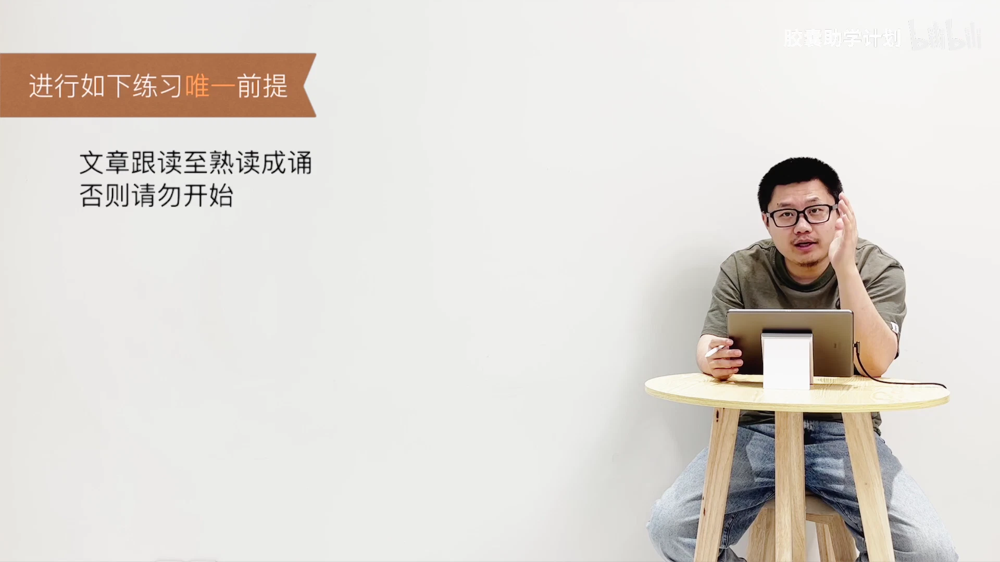

文字识别：交囊助学计划国淵 / 进行如下练习唯一前提 / 文章跟读至熟读成诵 / 否则请勿开始

### 画面 00:00:15

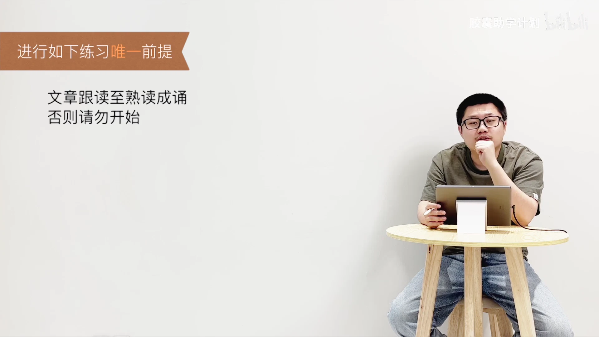

文字识别：交囊助学计划渊 / 进行如下练习唯一前提 / 文章跟读至熟读成诵 / 否则请勿开始

### 画面 00:00:17

文字识别：bibii / 胶囊助学计划 / •

### 画面 00:00:21

文字识别：更動字計切一。

### 画面 00:00:23

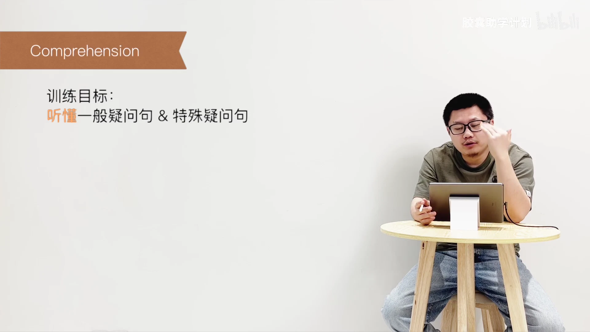

文字识别：喜助字计划医 / Comprehension / 训练目标： / 听懂一般疑问句＆特殊疑问句

### 画面 00:00:25

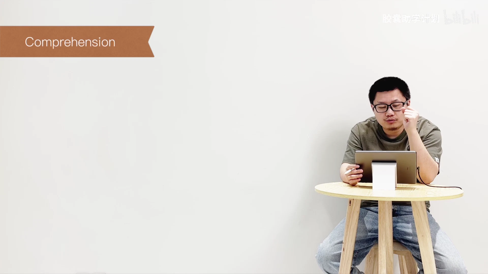

文字识别：卖助学计划 / Comprehension

### 画面 00:00:27

文字识别：臺助学计划 / Comprehension / Where have you just received a letter from?

## 00:00:30–00:01:00

received a letter from? From my old school. What is your old headmaster's name? Mr. Steward Page. When will he be retiring? Next week. What will he be receiving to mark the occasion? A present.

### 画面 00:00:30

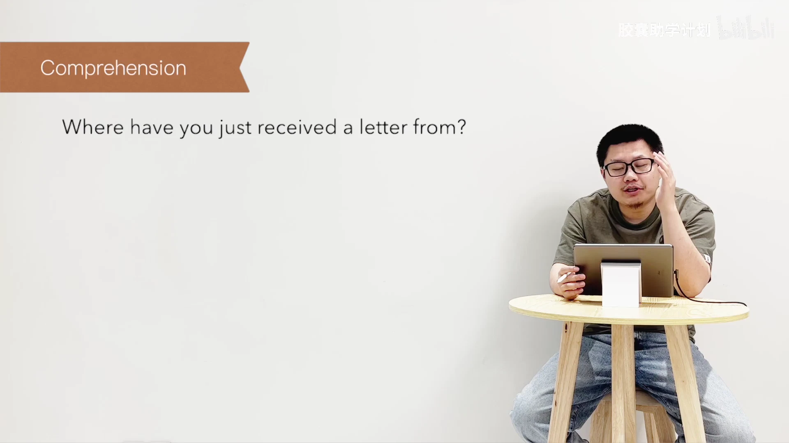

文字识别：喜助学计划 / Comprehension / Where have you just received a letter from?

### 画面 00:00:35

文字识别：喜助学计划園卿 / Comprehension / What is your old headmaster's name?

### 画面 00:00:38

文字识别：奏助学计划園淵 / Comprehension / What is your old headmaster's name?

### 画面 00:00:40

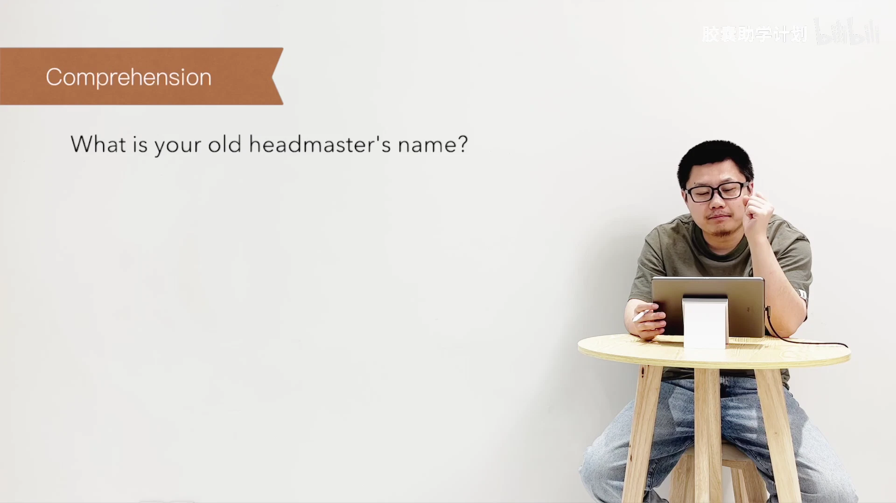

文字识别：囊助学计划陽淵 / Comprehension / What is your old headmaster's name?

### 画面 00:00:45

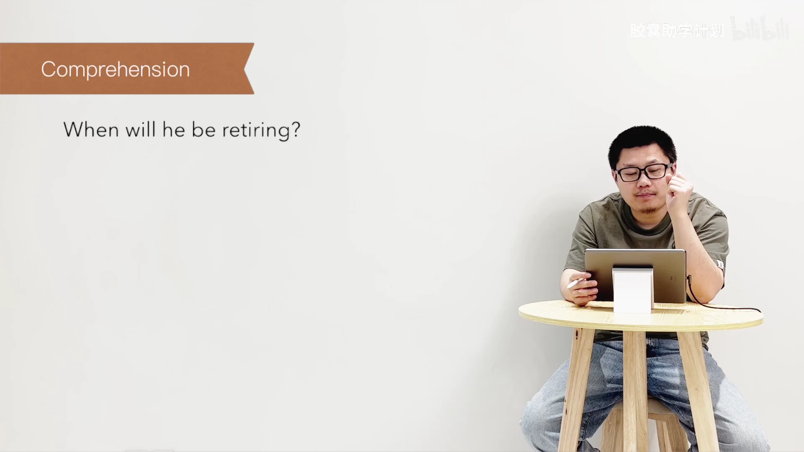

文字识别：卖助学计划 / Comprehension / When will he be retiring?

### 画面 00:00:50

文字识别：奏助学计划陽 / Comprehension / When will he be retiring? / Next week.

### 画面 00:00:53

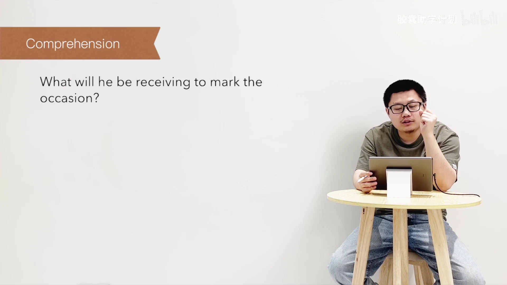

文字识别：奏助学计划 / Comprehension / What will he be receiving to mark the / occasion?

### 画面 00:00:55

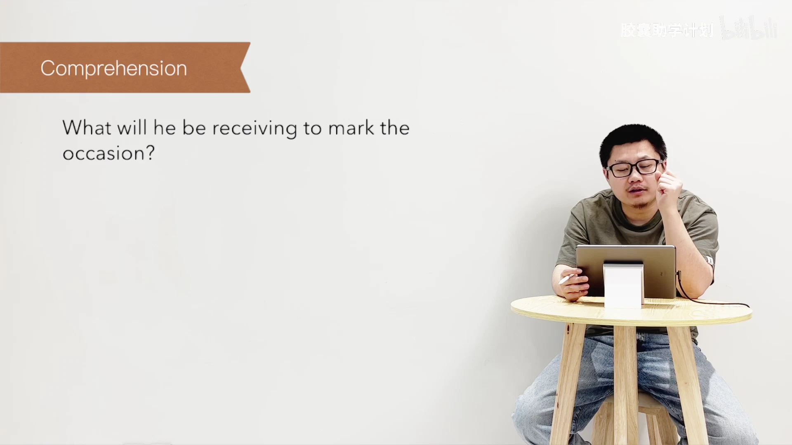

文字识别：喜助学计划 / Comprehension / What will he be receiving to mark the / occasion?

### 画面 00:00:59

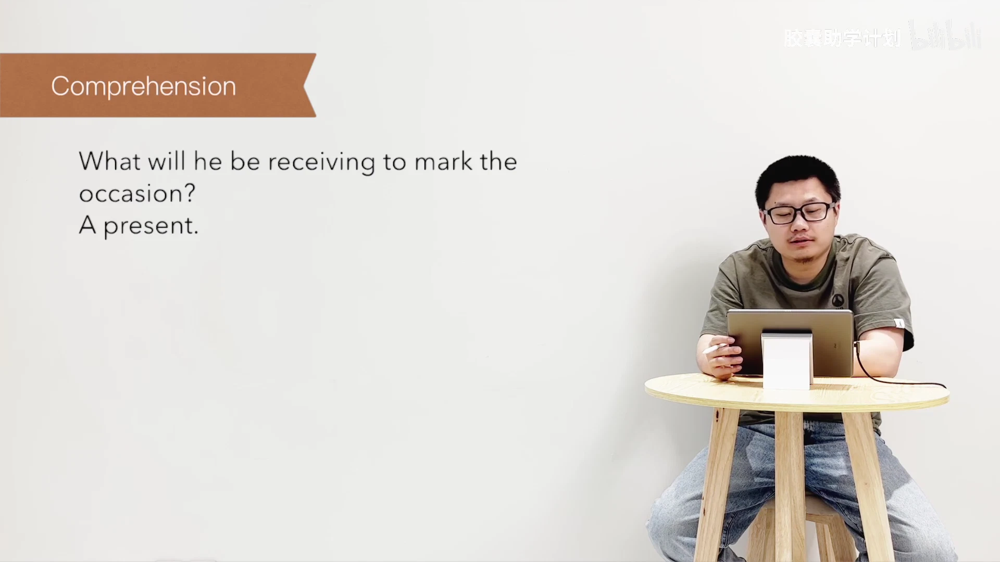

文字识别：喜助学计划 / Comprehension / What will he be receiving to mark the / occasion? / A present.

## 00:01:00–00:01:30

Who will be sending it? Pupils of the school. Where will those who have contributed to the gift sign their names? In a large album. Will it be sent to the school or to the headmaster's home? To his

### 画面 00:01:01

文字识别：喜助学计划 / Comprehension / Who will be sending it?

### 画面 00:01:03

文字识别：喜助字计划 / Comprehension / Who will be sending it?

### 画面 00:01:05

文字识别：妻助学计划 / Comprehension / Who will be sending it? / Pupils of the school will.

### 画面 00:01:08

文字识别：妻助字计划 / Comprehension / Where will those who have contributed to / the gift sign their names?

### 画面 00:01:10

文字识别：臺助学计划 / Comprehension / Where will those who have contributed to / the gift sign their names?

### 画面 00:01:15

文字识别：妻助学计划 / Comprehension / Where will those who have contributed to / the gift sign their names?

### 画面 00:01:18

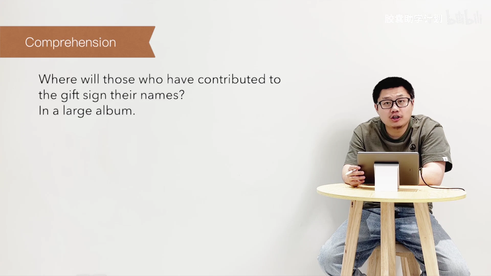

文字识别：辜助学计划 / Comprehension / Where will those who have contributed to / the gift sign their names? / In a large album.

### 画面 00:01:20

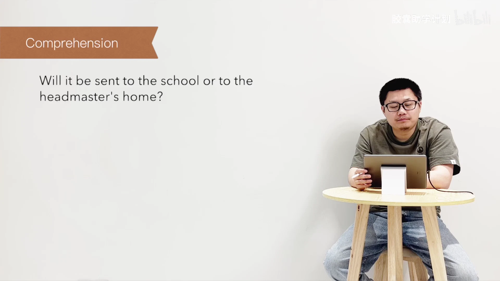

文字识别：壺助学计划 / Comprehension / Will it be sent to the school or to the / headmaster's home?

### 画面 00:01:24

文字识别：臺助学计划 / Comprehension / Will it be sent to the school or to the / headmaster's home?

### 画面 00:01:26

文字识别：囊助学计划 / Comprehension / Will it be sent to the school or to the / headmaster's home?

## 00:01:30–00:02:00

home. What will you all remember, Mister Page, for? His patience and understanding. He gave you kindly encouragement, didn't he? Yes, he did. Did you go willingly to school? No, we didn't.

### 画面 00:01:31

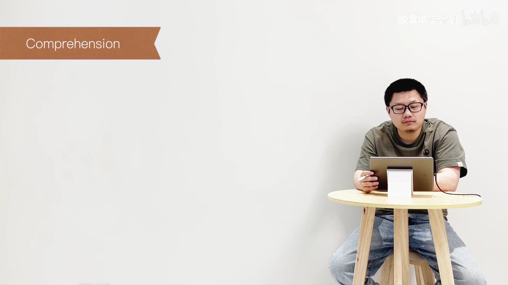

文字识别：衰助学计划一调 / Comprehension

### 画面 00:01:33

文字识别：妻助学计划 / Comprehension / What will you all remember Mr. Page for?

### 画面 00:01:35

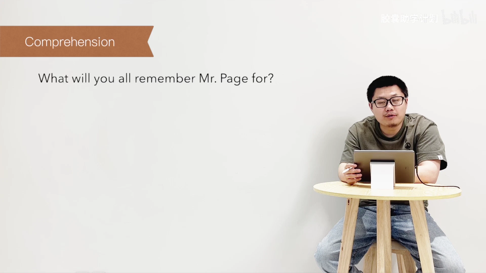

文字识别：喜助学计划 / Comprehension / What will you all remember Mr. Page for?

### 画面 00:01:40

文字识别：臺助字计划 / Comprehension / What will you all remember Mr. Page for? / For his patience and understanding.

### 画面 00:01:42

文字识别：臺助学计划 / Comprehension / What will you all remember Mr. Page for? / For his patience and understanding.

### 画面 00:01:44

文字识别：妻助学计划優 / Comprehension / He gave you kindly encouragement, didn't / he?

### 画面 00:01:46

文字识别：妻助学计划 / Comprehension / He gave you kindly encouragement, didn't / he?

### 画面 00:01:48

文字识别：喜助字计划 / Comprehension / He gave you kindly encouragement, didn't / he?

### 画面 00:01:50

文字识别：喜助学计划 / Comprehension / He gave you kindly encouragement, didn't / he? / Yes, he did.

### 画面 00:01:53

文字识别：囊助学计划 / Comprehension / Did you go willingly to school?

### 画面 00:01:55

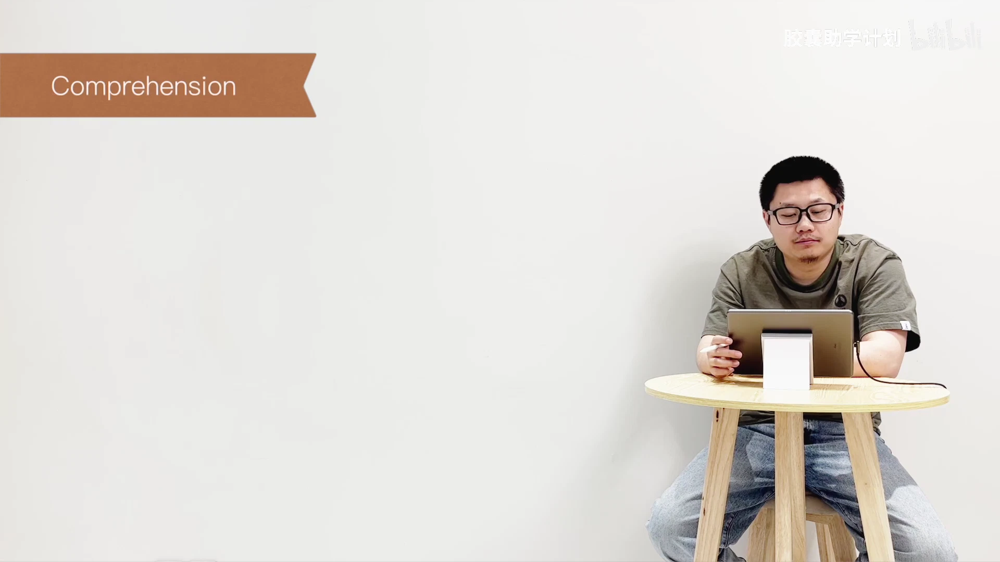

文字识别：囊助字计划 / Comprehension

### 画面 00:01:58

文字识别：喜助学计划 / Comprehension / When is a farewell dinner being held in his / honor?

## 00:02:00–00:02:30

When is a farewell dinner being held in his honor? Next Thursday. Good. Asking questions. Ah, this exercise,咱们四句型转换的能力，对吧？啊，这个，呃，第一个例子啊，比如说，Ask me if I've just received a letter. 那你肯定是把have提前，对吧？然后what对a letter提问，叫做What have you just received? Very good. 第二个，So it was

### 画面 00:02:00

文字识别：喜助字计划 / Comprehension / When is a farewell dinner being held in his / honor?

### 画面 00:02:08

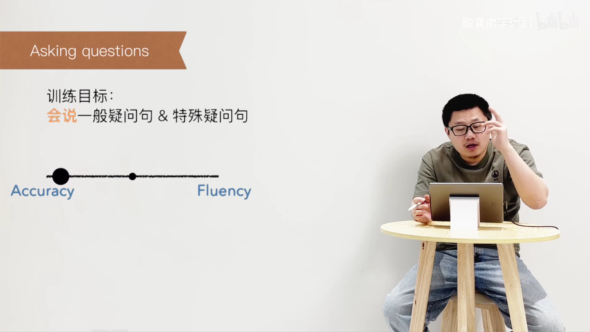

文字识别：交囊助字计划一调 / Asking questions / 训练目标： / 会说一般疑问句＆特殊疑问句 / A / Accuracy / Fluency

### 画面 00:02:10

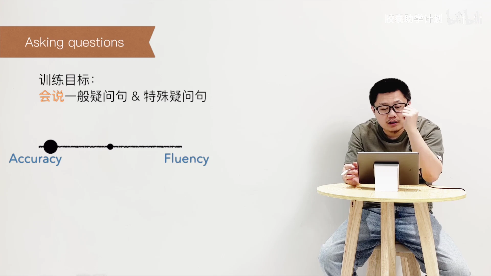

文字识别：交壺助学计划陽洲 / Asking questions / 训练目标： / 会说一般疑问句＆特殊疑问句 / Accuracy / Fluency

### 画面 00:02:14

文字识别：壺助学计划優 / Asking questions / T: Ask me if I'v just received a letter.

### 画面 00:02:17

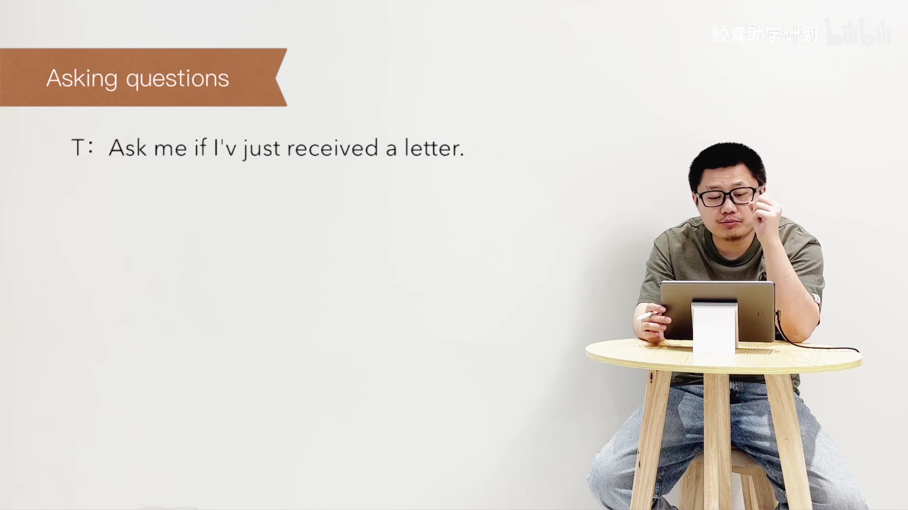

文字识别：壺助学计划陽淵 / Asking questions / T: Ask me if I'v just received a letter.

### 画面 00:02:19

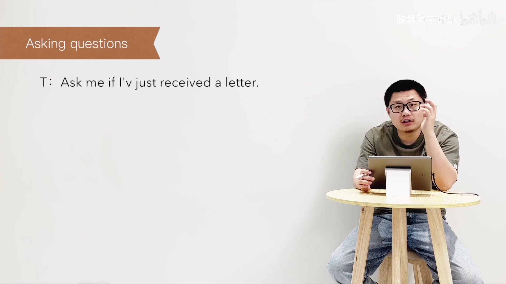

文字识别：交壺助字计划情州 / Asking questions / T: Ask me if I'v just received a letter.

### 画面 00:02:21

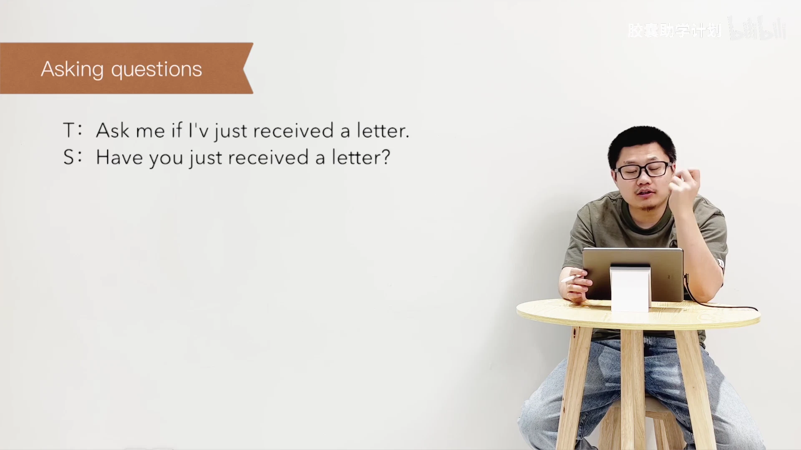

文字识别：囊助学计划園洲 / Asking questions / T: Ask me if I'v just received a letter. / S: Have you just received a letter?

### 画面 00:02:25

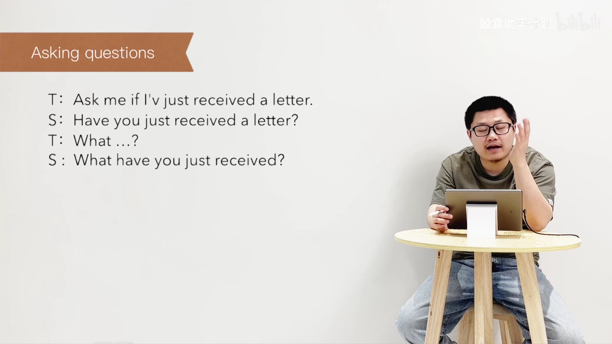

文字识别：囊助学计划 / Asking questions / T: Ask me if l'v just received a letter. / S: Have you just received a letter? / T: What ...? / S: What have you just received?

### 画面 00:02:27

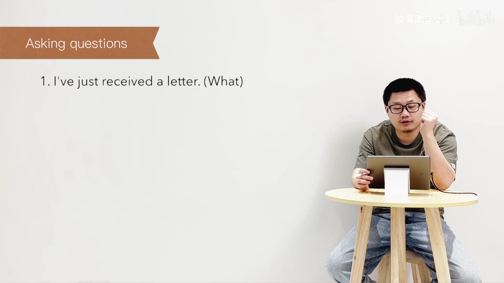

文字识别：囊助学计划園调 / Asking questions / 1.I've just received a letter. (What)

## 00:02:30–00:03:00

about Mr. Store Page, my former head ma headmaster. Was提前了嘛？然后What其实就是What was it about？它是关于什么的啊？指的这封信啊。这个It指的是the letter啊。呃，第三个说He will be retiring next week.将来进行时Will提前，When对next week提问。His pupils will send him a present.一般将来时Will提前，对吧？然后Who对主语提问？They注

### 画面 00:02:30

文字识别：Asking questions / 1.I've just received a letter. (What) / 2. It was about Mr. Stuart Page, my former / headmaster.(What)

### 画面 00:02:35

文字识别：Asking questions / 1.I've just received a letter. (What) / 2.It was about Mr. Stuart Page, my former / headmaster.(What)

### 画面 00:02:40

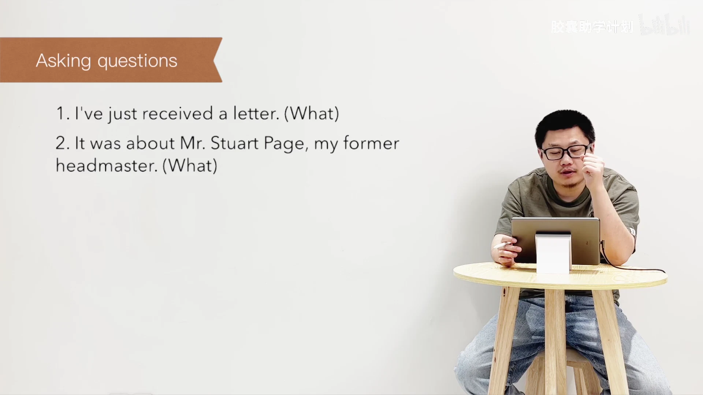

文字识别：Asking questions / 1.I've just received a letter. (What) / 2. It was about Mr. Stuart Page, my former / headmaster.(What)

### 画面 00:02:43

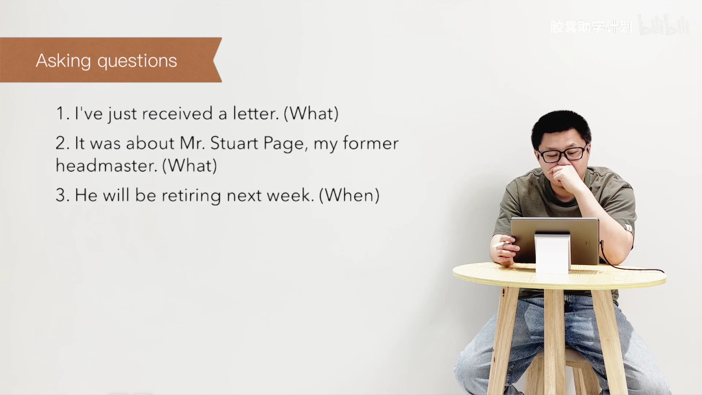

文字识别：Asking questions / 1.I've just received a letter. (What) / 2. It was about Mr. Stuart Page, my former / headmaster.(What) / 3. He will be retiring next week. (When)

### 画面 00:02:45

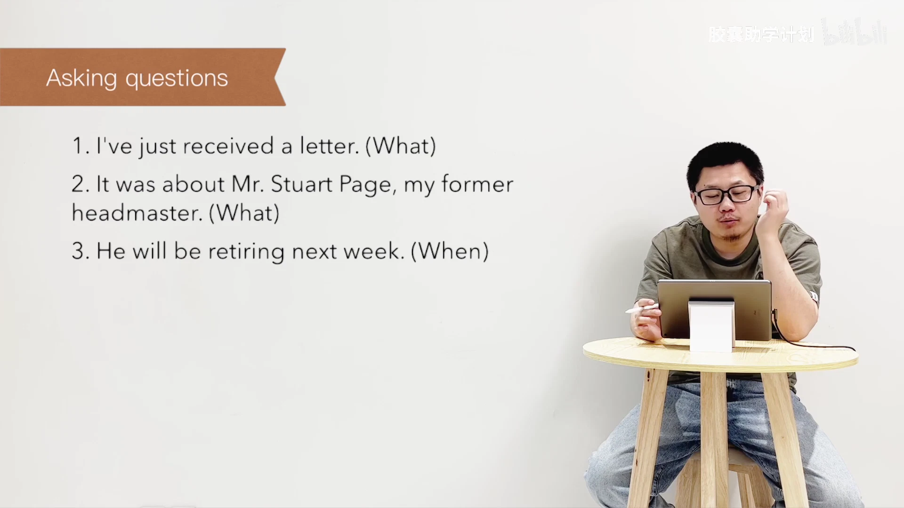

文字识别：Asking questions / 1.I've just received a letter. (What) / 2. It was about Mr. Stuart Page, my former / headmaster.(What) / 3. He will be retiring next week. (When)

### 画面 00:02:50

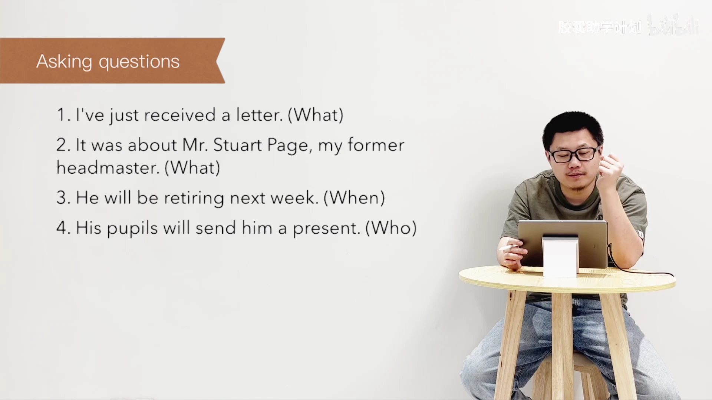

文字识别：Asking questions / 1.I've just received a letter. (What) / 2. It was about Mr. Stuart Page, my former / headmaster.(What) / 3. He will be retiring next week. (When) / 4. His pupils will send him a present. (Who)

### 画面 00:02:55

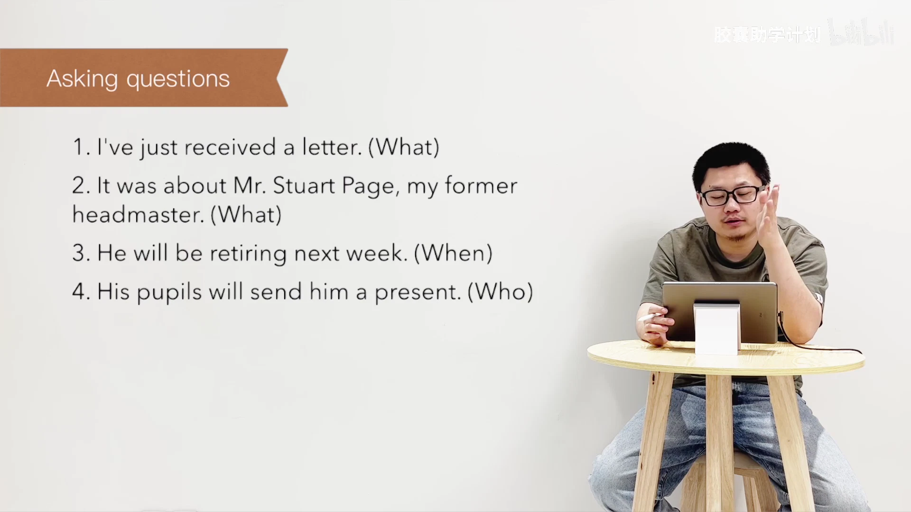

文字识别：Asking questions / 1.I've just received a letter. (What) / 2. Ilt was about Mr. Stuart Page, my former / headmaster.(What) / 3. He will be retiring next week. (When) / 4. His pupils will send him a present. (Who)

### 画面 00:02:58

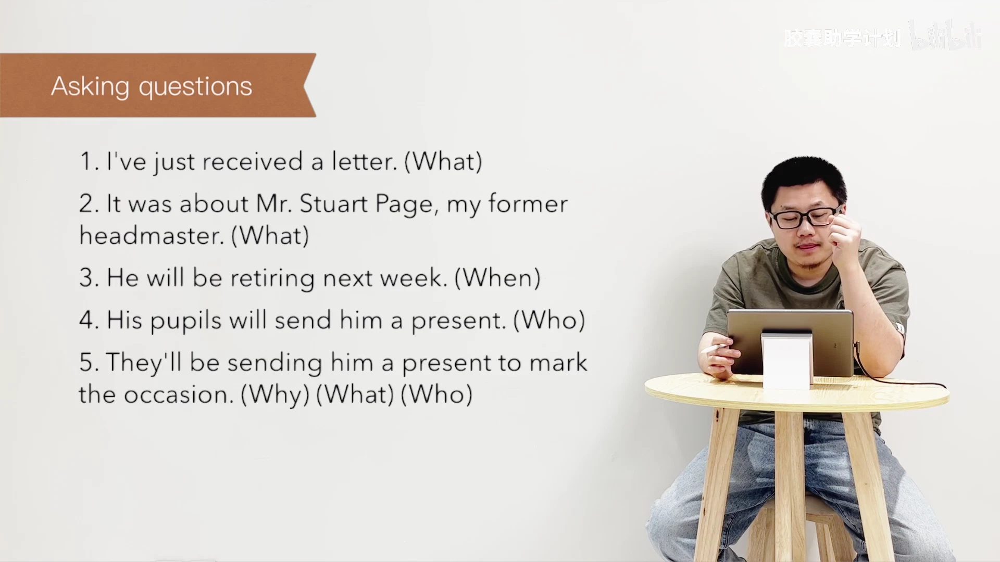

文字识别：奏助学计划 / Asking questions / 1. I've just received a letter. (What) / 2. Ilt was about Mr. Stuart Page, my former / headmaster.(What) / 3. He will be retiring next week. (When) / 4. His pupils will send him a present. (Who) / 5. They'll be sending him a present to mark / the occasion.(Why) (What) (Who)

## 00:03:00–00:03:30

意P L L will,对吧? Will be sending him a present to mark the occasion. Why?可以对to mark the occasion提问，就为啥要给他寄个礼物呢？目的是为了mark the occasion，对吧？为了庆祝一下，纪念一下这一刻。那What呢？你可以对a present提问。Who呢？直接对主语或者是him提问都可以。第六个，The contributors will sign their names in an album.好了，这个contributors实际上是

### 画面 00:03:00

文字识别：妻助学计划 / Asking questions / 1.I've just received a letter. (What) / 2. It was about Mr. Stuart Page, my former / headmaster.(What) / 3. He will be retiring next week. (When) / 4. His pupils will send him a present. (Who) / 5. They'll be sending him a present to mark / the occasion.(Why) (What) (Who)

### 画面 00:03:08

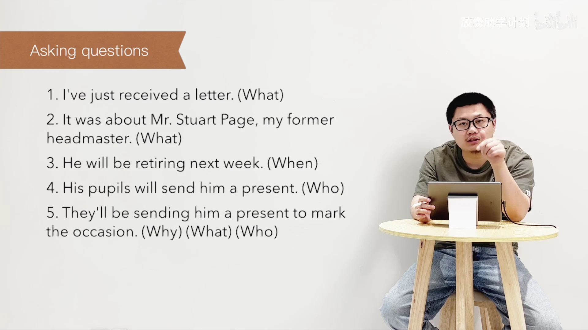

文字识别：建助学计划 / Asking questions / 1.I've just received a letter. (What) / 2. Ilt was about Mr. Stuart Page, my former / headmaster.(What) / 3. He will be retiring next week. (When) / 4. His pupils will send him a present. (Who) / 5. They'll be sending him a present to mark / the occasion.(Why)(What) (Who)

### 画面 00:03:11

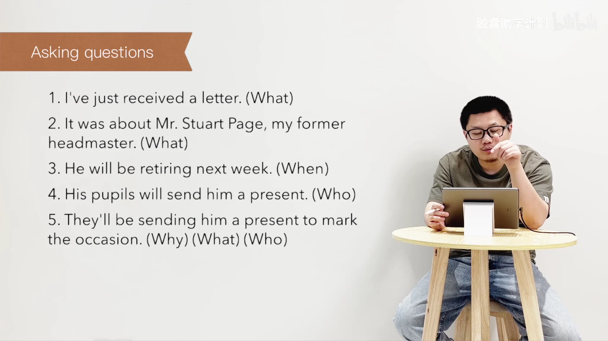

文字识别：裏助学计划 / Asking questions / 1.I've just received a letter. (What) / 2. Ilt was about Mr. Stuart Page, my former / headmaster.(What) / 3. He will be retiring next week. (When) / 4. His pupils will send him a present. (Who) / 5. They'll be sending him a present to mark / the occasion.(Why)(What) (Who)

### 画面 00:03:22

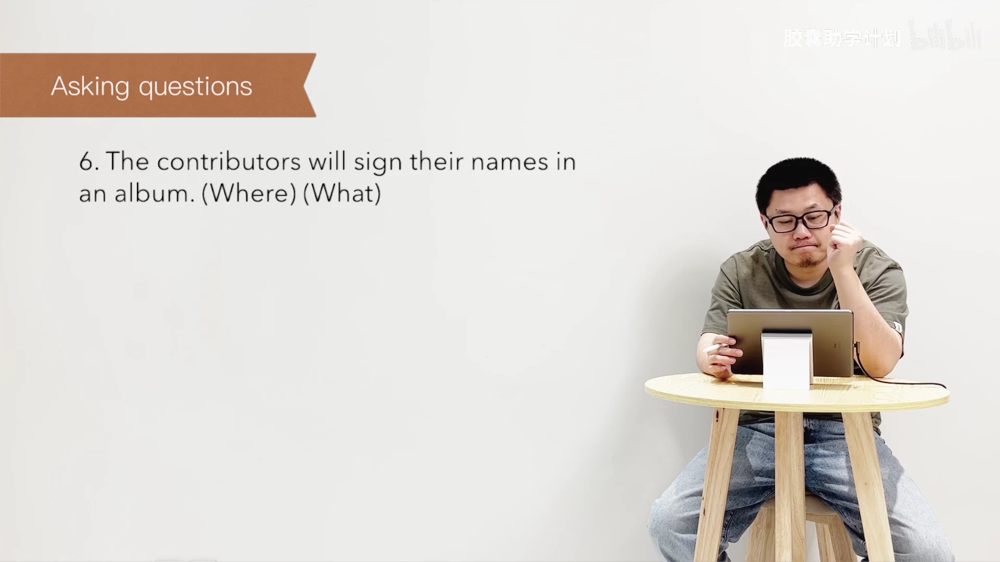

文字识别：嘉助学计划 / Asking questions / 6. The contributors will sign their names in / an album.(Where)(What)

### 画面 00:03:24

文字识别：嘉助学计划 / Asking questions / 6. The contributors will sign their names in / an album.(Where)(What)

### 画面 00:03:27

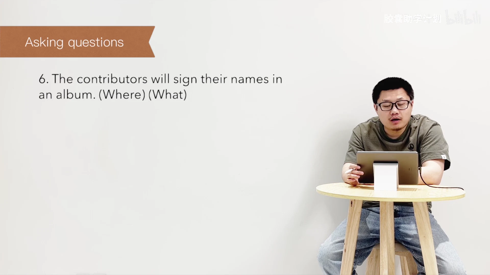

文字识别：喜助学计划 / Asking questions / 6. The contributors will sign their names in / an album.(Where) (What)

## 00:03:30–00:04:00

生词，但是o r e r结尾，contribute这个动词你有认的，我猜你应该能猜出来contributor是什么意思，对吧？我预判了你的预判啊，这个contributor的意思就是贡献者嘛，对吧？捐赠者嘛，这些人嘛。那where肯定是对地点提问，in an album。What对their names提问。It will be sent to their home. Will提前，where对to his home。

### 画面 00:03:30

文字识别：喜助字计划 / Asking questions / 6. The contributors will sign their names in / an album.(Where) (What)

### 画面 00:03:41

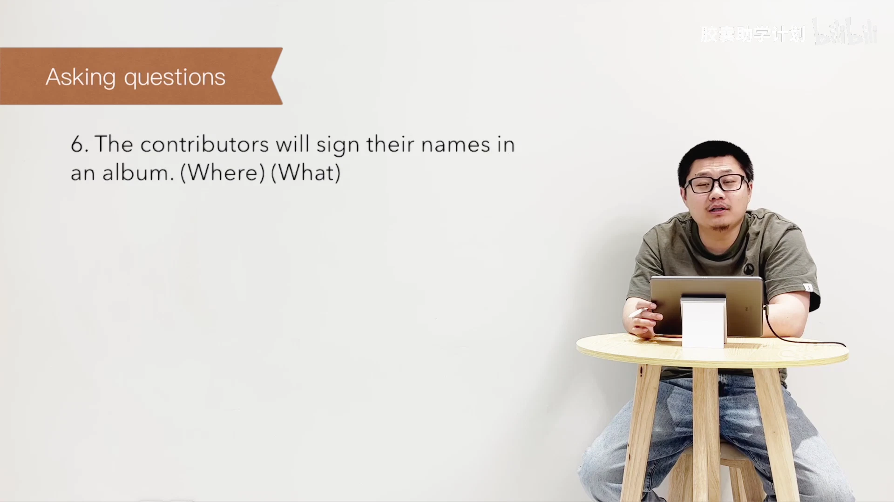

文字识别：喜助学计划 / Asking questions / 6. The contributors will sign their names in / an album.(Where) (What)

### 画面 00:03:45

文字识别：辜助字计划 / Asking questions / 6. The contributors will sign their names in / an album.(Where) (What)

### 画面 00:03:52

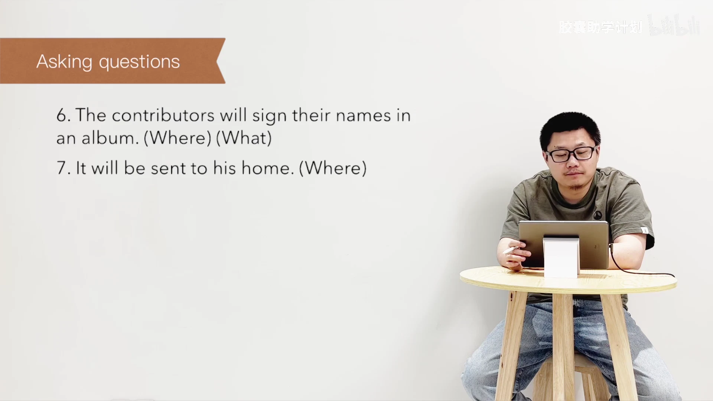

文字识别：Asking questions / 6. The contributors will sign their names in / an album.(Where)(What) / 7. It will be sent to his home. (Where)

### 画面 00:03:55

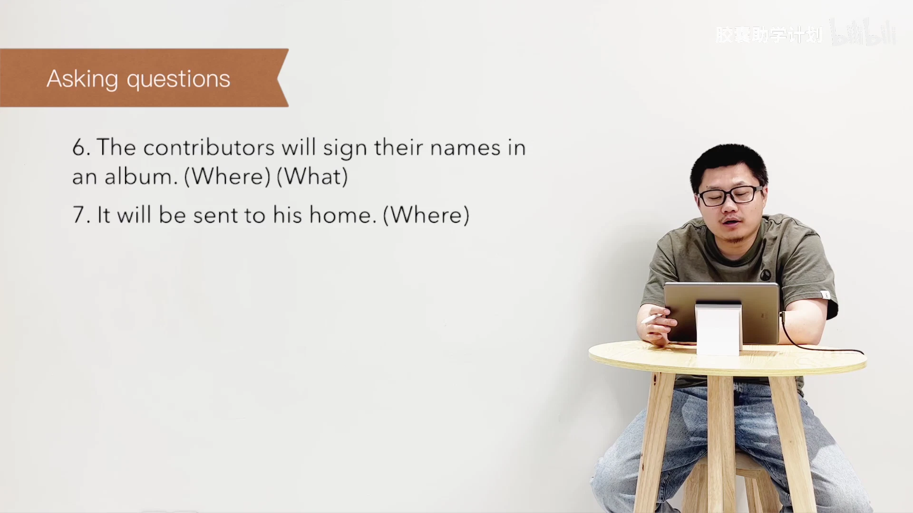

文字识别：Asking questions / 6. The contributors will sign their names in / an album.(Where)(What) / 7. It will be sent to his home. (Where)

### 画面 00:03:59

文字识别：妻助学计划 / Asking questions / 6. The contributors will sign their names in / an album.(Where) (What) / 7. Ilt will be sent to his home. (Where) / 8. We shall all remember Mr. Page for his / patience and understanding. (What)

## 00:04:00–00:04:30

ah, his home, right? We shall all remember Mr. Page for his patience and understanding. Shall提前啊，但是你看，注意啊，你要shall提前的话，那是要we肯定就不对了。其实就是will you啊，这个地方要注意一下，因为shall跟will的这个特点，shall只能跟第一人称，你一变一般疑问句，we就变成了这个you了，第二人称了，对吧？所以应该叫will you all remember? Ah, what?对his patience and understanding，

### 画面 00:04:01

文字识别：Asking questions / 6. The contributors will sign their names in / an album.(Where)(What) / 7. lt will be sent to his home. (Where) / 8. We shall all remember Mr. Page for his / patience and understanding.(What)

### 画面 00:04:09

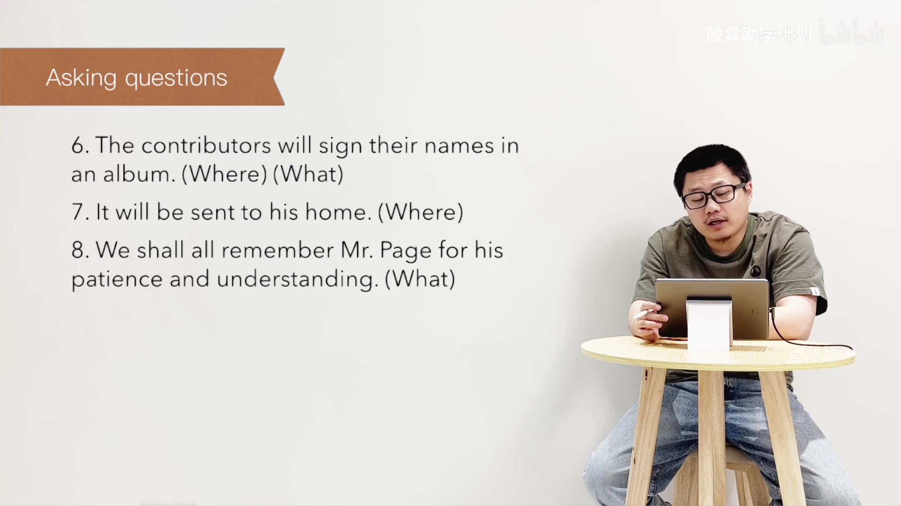

文字识别：Asking questions / 6. The contributors will sign their names in / an album.(Where) (What) / 7. Ilt will be sent to his home. (Where) / 8. We shall all remember Mr. Page for his / patience and understanding. (What)

### 画面 00:04:17

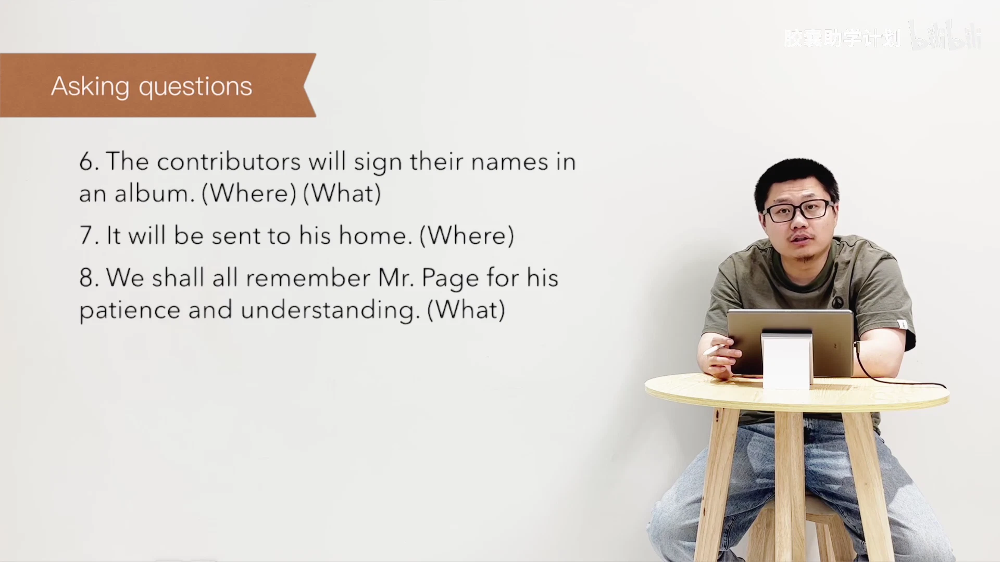

文字识别：Asking questions / 6. The contributors will sign their names in / an album.(Where)(What) / 7. It will be sent to his home. (Where) / 8. We shall all remember Mr. Page for his / patience and understanding. (What)

### 画面 00:04:26

文字识别：Asking questions / 6. The contributors will sign their names in / an album.(Where)(What) / 7. Ilt will be sent to his home. (Where) / 8. We shall all remember Mr. Page for his / patience and understanding. (What)

## 00:04:30–00:05:00

他这个品质提问。He gave us kindly encouragement when we went to school. Did 提前就可以了。What 对于对 kindly encouragement？When咱们可以直接对整个时间状语从句提问，也就是对 when we went to school 提问。那这个答案就是 when did he give you kindly encouragement？Tell the story，练的是咱们流利性啊。这个不多

### 画面 00:04:32

文字识别：Asking questions / 6. The contributors will sign their names in / an album.(Where) (What) / 7. Ilt will be sent to his home. (Where) / 8. We shall all remember Mr. Page for his / patience and understanding. (What) / 9. He gave us kindly encouragement when / we went to school. (What) (When)

### 画面 00:04:35

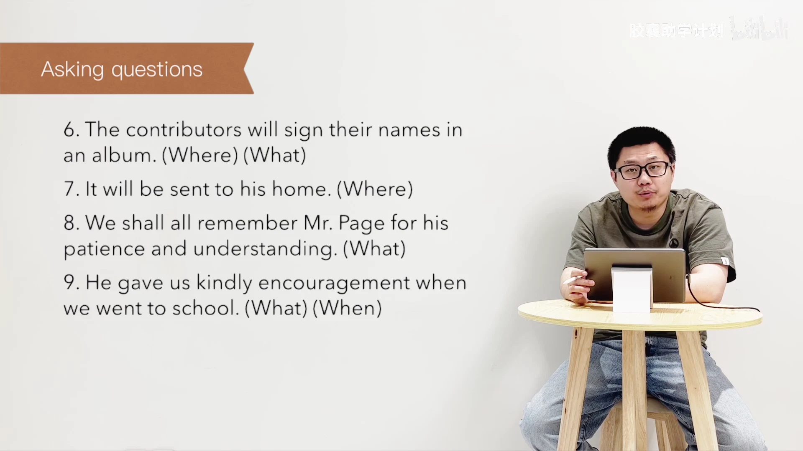

文字识别：Asking questions / 6. The contributors will sign their names in / an album.(Where) (What) / 7. It will be sent to his home. (Where) / 8. We shall all remember Mr. Page for his / patience and understanding. (What) / 9. He gave us kindly encouragement when / we went to school. (What) (When)

### 画面 00:04:42

文字识别：臺助字计划 / Asking questions / 6. The contributors will sign their names in / an album.(Where) (What) / 7. It will be sent to his home. (Where) / 8. We shall all remember Mr. Page for his / patience and understanding. (What) / 9. He gave us kindly encouragement when / we went to school.(What) (When)

### 画面 00:04:47

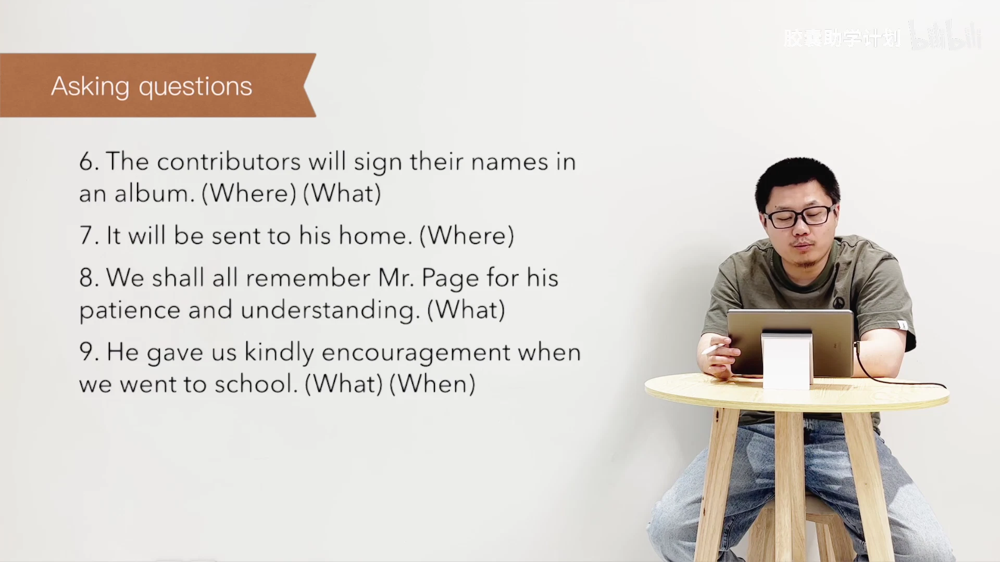

文字识别：臺助学计划 / Asking questions / 6. The contributors will sign their names in / an album.(Where) (What) / 7. It will be sent to his home. (Where) / 8. We shall all remember Mr. Page for his / patience and understanding. (What) / 9. He gave us kindly encouragement when / we went to school. (What) (When)

### 画面 00:04:51

文字识别：Asking questions / 6. The contributors will sign their names in / an album.(Where) (What) / 7. Ilt will be sent to his home. (Where) / 8. We shall all remember Mr. Page for his / patience and understanding.(What) / 9. He gave us kindly encouragement when / we went to school. (What) (When)

### 画面 00:04:55

文字识别：喜助学计划 / Asking questions / 6. The contributors will sign their names in / an album.(Where)(What) / 7. Ilt will be sent to his home. (Where) / 8. We shall all remember Mr. Page for his / patience and understanding. (What) / 9. He gave us kindly encouragement when / we went to school. (What) (When)

### 画面 00:04:57

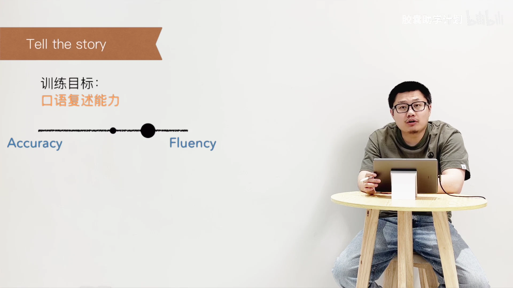

文字识别：交囊助学计划 / Tell the story / 训练目标： / 口语复述能力 / Accuracy / Fluency

### 画面 00:04:59

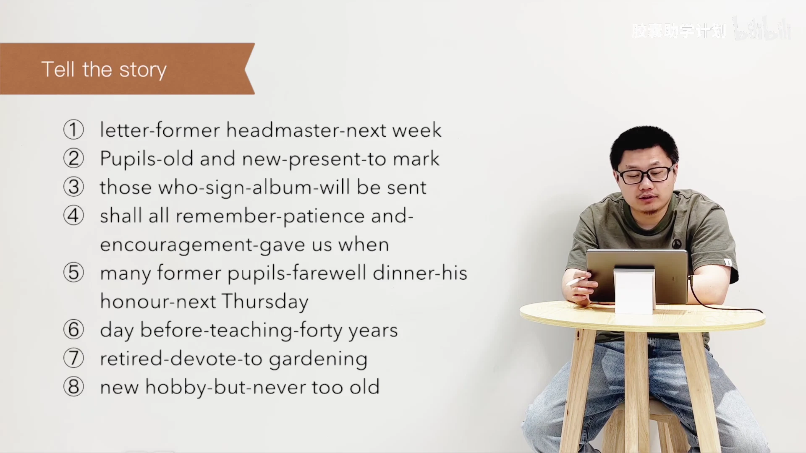

文字识别：霆助学计划 / Tell the story / ① / ) letter-former headmaster-next week / Pupils-old and new-present-to mark / those who-sign-album-will be sent / shall all remember-patience and- / encouragement-gave us when / many former pupils-farewell dinner-his / honour-next Thursday / day before-teaching-forty years / 6 / retired-devote-to gardening / 8 / new hobby-but-nevertoo old

## 00:05:00–00:05:30

说。第一单元做了很多，您在这儿暂停屏幕做就行了。然后 summary writing 两个重点，第一看连词，对吧？第二两篇文章，我不多说了。第一篇，第二篇。OK， topic for discussion，老习惯，咱们只做一件事情，就翻译一遍啊。然后您自己找时间尝试去说一说，写一写。 Have you any hobbies? What are they? Why do you

### 画面 00:05:01

文字识别：庭助学计划 / Tell the story / ① / ) letter-former headmaster-next week / Pupils-old and new-present-to mark / those who-sign-album-will be sent / shall all remember-patience and- / encouragement-gave us when / many former pupils-farewell dinner-his / 5 / honour-next Thursday / day before-teaching-forty years / 6 / retired-devote-to gardening / 8 / new hobby-but-nevertoo old

### 画面 00:05:04

文字识别：交卖助学计划国州 / Summary writing: Key / 训练目标： / 写作复述能力

### 画面 00:05:06

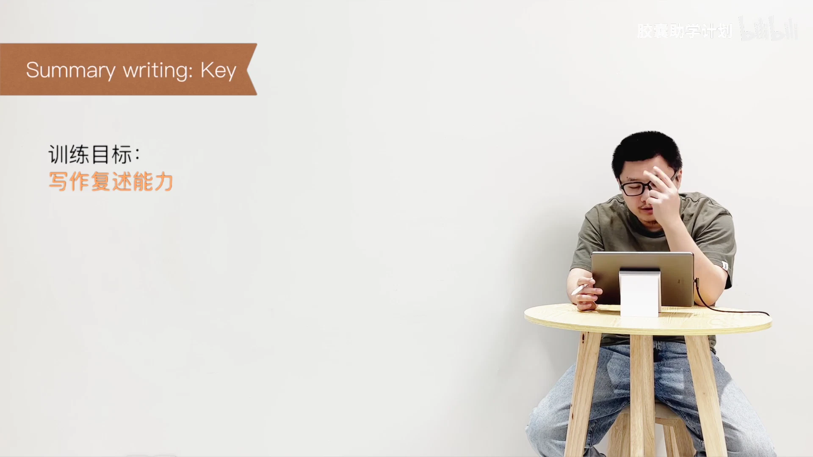

文字识别：交囊助学计划国调 / Summary writing: Key / 训练目标： / 写作复述能力

### 画面 00:05:11

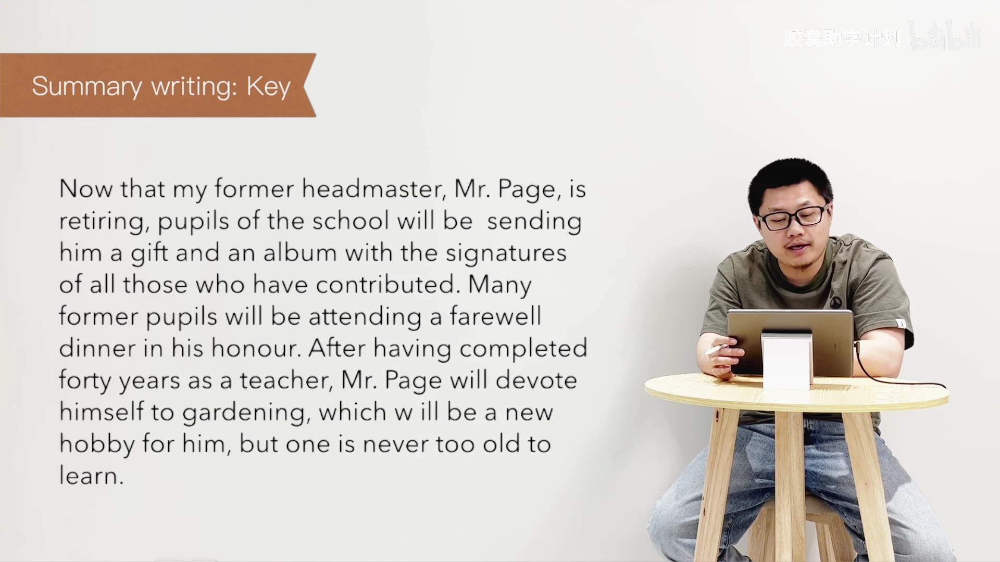

文字识别：囊助学计划 / Summary writing: Key / Now that my former headmaster, Mr. Page, is / retiring, pupils of the school will be sending / him a gift and an album with the signatures / of all those who have contributed. Many / former pupils will be attending a farewell / dinner in his honour. After having completed / forty years as a teacher, Mr. Page will devote / himself to gardening, which w ill be a new / hobby for him, but one is never too old to / learn.

### 画面 00:05:13

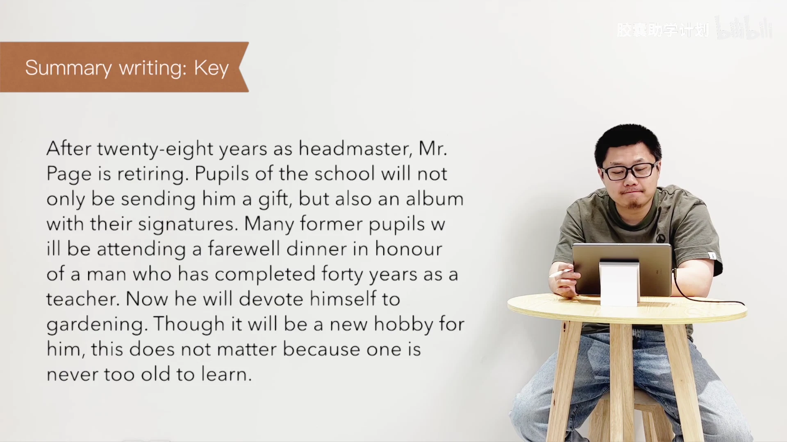

文字识别：袁助学计划 / Summary writing: Key / After twenty-eight years as headmaster, Mr. / Page is retiring. Pupils of the school will not / only be sending him a gift, but also an album / with their signatures. Many former pupils w / ill be attending a farewell dinner in honour / of a man who has completed forty years as a / teacher. Now he will devote himself to / gardening. Though it will be a new hobby for / him, this does not matter because one is / never too old to learn.

### 画面 00:05:15

文字识别：囊助学计划 / Summary writing: Key / After twenty-eight years as headmaster, Mr. / Page is retiring. Pupils of the school will not / only be sending him a gift, but also an album / with their signatures. Many former pupils w / ill be attending a farewell dinner in honour / of a man who has completed forty years as a / teacher. Now he will devote himself to / gardening. Though it will be a new hobby for / him, this does not matter because one is / never too old to learn.

### 画面 00:05:17

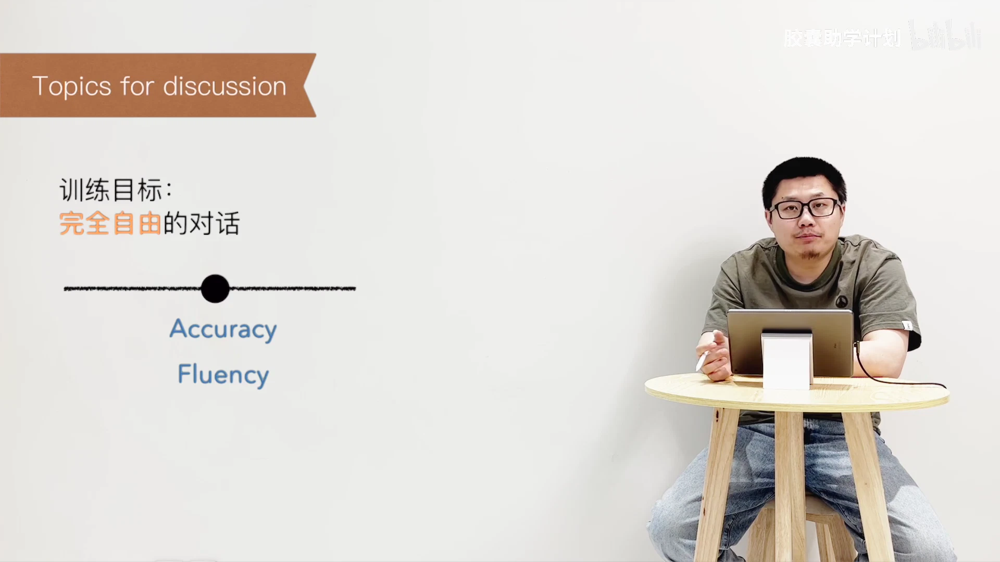

文字识别：交囊助学计划 / Topics for discussion / 训练目标： / 完全自由的对话 / Accuracy / Fluency

### 画面 00:05:19

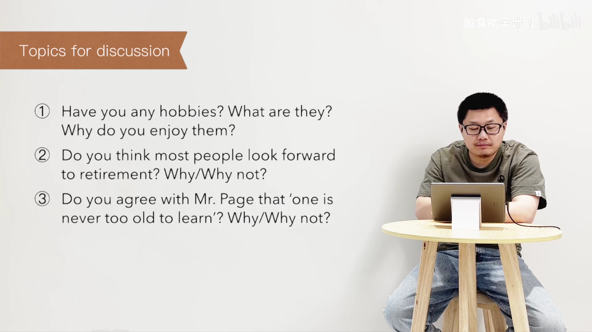

文字识别：毒助学计划 / Topics for discussion / Have you any hobbies? What are they? / Why do you enjoy them? / Do you think most people look forward / to retirement? Why/Why not? / Do you agree with Mr. Page that'one is / never too old to learn'? Why/Why not?

### 画面 00:05:21

文字识别：奏助学计划 / Topics for discussion / Have you any hobbies? What are they? / Why do you enjoy them? / Do you think most people look forward / to retirement? Why/Why not? / Do you agree with Mr. Page that'one is / never too old to learn'? Why/Why not?

### 画面 00:05:25

文字识别：喜助学计划 / Topics for discussion / Have you any hobbies? What are they? / Why do you enjoy them? / Do you think most people look forward / to retirement? Why/Why not? / Do you agree with Mr. Page that'one is / never too old to learn'? Why/Why not?

## 00:05:30–00:06:00

enjoy them?你有兴趣爱好吗？是什么？你为什么享受这些兴趣爱好？第二个，Do you think most people look forward to retirement? Why? Why not?说你认为大多数人是期待look forward to嘛，对吧？是期待退休的吗？期待为什么期待？不期待为什么不期待？Do you agree with Mr. Page that one is never too old to learn? Why? Why not?说你赞同Mr. Page这

### 画面 00:05:31

文字识别：奏助学计划 / Topics for discussion / Have you any hobbies? What are they? / Why do you enjoy them? / Do you think most people look forward / to retirement? Why/Why not? / Do you agree with Mr. Page that'one is / never too old to learn'? Why/Why not?

### 画面 00:05:51

文字识别：助学计划 / Topics for discussion / Have you any hobbies? What are they? / Why do you enjoy them? / Do you think most people look forward / to retirement? Why/Why not? / Do you agree with Mr. Page that'one is / never too old to learn'? Why/Why not?

## 00:06:00–00:06:30

句话叫做活到老学的老吗？赞同，为什么赞同？不赞同，为什么不赞同啊？家庭作业 ask me if，写完大声朗读，摘要写作两个重点看连词，然后 tell the story 口语复述，置顶留言找重复间隔的学习材料。那以上呢就是本期视频的全部内容了。如果各位喜欢我们的课程呢，欢迎各位关注订阅，一键三连，分享给那些需要的朋友，来帮助我们快速成长。

### 画面 00:06:00

文字识别：助学计划 / Topics for discussion / Have you any hobbies? What are they? / Why do you enjoy them? / Do you think most people look forward / to retirement? Why/Why not? / Do you agree with Mr. Page that'one is / never too old to learn'? Why/Why not?

### 画面 00:06:05

文字识别：囊助学计划長

### 画面 00:06:07

文字识别：交囊助学计划州 / 1.Ask me if写&朗读

### 画面 00:06:09

文字识别：交卖助学计划陽州 / 1.Ask me if写&朗读 / 2.摘要写作写&答案

### 画面 00:06:11

文字识别：交囊助学计划一洲 / 1.Ask me if写&朗读 / 2.摘要写作写&答案

### 画面 00:06:13

文字识别：交囊助学计划棚 / 1.Ask me if写&朗读 / 摘要写作写&答案 / 3.Tell the story 口语复述

### 画面 00:06:15

文字识别：校囊助学计划淵 / 1.Ask me if写&朗读 / 摘要写作写&答案 / 3.Tell the story 口语复述 / 4. / 4.重复间隔（置顶留言）

### 画面 00:06:17

文字识别：交囊助字计划厚调 / 1.Ask me if写&朗读 / 摘要写作写&答案 / 3.Tell the story 口语复述 / 4. / 4.重复间隔（置顶留言）

### 画面 00:06:19

文字识别：交奏助学计划一淵

### 画面 00:06:23

文字识别：交囊助学计划州 / ←

### 画面 00:06:26

文字识别：交囊助学计划一断 / NU

## 00:06:30–00:06:44

See you next time.

### 画面 00:06:30

文字识别：麦助学计划期 / ®

### 画面 00:06:32

文字识别：臺珈字計切 / CAPSULEACADEMY / 胶囊助学计划 / 『 / 小红书 / 品 / OE

### 画面 00:06:34

文字识别：動字計切 / CAPSULEACADEMY / 胶囊助学计划 / 小红书 / OE

### 画面 00:06:40

文字识别：CAPSULEACADEMY / 胶囊助学计划 / 小红书 / Creator / Leo & Berlin / OE

### 画面 00:06:42

文字识别：bilbili / 胶囊助学计划

### 画面 00:06:43

文字识别：bilbili / 胶囊助学计划

