# 086 单词

快速机器解析：语音为单模型转写，未进行独立交叉校对或人工复核；画面每秒采样并按变化选帧，短时文字和标记可能遗漏。截图时间约有 1 秒误差。图片有损压缩；遇到疑点请按时间查看 Google Drive 原视频。

## 00:00:00–00:00:30

Hello, everyone. Welcome to Capsule Academy. This is Leo. Today, we're going to learn New Concept English Book Two, Lesson eighty-six words.那老习惯进入正式课程之前呢，咱们先看几个问题啊。首先，如何表达沮丧的意识到啊？接下来呢，如何表达速度飞快？OK，那带着这两个问题，Hope you gonna enjoy it.我们先一起看一下第一个单词，它的原

### 画面 00:00:00

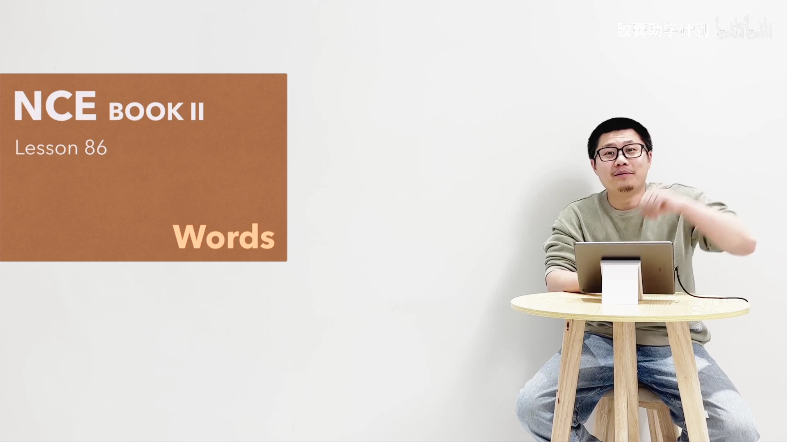

文字识别：NCE / BOOK"I / Lesson 86 / Words

### 画面 00:00:02

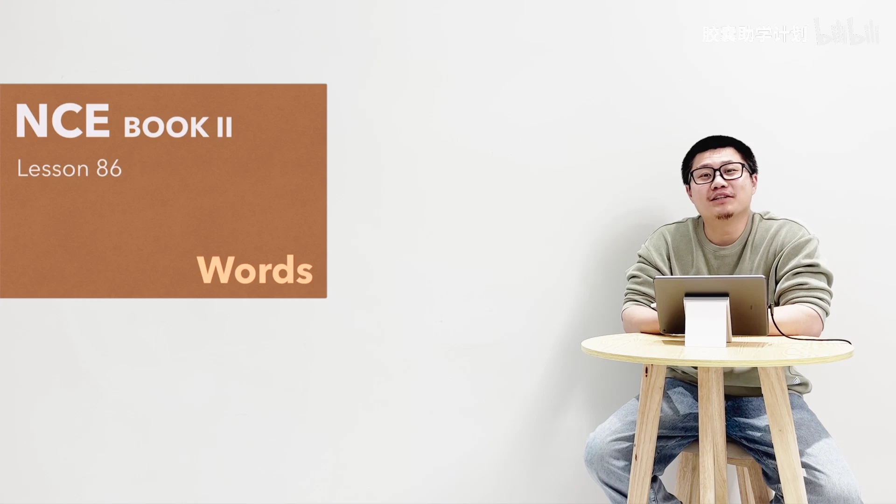

文字识别：NCE / BOOKⅡI / Lesson 86 / Words

### 画面 00:00:04

文字识别：NCE / BOOKⅡI / Lesson 86 / Words

### 画面 00:00:06

文字识别：NCE / BOOKⅡI / Lesson 86 / Words

### 画面 00:00:08

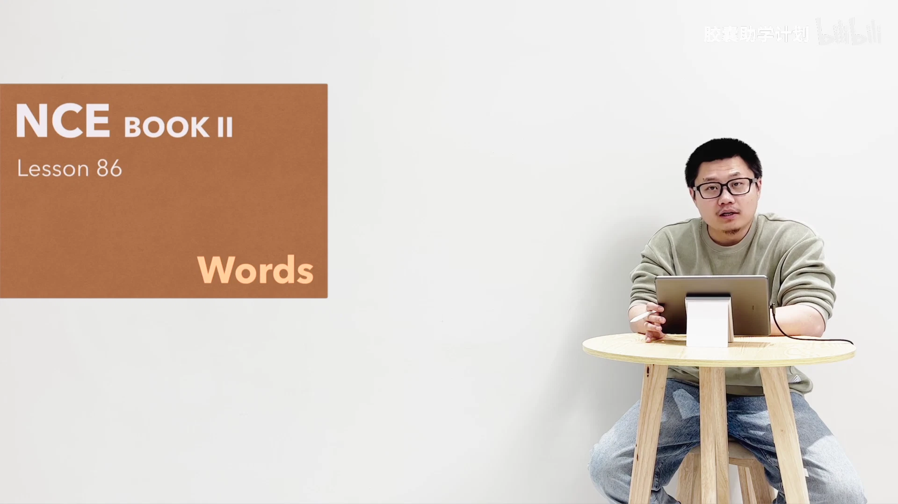

文字识别：NCE / BOOKⅡI / Lesson 86 / Words

### 画面 00:00:10

文字识别：NCE / BOOK"I / Lesson 86 / Words

### 画面 00:00:12

文字识别：助字计划陽 / 识到”？

### 画面 00:00:14

文字识别：①如何表达“沮丧的意识到”？

### 画面 00:00:16

文字识别：①如何表达“沮丧的意识到”？

### 画面 00:00:18

文字识别：①如何表达“沮丧的意识到”？ / 如何表达“速度飞快”?

### 画面 00:00:20

文字识别：①如何表达“沮丧的意识到”？ / 如何表达“速度飞快”?

### 画面 00:00:23

文字识别：胶囊助学计划bill

### 画面 00:00:27

### 画面 00:00:29

文字识别：单词造句指南 / 网：v.+v.变化 / 四句型转换 / 方式/地点/时间 / 结合习惯用法 / 其他单词+词性 / 原文摘抄+变 / 6123456 / /swIn/ /sw Λη / / swing / swung v.

## 00:00:30–00:01:00

形叫做 swing 啊，然后它的过去式和过去分词长得是一样的，叫做 swung。 OK，它的意思呃有好多呃，你基本上模糊的记住这几个都是很常用的。第一个叫做这种转向，有点像 turn，咱们第一课就学过。 I couldn't not bear it. I turned around again. Turn，哎，转向的感觉。还有一个就是我们所谓悬挂啊，摇摆悬挂啊，都是它非常常见的意

### 画面 00:00:31

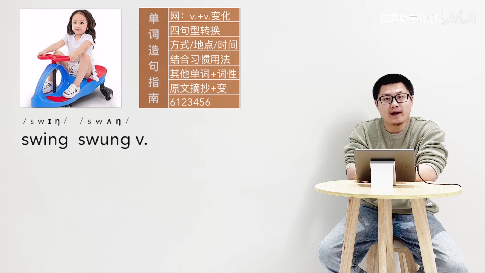

文字识别：单词造句指南 / 网：v.+v.变化 / 四句型转换 / 方式/地点/时间 / 结合习惯用法 / 其他单词+词性 / 原文摘抄+变 / 6123456 / /swIn/ /sw Λη/ / swing / swung v.

### 画面 00:00:35

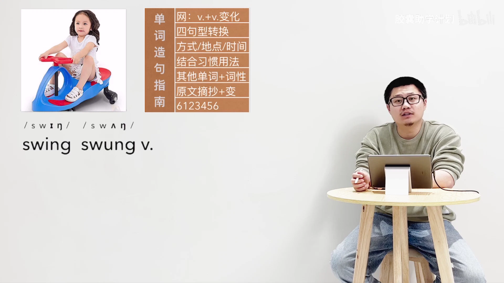

文字识别：单词造句指南 / 网：v.+v.变化 / 辜助字计划 / 四句型转换 / 方式/地点/时间 / 结合习惯用法 / 其他单词+词性 / 原文摘抄+变 / 6123456 / /swIn/ /sw Λη/ / swing / swung v.

### 画面 00:00:40

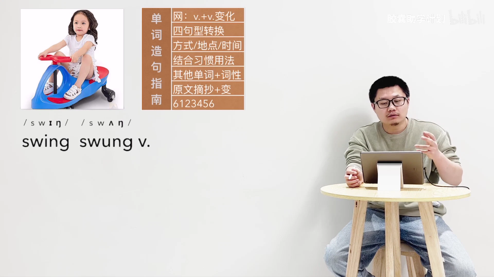

文字识别：单词造句指南 / 网：v.+v.变化 / 四句型转换 / 方式/地点/时间 / 结合习惯用法 / 其他单词+词性 / 原文摘抄+变 / 6123456 / /swIn/ /sw Λn/ / swing / swung v.

### 画面 00:00:47

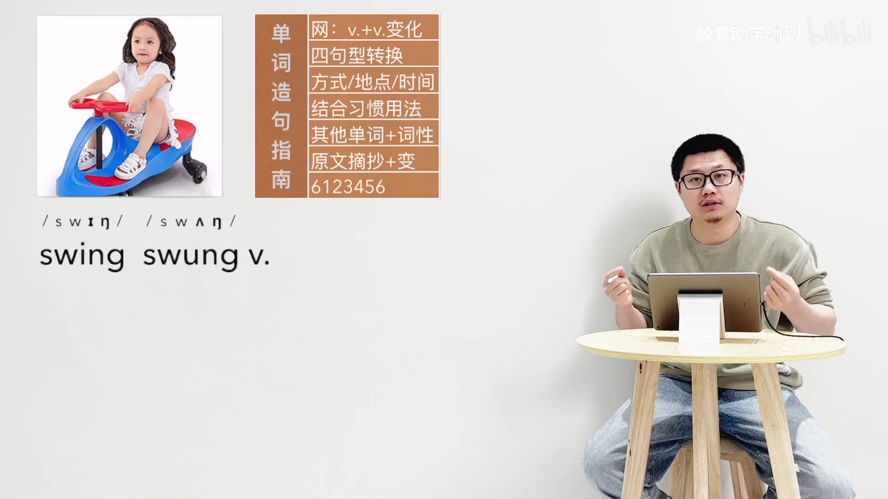

文字识别：单词造句指南 / 网：v.+v.变化 / 毫助子计划 / 四句型转换 / 方式/地点/时间 / 结合习惯用法 / 其他单词+词性 / 原文摘抄+变 / 6123456 / /swIn/ /sw Λη/ / swing / swung v.

### 画面 00:00:50

文字识别：单词造句指南 / 网：v.+v.变化 / 辜助字讨划 / 四句型转换 / 方式/地点/时间 / 结合习惯用法 / 其他单词+词性 / 原文摘抄+变 / 6123456 / /swIn/ /sw Λη / / swing / swung v.

## 00:01:00–00:01:30

思。我们拿它去造一个句子。首先，这单词确实不是很造句，不是很容易造句。所以，我们呢最保底的方式是原文摘抄再加编。我们先看一下原文，叫做 The man tried to swing the speedboat around. OK，说这个男人尝试着去 swing the speedboat 转向这个快艇 round。那 turn around， speed around 是一样的啊， swing around 是一样的意思，都表示的是转向

### 画面 00:01:00

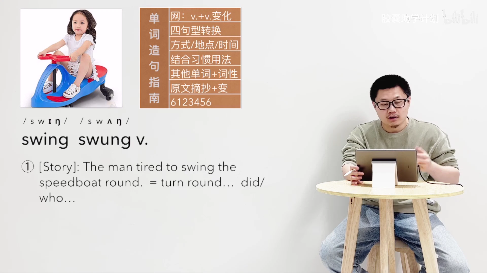

文字识别：单词造句指南 / 网：v.+v.变化 / 子计划 / 四句型转换 / 方式/地点/时间 / 结合习惯用法 / 其他单词+词性 / 原文摘抄+变 / 6123456 / / s wⅠn / / s w Λ η / / swing / swung v. / ① [Story]: The man tired to swing the / speedboat round. = turn round... did/ / who...

### 画面 00:01:02

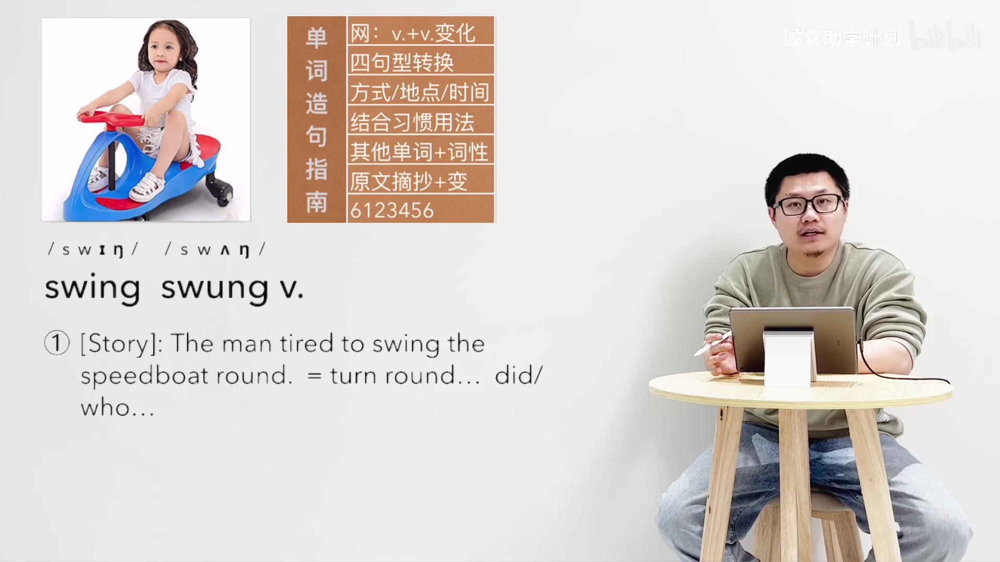

文字识别：单词造句指南 / 网：v.+v.变化 / 字计划 / 四句型转换 / 方式/地点/时间 / 结合习惯用法 / 其他单词+词性 / 原文摘抄+变 / 6123456 / / s wⅠn / / s w Λ n / / swing / swung v. / ① [Story]: The man tired to swing the / speedboat round. = turn round... did/ / who...

### 画面 00:01:05

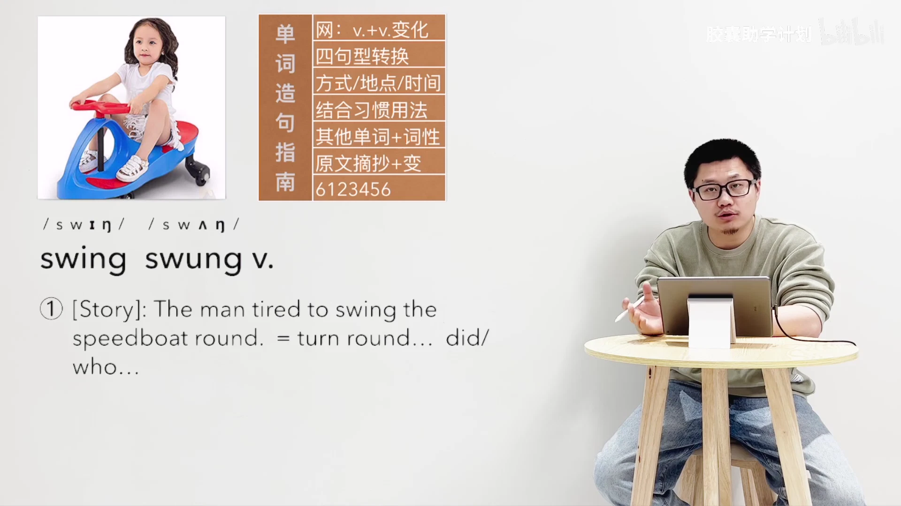

文字识别：单词造句指南 / 网：v.+v.变化 / 四句型转换 / 方式/地点/时间 / 结合习惯用法 / 其他单词+词性 / 原文摘抄+变 / 6123456 / / s wⅠn / / s w Λ n / / swing / swung v. / ① [Story]: The man tired to swing the / speedboat round. = turn round... did/ / who...

### 画面 00:01:18

文字识别：单词造句指南 / 网：v.+v.变化 / 四句型转换 / 方式/地点/时间 / 结合习惯用法 / 其他单词+词性 / 原文摘抄+变 / 6123456 / / s wIn / / sw Λ n / / swing / swung v. / ① [Story]: The man tired / swing the / speedboat round. = turn round... did/ / who...

### 画面 00:01:21

文字识别：单词造句指南 / 网：v.+v.变化 / 四句型转换 / 方式/地点/时间 / 结合习惯用法 / 其他单词+词性 / 原文摘抄+变 / 6123456 / / s w I n / / sw Λη / / swing / swung v. / ① [Story]: The man tired to swing the / speedboat round. = turn round... did/ / who...

### 画面 00:01:23

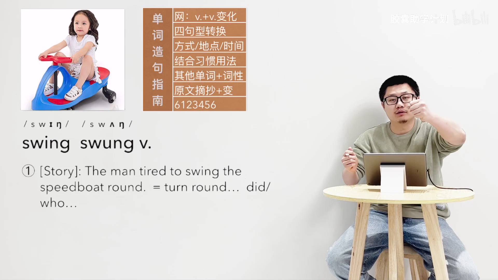

文字识别：单词造句指南 / 网：v.+v.变化 / 学计划 / 四句型转换 / 方式/地点/时间 / 结合习惯用法 / 其他单词+词性 / 原文摘抄+变 / 6123456 / / s wⅠn / /s w Λ n / / swing / swung v. / ① [Story]: The man tired to swing the / speedboat round. = turn round.. did/ / who...

### 画面 00:01:25

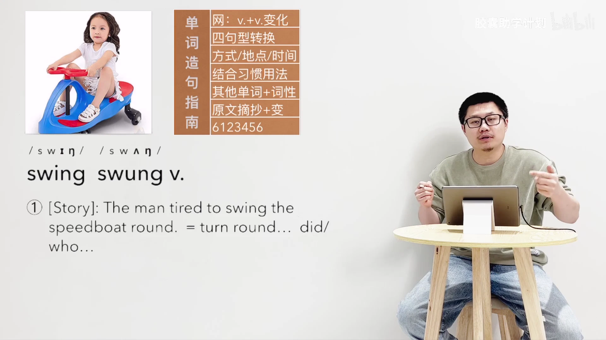

文字识别：单词造句指南 / 网：v.+v.变化 / 四句型转换 / 方式/地点/时间 / 结合习惯用法 / 其他单词+词性 / 原文摘抄+变 / 6123456 / / sw I n / / sw Λn / / swing / swung v. / ① [Story]: The man tired to swing the / speedboat round. = turn round... did/ / who...

## 00:01:30–00:02:00

啊，都是尝试着去转向这个快艇。OK，然后呢，我在这说了，它几乎就等同于 turn around。四句型转换，您自己去处理啊。接下来说，His arms swung as he walked。说他的手臂这样摇摆着，哎，当他走路的时候。OK， very good. Next one, it is a curious coincidence that they swung their cars

### 画面 00:01:34

文字识别：单词造句指南 / 网：v.+v.变化 / 四句型转换 / 方式/地点/时间 / 结合习惯用法 / 其他单词+词性 / 原文摘抄+变 / 6123456 / / s w In / /s w Λ n / / swing / swung v. / ① [Story]: The man tired to swing the / speedboat round. = turn round... did/ / who..

### 画面 00:01:40

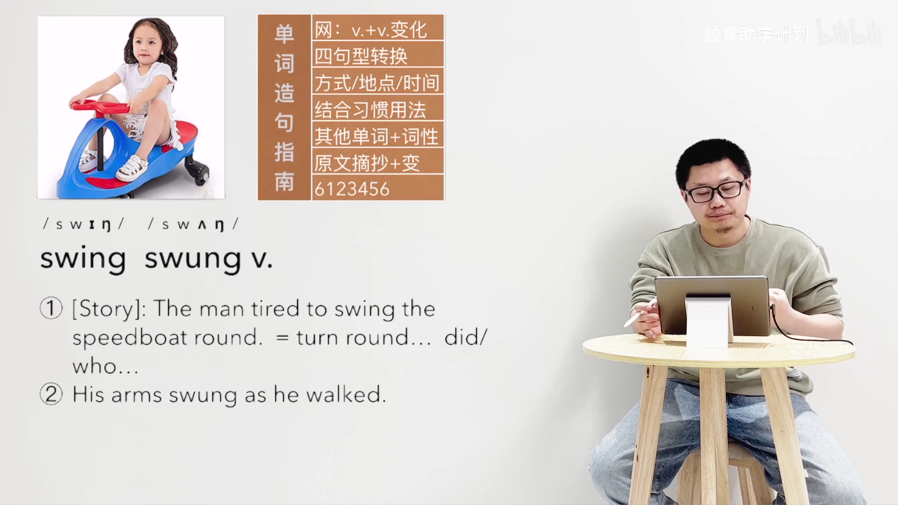

文字识别：单词造句指南 / 网：v.+v.变化 / 四句型转换 / 方式/地点/时间 / 结合习惯用法 / 其他单词+词性 / 原文摘抄+变 / 6123456 / / sw I n / / sw Λn / / swing / swung v. / ① [Story]: The man tired to swing the / speedboat round. = turn round... did/ / who... / His arms swung as he walked.

### 画面 00:01:45

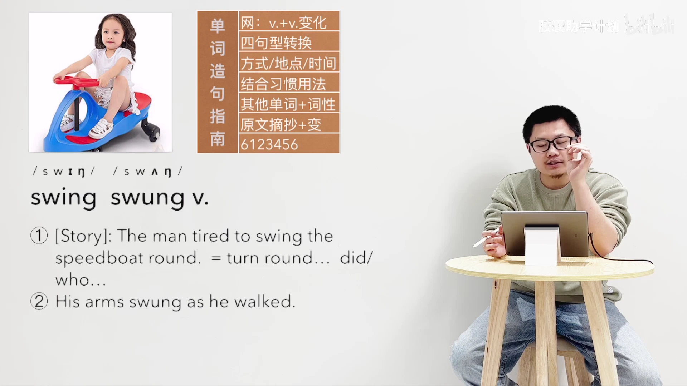

文字识别：单词造句指南 / 网：v.+v.变化 / 计划 / 四句型转换 / 方式/地点/时间 / 结合习惯用法 / 其他单词+词性 / 原文摘抄+变 / 6123456 / / s w I n / / sw Λn / / swing / swung v. / ① [Story]: The man tired to swing the / speedboat round. = turn round... did/ / who... / His arms swung as he walked.

### 画面 00:01:48

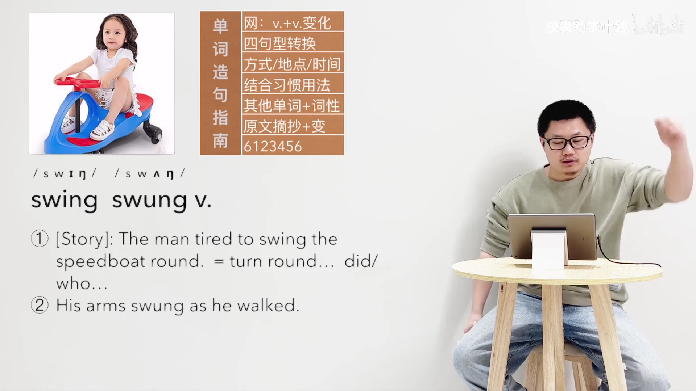

文字识别：单词造句指南 / 网：v.+v.变化 / 四句型转换 / 方式/地点/时间 / 结合习惯用法 / 其他单词+词性 / 原文摘抄+变 / 6123456 / / s w I η / / sw Λ n / / swing / swung v. / ① [Story]: The man tired to swing the / speedboat round. = turn round... did/ / who... / His arms swung as he walked.

### 画面 00:01:50

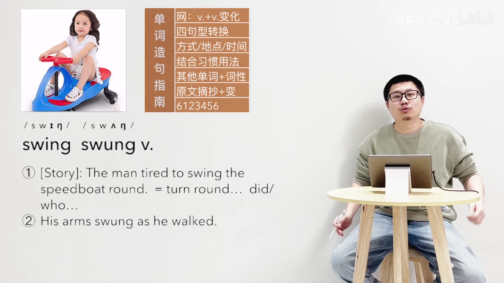

文字识别：单词造句指南 / 网：v.+v.变化 / 四句型转换 / 方式/地点/时间 / 结合习惯用法 / 其他单词+词性 / 原文摘抄+变 / 6123456 / / sw I η / / sw Λn / / swing / swung v. / ① [Story]: The man tired to swing the / speedboat round. = turn round... did/ / who... / His arms swung as he walked.

### 画面 00:01:53

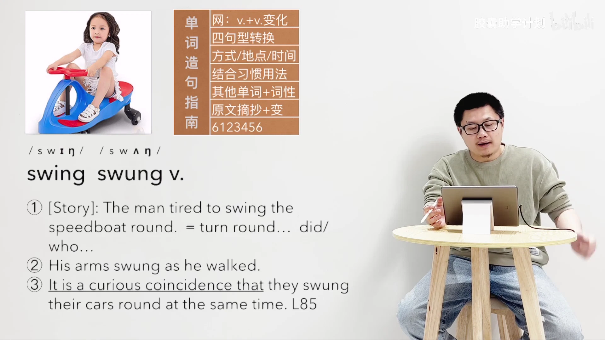

文字识别：单词造句指南 / 网：v.+v.变化 / 学计划 / 四句型转换 / 方式/地点/时间 / 结合习惯用法 / 其他单词+词性 / 原文摘抄+变 / 6123456 / / s wⅠη/ /s w Λn / / swing / swung v. / ① [Story]: The man tired to swing the / speedboat round. = turn round... did/ / who... / His arms swung as he walked. / It is a curious coincidence that they swung / their cars round at the same time. L85

### 画面 00:01:56

文字识别：单词造句指南 / 网：v.+v.变化 / 学计划 / 四句型转换 / 方式/地点/时间 / 结合习惯用法 / 其他单词+词性 / 原文摘抄+变 / 6123456 / / s wⅠη / /s w Λn / / swing / swung v. / ① [Story]: The man tired to swing the / speedboat round. = turn round... did/ / who... / His arms swung as he walked. / It is a curious coincidence that they swung / 3 / their cars round at the same time. L85

## 00:02:00–00:02:30

### 画面 00:02:00

文字识别：单词造句指南 / 网：v.+v.变化 / 学计划 / 四句型转换 / 方式/地点/时间 / 结合习惯用法 / 其他单词+词性 / 原文摘抄+变 / 6123456 / / s wⅠ η / / s w Λ n / / swing / swung v. / ① [Story]: The man tired to swing the / speedboat round. = turn round... did/ / who... / His arms swung as he walked. / It is a curious coincidence that they swung / 3 / their cars round at the same time. L85

### 画面 00:02:06

文字识别：单词造句指南 / 网：v.+v.变化 / 学计划 / 四句型转换 / 方式/地点/时间 / 结合习惯用法 / 其他单词+词性 / 原文摘抄+变 / 6123456 / / s wⅠη / / s w Λn / / swing / swung v. / ① [Story]: The man tired to swing the / speedboat round. = turn round... did/ / who... / His arms swung as he walked. / It is a curious coincidence that they swung / 3 / their cars round at the same time. L85

### 画面 00:02:08

文字识别：单词造句指南 / 网：v.+v.变化 / 四句型转换 / 方式/地点/时间 / 结合习惯用法 / 其他单词+词性 / 原文摘抄+变 / 6123456 / / s wⅠη / / s w Λ n / / swing / swung v. / ① [Story]: The man tired to swing the / speedboat round. = turn round... did/ / who... / His arms swung as he walked. / It is a curious coincidence that they swung / their cars round at the same time. L85

### 画面 00:02:10

文字识别：单词造句指南 / 网：v.+v.变化 / 四句型转换 / 方式/地点/时间 / 结合习惯用法 / 其他单词+词性 / 原文摘抄+变 / 6123456 / / s wⅠη / /s w Λn / / swing / swung v. / ① [Story]: The man tired to swing the / speedboat round. = turn round... did/ / who... / His arms swung as he walked. / It is a curious coincidence that they swung / 3 / their cars round at the same time. L85

### 画面 00:02:14

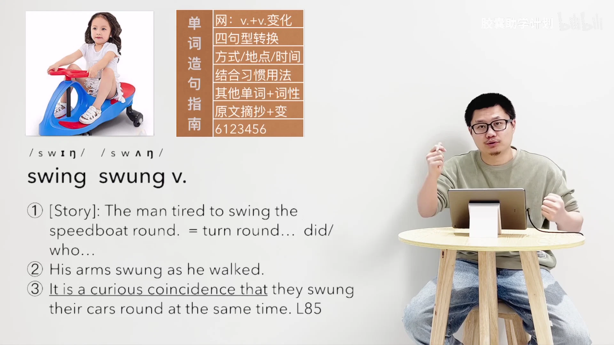

文字识别：单词造句指南 / 网：v.+v.变化 / 襄助字计划 / 四句型转换 / 方式/地点/时间 / 结合习惯用法 / 其他单词+词性 / 原文摘抄+变 / 6123456 / / s wⅠη / /s w Λn / / swing / swung v. / ① [Story]: The man tired to swing the / speedboat round. = turn round... did/ / who... / His arms swung as he walked. / It is a curious coincidence that they swung / 3 / their cars round at the same time. L85

### 画面 00:02:16

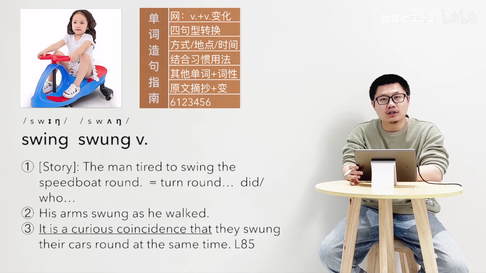

文字识别：单词造句指南 / 网：v.+v.变化 / 四句型转换 / 方式/地点/时间 / 结合习惯用法 / 其他单词+词性 / 原文摘抄+变 / 6123456 / / s wⅠη / /s w Λn / / swing / swung v. / ① [Story]: The man tired to swing the / speedboat round. = turn round... did/ / who... / His arms swung as he walked. / It is a curious coincidence that they swung / their cars round at the same time. L85

### 画面 00:02:18

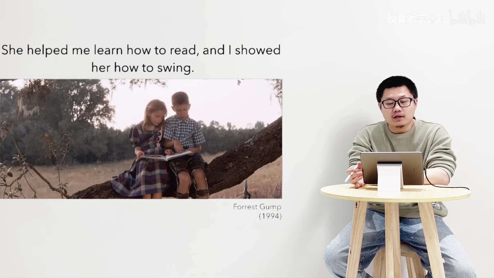

文字识别：She helped me learn how to read, and I showed / her how to swing. / Forrest Gump / (1994)

### 画面 00:02:20

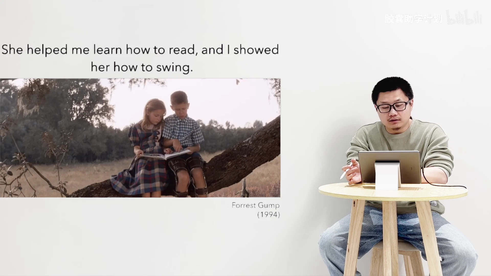

文字识别：She helped me learn how to read, and I showed / her how to swing. / Forrest Gump / (1994)

### 画面 00:02:22

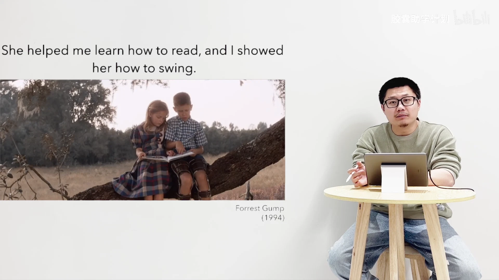

文字识别：She helped me learn how to read, and I showed / her how to swing. / Forrest Gump / (1994)

## 00:02:30–00:03:00

时候，他做的是什么动作啊？注意力集中，咱听一下。 She helped me learn how to read, and I showed her how to swing. 好，下一个单词，跟我们一起读一下，别忘了这儿要浊化啊，叫做 speedboat， speedboat 啊，快艇 speedboat。 好，你看 speedboat 这个单词，六页三四五六，首先去判断啊，就是我们几乎每次上来要判断两件事，第一它的词性，我们造句的时候要由，就是呃根据它的词性去判

### 画面 00:02:34

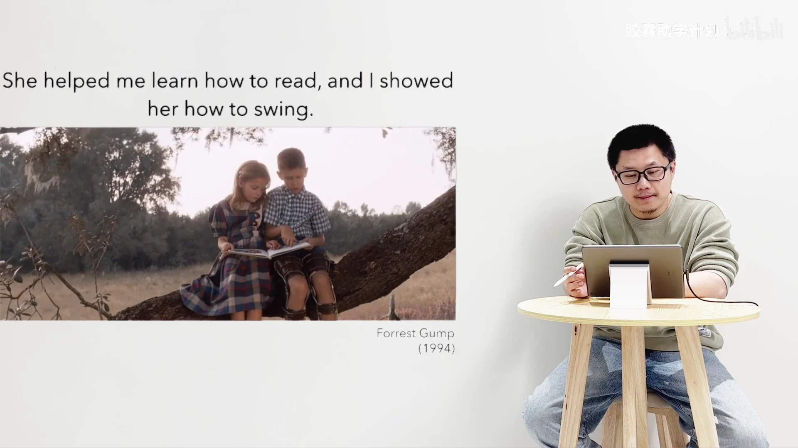

文字识别：She helped me learn how to read, and I showed / her how to swing. / Forrest Gump / (1994)

### 画面 00:02:36

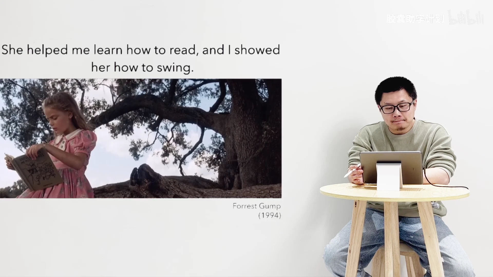

文字识别：She helped me learn how to read, and I showed / her how to swing. / Forrest Gump / (1994)

### 画面 00:02:38

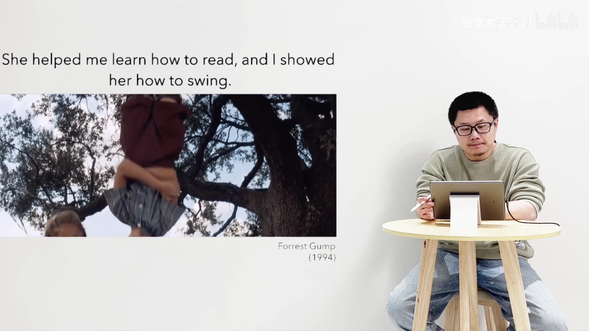

文字识别：She helped me learn how to read, and I showed / her how to swing. / Forrest Gump / (1994)

### 画面 00:02:40

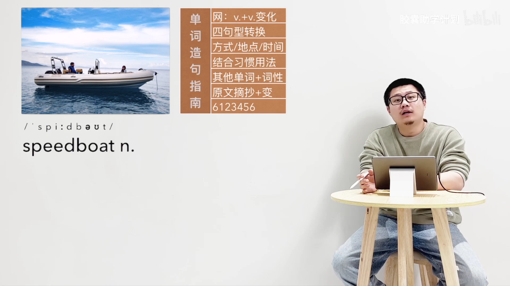

文字识别：单词造句指南 / 网：v.+v.变化 / 四句型转换 / 方式/地点/时间 / 结合习惯用法 / 其他单词+词性 / 原文摘抄+变 / 6123456 / / 'spi:dbaut / / speedboat n.

### 画面 00:02:43

文字识别：单词造句指南 / 网：v.+v.变化 / 四句型转换 / 方式/地点/时间 / 结合习惯用法 / 其他单词+词性 / 原文摘抄+变 / 6123456 / / 'spi:dbaut / / speedboat n.

### 画面 00:02:45

文字识别：单词造句指南 / 网：v.+v.变化 / 臺助字计划 / 四句型转换 / 方式/地点/时间 / 结合习惯用法 / 其他单词+词性 / 原文摘抄+变 / 6123456 / / 'spi:dbaut / / speedboat n.

### 画面 00:02:48

文字识别：单词造句指南 / 网：v.+v.变化 / 臺助字计划 / 四句型转换 / 方式/地点/时间 / 结合习惯用法 / 其他单词+词性 / 原文摘抄+变 / 6123456 / /'spi:dbaut / / speedboat n.

### 画面 00:02:50

文字识别：单词造句指南 / 网：v.+v.变化 / 辜助字计划 / 四句型转换 / 方式/地点/时间 / 结合习惯用法 / 其他单词+词性 / 原文摘抄+变 / 6123456 / / 'spi:dbaut / / speedboat n.

### 画面 00:02:55

文字识别：单词造句指南 / 网：v.+v.变化 / 四句型转换 / 方式/地点/时间 / 结合习惯用法 / 其他单词+词性 / 原文摘抄+变 / 6123456 / / 'spi:dbaut / / speedboat n.

## 00:03:00–00:03:30

断，我要补齐哪些词性，对吧？好，比如说这里至少我要补齐动词。然后在六一二三四五六当中，因为我要造句子嘛，我要去看它在这个句子当中可能的位置，一三五，要么主语，要么宾语，要么当做一个地点。比如说我把表落在这个 speedboat 上面了，那这个 speedboat 在这儿就当了一个地点，对吧？好，我们造句子啊。呃，先来一个这个据说啊，据传说说，it is said that he is so rich

### 画面 00:03:00

文字识别：单词造句指南 / 网：v.+v.变化 / 四句型转换 / 方式/地点/时间 / 结合习惯用法 / 其他单词+词性 / 原文摘抄+变 / 6123456 / /'spi:dbaut / / speedboat n.

### 画面 00:03:05

文字识别：单词造句指南 / 网：v.+v.变化 / 四句型转换 / 方式/地点/时间 / 结合习惯用法 / 其他单词+词性 / 原文摘抄+变 / 6123456 / / 'spi:dbaut/ / speedboat n.

### 画面 00:03:08

文字识别：单词造句指南 / 网：v.+v.变化 / 四句型转换 / 方式/地点/时间 / 结合习惯用法 / 其他单词+词性 / 原文摘抄+变 / 6123456 / / 'spi:dbaut/ / speedboat n.

### 画面 00:03:10

文字识别：单词造句指南 / 网：v.+v.变化 / 四句型转换 / 方式/地点/时间 / 结合习惯用法 / 其他单词+词性 / 原文摘抄+变 / 6123456 / / 'spi:dbaut / / speedboat n.

### 画面 00:03:13

文字识别：单词造句指南 / 网：v.+v.变化 / 四句型转换 / 方式/地点/时间 / 结合习惯用法 / 其他单词+词性 / 原文摘抄+变 / 6123456 / / 'spi:dbaut / / speedboat n.

### 画面 00:03:15

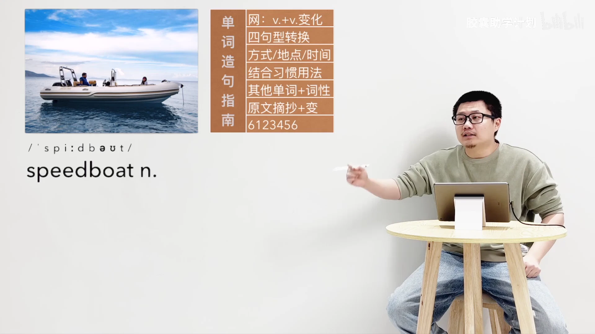

文字识别：单词造句指南 / 网：v.+v.变化 / 四句型转换 / 方式/地点/时间 / 结合习惯用法 / 其他单词+词性 / 原文摘抄+变 / 6123456 / / 'spi:dbaut/ / speedboat n.

### 画面 00:03:18

文字识别：单词造句指南 / 网：v.+v.变化 / 四句型转换 / 方式/地点/时间 / 结合习惯用法 / 其他单词+词性 / 原文摘抄+变 / 6123456 / / 'spi:dbaut/ / speedboat n.

### 画面 00:03:20

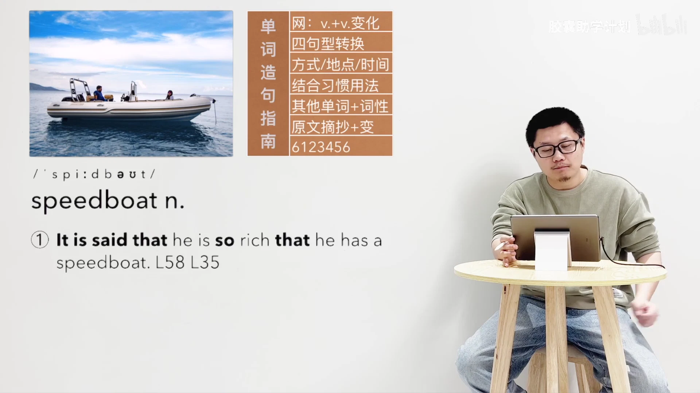

文字识别：单词造句指南 / 网：v.+v.变化 / 四句型转换 / 方式/地点/时间 / 结合习惯用法 / 其他单词+词性 / 原文摘抄+变 / 6123456 / / 'spi:db a ut / / speedboat n. / It is said that he is so rich that he has a / speedboat. L58 L35

### 画面 00:03:22

文字识别：单词造句指南 / 网：v.+v.变化 / 四句型转换 / 方式/地点/时间 / 结合习惯用法 / 其他单词+词性 / 原文摘抄+变 / 6123456 / / 'spi :d ba ut / / speedboat n. / It is said that he is so rich that he has a / speedboat. L58 L35

### 画面 00:03:25

文字识别：单词造句指南 / 网：v.+v.变化 / 四句型转换 / 方式/地点/时间 / 结合习惯用法 / 其他单词+词性 / 原文摘抄+变 / 6123456 / / 'spi:d b aut / / speedboat n. / It is said that he is so rich that he has a / speedboat. L58 L35

## 00:03:30–00:04:00

that he has a speedboat. So he is如此的富有以至于他有一个快艇啊. Next one. So it is a curious coincidence that we bought the speedboat at the same time.啊，就是连续复习，不多讲了。呃，记住，repeat after me.啊. Next one. He is relieved to hear that the speedboat was sold last night.啊，他听到这个消息，感觉到松了一口气啊。这个，比如说现金

### 画面 00:03:30

文字识别：单词造句指南 / 网：v.+v.变化 / 四句型转换 / 方式/地点/时间 / 结合习惯用法 / 其他单词+词性 / 原文摘抄+变 / 6123456 / / 'sp i:d b a ut / / speedboat n. / It is said that he is so rich that he has a / speedboat. L58 L35

### 画面 00:03:35

文字识别：单词造句指南 / 网：v.+v.变化 / 四句型转换 / 方式/地点/时间 / 结合习惯用法 / 其他单词+词性 / 原文摘抄+变 / 6123456 / / 'sp i:d b a u t / / speedboat n. / It is said that he is so rich that he has a / speedboat. L58 L35

### 画面 00:03:37

文字识别：单词造句指南 / 网：v.+v.变化 / 四句型转换 / 方式/地点/时间 / 结合习惯用法 / 其他单词+词性 / 原文摘抄+变 / 6123456 / / 'spi:dbaut / / speedboat n. / It is said that he is so rich that he has a / speedboat. L58 L35 / It is a curious coincidence that we bought / the speedboat at the same place. L85

### 画面 00:03:39

文字识别：单词造句指南 / 网：v.+v.变化 / 四句型转换 / 方式/地点/时间 / 结合习惯用法 / 其他单词+词性 / 原文摘抄+变 / 6123456 / / 'spi :d b au t / / speedboat n. / It is said that he is so rich that he has a / speedboat. L58 L35 / It is a curious coincidence that we bought / the speedboat at the same place. L85

### 画面 00:03:41

文字识别：单词造句指南 / 网：v.+v.变化 / 四句型转换 / 方式/地点/时间 / 结合习惯用法 / 其他单词+词性 / 原文摘抄+变 / 6123456 / / 'spi :d b au t / / speedboat n. / It is said that he is so rich that he has a / speedboat. L58 L35 / It is a curious coincidence that we bought / the speedboat at the same place. L85

### 画面 00:03:43

文字识别：单词造句指南 / 网：v.+v.变化 / 四句型转换 / 方式/地点/时间 / 结合习惯用法 / 其他单词+词性 / 原文摘抄+变 / 6123456 / / 'spi :d b au t / / speedboat n. / It is said that he is so rich that he has a / speedboat. L58 L35 / It is a curious coincidence that we bought / the speedboat at the same place. L85

### 画面 00:03:45

文字识别：单词造句指南 / 网：v.+v.变化 / 四句型转换 / 方式/地点/时间 / 结合习惯用法 / 其他单词+词性 / 原文摘抄+变 / 6123456 / / 'spi:d baut / / speedboat n. / It is said that he is so rich that he has a / speedboat. L58 L35 / It is a curious coincidence that we bought / the speedboat at the same place. L85 / He is relieved to hear that the speedboat / was sold last night. L84

### 画面 00:03:48

文字识别：单词造句指南 / 网：v.+v.变化 / 四句型转换 / 方式/地点/时间 / 结合习惯用法 / 其他单词+词性 / 原文摘抄+变 / 6123456 / / 'spi:d baut / / speedboat n. / It is said that he is so rich that he has a / speedboat. L58 L35 / It is a curious coincidence that we bought / the speedboat at the same place. L85 / He is relieved to hear that the speedboat / was sold last night. L84

### 画面 00:03:50

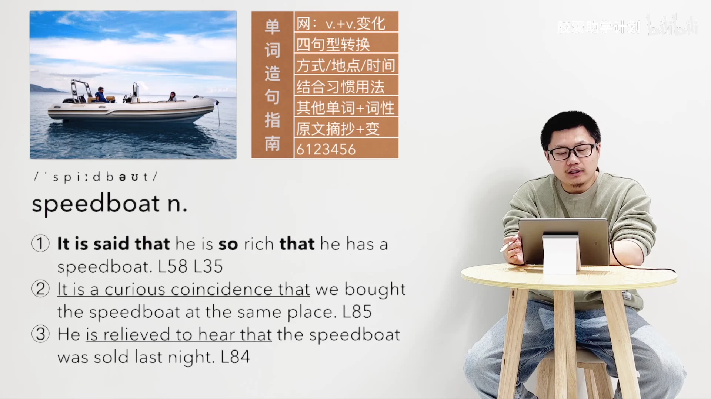

文字识别：单词造句指南 / 网：v.+v.变化 / 四句型转换 / 方式/地点/时间 / 结合习惯用法 / 其他单词+词性 / 原文摘抄+变 / 6123456 / / 'spi:d baut / / speedboat n. / It is said that he is so rich that he has a / speedboat. L58 L35 / It is a curious coincidence that we bought / the speedboat at the same place. L85 / He is relieved to hear that the speedboat / was sold last night. L84

### 画面 00:03:53

文字识别：单词造句指南 / 网：v.+v.变化 / 四句型转换 / 方式/地点/时间 / 结合习惯用法 / 其他单词+词性 / 原文摘抄+变 / 6123456 / / 'spi:d baut / / speedboat n. / It is said that he is so rich that he has a / speedboat. L58 L35 / It is a curious coincidence that we bought / the speedboat at the same place. L85 / He is relieved to hear that the speedboat / was sold last night. L84

### 画面 00:03:59

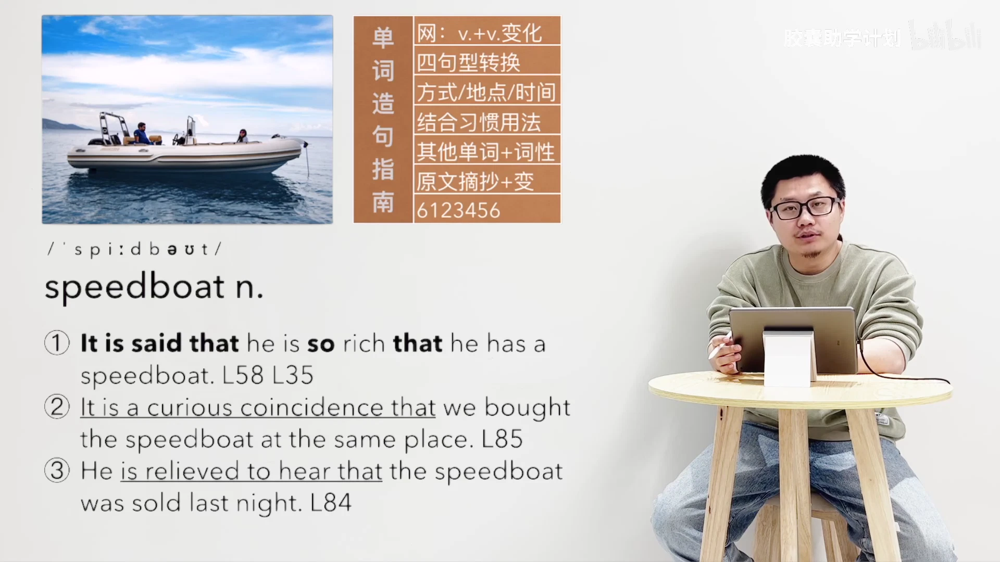

文字识别：单词造句指南 / 网：v.+v.变化 / 计书 / 四句型转换 / 方式/地点/时间 / 结合习惯用法 / 其他单词+词性 / 原文摘抄+变 / 6123456 / / 'spi:dbaut / / speedboat n. / It is said that he is so rich that he has a / speedboat. L58 L35 / It is a curious coincidence that we bought / the speedboat at the same place. L85 / He is relieved to hear that the speedboat / was sold last night. L84

## 00:04:00–00:04:30

链断了，必须要通过卖这个把这个现金补齐，对吧？他卖了好长时间没卖出去，昨天晚上卖完了之后长出了一口气，叫做 He is relieved to hear that. OK，好。Next one，下一个单词叫 Desperately, Desperately, Desperately. 啊，Desperately 最常见的意思就是绝望的，Desperate 绝望，是吧？好，那它其实还可以

### 画面 00:04:01

文字识别：单词造句指南 / 网：v.+v.变化 / 四句型转换 / 方式/地点/时间 / 结合习惯用法 / 其他单词+词性 / 原文摘抄+变 / 6123456 / / 'spi:d baut / / speedboat n. / It is said that he is so rich that he has a / speedboat. L58 L35 / It is a curious coincidence that we bought / the speedboat at the same place. L85 / He is relieved to hear that the speedboat / was sold last night. L84

### 画面 00:04:05

文字识别：单词造句指南 / 网：v.+v.变化 / 四句型转换 / 方式/地点/时间 / 结合习惯用法 / 其他单词+词性 / 原文摘抄+变 / 6123456 / / 'spi:d baut / / speedboat n. / It is said that he is so rich that he has a / speedboat. L58 L35 / It is a curious coincidence that we bought / the speedboat at the same place. L85 / He is relieved to hear that the speedboat / was sold last night. L84

### 画面 00:04:10

文字识别：单词造句指南 / 网：v.+v.变化 / 四句型转换 / 方式/地点/时间 / 结合习惯用法 / 其他单词+词性 / 原文摘抄+变 / 6123456 / / 'spi:d baut / / speedboat n. / It is said that he is so rich that he has a / speedboat. L58 L35 / It is a curious coincidence that we bought / the speedboat at the same place. L85 / He is relieved to hear that the speedboat / was sold last night. L84

### 画面 00:04:15

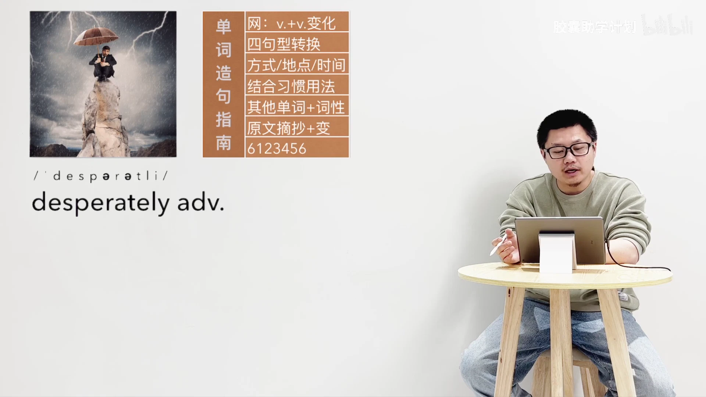

文字识别：单词造句指南 / 网：v.+v.变化 / 四句型转换 / 方式/地点/时间 / 结合习惯用法 / 其他单词+词性 / 原文摘抄+变 / 6123456 / 'desｐarａtli/ / desperately adv.

### 画面 00:04:20

文字识别：单词造句指南 / 网：v.+v.变化 / 四句型转换 / 方式/地点/时间 / 结合习惯用法 / 其他单词+词性 / 原文摘抄+变 / 6123456 / 'dｅsｐaratli/ / desperately adv.

### 画面 00:04:26

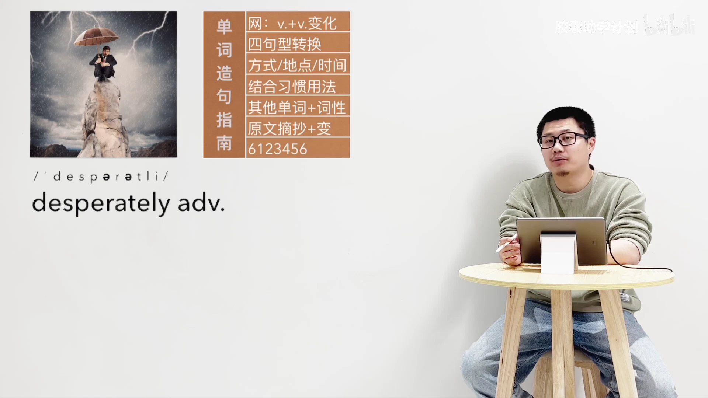

文字识别：单词造句指南 / 网：v.+v.变化 / 四句型转换 / 方式/地点/时间 / 结合习惯用法 / 其他单词+词性 / 原文摘抄+变 / 6123456 / 'desｐarａtli/ / desperately adv.

## 00:04:30–00:05:00

有一些其他类似的含义，但是我们先从绝望的这个单词的含义去说，这毕竟是我们原文当中的释义啊，叫做 he waved desperately to his friends，啊，他很绝望的冲他朋友挥了挥手。这个单看这句话，我们不太能反映出来他到底为什么是这么去讲的。待会儿要进入文章再看啊，但是这句话呢，并不影响我们理解，所以四句型转换，咱们紧接着就跟上。接下来我们造一句话叫做 they tried

### 画面 00:04:30

文字识别：单词造句指南 / 网：v.+v.变化 / 四句型转换 / 方式/地点/时间 / 结合习惯用法 / 其他单词+词性 / 原文摘抄+变 / 6123456 / 'desparatli/ / desperately adv. / ① [Story]: He waved desperately to his / friends.

### 画面 00:04:35

文字识别：单词造句指南 / 网：v.+v.变化 / 四句型转换 / 方式/地点/时间 / 结合习惯用法 / 其他单词+词性 / 原文摘抄+变 / 6123456 / 'desрaratli/ / desperately adv. / ① [Story]: He waved desperately to his / friends.

### 画面 00:04:40

文字识别：单词造句指南 / 网：v.+v.变化 / 四句型转换 / 方式/地点/时间 / 结合习惯用法 / 其他单词+词性 / 原文摘抄+变 / 6123456 /  'desparatli/ / desperately adv. / ① [Story]: He waved desperately to his / friends.

### 画面 00:04:43

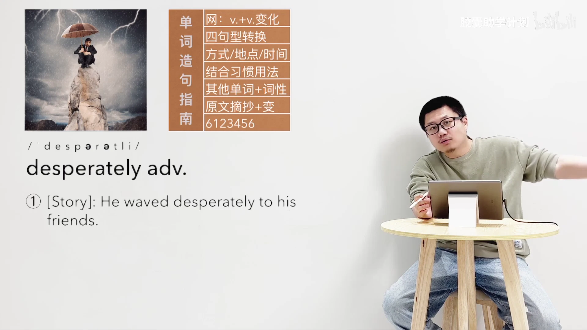

文字识别：单词造句指南 / 网：v.+v.变化 / 四句型转换 / 方式/地点/时间 / 结合习惯用法 / 其他单词+词性 / 原文摘抄+变 / 6123456 /  'desparatli/ / desperately adv. / ① [Story]: He waved desperately to his / friends.

### 画面 00:04:45

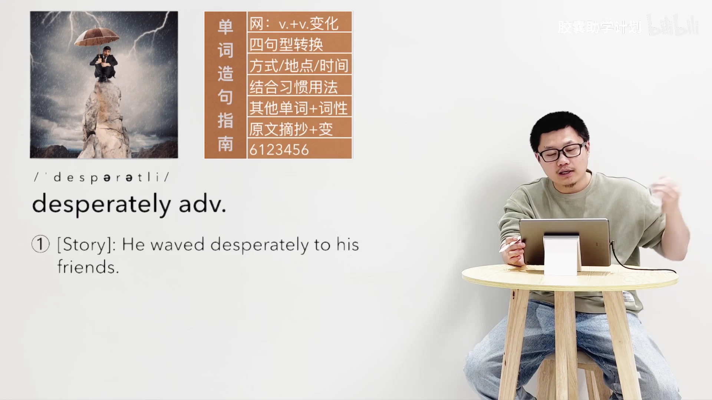

文字识别：单词造句指南 / 网：v.+v.变化 / 四句型转换 / 方式/地点/时间 / 结合习惯用法 / 其他单词+词性 / 原文摘抄+变 / 6123456 / / ' d e sp ar a t li / / desperately adv. / ① [Story]: He waved desperately to his / friends.

### 画面 00:04:49

文字识别：单词造句指南 / 网：v.+v.变化 / 四句型转换 / 方式/地点/时间 / 结合习惯用法 / 其他单词+词性 / 原文摘抄+变 / 6123456 / / ' de spar a t l i / / desperately adv. / ① [Story]: He waved desperately to his / friends.

### 画面 00:04:55

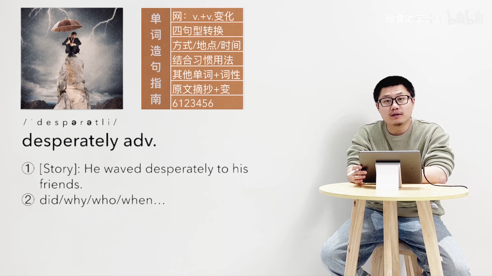

文字识别：单词造句指南 / 网：v.+v.变化 / 四句型转换 / 方式/地点/时间 / 结合习惯用法 / 其他单词+词性 / 原文摘抄+变 / 6123456 / / ' de sparat l i / / desperately adv. / ① [Story]: He waved desperately to his / friends. / did/why/who/when...

### 画面 00:04:58

文字识别：单词造句指南 / 网：v.+v.变化 / 四句型转换 / 方式/地点/时间 / 结合习惯用法 / 其他单词+词性 / 原文摘抄+变 / 6123456 / /  d e s p ar at l i / / desperately adv. / ① [Story]: He waved desperately to his / friends. / did/why/who/when... / They tried desperately to reach an / agreement. L84

## 00:05:00–00:05:30

desperately to reach an agreement. 好，你看什么意思？说他们绝望的要达成了一个协议，他们尝试啊，绝望的尝试着去达成一个协议，不是完全不行。但是呢，你要给它换成另一个含义，desperately就尽全力的，是吧？啊，哎，OK。比如说 We are trying desperately to stick to our plan. 说我们正在哎尽可能的啊，绝望的尽可能的怎么样呢？Stick to our plan. 啊，坚守我们的这个

### 画面 00:05:00

文字识别：单词造句指南 / 网：v.+v.变化 / 四句型转换 / 方式/地点/时间 / 结合习惯用法 / 其他单词+词性 / 原文摘抄+变 / 6123456 / /  d e s par at l i / / desperately adv. / ① [Story]: He waved desperately to his / friends. / did/why/who/when... / They tried desperately to reach an / 人 / agreement. L84

### 画面 00:05:05

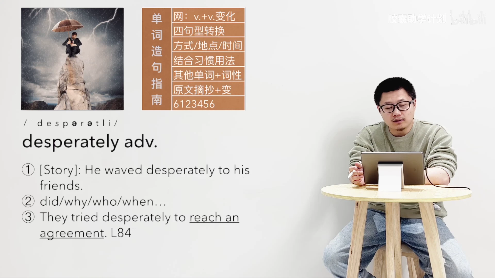

文字识别：单词造句指南 / 网：v.+v.变化 / 四句型转换 / 方式/地点/时间 / 结合习惯用法 / 其他单词+词性 / 原文摘抄+变 / 6123456 / /  d e spar at l i / / desperately adv. / ① [Story]: He waved desperately to his / friends. / did/why/who/when... / They tried desperately to reach an / 人 / agreement. L84

### 画面 00:05:09

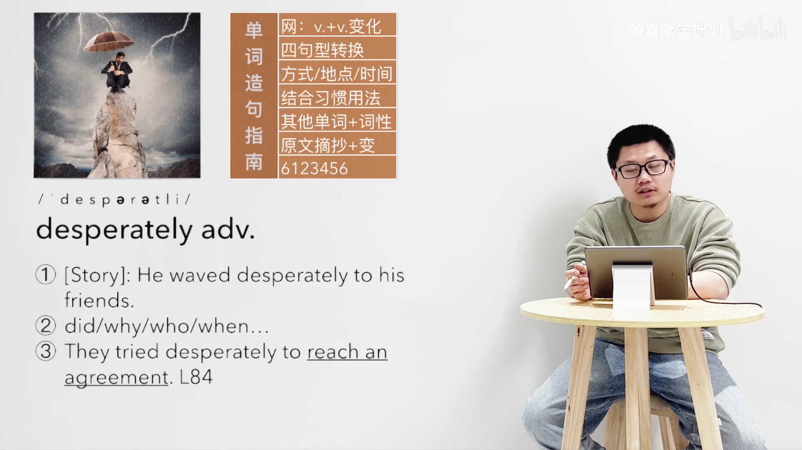

文字识别：单词造句指南 / 网：v.+v.变化 / 四句型转换 / 方式/地点/时间 / 结合习惯用法 / 其他单词+词性 / 原文摘抄+变 / 6123456 / /  d es p ar at l i / / desperately adv. / ① [Story]: He waved desperately to his / friends. / did/why/who/when... / They tried desperately to reach an / agreement. L84

### 画面 00:05:15

文字识别：单词造句指南 / 网：v.+v.变化 / 四句型转换 / 方式/地点/时间 / 结合习惯用法 / 其他单词+词性 / 原文摘抄+变 / 6123456 / / ' d es p ar at l i / / desperately adv. / ① [Story]: He waved desperately to his / friends. / did/why/who/when... / They tried desperately to reach an / agreement. L84

### 画面 00:05:19

文字识别：单词造句指南 / 网：v.+v.变化 / 四句型转换 / 方式/地点/时间 / 结合习惯用法 / 其他单词+词性 / 原文摘抄+变 / 6123456 / /  d e sp ar at l i / / desperately adv. / ① [Story]: He waved desperately to his / friends. / did/why/who/when... / They tried desperately to reach an / 3 / agreement. L84 / D We are trying desperately to stick to our / plan. L54

### 画面 00:05:28

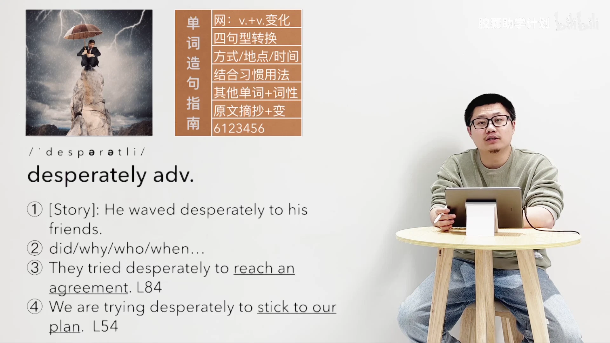

文字识别：单词造句指南 / 网：v.+v.变化 / 四句型转换 / 方式/地点/时间 / 结合习惯用法 / 其他单词+词性 / 原文摘抄+变 / 6123456 / /  d e sp ara t l i / / desperately adv. / ① [Story]: He waved desperately to his / friends. / did/why/who/when... / They tried desperately to reach an / 3 / agreement. L84 / ④ We are trying desperately to stick to our / plan. L54

## 00:05:30–00:06:00

计划啊，再读一遍这个单词。您最需要记住的就是绝望地啊，desperately。Very good. Next one，下一个单词叫做 companion，companion，伙伴啊，不一定非是人啊，像图中的狗也可以叫 companion，是我们的伙伴、同伴啊，叫 companion。拿它去造句。第一个，repeat after me. My companion waited for me at the end of the street. 在街的尽头在等我，对吧？

### 画面 00:05:31

文字识别：单词造句指南 / 网：v.+v.变化 / 字计划 / 四句型转换 / 方式/地点/时间 / 结合习惯用法 / 其他单词+词性 / 原文摘抄+变 / 6123456 / / ' d esp arat l i / / desperately adv. / ① [Story]: He waved desperately to his / friends. / did/why/who/when... / They tried desperately to reach an / 3 / agreement. L84 / ④ We are trying desperately to stick to our / plan. L54

### 画面 00:05:36

文字识别：单词造句指南 / 网：v.+v.变化 / 囊助字计划 / 四句型转换 / 方式/地点/时间 / 结合习惯用法 / 其他单词+词性 / 原文摘抄+变 / 6123456 / / k am'pænj an / / companion n.

### 画面 00:05:40

文字识别：单词造句指南 / 网：v.+v.变化 / 四句型转换 / 方式/地点/时间 / 结合习惯用法 / 其他单词+词性 / 原文摘抄+变 / 6123456 / / k am'pæn jan / / companion n.

### 画面 00:05:46

文字识别：单词造句指南 / 网：v.+v.变化 / 臺助字计划 / 四句型转换 / 方式/地点/时间 / 结合习惯用法 / 其他单词+词性 / 原文摘抄+变 / 6123456 / / k am'pæn j an / / companion n.

### 画面 00:05:48

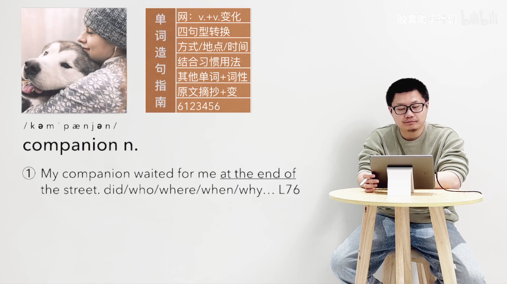

文字识别：单词造句指南 / 网：v.+v.变化 / 四句型转换 / 方式/地点/时间 / 结合习惯用法 / 其他单词+词性 / 原文摘抄+变 / 6123456 / / kam'p æn jan / / companion n. / ① My companion waited for me at the end of / the street. did/who/where/when/why... L76

### 画面 00:05:50

文字识别：单词造句指南 / 网：v.+v.变化 / 四句型转换 / 方式/地点/时间 / 结合习惯用法 / 其他单词+词性 / 原文摘抄+变 / 6123456 / / kam'p æn jan / / companion n. / ① My companion waited for me at the end of / the street. did/who/where/when/why... L76

## 00:06:00–00:06:30

然后四句型转换。Next one, my companion keeps on breaking my concentration。哎，持续不断的打断我的这个注意力啊，concentration注意力。再来，my companion suffers from a rare disease。好，suffer from遭受或者说患了，对吧？哎，得了，说一个罕见的疾病啊，遭受什么痛苦啊，或者得了某个病啊，都可以叫suffers from。OK，再读一遍这个单

### 画面 00:06:01

文字识别：单词造句指南 / 网：v.+v.变化 / 计划 / 四句型转换 / 方式/地点/时间 / 结合习惯用法 / 其他单词+词性 / 原文摘抄+变 / 6123456 / / kam 'pæn j an / / companion n. / ① My companion waited for me at the end of / the street. did/who/where/when/why.. L76 / ) My companion keeps on breaking my / concentration.L78

### 画面 00:06:05

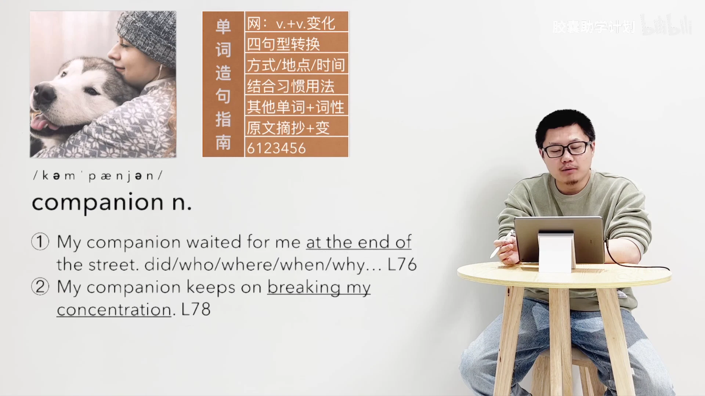

文字识别：单词造句指南 / 网：v.+v.变化 / 字计划 / 四句型转换 / 方式/地点/时间 / 结合习惯用法 / 其他单词+词性 / 原文摘抄+变 / 6123456 / / k am'pæn jan / / companion n. / ① My companion waited for me at the end of / the street. did/who/where/when/why... L76 / ) My companion keeps on breaking my / concentration.L78

### 画面 00:06:10

文字识别：单词造句指南 / 网：v.+v.变化 / 助子计划 / 四句型转换 / 方式/地点/时间 / 结合习惯用法 / 其他单词+词性 / 原文摘抄+变 / 6123456 / / kam'pæ n j an / / companion n. / ① My companion waited for me at the end of / the street. did/who/where/when/why... L76 / ) My companion keeps on breaking my / Concentration.L78 / My companion suffers from a rare disease. / 3 / L78

### 画面 00:06:15

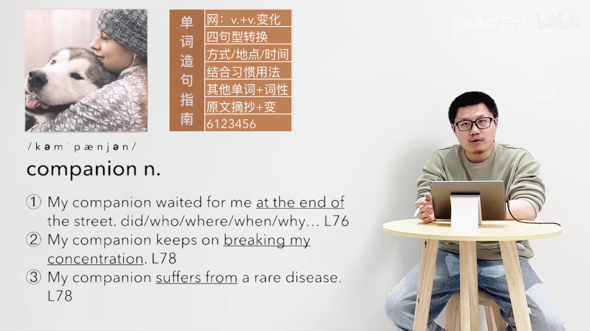

文字识别：单词造句指南 / 网：v.+v.变化 / 计划 / 四句型转换 / 方式/地点/时间 / 结合习惯用法 / 其他单词+词性 / 原文摘抄+变 / 6123456 / / kam 'pæn j an / / companion n. / ① My companion waited for me at the end of / the street. did/who/where/when/why... L76 / ) My companion keeps on breaking my / Concentration.L78 / My companion suffers from a rare disease. / 3 / L78

### 画面 00:06:20

文字识别：单词造句指南 / 网：v.+v.变化 / 计划 / 四句型转换 / 方式/地点/时间 / 结合习惯用法 / 其他单词+词性 / 原文摘抄+变 / 6123456 / / kam'pæn j an / / companion n. / ① My companion waited for me at the end of / the street. did/who/where/when/why... L76 / ) My companion keeps on breaking my / Concentration.L78 / My companion suffers from a rare disease. / 3 / L78

### 画面 00:06:26

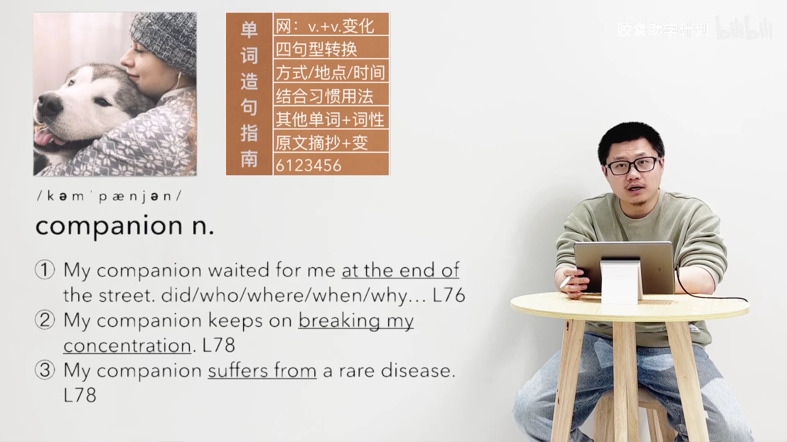

文字识别：单词造句指南 / 网：v.+v.变化 / 正计划 / 四句型转换 / 方式/地点/时间 / 结合习惯用法 / 其他单词+词性 / 原文摘抄+变 / 6123456 / / kam 'pæn j an / / companion n. / ① My companion waited for me at the end of / the street. did/who/where/when/why... L76 / ) My companion keeps on breaking my / Concentration.L78 / My companion suffers from a rare disease. / 3 / L78

## 00:06:30–00:07:00

词 companion, very good. Next one water ski.这个 water ski呢，这个 ski这个单词，要么您认的，要么以后我们也会学到啊，滑雪对吧？那 water ski 就是滑水啊，就是不知道各位看没看过前面一个快艇，后边一个人啊，也是拿这样一个板儿，然后呢手中握着一个线，对吧？然后利用速度在这个水中做一些动作，我们管它叫 water ski.好，那 water ski 想去造句子，我们看一下结合之前

### 画面 00:06:32

文字识别：单词造句指南 / 网：v.+v.变化 / 四句型转换 / 方式/地点/时间 / 结合习惯用法 / 其他单词+词性 / 原文摘抄+变 / 6123456 / /ski:/ / water ski

### 画面 00:06:35

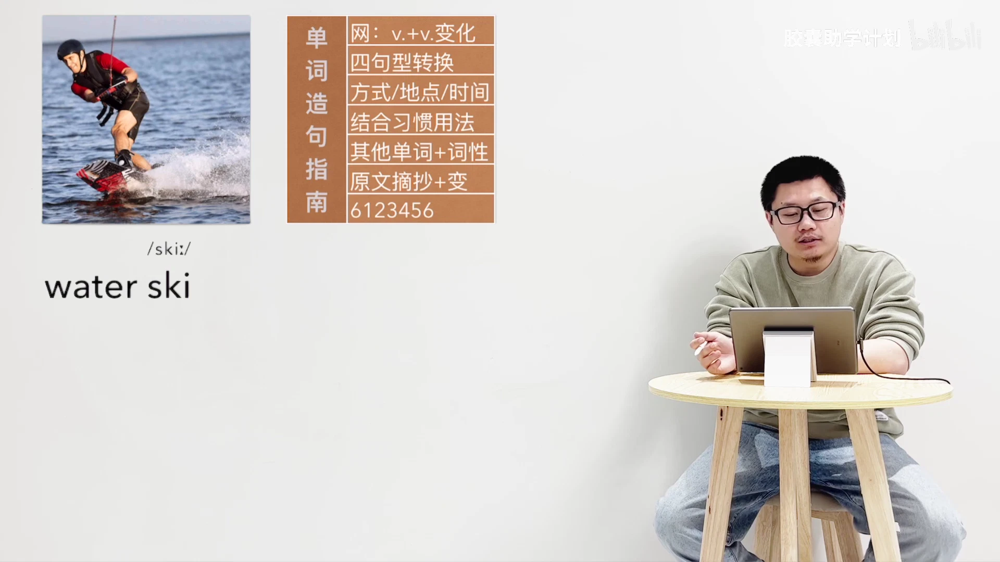

文字识别：单词造句指南 / 网：v.+v.变化 / 毫助字计划 / 四句型转换 / 方式/地点/时间 / 结合习惯用法 / 其他单词+词性 / 原文摘抄+变 / 6123456 / /ski:/ / water ski

### 画面 00:06:37

文字识别：单词造句指南 / 网：v.+v.变化 / 毫助字计划 / 四句型转换 / 方式/地点/时间 / 结合习惯用法 / 其他单词+词性 / 原文摘抄+变 / 6123456 / /ski:/ / water ski

### 画面 00:06:40

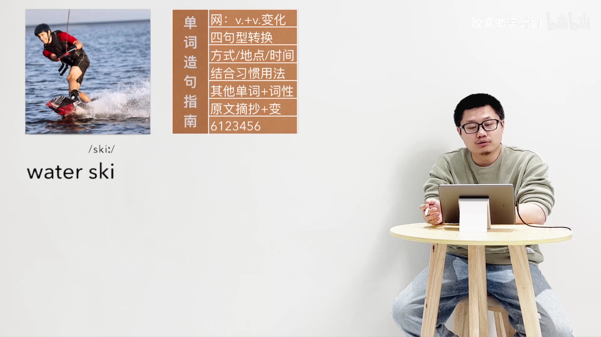

文字识别：单词造句指南 / 网：v.+v.变化 / 四句型转换 / 方式/地点/时间 / 结合习惯用法 / 其他单词+词性 / 原文摘抄+变 / 6123456 / /ski:/ / water ski

### 画面 00:06:43

文字识别：单词造句指南 / 网：v.+v.变化 / 四句型转换 / 方式/地点/时间 / 结合习惯用法 / 其他单词+词性 / 原文摘抄+变 / 6123456 / /ski:/ / water ski

### 画面 00:06:45

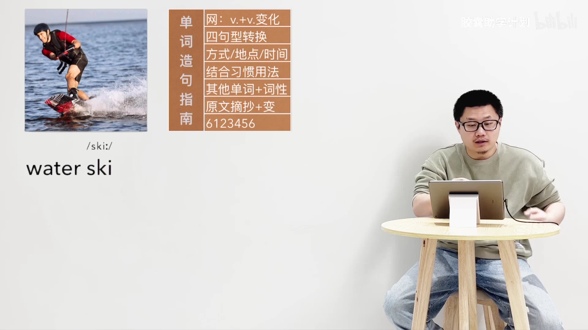

文字识别：单词造句指南 / 网：v.+v.变化 / 毫助子计划 / 四句型转换 / 方式/地点/时间 / 结合习惯用法 / 其他单词+词性 / 原文摘抄+变 / 6123456 / /ski:/ / water ski

### 画面 00:06:48

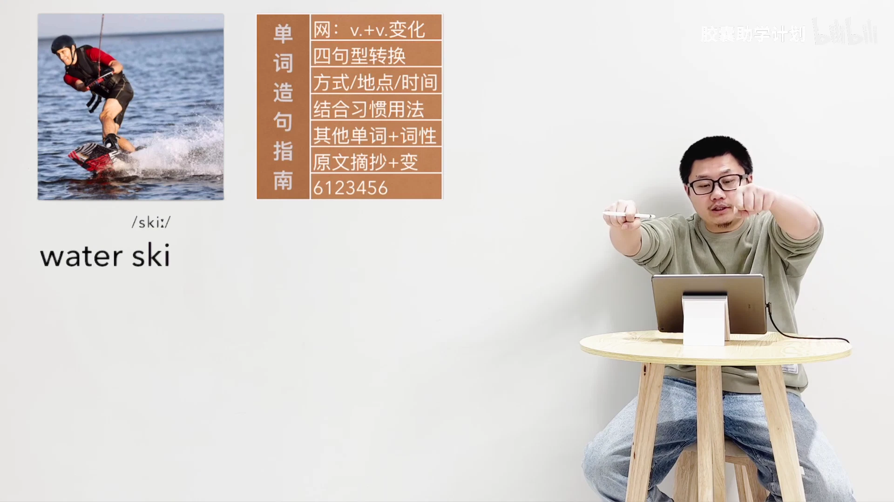

文字识别：单词造句指南 / 网：v.+v.变化 / 臺助子计划 / 四句型转换 / 方式/地点/时间 / 结合习惯用法 / 其他单词+词性 / 原文摘抄+变 / 6123456 / /ski:/ / water ski

### 画面 00:06:53

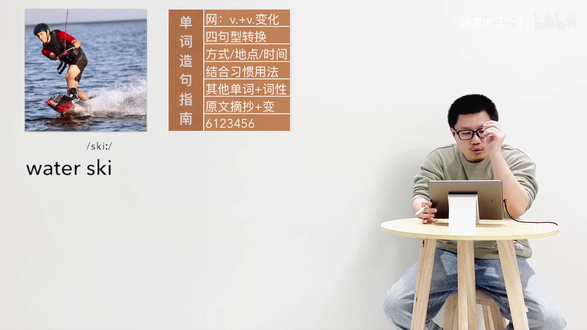

文字识别：单词造句指南 / 网：v.+v.变化 / 囊助字计划 / 四句型转换 / 方式/地点/时间 / 结合习惯用法 / 其他单词+词性 / 原文摘抄+变 / 6123456 / /ski:/ / water ski

### 画面 00:06:57

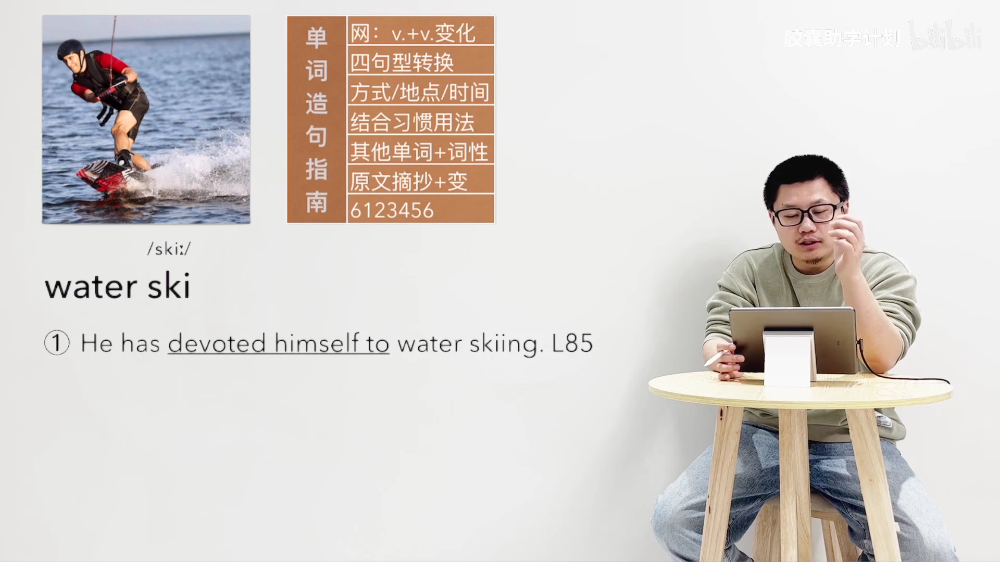

文字识别：单词造句指南 / 网：v.+v.变化 / 四句型转换 / 方式/地点/时间 / 结合习惯用法 / 其他单词+词性 / 原文摘抄+变 / 6123456 / /ski:/ / water ski / ① He has devoted himself to water sking. L85

## 00:07:00–00:07:30

刚刚学过的习惯用法。上一课当中，headmaster校长不是把自己啊 devoted himself to gardening，咱换一下变成了 he has devoted himself to water skiing。别忘了这个地方给它加ing啊，water skiing是这么一个动作啊。好，next one说 she asked me if I wanted to go water skiing。好了，这个其实小的短语可以给它记下来，叫 go water skiing。啊，当然了，可能大

### 画面 00:07:00

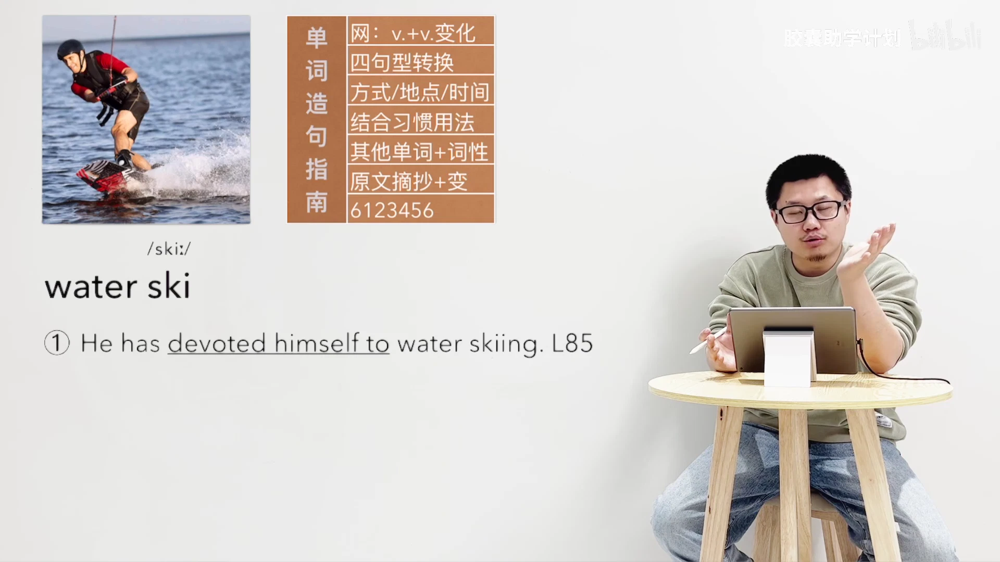

文字识别：单词造句指南 / 网：v.+v.变化 / 四句型转换 / 方式/地点/时间 / 结合习惯用法 / 其他单词+词性 / 原文摘抄+变 / 6123456 / /ski:/ / water ski / ① He has devoted himself to water skiing. L85

### 画面 00:07:08

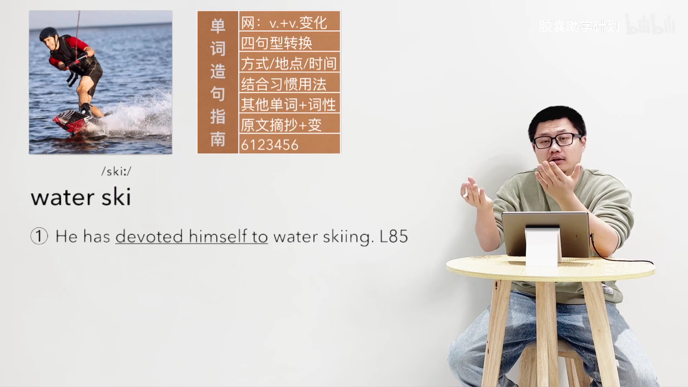

文字识别：单词造句指南 / 网：v.+v.变化 / 子计划 / 四句型转换 / 方式/地点/时间 / 结合习惯用法 / 其他单词+词性 / 原文摘抄+变 / 6123456 / /ski:/ / water ski / ① He has devoted himself to water sking. L85

### 画面 00:07:10

文字识别：单词造句指南 / 网：v.+v.变化 / 四句型转换 / 方式/地点/时间 / 结合习惯用法 / 其他单词+词性 / 原文摘抄+变 / 6123456 / /ski:/ / water ski / ① He has devoted himself to water sking. L85

### 画面 00:07:15

文字识别：单词造句指南 / 网：v.+v.变化 / 学计划 / 四句型转换 / 方式/地点/时间 / 结合习惯用法 / 其他单词+词性 / 原文摘抄+变 / 6123456 / /ski:/ / water ski / ① He has devoted himself to water skiing. L85

### 画面 00:07:19

文字识别：单词造句指南 / 网：v.+v.变化 / 四句型转换 / 方式/地点/时间 / 结合习惯用法 / 其他单词+词性 / 原文摘抄+变 / 6123456 / /ski:/ / water ski / ① He has devoted himself to water sking. L85 / ② She asked me if I wanted to go water sking. / L39

### 画面 00:07:24

文字识别：单词造句指南 / 网：v.+v.变化 / 四句型转换 / 方式/地点/时间 / 结合习惯用法 / 其他单词+词性 / 原文摘抄+变 / 6123456 / /ski:/ / water ski / ① He has devoted himself to water sking. L85 / ② She asked me if I wanted to go water skiing. / L39

## 00:07:30–00:08:00

部分人一生当中也不会去体验这个运动，但是你要能听懂是什么意思啊，叫做去划水，对吧？Next one,说I would like to go water skiing with my daughter.这是一个电影片段，那你就看到它实际上出现了我们之前学过的would like to do something，和本课我们刚刚讲到的叫做go water skiing,哪里去啊？划水。Next one, boy,哎呀，这个单词一听这个发音啊，包括这个长

### 画面 00:07:36

文字识别：单词造句指南 / 网：v.+v.变化 / 四句型转换 / 方式/地点/时间 / 结合习惯用法 / 其他单词+词性 / 原文摘抄+变 / 6123456 / /ski:/ / water ski / ① He has devoted himself to water skiing. L85 / ② She asked me if I wanted to go water skiing. / L39 / I would like to go water skiing / with my daughter. My Fatherthe Hero (1994)

### 画面 00:07:40

文字识别：单词造句指南 / 网：v.+v.变化 / 四句型转换 / 方式/地点/时间 / 结合习惯用法 / 其他单词+词性 / 原文摘抄+变 / 6123456 / /ski:/ / water ski / ① He has devoted himself to water sking. L85 / ② She asked me if I wanted to go water skiing. / L39 / I would like to go water skiing / with my daughter. My Fatherthe Hero (1994)

### 画面 00:07:46

文字识别：单词造句指南 / 网：v.+v.变化 / 四句型转换 / 方式/地点/时间 / 结合习惯用法 / 其他单词+词性 / 原文摘抄+变 / 6123456 / /ski:/ / water ski / ① He has devoted himself to water skiing. L85 / ② She asked me if I wanted to go water skiing. / L39 / I would like to go water skiing / with my daughter. My Fatherthe Hero (1994)

### 画面 00:07:50

文字识别：单词造句指南 / 网：v.+v.变化 / 四句型转换 / 方式/地点/时间 / 结合习惯用法 / 其他单词+词性 / 原文摘抄+变 / 6123456 / /ski:/ / water ski / ① He has devoted himself to water skiing. L85 / ② She asked me if I wanted to go water skiing. / L39 / I would like to go water sking / with my daughter. My Fatherthe Hero (1994)

### 画面 00:07:53

文字识别：单词造句指南 / 网：v.+v.变化 / 毫助学计划 / 四句型转换 / 方式/地点/时间 / 结合习惯用法 / 其他单词+词性 / 原文摘抄+变 / EATH / BUOY / 6123456 / /b 3Ⅰ / / buoy n.

### 画面 00:07:55

文字识别：单词造句指南 / 网：v.+v.变化 / 建助字计划 / 四句型转换 / 方式/地点/时间 / 结合习惯用法 / 其他单词+词性 / 原文摘抄+变 / IEATH / BUOY / 6123456 / / b o1 1 / buoy n.

## 00:08:00–00:08:30

相啊，怎么看怎么像那个男孩 boy girl 发音真的就是一样的，只不过它指的是浮漂的意思，对吧？来，大家去造句啊，比如说 she was trying to swim to that boy，她正在尝试着游到那个浮漂那里，对吧？ Continue， the captain informed us that the boy wasn't there，所以这个船长啊，通知我们，通知我们的一

### 画面 00:08:03

文字识别：单词造句指南 / 网：v.+v.变化 / 囊助字计划 / 四句型转换 / 方式/地点/时间 / 结合习惯用法 / 其他单词+词性 / 原文摘抄+变 / FEATH / BUOY / 6123456 / / b o Ⅰ / / buoy n.

### 画面 00:08:05

文字识别：单词造句指南 / 网：v.+v.变化 / 囊助字计划 / 四句型转换 / 方式/地点/时间 / 结合习惯用法 / 其他单词+词性 / IEATH / BUOY / 原文摘抄+变 / 6123456 / / b o Ⅰ 1 / buoy n.

### 画面 00:08:08

文字识别：单词造句指南 / 网：v.+v.变化 / 四句型转换 / 方式/地点/时间 / 结合习惯用法 / 其他单词+词性 / IEATH / BUOY / 原文摘抄+变 / 6123456 / / b o Ⅰ / / buoy n. / ① She was trying to swim to that buoy.

### 画面 00:08:10

文字识别：单词造句指南 / 网：v.+v.变化 / 四句型转换 / 方式/地点/时间 / 结合习惯用法 / 其他单词+词性 / IEATH / BUOY / 原文摘抄+变 / 6123456 / / b o Ⅰ 1 / buoy n. / ① She was trying to swim to that buoy.

### 画面 00:08:18

文字识别：单词造句指南 / 网：v.+v.变化 / 四句型转换 / 方式/地点/时间 / 结合习惯用法 / 其他单词+词性 / IEATH / BUOY / 原文摘抄+变 / 6123456 / / b oⅠ 1 / buoy n. / ① She was trying to swim to that buoy. / ) The captain informed us that the buoy / 2) / Wasn't there. L85

### 画面 00:08:20

文字识别：单词造句指南 / 网：v.+v.变化 / 字计划 / 四句型转换 / 方式/地点/时间 / 结合习惯用法 / 其他单词+词性 / IEATH / BUOY / 原文摘抄+变 / 6123456 / / b o1 1 / buoy n. / ① She was trying to swim to that buoy. / ) The captain informed us that the buoy / 2） / Wasn't there. L85

### 画面 00:08:27

文字识别：单词造句指南 / 网：v.+v.变化 / 字计划 / 四句型转换 / 方式/地点/时间 / 结合习惯用法 / 其他单词+词性 / IEATH / BUOY / 原文摘抄+变 / 6123456 / /b o1 / / buoy n. / ① She was trying to swim to that buoy. / ) The captain informed us that the buoy / 2) / Wasn't there. L85

## 00:08:30–00:09:00

件事是什么呢？后边加一句话啊，叫做 The boy wasn't there. 啊，OK，浮漂不在那里。Next one, he volunteered to check the boy. 哎，他自告奋勇的要去检查一下这个浮漂。Check the boy. 能看到这里，如果是名词的话，其实我们想跟它造句，最常见的一个或者最容易想到的一个方法，就是肯定找动词啊，比如像这里用的 check呀等等。

### 画面 00:08:30

文字识别：单词造句指南 / 网：v.+v.变化 / 四句型转换 / 方式/地点/时间 / 结合习惯用法 / 其他单词+词性 / IEATH / BUOY / 原文摘抄+变 / 6123456 / / b o1 1 / buoy n. / ① She was trying to swim to that buoy. / ) The captain informed us that the buoy / 2 / Wasn't there. L85

### 画面 00:08:37

文字识别：单词造句指南 / 网：v.+v.变化 / 子计划 / 四句型转换 / 方式/地点/时间 / 结合习惯用法 / 其他单词+词性 / IEATH / BUOY / 原文摘抄+变 / 6123456 / / b o1 / / buoy n. / ① She was trying to swim to that buoy. / ② The captain informed us that the buoy / Wasn't there. L85 /  He volunteered to check the buoy. L84

### 画面 00:08:40

文字识别：单词造句指南 / 网：v.+v.变化 / 四句型转换 / 方式/地点/时间 / 结合习惯用法 / 其他单词+词性 / TEATH / BUOY / 原文摘抄+变 / 6123456 / / b o 1 / / buoy n. / ① She was trying to swim to that buoy. / ② The captain informed us that the buoy / Wasn't there. L85 /  He volunteered to check the buoy. L84

### 画面 00:08:45

文字识别：单词造句指南 / 网：v.+v.变化 / 子计划 / 四句型转换 / 方式/地点/时间 / 结合习惯用法 / 其他单词+词性 / IEATH / BUOY / 原文摘抄+变 / 6123456 / / b o1 1 / buoy n. / ① She was trying to swim to that buoy. / ② The captain informed us that the buoy / Wasn't there. L85 /  He volunteered to check the buoy. L84

### 画面 00:08:50

文字识别：单词造句指南 / 网：v.+v.变化 / 子计划 / 四句型转换 / 方式/地点/时间 / 结合习惯用法 / 其他单词+词性 / IEATH / BUOY / 原文摘抄+变 / 6123456 / / b oⅠ 1 / V / buoy n. / ① She was trying to swim to that buoy. / ② The captain informed us that the buoy / Wasn't there. L85 /  He volunteered to check the buoy. L84

### 画面 00:08:52

文字识别：单词造句指南 / 网：v.+v.变化 / 四句型转换 / 方式/地点/时间 / 结合习惯用法 / 其他单词+词性 / IEATH / BUOY / 原文摘抄+变 / 6123456 / / b o1 1 / V / buoy n. / ① She was trying to swim to that buoy. / ② The captain informed us that the buoy / Wasn't there. L85 /  He yolunteered to check the buoy. L84

### 画面 00:08:54

文字识别：单词造句指南 / 网：v.+v.变化 / 字计划 / 四句型转换 / 方式/地点/时间 / 结合习惯用法 / 其他单词+词性 / IEATH / BUOY / 原文摘抄+变 / 6123456 / / b o1 1 / V / buoy n. / ① She was trying to swim to that buoy. / ② The captain informed us that the buoy / Wasn't there. L85 /  He volunteered to check the buoy. L84

### 画面 00:08:56

文字识别：单词造句指南 / 网：v.+v.变化 / 字计划 / 四句型转换 / 方式/地点/时间 / 结合习惯用法 / 其他单词+词性 / EATH / BUOY / 原文摘抄+变 / 6123456 / /b o1 1 / buoy n. / ① She was trying to swim to that buoy. /  The captain informed us that the buoy / 2) / Wasn't there. L85 /  He volunteered to check the buoy. L84

### 画面 00:08:59

文字识别：单词造句指南 / 网：v.+v.变化 / 素助字计划陽 / 四句型转换 / 方式/地点/时间 / 结合习惯用法 / 其他单词+词性 / 原文摘抄+变 / 6123456 / /di'smel/ / dismay n.

## 00:09:00–00:09:30

Next one，下一个单词叫 dismay，dismay。好，dismay这个单词的意思就是沮丧啊，沮丧。那我们不用单独学这个单词，我们把它放在一个句型当中去学，叫 somebody notice with dismay that 加一句话。我们看一下是什么意思，叫做某人 notice with dismay 是什么意思呢？叫做沮丧地意识到，就是这个 with dismay呀，有点像起到了一个

### 画面 00:09:01

文字识别：单词造句指南 / 网：v.+v.变化 / 建助子讨划 / 四句型转换 / 方式/地点/时间 / 结合习惯用法 / 其他单词+词性 / 原文摘抄+变 / 6123456 / /dI'smel/ / dismay n.

### 画面 00:09:05

文字识别：单词造句指南 / 网：v.+v.变化 / 囊助字计划 / 四句型转换 / 方式/地点/时间 / 结合习惯用法 / 其他单词+词性 / 原文摘抄+变 / 6123456 / /di'smel/ / dismay n.

### 画面 00:09:10

文字识别：单词造句指南 / 网：v.+v.变化 / 四句型转换 / 方式/地点/时间 / 结合习惯用法 / 其他单词+词性 / 原文摘抄+变 / 6123456 / /dI'smeI/ / dismay n. / ① sb.noticed with dismay that + 句子

## 00:09:30–00:10:00

副词的作用，它在后面去形容这个如何注意到，而注意到是个动词嘛，对吧？他沮丧地意识到一件事儿，哎，这件事儿是句子，对吧？所以对于我们来说，我们要做的事情就是拿这个句型反复去造句，以至于将来我想造一句话说，哎呀，我沮丧的意识到的时候，我能说出来叫 I noticed that with dismay，啊， I noticed with dismay that，巴拉巴拉巴拉，对吧？好，我们看这句话啊，说

### 画面 00:09:31

文字识别：单词造句指南 / 网：v.+v.变化 / 四句型转换 / 方式/地点/时间 / 结合习惯用法 / 其他单词+词性 / 原文摘抄+变 / 6123456 / /dI'smeI/ / dismay n. / ① sb.noticed with dismay that + 句子

### 画面 00:09:35

文字识别：单词造句指南 / 网：v.+v.变化 / 四句型转换 / 方式/地点/时间 / 结合习惯用法 / 其他单词+词性 / 原文摘抄+变 / 6123456 / /dI'smeI/ / dismay n. / ① sb. noticed with dismay that +句子

### 画面 00:09:40

文字识别：单词造句指南 / 网：v.+v.变化 / 子计划 / 四句型转换 / 方式/地点/时间 / 结合习惯用法 / 其他单词+词性 / 原文摘抄+变 / 6123456 / /dI'smeI / / dismay n. / ① sb. noticed with dismay that + 句子

### 画面 00:09:42

文字识别：单词造句指南 / 网：v.+v.变化 / 之计划 / 四句型转换 / 方式/地点/时间 / 结合习惯用法 / 其他单词+词性 / 原文摘抄+变 / 6123456 / /dI'smeI/ / dismay n. / ① sb. noticed with dismay that + 句子 / ② She soon noticed with dismay that her / opponent won the election. L83

### 画面 00:09:45

文字识别：单词造句指南 / 网：v.+v.变化 / 子计划 / 四句型转换 / 方式/地点/时间 / 结合习惯用法 / 其他单词+词性 / 原文摘抄+变 / 6123456 / /dI'smeI/ / dismay n. / ① sb.noticed with dismay that + 句子 / ② She soon noticed with dismay that her / opponent won the election. L83

### 画面 00:09:53

文字识别：单词造句指南 / 网：v.+v.变化 / 四句型转换 / 方式/地点/时间 / 结合习惯用法 / 其他单词+词性 / 原文摘抄+变 / 6123456 / /dI'smeI/ / dismay n. / ① sb.noticed with dismay that + 句子 / ② She soon noticed with dismay that her / opponent won the election. L83

## 00:10:00–00:10:30

### 画面 00:10:06

文字识别：单词造句指南 / 网：v.+v.变化 / 四句型转换 / 方式/地点/时间 / 结合习惯用法 / 其他单词+词性 / 原文摘抄+变 / 6123456 / /dI'smeI/ / dismay n. / ① sb.noticed with dismay that + 句子 / ② She soon noticed with dismay that her / opponent won the election. L83

### 画面 00:10:08

文字识别：单词造句指南 / 网：v.+v.变化 / 四句型转换 / 方式/地点/时间 / 结合习惯用法 / 其他单词+词性 / 原文摘抄+变 / 6123456 / /dI'smei/ / dismay n. / ① sb.noticed with dismay that + 句子 / ② She soon noticed with dismay that her / opponent won the election. L83

### 画面 00:10:10

文字识别：单词造句指南 / 网：v.+v.变化 / 四句型转换 / 方式/地点/时间 / 结合习惯用法 / 其他单词+词性 / 原文摘抄+变 / 6123456 / /dI'smeI/ / dismay n. / ① sb.noticed with dismay that + 句子 / 2 /  She soon noticed with dismay that her / opponent won the election. L83

### 画面 00:10:12

文字识别：单词造句指南 / 网：v.+v.变化 / 四句型转换 / 方式/地点/时间 / 结合习惯用法 / 其他单词+词性 / 原文摘抄+变 / 6123456 / /dI'smeI/ / dismay n. / ① sb.noticed with dismay that + 句子 / ② She soon noticed with dismay that her / opponent won the election. L83

### 画面 00:10:14

文字识别：单词造句指南 / 网：v.+v.变化 / 四句型转换 / 方式/地点/时间 / 结合习惯用法 / 其他单词+词性 / 原文摘抄+变 / 6123456 / /dI'smeI/ / dismay n. / ① sb.noticed with dismay that + 句子 / ② She soon noticed with dismay that her / opponent won the election. L83 / He noticed with dismay that everything had / already returned to normal. L78

### 画面 00:10:16

文字识别：单词造句指南 / 网：v.+v.变化 / 子计划 / 四句型转换 / 方式/地点/时间 / 结合习惯用法 / 其他单词+词性 / 原文摘抄+变 / 6123456 / /dI'smeI/ / dismay n. / ① sb.noticed with dismay that + 句子 / ② She soon noticed with dismay that her / opponent won the election. L83 / He noticed with dismay that everything had / already returned to normal. L78

### 画面 00:10:20

文字识别：单词造句指南 / 网：v.+v.变化 / 四句型转换 / 方式/地点/时间 / 结合习惯用法 / 其他单词+词性 / 原文摘抄+变 / 6123456 / /dI'smeI/ / dismay n. / ① sb.noticed with dismay that + 句子 / ② She soon noticed with dismay that her / opponent won the election. L83 / He noticed with dismay that everything had / already returned to normal. L78

### 画面 00:10:24

文字识别：单词造句指南 / 网：v.+v.变化 / 助字计划 / 四句型转换 / 方式/地点/时间 / 结合习惯用法 / 其他单词+词性 / 原文摘抄+变 / 6123456 / /di'smei/ / dismay n. / ① sb.noticed with dismay that + 句子 / ② She soon noticed with dismay that her / opponent won the election. L83 / He noticed with dismay that everything had / already returned to normal. L78 / ) Inoticed with surprise that the house had / not been repainted.

### 画面 00:10:27

文字识别：单词造句指南 / 网：v.+v.变化 / 四句型转换 / 方式/地点/时间 / 结合习惯用法 / 其他单词+词性 / 原文摘抄+变 / 6123456 / /dI'smeI/ / dismay n. / ① sb.noticed with dismay that + 句子 / ② She soon noticed with dismay that her / opponent won the election. L83 / He noticed with dismay that everything had / already returned to normal. L78 / ) Inoticed with surprise that the house had / not been repainted.

## 00:10:30–00:11:00

探性的做了一个小的变体，叫 I noticed with surprise that the house had not been repainted. 后面不是很重要，最重要的是 noticed with surprise. 如果 noticed with dismay 叫做沮丧的意识到，那我猜你应该能想出来了吧？ Noticed with surprise 的意思就是惊讶的意识到啊，惊讶的意识到什么呢？哎哎，说这个房子啊还没有

### 画面 00:10:30

文字识别：单词造句指南 / 网：v.+v.变化 / 四句型转换 / 方式/地点/时间 / 结合习惯用法 / 其他单词+词性 / 原文摘抄+变 / 6123456 / /dI'smeI/ / dismay n. / ① sb.noticed with dismay that + 句子 / ② She soon noticed with dismay that her / opponent won the election. L83 / He noticed with dismay that everything had / already returned to normal. L78 / ) Inoticed with surprise that the house had / not been repainted.

### 画面 00:10:35

文字识别：单词造句指南 / 网：v.+v.变化 / 助学计划 / 四句型转换 / 方式/地点/时间 / 结合习惯用法 / 其他单词+词性 / 原文摘抄+变 / 6123456 / /dI'smei/ / dismay n. / ① sb.noticed with dismay that + 句子 / ② She soon noticed with dismay that her / opponent won the election. L83 / He noticed with dismay that everything had / already returned to normal. L78 /  Inoticed with surprise that the house had / not been repainted.

### 画面 00:10:45

文字识别：单词造句指南 / 网：v.+v.变化 / 学计划 / 四句型转换 / 方式/地点/时间 / 结合习惯用法 / 其他单词+词性 / 原文摘抄+变 / 6123456 / /dI'smel/ / dismay n. / ① sb. noticed with dismay that + 句子 / ② She soon noticed with dismay that her / opponent won the election. L83 / He noticed with dismay that everything had / already returned to normal. L78 / ) Inoticed with surprise that the house had / not been repainted.

### 画面 00:10:56

文字识别：单词造句指南 / 网：v.+v.变化 / 四句型转换 / 方式/地点/时间 / 结合习惯用法 / 其他单词+词性 / 原文摘抄+变 / 6123456 / /dI'smeI/ / dismay n. / ① sb.noticed with dismay that + 句子 / ② She soon noticed with dismay that her / opponent won the election. L83 / He noticed with dismay that everything had / already returned to normal. L78 /  Lnoticed with surprise that the house had / not been repainted.

## 00:11:00–00:11:30

被重新上漆，哎，比如说还是我小时候的样子，对吧？那这里的叫做呃 had been done，这个也是我们刚刚复习过的，对吧？过去完成时的被动啊，再读一遍这个单词 dismay，very good。Next one，下一个单词看一下音标叫 tremendous，tremendous，tremendous，tremendous 就是巨大的啊，快啊，巨大的啊。那你如果说特

### 画面 00:11:05

文字识别：单词造句指南 / 网：v.+v.变化 / 四句型转换 / 方式/地点/时间 / 结合习惯用法 / 其他单词+词性 / 原文摘抄+变 / 6123456 / /dI'smeI/ / dismay n. / ① sb.noticed with dismay that + 句子 / ② She soon noticed with dismay that her / opponent won the election. L83 / He noticed with dismay that everything had / already returned to normal. L78 / ) Lnoticed with surprise that the house had / not been repainted.

### 画面 00:11:10

文字识别：单词造句指南 / 网：v.+v.变化 / 助字计划 / 四句型转换 / 方式/地点/时间 / 结合习惯用法 / 其他单词+词性 / 原文摘抄+变 / 6123456 / /dI'smel/ / dismay n. / ① sb.noticed with dismay that + 句子 / ② She soon noticed with dismay that her / opponent won the election. L83 / He noticed with dismay that everything had / already returned to normal. L78 /  Inoticed with surprise that the house had / not been repainted.

### 画面 00:11:15

文字识别：单词造句指南 / 网：v.+v.变化 / 四句型转换 / 方式/地点/时间 / 结合习惯用法 / 其他单词+词性 / 原文摘抄+变 / 6123456 / /dI'smeI / / dismay n. / ① sb. noticed with dismay that + 句子 / ② She soon noticed with dismay that her / opponent won the election. L83 / He noticed with dismay that everything had / already returned to normal. L78 / ) Inoticed with surprise that the house had / not been repainted.

### 画面 00:11:17

文字识别：单词造句指南 / 网：v.+v.变化 / 臺助字计划 / 四句型转换 / 方式/地点/时间 / 结合习惯用法 / 其他单词+词性 / 原文摘抄+变 / 6123456 / /trI'men.das/ / tremendous adj.

### 画面 00:11:20

文字识别：单词造句指南 / 网：v.+v.变化 / 四句型转换 / 方式/地点/时间 / 结合习惯用法 / 其他单词+词性 / 原文摘抄+变 / 6123456 / / trI'men.das / / tremendous adj.

## 00:11:30–00:12:00

别快，就是 at tremendous speed。这个 speed 不就是速度嘛？啊，巨大的速度啊，就是巨快的速度，对吧？好，那我们看一下原文给的我们一句话。It came towards them at tremendous speed。说这个船呢，这个 it 指的就是这个 speedboat 啊。说这个船呢，冲着他们就过去了，以一个巨大的速度，其实就是疾

### 画面 00:11:31

文字识别：单词造句指南 / 网：v.+v.变化 / 四句型转换 / 方式/地点/时间 / 结合习惯用法 / 其他单词+词性 / 原文摘抄+变 / 6123456 / /trI'men.das / / tremendous adj. / at tremendous speed...

### 画面 00:11:36

文字识别：单词造句指南 / 网：v.+v.变化 / 四句型转换 / 方式/地点/时间 / 结合习惯用法 / 其他单词+词性 / 原文摘抄+变 / 6123456 / / trI'men.das / / tremendous adj. / at tremendous speed...

### 画面 00:11:40

文字识别：单词造句指南 / 网：v.+v.变化 / 计划 / 四句型转换 / 方式/地点/时间 / 结合习惯用法 / 其他单词+词性 / 原文摘抄+变 / 6123456 / / trI'm en .da s / / tremendous adj. / at tremendous speed... / ) [Story]: It came towards them at / 2) / tremendous speed. did/what/how fast...

### 画面 00:11:45

文字识别：单词造句指南 / 网：v.+v.变化 / 学计划 / 四句型转换 / 方式/地点/时间 / 结合习惯用法 / 其他单词+词性 / 原文摘抄+变 / 6123456 / / trI'men .da s / / tremendous adj. / at tremendous speed... / ) [Story]: It came towards them at / 2) / tremendous speed. did/what/how fast...

### 画面 00:11:53

文字识别：单词造句指南 / 网：v.+v.变化 / 四句型转换 / 方式/地点/时间 / 结合习惯用法 / 其他单词+词性 / 原文摘抄+变 / 6123456 / /trI'men.das/ / tremendous adj. / at tremendous speed... / [Story]: It came towards them at / 2) / tremendous speed. did/what/how fast...

### 画面 00:11:55

文字识别：单词造句指南 / 网：v.+v.变化 / 四句型转换 / 方式/地点/时间 / 结合习惯用法 / 其他单词+词性 / 原文摘抄+变 / 6123456 / /trI'men.das/ / tremendous adj. / at tremendous speed... / [Story]: It came towards them at / 2） / tremendous speed. did/what/how fast...

## 00:12:00–00:12:30

驰着就冲他们过去了，对吧？我们如果给它翻译成汉语，然后四句型，你看这里我们就结合了刚刚学过的一个单词叫 honor，造一句话。Repeat after me. This is such a tremendous honor. 说这是一个如此巨大的荣耀。如果你后边再给它来一个 that，这不就然后变成了三十五课的那个是如此

### 画面 00:12:00

文字识别：单词造句指南 / 网：v.+v.变化 / 计划 / 四句型转换 / 方式/地点/时间 / 结合习惯用法 / 其他单词+词性 / 原文摘抄+变 / 6123456 / / trI'men.da s/ / tremendous adj. / at tremendous speed... / ) [Story]: It came towards them at / 2） / tremendous speed. did/what/how fast..

### 画面 00:12:06

文字识别：单词造句指南 / 网：v.+v.变化 / 子计划 / 四句型转换 / 方式/地点/时间 / 结合习惯用法 / 其他单词+词性 / 原文摘抄+变 / 6123456 / / trI'men.das/ / tremendous adj. / at tremendous speed... / ) [Story]: It came towards them at / 2) / tremendous speed. did/what/how fast... / This is such a tremendous honor.

### 画面 00:12:10

文字识别：单词造句指南 / 网：v.+v.变化 / 学计划 / 四句型转换 / 方式/地点/时间 / 结合习惯用法 / 其他单词+词性 / 原文摘抄+变 / 6123456 / / trI'm en .da s / / tremendous adj. / at tremendous speed... / 2) /  [Story]: It came towards them at / tremendous speed. did/what/how fast... / This is such a tremendous honor.

### 画面 00:12:15

文字识别：单词造句指南 / 网：v.+v.变化 / 计划 / 四句型转换 / 方式/地点/时间 / 结合习惯用法 / 其他单词+词性 / 原文摘抄+变 / 6123456 / /trI'men.das/ / tremendous adj. / at tremendous speed... / ② [Story]: It came towards them at / tremendous speed. did/what/how fast... / This is such a tremendous honor.

### 画面 00:12:18

文字识别：单词造句指南 / 网：v.+v.变化 / 四句型转换 / 方式/地点/时间 / 结合习惯用法 / 其他单词+词性 / 原文摘抄+变 / 6123456 / /trI'men.das/ / tremendous adj. / at tremendous speed... /  [Story]: It came towards them at / 2) / tremendous speed. did/what/how fast.. / This is such a tremendous honor.

### 画面 00:12:20

文字识别：单词造句指南 / 网：v.+v.变化 / 四句型转换 / 方式/地点/时间 / 结合习惯用法 / 其他单词+词性 / 原文摘抄+变 / 6123456 / /trI'men.das/ / tremendous adj. / at tremendous speed... / ② [Story]: It came towards them at / tremendous speed. did/what/how fast.. / This is such a tremendous honor.

### 画面 00:12:24

文字识别：单词造句指南 / 网：v.+v.变化 / 四句型转换 / 方式/地点/时间 / 结合习惯用法 / 其他单词+词性 / 原文摘抄+变 / 6123456 / / trI'm en.da s / / tremendous adj. / at tremendous speed... /  [Story]: It came towards them at / 2) / tremendous speed. did/what/how fast... / This is such a tremendous honor-lho

### 画面 00:12:26

文字识别：单词造句指南 / 网：v.+v.变化 / 四句型转换 / 方式/地点/时间 / 结合习惯用法 / 其他单词+词性 / 原文摘抄+变 / 6123456 / /trI'men.das/ / tremendous adj. / at tremendous speed... / [Story]: It came towards them at / 2） / tremendous speed. did/what/how fast,.

### 画面 00:12:29

文字识别：单词造句指南 / 网：v.+v.变化 / 四句型转换 / 方式/地点/时间 / 结合习惯用法 / 其他单词+词性 / 原文摘抄+变 / 6123456 / / trI'men.das / / tremendous adj. / at tremendous speed... / [Story]: It came towards them at / 2 / tremendous speed. did/what/how fast, / L35

## 00:12:30–00:13:00

巨大的荣耀，以至于后边再加一句话啊，你愿意去补齐可以试着补齐一下啊。下一句话叫做 It has a tremendous effect on you。好了，注意，首先这个 have effect on somebody 叫对某人有影响或者有效果，对吧？那 tremendous effect 就是非常有效果，很有效果。其实这个 tremendous 就类似于我跟你这么讲啊，你就心里感受啊，就是 good， good， great，

### 画面 00:12:31

文字识别：单词造句指南 / 网：v.+v.变化 / 四句型转换 / 方式/地点/时间 / 结合习惯用法 / 其他单词+词性 / 原文摘抄+变 / 6123456 / /trI'men.das/ / tremendous adj. / at tremendous speed... / [Story]: It came towards them at / tremendous speed. did/what/how fast, / L35

### 画面 00:12:33

文字识别：单词造句指南 / 网：v.+v.变化 / 四句型转换 / 方式/地点/时间 / 结合习惯用法 / 其他单词+词性 / 原文摘抄+变 / 6123456 / / trI'men.das / / tremendous adj. / at tremendous speed... / [Story]: It came towards them at / 2） / tremendous speed. did/what/how fast, / 135

### 画面 00:12:36

文字识别：单词造句指南 / 网：v.+v.变化 / 四句型转换 / 方式/地点/时间 / 结合习惯用法 / 其他单词+词性 / 原文摘抄+变 / 6123456 / / trI'men.das / / tremendous adj. / at tremendous speed... / ) [Story]: It came towards them at / 2) / tremendous speed. did/what/how fasty + / L35 / ④ It has a tremendous effect on you. L28

### 画面 00:12:40

文字识别：单词造句指南 / 网：v.+v.变化 / 字计划 / 四句型转换 / 方式/地点/时间 / 结合习惯用法 / 其他单词+词性 / 原文摘抄+变 / 6123456 / / trI'men.da s / / tremendous adj. / at tremendous speed... / ) [Story]: It came towards them at / 2) / tremendous speed. did/what/how fast,: / 135 / ④ It has a tremendous effect on you. L28

### 画面 00:12:45

文字识别：单词造句指南 / 网：v.+v.变化 / 四句型转换 / 方式/地点/时间 / 结合习惯用法 / 其他单词+词性 / 原文摘抄+变 / 6123456 / /trI'men.das/ / tremendous adj. / at tremendous speed... / ② [Story]: It came towards them at / tremendous speed. did/what/how fasty :f / L35 / ④ It has a tremendous effect on you. L28

### 画面 00:12:50

文字识别：单词造句指南 / 网：v.+v.变化 / 四句型转换 / 方式/地点/时间 / 结合习惯用法 / 其他单词+词性 / 原文摘抄+变 / 6123456 / / trI'men.d a s / / tremendous adj. / at tremendous speed... / ) [Story]: It came towards them at / 2) / tremendous speed. did/what/how fasty :f / L35 / ④ It has a tremendous effect on you. L28

### 画面 00:12:55

文字识别：单词造句指南 / 网：v.+v.变化 / 四句型转换 / 方式/地点/时间 / 结合习惯用法 / 其他单词+词性 / 原文摘抄+变 / 6123456 / / trI'men.das / / tremendous adj. / at tremendous speed... / [Story]: It came towards them at / 2) / tremendous speed. did/what/how fasty + / L35 / ④ It has a tremendous effect on you. L28

### 画面 00:12:58

文字识别：单词造句指南 / 网：v.+v.变化 / 四句型转换 / 方式/地点/时间 / 结合习惯用法 / 其他单词+词性 / 原文摘抄+变 / 6123456 / /trI'men.das/ / tremendous adj. / at tremendous speed... / ② [Story]: It came towards them at / tremendous speed. did/what/how fasty:+ / 135 / ④ It has a tremendous effect on you. L28

## 00:13:00–00:13:30

tremendous. Okay, very good.下一个单词 petrol，这个单词可要记住啊，汽油啊，将来出国自驾的时候一定要用得到的啊。说 petrol is becoming more and more expensive，对吧？这个我相信你如果开车肯定是能理解的，是吧？四句型转换啊。Next one. After a long journey, we found a petrol station in the end.说在这个很漫长的

### 画面 00:13:01

文字识别：单词造句指南 / 网：v.+v.变化 / 四句型转换 / 方式/地点/时间 / 结合习惯用法 / 其他单词+词性 / 原文摘抄+变 / 6123456 / / trI'men.das / / tremendous adj. / at tremendous speed... / ) [Story]: It came towards them at / 2) / tremendous speed. did/what/how fasty:+ / 135 / ④ It has a tremendous effect on you. L28

### 画面 00:13:03

文字识别：单词造句指南 / 网：v.+v.变化 / 囊助字计划临 / 四句型转换 / 方式/地点/时间 / 结合习惯用法 / 其他单词+词性 / 原文摘抄+变 / 6123456 / /'petral/ / petrol n.

### 画面 00:13:05

文字识别：单词造句指南 / 网：v.+v.变化 / 蠢助字计划 / 四句型转换 / 方式/地点/时间 / 结合习惯用法 / 其他单词+词性 / 原文摘抄+变 / 6123456 / /'petral/ / petrol n.

### 画面 00:13:10

文字识别：单词造句指南 / 网：v.+v.变化 / 四句型转换 / 方式/地点/时间 / 结合习惯用法 / 其他单词+词性 / 原文摘抄+变 / 6123456 / /'petral/ / petrol n. / ① Petrol is becoming more and more / expensive.

### 画面 00:13:15

文字识别：单词造句指南 / 网：v.+v.变化 / 臺助学计划 / 四句型转换 / 方式/地点/时间 / 结合习惯用法 / 其他单词+词性 / 原文摘抄+变 / 6123456 / /'petral/ / petrol n. / ① Petrol is becoming more and more / expensive.

### 画面 00:13:20

文字识别：单词造句指南 / 网：v.+v.变化 / 四句型转换 / 方式/地点/时间 / 结合习惯用法 / 其他单词+词性 / 原文摘抄+变 / 6123456 / /'petral/ / petrol n. / ① Petrol is becoming more and more / expensive. / is/why/what... / ③ After a long journey, we found a petrol / station in the end. L1

## 00:13:30–00:14:00

的旅行之后，我们发现了一个 petrol station。牢牢记住它，加油站啊。Next one, the driver stopped the car,停下了车，在什么地方呢？At the petrol station,啊，在加油站。好，然后四句型转换，再读一遍这个单词 petrol。下面接下来这个电影片段，各位自己去听啊。每个单词应该都是认得的。

### 画面 00:13:31

文字识别：单词造句指南 / 网：v.+v.变化 / 子计划 / 四句型转换 / 方式/地点/时间 / 结合习惯用法 / 其他单词+词性 / 原文摘抄+变 / 6123456 / /'petral/ / petrol n. / ① Petrol is becoming more and more / expensive. / is/why/what... / ③ After a long journey, we found a petrol / station in the end. L1

### 画面 00:13:33

文字识别：单词造句指南 / 网：v.+v.变化 / 四句型转换 / 方式/地点/时间 / 结合习惯用法 / 其他单词+词性 / 原文摘抄+变 / 6123456 / /'petral/ / petrol n. / ① Petrol is becoming more and more / expensive. / is/why/what... / ③ After a long journey, we found a petrol / 3） / station in the end. L1

### 画面 00:13:36

文字识别：单词造句指南 / 网：v.+v.变化 / 助字计划 / 四句型转换 / 方式/地点/时间 / 结合习惯用法 / 其他单词+词性 / 原文摘抄+变 / 6123456 / /'petral/ / petrol n. / ① Petrol is becoming more and more / expensive. / is/why/what... / ③ After a long journey, we found a petrol / station in the end. L1 / The ariver stopped the car at the petrol / station. did/who/where/when...

### 画面 00:13:39

文字识别：单词造句指南 / 网：v.+v.变化 / 四句型转换 / 方式/地点/时间 / 结合习惯用法 / 其他单词+词性 / 原文摘抄+变 / 6123456 / /'petral/ / petrol n. / ① Petrol is becoming more and more / expensive. / is/why/what... / ③ After a long journey, we found a petrol / station in the end. L1 / ) The driver stopped the car at the petrol / station. did/who/where/when...

### 画面 00:13:41

文字识别：单词造句指南 / 网：v.+v.变化 / 四句型转换 / 方式/地点/时间 / 结合习惯用法 / 其他单词+词性 / 原文摘抄+变 / 6123456 / /'petral/ / petrol n. / ① Petrol is becoming more and more / expensive. / is/why/what... / ③ After a long journey, we found a petrol / station in the end. L1 / ) The driver stopped the car at the petrol / station. did/who/where/when...

### 画面 00:13:46

文字识别：单词造句指南 / 网：v.+v.变化 / 计划 / 四句型转换 / 方式/地点/时间 / 结合习惯用法 / 其他单词+词性 / 原文摘抄+变 / 6123456 / /'petral/ / petrol n. / ① Petrol is becoming more and more / expensive. / ) is/why/what... / ③ After a long journey, we found a petrol / station in the end. L1 / ) The driver stopped the car at the petrol / station. did/who/where/when...

### 画面 00:13:49

文字识别：单词造句指南 / 网：v.+v.变化 / 字计划 / 四句型转换 / 方式/地点/时间 / 结合习惯用法 / 其他单词+词性 / 原文摘抄+变 / 6123456 / /'petral/ / petrol n. / ① Petrol is becoming more and more / expensive. / ) is/why/what... / 2 / ③ After a long journey, we found a petrol / station in the end. L1 / ) The driver stopped the car at the petrol / station. did/who/where/when...

### 画面 00:13:52

文字识别：单词造句指南 / 网：v.+v.变化 / 助字计划 / 四句型转换 / 方式/地点/时间 / 结合习惯用法 / 其他单词+词性 / 原文摘抄+变 / 6123456 / /'petral/ / petrol n. / ① Petrol is becoming more and more / expensive. / is/why/what... / ③ After a long journey, we found a petrol / station in the end. L1 / ) The driver stopped the car at the petrol / station. did/who/where/when...

### 画面 00:13:54

文字识别：That should get you to the next petrol station. / The Remains of the Day / (1993)

## 00:14:00–00:14:30

Well, that should get you to the next petrol station. Very good. 接下来，下一个单词, drift, drift, drift就是漂流的意思。你注意它是个动词，对吧？啊，各种东西在水上漂漂，这个动作就叫做drift。正在漂不就是drifting了？好，再一个句子说，No one noticed that the boat had began to drift out to sea。说没有人注意到这个船已经往海上漂过去了。

### 画面 00:14:02

文字识别：That should get you to the next petrol station. / The Remains of the Day / (1993)

### 画面 00:14:04

文字识别：That should get you to the next petrol station. / The Remains of the Day / (1993)

### 画面 00:14:06

文字识别：单词造句指南 / 网：v.+v.变化 / 辜助子计划 / 四句型转换 / 方式/地点/时间 / 结合习惯用法 / 其他单词+词性 / 原文摘抄+变 / 6123456 / /drift/ / drift v.

### 画面 00:14:08

文字识别：单词造句指南 / 网：v.+v.变化 / 辜助字计划 / 四句型转换 / 方式/地点/时间 / 结合习惯用法 / 其他单词+词性 / 原文摘抄+变 / 6123456 / /drift/ / drift v.

### 画面 00:14:10

文字识别：单词造句指南 / 网：v.+v.变化 / 妻助字计划 / 四句型转换 / 方式/地点/时间 / 结合习惯用法 / 其他单词+词性 / 原文摘抄+变 / 6123456 / /drift/ / drift v.

### 画面 00:14:15

文字识别：单词造句指南 / 网：v.+v.变化 / 喜助字计划 / 四句型转换 / 方式/地点/时间 / 结合习惯用法 / 其他单词+词性 / 原文摘抄+变 / 6123456 / /drift/ / drift v.

### 画面 00:14:17

文字识别：单词造句指南 / 网：v.+v.变化 / 四句型转换 / 方式/地点/时间 / 结合习惯用法 / 其他单词+词性 / 原文摘抄+变 / 6123456 / /drift/ / drift v. / ① No one noticed that the boat had begun / to drift out to sea. L67

### 画面 00:14:20

文字识别：单词造句指南 / 网：v.+v.变化 / 子计划 / 四句型转换 / 方式/地点/时间 / 结合习惯用法 / 其他单词+词性 / 原文摘抄+变 / 6123456 / /drift/ / drift v. / ① No one noticed that the boat had begun / to drift out to sea. L67

## 00:14:30–00:15:00

啊！你比如说，你这个锚没下对，或者说这个绳没拴住，对吧？哎，had began to drift out to sea. Very good. Next one, say their boat drifted down the river,沿着河就往下漂下去了，对吧？Down the river. Ah, next one, the ball. 我刚才说了，不只有船可以漂，什么漂都可以用这个drift啊。哎，the ball which they bought last night is drifting on the river.

### 画面 00:14:36

文字识别：单词造句指南 / 网：v.+v.变化 / 泰助字计划 / 四句型转换 / 方式/地点/时间 / 结合习惯用法 / 其他单词+词性 / 原文摘抄+变 / 6123456 / /drift/ / drift v. / ① No one noticed that the boat had begun / to drift out to sea. L67

### 画面 00:14:39

文字识别：单词造句指南 / 网：v.+v.变化 / 四句型转换 / 方式/地点/时间 / 结合习惯用法 / 其他单词+词性 / 原文摘抄+变 / 6123456 / /drift/ / drift v. / ① No one noticed that the boat had begun / to drift out to sea. L67 / Their boat drifted down the river. did/what/ / where...

### 画面 00:14:41

文字识别：单词造句指南 / 网：v.+v.变化 / 四句型转换 / 方式/地点/时间 / 结合习惯用法 / 其他单词+词性 / 原文摘抄+变 / 6123456 / /drift/ / drift v. / ① No one noticed that the boat had begun / to drift out to sea. L67 / Their boat drifted down the river. did/what/ / where...

### 画面 00:14:45

文字识别：单词造句指南 / 网：v.+v.变化 / 四句型转换 / 方式/地点/时间 / 结合习惯用法 / 其他单词+词性 / 原文摘抄+变 / 6123456 / /drift/ / drift v. / ① No one noticed that the boat had begun / to drift out to sea. L67 / Their boat drifted down the river. did/what/ / where...

### 画面 00:14:48

文字识别：单词造句指南 / 网：v.+v.变化 / 四句型转换 / 方式/地点/时间 / 结合习惯用法 / 其他单词+词性 / 原文摘抄+变 / 6123456 / /drift/ / drift v. / ① No one noticed that the boat had begun / to drift out to sea. L67 / Their boat drifted down the river. did/what/ / where... / The ball (which they bought last night) is / drifting on the river. L28

### 画面 00:14:50

文字识别：单词造句指南 / 网：v.+v.变化 / 助字计划 / 四句型转换 / 方式/地点/时间 / 结合习惯用法 / 其他单词+词性 / 原文摘抄+变 / 6123456 / /drift/ / drift v. / ① No one noticed that the boat had begun / to drift out to sea. L67 / Their boat drifted down the river. did/what/ / where... / The ball (which they bought last night) is / drifting on the river. L28

### 画面 00:14:55

文字识别：单词造句指南 / 网：v.+v.变化 / 学计划 / 四句型转换 / 方式/地点/时间 / 结合习惯用法 / 其他单词+词性 / 原文摘抄+变 / 6123456 / /drift/ / drift v. / ① No one noticed that the boat had begun / to drift out to sea. L67 / Their boat drifted down the river. did/what/ / where... / The ball(which they bought last night) is / drifting on the river. L28

## 00:15:00–00:15:30

说昨天啊，他们买昨天晚上买的这个球，现在正在河上漂着呢啊。比如说足球一脚大脚开，好巧不巧的掉河里了，对吧？Is drifting on the river.再读一遍这个单词drift漂啊。Next one，下一个单词叫gently. Gently比较常见，就是缓和的、缓慢的、温和的、温柔的都是这个单词的意思。比如说The speedboat is drifting

### 画面 00:15:01

文字识别：单词造句指南 / 网：v.+v.变化 / 字计划 / 四句型转换 / 方式/地点/时间 / 结合习惯用法 / 其他单词+词性 / 原文摘抄+变 / 6123456 / /drift/ / drift v. / ① No one noticed that the boat had begun / to drift out to sea. L67 / Their boat drifted down the river. did/what/ / where... / The ball (which they bought last night / iS / drifting on the river. L28

### 画面 00:15:06

文字识别：单词造句指南 / 网：v.+v.变化 / 四句型转换 / 方式/地点/时间 / 结合习惯用法 / 其他单词+词性 / 原文摘抄+变 / 6123456 / /drift/ / drift v. / ① No one noticed that the boat had begun / to drift out to sea. L67 / Their boat drifted down the river. did/what/ / where... / The ball (which they bought last night) is / drifting on the river. L28

### 画面 00:15:16

文字识别：单词造句指南 / 网：v.+v.变化 / 臺助字计划 / 四句型转换 / 方式/地点/时间 / 结合习惯用法 / 其他单词+词性 / 原文摘抄+变 / 6123456 / /'d3entli/ / gently adv.

### 画面 00:15:18

文字识别：单词造句指南 / 网：v.+v.变化 / 蠢助字计划 / 四句型转换 / 方式/地点/时间 / 结合习惯用法 / 其他单词+词性 / 原文摘抄+变 / 6123456 / /'d3entli/ / gently adv.

### 画面 00:15:20

文字识别：单词造句指南 / 网：v.+v.变化 / 四句型转换 / 方式/地点/时间 / 结合习惯用法 / 其他单词+词性 / 原文摘抄+变 / 6123456 / /'d3entli/ / gently adv.

### 画面 00:15:25

文字识别：单词造句指南 / 网：v.+v.变化 / 四句型转换 / 方式/地点/时间 / 结合习惯用法 / 其他单词+词性 / 原文摘抄+变 / 6123456 / /'d3entli/ / gently adv.

### 画面 00:15:28

文字识别：单词造句指南 / 网：v.+v.变化 / 四句型转换 / 方式/地点/时间 / 结合习惯用法 / 其他单词+词性 / 原文摘抄+变 / 6123456 / /'d3entli/ / gently adv. / ① The speedboat is drifting gently down the / river. is/what/how...

## 00:15:30–00:16:00

gently down the river.说这个快艇啊正在很缓慢的飘着沿着这个河啊，就上面随波逐流的感觉，对吧？好，哎，它没有开启，比如说这个引擎马达啊，没有动力。She touched her shoulder gently with her both hands.你注意，你看这里叫做 touched her shoulder, his shoulder, 摸了摸他的肩膀 gently，

### 画面 00:15:30

文字识别：单词造句指南 / 网：v.+v.变化 / 四句型转换 / 方式/地点/时间 / 结合习惯用法 / 其他单词+词性 / 原文摘抄+变 / 6123456 / /'d3entli/ / gently adv. / ① The speedboat is drifting gently down the / river.is/what/how...

### 画面 00:15:40

文字识别：单词造句指南 / 网：v.+v.变化 / 计划 / 四句型转换 / 方式/地点/时间 / 结合习惯用法 / 其他单词+词性 / 原文摘抄+变 / 6123456 / /'d3entli/ / gently adv. / ① The speedboat is drifting gently down the / river.is/what/how...

### 画面 00:15:42

文字识别：单词造句指南 / 网：v.+v.变化 / 四句型转换 / 方式/地点/时间 / 结合习惯用法 / 其他单词+词性 / 原文摘抄+变 / 6123456 / /'d3entli/ / gently adv. / ① The speedboat is drifting gently down the / river.is/what/how... /  She touched his shoulder gently with her / both hands. did/what/why/how...

### 画面 00:15:45

文字识别：单词造句指南 / 网：v.+v.变化 / 四句型转换 / 方式/地点/时间 / 结合习惯用法 / 其他单词+词性 / 原文摘抄+变 / 6123456 / /'d3entli/ / gently adv. / ① The speedboat is drifting gently down the / river.is/what/how... / ) She touched his shoulder gently with her / both hands. did/what/why/how...

### 画面 00:15:48

文字识别：单词造句指南 / 网：v.+v.变化 / 四句型转换 / 方式/地点/时间 / 结合习惯用法 / 其他单词+词性 / 原文摘抄+变 / 6123456 / /'d3entli/ / gently adv. / ① The speedboat is drifting gently down the / river.is/what/how... / ) She touched his shoulder gently with her / both hands. did/what/why/how...

### 画面 00:15:50

文字识别：单词造句指南 / 网：v.+v.变化 / 计划 / 四句型转换 / 方式/地点/时间 / 结合习惯用法 / 其他单词+词性 / 原文摘抄+变 / 6123456 / /'d3entli/ / gently adv. / ① The speedboat is drifting gently down the / river.is/what/how... / ) She touched his shoulder gently with her / both hands. did/what/why/how...

### 画面 00:15:55

文字识别：单词造句指南 / 网：v.+v.变化 / 四句型转换 / 方式/地点/时间 / 结合习惯用法 / 其他单词+词性 / 原文摘抄+变 / 6123456 / /'d3entli/ / gently adv. / ① The speedboat is drifting gently down the / river.is/what/how... / ) She touched his shoulder gently with her / both hands. did/what/why/how...

## 00:16:00–00:16:30

就是很温柔的，这就不是很缓慢的，对吧？很温柔的摸了摸他的肩膀。 Next one, so he has very bad temper. She said gently, 对吧？她很温柔的说道是，哎呀，他脾气不太好啊。但是这个 she 肯定是脾气比较好，因为 said gently, 对吧？好，再读一遍这个单词 gently, very good. Recap, 本课除了单词以外，习惯用法，您还是去造句啊。

### 画面 00:16:00

文字识别：单词造句指南 / 网：v.+v.变化 / 四句型转换 / 方式/地点/时间 / 结合习惯用法 / 其他单词+词性 / 原文摘抄+变 / 6123456 / /'d3entli/ / gently adv. / ① The speedboat is drifting gently down the / river.is/what/how... / ) She touched his shoulder gently with her / both hands. did/what/why/how..

### 画面 00:16:06

文字识别：单词造句指南 / 网：v.+v.变化 / 子计划 / 四句型转换 / 方式/地点/时间 / 结合习惯用法 / 其他单词+词性 / 原文摘抄+变 / 6123456 / /'d3entli/ / gently adv. / ① The speedboat is drifting gently down the / river.is/what/how... /  She touched his shoulder gently with her / both hands. did/what/why/how... / ) "He has a very bad temper 'she said gently.

### 画面 00:16:10

文字识别：单词造句指南 / 网：v.+v.变化 / 四句型转换 / 方式/地点/时间 / 结合习惯用法 / 其他单词+词性 / 原文摘抄+变 / 6123456 / /'d3entli/ / gently adv. / ① The speedboat is drifting gently down the / river.is/what/how... /  She touched his shoulder gently with her / both hands. did/what/why/how... / ) "He has a very bad temper 'she said gently.

### 画面 00:16:16

文字识别：单词造句指南 / 网：v.+v.变化 / 四句型转换 / 方式/地点/时间 / 结合习惯用法 / 其他单词+词性 / 原文摘抄+变 / 6123456 / /'d3entli/ / gently adv. / ① The speedboat is drifting gently down the / river.is/what/how... /  She touched his shoulder gently with her / both hands. did/what/why/how... / ) "He has a very bad temper 'she said gently.

### 画面 00:16:20

文字识别：单词造句指南 / 网：v.+v.变化 / 四句型转换 / 方式/地点/时间 / 结合习惯用法 / 其他单词+词性 / 原文摘抄+变 / 6123456 / /'d3entli/ / gently adv. / ① The speedboat is drifting gently down the / river.is/what/how... /  She touched his shoulder gently with her / both hands. did/what/why/how... / ) "He has a very bad temper 'she said gently.

### 画面 00:16:24

文字识别：Recap / Words / sb. noticed with dismay that +句子 / Expression / at tremendous speed

### 画面 00:16:26

文字识别：Recap / Words / sb. noticed with dismay that +句子 / Expression / at tremendous speed

### 画面 00:16:28

文字识别：Recap / Words / sb. noticed with dismay that +句子 / Expression / at tremendous speed

## 00:16:30–00:17:00

然后呢，咱们这个单词要造句啊。造句的时候，那个包含本课生词的习惯用法是你重点招呼的对象。然后呢，反复听电影片段，置顶留言可以找到重复间隔的学习材料。那以上呢就是本期视频的全部内容了。如果各位喜欢我们的课程呢，欢迎各位关注、订阅、一键三连，分享给那些需要的朋友，来帮助我们快速成长。See you next time.

### 画面 00:16:30

文字识别：1. / 单词造句/对话 / 【单词造句指南】 / 每个5句

### 画面 00:16:32

文字识别：1. / 词造句/对话 / 【单词造句指南】 / 每个5句 / OC

### 画面 00:16:34

文字识别：1. / 单词造句/对话 / 【单词造句指南】 / 每个5句

### 画面 00:16:36

文字识别：1. / 单词造句/对话 / 【单词造句指南】 / 每个5句

### 画面 00:16:38

文字识别：1. / 单词造句/对话 / 【单词造句指南】 / 每个5句

### 画面 00:16:40

文字识别：单词造句/对话 / 1. / 【单词造句指南】 / 每个5句 / 2.反复听电影片段，直到能 / 听出关键短语/句子

### 画面 00:16:42

文字识别：单词造句/对话 / 【单词造句指南】 / 每个5句 / 2.反复听电影片段，直到能 / 听出关键短语/句子 / 3.重复间隔（置顶留言）

### 画面 00:16:44

文字识别：单词造句/对话 / 【单词造句指南】 / 每个5句 / 2.反复听电影片段，直到能 / 听出关键短语/句子 / 3.重复间隔（置顶留言）

### 画面 00:16:46

文字识别：毫助学计划間

### 画面 00:16:49

文字识别：臺助字计划國明 / 不 / ￥

### 画面 00:16:58

文字识别：動字计划一州

## 00:17:00–00:17:11

### 画面 00:17:00

文字识别：CAPSULEACADEMY / 胶囊助学计划 / 『 / 小红书 / Lecturer / □ / Leo / OE

### 画面 00:17:02

文字识别：CAPSULEACADEMY / 胶囊助学计划 / 『 / 小红书 / Photographer / Berlin / OE

### 画面 00:17:05

文字识别：CAPSULEACADEMY / 胶囊助学计划 / 小红书 / Editor / Berlin / OE

### 画面 00:17:07

文字识别：CAPSULEACADEMY / 胶囊助学计划 / 小红书 / Creator / Leo & Berlin / OE

### 画面 00:17:09

文字识别：bilibili / 胶囊助学计划

### 画面 00:17:10

文字识别：bilbili / 胶囊助学计划

