# 086 语法

快速机器解析：语音为单模型转写，未进行独立交叉校对或人工复核；画面每秒采样并按变化选帧，短时文字和标记可能遗漏。截图时间约有 1 秒误差。图片有损压缩；遇到疑点请按时间查看 Google Drive 原视频。

## 00:00:00–00:00:30

Hello, everyone. Welcome to Capsule Academy. This is Will. Today, we're going to learn New Concept English Book Two, Lesson 86 Grammar. Hope you gonna enjoy.呃，八十六对吧？是我们要复习两个时态，整个第四单元都是在复习啊。我们要复习两个时态，一个是 had done，在十四课咱们学过，对吧？叫做过去完成时。另外一个就是 had been doing，啊，叫做这个

### 画面 00:00:00

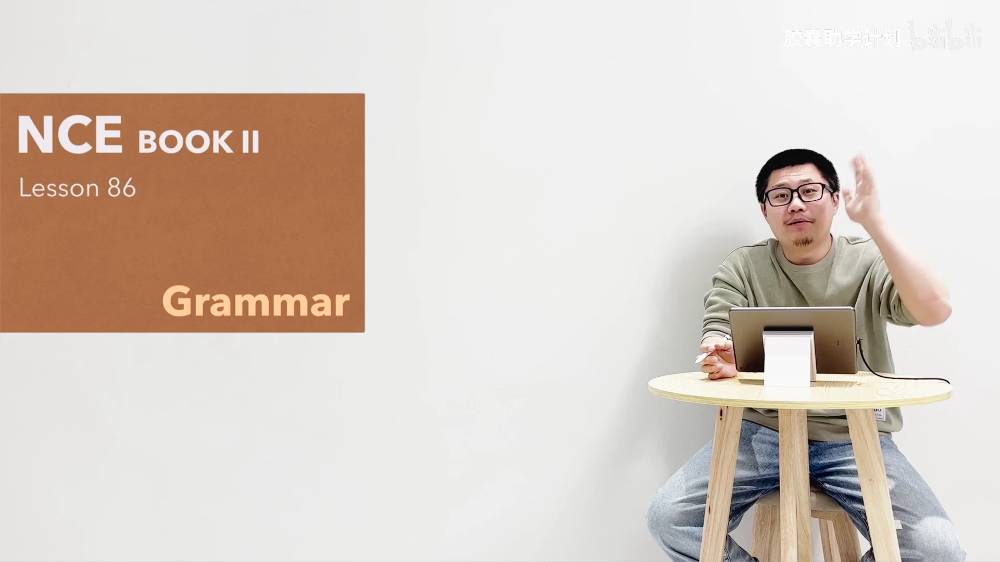

文字识别：NCE / BOOKⅡI / Lesson 86 / Grammar

### 画面 00:00:02

文字识别：NCE / BOOKII / Lesson 86 / Grammar

### 画面 00:00:04

文字识别：NCE / BOOKⅡI / Lesson 86 / Grammar

### 画面 00:00:06

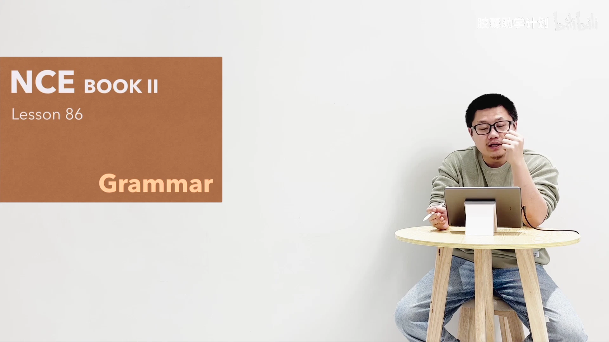

文字识别：NCE / BOOKII / Lesson 86 / Grammar

### 画面 00:00:08

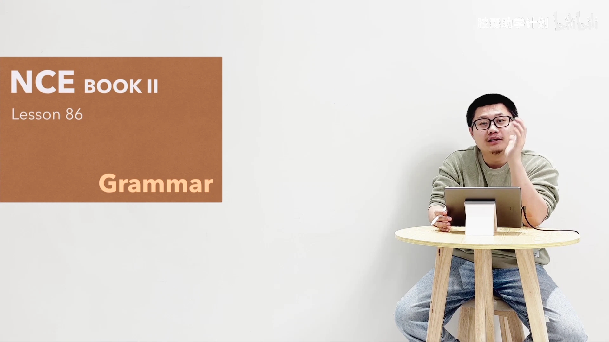

文字识别：NCE / BOOKII / Lesson 86 / Grammar

### 画面 00:00:10

文字识别：胶囊助学计划 bii

### 画面 00:00:13

### 画面 00:00:15

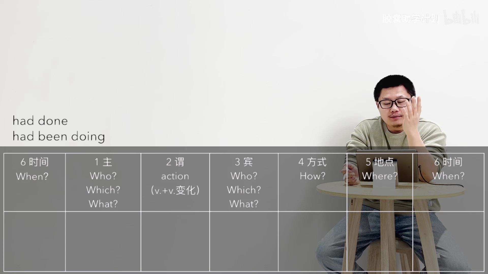

文字识别：囊助学计划 / had done / had been doing / 6时间 / 1主 / 2谓 / 3宾 / 4方式 / 5地点 / 6时间 / When? / Who? / action / Who? / How? / Where? / When? / Which? / (v.+v.变化) / Which? / What? / What?

## 00:00:30–00:01:00

呃过去完成进行时啊，一个是过去完成时had done，一个是过去完成进行时，这两个时态啊都是一个是第一单元学的，恨不得新一就学过，一个是我们第三单元学的啊。那我们基本上在这儿就是以练代讲啊，直接上句子，各位张嘴跟我读啊。Why didn't he warn her?他为什么没有警告的呢？我们看一下这两句话啊，连到一起的，接下来都是一样，我不挨个解释，只解释一个。说因

### 画面 00:00:44

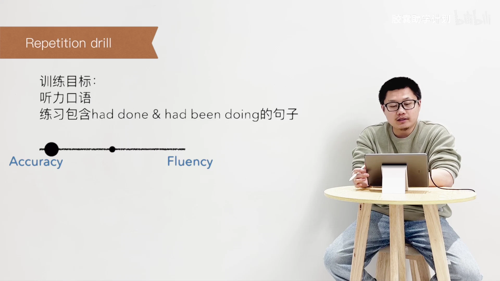

文字识别：Repetition drill / 训练目标： / 听力口语 / 练习包含had done & had been doing的句子 / Accuracy / Fluency

### 画面 00:00:46

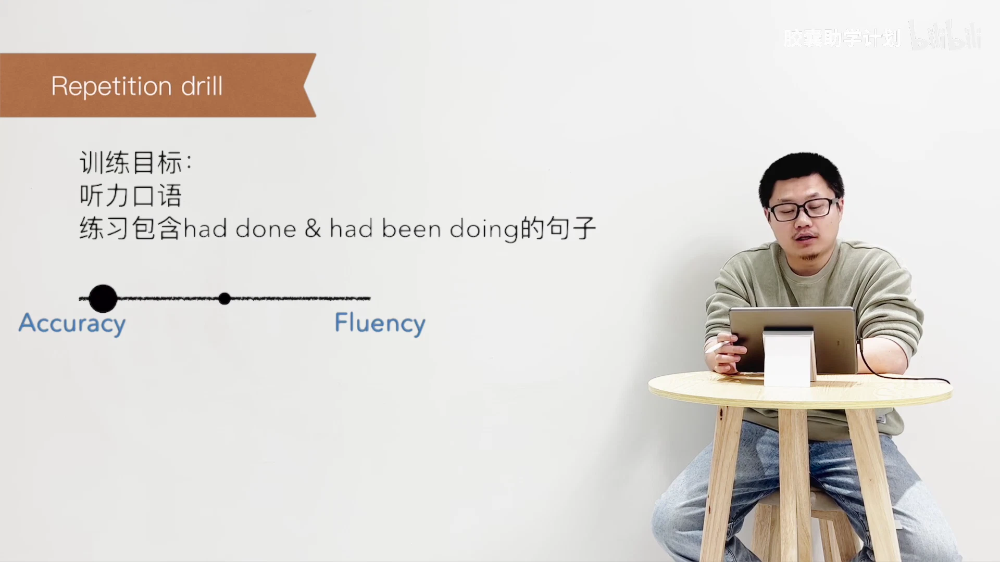

文字识别：Repetition drill / 训练目标： / 听力口语 / 练习包含had done & had been doing的句子 / Accuracy / Fluency

### 画面 00:00:48

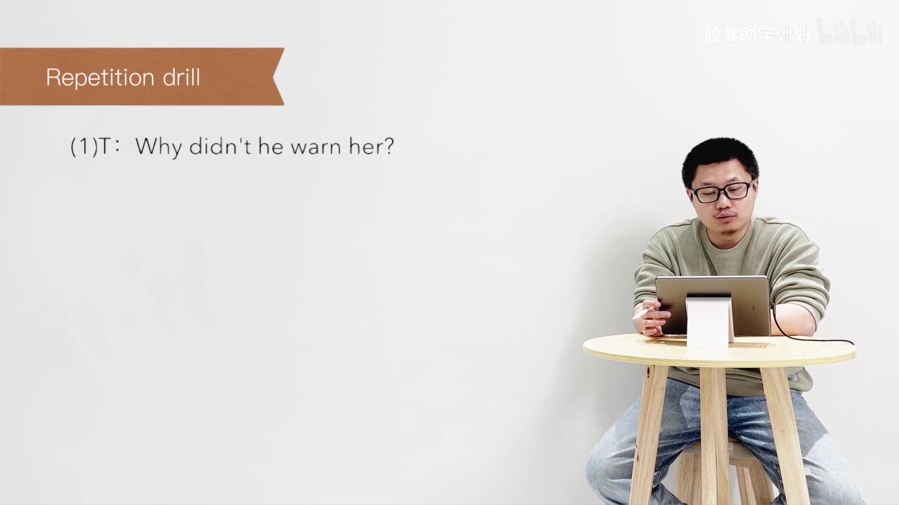

文字识别：Repetition drill / (1)T: Why didn't he warn her?

### 画面 00:00:50

文字识别：Repetition drill / (1)T: Why didn't he warn her?

### 画面 00:00:54

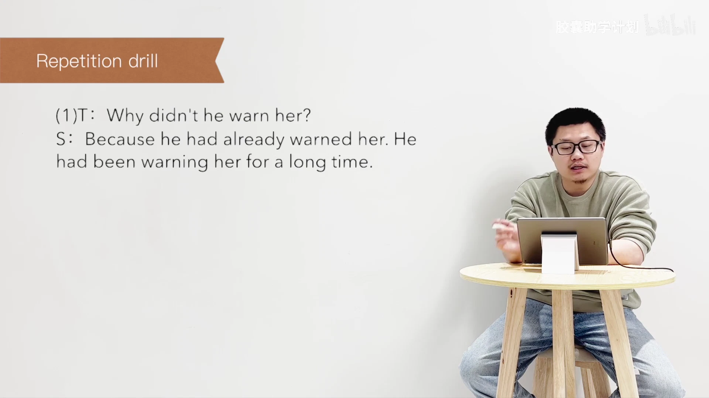

文字识别：Repetition drill / (1)T: Why didn't he warn her? / S: Because he had already warned her. He / had been warning her for a long time.

### 画面 00:00:56

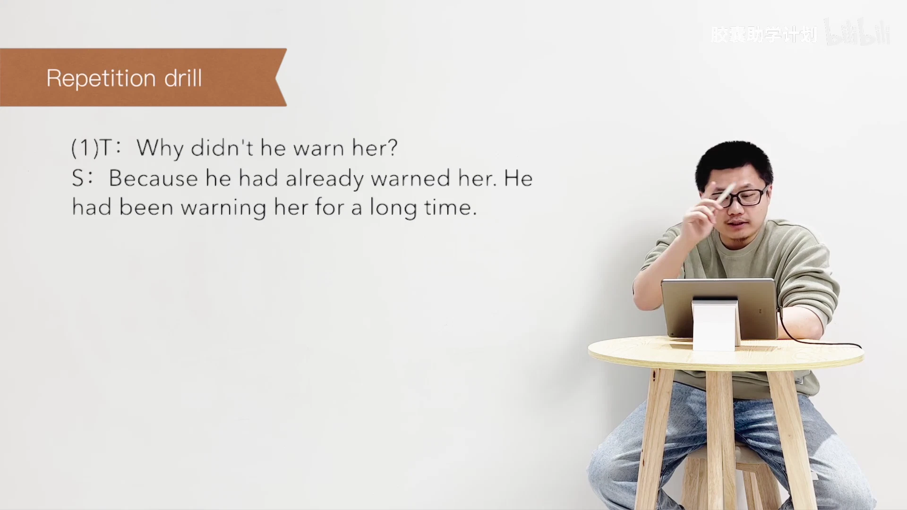

文字识别：Repetition drill / (1)T: Why didn't he warn her? / S: Because he had already warned her. He / had been warning her for a long time.

## 00:01:00–00:01:30

为 she had already warned her，因为她之前已经怎么样了呢？警告过他了，对吧？你注意，你看用的是 why didn't，啊，其实我之前跟各位解释过嘛，说这个过去完成时这个时态呀，我们从一个不是非常严谨，但是能帮助各位理解的角度，你就理解为它是现在完成时这个时态的过去时，对吧？你时间，比如说截止到现在，

### 画面 00:01:00

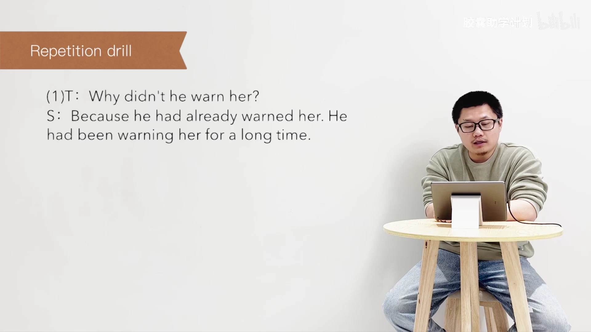

文字识别：Repetition drill / (1)T: Why didn't he warn her? / S: Because he had already warned her. He / had been warning her for a long time.

### 画面 00:01:02

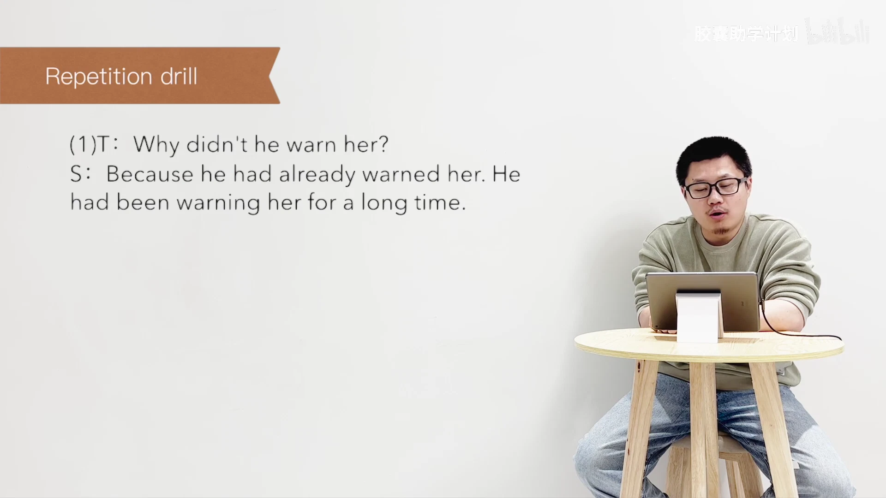

文字识别：Repetition drill / (1)T: Why didn't he warn her? / S: Because he had already warned her. He / had been warning her for a long time.

### 画面 00:01:05

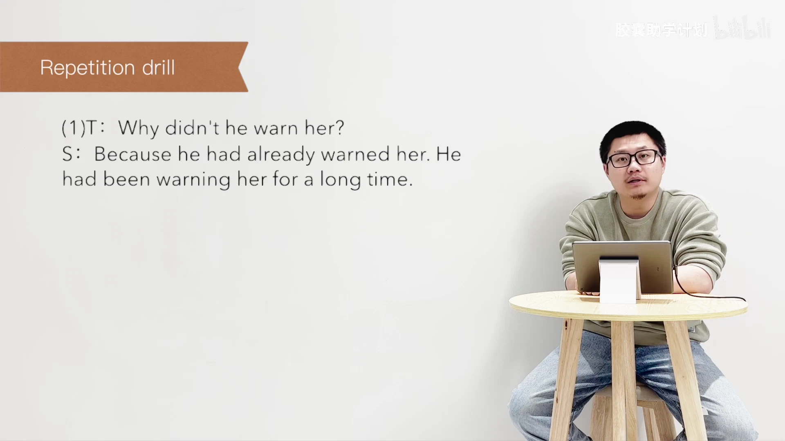

文字识别：Repetition drill / (1)T: Why didn't he warn her? / S: Because he had already warned her. He / had been warning her for a long time.

### 画面 00:01:18

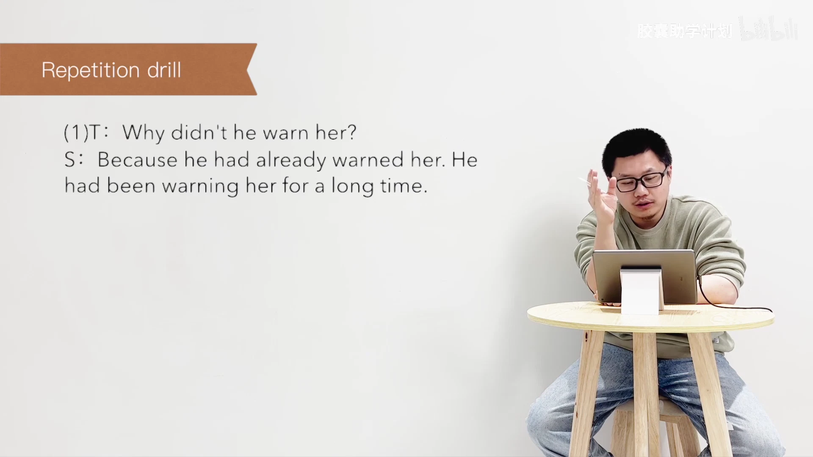

文字识别：Repetition drill / (1)T: Why didn't he warn her? / S: Because he had already warned her. He / had been warning her for a long time.

### 画面 00:01:20

文字识别：Repetition drill / (1)T: Why didn't he warn her? / S: Because he had already warned her. He / had been warning her for a long time.

### 画面 00:01:22

文字识别：Repetition drill / (1)T: Why didn't he warn her? / S: Because he had already warned her. He / had been warning her for a long time.

### 画面 00:01:25

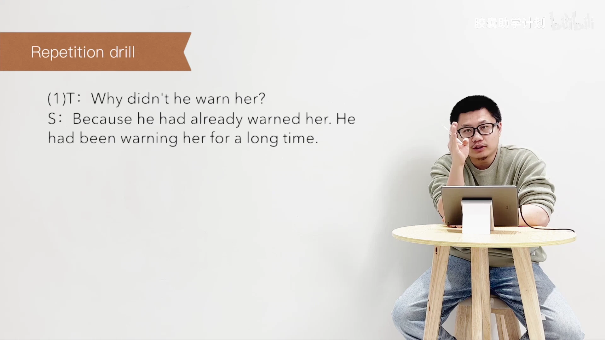

文字识别：Repetition drill / (1)T: Why didn't he warn her? / S: Because he had already warned her. He / had been warning her for a long time.

### 画面 00:01:27

文字识别：Repetition drill / (1)T: Why didn't he warn her? / S: Because he had already warned her. He / had been warning her for a long time.

## 00:01:30–00:02:00

哎，或者说对现在有影响，那你基本上就是把这个时间往后移，它就变成了过去完成时啊。所以叫做他已经警告过他了，had done。后边呢用的是 he had been warning her for a long time。你看，这是一个非常典型的过去完成进行时 had been doing。其次呢，它是过去完成进行时的一个持续用法，对吧？持警告他已经持续了，就是持续警告他已经很

### 画面 00:01:30

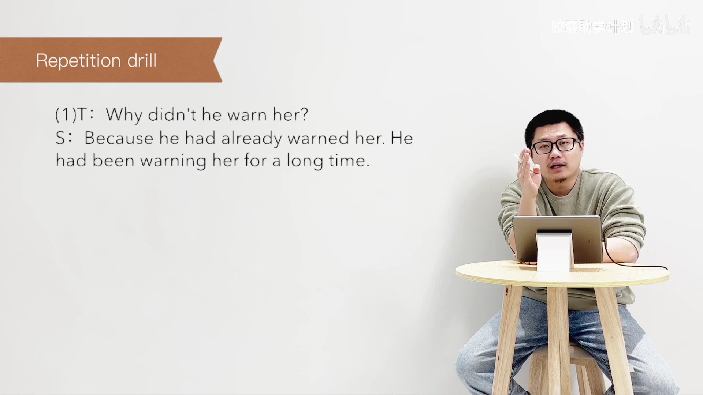

文字识别：Repetition drill / (1)T: Why didn't he warn her? / S: Because he had already warned her. He / had been warning her for a long time.

### 画面 00:01:36

文字识别：Repetition drill / (1)T: Why didn't he warn her? / S: Because he had already warned her. He / had been warning her for a long time.

### 画面 00:01:40

文字识别：Repetition drill / (1)T: Why didn't he warn her? / S: Because he had already warned her. He / had been warning her for a long time.

### 画面 00:01:42

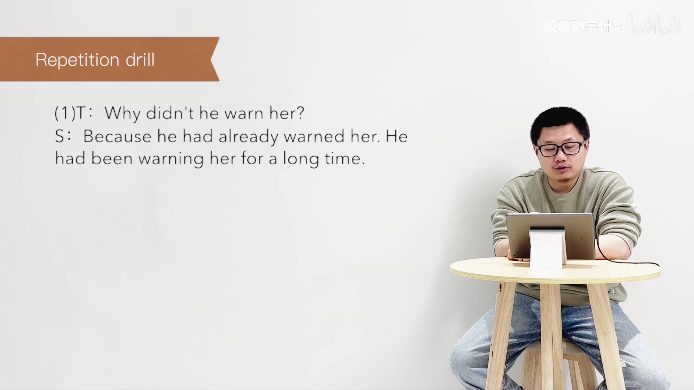

文字识别：Repetition drill / (1)T: Why didn't he warn her? / S: Because he had already warned her. He / had been warning her for a long time.

### 画面 00:01:46

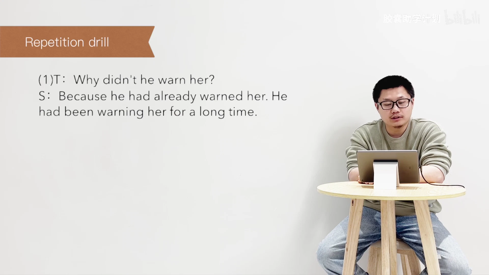

文字识别：Repetition drill / (1)T: Why didn't he warn her? / S: Because he had already warned her. He / had been warning her for a long time.

### 画面 00:01:55

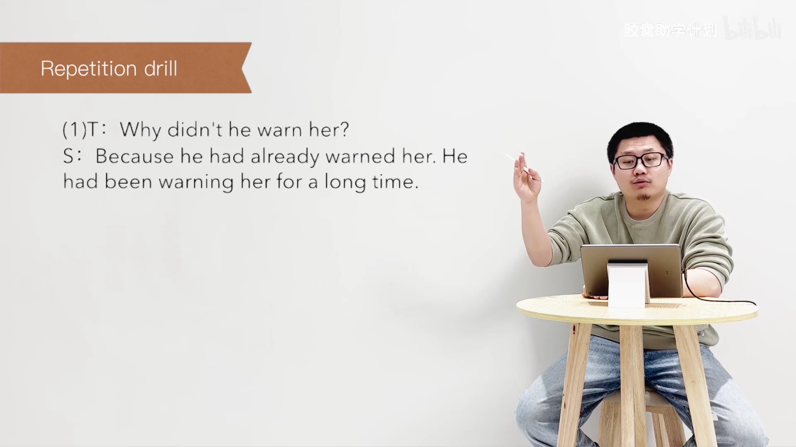

文字识别：Repetition drill / (1)T: Why didn't he warn her? / S: Because he had already warned her. He / had been warning her for a long time.

## 00:02:00–00:02:30

长一段时间了，对不对？好，这是第一个。剩下的，哎，各位重点还是看这里。但是，啊，张嘴要跟我一起读啊，我不挨个解释了。来，Why didn't you help him？我稍微慢一点啊，你自己有点时间去反应一下。Because I had already helped him. I had been helping him for a long time. Why didn't you speak to him？

### 画面 00:02:00

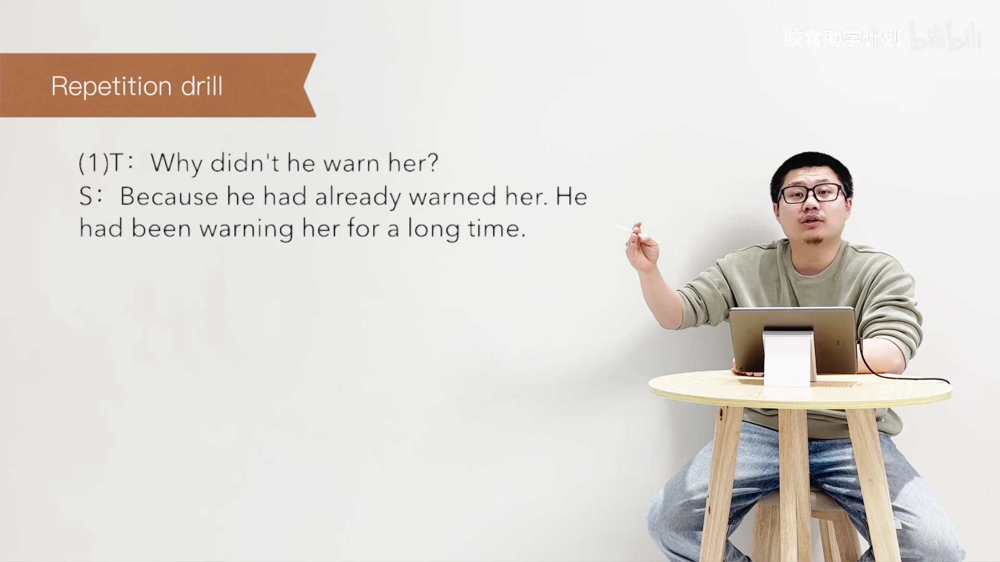

文字识别：Repetition drill / (1)T: Why didn't he warn her? / S: Because he had already warned her. He / had been warning her for a long time.

### 画面 00:02:02

文字识别：Repetition drill / (1)T: Why didn't he warn her? / S: Because he had already warned her. He / had been warning her for a long time.

### 画面 00:02:04

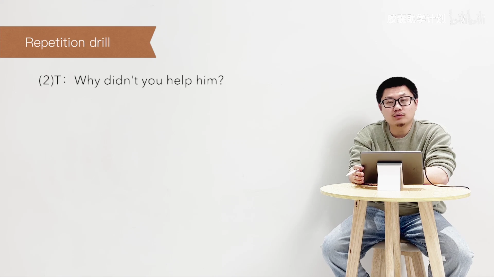

文字识别：Repetition drill / (2)T: Why didn't you help him?

### 画面 00:02:06

文字识别：Repetition drill / (2)T: Why didn't you help him?

### 画面 00:02:08

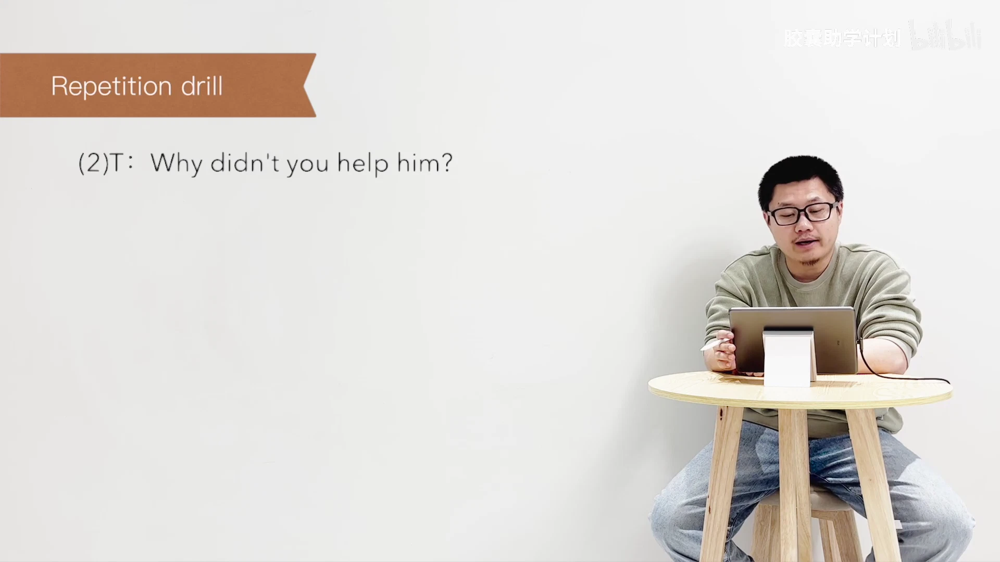

文字识别：Repetition drill / (2)T: Why didn't you help him?

### 画面 00:02:11

文字识别：Repetition drill / (2)T: Why didn't you help him?

### 画面 00:02:13

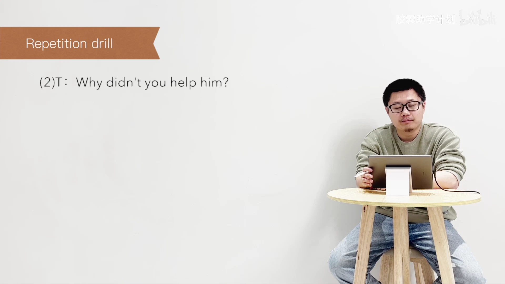

文字识别：Repetition drill / (2)T: Why didn't you help him?

### 画面 00:02:15

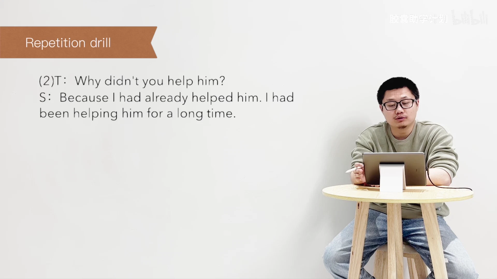

文字识别：Repetition drill / (2)T: Why didn't you help h / him? / S: Because I had already helped him.I had / been helping him for a long time.

### 画面 00:02:21

文字识别：Repetition drill / (2)T:Why ( / didn't you help / him? / S: Because I had already helped him.I had / been helping /  him for a long time.

### 画面 00:02:27

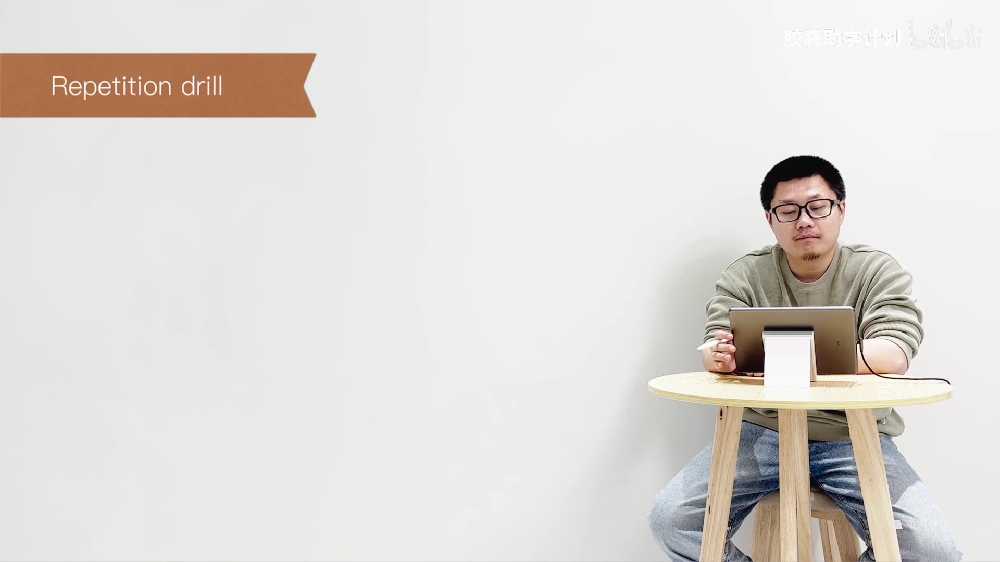

文字识别：助字计划 / Repetition drill

## 00:02:30–00:03:00

Because I had already spoken to him. I had been speaking to him for a long time. Why didn't she tell you? Because she had already told me. She had been telling me for a long time. Why didn't the police investigate? Investigate. 希望各位还记着是吧？这个就是

### 画面 00:02:30

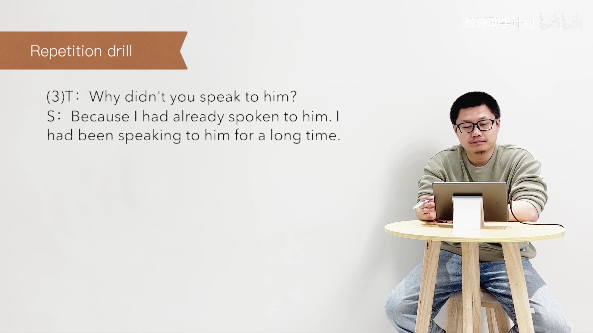

文字识别：Repetition drill / (3)T: Why didn't you speak to him? / S: Because I had already spoken to him.I / had been speaking to him for a long time.

### 画面 00:02:35

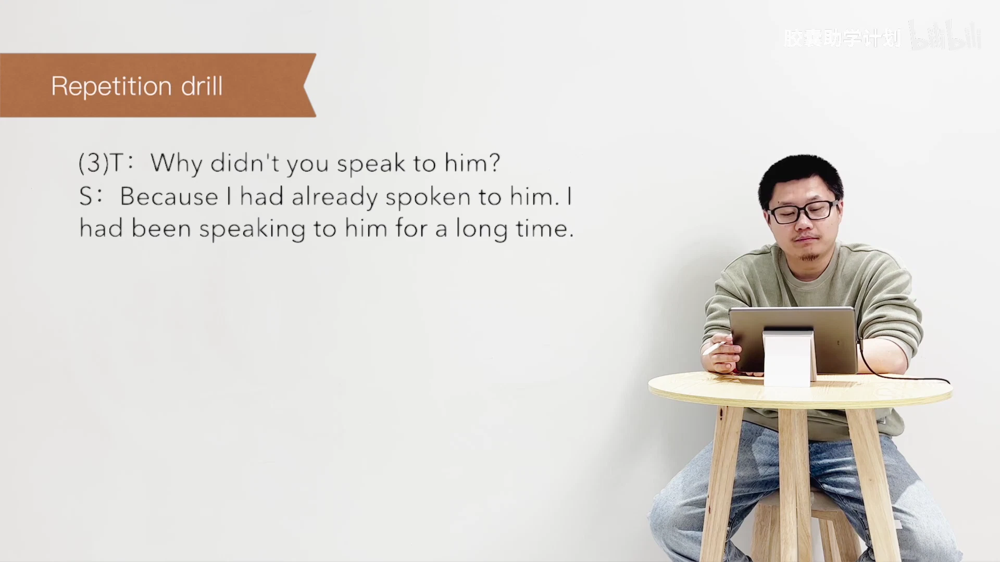

文字识别：Repetition drill / (3)T: Why didn't you speak to him? / S: Because I had already spoken to him.I / had been speaking to him for a long time.

### 画面 00:02:40

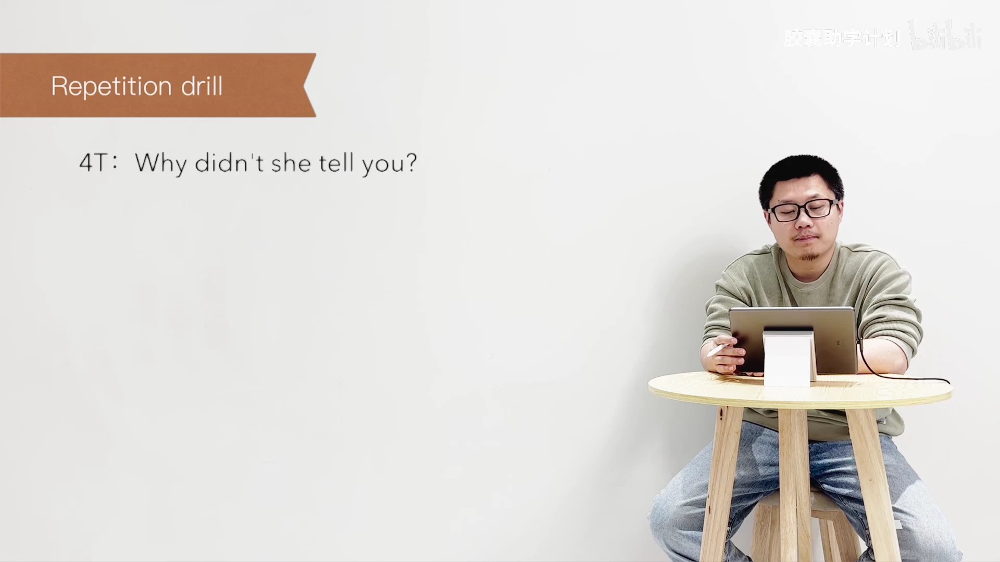

文字识别：Repetition drill / 4T: Why didn't she tell you?

### 画面 00:02:43

文字识别：Repetition drill / 4T: Why didn't she tell you?

### 画面 00:02:45

文字识别：Repetition drill / 4T: Why didn't she tell you? / S: Because she had already told me. She / had been telling me for a long time.

### 画面 00:02:48

文字识别：Repetition drill / 4T: Why didn't she tell you? / S: Because she had already told me. She / had been telling me for a long time.

### 画面 00:02:50

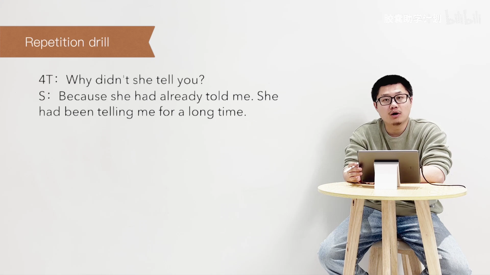

文字识别：Repetition drill / 4T: Why didn't she tell you? / S: Because she had already told me. She / had been telling me for a long time.

### 画面 00:02:52

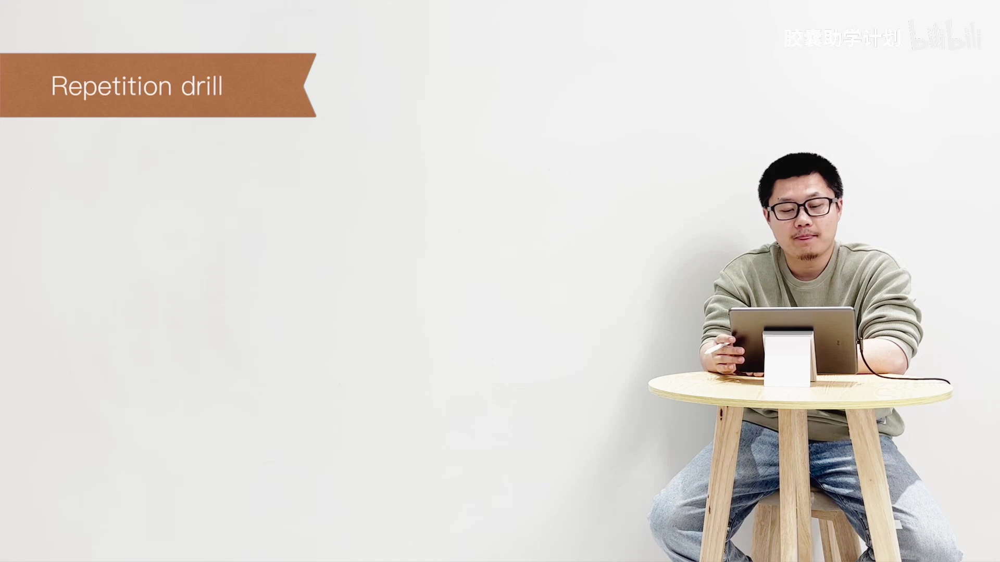

文字识别：助学计划 / Repetition drill

### 画面 00:02:55

文字识别：Repetition drill / 5T: Why didn't the police investigate?

### 画面 00:02:58

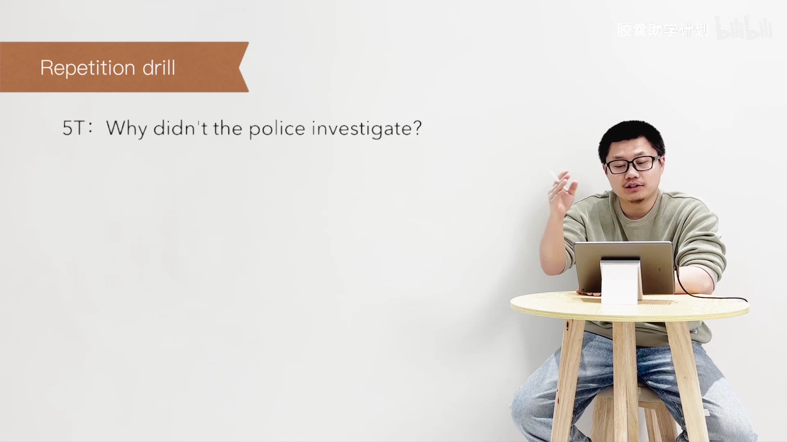

文字识别：Repetition drill / 5T: Why didn't the police investigate?

## 00:03:00–00:03:30

调查啊，调查案件的那个调查。Because they had already investigated, they had been investigating for a long time. Why didn't he borrow some money? Because he had already borrowed some money. He had been borrowing money for a long time. Why didn't he

### 画面 00:03:00

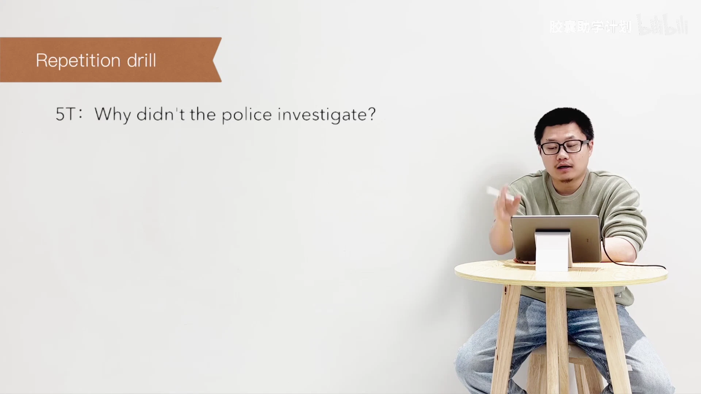

文字识别：Repetition drill / 5T: Why didn't the police investigate?

### 画面 00:03:02

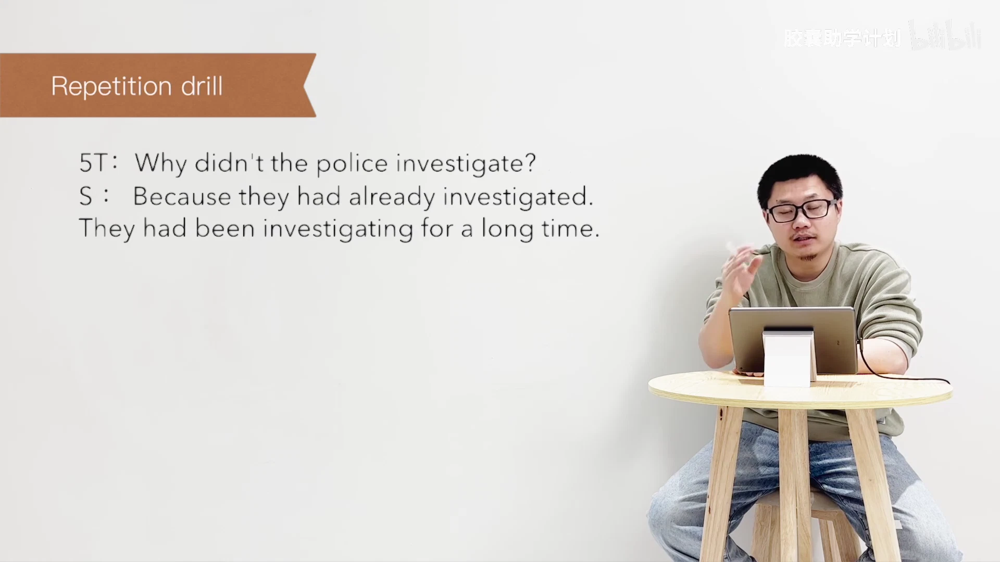

文字识别：Repetition drill / 5T: Why didn't the police investigate? / S： / Because t / : they had already investigated. / They had been investigating for a long time.

### 画面 00:03:05

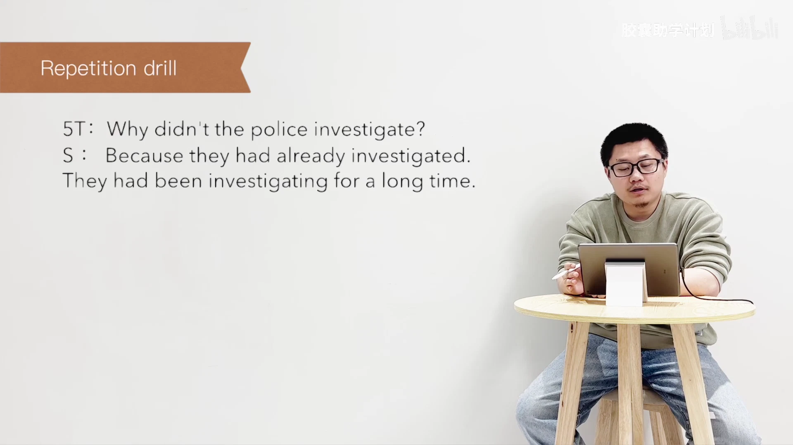

文字识别：Repetition drill / 5T: Why didn't the police investigate? / S： / Because they had already investigated. / They had been investigating for a long time.

### 画面 00:03:10

文字识别：Repetition drill / 5T: Why didn't the police investigate? / S： / Because they had already investigated. / They had been investigating for a long time.

### 画面 00:03:13

文字识别：Repetition drill / 6T: Why didn't he borrow some money?

### 画面 00:03:16

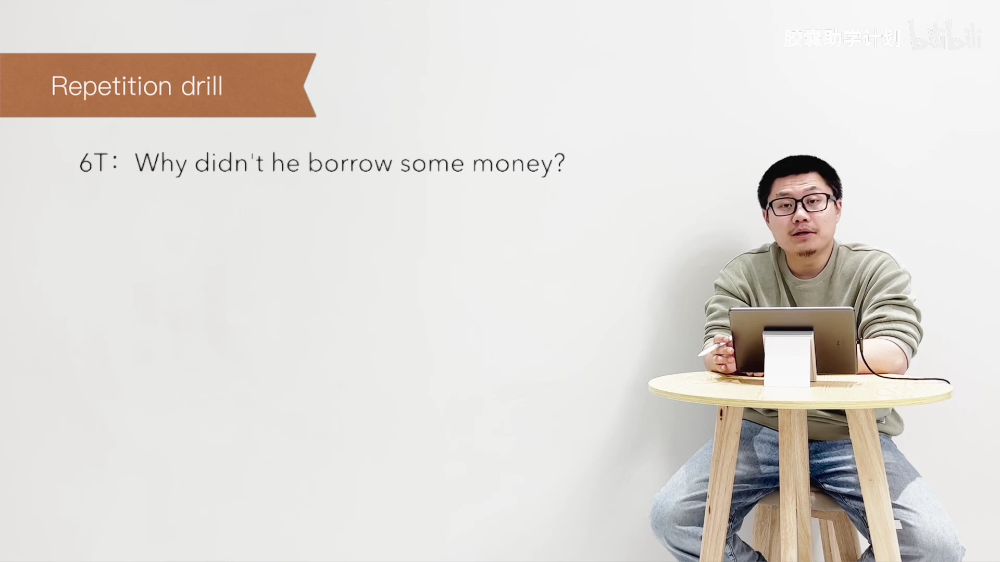

文字识别：Repetition drill / 6T: Why didn't he borrow some money?

### 画面 00:03:18

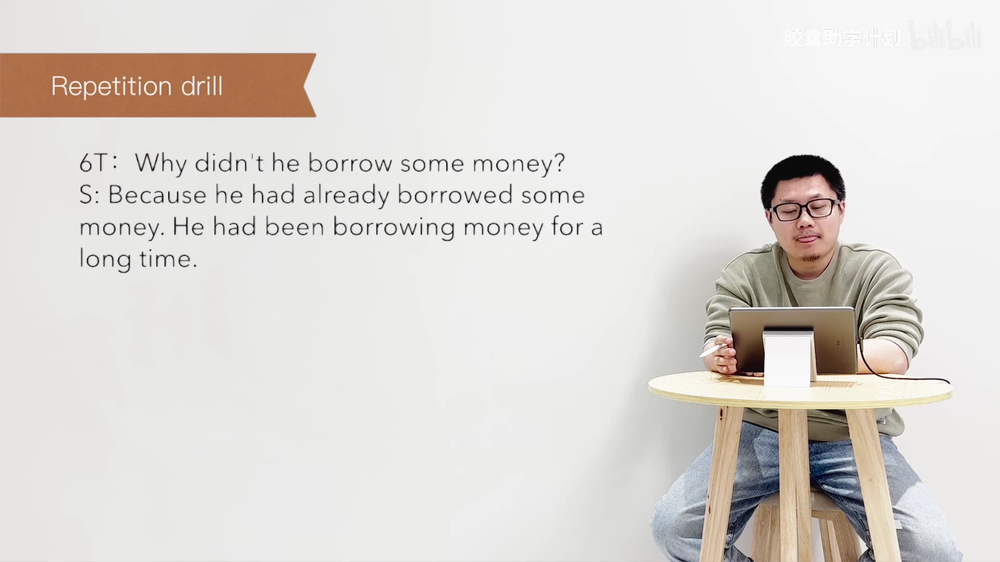

文字识别：Repetition drill / 6T: Why didn't he borrow some money? / S: Because he had already borrowed some / money. He had been borrowing money for a / long time.

### 画面 00:03:20

文字识别：Repetition drill / 6T: Why didn't he borrow some money? / S: Because he had already borrowed some / money. He had been borrowing money for a / long time.

### 画面 00:03:25

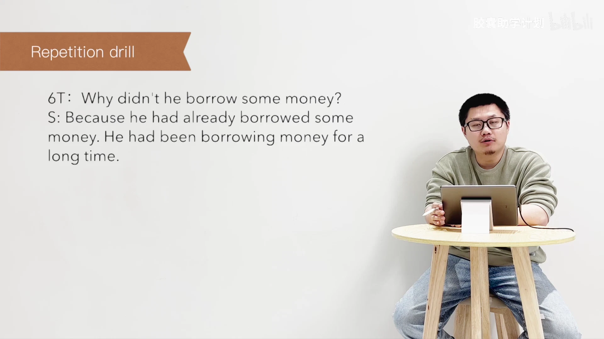

文字识别：Repetition drill / 6T: Why didn't he borrow some money? / S: Because he had already borrowed some / money. He had been borrowing money for a / long time.

### 画面 00:03:28

文字识别：辜助字计划 / Repetition drill / 7T: Why didn't he try to escape?

## 00:03:30–00:04:00

try to escape? Because he had already tried to escape. He had been trying to escape for a long time. Why didn't he write to her? Because he had already written to her. He had been writing to her for a long time. Why didn't you learn English? Because I had

### 画面 00:03:30

文字识别：Repetition drill / 7T: Why didn't he try to escape?

### 画面 00:03:32

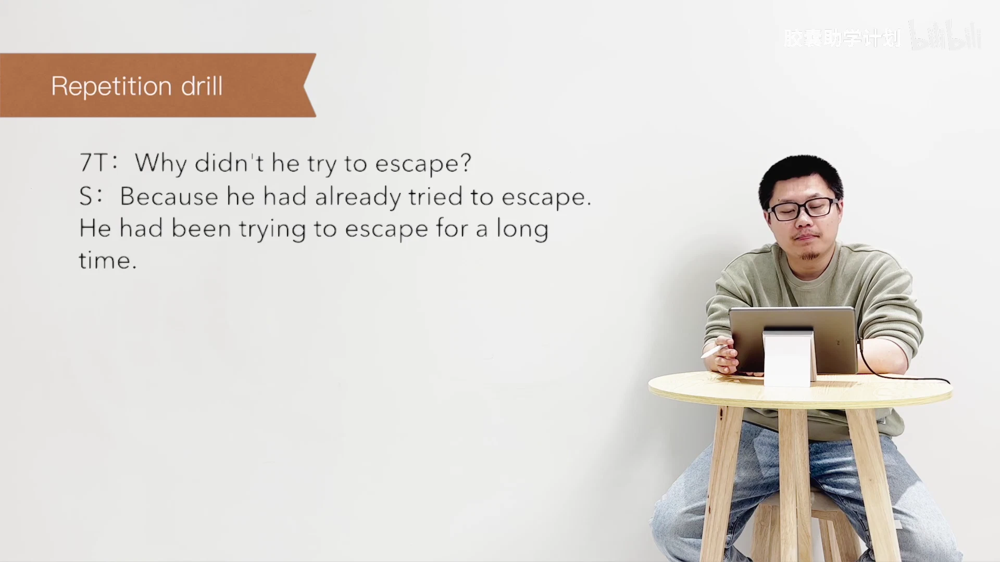

文字识别：Repetition drill / 7T: Why didn't he try to escape? / S: Because he had already tried to escape. / He had been trying to escape for a long / time.

### 画面 00:03:35

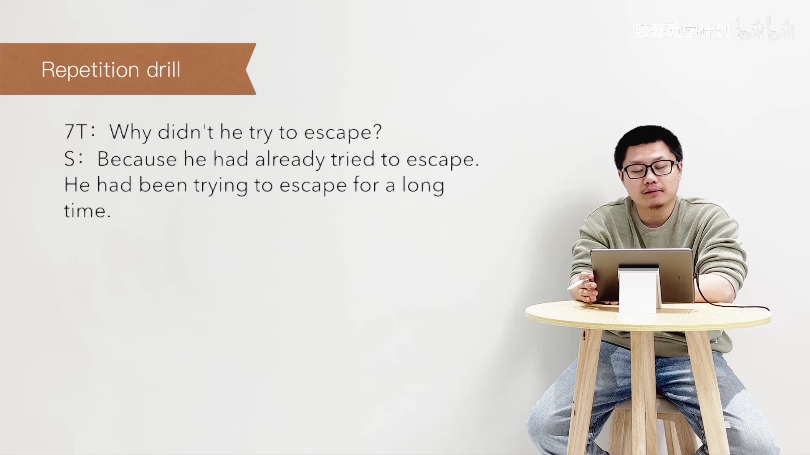

文字识别：Repetition drill / 7T: Why didn't he try to escape? / S: Because he had already tried to escape. / He had been trying to escape for a long / time.

### 画面 00:03:40

文字识别：Repetition drill / 7T: Why didn't he try to escape? / S: Because he had already tried to escape. / He had been trying to escape for a long / time.

### 画面 00:03:42

文字识别：学计划 / Repetition drill / 8T: Why didn't he write to her?

### 画面 00:03:44

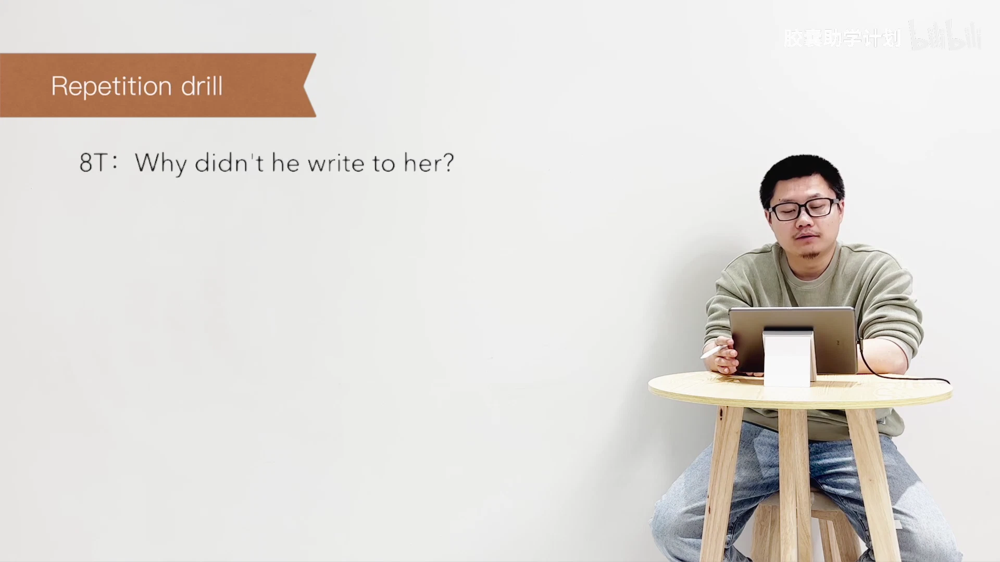

文字识别：Repetition drill / 8T: Why didn't he write to her?

### 画面 00:03:46

文字识别：Repetition drill / 8T: Why didn't he write to her? / S: Because he had already written to h er. / He had been writing to her for a long time.

### 画面 00:03:50

文字识别：Repetition drill / 8T: Why didn't he write to her? / S: Because he had already written to h er. / He had been writing to her for a long time.

### 画面 00:03:54

文字识别：星助字计划 / Repetition drill

### 画面 00:03:56

文字识别：Repetition drill / 9T:Why didn't you learn English?

### 画面 00:03:58

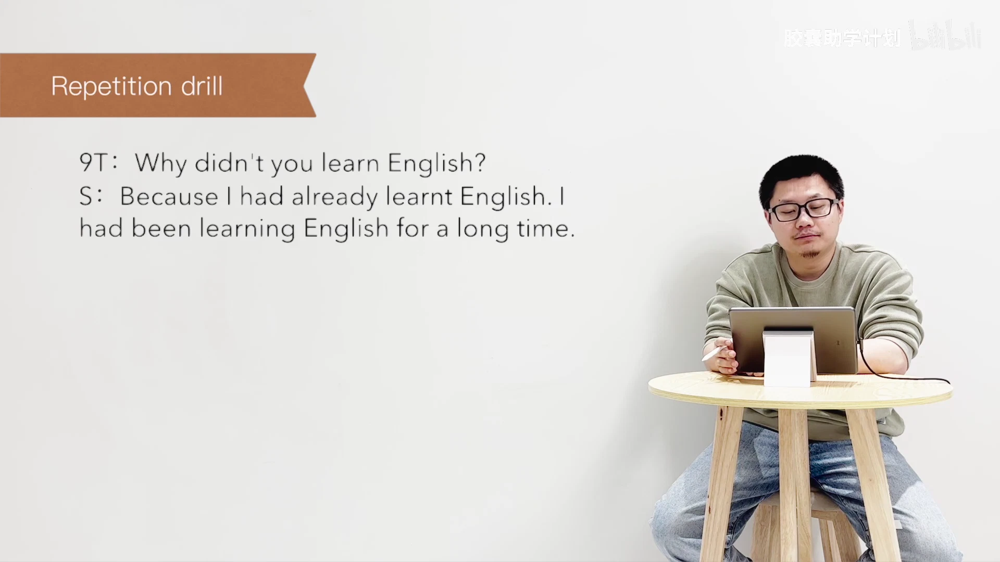

文字识别：Repetition drill / 9T： / : Why / didn't you learn / English? / S: Because I had  / already / learnt I /  English.I / had been learning / English / for a long / time.

## 00:04:00–00:04:30

already learned English, I had been learning English for a long time.最后一个, why didn't they reach for him, search for him? Because they had already searched for him. They had been searching for him for a long time. Okay, pattern drill,老习惯还是练这两个时态啊。只不过呢，就是各位这个更多的是要各位关了视频，课下去练啊。

### 画面 00:04:01

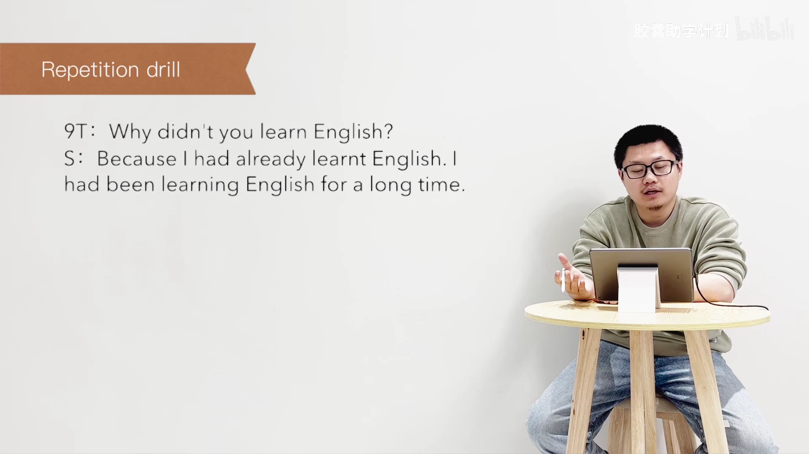

文字识别：Repetition drill / 9T： / : Why / didn't you learn / English? / S: Because I had  / already / learnt I /  English.I / had been learning / English / for a long / time.

### 画面 00:04:05

文字识别：臺助学计划 / Repetition drill

### 画面 00:04:07

文字识别：毫助学计划 / Repetition drill / 10T: Why didn't they search for him?

### 画面 00:04:11

文字识别：Repetition drill / 10T: Why / didn't they search for him? / S:Because / they had already searched for / him. They had been searching for him for a / long time.

### 画面 00:04:15

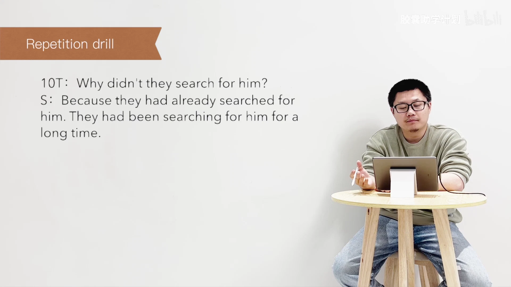

文字识别：Repetition drill / 10T: Why C /  didn't they search for him? / S:Because t / : they had already searched for / him. They had been searching for him for a / long time.

### 画面 00:04:20

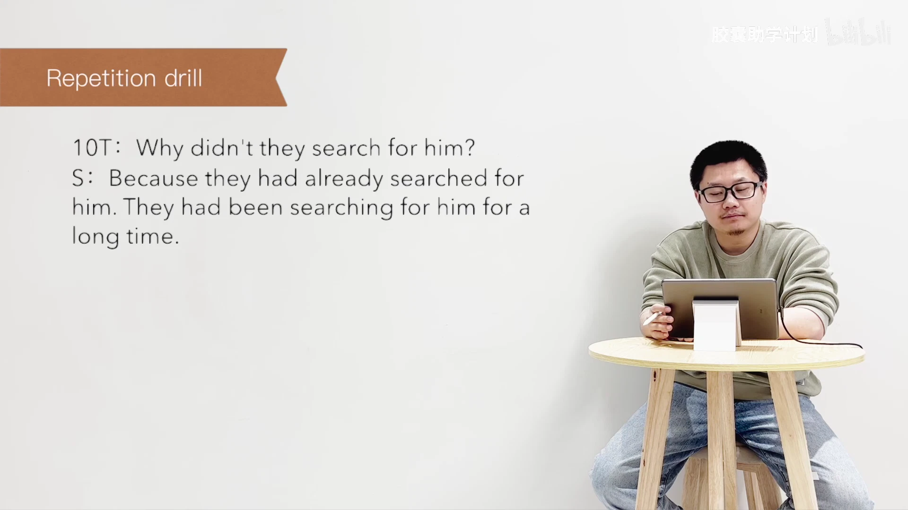

文字识别：Repetition drill / 10T: Why C /  didn't they search for him? / S:Becauset / : they had already searched for / him. They had been searching for him for a / long time.

### 画面 00:04:22

文字识别：Pattern drill / 训练目标： / 写作口语 / 练习包含had done & had been doing的句子 / Accuracy / Fluency

### 画面 00:04:25

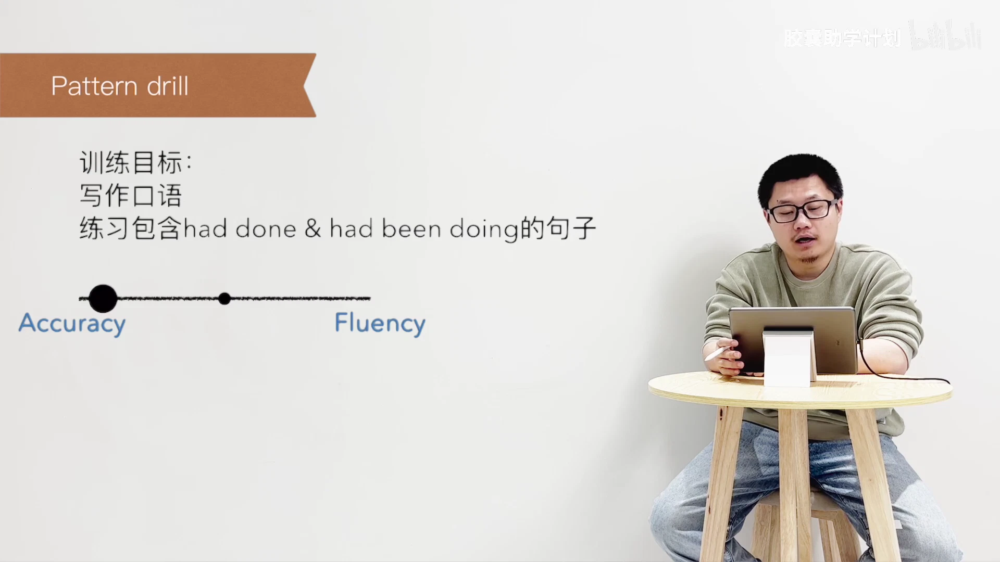

文字识别：Pattern drill / 训练目标： / 写作口语 / 练习包含had done & had been doing的句子 / Accuracy / Fluency

### 画面 00:04:27

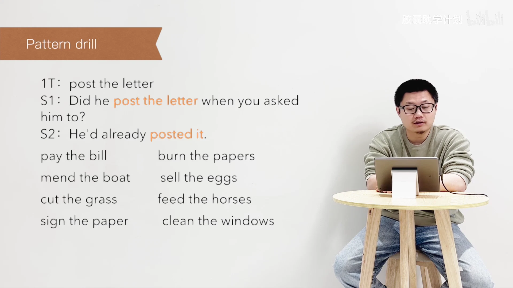

文字识别：Pattern drill / 1T: postthe letter / S1: Did he post the letter when you asked / him to? / S2: He'd already posted it. / pay the bill / burn the papers / mend the boat / sell the eggs / cut the grass / feed the horses / sign the paper / clean the windows

## 00:04:30–00:05:00

我们要做的事情是把 S E S 二什么意思，以及练的是什么语法，给各位解释清楚。Did he post the letter when you ask him to？说他有寄这封信吗？当你让你向他这么要求的时候，呃，两个一般过去时没什么说的。She had already posted it。好了，你注意这个 had 这个撇地是 had had 的蛋，叫他已经在我问之前，他已经怎么样给寄出去了，对吧？过去完成时啊，就是过去完成时，不是我们当时

### 画面 00:04:30

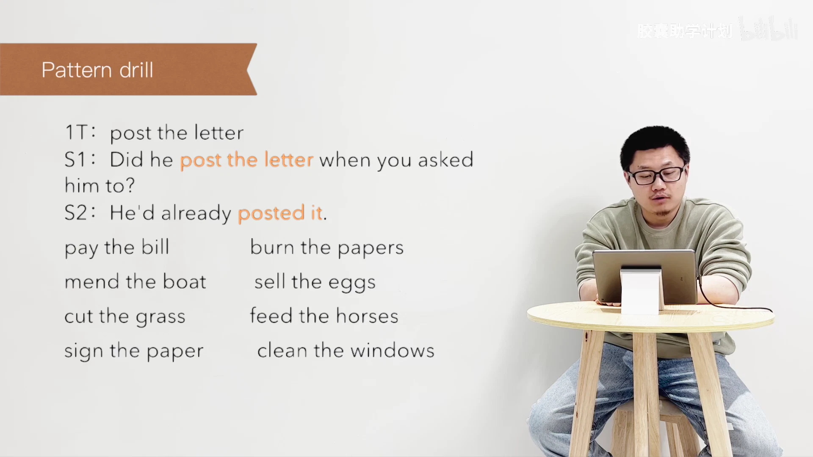

文字识别：Pattern drill / 1T: post the letter / S1: Did he post the letter when you asked / him to? / S2: He'd already posted it. / pay the bill / burn the papers / mend the boat / sell the eggs / cut the grass / feed the horses / sign the paper / clean the windows

### 画面 00:04:42

文字识别：Pattern drill / 1T: post the letter / S1: Did he post the letter when you asked / him to? / S2: He'd already posted it. / pay the bill / burn the papers / mend the boat / sell the eggs / cut the grass / feed the horses / sign the paper / clean the windows

### 画面 00:04:45

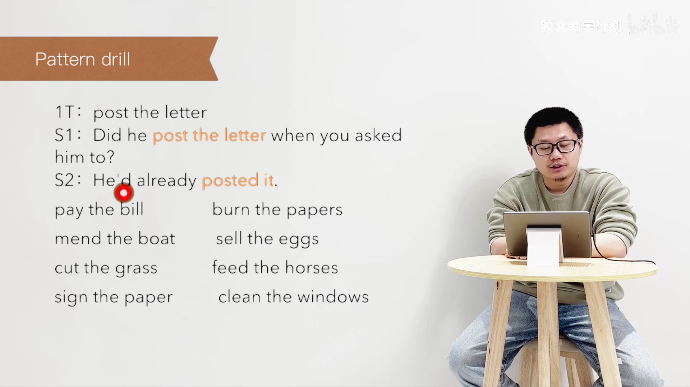

文字识别：Pattern drill / 1T: post the letter / S1: Did he post the letter when you asked / him to? / S2: He'd already posted it. / pay the bill / burn the papers / mend the boat / sell the eggs / cut the grass / feed the horses / sign the paper / clean the windows

### 画面 00:04:53

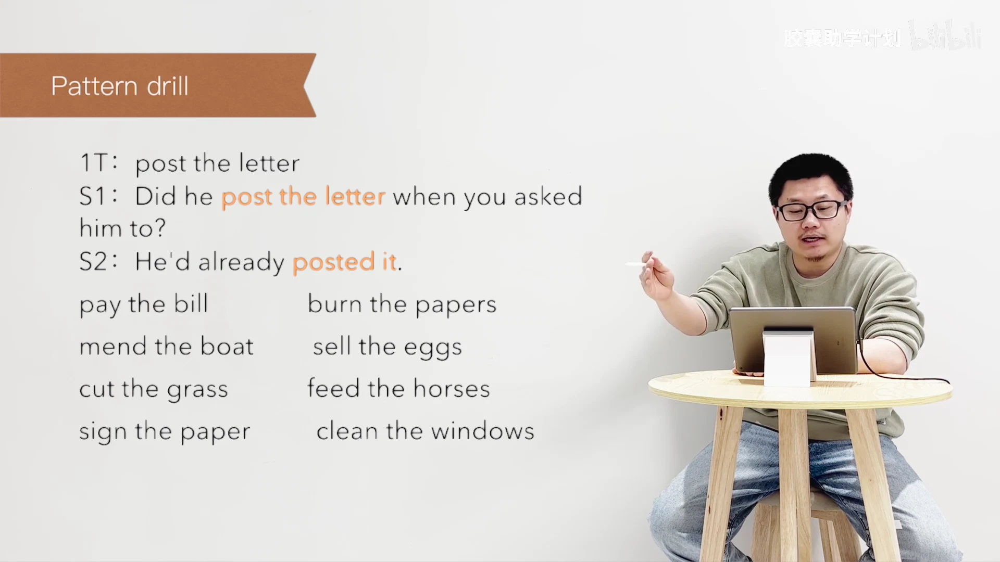

文字识别：Pattern drill / 1T: postthe letter / S1: Did he post the letter when you asked / him to? / S2: He'd already posted it. / pay the bill / burn the papers / mend the boat / sell the eggs / cut the grass / feed the horses / sign the paper / clean the windows

### 画面 00:04:55

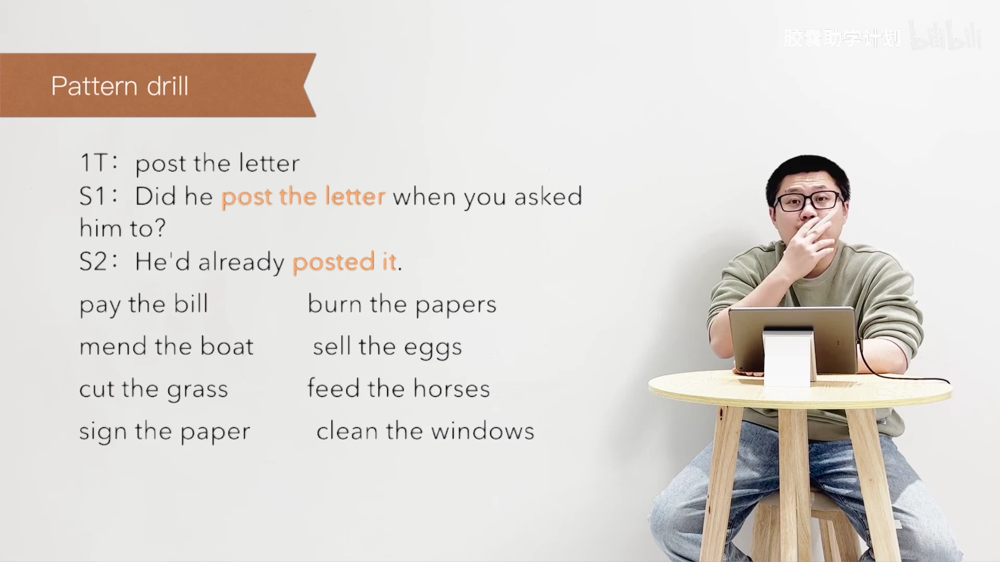

文字识别：Pattern drill / 1T: post the letter / S1: Did he post the letter when you asked / him to? / S2: He'd already posted it. / pay the bill / burn the papers / mend the boat / sell the eggs / cut the grass / feed the horses / sign the paper / clean the windows

### 画面 00:04:59

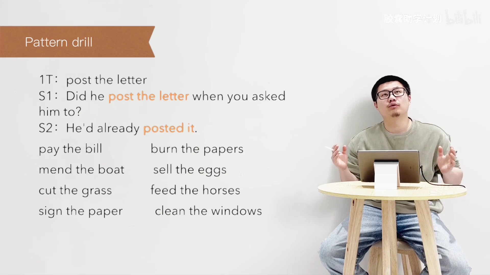

文字识别：Pattern drill / 1T: post the letter / S1: Did he post the letter when you asked / him to? / S2: He'd already posted it. / pay the bill / burn the papers / mend the boat / sell the eggs / cut the grass / feed the horses / sign the paper / clean the windows

## 00:05:00–00:05:30

有一个用法叫过去的过去嘛？什么叫过去的过去？就是有两个动作，对吧？都发生在过去，发生在更遥远过去的那个动作用 had done，对吧？往里面去带啊。第二个，Can use the iron after you please？这个 iron 我们刚学过是钢铁的意思，它还有另外一个意思就是熨斗啊，电熨斗。说我能在你之后使用电熨斗。I'm sorry, I put it away after I'd used it. 注意，你看叫做

### 画面 00:05:01

文字识别：Pattern drill / 1T: post the letter / S1: Did he post the letter when you asked / him to? / S2: He'd already posted it. / pay the bill / burn the papers / mend the boat / sell the eggs / cut the grass / feed the horses / sign the paper / clean the windows

### 画面 00:05:03

文字识别：Pattern drill / 1T: postthe letter / S1: Did he post the letter when you asked / him to? / S2: He'd already posted it. / pay the bill / burn the papers / mend the boat / sell the eggs / cut the grass / feed the horses / sign the paper / clean the windows

### 画面 00:05:05

文字识别：Pattern drill / 1T: post the letter / S1: Did he post the letter when you asked / him to? / S2: He'd already posted it. / pay the bill / burn the papers / mend the boat / sell the eggs / cut the grass / feed the horses / sign the paper / clean the windows

### 画面 00:05:07

文字识别：Pattern drill / 1T: post the letter / S1: Did he post the letter when you asked / him to? / S2: He'd already posted it. / pay the bill / burn the papers / mend the boat / sell the eggs / cut the grass / feed the horses / sign the paper / clean the windows

### 画面 00:05:10

文字识别：Pattern drill / 1T: post the letter / S1: Did he post the letter when you asked / him to? / S2: He'd already posted it. / pay the bill / burn the papers / mend the boat / sell the eggs / cut the grass / feed the horses / sign the paper / clean the windows

### 画面 00:05:12

文字识别：Pattern drill / 2T: use-the iron-put away / S1: Can I use the iron after you, please? / S2: I'm sorry.I put it away after I'd used it. / read/lookat---thepaper---throwaway / study/examine---thenote---ear up / talk to/speakto---the boy--send home / lookat/see--thephotos---iveto Mary

### 画面 00:05:15

文字识别：Pattern drill / 2T: use-the iron-put away / S1: Can I use the iron after you, please? / S2: I'm sorry.I put it away after I'd used it. / read/lookat---thepaper---throwaway / study/examine---thenote---ear up / talk to/speakto---the boy--send home / lookat/see--thephotos---iveto Mary

### 画面 00:05:28

文字识别：Pattern drill / 2T: use-the iron-put away / S1: Can I use the iron after you, please? / S2: I'm sorry.I put it away after I'd used it. / read/lookat---thepaper---throwaway / study/examine---thenote---ear up / talk to/speakto---the boy--send home / lookat/see--thephotos---iveto Mary

## 00:05:30–00:06:00

我先使用完了，先使用完了，然后我再把它给 put it away，是什么意思？把它放放放到一边儿去了，把它放起来了，对吧？好，这个是我们典型十四课用过的 after a,逗号b，对吧？第三个，Why did you see such a bad movie？说为什么你要看一个这么烂的电影呢？I hadn't seen it before, so I didn't know it was bad.说因为我之前没看过呀，

### 画面 00:05:30

文字识别：Pattern drill / 2T: use-the iron-put away / S1: Can I use the iron after you, please? / S2: I'm sorry.I put it away after I'd used it. / read/lookat--thepaper---throwaway / study/examine---thenote---ear up / talk to/speakto---theboy---send  home / lookat/see--thephotos---iveto Mary

### 画面 00:05:32

文字识别：Pattern drill / 2T: use-the iron-put away / S1: Can I use the iron after you, please? / S2: I'm sorry.I put it away after I'd used it. / read/look at---thepaper----throwaway / study/examine---thenote---ear up / talk to/speakto---theboy----send  home / lookat/see--thephotos---iveto Mary

### 画面 00:05:34

文字识别：Pattern drill / 2T: use-the iron-put away / S1: Can I use the iron after you, please? / S2: I'm sorry.I put it away after I'd used it. / read/look at---thepaper---throwaway / study/examine---thenote---ear up / talk to/speakto---theboy-----send  home / lookat/see--thephotos---iveto Mary

### 画面 00:05:36

文字识别：Pattern drill / 2T: use-the iron-put away / S1: Can I use the iron after you, please? / S2: I'm sorry.I put it away after I'd used it. / read/look at---thepaper---throwaway / study/examine---thenote---ear up / talk to/speakto---theboy-----send  home / lookat/see--thephotos---iveto Mary

### 画面 00:05:39

文字识别：Pattern drill / 2T: use-the iron-put away / S1: Can I use the iron after you, please? / S2: I'm sorry. I put it away after I'd used it. / read/look at---thepaper--throwaway / study/examine----thenote---ear up / talk to/speakto---the boy-----send  home / lookat/see--thephotos---iveto Mary

### 画面 00:05:41

文字识别：Pattern drill / 2T: use-the iron-put away / S1: Can I use the iron after you, please? / S2: I'm sorry.I put it away after I'd used it. / read/lookat---thepaper---throwaway / study/examine---thenote---ear up / talk to/speakto---theboy---send  home / lookat/see--thephotos---iveto Mary

### 画面 00:05:45

文字识别：Pattern drill / 3T: see a bad film / S1: Why did you see such a bad film? / S2: I hadn't seen it before, so I didn't know / it was bad. / read a dull book / make a boring journey / speak to a rude man drive a dangerous car / order bad wine / take a difficult exam / use thick oil / play terrible music

### 画面 00:05:51

文字识别：Pattern drill / 3T: see a bad film / S1: Why did you see such a bad film? / S2: I hadn't seen it before, so I didn't know / it was bad. / read a dull book / make a boring journey / speak to a rude man drive a dangerous car / order bad wine / take a difficult exam / use thick oil / play terrible music

### 画面 00:05:55

文字识别：Pattern drill / 3T: see a bad film / S1: Why did you see such a bad film? / S2: I hadn't seen it before, so I didn't know / it was bad. / read a dull book / make a boring journey / speak to a rude man drive a dangerous car / order bad wine / take a difficult exam / use thick oil / play terrible music

### 画面 00:05:59

文字识别：Pattern drill / 3T: see a bad film / S1: Why did you see such a bad film? / S2: I hadn't seen it before, so I didn't know / it was bad. / read a dull book / make a boring journey / speak to a rude man drive a dangerous car / order bad wine / take a difficult exam / use thick oil / play terrible music

## 00:06:00–00:06:30

所以我看的时候我也不知道它坏。但是这个我已经看完了，所以是过去式，对吧？OK，第三个，第四个。Why was he so hot when he got home? He'd been running.你看，这是一个非常典型的，呃，这个地方要稍微多花一点时间啊。说，注意这里用的是was和got，也就是如果我们有一个时间段的话，这里是now，这里是was和got这

### 画面 00:06:03

文字识别：Pattern drill / 3T: see a bad film / S1: Why did you see such a bad film? / S2: I hadn't seen it before, so I didn't know / it was bad. / read a dull book / make a boring journey / speak to a rude man drive a dangerous car / order bad wine / take a difficult exam / use thick oil / play terrible music

### 画面 00:06:05

文字识别：Pattern drill / 3T: see a bad film / S1: Why did you see such a bad film? / S2: I hadn't seen it before, so I didn't know / it was bad. / read a dull book / make a boring journey / speak to a rude man drive a dangerous car / order bad wine / take a difficult exam / use thick oil / play terrible music

### 画面 00:06:07

文字识别：Pattern drill / 3T: see a bad film / S1: Why did you see such a bad film? / S2: I hadn't seen it before, so I didn't know / it was bad. / read a dull book / make a boring journey / speak to a rude man drive a dangerous car / order bad wine / take a difficult exam / use thick oil / play terrible music

### 画面 00:06:09

文字识别：Pattern drill / 4T:hot-running / S1: Why was he so hot when he got home? / S2: He'd been running. / tired--workinganr-.uarrlling / hungr--swimming happy-celebrating / rude--rinkingdirt--gardening / nervous---fighting miserable-crying

### 画面 00:06:11

文字识别：Pattern drill / 4T:hot-running / S1: Why was he so hot when he got home? / S2: He'd been running. / tired--woringanr-.uarrlling / hungr---swimming happy-celebrating / rude---rinkingdirt--gardening / nervous--fighting miserable-crying

### 画面 00:06:15

文字识别：Pattern drill / 4T:hot-running / S1: Why was he so hot when he got home? / S2: He'd been running. / tired--workinganr-.uarrlling / hungr--swimming happy-celebrating / rude---rinkingdirty-gardening / nervous--fighting miserable-crying

### 画面 00:06:20

文字识别：Pattern drill / 4T:hot-running / S1: Why was he so hot when he got home? / S2: He'd been running. / tired--workinganr-.uarrlling / hungr--swimming happy-celebrating / rude---rinkingdirt--gardening / nervous--fighting miserable-crying

### 画面 00:06:23

文字识别：Pattern drill / 4T:hot-running / S1:Whyi / was he so hot when he got home? / S2: He'd been running. / tired-workingangr--quarlling / hungr----swimming happy-celebrating / rude---rinkingdirty-gardening / nervous---fighting miserable-crying

### 画面 00:06:25

文字识别：Pattern drill / 4T:hot-running / Gothome? / S1:Why / washe so hot when he / S2: He'd been running. / tired----wing / angry-quarrelling / hungr----swimming happy-celebrating / rude---rinkingdirt--gardening / nervous---fighting miserable-crying

### 画面 00:06:28

文字识别：Pattern drill / mw / 4T:hot-running / Gothome? / S1:Why / was / he so hot when he / S2: He'd been running. / tired-----working / angry-quarrelling / hungr--swmming / happy-celebrating / rude---rinking / dirty-gardening / nervous---fighting miserable-crying

## 00:06:30–00:07:00

句话，说到家的时候为什么这么热？答案是什么呢？ He had been running，叫做他之前一直在跑步，然后结束了，对过去的一个时间点有影响。如果你把它再往前移，移到现在，过去持续的一段时间结束了，对吧？持续的一个动作结束了，对现在有影响。这不就是五十二课咱们学的现在完成进行时吗？如果不是对现在，而是对过去的某个点，

### 画面 00:06:30

文字识别：Pattern drill / mw / 4T:hot-running / Gothome? / S1:Why / was / he so hot when he / S2: He'd been running. / tired-----woring / angry-quarrelling / hungr--swmming / happy-celebrating / rude----rinking / dirty-gardening / nervous---fighting miserable-crying

### 画面 00:06:35

文字识别：Pattern drill / mw / 4T:hot-running / Gothome? / S1:Why / was / he so hot when he / S2: He'd been running. / tired-----working / angry-quarrelling / hungr--swmming  /  happy-celebrating / rude-----rinking / dirty-gardening / nervous---fighting miserable-crying

### 画面 00:06:39

文字识别：Pattern drill / mw / 4T:hot-running / Gothome? / S1:Why / was / he so hot when he / S2: He'd been running. / tired-----working / angry-quarrelling / hungr---swimming happy-celebrating / rude----.rinking / dirty-gardening / nervous---fighting miserable-crying

### 画面 00:06:41

文字识别：Pattern drill / mw / 4T:hot-running / Gothome? / S1:Why / was / he so hot when he / S2: He'd been running. / tired-----woring / angry-quarrelling / hungr--swmming / happy-celebrating / rude----rinking / dirty-gardening / nervous--fighting miserable-crying

### 画面 00:06:44

文字识别：Pattern drill / mw / 4T:hot-running / Gothome? / S1:Why / washe so hot when he / S2: He'd been running. / tired-----working / angry-quarrelling / hungr---swimming happy-celebrating / rude---rinking o / dirty-gardening / nervous--fighting miserable-crying

### 画面 00:06:46

文字识别：Pattern drill / mw / 4T:hot-running / Gothome? / S1:Why / was / he so hot when he / S2: He'd been running. / tired----woring / angry-quarrelling / hungr--swimming happy-celebrating / rude---.rinking c / dirty-gardening / nervous---fighting miserable-crying

### 画面 00:06:48

文字识别：Pattern drill / mw / 4T:hot-running / Gothome? / S1:Why / was / he so hot when he / S2: He'd been running. / tired----woring / angry-quarrelling / hungr---swimming happy-celebrating / rude---rin.ing c / dirty-gardening / nervous--fighting miserable-crying

### 画面 00:06:50

文字识别：Pattern drill / mw / 4T:hot-running / Gothome? / S1:Why / was / he so hot when he / S2: He'd been running. / tired-----working / angry-quarrelling / hungry---swimming happy-celebrating / rude---rinking o / dirty-gardening / nervous---fighting miserable-crying

### 画面 00:06:52

文字识别：Pattern drill / mw / 4T:hot-running / Gothome? / S1:Why / was / he so hot when he / S2: He'd been running. / tired---woring / angry-quarrelling / hungry--swimming happy-celebrating / rude---.rinking ( / dirty-gardening / nervous--fighting miserable-crying

### 画面 00:06:55

文字识别：Pattern drill / mw / 4T:hot-running / Gothome? / S1:Why / was / he so hot when he / S2: He'd been running. / tired---woring / angry-quarrelling / hungr---swimming happy-celebrating / rude---rinking  / dirty-gardening / nervous---fighting miserable-crying

### 画面 00:06:59

文字识别：Pattern drill / mw / 4T:hot-running / Gothome? / S1:Why / washe so hot when he / S2: He'd been running. / tired---working / angry-quarrelling / hungr---swimming happy-celebrating / rude---rinkingdirt-gardening / nervous---fighting miserable-crying

## 00:07:00–00:07:30

对吧？就是 was 和 got 这个时间点啊， got home 这个时间点有影响，那不就是过去完成时吗？对吧？OK，这是它的一个用法嘛？过去持续的一段时间结一个动作，持续了一段时间结束了，对过去有这么一个影响啊。好，这个复习一下啊，这个重点写一下。OK，那 recap 呢？我们主要复习了这两个时态，以练代讲，更多的咱们就进入实战，进入文章里

### 画面 00:07:01

文字识别：Pattern drill / mw / 4T:hot-running / Gothome? / S1:Why / Was / he so hot when he / S2: He'd been running. / tired----wrking / angry-quarrelling / hungr--swmming /  happy-celebrating / rude-----rinking / dirty-gardening / nervous--fighting miserable-crying

### 画面 00:07:05

文字识别：Pattern drill / mw / 4T:hot-running / Gothome? / S1:Why / was / he so hot when he / S2: He'd been running. / tired---working / angry-quarrelling / hungry---swimming happy-celebrating / rude---.rinking c / dirty-gardening / nervous---fighting miserable-crying

### 画面 00:07:07

文字识别：Pattern drill / mw / 4T:hot-running / Gothome? / S1:Why / was / he so hot when he / S2: He'd been running. / tired----wring / angry-quarrelling / hungr---swmming / happy-celebrating / rude----rinking / dirty-gardening / nervous---fighting miserable-crying

### 画面 00:07:10

文字识别：Pattern drill / mw / 4T:hot-running / Gothome? / S1:Why / Nas / he so hot when he / S2: He'd been running. / tired----woring / angry-quarrelling / hungr---swimming happy-celebrating / rude----rinking c / dirty-gardening / nervous---fighting miserable-crying

### 画面 00:07:15

文字识别：Pattern drill / mw / 4T:hot-running / Gothome? / S1:Why / was / he so hot when he / S2: He'd been running. / tired----woring / angry-quarrelling / hungr---swimming  happy-celebrating / rude----.rinking / dirty-gardening / nervous---fighting miserable-crying

### 画面 00:07:17

文字识别：Pattern drill / mw / 4T:hot-running / Gothome? / S1:Why / was / he so hot when he / S2: He'd been running. / tired----woring / angry-quarrelling / hungr---swimming happy-celebrating / rude---.rinking c / dirty-gardening / nervous---fighting miserable-crying

### 画面 00:07:19

文字识别：Pattern drill / mw / 4T:hot-running / Gothome? / S1:Why / was / he so hot when he / S2: He'd been running. / tired--wing / angry-quarrelling / hungry---swimming happy-celebrating / rude---.rinking ( / dirty-gardening / nervous---fighting miserable-crying

### 画面 00:07:21

文字识别：Pattern drill / mw / 4T:hot-running / Gothome? / S1:Why / Nas / he so hot when he / S2: He'd been running. / tired----woring / angry-quarrelling / hungry---swimming happy-celebrating / rude---.rinking c / dirty-gardening / nervous---fighting miserable-crying

### 画面 00:07:23

文字识别：Recap / 毫助学计划 / Patterns / had done / had been doing / Grammar

### 画面 00:07:25

文字识别：Recap / 臺助字计切 / Patterns / had done / ＆ / had been doing / Grammar

### 画面 00:07:27

文字识别：虞助学计划一

### 画面 00:07:29

文字识别：耄助学计划一

## 00:07:30–00:08:00

面慢慢去看就行了。那我们先看一下 Patanjali，先写再朗读，对吧？四乘四。接下来呢，回忆知识点，刚才那两个时态，您可以回忆一下。我个人建议，如果进入第四单元哪个时态您拿不太准的话，你就直接翻到对应的，比如像本课是第三单第四单元第十四课，你就可以分别翻到第一单元、第二单元、第三单元的第十四课的语法部分去看一下，回顾一下，对

### 画面 00:07:31

文字识别：秦助字计划 / 1.f / Pattern Drill写&朗读 / 置顶留言 / 4×4

### 画面 00:07:33

文字识别：毫助学计划 / Pattern Drill写&朗读 / 1.f / 置顶留言 / 4×4

### 画面 00:07:35

文字识别：1. f / Pattern Drill写&朗读 / 置顶留言 / 4X4 / 尝试回忆并给自己讲解一 / 遍今天的核心语法 / Study-Test / Learning Pyramid

### 画面 00:07:37

文字识别：1. f / Pattern Drill写&朗读 / 置顶留言 / 4×4 / 尝试回忆并给自己讲解一 / 遍今天的核心语法 / Study-Test / Learning Pyramid

### 画面 00:07:39

文字识别：1.↑ / Pattern Drill写&朗读 / 置顶留言 / 4X4 / 尝试回忆并给自己讲解一 / 遍今天的核心语法 / Study-Test / Learning Pyramid

### 画面 00:07:41

文字识别：1. f / Pattern Drill 写&朗读 / 置顶留言 / 4×4 / 尝试回忆并给自己讲解一 / 遍今天的核心语法 / Study-Test / Learning Pyramid

### 画面 00:07:43

文字识别：1. f / Pattern Drill 写&朗读 / 置顶留言 / 4×4 / 尝试回忆并给自己讲解一 / 遍今天的核心语法 / Study-Test / Learning Pyramid

### 画面 00:07:45

文字识别：Pattern Drill写&朗读 / 1. / 置顶留言 / 4X4 / 尝试回忆并给自己讲解一 / 遍今天的核心语法 / Study-Test / Learning Pyramid

### 画面 00:07:47

文字识别：Pattern Drill写&朗读 / 1. / 置顶留言 / 4X4 / 尝试回忆并给自己讲解一 / 遍今天的核心语法 / Study-Test / Learning Pyramid

### 画面 00:07:49

文字识别：Pattern Drill 写&朗读 / 置顶留言 / 4X4 / 尝试回忆并给自己讲解一 / 遍今天的核心语法 / Study-Test / Learning Pyramid

### 画面 00:07:51

文字识别：Pattern Drill 写&朗读 / 1. / 置顶留言 / 4X4 / 尝试回忆并给自己讲解一 / 遍今天的核心语法 / Study-Test / Learning Pyramid

### 画面 00:07:53

文字识别：Pattern Drill写&朗读 / 1. / 置顶留言 / 4X4 / 尝试回忆并给自己讲解一 / 遍今天的核心语法 / Study-Test / Learning Pyramid

### 画面 00:07:55

文字识别：Pattern Drill 写&朗读 / 1. / 置顶留言 / 4×4 / 尝试回忆并给自己讲解一 / 遍今天的核心语法 / Study-Test / Learning Pyramid

### 画面 00:07:57

文字识别：Pattern Drill 写&朗读 / 1. / 置顶留言 / 4×4 / 尝试回忆并给自己讲解一 / 遍今天的核心语法 / Study-Test / Learning Pyramid

## 00:08:00–00:08:30

吧？好，那红皮书还是初级、中级，您在第四单元都可以去写一写了。那以上呢就是本期视频的全部内容了。如果各位喜欢我们的课程呢，欢迎各位关注、订阅、一键三连，分享给那些需要的朋友，来帮助我们快速成长。See you next time.

### 画面 00:08:00

文字识别：Pattern Drill 写&朗读 / 置顶留言 / 4X4 / 尝试回忆并给自己讲解一 / 遍今天的核心语法 / Study-Test / Learning Pyramid

### 画面 00:08:02

文字识别：1. f / Pattern Drill写&朗读 / 置顶留言 / 4×4 / 尝试回忆并给自己讲解一 / 遍今天的核心语法 / Study-Test / Learning Pyramid / 尝试翻阅红皮书（中级） / 通过目录或索引(Index) / 查找到本课语法

### 画面 00:08:04

文字识别：1. f / Pattern Drill写&朗读 / 置顶留言 / 4×4 / 尝试回忆并给自己讲解一 / 遍今天的核心语法 / Study-Test / Learning Pyramid / 尝试翻阅红皮书（中级） / 通过目录或索引(Index) / 查找到本课语法

### 画面 00:08:06

文字识别：蠢助学计划一 / 👍

### 画面 00:08:11

文字识别：助字计划 / 不

### 画面 00:08:14

文字识别：虞助学计划一

### 画面 00:08:19

文字识别：更動字計划一新一

### 画面 00:08:21

文字识别：臺聖珈学計划 / CAPSULEACADEMY / 胶囊助学计划 / 小红书 / Lecturer / □ / Leo / OE

### 画面 00:08:24

文字识别：CAPSULEACADEMY / 胶囊助学计划 / 小红书 / OE

### 画面 00:08:27

文字识别：CAPSULEACADEMY / 胶囊助学计划 / 小红书 / Creator / □ / Leo & Berlin / OE

### 画面 00:08:29

文字识别：胶囊助学计划出 / CAPSULEACADEMY / 胶囊助学计划 / 小红书 / OE

## 00:08:30–00:08:32

### 画面 00:08:31

文字识别：bilbili / 胶囊助学计划

