# 086 练习

快速机器解析：语音为单模型转写，未进行独立交叉校对或人工复核；画面每秒采样并按变化选帧，短时文字和标记可能遗漏。截图时间约有 1 秒误差。图片有损压缩；遇到疑点请按时间查看 Google Drive 原视频。

## 00:00:00–00:00:30

Hello, everyone. Welcome to Capsule Academy. This is Leo. Today we're going to learn new concept English Book Two Lesson Eighty Six Practices. That注意啊，咱们进行如下练习，唯一的前提叫做文章要跟读至熟读成诵啊，否则请勿开始。Hope you can enjoy. 第一题 comprehension 练习，咱们能听懂一般疑问句和特殊疑问句的能力啊。我问您答就可以了。第一个，

### 画面 00:00:00

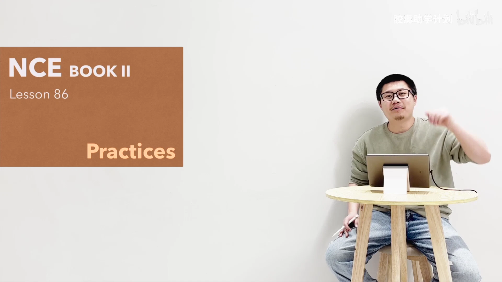

文字识别：NCE / BOOKⅡI / Lesson 86 / Practices

### 画面 00:00:02

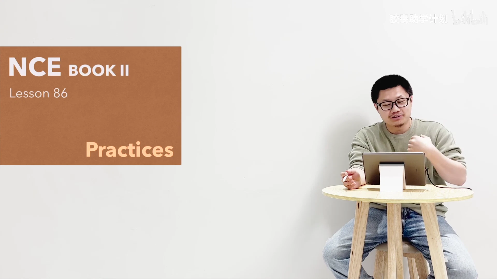

文字识别：NCE / BOOK I"I / Lesson 86 / Practices

### 画面 00:00:04

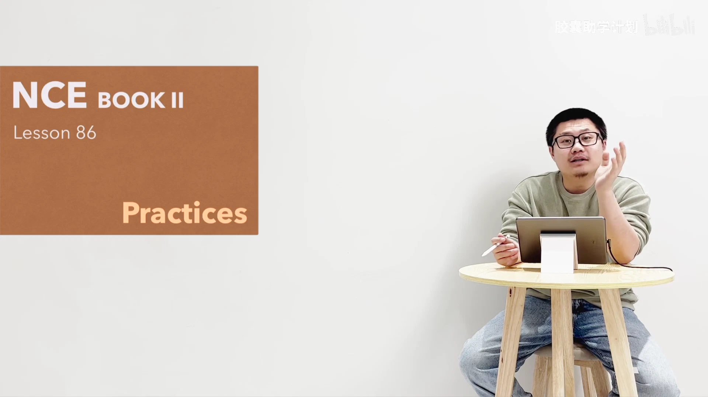

文字识别：NCE / BOOKII / Lesson 86 / Practices

### 画面 00:00:06

文字识别：NCE / BOOKII / Lesson 86 / Practices

### 画面 00:00:08

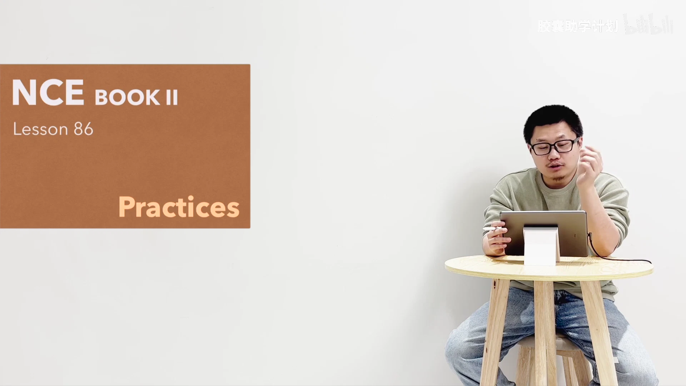

文字识别：NCE / BOOKII / Lesson 86 / Practices

### 画面 00:00:10

文字识别：进行如下练习唯一前提 / 文章跟读至熟读成诵 / 否则请勿开始

### 画面 00:00:17

文字识别：bibii / 胶囊助学计划 / ••

### 画面 00:00:21

文字识别：胶囊助学计划 / 胶囊助学计划

### 画面 00:00:23

文字识别：Comprehension / 训练目标： / 听懂一般疑问句＆特殊疑问句

### 画面 00:00:25

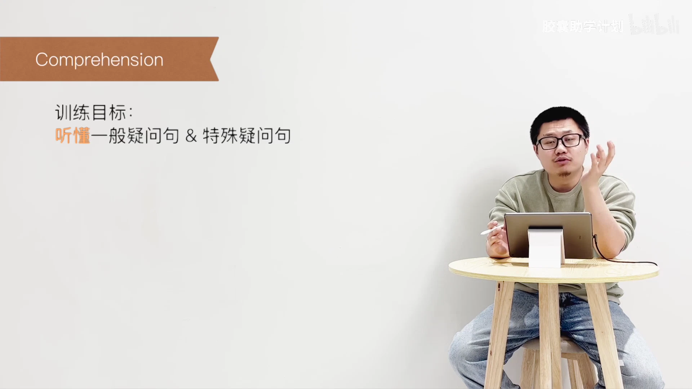

文字识别：Comprehension / 训练目标： / 听懂一般疑问句＆特殊疑问句

### 画面 00:00:29

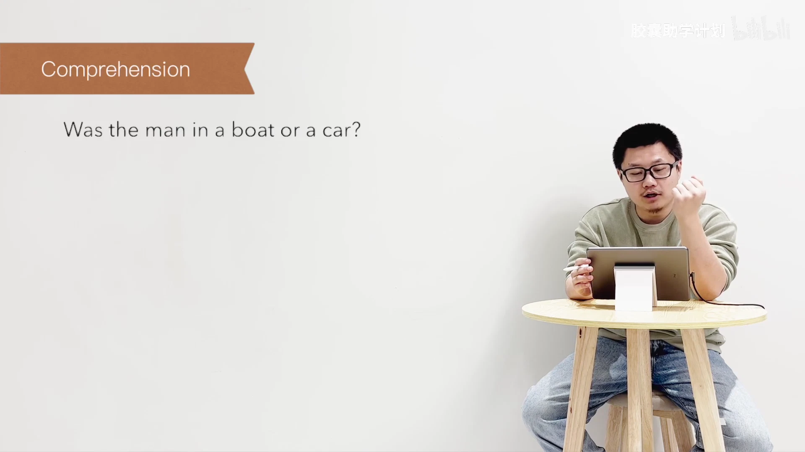

文字识别：Comprehension / Was the man in a boat or a car?

## 00:00:30–00:01:00

Was the man in a boat or a car? In a boat. Next one, What kind of boat was it? A speedboat. Next one, When did the steering wheel come away in his hand? When he tried to swing the speedboat round. Next one, What had his companion been doing

### 画面 00:00:31

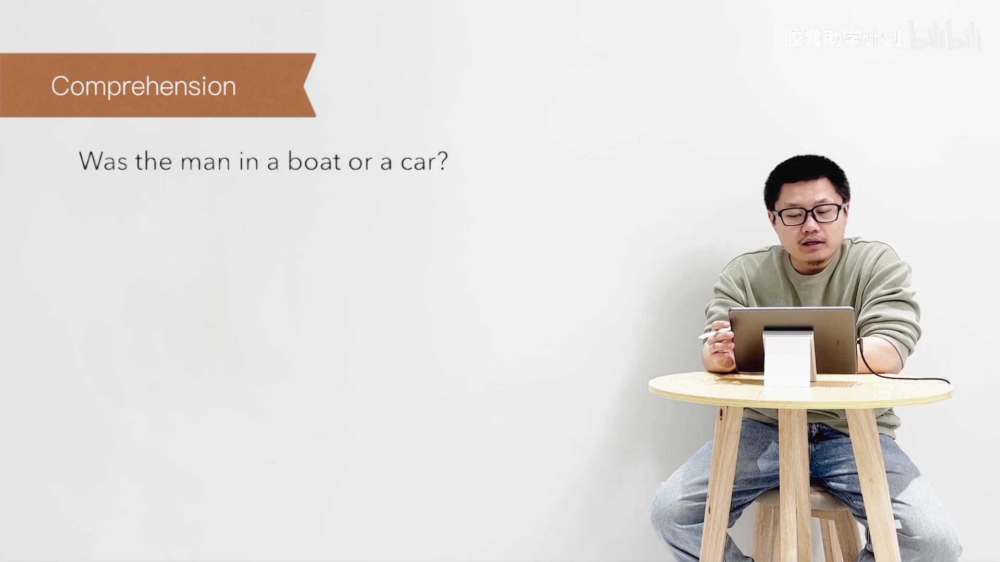

文字识别：Comprehension / Was the man in a boat or a car?

### 画面 00:00:35

文字识别：Comprehension / Was the man in a boat or a car? / In a boat.

### 画面 00:00:38

文字识别：Comprehension / What kind of boat was it?

### 画面 00:00:41

文字识别：Comprehension / What kind of boat was it? / A speedboat.

### 画面 00:00:47

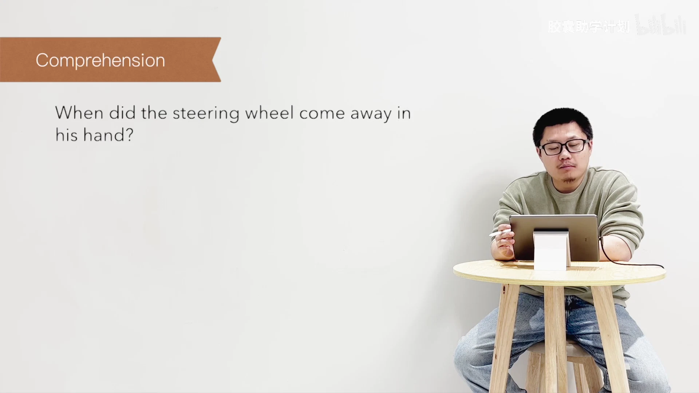

文字识别：Comprehension / When did the steering wheel come away in / his hand?

### 画面 00:00:50

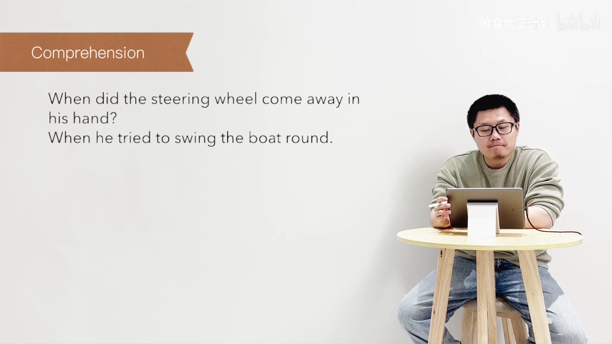

文字识别：Comprehension / When did the steering wheel come away in / his hand? / When he tried to swing the boat round.

### 画面 00:00:55

文字识别：Comprehension / What had his companion been doing for the / last fifteen minutes?

## 00:01:00–00:01:30

for the last fifteen minutes. Water skiing. Next one, he waved desperately to him. Didn't he? Yes, he did. Did they realize what was happening? No, they didn't. They were thrown violently into the sea. Won't they? Yes, they

### 画面 00:01:03

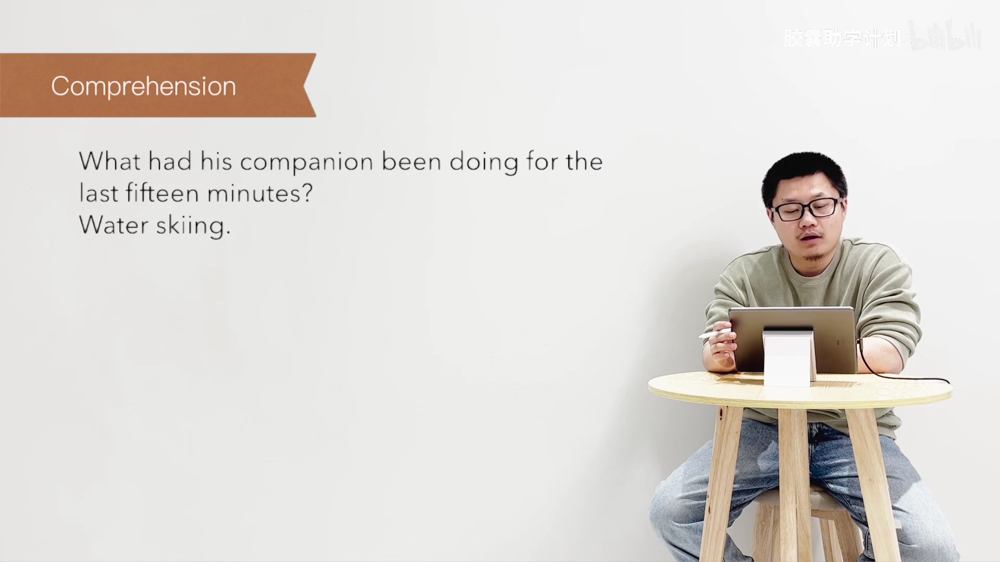

文字识别：Comprehension / What had his companion been doing for the / last fifteen minutes? / Water skiing.

### 画面 00:01:06

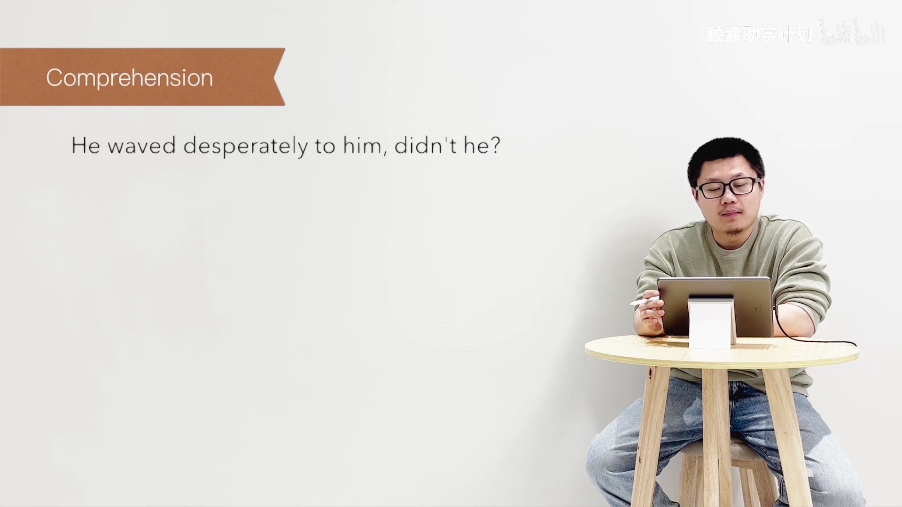

文字识别：Comprehension / He waved desperately to him, didn't he?

### 画面 00:01:10

文字识别：Comprehension / He waved desperately to him, didn't he?

### 画面 00:01:16

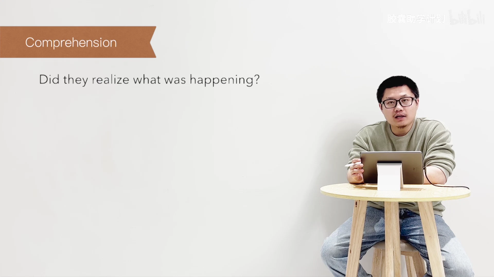

文字识别：Comprehension / Did they realize what was happening?

### 画面 00:01:21

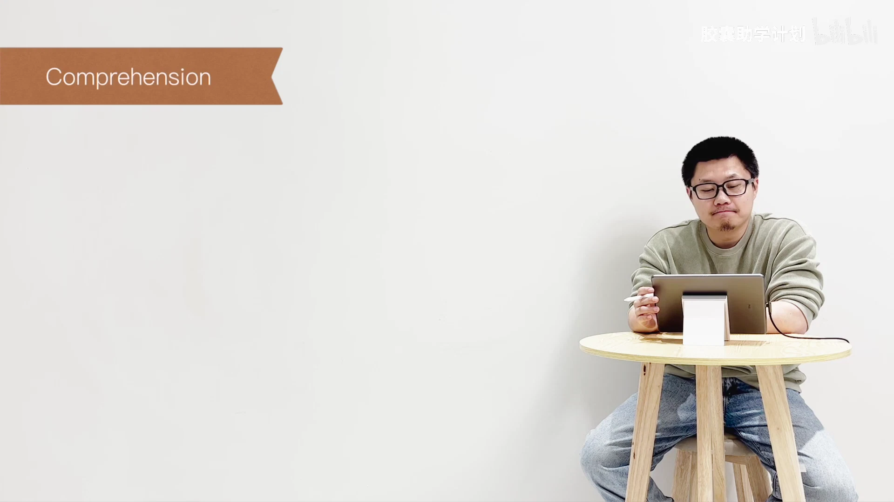

文字识别：助学计划 / Comprehension

## 00:01:30–00:02:00

were. What had the speedboat struck? A boy. What did it continue to do? To move very quickly across the water. Was it moving in a straight line or a circle? In a circle. How did the man

### 画面 00:01:30

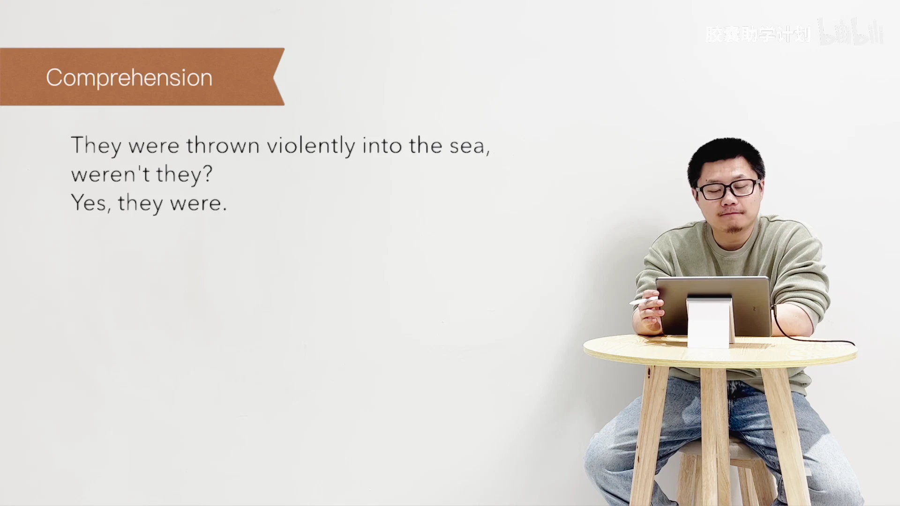

文字识别：Comprehension / They were thrown violently into the sea, / weren't they? / Yes, they were.

### 画面 00:01:35

文字识别：学计场 / Comprehension / What had the speedboat struck?

### 画面 00:01:40

文字识别：助字计划 / Comprehension / What did it continue to do?

### 画面 00:01:45

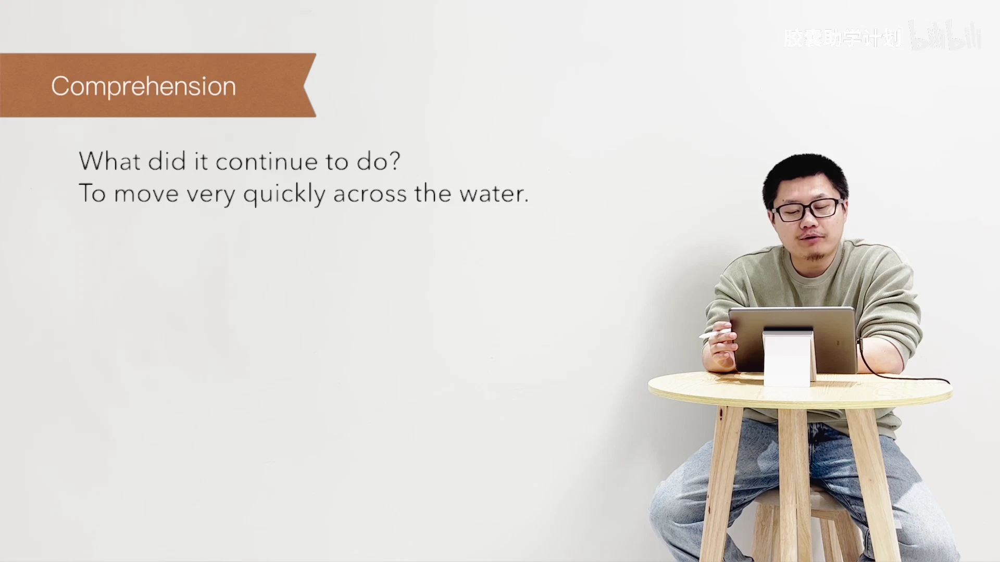

文字识别：Comprehension / What did it continue to do? / To move very quickly across the water.

### 画面 00:01:49

文字识别：Comprehension / Was it moving in a straight line or a circle?

### 画面 00:01:51

文字识别：Comprehension / Was it moving in a straight line or a circle?

### 画面 00:01:56

文字识别：Comprehension / Was it moving in a straight line or a circle? / In a circle.

## 00:02:00–00:02:30

feel when they saw this? Dismayed. What had they just began to do? They had just began to swim towards the shore. Asking questions, 四句型转换啊。好，我们先看第一个例子，就 Ask me if the man tried to swing the spade around. Tried, 一般过去时， did 提前，动词还原形，对吧？ What

### 画面 00:02:00

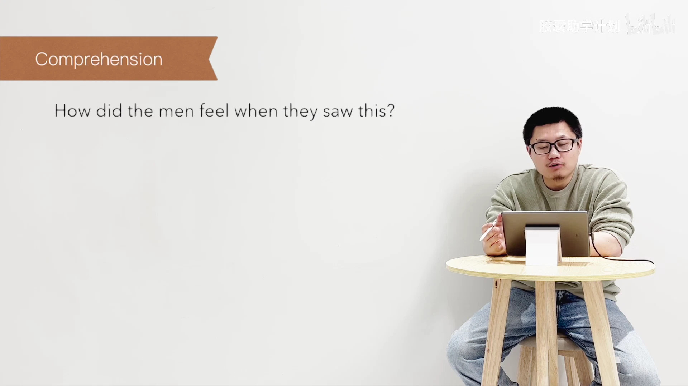

文字识别：Comprehension / How did the men feel when they saw this?

### 画面 00:02:08

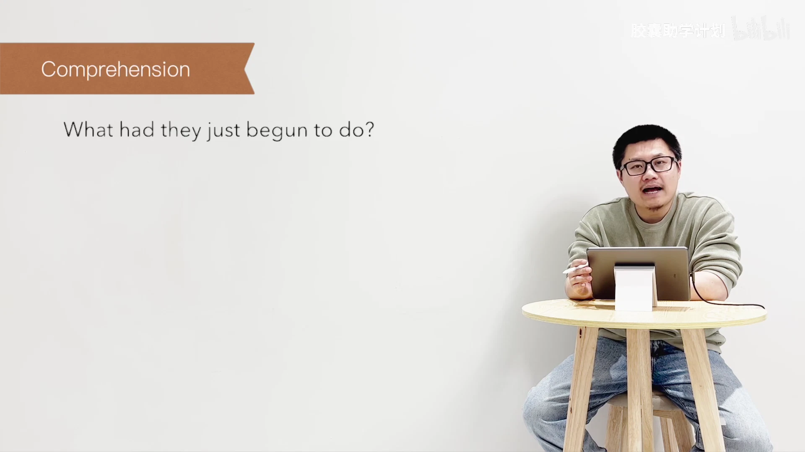

文字识别：Comprehension / What had they just begun to do?

### 画面 00:02:12

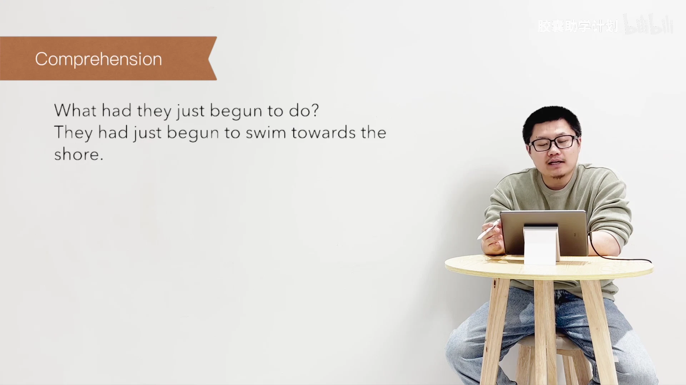

文字识别：Comprehension / What had they just begun to do? / They had just begun to swim towards the / shore.

### 画面 00:02:15

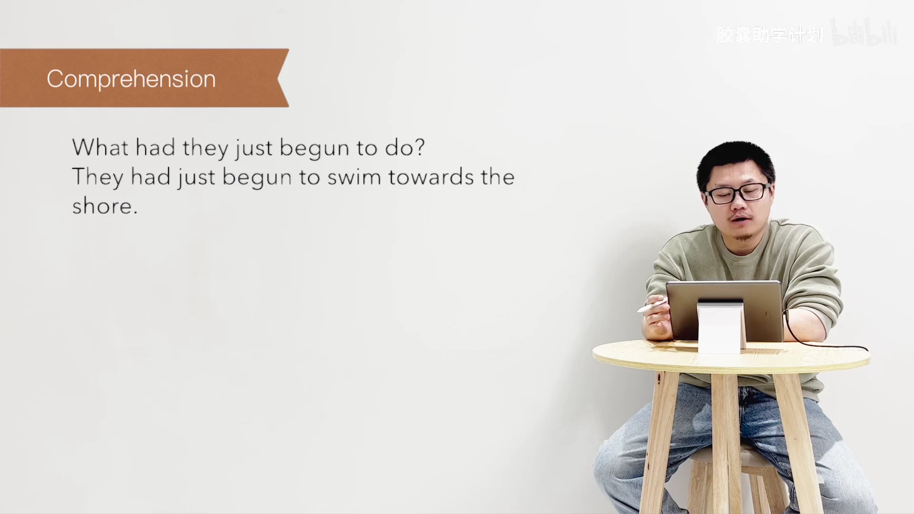

文字识别：Comprehension / What had they just begun to do? / They had just begun to swim towards the / shore.

### 画面 00:02:17

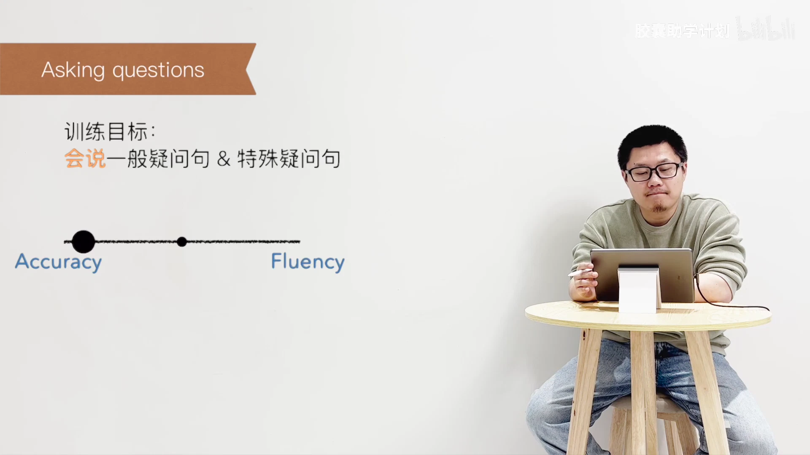

文字识别：Asking questions / 训练目标： / 会说一般疑问句＆特殊疑问句 / Accuracy / Fluency

### 画面 00:02:19

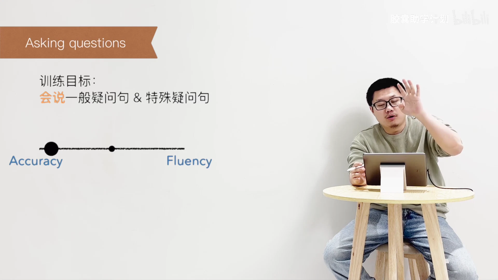

文字识别：Asking questions / 训练目标： / 会说一般疑问句＆特殊疑问句 / Accuracy / Fluency

### 画面 00:02:21

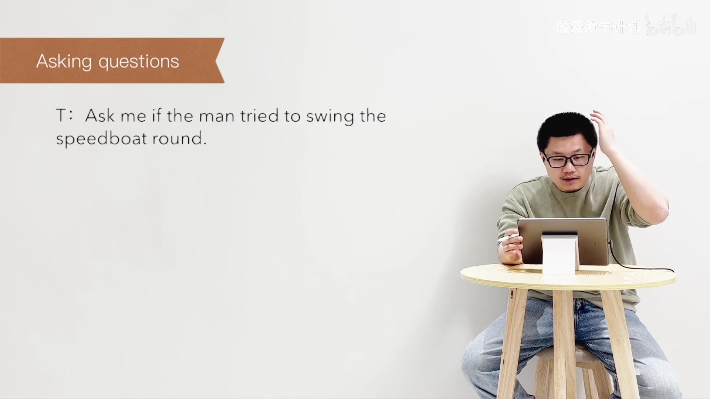

文字识别：Asking questions / T: Ask me if the man tried to swing the / speedboat round.

### 画面 00:02:23

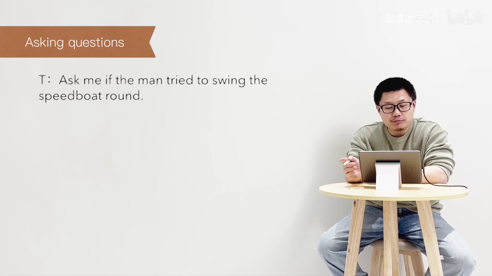

文字识别：Asking questions / T: Ask me if the man tried to swing the / speedboat round.

### 画面 00:02:26

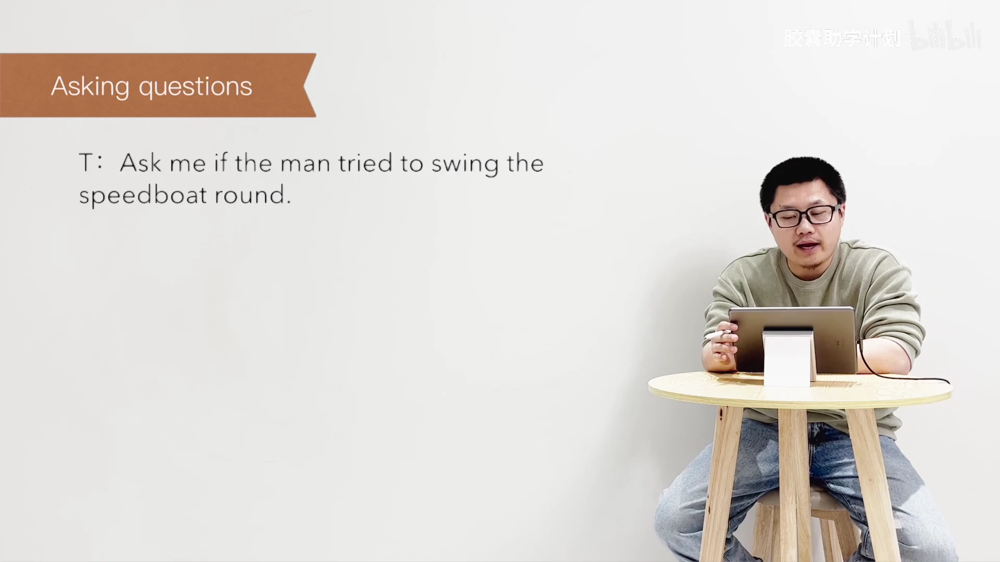

文字识别：Asking questions / T: Ask me if the man tried to swing the / speedboat round.

## 00:02:30–00:03:00

儿点儿do标准答案？What did the man try to do？啊啊，其实你直接给What did the man do也可以啊，只不过他这有一个try to嘛啊，再加上了也没问题。呃，第二个，The steering wheel came away in his hands as he did so，肯定是did提前。问呢？对，as he did so这个时间状语从句提问啊。He waved desperately to his companion. Did提前？Who点儿点儿to？那你就who就对his companion

### 画面 00:02:30

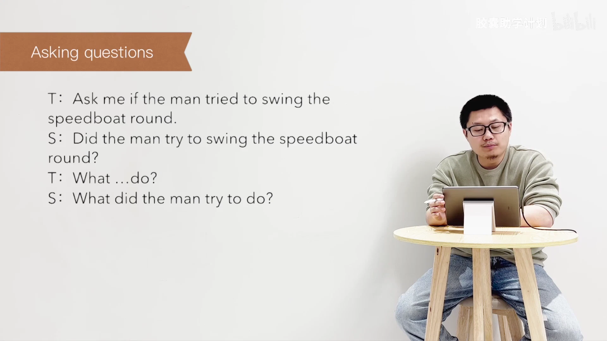

文字识别：Asking questions / T: Ask me if the man tried to swing the / speedboat round. / S: Did the man try to swing the speedboat / round? / T: What ...do? / S: What did the man try to do?

### 画面 00:02:35

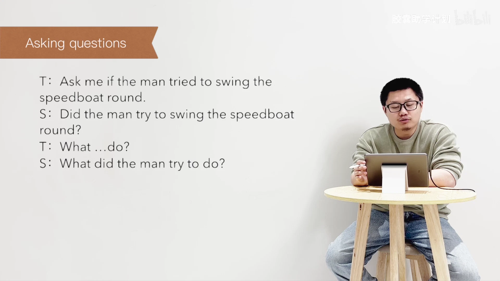

文字识别：Asking questions / T: Ask me if the man tried to swing the / speedboat round. / S: Did the man try to swing the speedboat / round? / T: What ...do? / S: What did the man try to do?

### 画面 00:02:40

文字识别：Asking questions / 1. The man tried to swing the speedboat / round.(What ...do)

### 画面 00:02:43

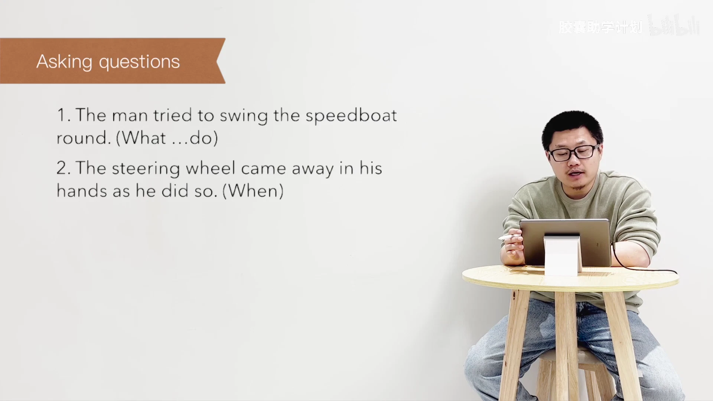

文字识别：Asking questions / 1.The man tried to swing the speedboat / round.(What ...do) / 2. The steering wheel came away in his / hands as he did so. (When)

### 画面 00:02:47

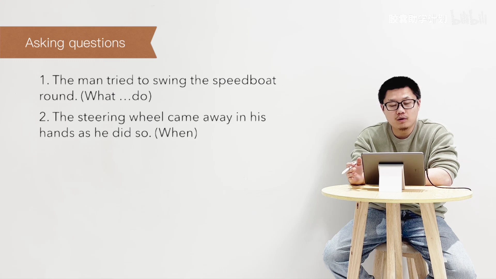

文字识别：Asking questions / 1.The man tried to swing the speedboat / round.(What ...do) / 2. The steering wheel came away in his / hands as he did so. (When)

### 画面 00:02:50

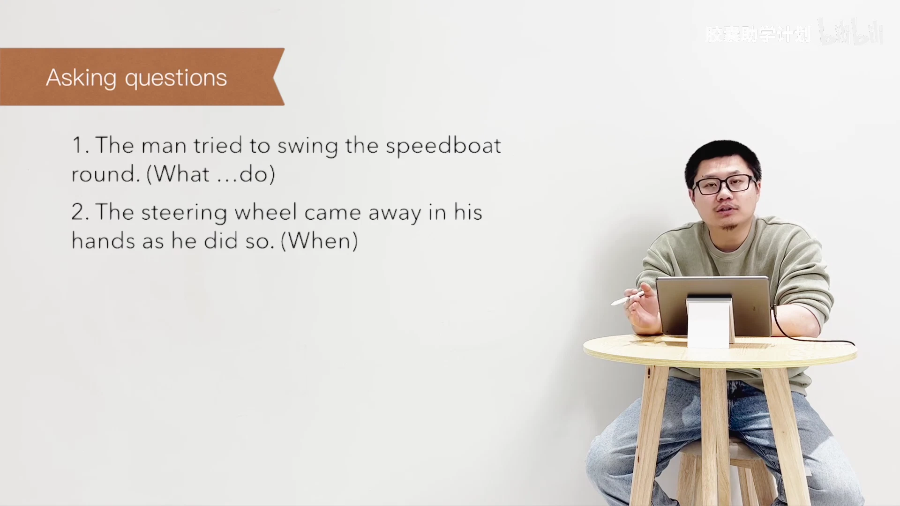

文字识别：Asking questions / 1.The man tried to swing the speedboat / round.(What ...do) / 2. The steering wheel came away in his / hands as he did so. (When)

### 画面 00:02:54

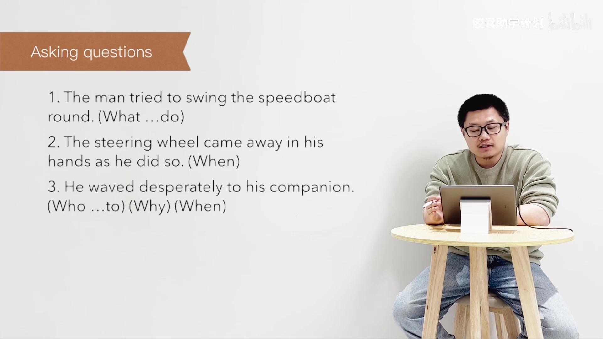

文字识别：Asking questions / 1.The man tried to swing the speedboat / round.(What ...do) / 2. The steering wheel came away in his / hands as he did so. (When) / 3. He waved desperately to his companion. / (Who ..to) (Why) (When)

### 画面 00:02:59

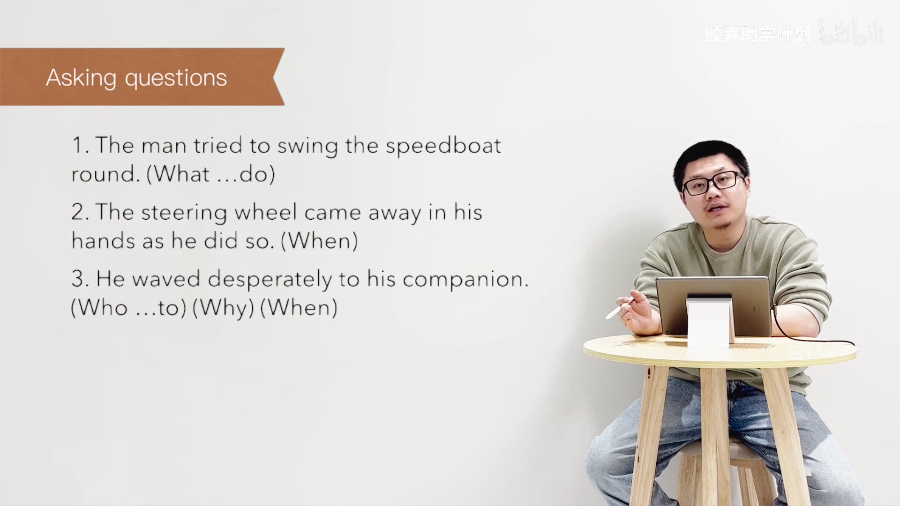

文字识别：Asking questions / 1.The man tried to swing the speedboat / round.(What ...do) / 2. The steering wheel came away in his / hands as he did so. (When) / 3. He waved desperately to his companion. / (Who ..to) (Why) (When)

## 00:03:00–00:03:30

提问啊，注意变一般疑问呃，这个对主语提问不变一般疑问句，对不是主语部分的提问还是要变一般疑问句的啊，加一般疑问句。那 why 呢？加整句话，问加整句话。 He was water skiing，啊，正在划水，was 提前。 What was he doing？标准答案。 He had been water skiing for the last fifteen minutes， had 提前，对吧？ How long 对 for the last fifteen minutes 提问， who 对主语提问。

### 画面 00:03:02

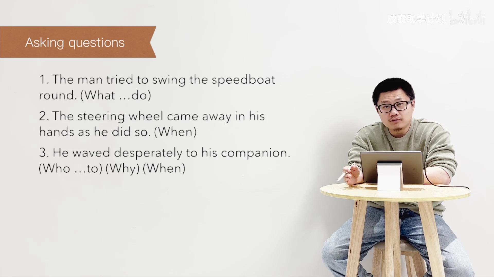

文字识别：Asking questions / 1.The man tried to swing the speedboat / round.(What ...do) / 2. The steering wheel came away in his / hands as he did so. (When) / 3. He waved desperately to his companion. / (Who ..to)(Why) (When)

### 画面 00:03:05

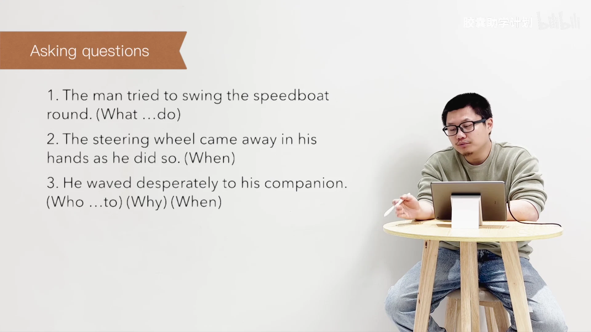

文字识别：Asking questions / 1.The man tried to swing the speedboat / round.(What ...do) / 2. The steering wheel came away in his / hands as he did so. (When) / 3. He waved desperately to his companion. / (Who ..to)(Why) (When)

### 画面 00:03:11

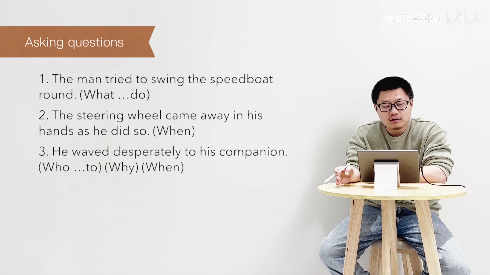

文字识别：Asking questions / 1.The man tried to swing the speedboat / round.(What ...do) / 2. The steering wheel came away in his / hands as he did so. (When) / 3. He waved desperately to his companion. / (Who ..to)(Why) (When)

### 画面 00:03:15

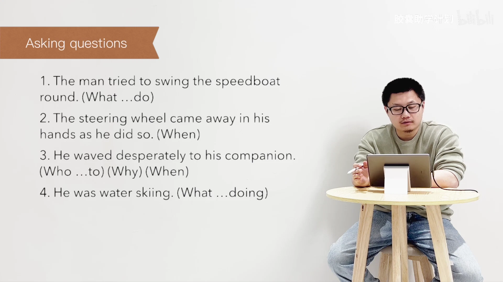

文字识别：Asking questions / 1.The man tried to swing the speedboat / round.(What ...do) / 2. The steering wheel came away in his / hands as he did so. (When) / 3. He waved desperately to his companion. / (Who ...to) (Why) (When) / 4. He was water sking. (What ...doing)

### 画面 00:03:17

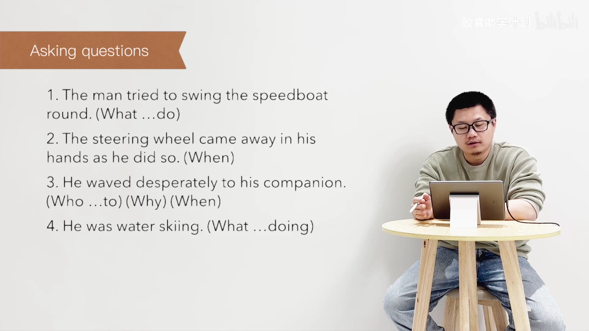

文字识别：Asking questions / 1.The man tried to swing the speedboat / round.(What ...do) / 2. The steering wheel came away in his / hands as he did so. (When) / 3. He waved desperately to his companion. / (Who ...to) (Why) (When) / 4. He was water sking. (What ...doing)

### 画面 00:03:20

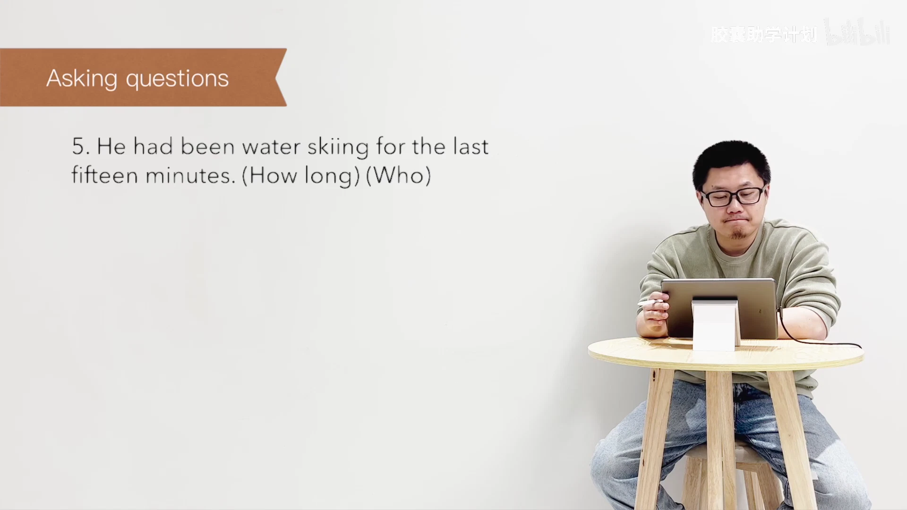

文字识别：Asking questions / 5. He had been water sking for the last / fifteen minutes.(How long)(Who)

### 画面 00:03:23

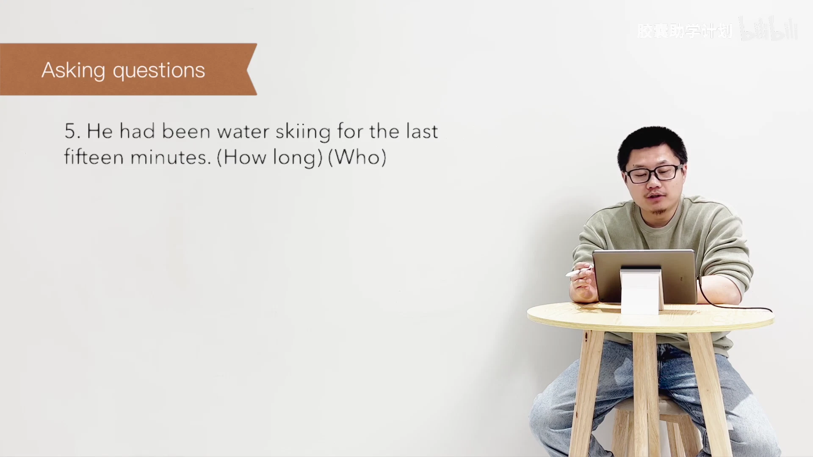

文字识别：Asking questions / 5. He had been water sking for the last / fifteen minutes.(How long)(Who)

### 画面 00:03:25

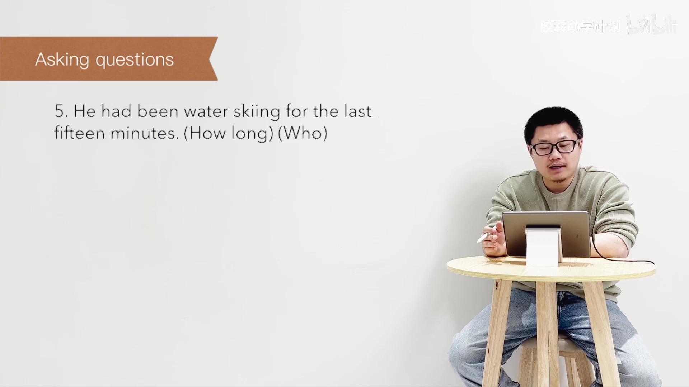

文字识别：Asking questions / 5. He had been water sking for the last / fifteen minutes.(How long)(Who)

### 画面 00:03:29

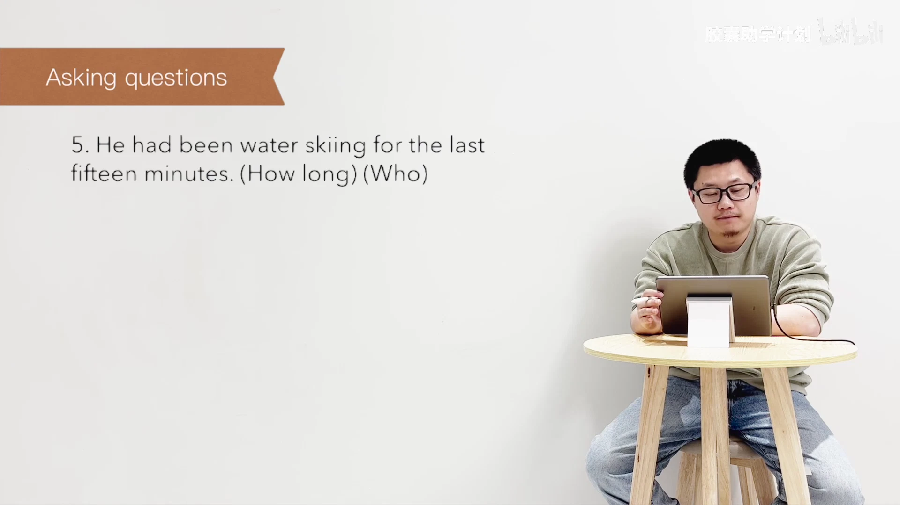

文字识别：Asking questions / 5. He had been water sking for the last / fifteen minutes.(How long)(Who)

## 00:03:30–00:04:00

Both men were thrown violently into the sea. Where提前？How对violently提问？When对整句话提问？Who对主语提问？对吧？They had hardly had time to realize what was happening. Had提前？How much time对那个hardly had time？对吧？其实就是How much time had they had to realize what was happening？对吧？呃，The boat has struck a

### 画面 00:03:35

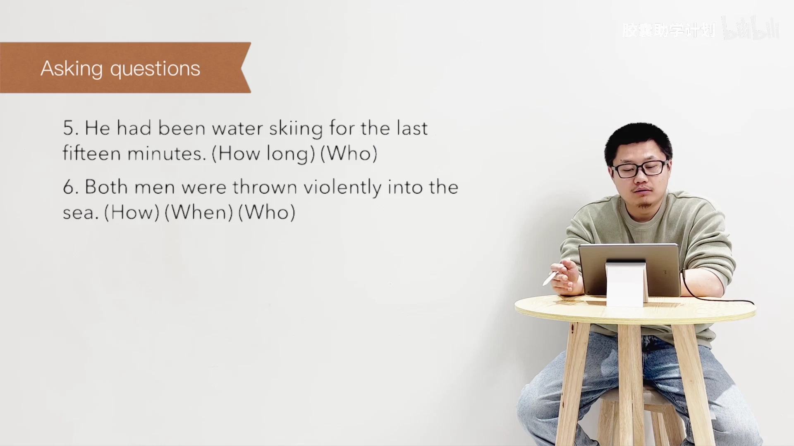

文字识别：Asking questions / 5. He had been water sking for the last / fifteen minutes.(How long)(Who) / 6. Both men were thrown violently into the / sea.(How)(When)(Who)

### 画面 00:03:42

文字识别：Asking questions / 5. He had been water sking for the last / fifteen minutes. (How long)(Who) / 6. Both men were thrown violently into the / sea.(How)(When)(Who) / 7. They had hardly had time to realize what / was happening. (How much time)

### 画面 00:03:45

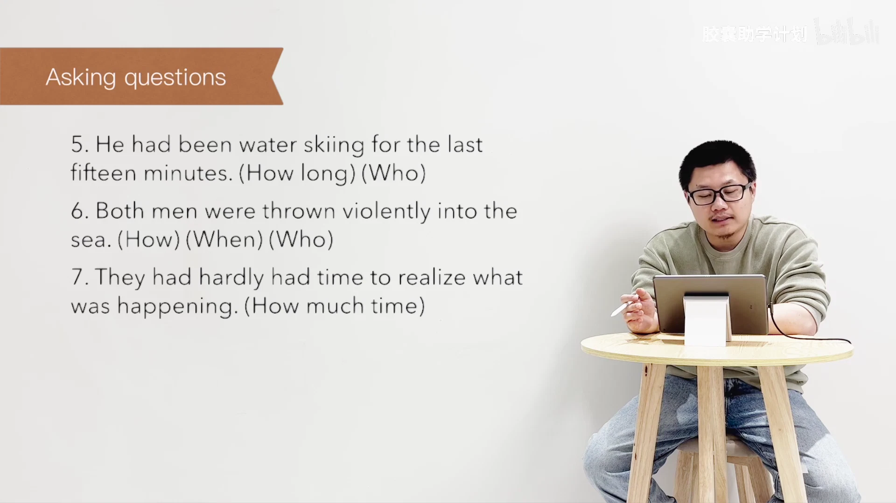

文字识别：Asking questions / 5. He had been water sking for the last / fifteen minutes. (How long)(Who) / 6. Both men were thrown violently into the / sea.(How)(When)(Who) / 7. They had hardly had time to realize what / was happening. (How much time)

### 画面 00:03:47

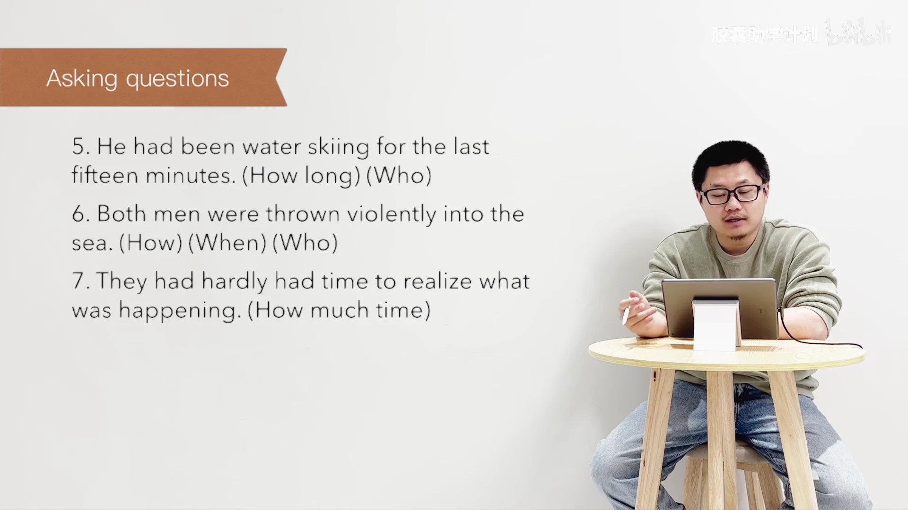

文字识别：Asking questions / 5. He had been water sking for the last / fifteen minutes.(How long)(Who) / 6. Both men were thrown violently into the / sea.(How)(When)(Who) / 7. They had hardly had time to realize what / was happening. (How much time)

### 画面 00:03:50

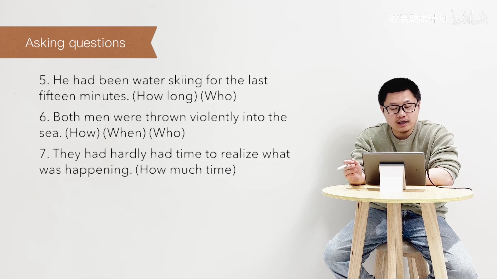

文字识别：Asking questions / 5. He had been water sking for the last / fifteen minutes.(How long)(Who) / 6. Both men were thrown violently into the / sea.(How)(When)(Who) / 7. They had hardly had time to realize what / was happening. (How much time)

### 画面 00:03:55

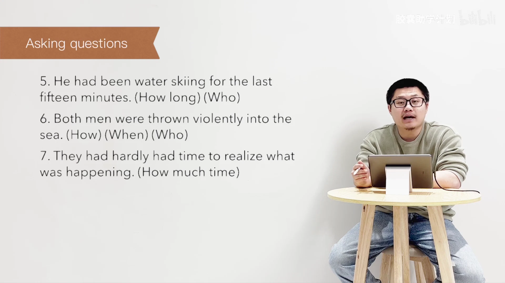

文字识别：Asking questions / 5. He had been water sking for the last / fifteen minutes.(How long)(Who) / 6. Both men were thrown violently into the / sea.(How) (When)(Who) / 7. They had hardly had time to realize what / was happening. (How much time)

### 画面 00:03:57

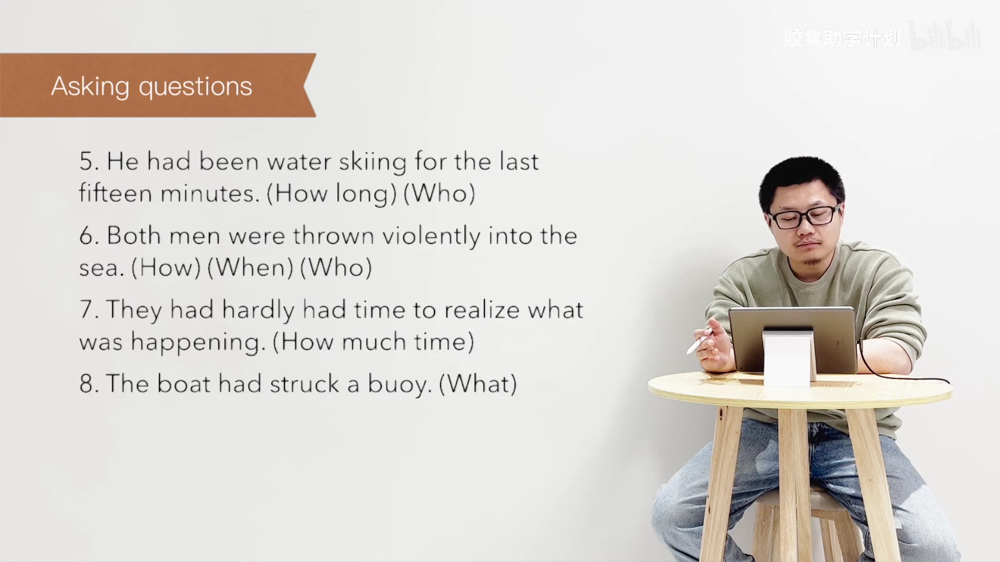

文字识别：Asking questions / 5. He had been water sking for the last / fifteen minutes. (How long)(Who) / 6. Both men were thrown violently into the / sea.(How)(When)(Who) / 7. They had hardly had time to realize what / was happening. (How much time) / 8. The boat had struck a buoy.(What)

## 00:04:00–00:04:30

Had struck,过去完成时。你把had提前。What对a boy提问啊？然后tell the story。第一单元做了示范，在这不多说了。还是提一句，练的是我们的流利性。我们国内的考试是不用的，但是国外的雅思、托福考试以及工作、生活、学习当中的真正英语口语水平是需要这个能力的，一定要去练啊。那summary writing呢？在这儿还是两句话。第一句话有

### 画面 00:04:01

文字识别：Asking questions / 5. He had been water sking for the last / fifteen minutes.(How long)(Who) / 6. Both men were thrown violently into the / sea.(How)(When)(Who) / 7. They had hardly had time to realize what / was happening. (How much time) / 8. The boat had struck a buoy.(What)

### 画面 00:04:06

文字识别：Asking questions / 5. He had been water sking for the last / fifteen minutes. (How long)(Who) / 6. Both men were thrown violently into the / sea.(How)(When)(Who) / 7. They had hardly had time to realize what / was happening. (How much time) / 8.The boat had struck a buoy.(What)

### 画面 00:04:08

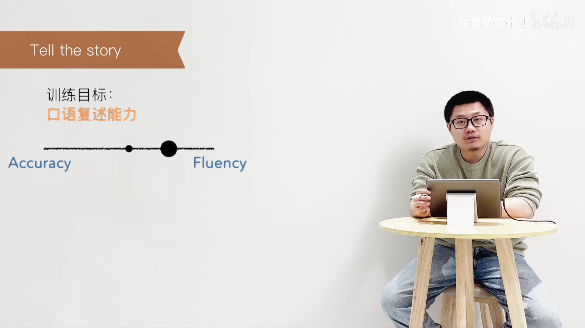

文字识别：喜助字计划 / Tell the story / 训练目标： / 口语复述能力 / Accuracy / Fluency

### 画面 00:04:10

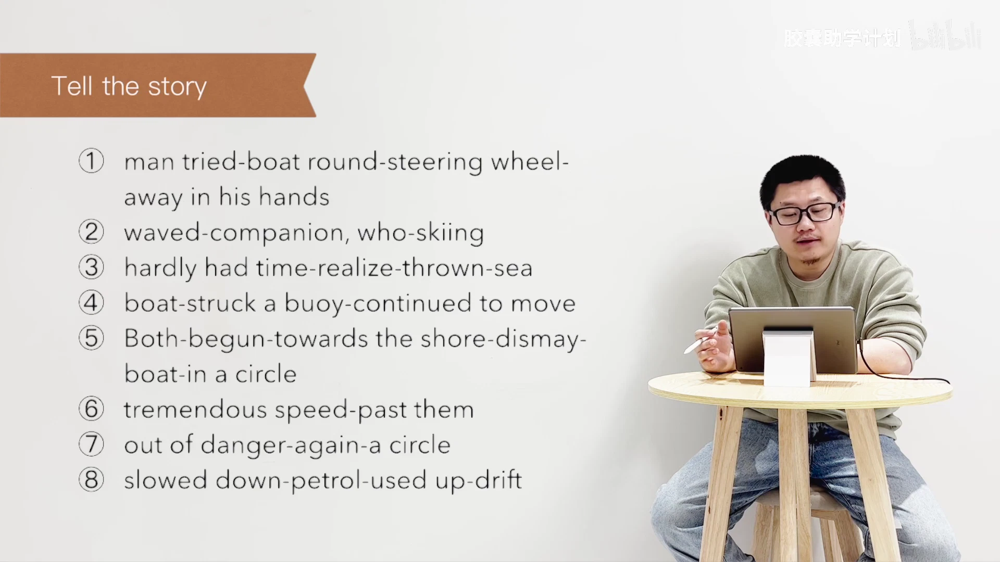

文字识别：Tell the story / man tried-boat round-steering wheel- / 1 / away in his hands / waved-companion, who-sking /  hardly had time-realize-thrown-sea /  boat-struck a buoy-continued to move / Both-begun-towards the shore-dismay- / 5 / boat-in a circle / tremendous speed-past them / 6 / ) out of danger-again-a circle / ⑧ slowed down-petrol-used up-drift

### 画面 00:04:15

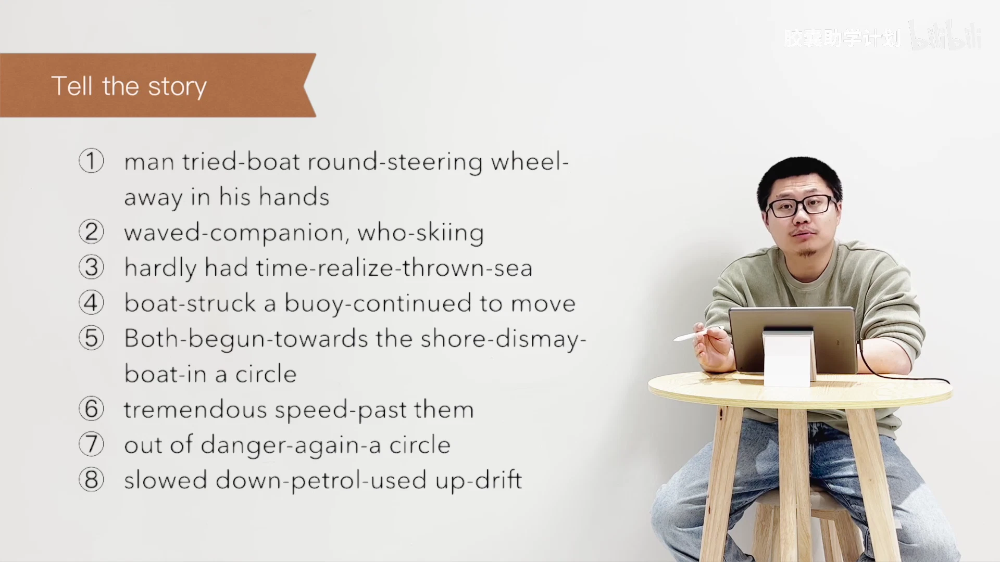

文字识别：Tell the story / man tried-boat round-steering wheel- / 1 / away in his hands / waved-companion, who-skiing /  hardly had time-realize-thrown-sea / 3 /  boat-struck a buoy-continued to move / Both-begun-towards the shore-dismay- / 5 / boat-in a circle / tremendous speed-past them / 6 / ) out of danger-again-a circle / ⑧ slowed down-petrol-used up-drift

### 画面 00:04:20

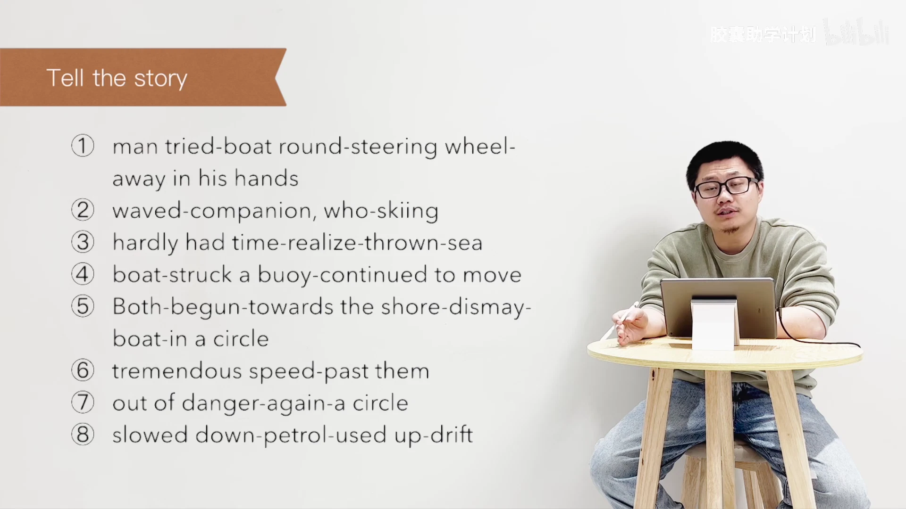

文字识别：Tell the story / 1 / man tried-boat round-steering wheel- / away in his hands / waved-companion, who-skiing /  hardly had time-realize-thrown-sea /  boat-struck a buoy-continued to move / Both-begun-towards the shore-dismay- / 5 / boat-in a circle / tremendous speed-past them / 6 / ) out of danger-again-a circle / ⑧ slowed down-petrol-used up-drift

### 画面 00:04:25

文字识别：Tell the story / man tried-boat round-steering wheel- / 1 / away in his hands / waved-companion, who-sking /  hardly had time-realize-thrown-sea /  boat-struck a buoy-continued to move / Both-begun-towards the shore-dismay- / 5 / boat-in a circle / tremendous speed-past them / 6 / ) out of danger-again-a circle / ⑧ slowed down-petrol-used up-drift

### 画面 00:04:27

文字识别：臺助学计划 / Summary writing: Key / 训练目标： / 写作复述能力

## 00:04:30–00:05:00

两篇文章。第二句话重点看连词。第一篇文章，第二篇文章啊。好，topic for discussion，咱们看一下题，这事儿就结了。What do you enjoy doing most when you go to the seaside?你去海边的时候最享受的事儿是啥？赶海，抓螃蟹。What kind of boat would you like to own? Give reasons for your choice.哎，你想要什么

### 画面 00:04:30

文字识别：Summary writing: Key / 训练目标： / 写作复述能力

### 画面 00:04:32

文字识别：Summary writing: Key / 训练目标： / 写作复述能力

### 画面 00:04:34

文字识别：助字计划 / Summary writing: Key / The moment the speedboat struck the buoy, / both men were thrown into the water. As it / moved off very quickly across the water, the / men began to swim towards the shore. / Turning in a circle, the speedboat came / straight towards them. After it had just / missed them, they swam until they were out / of danger. When the boat returned it had / lost speed. Soon all the petrol was used up / and it floated across the water.

### 画面 00:04:36

文字识别：助学计划 / Summary writing: Key / Because the speedboat had struck a buoy, / both men were thrown into the water. It / moved off very quickly and, while the men / were swimming towards the shore, it turned / in a circle, came straight towards them and / only just missed them. They had no sooner / swum out of danger than the boat returned. / This time, however, it had lost speed / because nearly all the petrol had been used / up and it floated across the water.

### 画面 00:04:38

文字识别：Topics for discussion / 训练目标： / 完全自由的对话 / Accuracy / Fluency

### 画面 00:04:40

文字识别：字计划 / Topics for discussion / What do you enjoy doing most when you / go to the seaside? / What kind of boat would you like to / own? Give reasons for your choice. / Which do you consider the greater / 3 / achievement: winning a gold medal in a / sailing event in the Olympic Games or / sailing round the world single-handed? / Why?

### 画面 00:04:45

文字识别：字计划 / Topics for discussion / What do you enjoy doing most when / go to the seaside? / What kind of boat would you like to / own? Give reasons for your choice. / Which do you consider the greater / 3 / achievement: winning a gold medal in a / sailing event in the Olympic Games or / sailing round the world single-handed? / Why?

### 画面 00:04:53

文字识别：Topics for discussion / What do you enjoy doing most when you / go to the seaside? / What kind of boat would you like to / own? Give reasons for your choice. / Which do you consider the greater / 3 / achievement: winning a gold medal in a / sailing event in the Olympic Games or / sailing round the world single-handed? / Why?

### 画面 00:04:55

文字识别：助学计划 / Topics for discussion / What do you enjoy doing most when you / go to the seaside? / What kind of boat would you like to / own? Give reasons for your choice. / Which do you consider the greater / 3 / achievement: winning a gold medal in a / sailing event in the Olympic Games or / sailing round the world single-handed? / Why?

### 画面 00:04:57

文字识别：Topics for discussion / What do you enjoy doing most when you / go to the seaside? / What kind of boat would you like to / own? Give reasons for your choice. / Which do you consider the greater / 3 / achievement: winning a gold medal in a / sailing event in the Olympic Games or / sailing round the world single-handed? / Why?

## 00:05:00–00:05:30

类型的船？说说为啥。最后一个，Why do you consider the greater achievement? Ah, which do you consider the greater achievement?接下来哪个你认为是一个呃这个呃更大的成就？第一个事儿是 winning a gold medal in a sailing event in the Olympic Games，就是奥林匹克运动会里边赢一个帆船类型的比赛的冠军，gold medal，金牌。Or sailing around the world single-handed. Why?

### 画面 00:05:00

文字识别：正字计划 / Topics for discussion / What do you enjoy doing most when you / go to the seaside? / What kind of boat would you like to / own? Give reasons for your choice. / Which do you consider the greater / 3 / achievement: winning a gold medal in a / sailing event in the Olympic Games or / sailing round the world single-handed? / Why?

### 画面 00:05:22

文字识别：助字计划 / Topics for discussion / What do you enjoy doing most when you / go to the seaside? / What kind of boat would you like to / own? Give reasons for your choice. / Which do you consider the greater / 3 / achievement: winning a gold medal in a / sailing event in the Olympic Games or / sailing round the world single-handed? / Why?

### 画面 00:05:25

文字识别：Topics for discussion / What do you enjoy doing most when you / go to the seaside? / What kind of boat would you like to / own? Give reasons for your choice. / Which do you consider the greater / 3 / achievement: winning a gold medal in a / sailing event in the Olympic Games or / sailing round the world single-handed? / Why?

## 00:05:30–00:06:00

This is important. Single-handed, not one hand. Ah, it's this one person. Ah, one person. Ah, using a boat. Ah, sailing around the world, right? Why? Explain your reason. Homework? Ask Mif to write first, then read aloud. Write the essay. Check the answers. Tell the story. We'll do the oral review. Then leave a comment at the top to find the repeated intervals of learning materials. That's all for this video. If you like our course, please follow and subscribe. One click and three links to share with those who need it.

### 画面 00:05:30

文字识别：Topics for discussion / What do you enjoy doing most when you / go to the seaside? / What kind of boat would you like to / own? Give reasons for your choice. / Which do you consider the greater / 3 / achievement: winning a gold medal in a / sailing event in the Olympic Games or / sailing round the world single-handed? / Why?

### 画面 00:05:32

文字识别：姬学计划 / Topics for discussion / What do you enjoy doing most when you / go to the seaside? / What kind of boat would you like to / own? Give reasons for your choice. / Which do you consider the greater / 3 / achievement: winning a gold medal in a / sailing event in the Olympic Games or / sailing round the world single-handed? / Why?

### 画面 00:05:35

文字识别：字计划 / Topics for discussion / What do you enjoy doing most when you / go to the seaside? / What kind of boat would you like to / own? Give reasons for your choice. / Which do you consider the greater / 3 / achievement: winning a gold medal in a / sailing event in the Olympic Games or / sailing round the world single-handed? / Why?

### 画面 00:05:40

文字识别：助字计划 / Topics for discussion / What do you enjoy doing most when you / go to the seaside? / What kind of boat would you like to / own? Give reasons for your choice. / Which do you consider the greater / 3 / achievement: winning a gold medal in a / sailing event in the Olympic Games or / sailing round the world single-handed? / Why?

### 画面 00:05:42

文字识别：喜助学计划国调 / 1.Ask me if写&朗读

### 画面 00:05:44

文字识别：建助字计划国调 / 1.Ask me if写&朗读 / 2. / 摘要写作写&答案

### 画面 00:05:46

文字识别：1.Ask me if写&朗读 / 摘要写作写&答案 / 3.Tell the story 口语复述

### 画面 00:05:48

文字识别：1.Ask me if写&朗读 / 摘要写作写&答案 / 3.Tell the story 口语复述 / 4.重复间隔（置顶留言）

### 画面 00:05:50

文字识别：1.Ask me if写&朗读 / 摘要写作写&答案 / 3.Tell the story 口语复述 / 4.重复间隔（置顶留言）

### 画面 00:05:52

文字识别：虚助学计划

### 画面 00:05:54

文字识别：意助学计划一 / 不

### 画面 00:05:56

文字识别：袁助学计划一调 / 不 / 餐

## 00:06:00–00:06:18

分享给那些需要的朋友，来帮助我们快速成长。See you next time.

### 画面 00:06:04

文字识别：虞助学计划一调

### 画面 00:06:06

文字识别：聖動字計切 / CAPSULEACADEMY / 胶囊助学计划 / 『 / 小红书 / Lectur / OE

### 画面 00:06:08

文字识别：CAPSULEACADEMY / 胶囊助学计划 / 小红书 / Ph / OE

### 画面 00:06:11

文字识别：臺聖珈学計切 / CAPSULEACADEMY / 胶囊助学计划 / 『 / 小红书 / Editor / Berlin / OE

### 画面 00:06:14

文字识别：CAPSULEACADEMY / 胶囊助学计划 / 『 / 小红书 / Leo & Berlin

### 画面 00:06:16

文字识别：bilibili / 胶囊助学计划

### 画面 00:06:17

文字识别：bilibili / 胶囊助学计划

