# 087 单词

快速机器解析：语音为单模型转写，未进行独立交叉校对或人工复核；画面每秒采样并按变化选帧，短时文字和标记可能遗漏。截图时间约有 1 秒误差。图片有损压缩；遇到疑点请按时间查看 Google Drive 原视频。

## 00:00:00–00:00:30

Hello everyone, welcome to Capsule Academy. This is Leo. Today we are going to learn New Concept English Book Two Lesson Eighty Seven Words. 那老习惯进入正式课程之前呢，咱们看几个小的问题。首先，如何表达不在场的证明啊？接下来，如何表达某人证实了某件事情？接下来，最后一个问题，如何表达你在暗示什么啊？带着这三个问题，hope you guys enjoyed.

### 画面 00:00:00

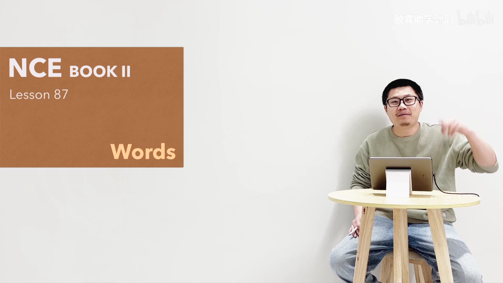

文字识别：NCE / BOOK"I / Lesson 87 / Words

### 画面 00:00:02

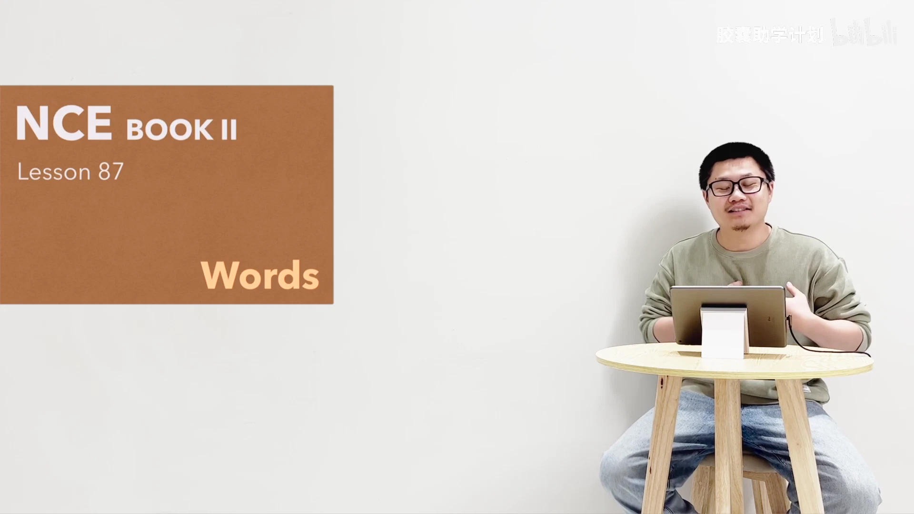

文字识别：NCE / BOOK"I / Lesson 87 / Words

### 画面 00:00:05

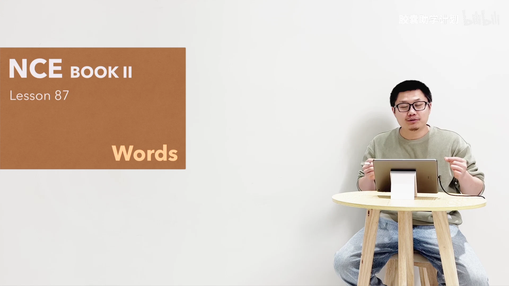

文字识别：NCE / BOOKII / Lesson 87 / Words

### 画面 00:00:12

文字识别：[助学计划一 / 证明”？

### 画面 00:00:14

文字识别：①如何表达“不在场证明”？

### 画面 00:00:18

文字识别：①如何表达“不在场证明” / 如何表达“某人证实某事”?

### 画面 00:00:22

文字识别：①如何表达“不在场证明 / 如何表达“某人证实某事”? / 王暗示什么事情”?

### 画面 00:00:24

文字识别：①如何表达“不在场证明 / 如何表达“某人证实某事”? / 如何表达“你在暗示什么事情”？

### 画面 00:00:26

文字识别：①如何表达“不在场证明” / 如何表达“某人证实某事”? / 如何表达“你在暗示什么事情”?

### 画面 00:00:29

文字识别：Jbitbii / 胶囊助学计划 / •

## 00:00:30–00:01:00

We look at the first word. Look at the phonetic spelling. It's called alibi. Alibi. Alibi. This word's Chinese meaning is very long. It's called alibi. It's a noun. If you say I have alibi, you need to add have, right? For example, we make a sentence: He had a perfect alibi, and the police

### 画面 00:00:33

文字识别：助字计划陽 / 胶囊助学计划

### 画面 00:00:35

文字识别：单词造句指南 / 网：v.+v.变化 / 妻助学计划陽 / 四句型转换 / 方式/地点/时间 / 结合习惯用法 / 其他单词+词性 / 原文摘抄+变 / 6123456 / /'æelrbar/ / alibi n.

### 画面 00:00:38

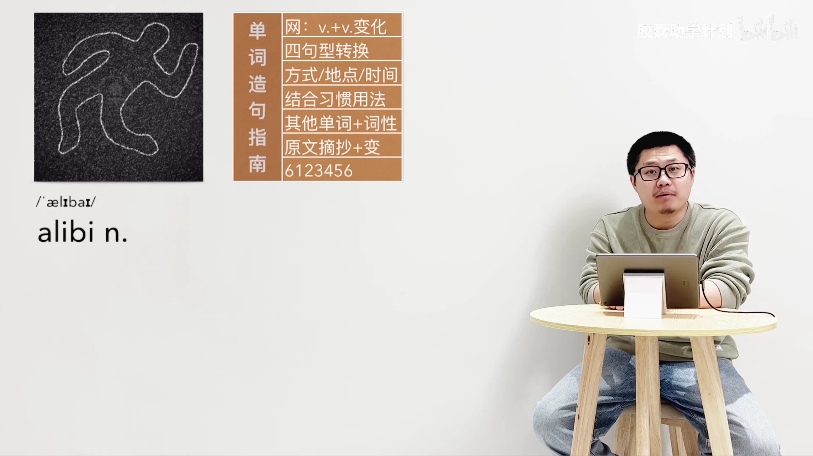

文字识别：单词造句指南 / 网：v.+v.变化 / 霆助学计划情 / 四句型转换 / 方式/地点/时间 / 结合习惯用法 / 其他单词+词性 / 原文摘抄+变 / 6123456 / /'æelrbar/ / alibi n.

### 画面 00:00:40

文字识别：单词造句指南 / 网：v.+v.变化 / 囊助字计划一调 / 四句型转换 / 方式/地点/时间 / 结合习惯用法 / 其他单词+词性 / 原文摘抄+变 / 6123456 / /'æelrbar/ / alibi n.

### 画面 00:00:42

文字识别：单词造句指南 / 网：v.+v.变化 / 囊助字计划一州 / 四句型转换 / 方式/地点/时间 / 结合习惯用法 / 其他单词+词性 / 原文摘抄+变 / 6123456 / /'æelrbar/ / alibi n.

### 画面 00:00:44

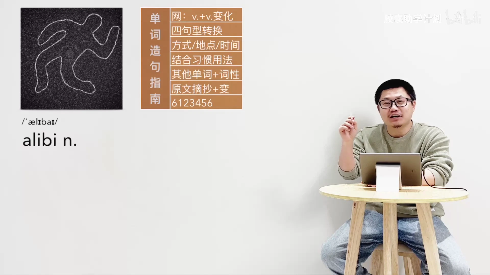

文字识别：单词造句指南 / 网：v.+v.变化 / 囊助字计划園 / 四句型转换 / 方式/地点/时间 / 结合习惯用法 / 其他单词+词性 / 原文摘抄+变 / 6123456 / /'æelrbar/ / alibi n.

### 画面 00:00:46

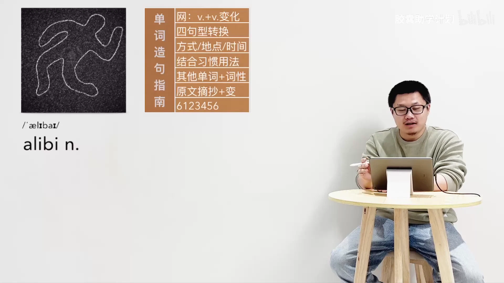

文字识别：单词造句指南 / 网：v.+v.变化 / 喜助学计划 / 四句型转换 / 方式/地点/时间 / 结合习惯用法 / 其他单词+词性 / 原文摘抄+变 / 6123456 / /'æelrbar/ / alibi n.

### 画面 00:00:49

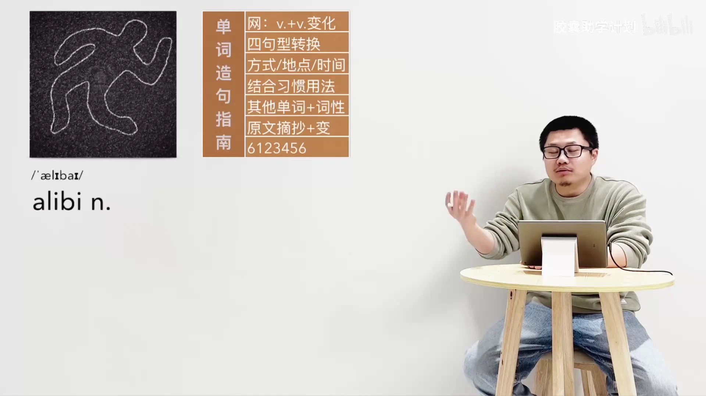

文字识别：单词造句指南 / 网：v.+v.变化 / 喜助学计划调 / 四句型转换 / 方式/地点/时间 / 结合习惯用法 / 其他单词+词性 / 原文摘抄+变 / 6123456 / /'æelrbar/ / alibi n.

### 画面 00:00:51

文字识别：单词造句指南 / 网：v.+v.变化 / 喜助学计划调 / 四句型转换 / 方式/地点/时间 / 结合习惯用法 / 其他单词+词性 / 原文摘抄+变 / 6123456 / /'æelibar/ / alibi n. / ① He had a perfect alibi and the police let him / go. did/who/why

### 画面 00:00:53

文字识别：单词造句指南 / 网：v.+v.变化 / 四句型转换 / 方式/地点/时间 / 结合习惯用法 / 其他单词+词性 / 原文摘抄+变 / 6123456 / /'ælibar/ / alibi n. / ① He had a perfect alibi and the police let him / go. did/who/why

### 画面 00:00:56

文字识别：单词造句指南 / 网：v.+v.变化 / 学计划 / 四句型转换 / 方式/地点/时间 / 结合习惯用法 / 其他单词+词性 / 原文摘抄+变 / 6123456 / /'ælibar/ / alibi n. / ① He had a perfect alibi and the police let him / go. did/who/why

### 画面 00:00:58

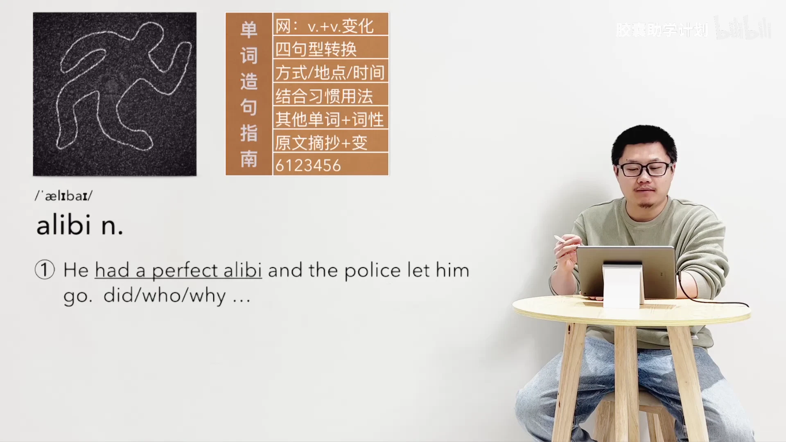

文字识别：单词造句指南 / 网：v.+v.变化 / 学计划 / 四句型转换 / 方式/地点/时间 / 结合习惯用法 / 其他单词+词性 / 原文摘抄+变 / 6123456 / /'æelrbar/ / alibi n. / ① He had a perfect alibi and the police let him / go. did/who/why

## 00:01:00–00:01:30

let him go.说他有一个完美的不在现场的证明，对吧？不在犯罪现场的证明。然后警察就让他走了。Okay, next one.再来，我们结合虚拟语气啊。If he had had a perfect alibi, the police wouldn't have continued to search his place.说如果他当时有一个完美的，对吧？不在现场的犯罪证明，那警察就不会当时就不会

### 画面 00:01:01

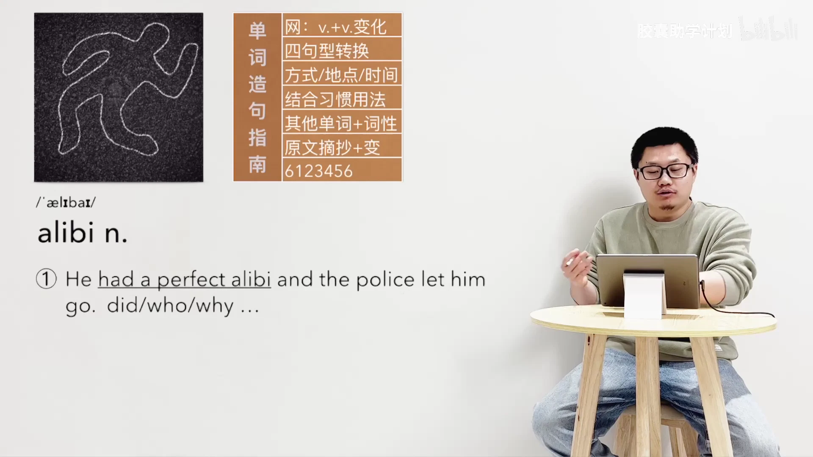

文字识别：单词造句指南 / 网：v.+v.变化 / 学计划 / 四句型转换 / 方式/地点/时间 / 结合习惯用法 / 其他单词+词性 / 原文摘抄+变 / 6123456 / /'æelrbar/ / alibi n. / ① He had a perfect alibi and the police let him / go. did/who/why

### 画面 00:01:03

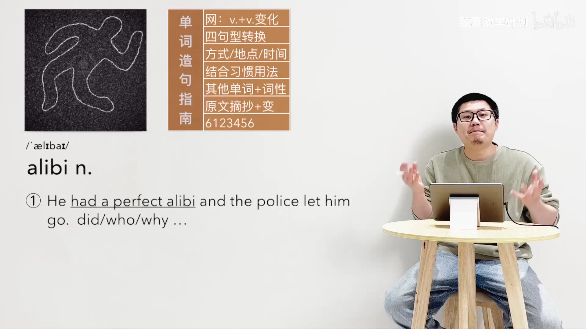

文字识别：单词造句指南 / 网：v.+v.变化 / 字计划 / 四句型转换 / 方式/地点/时间 / 结合习惯用法 / 其他单词+词性 / 原文摘抄+变 / 6123456 / /'æelrbar/ / alibi n. / ① He had a perfect alibi and the police let him / go. did/who/why

### 画面 00:01:06

文字识别：单词造句指南 / 网：v.+v.变化 / 学计划 / 四句型转换 / 方式/地点/时间 / 结合习惯用法 / 其他单词+词性 / 原文摘抄+变 / 6123456 / /'ælibar/ / alibi n. / ① He had a perfect alibi and the police let him / go. did/who/why

### 画面 00:01:08

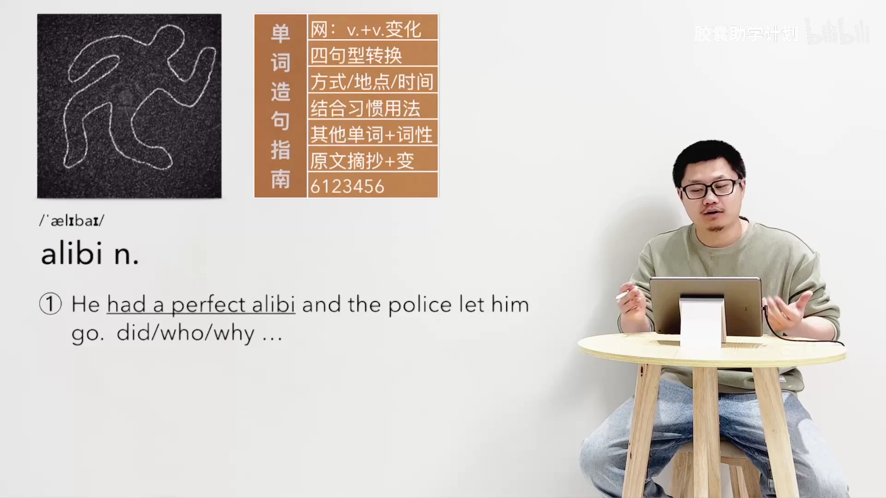

文字识别：单词造句指南 / 网：v.+v.变化 / 四句型转换 / 方式/地点/时间 / 结合习惯用法 / 其他单词+词性 / 原文摘抄+变 / 6123456 / /'ælibar/ / alibi n. / ① He had a perfect alibi and the police let him / go. did/who/why

### 画面 00:01:10

文字识别：单词造句指南 / 网：v.+v.变化 / 四句型转换 / 方式/地点/时间 / 结合习惯用法 / 其他单词+词性 / 原文摘抄+变 / 6123456 / /'ælrbar/ / alibi n. / ① He had a perfect alibi and the police let him / go. did/who/why / If he had had a perfect alibi, the police / wouldn't have continued to search his / place. L64 L69

### 画面 00:01:13

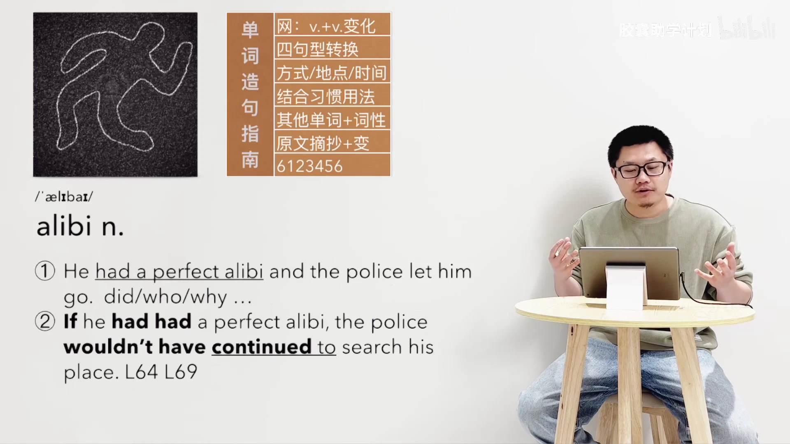

文字识别：单词造句指南 / 网：v.+v.变化 / 四句型转换 / 方式/地点/时间 / 结合习惯用法 / 其他单词+词性 / 原文摘抄+变 / 6123456 / /'ælrbar/ / alibi n. / ① He had a perfect alibi and the police let him / go. did/who/why / If he had had a perfect alibi, the police / wouldn't have continued to search his / place. L64 L69

### 画面 00:01:15

文字识别：单词造句指南 / 网：v.+v.变化 / 四句型转换 / 方式/地点/时间 / 结合习惯用法 / 其他单词+词性 / 原文摘抄+变 / 6123456 / /'ælrbar/ / alibi n. / ① He had a perfect alibi and the police let him / go. did/who/why / If he had had a perfect alibi, the police / wouldn't have continued to search his / place.L64 L69

### 画面 00:01:18

文字识别：单词造句指南 / 网：v.+v.变化 / 四句型转换 / 方式/地点/时间 / 结合习惯用法 / 其他单词+词性 / 原文摘抄+变 / 6123456 / /'ælibar/ / alibi n. / ① He had a perfect alibi and the police let him / go. did/who/why / If he had had a perfect alibi, the police / wouldn't have continued to search his / place. L64 L69

### 画面 00:01:20

文字识别：单词造句指南 / 网：v.+v.变化 / 四句型转换 / 方式/地点/时间 / 结合习惯用法 / 其他单词+词性 / 原文摘抄+变 / 6123456 / /'ælrbar/ / alibi n. / ① He had a perfect alibi and the police let him / go. did/who/why / If he had had a perfect alibi, the police / wouldn't have continued to search his / place. L64 L69

### 画面 00:01:22

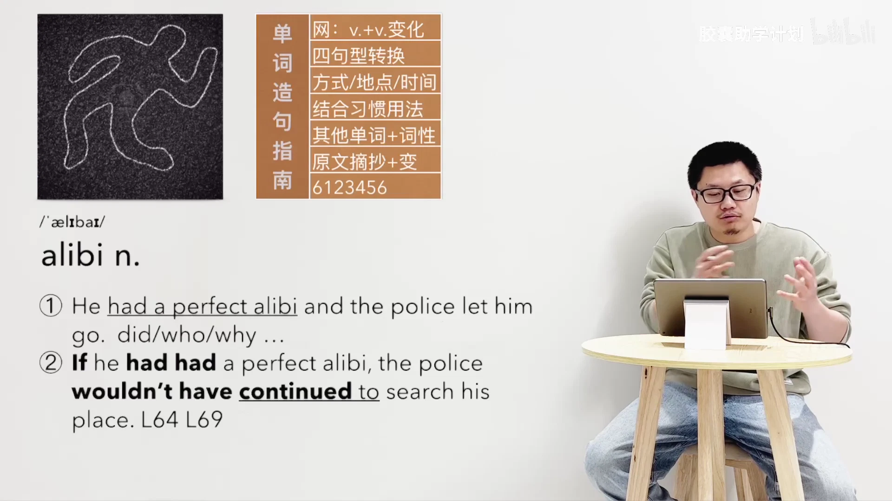

文字识别：单词造句指南 / 网：v.+v.变化 / 四句型转换 / 方式/地点/时间 / 结合习惯用法 / 其他单词+词性 / 原文摘抄+变 / 6123456 / /'ælrbar/ / alibi n. / ① He had a perfect alibi and the police let him / go. did/who/why / If he had had a perfect alibi, the police / wouldn't have continued to search his / place. L64 L69

### 画面 00:01:25

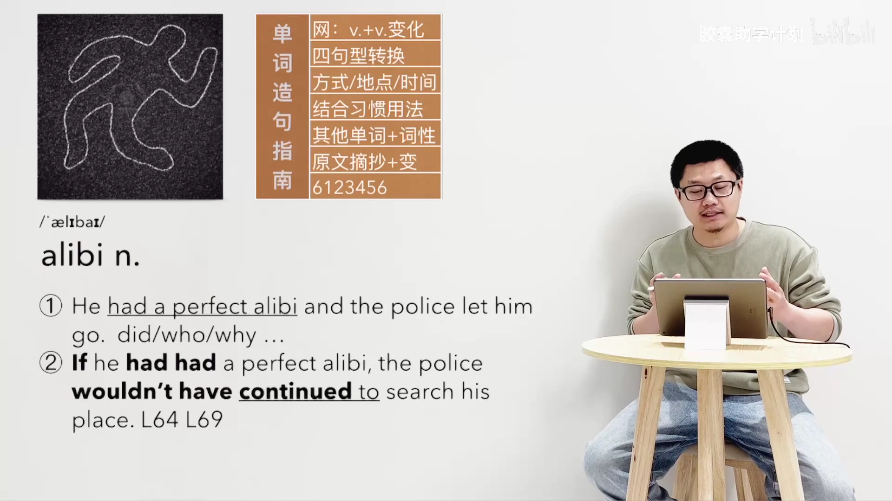

文字识别：单词造句指南 / 网：v.+v.变化 / 四句型转换 / 方式/地点/时间 / 结合习惯用法 / 其他单词+词性 / 原文摘抄+变 / 6123456 / /'ælrbar/ / alibi n. / ① He had a perfect alibi and the police let him / go. did/who/why / If he had had a perfect alibi, the police / wouldn't have continued to search his / place. L64 L69

### 画面 00:01:27

文字识别：单词造句指南 / 网：v.+v.变化 / 四句型转换 / 方式/地点/时间 / 结合习惯用法 / 其他单词+词性 / 原文摘抄+变 / 6123456 / /'ælibar/ / alibi n. / ① He had a perfect alibi and the police let him / go. did/who/why / If he had had a perfect alibi, the police / wouldn't have continued to search his / place. L64 L69

## 00:01:30–00:02:00

继续去搜他的地方了，对不对？好，所以你看这里的黑字部分告诉你是过去相反的虚拟语气，所以这句话其实告诉我们的事情是他当时没有不在犯罪现场的证明，于是警察还是继续去搜了他的地方啊。Next one, his lawyer has stated that he has an alibi. 哎，说他的这个律师啊，声称啊，发言说他有

### 画面 00:01:30

文字识别：单词造句指南 / 网：v.+v.变化 / 四句型转换 / 方式/地点/时间 / 结合习惯用法 / 其他单词+词性 / 原文摘抄+变 / 6123456 / /'ælrbar/ / alibi n. / ① He had a perfect alibi and the police let him / go. did/who/why / If he had had a perfect alibi, the police / wouldn't have continued to search his / place. L64 L69

### 画面 00:01:32

文字识别：单词造句指南 / 网：v.+v.变化 / 四句型转换 / 方式/地点/时间 / 结合习惯用法 / 其他单词+词性 / 原文摘抄+变 / 6123456 / /'ælrbar/ / alibi n. / ① He had a perfect alibi and the police let him / go. did/who/why / If he had had a perfect alibi, the police / wouldn't have continued to search his / place.L64 L69

### 画面 00:01:36

文字识别：单词造句指南 / 网：v.+v.变化 / 四句型转换 / 方式/地点/时间 / 结合习惯用法 / 其他单词+词性 / 原文摘抄+变 / 6123456 / /'ælrbar/ / alibi n. / ① He had a perfect alibi and the police let him / go. did/who/why / If he had had a perfect alibi, the police / wouldn't have continued to search his / place. L64 L69

### 画面 00:01:41

文字识别：单词造句指南 / 网：v.+v.变化 / 四句型转换 / 方式/地点/时间 / 结合习惯用法 / 其他单词+词性 / 原文摘抄+变 / 6123456 / /'ælrbar/ / alibi n. / ① He had a perfect alibi and the police let him / go. did/who/why / If he had had a perfect alibi, the police / wouldn't have continued to search his / place.L64 L69

### 画面 00:01:45

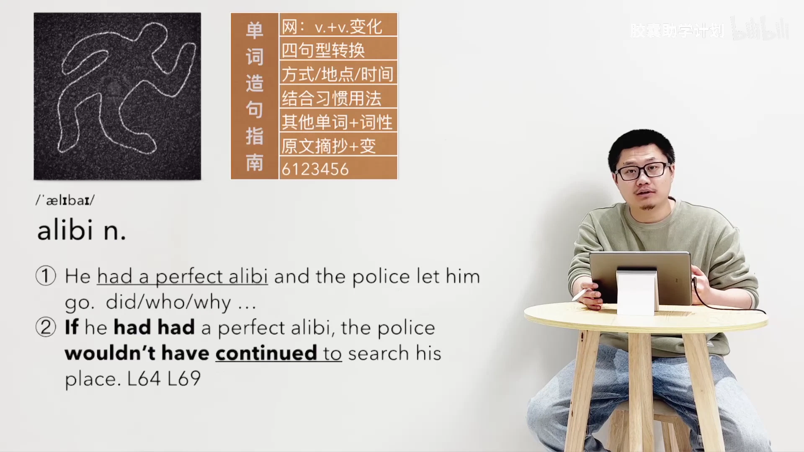

文字识别：单词造句指南 / 网：v.+v.变化 / 四句型转换 / 方式/地点/时间 / 结合习惯用法 / 其他单词+词性 / 原文摘抄+变 / 6123456 / /'ælrbar/ / alibi n. / ① He had a perfect alibi and the police let him / go. did/who/why / If he had had a perfect alibi, the police / wouldn't have continued to search his / place. L64 L69

### 画面 00:01:47

文字识别：单词造句指南 / 网：v.+v.变化 / 四句型转换 / 方式/地点/时间 / 结合习惯用法 / 其他单词+词性 / 原文摘抄+变 / 6123456 / /'ælibar/ / alibi n. / ① He had a perfect alibi and the police let him / go. did/who/why / if he had had a perfect alibi, the police / wouldn't have continued to search his / place. L64 L69 / His lawyer has stated that he has an alibi. / L84

### 画面 00:01:50

文字识别：单词造句指南 / 网：v.+v.变化 / 四句型转换 / 方式/地点/时间 / 结合习惯用法 / 其他单词+词性 / 原文摘抄+变 / 6123456 / /'ælibar/ / alibi n. / ① He had a perfect alibi and the police let him / go. did/who/why / If he had had a perfect alibi, the police / wouldn't have continued to search his / place. L64 L69 / His lawyer has stated that he has an alibi. / L84

### 画面 00:01:55

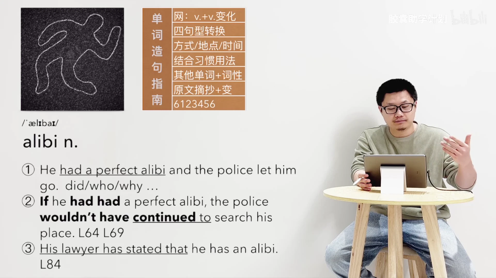

文字识别：单词造句指南 / 网：v.+v.变化 / 四句型转换 / 方式/地点/时间 / 结合习惯用法 / 其他单词+词性 / 原文摘抄+变 / 6123456 / /'ælrbar/ / alibi n. / ① He had a perfect alibi and the police let him / go. did/who/why / If he had had a perfect alibi, the police / wouldn't have continued to search his / place. L64 L69 / His lawyer has stated that he has an alibi. / L84

### 画面 00:01:58

文字识别：单词造句指南 / 网：v.+v.变化 / 四句型转换 / 方式/地点/时间 / 结合习惯用法 / 其他单词+词性 / 原文摘抄+变 / 6123456 / /'ælrbar/ / alibi n. / ① He had a perfect alibi and the police let him / go. did/who/why / If he had had a perfect alibi, the police / wouldn't have continued to search his / place. L64 L69 / His lawyer has stated that he has an alibi. / L84

## 00:02:00–00:02:30

这个不在线犯罪现场的证明啊。再读一遍这个单词 alibi。好，那注意力集中，咱听一下这个电影片段啊。 Is there anybody at the station who doesn't have an alibi? Okay, 啊，下一个单词叫 commit。 commit 这个单词呢，它是一个动词，但它最常用的都是 commit a crime, commit a murder。就是它后边这个宾语啊，往往都是固定的，比如说 commit a murder。所

### 画面 00:02:00

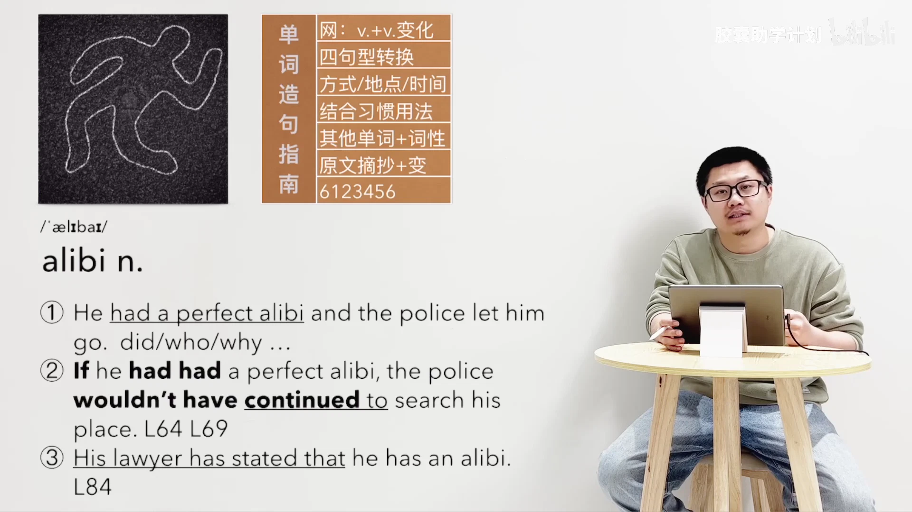

文字识别：单词造句指南 / 网：v.+v.变化 / 四句型转换 / 方式/地点/时间 / 结合习惯用法 / 其他单词+词性 / 原文摘抄+变 / 6123456 / /'ælrbar/ / alibi n. / ① He had a perfect alibi and the police let him / go. did/who/why / If he had had a perfect alibi, the police / wouldn't have continued to search his / place. L64 L69 / His lawyer has stated that he has an alibi. / L84

### 画面 00:02:05

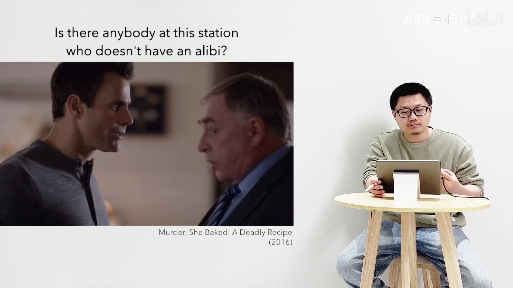

文字识别：Is there anybody at this station / who doesn't have an alibi? / Murder, She Baked: A Deadly Recipe / (2016)

### 画面 00:02:10

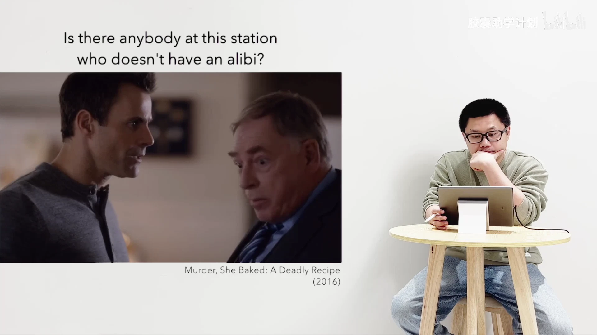

文字识别：Is there anybody at this station / who doesn't have an alibi? / Murder, She Baked: A Deadly Recipe / (2016)

### 画面 00:02:12

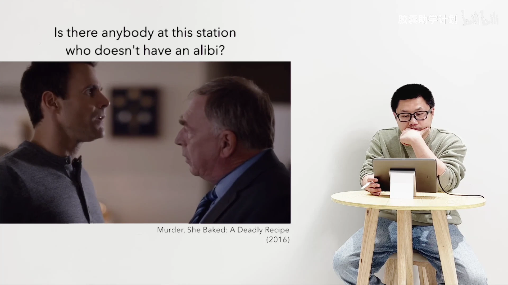

文字识别：Is there anybody at this station / who doesn't have an alibi? / Murder, She Baked: A Deadly Recipe / (2016)

### 画面 00:02:14

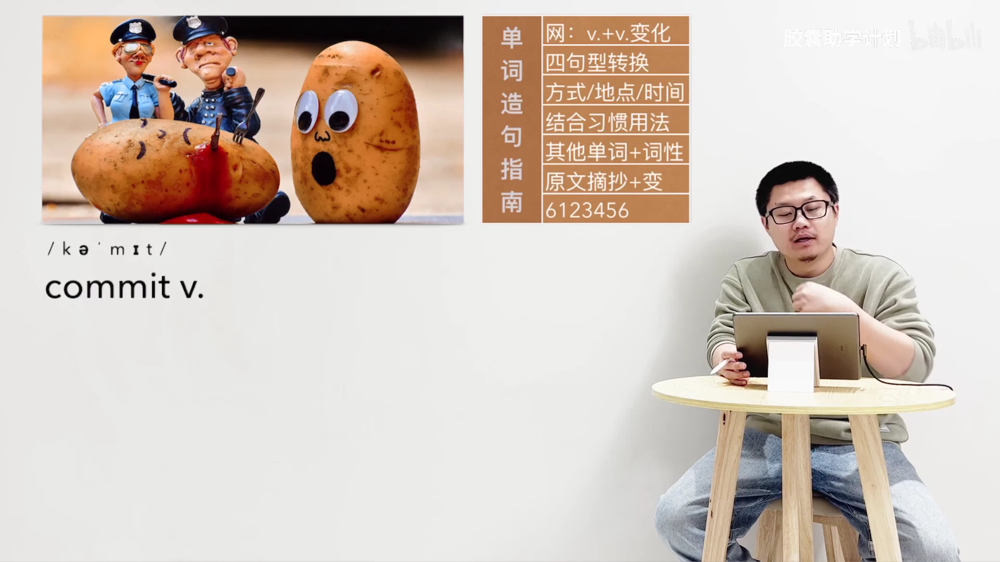

文字识别：单词造句指南 / 网：v.+v.变化 / 四句型转换 / 方式/地点/时间 / 结合习惯用法 / 其他单词+词性 / 原文摘抄+变 / 6123456 / /ka'mit/ / commit v.

### 画面 00:02:16

文字识别：单词造句指南 / 网：v.+v.变化 / 喜助字计划 / 四句型转换 / 方式/地点/时间 / 结合习惯用法 / 其他单词+词性 / 原文摘抄+变 / 6123456 / /ka'mit/ / commit v.

### 画面 00:02:20

文字识别：单词造句指南 / 网：v.+v.变化 / 虞助字计划 / 四句型转换 / 方式/地点/时间 / 结合习惯用法 / 其他单词+词性 / 原文摘抄+变 / 6123456 / /ka'mit/ / commit v.

### 画面 00:02:22

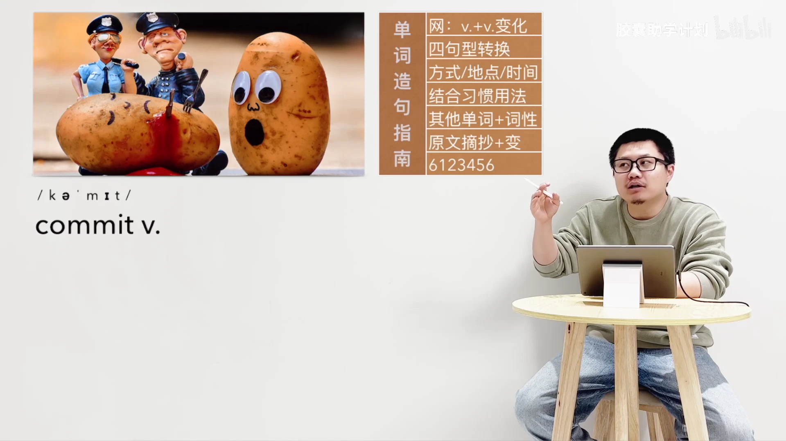

文字识别：单词造句指南 / 网：v.+v.变化 / 毫助子计划 / 四句型转换 / 方式/地点/时间 / 结合习惯用法 / 其他单词+词性 / 原文摘抄+变 / 6123456 / /ka'mit/ / commit v.

### 画面 00:02:25

文字识别：单词造句指南 / 网：v.+v.变化 / 助学计划 / 四句型转换 / 方式/地点/时间 / 结合习惯用法 / 其他单词+词性 / 原文摘抄+变 / 6123456 / /ka'mit/ / commit v.

## 00:02:30–00:03:00

以 commit 这个单词你单独记它就是犯，对吧？然后犯了什么呢？犯了错或犯了罪啊，往往是这样去连起来的。比如说 commit a murder，谋杀，对吧？犯了一个谋杀的罪啊，或者说你杀了人啊，叫做 commit a murder，啊，谋杀。比如说我们造个句子叫做 If you had committed a murder, the police would have known that. 说如果你当时确实对吧有这个谋杀，

### 画面 00:02:30

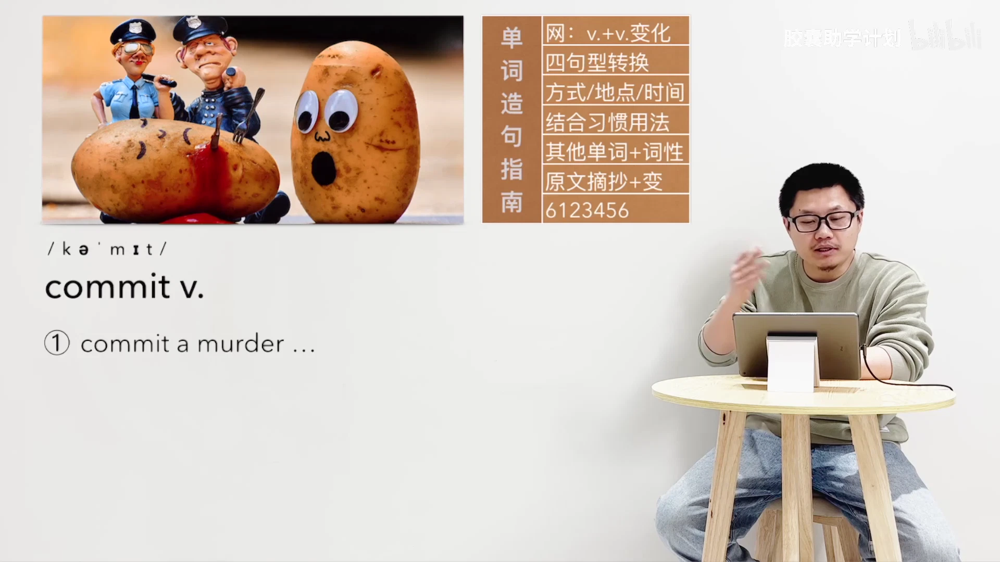

文字识别：单词造句指南 / 网：v.+v.变化 / 四句型转换 / 方式/地点/时间 / 结合习惯用法 / 其他单词+词性 / 原文摘抄+变 / 6123456 / /ka'mit/ / commit v. / 1 / ) commit a murder

### 画面 00:02:35

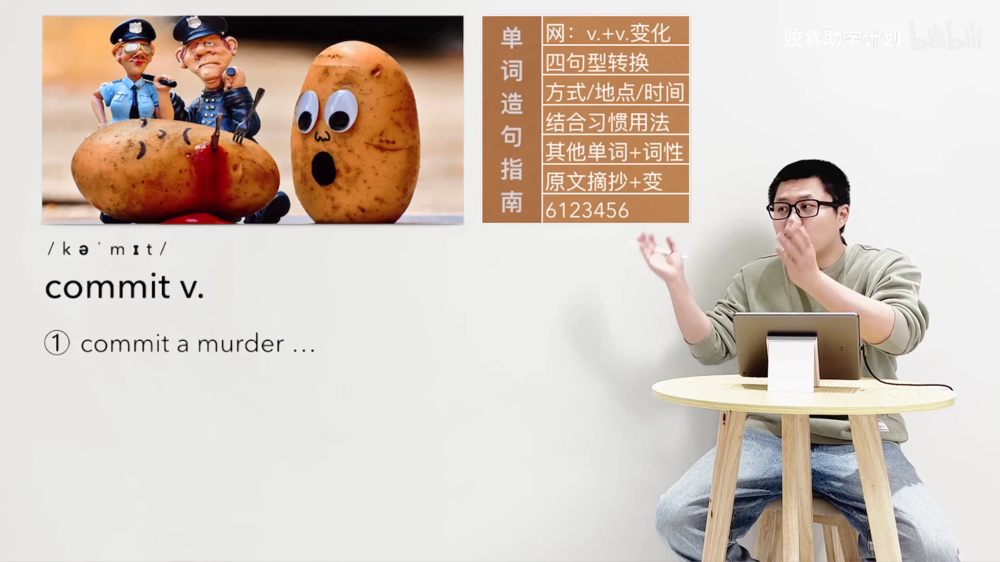

文字识别：单词造句指南 / 网：v.+v.变化 / 四句型转换 / 方式/地点/时间 / 结合习惯用法 / 其他单词+词性 / 原文摘抄+变 / 6123456 / /ka'mit/ / commit v. / 1 / commit a murder

### 画面 00:02:37

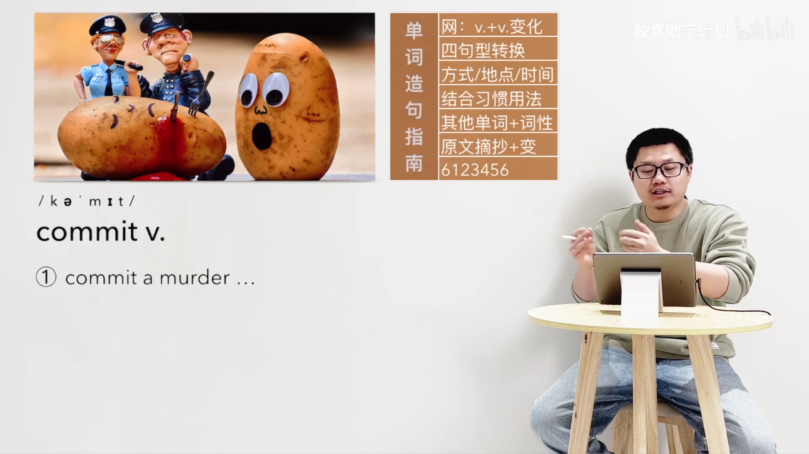

文字识别：单词造句指南 / 网：v.+v.变化 / 四句型转换 / 方式/地点/时间 / 结合习惯用法 / 其他单词+词性 / 原文摘抄+变 / 6123456 / /ka'mit/ / commit v. / ① / ) commit a murder

### 画面 00:02:40

文字识别：单词造句指南 / 网：v.+v.变化 / 毫助学计划 / 四句型转换 / 方式/地点/时间 / 结合习惯用法 / 其他单词+词性 / 原文摘抄+变 / 6123456 / /ka'mit/ / commit v. / 1 / ) commit a murder

### 画面 00:02:43

文字识别：单词造句指南 / 网：v.+v.变化 / 毫助学计划 / 四句型转换 / 方式/地点/时间 / 结合习惯用法 / 其他单词+词性 / 原文摘抄+变 / 6123456 / /ka'mit/ / commit v. / 1 / ) commit a murder

### 画面 00:02:46

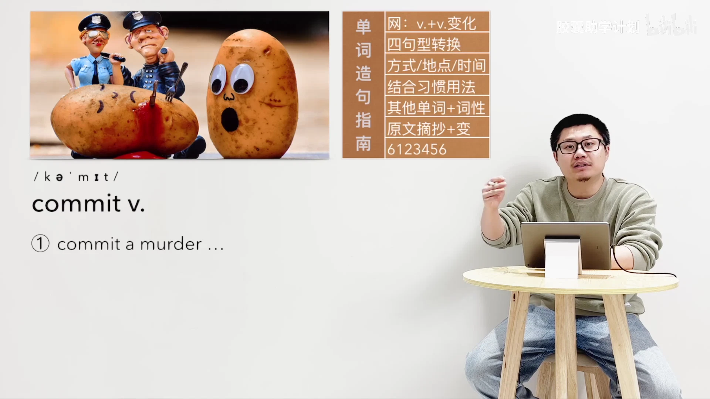

文字识别：单词造句指南 / 网：v.+v.变化 / 墓助子计划 / 四句型转换 / 方式/地点/时间 / 结合习惯用法 / 其他单词+词性 / 原文摘抄+变 / 6123456 / /ka'mit/ / commit v. / 1 / ) commit a murder

### 画面 00:02:48

文字识别：单词造句指南 / 网：v.+v.变化 / 子计划 / 四句型转换 / 方式/地点/时间 / 结合习惯用法 / 其他单词+词性 / 原文摘抄+变 / 6123456 / /ka'mit/ / commit v. / 1 / ) commit a murder / If you had committed a murder, the police / would have known that. L64

### 画面 00:02:50

文字识别：单词造句指南 / 网：v.+v.变化 / 学计划 / 四句型转换 / 方式/地点/时间 / 结合习惯用法 / 其他单词+词性 / 原文摘抄+变 / 6123456 / /ka'mit/ / commit v. / 1 / ) commit a murder / If you had committed a murder, the police / would have known that. L64

### 画面 00:02:55

文字识别：单词造句指南 / 网：v.+v.变化 / 学计划 / 四句型转换 / 方式/地点/时间 / 结合习惯用法 / 其他单词+词性 / 原文摘抄+变 / 6123456 / /ka'mIt/ / commit v. / ① commit a murder / If you had committed a murder, the police / would have known that. L64

## 00:03:00–00:03:30

这个犯了这样的罪，那警察当时是知道的。但是你注意啊，这不是两个杀人犯之间的聊天啊，这是一个虚拟语气，对吧？所以其实他当时并没有犯谋杀罪啊。Next one说，He devoted himself to finding out who committed the murder。说他致力于搞明白、弄清楚谁犯了这个罪，对吧？谁谋杀了别人？Okay. Next one

### 画面 00:03:00

文字识别：单词造句指南 / 网：v.+v.变化 / 四句型转换 / 方式/地点/时间 / 结合习惯用法 / 其他单词+词性 / 原文摘抄+变 / 6123456 / / ka'mIt / / commit v. / ① commit a murder / If you had committed a murder, the police / would have known that. L64

### 画面 00:03:05

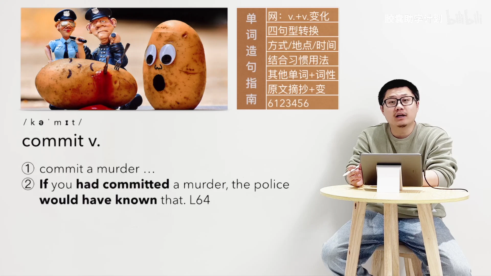

文字识别：单词造句指南 / 网：v.+v.变化 / 四句型转换 / 方式/地点/时间 / 结合习惯用法 / 其他单词+词性 / 原文摘抄+变 / 6123456 / /ka'mIt/ / commit v. / 1 /  commit a murder / If you had committed a murder, the police / would have known that. L64

### 画面 00:03:07

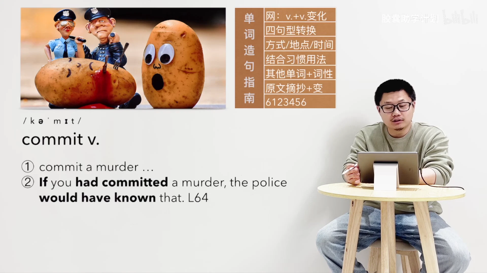

文字识别：单词造句指南 / 网：v.+v.变化 / 四句型转换 / 方式/地点/时间 / 结合习惯用法 / 其他单词+词性 / 原文摘抄+变 / 6123456 / /ka'mIt/ / commit v. / 1 / ) commit a murder / If you had committed a murder, the police / would have known that. L64

### 画面 00:03:10

文字识别：单词造句指南 / 网：v.+v.变化 / 四句型转换 / 方式/地点/时间 / 结合习惯用法 / 其他单词+词性 / 原文摘抄+变 / 6123456 / /ka'mIt/ / commit v. / ) commit a murder / If you had committed a murder, the police / would have known that. L64

### 画面 00:03:12

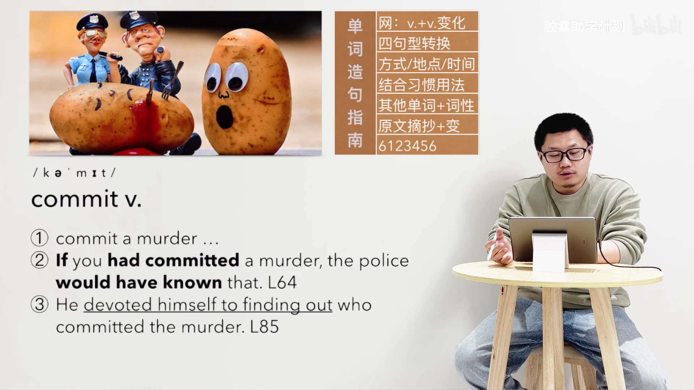

文字识别：单词造句指南 / 网：v.+v.变化 / 四句型转换 / 方式/地点/时间 / 结合习惯用法 / 其他单词+词性 / 原文摘抄+变 / 6123456 / / ka'mIt / / commit v. / ① commit a murder / If you had committed a murder, the police / would have known that. L64 / He devoted himself to finding out who / committed the murder. L85

### 画面 00:03:15

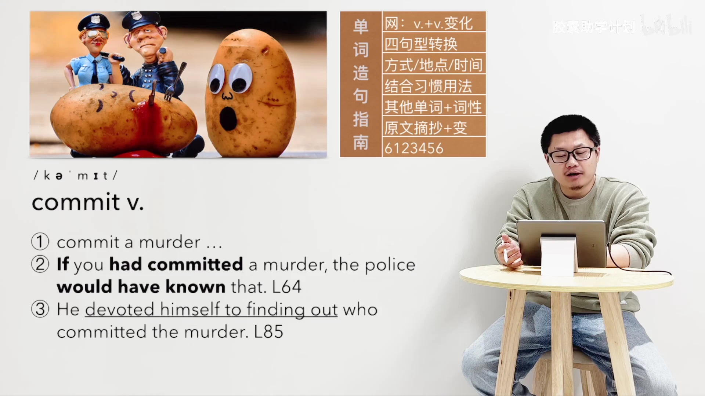

文字识别：单词造句指南 / 网：v.+v.变化 / 子计划 / 四句型转换 / 方式/地点/时间 / 结合习惯用法 / 其他单词+词性 / 原文摘抄+变 / 6123456 / / ka'mIt/ / commit v. / ① commit a murder / If you had committed a murder, the police / would have known that. L64 / He devoted himself to finding out who / committed the murder. L85

### 画面 00:03:25

文字识别：单词造句指南 / 网：v.+v.变化 / 学计划 / 四句型转换 / 方式/地点/时间 / 结合习惯用法 / 其他单词+词性 / 原文摘抄+变 / 6123456 / /ka'mIt/ / commit v. / ① commit a murder / If you had committed a murder, the police / would have known that. L64 / He devoted himself to finding out who / committed the murder. L85

### 画面 00:03:29

文字识别：单词造句指南 / 网：v.+v.变化 / 学计划 / 四句型转换 / 方式/地点/时间 / 结合习惯用法 / 其他单词+词性 / 原文摘抄+变 / 6123456 / / ka'mit/ / commit v. / ① commit a murder. / If you had committed a murder, the police / would have known that. L64 / He devoted himself to finding out who / committed the murder. L85 / The police stated that they had find out / who committed the murder. L84

## 00:03:30–00:04:00

say the police stated that they had found out who committed the murder. Ah,谁犯了这个谋杀罪啊? Very good.再读一遍这个单词, commit.那注意力集中，咱听一个电影片段啊。这里边的乍一看，每一个单词应该都是认得的。I just don't think you're the kind of person that could commit a murder. Okay. Next one,注意浊化, inspector, inspector, inspector,探

### 画面 00:03:31

文字识别：单词造句指南 / 网：v.+v.变化 / 学计划 / 四句型转换 / 方式/地点/时间 / 结合习惯用法 / 其他单词+词性 / 原文摘抄+变 / 6123456 / / ka'mIt/ / commit v. / ① commit a murder / If you had committed a murder, the police / would have known that. L64 / He devoted himself to finding out who / committed the murder. L85 / The police stated that they had find out / who committed the murder. L84

### 画面 00:03:35

文字识别：单词造句指南 / 网：v.+v.变化 / 四句型转换 / 方式/地点/时间 / 结合习惯用法 / 其他单词+词性 / 原文摘抄+变 / 6123456 / / ka'mIt/ / commit v. / ① commit a murder / If you had committed a murder, the police / would have known that. L64 / He devoted himself to finding out who / committed the murder. L85 / The police stated that they had find out / who committed the murder. L84

### 画面 00:03:37

文字识别：单词造句指南 / 网：v.+v.变化 / 四句型转换 / 方式/地点/时间 / 结合习惯用法 / 其他单词+词性 / 原文摘抄+变 / 6123456 / / ka'mIt / / commit v. / ① commit a murder. / If you had committed a murder, the police / would have known that. L64 / He devoted himself to finding out who / committed the murder. L85 / The police stated that they had find out / who committed the murder. L84

### 画面 00:03:39

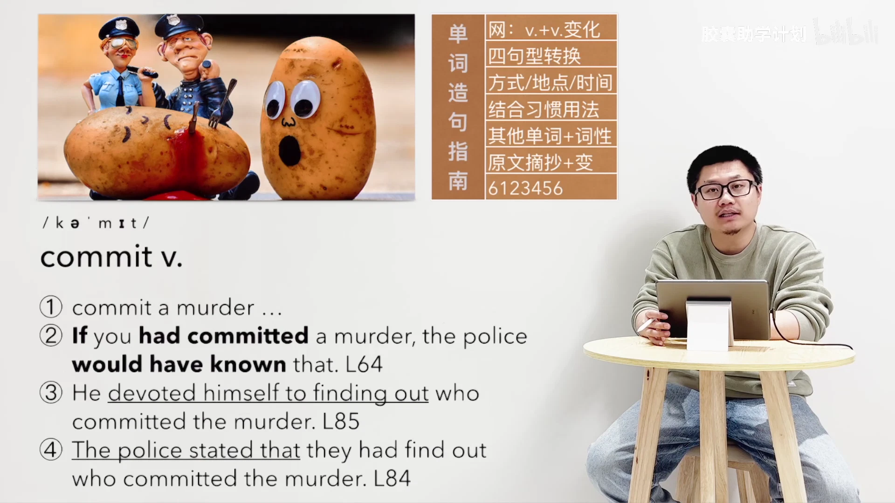

文字识别：单词造句指南 / 网：v.+v.变化 / 助学计划 / 四句型转换 / 方式/地点/时间 / 结合习惯用法 / 其他单词+词性 / 原文摘抄+变 / 6123456 / / ka'mIt/ / commit v. / ① commit a murder. / If you had committed a murder, the police / would have known that. L64 / He devoted himself to finding out who / committed the murder. L85 / The police stated that they had find out / who committed the murder. L84

### 画面 00:03:41

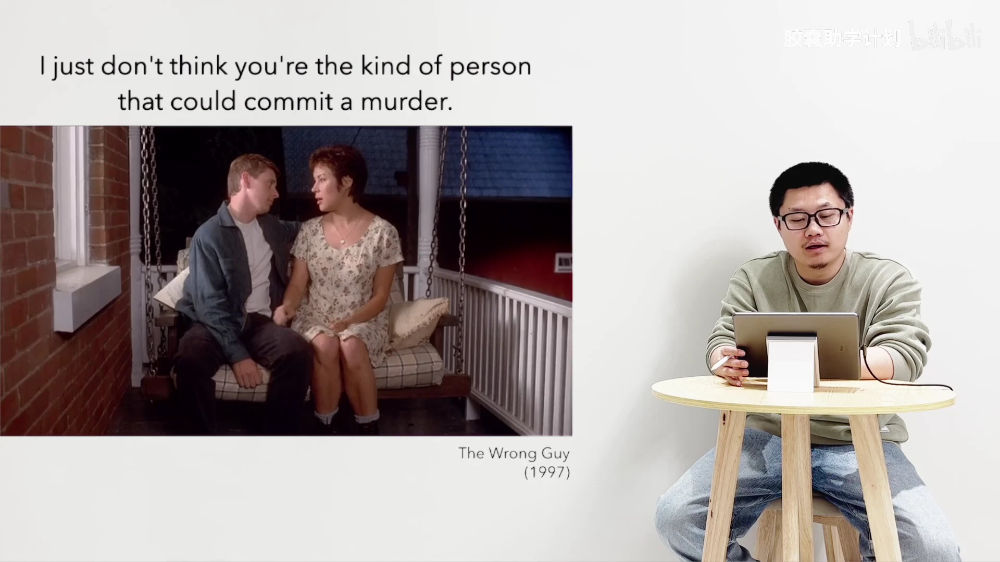

文字识别：I just don't think you're the kind of person / that could commit a murder. / The Wrong Guy / (1997)

### 画面 00:03:49

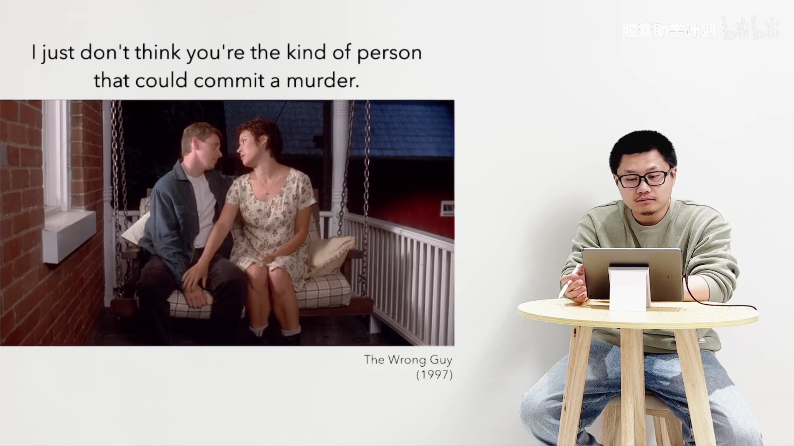

文字识别：I just don't think you're the kind of person / that could commit a murder. / The Wrong Guy / (1997)

### 画面 00:03:51

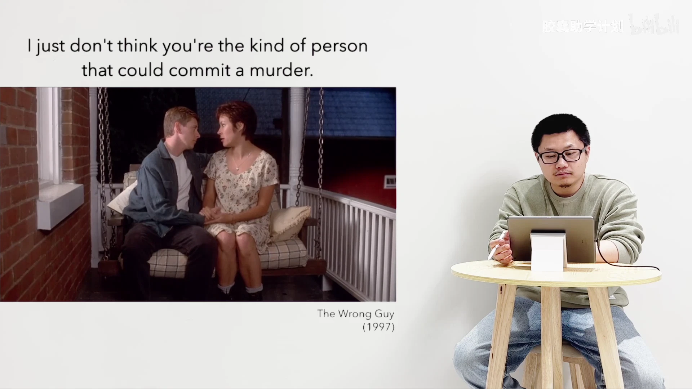

文字识别：I just don't think you're the kind of person / that could commit a murder. / The Wrong Guy / (1997)

### 画面 00:03:54

文字识别：单词造句指南 / 网：v.+v.变化 / 喜助字计划 / 四句型转换 / 方式/地点/时间 / 结合习惯用法 / 其他单词+词性 / 原文摘抄+变 / 6123456 / /In'spekta/ / inspector n.

### 画面 00:03:57

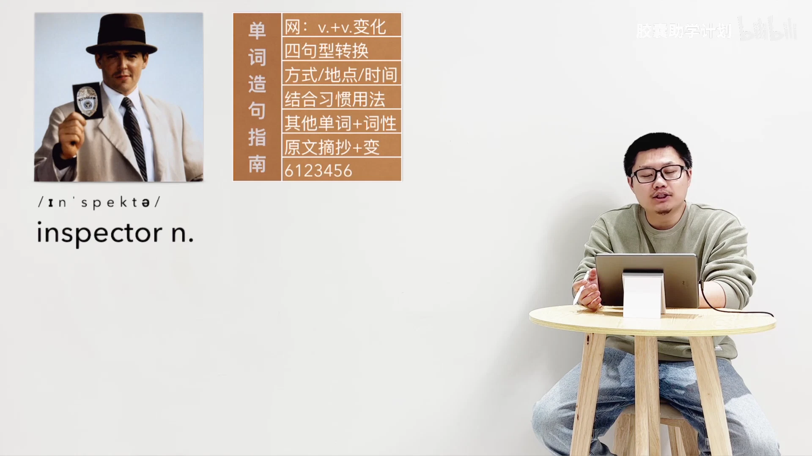

文字识别：单词造句指南 / 网：v.+v.变化 / 臺助字计划 / 四句型转换 / 方式/地点/时间 / 结合习惯用法 / 其他单词+词性 / 原文摘抄+变 / 6123456 / /in'sｐekta/ / inspector n.

## 00:04:00–00:04:30

长的意思啊。Inspector这个单词是我们之前学过动词，不知道您还有没有印象？没印象，你不妨查一下字典。然后我们说，在很多单词动词，尤其是动词后面去加o r或e r的时候，表示做这件事情的人。那inspector做这件事的人，对吧？好，我们造个句子啊。其实它跟captain是一样的啊。就你是一个人嘛？那我想造句。六一二三四五六一和三呗。The inspector has lost his patience.

### 画面 00:04:00

文字识别：单词造句指南 / 网：v.+v.变化 / 臺助学计划 / 四句型转换 / 方式/地点/时间 / 结合习惯用法 / 其他单词+词性 / 原文摘抄+变 / 6123456 / /In'sｐekta/ / inspector n.

### 画面 00:04:06

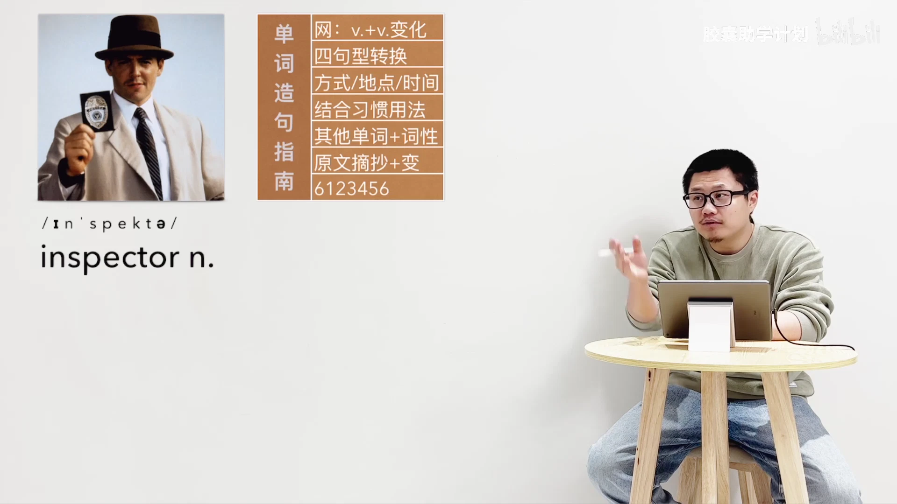

文字识别：单词造句指南 / 网：v.+v.变化 / 喜助字计划 / 四句型转换 / 方式/地点/时间 / 结合习惯用法 / 其他单词+词性 / 原文摘抄+变 / 6123456 / /in'spekta/ / inspector n.

### 画面 00:04:10

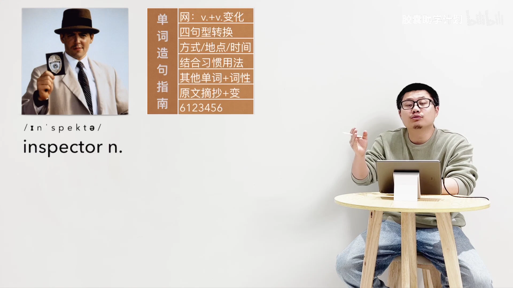

文字识别：单词造句指南 / 网：v.+v.变化 / 四句型转换 / 方式/地点/时间 / 结合习惯用法 / 其他单词+词性 / 原文摘抄+变 / 6123456 / /in'spekta/ / inspector n.

### 画面 00:04:18

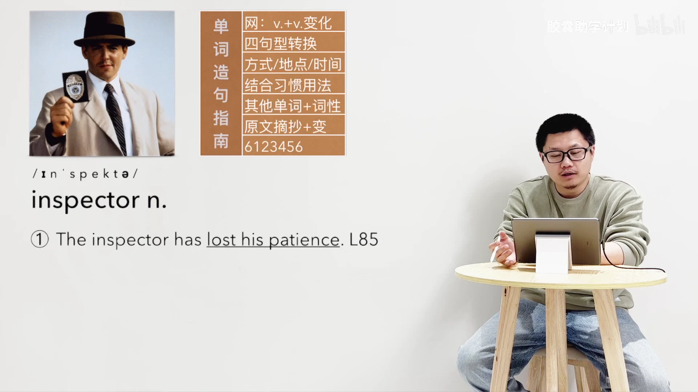

文字识别：单词造句指南 / 网：v.+v.变化 / 四句型转换 / 方式/地点/时间 / 结合习惯用法 / 其他单词+词性 / 原文摘抄+变 / 6123456 / /In'spekta/ / inspector n. / ① The inspector has lost his patience. L85

### 画面 00:04:20

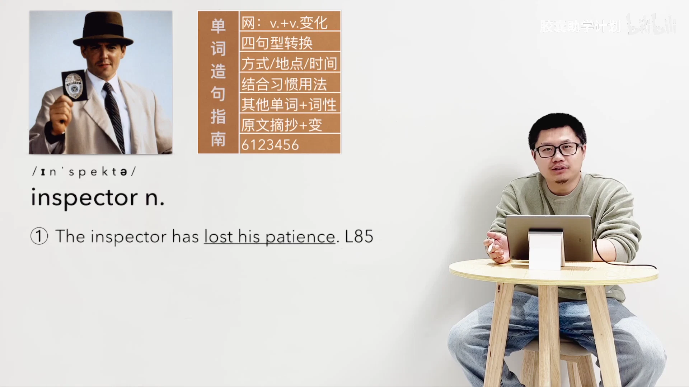

文字识别：单词造句指南 / 网：v.+v.变化 / 学计划 / 四句型转换 / 方式/地点/时间 / 结合习惯用法 / 其他单词+词性 / 原文摘抄+变 / 6123456 / /In'spekta/ / inspector n. / ① The inspector has lost his patience. L85

### 画面 00:04:22

文字识别：单词造句指南 / 网：v.+v.变化 / 四句型转换 / 方式/地点/时间 / 结合习惯用法 / 其他单词+词性 / 原文摘抄+变 / 6123456 / /in'spekta/ / inspector n. / ① The inspector has lost his patience. L85

### 画面 00:04:28

文字识别：单词造句指南 / 网：v.+v.变化 / 四句型转换 / 方式/地点/时间 / 结合习惯用法 / 其他单词+词性 / 原文摘抄+变 / 6123456 / /In'spekta/ / inspector n. / ① The inspector has lost his patience. L85

## 00:04:30–00:05:00

已经丧失耐心。Next one, the inspector Leo has just decided to volunteer to find out who committed the murder.那他怎么样呢？决定啊，要志愿去调查清楚谁犯的这个谋杀罪，对吧？下一个，The inspector was relieved to hear that the murder was murderer was caught last night.这地方看似可能有一个小小超纲的

### 画面 00:04:30

文字识别：单词造句指南 / 网：v.+v.变化 / 学计划 / 四句型转换 / 方式/地点/时间 / 结合习惯用法 / 其他单词+词性 / 原文摘抄+变 / 6123456 / /In'spekta/ / inspector n. / ① The inspector has lost his patience. L85

### 画面 00:04:32

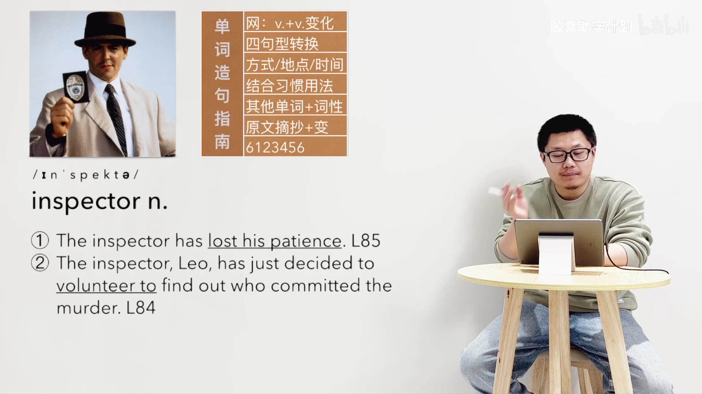

文字识别：单词造句指南 / 网：v.+v.变化 / 学计划 / 四句型转换 / 方式/地点/时间 / 结合习惯用法 / 其他单词+词性 / 原文摘抄+变 / 6123456 / /In'spekta/ / inspector n. / ① The inspector has lost his patience. L85 / The inspector, Leo, has just decided to / yolunteer to find out who committed the / murder. L84

### 画面 00:04:35

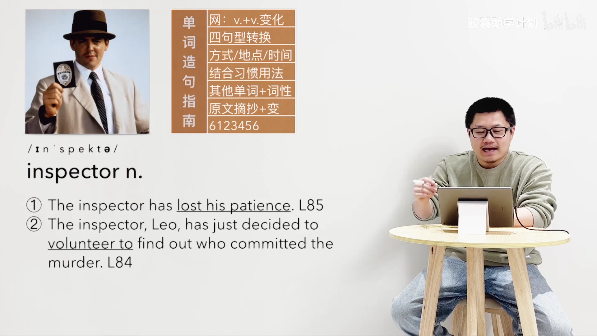

文字识别：单词造句指南 / 网：v.+v.变化 / 四句型转换 / 方式/地点/时间 / 结合习惯用法 / 其他单词+词性 / 原文摘抄+变 / 6123456 / /In'spekta/ / inspector n. / ① The inspector has lost his patience. L85 / The inspector, Leo, has just decided to / yolunteer to find out who committed the / murder. L84

### 画面 00:04:38

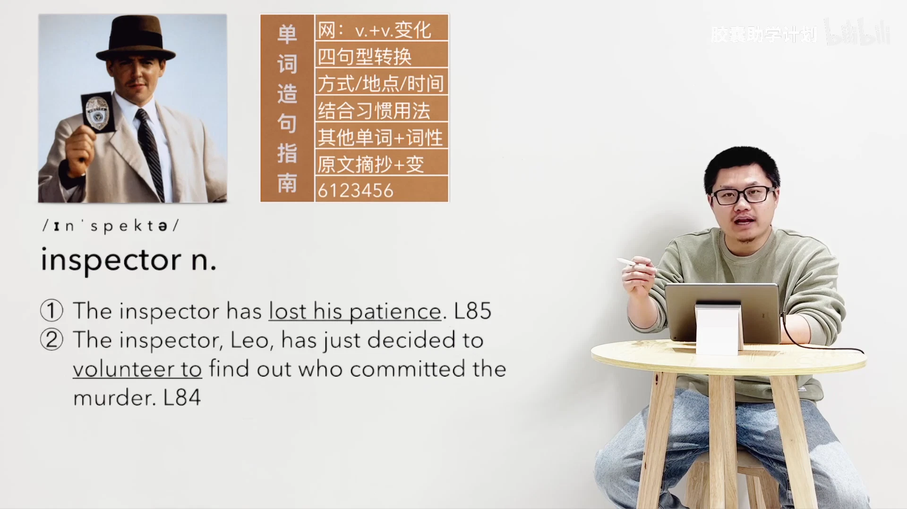

文字识别：单词造句指南 / 网：v.+v.变化 / 四句型转换 / 方式/地点/时间 / 结合习惯用法 / 其他单词+词性 / 原文摘抄+变 / 6123456 / /In'spekta/ / inspector n. / ① The inspector has lost his patience. L85 / The inspector, Leo, has just decided to / yolunteer to find out who committed the / murder. L84

### 画面 00:04:41

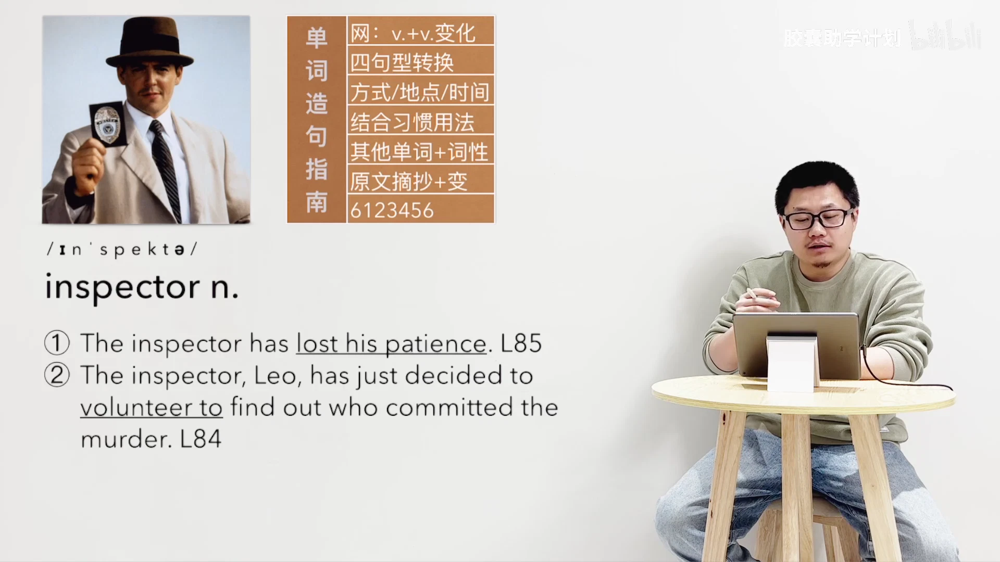

文字识别：单词造句指南 / 网：v.+v.变化 / 建助学计划 / 四句型转换 / 方式/地点/时间 / 结合习惯用法 / 其他单词+词性 / 原文摘抄+变 / 6123456 / /in'spekta/ / inspector n. / ① The inspector has lost his patience. L85 / The inspector, Leo, has just decided to / yolunteer to find out who committed the / murder. L84

### 画面 00:04:49

文字识别：单词造句指南 / 网：v.+v.变化 / 四句型转换 / 方式/地点/时间 / 结合习惯用法 / 其他单词+词性 / 原文摘抄+变 / 6123456 / /in'spekta/ / inspector n. / ① The inspector has lost his patience. L85 /  The inspector, Leo, has just decided to / 2 / yolunteer to find out who committed the / murder. L84 / The inspector was relieved to hear that the / murderer was caught last night. L84

### 画面 00:04:52

文字识别：单词造句指南 / 网：v.+v.变化 / 学计划 / 四句型转换 / 方式/地点/时间 / 结合习惯用法 / 其他单词+词性 / 原文摘抄+变 / 6123456 / /in'spekta/ / inspector n. / ① The inspector has lost his patience. L85 / ) The inspector, Leo, has just decided to / volunteer to find out who committed the / murder. L84 / The inspector was relieved to hear that the / murderer was caught last night. L84

### 画面 00:04:58

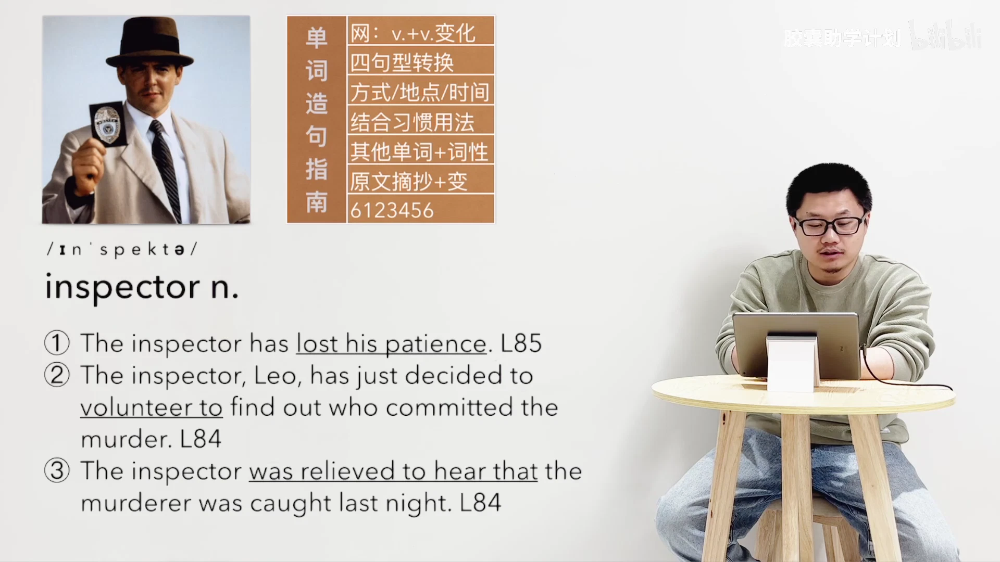

文字识别：单词造句指南 / 网：v.+v.变化 / 四句型转换 / 方式/地点/时间 / 结合习惯用法 / 其他单词+词性 / 原文摘抄+变 / 6123456 / /In'spekta/ / inspector n. / ① The inspector has lost his patience. L85 / ) The inspector, Leo, has just decided to / 2) / volunteer to find out who committed the / murder. L84 / The inspector was relieved to hear that the / murderer was caught last night. L84

## 00:05:00–00:05:30

单词，就是 murder 这个单词又加了个 e r murderer 啊，它是什么意思？就是谋杀犯嘛，对吧？犯这个罪的那个人嘛，啊，做这件事儿的那个人嘛，啊，呃，这个探长啊，听到这样一个消息，长出了一口气，对吧？哎，松了一口气，哎， was relieved to hear that。这样一件事儿。Next one，下一个单词 employer 这个单词对于各位来说，

### 画面 00:05:00

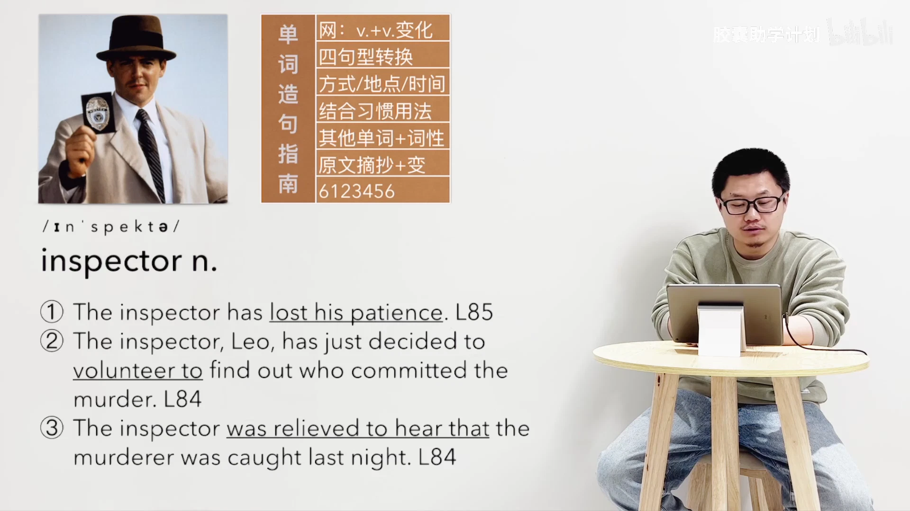

文字识别：单词造句指南 / 网：v.+v.变化 / 字计场 / 四句型转换 / 方式/地点/时间 / 结合习惯用法 / 其他单词+词性 / 原文摘抄+变 / 6123456 / /In'spekta/ / inspector n. / ① The inspector has lost his patience. L85 / ) The inspector, Leo, has just decided to / yolunteer to find out who committed the / murder. L84 / The inspector was relieved to hear that the / murderer was caught last night. L84

### 画面 00:05:05

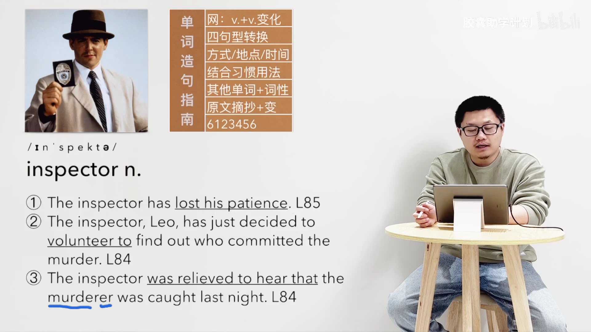

文字识别：单词造句指南 / 网：v.+v.变化 / 四句型转换 / 方式/地点/时间 / 结合习惯用法 / 其他单词+词性 / 原文摘抄+变 / 6123456 / /in'spekta/ / inspector n. / ① The inspector has lost his patience. L85 / The inspector, Leo, has just decided to / 2 / yolunteer to find out who committed the / murder. L84 / The inspector was relieved to hear that the / murderer was caught last night. L84

### 画面 00:05:10

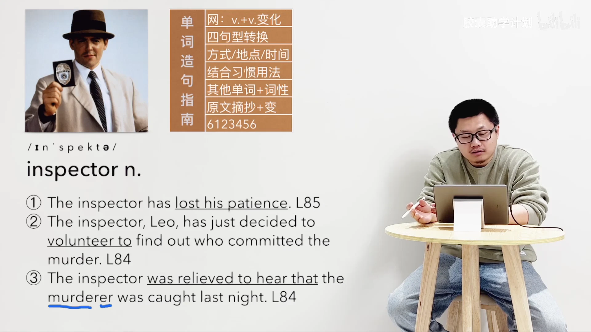

文字识别：单词造句指南 / 网：v.+v.变化 / 字计划 / 四句型转换 / 方式/地点/时间 / 结合习惯用法 / 其他单词+词性 / 原文摘抄+变 / 6123456 / /In'spekta/ / inspector n. / ① The inspector has lost his patience. L85 / ) The inspector, Leo, has just decided to / 2） / volunteer to find out who committed the / murder. L84 / The inspector was relieved to hear that the / murderer was caught last night. L84

### 画面 00:05:16

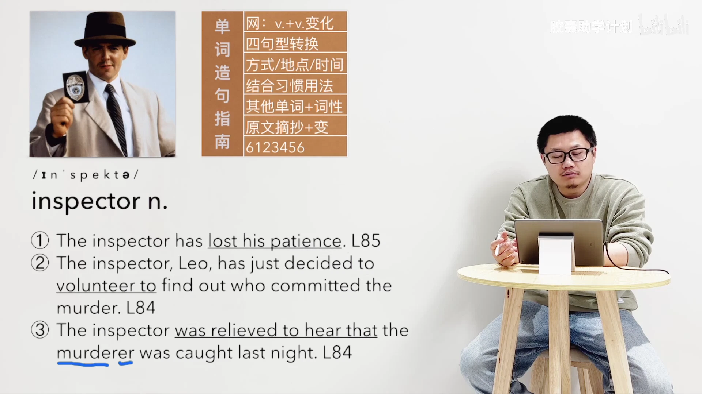

文字识别：单词造句指南 / 网：v.+v.变化 / 四句型转换 / 方式/地点/时间 / 结合习惯用法 / 其他单词+词性 / 原文摘抄+变 / 6123456 / /In'spekta/ / inspector n. / ① The inspector has lost his patience. L85 / ) The inspector, Leo, has just decided to / volunteer to find out who committed the / murder. L84 / The inspector was relieved to hear that the / murderer was caught last night. L84

### 画面 00:05:21

文字识别：单词造句指南 / 网：v.+v.变化 / 学计划 / 四句型转换 / 方式/地点/时间 / 结合习惯用法 / 其他单词+词性 / 原文摘抄+变 / 6123456 / /In'spekta/ / inspector n. / ① The inspector has lost his patience. L85 / The inspector, Leo, has just decided to / 2 / volunteer to find out who committed the / murder. L84 / The inspector was relieved to hear that the / murderer was caught last night. L84

### 画面 00:05:25

文字识别：单词造句指南 / 网：v.+v.变化 / 四句型转换 / 方式/地点/时间 / 结合习惯用法 / 其他单词+词性 / 原文摘抄+变 / 6123456 / /m'ｐｌｏｌａ/ / employer n.

### 画面 00:05:28

文字识别：单词造句指南 / 网：v.+v.变化 / 四句型转换 / 方式/地点/时间 / 结合习惯用法 / 其他单词+词性 / 原文摘抄+变 / 6123456 / /Ⅰm'ｐｌｏｌａ/ / employer n.

## 00:05:30–00:06:00

employee早在新一前二十课第十五课咱就学过，employ也学过，employer雇主嘛，就是他。employer后边是一帮employee，对吧？好，employer也是一个人，造句就很容易了，还是跟captain一个逻辑，对吧？所有之前我们造过的句子随便往里拽就可以了。那我们自己造几个句子啊？说The employer claimed to have fired five hundred people last week.他声称上周

### 画面 00:05:30

文字识别：单词造句指南 / 网：v.+v.变化 / 四句型转换 / 方式/地点/时间 / 结合习惯用法 / 其他单词+词性 / 原文摘抄+变 / 6123456 / /Ⅰm'ｐｌｏｌａ/ / employer n.

### 画面 00:05:33

文字识别：单词造句指南 / 网：v.+v.变化 / 四句型转换 / 方式/地点/时间 / 结合习惯用法 / 其他单词+词性 / 原文摘抄+变 / 6123456 / /Ⅰm'ｐlｏiａ/ / employer n.

### 画面 00:05:35

文字识别：单词造句指南 / 网：v.+v.变化 / 四句型转换 / 方式/地点/时间 / 结合习惯用法 / 其他单词+词性 / 原文摘抄+变 / 6123456 / /Ⅰm'ｐｌｏｌａl / employer n.

### 画面 00:05:38

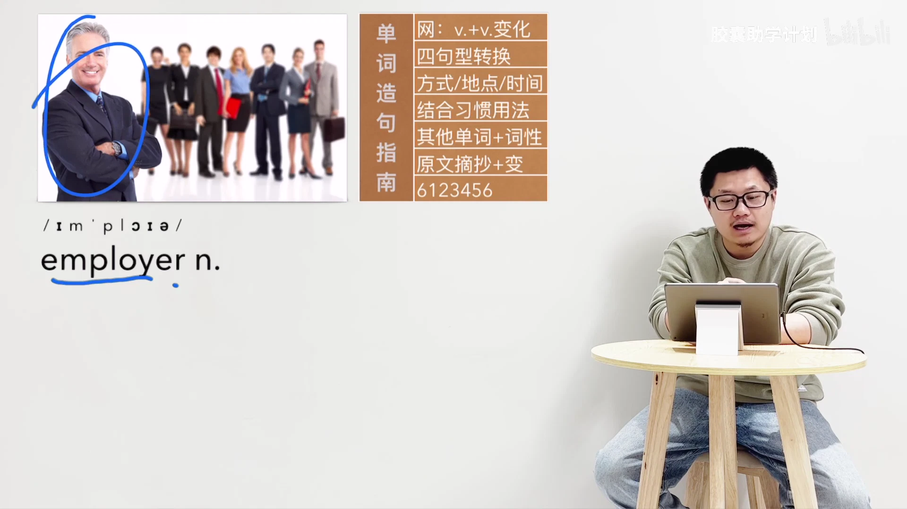

文字识别：单词造句指南 / 网：v.+v.变化 / 四句型转换 / 方式/地点/时间 / 结合习惯用法 / 其他单词+词性 / 原文摘抄+变 / 6123456 / /Ⅰm'ｐlｏｌa/ / employer n.

### 画面 00:05:40

文字识别：单词造句指南 / 网：v.+v.变化 / 四句型转换 / 方式/地点/时间 / 结合习惯用法 / 其他单词+词性 / 原文摘抄+变 / 6123456 / /Ⅰm'ｐlｏia/ / employer n.

### 画面 00:05:42

文字识别：单词造句指南 / 网：v.+v.变化 / 四句型转换 / 方式/地点/时间 / 结合习惯用法 / 其他单词+词性 / 原文摘抄+变 / 6123456 / /Ⅰm'ρloia/ / employer n. / ① The employer claimed to have fired 500 / people last week. L82

### 画面 00:05:45

文字识别：单词造句指南 / 网：v.+v.变化 / 四句型转换 / 方式/地点/时间 / 结合习惯用法 / 其他单词+词性 / 原文摘抄+变 / 6123456 / /Ⅰm'ρloia / / employer n. / ① The employer claimed to have fired 500 / people last week. L82

### 画面 00:05:55

文字识别：单词造句指南 / 网：v.+v.变化 / 四句型转换 / 方式/地点/时间 / 结合习惯用法 / 其他单词+词性 / 原文摘抄+变 / 6123456 / /Ⅰm'ρloia / / employer n. / ① The employer claimed to have fired 500 / people last week. L82

## 00:06:00–00:06:30

怎么样？Fire怎么样？怎么样？哎，这个直接开除了啊！这个五百个人。Next one, our employer is used to getting up very early in the morning.他习惯于每天早上很早就起床。Next one, she is such a huge fan of her employer.说她实际上是她这个雇主的一个大粉丝，是吧？Okay,啊，就是其实这地方的大

### 画面 00:06:01

文字识别：单词造句指南 / 网：v.+v.变化 / 四句型转换 / 方式/地点/时间 / 结合习惯用法 / 其他单词+词性 / 原文摘抄+变 / 6123456 / /Ⅰm'ρloⅠa/ / employer n. / ① The employer claimed to have fired 500 / people last week. L82

### 画面 00:06:06

文字识别：单词造句指南 / 网：v.+v.变化 / 四句型转换 / 方式/地点/时间 / 结合习惯用法 / 其他单词+词性 / 原文摘抄+变 / 6123456 / /Ⅰm'ρloⅠa / / employer n. / ① The employer claimed to have fired 500 / people last week. L82

### 画面 00:06:08

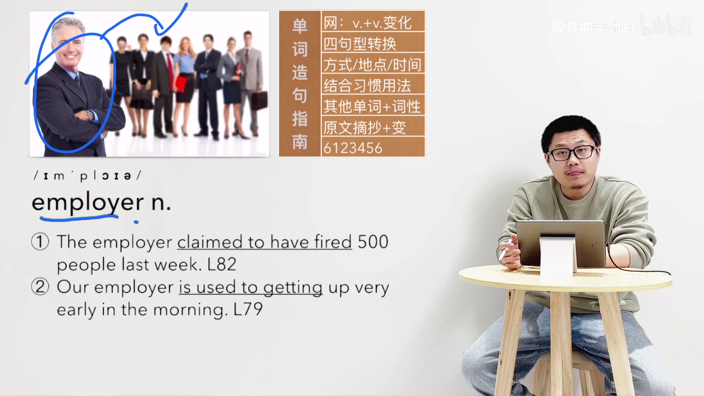

文字识别：单词造句指南 / 网：v.+v.变化 / 四句型转换 / 方式/地点/时间 / 结合习惯用法 / 其他单词+词性 / 原文摘抄+变 / 6123456 / /Ⅰm'ρlｏia/ / employer n. / ① The employer claimed to have fired 500 / people last week. L82 /  Our employer is used to getting up very / early in the morning. L79

### 画面 00:06:10

文字识别：单词造句指南 / 网：v.+v.变化 / 四句型转换 / 方式/地点/时间 / 结合习惯用法 / 其他单词+词性 / 原文摘抄+变 / 6123456 / /Ⅰm'ρlｏia/ / employer n. / ① The employer claimed to have fired 500 / people last week. L82 / Our employer is used to getting up very / early in the morning. L79

### 画面 00:06:16

文字识别：单词造句指南 / 网：v.+v.变化 / 四句型转换 / 方式/地点/时间 / 结合习惯用法 / 其他单词+词性 / 原文摘抄+变 / 6123456 / /Ⅰm'ρloia/ / employer n. / ① The employer claimed to have fired 500 / people last week. L82 / ② Our employer is used to getting up very / early in the morning. L79 / ) She is such a huge fan of her employer. L74

### 画面 00:06:20

文字识别：单词造句指南 / 网：v.+v.变化 / 四句型转换 / 方式/地点/时间 / 结合习惯用法 / 其他单词+词性 / 原文摘抄+变 / 6123456 / /Ⅰm'ρloia/ / employer n. / ① The employer claimed to have fired 500 / people last week. L82 / ② Our employer is used to geting up very / early in the morning. L79 / ) She is such a huge fan of her employer. L74

### 画面 00:06:27

文字识别：单词造句指南 / 网：v.+v.变化 / 四句型转换 / 方式/地点/时间 / 结合习惯用法 / 其他单词+词性 / 原文摘抄+变 / 6123456 / /Ⅰm'ρloia/ / employer n. / ① The employer claimed to have fired 500 / people last week. L82 / ② Our employer is used to getting up very / early in the morning. L79 / She is such a huge fan of her employer. L74

## 00:06:30–00:07:00

粉丝是什么意思？就是非常狂热的迷恋着他的这个粉丝。但你注意啊，这个啊，狂热的迷恋着他的这个雇主啊，他这个狂热迷恋不一定是男女之情的那种迷恋啊啊，你要注意一下啊，因为迷恋在汉语当中有更多的其他的意思。其实如果从字面意思，就是呃，觉得他老板特别牛啊，特别崇拜啊，特别崇敬啊，大概就是这样一个含义啊。Next one,下一个单词叫confirm,

### 画面 00:06:31

文字识别：单词造句指南 / 网：v.+v.变化 / 四句型转换 / 方式/地点/时间 / 结合习惯用法 / 其他单词+词性 / 原文摘抄+变 / 6123456 / /Ⅰm'ρloia/ / employer n. / ① The employer claimed to have fired 500 / people last week. L82 / ② Our employer is used to geting up very / early in the morning. L79 / ) She is such a huge fan of her employer. L74

### 画面 00:06:35

文字识别：单词造句指南 / 网：v.+v.变化 / 四句型转换 / 方式/地点/时间 / 结合习惯用法 / 其他单词+词性 / 原文摘抄+变 / 6123456 / /Ⅰm'ρlｏia/ / employer n. / ① The employer claimed to have fired 500 / people last week. L82 / ② Our employer is used to getting up very / early in the morning. L79 / She is such a huge fan of her employer. L74

### 画面 00:06:45

文字识别：单词造句指南 / 网：v.+v.变化 / 四句型转换 / 方式/地点/时间 / 结合习惯用法 / 其他单词+词性 / 原文摘抄+变 / 6123456 / /Ⅰm'ρlｏa/ / employer n. / ① The employer claimed to have fired 500 / people last week. L82 / ② Our employer is used to getting up very / early in the morning. L79 / ) She is such a huge fan of her employer. L74

### 画面 00:06:50

文字识别：单词造句指南 / 网：v.+v.变化 / 四句型转换 / 方式/地点/时间 / 结合习惯用法 / 其他单词+词性 / 原文摘抄+变 / 6123456 / /Ⅰm'ρloia/ / employer n. / ① The employer claimed to have fired 500 / people last week. L82 / ② Our employer is used to geting up very / early in the morning. L79 / She is such a huge fan of her employer. L74

### 画面 00:06:54

文字识别：单词造句指南 / 网：v.+v.变化 / 四句型转换 / 方式/地点/时间 / 结合习惯用法 / 其他单词+词性 / 原文摘抄+变 / 6123456 / /Ⅰm'ρloia/ / employer n. / ① The employer claimed to have fired 500 / people last week. L82 / ② Our employer is used to geting up very / early in the morning. L79 / She is such a huge fan of her employer. L74

### 画面 00:06:56

文字识别：单词造句指南 / 网：v.+v.变化 / 四句型转换 / 方式/地点/时间 / 结合习惯用法 / 其他单词+词性 / 原文摘抄+变 / 6123456 / /Ⅰm'ρloia/ / employer n. / ① The employer claimed to have fired 500 / people last week. L82 / ② Our employer is used to geting up very / early in the morning. L79 /  She is such a huge fan of her employer. L74

### 画面 00:06:58

文字识别：单词造句指南 / 网：v.+v.变化 / 泰助学计划陽 / 四句型转换 / 方式/地点/时间 / 结合习惯用法 / Cancel / Confirm / 其他单词+词性 / 原文摘抄+变 / 6123456 / /kan'f3:m/ / confirm V.

## 00:07:00–00:07:30

confirm.你看我配的这个图 cancel, confirm.这两个单词你一定要记住 cancel 取消, confirm 确定,确认对吧？确定确认。那它呢有一个常用的习惯用法叫 somebody confirmed that 加句子叫某人确定了，确认了这件事情。我们造个句子，比如说 he just confirmed that the volcano was erupting violently.说他刚刚通过比如说某种信息确认了前方的火山正在剧烈的喷发

### 画面 00:07:00

文字识别：单词造句指南 / 网：v.+v.变化 / 秦助字计划 / 四句型转换 / 方式/地点/时间 / 结合习惯用法 / Cancel / Confirm / 其他单词+词性 / 原文摘抄+变 / 6123456 / /kan'f3:m/ / confirm v.

### 画面 00:07:05

文字识别：单词造句指南 / 网：v.+v.变化 / 奏助学计划 / 四句型转换 / 方式/地点/时间 / 结合习惯用法 / Cancel / Confirm / 其他单词+词性 / 原文摘抄+变 / 6123456 / /kan'f3:m/ / confirm v.

### 画面 00:07:09

文字识别：单词造句指南 / 网：v.+v.变化 / 囊助学计划園 / 四句型转换 / 方式/地点/时间 / 结合习惯用法 / Cancel / Confirm / 其他单词+词性 / 原文摘抄+变 / 6123456 / /kan'f3:m/ / confirm v. / ① sb. confirm that + 句子

### 画面 00:07:16

文字识别：单词造句指南 / 网：v.+v.变化 / 囊助学计划 / 四句型转换 / 方式/地点/时间 / 结合习惯用法 / Cancel / Confirm / 其他单词+词性 / 原文摘抄+变 / 6123456 / / kan'f3:m/ / confirm V. / ① sb. confirm that +句子 / He just confirmed that the volcano was / erupting violently.

### 画面 00:07:20

文字识别：单词造句指南 / 网：v.+v.变化 / 嘉助字计划 / 四句型转换 / 方式/地点/时间 / 结合习惯用法 / Cancel / Confirm / 其他单词+词性 / 原文摘抄+变 / 6123456 / /kan'f3:m/ / confirm V. / ① sb. confirm that +句子 / He just confirmed that the volcano was / erupting violently.

### 画面 00:07:26

文字识别：单词造句指南 / 网：v.+v.变化 / 计划 / 四句型转换 / 方式/地点/时间 / 结合习惯用法 / Cancel / Confirm / 其他单词+词性 / 原文摘抄+变 / 6123456 / / kan'f3:m/ / confirm v. / ① sb. confirm that +句子 / He just confirmed that the volcano was / erupting violently.

## 00:07:30–00:08:00

着，确认了这件事儿，对吧？Next one,比如说，Can you confirm that he hitchhiked to Paris last week?那Can you confirm that就是你能对这件事情确认吗？哎，保证他这个信息是无疑的，是没有问题的呢？Can you confirm this?口语当中也很常见，对吧？好，那hitchhiked to Paris，七十三课咱学了嘛？搭便车去巴黎。Next one, I can confirm that they

### 画面 00:07:31

文字识别：单词造句指南 / 网：v.+v.变化 / 四句型转换 / 方式/地点/时间 / 结合习惯用法 / Cancel / Confirm / 其他单词+词性 / 原文摘抄+变 / 6123456 / /kan'f3:m/ / confirm V. / ① sb. confirm that +句子 / He just confirmed that the volcano was / erupting violently.

### 画面 00:07:33

文字识别：单词造句指南 / 网：v.+v.变化 / 四句型转换 / 方式/地点/时间 / 结合习惯用法 / Cancel / Confirm / 其他单词+词性 / 原文摘抄+变 / 6123456 / /kan^f3:m/ / confirm v. / ① sb. confirm that +句子 / He just confirmed that the volcano was / erupting violently. / Can you confirm that he hitchhike to Paris / last week? L73

### 画面 00:07:36

文字识别：单词造句指南 / 网：v.+v.变化 / 四句型转换 / 方式/地点/时间 / 结合习惯用法 / Cancel / Confirm / 其他单词+词性 / 原文摘抄+变 / 6123456 / /kan^f3:m/ / confirm v. / ① sb. confirm that +句子 / He just confirmed that the volcano was / erupting violently. / Can you confirm that he hitchhike to Paris / last week? L73

### 画面 00:07:45

文字识别：单词造句指南 / 网：v.+v.变化 / 四句型转换 / 方式/地点/时间 / 结合习惯用法 / Cancel / Confirm / 其他单词+词性 / 原文摘抄+变 / 6123456 / /kan'f3:m/ / confirm v. / ① sb. confirm that + 句子 / He just confirmed that the volcano was / erupting violently. / Can you confirm that he hitchhike to Paris / last Week? L73

### 画面 00:07:48

文字识别：单词造句指南 / 网：v.+v.变化 / 四句型转换 / 方式/地点/时间 / 结合习惯用法 / Cancel / Confirm / 其他单词+词性 / 原文摘抄+变 / 6123456 / /kan'f3:m/ / confirm v. / ① sb. confirm that + 句子 / He just confirmed that the volcano was / erupting violently. / Can you confirm that he hitchhike to Paris / last Week? L73

### 画面 00:07:56

文字识别：单词造句指南 / 网：v.+v.变化 / 臺助学计划 / 四句型转换 / 方式/地点/时间 / 结合习惯用法 / Cancel / Confirm / 其他单词+词性 / 原文摘抄+变 / 6123456 / /kan^f3:m/ / confirm v. / ① sb. confirm that + 句子 / He just confirmed that the volcano was / erupting violently. / Can you confirm that he hitchhike to Paris / 3 / last week? L73 / ④ I can confirm that they have made it official. / L71

### 画面 00:07:59

文字识别：单词造句指南 / 网：v.+v.变化 / 四句型转换 / 方式/地点/时间 / 结合习惯用法 / Cancel / Confirm / 其他单词+词性 / 原文摘抄+变 / 6123456 / / kan'f3:m/ / confirm v. / ① sb.confirm that +句子 / He just confirmed that the volcano was / erupting violently. / Can you confirm that he hitchhike to Paris / 3 / last week? L73 / ④ I can confirm that they have made it official. / L71

## 00:08:00–00:08:30

have made it official. Make something official,使之成为正式的，对吧？两个人，两人谈恋爱，什么叫 make it official了呢？哎，两个人，哎，同意了，你是我男朋友，我是你女朋友，make it official。那结婚怎么就 make it official了呢？你得领证啊，对吧？Make it official. Okay. 那注意力集中，咱听一个电影片段. Can you confirm that this is the vehicle you saw? Okay. Next one, 这个单词很有意思啊。我们在这儿要多提一点啊。虽然这个单

### 画面 00:08:04

文字识别：单词造句指南 / 网：v.+v.变化 / 奏助学计划 / 四句型转换 / 方式/地点/时间 / 结合习惯用法 / Cancel / Confirm / 其他单词+词性 / 原文摘抄+变 / 6123456 / /kan'f3:m/ / confirm v. / ① sb. confirm that +句子 / He just confirmed that the volcano was / erupting violently. / Can you confirm that he hitchhike to Paris / 3 / last week? L73 / ④ I can confirm that they have made it official. / L71

### 画面 00:08:14

文字识别：单词造句指南 / 网：v.+v.变化 / 四句型转换 / 方式/地点/时间 / 结合习惯用法 / Cancel / Confirm / 其他单词+词性 / 原文摘抄+变 / 6123456 / /kan'f3:m/ / confirm V. / ① sb. confirm that +句子 / He just confirmed that the volcano was / erupting violently. / Can you confirm that he hitchhike to Paris / last week? L73 / ④ I can confirm that they have made it official. / L71

### 画面 00:08:17

文字识别：Can you confirm that this is the vehicle you saw? / Just Let Go / (2015)

### 画面 00:08:21

文字识别：Can you confirm that this is the vehicle you saw? / Just Let Go / (2015)

### 画面 00:08:23

文字识别：Can you confirm that this is the vehicle you saw? / Just Let Go / (2015)

### 画面 00:08:25

文字识别：单词造句指南 / 网：v.+v.变化 / 学计划 / 四句型转换 / 方式/地点/时间 / 结合习惯用法 / Suggestion / 其他单词+词性 / Box / 原文摘抄+变 / 6123456 / /sa'd3est/ / suggestv. 建议；暗示

### 画面 00:08:29

文字识别：单词造句指南 / 网：v.+v.变化 / 秦助字计划 / 四句型转换 / 方式/地点/时间 / 结合习惯用法 / Suggestion / 其他单词+词性 / Box / 原文摘抄+变 / 6123456 / /sa'd3est/ / suggest v. 建议；暗示

## 00:08:30–00:09:00

词之前我们学过，suggest建议，suggest作为建议这个含义，各位应该是非常熟悉的，所以在这儿我今天就不多说了。比如说，包括suggestion box，对吧？这种建议箱啊，那我们今天要学它两个，一个在文章当中提，一个在这里去提。它还有一个暗示的意思。比如说，我们造一句话叫做"I'm not suggesting she was responsible for this accident."我们先看后面，叫做她对这

### 画面 00:08:41

文字识别：单词造句指南 / 网：v.+v.变化 / 辜助字计划 / 四句型转换 / 方式/地点/时间 / 结合习惯用法 / Suggestion / 其他单词+词性 / Box / 原文摘抄+变 / 6123456 / /sa'd3est/ / suggestv.建议；暗示

### 画面 00:08:43

文字识别：单词造句指南 / 网：v.+v.变化 / 戛助学计划 / 四句型转换 / 方式/地点/时间 / 结合习惯用法 / uggestion / 其他单词+词性 / Box / 原文摘抄+变 / 6123456 / /sa'd3est/ / suggest v. / 。建议；暗示

### 画面 00:08:45

文字识别：单词造句指南 / 网：v.+v.变化 / 四句型转换 / 方式/地点/时间 / 结合习惯用法 / Suggestion / 其他单词+词性 / Box / 原文摘抄+变 / 6123456 / /sa'd3est/ / suggest v.建议；暗示

### 画面 00:08:49

文字识别：单词造句指南 / 网：v.+v.变化 / 囊助学计划 / 四句型转换 / 方式/地点/时间 / 结合习惯用法 / Suggestion / 其他单词+词性 / Box / 原文摘抄+变 / 6123456 / /sa'd3est/ / suggest v.建议；暗示

### 画面 00:08:52

文字识别：单词造句指南 / 网：v.+v.变化 / 毫助字计划 / 四句型转换 / 方式/地点/时间 / 结合习惯用法 / Suggestion / 其他单词+词性 / Box / 原文摘抄+变 / 6123456 / /sa'd3est/ / suggest v.建议；暗示 / ① I'm not suggesting she was responsible for / the accident. L71

### 画面 00:08:56

文字识别：单词造句指南 / 网：v.+v.变化 / 喜助学计划 / 四句型转换 / 方式/地点/时间 / 结合习惯用法 / Suggestion / 其他单词+词性 / Box / 原文摘抄+变 / 6123456 / /sa'd3est/ / suggest v.建议；暗示 / ① I'm not suggesting she was responsible for / the accident. L71

## 00:09:00–00:09:30

个事故是有责任的。那什么叫 I'm not suggesting？那你翻译成我不是在建议他对这个有有有有这个对这个呃事故是负有责任的，有点翻译不太通，是吧？他这个地方理解为暗示，是吧？我不是在暗示啊，我不是在暗示含沙射影的说某件事儿，对吧？他对这个责任有事儿，我不是在这个意思啊。再来，比如说 Are you suggesting I'm lazy？说你是在暗示说我很懒吗？啊，

### 画面 00:09:00

文字识别：单词造句指南 / 网：v.+v.变化 / 毒助学计划 / 四句型转换 / 方式/地点/时间 / 结合习惯用法 / Suggestion / 其他单词+词性 / Box / 原文摘抄+变 / 6123456 / /sa'd3est/ / suggest v.建议；暗示 / ① I'm not suggesting / She was responsible for / the accidentL71

### 画面 00:09:04

文字识别：单词造句指南 / 网：v.+v.变化 / 四句型转换 / 方式/地点/时间 / 结合习惯用法 / Suggestion / 其他单词+词性 / Box / 原文摘抄+变 / 6123456 / /sa'd3est/ / suggestv. 建议；暗示 / ① I'm not suggesting she was responsible for / the accident. L71

### 画面 00:09:09

文字识别：单词造句指南 / 网：v.+v.变化 / 四句型转换 / 方式/地点/时间 / 结合习惯用法 / Suggestion / 其他单词+词性 / Box / 原文摘抄+变 / 6123456 / /sa'd3est/ / suggest v. 建议；暗示 / ① I'm not suggesting she was responsible for / the accident. L71

### 画面 00:09:14

文字识别：单词造句指南 / 网：v.+v.变化 / 囊助学计划 / 四句型转换 / 方式/地点/时间 / 结合习惯用法 / Suggestion / 其他单词+词性 / Box / 原文摘抄+变 / 6123456 / /sa'd3est/ / suggest v.建议；暗示 / ① I'm not suggesting she was responsible for / the accident. L71

### 画面 00:09:19

文字识别：单词造句指南 / 网：v.+v.变化 / 喜助字计划 / 四句型转换 / 方式/地点/时间 / 结合习惯用法 / Suggestion / 其他单词+词性 / Box / 原文摘抄+变 / 6123456 / /sa'd3est/ / suggest v.建议；暗示 / ① I'm not suggesting she was responsible for / the accident. L71

### 画面 00:09:24

文字识别：单词造句指南 / 网：v.+v.变化 / 四句型转换 / 方式/地点/时间 / 结合习惯用法 / Suggestion / 其他单词+词性 / Box / 原文摘抄+变 / 6123456 / /sa'd3est/ / suggest v. 建议；暗示 / ① I'm not suggesting she was responsible for / the accident. L71 / Are you suggesting I'm lazy?

## 00:09:30–00:10:00

你这指桑骂槐的、含沙射影的，对吧？暗度陈仓的是吧？你这是不是搁我这儿啊？所以这个这个搞暗示呢？哎，你是不是在暗示我很懒？那下一个呢？Suggest to take taxi，这就是咱们很熟悉的suggest的用法，之前也见过很多次了，就是建议。我建议你打个出租车赶紧走吧，对吧？好，呃，再读一遍这个单词啊，suggest。进入文章我们会见到它的另一个含义，这个我们在这儿没有给例句，所以就不多

### 画面 00:09:41

文字识别：单词造句指南 / 网：v.+v.变化 / 四句型转换 / 方式/地点/时间 / 结合习惯用法 / Suggestion / 其他单词+词性 / Box / 原文摘抄+变 / 6123456 / /sa'djest/ / suggest v． 建议；暗示 / ① I'm not suggesting she was responsible for / the accident. L71 / Are you suggesting I'm lazy? / ③ I suggest you take a taxi.

### 画面 00:09:45

文字识别：单词造句指南 / 网：v.+v.变化 / 四句型转换 / 方式/地点/时间 / 结合习惯用法 / Suggestion / 其他单词+词性 / Box / 原文摘抄+变 / 6123456 / /sa'd3est/ / suggest v. 建议；暗示 / ① I'm not suggesting she was responsible for / the accident. L71 / Are you suggesting I'm lazy? / ③ I suggest you take a taxi.

### 画面 00:09:52

文字识别：单词造句指南 / 网：v.+v.变化 / 霆助学计划 / 四句型转换 / 方式/地点/时间 / 结合习惯用法 / Suggestion / 其他单词+词性 / Box / 原文摘抄+变 / 6123456 / /sa'd3est/ / suggest v.建议；暗示 / ① I'm not suggesting she was responsible for / the accident. L71 / Are you suggesting I'm lazy? / ③ I suggest you take a taxi.

### 画面 00:09:55

文字识别：单词造句指南 / 网：v.+v.变化 / 四句型转换 / 方式/地点/时间 / 结合习惯用法 / Suggestion / 其他单词+词性 / Box / 原文摘抄+变 / 6123456 / /sa'djest/ / suggest v. 建议；暗示 / ① I'm not suggesting she was responsible for / the accident. L71 / Are you suggesting I'm lazy? / ③ I suggest you take a taxi.

## 00:10:00–00:10:30

提了。进入文章咱再说啊。好，呃，truth，新一就学过，to tell you the truth，对吧？所以我们在这儿就简单造几个句子就完了啊。第一个，张嘴跟我读，It was Leo who told us the truth, not you. 啊，强调句。Continue, I'm fairly certain that he told the police the truth. 啊，我相当确信。再来，Until we discover the cause, repeat after me, we won't be able to tell

### 画面 00:10:03

文字识别：单词造句指南 / 网：v.+v.变化 / 毒助学计划 / meone else's / 四句型转换 / board that manage. / 方式/地点/时间 / truth / the / 结合习惯用法 / genuine or factual 2 / 其他单词+词性 / true 3a proven ory / 原文摘抄+变 / 6123456 / /tru:θ/ / truth n.

### 画面 00:10:07

文字识别：单词造句指南 / 网：v.+v.变化 / 妻助学计划 / meoneelse's / 四句型转换 / board that manage / 方式/地点/时间 / truth / the / 结合习惯用法 / genuine or factual 2 / 其他单词+词性 / true 3a proven ory / 原文摘抄+变 / 6123456 / /tru:θ/ / truth n. /  tell the truth... / 1

### 画面 00:10:11

文字识别：单词造句指南 / 网：v.+v.变化 / 囊助学计划 / meone else's / 四句型转换 / board that manage. / 方式/地点/时间 / truth / the / 结合习惯用法 / genuine or factual 2 / 其他单词+词性 / true 3a proven ory / 原文摘抄+变 / 6123456 / /tru:0/ / truth n. / ① tell the truth.. / It was Leo who told us the truth, not you. / L58

### 画面 00:10:15

文字识别：单词造句指南 / 网：v.+v.变化 / 妻助字计划陽 / meone else'ss / 四句型转换 / board that manage. / 方式/地点/时间 / truth / the / 结合习惯用法 / genuine or factual2 / 其他单词+词性 / true 3a proven ory / 原文摘抄+变 / 6123456 / /tru:0/ / truth n. / ① tell the truth.. / It was Leo who told us the truth, not you. / L58

### 画面 00:10:17

文字识别：单词造句指南 / 网：v.+v.变化 / 泰助字计划 / meone else's / 四句型转换 / board that manage. / 方式/地点/时间 / truth / the / 结合习惯用法 / genuine or factual 2 / 其他单词+词性 / true 3a proven ory / 原文摘抄+变 / 6123456 / /tru:θ1 / truth n. / ① tell the truth.. / It was Leo who told us the truth, not you. / L58 / I'm fairly certain that he told the police / the truth. L55

### 画面 00:10:24

文字识别：单词造句指南 / 网：v.+v.变化 / 虞助学计划 / meone else's / 四句型转换 / board that manage. / 方式/地点/时间 / truth / the / 结合习惯用法 / genuine or factual 2 / 其他单词+词性 / true 3a proven ory / 原文摘抄+变 / 6123456 / /tru:01 / truth n. / ① tell the truth... / It was Leo who told us the truth, not you. / L58 / I'm fairly certain that he told the police / the truth. L55 / Until we discover the cause, we won't be / able to tell the truth. L53

## 00:10:30–00:11:00

the truth. Okay,单词除了一万，习惯用法肯定重要，对吧？该造句造句啊。呃，我们看一下家庭作业。那单词造句肯定是第一个，然后老习惯电影，然后置顶留言，对吧？以上呢就是本期视频的全部内容了。如果各位喜欢我们的课程呢，欢迎各位关注、订阅、一键三连，分享给那些需要的朋友，来帮助我们快速成长。

### 画面 00:10:32

文字识别：单词造句指南 / 网：v.+v.变化 / 囊助字计划 / meone else's / 四句型转换 / board that manage. / 方式/地点/时间 / truth / the / 结合习惯用法 / genuine or factual 2 / 其他单词+词性 / true 3 a proven ory / 原文摘抄+变 / 6123456 / /tru:01 / truth n. / ① tell the truth... / It was Leo who told us the truth, not you. / L58 / I'm fairly certain that he told the police / the truth. L55 / Until we discover the cause, we won't be / able to tell the truth. L53

### 画面 00:10:34

文字识别：Recap / Words / have a alibi / commit a murder / Expression / sb. confirm that + 句子 / Are you suggesting….. / tell the truth

### 画面 00:10:36

文字识别：Recap / Words / have a alibi / commit a murder / Expression / sb. confirm that + 句子 / Are you suggesting…. / tell the truth

### 画面 00:10:38

文字识别：Recap / Words / have a alibi / commit a murder / Expression / sb. confirm that + 句子 / Are you suggesting... / tell the truth

### 画面 00:10:40

文字识别：星助字计划

### 画面 00:10:42

文字识别：单词造句/对话 / 1. / 【单词造句指南】 / 每个5句

### 画面 00:10:44

文字识别：单词造句/对话 / 【单词造句指南】 / 每个5句 / 2.反复听电影片段，直到能 / 听出关键短语/句子

### 画面 00:10:46

文字识别：单词造句/对话 / 【单词造句指南】 / 每个5句 / 2.反复听电影片段，直到能 / 听出关键短语/句子 / 3.重复间隔（置顶留言）

### 画面 00:10:48

文字识别：单词造句/对话 / 【单词造句指南】 / 每个5句 / 反复听电影片段，直到能 / 听出关键短语/句子 / 3.重复间隔（置顶留言）

### 画面 00:10:50

文字识别：臺助学计划一调 / 不 / 🌟

## 00:11:00–00:11:14

you next time.

### 画面 00:11:01

文字识别：童助字計划一用

### 画面 00:11:03

文字识别：極動学針划 / CAPSULEACADEMY / 胶囊助学计划 / 小红书 / Lecturer / □ / Leo / OE

### 画面 00:11:06

文字识别：CAPSULEACADEMY / 胶囊助学计划 / 小红书 / Photographer / Berlin / OE

### 画面 00:11:08

文字识别：臺動字計切 / CAPSULEACADEMY / 胶囊助学计划 / 小红书 / Editor / Berlin / OE

### 画面 00:11:11

文字识别：CAPSULEACADEMY / 胶囊助学计划 / 小红书

### 画面 00:11:13

文字识别：bilibili / 胶囊助学计划

