# 087 语法

快速机器解析：语音为单模型转写，未进行独立交叉校对或人工复核；画面每秒采样并按变化选帧，短时文字和标记可能遗漏。截图时间约有 1 秒误差。图片有损压缩；遇到疑点请按时间查看 Google Drive 原视频。

## 00:00:00–00:00:30

Hello everyone, welcome to Capsule Academy. This is Leo. Today we're going to learn New Concept English Book Two, Lesson Eighty Seven, Grammar. Hope you gonna enjoy it. 注意，本课是我们第四单元的第十五课了。那基本上肯定要带着第一单元第十五课、第二单元的三十九课一块儿去复习一下宾语从句，因为宾语从句这个实际上是早在新一九十九课一

### 画面 00:00:00

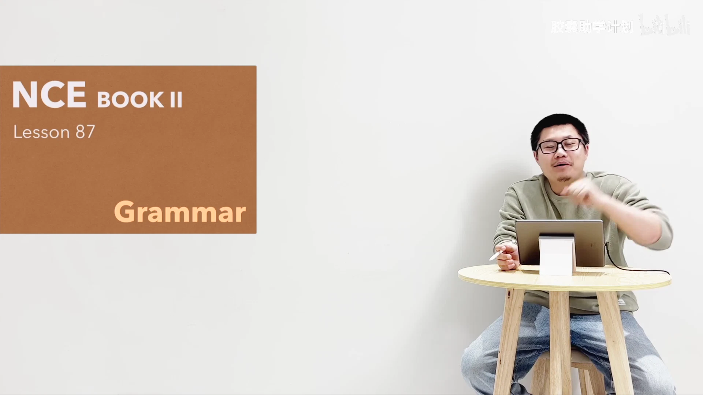

文字识别：NCE / BOOKII / Lesson 87 / Grammar

### 画面 00:00:02

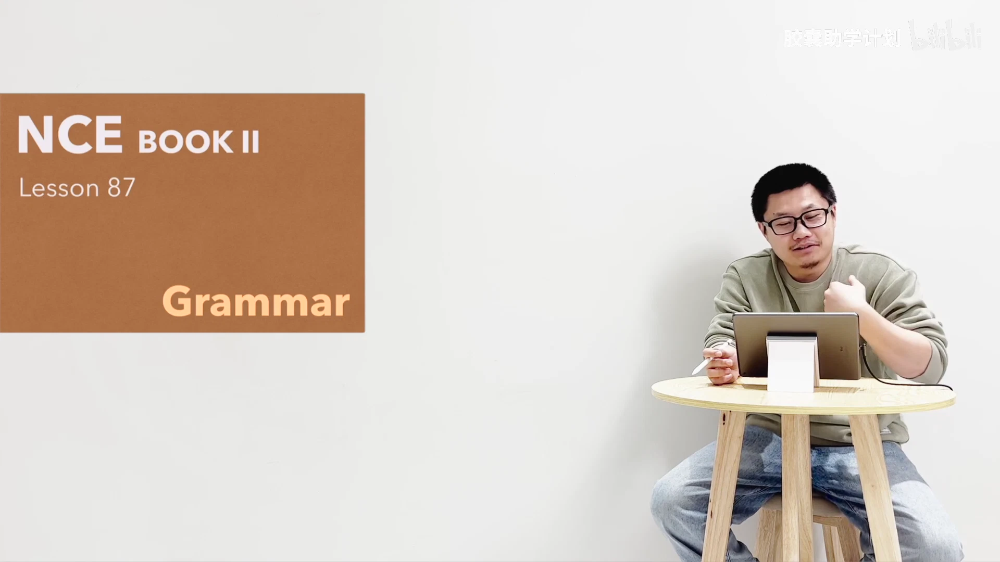

文字识别：NCE / BOOKII / Lesson 87 / Grammar

### 画面 00:00:05

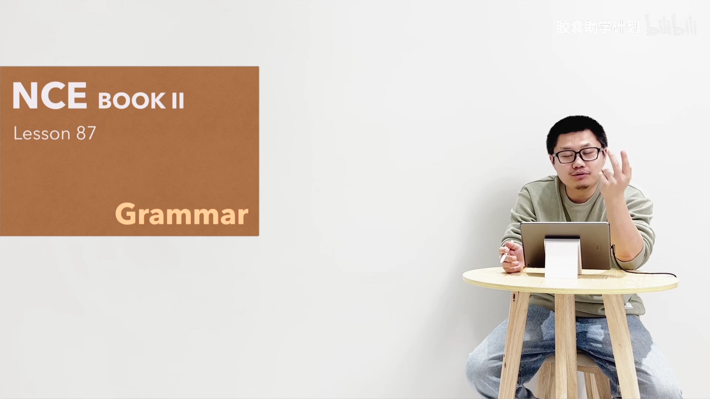

文字识别：NCE / BOOK"I / Lesson 87 / Grammar

### 画面 00:00:09

文字识别： Biltbil / 胶囊助学计划

### 画面 00:00:13

文字识别：交囊助学计划 / 胶囊助学计划

### 画面 00:00:15

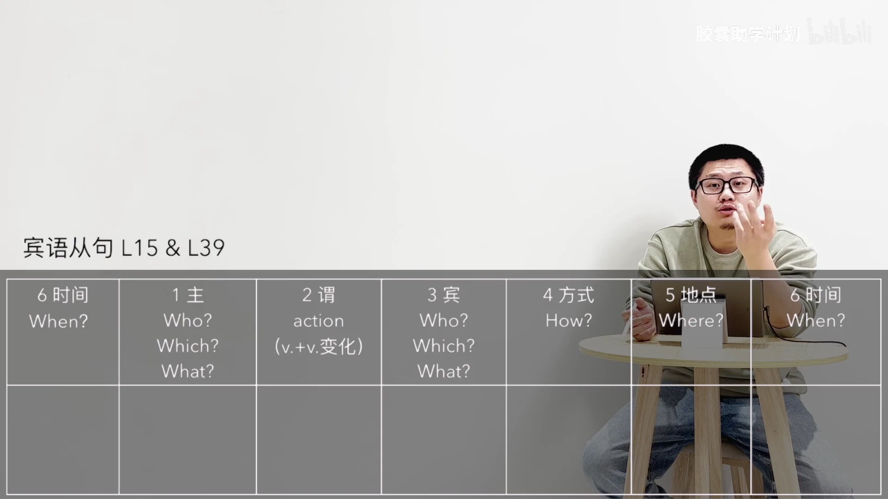

文字识别：奏助学计划陽 / 宾语从句L15 ＆L39 / 6时间 / 1主 / 2谓 / 3宾 / 4方式 / 5地点 / 6时间 / When? / Who? / action / Who? / How? / Where? / When? / Which? / (v.+v.变化) / Which? / What? / What?

## 00:00:30–00:01:00

路啊，九十九一百零一一百三十三一百三十五一百三十九不停的在讲宾语从句，而且整体上没有那么难。我们还是老习惯以练代讲啊。那宾语从句当中比较费劲的，其实是一般疑问句和特殊疑问句去做宾语从句。那我们在这儿重点练的也是这两个啊。肯定句、否定句做宾语从句太简单了，咱们不多说了啊。我们看第一个说，Was he traveling on the eight o'clock train？他是在这正在坐

### 画面 00:00:41

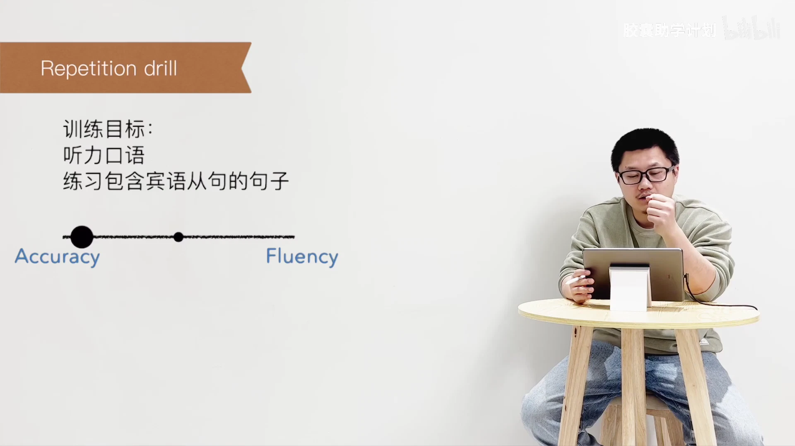

文字识别：Repetition drill / 训练目标： / 听力口语 / 练习包含宾语从句的句子 / Accuracy / Fluency

### 画面 00:00:51

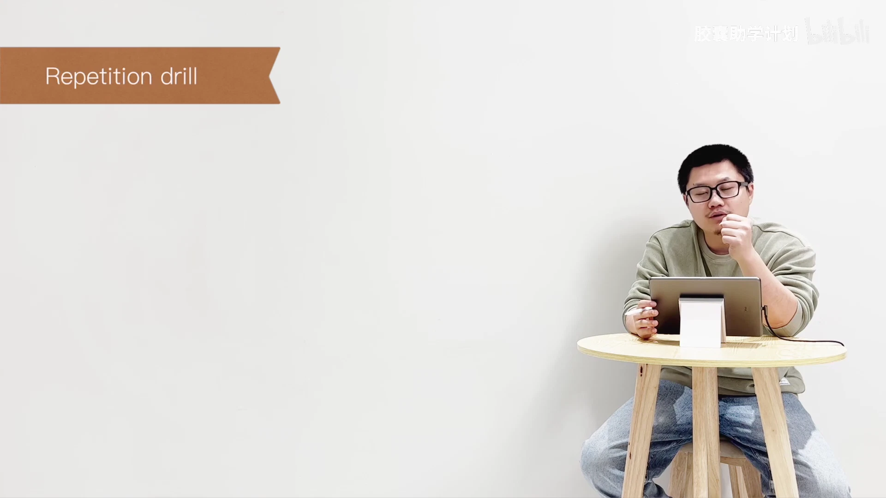

文字识别：学计州 / Repetition drill

### 画面 00:00:54

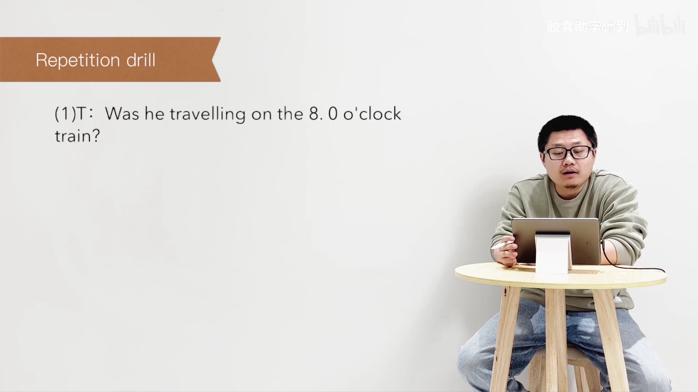

文字识别：Repetition drill / (1)T: Was he travelling on the 8.0 o'clock / train?

## 00:01:00–00:01:30

八点钟的这个车嘛，坐这个航行嘛，旅行嘛。说 I wonder，我想知道弄明白 if he was traveling on the eight o'clock train。这个 if 什么意思？我跟各位说过， if 最常见的，要么引导十六课、四十课、六十四课那个条件句，当然可以是真实的，可以是虚拟的，对吧？好，翻译成如果。接下来呢，在这个地方宾语从句当中翻译成是否，对吧？我想弄清楚他是否在八点钟这趟火车上的，

### 画面 00:01:01

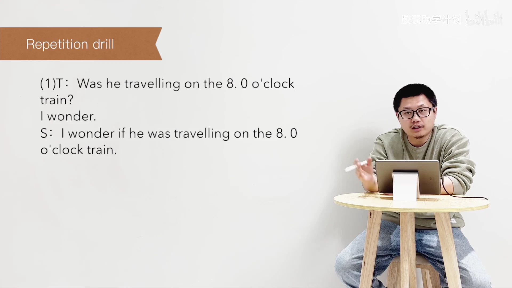

文字识别：Repetition drill / (1)T: Was he travelling on the 8. 0 o'clock / train? / I wonder. / S: I wonder if he was travelling on the 8.0 / o'clock train.

## 00:01:30–00:02:00

对吧？坐这趟火车航行，哎，这个这个这个出行的是吧？好，这是第一个，剩下全是这样的，我不挨个解释了，都是一般疑问句和特殊疑问句做宾语从句。您忘了一定要翻到十五课和三十九课，包括刚才我说的新一那几课，回去再学，对吧？跟这课没关系啊，这课就是复习。张嘴跟我读，Which train does he catch every morning? Ask

### 画面 00:01:31

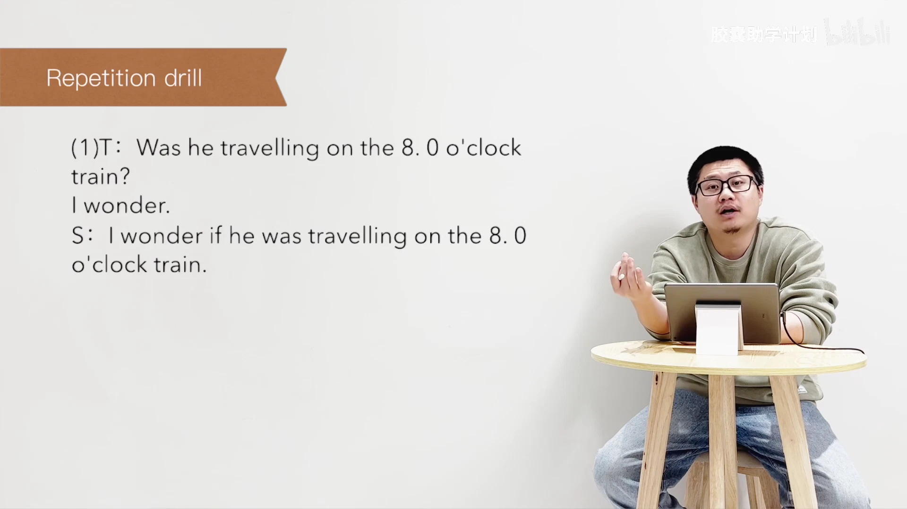

文字识别：Repetition drill / (1)T: Was he travelling on the 8. 0 o'clock / train? / I wonder. / S: I wonder if he was travelling on the 8.0 / o'clock train.

### 画面 00:01:36

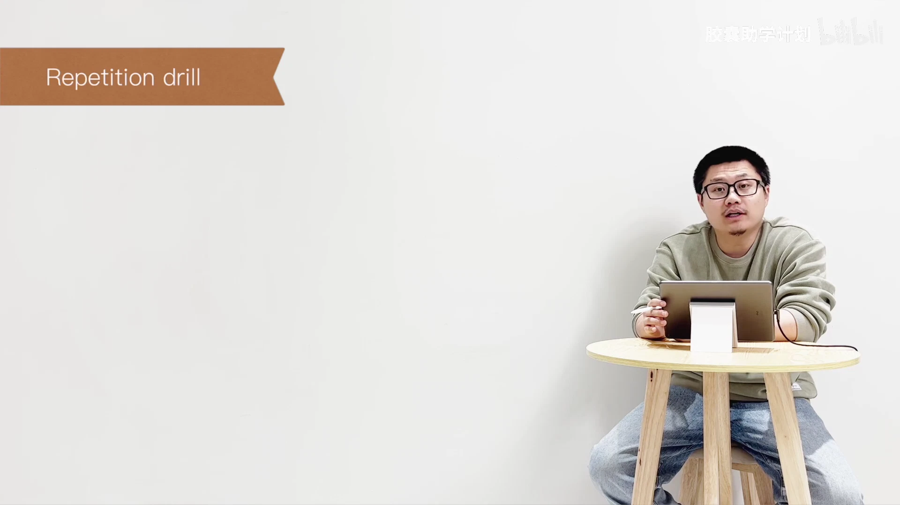

文字识别：Repetition drill

### 画面 00:01:53

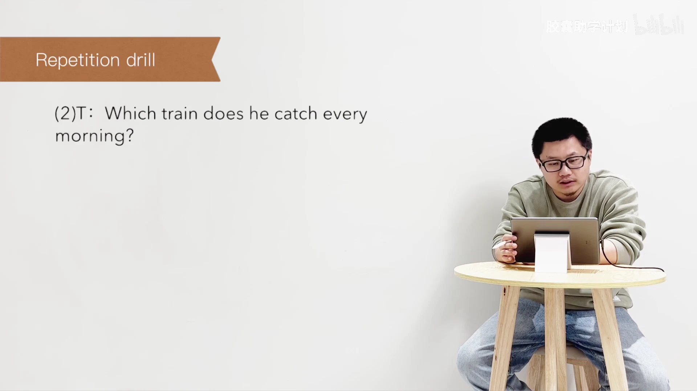

文字识别：Repetition drill / (2)T: Which train does he catch every / morning?

## 00:02:00–00:02:30

him, ask him which train he catches every morning. Must he be work at ten o'clock? How should I know? How should I know if he must be at work at ten o'clock? Would a later train get him to work on time? I have no idea. I have no

### 画面 00:02:00

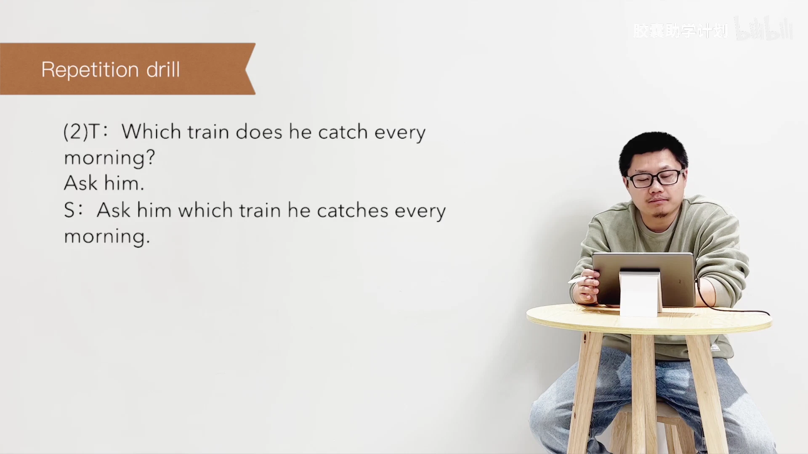

文字识别：Repetition drill / (2)T: Which train does he catch every / morning? / Ask him. / S: Ask him which train he catches every / morning.

### 画面 00:02:07

文字识别：Repetition drill / (3)T: Must he beat work at 10.0 o'clock?

### 画面 00:02:14

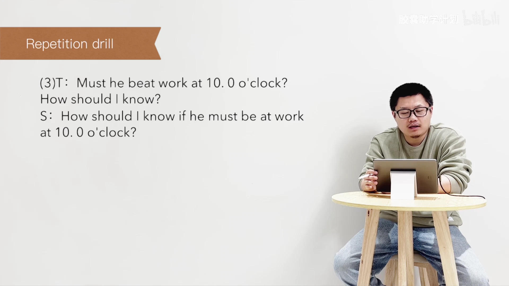

文字识别：Repetition drill / (3)T: Must he beat work at 10.0 o'clock? / How should I know? / S: How should I know if he must be at work / at 10.0 o'clock?

### 画面 00:02:20

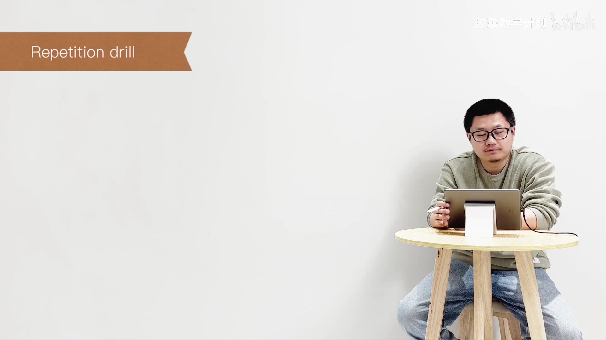

文字识别：Repetition drill

### 画面 00:02:28

文字识别：Repetition drill / 4 T: Would a later train get him to work on / time? / I have no idea. / S: I have no idea if a later train would get / him to work on time.

## 00:02:30–00:03:00

idea if a later train would get him to work on time. What time did he arrive at the station? Tell me, tell me what time he arrived at the station. Did she buy a new hat? I'd love to know. I'd love to know if she bought a new hat. Why didn't he notice

### 画面 00:02:37

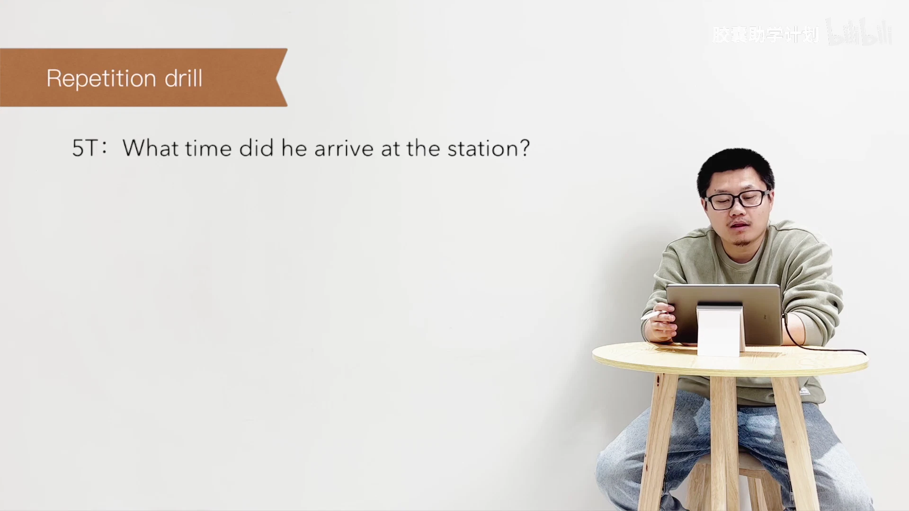

文字识别：Repetition drill / 5T: What time did he arrive at the station?

### 画面 00:02:52

文字识别：Repetition drill / 6T: Did she buy a new hat? / I'd love to know. / S: I'd love to know if she bought a new hat.

### 画面 00:02:57

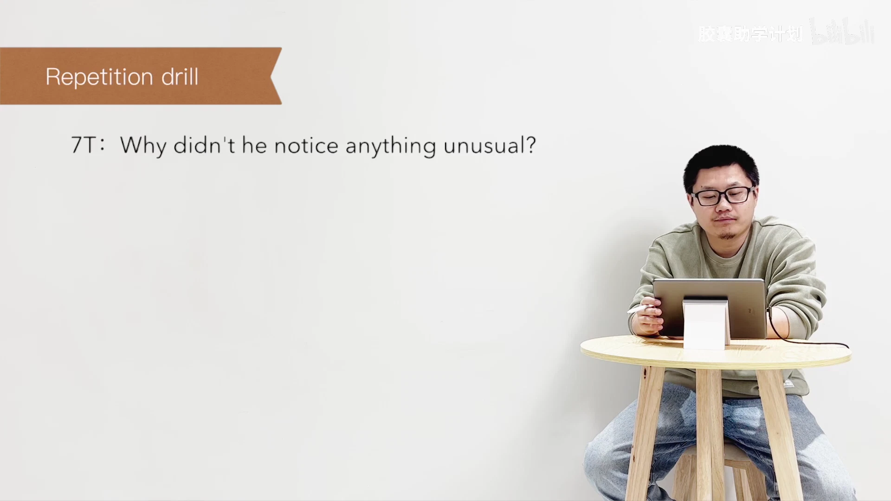

文字识别：Repetition drill / 7T: Why didn't he notice anything unusual?

## 00:03:00–00:03:30

anything unusual? I wonder. I wonder why he didn't notice anything unusual. Is he telling the truth? You should know. You should know if he's telling the truth.你应该知道他是否在讲真话。Why didn't the train run that morning? I can't explain.

### 画面 00:03:15

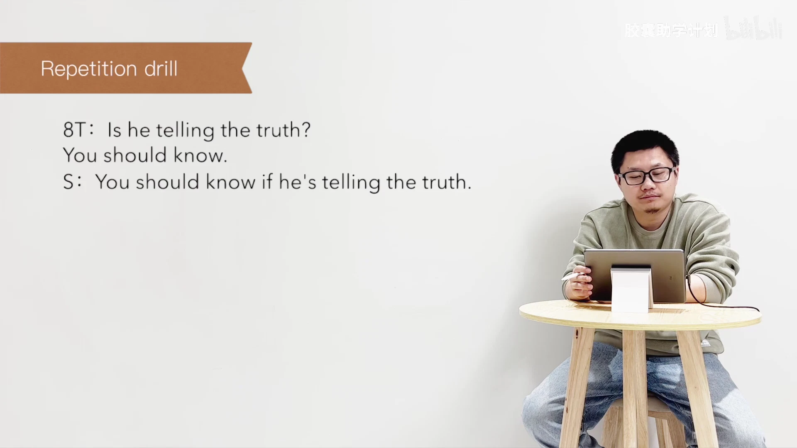

文字识别：Repetition drill / 8T: Is he telling the truth? / You should know. / S: You should know if he's telling the truth.

### 画面 00:03:23

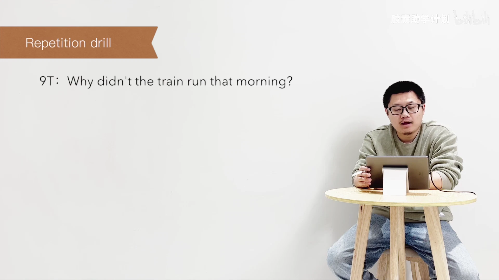

文字识别：Repetition drill / 9T: Why didn't the train run that morning?

## 00:03:30–00:04:00

I can't explain why the train didn't run that morning. Where did the train break down? I don't know. I don't know where the train broke down. Pattern drill还是跟宾语从句相关的啊。咱们这个先看这两个句子。I wonder who broke that plate. 我想搞明白，我想弄清楚谁把那盘子弄碎的。宾语从句，特殊疑问句引导的，对吧？And

### 画面 00:03:38

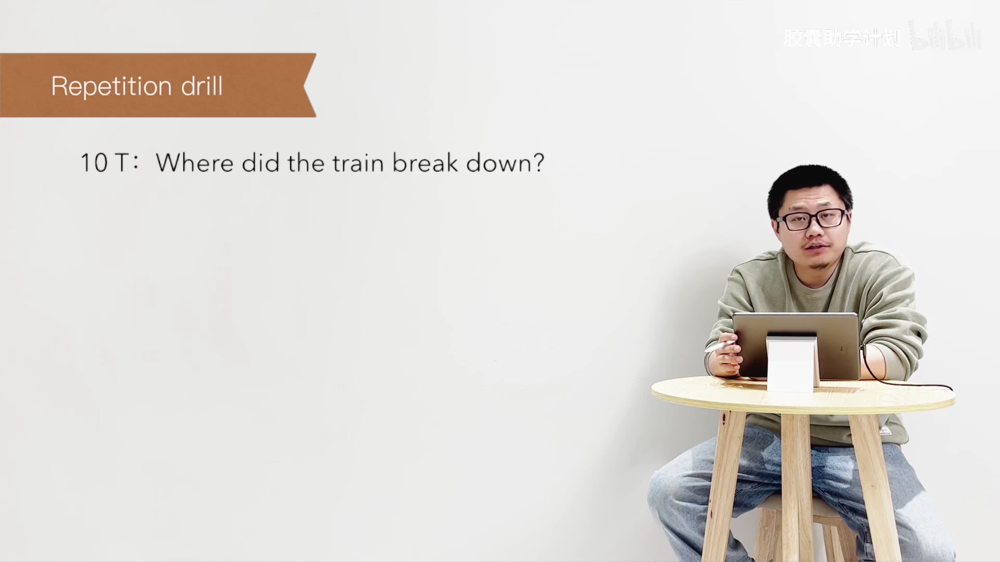

文字识别：Repetition drill / 10 T: Where did the train break down?

### 画面 00:03:41

文字识别：Repetition drill / 10 T: Where did the train break down? / I don't know. / S: I don't know where the train broke down.

### 画面 00:03:44

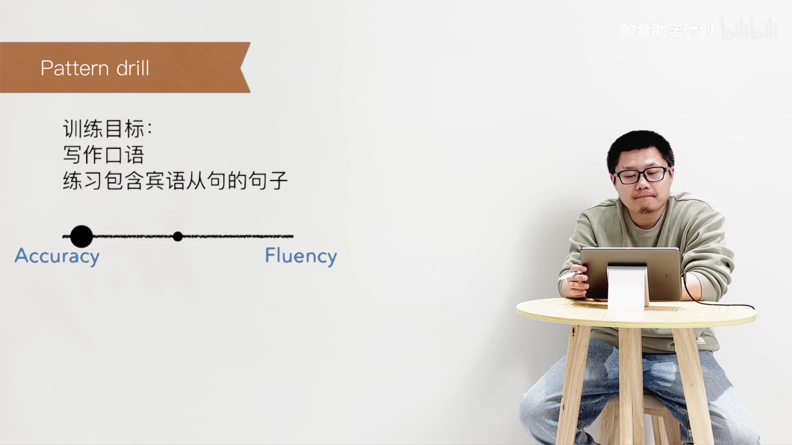

文字识别：Pattern drill / 训练目标： / 写作口语 / 练习包含宾语从句的句子 / Accuracy / Fluency

### 画面 00:03:47

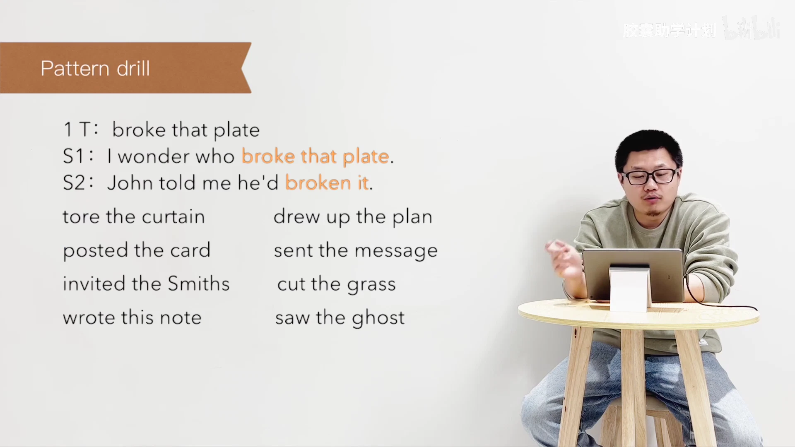

文字识别：Pattern drill / 1 T: broke that plate / S1:I wonder who broke that plate. / S2: John told me he'd broken it. / tore the curtain / drew up the plan / posted the card / sent the message / invited the Smiths / cut the grass / wrote this note / saw the ghost

## 00:04:00–00:04:30

John told me he'd broken it.啊，他告诉我是他给弄碎的，对吧？那你注意这里 told me 不就是肯定句做宾语从句吗？第二个，Have you asked him when he will be coming？你有问他他什么时候来吗？特殊疑问句 when 引导的宾语从句。说 Yes, he said he would be coming tomorrow.这实际上是新一百三十三一百三十五学的那个，就是你当你的宾语从句的主句是一般过去时的时候，后面的这个句子

### 画面 00:04:08

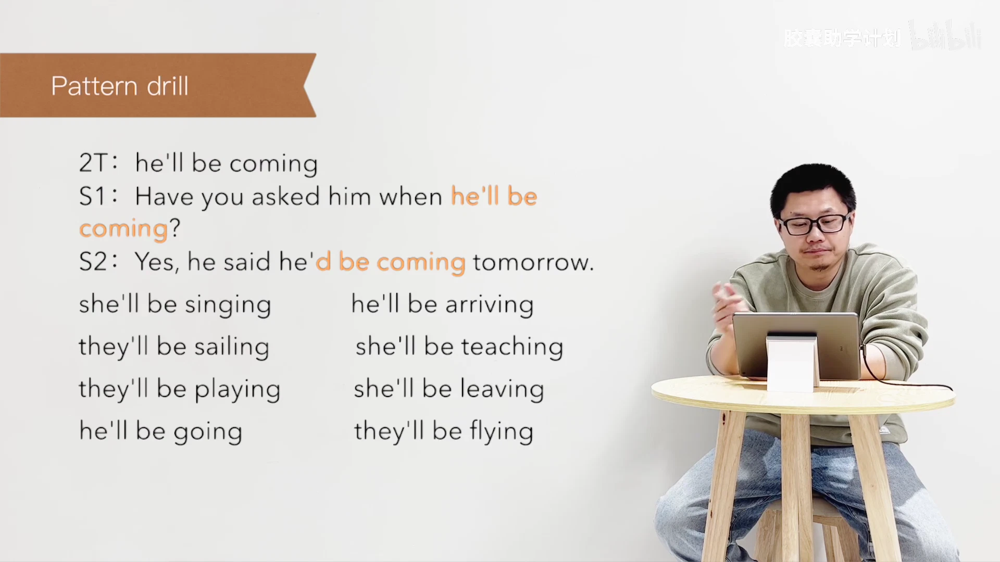

文字识别：Pattern drill / 2T:he'll be coming / S1: Have you asked him when he'll be / coming? / S2: Yes, he said he'd be coming tomorrow. / she'll be singing / he'll be arriving / they'll be sailing / she'll be teaching / they'll be playing / she'll be leaving / he'll be going / they'll be flying

## 00:04:30–00:05:00

时态要后移。你看这里是 he will be coming，这就变成了 he would be coming，对吧？时态要后移，记住啊。这是第二个，第三个。 When will you visit him？你什么时候去拜访他呢？ He hasn't asked me to visit him yet。他还没有要求我去拜访他。 OK，好。第三个，第四个，最后一个。 I think I will have to sell this car。我认为后边一个肯定句引导的宾语从句，对吧？

### 画面 00:04:38

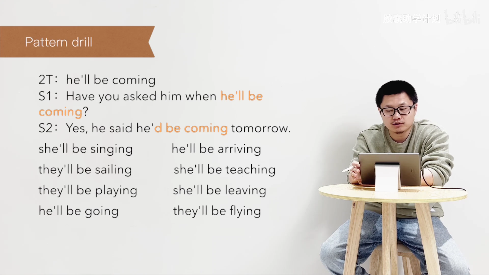

文字识别：Pattern drill / 2T: he'll be coming / S1: Have you asked him when he'll be / coming? / S2: Yes, he said he'd be coming tomorrow. / she'll be singing / he'll be arriving / they'll be sailing / she'll be teaching / they'll be playing / she'll be leaving / he'll be going / they'll be flying

### 画面 00:04:40

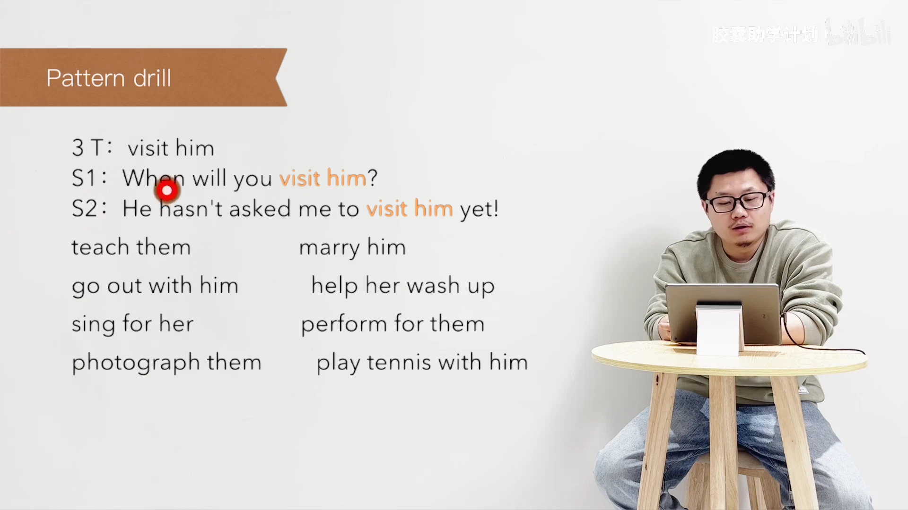

文字识别：Pattern drill / 3 T: visit him / S1: Whan will you visit him? / S2: He hasn't asked me to visit him yet! / teach them / marry him / help her wash up / go out with him / sing for her / perform for them / photograph them / play tennis with him

### 画面 00:04:52

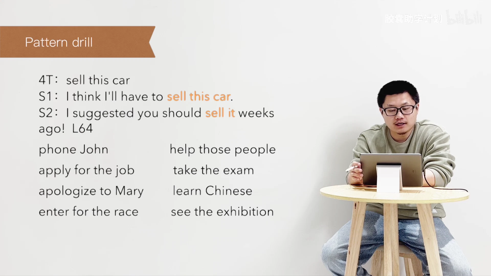

文字识别：Pattern drill / 4T: sell this car / S1: I think I'll have to sell this car. / S2: I suggested you should sell it weeks / ago! L64 / phone John / help those people / apply forthe job / take the exam / apologize to Mary / learn Chinese / enter for the race / see the exhibition

## 00:05:00–00:05:30

说我觉得我得卖这辆车。I suggested you should sell it weeks ago.说我当时就建议你数周前就应该给他卖了。然后这里注意提一个suggest，这为啥加should？六十四课咱学过，所以在这儿我不讲了。您忘了很正常，对吧？七十四、八十四、二十课过去了，您忘了很正常。翻回去再学一遍，再看一下，对吧？翻翻课堂笔记也好啊，翻翻视频也好，再看一遍。好，呃，

### 画面 00:05:22

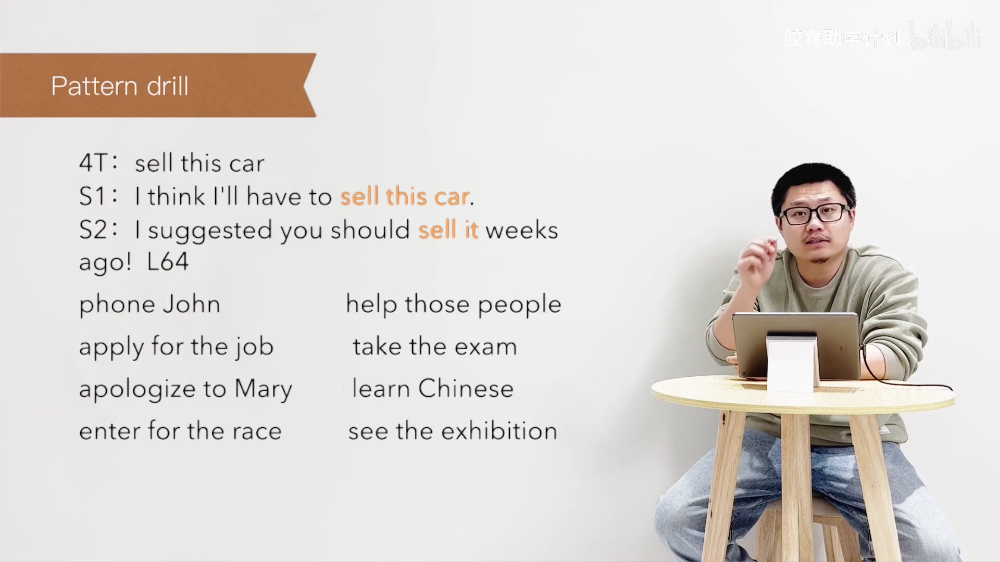

文字识别：Pattern drill / 4T: sell this car / S1: I think I'll have to sell this car. / S2: I suggested you should sellit weeks / ago! L64 / phone John / help those people / apply for the job / take the exam / apologize to Mary / learn Chinese / enter for the race / see the exhibition

### 画面 00:05:29

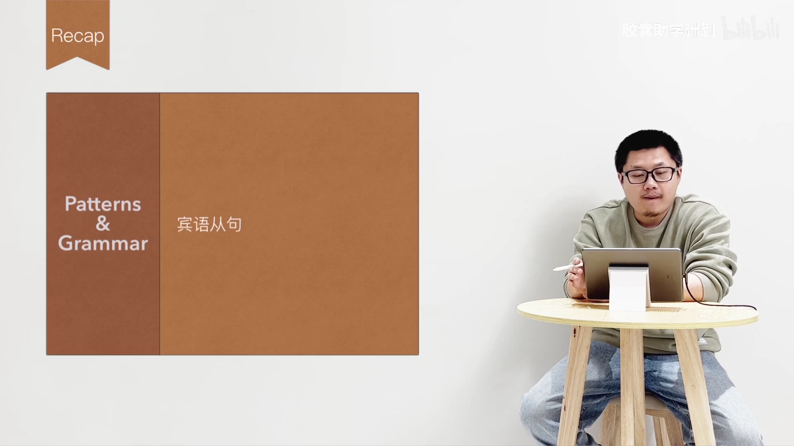

文字识别：Recap / 毫助字计划 / Patterns / 宾语从句 / Grammar

## 00:05:30–00:06:00

recap本课的语法主要就是宾语从句，以练代讲，过一遍这事儿就完了。那家庭作业呢，pattern drill该写写四乘四，然后该回忆该讲解讲解，这个地方是重点，冲这个红皮书啊，初级加中级，咱们在第四单元尽可能都给他去写了啊，这个进入三册学起来就舒服很多了，好吧？那以上呢就是本期视频的全部内容了。如果各位喜欢我们的课程呢，欢迎各位关注、订阅、一

### 画面 00:05:31

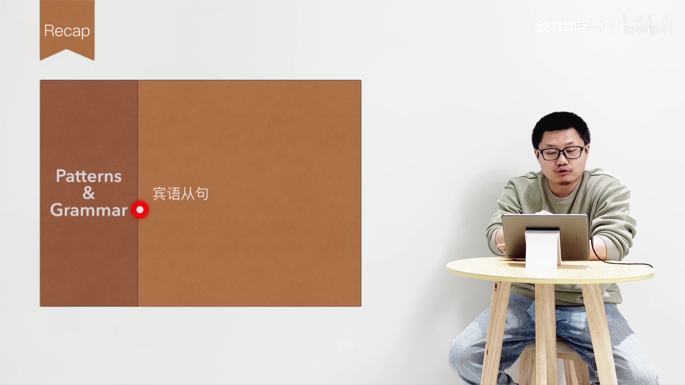

文字识别：Recap / 毫助字计划 / Patterns / ＆ / 宾语从句 / Grammar

### 画面 00:05:33

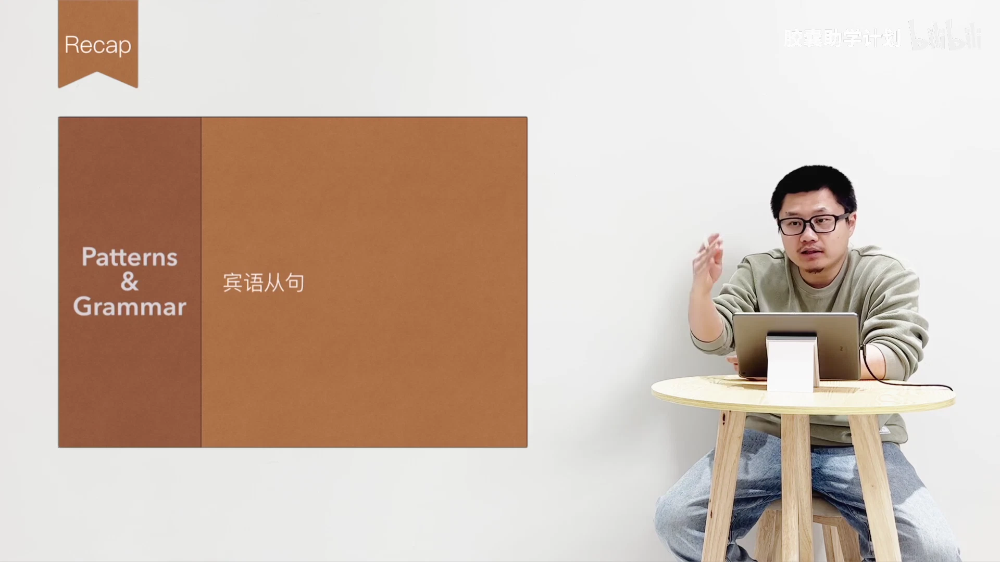

文字识别：Recap / 奏助学计划一调 / Patterns / ＆ / 宾语从句 / Grammar

### 画面 00:05:35

文字识别：虔助学计划園們

### 画面 00:05:37

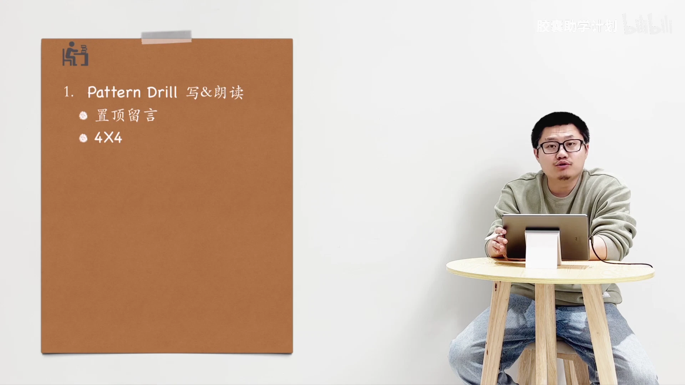

文字识别：1.f / Pattern Drill 写&朗读 / 置顶留言 / 4×4

### 画面 00:05:39

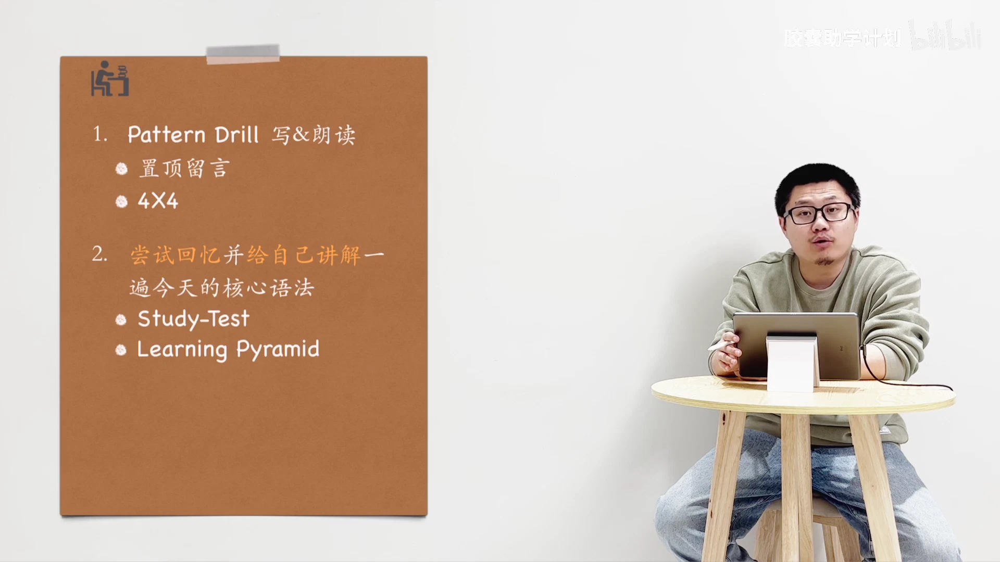

文字识别：Pattern Drill写&朗读 / 置顶留言 / 4×4 / 尝试回忆并给自己讲解一 / 遍今天的核心语法 / Study-Test / Learning Pyramid

### 画面 00:05:41

文字识别：1. f / Pattern Drill 写&朗读 / 置顶留言 / 4×4 / 尝试回忆并给自己讲解一 / 遍今天的核心语法 / Study-Test / Learning Pyramid / 尝试翻阅红皮书（中级） / 通过目录或索引(Index) / 查找到本课语法

### 画面 00:05:43

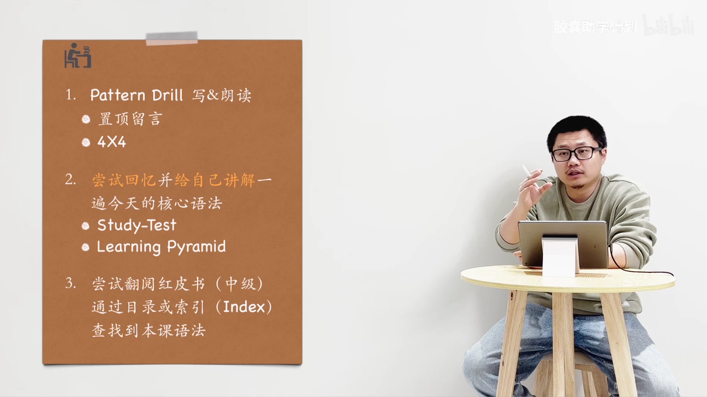

文字识别：1. f / Pattern Drill 写&朗读 / 置顶留言 / 4×4 / 尝试回忆并给自己讲解一 / 遍今天的核心语法 / Study-Test / Learning Pyramid / 尝试翻阅红皮书（中级） / 通过目录或索引(Index) / 查找到本课语法

### 画面 00:05:45

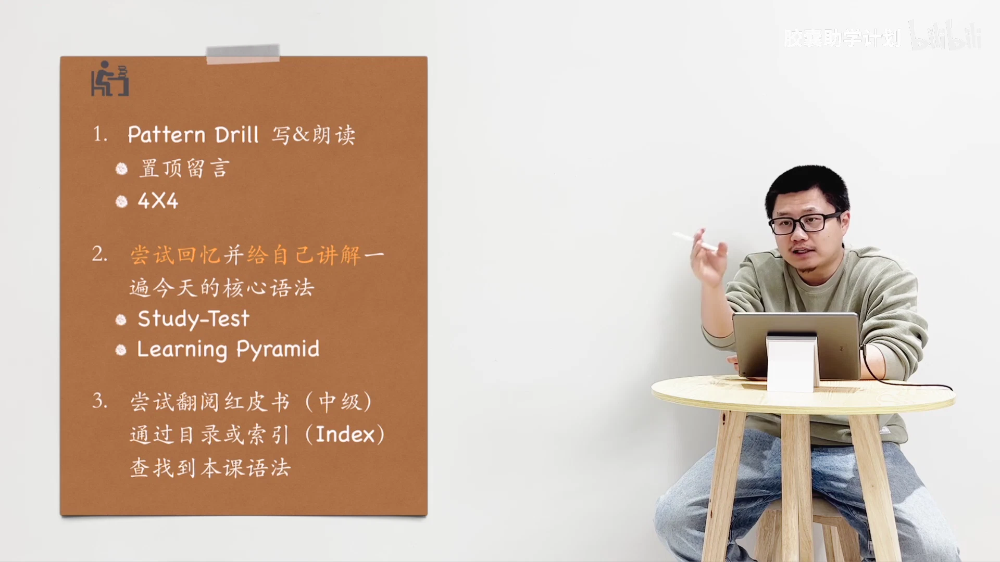

文字识别：Pattern Drill写&朗读 / 置顶留言 / 4×4 / 尝试回忆并给自己讲解一 / 遍今天的核心语法 / Study-Test / Learning Pyramid / 尝试翻阅红皮书（中级） / 通过目录或索引(Index) / 查找到本课语法

### 画面 00:05:48

文字识别：Pattern Drill写&朗读 / 1. / 置顶留言 / 4×4 / 尝试回忆并给自己讲解一 / 遍今天的核心语法 / Study-Test / Learning Pyramid / 尝试翻阅红皮书（中级） / 通过目录或索引(Index) / 查找到本课语法

### 画面 00:05:50

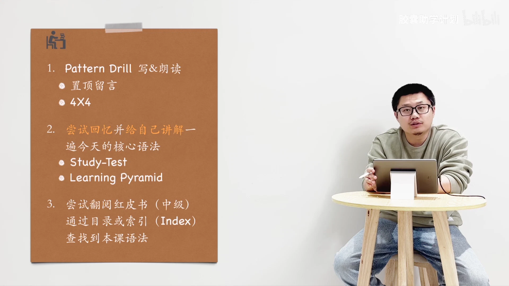

文字识别：Pattern Drill写&朗读 / 置顶留言 / 4×4 / 尝试回忆并给自己讲解一 / 遍今天的核心语法 / Study-Test / Learning Pyramid / 尝试翻阅红皮书（中级） / 通过目录或索引(Index) / 查找到本课语法

### 画面 00:05:53

文字识别：虔助学计划一情 / 不

### 画面 00:05:55

文字识别：助学计划園明 / 不

### 画面 00:05:57

文字识别：虞助字计划 / ￥ / 不

## 00:06:00–00:06:18

键三连、分享给那些需要的朋友，来帮助我们快速成长。See you next time.

### 画面 00:06:06

### 画面 00:06:08

文字识别：CAPSULEACADEMY / 胶囊助学计划 / 小红书 / Lecturer / Leo / OE

### 画面 00:06:11

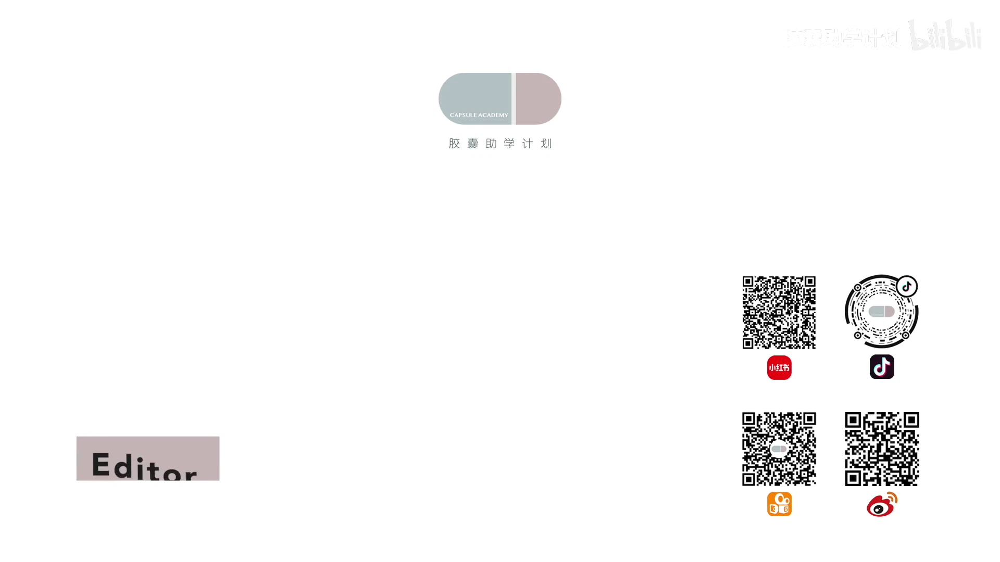

文字识别：CAPSULEACADEMY / 胶囊助学计划 / 『 / 小红书 / □ / Editor / OE

### 画面 00:06:14

文字识别：珈学針物 / CAPSULEACADEMY / 胶囊助学计划 / 小红书 / Creator / Leo & Berlin / OE

### 画面 00:06:16

文字识别：bilbili / 胶囊助学计划 / 胶囊助学计划 / 小红书 / OE

### 画面 00:06:18

文字识别：bilibili / 胶囊助学计划

