# 087 文章

快速机器解析：语音为单模型转写，未进行独立交叉校对或人工复核；画面每秒采样并按变化选帧，短时文字和标记可能遗漏。截图时间约有 1 秒误差。图片有损压缩；遇到疑点请按时间查看 Google Drive 原视频。

## 00:00:00–00:00:30

Hello everyone, welcome to Capsule Academy. This is Leo. Today we're going to learn New Concept English Book Two, Lesson 87, Story. Hope you gonna enjoy.好，我们上来看本篇文章的标题和他问的问题啊。它的标题叫 Perfect Alibi，啊，完美的、绝佳的、不在犯罪现场的证明。What was wrong with the man's story?问的问题是说他这这个这

### 画面 00:00:00

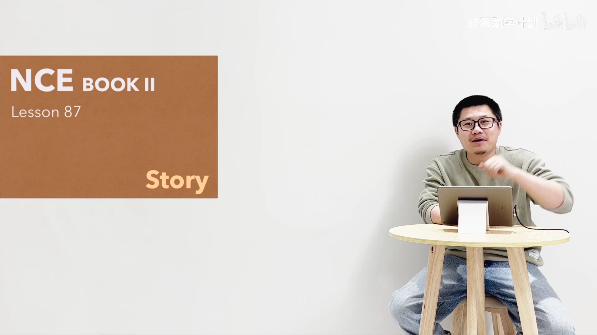

文字识别：NCE / BOOKⅡI / Lesson 87 / Story

### 画面 00:00:02

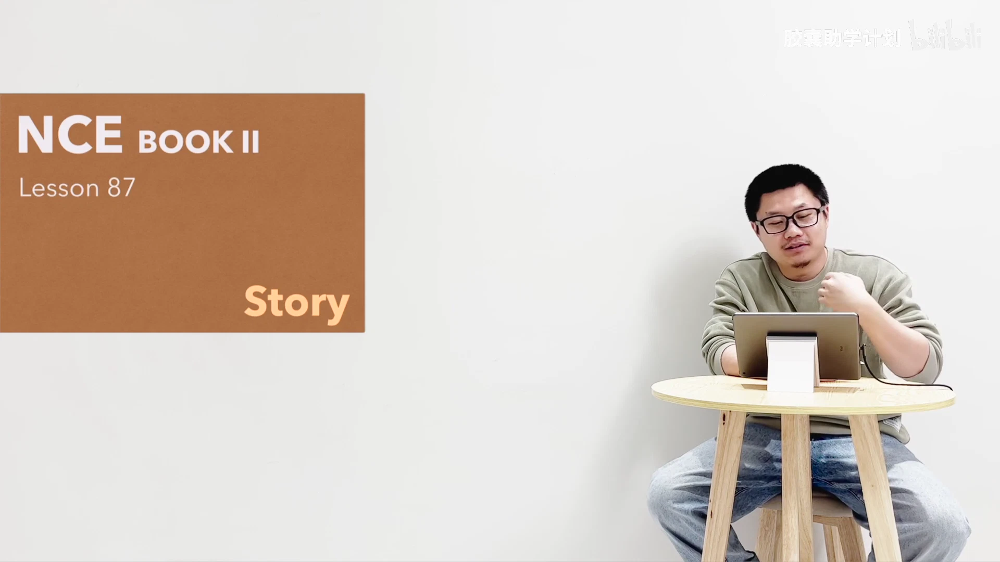

文字识别：NCE / BOOKⅡI / Lesson 87 / Story

### 画面 00:00:04

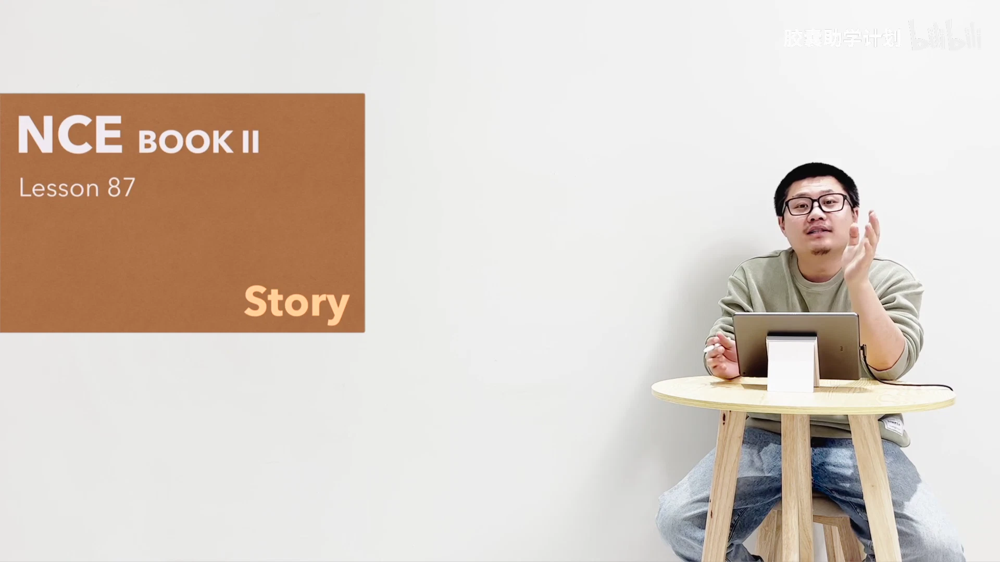

文字识别：NCE / BOOKⅡI / Lesson 87 / Story

### 画面 00:00:09

文字识别：Bibi / 胶囊助学计划 / •

### 画面 00:00:13

### 画面 00:00:15

文字识别：A perfect alibi / What was wrong with the man's story?

## 00:00:30–00:01:00

个男的啊，他的这个故事有什么问题？咱们进入文章看了啊，看有什么问题。这这是一篇对话类的文章啊，语言就比较活泛。比如说第一句话，At the time the murder was committed, I was traveling on the eight o'clock train to London. Said the man.男的说了两句话，第一句话说，在这个时间，什么时间呢？The murder was committed，在这个谋杀被犯下的那

### 画面 00:00:35

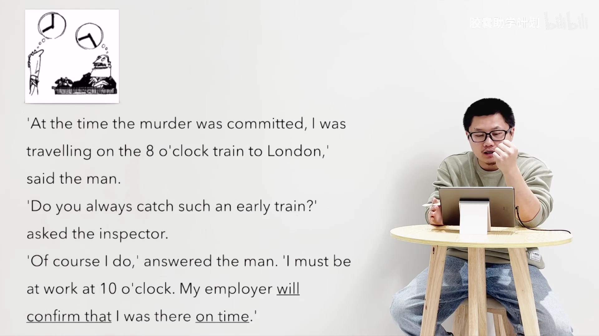

文字识别：'At the time the murder was committed, I was / travelling on the 8 o'clock train to London,' / said the man. / 'Do you always catch such an early train?' / asked the inspector. / 'Of course I do,' answered the man.'I must be / at work at 10 o'clock. My employer will / confirm that I was there on time.'

### 画面 00:00:38

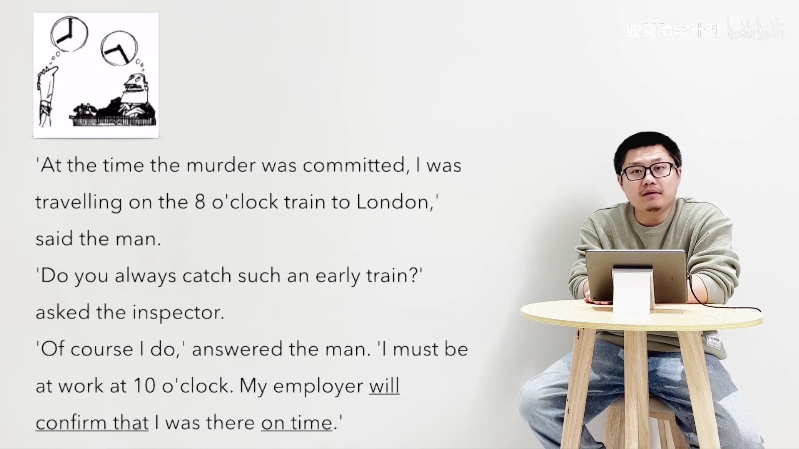

文字识别：'At the time the murder was committed, I was / travelling on the 8 o'clock train to London,' / said the man. / 'Do you always catch such an early train?' / asked the inspector. / 'Of course I do,' answered the man.'I must be / at work at 10 o'clock. My employer will / confirm that I was there on time.'

### 画面 00:00:41

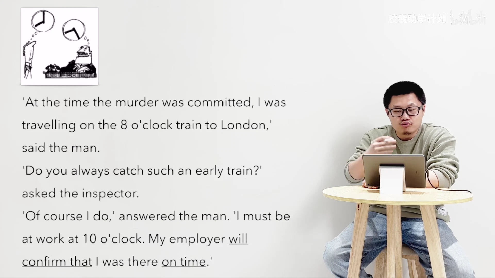

文字识别：'At the time the murder was committed, I was / travelling on the 8 o'clock train to London,' / said the man. / 'Do you always catch such an early train?' / asked the inspector. / 'Of course I do,' answered the man.'I must be / at work at 10 o'clock. My employer will / confirm that I was there on time.'

## 00:01:00–00:01:30

个时间，它这个地方其实啊是一个定语从句，它把这个问给省略了。口语当中愿意省还行，写作当中真真正正的写作是不能把问引导定语从句省略的。咱们之前学过where，学过whose了，对吧？问这个要往后稍微等一等，而且它也不是本课重点啊。说这个谋杀被犯下的那个时候呢，我正坐着八点钟的这个火车去伦敦，

### 画面 00:01:05

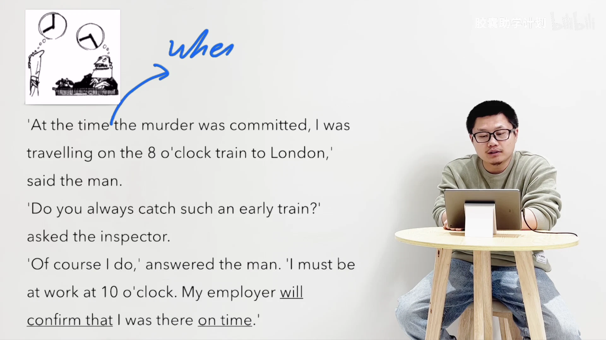

文字识别：wher / 'At the timethe murder was committed, I was / travelling on the 8 o'clock train to London,' / said the man. / 'Do you always catch such an early train?' / asked the inspector. / 'Of course I do,' answered the man.'I must be / at work at 10 o'clock. My employer will / confirm that I was there on time.'

### 画面 00:01:08

文字识别：when / 'At the timethe murder was committed, I was / travelling on the 8 o'clock train to London,' / said the man. / 'Do you always catch such an early train?' / asked the inspector. / 'Of course I do,' answered the man.'I must be / at work at 10 o'clock. My employer will / confirm that I was there on time.'

## 00:01:30–00:02:00

敦，对吧？啊，traveling不就是旅行航行的意思嘛，对吧？哎，said the man.啊，这个男的说道。Do you always catch such an early train? Asked the inspector.说你总是注意这个catch不是抓了对吧？我们说catch train, catch bus就赶火车嘛。你总是赶或者说坐如此早的这班火车吗？探长说道。Of course I do.当然了，answered the man.他回

### 画面 00:01:38

文字识别：when / 'At the timethe murder was committed, I was / travelling on the 8 o'clock train to London,' / said the man. / 'Do you always catch such an early train?' / asked the inspector. / 'Of course I do,' answered the man.'I must be / at work at 10 o'clock. My employer will / confirm that I was there on time.'

## 00:02:00–00:02:30

答道，I must be at work at ten o'clock.说，我必须到工作上在十点钟的时候到达工作岗位。My employer will confirm that I was there on time.说，我的这个雇主啊将可以啊confirm that证实这件事情。咱们单词部分讲过了。那I was there叫我在那里，on time叫准时，这是本课的一个习惯用法啊。一会儿我们会去造句。那学到这儿呢，我想

### 画面 00:02:08

文字识别：when / 'At the timethe murder was committed, I was / travelling on the 8 o'clock train to London,' / said the man. / 'Do you always catch such an early train?' / asked the inspector. / 'Of course I do,' answered the man.'I must be / at work at 10 o'clock. My employer will / confirm that I was there on time.'

### 画面 00:02:29

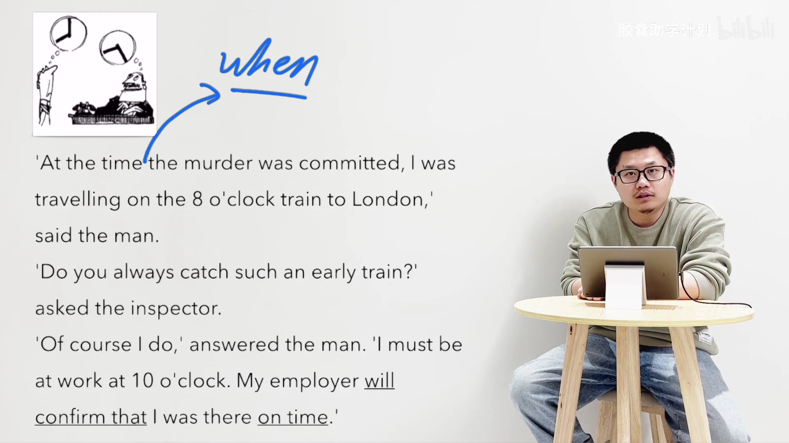

文字识别：when / 'At the timethe murder was committed, I was / travelling on the 8 o'clock train to London,' / said the man. / 'Do you always catch such an early train?' / asked the inspector. / 'Of course I do,' answered the man.'I must be / at work at 10 o'clock. My employer will / confirm that I was there on time.'

## 00:02:30–00:03:00

多说两句，就是我不知道各位有没有感觉，虽呃前几课我们在我自己讲的时候都会有这样的感觉，句子呀是真的长，但是其实我们真正在说话的时候，比如说像这篇文章，就明显学起来又短又简单，对吧？OK啊，就是让各位有这么一个感觉，具体是为了什么，以后我们再慢慢分享啊，这并不重要了。Old a later train get you to work on time，

### 画面 00:02:34

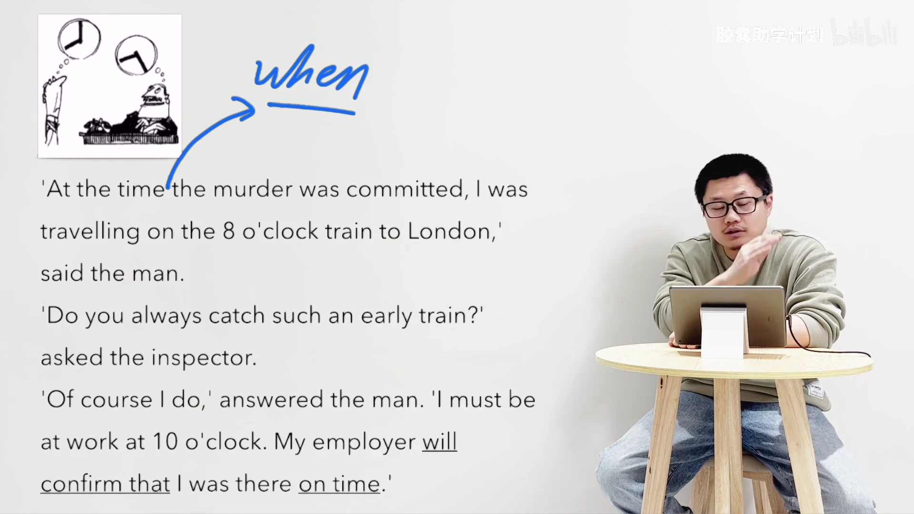

文字识别：when / 'At the timethe murder was committed, I was / travelling on the 8 o'clock train to London,' / said the man. / 'Do you always catch such an early train?' / asked the inspector. / 'Of course I do,' answered the man.'I must be / at work at 10 o'clock. My employer will / confirm that I was there on time.'

### 画面 00:02:54

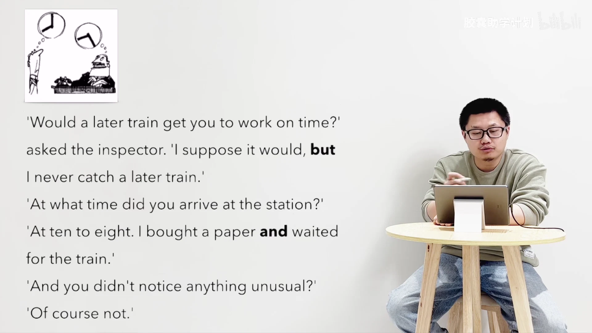

文字识别：'Would a later train get you to work on time?' / asked the inspector.'I suppose it would, but / I never catch a later train.' / 'At what time did you arrive at the station?' / 'At ten to eight. I bought a paper and waited / for the train.' / 'And you didn't notice anything unusual?' / 'Of course not.'

## 00:03:00–00:03:30

说一个晚一点的车能不能或者可不可以把你准时的带到工作岗位上? Get you to work就把你带到工作岗位上. Ask the inspector,他问道. I suppose it would, but I never catch a late train.说，我猜呀，我猜测呀，他能。这个would其实后边省略了什么呢？叫做get me to work on time，没有必要了。你问的我是这个，I suppose it would get me to work on time，

### 画面 00:03:24

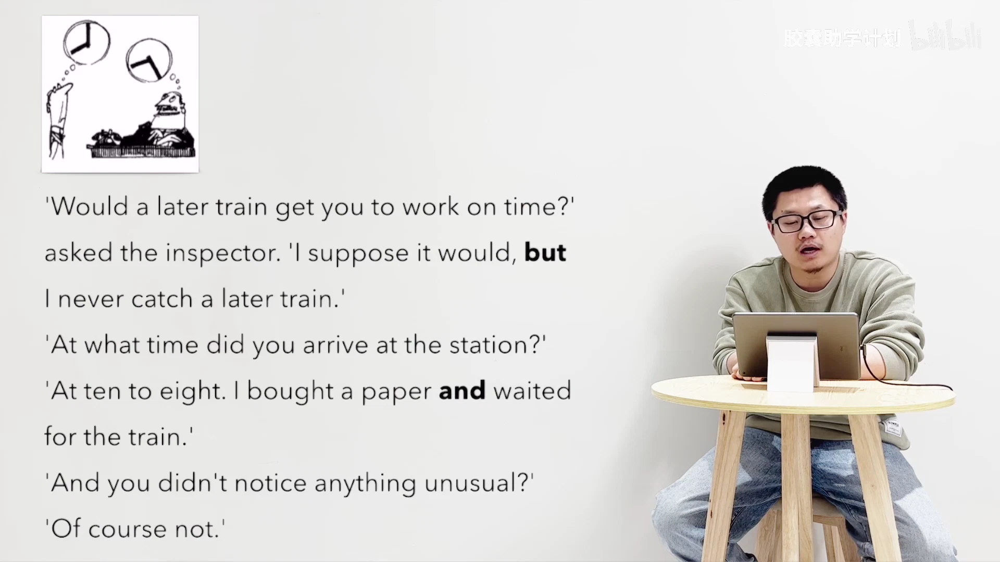

文字识别：'Would a later train get you to work on time?' / asked the inspector.'I suppose it would, but / I never catch a later train.' / 'At what time did you arrive at the station?' / 'At ten to eight. I bought a paper and waited / for the train.' / 'And you didn't notice anything unusual?' / 'Of course not.'

### 画面 00:03:28

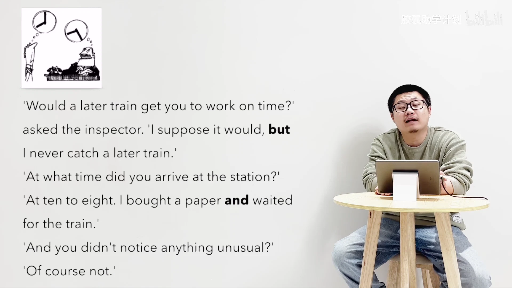

文字识别：'Would a later train get you to work on time?' / asked the inspector.'I suppose it would, but / I never catch a later train.' / 'At what time did you arrive at the station?' / 'At ten to eight. I bought a paper and waited / for the train.' / 'And you didn't notice anything unusual?' / 'Of course not.'

## 00:03:30–00:04:00

用这么说，对吧？所以省略了。但是呢，我从来都不敢晚一班的那趟车，从来都不坐晚一趟晚一点的那趟火车。又问 At what time did you arrive at the station? 几点钟到达火车站的？At ten to eight, 差十分钟八点，对吧？这个语法如果你还不会，那真得回新一了，是吧？就是呃，或者单独上网学一下，对吧？时间的说法啊，差十分

### 画面 00:03:31

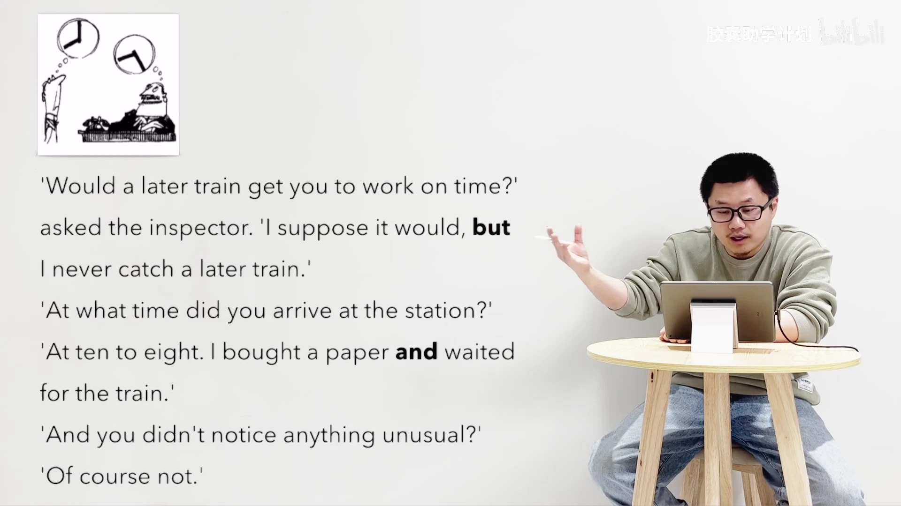

文字识别：'Would a later train get you to work on time?' / asked the inspector.'I suppose it would, but / I never catch a later train.' / 'At what time did you arrive at the station?' / 'At ten to eight. I bought a paper and waited / for the train.' / 'And you didn't notice anything unusual?' / 'Of course not.'

## 00:04:00–00:04:30

钟八点。I bought a paper and waited for the train.说，我买了个报纸，然后呢就等这个火车。你看，都很简单，很简单的句子。我觉得这个难度恨不得跟新二第一课没什么本质上太大的区别。And you didn't notice anything unusual, of course not.说，然后你没有注意到任何不同寻常的事儿吗？Of course not.当然没有啊啊。Of course,其实它就类似于Of course, I didn't notice anything

### 画面 00:04:01

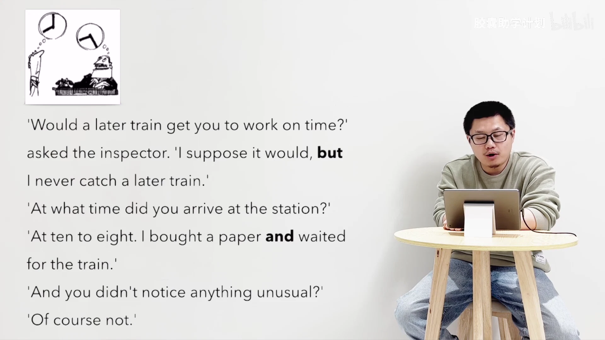

文字识别：'Would a later train get you to work on time?' / asked the inspector.'I suppose it would, but / I never catch a later train.' / 'At what time did you arrive at the station?' / 'At ten to eight. I bought a paper and waited / for the train.' / 'And you didn't notice anything unusual?' / 'Of course not.'

## 00:04:30–00:05:00

Euro,没有必要再都说一遍了，对吧？来了，suggest. I suggest. Said the inspector that you are not telling the truth.先不往后看了，就到这儿。我建议这个探长说到说你没讲真话。我建议你没讲真话，感觉翻译不太通吧？我暗示你没讲，他都说出来了，还暗示啥

### 画面 00:04:31

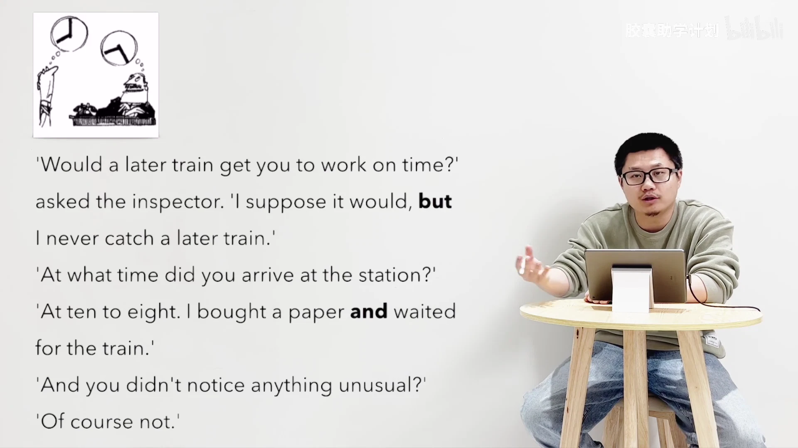

文字识别：'Would a later train get you to work on time?' / asked the inspector.'I suppose it would, but / I never catch a later train.' / 'At what time did you arrive at the station?' / 'At ten to eight. I bought a paper and waited / for the train.' / 'And you didn't notice anything unusual?' / 'Of course not.'

### 画面 00:04:33

文字识别：'I suggest,' said the inspector,'that you are / not telling the truth. Lsuggest that you did / not catch the 8 o'clock train, but that you / caught the 8.25 (which would still get you to / work on time). You see, on the morning of / the murder, the 8 o'clock train did not run at / all.It [56broke down at Ferngreen station and / was taken off the line.'

### 画面 00:04:59

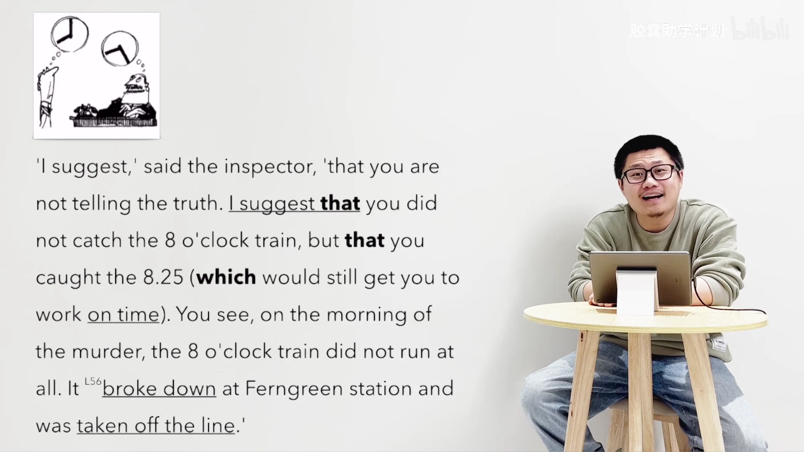

文字识别：'I suggest,' said the inspector,'that you are / not telling the truth. Lsuggest that you did / not catch the 8 o'clock train, but that you / caught the 8.25 (which would still get you to / work on time). You see, on the morning of / the murder, the 8 o'clock train did not run at / all.Ilt 56broke down at Ferngreen station and / was taken off the line.'

## 00:05:00–00:05:30

呀？这暗示肯定不对啊！这本课是他一个很有意思的用法，就提醒一下你。我提醒一下你啊！提醒，说我提醒一下你。Inspector探长说道：“你没跟我聊，没跟我说实话呀，小伙子。”I suggest that you did not catch the eight o'clock train, but that you catch the eight twenty-five, which would still get you to work on time.

### 画面 00:05:02

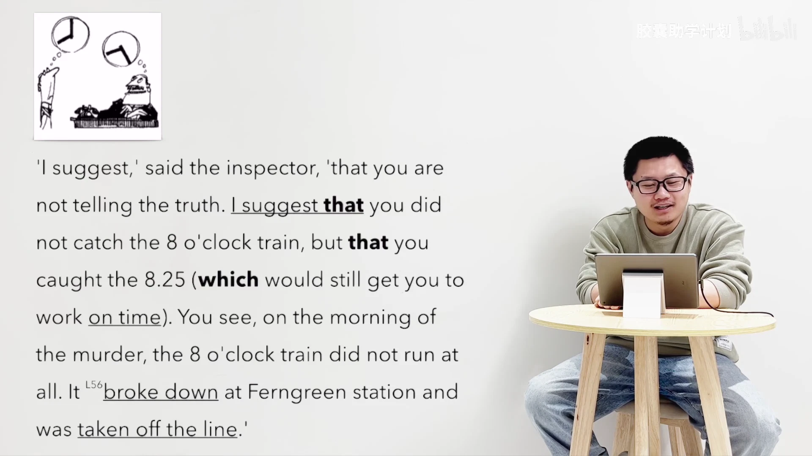

文字识别：'I suggest,' said the inspector,'that you are / not telling the truth. Lsuggest that you did / not catch the 8 o'clock train, but that you / caught the 8.25 (which would still get you to / work on time). You see, on the morning of / the murder, the 8 o'clock train did not run at / all.It [56broke down at Ferngreen station and / was taken off the line.'

### 画面 00:05:04

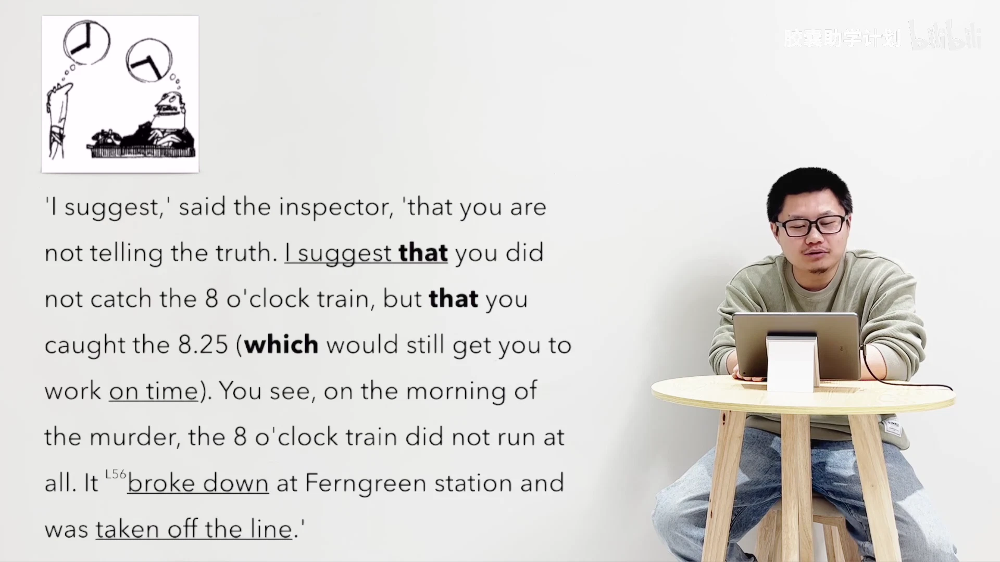

文字识别：'I suggest,' said the inspector,'that you are / not telling the truth. Lsuggest that you did / not catch the 8 o'clock train, but that you / caught the 8.25 (which would still get you to / work on time). You see, on the morning of / the murder, the 8 o'clock train did not run at / all.Ilt [56broke down at Ferngreen station and / was taken off the line.'

## 00:05:30–00:06:00

句子好长，其实倒是不用担心，这些咔咔一划就是三个很短的句子。第一个，I suggest that跟刚才没区别吧？I suggest that you are not telling the truth，对吧？我提醒你啊，小伙子，You did not catch the eight o'clock train。说怎么样的，你没有赶上八点这趟火车。But that这个that哪来的？But连接的不是并列句嘛？并列句

### 画面 00:05:34

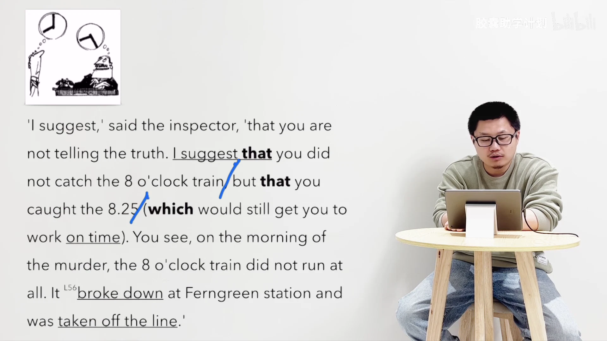

文字识别：'I suggest,' said the inspector,'that you are / not telling the truth. Lsuggest that you did / not catch the 8 o'clock train/but that you / caught the 8.25/which would still get you to / work on time). You see, on the morning of / the murder, the 8 o'clock train did not run at / all.Ilt [5°broke down at Ferngreen station and / was taken off the line.'

## 00:06:00–00:06:30

主语一致的时候，谓语一致不可以省略嘛？其实它前面省略了 I suggest that，省略了 I suggest，所以这句话你要给它补全，就是 I suggest that 布拉布拉布拉布拉， but I suggest that 布拉布拉布拉布拉布拉，听见了吧？但是因为 I suggest 前后一样，所以这儿直接省略了，但这个 that 它给留下来了啊。你说不要的行不行？理论上好像你自己感受，这个自己去想啊，没有问题啊。说 but，

### 画面 00:06:04

文字识别：'I suggest,' said the inspector,'that you are / not telling the truth. Lsuggest that you did / not catch the 8 o'clock train/but that you / caught the 8.25/(which would still get you to / work on time). You see, on the morning of / the murder, the 8 o'clock train did not run at / all.It [56broke down at Ferngreen station and / was taken off the line.'

## 00:06:30–00:07:00

他给了一个that最好整个后边是一个宾语从句，对吧？但是呢，you called the eight twenty-five。我提议到的是什么呢？你呀，哎，我我我提醒你啊，说你呀，其实赶的是八点二十五那趟车。这个eight twenty-five，它其实把o'clock train省略了，但是你能理解啊，就是八点二十五那趟火车。后边跟了个定语从句，这个which

### 画面 00:06:34

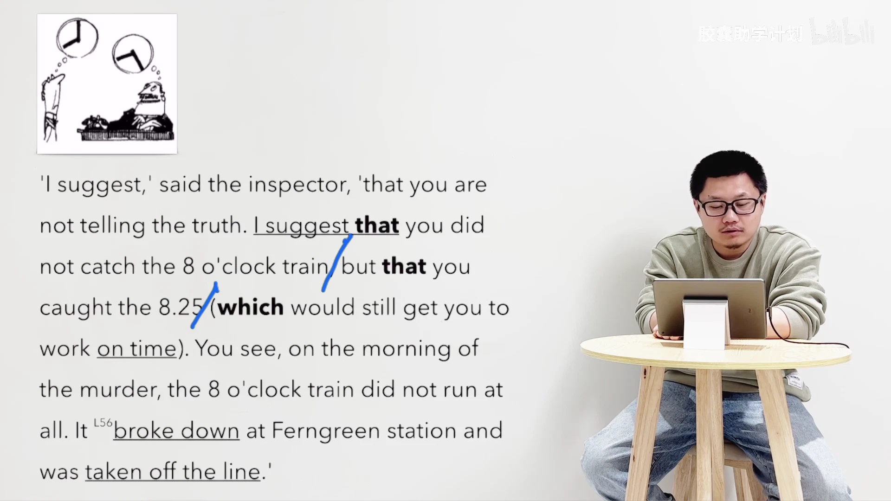

文字识别：'I suggest,' said the inspector,'that you are / not telling the truth. Lsuggest that you did / not catch the 8 o'clock train/but that you / caught the 8.25/(which would still get you to / work on time). You see, on the morning of / the murder, the 8 o'clock train did not run at / all.Ilt [56broke down at Ferngreen station and / was taken off the line.'

## 00:07:00–00:07:30

指的就是这趟火车呗。这趟火车将依旧可以让你到达工作岗位上准时、准时的到达工作岗位。换一下语序，可以。这句话结束了，对吧？又拆成了三句话。You see, 你瞧。On the morning of the murder, the eight o'clock train did not run at all. 说你瞧一下啊，坐在这个呃谋杀发生的那天早晨，八点钟的火车怎么样？Did not run

### 画面 00:07:04

文字识别：'I suggest,' said the inspector,'that you are / not telling the truth. Lsuggest that you did / not catch the 8 o'clock train/but that you / caught the 8.25/(which would still get you to / work on time). You see, on the morning of / the murder, the 8 o'clock train did not run at / all.It [56broke down at Ferngreen station and / was taken off the line.'

## 00:07:30–00:08:00

at all. That not at all,就一点儿也没有。那一点儿也没有跑是什么意思？就没有运行嘛。Run类似于run a company啊，运营一个公司。那你说train没有跑是啥意思？就没有运营，没有运行，对吧？没有开动啊，怎么回事呢？我们看一下。It broke down at Fern Green Station and was taken off the line.所以这个火车呀，崩了，出故障了，对吧？哎，崩溃

### 画面 00:07:34

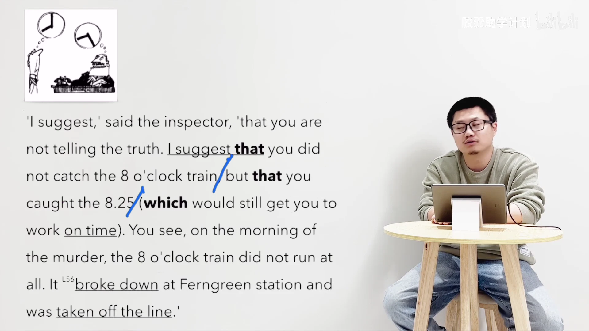

文字识别：'I suggest,' said the inspector,'that you are / not telling the truth. Lsuggest that you did / not catch the 8 o'clock train/but that you / caught the 8.25/which would still get you to / work on time). You see, on the morning of / the murder, the 8 o'clock train did not run at / all.It [56broke down at Ferngreen station and / was taken off the line.'

### 画面 00:07:39

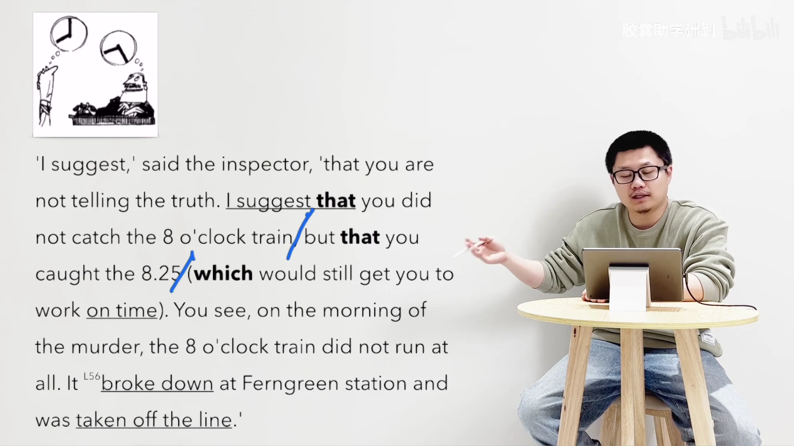

文字识别：'I suggest,' said the inspector,'that you are / not telling the truth. L suggest that you did / not catch the 8 o'clock train/but that you / caught the 8.25/(which would still get you to / work on time). You see, on the morning of / the murder, the 8 o'clock train did not run at / all.It [56broke down at Ferngreen station and / was taken off the line.'

### 画面 00:07:46

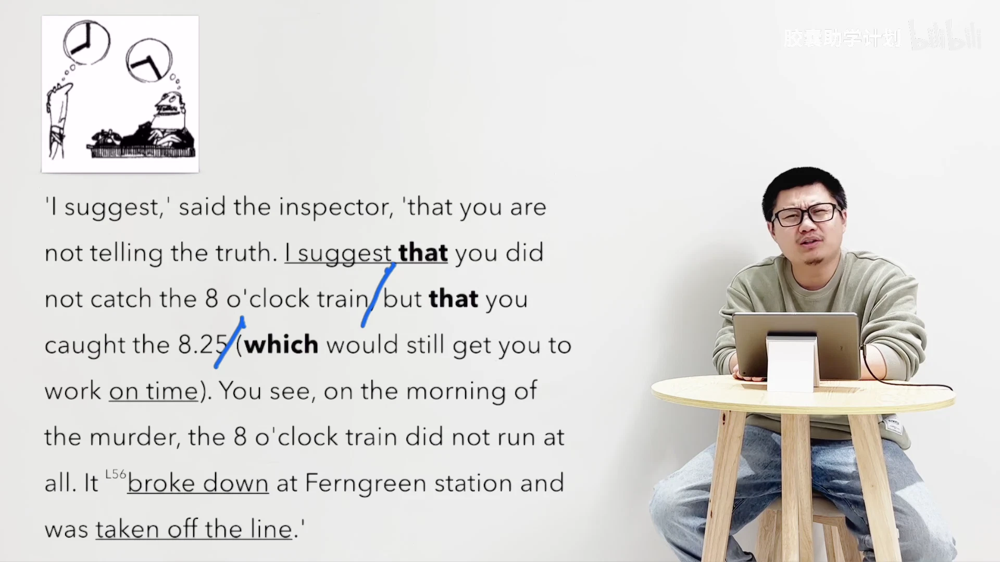

文字识别：'I suggest,' said the inspector,'that you are / not telling the truth. Lsuggest that you did / not catch the 8 o'clock train/but that you / caught the 8.25/(which would still get you to / work on time). You see, on the morning of / the murder, the 8 o'clock train did not run at / all. lt [56broke down at Ferngreen station and / was taken off the line.'

## 00:08:00–00:08:30

了，是吧？Broken down，说人崩溃是吧？说这火车呢，就是故障了呗。在 Fern Green Station 这个地方，然后 was taken off the line。啊，这个我当年教研的时候听过别的老师讲，给我乐坏了。他直接翻译的叫做，呃，字面意思叫做被啊。首先 was taken 不就是被吗？Of 就是离开，line 就是线。他真的就直接给我翻译成了被从线上拿开了。你说火车被从线

### 画面 00:08:01

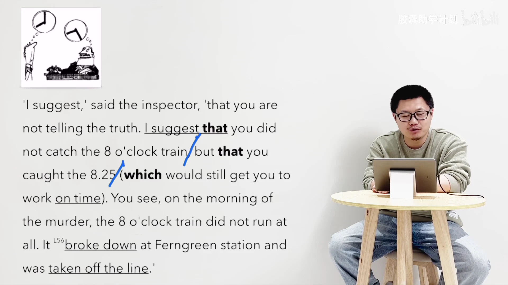

文字识别：'I suggest,' said the inspector,'that you are / not telling the truth. Lsuggest that you did / not catch the 8 o'clock train/but that you / caught the 8.25/(which would still get you to / work on time). You see, on the morning of / the murder, the 8 o'clock train did not run at / all.It [56broke down at Ferngreen station and / was taken off the line.'

### 画面 00:08:04

文字识别：'I suggest,' said the inspector,'that you are / not telling the truth. Lsuggest that you did / not catch the 8 o'clock train/but that you / caught the 8.25/(which would still get you to / work on time). You see, on the morning of / the murder, the 8 o'clock train did not run at / all. lt [5broke down at Ferngreen station and / was taken off the line.'

## 00:08:30–00:09:00

上拿开了，这个直译如果翻译到这儿，应该是不太懂。你必须你哪怕说你再往下多翻译一步，说这个火车本来在这个铁轨上，然后被从铁轨上拿下来了，但这个好像又不符合我们人类的基本认知，火车不是这么处理的，是吧？火车是开到岔道上去修理的，没有说把火车掉到底下来，是吧？掉到站台上修的是吧？不是这个样子。那这个 taken off the line 到底怎么去理解呢？首先

### 画面 00:08:34

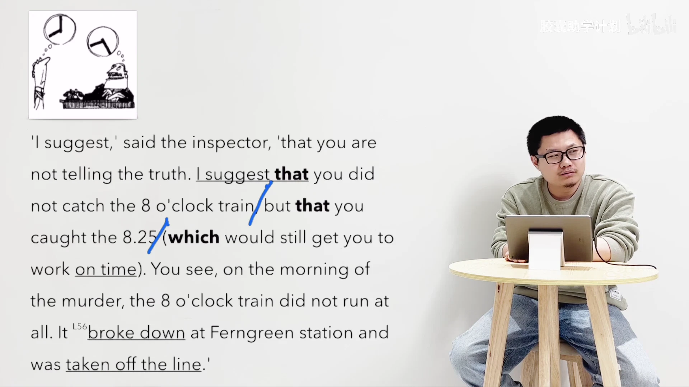

文字识别：'I suggest,' said the inspector,'that you are / not telling the truth. Lsuggest that you did / not catch the 8 o'clock train/but that you / caught the 8.25/(which would still get you to / work on time). You see, on the morning of / the murder, the 8 o'clock train did not run at / all.It [5°broke down at Ferngreen station and / was taken off the line.'

### 画面 00:08:41

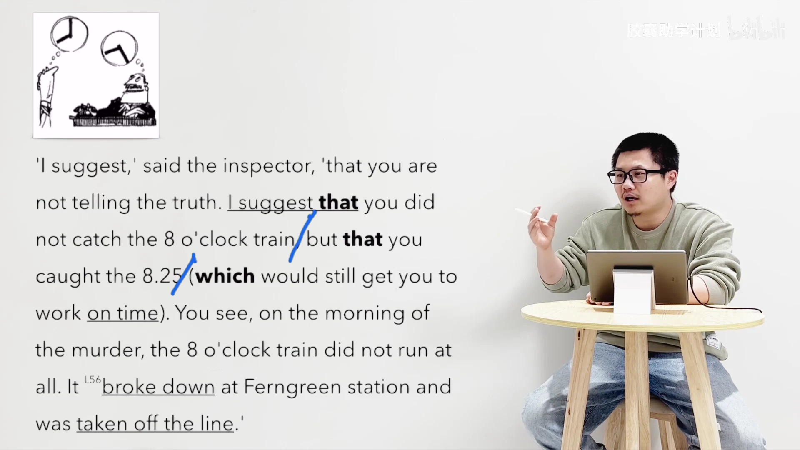

文字识别：'I suggest,' said the inspector,'that you are / not telling the truth. Lsuggest that you did / not catch the 8 o'clock train/but that you / caught the 8.25/(which would still get you to / work on time). You see, on the morning of / the murder, the 8 o'clock train did not run at / all.Ilt 56broke down at Ferngreen station and / was taken off the line.'

### 画面 00:08:55

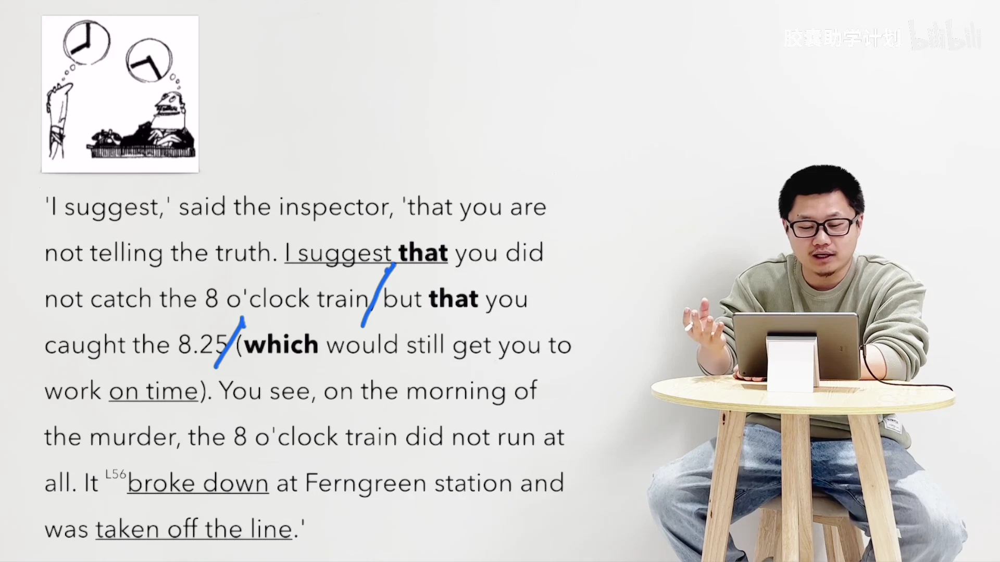

文字识别：'I suggest,' said the inspector,'that you are / not telling the truth. Lsuggest that you did / not catch the 8 o'clock train/but that you / caught the 8.25/(which would still get you to / work on time). You see, on the morning of / the murder, the 8 o'clock train did not run at / all.It [5°broke down at Ferngreen station and / was taken off the line.'

### 画面 00:08:58

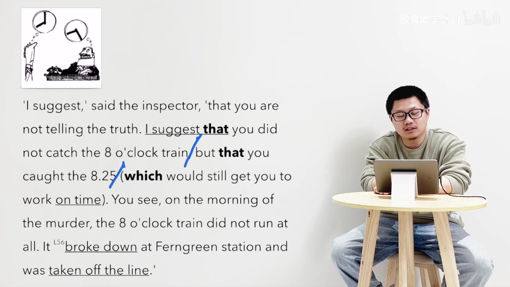

文字识别：'I suggest,' said the inspector,'that you are / not telling the truth. Lsuggest that you did / not catch the 8 o'clock train/but that you / caught the 8.25/(which would still get you to / work on time). You see, on the morning of / the murder, the 8 o'clock train did not run at / all.It [5°broke down at Ferngreen station and / was taken off the line.'

## 00:09:00–00:09:30

字面意思确实是啊，被从线上拿下来了。其实它最常用的意思就是连上航班也好啊，这个大巴车也好啊，还是火车也好，公交车也好，take off the line基本的意思就是取消了这个航班，取消了这一班列车，取消的意思啊，taken off the line，对吧？包括其实跟它还有很像的，包括你可以理解为叫下线了某个产品，taken off the line，对吧？就被弄下线了

### 画面 00:09:00

文字识别：'I suggest,' said the inspector,'that you are / not telling the truth. Lsuggest that you did / not catch the 8 o'clock train/but that you / caught the 8.25/(which would still get you to / work on time). You see, on the morning of / the murder, the 8 o'clock train did not run at / all.Ilt [5°broke down at Ferngreen station and / was taken off the line.'

## 00:09:30–00:10:00

啊，取消了这个。那你如果是车，就是取消航班呗。它其实算半个习惯用法的啊。这个 take 有的时候会被变成了 get，get 万能动词。我跟各位解释过嘛， get off the line，对吧？下线啊，这个产品下线呢，人下线呢，然后包括这个，那你如果说这个火车下线呢，就它的意思就是被取消了这个航班呗。所以在这儿别给他理解为什么这个从线上拿走了，是吧？这个字字面意思翻译不通的哦。

### 画面 00:09:30

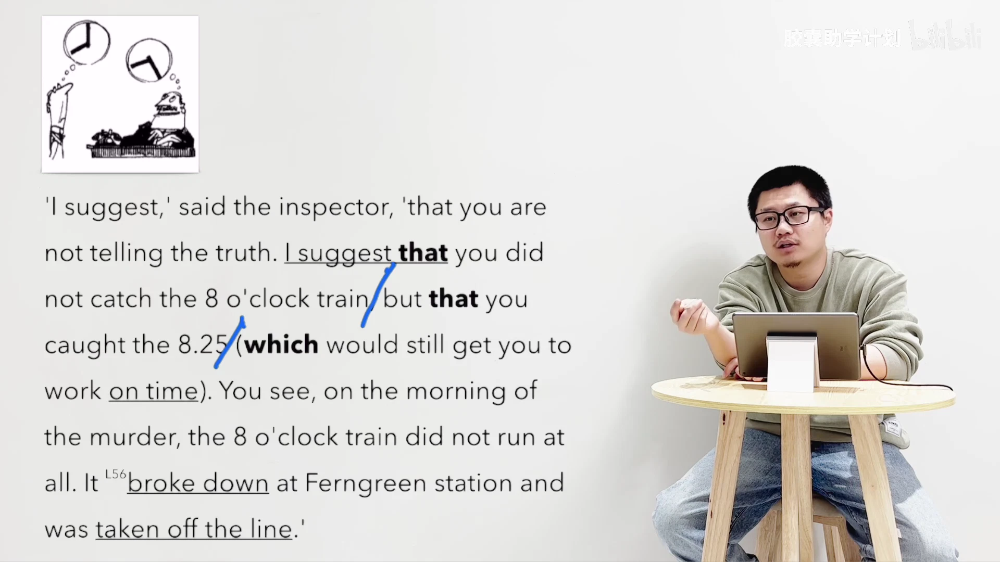

文字识别：'I suggest,' said the inspector,'that you are / not telling the truth. Lsuggest that you did / not catch the 8 o'clock train/but that you / caught the 8.25/(which would still get you to / work on time). You see, on the morning of / the murder, the 8 o'clock train did not run at / all.Ilt [5broke down at Ferngreen station and / was taken off the line.'

## 00:10:00–00:10:30

好，好，那 on time 就是咱们本课的习惯用法嘛，准时呗。 It's my first day, so I must be on time. 我今儿第一天，必须要准时啊。你看现在拿它去造句，对于各位来说就很容易了。 So tell him that he must be at the meeting on time. 他必须要准时到达这个会议现场，对吧？ Next one. So so you can at least try to be on time. 说你至少可以尝试着去准时嘛。

### 画面 00:10:00

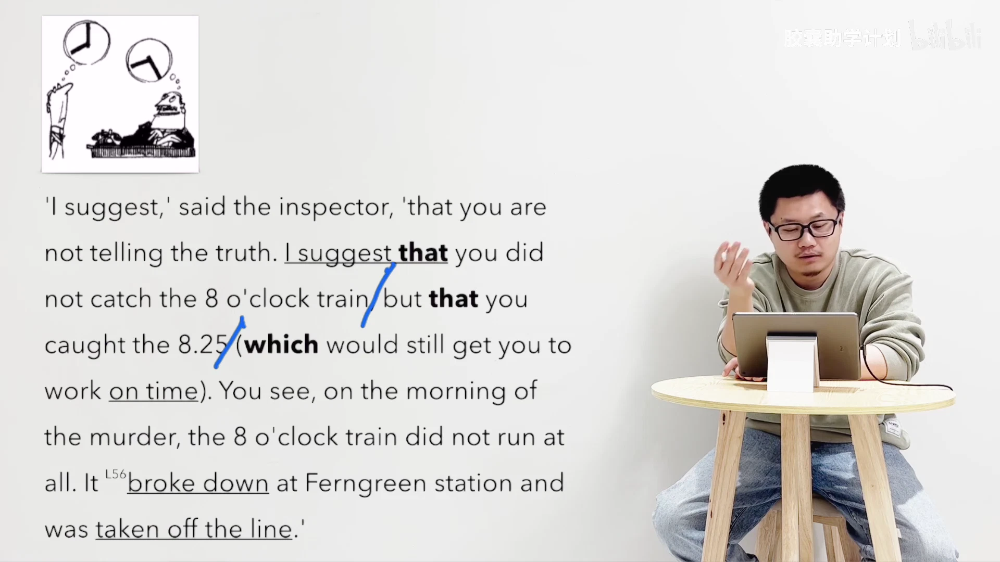

文字识别：'I suggest,' said the inspector,'that you are / not telling the truth. Lsuggest that you did / not catch the 8 o'clock train/but that you / caught the 8.25/(which would still get you to / work on time). You see, on the morning of / the murder, the 8 o'clock train did not run at / all. t [5°broke down at Ferngreen station and / was taken off the line.'

### 画面 00:10:02

文字识别：习惯用法造句 / on time

### 画面 00:10:04

文字识别：网：v.+v.变化 / 习惯用法造句指南 / 妻助学计划 / 四句型转换 / 方式/地点/时间 / 其他习惯用法 / 其他单词+词性 / 原文摘抄+变 / 6123456 / on time

### 画面 00:10:06

文字识别：网：v.+v.变化 / 习惯用法造句指南 / 臺助字计划 / 四句型转换 / 方式/地点/时间 / 其他习惯用法 / 其他单词+词性 / 原文摘抄+变 / 6123456 / on time /  It's my first day, so I must be on time.

### 画面 00:10:10

文字识别：网：v.+v.变化 / 习惯用法造句指南 / 四句型转换 / 方式/地点/时间 / 其他习惯用法 / 其他单词+词性 / 原文摘抄+变 / 6123456 / on time /  It's my first day, so I must be on time.

### 画面 00:10:13

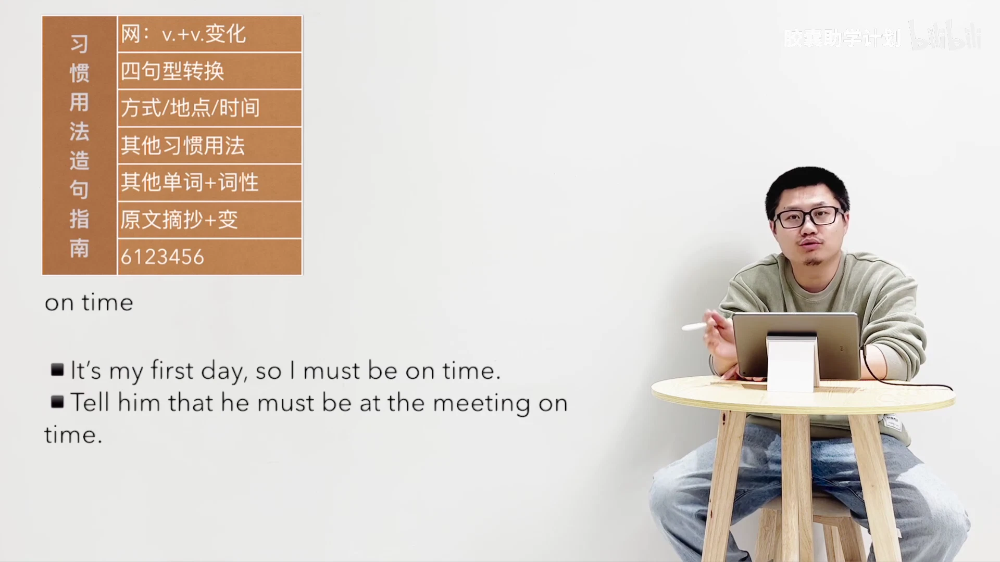

文字识别：网：v.+v.变化 / 习惯用法造句指南 / 四句型转换 / 方式/地点/时间 / 其他习惯用法 / 其他单词+词性 / 原文摘抄+变 / 6123456 / on time /  It's my first day, so I must be on time. / Tell him that he must be at the meeting on / time.

### 画面 00:10:15

文字识别：网：v.+v.变化 / 习惯用法造句指南 / 四句型转换 / 方式/地点/时间 / 其他习惯用法 / 其他单词+词性 / 原文摘抄+变 / 6123456 / on time /  It's my first day, so I must be on time. / Tell him that he must be at the meeting on / time.

### 画面 00:10:19

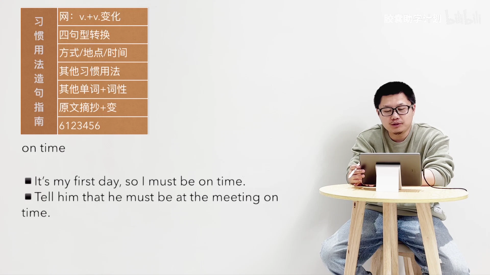

文字识别：网：v.+v.变化 / 习惯用法造句指南 / 四句型转换 / 方式/地点/时间 / 其他习惯用法 / 其他单词+词性 / 原文摘抄+变 / 6123456 / on time /  It's my first day, so I must be on time. / Tell him that he must be at the meeting on / time.

### 画面 00:10:21

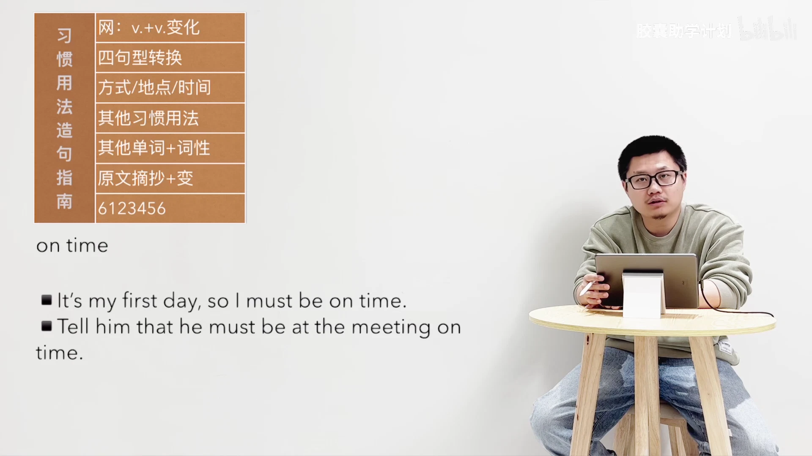

文字识别：网：v.+v.变化 / 习惯用法造句指南 / 四句型转换 / 方式/地点/时间 / 其他习惯用法 / 其他单词+词性 / 原文摘抄+变 / 6123456 / on time /  It's my first day, so I must be on time. / Tell him that he must be at the meeting on / time.

### 画面 00:10:23

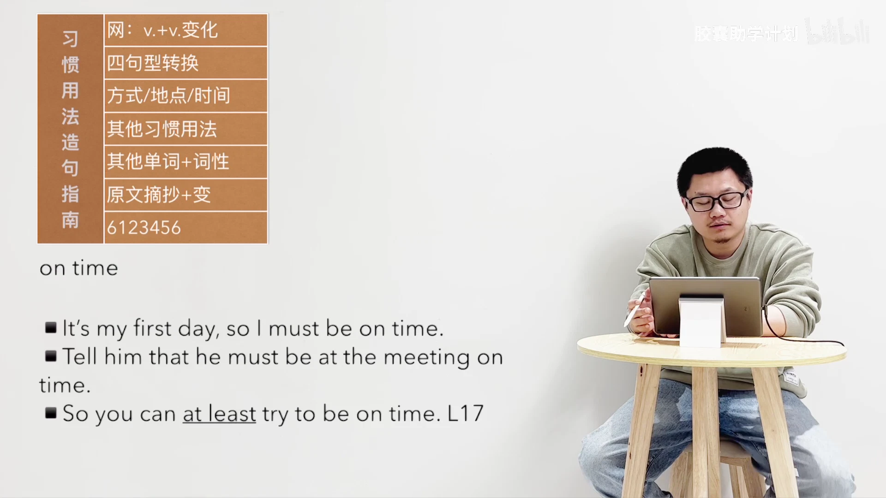

文字识别：网：v.+v.变化 / 习惯用法造句指南 / 四句型转换 / 方式/地点/时间 / 其他习惯用法 / 其他单词+词性 / 原文摘抄+变 / 6123456 / on time /  It's my first day, so I must be on time. / Tell him that he must be at the meeting on / time. /  So you can at least try to be on time. L17

### 画面 00:10:25

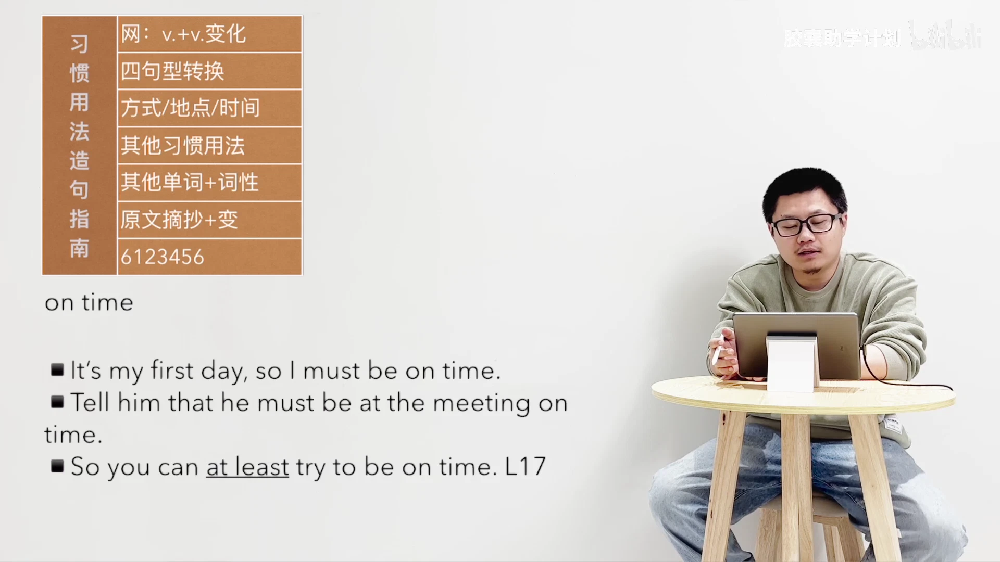

文字识别：网：v.+v.变化 / 习惯用法造句指南 / 学计划 / 四句型转换 / 方式/地点/时间 / 其他习惯用法 / 其他单词+词性 / 原文摘抄+变 / 6123456 / on time /  It's my first day, so I must be on time. / Tell him that he must be at the meeting on / time. /  So you can at least try to be on time. L17

### 画面 00:10:27

文字识别：网：v.+v.变化 / 习惯用法造句指南 / 学计划 / 四句型转换 / 方式/地点/时间 / 其他习惯用法 / 其他单词+词性 / 原文摘抄+变 / 6123456 / on time /  It's my first day, so I must be on time. / Tell him that he must be at the meeting on / time. /  So you can at least try to be on time. L17

### 画面 00:10:29

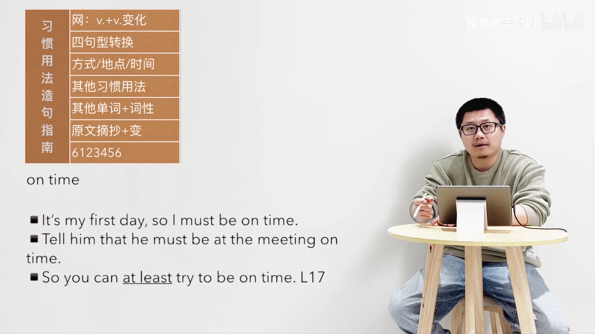

文字识别：网：v.+v.变化 / 习惯用法造句指南 / 学计划 / 四句型转换 / 方式/地点/时间 / 其他习惯用法 / 其他单词+词性 / 原文摘抄+变 / 6123456 / on time /  It's my first day, so I must be on time. / Tell him that he must be at the meeting on / time. /  So you can at least try to be on time. L17

## 00:10:30–00:11:00

OK，好，那注意力集中，咱听一下这个电影片段啊。Because I want you to get to school on time tomorrow morning. OK，好，不多说了。Recap，除了文章以外，习惯用法呗，该造句造句啊，自己再去造。文章该跟读还是要跟读。这篇文章其实就不太难了，明显我自己讲起来我都感觉好简单啊。然后呢，置顶留言对吧？这个呃，重复间隔的学习材料啊。

### 画面 00:10:31

文字识别：Because I want you to get to school on time / tomorrow morning. / Out of the Blue / (1980)

### 画面 00:10:36

文字识别：Because I want you to get to school on time / tomorrow morning. / Out of the Blue / (1980)

### 画面 00:10:38

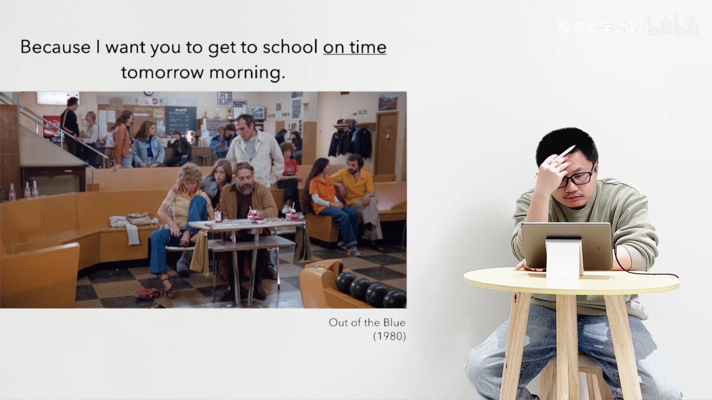

文字识别：Because I want you to get to school on time / tomorrow morning. / Out of the Blue / (1980)

### 画面 00:10:40

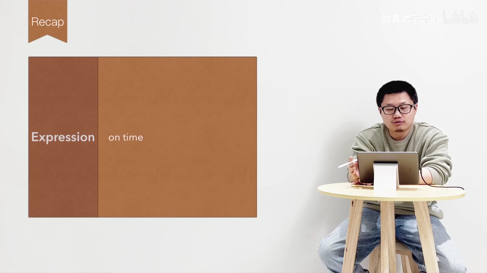

文字识别：Recap / Expression / on time

### 画面 00:10:42

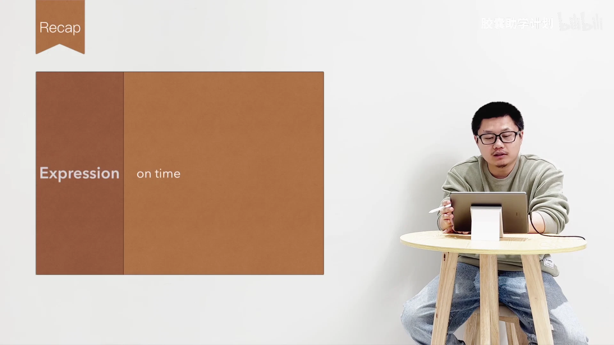

文字识别：Recap / Expression / on time

### 画面 00:10:44

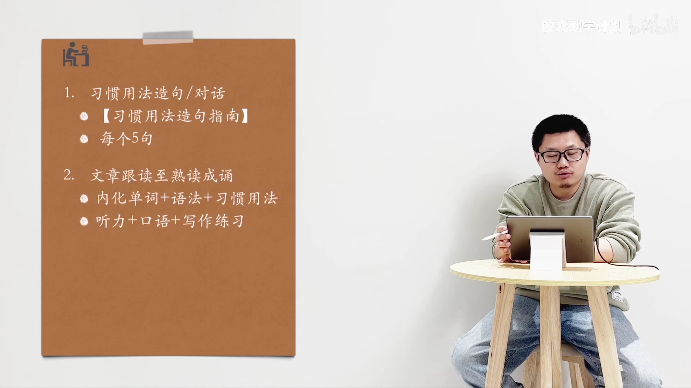

文字识别：习惯用法造句/对话 / 1. / 【习惯用法造句指南】 / 每个5句 / 文章跟读至熟读成诵 / 内化单词+语法+习惯用法 / 听力+口语+写作练习

### 画面 00:10:46

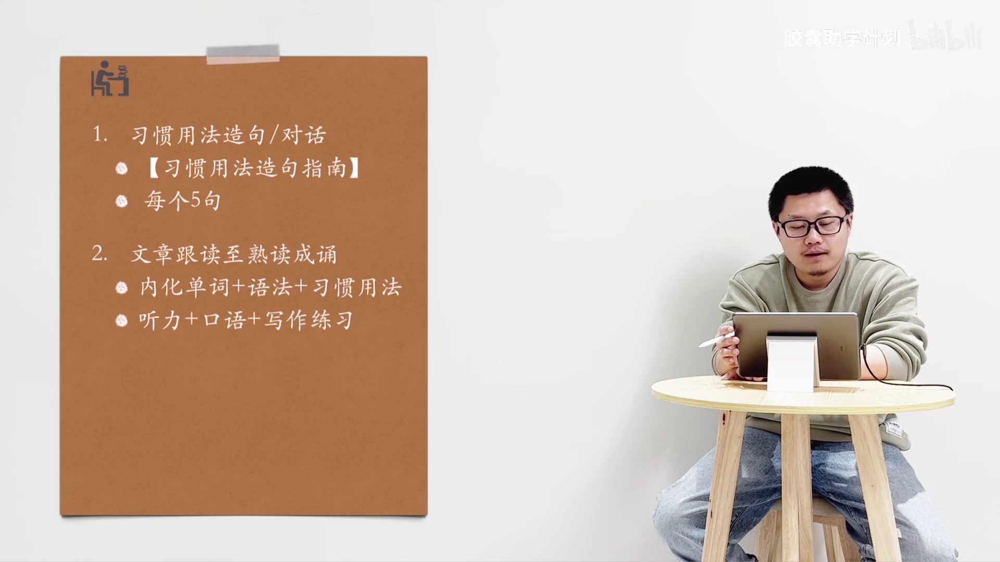

文字识别：1. / 习惯用法造句/对话 / 【习惯用法造句指南】 / 每个5句 / 文章跟读至熟读成诵 / 内化单词+语法+习惯用法 / 听力+口语+写作练习

### 画面 00:10:48

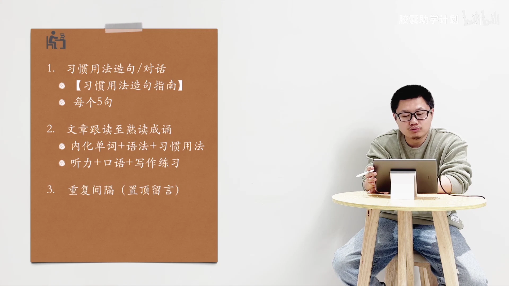

文字识别：1. / 习惯用法造句/对话 / 【习惯用法造句指南】 / 每个5句 / 文章跟读至熟读成诵 / 内化单词+语法+习惯用法 / 听力+口语+写作练习 / 3. / 重复间隔（置顶留言）

### 画面 00:10:50

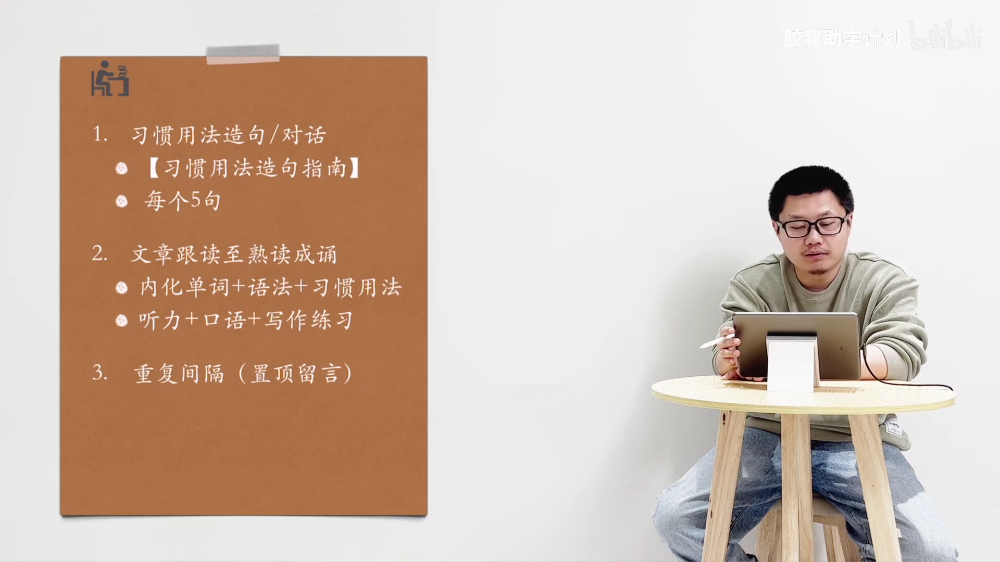

文字识别：1. / 习惯用法造句/对话 / 【习惯用法造句指南】 / 每个5句 / 文章跟读至熟读成诵 / 内化单词+语法+习惯用法 / 听力+口语+写作练习 / 3. / 重复间隔（置顶留言）

### 画面 00:10:53

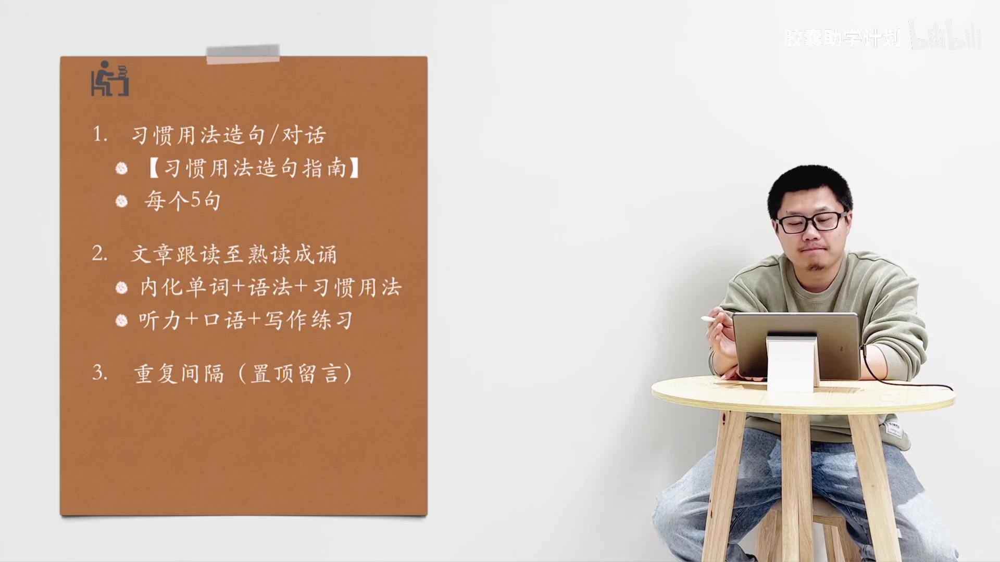

文字识别：1. / 习惯用法造句/对话 / 【习惯用法造句指南】 / 每个5句 / 文章跟读至熟读成诵 / 内化单词+语法+习惯用法 / 听力+口语+写作练习 / 3. / 重复间隔（置顶留言）

### 画面 00:10:55

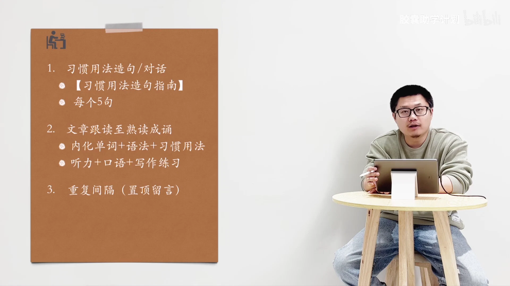

文字识别：习惯用法造句/对话 / 【习惯用法造句指南】 / 每个5句 / 文章跟读至熟读成诵 / 内化单词+语法+习惯用法 / 听力+口语+写作练习 / 3. / 重复间隔（置顶留言）

### 画面 00:10:59

文字识别：臺助学计划園 / 👍

## 00:11:00–00:11:25

那以上呢就是本期视频的全部内容了。如果各位喜欢我们的课程呢，欢迎各位关注、订阅、一键三连，分享给那些需要的朋友，来帮助我们快速成长。See you next time.

### 画面 00:11:01

文字识别：[助学计划 / ￥

### 画面 00:11:04

文字识别：毫助字计划 / ￥

### 画面 00:11:11

文字识别：秦助字计划一門

### 画面 00:11:13

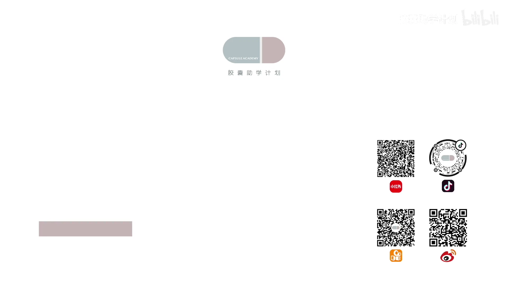

文字识别：運珈字計切 / CAPSULEACADEMY / 胶囊助学计划 / 小红书 / OE

### 画面 00:11:15

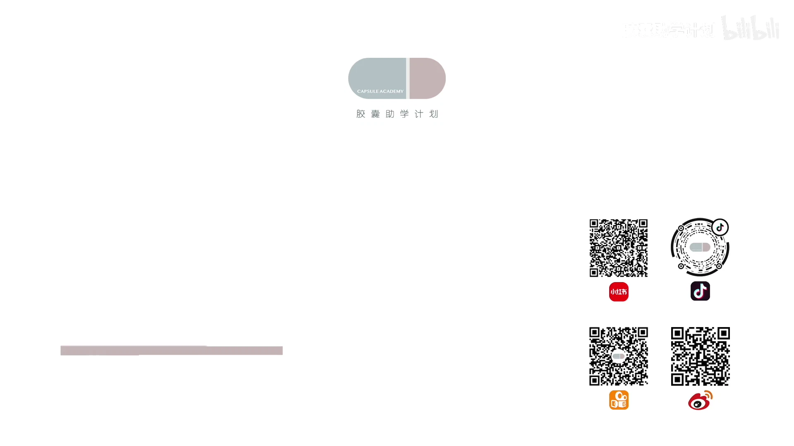

文字识别：臺珈学計切 / CAPSULEACADEMY / 胶囊助学计划 / 『 / 小红书 / 品

### 画面 00:11:21

文字识别：動字計切 / CAPSULEACADEMY / 胶囊助学计划 / 小红书 / Creator / Leo & Berlin / OE

### 画面 00:11:23

文字识别：bilibili / 胶囊助学计划

### 画面 00:11:24

文字识别：bilibili / 胶囊助学计划

