# 087 练习

快速机器解析：语音为单模型转写，未进行独立交叉校对或人工复核；画面每秒采样并按变化选帧，短时文字和标记可能遗漏。截图时间约有 1 秒误差。图片有损压缩；遇到疑点请按时间查看 Google Drive 原视频。

## 00:00:00–00:00:30

Hello everyone, welcome to Capsule Academy. This is Leo. Today we are going to learn New Concept English Book Two, Lesson Eighty Seven Practices. Ah,注意进行如下练习，唯一的前提就是文章咱们要熟读成诵，否则请勿开始。Hope you gonna enjoy.好，第一题 comprehension，我问您答，咱练听力口语啊来了。Who was asking the man

### 画面 00:00:00

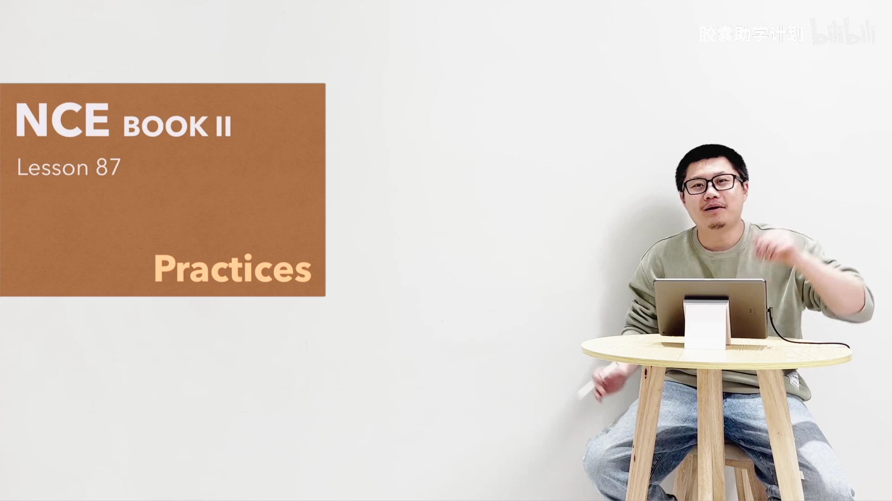

文字识别：NCE / BOOK"I / Lesson 87 / Practices

### 画面 00:00:02

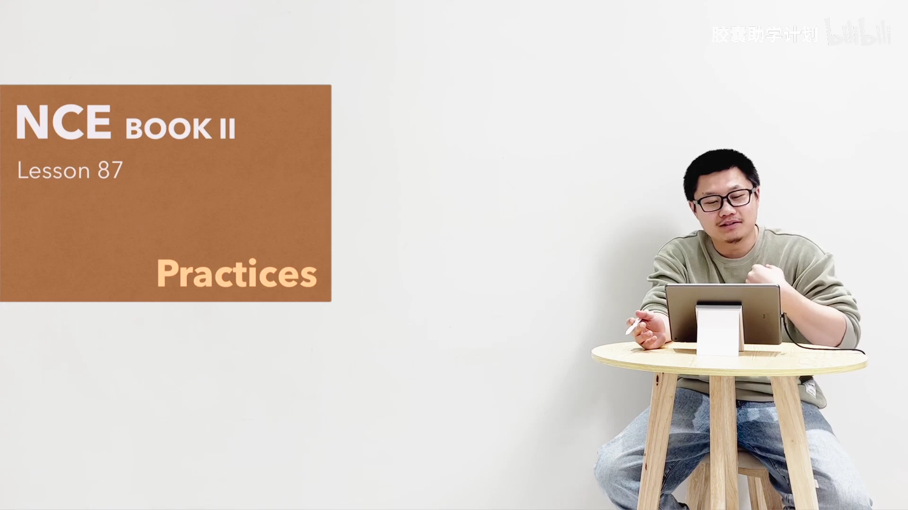

文字识别：NCE / BOOKII / Lesson 87 / Practices

### 画面 00:00:06

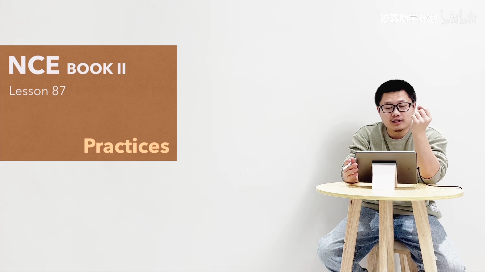

文字识别：NCE / BOOKII / Lesson 87 / Practices

### 画面 00:00:08

文字识别：进行如下练习唯一前提 / 文章跟读至熟读成诵 / 否则请勿开始

### 画面 00:00:17

文字识别：Bitbii / 胶囊助学计划

### 画面 00:00:21

### 画面 00:00:23

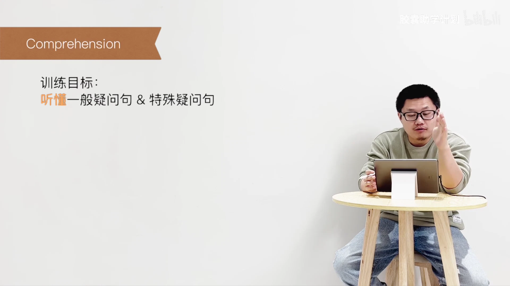

文字识别：Comprehension / 训练目标： / 听懂一般疑问句＆特殊疑问句

### 画面 00:00:26

文字识别：Comprehension / Who was asking the man questions?

## 00:00:30–00:01:00

questions, Inspector? Why was he asking questions? There had been a murder.或者你直接可以回答 murder was committed 也行. Where was the man going at the time? He was traveling to London. Which train did he say he was traveling on? The eight o'clock

### 画面 00:00:37

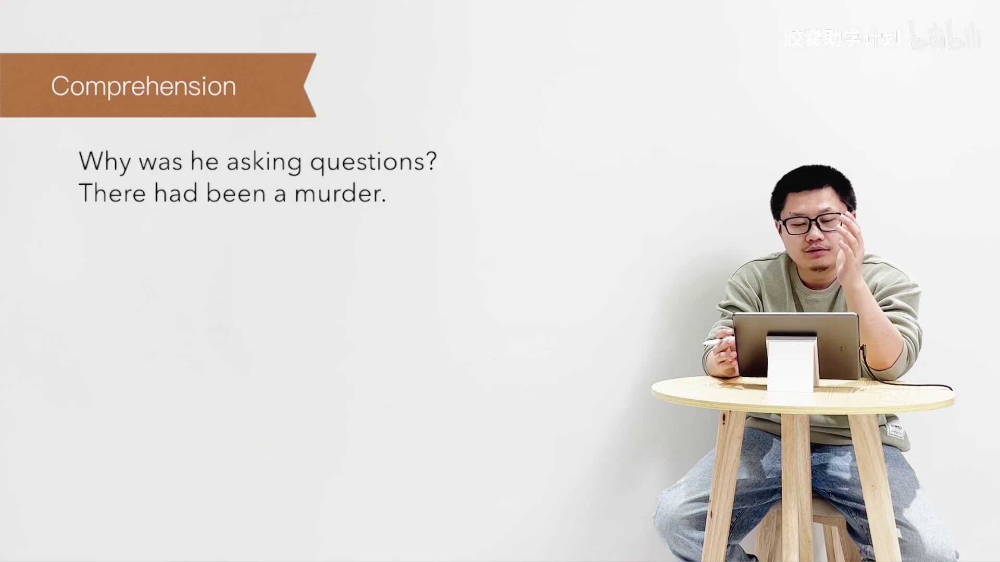

文字识别：Comprehension / Why was he asking questions? / There had been a murder.

### 画面 00:00:42

文字识别：Comprehension / Where was the man going at the time?

### 画面 00:00:58

文字识别：Comprehension / Which train did he say he was travelling on? / The 8 o'clock train to London.

## 00:01:00–00:01:30

train to London. What did the inspector ask him then? Do you always catch such an early train? What time did the man say he had to be at work? At ten. What would the man's employer do? Confirm the man

### 画面 00:01:03

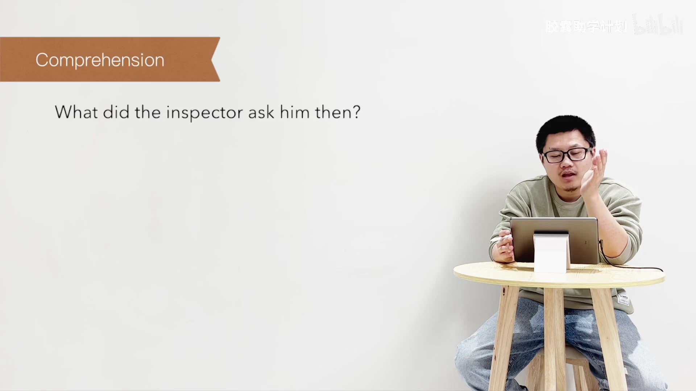

文字识别：Comprehension / What did the inspector ask him then?

### 画面 00:01:24

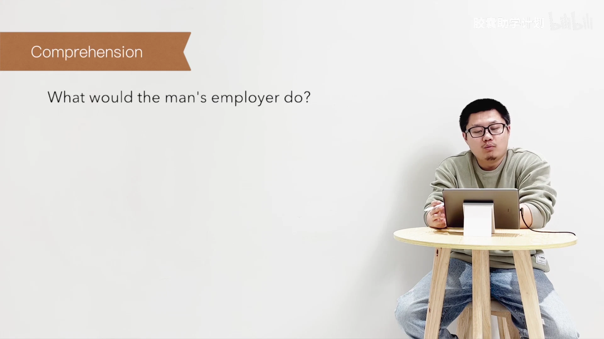

文字识别：Comprehension / What would the man's employer do?

### 画面 00:01:28

文字识别：Comprehension / What would the man's employer do? / He would confirm the man was there on / time.

## 00:01:30–00:02:00

was there on time. Would a later train get the man to work on time? Yes, it would. Did he say he always caught a later train? No, he didn't. What time did he say he arrived at the station? At ten to eight.

### 画面 00:01:33

文字识别：Comprehension / Would a later train get the man to work on / time?

## 00:02:00–00:02:30

What did he buy? A paper. What did he do then? He waited for the train. 四句型转换啊，第一个，The inspector was interviewing a man. Was提前呗，对吧？Who？你可以对主语，也可以对a man宾语，对吧？都行啊，随便。二选其一。Why加

### 画面 00:02:00

文字识别：Comprehension / What time did he say he arrived at the / station? / At ten to eight.

### 画面 00:02:10

文字识别：Comprehension / What did he do then? / He waited for the train.

### 画面 00:02:13

文字识别：Asking questions / 训练目标： / 会说一般疑问句＆特殊疑问句 / Accuracy / Fluency

### 画面 00:02:16

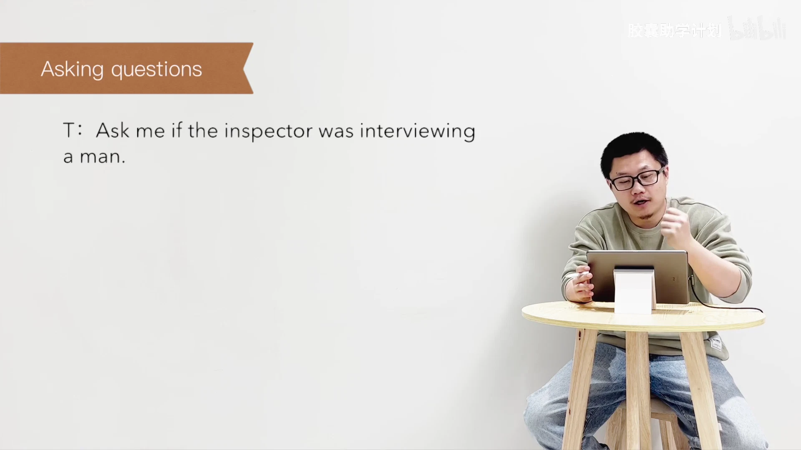

文字识别：Asking questions / T: Ask me if the inspector was interviewing / a man.

### 画面 00:02:18

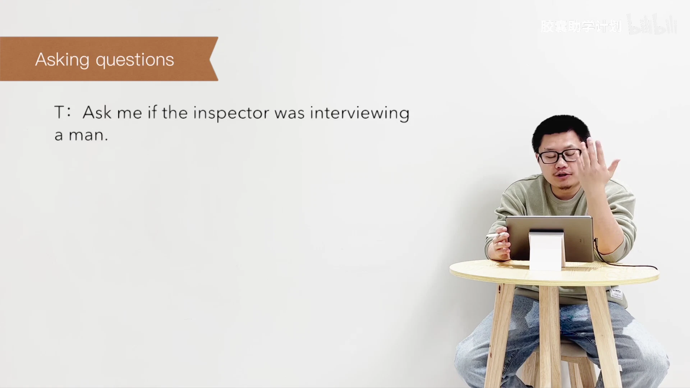

文字识别：Asking questions / T: Ask me if the inspector was interviewing / a man.

### 画面 00:02:21

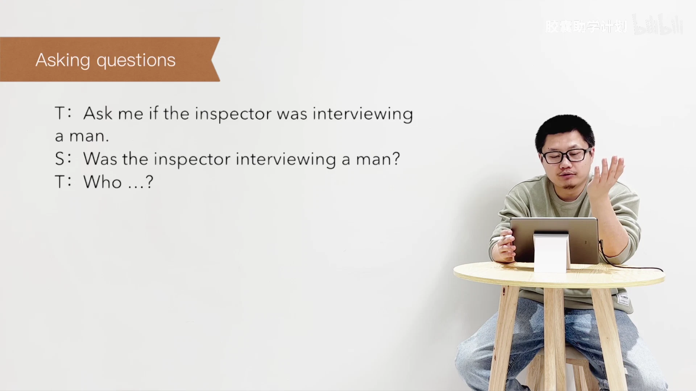

文字识别：Asking questions / T: Ask me if the inspector was interviewing / a man. / S: Was the inspector interviewing a man? / T:Who ...?

### 画面 00:02:28

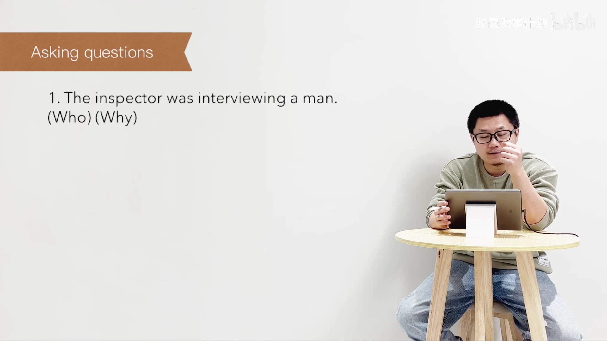

文字识别：Asking questions / 1. The inspector was interviewing a man. / (Who)(Why)

## 00:02:30–00:03:00

句话。The man said. 注意后边是宾语从句，所以你把did提前，叫Did the man say he was traveling on London? Ah, he was traveling to London. What?就What did the man say? Where? Ah, where did the man say he was traveling to? 听见了吧？Who对主语提问啊？呃，He was. 当然，你可以对呃Who可以对主语提问，也可以对He提问，都可以啊。你比如说，Who did

### 画面 00:02:50

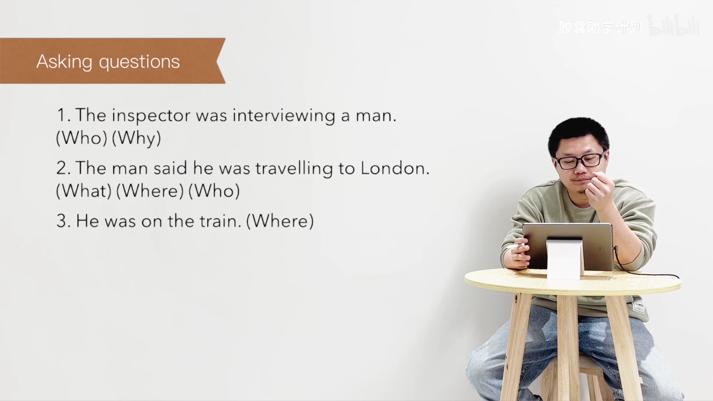

文字识别：Asking questions / 1. The inspector was interviewing a man. / (Who)(Why) / 2. The man said he was travelling to London. / (What) (Where) (Who) / 3. He was on the train.(Where)

## 00:03:00–00:03:30

the man say was traveling to London? 对吧？ He was on the train. Was he on train? Where was he? 很简单。 He always caught the early train. 这提前问对整句话提问，我觉得可以啊。呃，或者说问咱们可以这样去问，叫 When did he always? Oh, When did he always catch the early train? 直接加整句吧。那 Which train?

### 画面 00:03:09

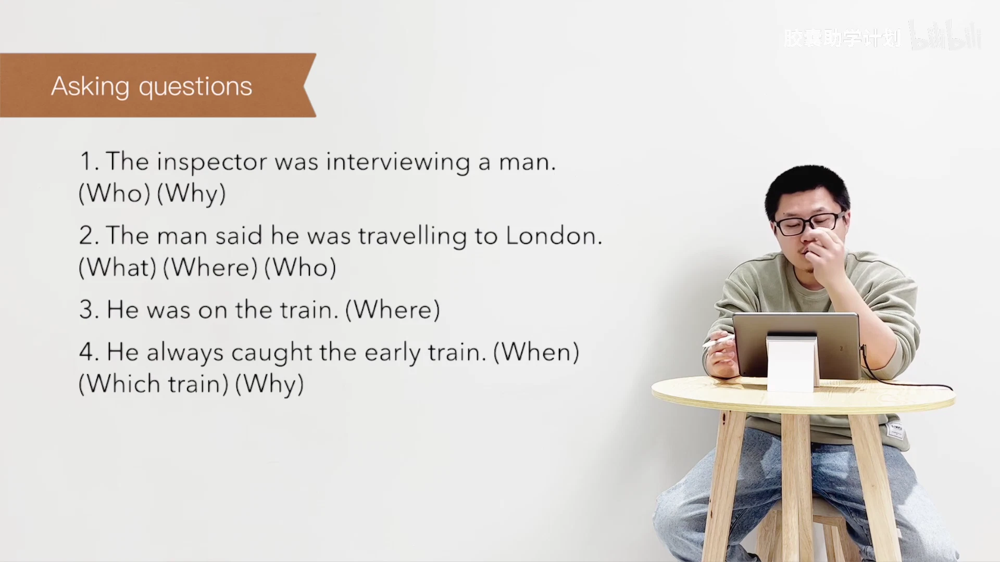

文字识别：Asking questions / 1. The inspector was interviewing a man. / (Who)(Why) / 2. The man said he was travelling to London. / (What)(Where) (Who) / 3. He was on the train. (Where) / 4. He always caught the early train. (When) / (Which train) (Why)

### 画面 00:03:11

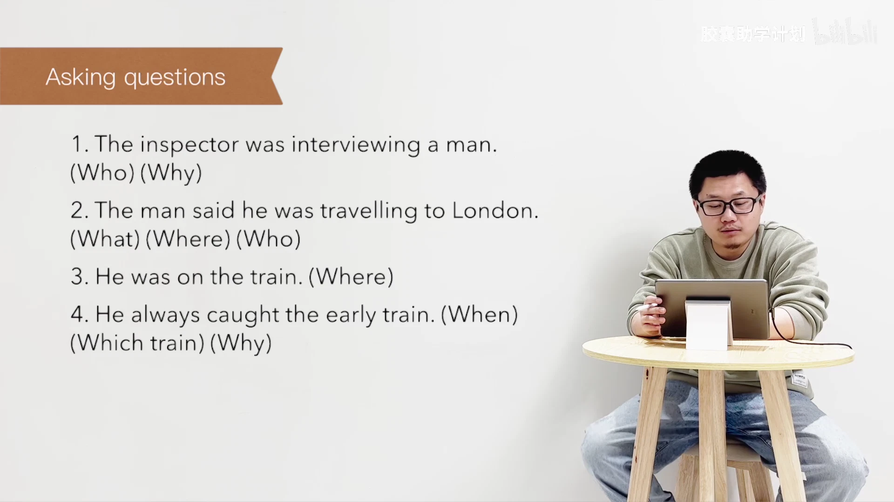

文字识别：Asking questions / 1. The inspector was interviewing a man. / (Who)(Why) / 2. The man said he was travelling to London. / (What) (Where) (Who) / 3. He was on the train. (Where) / 4. He always caught the early train. (When) / (Which train) (Why)

### 画面 00:03:14

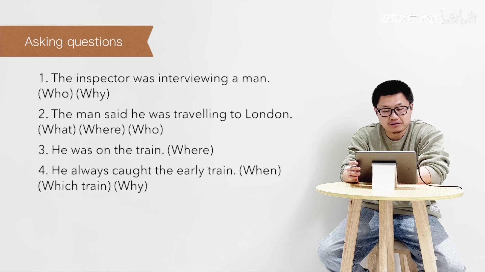

文字识别：Asking questions / 1. The inspector was interviewing a man. / (Who)(Why) / 2. The man said he was travelling to London. / (What)(Where) (Who) / 3. He Was on the train. (Where) / 4. He always caught the early train. (When) / (Which train) (Why)

## 00:03:30–00:04:00

其实是对这个 early 提问的，所以我们要问的话，答案叫 which train did he always catch？ Why 整句话？五 he had to be at work at ten o'clock。那个 had to do did 的体现，对吧？然后 had 换回原形，这是 have to 的用法。 At what time？ 那就对时间。 Where？ 就是 at work，对吧？ His employer would confirm that he was there on time。你看这里后边又是一个

### 画面 00:03:38

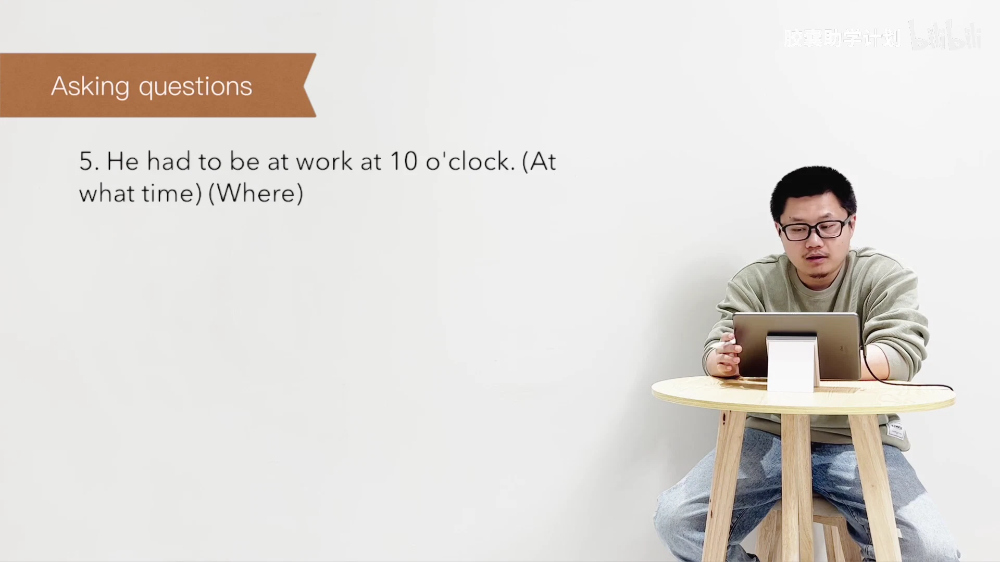

文字识别：Asking questions / 5. He had to be at work at 10 o'clock.(At / what time) (Where)

### 画面 00:03:53

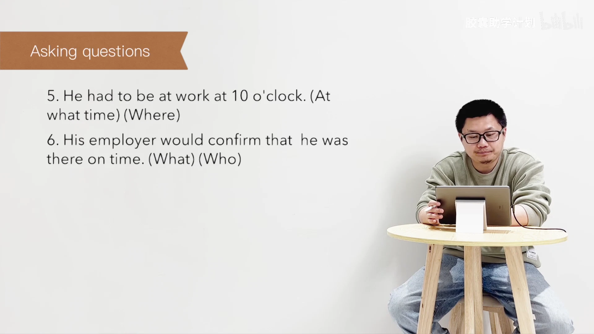

文字识别：Asking questions / 5. He had to be at work at 10 o'clock.(At / what time) (Where) / 6. His employer would confirm that he was / there on time.(What) (Who)

## 00:04:00–00:04:30

宾语从句，你肯定不能用 was，你要用 would confirm，把 would 提前，对吧？ What 对整个宾语从句提问？ Who 呢？咱们可以对 his employer 提问。好，第七个啊， a later train would get him to work on time。那 would 提前，对吧？问对时间提问。八个， he was at the station at uh seven fifty。 was 提前， where 对 at the station 时间提问啊，地点提问啊。呃， tell the story 练的是流利性啊，流利性的话，

### 画面 00:04:11

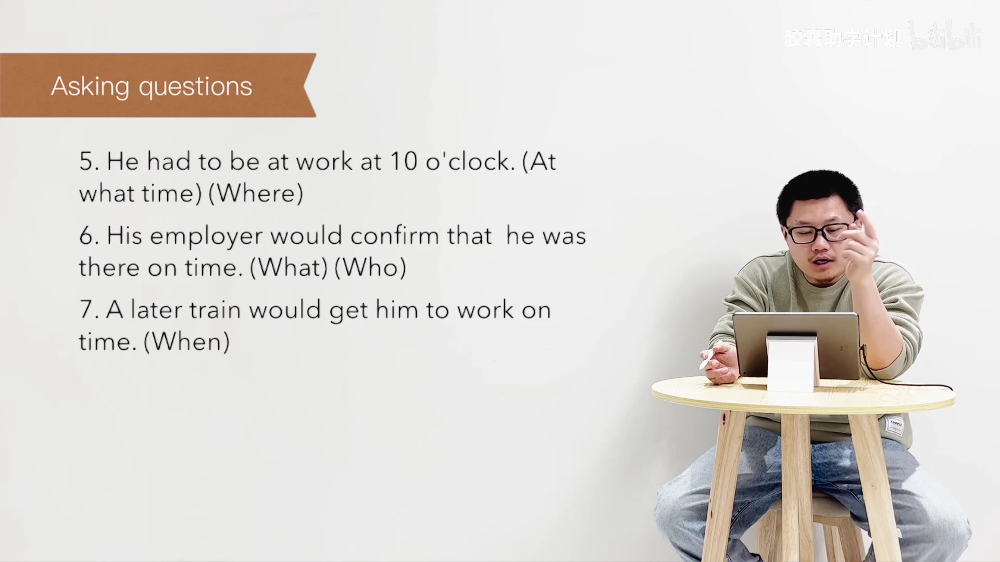

文字识别：Asking questions / 5. He had to be at work at 10 o'clock.(At / what time) (Where) / 6. His employer would confirm that he was / there on time.(What) (Who) / 7.A later train would get him to work on / time.(When)

### 画面 00:04:16

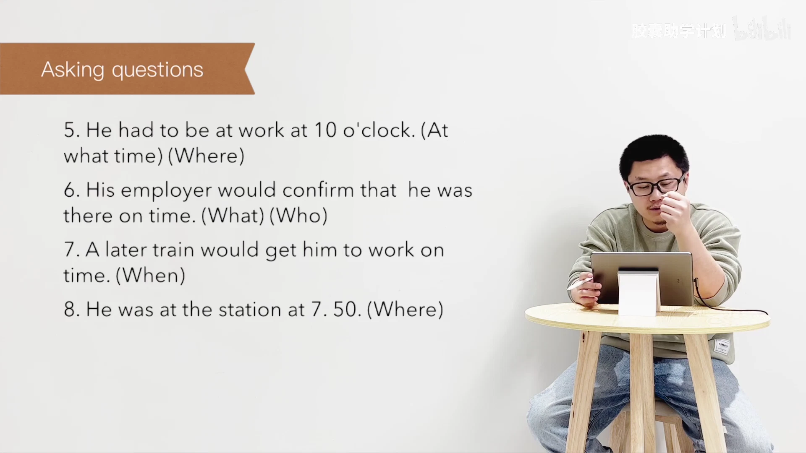

文字识别：Asking questions / 5. He had to be at work at 10 o'clock.(At / what time) (Where) / 6. His employer would confirm that he was / there on time.(What) (Who) / 7.A later train would get him to work on / time.(When) / 8. He was at the station at 7. 50.(Where)

### 画面 00:04:26

文字识别：Tell the story / 训练目标： / 口语复述能力 / Accuracy / Fluency

### 画面 00:04:29

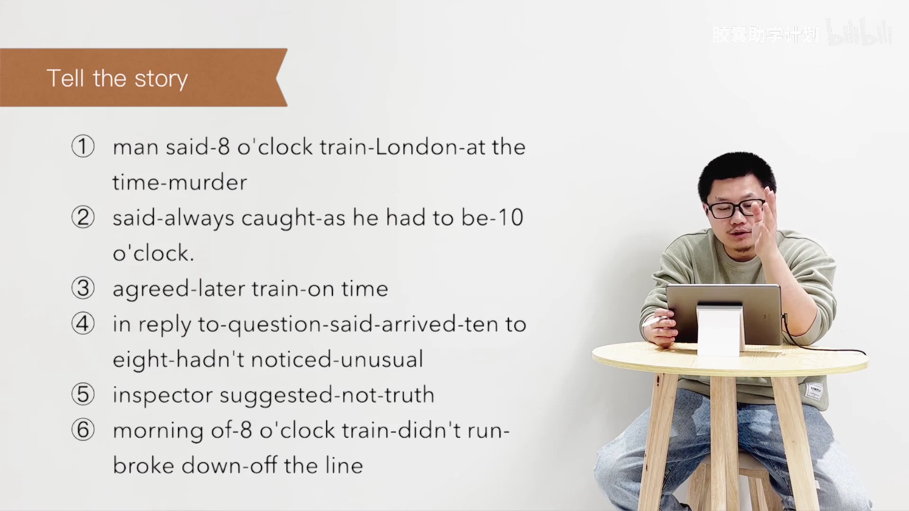

文字识别：Tell the story / 1 / man said-8 o'clock train-London-at the / time-murder / said-always caught-as he had to be-10 / o'clock. / agreed-later train-on time / in reply to-question-said-arrived-ten to / eight-hadn't noticed-unusual / inspector suggested-not-truth / 6 /  morning of-8 o'clock train-didn't run- / broke down-off the line

## 00:04:30–00:05:00

话，第一单元有做过示范，不多说了。然后 summary writing 呢，摘要写作，那对于各位来说，两个点，第一两篇文章，这是第一篇，这是第二篇。看的时候，包括写的时候，重点看那些连词啊。OK， topic for discussion，老习惯，我就说一遍题。Supposing the man was not the murderer, what other reasons might he have had for lying to the inspector? 假设这男的就不是谋杀犯，他有没有什么其他的原因，对

### 画面 00:04:32

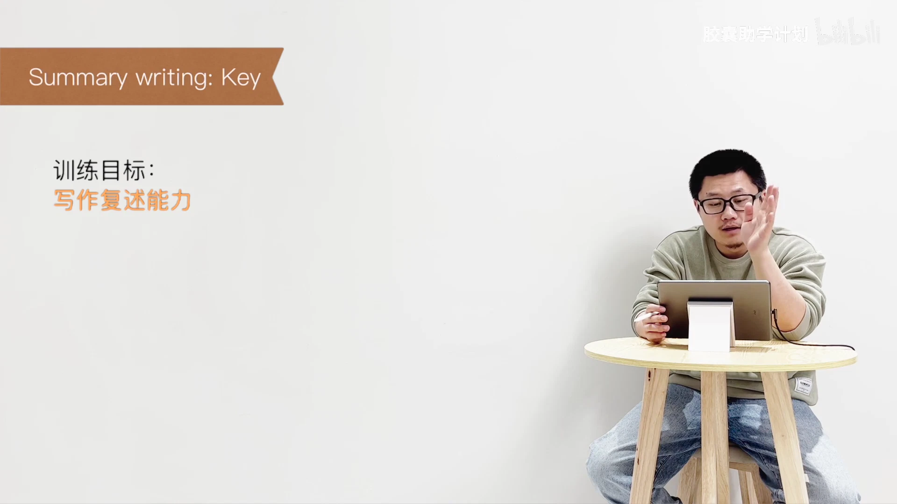

文字识别：Summary writing: Key / 训练目标： / 写作复述能力

### 画面 00:04:35

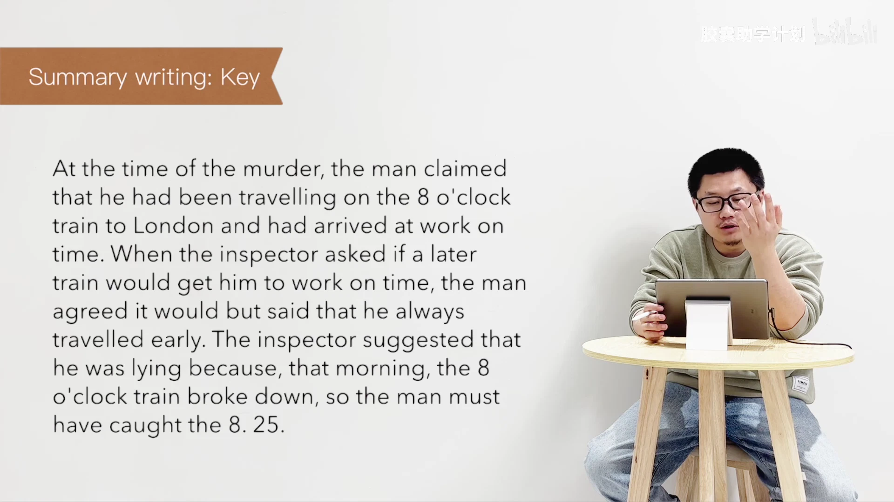

文字识别：Summary writing: Key / At the time of the murder, the man claimed / that he had been travelling on the 8 o'clock / train to London and had arrived at work on / time. When the inspector asked if a later / train would get him to work on time, the man / agreed it would but said that he always / travelled early. The inspector suggested that / he was lying because, that morning, the 8 / o'clock train broke down, so the man must / have caught the 8. 25.

### 画面 00:04:38

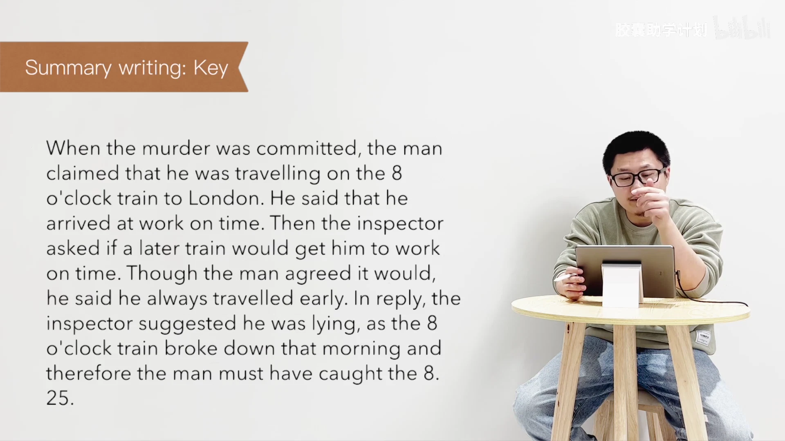

文字识别：助字计划 / Summary writing: Key / When the murder was committed, the man / claimed that he was travelling on the 8 / o'clock train to London. He said that he / arrived at work on time. Then the inspector / asked if a later train would get him to work / on time. Though the man agreed it would, / he said he always travelled early. In reply, the / inspector suggested he was lying, as the 8 / o'clock train broke down that morning and / therefore the man must have caught the 8. / 25.

### 画面 00:04:43

文字识别：Topics for discussion / 训练目标： / 完全自由的对话 / Accuracy / Fluency

### 画面 00:04:45

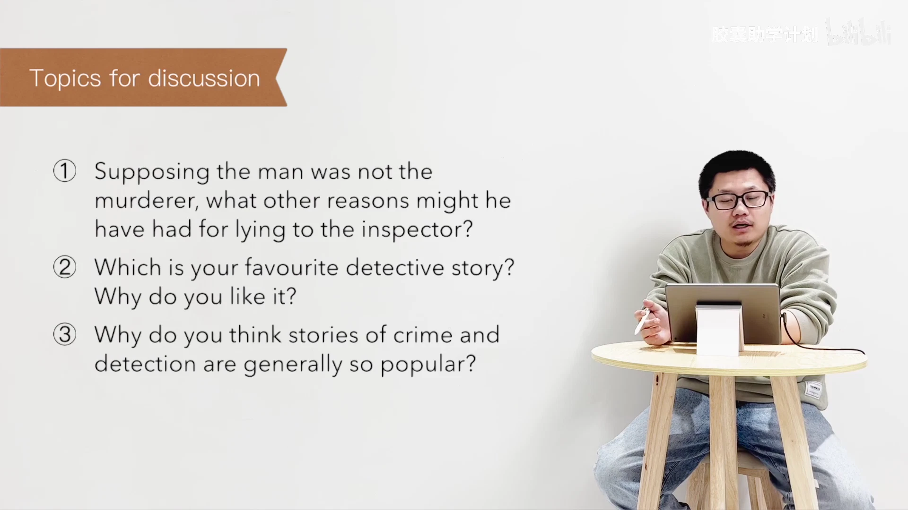

文字识别：Topics for discussion / Supposing the man was not the / murderer, what other reasons might he / have had for lying to the inspector? / Which is your favourite detective story? / Why do you like it? / Why do you think stories of crime and / detection are generally so popular?

## 00:05:00–00:05:30

于这个 inspector 是撒谎了。第二个，Which is your favorite detective story? Why do you like it? 你有没有最喜欢的侦探类的故事？为啥你喜欢它？ Why do you think stories of 啊阿加莎克里斯蒂是吧？ Why do you think stories of crime and detection are generally so popular? 为什么这种犯罪啊，这种侦探呐，比如福尔摩斯啊这样的小说特别的流行，对吧？解释一下。家庭作业，Ask

### 画面 00:05:15

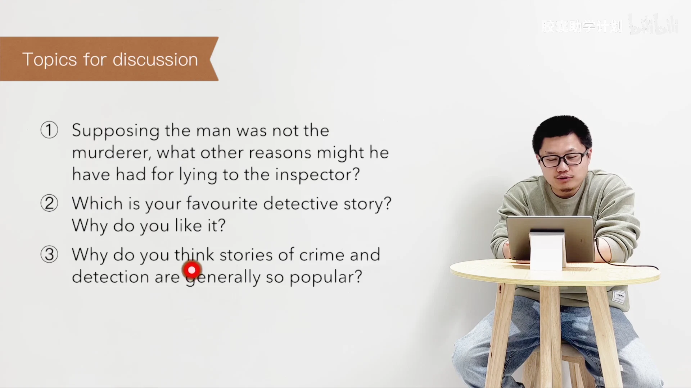

文字识别：Topics for discussion / Supposing the man was not the / murderer, what other reasons might he / have had for lying to the inspector? / Which is your favourite detective story? / Why do you like it? / Why do you think stories of crime and / detection areGenerally so popular?

### 画面 00:05:28

文字识别：毫助字计划

## 00:05:30–00:06:00

Smith写完了，咱朗读。只要写作写完对答案，Tell the story口语复述，置顶留言看重复间隔，好吧。那以上就是本期视频的全部内容了。如果各位喜欢我们的课程呢，欢迎各位关注、订阅、一键三连，分享给那些需要的朋友，来帮助我们快速成长。See you next time.

### 画面 00:05:30

文字识别：1.Ask me if写&朗读

### 画面 00:05:32

文字识别：1.Ask me if写&朗读 / 摘要写作写&答案 / 3.Tell the story 口语复述

### 画面 00:05:34

文字识别：1.Ask me if写&朗读 / 摘要写作写&答案 / 3.Tell the story 口语复述 / ·重复间隔（置顶留言） / 4.

### 画面 00:05:36

文字识别：1.Ask me if写&朗读 / 摘要写作写&答案 / 3.Tell the story 口语复述 / 4.重复间隔（置顶留言）

### 画面 00:05:38

文字识别：是助学计划一调

### 画面 00:05:41

文字识别：毫助字计划 / ←

### 画面 00:05:51

### 画面 00:05:53

文字识别：運聖動学計划 / CAPSULEACADEMY / 胶囊助学计划 / 『 / 小红书 / Lecturer / □ / 口 / Leo / OE

### 画面 00:05:56

文字识别：臺珈字計切 / CAPSULEACADEMY / 胶囊助学计划 / 『 / 小红书 / □ / Editor / OE

### 画面 00:05:59

文字识别：珈学針物 / CAPSULEACADEMY / 胶囊助学计划 / 小红书 / Creator / Leo & Berlin / OE

## 00:06:00–00:06:03

### 画面 00:06:01

文字识别：bilbili / 胶囊助学计划 / 胶囊助学计划 / 小红书

### 画面 00:06:03

文字识别：bilibili / 胶囊助学计划

