# 088 单词

快速机器解析：语音为单模型转写，未进行独立交叉校对或人工复核；画面每秒采样并按变化选帧，短时文字和标记可能遗漏。截图时间约有 1 秒误差。图片有损压缩；遇到疑点请按时间查看 Google Drive 原视频。

## 00:00:00–00:00:30

Hello everyone, welcome to Capsule Academy. This is Leo. Today we're going to learn New Concept English Book Two, Lesson 88 Words. 那老习惯进入正式课程之前，咱们看几个小的问题。首先，如何表达表面上啊？比如说表面上他对我很好啊。接下来如何表达一层或者数层？接下来呢？最后一个问题，如何表达进展顺利？那带着这三个问题，Hope you guys enjoyed.

### 画面 00:00:00

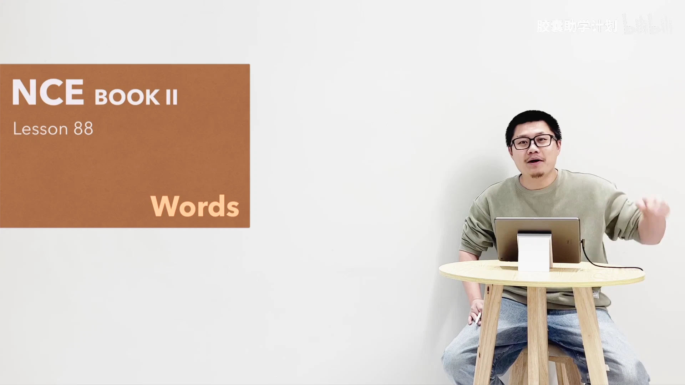

文字识别：NCE / BOOKⅡI / Lesson 88 / Words

### 画面 00:00:02

文字识别：NCE / BOOKⅡI / Lesson 88 / Words

### 画面 00:00:04

文字识别：NCE / BOOKⅡI / Lesson 88 / Words

### 画面 00:00:06

文字识别：NCE / BOOKⅡI / Lesson 88 / Words

### 画面 00:00:08

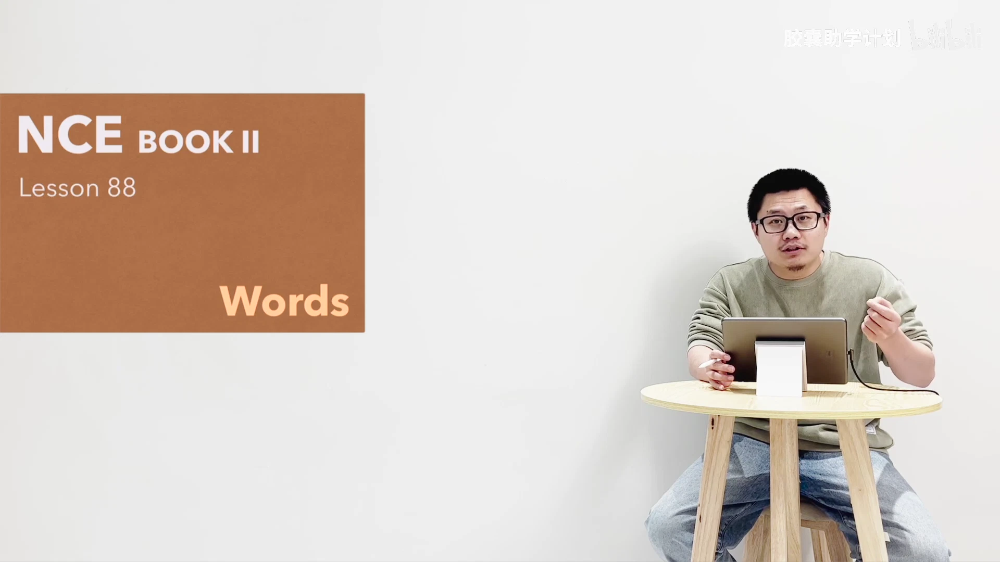

文字识别：辜助学计划 / NCE / BOOKⅡI / Lesson 88 / Words

### 画面 00:00:10

文字识别：袁助学计划 / “表面上”?

### 画面 00:00:12

文字识别：①如何表达“表面上”?

### 画面 00:00:14

文字识别：①如何表达“表面上”?

### 画面 00:00:16

文字识别：①如何表达“表面上”?

### 画面 00:00:18

文字识别：①如何表达“表面上”？ / 如何表达“一层”？

### 画面 00:00:20

文字识别：①如何表达“表面上”？ / 如何表达“一层”？

### 画面 00:00:22

文字识别：①如何表达“表面上”? / 如何表达“一层”？ / 如何表达“进展顺利”?

### 画面 00:00:24

文字识别：①如何表达“表面上”? / 如何表达“一层”？ / 如何表达“进展顺利”?

### 画面 00:00:26

文字识别：①如何表达“表面上”? / 如何表达“一层”？ / 如何表达“进展顺利”?

### 画面 00:00:28

文字识别：J bitbli / 胶囊助学计划

## 00:00:30–00:01:00

我们上来看第一个单词，跟我一起读一下，叫做 trap， trap。你可以把这个单词，首先它的意思就是困于什么什么当中啊，一般都是险境啊、危险呐、困难呐，都是困于的意思 trap。然后你这个单词，你给它分两个汁儿去记，但是一个意思。左边这汁儿呢是物理意义上的困，比如说我被锁在这个房间当中了，出不去，已经锁了十天了，我也没吃

### 画面 00:00:31

文字识别：虞助学计划 / 胶囊助学计划

### 画面 00:00:33

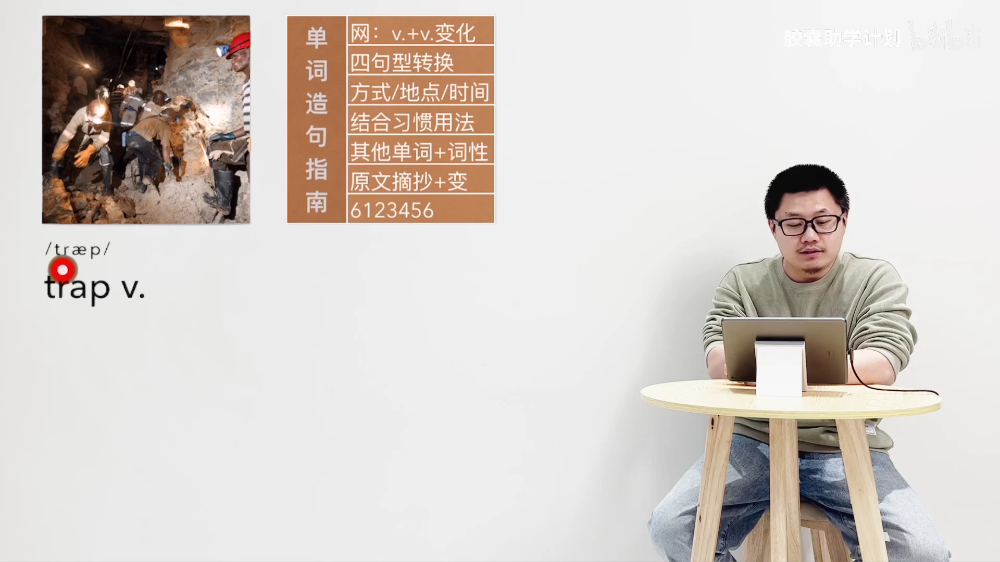

文字识别：单词造句指南 / 网：v.+v.变化 / 奏助字计划 / 四句型转换 / 方式/地点/时间 / 结合习惯用法 / 其他单词+词性 / 原文摘抄+变 / 6123456 / /træep/ / trap v.

### 画面 00:00:35

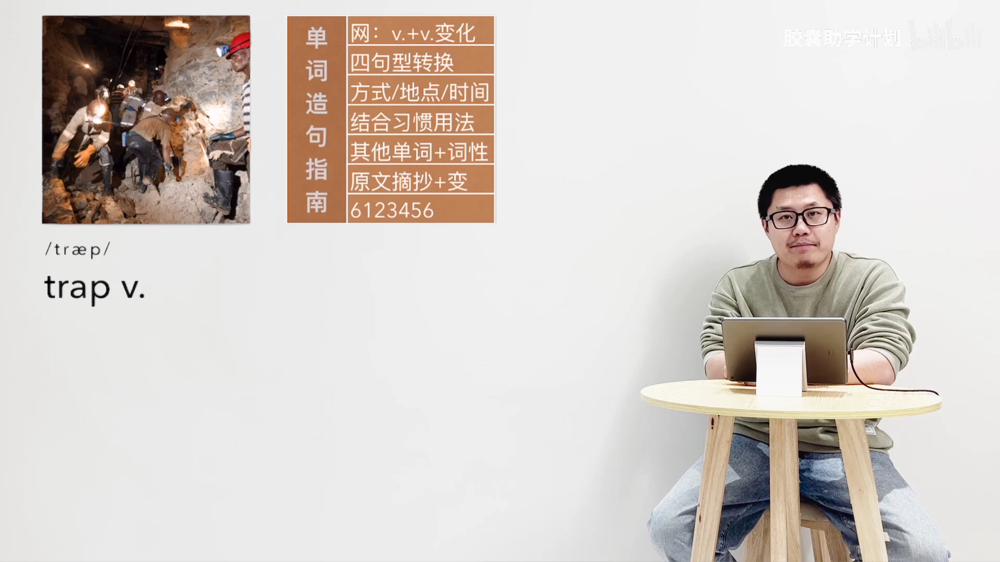

文字识别：单词造句指南 / 网：v.+v.变化 / 四句型转换 / 方式/地点/时间 / 结合习惯用法 / 其他单词+词性 / 原文摘抄+变 / 6123456 / /træp/ / trap V.

### 画面 00:00:38

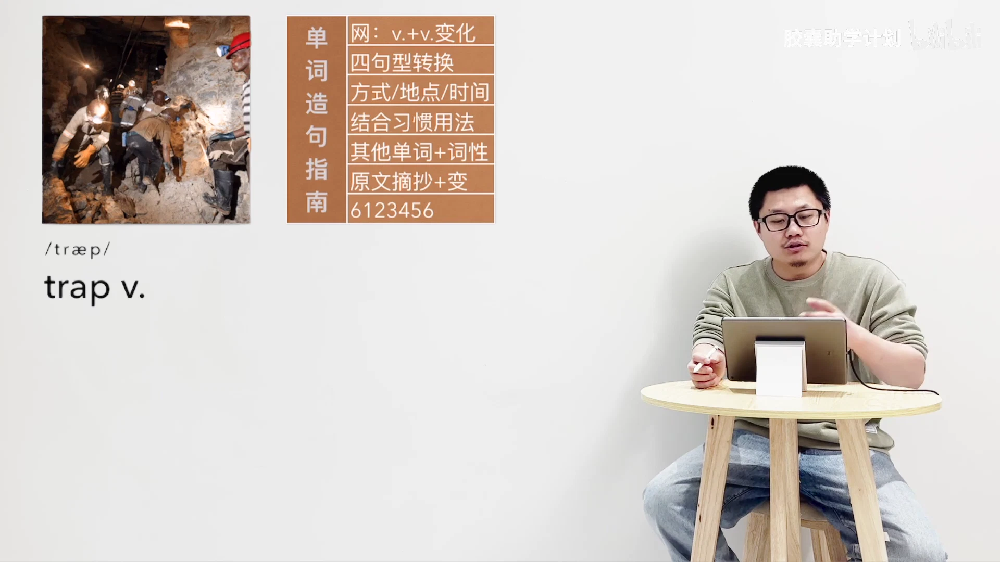

文字识别：单词造句指南 / 网：v.+v.变化 / 毫助学计划 / 四句型转换 / 方式/地点/时间 / 结合习惯用法 / 其他单词+词性 / 原文摘抄+变 / 6123456 / /træp/ / trap V.

### 画面 00:00:41

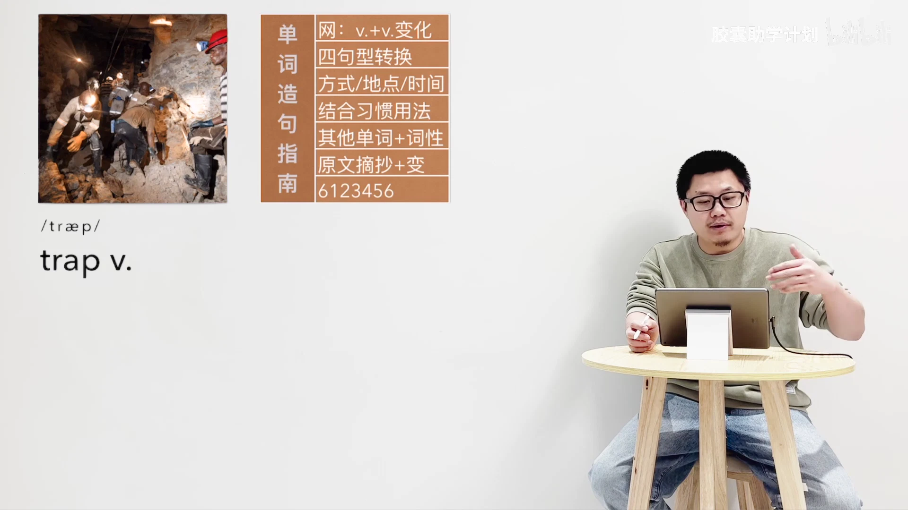

文字识别：单词造句指南 / 网：v.+v.变化 / 囊助字计划 / 四句型转换 / 方式/地点/时间 / 结合习惯用法 / 其他单词+词性 / 原文摘抄+变 / 6123456 / /træp/ / trap V.

### 画面 00:00:59

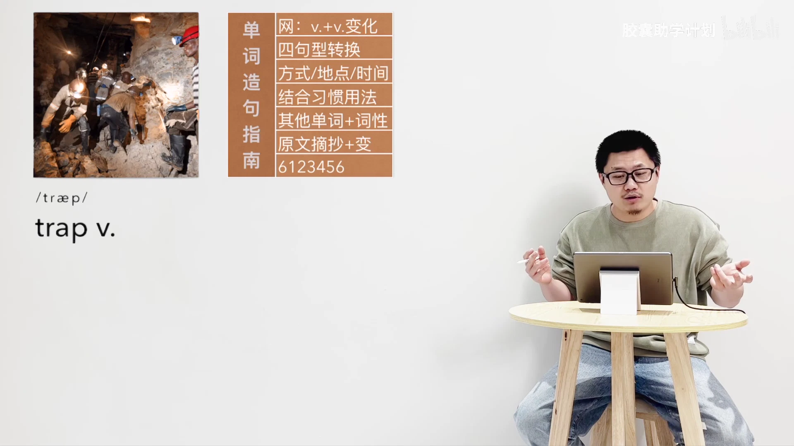

文字识别：单词造句指南 / 网：v.+v.变化 / 辜助字计划園 / 四句型转换 / 方式/地点/时间 / 结合习惯用法 / 其他单词+词性 / 原文摘抄+变 / 6123456 / /træp/ / trap V.

## 00:01:00–00:01:30

的，我也没喝的，对吧？快不行了，被困于这个地方叫做 trap。那像本文呢，就像图中一样，是被困在了这个矿井当中。第二个呢，另外一种 trap 的感觉呢，就不是物理意义上，是这种是呃这种心理感受上。比如说，我在这份工作当中，我感觉我自己被困住了啊，不得施展，也用的是 trap。我们造几个句子啊。首先，原文了给给了一个句子，非常的好，叫做 Six men

### 画面 00:01:23

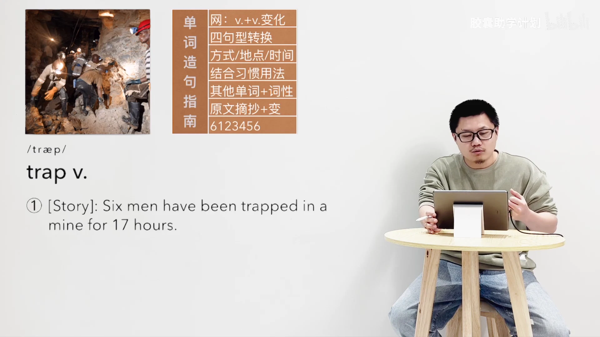

文字识别：单词造句指南 / 网：v.+v.变化 / 四句型转换 / 方式/地点/时间 / 结合习惯用法 / 其他单词+词性 / 原文摘抄+变 / 6123456 / /træep/ / trap V. / ① [Story]: Six men have been trapped in a / mine for 17 hours.

### 画面 00:01:25

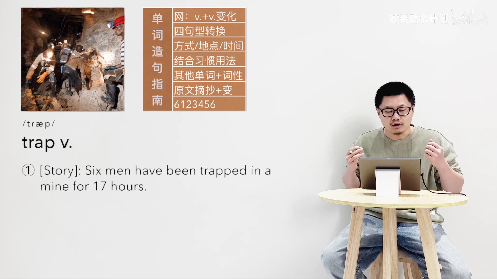

文字识别：单词造句指南 / 网：v.+v.变化 / 四句型转换 / 方式/地点/时间 / 结合习惯用法 / 其他单词+词性 / 原文摘抄+变 / 6123456 / /træep/ / trap V. / ① [Story]: Six men have been trapped in a / mine for 17 hours.

## 00:01:30–00:02:00

have been trapped in a mine for seventeen hours. 六个人现在完成时的被动，对吧？已经被困在了，困在什么地方呢？In a mine，在一个矿井当中，持续了十七个小时。注意，持续了十七个小时，并且还跟现在完成时，只不过是被动，但是用法是类似的。在困在这个矿井当中，持续了十七个小时。你想一下，现在完成时我们的两个用法，当然，单用时咱们讲的是主动，对吧？

### 画面 00:01:32

文字识别：单词造句指南 / 网：v.+v.变化 / 四句型转换 / 方式/地点/时间 / 结合习惯用法 / 其他单词+词性 / 原文摘抄+变 / 6123456 / /træep/ / trap V. / ① [Story]: Six men have been trapped in a / mine for 17 hours.

### 画面 00:01:40

文字识别：单词造句指南 / 网：v.+v.变化 / 四句型转换 / 方式/地点/时间 / 结合习惯用法 / 其他单词+词性 / 原文摘抄+变 / 6123456 / /træep/ / trap V. / ① [Story]: Six men have been trapped in a / mine for 17 hours.

### 画面 00:01:45

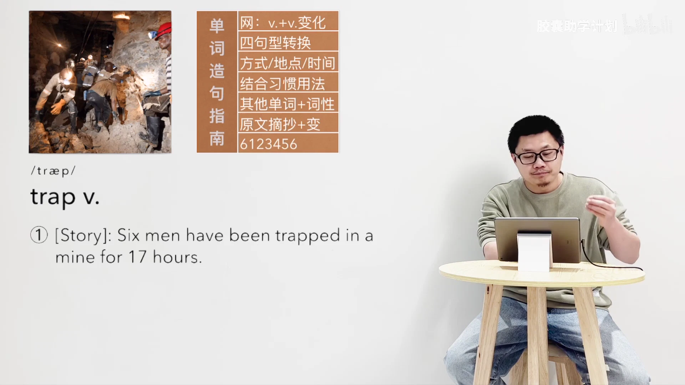

文字识别：单词造句指南 / 网：v.+v.变化 / 四句型转换 / 方式/地点/时间 / 结合习惯用法 / 其他单词+词性 / 原文摘抄+变 / 6123456 / /træep/ / trap V. / ① [Story]: Six men have been trapped in a / mine for 17 hours.

### 画面 00:01:50

文字识别：单词造句指南 / 网：v.+v.变化 / 四句型转换 / 方式/地点/时间 / 结合习惯用法 / 其他单词+词性 / 原文摘抄+变 / 6123456 / /træep/ / trap V. / ① [Story]: Six men have been trapped in a / mine for 17 hours.

### 画面 00:01:55

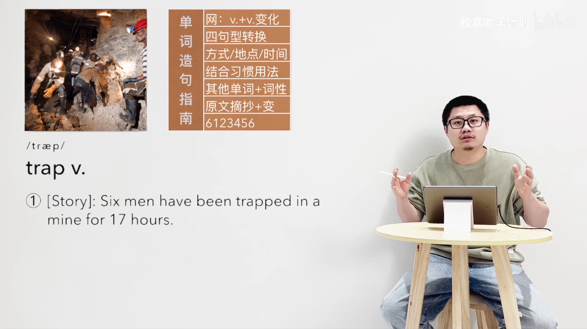

文字识别：单词造句指南 / 网：v.+v.变化 / 四句型转换 / 方式/地点/时间 / 结合习惯用法 / 其他单词+词性 / 原文摘抄+变 / 6123456 / /træep/ / trap V. / ① [Story]: Six men have been trapped in a / mine for 17 hours.

## 00:02:00–00:02:30

好，从原文摘抄出来这样一个比较不错的句子之后呢，我们就去可以进行一些四句型的转换。在这儿我只多提一个叫做 how long， how long 我们用的没有那么多嘛。 how long 一般指的是对整个时间长度，比如说 for seventy hours 去去进行一个提问，它一般不是用 when 啊，这个地方要注意一下。好，接下来呢，咱们照葫芦画瓢，我们做一下这个就是动词的变化。原文给我们的是一

### 画面 00:02:01

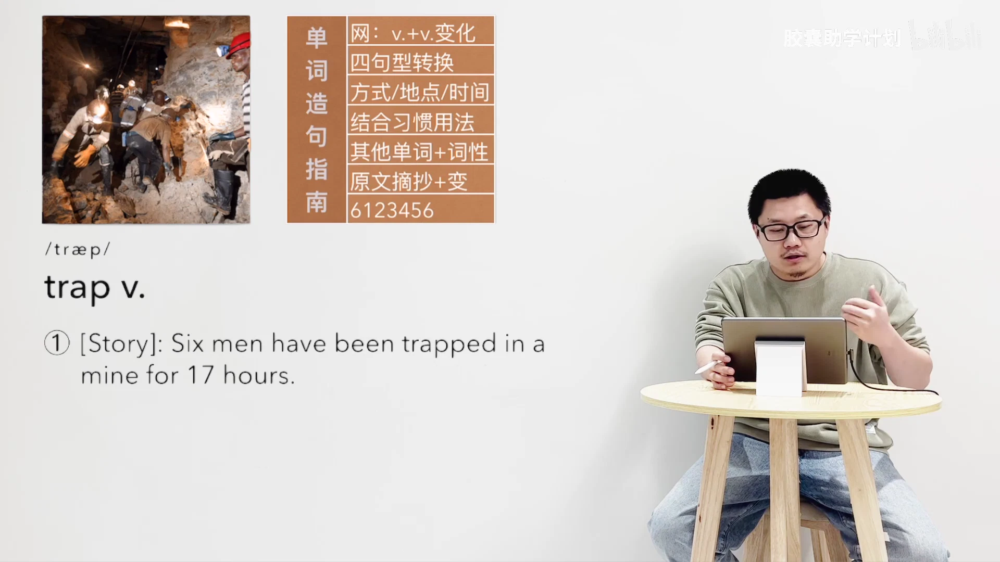

文字识别：单词造句指南 / 网：v.+v.变化 / 四句型转换 / 方式/地点/时间 / 结合习惯用法 / 其他单词+词性 / 原文摘抄+变 / 6123456 / /træep/ / trap V. / ① [Story]: Six men have been trapped in a / mine for 17 hours.

### 画面 00:02:05

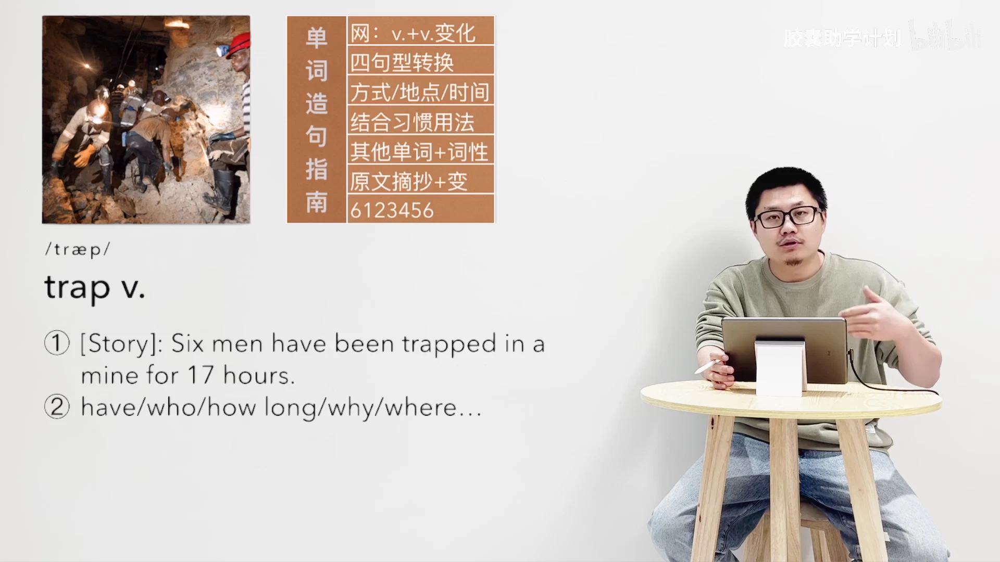

文字识别：单词造句指南 / 网：v.+v.变化 / 四句型转换 / 方式/地点/时间 / 结合习惯用法 / 其他单词+词性 / 原文摘抄+变 / 6123456 / /træep/ / trap V. / ① [Story]: Six men have been trapped in a / mine for 17 hours. / ) have/who/how long/why/where...

### 画面 00:02:15

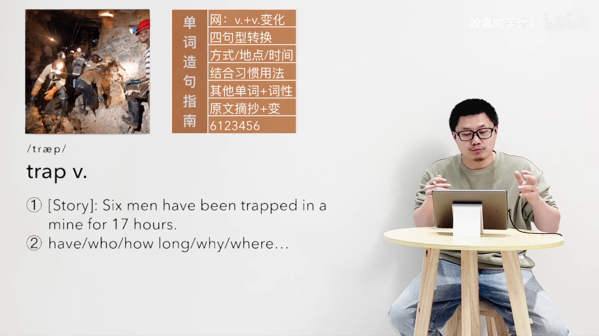

文字识别：单词造句指南 / 网：v.+v.变化 / 四句型转换 / 方式/地点/时间 / 结合习惯用法 / 其他单词+词性 / 原文摘抄+变 / 6123456 / /træep/ / trap V. / ① [Story]: Six men have been trapped in a / mine for 17 hours. / ) have/who/how long/why/where...

### 画面 00:02:24

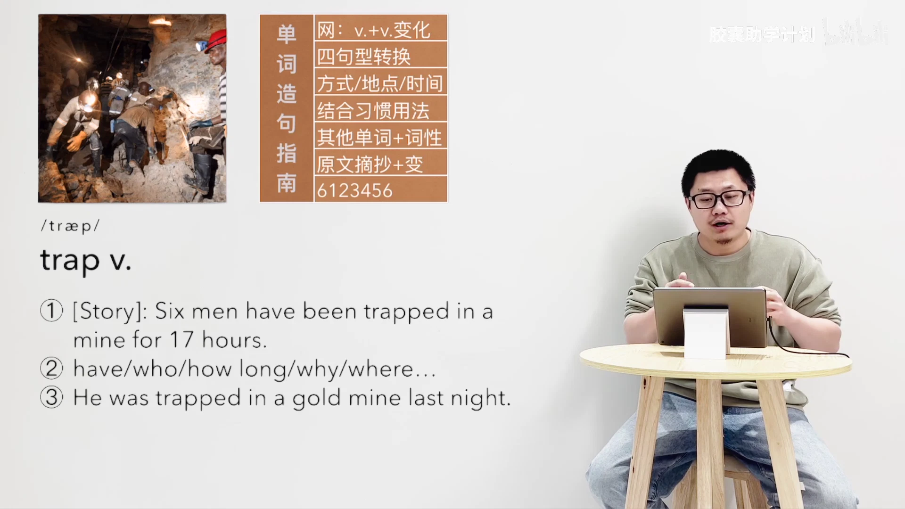

文字识别：单词造句指南 / 网：v.+v.变化 / 四句型转换 / 方式/地点/时间 / 结合习惯用法 / 其他单词+词性 / 原文摘抄+变 / 6123456 / /træep/ / trap V. / ① [Story]: Six men have been trapped in a / mine for 17 hours. / have/who/how long/why/where... / ) He was trapped in a gold mine last night.

### 画面 00:02:27

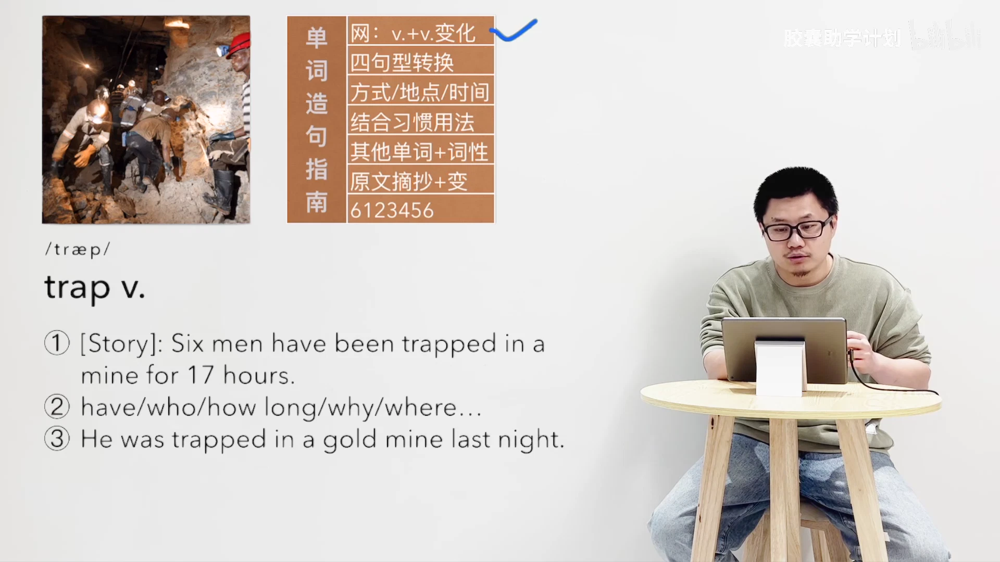

文字识别：单词造句指南 / 网：v.+v.变化 / 四句型转换 / 方式/地点/时间 / 结合习惯用法 / 其他单词+词性 / 原文摘抄+变 / 6123456 / /træep/ / trap V. / ① [Story]: Six men have been trapped in a / mine for 17 hours. / have/who/how long/why/where... / ) He was trapped in a gold mine last night.

## 00:02:30–00:03:00

个现在完成时的被动，我给它变成一般过去时，我只换一下动词。比如说 he was trapped in a gold mine，那你随着时间就要去改变，叫 last night，他昨晚上被困到了一个金矿当中，对吧？好，同理，你可以去把它做四进行转换。那这是一般过去时的被动啊。 Continue，那你看这个地方说 I felt trapped in a place that wasn't my home，说我感觉好像就被困在了

### 画面 00:02:33

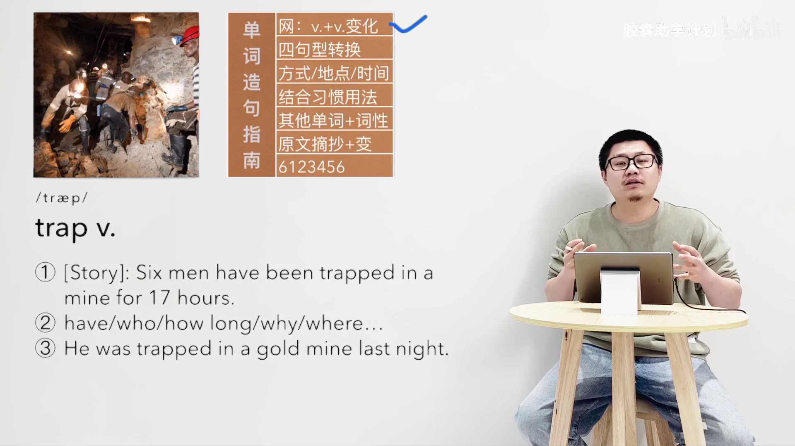

文字识别：单词造句指南 / 网：v.+v.变化 / 四句型转换 / 方式/地点/时间 / 结合习惯用法 / 其他单词+词性 / 原文摘抄+变 / 6123456 / /træep/ / trap V. / ① [Story]: Six men have been trapped in a / mine for 17 hours. / have/who/how long/why/where... / ) He was trapped in a gold mine last night.

### 画面 00:02:36

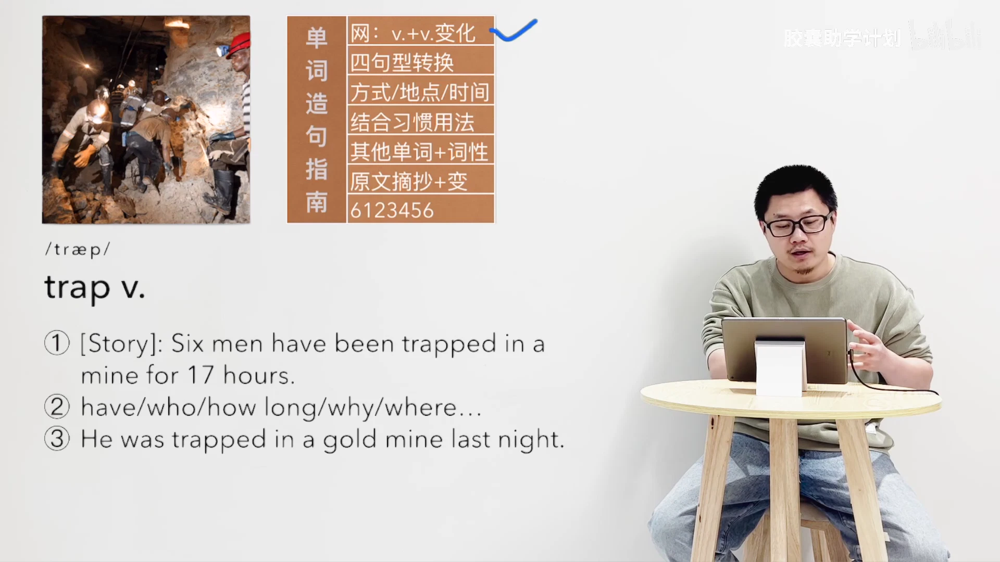

文字识别：单词造句指南 / 网：v.+v.变化 / 四句型转换 / 方式/地点/时间 / 结合习惯用法 / 其他单词+词性 / 原文摘抄+变 / 6123456 / /træep/ / trap V. / ① [Story]: Six men have been trapped in a / mine for 17 hours. / have/who/how long/why/where... / ) He was trapped in a gold mine last night.

### 画面 00:02:42

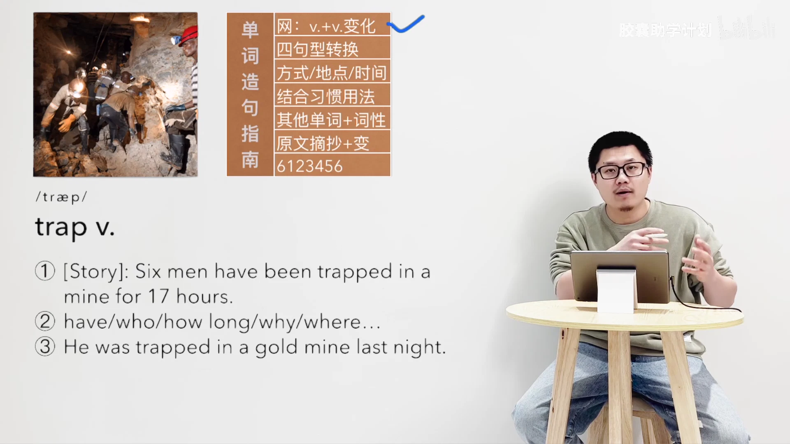

文字识别：单词造句指南 / 网：v.+v.变化 / 四句型转换 / 方式/地点/时间 / 结合习惯用法 / 其他单词+词性 / 原文摘抄+变 / 6123456 / /traæep/ / trap V. / ① [Story]: Six men have been trapped in a / mine for 17 hours. / have/who/how long/why/where... / ) He was trapped in a gold mine last night.

### 画面 00:02:45

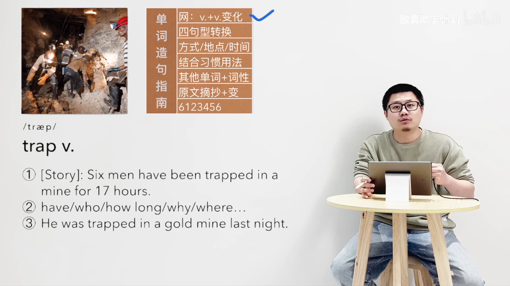

文字识别：单词造句指南 / 网：v.+v.变化 / 四句型转换 / 方式/地点/时间 / 结合习惯用法 / 其他单词+词性 / 原文摘抄+变 / 6123456 / /træep/ / trap V. / ① [Story]: Six men have been trapped in a / mine for 17 hours. / have/who/how long/why/where... / ) He was trapped in a gold mine last night.

### 画面 00:02:48

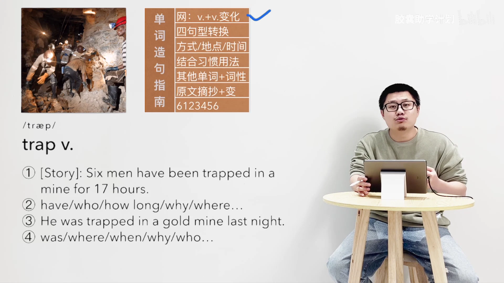

文字识别：单词造句指南 / 网：v.+v.变化 / 学计划 / 四句型转换 / 方式/地点/时间 / 结合习惯用法 / 其他单词+词性 / 原文摘抄+变 / 6123456 / /træep/ / trap V. / ① [Story]: Six men have been trapped in a / mine for 17 hours. / have/who/how long/why/where... / He was trapped in a gold mine last night. / was/where/when/why/who...

### 画面 00:02:50

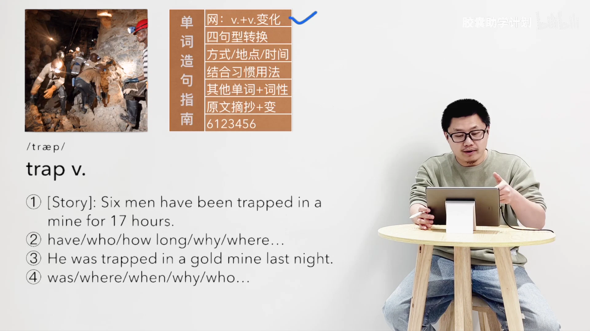

文字识别：单词造句指南 / 网：v.+v.变化 / 四句型转换 / 方式/地点/时间 / 结合习惯用法 / 其他单词+词性 / 原文摘抄+变 / 6123456 / /træep/ / trap V. / ① [Story]: Six men have been trapped in a / mine for 17 hours. / have/who/how long/why/where... /  He was trapped in a gold mine last night. / was/where/when/why/who...

### 画面 00:02:53

文字识别：单词造句指南 / 网：v.+v.变化 / 四句型转换 / 方式/地点/时间 / 结合习惯用法 / 其他单词+词性 / 原文摘抄+变 / 6123456 / /traæep/ / trap V. / ① [Story]: Six men have been trapped in a / mine for 17 hours. / have/who/how long/why/where... / He was trapped in a gold mine last night. / was/where/when/why/who... /  I felt trapped in a place / 5 / that wasn't my home.

### 画面 00:02:55

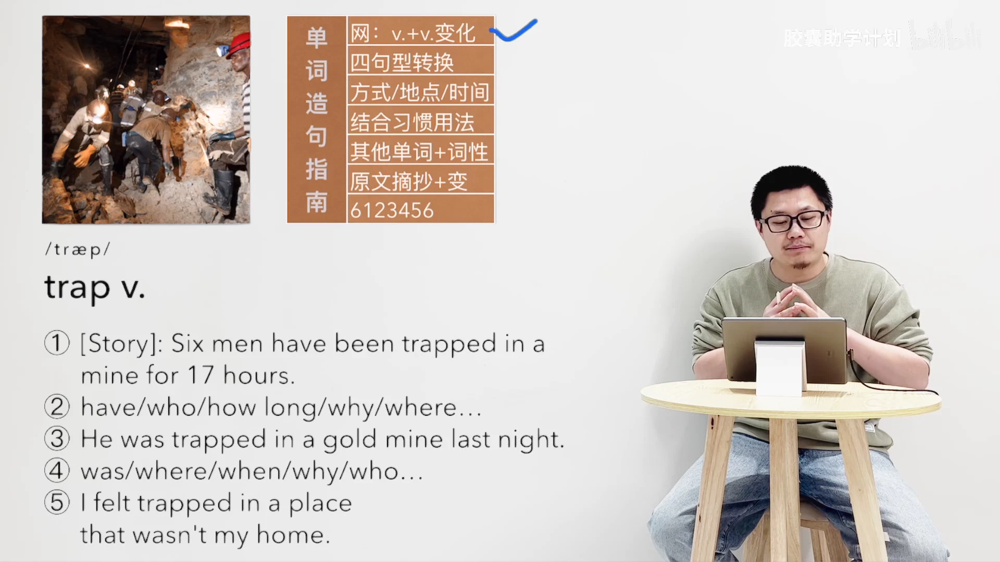

文字识别：单词造句指南 / 网：v.+v.变化 / 四句型转换 / 方式/地点/时间 / 结合习惯用法 / 其他单词+词性 / 原文摘抄+变 / 6123456 / /træp/ / trap V. / ① [Story]: Six men have been trapped in a / mine for 17 hours. / have/who/how long/why/where... / He was trapped in a gold mine last night. / was/where/when/why/who... / ) I felt trapped in a place / 5) / that wasn't my home.

## 00:03:00–00:03:30

一个不是我家的地方，就我这种感受是什么呢？如果我们把它翻译成汉语，就是我感觉我并不属于这里，对吧？OK。下一个单词读一下，叫 surface， surface， surface。我们有地表的意思，也有表面的意思啊。你看这个就是 the surface of my table，是吧？我是这个桌子的表面，也叫 surface。OK。好，我们现在造一个句子。Most of the Earth's surface is covered by sea。说这个

### 画面 00:03:00

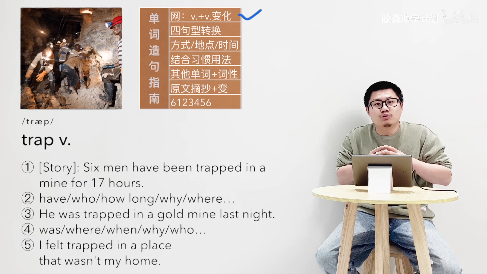

文字识别：单词造句指南 / 网：v.+v.变化 / 四句型转换 / 方式/地点/时间 / 结合习惯用法 / 其他单词+词性 / 原文摘抄+变 / 6123456 / /træep/ / trap V. / ① [Story]: Six men have been trapped in a / mine for 17 hours. / have/who/how long/why/where... /  He was trapped in a gold mine last night. / 3 / was/where/when/why/who... / ⑤ I felt trapped in a place / 5 / that wasn't my home.

### 画面 00:03:08

文字识别：单词造句指南 / 网：v.+v.变化 / 辜助字计划 / 四句型转换 / 方式/地点/时间 / 结合习惯用法 / 其他单词+词性 / 原文摘抄+变 / 6123456 / / 's3 : fI s / / surface n.

### 画面 00:03:10

文字识别：单词造句指南 / 网：v.+v.变化 / 囊助子计划 / 四句型转换 / 方式/地点/时间 / 结合习惯用法 / 其他单词+词性 / 原文摘抄+变 / 6123456 / / ' s 3 i f I s / / surface n.

### 画面 00:03:15

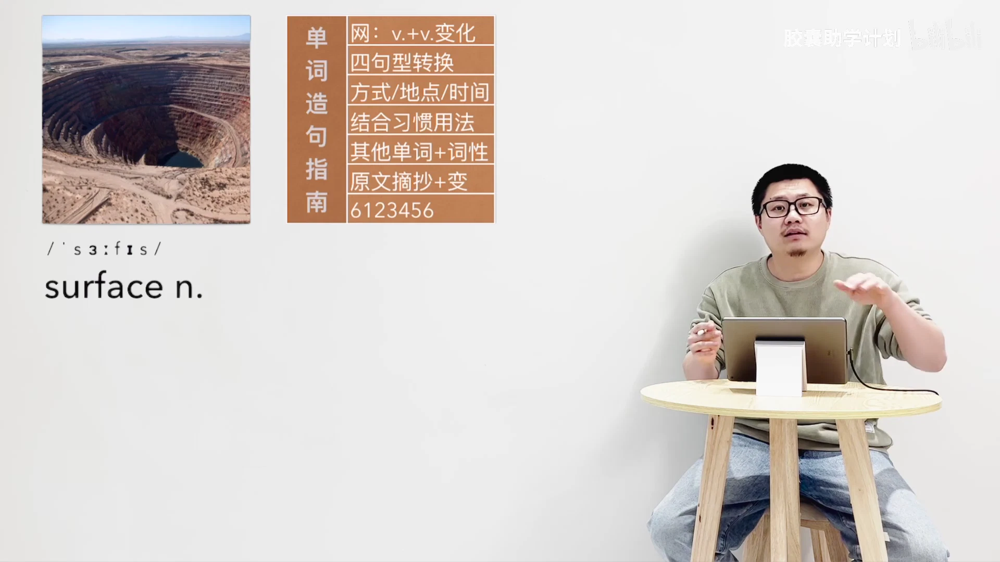

文字识别：单词造句指南 / 网：v.+v.变化 / 囊助子计划 / 四句型转换 / 方式/地点/时间 / 结合习惯用法 / 其他单词+词性 / 原文摘抄+变 / 6123456 / / ' s 3 :f I s / / surface n.

### 画面 00:03:17

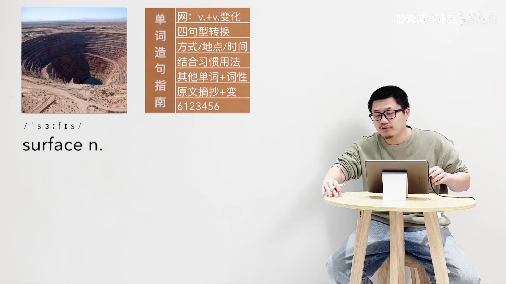

文字识别：单词造句指南 / 网：v.+v.变化 / 嘉助字计划 / 四句型转换 / 方式/地点/时间 / 结合习惯用法 / 其他单词+词性 / 原文摘抄+变 / 6123456 / / ' s 3 :f I s / / surface n.

### 画面 00:03:20

文字识别：单词造句指南 / 网：v.+v.变化 / 囊助字计划區 / 四句型转换 / 方式/地点/时间 / 结合习惯用法 / 其他单词+词性 / 原文摘抄+变 / 6123456 / / ' s 3 :f I s / / surface n.

### 画面 00:03:22

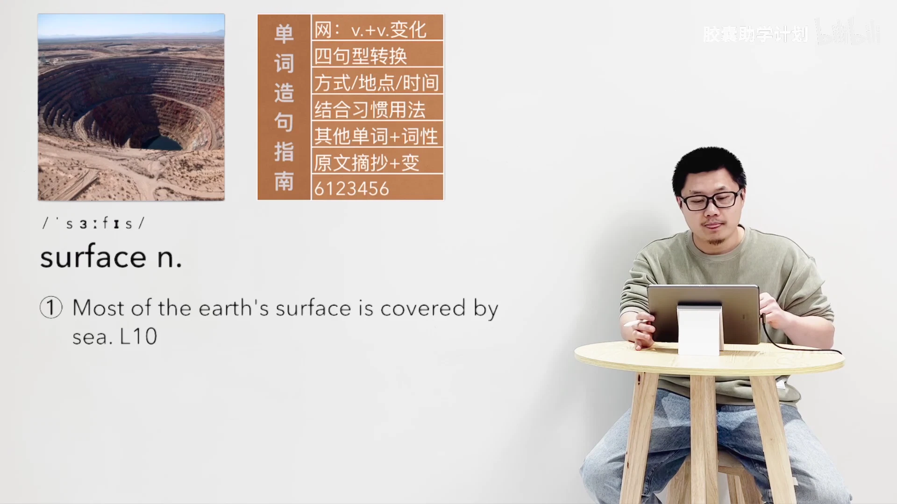

文字识别：单词造句指南 / 网：v.+v.变化 / 四句型转换 / 方式/地点/时间 / 结合习惯用法 / 其他单词+词性 / 原文摘抄+变 / 6123456 / / ' s 3 : f Ⅰ s / / surface n. / ① Most of the earth's surface is covered by / sea.L10

### 画面 00:03:25

文字识别：单词造句指南 / 网：v.+v.变化 / 四句型转换 / 方式/地点/时间 / 结合习惯用法 / 其他单词+词性 / 原文摘抄+变 / 6123456 / / ^ s 3 : f Ⅰ s / / surface n. / ① Most of the earth's surface is covered by / sea.L10

## 00:03:30–00:04:00

地球上地球的表面的大部分都被什么覆盖着呢？被海洋覆盖着。Okay, continue下一个。说On the surface, she kept on helping him.在地表上，她一直在帮他。难道是飞到天上或者跑到地底下就不帮他了吗？不是，这个就是我们说在表面上怎么怎么样，表面功夫啊，跟汉语真的还真是挺像的，是吧？哎，在表面上，她是持续不断的在帮他。潜意思是

### 画面 00:03:33

文字识别：单词造句指南 / 网：v.+v.变化 / 四句型转换 / 方式/地点/时间 / 结合习惯用法 / 其他单词+词性 / 原文摘抄+变 / 6123456 / / ' s 3 :f I s / / surface n. / D Most of the earth's surface is covered by / 1） / sea.L10

### 画面 00:03:37

文字识别：单词造句指南 / 网：v.+v.变化 / 四句型转换 / 方式/地点/时间 / 结合习惯用法 / 其他单词+词性 / 原文摘抄+变 / 6123456 / / ' s 3 :f I s / / surface n. / ① Most of the earth's surface is covered by / sea.L10 / On the surface, she kept on helping him. / L78

### 画面 00:03:41

文字识别：单词造句指南 / 网：v.+v.变化 / 四句型转换 / 方式/地点/时间 / 结合习惯用法 / 其他单词+词性 / 原文摘抄+变 / 6123456 / / ' s 3 :f I s / / surface n. / ① Most of the earth's surface is covered by / sea.L10 / On the surface, she kept on helping him. / L78

### 画面 00:03:53

文字识别：单词造句指南 / 网：v.+v.变化 / 四句型转换 / 方式/地点/时间 / 结合习惯用法 / 其他单词+词性 / 原文摘抄+变 / 6123456 / / s 3 :f I s / / surface n. / ① Most of the earth's surface is covered by / sea.L10 / On the surface, she kept on helping him. / L78

### 画面 00:03:55

文字识别：单词造句指南 / 网：v.+v.变化 / 学诗划 / 四句型转换 / 方式/地点/时间 / 结合习惯用法 / 其他单词+词性 / 原文摘抄+变 / 6123456 / / ' s 3 :f I s / / surface n. / ① Most of the earth's surface is covered by / sea.L10 / On the surface, she kept on helping him. / L78

## 00:04:00–00:04:30

什么呢？就并没帮，对吧？Next one，说 he followed his father's footsteps on the surface，表面上他一直追随着他父亲的步伐，但实际上，哎，私底下，对吧？哎，就不公开的，实际上他一直有自己想做的事情。OK，好，再读一遍这个单词 surface，very good。Next one，看一下这个音标啊，explosive，注意它是一个名词，是炸弹的意思，explosive，啊，炸弹是一个名

### 画面 00:04:02

文字识别：单词造句指南 / 网：v.+v.变化 / 四句型转换 / 方式/地点/时间 / 结合习惯用法 / 其他单词+词性 / 原文摘抄+变 / 6123456 / / ^ s 3 : f Ⅰ s / / surface n. / ① Most of the earth's surface is covered by / sea.L10 / ) On the surface, she kept on helping him. / 2） / L78 / He followed his father's footsteps on the / surface. L72

### 画面 00:04:05

文字识别：单词造句指南 / 网：v.+v.变化 / 四句型转换 / 方式/地点/时间 / 结合习惯用法 / 其他单词+词性 / 原文摘抄+变 / 6123456 / / ^ s 3 : f Ⅰ s / / surface n. / ① Most of the earth's surface is covered by / sea.L10 / ) On the surface, she kept on helping him. / 2 / L78 / He followed his father's footsteps on the / surface.L72

### 画面 00:04:14

文字识别：单词造句指南 / 网：v.+v.变化 / 四句型转换 / 方式/地点/时间 / 结合习惯用法 / 其他单词+词性 / 原文摘抄+变 / 6123456 / / ^ s 3 : f I s / / surface n. / ① Most of the earth's surface is covered by / sea.L10 / ) On the surface, she kept on helping him. / 2) / L78 / He followed his father's footsteps on the / surface.L72

### 画面 00:04:16

文字识别：单词造句指南 / 网：v.+v.变化 / 四句型转换 / 方式/地点/时间 / 结合习惯用法 / 其他单词+词性 / 原文摘抄+变 / 6123456 / / _ s 3 : f Ⅰ s / / surface n. / ① Most of the earth's surface is covered by / sea.L10 / ) On the surface, she kept on helping him. / 2） / L78 / He followed his father's footsteps on the / surface.L72

### 画面 00:04:20

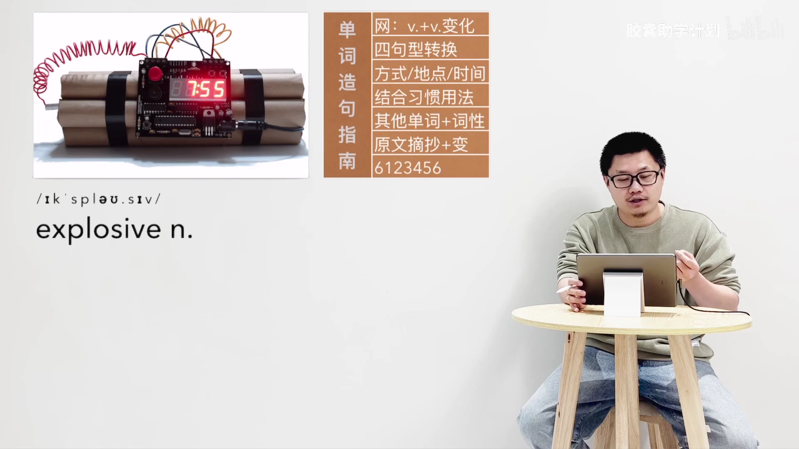

文字识别：单词造句指南 / 网：v.+v.变化 / 囊助字计划 / 四句型转换 / 方式/地点/时间 / 7.:55 / 结合习惯用法 / 其他单词+词性 / 原文摘抄+变 / 6123456 / /ik'splau.siv/ / explosive n.

### 画面 00:04:25

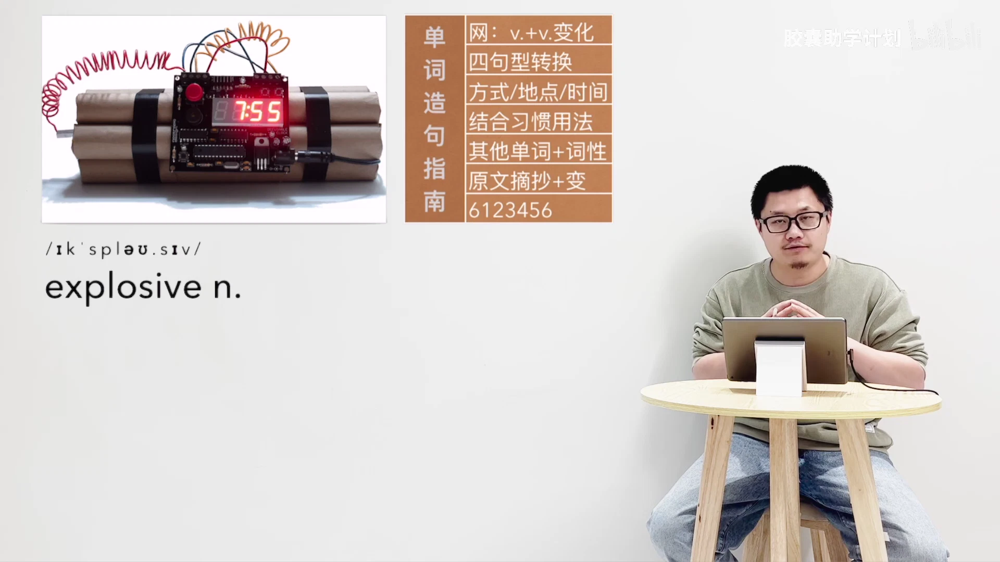

文字识别：单词造句指南 / 网：v.+v.变化 / 辜助字计划 / 四句型转换 / 方式/地点/时间 / 7.:55 / 结合习惯用法 / 其他单词+词性 / 原文摘抄+变 / 6123456 / /ik'splau.siv/ / explosive n.

## 00:04:30–00:05:00

词。那拿它想去造句呢？你要去判断一下六一二三四五六最常出现的一和三吧。然后我还要找动词，对吧？比如说我们造了这样一个句子，叫做These explosives，这些炸弹怎么样呢？Are used to do something，被使用来去做某件事情，这是我们之前学过的习惯用法。干什么呢？Destroy the building，对吧？叫做These explosives are used to destroy the building. Very good.啊，说这些

### 画面 00:04:31

文字识别：单词造句指南 / 网：v.+v.变化 / 辜助字计划 / 四句型转换 / 方式/地点/时间 / 7:55 / 结合习惯用法 / 其他单词+词性 / 原文摘抄+变 / 6123456 / /ik'splau.siv/ / explosive n. / These explosives are used to destroy the / building. L55

### 画面 00:04:48

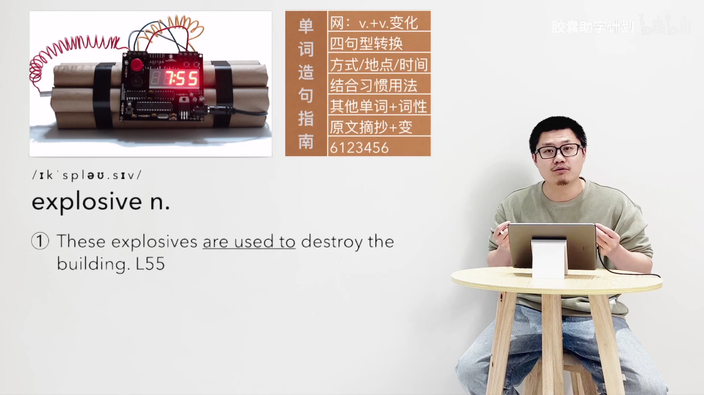

文字识别：单词造句指南 / 网：v.+v.变化 / 四句型转换 / 方式/地点/时间 / 7.55 / 结合习惯用法 / 其他单词+词性 / 原文摘抄+变 / 6123456 / /ik'splau.siv/ / explosive n. / These explosives are used to destroy the / building. L55

### 画面 00:04:53

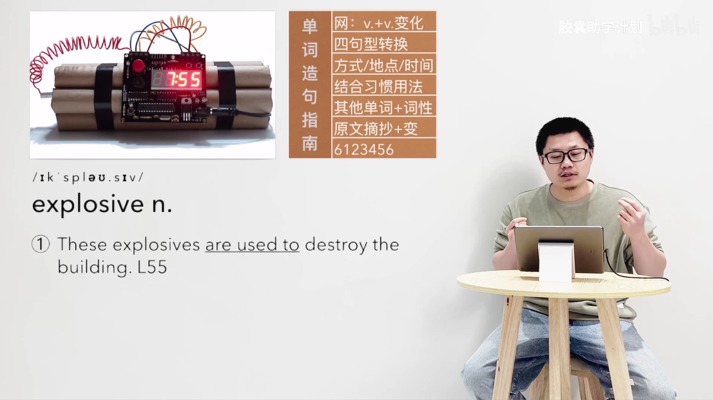

文字识别：单词造句指南 / 网：v.+v.变化 / 喜助子计划 / 四句型转换 / 方式/地点/时间 / 7.55 / 结合习惯用法 / 其他单词+词性 / 原文摘抄+变 / 6123456 / /Ik'splau.siv/ / explosive n. / These explosives are used to destroy the / building. L55

## 00:05:00–00:05:30

炸药被使用来去哎损毁啊，去呃这个毁掉这个建筑物，对吧？破坏这个建筑物啊，把它炸掉。Next one, the young man is eager to see the explosives.说这个年轻人啊，很渴望看到这个炸药，对吧？还有他喜欢这个玩意儿，他想看一下。Next one, they are trying to remove the explosives from the bridge.好, remove something from some place,对吧？这是我们在这个狗

### 画面 00:05:06

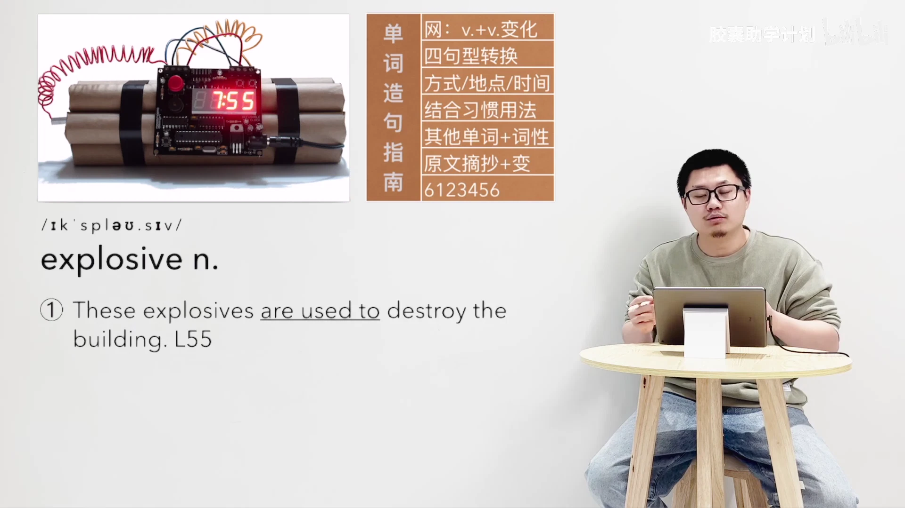

文字识别：单词造句指南 / 网：v.+v.变化 / 四句型转换 / 方式/地点/时间 / 7:55 / 结合习惯用法 / 其他单词+词性 / 原文摘抄+变 / 6123456 / /Ik'splau.siv/ / explosive n. / These explosives are used to destroy the / building. L55

### 画面 00:05:10

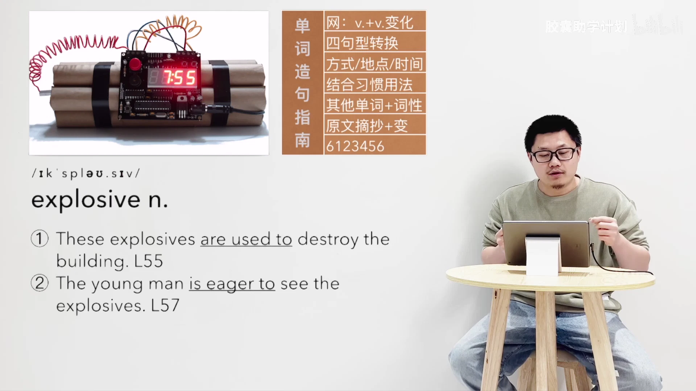

文字识别：单词造句指南 / 网：v.+v.变化 / 子计划 / 四句型转换 / 方式/地点/时间 / 7:55 / 结合习惯用法 / 其他单词+词性 / 原文摘抄+变 / 6123456 / /Ik'splau.siv/ / explosive n. /  These explosives are used to destroy the / building. L55 / The young man is eager to see the / explosives. L57

### 画面 00:05:19

文字识别：单词造句指南 / 网：v.+v.变化 / 四句型转换 / 方式/地点/时间 / 7:55 / 结合习惯用法 / 其他单词+词性 / 原文摘抄+变 / 6123456 / /Ik'splau.siv/ / explosive n. / ① These explosives are used to destroy the / building. L55 / The young man is eager to see the / explosives. L57 / They are trying to remove the explosives / from the bridge. L59

### 画面 00:05:21

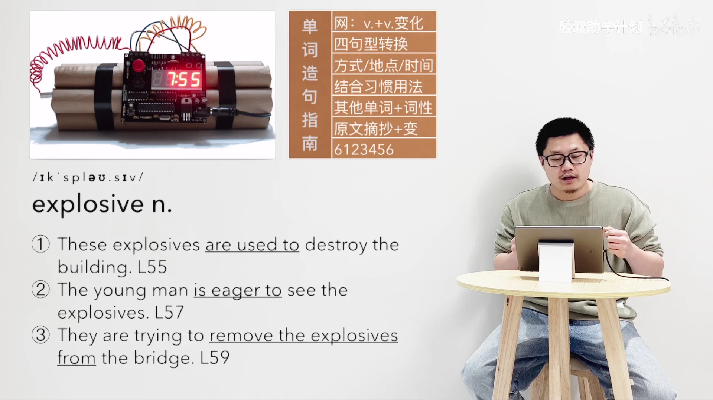

文字识别：单词造句指南 / 网：v.+v.变化 / 四句型转换 / 方式/地点/时间 / 7.:55 / 结合习惯用法 / 其他单词+词性 / 原文摘抄+变 / 6123456 / /Ik'splau.siv/ / explosive n. / ① These explosives are used to destroy the / building. L55 / The young man is eager to see the / explosives. L57 / They are trying to remove the explosives / from the bridge. L59

### 画面 00:05:25

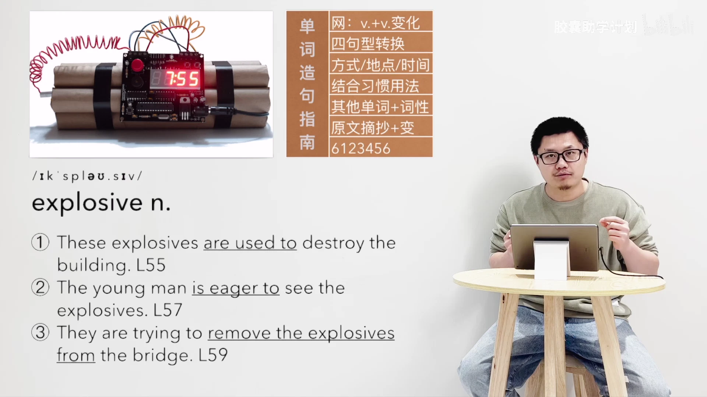

文字识别：单词造句指南 / 网：v.+v.变化 / 四句型转换 / 方式/地点/时间 / 7.:55 / 结合习惯用法 / 其他单词+词性 / 原文摘抄+变 / 6123456 / /Ik'splau.siv/ / explosive n. / ① These explosives are used to destroy the / building. L55 / The young man is eager to see the / explosives. L57 / They are trying to remove the explosives / from the bridge. L59

## 00:05:30–00:06:00

内课啊学的，说他们正在尝试把炸药从桥上移除掉。OK， very good，再跟我读一遍，explosive， very good。 Next one，看一下音标，vibration， vibration啊，连起来读，vibration， vibration就是震动的意思啊，震动，vibration。好，那包括其实，在这个地方我们要复习一个很小的知识点，就是如果你以后见到vibrate，啊，v i b r a t

### 画面 00:05:32

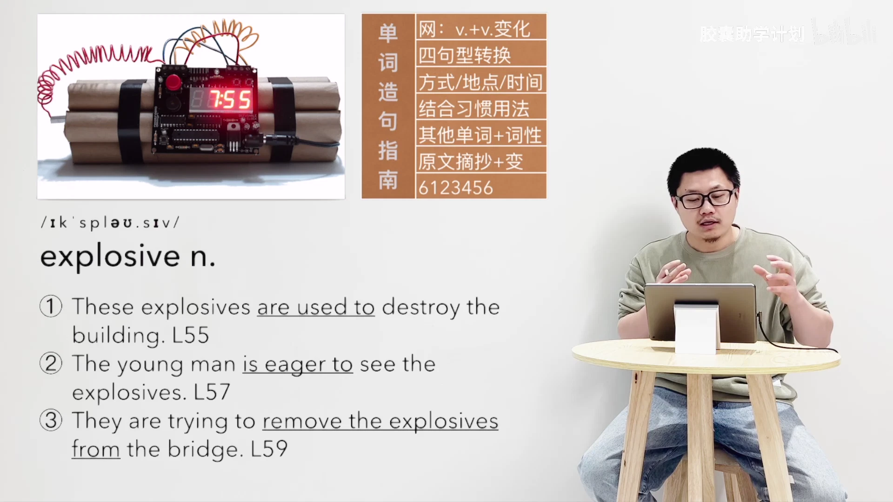

文字识别：单词造句指南 / 网：v.+v.变化 / 四句型转换 / 方式/地点/时间 / 7.:55 / 结合习惯用法 / 其他单词+词性 / 原文摘抄+变 / 6123456 / /Ik'splau.siv/ / explosive n. / ① These explosives are used to destroy the / building. L55 / The young man is eager to see the / explosives. L57 / They are trying to remove the explosives / from the bridge. L59

### 画面 00:05:35

文字识别：单词造句指南 / 网：v.+v.变化 / 四句型转换 / 方式/地点/时间 / 7:5S / 结合习惯用法 / 其他单词+词性 / 原文摘抄+变 / 6123456 / /Ik'splau.siv/ / explosive n. / ① These explosives are used to destroy the / building. L55 / The young man is eager to see the / explosives. L57 / They are trying to remove the explosives / from the bridge. L59

### 画面 00:05:39

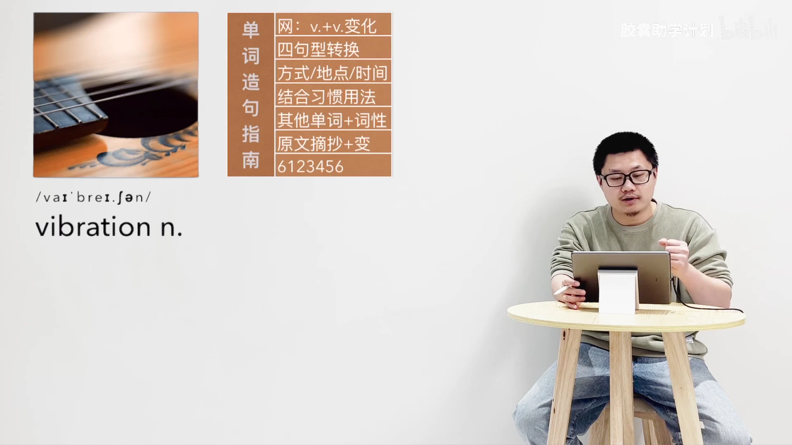

文字识别：单词造句指南 / 网：v.+v.变化 / 囊助字计划園 / 四句型转换 / 方式/地点/时间 / 结合习惯用法 / 其他单词+词性 / 原文摘抄+变 / 6123456 / /var'brer.Jan/ / vibration n.

### 画面 00:05:41

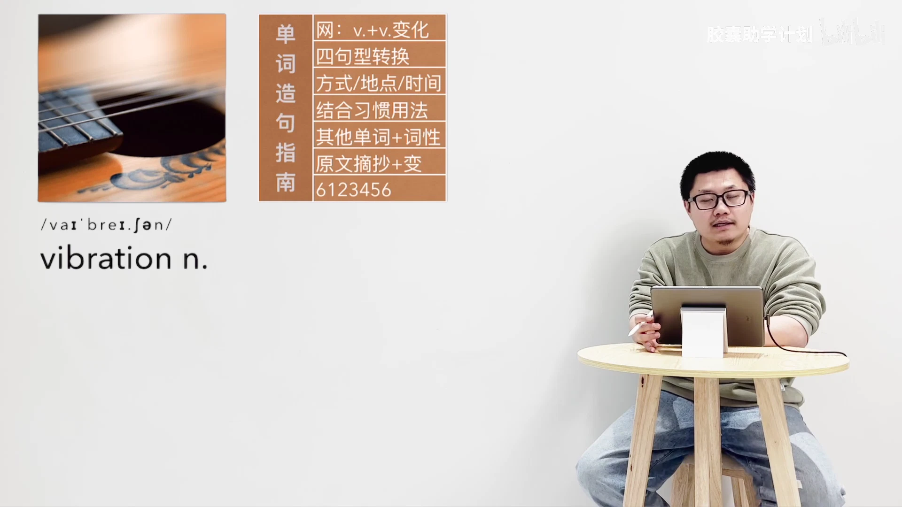

文字识别：单词造句指南 / 网：v.+v.变化 / 囊助学计划 / 四句型转换 / 方式/地点/时间 / 结合习惯用法 / 其他单词+词性 / 原文摘抄+变 / 6123456 / /var'brei.Jan/ / vibration n.

### 画面 00:05:45

文字识别：单词造句指南 / 网：v.+v.变化 / 囊助学计划 / 四句型转换 / 方式/地点/时间 / 结合习惯用法 / 其他单词+词性 / 原文摘抄+变 / 6123456 / /var'brei.Jan/ / vibration n.

### 画面 00:05:51

文字识别：单词造句指南 / 网：v.+v.变化 / 四句型转换 / 方式/地点/时间 / 结合习惯用法 / 其他单词+词性 / 原文摘抄+变 / 6123456 / /var'brei.San/ / vibration n. /  I was woken up by the vibration of the / windows last night. L27

### 画面 00:05:55

文字识别：单词造句指南 / 网：v.+v.变化 / 学计划 / 四句型转换 / 方式/地点/时间 / 结合习惯用法 / 其他单词+词性 / 原文摘抄+变 / 6123456 / /var'brei.Jan/ / vibration n. /  I was woken up by the vibration of the / windows last night. L27

### 画面 00:05:57

文字识别：单词造句指南 / 网：v.+v.变化 / 字计划 / 四句型转换 / 方式/地点/时间 / 结合习惯用法 / 其他单词+词性 / 原文摘抄+变 / 6123456 / /var'brei.Jan/ / vibration n. /  I was woken up by the vibration of the / windows last night. L27

## 00:06:00–00:06:30

那我猜你是不是能感大概能感觉出来，它应该跟 vibration 是有联系的，并且是 vibration 的动词，还是比较震动，对吧？ Vibrate. 以 t i n 结尾的很多单词都是名词，对吧？名词后缀啊。来，我们看句子啊，说 I was woken up by the vibration of the windows last night. 好了啊，一般过去时，然后再来一个 wake up. 四句型转换不多说，您自己暂停屏幕去做。 Next one, if I turn it

### 画面 00:06:00

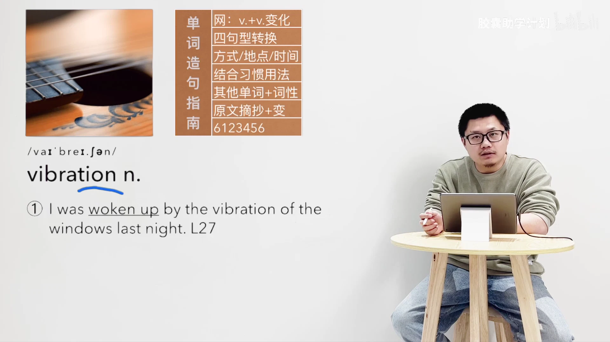

文字识别：单词造句指南 / 网：v.+v.变化 / 喜助字计划 / 四句型转换 / 方式/地点/时间 / 结合习惯用法 / 其他单词+词性 / 原文摘抄+变 / 6123456 / /var'brei.Jan/ / vibration n. / D I was woken up by the vibration of the / windows last night. L27

### 画面 00:06:05

文字识别：单词造句指南 / 网：v.+v.变化 / 辜助字计划 / 四句型转换 / 方式/地点/时间 / 结合习惯用法 / 其他单词+词性 / 原文摘抄+变 / 6123456 / /var'brei.Jan/ / vibration n. /  I was woken up by the vibration of the / windows last night. L27

### 画面 00:06:11

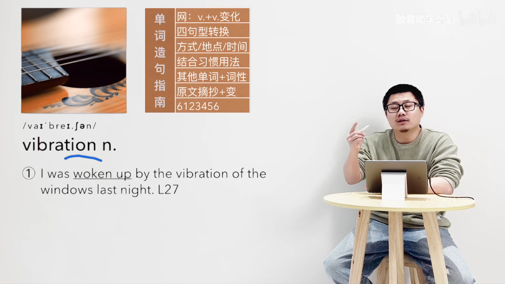

文字识别：单词造句指南 / 网：v.+v.变化 / 四句型转换 / 方式/地点/时间 / 结合习惯用法 / 其他单词+词性 / 原文摘抄+变 / 6123456 / /var'brei.San/ / vibration n. /  I was woken up by the vibration of the / windows last night. L27

### 画面 00:06:15

文字识别：单词造句指南 / 网：v.+v.变化 / 学计划 / 四句型转换 / 方式/地点/时间 / 结合习惯用法 / 其他单词+词性 / 原文摘抄+变 / 6123456 / /var'brei.Jan/ / vibration n. /  I was woken up by the vibration of the / windows last night. L27

### 画面 00:06:24

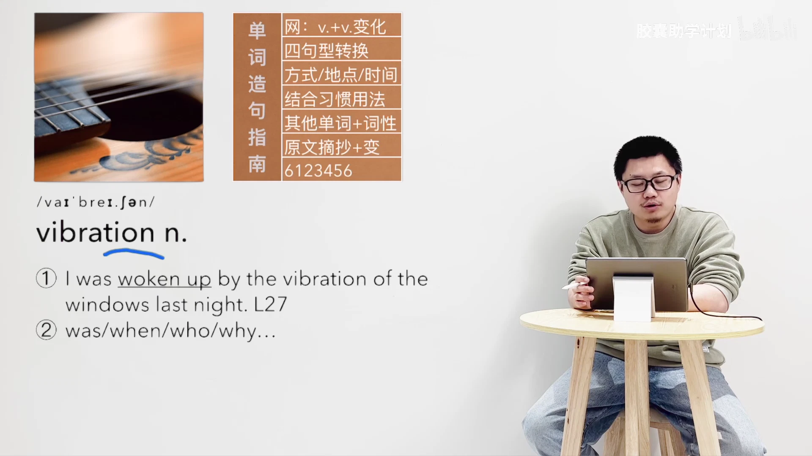

文字识别：单词造句指南 / 网：v.+v.变化 / 嚢助学计划 / 四句型转换 / 方式/地点/时间 / 结合习惯用法 / 其他单词+词性 / 原文摘抄+变 / 6123456 / /var'brei.Jan/ / vibration n. / ① I was woken up by the vibration of the / windows last night. L27 / was/when/who/why..

### 画面 00:06:26

文字识别：单词造句指南 / 网：v.+v.变化 / 四句型转换 / 方式/地点/时间 / 结合习惯用法 / 其他单词+词性 / 原文摘抄+变 / 6123456 / /var'brei.Jan/ / vibration n. / ① I was woken up by the vibration of the / windows last night. L27 / was/when/who/why... / ) If I turn it up, you can even feel the vibration / 3 / of music. L16

## 00:06:30–00:07:00

up,哎，首先 turn it up。如果不给上下文呢，大多数最常用的就是把它调高，对吧？那你看后边那半句话叫 you can even feel the vibration of music。你甚至能感受到这个音乐的震动，比如说拿个低音炮，能感觉咚咚，这个音，这个呃音波，对吧？哎，这个声音产生的这个波动啊，你甚至能感受到它。那儿一个，那这是咱们十六课学的，当然本课也是第四单元的第十六

### 画面 00:06:30

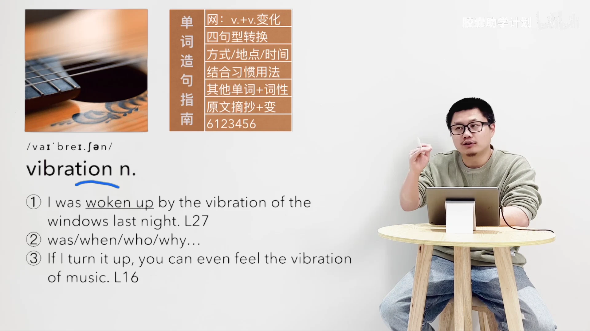

文字识别：单词造句指南 / 网：v.+v.变化 / 学计划 / 四句型转换 / 方式/地点/时间 / 结合习惯用法 / 其他单词+词性 / 原文摘抄+变 / 6123456 / /var'brei.San/ / vibration n. / ① I was woken up by the vibration of the / windows last night. L27 / was/when/who/why... / ) If I turn it up, you can even feel the vibration / 3 / of music. L16

### 画面 00:06:35

文字识别：单词造句指南 / 网：v.+v.变化 / 毒助学计划 / 四句型转换 / 方式/地点/时间 / 结合习惯用法 / 其他单词+词性 / 原文摘抄+变 / 6123456 / /var'brei.San/ / vibration n. / ① I was woken up by the vibration of the / windows last night. L27 / was/when/who/why... / ) If I turn it up, you can even feel the vibration / 3 / of music. L16

### 画面 00:06:46

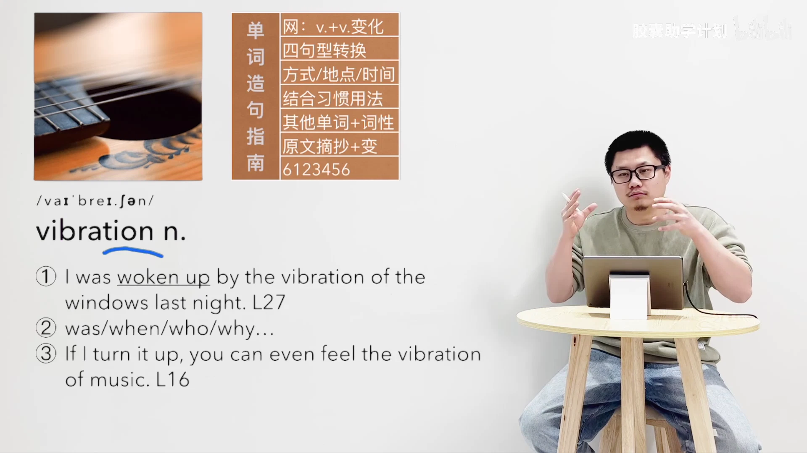

文字识别：单词造句指南 / 网：v.+v.变化 / 四句型转换 / 方式/地点/时间 / 结合习惯用法 / 其他单词+词性 / 原文摘抄+变 / 6123456 / /var'brei.Jan/ / vibration n. / ① I was woken up by the vibration of the / windows last night. L27 / was/when/who/why... / ) If I turn it up, you can even feel the vibration / 3 / of music. L16

### 画面 00:06:50

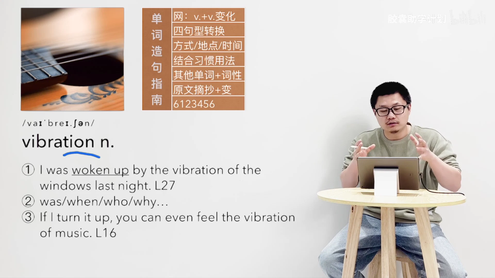

文字识别：单词造句指南 / 网：v.+v.变化 / 四句型转换 / 方式/地点/时间 / 结合习惯用法 / 其他单词+词性 / 原文摘抄+变 / 6123456 / /var'brei.Jan/ / vibration n. / ① I was woken up by the vibration of the / windows last night. L27 / was/when/who/why... / ) If I turn it up, you can even feel the vibration / 3 / of music. L16

## 00:07:00–00:07:30

课也是我们重点要复习的啊，十六四十六十四啊，这四课啊，这三课对吧？要重点复习的。Next one,说Some animals can feel vibrations in the sand.说有一些动物它能感受到vibration，能感受到震动。哪里的震动呢？In the sand，在沙子当中的这个震动。OK，然后同理，四句型转换不多说了啊。好，再跟我读一遍这个单词vibration.

### 画面 00:07:01

文字识别：单词造句指南 / 网：v.+v.变化 / 四句型转换 / 方式/地点/时间 / 结合习惯用法 / 其他单词+词性 / 原文摘抄+变 / 6123456 / /var'brei.Jan/ / vibration n. / ① I was woken up by the vibration of the / windows last night. L27 / was/when/who/why... / ) If I turn it up, you can even feel the vibration / 3 / of music. L16

### 画面 00:07:05

文字识别：单词造句指南 / 网：v.+v.变化 / 四句型转换 / 方式/地点/时间 / 结合习惯用法 / 其他单词+词性 / 原文摘抄+变 / 6123456 / /var'brei.Jan/ / vibration n. / ① I was woken up by the vibration of the / windows last night. L27 / was/when/who/why... / ) If I turn it up, you can even feel the vibration / 3 / of music. L16

### 画面 00:07:08

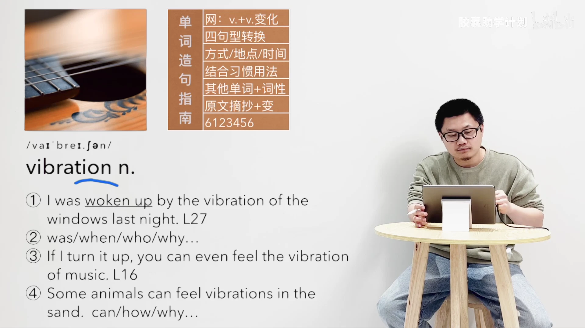

文字识别：单词造句指南 / 网：v.+v.变化 / 学计划 / 四句型转换 / 方式/地点/时间 / 结合习惯用法 / 其他单词+词性 / 原文摘抄+变 / 6123456 / /val'breI.San/ / vibration n. / ① I was woken up by the vibration of the / windows last night. L27 / was/when/who/why... / ③ If I turn it up, you can even feel the vibration / 3) / of music. L16 / ④ Some animals can feel vibrations in the / sand. can/how/why...

### 画面 00:07:10

文字识别：单词造句指南 / 网：v.+v.变化 / 臺助学计划 / 四句型转换 / 方式/地点/时间 / 结合习惯用法 / 其他单词+词性 / 原文摘抄+变 / 6123456 / /var'brei.San/ / vibration n. / ① I was woken up by the vibration of the / windows last night. L27 / was/when/who/why... / ③ If I turn it up, you can even feel the vibration / 3 / of music. L16 / ④ Some animals can feel vibrations in the / sand. can/how/why...

### 画面 00:07:18

文字识别：单词造句指南 / 网：v.+v.变化 / 四句型转换 / 方式/地点/时间 / 结合习惯用法 / 其他单词+词性 / 原文摘抄+变 / 6123456 / /var'brei.Jan/ / vibration n. / ① I was woken up by the vibration of the / windows last night. L27 / was/when/who/why... / ③ If I turn it up, you can even feel the vibration / 3 / of music. L16 / ④ Some animals can feel vibrations in the / sand. can/how/why...

### 画面 00:07:20

文字识别：单词造句指南 / 网：v.+v.变化 / 奏助学计划 / 四句型转换 / 方式/地点/时间 / 结合习惯用法 / 其他单词+词性 / 原文摘抄+变 / 6123456 / /var'brei.Jan/ / vibration n. / ① I was woken up by the vibration of the / windows last night. L27 / was/when/who/why... / ③ If I turn it up, you can even feel the vibration / of music. L16 / ④ Some animals can feel vibrations in the / sand. can/how/why...

### 画面 00:07:23

文字识别：单词造句指南 / 网：v.+v.变化 / 虞助字计划 / 四句型转换 / 方式/地点/时间 / 结合习惯用法 / 其他单词+词性 / 原文摘抄+变 / 6123456 / /val'brei.Jan/ / vibration n. / ① I was woken up by the vibration of the / windows last night. L27 / was/when/who/why... / ③ If I turn it up, you can even feel the vibration / 3 / of music. L16 / ④ Some animals can feel vibrations in the / sand. can/how/why...

### 画面 00:07:26

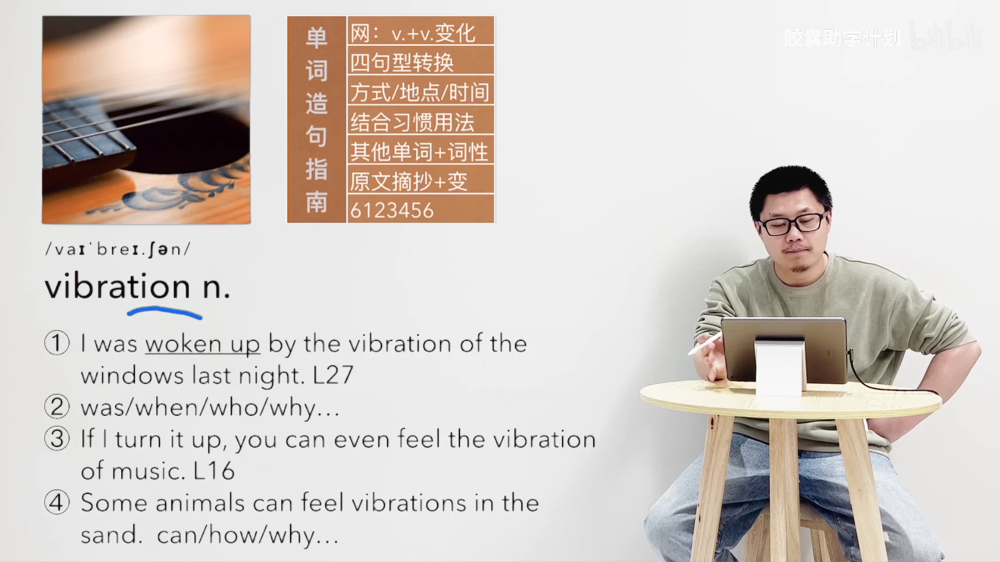

文字识别：单词造句指南 / 网：v.+v.变化 / 四句型转换 / 方式/地点/时间 / 结合习惯用法 / 其他单词+词性 / 原文摘抄+变 / 6123456 / /var'brei.Jan/ / vibration n. / ① I was woken up by the vibration of the / windows last night. L27 / was/when/who/why... / ③ If I turn it up, you can even feel the vibration / 3 / of music. L16 / ④ Some animals can feel vibrations in the / sand. can/how/why...

## 00:07:30–00:08:00

very good. Next one, 下一个单词叫 collapse, collapse, collapse 就是塌了啊，这个轰塌了、倒塌了都叫做 collapse。那注意，它这个单词很有意思，既可以当动词，又可以当名词。我们先看一个句子啊，The heavy rain caused the collapse of the roof. 好了，注意，首先 heavy rain 这两个经常放到一起，不是沉的雨，就是大雨啊，大雨的意思。说大雨

### 画面 00:07:30

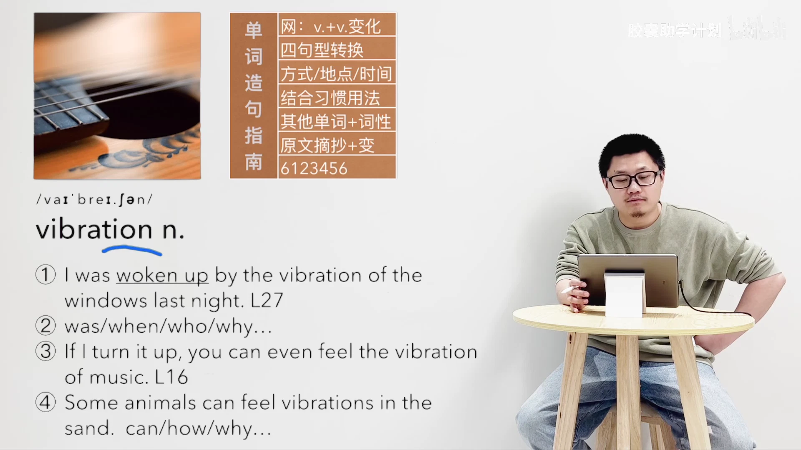

文字识别：单词造句指南 / 网：v.+v.变化 / 毒助学计划 / 四句型转换 / 方式/地点/时间 / 结合习惯用法 / 其他单词+词性 / 原文摘抄+变 / 6123456 / /var'brel.Jan/ / vibration n. / ① I was woken up by the vibration of the / windows last night. L27 / was/when/who/why... / ③ If I turn it up, you can even feel the vibration / 3 / of music. L16 / ④ Some animals can feel vibrations in the / sand. can/how/why...

### 画面 00:07:32

文字识别：单词造句指南 / 网：v.+v.变化 / 喜助字计划陽 / 四句型转换 / 方式/地点/时间 / 结合习惯用法 / 其他单词+词性 / 原文摘抄+变 / 6123456 / / k a' l æps / / collapse v. n.

### 画面 00:07:35

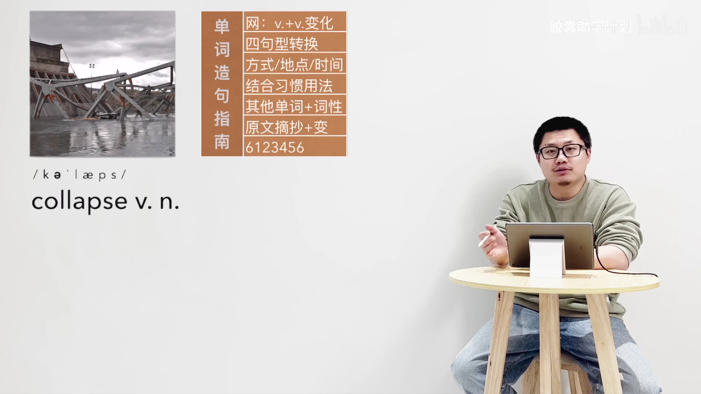

文字识别：单词造句指南 / 网：v.+v.变化 / 囊助学计划陽 / 四句型转换 / 方式/地点/时间 / 结合习惯用法 / 其他单词+词性 / 原文摘抄+变 / 6123456 / / ka' l æp s / / collapse v. n.

### 画面 00:07:45

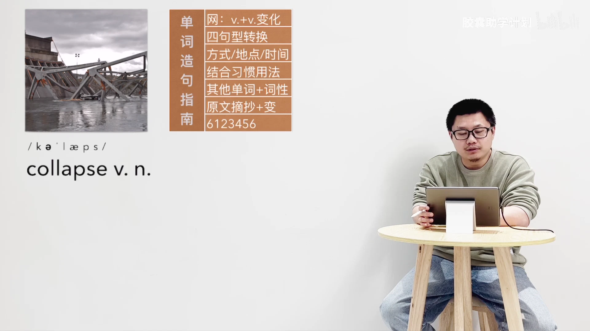

文字识别：单词造句指南 / 网：v.+v.变化 / 囊助字计划陽 / 四句型转换 / 方式/地点/时间 / 结合习惯用法 / 其他单词+词性 / 原文摘抄+变 / 6123456 / / k a' l æp s / / collapse v. n.

### 画面 00:07:55

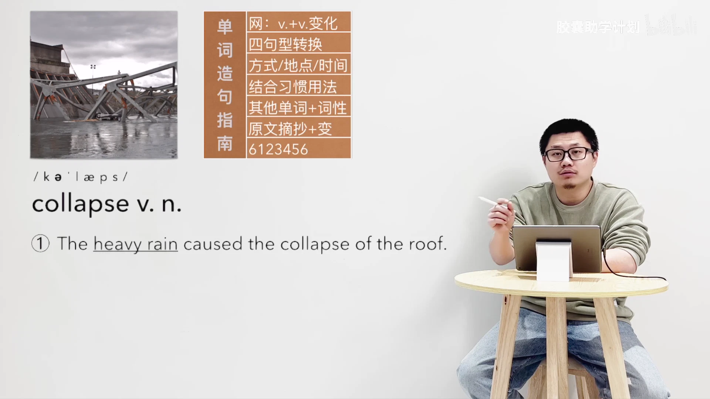

文字识别：单词造句指南 / 网：v.+v.变化 / 妻助学计划 / 四句型转换 / 方式/地点/时间 / 结合习惯用法 / 其他单词+词性 / 原文摘抄+变 / 6123456 / / k a' | æe p s / / collapse v. n. / ① The heavy rain caused the collapse of the roof.

## 00:08:00–00:08:30

导致了 A of B 结构。说房顶的倒塌，那你看这里的 collapsed，它就肯定不是动词了，它是个名词，对吧？那我们四句型转换，老生常谈的东西。接下来说 thousands of buildings collapsed during the floods。好了，你注意这个 collapsed 后边还直接加了个 d，变成过去式了，那肯定就动词了呗。但是含义没变，还是倒塌啊。说哎，数千个房子、建筑物都倒塌了，在这个

### 画面 00:08:00

文字识别：单词造句指南 / 网：v.+v.变化 / 嘉助字计划 / 四句型转换 / 方式/地点/时间 / 结合习惯用法 / 其他单词+词性 / 原文摘抄+变 / 6123456 / / k a' l æ p s / / collapse v. n. / ① The heavy rain caused the collapse of the roof.

### 画面 00:08:05

文字识别：单词造句指南 / 网：v.+v.变化 / 四句型转换 / 方式/地点/时间 / 结合习惯用法 / 其他单词+词性 / 原文摘抄+变 / 6123456 / / ka' | æ p s / / collapse v. n. / ① The heavy rain caused the collapse of the roof.

### 画面 00:08:11

文字识别：单词造句指南 / 网：v.+v.变化 / 四句型转换 / 方式/地点/时间 / 结合习惯用法 / 其他单词+词性 / 原文摘抄+变 / 6123456 / / k a' l æp s / / collapse v. n. / ① The heavy rain caused the collapse of the roof. / ② did/what/how/why... / Thousands of buildings collapsed during the / floods.

### 画面 00:08:22

文字识别：单词造句指南 / 网：v.+v.变化 / 四句型转换 / 方式/地点/时间 / 结合习惯用法 / 其他单词+词性 / 原文摘抄+变 / 6123456 / / k a' l æ p s / / collapse v. n. / ① The heavy rain caused the collapse of the roof. / ② did/what/how/why... / Thousands of buildings collapsed during the / floods.

### 画面 00:08:24

文字识别：单词造句指南 / 网：v.+v.变化 / 四句型转换 / 方式/地点/时间 / 结合习惯用法 / 其他单词+词性 / 原文摘抄+变 / 6123456 / / k a' l æp s / / collapse V. n. / ① The heavy rain caused the collapse of the roof. / did/what/how/why... / Thousands of buildings collapsed during the / floods.

### 画面 00:08:27

文字识别：单词造句指南 / 网：v.+v.变化 / 学计划 / 四句型转换 / 方式/地点/时间 / 结合习惯用法 / 其他单词+词性 / 原文摘抄+变 / 6123456 / / k a' l æ p s / / collapse v. n. / ① The heavy rain caused the collapse of the roof. / ② did/what/how/why... / Thousands of buildings collapsed during the / floods.

## 00:08:30–00:09:00

洪水期间全部冲塌了，对吧？Next one, repeat after me. 不要忘啊！当然了，如果我这个讲的速度比较快，很多的时候并没有给各位留时间去让你 repeat after me，对吧？嗯，如果那样讲也会有点怪。那怎么办呢？您暂停一下屏幕，我们是录播课嘛？哎，去跟着我去读啊！这个对帮助很大很大。When the cave collapsed, they were still inside, but managed

### 画面 00:08:30

文字识别：单词造句指南 / 网：v.+v.变化 / 学诗计划 / 四句型转换 / 方式/地点/时间 / 结合习惯用法 / 其他单词+词性 / 原文摘抄+变 / 6123456 / / k a' l æp s / / collapse v. n. / ① The heavy rain caused the collapse of the roof. / did/what/how/why... / Thousands of buildings collapsed during the / floods.

### 画面 00:08:33

文字识别：单词造句指南 / 网：v.+v.变化 / 四句型转换 / 方式/地点/时间 / 结合习惯用法 / 其他单词+词性 / 原文摘抄+变 / 6123456 / / ka' l æp s / / collapse v. n. / ① The heavy rain caused the collapse of the roof. / ② did/what/how/why... / ) Thousands of buildings collapsed during the / 3 / floods. /  When the cave collapsed, they were still / inside, but managed to get out in the end. L67

### 画面 00:08:35

文字识别：单词造句指南 / 网：v.+v.变化 / 助学计划 / 四句型转换 / 方式/地点/时间 / 结合习惯用法 / 其他单词+词性 / 原文摘抄+变 / 6123456 / / ka' l æp s / / collapse v. n. / ① The heavy rain caused the collapse of the roof. / ② did/what/how/why... / ) Thousands of buildings collapsed during the / 3 / floods. / D When the cave collapsed, they were still / inside, but managed to get out in the end. L67

### 画面 00:08:44

文字识别：单词造句指南 / 网：v.+v.变化 / 豪助学计划 / 四句型转换 / 方式/地点/时间 / 结合习惯用法 / 其他单词+词性 / 原文摘抄+变 / 6123456 / / ka' l æp s / / collapse v. n. / ① The heavy rain caused the collapse of the roof. / ② did/what/how/why... / ) Thousands of buildings collapsed during the / 3 / floods. /  When the cave collapsed, they were still / inside, but managed to get out in the end. L67

### 画面 00:08:46

文字识别：单词造句指南 / 网：v.+v.变化 / 四句型转换 / 方式/地点/时间 / 结合习惯用法 / 其他单词+词性 / 原文摘抄+变 / 6123456 / / k a ' l æ p s / / collapse v. n. / ① The heavy rain caused the collapse of the roof. / ② did/what/how/why... / ) Thousands of buildings collapsed during the / 3 / floods. /  When the cave collapsed, they were still / inside, but managed to get out in the end. L67

### 画面 00:08:58

文字识别：单词造句指南 / 网：v.+v.变化 / 助学计划 / 四句型转换 / 方式/地点/时间 / 结合习惯用法 / 其他单词+词性 / 原文摘抄+变 / 6123456 / / ka' l æp s / / collapse v. n. / ① The heavy rain caused the collapse of the roof. / ② did/what/how/why... / ) Thousands of buildings collapsed during the / 3 / floods. / ) When the cave collapsed, they were still / inside, but managed to get out in the end. L67

## 00:09:00–00:09:30

to get out in the end. Ah, actually, here every word we have learned before. I used the words we have learned before, grammar, habit, usage, to make a sentence. There is no one out of the standard. So when the hole collapsed, they were still inside. But they managed to get out in the end. Isn't that the first lesson we learned about habit usage? Right? Okay, read the word again. Collapse. Next one, the next word is drill. Drill. This word, if you practice carefully,

### 画面 00:09:00

文字识别：单词造句指南 / 网：v.+v.变化 / 嚢助学计划陽 / 四句型转换 / 方式/地点/时间 / 结合习惯用法 / 其他单词+词性 / 原文摘抄+变 / 6123456 / / k a ' l æ p s / / collapse v. n. / ① The heavy rain caused the collapse of the roof. / ② did/what/how/why... / ) Thousands of buildings collapsed during the / 3 / floods. / ) When the cave collapsed, they were still / inside, but managed to get out in the end. L67

### 画面 00:09:16

文字识别：单词造句指南 / 网：v.+v.变化 / 四句型转换 / 方式/地点/时间 / 结合习惯用法 / 其他单词+词性 / 原文摘抄+变 / 6123456 / / ka' l æp s / / collapse v. n. / ① The heavy rain caused the collapse of the roof. / ② did/what/how/why... / ) Thousands of buildings collapsed during the / 3 / floods. /  When the cave collapsed, they were still / inside, but managed to get out in the end. L67

### 画面 00:09:20

文字识别：单词造句指南 / 网：v.+v.变化 / 臺助学计划 / 四句型转换 / 方式/地点/时间 / 结合习惯用法 / 其他单词+词性 / 原文摘抄+变 / 6123456 / / ka ' l æp s / / collapse v. n. / ① The heavy rain caused the collapse of the roof. / ② did/what/how/why... / ) Thousands of buildings collapsed during the / 3 / floods. / D When the cave collapsed, they were still / inside, but managed to get out in the end. L67

### 画面 00:09:25

文字识别：单词造句指南 / 网：v.+v.变化 / 囊助学计划 / 四句型转换 / 方式/地点/时间 / 结合习惯用法 / 其他单词+词性 / 原文摘抄+变 / 6123456 / /drrl/ / drill v. n.

## 00:09:30–00:10:00

果练习您认真做了的话，你应该有印象。我们有两个练习，第一个叫repetition drill，一个叫pattern drill。Drill最基本的意思，甭管动词、名词，就是钻。动词就是钻、钻、钻的这个动作，对吧？那你想一下，我们原来经常练的repetition drill和pattern drill是在干嘛？尤其是pattern drill四乘四那道题，其实就是通过一遍一遍的练习，把这个句型drill，对

### 画面 00:09:30

文字识别：单词造句指南 / 网：v.+v.变化 / 妻助学计划 / 四句型转换 / 方式/地点/时间 / 结合习惯用法 / 其他单词+词性 / 原文摘抄+变 / 6123456 / /dril/ / drill v. n.

### 画面 00:09:36

文字识别：单词造句指南 / 网：v.+v.变化 / 囊助学计划 / 四句型转换 / 方式/地点/时间 / 结合习惯用法 / 其他单词+词性 / 原文摘抄+变 / 6123456 / /dril/ / drill v. n.

### 画面 00:09:45

文字识别：单词造句指南 / 网：v.+v.变化 / 辜助学计划陽 / 四句型转换 / 方式/地点/时间 / 结合习惯用法 / 其他单词+词性 / 原文摘抄+变 / 6123456 / /dril/ / drill v. n.

### 画面 00:09:50

文字识别：单词造句指南 / 网：v.+v.变化 / 囊助学计划 / 四句型转换 / 方式/地点/时间 / 结合习惯用法 / 其他单词+词性 / 原文摘抄+变 / 6123456 / /dril/ / drill v. n.

### 画面 00:09:55

文字识别：单词造句指南 / 网：v.+v.变化 / 囊助字计划医 / 四句型转换 / 方式/地点/时间 / 结合习惯用法 / 其他单词+词性 / 原文摘抄+变 / 6123456 / /dril/ / drill v. n.

## 00:10:00–00:10:30

吧？哎，钻到我们刻到我们的脑海当中去，期冀于将来我们想说的时候，张嘴就能把这个句型说出来。只不过我可能要由具体情况去换一些我需要的单词。比如说我在这儿练的是 book pen，但是现实生活当中我可能在这个场景下要用到的是 passport。但是前面的句型我已经会了，所以我们管它叫做 drill 对吧？钻啊，要钻到脑海当中去，把这个知识点。那我

### 画面 00:10:15

文字识别：单词造句指南 / 网：v.+v.变化 / 妻助学计划陽 / 四句型转换 / 方式/地点/时间 / 结合习惯用法 / 其他单词+词性 / 原文摘抄+变 / 6123456 / /dril/ / drill v. n.

### 画面 00:10:20

文字识别：单词造句指南 / 网：v.+v.变化 / 囊助学计划 / 四句型转换 / 方式/地点/时间 / 结合习惯用法 / 其他单词+词性 / 原文摘抄+变 / 6123456 / /dril/ / drill v. n.

### 画面 00:10:25

文字识别：单词造句指南 / 网：v.+v.变化 / 囊助学计划 / 四句型转换 / 方式/地点/时间 / 结合习惯用法 / 其他单词+词性 / 原文摘抄+变 / 6123456 / /dril/ / drill v. n.

### 画面 00:10:29

文字识别：单词造句指南 / 网：v.+v.变化 / 四句型转换 / 方式/地点/时间 / 结合习惯用法 / 其他单词+词性 / 原文摘抄+变 / 6123456 / /dril/ / drill v. n. / ① After drilling for several weeks, they finally / found the oil. L49

## 00:10:30–00:11:00

们来它造个句子吧。After drilling for several weeks, they finally find the oil.说在钻了数周之后啊，他们最终找到了这个原油啊，石油。Next one, they were dismayed to find that nobody was drilling for him.这个其实呃稍微有一点要跟原文联系起来，或者我要给您补充一点背景知识，否则可能容易不太理解。但是我们先看前面的叫做 be dismayed to find，

### 画面 00:10:31

文字识别：单词造句指南 / 网：v.+v.变化 / 辜助字计划 / 四句型转换 / 方式/地点/时间 / 结合习惯用法 / 其他单词+词性 / 原文摘抄+变 / 6123456 / /dril/ / drill v. n. / ① After drilling for several weeks, they finally / found the oil. L49

### 画面 00:10:40

文字识别：单词造句指南 / 网：v.+v.变化 / 妻助学计划 / 四句型转换 / 方式/地点/时间 / 结合习惯用法 / 其他单词+词性 / 原文摘抄+变 / 6123456 / /dril/ / drill v. n. / ① After drilling for several weeks, they finally / found the oil. L49

### 画面 00:10:45

文字识别：单词造句指南 / 网：v.+v.变化 / 四句型转换 / 方式/地点/时间 / 结合习惯用法 / 其他单词+词性 / 原文摘抄+变 / 6123456 / /dril/ / drill v. n. / ① After drilling for several weeks, they finally / found the oil. L49 / They were dismayed to find that nobody / was drilling for them. L54

### 画面 00:10:52

文字识别：单词造句指南 / 网：v.+v.变化 / 素助学计划 / 四句型转换 / 方式/地点/时间 / 结合习惯用法 / 其他单词+词性 / 原文摘抄+变 / 6123456 / /dril/ / drill v. n. / ① After drilling for several weeks, they finally / found the oil. L49 / They were dismayed to find that nobody / was drilling for them. L54

## 00:11:00–00:11:30

么意思呢？表示的是，呃，很灰心丧气的，意识到了一件事儿啊，发现什么呢？说没有人在给他们钻井啊。你理解为这帮人是什么人呢？啊，这个 them 是谁呢？就是他们是井下 trapped in a mine，对吧？困在这个矿井里边的这些人啊，他们希希望的是有人通过呃钻一个天井的方式把他们带到地面上去，对吧？但是他们哎，很沮丧的意识到没有人

### 画面 00:11:00

文字识别：单词造句指南 / 网：v.+v.变化 / 四句型转换 / 方式/地点/时间 / 结合习惯用法 / 其他单词+词性 / 原文摘抄+变 / 6123456 / /dril/ / drill v. n. / ① After drilling for several weeks, they finally / found the oil. L49 / They were dismayed to find that nobody / was drilling for them. L54

## 00:11:30–00:12:00

在做这件事儿，听不到任何声音啊。Next one,说they noticed with dismay，跟刚才一样。其实在这儿后半句子不用挨个看了，我们只不过是把这两个五十四个和八十六课学过的这两个习惯用法进行一下简单的对比。这两句话的意思，在我看来其实没有什么太大区别，几乎是一个意思，只不过说法稍有不同，对吧？哎，他们沮丧的意识到啊，刚才那个是沮丧的发现啊。那注意力

### 画面 00:11:30

文字识别：单词造句指南 / 网：v.+v.变化 / 四句型转换 / 方式/地点/时间 / 结合习惯用法 / 其他单词+词性 / 原文摘抄+变 / 6123456 / /dril/ / drill v. n. / ① After drilling for several weeks, they finally / found the oil. L49 / They were dismayed to find that nobody / was drilling for them. L54

### 画面 00:11:32

文字识别：单词造句指南 / 网：v.+v.变化 / 四句型转换 / 方式/地点/时间 / 结合习惯用法 / 其他单词+词性 / 原文摘抄+变 / 6123456 / /dril/ / drill v. n. / ① After drilling for several weeks, they finally / found the oil. L49 / They were dismayed to find that nobody / Was drilling for them. L54 / They noticed with dismay that nobody was / drilling for them.L86

### 画面 00:11:35

文字识别：单词造句指南 / 网：v.+v.变化 / 四句型转换 / 方式/地点/时间 / 结合习惯用法 / 其他单词+词性 / 原文摘抄+变 / 6123456 / /dril/ / drill v. n. / ① After drilling for several weeks, they finally / found the oil. L49 / They were dismayed to find that nobody / was drilling for them. L54 / They noticed with dismay that nobody was / drilling for them. L86

### 画面 00:11:48

文字识别：单词造句指南 / 网：v.+v.变化 / 延学计划 / 四句型转换 / 方式/地点/时间 / 结合习惯用法 / 其他单词+词性 / 原文摘抄+变 / 6123456 / /dril/ / drill v. n. / ① After drilling for several weeks, they finally / found the oil. L49 / They were dismayed to find that nobody / was drilling for them. L54 / They noticed with dismay that nobody was / drilling for them. L86

### 画面 00:11:51

文字识别：单词造 / 网：v.+v.变化 / 四句型转换 / 方式/地点/时间 / 旭句指南 / 结合习惯用法 / 其他单词+词性 / 原文摘抄+变 / 6123456 / /dril/ / drill v. n. / ① After drilling for several weeks, they finally / found the oil. L49 / They were dismayed to find that nobody / Was drilling for them. L54 / They noticed with dismay that nobody was / drilling for them. L86

### 画面 00:11:55

文字识别：单词造句指南 / 网：v.+v.变化 / 四句型转换 / 方式/地点/时间 / 结合习惯用法 / 其他单词+词性 / 原文摘抄+变 / 6123456 / /dril/ / drill v. n. / ① After drilling for several weeks, they finally / found the oil. L49 / They were dismayed to find that nobody / Was drilling for them. L54 / They noticed with dismay that nobody was / drilling for them. L86

### 画面 00:11:58

文字识别：Then three white men came, and started drilling / with a machine. / A United Kingdom / (2016)

## 00:12:00–00:12:30

集中，咱听个电影片段啊。 Then three white men came and started drilling with a machine. Okay, next one, capsule. 哎呀，Capsule Academy, us, 对吧？ Capsule, capsule, 胶囊的英文 capsule，终于出现了。当然，本课它出现的并不是胶囊，它出现的是容器的意思啊。但其实你细想，胶囊不就是一种里面装着小药粒的容器

### 画面 00:12:04

文字识别：Then three white men came, and started drilling / with a machine. / A United Kingdom / (2016)

### 画面 00:12:06

文字识别：Then three white men came, and started drilling / with a machine. / A United Kingdom / (2016)

### 画面 00:12:08

文字识别：单词造句指南 / 网：v.+v.变化 / 囊助字计划陽 / 四句型转换 / 方式/地点/时间 / 结合习惯用法 / 其他单词+词性 / 原文摘抄+变 / 6123456 / /'kæp.sju:l/ / capsule n.

### 画面 00:12:10

文字识别：单词造句指南 / 网：v.+v.变化 / 囊助学计划 / 四句型转换 / 方式/地点/时间 / 结合习惯用法 / 其他单词+词性 / 原文摘抄+变 / 6123456 / /'kæp.sju:l/ / capsule n.

### 画面 00:12:15

文字识别：单词造句指南 / 网：v.+v.变化 / 曩助学计划 / 四句型转换 / 方式/地点/时间 / 结合习惯用法 / 其他单词+词性 / 原文摘抄+变 / 6123456 / /'kæp.sju:l/ / capsule n.

### 画面 00:12:22

文字识别：单词造句指南 / 网：v.+v.变化 / 囊助字计划 / 四句型转换 / 方式/地点/时间 / 结合习惯用法 / 其他单词+词性 / 原文摘抄+变 / 6123456 / /'kæp.sju:l/ / capsule n.

### 画面 00:12:26

文字识别：单词造句指南 / 网：v.+v.变化 / 泰助学计划一州 / 四句型转换 / 方式/地点/时间 / 结合习惯用法 / 其他单词+词性 / 原文摘抄+变 / 6123456 / /'kæp.sju:l/ / capsule n.

## 00:12:30–00:13:00

嘛，对吧？叫做 capsule。原文呢给了我们一个小的短语，叫做 in a special capsule。所以你能意识到它实际上是在六一二三四五六当中当了五这样的一个地点，对吧？那我们拿它去造句啊，比如说，The teacher informed all his students that the gifts were in a special capsule。说这个老师通知了他所有的学生怎么样呢？说这个给你们的礼物啊放在了在什么

### 画面 00:12:31

文字识别：单词造句指南 / 网：v.+v.变化 / 囊助字计划 / 四句型转换 / 方式/地点/时间 / 结合习惯用法 / 其他单词+词性 / 原文摘抄+变 / 6123456 / /'kæp.sju:l/ / capsule n.

### 画面 00:12:35

文字识别：单词造句指南 / 网：v.+v.变化 / 妻助字计划 / 四句型转换 / 方式/地点/时间 / 结合习惯用法 / 其他单词+词性 / 原文摘抄+变 / 6123456 / /'kæp.sju:l/ / capsule n. / ① [Story]: in a special capsule..

### 画面 00:12:40

文字识别：单词造句指南 / 网：v.+v.变化 / 臺助字计划 / 四句型转换 / 方式/地点/时间 / 结合习惯用法 / 其他单词+词性 / 原文摘抄+变 / 6123456 / /'kæp.sju:l/ / capsule n. / ① [Story]: in a special capsule..

### 画面 00:12:43

文字识别：单词造句指南 / 网：v.+v.变化 / 臺助字计划園 / 四句型转换 / 方式/地点/时间 / 结合习惯用法 / 其他单词+词性 / 原文摘抄+变 / 6123456 / /'kæp.sju:l/ / capsule n. / ① [Story]: in a special capsule... / ) The teacher informed all his students that / the gifts were in a special capsule. L85

### 画面 00:12:45

文字识别：单词造句指南 / 网：v.+v.变化 / 四句型转换 / 方式/地点/时间 / 结合习惯用法 / 其他单词+词性 / 原文摘抄+变 / 6123456 / /'kæp.sju:l/ / capsule n. / ① [Story]: in a special capsule... / ) The teacher informed all his students that / the gifts were in a special capsule. L85

### 画面 00:12:50

文字识别：单词造句指南 / 网：v.+v.变化 / 四句型转换 / 方式/地点/时间 / 结合习惯用法 / 其他单词+词性 / 原文摘抄+变 / 6123456 / /'kæp.sju:l/ / capsule n. / ① [Story]: in a special capsule... / ) The teacher informed all his students that / the gifts were in a special capsule. L85

### 画面 00:12:55

文字识别：单词造句指南 / 网：v.+v.变化 / 囊助字计划園 / 四句型转换 / 方式/地点/时间 / 结合习惯用法 / 其他单词+词性 / 原文摘抄+变 / 6123456 / /'kæp.sju:l/ / capsule n. / ① [Story]: in a special capsule... / ) The teacher informed all his students that / the gifts were in a special capsule. L85

## 00:13:00–00:13:30

里边？在一个特殊的容器当中，你们要自己去找。In a special capsule, 对吧？Next one, they volunteered to live in a special capsule for ten days. Days, 是吧？他们志愿 volunteer to do something, 志愿住在一个特殊的容器当中住十天，对吧？Okay, 比如说很多太空训练，哎，我要住在这个地方。Next one, 说 they were standing in a circle around a special capsule, 说他们正

### 画面 00:13:00

文字识别：单词造句指南 / 网：v.+v.变化 / 妻助学计划 / 四句型转换 / 方式/地点/时间 / 结合习惯用法 / 其他单词+词性 / 原文摘抄+变 / 6123456 / /'kæp.sju:l/ / capsule n. / ① [Story]: in a special capsule... / ) The teacher informed all his students that / the gifts were in a special capsule. L85

### 画面 00:13:03

文字识别：单词造句指南 / 网：v.+v.变化 / 四句型转换 / 方式/地点/时间 / 结合习惯用法 / 其他单词+词性 / 原文摘抄+变 / 6123456 / /'kæp.sju:l/ / capsule n. / ① [Story]: in a special capsule... / ) The teacher informed all his students that / the gifts were in a special capsule. L85

### 画面 00:13:05

文字识别：单词造句指南 / 网：v.+v.变化 / 助学计划 / 四句型转换 / 方式/地点/时间 / 结合习惯用法 / 其他单词+词性 / 原文摘抄+变 / 6123456 / /'kæp.sju:l/ / capsule n. / ① [Story]: in a special capsule... / ② The teacher informed all his students that / the gifts were in a special capsule. L85 / They volunteered to live in a special / capsule for ten days. L84

### 画面 00:13:10

文字识别：单词造句指南 / 网：v.+v.变化 / 臺助字计划 / 四句型转换 / 方式/地点/时间 / 结合习惯用法 / 其他单词+词性 / 原文摘抄+变 / 6123456 / /'kæp.sju:l/ / capsule n. / ① [Story]: in a special capsule... / ② The teacher informed all his students that / the gifts were in a special capsule. L85 / They volunteered to live in a special / capsule for ten days. L84

### 画面 00:13:20

文字识别：单词造句指南 / 网：v.+v.变化 / 囊助学计划 / 四句型转换 / 方式/地点/时间 / 结合习惯用法 / 其他单词+词性 / 原文摘抄+变 / 6123456 / /'kæep.sju:l/ / capsule n. / ① [Story]: in a special capsule... / ② The teacher informed all his students that / the gifts were in a special capsule. L85 / They volunteered to live in a special / capsule for ten days. L84

### 画面 00:13:25

文字识别：单词造句指南 / 网：v.+v.变化 / 臺助学计划 / 四句型转换 / 方式/地点/时间 / 结合习惯用法 / 其他单词+词性 / 原文摘抄+变 / 6123456 / /'kæep.sju:l/ / capsule n. / ① [Story]: in a special capsule... / ② The teacher informed all his students that / the gifts were in a special capsule. L85 / They volunteered to live in a special / capsule for ten days. L84 / They were standing in a circle around a / special capsule. L86

## 00:13:30–00:14:00

站在一个一站成一圈儿啊, standing in a circle,这是八十六课咱刚学的。然后在什么周围呢？在一个特殊的容器周围，哎，在它周围站了一圈儿啊。OK，再读一遍这个单词capsule. Next one, layer, layer.注意后面最后a a layer,哎，再加个儿化音layer. Very good.层啊，一层两层的这个层的这个概念就叫做

### 画面 00:13:31

文字识别：单词造句指南 / 网：v.+v.变化 / 助学计划 / 四句型转换 / 方式/地点/时间 / 结合习惯用法 / 其他单词+词性 / 原文摘抄+变 / 6123456 / /'kæep.sju:l/ / capsule n. / ① [Story]: in a special capsule... / ② The teacher informed all his students that / the gifts were in a special capsule. L85 / They volunteered to live in a special / capsule for ten days. L84 / They were standing in a circle around a / special capsule. L86

### 画面 00:13:35

文字识别：单词造句指南 / 网：v.+v.变化 / [助学计划 / 四句型转换 / 方式/地点/时间 / 结合习惯用法 / 其他单词+词性 / 原文摘抄+变 / 6123456 / /'kæp.sju:l/ / capsule n. / ① [Story]: in a special capsule... / ② The teacher informed all his students that / the gifts were in a special capsule. L85 / They volunteered to live in a special / capsule for ten days. L84 / They were standing in a circle around a / special capsule. L86

### 画面 00:13:42

文字识别：单词造句指南 / 网：v.+v.变化 / 建助学计划 / 四句型转换 / 方式/地点/时间 / 结合习惯用法 / 其他单词+词性 / 原文摘抄+变 / 6123456 / / 'kæep.sju:l/ / capsule n. / ① [Story]: in a special capsule... / ② The teacher informed all his students that / the gifts were in a special capsule. L85 / They volunteered to live in a special / capsule for ten days. L84 / They were standing in a circle around a / special capsule. L86

### 画面 00:13:46

文字识别：单词造句指南 / 网：v.+v.变化 / 囊助学计划園 / 四句型转换 / 方式/地点/时间 / 结合习惯用法 / 其他单词+词性 / 原文摘抄+变 / 6123456 / /'lel.a/ / layer n.

### 画面 00:13:50

文字识别：单词造句指南 / 网：v.+v.变化 / 妻助学计划 / 四句型转换 / 方式/地点/时间 / 结合习惯用法 / 其他单词+词性 / 原文摘抄+变 / 6123456 / /'lel.a/ / layer n.

### 画面 00:13:57

文字识别：单词造句指南 / 网：v.+v.变化 / 妻助学计划 / 四句型转换 / 方式/地点/时间 / 结合习惯用法 / 其他单词+词性 / 原文摘抄+变 / 6123456 / /'lel.a/ / layer n.

### 画面 00:13:59

文字识别：单词造句指南 / 网：v.+v.变化 / 虞助学计划情 / 四句型转换 / 方式/地点/时间 / 结合习惯用法 / 其他单词+词性 / 原文摘抄+变 / 6123456 / /'lel.a/ / layer n.

## 00:14:00–00:14:30

layer。好，我们拿它教句子，说 glass must be packed in several layers of paper。这里有一个小的习惯用法叫 layers of， layers of 就是数层啊。那 layers of paper 就数层纸啊。这里说的是说玻璃啊，必须要被 packed 被打包 in several layers。哎，以数层纸去给它进行一个打包，对吧？Next one, she although she was wearing

### 画面 00:14:01

文字识别：单词造句指南 / 网：v.+v.变化 / 四句型转换 / 方式/地点/时间 / 结合习惯用法 / 其他单词+词性 / 原文摘抄+变 / 6123456 / /'lei.a/ / layer n. / ① Glass must be packed in several layers / of paper. L21

### 画面 00:14:04

文字识别：单词造句指南 / 网：v.+v.变化 / 辜助字计划 / 四句型转换 / 方式/地点/时间 / 结合习惯用法 / 其他单词+词性 / 原文摘抄+变 / 6123456 / /'lei.a/ / layer n. / ① Glass must be packed in several layers / of paper. L21

### 画面 00:14:07

文字识别：单词造句指南 / 网：v.+v.变化 / 辜助字计划 / 四句型转换 / 方式/地点/时间 / 结合习惯用法 / 其他单词+词性 / 原文摘抄+变 / 6123456 / /'lel.a/ / layer n. / ① Glass must be packed in several layers / of paper. L21

### 画面 00:14:09

文字识别：单词造句指南 / 网：v.+v.变化 / 囊助学计划 / 四句型转换 / 方式/地点/时间 / 结合习惯用法 / 其他单词+词性 / 原文摘抄+变 / 6123456 / /'lel.a/ / layer n. / ① Glass must be packed in several layers / of paper. L21

### 画面 00:14:14

文字识别：单词造句指南 / 网：v.+v.变化 / 囊助学计划 / 四句型转换 / 方式/地点/时间 / 结合习惯用法 / 其他单词+词性 / 原文摘抄+变 / 6123456 / /'lel.a/ / layer n. / ① Glass must be packed in several layers / of paper. L21

### 画面 00:14:27

文字识别：单词造句指南 / 网：v.+v.变化 / 四句型转换 / 方式/地点/时间 / 结合习惯用法 / 其他单词+词性 / 原文摘抄+变 / 6123456 / /'lei.a/ / layer n. / ① Glass must be packed in several layers / of paper. L21 / Although she was wearing layers / of clothes, she said she was cold.

### 画面 00:14:29

文字识别：单词造句指南 / 网：v.+v.变化 / 四句型转换 / 方式/地点/时间 / 结合习惯用法 / 其他单词+词性 / 原文摘抄+变 / 6123456 / /'le1.a/ / layer n. / ① Glass must be packed in several layers / of paper. L21 / Although she was wearing layers / of clothes, she said she was cold.

## 00:14:30–00:15:00

layers of clothes, she said she was cold.说尽管说她实际上穿了数层的衣服，她说她依旧很冷啊。Next one，注意刚才是个复数是吧？Layers of，那你说a layer of就是一层嘛，对吧？说There is a layer of dust on the dressing table. Please clean that.哎，这其实就是新一的句子了，都包括语法，包括单词是吧？说有这

### 画面 00:14:32

文字识别：单词造句指南 / 网：v.+v.变化 / 四句型转换 / 方式/地点/时间 / 结合习惯用法 / 其他单词+词性 / 原文摘抄+变 / 6123456 / /'lei.a/ / layer n. / ① Glass must be packed in several layers / of paper. L21 / Although she was wearing layers / of clothes, she said she was cold.

### 画面 00:14:34

文字识别：单词造句指南 / 网：v.+v.变化 / 四句型转换 / 方式/地点/时间 / 结合习惯用法 / 其他单词+词性 / 原文摘抄+变 / 6123456 / /'le1.a/ / layer n. / ① Glass must be packed in several layers / of paper. L21 / Although she was wearing layers / of clothes, she said she was cold.

### 画面 00:14:39

文字识别：单词造句指南 / 网：v.+v.变化 / 四句型转换 / 方式/地点/时间 / 结合习惯用法 / 其他单词+词性 / 原文摘抄+变 / 6123456 / /'le1.a/ / layer n. / ① Glass must be packed in several layers / of paper. L21 / Although she was wearing layers / of clothes, she said she was cold.

### 画面 00:14:42

文字识别：单词造句指南 / 网：v.+v.变化 / 学计划 / 四句型转换 / 方式/地点/时间 / 结合习惯用法 / 其他单词+词性 / 原文摘抄+变 / 6123456 / /'lei.a/ / layer n. / ① Glass must be packed in several layers / of paper. L21 / Although she was wearing layers / of clothes, she said she was cold. / There is a layer of dust on the dressing- / table. Please clean that.

### 画面 00:14:44

文字识别：单词造句指南 / 网：v.+v.变化 / 四句型转换 / 方式/地点/时间 / 结合习惯用法 / 其他单词+词性 / 原文摘抄+变 / 6123456 / /'lei.a/ / layer n. / ① Glass must be packed in several layers / of paper. L21 / Although she was wearing layers / of clothes, she said she was cold. / There is a layer of dust on the dressing- / table. Please clean that.

### 画面 00:14:49

文字识别：单词造句指南 / 网：v.+v.变化 / 襲助学计划 / 四句型转换 / 方式/地点/时间 / 结合习惯用法 / 其他单词+词性 / 原文摘抄+变 / 6123456 / /'lei.a/ / layer n. / ① Glass must be packed in several layers / of paper. L21 / Although she was wearing layers / of clothes, she said she was cold. / There is a layer of dust on the dressing- / table. Please Clean that.

### 画面 00:14:51

文字识别：单词造句指南 / 网：v.+v.变化 / 毫助学计划 / 四句型转换 / 方式/地点/时间 / 结合习惯用法 / 其他单词+词性 / 原文摘抄+变 / 6123456 / /'lei.a/ / layer n. / ① Glass must be packed in several layers / of paper. L21 / Although she was wearing layers / of clothes, she said she was cold. / There is a layer of dust on the dressing- / table. Please clean that.

### 画面 00:14:54

文字识别：单词造句指南 / 网：v.+v.变化 / 四句型转换 / 方式/地点/时间 / 结合习惯用法 / 其他单词+词性 / 原文摘抄+变 / 6123456 / /'lei.a/ / layer n. / ① Glass must be packed in several layers / of paper. L21 / Although she was wearing layers / of clothes, she said she was cold. / There is a layer of dust on the dressing- / table. Please clean that.

## 00:15:00–00:15:30

么一层尘土在这个梳妆台上，请把它打扫清理一下。OK，读一遍这个单词 layer。Very good。下一个单词呢叫 beneath。beneath 啊，就像我们在图中这样，你如果在山洞里，那你就是 beneath the surface，对吧？你在地表以下啊，这个 beneath 就是什么什么以下的意思。那我们先造一个很简单的句子啊，这都是这个句子真的是我们

### 画面 00:15:04

文字识别：单词造句指南 / 网：v.+v.变化 / 四句型转换 / 方式/地点/时间 / 结合习惯用法 / 其他单词+词性 / 原文摘抄+变 / 6123456 / /'lei.a/ / layer n. / ① Glass must be packed in several layers / of paper. L21 / Although she was wearing layers / of clothes, she said she was cold. / There is a layer of dust on the dressing- / table. Please clean that.

### 画面 00:15:08

文字识别：单词造句指南 / 网：v.+v.变化 / 囊助学计划 / 四句型转换 / 方式/地点/时间 / 结合习惯用法 / 其他单词+词性 / 原文摘抄+变 / 6123456 / /bι'ni:θ/ / beneath prep.

### 画面 00:15:10

文字识别：单词造句指南 / 网：v.+v.变化 / 囊助学计划 / 四句型转换 / 方式/地点/时间 / 结合习惯用法 / 其他单词+词性 / 原文摘抄+变 / 6123456 / /bi'ni:θ/ / beneath prep.

### 画面 00:15:14

文字识别：单词造句指南 / 网：v.+v.变化 / 囊助学计划 / 四句型转换 / 方式/地点/时间 / 结合习惯用法 / 其他单词+词性 / 原文摘抄+变 / 6123456 / /br'ni:θ/ / beneath prep.

### 画面 00:15:19

文字识别：单词造句指南 / 网：v.+v.变化 / 妻助字计划 / 四句型转换 / 方式/地点/时间 / 结合习惯用法 / 其他单词+词性 / 原文摘抄+变 / 6123456 / /bi'ni:θ/ / beneath prep.

### 画面 00:15:24

文字识别：单词造句指南 / 网：v.+v.变化 / 妻助学计划一 / 四句型转换 / 方式/地点/时间 / 结合习惯用法 / 其他单词+词性 / 原文摘抄+变 / 6123456 / /bi'ni:θ/ / beneath prep.

### 画面 00:15:27

文字识别：单词造句指南 / 网：v.+v.变化 / 妻助学计划 / 四句型转换 / 方式/地点/时间 / 结合习惯用法 / 其他单词+词性 / 原文摘抄+变 / 6123456 / / bⅠ'ni :θ / / beneath prep. / ① A cat was beneath the table.

### 画面 00:15:29

文字识别：单词造句指南 / 网：v.+v.变化 / 髪助学计划陽 / 四句型转换 / 方式/地点/时间 / 结合习惯用法 / 其他单词+词性 / 原文摘抄+变 / 6123456 / / bⅠ'ni:θ / / beneath prep. / ① A cat was beneath the table.

## 00:15:30–00:16:00

新一前啊四十课就学过的，叫做 A cat was beneath the table，是吧？哎，这当时咱们学的是 under，嘛，对吧？说这个猫啊，在这个桌子的下方。Next one， we sat beneath a shady tree，说我们坐在一个阴凉树的，哎，有这个树阴凉的这个下方啊，枝叶茂盛的这个下方。好了，你注意，然后咱们把它做一下四句型转换啊。

### 画面 00:15:35

文字识别：单词造句指南 / 网：v.+v.变化 / 臺助学计划 / 四句型转换 / 方式/地点/时间 / 结合习惯用法 / 其他单词+词性 / 原文摘抄+变 / 6123456 / / bⅠni :θ / / beneath prep. / ① A cat was beneath the table.

### 画面 00:15:39

文字识别：单词造句指南 / 网：v.+v.变化 / 妻助学计划 / 四句型转换 / 方式/地点/时间 / 结合习惯用法 / 其他单词+词性 / 原文摘抄+变 / 6123456 / / bⅠ'ni :θ / / beneath prep. / ① A cat was beneath the table.

### 画面 00:15:43

文字识别：单词造句指南 / 网：v.+v.变化 / 喜助字计划 / 四句型转换 / 方式/地点/时间 / 结合习惯用法 / 其他单词+词性 / 原文摘抄+变 / 6123456 / / bⅠ'ni :θ / / beneath prep. / ① A cat was beneath the table.

### 画面 00:15:45

文字识别：单词造句指南 / 网：v.+v.变化 / 奏助学计划 / 四句型转换 / 方式/地点/时间 / 结合习惯用法 / 其他单词+词性 / 原文摘抄+变 / 6123456 / /bι'ni:θ/ / beneath prep. / ① A cat was beneath the table. / ② We sat beneath a shady tree. did/where/ / who/why/when...

### 画面 00:15:49

文字识别：单词造句指南 / 网：v.+v.变化 / 喜助字计划 / 四句型转换 / 方式/地点/时间 / 结合习惯用法 / 其他单词+词性 / 原文摘抄+变 / 6123456 / /bι'ni:θ/ / beneath prep. / ① A cat was beneath the table. / ② We sat beneath a shady tree. did/where/ / who/why/when...

### 画面 00:15:54

文字识别：单词造句指南 / 网：v.+v.变化 / 奏助字计划 / 四句型转换 / 方式/地点/时间 / 结合习惯用法 / 其他单词+词性 / 原文摘抄+变 / 6123456 / /bi'ni:θ/ / beneath prep. / ① A cat was beneath the table. / ② We sat beneath a shady tree. did/where/ / who/why/when...

### 画面 00:15:57

文字识别：单词造句指南 / 网：v.+v.变化 / 囊助字计划 / 四句型转换 / 方式/地点/时间 / 结合习惯用法 / 其他单词+词性 / 原文摘抄+变 / 6123456 / /bi'ni:θ/ / beneath prep. / ① A cat was beneath the table. / ② We sat beneath a shady tree. did/where/ / who/why/when...

## 00:16:00–00:16:30

Next one说The body was hidden beneath a thin layer of soil.好了，说注意这个body，如果我们这么去用的话，结合上下文语境，它就不是身体，它要翻译成尸体啊。说这个尸体被藏在什么地方呢？一个什么之下呢？就是很薄薄的一层土壤之下，哎，被藏到了这个地方。OK, very good.下一个单词lower,

### 画面 00:16:00

文字识别：单词造句指南 / 网：v.+v.变化 / 学计划 / 四句型转换 / 方式/地点/时间 / 结合习惯用法 / 其他单词+词性 / 原文摘抄+变 / 6123456 / /br'ni:θ/ / beneath prep. / ① A cat was beneath the table. / ② We sat beneath a shady tree. did/where/ / who/why/when... / The body was hidden beneath a thin layer / of soil.

### 画面 00:16:04

文字识别：单词造句指南 / 网：v.+v.变化 / 四句型转换 / 方式/地点/时间 / 结合习惯用法 / 其他单词+词性 / 原文摘抄+变 / 6123456 / /bini:θ/ / beneath prep. / ① A cat was beneath the table. / ② We sat beneath a shady tree. did/where/ / who/why/when... / The body was hidden beneath a thin layer / of soil.

### 画面 00:16:09

文字识别：单词造句指南 / 网：v.+v.变化 / 襄助学计划 / 四句型转换 / 方式/地点/时间 / 结合习惯用法 / 其他单词+词性 / 原文摘抄+变 / 6123456 / /bi'ni:θ/ / beneath prep. / ① A cat was beneath the table. / ② We sat beneath a shady tree. did/where/ / who/why/when... / The body was hidden beneath a thin layer / of soil.

### 画面 00:16:14

文字识别：单词造句指南 / 网：v.+v.变化 / 四句型转换 / 方式/地点/时间 / 结合习惯用法 / 其他单词+词性 / 原文摘抄+变 / 6123456 / /bⅠ'ni:θ/ / beneath prep. / ① A cat was beneath the table. / ② We sat beneath a shady tree. did/where/ / who/why/when... / The body was hidden beneath a thin layer / of soil.

### 画面 00:16:16

文字识别：单词造句指南 / 网：v.+v.变化 / 四句型转换 / 方式/地点/时间 / 结合习惯用法 / 其他单词+词性 / 原文摘抄+变 / 6123456 / /bi'ni:θ/ / beneath prep. / ① A cat was beneath the table. / ② We sat beneath a shady tree. did/where/ / who/why/when... / The body / Pas hidden beneath a thin layer / of soil.

### 画面 00:16:19

文字识别：单词造句指南 / 网：v.+v.变化 / 助字计划 / 四句型转换 / 方式/地点/时间 / 结合习惯用法 / 其他单词+词性 / 原文摘抄+变 / 6123456 / /br'ni:θ1 / beneath prep. / ① A cat was beneath the table. / ② We sat beneath a shady tree. did/where/ / who/why/when... / The body was hidden beneath a thin layer / of soil.

### 画面 00:16:25

文字识别：单词造句指南 / 网：v.+v.变化 / 四句型转换 / 方式/地点/时间 / 结合习惯用法 / 其他单词+词性 / 原文摘抄+变 / 6123456 / /bi'ni:θ/ / beneath prep. / ① A cat was beneath the table. / ② We sat beneath a shady tree. did/where/ / who/why/when... / The body was hidden beneath a thin layer / of soil.

### 画面 00:16:27

文字识别：单词造句指南 / 网：v.+v.变化 / 囊助字计划 / 四句型转换 / 方式/地点/时间 / 结合习惯用法 / 其他单词+词性 / 原文摘抄+变 / 6123456 / /  laua/ / lower v. adj.

### 画面 00:16:29

文字识别：单词造句指南 / 网：v.+v.变化 / 囊助字计划 / 四句型转换 / 方式/地点/时间 / 结合习惯用法 / 其他单词+词性 / 原文摘抄+变 / 6123456 / /  laua/ / lower v. adj.

## 00:16:30–00:17:00

lower 跟刚才那个 layer 有点像，它也是 lower 啊，后边加上话音 lower lower lower 可以是一个动词，它也可以当一个形容词。如果是动词呢，就是下降啊，往下调哎，往下的这个动作。比如说 you should have lower your voice in his office，什么意思呢？首先先看这个六十五课咱们学的复习叫本应该但没做啊，你本应该 lower

### 画面 00:16:35

文字识别：单词造句指南 / 网：v.+v.变化 / 囊助字计划 / 四句型转换 / 方式/地点/时间 / 结合习惯用法 / 其他单词+词性 / 原文摘抄+变 / 6123456 / /  laua/ / lower v. adj.

### 画面 00:16:39

文字识别：单词造句指南 / 网：v.+v.变化 / 囊助学计划 / 四句型转换 / 方式/地点/时间 / 结合习惯用法 / 其他单词+词性 / 原文摘抄+变 / 6123456 / /  laua/ / lower v. adj.

### 画面 00:16:41

文字识别：单词造句指南 / 网：v.+v.变化 / 囊助学计划陽 / 四句型转换 / 方式/地点/时间 / 结合习惯用法 / 其他单词+词性 / 原文摘抄+变 / 6123456 / /  laua/ / lower v. adj. / ① You should have lowered your voice in his / office. L65

### 画面 00:16:44

文字识别：单词造句指南 / 网：v.+v.变化 / 奏助字计划 / 四句型转换 / 方式/地点/时间 / 结合习惯用法 / 其他单词+词性 / 原文摘抄+变 / 6123456 / /  laua/ / lower v. adj. / ① You should have lowered your voice in his / office. L65

### 画面 00:16:50

文字识别：单词造句指南 / 网：v.+v.变化 / 囊助学计划陽 / 四句型转换 / 方式/地点/时间 / 结合习惯用法 / 其他单词+词性 / 原文摘抄+变 / 6123456 / /  laua/ / lower v. adj. / ① You should have lowered your voice in his / office. L65

## 00:17:00–00:17:30

your voice，叫做降低你的音量，降低你在他办公室中说话的声音，对吧？你比如你去他办公室，他不喜欢别人跟他大声说话，他喜欢小点声，那你就小点声。Lower your voice. Okay, next one. People have a habit of lowering their voice when talking to an elderly. 好了，首先这里其实除了有五十九课的这个 have a habit of doing something，有一个做某事情的习惯啊，这个

### 画面 00:17:08

文字识别：单词造句指南 / 网：v.+v.变化 / 囊助字计划 / 四句型转换 / 方式/地点/时间 / 结合习惯用法 / 其他单词+词性 / 原文摘抄+变 / 6123456 / /  laua/ / lower v. adj. / ① You should have lowered your voice in his / office. L65

### 画面 00:17:13

文字识别：单词造句指南 / 网：v.+v.变化 / 囊助字计划 / 四句型转换 / 方式/地点/时间 / 结合习惯用法 / 其他单词+词性 / 原文摘抄+变 / 6123456 / /  laual / lower v. adj. / ① You should have lowered your voice in his / office. L65

### 画面 00:17:15

文字识别：单词造句指南 / 网：v.+v.变化 / 髮助学计划 / 四句型转换 / 方式/地点/时间 / 结合习惯用法 / 其他单词+词性 / 原文摘抄+变 / 6123456 / /laua/ / lower v. adj. / ① You should have lowered your voice in his / office. L65 / People have a habit of lowering their voice / when talking to an elderly. L59

### 画面 00:17:19

文字识别：单词造句指南 / 网：v.+v.变化 / 四句型转换 / 方式/地点/时间 / 结合习惯用法 / 其他单词+词性 / 原文摘抄+变 / 6123456 / / laua / / lower v. adj. / ① You should have lowered your voice in his / office. L65 / People have a habit of lowering their voice / when talking to an elderly. L59

## 00:17:30–00:18:00

习惯用法以外，其实还隐藏了一个四十九课咱们学过的一个语法分词做状语，对吧？我们把后边的主语去掉了，所以 talking 的主语就是 people，主动被动主动啊，复习一下。而人们呢，有一个习惯会降低他们的音量，当他们去对长辈说话的时候，这个 elderly 复习一下，它跟 old 的区别是什么来着？对吧？哎， elderly 要更加的有礼貌， polite word

### 画面 00:17:34

文字识别：单词造句指南 / 网：v.+v.变化 / 妻助字计划 / 四句型转换 / 方式/地点/时间 / 结合习惯用法 / 其他单词+词性 / 原文摘抄+变 / 6123456 / /  laua/ / lower v. adj. / ① You should have lowered your voice in his / office. L65 / People have a habit of lowering their voice / when talking to an elderly. L59

### 画面 00:17:44

文字识别：单词造句指南 / 网：v.+v.变化 / 四句型转换 / 方式/地点/时间 / 结合习惯用法 / 其他单词+词性 / 原文摘抄+变 / 6123456 / /  laua/ / lower v. adj. / ① You should have lowered your voice in his / office. L65 /  People have a habit of lowering their voice / when talking to an elderly. L59

### 画面 00:17:52

文字识别：单词造句指南 / 网：v.+v.变化 / 妻助学计划 / 四句型转换 / 方式/地点/时间 / 结合习惯用法 / 其他单词+词性 / 原文摘抄+变 / 6123456 / /  laua/ / lower v. adj. / ① You should have lowered your voice in his / office. L65 /  People have a habit of lowering their voice / when talking to an elderly. L59

## 00:18:00–00:18:30

for old. 希望各位还记得。那 lower 呢？它具有表示下的意思。它在形容词当中很常用的一个短语叫 lower back。经常说的一句话就 I've hurt my lower back。哎，这也是人类特别容易啊。如果你撸铁像我一样，对吧？这是很容易人类受伤的一个地方，很脆弱的一个地方。我们管它叫下背啊。如果用英文翻译过来，那对于中国人大多数呢是这个位置。我们管它叫做下腰，或者是就是腰部，对吧？哎呀，

### 画面 00:18:02

文字识别：单词造句指南 / 网：v.+v.变化 / 学计划 / 四句型转换 / 方式/地点/时间 / 结合习惯用法 / 其他单词+词性 / 原文摘抄+变 / 6123456 / / ^ laua/ / lower v. adj. / ① You should have lowered your voice in his / office. L65 /  People have a habit of lowering their voice / when talking to an elderly. L59 / It was obvious that he had hurt his lower / back.L51

### 画面 00:18:04

文字识别：单词造句指南 / 网：v.+v.变化 / 嚢助学计划陽 / 四句型转换 / 方式/地点/时间 / 结合习惯用法 / 其他单词+词性 / 原文摘抄+变 / 6123456 / / ^ laua/ / lower v. adj. / ① You should have lowered your voice in his / office. L65 /  People have a habit of lowering their voice / when talking to an elderly. L59 / It was obvious that he had hurt his lower / back. L51

### 画面 00:18:09

文字识别：单词造句指南 / 网：v.+v.变化 / 襄助学计划 / 四句型转换 / 方式/地点/时间 / 结合习惯用法 / 其他单词+词性 / 原文摘抄+变 / 6123456 / / ^ laua/ / lower v. adj. / ① You should have lowered your voice in his / office. L65 / ② People have a habit of lowering their voice / when talking to an elderly. L59 / It was obvious that he had hurt his lower / back. L51

### 画面 00:18:13

文字识别：单词造句指南 / 网：v.+v.变化 / 髪助字计划園 / 四句型转换 / 方式/地点/时间 / 结合习惯用法 / 其他单词+词性 / 原文摘抄+变 / 6123456 / / ^ laua / / lower v. adj. / ① You should have lowered your voice in his / office. L65 / ② People have a habit of lowering their voice / when talking to an elderly. L59 / It was obvious that he had hurt his lower / back.L51

### 画面 00:18:15

文字识别：单词造句指南 / 网：v.+v.变化 / 臺助学计划 / 四句型转换 / 方式/地点/时间 / 结合习惯用法 / 其他单词+词性 / 原文摘抄+变 / 6123456 / /'laua/ / lower v. adj. / ① You should have lowered your voice in his / office. L65 /  People have a habit of lowering their voice / when talking to an elderly. L59 / It was obvious that he had hurt his lower / back.L51

### 画面 00:18:20

文字识别：单词造句指南 / 网：v.+v.变化 / 四句型转换 / 方式/地点/时间 / 结合习惯用法 / 其他单词+词性 / 原文摘抄+变 / 6123456 / / ^ laua/ / lower v. adj. / ① You should have lowered your voice in his / office. L65 / ② People have a habit of lowering their voice / when talking to an elderly. L59 / It was obvious that he had hurt his lower / back.L51

## 00:18:30–00:19:00

昨天搬了个箱子，腰闪着了。哎，我们北方话经常这样说。那我们造一个句子，说 It was obvious that he had hurt his lower back. 说很明显的事情是怎么样呢？他伤到了他的腰部，或者说下背啊，lower back。那这个就是 higher back，是吧？或者就是 back，啊，这是我们的背啊。然后这个里呢是我们的 lower back。 OK， very good. Now it was obvious that. 咱们之前学过啊，不多说了。再读一遍这个单词 lower。

### 画面 00:18:50

文字识别：单词造句指南 / 网：v.+v.变化 / 妻助字计划陽 / 四句型转换 / 方式/地点/时间 / 结合习惯用法 / 其他单词+词性 / 原文摘抄+变 / 6123456 / / laua/ / lower v. adj. / ① You should have lowered your voice in his / office. L65 / ② People have a habit of lowering their voice / when talking to an elderly. L59 / It was obvious that he had hurt his lower / back.L51

### 画面 00:18:54

文字识别：单词造句指南 / 网：v.+v.变化 / 囊助学计划 / 四句型转换 / 方式/地点/时间 / 结合习惯用法 / 其他单词+词性 / 原文摘抄+变 / 6123456 / / ^ laua/ / lower v. adj. / ① You should have lowered your voice in his / office. L65 /  People have a habit of lowering their voice / when talking to an elderly. L59 / It was obvious that he had hurt his lower / back. L51

### 画面 00:18:59

文字识别：单词造句指南 / 网：v.+v.变化 / 妻助学计划陽 / 四句型转换 / 方式/地点/时间 / 结合习惯用法 / 其他单词+词性 / 原文摘抄+变 / 6123456 / / laual / lower v. adj. / ① You should have lowered your voice in his / office. L65 / ② People have a habit of lowering their voice / when talking to an elderly. L59 / It was obvious that he had hurt his lower / back. L51

## 00:19:00–00:19:30

OK. 下一个单词 progress, progress, progress 就是有进步，有进展啊，有进展。 OK，这某件事情有进展，它可以是动词，也可以是名词。如果它是名词的时候，这个短语还真的其实比 progress 单独用更常用，叫 make progress，还是 progress 的意思，只不过更常用啊，叫做有进展。我们造一个句子，比如说 his boss confirmed that they had made progress.

### 画面 00:19:01

文字识别：单词造句指南 / 网：v.+v.变化 / 壽助学计划 / 四句型转换 / 方式/地点/时间 / 结合习惯用法 / 其他单词+词性 / 原文摘抄+变 / 6123456 / /'prau.gres/ / progress V. n. make progress

### 画面 00:19:04

文字识别：单词造句指南 / 网：v.+v.变化 / 囊助字计划 / 四句型转换 / 方式/地点/时间 / 结合习惯用法 / 其他单词+词性 / 原文摘抄+变 / 6123456 / /'prau.gres/ / progress V. n. make progress

### 画面 00:19:07

文字识别：单词造句指南 / 网：v.+v.变化 / 妻助字计划 / 四句型转换 / 方式/地点/时间 / 结合习惯用法 / 其他单词+词性 / 原文摘抄+变 / 6123456 / /'prau.gres/ / progress V. n. make progress

### 画面 00:19:09

文字识别：单词造句指南 / 网：v.+v.变化 / 妻助学计划 / 四句型转换 / 方式/地点/时间 / 结合习惯用法 / 其他单词+词性 / 原文摘抄+变 / 6123456 / /'prau.gres/ / progress V. n. make progress

### 画面 00:19:14

文字识别：单词造句指南 / 网：v.+v.变化 / 四句型转换 / 方式/地点/时间 / 结合习惯用法 / 其他单词+词性 / 原文摘抄+变 / 6123456 / /prau.gres/ / progress V. n. make progress

### 画面 00:19:19

文字识别：单词造句指南 / 网：v.+v.变化 / 囊助学计划 / 四句型转换 / 方式/地点/时间 / 结合习惯用法 / 其他单词+词性 / 原文摘抄+变 / 6123456 / /'prau.gres/ / progress V. n. make progress

### 画面 00:19:24

文字识别：单词造句指南 / 网：v.+v.变化 / 四句型转换 / 方式/地点/时间 / 结合习惯用法 / 其他单词+词性 / 原文摘抄+变 / 6123456 / /'prau.gres/ / progress V. n. make progress / D His boss confirmed that they had made / 1 / progress. L87

## 00:19:30–00:20:00

好，怎么样呢？他们老板确认了，确定了，是吧？哎，能可以确认一件事情，叫做他们已经做出了一些进展啊。Next one, so we're not finished yet, but we are making progress.我们还没有完成，但是呢，我们正在做出进展，对吧？比如说，就像现在看到这课的时候，我们新二还没有完全录完，但是呢，我们在以每天很快的速度往下去进展，叫做 we are making progress.啊，

### 画面 00:19:34

文字识别：单词造句指南 / 网：v.+v.变化 / 学计划 / 四句型转换 / 方式/地点/时间 / 结合习惯用法 / 其他单词+词性 / 原文摘抄+变 / 6123456 / /'prau.gres/ / progress V. n. make progress / ① His boss confirmed that they had made / progress. L87

### 画面 00:19:40

文字识别：单词造句指南 / 网：v.+v.变化 / 四句型转换 / 方式/地点/时间 / 结合习惯用法 / 其他单词+词性 / 原文摘抄+变 / 6123456 / /prau.gres/ / progress V. n. make progress / ① His boss confirmed that they had made / progress. L87 / We're not finished yet, but we're making / progress.

### 画面 00:19:44

文字识别：单词造句指南 / 网：v.+v.变化 / 四句型转换 / 方式/地点/时间 / 结合习惯用法 / 其他单词+词性 / 原文摘抄+变 / 6123456 / /prau.gres/ / progress V. n. make progress / ① His boss confirmed that they had made / progress. L87 / We're not finished yet, but we're making / progress.

### 画面 00:19:49

文字识别：单词造句指南 / 网：v.+v.变化 / 四句型转换 / 方式/地点/时间 / 结合习惯用法 / 其他单词+词性 / 原文摘抄+变 / 6123456 / /'prau.gres/ / progress V. n. make progress / ① His boss confirmed that they had made / progress. L87 / We're not finished yet, but we're making / progress.

### 画面 00:19:59

文字识别：单词造句指南 / 网：v.+v.变化 / 四句型转换 / 方式/地点/时间 / 结合习惯用法 / 其他单词+词性 / 原文摘抄+变 / 6123456 / /'prau.gres/ / progress V. n. make progress / ① His boss confirmed that they had made / progress. L87 / We're not finished yet, but we're making / progress. / ) If everyone contribute to this, we'll make / progress soon. L16 L85

## 00:20:00–00:20:30

最后一个句子说If everyone contribute to this, we'll make progress soon.好，这里的叫做contribute to，说如果所有人都怎么样呢？Contribute to this叫对这件事情有贡献，那我们将很快就会有所进展的这个事情，对吧？好，contribute之前咱们学过啊，对什么什么有贡献或者捐献都可以，但是你要最记住它最本身的意思就是贡献啊。好，回到这个单词，

### 画面 00:20:04

文字识别：单词造句指南 / 网：v.+v.变化 / 四句型转换 / 方式/地点/时间 / 结合习惯用法 / 其他单词+词性 / 原文摘抄+变 / 6123456 / /prau.gres/ / progress V. n. make progress / ① His boss confirmed that they had made / progress. L87 / We're not finished yet, but we're making / progress. / If everyone contribute to this, we'll make / progress soon. L16 L85

### 画面 00:20:09

文字识别：单词造句指南 / 网：v.+v.变化 / 学计划 / 四句型转换 / 方式/地点/时间 / 结合习惯用法 / 其他单词+词性 / 原文摘抄+变 / 6123456 / /prau.gres/ / progress V. n. make progress / ① His boss confirmed that they had made / progress. L87 / We're not finished yet, but we're making / progress. / If everyone contribute to this, we'll make / progress soon. L16 L85

### 画面 00:20:14

文字识别：单词造句指南 / 网：v.+v.变化 / 四句型转换 / 方式/地点/时间 / 结合习惯用法 / 其他单词+词性 / 原文摘抄+变 / 6123456 / /prau.gres/ / progress V. n. make progress / ① His boss confirmed that they had made / progress. L87 / We're not finished yet, but we're making / progress. / If everyone contribute to this, we'll make / progress soon. L16 L85

### 画面 00:20:29

文字识别：单词造句指南 / 网：v.+v.变化 / 四句型转换 / 方式/地点/时间 / 结合习惯用法 / 其他单词+词性 / 原文摘抄+变 / 6123456 / u.gres/ / progress V. n. make progress / ① His boss confirmed that they had made / progress. L87 / We're not finished yet, but we're making / progress. / If everyone contribute to this, we'll make / progress soon. L16 L85

## 00:20:30–00:21:00

再跟我读一遍，progress。下一个单词，smoothly，smoothly，smoothly，very good，smoothly，啊，smoothly什么意思呢？就是很呃顺利的，很平滑的啊，都可以是它。本文给的是一个顺利的，比如说go smoothly或者run smoothly，事情进展的非常的顺利啊。比如我们造个句子，说I'm sure that everything will go smoothly in the next few

### 画面 00:20:33

文字识别：单词造句指南 / 网：v.+v.变化 / 奏助学计划 / 四句型转换 / 方式/地点/时间 / 结合习惯用法 / 其他单词+词性 / 原文摘抄+变 / 6123456 / /'smu:∂li/ / smoothly adv.

### 画面 00:20:35

文字识别：单词造句指南 / 网：v.+v.变化 / 囊助学计划 / 四句型转换 / 方式/地点/时间 / 结合习惯用法 / 其他单词+词性 / 原文摘抄+变 / 6123456 / /'smu:∂li/ / smoothly adv.

### 画面 00:20:39

文字识别：单词造句指南 / 网：v.+v.变化 / 囊助字计划 / 四句型转换 / 方式/地点/时间 / 结合习惯用法 / 其他单词+词性 / 原文摘抄+变 / 6123456 / /'smu:∂lil / smoothly adv.

### 画面 00:20:44

文字识别：单词造句指南 / 网：v.+v.变化 / 喜助字计划 / 四句型转换 / 方式/地点/时间 / 结合习惯用法 / 其他单词+词性 / 原文摘抄+变 / 6123456 / /'smu:ǒli/ / smoothly adv.

### 画面 00:20:48

文字识别：单词造句指南 / 网：v.+v.变化 / 喜助字计划 / 四句型转换 / 方式/地点/时间 / 结合习惯用法 / 其他单词+词性 / 原文摘抄+变 / 6123456 / /'smu:ǒli/ / smoothly adv. / ① go/run smoothly..

### 画面 00:20:51

文字识别：单词造句指南 / 网：v.+v.变化 / 四句型转换 / 方式/地点/时间 / 结合习惯用法 / 其他单词+词性 / 原文摘抄+变 / 6123456 / /'smu:∂li/ / smoothly adv. / ① go/run smoothly..

### 画面 00:20:54

文字识别：单词造句指南 / 网：v.+v.变化 / 囊助学计划 / 四句型转换 / 方式/地点/时间 / 结合习惯用法 / 其他单词+词性 / 原文摘抄+变 / 6123456 / /'smu:∂li/ / smoothly adv. / ① go/run smoothly. / ② I'm sure that everything will go smoothly in / the next few weeks. L78

### 画面 00:20:59

文字识别：单词造句指南 / 网：v.+v.变化 / 学计划 / 四句型转换 / 方式/地点/时间 / 结合习惯用法 / 其他单词+词性 / 原文摘抄+变 / 6123456 / / 'smu:∂li/ / smoothly adv. / ① go/run smoothly.. / ② 'm sure that everything will go smoothly in / the next few weeks. L78

## 00:21:00–00:21:30

weeks.说我很确信的事情是，一切在未来几周当中都会进展很顺利的啊。比如说我现在录课，对吧？哎，我们现在在抓紧把新二录完。那我跟Berlin，我们两个去聊啊，说，哎，我很确信接下来几周当中我们会很顺利的去把这个事情完成啊。接下来下一个，我可以问，哎，一切顺利吗？叫Did everything go smoothly？好，最后一个句子说，哎，又回到十六课，叫If things

### 画面 00:21:04

文字识别：单词造句指南 / 网：v.+v.变化 / 学计划 / 四句型转换 / 方式/地点/时间 / 结合习惯用法 / 其他单词+词性 / 原文摘抄+变 / 6123456 / /'smu:∂li/ / smoothly adv. / ① go/run smoothly. /  I'm sure that everything will go smoothly in / the next few weeks. L78

### 画面 00:21:14

文字识别：单词造句指南 / 网：v.+v.变化 / 学计划 / 四句型转换 / 方式/地点/时间 / 结合习惯用法 / 其他单词+词性 / 原文摘抄+变 / 6123456 / / 'smu:∂li/ / smoothly adv. / ① go/run smoothly.. /  I'm sure that everything will go smoothly in / the next few weeks. L78

### 画面 00:21:19

文字识别：单词造句指南 / 网：v.+v.变化 / 四句型转换 / 方式/地点/时间 / 结合习惯用法 / 其他单词+词性 / 原文摘抄+变 / 6123456 / /'smu:∂li/ / smoothly adv. / ① go/run smoothly.. / ② 'm sure that everything will go smoothly in / the next few weeks. L78 / Did everything go smoothly?

### 画面 00:21:21

文字识别：单词造句指南 / 网：v.+v.变化 / 四句型转换 / 方式/地点/时间 / 结合习惯用法 / 其他单词+词性 / 原文摘抄+变 / 6123456 / / 'smu:ǒli / / smoothly adv. / ① go/run smoothly... / ② I'm sure that everything will go smoothly in / the next few weeks. L78 / Did everything go smoothly?

### 画面 00:21:27

文字识别：单词造句指南 / 网：v.+v.变化 / 奏助字计划 / 四句型转换 / 方式/地点/时间 / 结合习惯用法 / 其他单词+词性 / 原文摘抄+变 / 6123456 / / 'smu:∂li/ / smoothly adv. / ① go/run smoothly.. / ② 'm sure that everything will go smoothly in / the next few weeks. L78 / ③ Did everything go smoothly? / ④ If things go smoothly, we will see each / other next week. L16

### 画面 00:21:29

文字识别：单词造句指南 / 网：v.+v.变化 / 四句型转换 / 方式/地点/时间 / 结合习惯用法 / 其他单词+词性 / 原文摘抄+变 / 6123456 / / 'smu:∂li / / smoothly adv. / ① go/run smoothly.. / ② I'm sure that everything will go smoothly in / the next few weeks. L78 / ③ Did everything go smoothly? / ④ If things go smoothly, we will see each / other next week. L16

## 00:21:30–00:22:00

go smoothly, we will see each other next week. 说如果一切进展顺利，那我们会在哎接下来的一周见到彼此，对吧？哎呃 If things go smoothly, very good. 那再读一遍这个单词 smoothly, very good. 呃，注意力集中，咱听个电影片段啊. Didn't I tell you I wanted everything to go smoothly? Very good. Recap. 除了单词以外，那这些 expression

### 画面 00:21:40

文字识别：单词造句指南 / 网：v.+v.变化 / 奏助学计划陽 / 四句型转换 / 方式/地点/时间 / 结合习惯用法 / 其他单词+词性 / 原文摘抄+变 / 6123456 / / 'smu:∂li / / smoothly adv. / ① go/run smoothly.. / ② 'm sure that everything will go smoothly in / the next few weeks. L78 / ③ Did everything go smoothly? / ④ If things go smoothly, we will see each / other next week. L16

### 画面 00:21:44

文字识别：单词造句指南 / 网：v.+v.变化 / 妻助学计划 / 四句型转换 / 方式/地点/时间 / 结合习惯用法 / 其他单词+词性 / 原文摘抄+变 / 6123456 / / 'smu:ǒli / / smoothly adv. / ① go/run smoothly.. / ② 'm sure that everything will go smoothly in / the next few weeks. L78 / ③ Did everything go smoothly? / ④ If things go smoothly, we will see each / other next week. L16

### 画面 00:21:48

文字识别：Didn't I tell you I wanted everything to / go smoothly? / The Chocolate War / (1988)

### 画面 00:21:52

文字识别：Didn't I tell you I wanted everything to / go smoothly? / The Chocolate War / (1988)

### 画面 00:21:54

文字识别：Didn't tell you I wanted everything to / go smoothly? / The Chocolate War / (1988)

### 画面 00:21:56

文字识别：Recap / Words / ont / the / surface / in / a / special / capsule / Layers of / Expression / layerc / of / a / make / progress / go/run / smoothly

### 画面 00:21:58

文字识别：Recap / Words / on the / surface / in / a / special / capsule / Layers of / Expression / layerc / of / a / make / progress / go/run / smoothly

## 00:22:00–00:22:30

都很重要，别忘了造句啊。第一个单词，咱们要造句，然后造对话，对吧？然后呢，你这个每个单词五句话嘛。接下来你反复听电影片段，直到能听出来你这个关键句型啊。置顶留言去找重复间隔的学习材料啊。那以上呢就是本期视频的全部内容了。如果各位喜欢我们的课程呢，欢迎各位关注、订阅、一键三连，分享给那些需要的朋友，来帮助我们快速成长。 See you next time.

### 画面 00:22:00

文字识别：Recap / Words / on the / surface / in / a / special / capsule / Layers of / Expression / a layer of / a / make / progress / go/run / smoothly

### 画面 00:22:02

文字识别：1. / 单词造句/对话 / 【单词造句指南】 / 每个5句

### 画面 00:22:04

文字识别：轟助字计划 / 1. / 单词造句/对话 / 【单词造句指南】 / 每个5句

### 画面 00:22:06

文字识别：臺助字计划 / 1. / 单词造句/对话 / 【单词造句指南】 / 每个5句

### 画面 00:22:08

文字识别：轟助字计划 / 1. / 单词造句/对话 / 【单词造句指南】 / 每个5句

### 画面 00:22:10

文字识别：单词造句/对话 / 1. / 【单词造句指南】 / 每个5句 / 2.反复听电影片段，直到能 / 听出关键短语/句子

### 画面 00:22:12

文字识别：单词造句/对话 / 【单词造句指南】 / 每个5句 / 2.反复听电影片段，直到能 / 听出关键短语/句子

### 画面 00:22:14

文字识别：单词造句/对话 / 【单词造句指南】 / 每个5句 / 2.反复听电影片段，直到能 / 听出关键短语/句子 / 3.重复间隔（置顶留言）

### 画面 00:22:16

文字识别：袁助字计划一

### 画面 00:22:29

## 00:22:30–00:22:42

### 画面 00:22:31

文字识别：CAPSULEACADEMY / 胶囊助学计划 / 小红书 / Lecturer / □ / Leo

### 画面 00:22:34

文字识别：CAPSULEACADEMY / 胶囊助学计划 / 『 / 小红书 / □ / 口 / Edita / OE

### 画面 00:22:37

文字识别：臺聖珈学計划 / CAPSULEACADEMY / 胶囊助学计划 / 小红书 / Creator / □ / Leo & Berlin / OE

### 画面 00:22:39

文字识别：bilibili / 胶囊助学计划 / 胶囊助学计划 / 小红书 / OE

### 画面 00:22:41

文字识别：bilbili / 胶囊助学计划

