# 088 文章

快速机器解析：语音为单模型转写，未进行独立交叉校对或人工复核；画面每秒采样并按变化选帧，短时文字和标记可能遗漏。截图时间约有 1 秒误差。图片有损压缩；遇到疑点请按时间查看 Google Drive 原视频。

## 00:00:00–00:00:30

Hello everyone, welcome to Capsule Academy. This is Liu. Today we are going to learn New Concept English Book Two Lesson Eighty Eight Story. Hope you gonna enjoy. Okay,那上来我们先看文章标题叫 Trapped in a Mine.困啊，那这个其实是一个被动 be trapped in mine，就是被困在了一个什么矿矿洞当中，矿井当中。问的问题是 Why is the rescue

### 画面 00:00:00

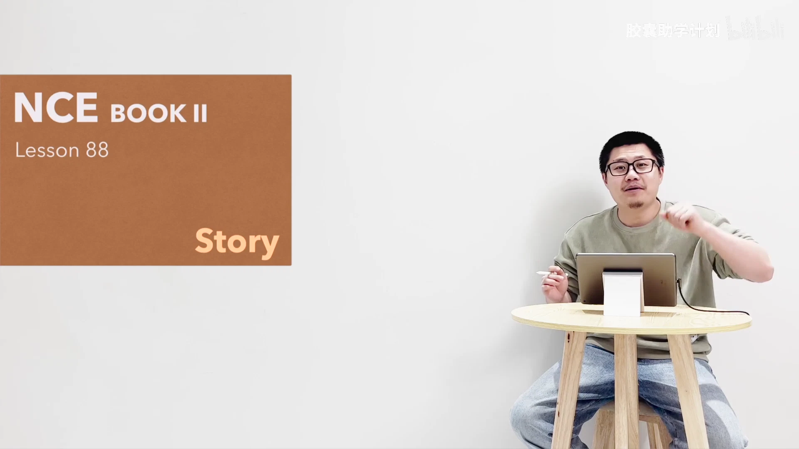

文字识别：NCE / BOOKII / Lesson 88 / Story

### 画面 00:00:02

文字识别：NCE / BOOKII / Lesson 88 / Story

### 画面 00:00:05

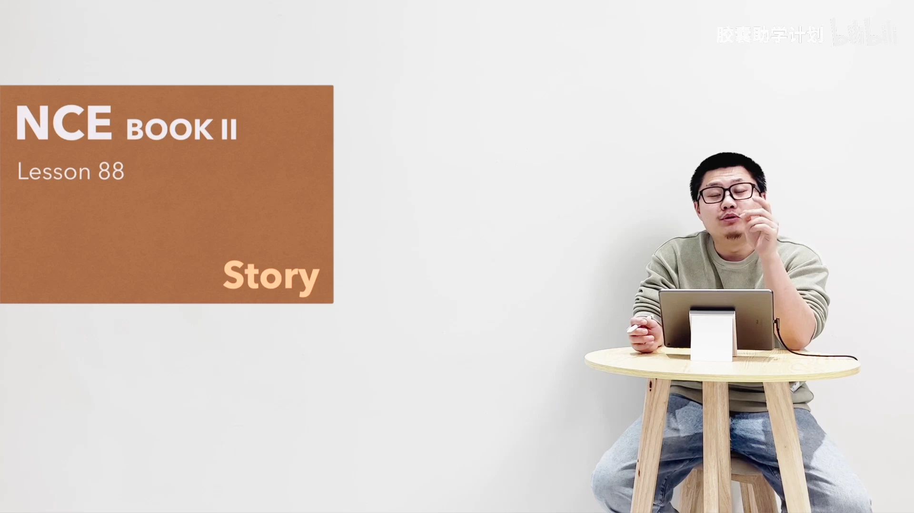

文字识别：NCE / BOOKⅡI / Lesson 88 / Story

### 画面 00:00:10

文字识别：胶囊助学计划bibl

### 画面 00:00:14

### 画面 00:00:16

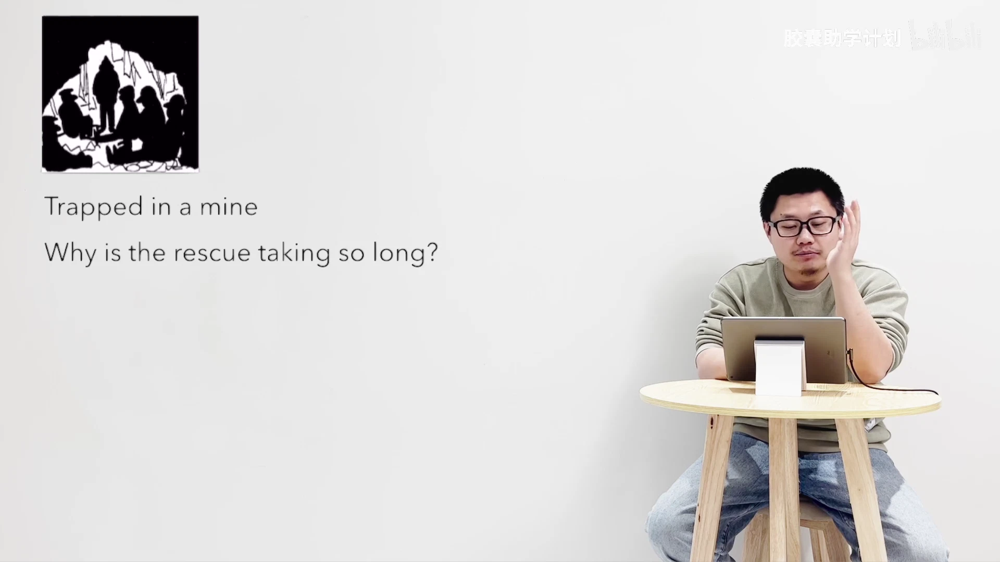

文字识别：Trapped in a mine / Why is the rescue taking so long?

## 00:00:30–00:01:00

taking so long? Why is this rescue operation taking so long? Why is the rescue taking so long? Why is the rescue taking so long? Why is the rescue taking so long? Why is the rescue taking so long? Why is the rescue taking so long? Why is the rescue taking so long? Why is the rescue taking so long? Why is the rescue taking so long? Why is the rescue taking so long? Why is the rescue taking so long? Why is the rescue taking so long? Why is the rescue taking so long? Why is the rescue taking so long? Why is the rescue taking so long? Why is the rescue taking so long? Why is

### 画面 00:00:32

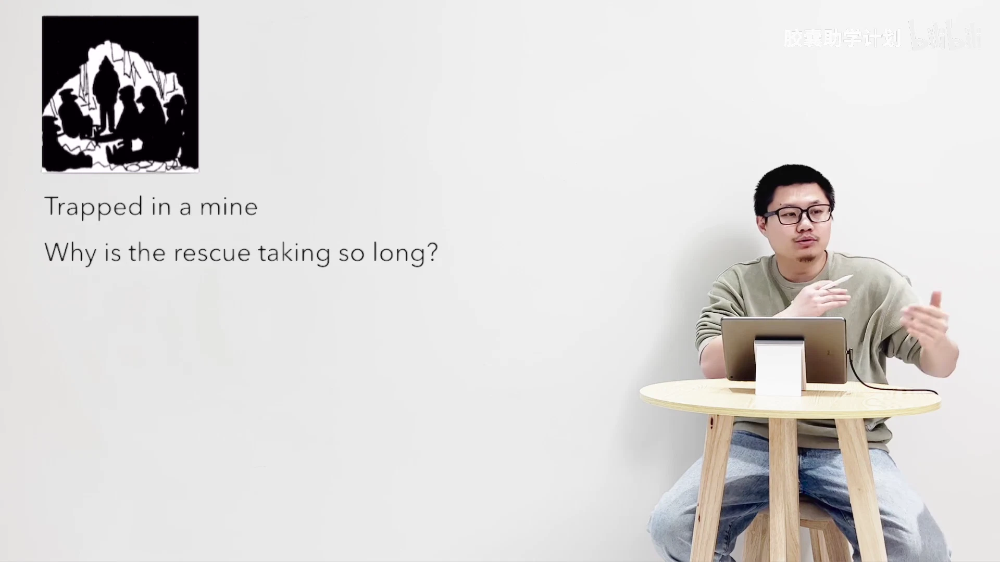

文字识别：Trapped in a mine / Why is the rescue taking so long?

### 画面 00:00:37

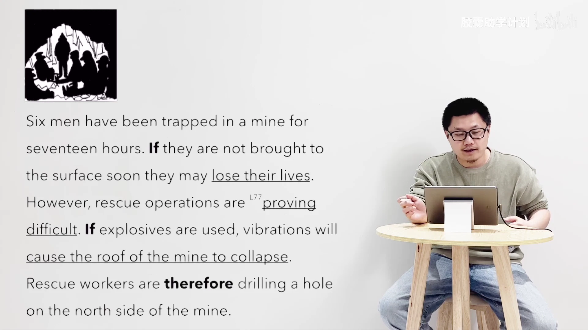

文字识别：Six men have been trapped in a mine for / seventeen hours. If they are not brought to / the surface soon they may lose their lives. / However, rescue operations are / L77 / proving / difficult. If explosives are used, vibrations will / cause the roof of the mine to collapse. / Rescue workers are therefore drilling a hole / on the north side of the mine.

### 画面 00:00:39

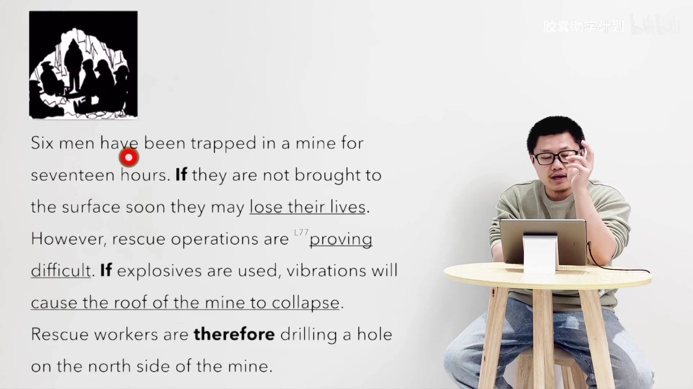

文字识别：Six men have been trapped in a mine for / seventeen hours. If they are not brought to / the surface soon they may lose their lives. / However, rescue operations are / -77 / proving / difficult. If explosives are used, vibrations will / cause the roof of the mine to collapse. / Rescue workers are therefore drilling a hole / on the north side of the mine.

## 00:01:00–00:01:30

lose their lives. If好十六四十六十四，不知道是谁，先往下读。说如果他们没有被带到表面，很快啊，如果他们不是很快被带到表面，他们可能会 lose their lives. 这是一个本课的习惯用法，lose somebody's life. 这只不过变成复数了啊，叫做丢掉他们的性命，失去他们的生命啊。所以这是十六课的嘛。如果他

### 画面 00:01:09

文字识别：Six men have been trapped in a mine for / seventeen hours. If they are not brought to / the surface soon they may lose their lives. / However, rescue operations are / L77 / proving / difficult. If explosives are used, vibrations will / cause the roof of the mine to collapse. / Rescue workers are therefore drilling a hole / on the north side of the mine.

## 00:01:30–00:02:00

们不是很快就被带到这个地面上来，他们可能会失去他们的生命。However, rescue operations are proving difficult. 其实七课咱学了，对吧？说然而啊，说这个 rescue operation， operation 有操作的意思是吧？说这个这个营救的这些操作，或者说营救的这些事儿，其实你把 rescue operation 放在一起翻译成营救就可以啊，译译成营救就可以了。怎么样呢？哎，

### 画面 00:01:39

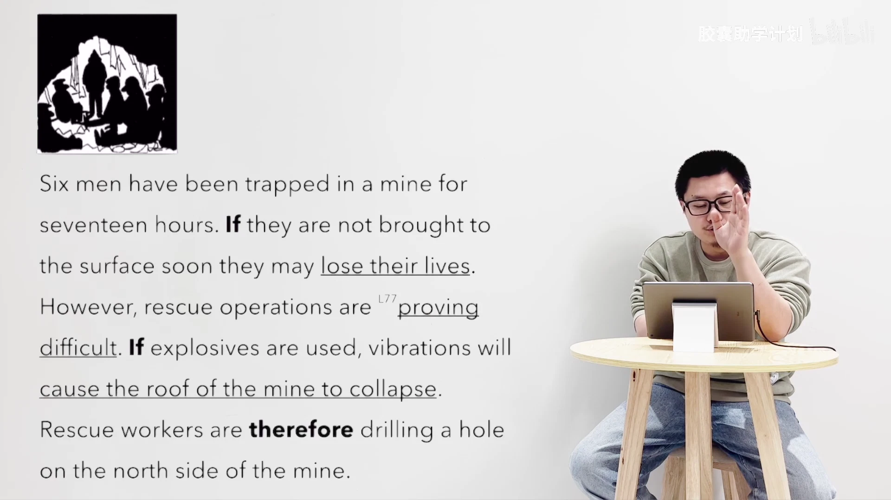

文字识别：Six men have been trapped in a mine for / seventeen hours. If they are not brought to / the surface soon they may lose their lives. / However, rescue operations are / L77 / proving / difficult. If explosives are used, vibrations will / cause the roof of the mine to collapse. / Rescue workers are therefore drilling a hole / on the north side of the mine.

## 00:02:00–00:02:30

显示出相当的困难，或者证明为很困难都可以啊。这个 prove 这个单词用法比较活。呃，然后呢，它翻译成汉语的时候，汉语的证明又有好多个意思，对吧？证明为，证实为，比较困难。再来，if explosives are used, vibrations will cause the roof of the mine to collapse. 好，这句话看着也挺长，但 if 包括这里的 are used 再加 will，其

### 画面 00:02:09

文字识别：Six men have been trapped in a mine for / seventeen hours. If they are not brought to / the surface soon they may lose their lives. / However, rescue operations are / L77 / proving / difficult. If explosives are used, vibrations will / cause the roof of the mine to collapse. / Rescue workers are therefore drilling a hole / on the north side of the mine.

## 00:02:30–00:03:00

实从结构上至少能帮我们判断这项十六科学过的语法。说如果这个炸药被使用，注意一般现在时的被动，对吧？被使用 vibrations，这个震动将怎么样呢？ Okay，这地方有一个习惯用法叫做 cause something somebody to do something，叫做引发某人某事去做什么，去变成怎么怎么样。那这里的意思叫做会

### 画面 00:02:39

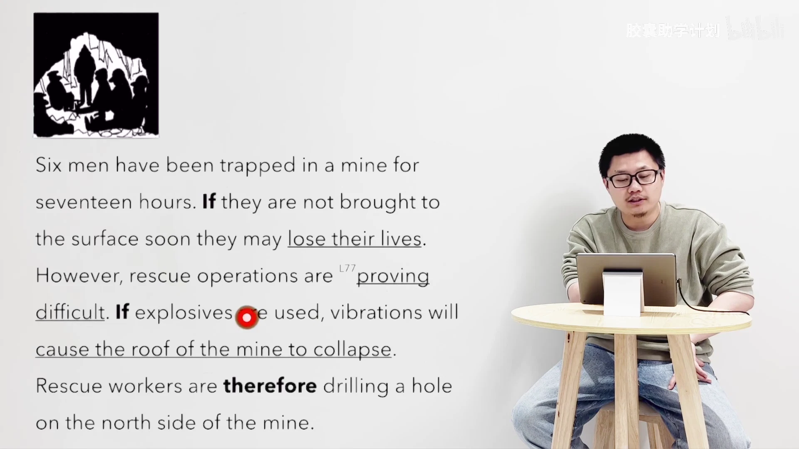

文字识别：Six men have been trapped in a mine for / seventeen hours. If they are not brought to / the surface soon they may lose their lives. / However, rescue operations are / -77 / 'proving / difficult. If explosives oe used, vibrations will / cause the roof of the mine to collapse. / Rescue workers are therefore drilling a hole / on the north side of the mine.

## 00:03:00–00:03:30

引起 a of b 结构由后往前翻译这个矿的怎么样 roof roof 指的是它的这个房顶对吧会引起这个矿的房顶怎么样呢 collapse 坍塌轰塌啊 continue rescue workers are therefore drilling a hole on the north side of the mine rescue workers 指的是这些营救的

### 画面 00:03:08

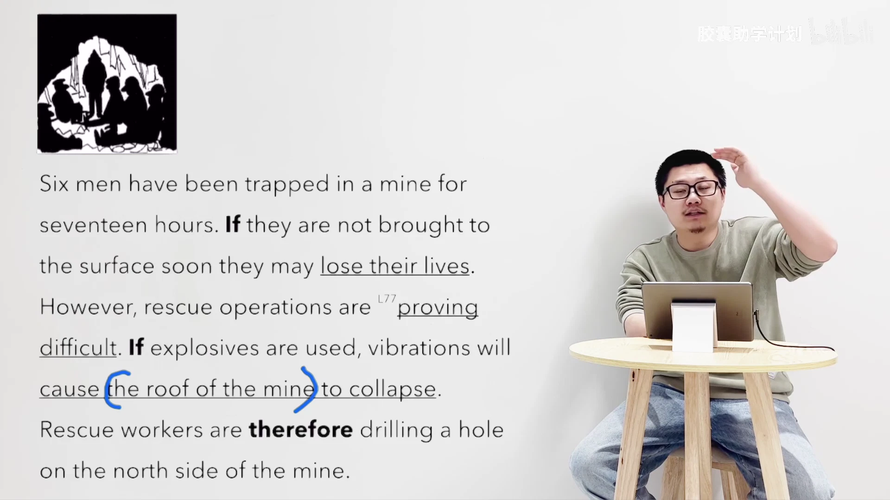

文字识别：Six men have been trapped in a mine for / seventeen hours. If they are not brought to / the surface soon they may lose their lives. / However, rescue operations are / -77 / 'proving / difficult. If explosives are used, vibrations will / fhe roof of the mine to collapse. / cause / Rescue workers are therefore drilling a hole / on the north side of the mine.

### 画面 00:03:11

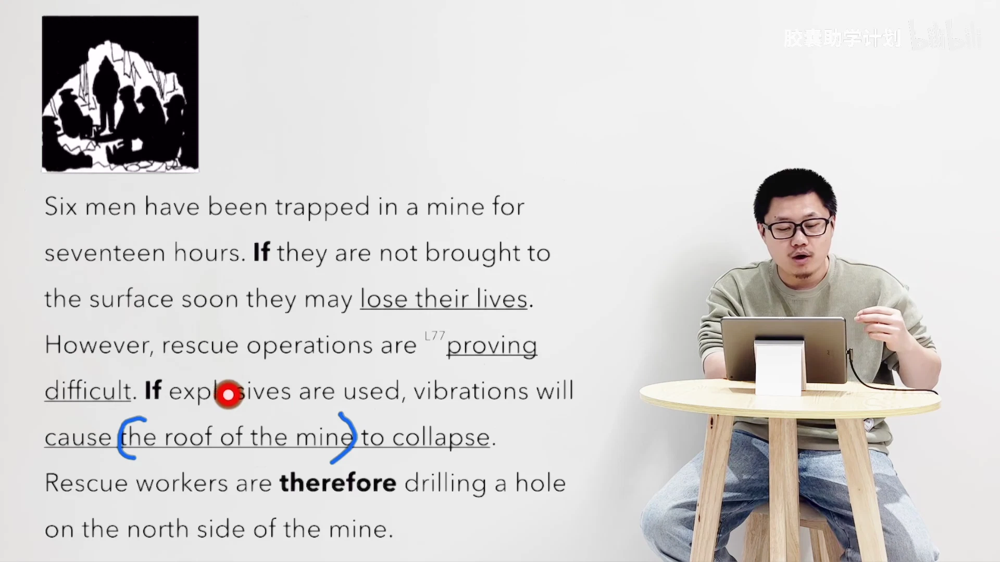

文字识别：Six men have been trapped in a mine for / seventeen hours. If they are not brought to / the surface soon they may lose their lives. / However, rescue operations are / L77 / 'proving / difficult. If explOsives are used, vibrations will / fhe roof of the mine to collapse. / cause / Rescue workers are therefore drilling a hole / on the north side of the mine.

## 00:03:30–00:04:00

工作人员怎么样呢？Are drilling，正在钻 a hole，正在钻一个洞。那这个 therefore 是什么呢？Therefore 表示的是所以或者是因此啊，是一个小的副词。哎，其实它什么词性对于各位来说不重要，基本上你就类似于像刚才我们说这个 however，你不用管它词性，你基本知道它意思就行了啊。说因此呢，怎么样了呢？说这个营救的工作人员正在钻一个洞 on the north

### 画面 00:03:41

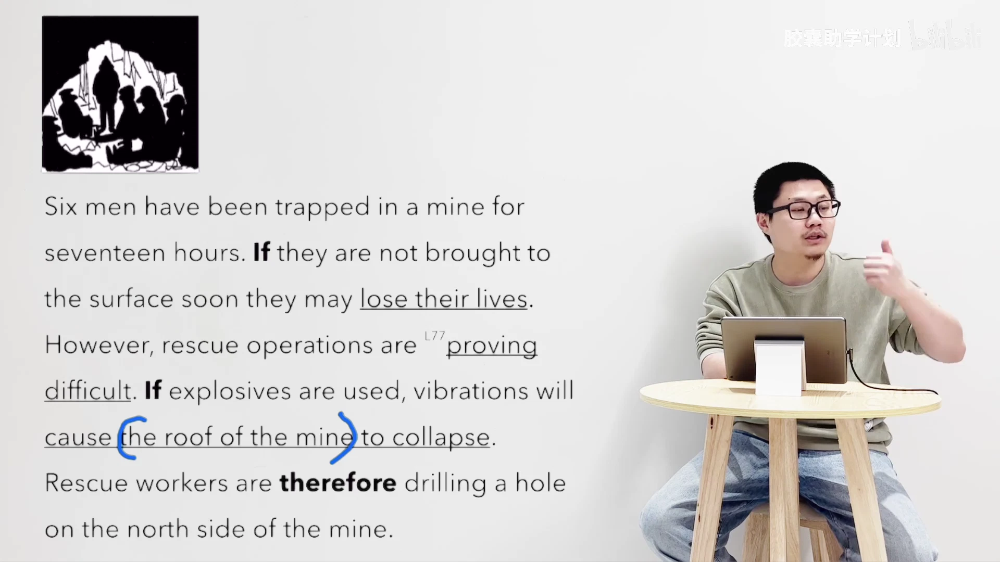

文字识别：Six men have been trapped in a mine for / seventeen hours. If they are not brought to / the surface soon they may lose their lives. / However, rescue operations are / L77 / 'proving / difficult. If explosives are used, vibrations will / fhe roof of the mine to collapse. / cause / Rescue workers are therefore drilling a hole / on the north side of the mine.

## 00:04:00–00:04:30

side of the mine，在北部 of the mine，在这个矿洞的北部正在钻洞。Continue. They intend to bring the man up in a special capsule.说他们呢，哎，intend to do something，三十六课咱们学过，说哎七呃这个这个计划是吧？其实跟be going to do很像。他们有这样一个计划要干嘛呢？尝

### 画面 00:04:09

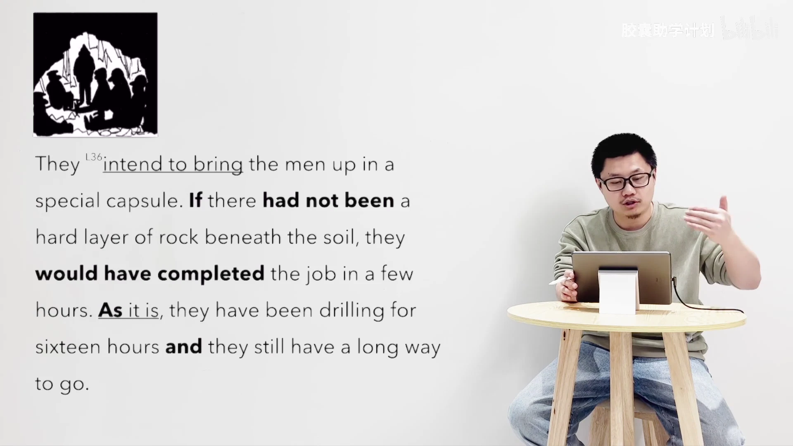

文字识别：They [3'intend to bring the men up in a / special capsule. If there had not been a / hard layer of rock beneath the soil, they / would have completed the job in a few / hours. As it is, they have been drilling for / sixteen hours and they still have a long way / to go.

## 00:04:30–00:05:00

试着要把这些人 bring them up，把这些人带上来 in a special capsule，在一个特殊的容器当中。Continue. If there had not been a hard layer of rock beneath the soil, they would have completed the work in a few hours. If had not been would have completed 六十四课，对吧？这个完全取

### 画面 00:04:39

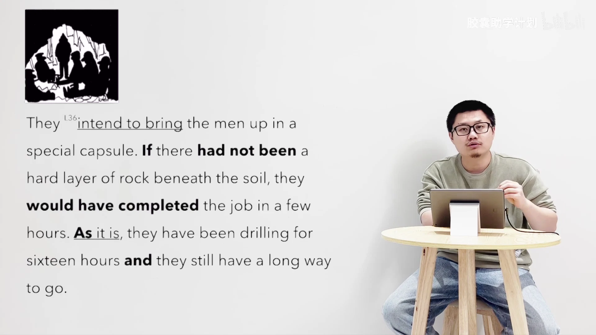

文字识别：They [3'intend to bring the men up in a / special capsule. If there had not been a / hard layer of rock beneath the soil, they / would have completed the job in a few / hours. As it is, they have been drilling for / sixteen hours and they still have a long way / to go.

## 00:05:00–00:05:30

决于你前面语法有多好，所以先看它字面意思。首先，这个 there have been 其实就是 there be 句型的变体。我们原来学过 there is, there was，对吧？那 there were，那还有一个就是 there had been，对吧？说那 have not 就是没有嘛。说如果没有 a hard layer of a layer of 叫一层 a hard layer of，你要看后边决定这个 hard 翻译成什么，坚

### 画面 00:05:00

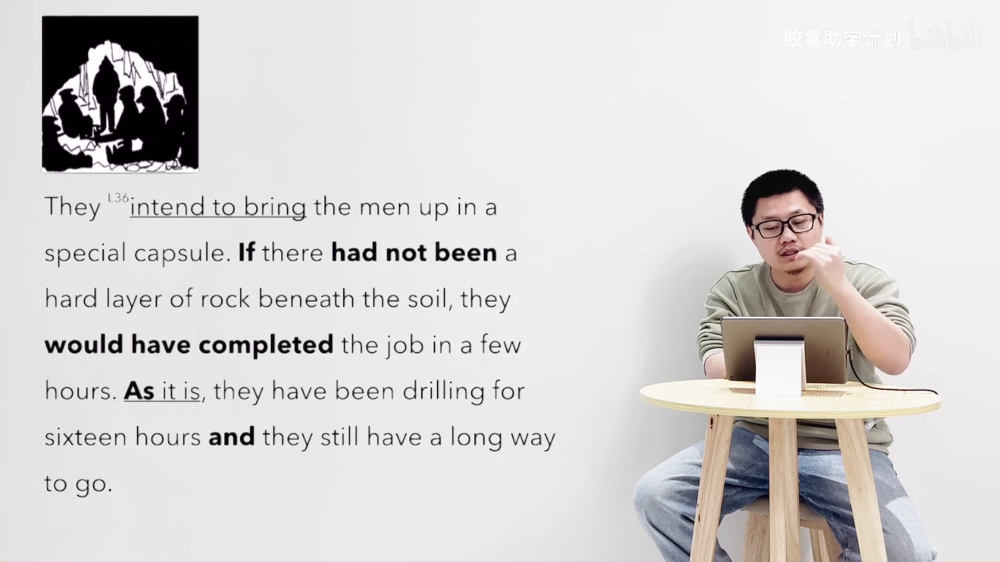

文字识别：They [3'intend to bring the men up in a / special capsule. If there had not been a / hard layer of rock beneath the soil, they / would have completed the job in a few / hours. As it is, they have been drilling for / sixteen hours and they still have a long way / to go.

### 画面 00:05:03

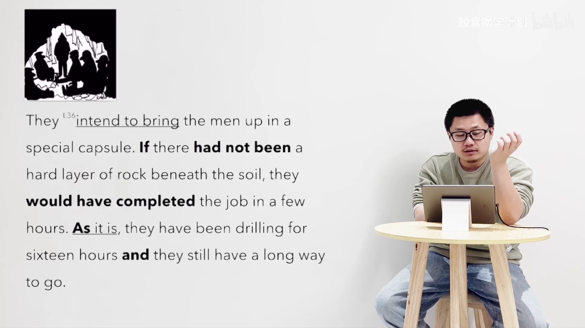

文字识别：They [³'intend to bring the men up in a / special capsule. If there had not been a / hard layer of rock beneath the soil, they / would have completed the job in a few / hours. As it is, they have been drilling for / sixteen hours and they still have a long way / to go.

## 00:05:30–00:06:00

硬的，对吧？如果没有那坚硬的一层rock岩石，beneath the soil叫做在这个土壤的下面。如果没有一层坚硬的岩石，they would have completed the job in a few hours.他们将已经完成了这个工作，在数个小时之内。那这句话想告诉我们的不是它的字面意思，想告诉我们的是如下这些信息。这你如果获取了这

### 画面 00:05:33

文字识别：They [3'intend to bring the men up in a / special capsule. If there had not been a / hard layer of rock beneath the soil, they / would have completed the job in a few / hours. As it is, they have been drilling for / sixteen hours and they still have a long way / to go.

### 画面 00:05:53

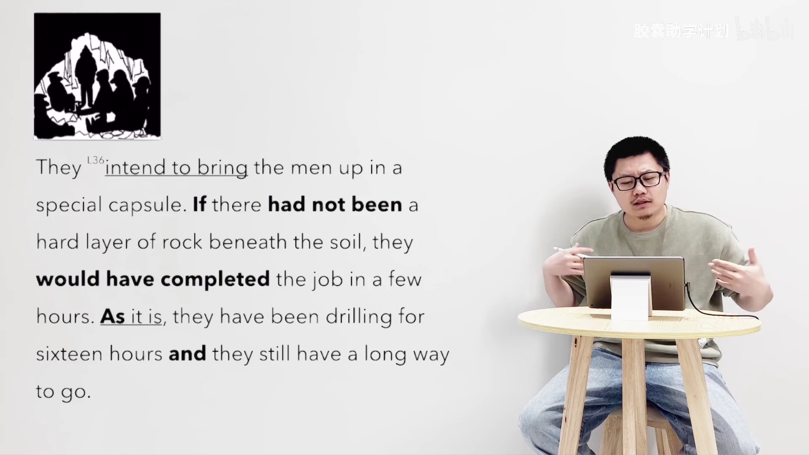

文字识别：They [3'intend to bring the men up in a / special capsule. If there had not been a / hard layer of rock beneath the soil, they / would have completed the job in a few / hours. As it is, they have been drilling for / sixteen hours and they still have a long way / to go.

## 00:06:00–00:06:30

接下来我说的这些信息，才叫这个虚拟语气，这个时态，这个呃这个语法我搞懂了，不是时态啊，这个语法我搞懂了。这句话想给我们提供的信息是，第一，在土壤之下有一层非常硬的岩石，这是过去事实，相反是有的啊。第二，他们没有办法在数小时内完成钻井的这项啊往下钻的这个任务，为什么？因为有一

### 画面 00:06:23

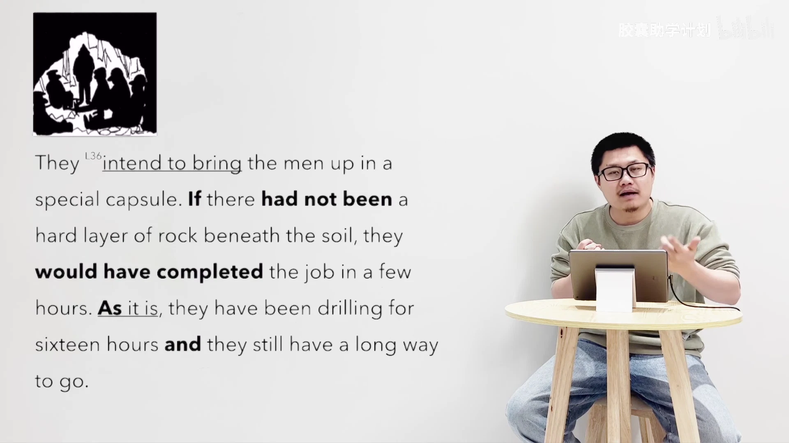

文字识别：They [3'intend to bring the men up in a / special capsule. If there had not been a / hard layer of rock beneath the soil, they / would have completed the job in a few / hours. As itis, they have been drilling for / sixteen hours and they still have a long way / to go.

## 00:06:30–00:07:00

层硬的岩石层，就这么简单。 Continue as it is, a啊就就as it is，这是一个超呃本科的习惯用法，就类似于in fact，事实上，事实上in fact， they have been drilling for sixteen hours and they still have a long way to go. 好，这个and告诉你断句嘛。 In fact，事实上，as it is啊，就像它现在的那样，对吧？就像现在这个样子啊。事实上，

### 画面 00:06:53

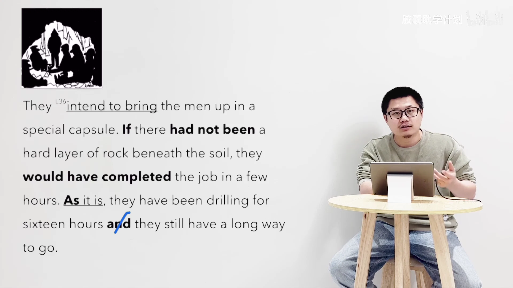

文字识别：They [3'intend to bring the men up in a / special capsule. If there had not been a / hard layer of rock beneath the soil, they / would have completed the job in a few / hours. As it is, they have been drilling for / sixteen hours ard they still have a long way / to go.

## 00:07:00–00:07:30

have been drilling 五十二克，现在完成进行时说他们已经钻了 for sixteen hours 十六个小时了，这是第一句话。第二句话叫 They still have a long way to go. 他们还有很长的路要走啊，这是一个，呃，还有很长的路走，对吧？哎，这个路的意思就是还要钻很久很久。Meanwhile, ah, in the meantime, 与此同时，见过好多次这个单词了。A microphone, 后边逗号直接来

### 画面 00:07:15

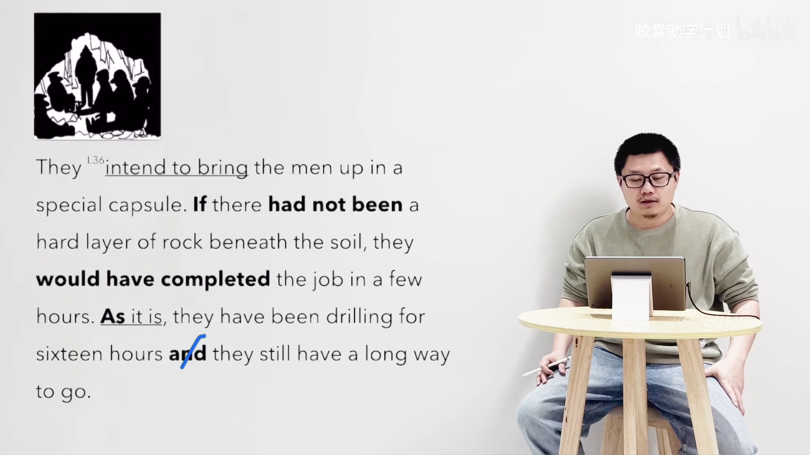

文字识别：They [3'intend to bring the men up in a / special capsule. If there had not been a / hard layer of rock beneath the soil, they / would have completed the job in a few / hours. As it is, they have been drilling for / sixteen hours ard they still have a long way / to go.

### 画面 00:07:19

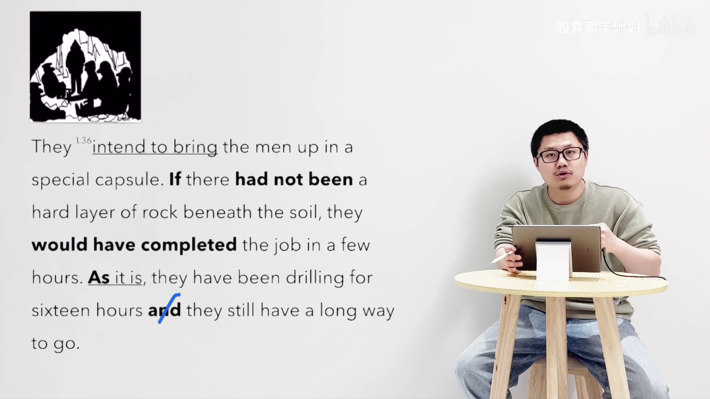

文字识别：They [³'intend to bring the men up in a / special capsule. If there had not been a / hard layer of rock beneath the soil, they / would have completed the job in a few / hours. As itis, they have been drilling for / sixteen hours aryd they still have a long way / to go.

### 画面 00:07:21

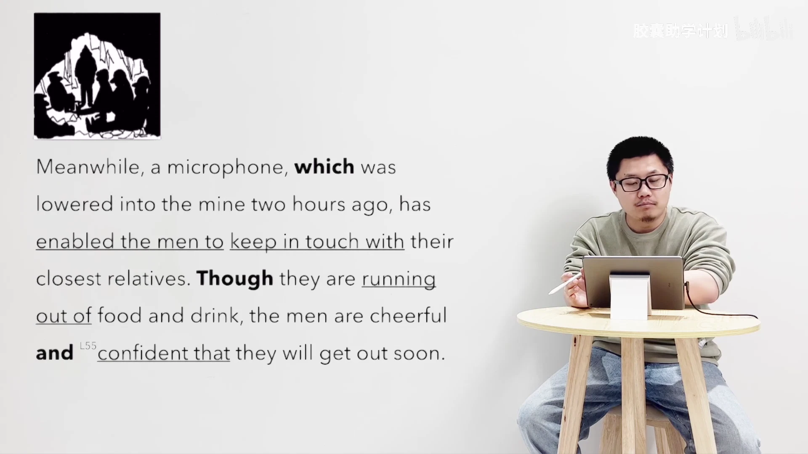

文字识别：Meanwhile, a microphone, which was / lowered into the mine two hours ago, has / enabled the men to keep in touch with their / closest relatives. Though they are running / out of food and drink, the men are cheerful / and / L55 / 'confident that they will get out soon.

### 画面 00:07:24

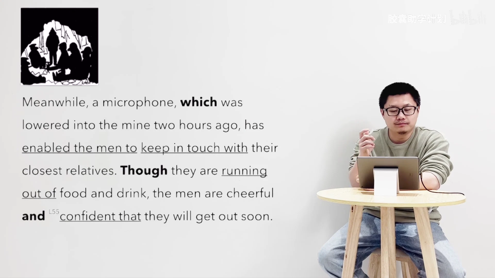

文字识别：Meanwhile, a microphone, which was / lowered into the mine two hours ago, has / enabled the men to keep in touch with their / closest relatives. Though they are running / out of food and drink, the men are cheerful / and / L55 / 'confident that they will get out soon.

## 00:07:30–00:08:00

个which，然后逗号在这儿，逗号在这儿结束，直接来了个非限定性定语从句去补充说明这个microphone啊，说白了就是作者认为这不需要被限定，所以放到这个地方，我相信各位有一个感觉啊，就是限定不限定，只能说有的时候啊，并不是绝对的，还是以我们作者主观感受，我想限定我就限定，我觉得没有必要限定我就不限定，

### 画面 00:07:35

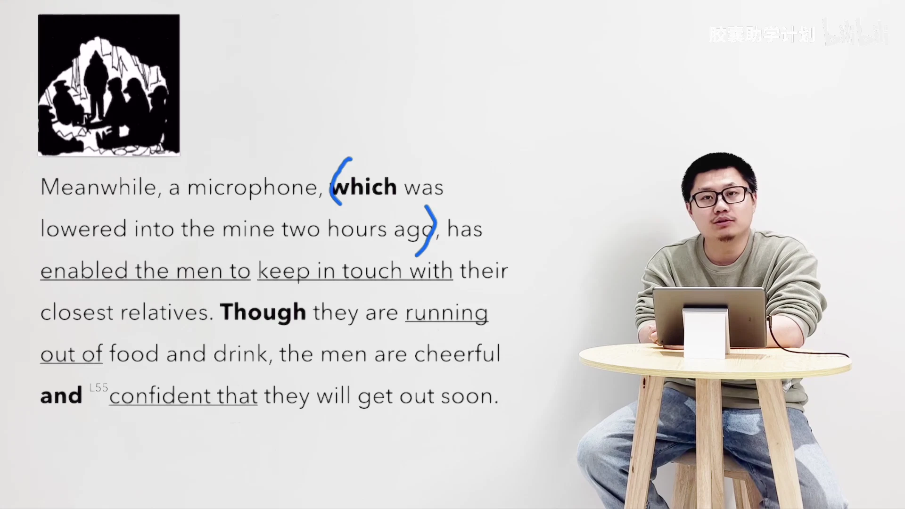

文字识别：Meanwhile, a microphone, / which was / lowered into the mine two hours agg, has / enabled the men to keep in touch with their / closest relatives. Though they are running / out of food and drink, the men are cheerful / and / L55 / 'confident that they will get out soon.

## 00:08:00–00:08:30

对吧？有点作者主观感受的，并不是一个绝对客观判断的。我说是梨就是梨，是苹果就是苹果，对吧？你也没办法指鹿为马啊，是鹿就是鹿，是马就是马，这是客观事实。但是在这个语法，英语语法包括时态也是这个样子，在用的时候，它其实是有作者主观想用谁的，有这样一个感受，但你不能乱用啊。它不是说我用谁都对了。所以有这么一个麦克风，然后

### 画面 00:08:05

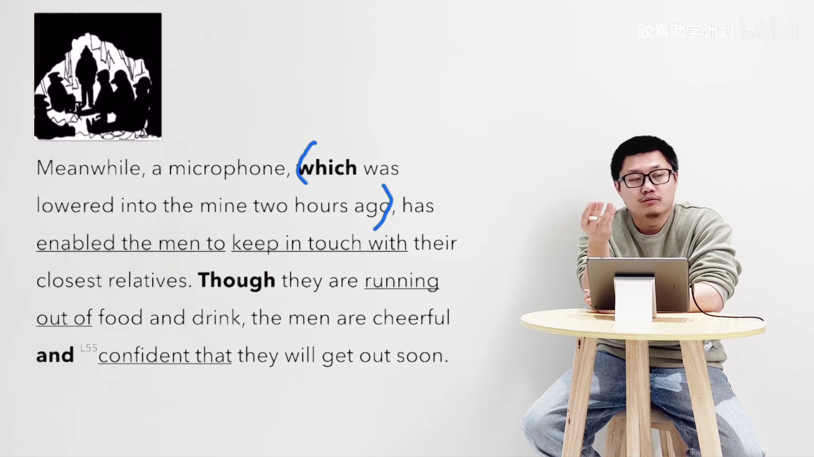

文字识别：Meanwhile, a microphone, / which was / lowered into the mine two hours agg, has / enabled the men to keep in touch with their / closest relatives. Though they are running / out of food and drink, the men are cheerful / and / L55 / 'confident that they will get out soon.

## 00:08:30–00:09:00

我们先看定语从句。这麦克风是什么？Which was lowered into the mine two hours ago.说这个麦克风被下降到了这个矿井当中，两个小时之前的这个麦克风怎么样了呢？Has enabled the man to keep in touch with their closest relatives.啊，这句话里边难难在哪儿了呢？连着两个习惯用法，enable somebody to do something，确保保证某人做某件事儿，

### 画面 00:08:35

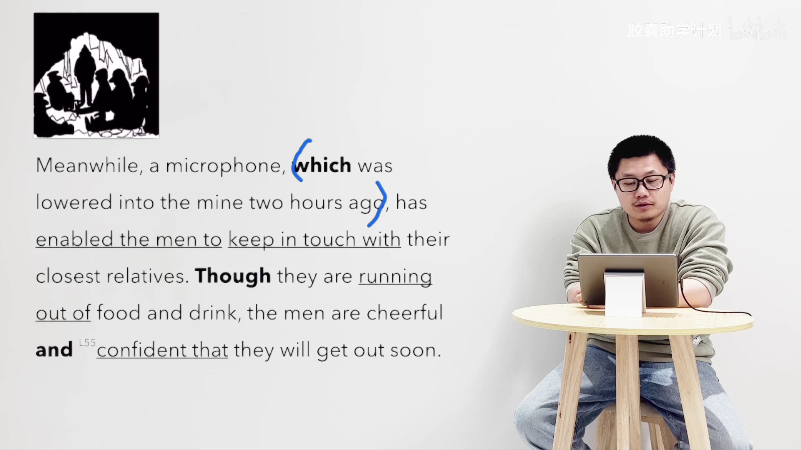

文字识别：Meanwhile, a microphone, / which was / lowered into the mine two hours agg, has / enabled the men to keep in touch with their / closest relatives. Though they are running / out of food and drink, the men are cheerful / and / L55 / 5confident that they will get out soon.

### 画面 00:08:52

文字识别：Meanwhile, a microphone, / which was / lowered into the mine two hours agg, has / enabled the men to keep in touch with their / closest relatives. Though they are running / out of food and drink, the men are cheerful / and / L55 / 5confident that they will get out soon.

### 画面 00:08:56

文字识别：Meanwhile, a microphone, / which was / lowered into the mine two hours agg, has / enabled the men to keep in touch with their / closest relatives. Though they are running / out of food and drink, the men are cheerful / and / L55 / 5confident that they will get out soon.

## 00:09:00–00:09:30

这是第一个。确保了这些人怎么样呢？Keep in touch with somebody叫做保持联系。确保了这些矿工保持联系和什么呢？Their closest relatives，他们最亲近的亲属或亲戚，对吧？亲属亲戚都叫做 relatives。 Okay，啊，确保了这件事情。Though， even though， although， even if， Okay，这个红皮书一找，把这个练习都给他做了啊。说They are running out of food and drink. The

### 画面 00:09:26

文字识别：Meanwhile, a microphone, / which was / lowered into the mine two hours agg, has / enabled the men to keep in touch with their / closest relatives. Though they are running / out of food and drink, the men are cheerful / and / L55 / 'confident that they will get out soon.

## 00:09:30–00:10:00

men are cheerful and confident that they will get out soon.这句话乍一看还是挺长，但不过还好有逗号，有and帮我们去断句，对吧？说尽管他们 ran out of food and drink, ran out of是什么意思呢？叫做用尽用光了啊，用尽用光了食物和喝的东西，其实就是没有了啊。They they they don't have any more,对吧？就是这样一个意思。The men are cheerful,说底下这些矿工

### 画面 00:09:56

文字识别：Meanwhile, a microphone, / which was / lowered into the mine two hours agg, has / enabled the men to keep in touch with their / closest relatives. Though they are running / out of food and drink/the men are cheerful / L55 / confident that they will get out soon. / and

## 00:10:00–00:10:30

们还是挺开心的. Cheerful, ah,哎，但是不至于说黄歌载舞的吧，但是精神还是比较愉悦的. Cheerful, confident, confident.五十五课学嘛, somebody be confident that,对吧？但只不过这个be somebody和be被省略了，因为你这种and没有必要再来一个叫做the men are confident就跟这是重合的啊，可以省略。很自信, they will get out soon.他们很快就会出来了。再

### 画面 00:10:26

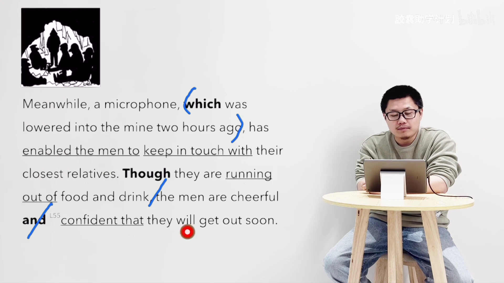

文字识别：Meanwhile, a microphone, / which was / lowered into the mine two hours agg, has / enabled the men to keep in touch with their / closest relatives. Though they are running / out of food and drink/he men are cheerful / L55 / 5confident that they will get out soon. / and

### 画面 00:10:29

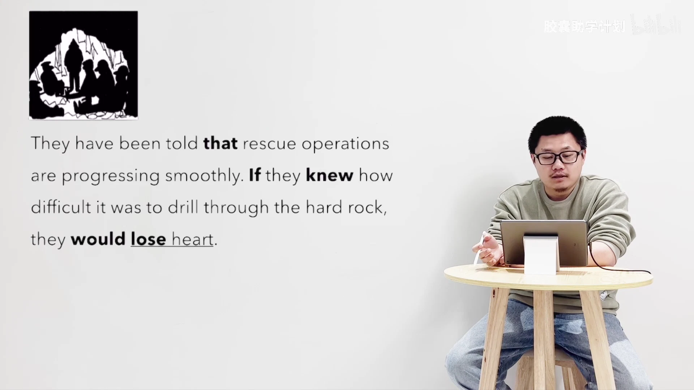

文字识别：They have been told that rescue operations / are progressing smoothly. If they knew how / difficult it was to drill through the hard rock, / they would lose heart.

## 00:10:30–00:11:00

来，They have been told.他们已经被告知，现在完成时的被动，被告知的是一件事情。宾语从句，Rescue operations are progressing smoothly.好，说这个营救的这些措施怎么样呢？正在有进步，smoothly顺利的进步，顺哎进展顺利啊。Progressing smoothly直接翻译成进进展顺利就可以了。好吧，其实跟我们在讲单词smoothly那个地方

### 画面 00:10:54

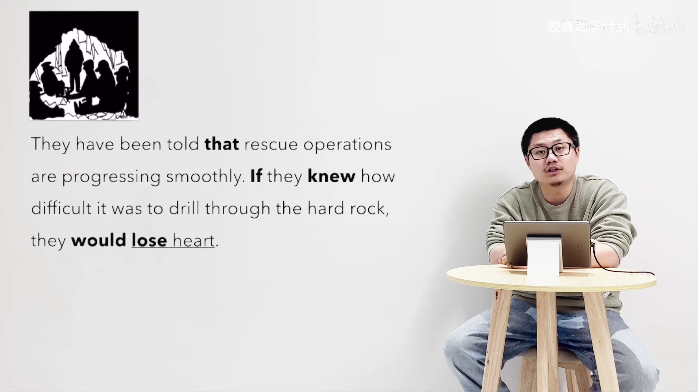

文字识别：They have been told that rescue operations / are progressing smoothly. If they knew how / difficult it was to drill through the hard rock, / they would lose heart.

### 画面 00:10:58

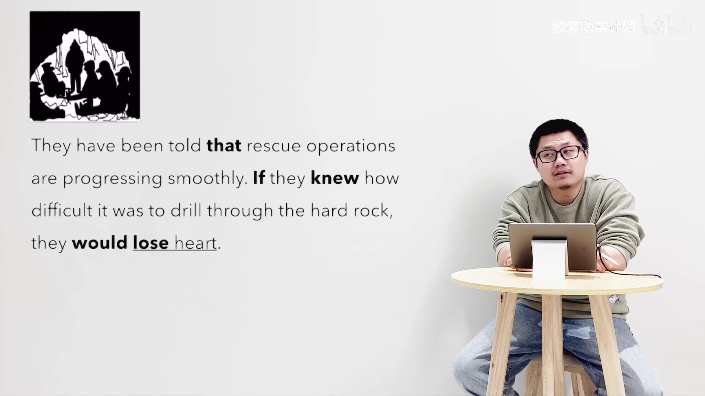

文字识别：They have been told that rescue operations / are progressing smoothly. If they knew how / difficult it was to drill through the hard rock, / they would lose heart.

## 00:11:00–00:11:30

说 go smoothly 一码事儿啊。 If they knew how difficult it was to drill through the hard rock, they would lose heart. 说如果他们清楚啊，清楚什么呢？后边一件事儿叫做 how difficult it was to drill through the hard. 说有多么的困难，干嘛呢？去钻过这个坚硬的岩石这件

### 画面 00:11:28

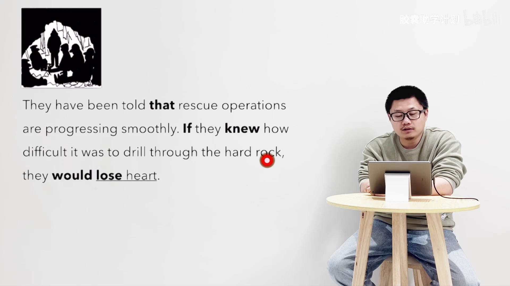

文字识别：They have been told that rescue operations / are progressing smoothly. If they knew how / difficult it was to drill through the hard rock, / they would lose heart.

## 00:11:30–00:12:00

儿有多么的困难？They would lose heart. They would lose heart. 本课的习惯用法，失去了心脏，失去信心啊，灰心丧气啊，lose heart. 那你看这里，if knew would lose，非常典型，对吧？哎，就他们知不知道？与现在事实相反，他们不知道，他们不还 cheerful 的吗？他们不知道这个事儿有多么的困难。你不能告诉他真相。你告诉他真相，这帮人哎，抱头痛哭，然后士气大降，然

### 画面 00:11:51

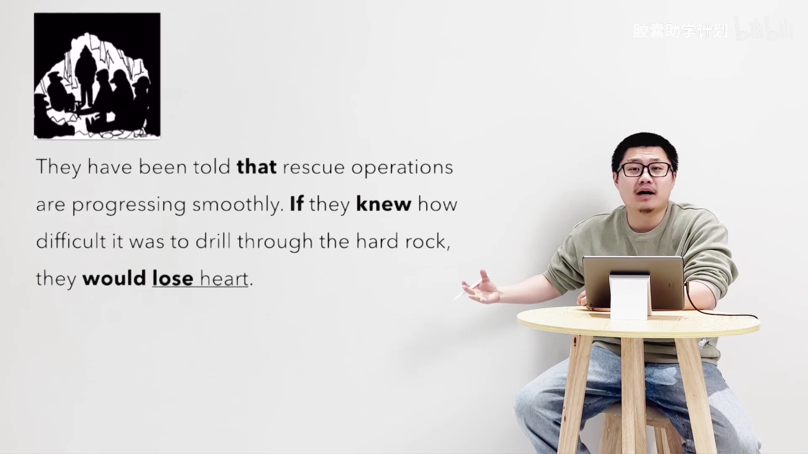

文字识别：They have been told that rescue operations / are progressing smoothly. If they knew how / difficult it was to drill through the hard rock, / they would lose heart.

### 画面 00:11:57

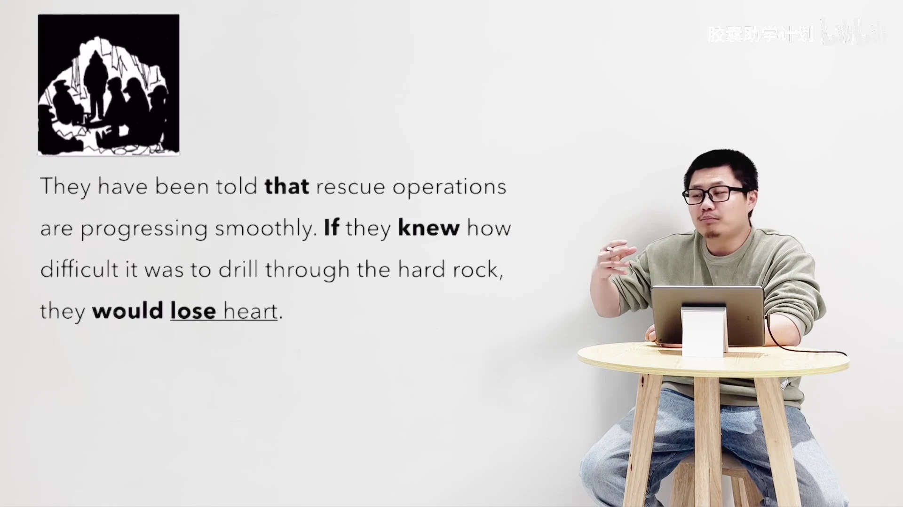

文字识别：They have been told that rescue operations / are progressing smoothly. If they knew how / difficult it was to drill through the hard rock, / they would lose heart.

## 00:12:00–00:12:30

后就可能还没来得及等到营救，他们就扛不下去了嘛，精神崩溃，人就崩溃了，对吧？所以他们并不知道，所以他们也没有 lose heart，对吧？与现在事实相反。接下来习惯用法造句啊，这个老生常谈，咱们挨个过啊。 Lose one's life，失去生命。张嘴跟我读。 He lost his life in an aircraft. Next one. All the people

### 画面 00:12:13

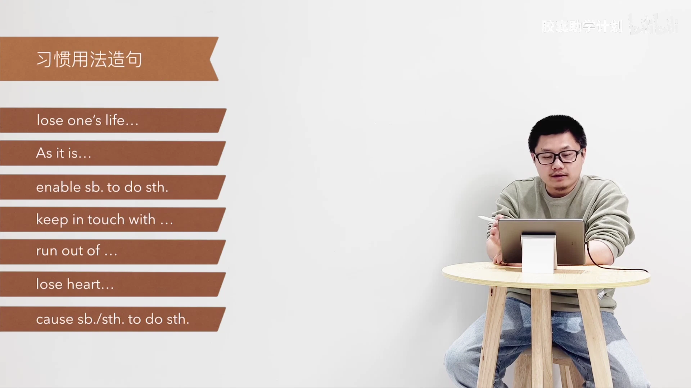

文字识别：习惯用法造句 / lose one's life... / As it is... / enable sb. to do sth. / keep in touch with / run out of / lose heart.. / cause sb./sth.to do sth.

### 画面 00:12:15

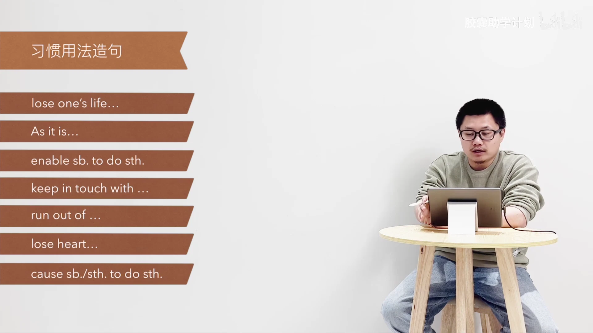

文字识别：习惯用法造句 / lose one's life... / As it is... / enable sb. to do sth. / keep in touch with / run out of / lose heart.. / cause sb./sth. to do sth.

### 画面 00:12:17

文字识别：网：v.+v.变化 / 习惯用法造句指南 / 囊助字计划 / 四句型转换 / 方式/地点/时间 / 其他习惯用法 / 其他单词+词性 / 原文摘抄+变 / 6123456 / lose one's life...

### 画面 00:12:20

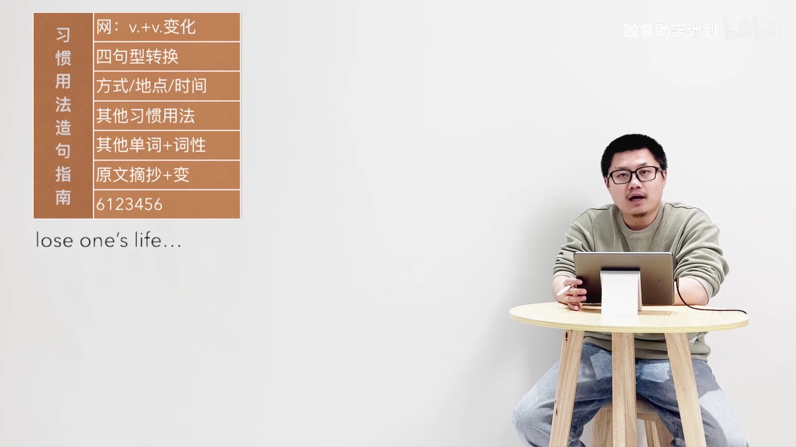

文字识别：网：v.+v.变化 / 习惯用法造句指南 / 囊助字计划 / 四句型转换 / 方式/地点/时间 / 其他习惯用法 / 其他单词+词性 / 原文摘抄+变 / 6123456 / lose one's life...

### 画面 00:12:24

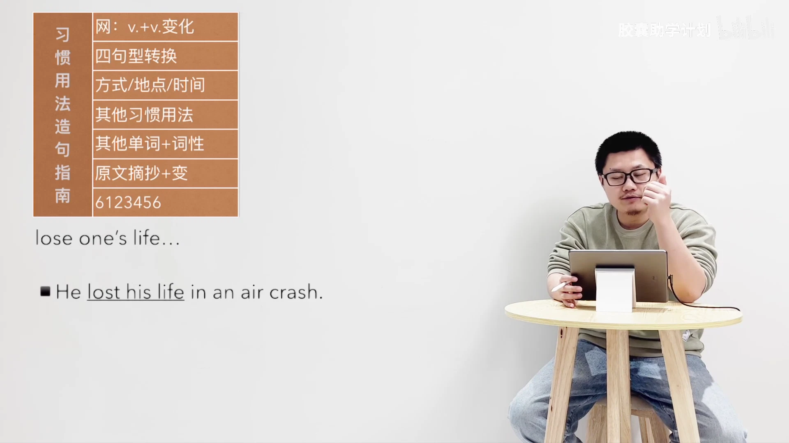

文字识别：网：v.+v.变化 / 习惯用法造句指南 / 囊助字计划 / 四句型转换 / 方式/地点/时间 / 其他习惯用法 / 其他单词+词性 / 原文摘抄+变 / 6123456 / lose one's life... /  He lost his life in an air crash.

### 画面 00:12:26

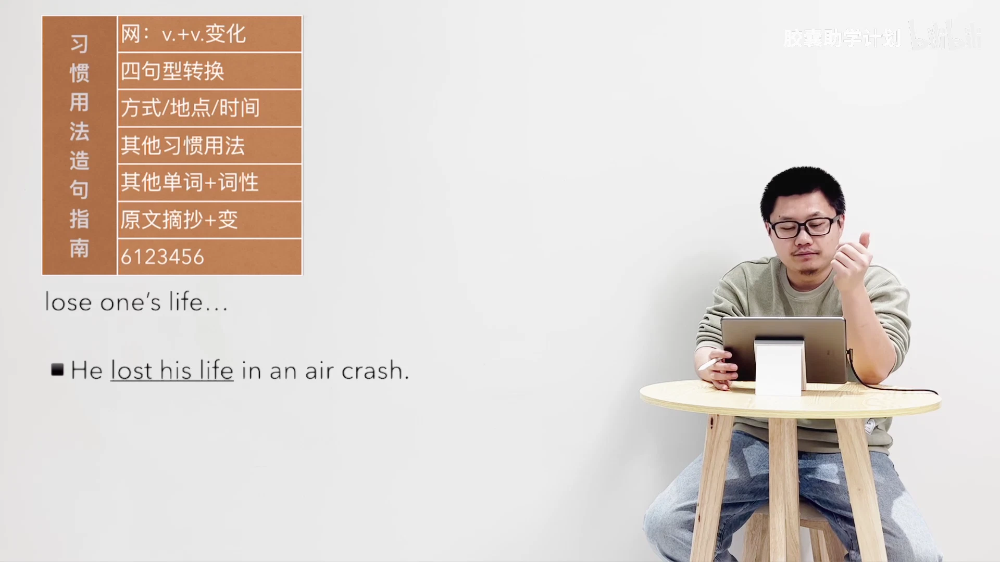

文字识别：网：v.+v.变化 / 习惯用法造句指南 / 囊助字计划陽 / 四句型转换 / 方式/地点/时间 / 其他习惯用法 / 其他单词+词性 / 原文摘抄+变 / 6123456 / lose one's life... /  He lost his life in an air crash.

### 画面 00:12:28

文字识别：网：v.+v.变化 / 习惯用法造句指南 / 奏助字计划 / 四句型转换 / 方式/地点/时间 / 其他习惯用法 / 其他单词+词性 / 原文摘抄+变 / 6123456 / lose one's life... /  He lost his life in an air crash. /  All the people in the building were saved, / but a firefighter lost his life. L10

## 00:12:30–00:13:00

in the building were saved, but a firefighter lost his life. 注意这里用的一般过去式被动，对吧？然后包括其实用到了二十五课的并列连词。哎，He failed to get out of the building and lost his life there. 哎，他十六课学的 failed to do something 失败，没有做成，对吧？Next one，注意力集中啊，听着这样片段。You might lose your life before this is over.

### 画面 00:12:30

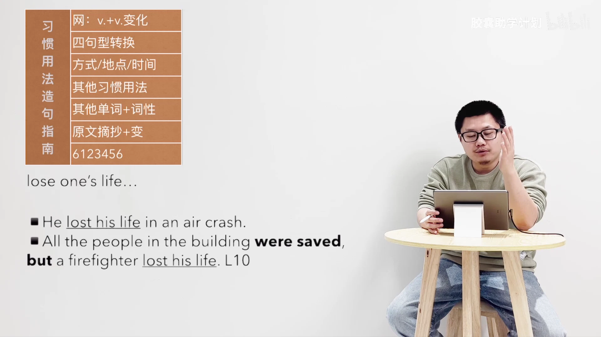

文字识别：网：v.+v.变化 / 习惯用法造句指南 / 喜助字计划 / 四句型转换 / 方式/地点/时间 / 其他习惯用法 / 其他单词+词性 / 原文摘抄+变 / 6123456 / lose one's life... /  He lost his life in an air crash. /  All the people in the building were saved, / but a firefighter lost his life. L10

### 画面 00:12:34

文字识别：网：v.+v.变化 / 习惯用法造句指南 / 囊助学计划 / 四句型转换 / 方式/地点/时间 / 其他习惯用法 / 其他单词+词性 / 原文摘抄+变 / 6123456 / lose one's life... /  He lost his life in an air crash. /  All the people in the building were saved, / but a firefighter lost his life. L10

### 画面 00:12:36

文字识别：网：v.+v.变化 / 习惯用法造句指南 / 妻助字计划 / 四句型转换 / 方式/地点/时间 / 其他习惯用法 / 其他单词+词性 / 原文摘抄+变 / 6123456 / lose one's life... /  He lost his life in an air crash. /  All the people in the building were saved, / but a firefighter lost his life. L10

### 画面 00:12:38

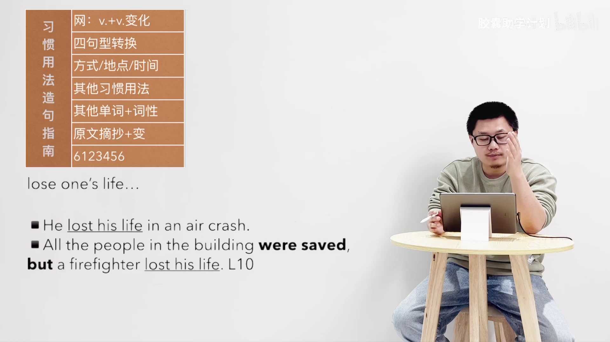

文字识别：网：v.+v.变化 / 习惯用法造句指南 / 妻助字计划 / 四句型转换 / 方式/地点/时间 / 其他习惯用法 / 其他单词+词性 / 原文摘抄+变 / 6123456 / lose one's life... /  He lost his life in an air crash. /  All the people in the building were saved, / but a firefighter lost his life. L10

### 画面 00:12:40

文字识别：网：v.+v.变化 / 习惯用法造句指南 / 辜助学计划 / 四句型转换 / 方式/地点/时间 / 其他习惯用法 / 其他单词+词性 / 原文摘抄+变 / 6123456 / lose one's life... /  He lost his life in an air crash. /  All the people in the building were saved, / but a firefighter lost his life. L10

### 画面 00:12:44

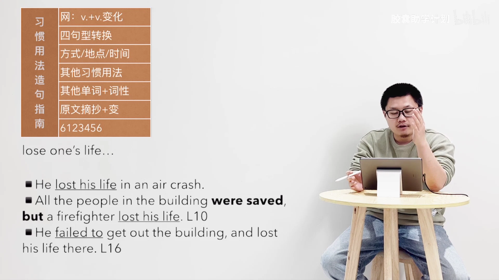

文字识别：网：v.+v.变化 / 习惯用法造句指南 / 助字计划 / 四句型转换 / 方式/地点/时间 / 其他习惯用法 / 其他单词+词性 / 原文摘抄+变 / 6123456 / lose one's life... /  He lost his life in an air crash. /  All the people in the building were saved, / but a firefighter lost his life. L10 /  He failed to get out the building, and lost / his life there. L16

### 画面 00:12:46

文字识别：网：v.+v.变化 / 习惯用法造句指南 / 臺助学计划 / 四句型转换 / 方式/地点/时间 / 其他习惯用法 / 其他单词+词性 / 原文摘抄+变 / 6123456 / lose one's life... /  He lost his life in an air crash. /  All the people in the building were saved, / but a firefighter lost his life. L10 /  He failed to get out the building, and lost / his life there. L16

### 画面 00:12:51

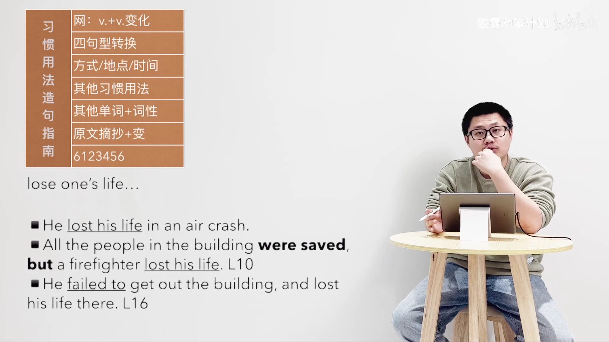

文字识别：网：v.+v.变化 / 习惯用法造句指南 / 囊助学计划 / 四句型转换 / 方式/地点/时间 / 其他习惯用法 / 其他单词+词性 / 原文摘抄+变 / 6123456 / lose one's life... /  He lost his life in an air crash. /  All the people in the building were saved, / but a firefighter lost his life. L10 /  He failed to get out the building, and lost / his life there. L16

### 画面 00:12:54

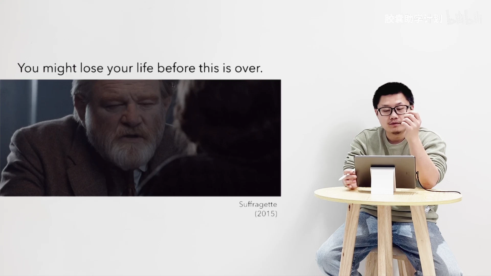

文字识别：You might lose your life before this is over. / Suffragette / (2015)

### 画面 00:12:58

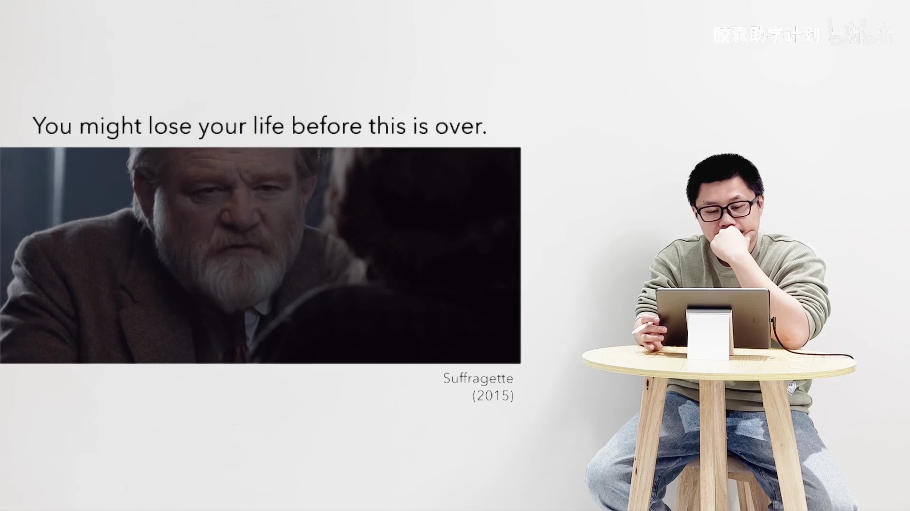

文字识别：You might lose your life before this is over. / Suffragette / (2015)

## 00:13:00–00:13:30

Ah, this place, I will mention one more time. This "over" here, how to translate it? This "before this is over," this "over" how to translate it? When you were a kid, you didn't know if you played any of the arcade games like the King of Fighters, right? The red man, the green man, Ah Doogan, Ah Jiajia Bluegan. I don't know if you played that. If you played that, you know that it says "game over." Over means it's over. Before this is over means before this is over. Before this is over means before this is over. Before this is over means before this is over. Before this is over means before this is over. Before this is over means before this is over. Before this

### 画面 00:13:03

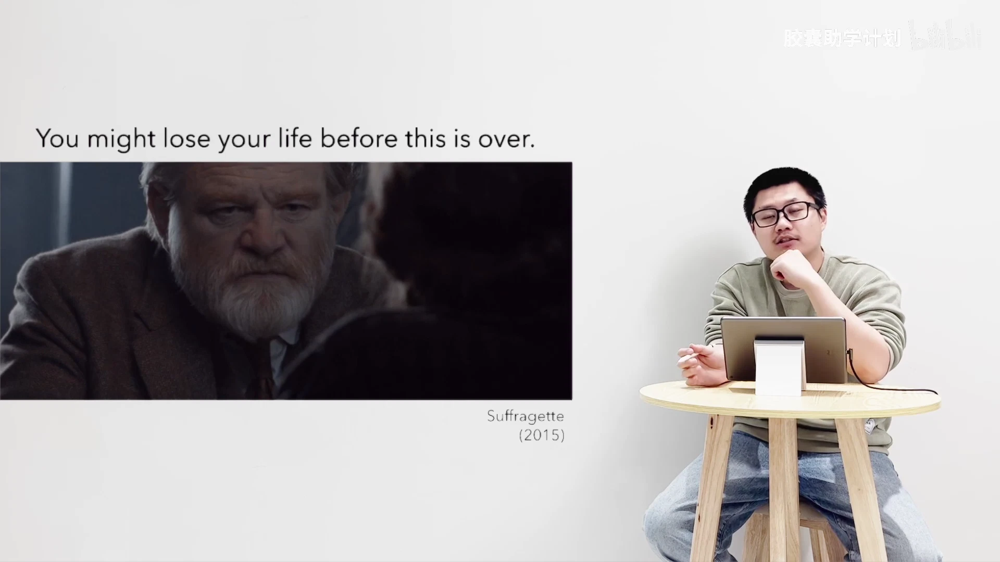

文字识别：You might lose your life before this is over. / Suffragette / (2015)

### 画面 00:13:05

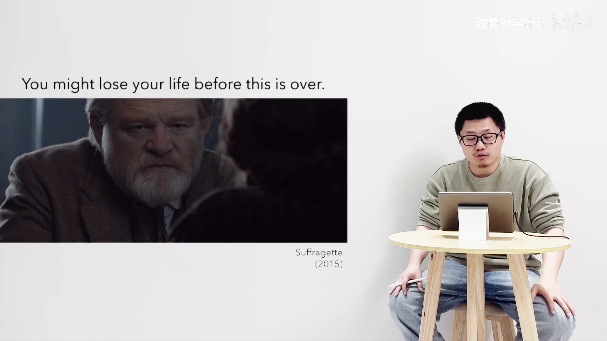

文字识别：You might lose your life before this is over. / Suffragette / (2015)

### 画面 00:13:10

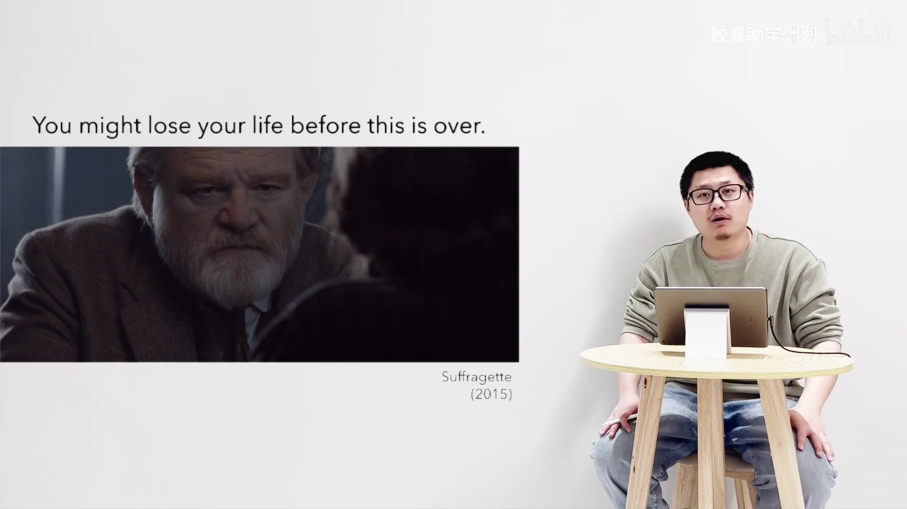

文字识别：You might lose your life before this is over. / Suffragette / (2015)

### 画面 00:13:12

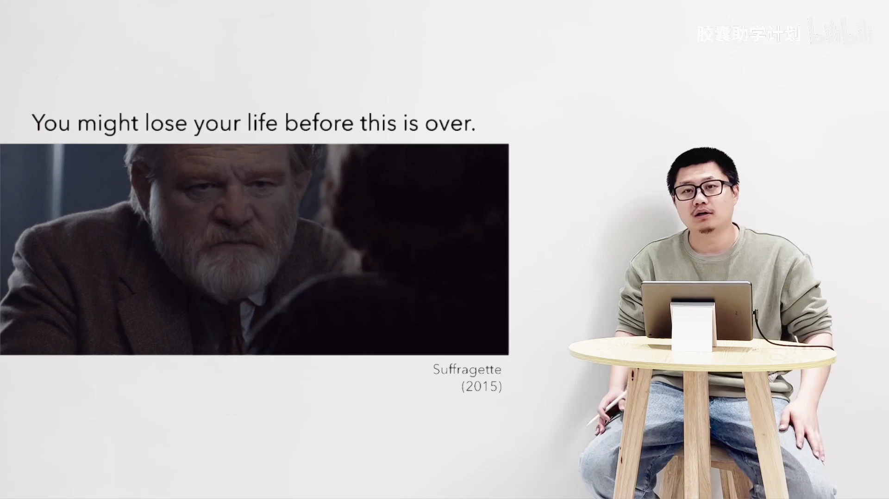

文字识别：You might lose your life before this is over. / Suffragette / (2015)

### 画面 00:13:18

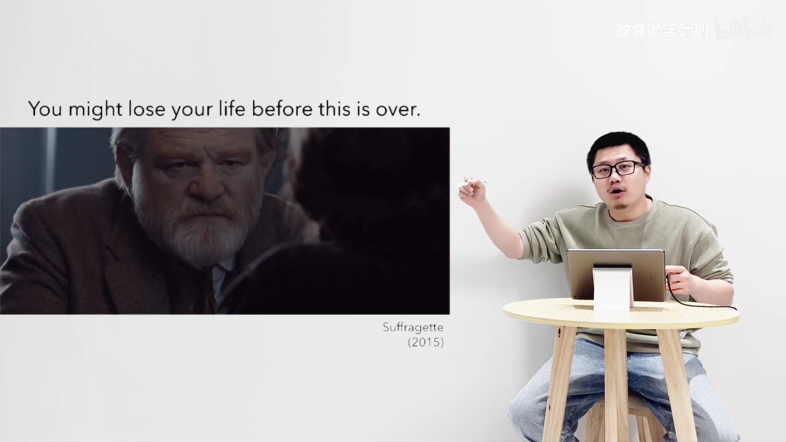

文字识别：You might lose your life before this is over. / Suffragette / (2015)

### 画面 00:13:27

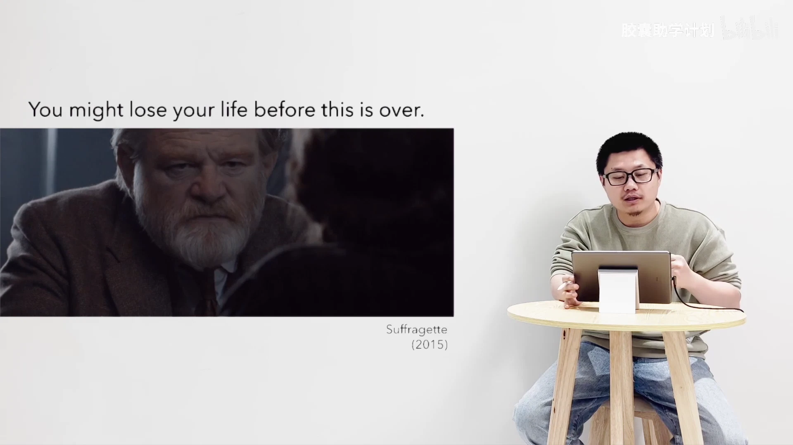

文字识别：You might lose your life before this is over. / Suffragette / (2015)

### 画面 00:13:29

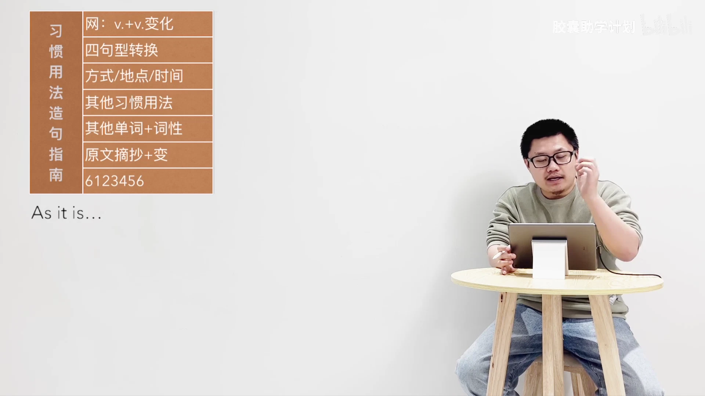

文字识别：网：v.+v.变化 / 习惯用法造句指南 / 妻助字计划 / 四句型转换 / 方式/地点/时间 / 其他习惯用法 / 其他单词+词性 / 原文摘抄+变 / 6123456 / As it is...

## 00:13:30–00:14:00

is, in fact,事实上造句子啊. Repeat after me. They hope to finish the kitchen by Friday, but as it is, they'll probably have to come back next week.首先啊，这里我就没写. Hope to do something应该是咱们三十六课学的，对吧？他们希望完成周五之前，截止到周五之前完成这个厨房，但事实是他们很有可能下个礼拜还得来啊。周六周

### 画面 00:13:31

文字识别：网：v.+v.变化 / 习惯用法造句指南 / 囊助学计划 / 四句型转换 / 方式/地点/时间 / 其他习惯用法 / 其他单词+词性 / 原文摘抄+变 / 6123456 / As it is...

### 画面 00:13:33

文字识别：网：v.+v.变化 / 习惯用法造句指南 / 辜助学计划 / 四句型转换 / 方式/地点/时间 / 其他习惯用法 / 其他单词+词性 / 原文摘抄+变 / 6123456 / As itis... /  They hoped to finish the kitchen by Friday, / but as it is they'll probably have to come / back next week.

### 画面 00:13:35

文字识别：网：v.+v.变化 / 习惯用法造句指南 / 臺助字计划 / 四句型转换 / 方式/地点/时间 / 其他习惯用法 / 其他单词+词性 / 原文摘抄+变 / 6123456 / As it is... /  They hoped to finish the kitchen by Friday, / but as it is they'll probably have to come / back next week.

### 画面 00:13:40

文字识别：网：v.+v.变化 / 习惯用法造句指南 / 学计划 / 四句型转换 / 方式/地点/时间 / 其他习惯用法 / 其他单词+词性 / 原文摘抄+变 / 6123456 / As it is... /  They hoped to finish the kitchen by Friday, / but as it is they'll probably have to come / back next week.

### 画面 00:13:45

文字识别：网：v.+v.变化 / 习惯用法造句指南 / 四句型转换 / 方式/地点/时间 / 其他习惯用法 / 其他单词+词性 / 原文摘抄+变 / 6123456 / As itis... /  They hoped to finish the kitchen by Friday, / but as it is they'll probably have to come / back next week.

### 画面 00:13:47

文字识别：网：v.+v.变化 / 习惯用法造句指南 / 四句型转换 / 方式/地点/时间 / 其他习惯用法 / 其他单词+词性 / 原文摘抄+变 / 6123456 / As it is... /  They hoped to finish the kitchen by Friday, / but as it is they'll probably have to come / back next week.

### 画面 00:13:49

文字识别：网：v.+v.变化 / 习惯用法造句指南 / 喜助字计划 / 四句型转换 / 方式/地点/时间 / 其他习惯用法 / 其他单词+词性 / 原文摘抄+变 / 6123456 / As it is... /  They boped to finish the kitchen by Friday, / but as it is they'll probably have to come / back next week.

### 画面 00:13:51

文字识别：网：v.+v.变化 / 习惯用法造句指南 / 四句型转换 / 方式/地点/时间 / 其他习惯用法 / 其他单词+词性 / 原文摘抄+变 / 6123456 / As itis... /  They hoped to finish the kitchen by Friday, / but as it is they'll probably have to come / back next week.

### 画面 00:13:53

文字识别：网：v.+v.变化 / 习惯用法造句指南 / 四句型转换 / 方式/地点/时间 / 其他习惯用法 / 其他单词+词性 / 原文摘抄+变 / 6123456 / As itis... /  They hoped to finish the kitchen by Friday, / but as it is they'll probably have to come / back next week.

### 画面 00:13:55

文字识别：网：v.+v.变化 / 习惯用法造句指南 / 妻助字计划 / 四句型转换 / 方式/地点/时间 / 其他习惯用法 / 其他单词+词性 / 原文摘抄+变 / 6123456 / As itis... /  They boped to finish the kitchen by Friday, / but as it is they'll probably have to come / back next week.

## 00:14:00–00:14:30

日休息完了，下个礼拜还得来，对吧？那什么叫 finish the kitchen？呃，你这个叫自己去脑补了。我给您脑补一个，就我造这个句子的时候脑补的是什么呢？他们来装修这个 kitchen 啊。 Next one. So we were hoping to have a holiday next week. 我们希本来那时候希望说下个礼拜能度个假。 As it is,事实上呢，we may not be able to get away. 我们

### 画面 00:14:00

文字识别：网：v.+v.变化 / 习惯用法造句指南 / 四句型转换 / 方式/地点/时间 / 其他习惯用法 / 其他单词+词性 / 原文摘抄+变 / 6123456 / As itis... /  They hoped to finish the kitchen by Friday, / but as it is they'll probably have to come / back next week.

### 画面 00:14:04

文字识别：网：v.+v.变化 / 习惯用法造句指南 / 四句型转换 / 方式/地点/时间 / 其他习惯用法 / 其他单词+词性 / 原文摘抄+变 / 6123456 / As it is... /  They hoped to inish the kitcheDby Friday, / but as it is they'll probably have to come / back next week.

### 画面 00:14:06

文字识别：网：v.+v.变化 / 习惯用法造句指南 / 学计划 / 四句型转换 / 方式/地点/时间 / 其他习惯用法 / 其他单词+词性 / 原文摘抄+变 / 6123456 / As it is... /  They hoped to inish the kitcheD by Friday, / but as it is they'll probably have to come / back next week.

### 画面 00:14:08

文字识别：网：v.+v.变化 / 习惯用法造句指南 / 四句型转换 / 方式/地点/时间 / 其他习惯用法 / 其他单词+词性 / 原文摘抄+变 / 6123456 / As itis... /  They hoped to Iinish the kitcheDby Friday, / but as it is they'll probably have to come / back next week.

### 画面 00:14:10

文字识别：网：v.+v.变化 / 习惯用法造句指南 / 四句型转换 / 方式/地点/时间 / 其他习惯用法 / 其他单词+词性 / 原文摘抄+变 / 6123456 / As it is... / They hoped to inish the kitcheD by Friday, / but as it is they'll probably have to come / back next week.

### 画面 00:14:13

文字识别：网：v.+v.变化 / 习惯用法造句指南 / 四句型转换 / 方式/地点/时间 / 其他习惯用法 / 其他单词+词性 / 原文摘抄+变 / 6123456 / As it is... / They hoped to inish the kitcheD by Friday, / but as it is they'll probably have to come / back next week. /  We were hoping to have a holiday next / week as it is, we may not be able to get / away. L36 L43

### 画面 00:14:15

文字识别：网：v.+v.变化 / 习惯用法造句指南 / 髮助学计划 / 四句型转换 / 方式/地点/时间 / 其他习惯用法 / 其他单词+词性 / 原文摘抄+变 / 6123456 / As it is... / They hoped to inish the kitcheD by Friday, / but as it is they'll probably have to come / back next week. /  We were hoping to have a holiday next / week as it is, we may not be able to get / away. L36 L43

### 画面 00:14:18

文字识别：网：v.+v.变化 / 习惯用法造句指南 / 還助字计划 / 四句型转换 / 方式/地点/时间 / 其他习惯用法 / 其他单词+词性 / 原文摘抄+变 / 6123456 / As it is... / They hoped to inish the kitcheDby Friday, / but as it is they'll probably have to come / back next week. /  We were hoping to have a holiday next / week as it is, we may not be able to get / away. L36 L43

### 画面 00:14:20

文字识别：网：v.+v.变化 / 习惯用法造句指南 / 秦助学计划 / 四句型转换 / 方式/地点/时间 / 其他习惯用法 / 其他单词+词性 / 原文摘抄+变 / 6123456 / As it is... / They hoped to inish the kitcheD by Friday, / but as it is they'll probably have to come / back next week. /  We were hoping to have a holiday next / week as it is, we may not be able to get / away. L36 L43

### 画面 00:14:22

文字识别：网：v.+v.变化 / 习惯用法造句指南 / 奏助字计划 / 四句型转换 / 方式/地点/时间 / 其他习惯用法 / 其他单词+词性 / 原文摘抄+变 / 6123456 / As itis... / They hoped to inish the kitcheD by Friday, / but as it is they'll probably have to come / back next week. /  We were hoping to have a holiday next / week as it is, we may not be able to get / away. L36 L43

### 画面 00:14:25

文字识别：网：v.+v.变化 / 习惯用法造句指南 / 辜助字计划 / 四句型转换 / 方式/地点/时间 / 其他习惯用法 / 其他单词+词性 / 原文摘抄+变 / 6123456 / As it is... / They hoped to inish the kitcheD by Friday, / but as it is they'll probably have to come / back next week. /  We were hoping to have a holiday next / week as it is, we may not be able to get / away. L36 L43

### 画面 00:14:28

文字识别：网：v.+v.变化 / 习惯用法造句指南 / 臺助字计划 / 四句型转换 / 方式/地点/时间 / 其他习惯用法 / 其他单词+词性 / 原文摘抄+变 / 6123456 / As it is... / They hoped to inish the kitcheD by Friday, / but as it is they'll probably have to come / back next week. /  We were hoping to have a holiday next / week as it is, we may not be able to get / away. L36 L43

## 00:14:30–00:15:00

not have a way to leave. We can't even walk. Ah, let alone go on vacation. Next one, enable somebody to do something. This is a very important one. It's very common. It means to make someone able to do something. For example, this would enable you to walk again. Ah, for example, you hurt your leg. Ah, your leg hurts. You can't walk. Ah, this will enable you to walk again. Ah, or a prosthetic leg. Next one, the new test should enable doctors to

### 画面 00:14:30

文字识别：网：v.+v.变化 / 习惯用法造句指南 / 四句型转换 / 方式/地点/时间 / 其他习惯用法 / 其他单词+词性 / 原文摘抄+变 / 6123456 / As it is... /  They hoped to inish the kitcheD by Friday, / but as it is they'll probably have to come / back next week. /  We were hoping to have a holiday next / week as it is, we may not be able to get / aWay. L36 L43

### 画面 00:14:35

文字识别：网：v.+v.变化 / 习惯用法造句指南 / 妻助学计划 / 四句型转换 / 方式/地点/时间 / 其他习惯用法 / 其他单词+词性 / 原文摘抄+变 / 6123456 / enable sb. to do sth.

### 画面 00:14:40

文字识别：网：v.+v.变化 / 习惯用法造句指南 / 囊助学计划 / 四句型转换 / 方式/地点/时间 / 其他习惯用法 / 其他单词+词性 / 原文摘抄+变 / 6123456 / enable sb.to do sth. /  This would enable you to walk again.

### 画面 00:14:42

文字识别：网：v.+v.变化 / 习惯用法造句指南 / 喜助学计划 / 四句型转换 / 方式/地点/时间 / 其他习惯用法 / 其他单词+词性 / 原文摘抄+变 / 6123456 / enable sb.to do sth. /  This would enable you to walk again.

### 画面 00:14:45

文字识别：网：v.+v.变化 / 习惯用法造句指南 / 妻助字计划 / 四句型转换 / 方式/地点/时间 / 其他习惯用法 / 其他单词+词性 / 原文摘抄+变 / 6123456 / enable sb. to do sth. /  This would enable you to walk again.

### 画面 00:14:48

文字识别：网：v.+v.变化 / 习惯用法造句指南 / 喜助学计划 / 四句型转换 / 方式/地点/时间 / 其他习惯用法 / 其他单词+词性 / 原文摘抄+变 / 6123456 / enable sb.to do sth. /  This would enable you to walk again.

### 画面 00:14:50

文字识别：网：v.+v.变化 / 习惯用法造句指南 / 喜助字计划 / 四句型转换 / 方式/地点/时间 / 其他习惯用法 / 其他单词+词性 / 原文摘抄+变 / 6123456 / enable sb. to do sth. /  This would enable you to walk again.

### 画面 00:14:52

文字识别：网：v.+v.变化 / 习惯用法造句指南 / 四句型转换 / 方式/地点/时间 / 其他习惯用法 / 其他单词+词性 / 原文摘抄+变 / 6123456 / enable sb. to do sth. /  This would enable you to walk again.

### 画面 00:14:54

文字识别：网：v.+v.变化 / 习惯用法造句指南 / 四句型转换 / 方式/地点/时间 / 其他习惯用法 / 其他单词+词性 / 原文摘抄+变 / 6123456 / enable sb.to do sth. /  This would enable you to walk again. /  The new test should enable doctors to / detect the disease early. L65

### 画面 00:14:56

文字识别：网：v.+v.变化 / 习惯用法造句指南 / 墨助字计划 / 四句型转换 / 方式/地点/时间 / 其他习惯用法 / 其他单词+词性 / 原文摘抄+变 / 6123456 / enable sb. to do sth. /  This would enable you to walk again. /  The new test should enable doctors to / detect the disease early. L65

## 00:15:00–00:15:30

detect the disease early.就这个新的这种测试啊，应该可以确保医生怎么样呢？Detect the disease early,尽早啊，更早一步的去检查出来这类疾病. Next one, this dictionary will enable you to understand English words.这就很简单的一句话了，说这个字典将确保你能读懂这个英文的单词，对吧？再读一遍啊，这个enable

### 画面 00:15:00

文字识别：网：v.+v.变化 / 习惯用法造句指南 / 妻助学计划 / 四句型转换 / 方式/地点/时间 / 其他习惯用法 / 其他单词+词性 / 原文摘抄+变 / 6123456 / enable sb.to do sth. /  This would enable you to walk again. /  The new test should enable doctors to / detect the disease early. L65

### 画面 00:15:06

文字识别：网：v.+v.变化 / 习惯用法造句指南 / 囊助学计划 / 四句型转换 / 方式/地点/时间 / 其他习惯用法 / 其他单词+词性 / 原文摘抄+变 / 6123456 / enable sb.to do sth. /  This would enable you to walk again. /  The new test should enable doctors to / detect the disease early. L65

### 画面 00:15:09

文字识别：网：v.+v.变化 / 习惯用法造句指南 / 四句型转换 / 方式/地点/时间 / 其他习惯用法 / 其他单词+词性 / 原文摘抄+变 / 6123456 / enable sb.to do sth. /  This would enable yoy to walk again. /  The new test shouldlenable doctors to / detect the disease early.L65

### 画面 00:15:11

文字识别：网：v.+v.变化 / 习惯用法造句指南 / 计划 / 四句型转换 / 方式/地点/时间 / 其他习惯用法 / 其他单词+词性 / 原文摘抄+变 / 6123456 / enable sb. to do sth. /  This would enable yoy to walk again. /  The new test should/enable doctors to / detect The disease early. L65

### 画面 00:15:15

文字识别：网：v.+v.变化 / 习惯用法造句指南 / 妻助字计划 / 四句型转换 / 方式/地点/时间 / 其他习惯用法 / 其他单词+词性 / 原文摘抄+变 / 6123456 / enable sb.to do sth. /  This would enable you to walk again. /  The new test should/enable doctors to / detect The disease early. L65

### 画面 00:15:17

文字识别：网：v.+v.变化 / 习惯用法造句指南 / 四句型转换 / 方式/地点/时间 / 其他习惯用法 / 其他单词+词性 / 原文摘抄+变 / 6123456 / enable sb.to do sth. /  This would enable yoy to walk again. /  The new test should/enable doctors to / detect he disease early. L65 / This dictionary will enable you to / understand English words.

### 画面 00:15:19

文字识别：网：v.+v.变化 / 习惯用法造句指南 / 四句型转换 / 方式/地点/时间 / 其他习惯用法 / 其他单词+词性 / 原文摘抄+变 / 6123456 / enable sb.to do sth. /  This would enable yoy to walk again. /  The new test should/enable doctors to / detect the disease early. L65 /  This dictionary will enable you to / understand English words.

### 画面 00:15:21

文字识别：网：v.+v.变化 / 习惯用法造句指南 / 学计划 / 四句型转换 / 方式/地点/时间 / 其他习惯用法 / 其他单词+词性 / 原文摘抄+变 / 6123456 / enable sb. to do sth. /  This would enable yoy to walk again. /  The new test should/enable doctors to / detect the disease early. L65 /  This dictionary will enable you to / understand English words.

### 画面 00:15:24

文字识别：网：v.+v.变化 / 习惯用法造句指南 / 四句型转换 / 方式/地点/时间 / 其他习惯用法 / 其他单词+词性 / 原文摘抄+变 / 6123456 / enable sb. to do sth. /  This would enable yoy to walk again. /  The new test should/enable doctors to / detect the disease early. L65 /  This dictionary will enable you to / understand English words.

### 画面 00:15:26

文字识别：网：v.+v.变化 / 习惯用法造句指南 / 四句型转换 / 方式/地点/时间 / 其他习惯用法 / 其他单词+词性 / 原文摘抄+变 / 6123456 / enable sb. to do sth. /  This would enable yoy to walk again. /  The new test should/enable doctors to / detect the disease early. L65 /  This dictionary will enable you to / understand English words.

## 00:15:30–00:16:00

somebody to do something，确保某人去做某件事情啊。 Okay，那注意力集中，咱听听这电影片段啊。 These lovely passports and tickets will enable you to return home in the next twenty four hours. Now， okay， keep in touch with，字面意思什么保持接触是吧？ Touch，这就是 touch 嘛。 Don't touch me，别碰我，对吧？ Touch，碰。那 keep in touch with somebody 就是和某人保持联系。

### 画面 00:15:30

文字识别：网：v.+v.变化 / 习惯用法造句指南 / 学计划 / 四句型转换 / 方式/地点/时间 / 其他习惯用法 / 其他单词+词性 / 原文摘抄+变 / 6123456 / enable sb.to do sth. /  This would enable yoy to walk again. /  The new test should/enable doctors to / detect the disease early. L65 /  This dictionary will enable you to / understand English words.

### 画面 00:15:33

文字识别：网：v.+v.变化 / 习惯用法造句指南 / 四句型转换 / 方式/地点/时间 / 其他习惯用法 / 其他单词+词性 / 原文摘抄+变 / 6123456 / enable sb. to do sth. /  This would enable yoy to walk again. /  The new test should/enable doctors to / detect the disease early. L65 /  This dictionary will enable you to / understand English words.

### 画面 00:15:35

文字识别：These lovely passports and tickets / will enable you to return home / in the next twenty four hours. / Lucy / (2014)

### 画面 00:15:40

文字识别：These lovely passports and tickets / will enable you to return home / in the next twenty four hours. / Lucy / (2014)

### 画面 00:15:42

文字识别：These lovely passports and tickets / will enable you to return home / in the next twenty four hours. / Lucy / (2014)

### 画面 00:15:44

文字识别：These lovely passports and tickets / will enable you to return home / in the next twenty four hours. / Lucy / (2014)

### 画面 00:15:46

文字识别：These lovely passports and tickets / will enable you to return home / in the next twenty four hours. / Lucy / (2014)

### 画面 00:15:48

文字识别：网：v.+v.变化 / 习惯用法造句指南 / 辜助学计划 / 四句型转换 / 方式/地点/时间 / 其他习惯用法 / 其他单词+词性 / 9 / 原文摘抄+变 / 6123456 / keep in touch with

### 画面 00:15:50

文字识别：网：v.+v.变化 / 习惯用法造句指南 / 囊助字计划 / 四句型转换 / 方式/地点/时间 / 其他习惯用法 / 其他单词+词性 / 原文摘抄+变 / 6123456 / keep in touch with

### 画面 00:15:52

文字识别：网：v.+v.变化 / 习惯用法造句指南 / 妻助学计划 / 四句型转换 / 方式/地点/时间 / 其他习惯用法 / 其他单词+词性 / 原文摘抄+变 / 6123456 / keep in touch with

### 画面 00:15:55

文字识别：网：v.+v.变化 / 习惯用法造句指南 / 囊助字计划 / 四句型转换 / 方式/地点/时间 / 其他习惯用法 / 其他单词+词性 / 原文摘抄+变 / 6123456 / keep in touch with

## 00:16:00–00:16:30

造句子口语当中很常用的一句话叫做I'll keep in touch with you，哎，我会和你保持联系的。Next one，I should have kept in touch with him。又复习六十五课，本应该和他保持联系。OK，啊，学到今天，我觉得如果你前面基础特别好，到这儿啊，很多句子其实基本上就是复习一遍，再过一遍大脑啊。We decided to keep in touch with each other。我们决定了要和彼此保持联系。哎，全是之前

### 画面 00:16:00

文字识别：网：v.+v.变化 / 习惯用法造句指南 / 喜助学计划 / 四句型转换 / 方式/地点/时间 / 其他习惯用法 / 其他单词+词性 / 原文摘抄+变 / 6123456 / keep in touch with / I'll keep in touch with you.

### 画面 00:16:02

文字识别：网：v.+v.变化 / 习惯用法造句指南 / 妻助学计划 / 四句型转换 / 方式/地点/时间 / 其他习惯用法 / 其他单词+词性 / 原文摘抄+变 / 6123456 / keep in touch with / I'll keep in touch with you.

### 画面 00:16:05

文字识别：网：v.+v.变化 / 习惯用法造句指南 / 奏助字计划 / 四句型转换 / 方式/地点/时间 / 其他习惯用法 / 其他单词+词性 / 原文摘抄+变 / 6123456 / keep in touch with / I'll keep in touch with you.

### 画面 00:16:07

文字识别：网：v.+v.变化 / 习惯用法造句指南 / 囊助字计划 / 四句型转换 / 方式/地点/时间 / 其他习惯用法 / 其他单词+词性 / 原文摘抄+变 / 6123456 / keep in touch with / I'll keep in touch with you. / I should have kept in touch with him. L65

### 画面 00:16:10

文字识别：网：v.+v.变化 / 习惯用法造句指南 / 囊助字计划 / 四句型转换 / 方式/地点/时间 / 其他习惯用法 / 其他单词+词性 / 原文摘抄+变 / 6123456 / keep in touch with / I'll keep in touch with you. / I should have kept in touch with him. L65

### 画面 00:16:14

文字识别：网：v.+v.变化 / 习惯用法造句指南 / 妻助字计划 / 四句型转换 / 方式/地点/时间 / 其他习惯用法 / 其他单词+词性 / 原文摘抄+变 / 6123456 / keep in touch with / I'll keep in touch with you. / I should have kept in touch with him. L65

### 画面 00:16:16

文字识别：网：v.+v.变化 / 习惯用法造句指南 / 四句型转换 / 方式/地点/时间 / 其他习惯用法 / 其他单词+词性 / 原文摘抄+变 / 6123456 / keep in touch with / I'll keep in touch with you. / I should have kept in touch with him. L65 /  We decided to keep in touch with each / other. L22

### 画面 00:16:20

文字识别：网：v.+v.变化 / 习惯用法造句指南 / 四句型转换 / 方式/地点/时间 / 其他习惯用法 / 其他单词+词性 / 原文摘抄+变 / 6123456 / keep in touch with / I'll keep in touch with you. / I should have kept in touch with him. L65 /  We decided to keep in touch with each / other. L22

### 画面 00:16:25

文字识别：网：v.+v.变化 / 习惯用法造句指南 / 喜助字计划 / 四句型转换 / 方式/地点/时间 / 其他习惯用法 / 其他单词+词性 / 原文摘抄+变 / 6123456 / keep in touch with / I'll keep in touch with you. / I should have kept in touch with him. L65 /  We decided to keep in touch with each / other. L22

## 00:16:30–00:17:00

的其他的习惯用法，对吧？这是我们目前最常用。Run out of, run out of，你要注意叫用完用尽嘛。那用尽什么东西呢？我直接给你加了几个常用的词啊。We've ran out of petrol, money, paper. 啊，再来。So they are so poor that they ran out of food. 他们如此的穷，以至于他们怎么样，食物都吃完了。Next one. I've been doing this for ten hours and I've

### 画面 00:16:30

文字识别：网：v.+v.变化 / 习惯用法造句指南 / 臺助字计划 / 四句型转换 / 方式/地点/时间 / 其他习惯用法 / 其他单词+词性 / 原文摘抄+变 / 6123456 / keep in touch with / I'll keep in touch with you. / I should have kept in touch with him. L65 /  We decided to keep in touch with each / other. L22

### 画面 00:16:32

文字识别：网：v.+v.变化 / 习惯用法造句指南 / 囊助学计划 / 四句型转换 / 方式/地点/时间 / 其他习惯用法 / 其他单词+词性 / 原文摘抄+变 / 6123456 / run out of

### 画面 00:16:35

文字识别：网：v.+v.变化 / 习惯用法造句指南 / 囊助学计划 / 四句型转换 / 方式/地点/时间 / 其他习惯用法 / 其他单词+词性 / 原文摘抄+变 / 6123456 / run out of

### 画面 00:16:37

文字识别：网：v.+v.变化 / 习惯用法造句指南 / 囊助字计划園 / 四句型转换 / 方式/地点/时间 / 其他习惯用法 / 其他单词+词性 / 原文摘抄+变 / 6123456 / run out of ..n

### 画面 00:16:40

文字识别：网：v.+v.变化 / 习惯用法造句指南 / 喜助字计划 / 四句型转换 / 方式/地点/时间 / 其他习惯用法 / 其他单词+词性 / 原文摘抄+变 / 6123456 / run out of . /  We've run out of petrol/money/paper.

### 画面 00:16:42

文字识别：网：v.+v.变化 / 习惯用法造句指南 / 喜助字计划 / 四句型转换 / 方式/地点/时间 / 其他习惯用法 / 其他单词+词性 / 原文摘抄+变 / 6123456 / run out of . /  We've run out of petrol/money/paper.

### 画面 00:16:45

文字识别：网：v.+v.变化 / 习惯用法造句指南 / 四句型转换 / 方式/地点/时间 / 其他习惯用法 / 其他单词+词性 / 原文摘抄+变 / 6123456 / run out of . /  We've run out of petrol/money/paper.

### 画面 00:16:49

文字识别：网：v.+v.变化 / 习惯用法造句指南 / 学诗计划 / 四句型转换 / 方式/地点/时间 / 其他习惯用法 / 其他单词+词性 / 原文摘抄+变 / 6123456 / run out of . /  We've run out of petrol/money/paper. /  They are so poor that they run out of food. / L35

### 画面 00:16:51

文字识别：网：v.+v.变化 / 习惯用法造句指南 / 喜助学计划 / 四句型转换 / 方式/地点/时间 / 其他习惯用法 / 其他单词+词性 / 原文摘抄+变 / 6123456 / run out of . /  We've run out of petrol/money/paper. /  They are so poor that they run out of food. / L35

### 画面 00:16:55

文字识别：网：v.+v.变化 / 习惯用法造句指南 / 学诗划 / 四句型转换 / 方式/地点/时间 / 其他习惯用法 / 其他单词+词性 / 原文摘抄+变 / 6123456 / run out of . /  We've run out of petrol/money/paper. /  They are so poorthat they run out of food. / L35 / I have been doing this for ten hours and / I've run out of patience. L52

## 00:17:00–00:17:30

run out of patience.这件事儿我已经做了十个小时了，我已经用尽了我的耐心。我已经 lost my patience，对吧？一个意思嘛，run out of my patience，呃，和 lost my patience一个意思，对吧？呃，注意力集中，咱听一下电影片段啊。They've run out of blueberries, so I got you raspberries instead. Okay, ah, uh, they've run out of blue

### 画面 00:17:00

文字识别：网：v.+v.变化 / 习惯用法造句指南 / 四句型转换 / 方式/地点/时间 / 其他习惯用法 / 其他单词+词性 / 原文摘抄+变 / 6123456 / run out of . /  We've run out of petrol/money/paper. /  They are so poor that they run out of food. / L35 / I have been doing this for ten hours and / I've run out of patience. L52

### 画面 00:17:05

文字识别：网：v.+v.变化 / 习惯用法造句指南 / 四句型转换 / 方式/地点/时间 / 其他习惯用法 / 其他单词+词性 / 原文摘抄+变 / 6123456 / run out of . /  We've run out of petrol/money/paper. /  They are so poor that they run out of food. / L35 / I have been doing this for ten hours and / I've run out of patience. L52

### 画面 00:17:10

文字识别：网：v.+v.变化 / 习惯用法造句指南 / 字计划 / 四句型转换 / 方式/地点/时间 / 其他习惯用法 / 其他单词+词性 / 原文摘抄+变 / 6123456 / run out of . /  We've run out of petrol/money/paper. /  They are so poorthat they run out of food. / L35 / I have been doing this for ten hours and / I've run out of patience. L52

### 画面 00:17:18

文字识别：They've run out of blueberries / so I got you raspberries instead. / Philomena / (2013)

### 画面 00:17:22

文字识别：They've run out of blueberries / so I got you raspberries instead. / Philomena / (2013)

### 画面 00:17:24

文字识别：They've run out of blueberries / so I got you raspberries instead. / Philomena / (2013)

### 画面 00:17:26

文字识别：They've run out of blueberries / so I got you raspberries instead. / Philomena / (2013)

### 画面 00:17:28

文字识别：They've run out of blueberries / so I got you raspberries instead. / Philomena / (2013)

## 00:17:30–00:18:00

blueberries, so I got you raspberries instead.两种这个浆果的名字不是坚果啊，浆果啊. Next one, lose heart,失去信心。跟我读, we won't lose heart. 很简单, we shouldn't lose heart. We may have another try.我们也许还有机会啊，但注意是也许，所以这个地方的may啊，十九课表一种可能性。Next one, although we have ran out of food, we will

### 画面 00:17:30

文字识别：They've run out of blueberries / so I got you raspberries instead. / Philomena / (2013)

### 画面 00:17:35

文字识别：They've run out of blueberries / so I got you raspberries instead. / Philomena / (2013)

### 画面 00:17:37

文字识别：They've run out of blueberries / so I got you raspberries instead. / Philomena / (2013)

### 画面 00:17:39

文字识别：网：v.+v.变化 / 习惯用法造句指南 / 堯助字计划 / 四句型转换 / 方式/地点/时间 / 其他习惯用法 / 其他单词+词性 / 原文摘抄+变 / 6123456 / lose heart...

### 画面 00:17:41

文字识别：网：v.+v.变化 / 习惯用法造句指南 / 奏助学计划 / 四句型转换 / 方式/地点/时间 / 其他习惯用法 / 其他单词+词性 / 原文摘抄+变 / 6123456 / lose heart... /  We won't lose heart.

### 画面 00:17:45

文字识别：网：v.+v.变化 / 习惯用法造句指南 / 四句型转换 / 方式/地点/时间 / 其他习惯用法 / 其他单词+词性 / 原文摘抄+变 / 6123456 / lose heart... /  We won't lose heart. /  We shouldn't lose heart. We may have / another try. L65 L19

### 画面 00:17:50

文字识别：网：v.+v.变化 / 习惯用法造句指南 / 四句型转换 / 方式/地点/时间 / 其他习惯用法 / 其他单词+词性 / 原文摘抄+变 / 6123456 / lose heart... /  We won't lose heart. /  We shouldn't lose heart. We may have / another try. L65 L19

### 画面 00:17:55

文字识别：网：v.+v.变化 / 习惯用法造句指南 / 四句型转换 / 方式/地点/时间 / 其他习惯用法 / 其他单词+词性 / 原文摘抄+变 / 6123456 / lose heart... /  We won't lose heart. /  We shouldn't lose heart. We may have / another try. L65 L19 /  Although we have run out of food, we will / not lose heart.

### 画面 00:17:59

文字识别：网：v.+v.变化 / 习惯用法造句指南 / 学计切 / 四句型转换 / 方式/地点/时间 / 其他习惯用法 / 其他单词+词性 / 原文摘抄+变 / 6123456 / lose heart... /  We won't lose heart. /  We shouldn't lose heart. We may have / another try. L65 L19 / Although we have run out of food, we will / not lose heart.

## 00:18:00–00:18:30

not lose heart.说尽管我们怎么样已经没有食物了，哎，我们不会丧失信心的，对吧？我们会活下去。Next one, cause somebody or something to do something.刚才我们说过了，对吧？引起啊，引起某人或某物怎么怎么样？比如说，the pepper in the food caused me to sneeze.什么意思呢？说食物当中这个胡椒啊，引起了我怎么样，打了个喷嚏。那这个句子你可以做四句

### 画面 00:18:01

文字识别：网：v.+v.变化 / 习惯用法造句指南 / 十划 / 四句型转换 / 方式/地点/时间 / 其他习惯用法 / 其他单词+词性 / 原文摘抄+变 / 6123456 / lose heart... / ■ We won't lose heart. /  We shouldn't lose heart. We may have / another try. L65 L19 / Although we have run out of food, we will / not lose heart.

### 画面 00:18:05

文字识别：网：v.+v.变化 / 习惯用法造句指南 / 四句型转换 / 方式/地点/时间 / 其他习惯用法 / 其他单词+词性 / 原文摘抄+变 / 6123456 / lose heart... /  We won't lose heart. /  We shouldn't lose heart. We may have / another try. L65 L19 / Although we have run out of food, we will / not lose heart.

### 画面 00:18:08

文字识别：网：v.+v.变化 / 习惯用法造句指南 / 妻助字计划 / 四句型转换 / 方式/地点/时间 / 其他习惯用法 / 其他单词+词性 / 原文摘抄+变 / 6123456 / cause sb./sth. to do sth.

### 画面 00:18:10

文字识别：网：v.+v.变化 / 习惯用法造句指南 / 囊助学计划 / 四句型转换 / 方式/地点/时间 / 其他习惯用法 / 其他单词+词性 / 原文摘抄+变 / 6123456 / cause sb./sth. to do sth.

### 画面 00:18:13

文字识别：网：v.+v.变化 / 习惯用法造句指南 / 喜助字计划 / 四句型转换 / 方式/地点/时间 / 其他习惯用法 / 其他单词+词性 / 原文摘抄+变 / 6123456 / cause sb./sth. to do sth. /  The pepper in the food caused me to / sneeze.

### 画面 00:18:15

文字识别：网：v.+v.变化 / 习惯用法造句指南 / 臺助字计划 / 四句型转换 / 方式/地点/时间 / 其他习惯用法 / 其他单词+词性 / 原文摘抄+变 / 6123456 / cause sb./sth. to do sth. /  The pepper in the food caused me to / sneeze.

### 画面 00:18:18

文字识别：网：v.+v.变化 / 习惯用法造句指南 / 建助字计划 / 四句型转换 / 方式/地点/时间 / 其他习惯用法 / 其他单词+词性 / 原文摘抄+变 / 6123456 / cause sb./sth. to do sth. /  The pepper in the food caused me to / sneeze.

### 画面 00:18:20

文字识别：网：v.+v.变化 / 习惯用法造句指南 / 四句型转换 / 方式/地点/时间 / 其他习惯用法 / 其他单词+词性 / 原文摘抄+变 / 6123456 / cause sb./sth. to do sth. /  The pepper in the food caused me to / sneeze.

### 画面 00:18:24

文字识别：网：v.+v.变化 / 习惯用法造句指南 / 喜助学计划 / 四句型转换 / 方式/地点/时间 / 其他习惯用法 / 其他单词+词性 / 原文摘抄+变 / 6123456 / cause sb./sth. to do sth. /  The pepper in the food caused me to / sneeze.

### 画面 00:18:26

文字识别：网：v.+v.变化 / 习惯用法造句指南 / 四句型转换 / 方式/地点/时间 / 其他习惯用法 / 其他单词+词性 / 原文摘抄+变 / 6123456 / cause sb./sth. to do sth. /  The pepper in the food / aused me to / sneeze

### 画面 00:18:28

文字识别：网：v.+v.变化 / 习惯用法造句指南 / 四句型转换 / 方式/地点/时间 / 其他习惯用法 / 其他单词+词性 / 原文摘抄+变 / 6123456 / cause sb./sth. to do sth. /  The pepper in the food / aused me to / sneeze /  You've caused me to lose a whole valuable / day's work.

## 00:18:30–00:19:00

形转换啊。我们再来。So you've costed me to lose a whole valuable day's work.这句话我要简单解释一下，很常用这句话，但是得有上下文语境啊。我给你嘴上补充一下。首先看结构，cost me to lose没有问题。Lose叫失去一整天宝贵的工作。比如说你在那个地方一直在弄东西，用一个软件，这个软件没有自动存储、实时存

### 画面 00:18:30

文字识别：网：v.+v.变化 / 习惯用法造句指南 / 学计州 / 四句型转换 / 方式/地点/时间 / 其他习惯用法 / 其他单词+词性 / 原文摘抄+变 / 6123456 / cause sb./sth. to do sth. / The pepper in the food / aused me to / sneeze /  You've caused me to lose a whole valuable / day's work.

### 画面 00:18:35

文字识别：网：v.+v.变化 / 习惯用法造句指南 / 四句型转换 / 方式/地点/时间 / 其他习惯用法 / 其他单词+词性 / 原文摘抄+变 / 6123456 / cause sb./sth. to do sth. /  The pepper in the food / aused me to / sneeze /  You've caused me to lose a whole valuable / day's work.

### 画面 00:18:40

文字识别：网：v.+v.变化 / 习惯用法造句指南 / 四句型转换 / 方式/地点/时间 / 其他习惯用法 / 其他单词+词性 / 原文摘抄+变 / 6123456 / cause sb./sth. to do sth. /  The pepper in the food / aused me to / sneeze /  You've caused me to lose a whole valuable / day's work.

### 画面 00:18:44

文字识别：网：v.+v.变化 / 习惯用法造句指南 / 学计划 / 四句型转换 / 方式/地点/时间 / 其他习惯用法 / 其他单词+词性 / 原文摘抄+变 / 6123456 / cause sb./sth. to do sth. / The pepper in the food / aused me to / sneeze /  You've caused me to lose a whole valuable / day's work.

### 画面 00:18:46

文字识别：网：v.+v.变化 / 习惯用法造句指南 / 四句型转换 / 方式/地点/时间 / 其他习惯用法 / 其他单词+词性 / 原文摘抄+变 / 6123456 / cause sb./sth. to do sth. / The pepper in the food / aused me to / sneeze /  You've caused me to lose a whole valuable / day's work.

### 画面 00:18:48

文字识别：网：v.+v.变化 / 习惯用法造句指南 / 四句型转换 / 方式/地点/时间 / 其他习惯用法 / 其他单词+词性 / 原文摘抄+变 / 6123456 / cause sb./sth. to do sth. /  The pepper in the food / taused me to / sneeze /  You've caused me to lose a whole valuable / day's work.

### 画面 00:18:51

文字识别：网：v.+v.变化 / 习惯用法造句指南 / 四句型转换 / 方式/地点/时间 / 其他习惯用法 / 其他单词+词性 / 原文摘抄+变 / 6123456 / cause sb./sth. to do sth. /  The pepper in the food / aused me to / sneeze /  You've caused me to lose a whole valuable / 's work.

### 画面 00:18:54

文字识别：网：v.+v.变化 / 习惯用法造句指南 / 四句型转换 / 方式/地点/时间 / 其他习惯用法 / 其他单词+词性 / 原文摘抄+变 / 6123456 / cause sb./sth. to do sth. /  The pepper in the food / aused me to / sneeze /  You've caused me to lose a whole valuable / day's work.

### 画面 00:18:56

文字识别：网：v.+v.变化 / 习惯用法造句指南 / 四句型转换 / 方式/地点/时间 / 其他习惯用法 / 其他单词+词性 / 原文摘抄+变 / 6123456 / cause sb./sth. to do sth. /  The pepper in the food / aused me to / sneeze /  You've caused me to lose a whole valuable / day's work.

### 画面 00:18:58

文字识别：网：v.+v.变化 / 习惯用法造句指南 / 四句型转换 / 方式/地点/时间 / 其他习惯用法 / 其他单词+词性 / 原文摘抄+变 / 6123456 / cause sb./sth. to do sth. /  The pepper in the food / aused me to / sneeze /  You've caused me to lose a whole valuable / day's work.

## 00:19:00–00:19:30

储或者云端存储的功能，你终于要大功告成了。你去喝了杯这个呃，比如说去沏了杯咖啡，回来看见你们家孩子把你的那个工作软件啪关了，那儿正玩游戏呢，你是不是就崩了？叫做You cost me to lose a whole day valuable work啊，a whole valuable day's work，对吧？Next one，What caused you to change your mind？什么引起了你改变了主意呢？Change your mind。

### 画面 00:19:00

文字识别：网：v.+v.变化 / 习惯用法造句指南 / 四句型转换 / 方式/地点/时间 / 其他习惯用法 / 其他单词+词性 / 原文摘抄+变 / 6123456 / cause sb./sth. to do sth. /  The pepper in the food / taused me to / sneeze /  You've caused me to lose a whole valuable / day's work.

### 画面 00:19:06

文字识别：网：v.+v.变化 / 习惯用法造句指南 / 四句型转换 / 方式/地点/时间 / 其他习惯用法 / 其他单词+词性 / 原文摘抄+变 / 6123456 / cause sb./sth. to do sth. /  The pepper in the food / aused me to / sneeze /  You've caused me to lose a whole valuable / day's work.

### 画面 00:19:10

文字识别：网：v.+v.变化 / 习惯用法造句指南 / 四句型转换 / 方式/地点/时间 / 其他习惯用法 / 其他单词+词性 / 原文摘抄+变 / 6123456 / cause sb./sth. to do sth. /  The pepper in the food / faused me to / sneeze /  You've caused me to lose a whole valuable / day's work.

### 画面 00:19:12

文字识别：网：v.+v.变化 / 习惯用法造句指南 / 四句型转换 / 方式/地点/时间 / 其他习惯用法 / 其他单词+词性 / 原文摘抄+变 / 6123456 / cause sb./sth. to do sth. /  The pepper in the food / faused me to / sneeze /  You've caused me to lose a whole valuable / day's work.

### 画面 00:19:15

文字识别：网：v.+v.变化 / 习惯用法造句指南 / 四句型转换 / 方式/地点/时间 / 其他习惯用法 / 其他单词+词性 / 原文摘抄+变 / 6123456 / cause sb./sth. to do sth. /  The pepper in the food / aused me to / sneeze /  You've caused me to lose a whole valuable / day's work.

### 画面 00:19:20

文字识别：网：v.+v.变化 / 习惯用法造句指南 / 划 / 四句型转换 / 方式/地点/时间 / 其他习惯用法 / 其他单词+词性 / 原文摘抄+变 / 6123456 / cause sb./sth. to do sth. / The pepper in the food / aused me to / sneeze /  You've caused me to lose a whole valuable / day's work.

### 画面 00:19:23

文字识别：网：v.+v.变化 / 习惯用法造句指南 / 划 / 四句型转换 / 方式/地点/时间 / 其他习惯用法 / 其他单词+词性 / 原文摘抄+变 / 6123456 / cause sb./sth. to do sth. /  The pepper in the food / faused me to / sneeze /  You've caused me to lose a whole valuable / day's work. /  What caused you to change your mind?

### 画面 00:19:25

文字识别：网：v.+v.变化 / 习惯用法造句指南 / 学计划 / 四句型转换 / 方式/地点/时间 / 其他习惯用法 / 其他单词+词性 / 原文摘抄+变 / 6123456 / cause sb./sth. to do sth. / The pepper in the food / aused me to / sneeze /  You've caused me to lose a whole valuable / day's work. /  What caused you to change your mind?

## 00:19:30–00:20:00

好，那注意力集中，咱听个电影片段。I have caused a good man, Father John Thornton, to lose his life. Okay, recap.本课习惯用法，造句吧。造句啊，这些是我们未来不管实际应用还是考试、应试考试当中听说读写必肯定啊会用到的一些东西。Next one，文章

### 画面 00:19:30

文字识别：I have caused a good man.. Father John Thornt / on, to lose his life. / The Devil's Doorway / (2018)

### 画面 00:19:33

文字识别：I have caused a good man.. Father John Thornt / on, to lose his life. / The Devil's Doorway / (2018)

### 画面 00:19:43

文字识别：Recap / lose one's life... / as itis / enable sb.to do sth. / Expression / keep in touch with / lose heart.. / run out of / cause sb./sth. to do sth.

### 画面 00:19:45

文字识别：Recap / lose one's life... / as it is / enable sb.to do sth. / Expression / keep in touch with / lose heart.. / run out of / cause sb./sth. to do sth.

### 画面 00:19:47

文字识别：辜助字计划 / 1. / 习惯用法造句/对话 / 【习惯用法造句指南】 / 每个5句

### 画面 00:19:49

文字识别：壽助字计划 / 1. / 习惯用法造句/对话 / 【习惯用法造句指南】 / 每个5句

### 画面 00:19:51

文字识别：喜助字计划 / 1. / 习惯用法造句/对话 / 【习惯用法造句指南】 / 每个5句

### 画面 00:19:53

文字识别：辜助字计划 / 1. / 习惯用法造句/对话 / 【习惯用法造句指南】 / 每个5句

### 画面 00:19:55

文字识别：1. / 习惯用法造句/对话 / 【习惯用法造句指南】 / 每个5句

### 画面 00:19:57

文字识别：1. / 习惯用法造句/对话 / 【习惯用法造句指南】 / 每个5句

### 画面 00:19:59

文字识别：习惯用法造句/对话 / 1. / 【习惯用法造句指南】 / 每个5句 / 文章跟读至熟读成诵 / 内化单词+语法+习惯用法 / 听力+口语+写作练习

## 00:20:00–00:20:30

跟读熟读成诵，然后置顶留言，咱们找重复间隔的学习材料。那以上就是本期视频的全部内容了。如果各位喜欢我们的课程呢，欢迎各位关注、订阅、一键三连，分享给那些需要的朋友，来帮助我们快速成长。 See you next time.

### 画面 00:20:01

文字识别：妻助学计划 / 习惯用法造句/对话 / 1. / 【习惯用法造句指南】 / 每个5句 / 文章跟读至熟读成诵 / 内化单词+语法+习惯用法 / 听力+口语+写作练习 / 3. / 重复间隔（置顶留言）

### 画面 00:20:03

文字识别：习惯用法造句/对话 / 1. / 【习惯用法造句指南】 / 每个5句 / 文章跟读至熟读成诵 / 内化单词+语法+习惯用法 / 听力+口语+写作练习 / 重复间隔（置顶留言） / 3.

### 画面 00:20:05

文字识别：臺助学计划

### 画面 00:20:09

文字识别：妻助学计划一调 / 不

### 画面 00:20:13

文字识别：奏助学计划一

### 画面 00:20:16

文字识别：壹助学计划一

### 画面 00:20:18

文字识别：臺助学计划一

### 画面 00:20:20

文字识别：CAPSULEACADEMY / 胶囊助学计划 / 『 / 小红书 / Lecturer / □ / 口 / Leo / OE

### 画面 00:20:22

文字识别：CAPSULEACADEMY / 胶囊助学计划 / 小红书 / Photographer / Berlin / OE

### 画面 00:20:25

文字识别：CAPSULEACADEMY / 胶囊助学计划 / 小红书 / Editor / □ / Berlin / OE

### 画面 00:20:27

文字识别：珈学針物 / CAPSULEACADEMY / 胶囊助学计划 / 小红书 / Creator / Leo & Berlin / OE

### 画面 00:20:29

文字识别：bilibili / 胶囊助学计划

## 00:20:30–00:20:31

### 画面 00:20:30

文字识别：bilbili / 胶囊助学计划

