# 088 练习

快速机器解析：语音为单模型转写，未进行独立交叉校对或人工复核；画面每秒采样并按变化选帧，短时文字和标记可能遗漏。截图时间约有 1 秒误差。图片有损压缩；遇到疑点请按时间查看 Google Drive 原视频。

## 00:00:00–00:00:30

Hello everyone, welcome to Capsule Academy. This is Leo. Today we're going to learn new concept English book two lesson eighty eight practices. 注意进行如下练习，唯一的前提就是文章咱们要跟读至熟读成诵，否则请勿开始。 Hope you gonna enjoy. 我们先看第一题 comprehension，练习的咱们能听懂一般疑问句和特殊疑问句的能力。我问您答。第一题， How many

### 画面 00:00:00

文字识别：NCE / BOOKⅡI / Lesson 88 / Practices

### 画面 00:00:02

文字识别：NCE / BOOK I"I / Lesson 88 / Practices

### 画面 00:00:04

文字识别：NCE / BOOKII / Lesson 88 / Practices

### 画面 00:00:06

文字识别：NCE / BOOKII / Lesson 88 / Practices

### 画面 00:00:08

文字识别：进行如下练习唯一前提 / 文章跟读至熟读成诵 / 否则请勿开始

### 画面 00:00:10

文字识别：进行如下练习唯一前提 / 文章跟读至熟读成诵 / 否则请勿开始

### 画面 00:00:17

文字识别：胶囊助学计划 bii / •

### 画面 00:00:21

### 画面 00:00:23

文字识别：Comprehension / 训练目标： / 听懂一般疑问句＆特殊疑问句

### 画面 00:00:26

文字识别：嘉助学计划 / Comprehension / 训练目标： / 听懂一般疑问句＆特殊疑问句

### 画面 00:00:28

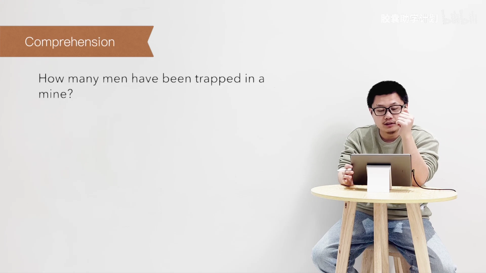

文字识别：Comprehension / How many men have been trapped in a / mine?

## 00:00:30–00:01:00

men have been trapped in a mine? Six. How long have they been there? For seventeen hours. What may happen if they aren't brought to the surface soon? It may lose their lives. Are rescue operations proving easy or difficult? Difficult.

### 画面 00:00:30

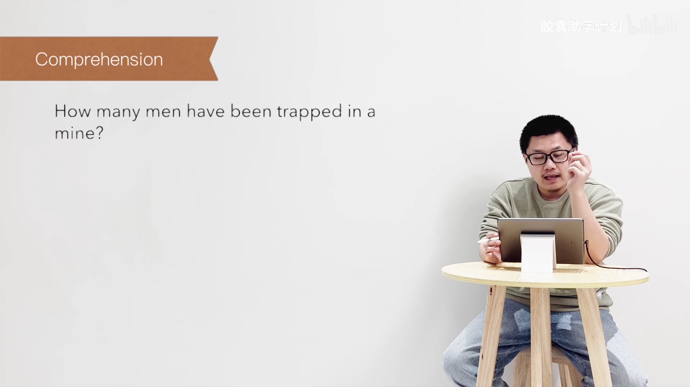

文字识别：毫動字计划 / Comprehension / How many men have been trapped in a / mine?

### 画面 00:00:36

文字识别：Comprehension / How long have they been there?

### 画面 00:00:38

文字识别：Comprehension / How long have they been there?

### 画面 00:00:41

文字识别：Comprehension / How long have they been there? / For seventeen hours.

### 画面 00:00:45

文字识别：Comprehension / What may happen if they aren't brought to / the surface soon?

### 画面 00:00:52

文字识别：臺助学计划 / Comprehension

### 画面 00:00:55

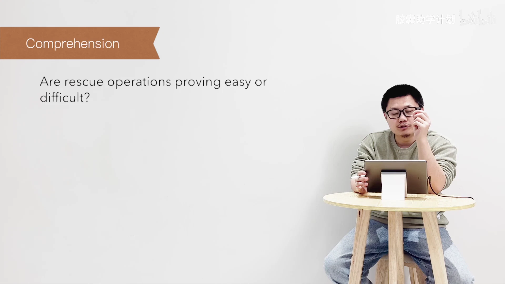

文字识别：Comprehension / Are rescue operations proving easy or / difficult?

## 00:01:00–00:01:30

Why aren't explosives being used? Because vibrations would cause the roof to collapse. Are rescue workers drilling a hole? Yes, they are. On which side of the mine are they drilling it? On the north side of the mine. How do they intend to bring the men up?

### 画面 00:01:00

文字识别：Comprehension / Why aren't explosives being used?

### 画面 00:01:03

文字识别：Comprehension / Why aren't explosives being used?

### 画面 00:01:06

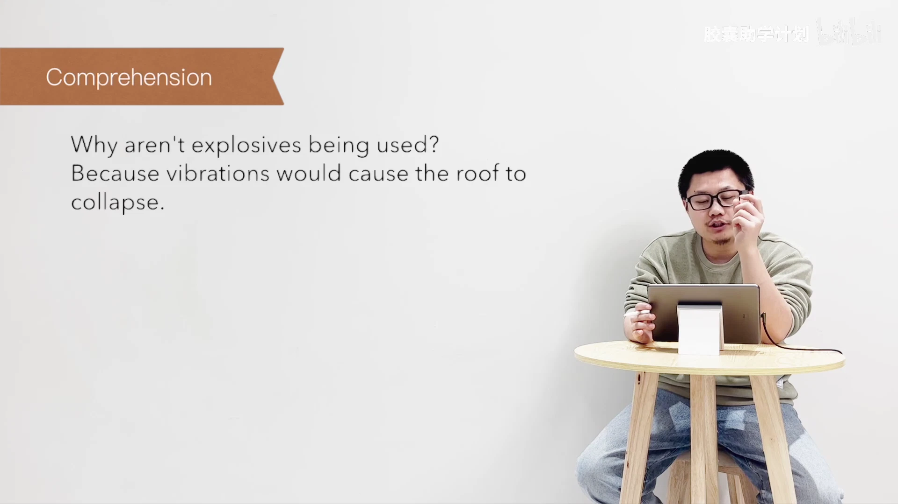

文字识别：Comprehension / Why aren't explosives being used? / Because vibrations would cause the roof to / collapse.

### 画面 00:01:10

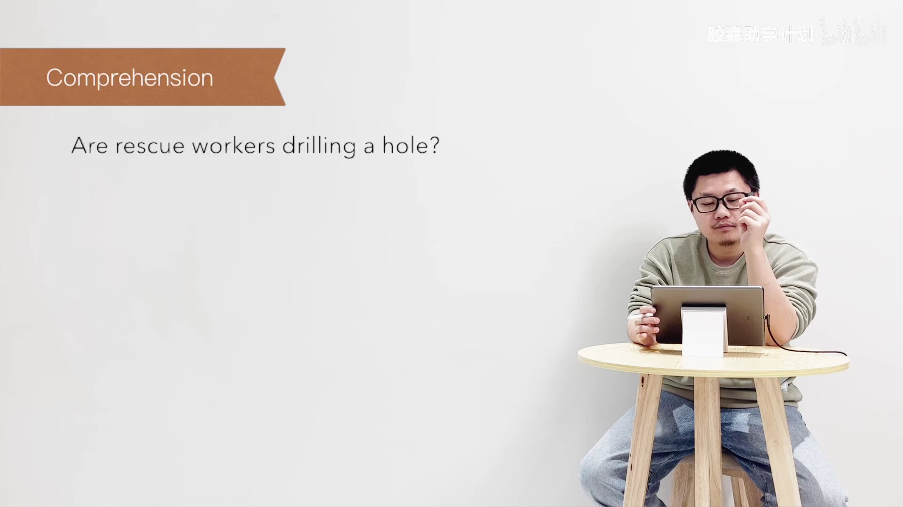

文字识别：Comprehension / Are rescue workers drilling a hole?

### 画面 00:01:17

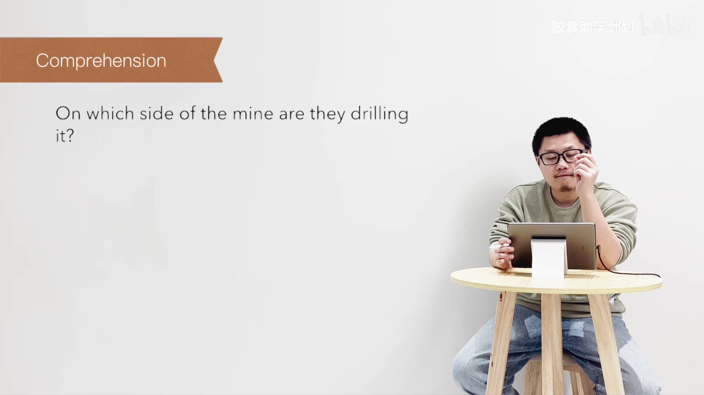

文字识别：Comprehension / On which side of the mine are they drilling / it?

### 画面 00:01:20

文字识别：Comprehension / On which side of the mine are they drilling / it?

### 画面 00:01:26

文字识别：動学计划 / Comprehension

### 画面 00:01:29

文字识别：Comprehension / How do they intend to bring the men up?

## 00:01:30–00:02:00

In a special capsule. What did they discover beneath the soil? A hard layer of rock. What would they have done if it hadn't been there? They would have completed the job in a few hours. How long have they been drilling? For sixteen hours.

### 画面 00:01:31

文字识别：Comprehension / How do they intend to bring the men up? / In a special capsule.

### 画面 00:01:35

文字识别：Comprehension / What did they discover beneath the soil?

### 画面 00:01:40

文字识别：Comprehension / What did they discover beneath the soil? / A hard layer of rock.

### 画面 00:01:47

文字识别：Comprehension / What would they have done if it hadn't been / there?

### 画面 00:01:51

文字识别：Comprehension / What would they have done if it hadn't been / there? / They would have completed the job in a few / hours.

### 画面 00:01:54

文字识别：臺助字计划 / Comprehension

### 画面 00:01:57

文字识别：Comprehension / How long have they been drilling?

## 00:02:00–00:02:30

How far do they still have to go? A long way. Okay, asking questions, 四句型啊。呃，第一个例子, ask me if six men have been trapped in the mine. 现在完成时的被动，现在完成时的被动，have提前。How many? 你肯定对 six 提问，对吧？主语的一部分，哎，直接把 six 删掉，呃，替换成 how many 就可以了。然后 where 肯定是对 in the mine 提问，

### 画面 00:02:00

文字识别：Comprehension / How long have they been drilling? / For sixteen hours.

### 画面 00:02:03

文字识别：Comprehension / How far do they still have to go?

### 画面 00:02:05

文字识别：Comprehension / How far do they still have to go? / Along way.

### 画面 00:02:08

文字识别：Asking questions / 训练目标： / 会说一般疑问句＆特殊疑问句 / Accuracy / Fluency

### 画面 00:02:10

文字识别：臺助学计划 / Asking questions

### 画面 00:02:12

文字识别：Asking questions / T: Ask me if six men have been trapped in a / mine.

### 画面 00:02:15

文字识别：Asking questions / T: Ask me if six men have been trapped in a / mine.

### 画面 00:02:20

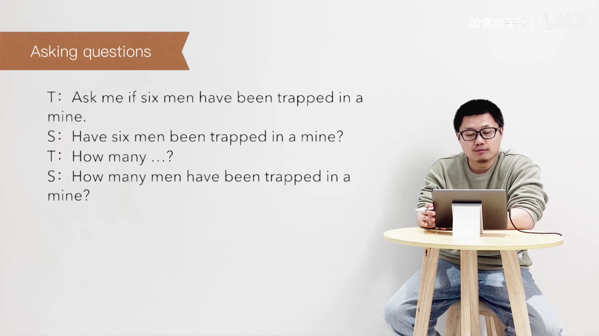

文字识别：Asking questions / T: Ask me if six men have been trapped in a / mine. / S: Have six men been trapped in a mine? / T: How many …..? / S: How many men have been trapped in a / mine?

### 画面 00:02:25

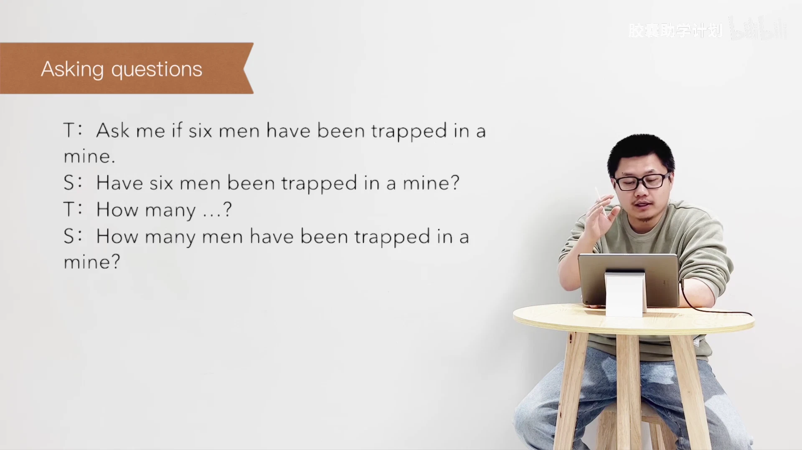

文字识别：Asking questions / T: Ask me if six men have been trapped in a / mine. / S: Have six men been trapped in a mine? / T: How many …..? / S: How many men have been trapped in a / mine?

### 画面 00:02:27

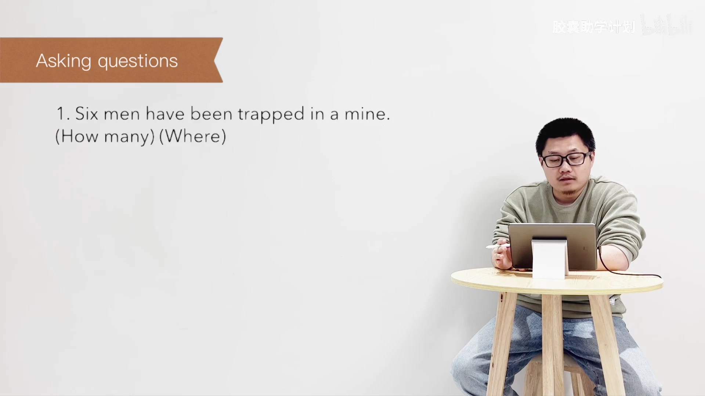

文字识别：Asking questions / 1. Six men have been trapped in a mine. / (How many)(Where)

## 00:02:30–00:03:00

对吧？第二个说they've been there for seventeen hours，你肯定是把have提前，然后how long对for seventeen hours提问，where对there提问。Rescue operations are proving difficult. Are提前，what对主语提问，外加整句话。The men will lose their lives. Will提前，who对the men提问。The roof will collapse. Will提前，what对主语提问，the roof啊，what will collapse?

### 画面 00:02:31

文字识别：Asking questions / 1. Six men have been trapped in a mine. / (How many)(Where) / 2. They've been there for seventeen hours. / (How long)(Where)

### 画面 00:02:35

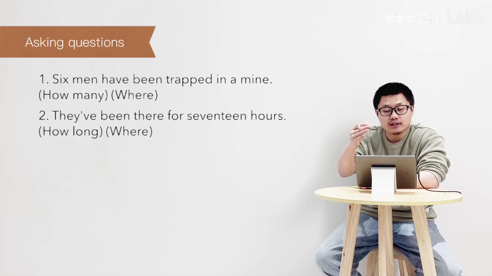

文字识别：Asking questions / 1. Six men have been trapped in a mine. / (How many)(Where) / 2. They've been there for seventeen hours. / (How long)(Where)

### 画面 00:02:40

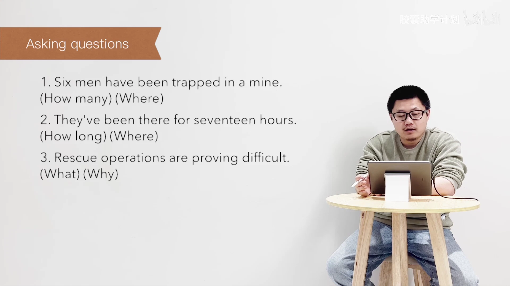

文字识别：Asking questions / 1. Six men have been trapped in a mine. / (How many)(Where) / 2. They've been there for seventeen hours. / (How long)(Where) / 3. Rescue operations are proving dificult. / (What)(Why)

### 画面 00:02:46

文字识别：Asking questions / 1. Six men have been trapped in a mine. / (How many)(Where) / 2. They've been there for seventeen hours. / (How long)(Where) / 3. Rescue operations are proving dificult. / (What)(Why)

### 画面 00:02:51

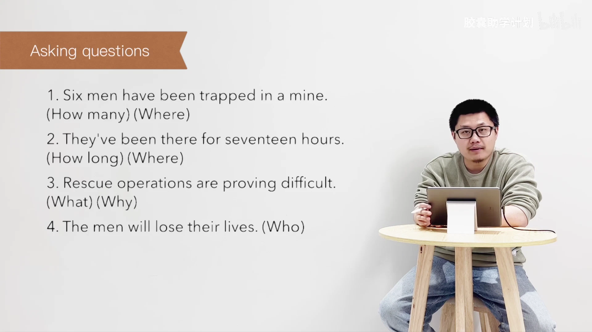

文字识别：Asking questions / 1. Six men have been trapped in a mine. / (How many)(Where) / 2. They've been there for seventeen hours. / (How long)(Where) / 3. Rescue operations are proving difficult. / (What) (Why) / 4. The men will lose their lives. (Who)

### 画面 00:02:56

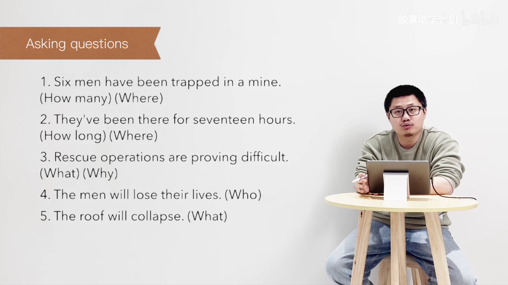

文字识别：Asking questions / 1. Six men have been trapped in a mine. / (How many)(Where) / 2. They've been there for seventeen hours. / (How long)(Where) / 3. Rescue operations are proving dificult. / (What)(Why) / 4. The men will lose their lives. (Who) / 5. The roof will collapse. (What)

### 画面 00:02:58

文字识别：助字计划 / Asking questions

## 00:03:00–00:03:30

Rescue workers are drilling a hole. 二提前，对吧？二提前。呃，然后呢？What你可以对a hole提问啊？What are rescue workers drilling?他们正在钻啥呢？钻个洞啊。They're drilling on the north side. 二提前。Where对？On the north side提问啊？Where are they drilling? They'll bring the man up in a special capsule. Will提前。How对？In a special capsule提问。What kind of

### 画面 00:03:00

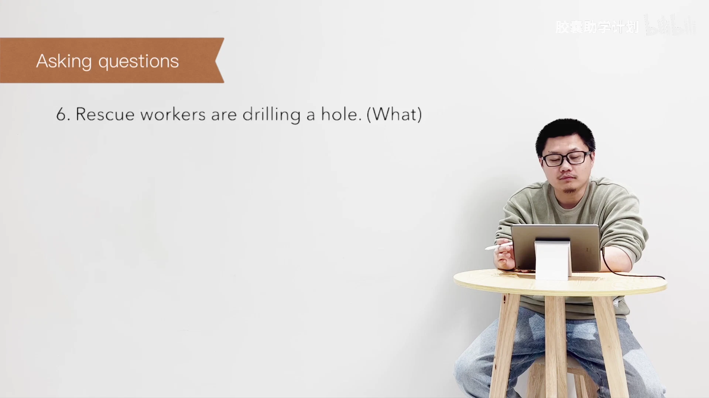

文字识别：Asking questions / 6. Rescue workers are drilling a hole. (What)

### 画面 00:03:05

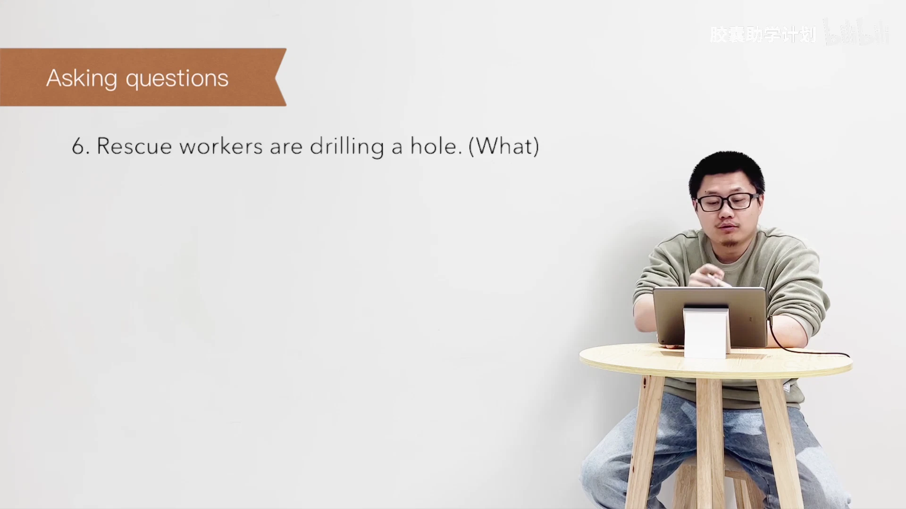

文字识别：Asking questions / 6. Rescue workers are drilling a hole. (What)

### 画面 00:03:10

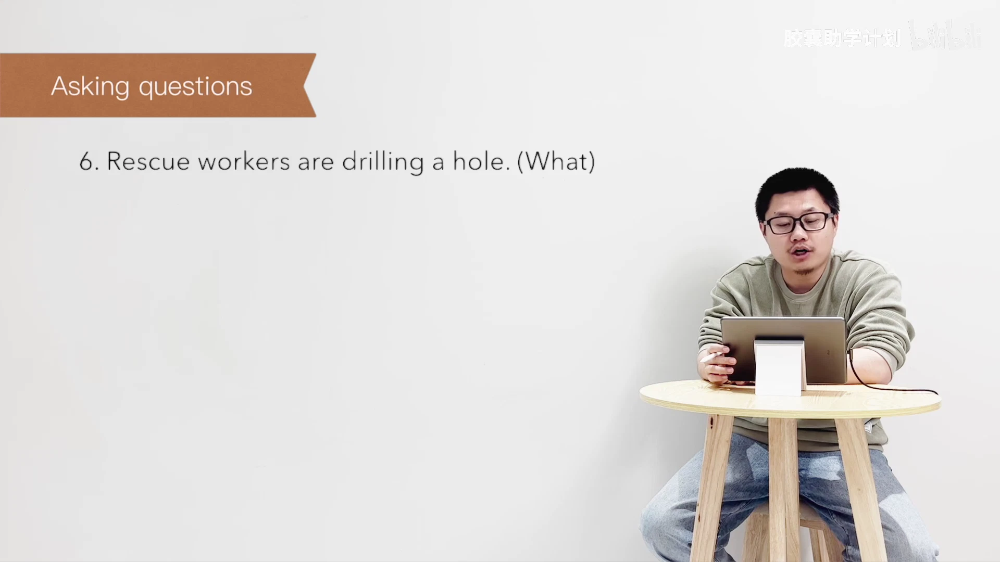

文字识别：Asking questions / 6. Rescue workers are drilling a hole. (What)

### 画面 00:03:18

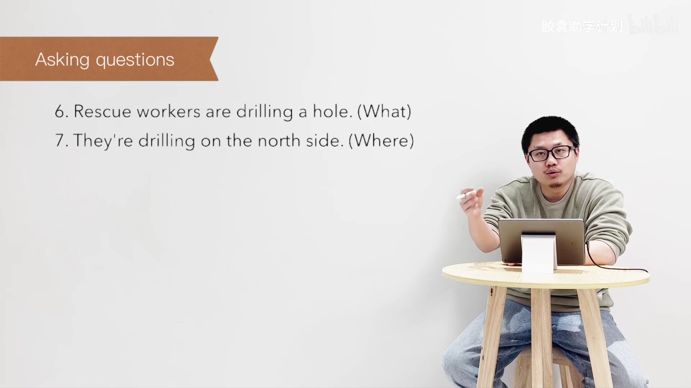

文字识别：Asking questions / 6. Rescue workers are drilling a hole. (What) / 7. They're drilling on the north side. (Where)

### 画面 00:03:20

文字识别：Asking questions / 6. Rescue workers are drilling a hole. (What) / 7. They're drilling on the north side. (Where) / 8. They'll bring the men up in a special / capsule.(How) (What kind) (Who)

### 画面 00:03:25

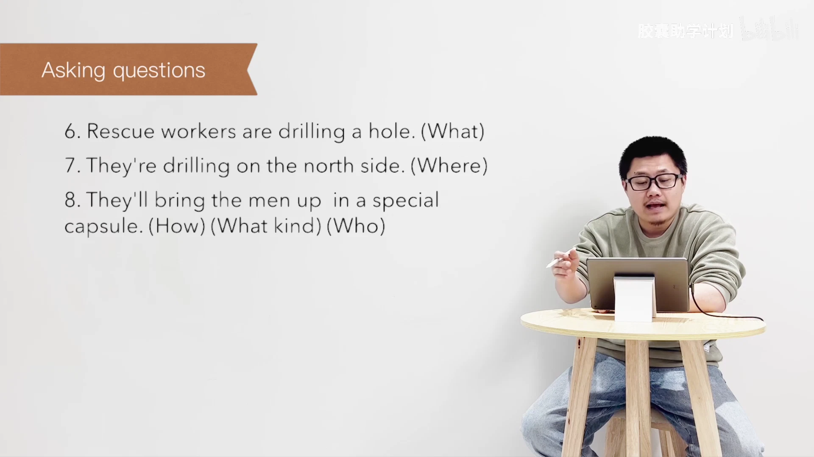

文字识别：Asking questions / 6. Rescue workers are drilling a hole. (What) / 7. They're drilling on the north side. (Where) / 8. They'll bring the men up in a special / capsule.(How)(What kind) (Who)

## 00:03:30–00:04:00

对那个 special 提问，就类似于 What kind of 这个地方是省略了啊，必须要加上 What kind of capsule will they bring the man up in? 对主语提问，也可以对 the man 提问。 There is is 提前就可以了，对吧？然后 What 你可以对 a hard layer of rock 提问。 Where 对 beneath the soil. Tell the story. 练习的咱们口语复述能力，我之前解释过了，很重要

### 画面 00:03:35

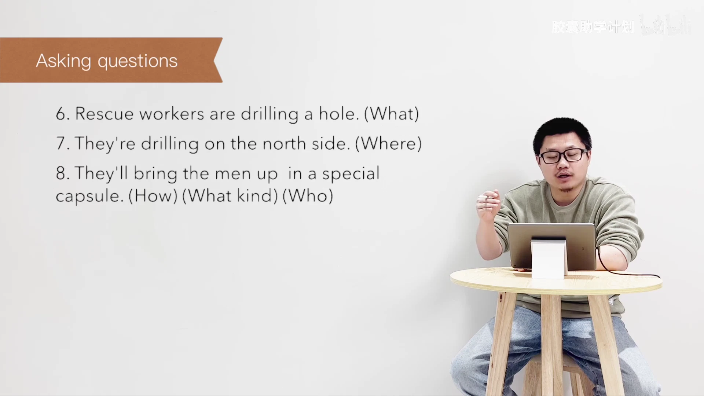

文字识别：Asking questions / 6. Rescue workers are drilling a hole. (What) / 7. They're drilling on the north side. (Where) / 8. They'll bring the men up in a special / capsule.(How) (What kind) (Who)

### 画面 00:03:44

文字识别：Asking questions / 6. Rescue workers are drilling a hole. (What) / 7. They're drilling on the north side. (Where) / 8. They'll bring the men up in a special / capsule.(How)(What kind) (Who) / 9.There's a hard layer of rock beneath the / soil. (What) (Where)

### 画面 00:03:49

文字识别：Asking questions / 6. Rescue workers are drilling a hole. (What) / 7.They're drilling on the north side. (Where) / 8. They'll bring the men up in a special / capsule.(How) (What kind) (Who) / 9. There's a hard layer of rock beneath the / soil. (What) (Where)

### 画面 00:03:52

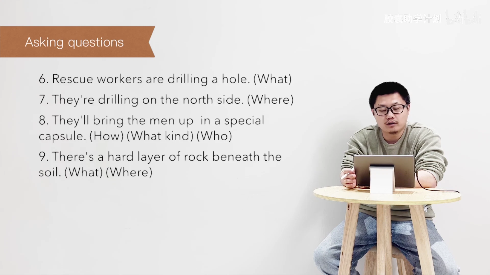

文字识别：Asking questions / 6. Rescue workers are drilling a hole. (What) / 7. They're drilling on the north side. (Where) / 8. They'll bring the men up in a special / capsule.(How) (What kind) (Who) / 9. There's a hard layer of rock beneath the / soil.(What) (Where)

### 画面 00:03:54

文字识别：喜助字计划国 / Tell the story / 训练目标： / 口语复述能力 / Accuracy / Fluency

### 画面 00:03:56

文字识别：Tell the story / ① /  six men-trapped-seventeen hours / rescue operations-difficult / if explosives-roof-collapse / workers-drilling-north side / intend-bring men up-special capsule / ) hard layer of rock-drilling-six hours / microphone-enabled-keep in touch / running out of-confident-out soon / 9 / ) If they knew-difficult-lose heart

## 00:04:00–00:04:30

啊，一定要做。然后summary writing呢，两个点，两篇文章，并且重点看连词。啊，实在不想写，一定要看啊，对我们的写作工作、应试考试当中的写作提升能力非常大。这是咱们的第一篇文章，这是咱们的第二篇文章啊。然后topic for discussion呢，我们老习惯说一下这些题。所以，if you were trapped underground, could you remain cheerful? What would you do? What would you do? 你

### 画面 00:04:00

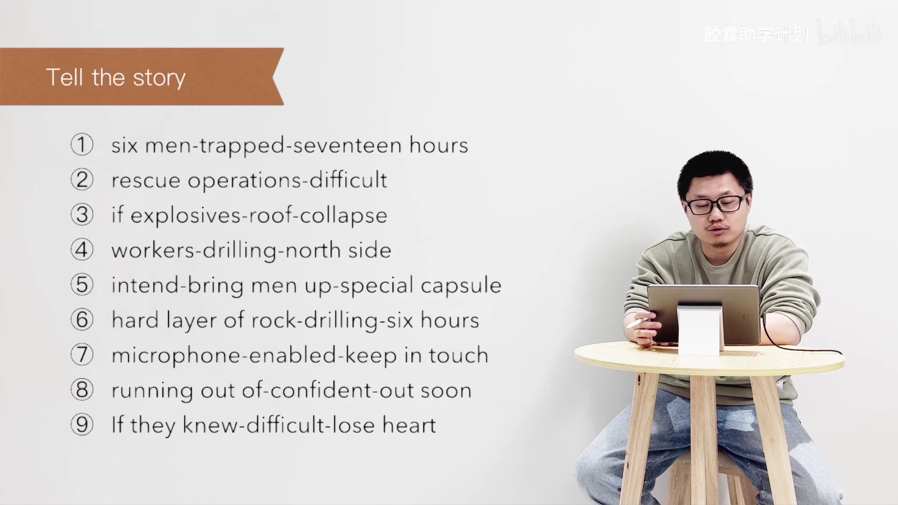

文字识别：Tell the story / ① / six men-trapped-seventeen hours / rescue operations-difficult / if explosives-roof-collapse / workers-drilling-north side / intend-bring men up-special capsule / ) hard layer of rock-drilling-six hours / microphone-enabled-keep in touch / running out of-confident-out soon / 9 / ) If they knew-difficult-lose heart

### 画面 00:04:02

文字识别：臺助学计划 / Summary writing: Key / 训练目标： / 写作复述能力

### 画面 00:04:05

文字识别：臺助字计划園 / Summary writing: Key / 训练目标： / 写作复述能力

### 画面 00:04:11

文字识别：毫助学计划 / Summary writing: Key / 训练目标： / 写作复述能力

### 画面 00:04:14

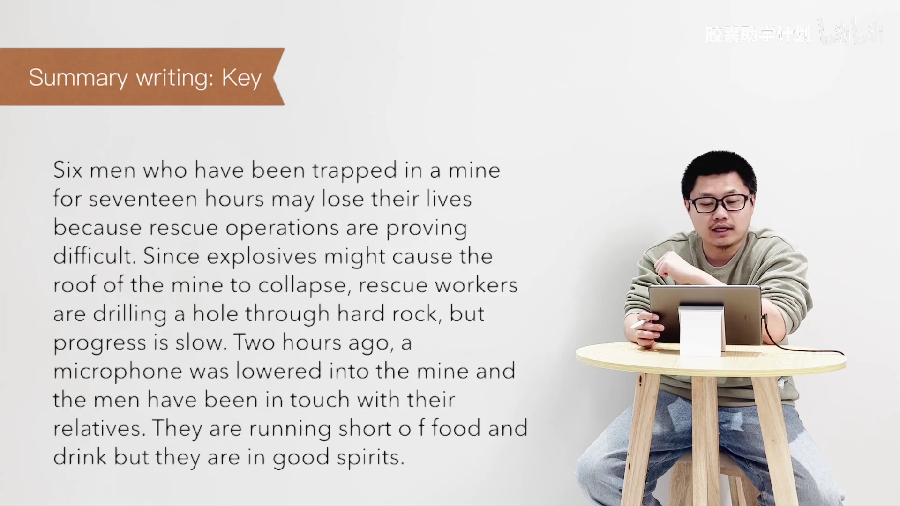

文字识别：助字计划 / Summary writing: Key / Six men who have been trapped in a mine / for seventeen hours may lose their lives / because rescue operations are proving / difficult. Since explosives might cause the / roof of the mine to collapse, rescue workers / are drilling a hole through hard rock, but / progress is slow. Two hours ago, a / microphone was lowered into the mine and / the men have been in touch with their / relatives. They are running short o f food and / drink but they are in good spirits.

### 画面 00:04:16

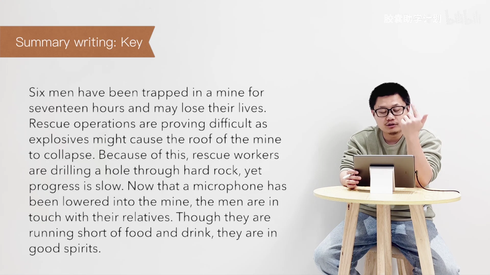

文字识别：助学计划 / Summary writing: Key / Six men have been trapped in a mine for / seventeen hours and may lose their lives. / Rescue operations are proving difficult as / explosives might cause the roof of the mine / to collapse. Because of this, rescue workers / are drilling a hole through hard rock, yet / progress is slow. Now that a microphone has / been lowered into the mine, the men are in / touch with their relatives. Though they are / running short of food and drink, they are in / good spirits.

### 画面 00:04:18

文字识别：Topics for discussion / 训练目标： / 完全自由的对话 / Accuracy / Fluency

### 画面 00:04:20

文字识别：Topics for discussion / If you were trapped underground, could / you remain cheerful? What would you / do? / Coal-mining is dangerous work. What / other kind of work involves similar risks? / One day allthe natural supplies of coal / will be used up. What will happen in / countries which at present depend / largely on coal for industry, heating, / etc.?

### 画面 00:04:25

文字识别：Topics for discussion / If you were trapped underground, could / you remain cheerful? What would you / do? / Coal-mining is dangerous work. What / other kind of work involves similar risks? / One day allthe natural supplies of coal / will be used up. What will happen in / countries which at present depend / largely on coal for industry, heating, / etc.?

## 00:04:30–00:05:00

会做什么是吧？如果你被困在地下了，你能保持 cheerful 吗？开心吗？你会做什么？ Coal mining is a dangerous work. 啊，挖煤矿很危险，有很危险的工作。 What other kind of work involves similar risk? 还没有什么其他的类似的工作会有相同的危险呢？最后一个说，One day all the natural supplies of coal will be used up. What will happen

### 画面 00:04:30

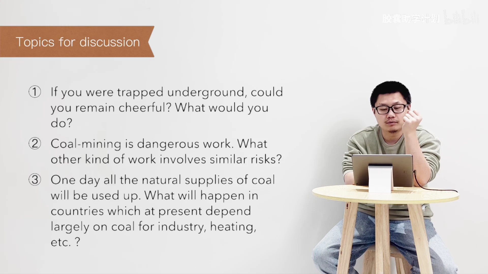

文字识别：Topics for discussion / If you were trapped underground, could / you remain cheerful? What would you / do? / Coal-mining is dangerous work. What / other kind of work involves similar risks? / One day allthe natural supplies of coal / will be used up. What will happen in / countries which at present depend / largely on coal for industry, heating, / etc.?

### 画面 00:04:34

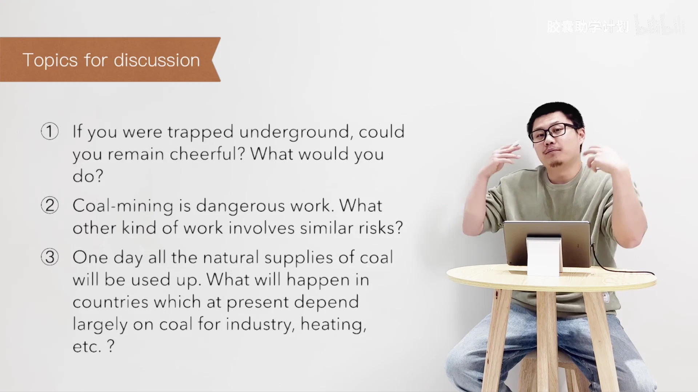

文字识别：Topics for discussion / If you were trapped underground, could / you remain cheerful? What would you / do? / Coal-mining is dangerous work. What / other kind of work involves similar risks? / One day allthe natural supplies of coal / will be used up. What will happen in / countries which at present depend / largely on coal for industry, heating, / etc.?

### 画面 00:04:36

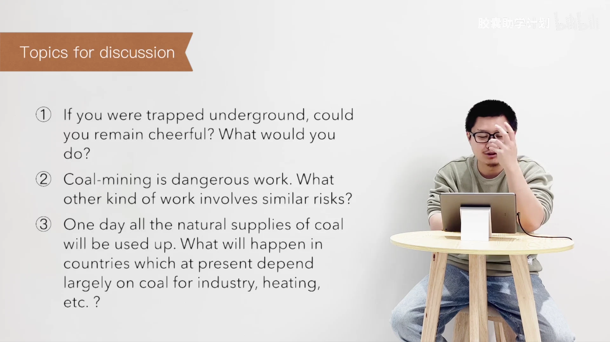

文字识别：Topics for discussion / If you were trapped underground, could / you remain cheerful? What would you / do? / Coal-mining is dangerous work. What / other kind of work involves similar risks? / One day allthe natural supplies of coal / will be used up. What will happen in / countries which at present depend / largely on coal for industry, heating, / etc.?

### 画面 00:04:39

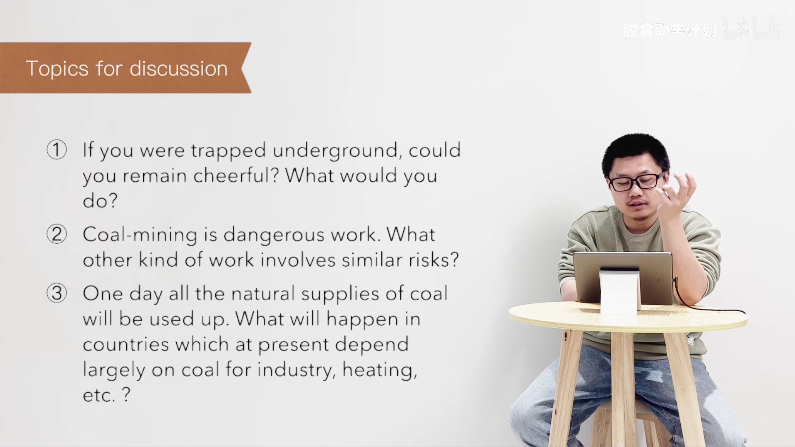

文字识别：Topics for discussion / If you were trapped underground, could / you remain cheerful? What would you / do? / Coal-mining is dangerous work. What / other kind of work involves similar risks? / One day allthe natural supplies of coal / will be used up. What will happen in / countries which at present depend / largely on coal for industry, heating, / etc.?

### 画面 00:04:45

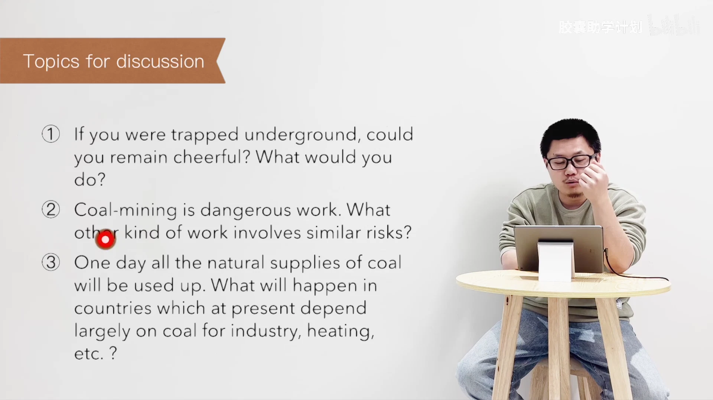

文字识别：Topics for discussion / If you were trapped underground, could / you remain cheerful? What would you / do? / Coal-mining is dangerous work. What / otho / kind of work involves similar risks? / One day all the natural supplies of coal / 3 / will be used up. What will happen in / countries which at present depend / largely on coal for industry, heating, / etc.?

### 画面 00:04:48

文字识别：Topics for discussion / If you were trapped underground, could / you remain cheerful? What would you / do? / Coal-mining is dangerous work. What / other kind of work involves similar risks? / One day allthe natural supplies of coal / will be used up. What will happen in / countries which at present depend / largely on coal for industry, heating, / etc.?

### 画面 00:04:50

文字识别：Topics for discussion / If you were trapped underground, could / you remain cheerful? What would you / do? / Coal-mining is dangerous work. What / other kind of work involves similar risks? / One day al the natural supplies of coal / will be used up. What will happen in / countries which at present depend / largely on coal for industry, heating, / etc.?

### 画面 00:04:55

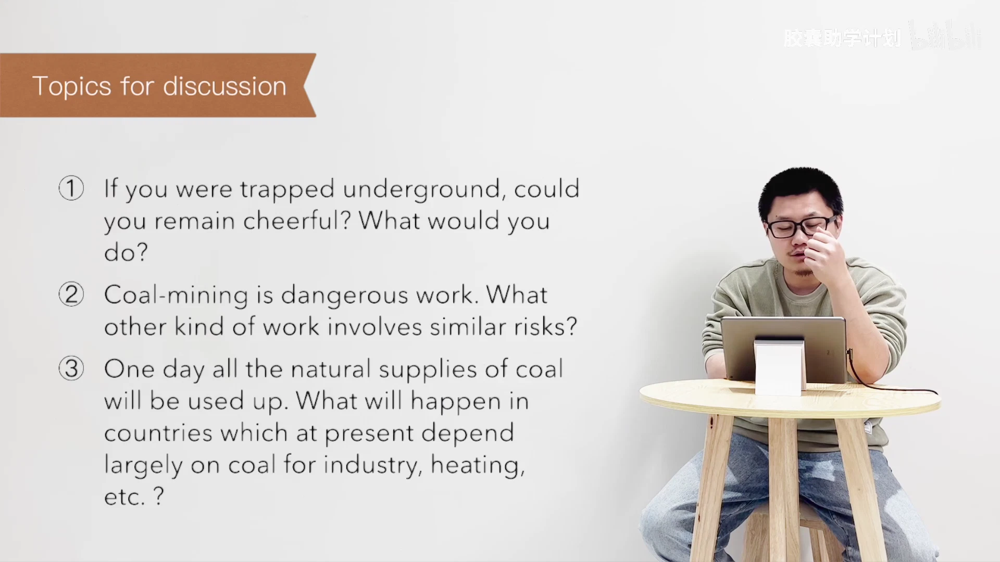

文字识别：Topics for discussion / If you were trapped underground, could / you remain cheerful? What would you / do? / Coal-mining is dangerous work. What / other kind of work involves similar risks? / One day all the natural supplies of coal / will be used up. What will happen in / countries which at present depend / largely on coal for industry, heating, / etc.?

## 00:05:00–00:05:30

in countries which at present depend largely on coal for industry heating, etc. So,有一天呢，自然界提供的这些煤矿是会被用光的。那对于那些现在要大面积使用煤矿给他们的工业呀、取暖或者其他的事情的这些国家来说，他们怎么办？你看，这是一个很好的问题啊。好，家庭作业：Ask Smith先写，再朗读摘要，写作写完对答案，tell the story口语复述，

### 画面 00:05:06

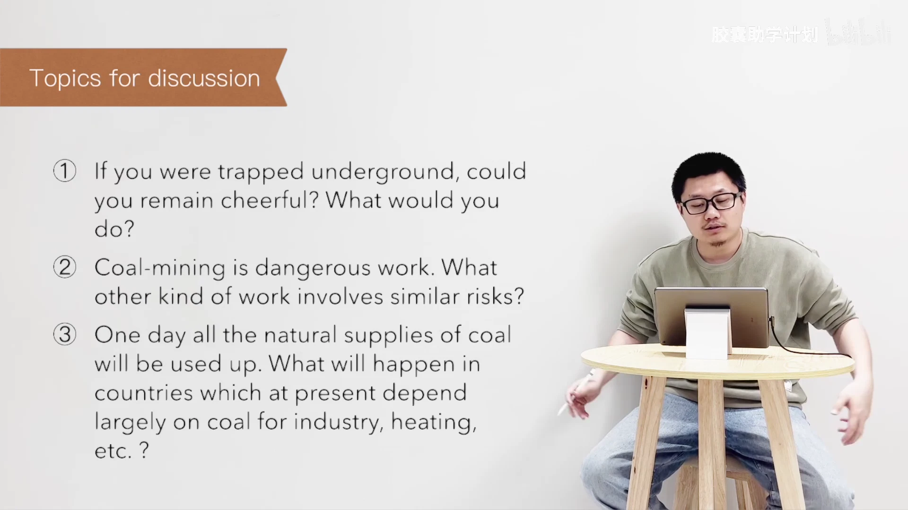

文字识别：Topics for discussion / If you were trapped underground, could / you remain cheerful? What would you / do? / Coal-mining is dangerous work. What / other kind of work involves similar risks? / One day allthe natural supplies of coal / will be used up. What will happen in / countries which at present depend / largely on coal for industry, heating, / etc.?

### 画面 00:05:08

文字识别：Topics for discussion / If you were trapped underground, could / you remain cheerful? What would you / do? / Coal-mining is dangerous work. What / other kind of work involves similar risks? / One day all the natural supplies of coal / will be used up. What will happen in / countries which at present depend / largely on coal for industry, heating, / etc.?

### 画面 00:05:10

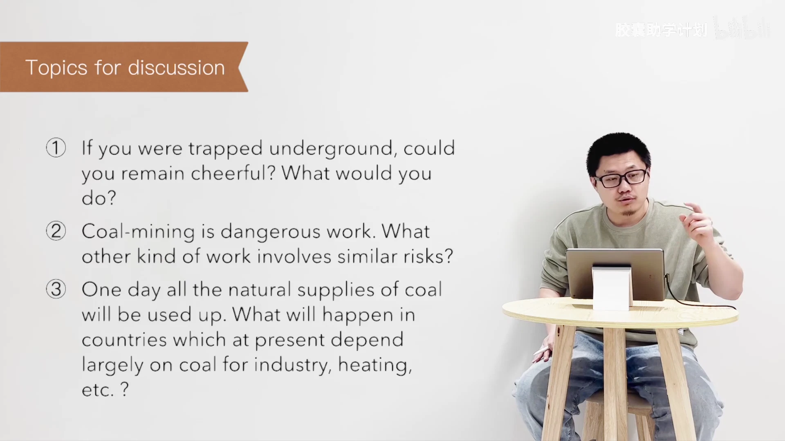

文字识别：Topics for discussion / If you were trapped underground, could / you remain cheerful? What would you / do? / Coal-mining is dangerous work. What / other kind of work involves similar risks? / One day allthe natural supplies of coal / will be used up. What will happen in / countries which at present depend / largely on coal for industry, heating, / etc.?

### 画面 00:05:12

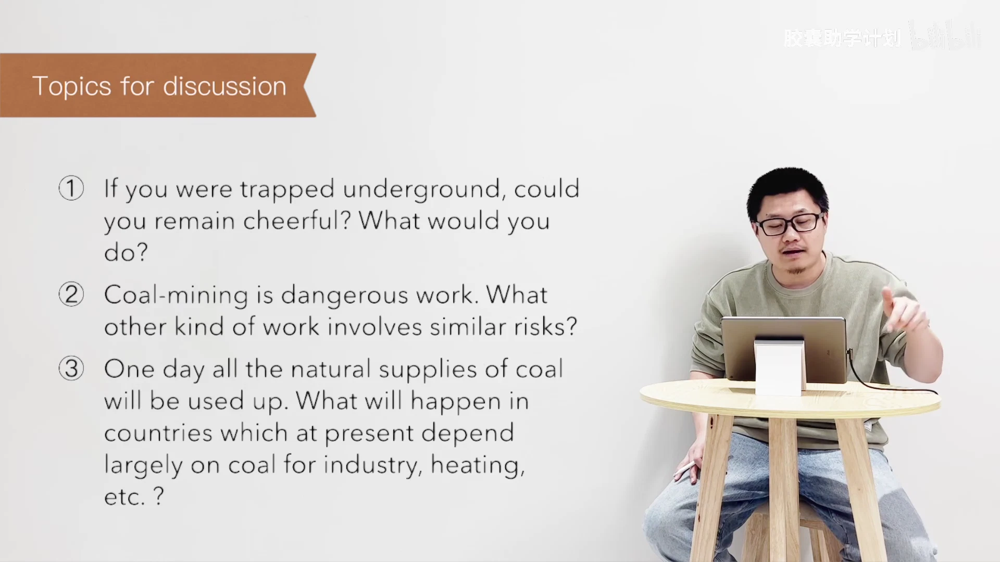

文字识别：Topics for discussion / If you were trapped underground, could / you remain cheerful? What would you / do? / Coal-mining is dangerous work. What / other kind of work involves similar risks? / One day allthe natural supplies of coal / will be used up. What will happen in / countries which at present depend / largely on coal for industry, heating, / etc.?

### 画面 00:05:19

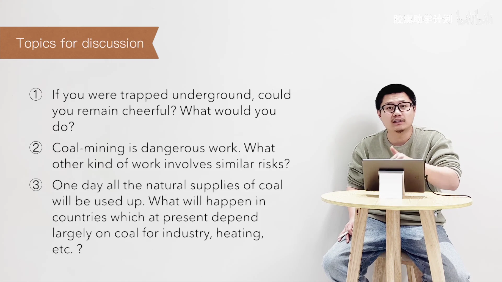

文字识别：Topics for discussion / If you were trapped underground, could / you remain cheerful? What would you / do? / Coal-mining is dangerous work. What / other kind of work involves similar risks? / One day allthe natural supplies of coal / will be used up. What will happen in / countries which at present depend / largely on coal for industry, heating, / etc.?

### 画面 00:05:21

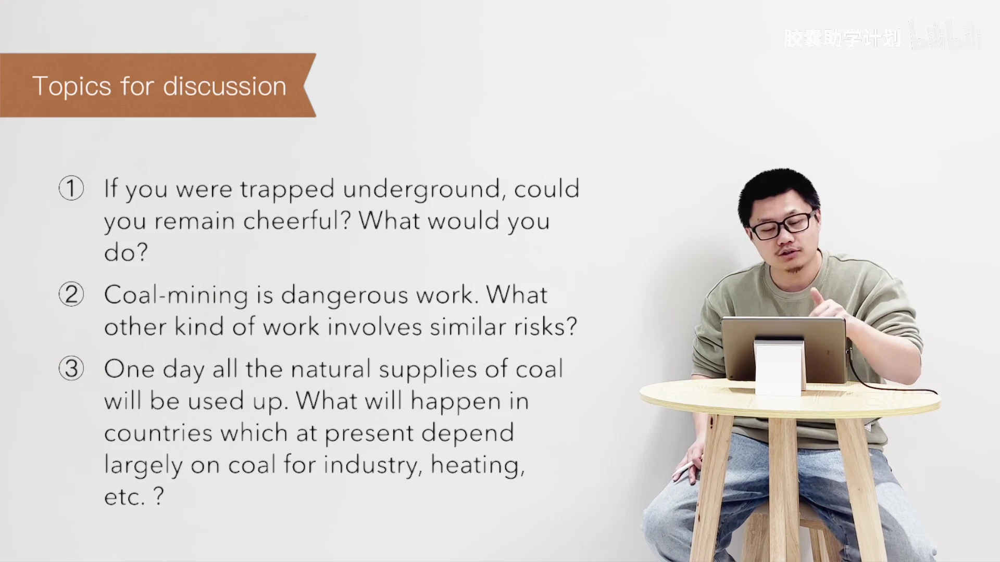

文字识别：Topics for discussion / If you were trapped underground, could / you remain cheerful? What would you / do? / Coal-mining is dangerous work. What / other kind of work involves similar risks? / One day all the natural supplies of coal / 3 / will be used up. What will happen in / countries which at present depend / largely on coal for industry, heating, / etc.?

### 画面 00:05:23

文字识别：助子计划

### 画面 00:05:25

文字识别：妻助学计划 / 1. / Ask me if写&朗读 / 2.摘要写作写&答案

### 画面 00:05:27

文字识别：辜助学计划區 / 1.Ask me if写&朗读 / 摘要写作写&答案 / 3.Tell the story 口语复述

### 画面 00:05:29

文字识别：1.Ask me if写&朗读 / 摘要写作写&答案 / 3.Tell the story 口语复述 / .重复间隔（置顶留言） / 4.

## 00:05:30–00:05:58

然后置顶留言找重复间隔的学习材料。那以上呢就是本期视频的全部内容了。如果各位喜欢我们的课程呢，欢迎各位关注、订阅、一键三连，分享给那些需要的朋友，来帮助我们快速成长。 See you next time.

### 画面 00:05:31

文字识别：1.Ask me if写&朗读 / 摘要写作写&答案 / 3.Tell the story 口语复述 / 4. / 4.重复间隔（置顶留言）

### 画面 00:05:33

文字识别：臺助学计划 / 不

### 画面 00:05:37

文字识别：袁助字计划

### 画面 00:05:41

文字识别：耄助学计划

### 画面 00:05:45

文字识别：袁助学计划一

### 画面 00:05:47

文字识别：聖助字計划 / CAPSULEACADEMY / 胶囊助学计划 / 小红书 / Lecturer / Leo / OE / 0

### 画面 00:05:50

文字识别：動字計 / CAPSULEACADEMY / 胶囊助学计划 / 『 / 小红书 / Photographer / Berlin / OE

### 画面 00:05:53

文字识别：臺珈字計物 / CAPSULEACADEMY / 胶囊助学计划 / 『 / 小红书 / Creator / OE

### 画面 00:05:56

文字识别：bilibili / 胶囊助学计划

### 画面 00:05:58

文字识别：bilibili / 胶囊助学计划

