# 089 单词

快速机器解析：语音为单模型转写，未进行独立交叉校对或人工复核；画面每秒采样并按变化选帧，短时文字和标记可能遗漏。截图时间约有 1 秒误差。图片有损压缩；遇到疑点请按时间查看 Google Drive 原视频。

## 00:00:00–00:00:30

Hello everyone, welcome to Capsule Academy. This is Leo. Today we're going to learn English textbook two lesson eighty nine words. 那老习惯进入正式课程之前呢，咱们看两个问题啊。首先，如何表达口误？接下来，如何表达观看喜剧？带着这两个问题，Hope you guys enjoy. 第一个单词，跟我一起读一下，叫做 sleep sleep sleep。这个单词单独

### 画面 00:00:00

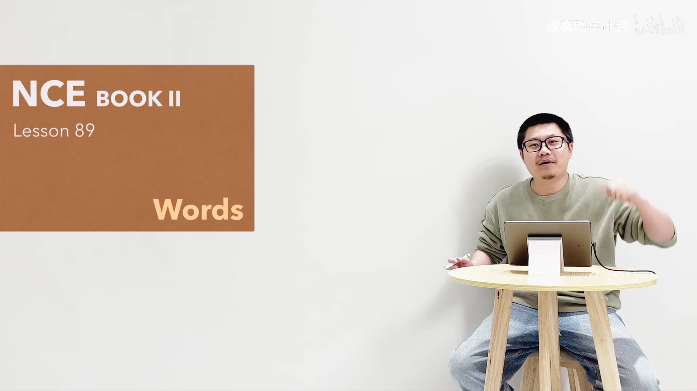

文字识别：NCE / BOOKⅡI / Lesson 89 / Words

### 画面 00:00:02

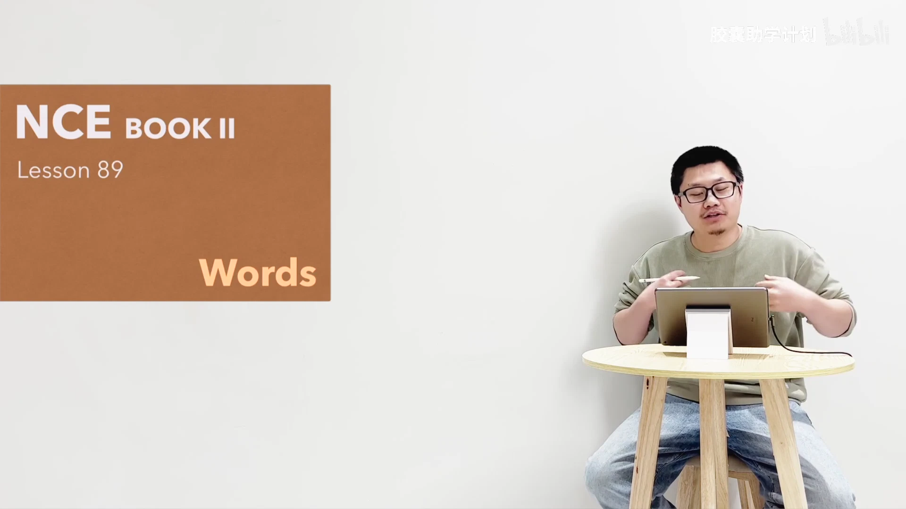

文字识别：NCE / BOOKⅡI / Lesson 89 / Words

### 画面 00:00:05

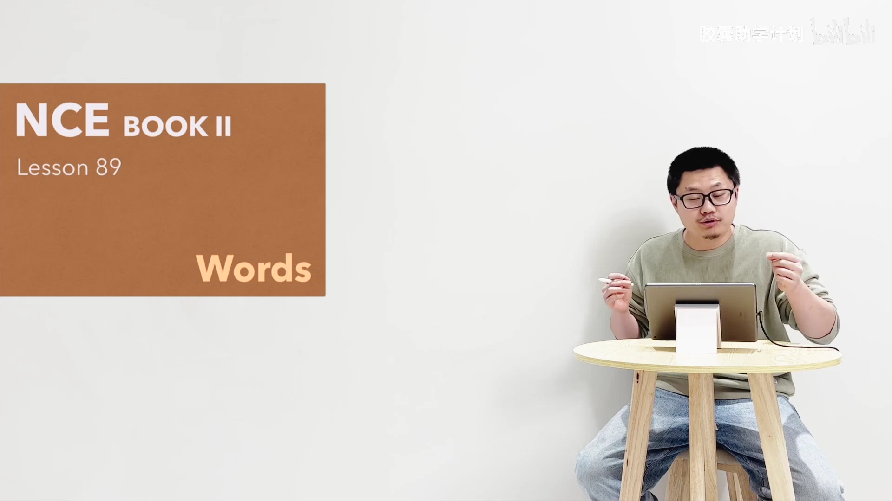

文字识别：NCE / BOOKⅡI / Lesson 89 / Words

### 画面 00:00:11

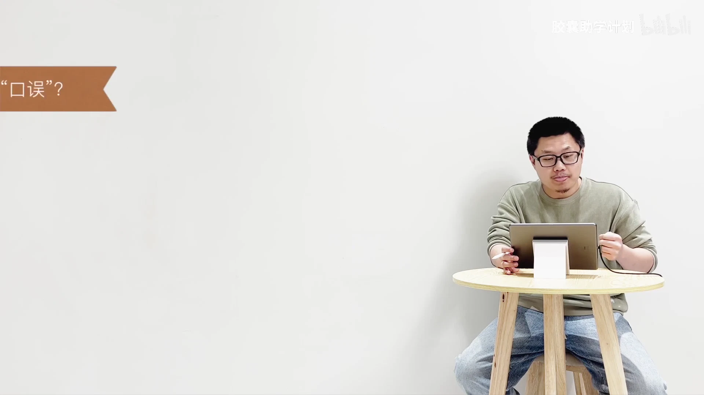

文字识别：助字计划 / 口误”?

### 画面 00:00:13

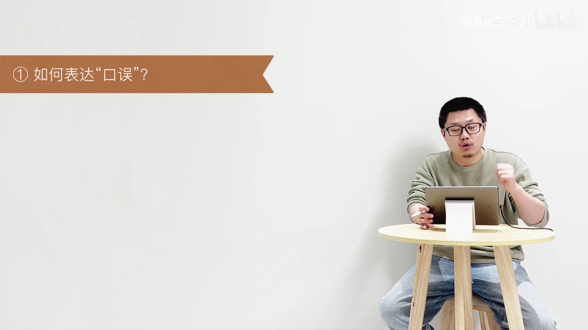

文字识别：①如何表达“口误”？

### 画面 00:00:15

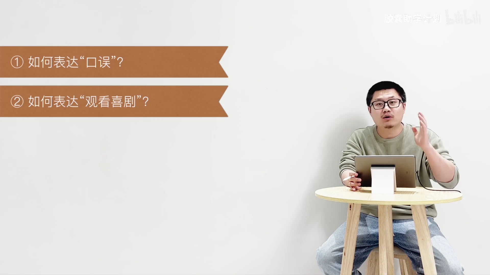

文字识别：①如何表达“口误”？ / 如何表达“观看喜剧”?

### 画面 00:00:19

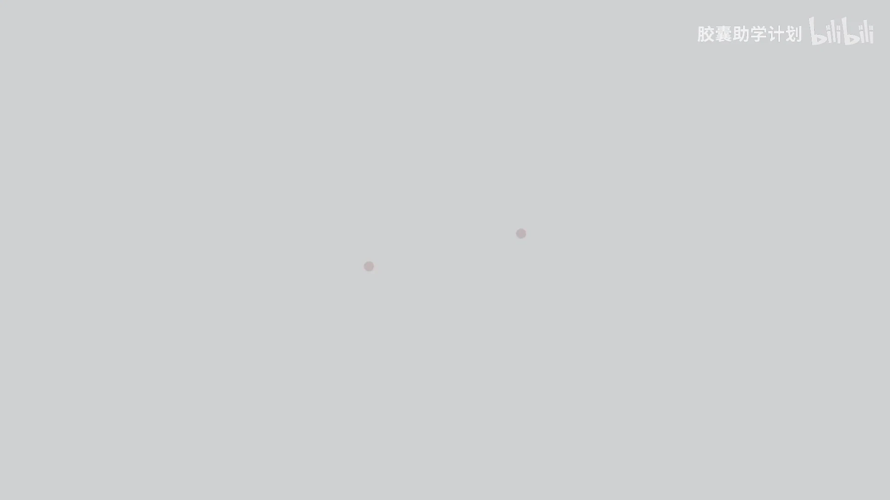

文字识别：胶囊助学计划 bil

### 画面 00:00:23

文字识别：交囊助学计划 / 胶囊助学计划

### 画面 00:00:25

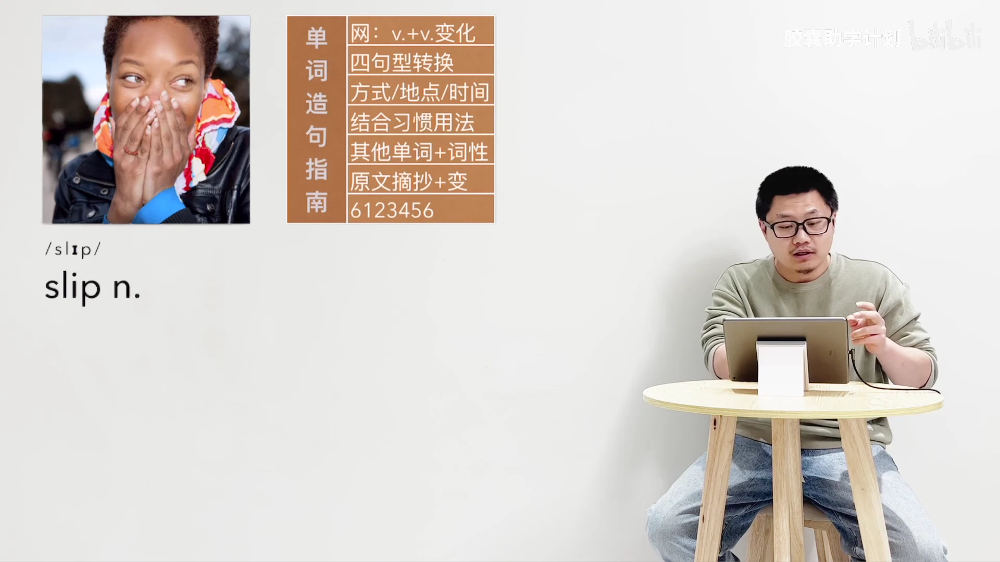

文字识别：单词造句指南 / 网：v.+v.变化 / 四句型转换 / 方式/地点/时间 / 结合习惯用法 / 其他单词+词性 / 原文摘抄+变 / 6123456 / /slIp/ / slip n.

## 00:00:30–00:01:00

独去用的时候，其实我们新一就见过滑倒，那时候动词讲，对吧？那现在完全不是那个意思了。我们现在要学它的名词含义，就是错误。那这个单词单独出现也不重要，而是这个短语放在一起是今天您最需要记住的，叫a slip of the tongue. Tongue咱也学过舌头。那什么叫舌头的错误呢？口误，对吧？A slip of the tongue，它是我们标题当中出现的，但确实还挺常用的。我们造个句子。

### 画面 00:00:40

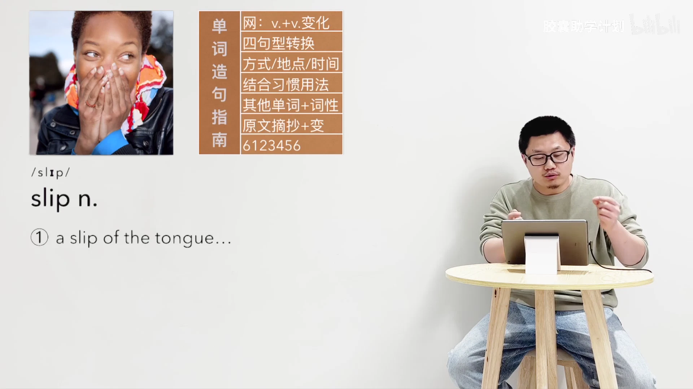

文字识别：单词造句指南 / 网：v.+v.变化 / 四句型转换 / 方式/地点/时间 / 结合习惯用法 / 其他单词+词性 / 原文摘抄+变 / 6123456 / /slIp/ / slip n. / ① a slip of the tongue..

### 画面 00:00:59

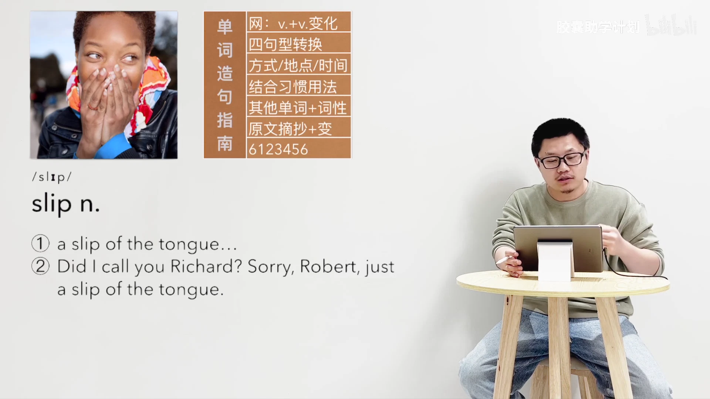

文字识别：单词造句指南 / 网：v.+v.变化 / 四句型转换 / 方式/地点/时间 / 结合习惯用法 / 其他单词+词性 / 原文摘抄+变 / 6123456 / /s|Ip/ / slip n. / ① a slip of the tongue... / Did I call you Richard? Sorry, Robert, just / a slip of the tongue.

## 00:01:00–00:01:30

Did I call you Richard? Ah, sorry, Robert. Just a sleep of the town.哎呀，不好意思啊，我叫错了，就是口误了一下。Next one，我们给它造一个稍微正式一点的句子，而不是偏口语的，叫做A sleep of the town.口误 made me say Robert instead of Richard. Okay,啊，instead of是咱二十课学的一个短语。Next one，说Did I say one hundred dollars? It must

### 画面 00:01:10

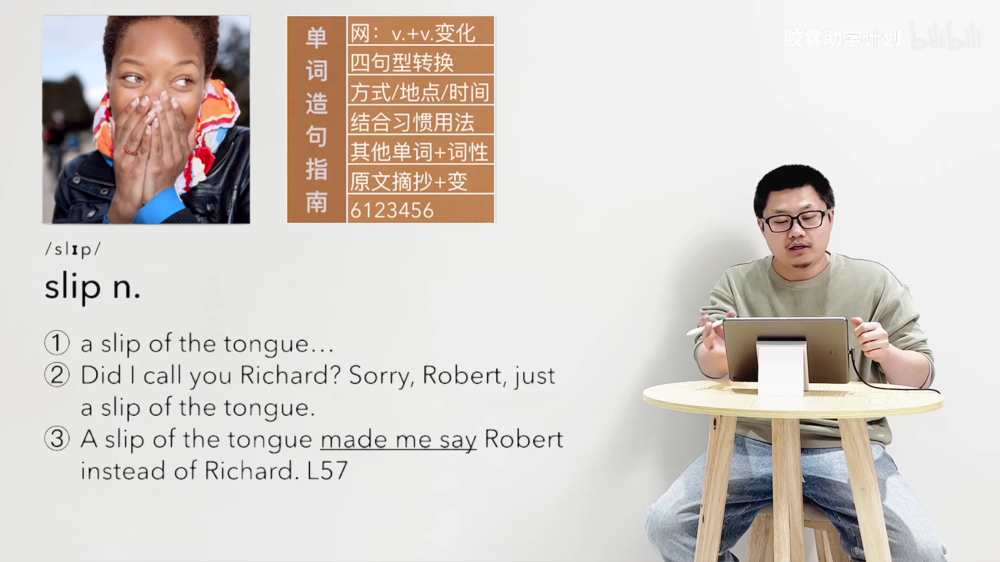

文字识别：单词造句指南 / 网：v.+v.变化 / 四句型转换 / 方式/地点/时间 / 结合习惯用法 / 其他单词+词性 / 原文摘抄+变 / 6123456 / /slIp/ / slip n. / ① a slip of the tongue... / ② Did I call you Richard? Sorry, Robert, just / a slip of the tongue. / ③ A slip of the tongue made me say Robert / instead of Richard. L57

### 画面 00:01:27

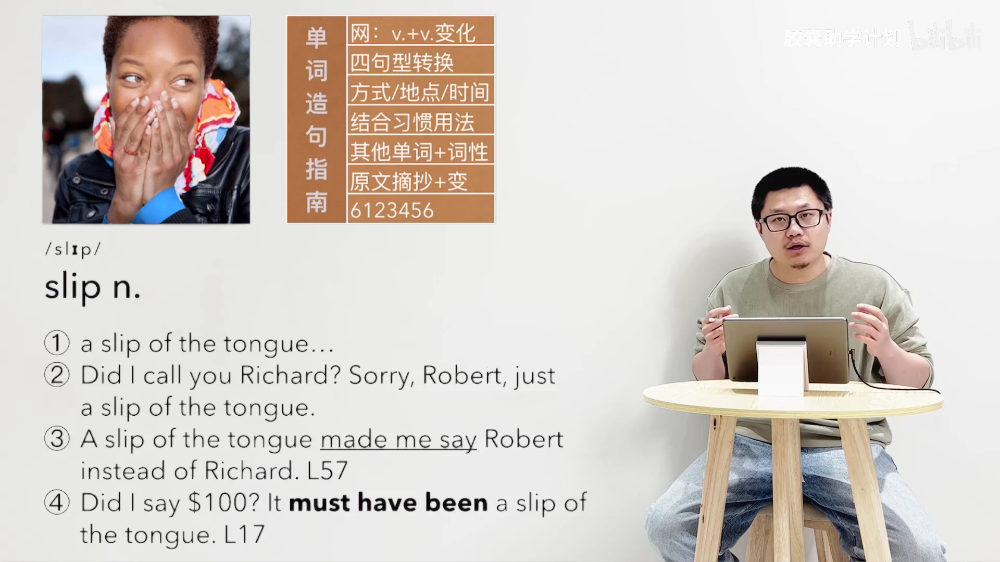

文字识别：单词造句指南 / 网：v.+v.变化 / 四句型转换 / 方式/地点/时间 / 结合习惯用法 / 其他单词+词性 / 原文摘抄+变 / 6123456 / /slip/ / slip n. / ① a slip of the tongue... / ② Did I call you Richard? Sorry, Robert, just / a slip of the tongue. / ③ A slip of the tongue made me say Robert / instead of Richard. L57 /  Did I say $100? It must have been a slip of / the tongue. L17

## 00:01:30–00:02:00

have been a slip of the tongue.说，我刚才是说一百美元吗？哎呀，这一定是口误了。Must have been.咱们正好复习了十七课的这个 must 情态动词表推测，啊，还有十九课情态动词表推测，对吧？好，那咱注意力集中，咱听个电影片段。Rebecca, Rebecca, look, it was, it was, it was a slip of the tongue. Very good. 下一个单词 comedy, comedy.

### 画面 00:01:45

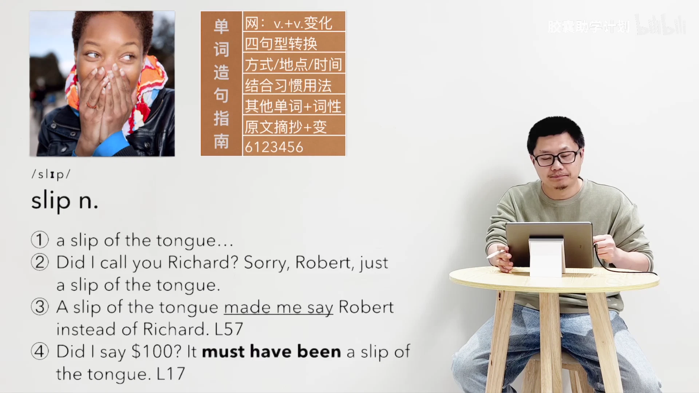

文字识别：单词造句指南 / 网：v.+v.变化 / 四句型转换 / 方式/地点/时间 / 结合习惯用法 / 其他单词+词性 / 原文摘抄+变 / 6123456 / /slip/ / slip n. / ① a slip of the tongue... / ② Did I call you Richard? Sorry, Robert, just / a slip of the tongue. / ③ A slip of the tongue made me say Robert / instead of Richard. L57 /  Did I say $100? It must have been a slip of / the tongue. L17

### 画面 00:01:47

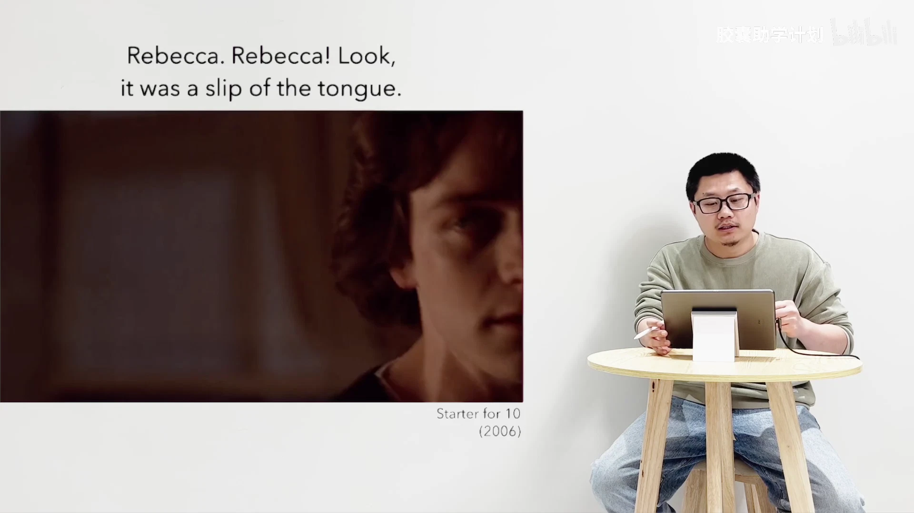

文字识别：Rebecca. Rebecca! Look, / it was a slip of the tongue. / Starter for 10 / (2006)

### 画面 00:01:51

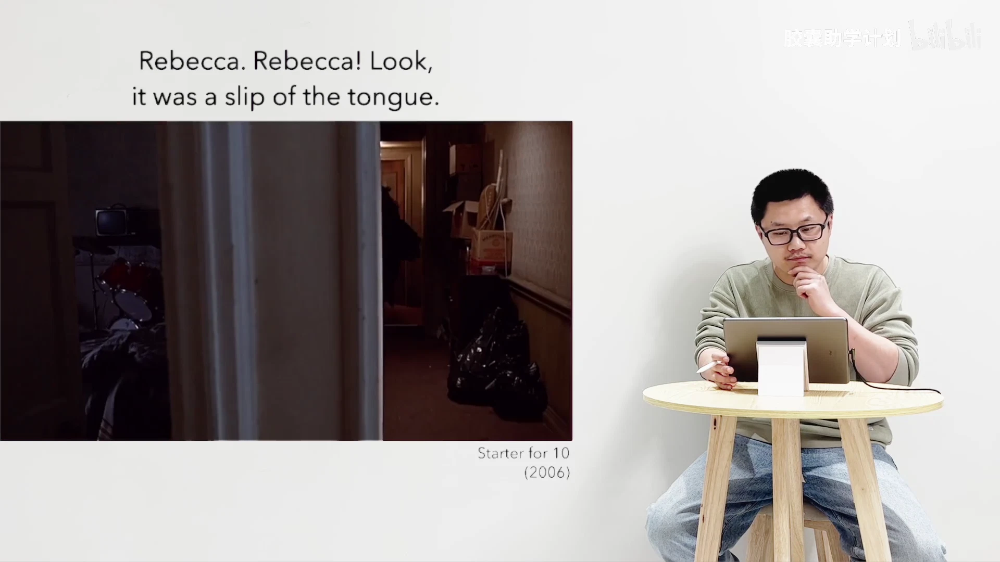

文字识别：Rebecca. Rebecca! Look, / it was a slip of the tongue. / Starter for 10 / (2006)

### 画面 00:01:53

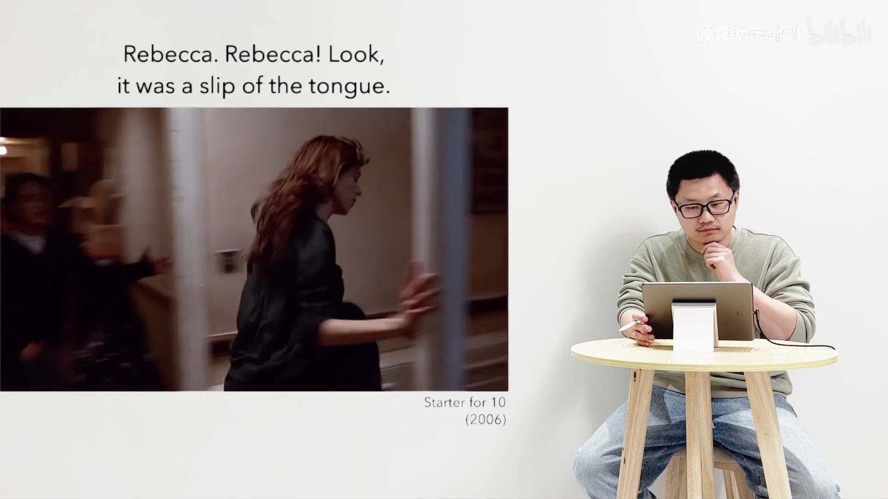

文字识别：Rebecca. Rebecca! Look, / it was a slip of the tongue. / Starter for 10 / (2006)

### 画面 00:01:55

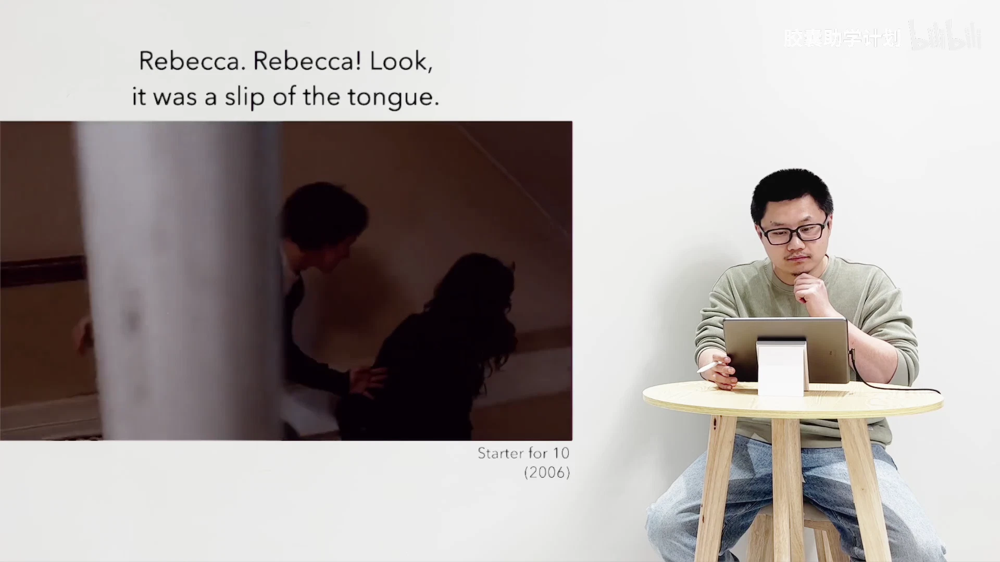

文字识别：Rebecca. Rebecca! Look, / it was a slip of the tongue. / Starter for 10 / (2006)

### 画面 00:01:57

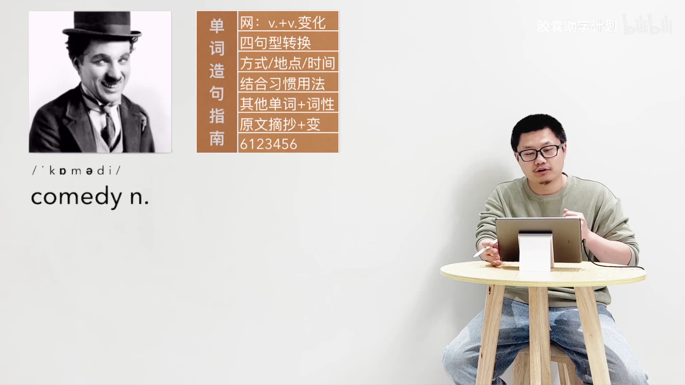

文字识别：单词造句指南 / 网：v.+v.变化 / 四句型转换 / 方式/地点/时间 / 结合习惯用法 / 其他单词+词性 / 原文摘抄+变 / 6123456 / / 'kpmadi / / comedy n.

## 00:02:00–00:02:30

啊 Charles Chaplin 罗别林是吧 comedy 喜剧啊那 comedy show 就是其实还是喜剧啊这个 show 就是秀嘛咱们汉语当中基本上 show 已经当汉语去用了开始啊好 next one 比如说 they watched a comedy show together last night 他们昨天晚上一起看了一个你看这个句子其实就非常非常的加了地点加了时间你可以在补充地点比如说 in a theater 什么的等等等等啊 at

### 画面 00:02:06

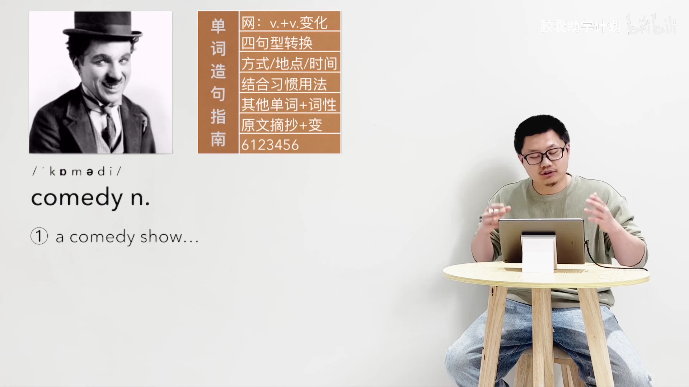

文字识别：单词造句指南 / 网：v.+v.变化 / 四句型转换 / 方式/地点/时间 / 结合习惯用法 / 其他单词+词性 / 原文摘抄+变 / 6123456 / / 'k pmadi / / comedy n. / ① a comedy show..

### 画面 00:02:14

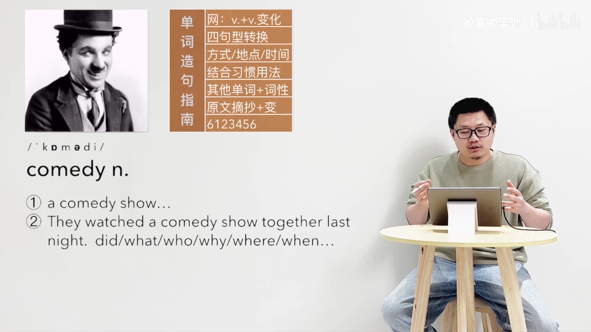

文字识别：单词造句指南 / 网：v.+v.变化 / 四句型转换 / 方式/地点/时间 / 结合习惯用法 / 其他单词+词性 / 原文摘抄+变 / 6123456 / / ' kp m a d i / / comedy n. / ① a comedy show... / They watched a comedy show together last / night. did/what/who/why/where/when...

## 00:02:30–00:03:00

home随便。然后呢，四句型转换永远是咱们造句的利器，对吧？哎，永远不要放弃它。Next one, I look at the paper and realize that a comedy show was coming soon.哎，注意事到一件事情啊。呃，Next one, to tell you the truth, this is actually a comedy show.哎，你别看你看哭了，但是我得跟你讲实话。本来我是想写一个喜剧的，怎么写着写着就把你给看哭了呢？啊，To

### 画面 00:02:33

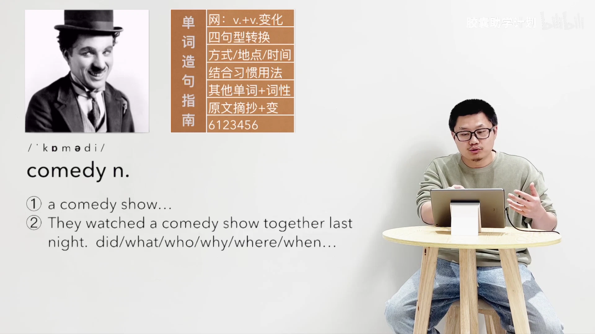

文字识别：单词造句指南 / 网：v.+v.变化 / 四句型转换 / 方式/地点/时间 / 结合习惯用法 / 其他单词+词性 / 原文摘抄+变 / 6123456 / / ' kp m ad i / / comedy n. / ① a comedy show... / They watched a comedy show together last / night. did/what/who/why/where/when..

### 画面 00:02:36

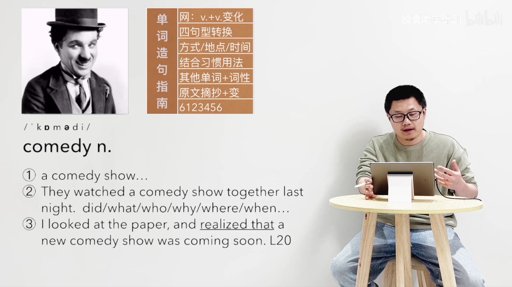

文字识别：单词造句指南 / 网：v.+v.变化 / 子计划 / 四句型转换 / 方式/地点/时间 / 结合习惯用法 / 其他单词+词性 / 原文摘抄+变 / 6123456 / / 'kpmad i / / comedy n. / ① a comedy show... / They watched a comedy show together last / night. did/what/who/why/where/when... / I looked at the paper, and realized that a / new comedy show was coming soon. L20

### 画面 00:02:53

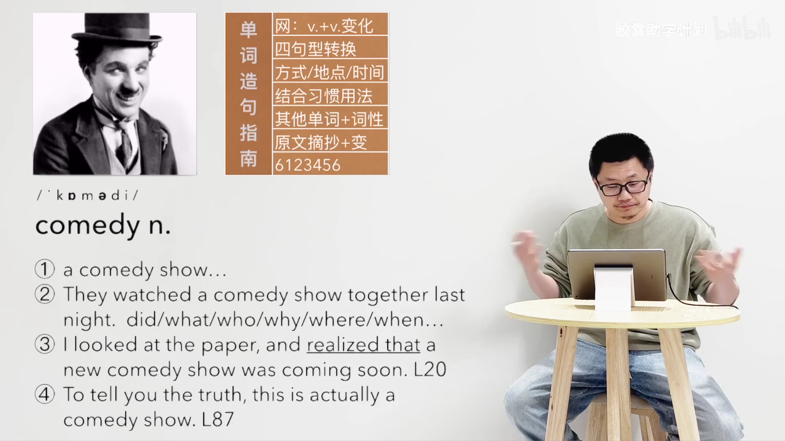

文字识别：单词造句指南 / 网：v.+v.变化 / 四句型转换 / 方式/地点/时间 / 结合习惯用法 / 其他单词+词性 / 原文摘抄+变 / 6123456 / / ' kpmadi / / comedy n. / ① a comedy show... / They watched a comedy show together last / 2) / night. did/what/who/why/where/when... /  I looked at the paper, and realized that a / new comedy show was coming soon. L20 / ④ To tell you the truth, this is actually a / comedy show. L87

## 00:03:00–00:03:30

tell you the truth，哎，和你讲实话吧。再读一遍这个单词，comedy，very good。Next one，下一个单词 present。注意这个单词咱们之前学过 present，当时是这么读的，而今天换了个读音叫 present。一换读音，词性就变了。动词，哎，啊，包括它还有形容词，对吧？动词就是上演啊，一般指的是，比如说你去看话剧啊这种啊，它会有这个报幕员，报幕员跟

### 画面 00:03:05

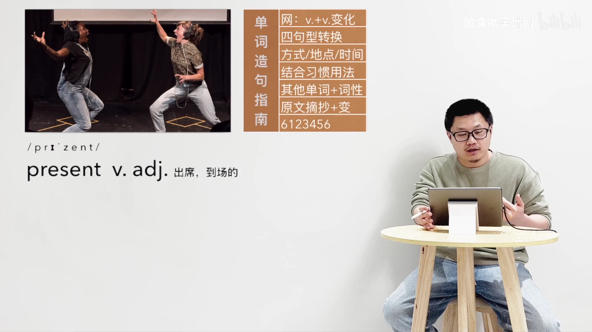

文字识别：单词造句指南 / 网：v.+v.变化 / 四句型转换 / 方式/地点/时间 / 结合习惯用法 / 其他单词+词性 / 原文摘抄+变 / 6123456 / /pri'zent/ / present v.adj.出席，到场的

### 画面 00:03:15

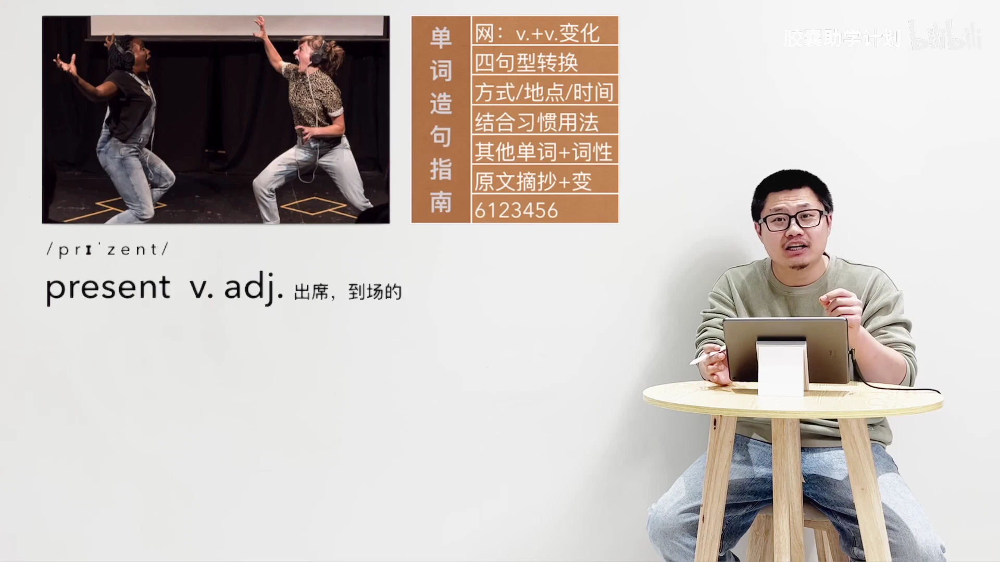

文字识别：单词造句指南 / 网：v.+v.变化 / 四句型转换 / 方式/地点/时间 / 结合习惯用法 / 其他单词+词性 / 原文摘抄+变 / 6123456 / /pri'zent/ / present v.adj.出席，到场的

## 00:03:30–00:04:00

你说，哎，我给你，哎，present某一个某一个人或者某一个节目。当然说介绍某人也可以这样说啊，present you，对吧？我给你介绍一下什么什么项目，介绍某一个人出场啊，都可以。好，接下来呢，比如说原文给了这样一句话，叫A comedy show would be presented，说有这么一个喜剧将被怎么样的？你看它是will would be done，它实际上是will be done的过去式，对吧？Would再加be done，

### 画面 00:03:39

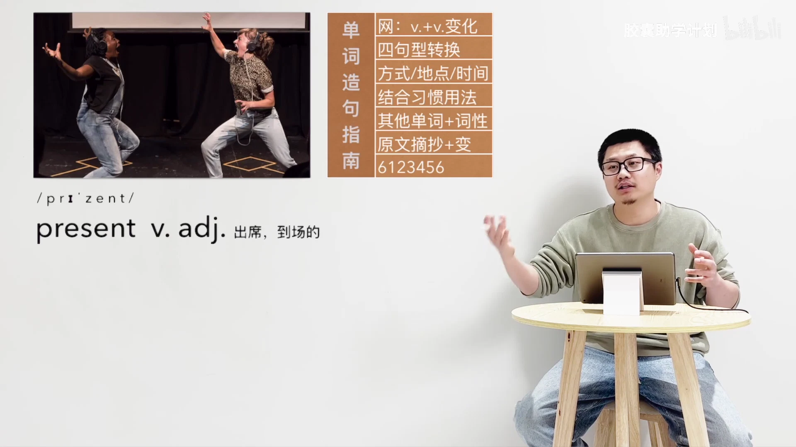

文字识别：单词造句指南 / 网：v.+v.变化 / 四句型转换 / 方式/地点/时间 / 结合习惯用法 / 其他单词+词性 / 原文摘抄+变 / 6123456 / /pri'zent/ / present v.adj.出席，到场的

### 画面 00:03:44

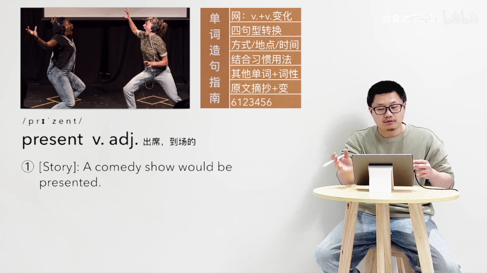

文字识别：单词造句指南 / 网：v.+v.变化 / 四句型转换 / 方式/地点/时间 / 结合习惯用法 / 其他单词+词性 / 原文摘抄+变 / 6123456 / /pri'zent/ / present v.adj.出席，到场的 / ① [Story]: A comedy show would be / presented.

## 00:04:00–00:04:30

这实际上跟我们二十一课啊这个情态动词的被动啊保持的是一致的，对吧？Will加be done，Must加be done，Can加be done，Would加be done，对吧？OK，那然后我们造一个句子吧，我们给它做一些动词上的变化。我现在给它变成叫They will be presenting a comedy show tonight。首先被动变主动，其次时态给它做了一个变化，就就是动词加动词的变化。所谓

### 画面 00:04:14

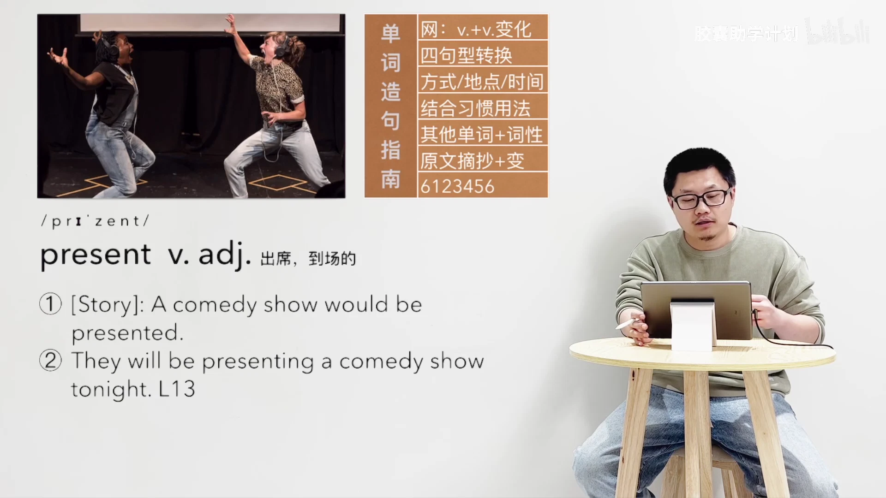

文字识别：单词造句指南 / 网：v.+v.变化 / 四句型转换 / 方式/地点/时间 / 结合习惯用法 / 其他单词+词性 / 原文摘抄+变 / 6123456 / /pri'zent/ / present v.adj.出席，到场的 / ① [Story]: A comedy show would be / presented. / They will be presenting a comedy show / tonight. L13

## 00:04:30–00:05:00

这个往动词加动词变化什么意思？就是六一二三四五六里边的二，我别的可以不变，但是我把二给你变一下，对吧？刚才说的是将来一般将来时，我现在给你换，我别的都不变，我换成一般过去时，这就是一个新的句子，这是一个取巧的方式，对吧？好，说他们将上演一个喜剧今晚。Next one，那我又给他换了一下时态，叫做A comedy show had been presented before，

### 画面 00:04:44

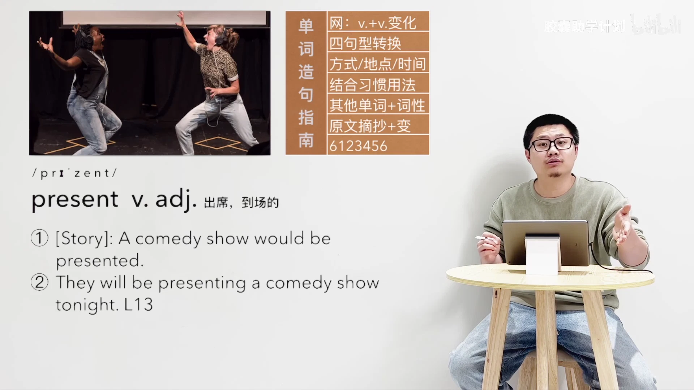

文字识别：单词造句指南 / 网：v.+v.变化 / 四句型转换 / 方式/地点/时间 / 结合习惯用法 / 其他单词+词性 / 原文摘抄+变 / 6123456 / /pri'zent/ / present v.adj.出席，到场的 / ① [Story]: A comedy show would be / presented. / They will be presenting a comedy show / tonight. L13

### 画面 00:04:52

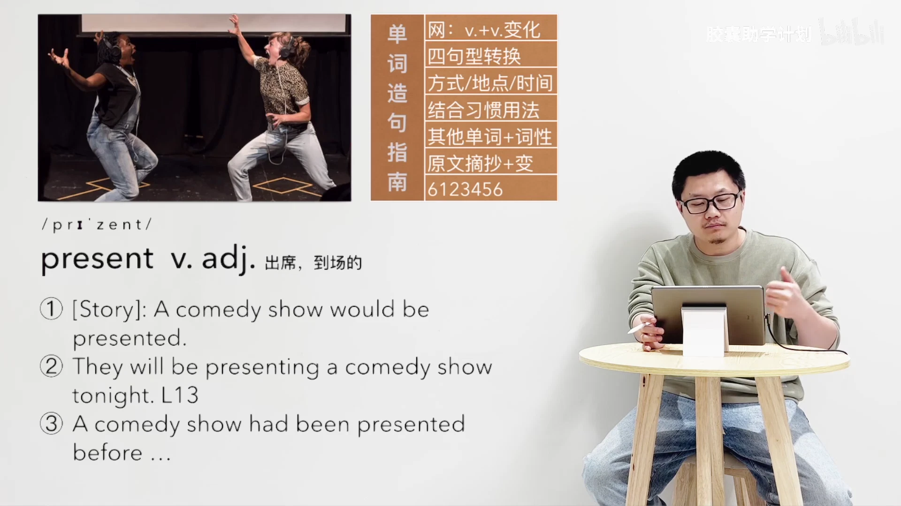

文字识别：单词造句指南 / 网：v.+v.变化 / 四句型转换 / 方式/地点/时间 / 结合习惯用法 / 其他单词+词性 / 原文摘抄+变 / 6123456 / /pri'zent/ / present v.adj.出席，到场的 / ① [Story]: A comedy show would be / presented. / They will be presenting a comedy show / tonight. L13 / ③ A comedy show had been presented / before ...

## 00:05:00–00:05:30

blah blah blah. 后边句子不重要，但是我只是想告诉各位，这地方的重点是我们又换了一个时态，叫 had been done，并且还换了个主动被动，对吧？换成了被动。你可以，那或者你可以理解为是第一句话直接换过来的，对吧？哎，还是被动，但只不过呢，刚才是 would be done，现在是 had been done，对吧？所以，我们一直在说，各位学英语的时候啊，想造句六一二三四五六里边的二是你一定不能错的，或者说一定要好好学的，对吧？它虽然之间

### 画面 00:05:21

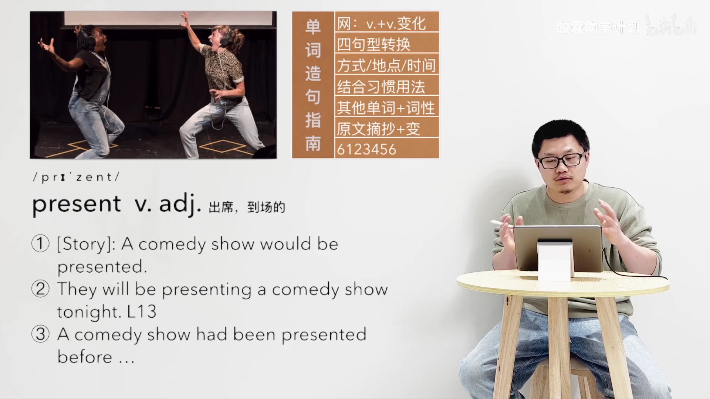

文字识别：单词造句指南 / 网：v.+v.变化 / 四句型转换 / 方式/地点/时间 / 结合习惯用法 / 其他单词+词性 / 原文摘抄+变 / 6123456 / /pri'zent/ / present v.adj.出席，到场的 / ① [Story]: A comedy show would be / presented. / They will be presenting a comedy show / tonight. L13 / ③ A comedy show had been presented / 3) / before ...

## 00:05:30–00:06:00

有一些，它不是说那么泾渭分明啊，你也不用过分担心。但是这个点你要学不会，这个句子基本就读不懂。下一个单词 queue，queue 就是队伍啊，队列啊。那它可以动词，可以是名词。那动词就排队呗。那很常见的短语，六十五课咱们学过叫 hold up the traffic 或者 hold up the line，那个 line 跟这个 queue 基本上就是一个意思。你比如说 waiting in line，什么意思啊？啊，就是在队里边等着，别插队，对吧？排队说

### 画面 00:05:37

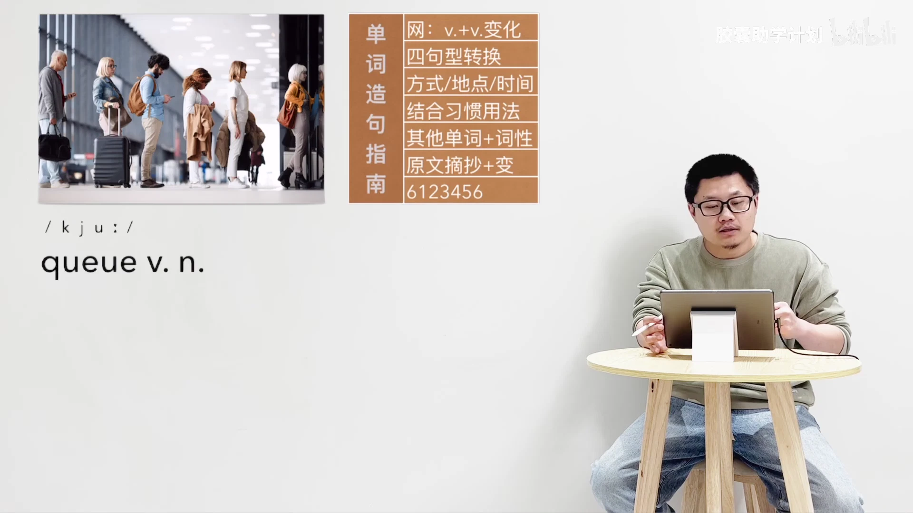

文字识别：单词造句指南 / 网：v.+v.变化 / 四句型转换 / 方式/地点/时间 / 结合习惯用法 / 其他单词+词性 / 原文摘抄+变 / 6123456 / / k j u : / / queue v. n.

### 画面 00:05:40

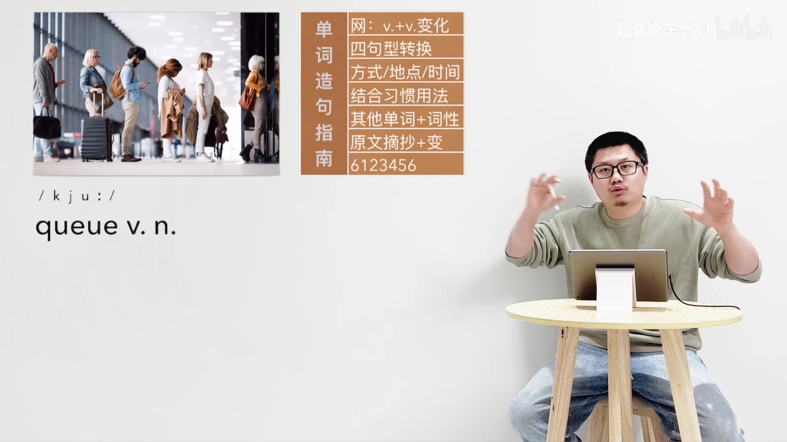

文字识别：单词造句指南 / 网：v.+v.变化 / 四句型转换 / 方式/地点/时间 / 结合习惯用法 / 其他单词+词性 / 原文摘抄+变 / 6123456 / / k j u : / / queue v. n.

### 画面 00:05:59

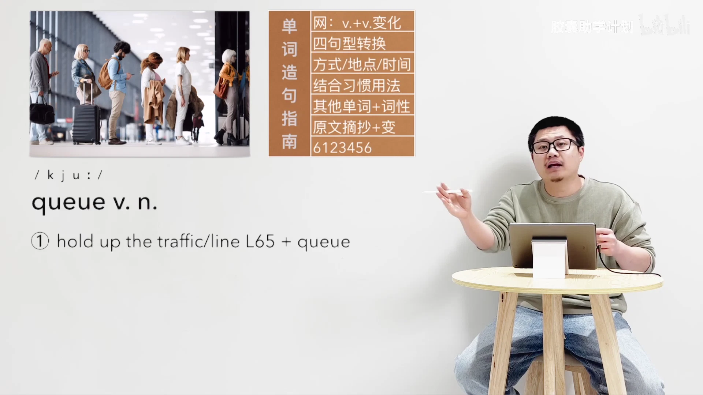

文字识别：单词造句指南 / 网：v.+v.变化 / 四句型转换 / 方式/地点/时间 / 结合习惯用法 / 其他单词+词性 / 原文摘抄+变 / 6123456 / / k j u : / / queue v. n. / ① hold up the traffic/line L65 + queue

## 00:06:00–00:06:30

白了翻译成汉语，对吧？这个 queue 也是排队的意思。那什么叫 hold up the traffic 呢？就是你阻碍交通了。Hold up the line 呢？就是你阻碍大家排队了，对吧？比如说你在这个地方闹事儿啊，或者说没完没了的做一些什么事情，别人没法排队啊，没法这个队伍没法往前走了，就叫 hold up the line 或者 hold up the traffic。那取决于人，就是 line 这个车就是 traffic，对吧？你比如说，我们可以说一句话：Hey man, don't hold up the queue。比如说

### 画面 00:06:24

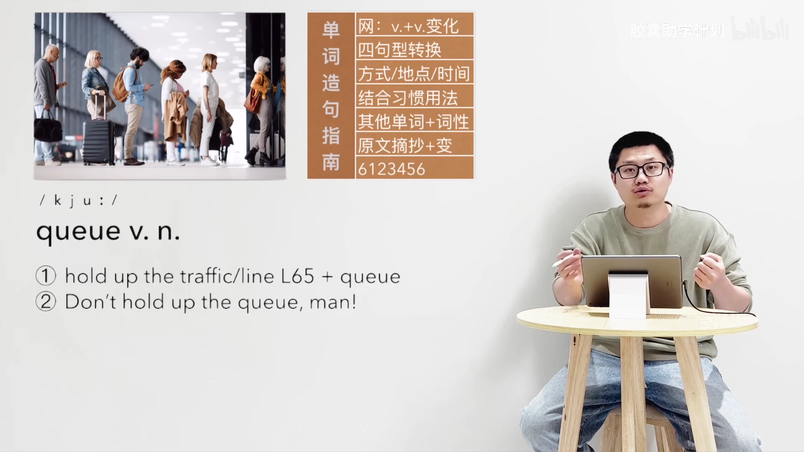

文字识别：单词造句指南 / 网：v.+v.变化 / 四句型转换 / 方式/地点/时间 / 结合习惯用法 / 其他单词+词性 / 原文摘抄+变 / 6123456 / / k j u : 1 / queue v. n. / ① hold up the traffic/line L65 + queue / ② Don't hold up the queue, man!

## 00:06:30–00:07:00

你到柜台那个地方了，每个人其实办这个业务一般来说可能不到一分钟三十秒就完事儿了。你在那儿没完没了，没完没了，十分钟过去了，后边一个人说，哎，Don't hold up the queue, man.哎，Move, move,往前走啊。哎，Continue.说We stood in a queue for half an hour.这个很简单啊，我们站在一个队伍里面已经半个小时了。四字形转换自己去处理。原文给了我们这么一句话叫做We had to queue

### 画面 00:06:45

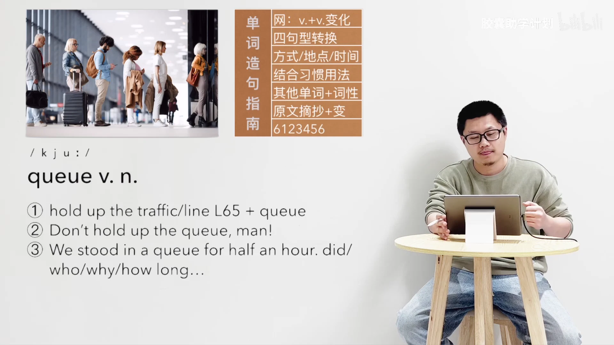

文字识别：单词造句指南 / 网：v.+v.变化 / 四句型转换 / 方式/地点/时间 / 结合习惯用法 / 其他单词+词性 / 原文摘抄+变 / 6123456 / / k j u : / / queue v. n. / ① hold up the traffic/line L65 + queue / ② Don't hold up the queue, man! / We stood in a queue for half an hour. did/ / who/why/how long...

## 00:07:00–00:07:30

for hours. 说我们不得不排了数个小时的队。首先，本课要复习的这个是吧？Had to，不知道各位还记不记得，对吧？叫做不得不，并且表示的是当时，它还有各种各样的时态，对吧？比如说 had to，就是过去时啊，一般过去时。然后呢，你给它来个四句型转换，叫 Did you have to queue for hours? Ah, how long did you have to queue? 啊，你看这个都是能用得到的句子啊。呃，再跟我读一遍这个单词 queue.

### 画面 00:07:05

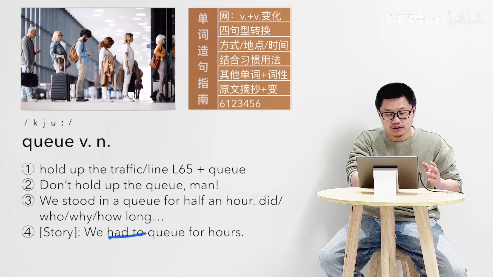

文字识别：单词造句指南 / 网：v.+v.变化 / 四句型转换 / 方式/地点/时间 / 结合习惯用法 / 其他单词+词性 / 原文摘抄+变 / 6123456 / / k j u : / / queue v. n. / ① hold up the traffic/line L65 + queue / ② Don't hold up the queue, man! /  We stood in a queue for half an hour. did/ / 3 / who/why/how long... / [Story]: We had te queue for hours.

## 00:07:30–00:08:00

Very good. 下一个单词，dull. Dull就是无聊的、枯燥的、乏味的，有点像boring。我们造个句子，比如说，呃，This is the dullest show I've ever seen。说这是啊，我看过最无聊的一个喜剧片儿。怎么会这么无聊？这个喜剧片儿。然后这里注意，这基本就是第八课我们当时原句型，对吧？This is什么什么I've ever I've ever seen I've ever watched

### 画面 00:07:30

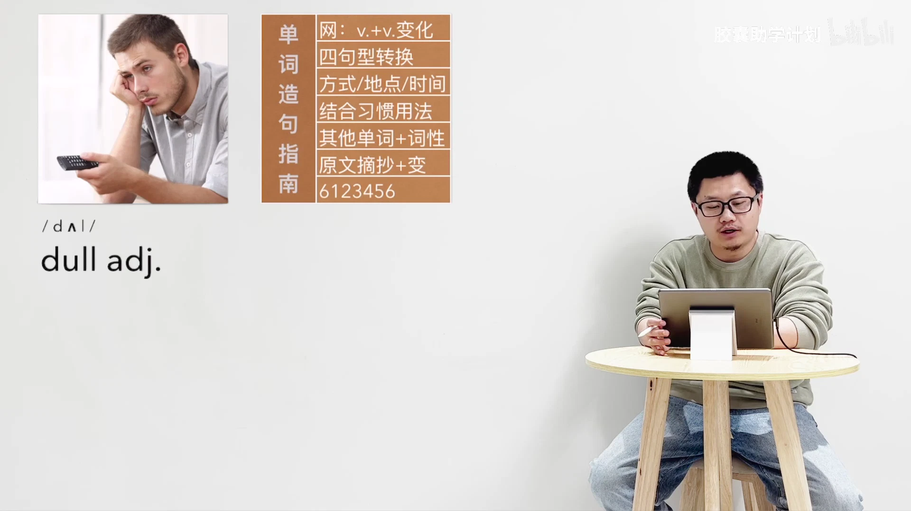

文字识别：单词造句指南 / 网：v.+v.变化 / 壺助学计划 / 四句型转换 / 方式/地点/时间 / 结合习惯用法 / 其他单词+词性 / 原文摘抄+变 / 6123456 / /dΛ|/ / dull adj.

### 画面 00:07:33

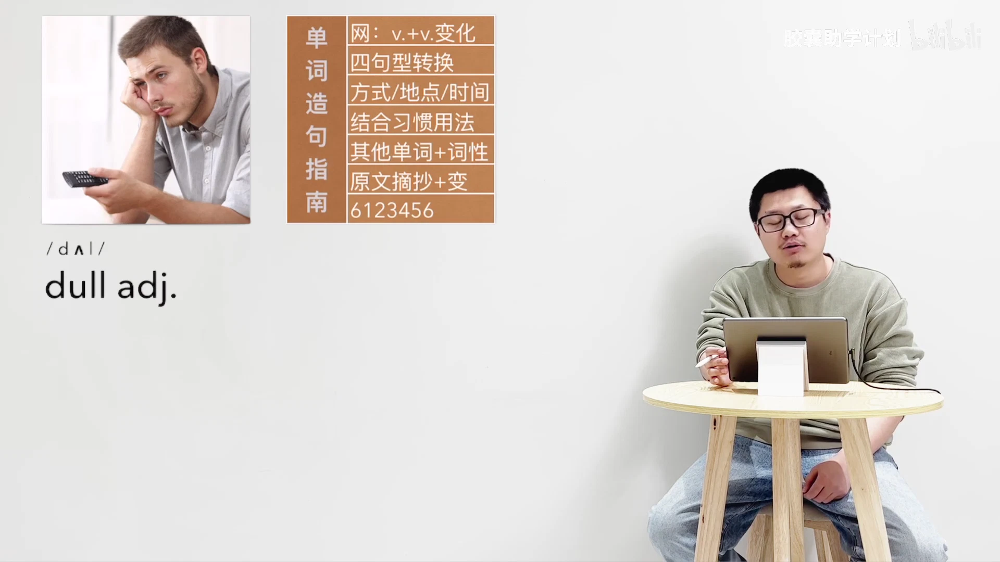

文字识别：单词造句指南 / 网：v.+v.变化 / 妻助学计划 / 四句型转换 / 方式/地点/时间 / 结合习惯用法 / 其他单词+词性 / 原文摘抄+变 / 6123456 / /dΛ|/ / dull adj.

### 画面 00:07:37

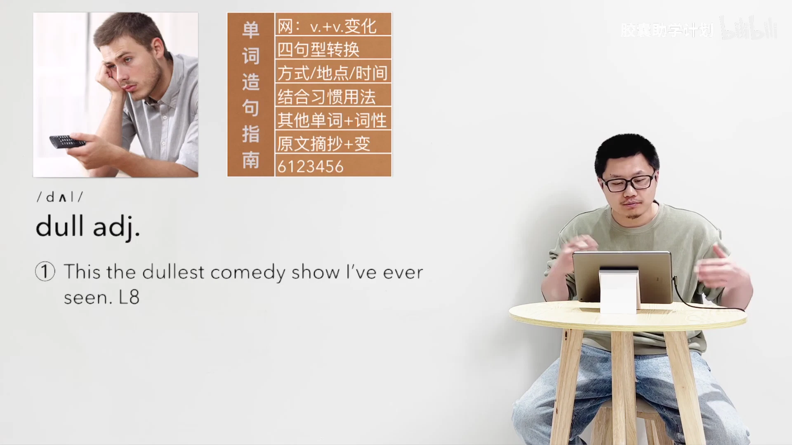

文字识别：单词造句指南 / 网：v.+v.变化 / 建助字计划 / 四句型转换 / 方式/地点/时间 / 结合习惯用法 / 其他单词+词性 / 原文摘抄+变 / 6123456 / /dΛ|/ / dull adj. / ) This the dullest comedy show l've ever / seen.L8

### 画面 00:07:45

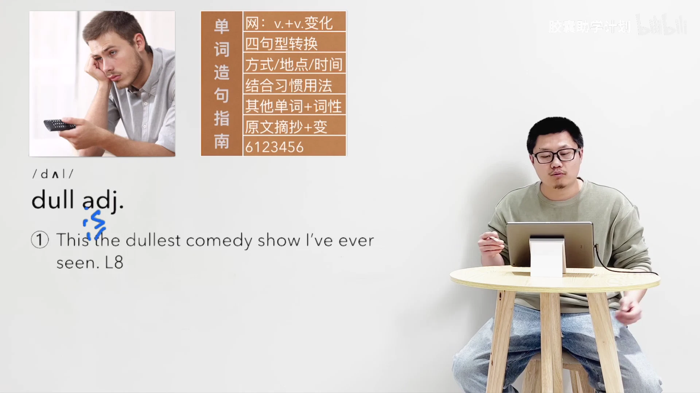

文字识别：单词造句指南 / 网：v.+v.变化 / 臺助字计划 / 四句型转换 / 方式/地点/时间 / 结合习惯用法 / 其他单词+词性 / 原文摘抄+变 / 6123456 / /dΛl/ / dull adj. / This tThe dullest comedy show l've ever / seen. L8

### 画面 00:07:56

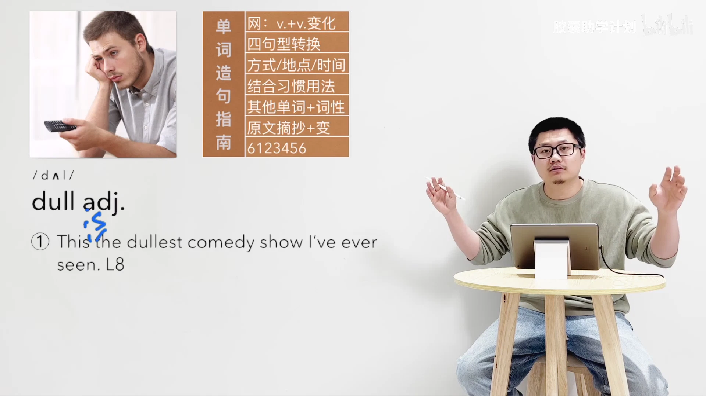

文字识别：单词造句指南 / 网：v.+v.变化 / 囊助字计划園 / 四句型转换 / 方式/地点/时间 / 结合习惯用法 / 其他单词+词性 / 原文摘抄+变 / 6123456 / /dΛ|/ / dull adj. / This The dullest comedy show I've ever / seen.L8

## 00:08:00–00:08:30

I've ever known,对吧？Okay.接下来呢，下一个句子叫做All work and no play makes Jack a dull boy。这句话实际上是我们美剧啊，就不能叫美剧，就是美国当中一个非常用的、很常用的一个习语，叫做呃，光工作了，然后不玩会让Jack变成一个傻孩子。其实他这句话的意思，想表达的含义就是我们要劳逸结合嘛。Okay.好，我们接下来看下一个句子。I spent the whole week with

### 画面 00:08:02

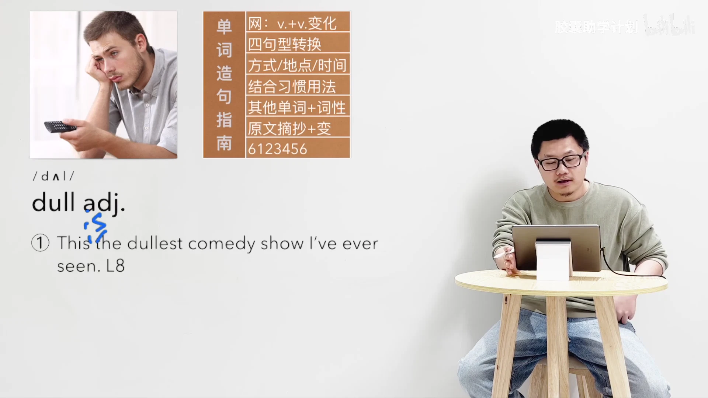

文字识别：单词造句指南 / 网：v.+v.变化 / 囊助字计划 / 四句型转换 / 方式/地点/时间 / 结合习惯用法 / 其他单词+词性 / 原文摘抄+变 / 6123456 / /dΛ|1 / dull adj. / This tThe dullest comedy show l've ever / seen.L8

### 画面 00:08:26

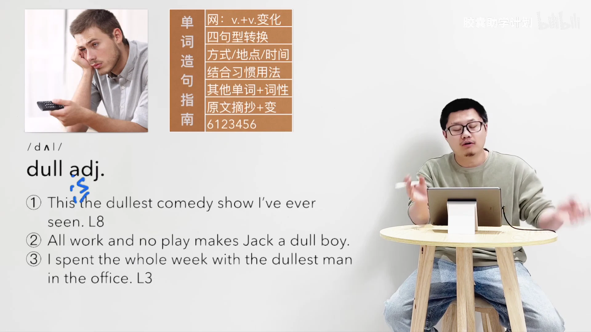

文字识别：单词造句指南 / 网：v.+v.变化 / 子计划 / 四句型转换 / 方式/地点/时间 / 结合习惯用法 / 其他单词+词性 / 原文摘抄+变 / 6123456 / /dΛl/ / dull adj. / ① This The dullest comedy show I've ever / seen.L8 / ② All work and no play makes Jack a dull boy. / ③ I spent the whole week with the dullest man / in the office. L3

### 画面 00:08:29

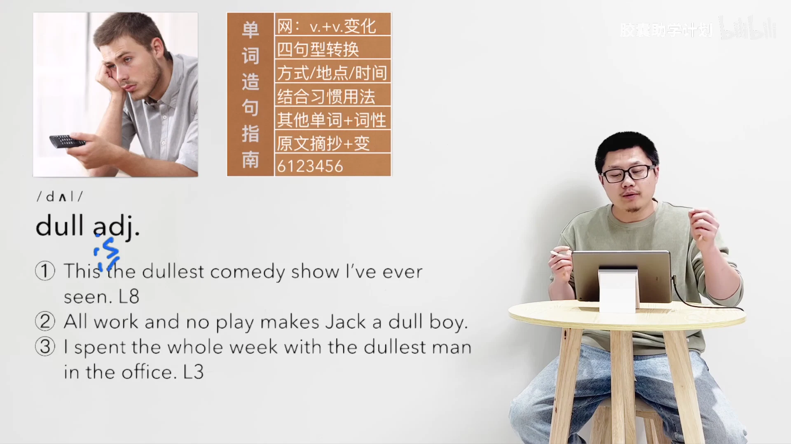

文字识别：单词造句指南 / 网：v.+v.变化 / 四句型转换 / 方式/地点/时间 / 结合习惯用法 / 其他单词+词性 / 原文摘抄+变 / 6123456 / /dn|/ / dull adj. / ① This The dullest comedy show I've ever / seen.L8 / ② All work and no play makes Jack a dull boy. / ③ I spent the whole week with the dullest man / in the office. L3

## 00:08:30–00:09:00

the dullest man in the office. 说我花了整周整周的时间和谁呢？说办公室里边最无聊的那个人在一起待着啊。OK，好，再读一遍这个单词 dull。 OK， very good. 那电影片段吧，跟刚才说的一模一样。听一下， I think he's the dullest man I ever met. OK，啊，我认为他是我见过最无聊的人了，是吧？好，接下来很有意思的两个单词啊，这两个单词最开始我乍一看我都看错了，是吧？

### 画面 00:08:42

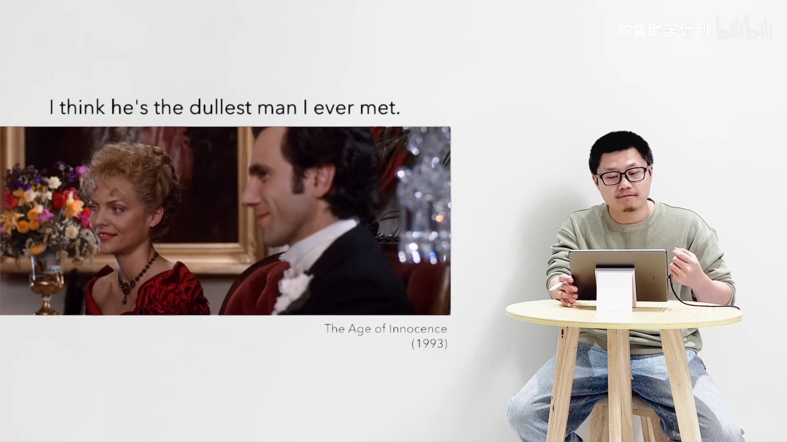

文字识别：I think he's the dullest man I ever met. / The Age of Innocence / (1993)

### 画面 00:08:48

文字识别：I think he's the dullest man I ever met. / The Age of Innocence / (1993)

### 画面 00:08:50

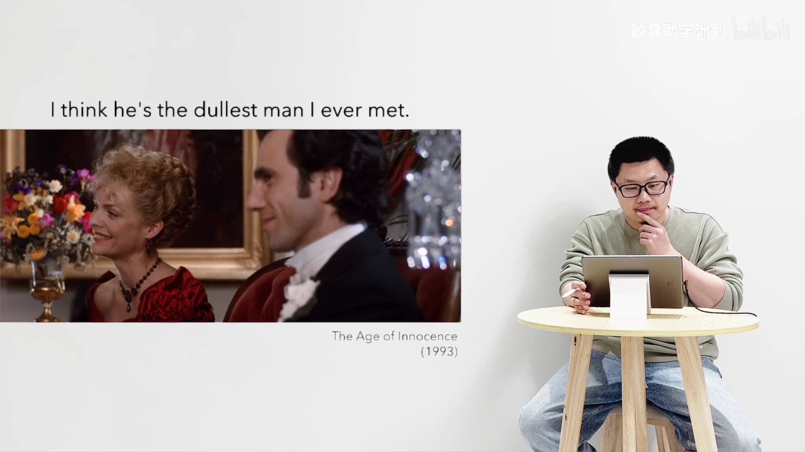

文字识别：I think he's the dullest man I ever met. / The Age of Innocence / (1993)

### 画面 00:08:52

文字识别：单词造句指南 / 网：v.+v.变化 / 四句型转换 / 方式/地点/时间 / 结合习惯用法 / 其他单词+词性 / 原文摘抄+变 / 6123456 / /a:'ti:st/ / /'a:.tist/ / artiste n. artist

### 画面 00:08:54

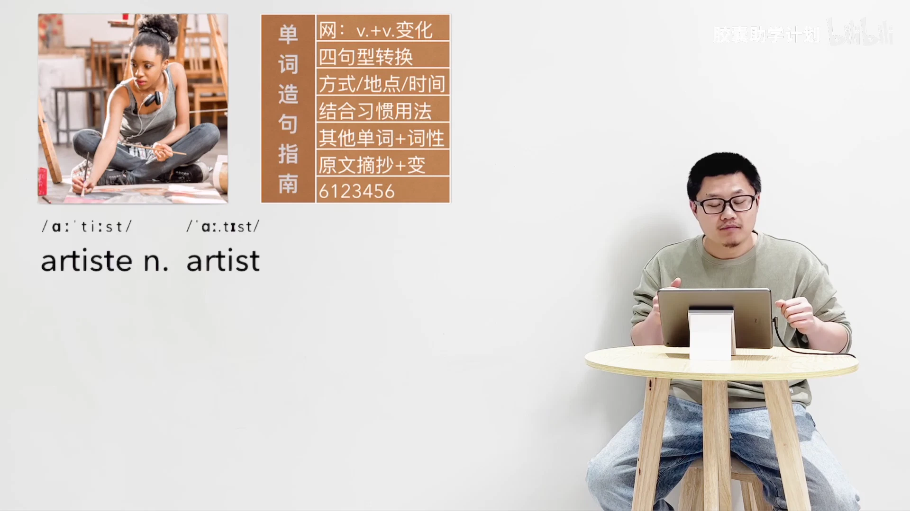

文字识别：单词造句指南 / 网：v.+v.变化 / 四句型转换 / 方式/地点/时间 / 结合习惯用法 / 其他单词+词性 / 原文摘抄+变 / 6123456 / /a:'ti:st/ / /'a:.tist/ / artiste n. artist

## 00:09:00–00:09:30

后来我才注意到这多了个e。咱们很熟悉的那个单词叫artist，注意重音在前面，叫artist，叫艺术家。它往往指的是什么？呃，挺好啊，往往指的是搞美术的、画画的这些人，artist。但不是只是这些，比如说现代艺术装置也可以叫artist，好吧？然后这个单词注意，它重音在后边，叫artist，artist，听见了吧？这个叫做artist，而前面今天咱们要学

### 画面 00:09:18

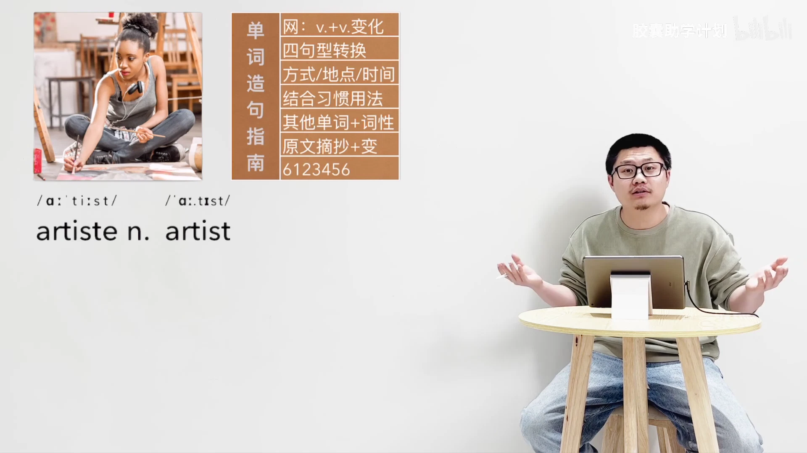

文字识别：单词造句指南 / 网：v.+v.变化 / 字计划 / 四句型转换 / 方式/地点/时间 / 结合习惯用法 / 其他单词+词性 / 原文摘抄+变 / 6123456 / /a:'ti:st/ / /'a:.tist/ / artiste n. artist

## 00:09:30–00:10:00

的这个单词叫 artist，是吧？长得也很像，发音也很像。那它这个 artist 什么意思呢？它一般指的不是艺术，指的是技术。比如说，你是一个演员，是一个歌手啊，包括你如果是一个木匠，都可以叫 artist，是吧？这个单词并没有那么常用。其实我们就拿它造几个句子吧，主要是复习一下以前的习惯用法啊。So we should keep in touch with the artist

### 画面 00:09:48

文字识别：单词造句指南 / 网：v.+v.变化 / 四句型转换 / 方式/地点/时间 / 结合习惯用法 / 其他单词+词性 / 原文摘抄+变 / 6123456 / /a:'ti:st/ / /'a:.tist/ / artiste n. artist

### 画面 00:09:54

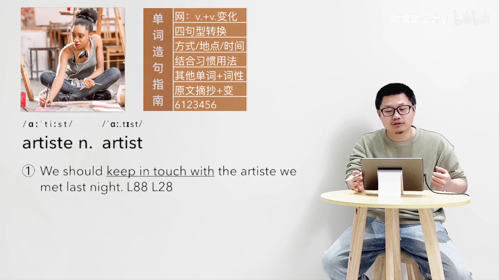

文字识别：单词造句指南 / 网：v.+v.变化 / 四句型转换 / 方式/地点/时间 / 结合习惯用法 / 其他单词+词性 / 原文摘抄+变 / 6123456 / /a:'ti:st/ / /'a:.tist/ / artiste n. artist / ① We should keep in touch with the artiste we / met last night. L88 L28

## 00:10:00–00:10:30

we met last night. Ah,昨天晚上咱见过的这个是吧？这个大师啊，这个技术方面的大师，咱要跟他保持联系啊。好，Next one.说The artist had a perfect alibi, so he couldn't commit the murder.哎，连着两个习惯用法：have a perfect alibi和commit the murder. Next one.说The artist devoted his life to coming show. Devote his life.他的生

### 画面 00:10:08

文字识别：单词造句指南 / 网：v.+v.变化 / 四句型转换 / 方式/地点/时间 / 结合习惯用法 / 其他单词+词性 / 原文摘抄+变 / 6123456 / /a:'ti:st/ / /'a:.tist/ / artiste n. artist / ① We should keep in touch with the artiste we / met last night. L88 L28 / The artiste had a perfect alibi, so he / couldn't commit the murder. L87

### 画面 00:10:19

文字识别：单词造句指南 / 网：v.+v.变化 / 子计划 / 四句型转换 / 方式/地点/时间 / 结合习惯用法 / 其他单词+词性 / 原文摘抄+变 / 6123456 / /a:'ti:st/ / /'a:.tist/ / artiste n. artist / ① We should keep in touch with the artiste we / met last night. L88 L28 / The artiste had a perfect alibi, so he / couldn't commit the murder. L87

### 画面 00:10:21

文字识别：单词造句指南 / 网：v.+v.变化 / 子计划 / 四句型转换 / 方式/地点/时间 / 结合习惯用法 / 其他单词+词性 / 原文摘抄+变 / 6123456 / /a:'ti:st/ / /'a:.tist/ / artiste n. artist / ① We should keep in touch with the artiste we / met last night. L88 L28 / The artiste had a perfect alibi, so he / couldn't commit the murder. L87 / The artiste devoted his life to comedy show. / L85

### 画面 00:10:25

文字识别：单词造句指南 / 网：v.+v.变化 / 四句型转换 / 方式/地点/时间 / 结合习惯用法 / 其他单词+词性 / 原文摘抄+变 / 6123456 / /a:'ti:st/ / /'a:.tist/ / artiste n. artist / ① We should keep in touch with the artiste we / met last night. L88 L28 / The artiste had a perfect alibi, so he / couldn't commit the murder. L87 / The artiste devoted his life to comedy show. / L85

## 00:10:30–00:11:00

命怎么样了呢？就给了这个这个这个这个喜剧的这个呃喜剧，对吧？所以其实某种程度上，他二者呀没有那么泾渭分明。我举个例子说，卓别林，你说卓别林，你说他是一个artist，没有问题。你说他是artist也可以，对吧？你说他实际上只是一个演员，一个技术工种，对吧？可以，但是可能啊，我我个人的这种语感上的感受是什么呢？就是好像当一个

### 画面 00:10:30

文字识别：单词造句指南 / 网：v.+v.变化 / 学计划 / 四句型转换 / 方式/地点/时间 / 结合习惯用法 / 其他单词+词性 / 原文摘抄+变 / 6123456 / /a:'ti:st/ / /'a:.tist/ / artiste n. artist / ① We should keep in touch with the artiste we / met last night. L88 L28 / The artiste had a perfect alibi, so he / couldn't commit the murder. L87 / The artiste devoted his life to comedy show. / L85

### 画面 00:10:40

文字识别：单词造句指南 / 网：v.+v.变化 / 四句型转换 / 方式/地点/时间 / 结合习惯用法 / 其他单词+词性 / 原文摘抄+变 / 6123456 / /a:'ti:st/ / /'a:.tist/ / artiste n. artist / ① We should keep in touch with the artiste we / met last night. L88 L28 / The artiste had a perfect alibi, so he / couldn't commit the murder. L87 / The artiste devoted his life to comedy show. / L85

### 画面 00:10:56

文字识别：单词造句指南 / 网：v.+v.变化 / 四句型转换 / 方式/地点/时间 / 结合习惯用法 / 其他单词+词性 / 原文摘抄+变 / 6123456 / /a:'ti:st/ / /'a:.tist/ / artiste n. artist / ① We should keep in touch with the artiste we / met last night. L88 L28 / The artiste had a perfect alibi, so he / couldn't commit the murder. L87 / The artiste devoted his life to comedy show. / L85

## 00:11:00–00:11:30

artist 不是那么的困难，但是当你达到一定艺术水平了之后，我们才会管你叫 artist，对吧？不是说你随便弄点东西就叫做 artist 的啊。 Okay, next one, 下一个单词 advertiser, advertiser, advertiser 在本课当中给的含义，我们就学这个叫报幕员。哎，如果你去，比如说听过现场的相声啊，或者说你听过现场的一些呃，比如说大

### 画面 00:11:12

文字识别：单词造句指南 / 网：v.+v.变化 / 毫助字计划 / 四句型转换 / 方式/地点/时间 / THEDOUG / 结合习惯用法 / GARRISON / SHOW / 其他单词+词性 / 原文摘抄+变 / 6123456 / / 'ædvatalza/ / advertiser n.

### 画面 00:11:29

文字识别：单词造句指南 / 网：v.+v.变化 / 四句型转换 / 方式/地点/时间 / THEDOUG / 结合习惯用法 / GARRISON / SHOW / 其他单词+词性 / 原文摘抄+变 / 6123456 / / 'ædvatalza/ / advertiser n.

## 00:11:30–00:12:00

型的这种综艺活动啊啊，包括咱们的春晚呢，不都有这个报幕员嘛？叫 advertiser，对吧？当然也可以是主持人。报幕员和主持人还稍有不同，主持人还得串串串场儿，对吧？一个节目一个节目之间得说点话，给它串起来。然后这个 advertiser 呢，其实就就更任务就更简单一点了，就是告诉你，哎，接下来是一个什么节目，这事儿结束，对吧？播报一下啊，叫 advertiser。我们造个句子。On the surface, Leo

### 画面 00:11:44

文字识别：单词造句指南 / 网：v.+v.变化 / 四句型转换 / 方式/地点/时间 / THEDOUG / 结合习惯用法 / GARRISON / SHOW / 其他单词+词性 / 原文摘抄+变 / 6123456 / /'ædvatalza/ / advertiser n.

### 画面 00:11:56

文字识别：单词造句指南 / 网：v.+v.变化 / 四句型转换 / 方式/地点/时间 / THE DOUG / 结合习惯用法 / GARRISON / SHOW / 其他单词+词性 / 原文摘抄+变 / 6123456 / /'ædvatalza/ / advertiser n. / ① On the surface, Leo and the advertiser are / good friends. L88

### 画面 00:11:58

文字识别：单词造句指南 / 网：v.+v.变化 / 四句型转换 / 方式/地点/时间 / THE DOUG / 结合习惯用法 / GARRISON / SHOW / 其他单词+词性 / 原文摘抄+变 / 6123456 / /'ædvatalza/ / advertiser n. / ① On the surface, Leo and the advertiser are / good friends. L88

## 00:12:00–00:12:30

and the advertiser are good friends.说表面上啊，这个Leo和这个advertiser报幕员是好朋友。那你注意，基本上一用on the surface，那私底下就不一定了，对吧？They kept in touch with the old advertiser for a long time.说他们和这个老的这个播报员啊保持联系了很长一段时间。Next one, the advertiser had a perfect alibi.有一个绝佳的不在犯罪现场的证明，对吧？完美的啊，perfect. Very good.

### 画面 00:12:01

文字识别：单词造句指南 / 网：v.+v.变化 / 四句型转换 / 方式/地点/时间 / THE DOUG / 结合习惯用法 / GARRISON / SHOW / 其他单词+词性 / 原文摘抄+变 / 6123456 / / 'ædvatalza / / advertiser n. / ① On the surface, Leo and the advertiser are / good friends. L88

### 画面 00:12:09

文字识别：单词造句指南 / 网：v.+v.变化 / 字计划 / 四句型转换 / 方式/地点/时间 / THE DOUG / 结合习惯用法 / GARRISON / SHOW / 其他单词+词性 / 原文摘抄+变 / 6123456 / /'ædvataiza/ / advertiser n. / ① On the surface, Leo and the advertiser are / good friends. L88 / They kept in touch with the old advertiser / for a long time. L88

### 画面 00:12:23

文字识别：单词造句指南 / 网：v.+v.变化 / 四句型转换 / 方式/地点/时间 / THEDOUG / 结合习惯用法 / GARRISON / SHOW / 其他单词+词性 / 原文摘抄+变 / 6123456 / /'æedvataiza/ / advertiser n. / ① On the surface, Leo and the advertiser are / good friends. L88 / They kept in touch with the old advertiser / for a long time. L88 / ) The advertiser had a perfect alibi. L87

## 00:12:30–00:13:00

全是在复习。基本上，你像这个单词，包括刚才那个artist的那单词，都不是非常重要啊。能记就记，实在记不住也不用太担心啊。所以在这儿呢，我们的更多的重点其实是放在了复习之前这些习惯用法上啊。OK，呃，除了单词以外，习惯用法再那造句，对吧？好，造句，电影片段您反复听，置顶留言去找重复间隔的学习材料。

### 画面 00:12:48

文字识别：Recap / Words / a slip of the tongue / Expression / a comedy s / show / hold up the c / queue...

### 画面 00:12:50

文字识别：Recap / Words / a slip of the tongue / Expression / a comedy show / hold up the queue..

### 画面 00:12:52

文字识别：Recap / Words / a slip of the tongue / Expression / a comedy show / hold up the queue..

### 画面 00:12:54

文字识别：单词造句/对话 / 【单词造句指南】 / 每个5句 / 反复听电影片段，直到能 / 听出关键短语/句子

### 画面 00:12:56

文字识别：单词造句/对话 / 【单词造句指南】 / 每个5句 / 反复听电影片段，直到能 / 听出关键短语/句子 / 3.重复间隔（置顶留言）

### 画面 00:12:58

文字识别：单词造句/对话 / 【单词造句指南】 / 每个5句 / 反复听电影片段，直到能 / 听出关键短语/句子 / 3.重复间隔（置顶留言）

## 00:13:00–00:13:25

那以上呢就是本期视频的全部内容了。如果各位喜欢我们的课程呢，欢迎各位关注、订阅、一键三连，分享给那些需要的朋友，来帮助我们快速成长。See you next time.

### 画面 00:13:00

文字识别：助学计划一师

### 画面 00:13:13

### 画面 00:13:15

文字识别：CAPSULEACADEMY / 胶囊助学计划 / 『 / 小红书 / Lecturer / □ / Leo / OE

### 画面 00:13:17

文字识别：CAPSULEACADEMY / 胶囊助学计划 / 『 / 小红书 / Photographer / Berlin / OE

### 画面 00:13:19

文字识别：CAPSULEACADEMY / 胶囊助学计划 / 小红书 / Editor / □ / Berlin / OE

### 画面 00:13:22

文字识别：CAPSULEACADEMY / 胶囊助学计划 / 小红书

### 画面 00:13:24

文字识别：bilibili / 胶囊助学计划

