# 089 语法

快速机器解析：语音为单模型转写，未进行独立交叉校对或人工复核；画面每秒采样并按变化选帧，短时文字和标记可能遗漏。截图时间约有 1 秒误差。图片有损压缩；遇到疑点请按时间查看 Google Drive 原视频。

## 00:00:00–00:00:30

Hello everyone, welcome to Capsule Academy. This is Leo. Today we're going to learn the Concept English Book Two Lesson Eighty Nine Grammar. Hope you gonna enjoy it.好，本课到了第四单元第十七课了。那咱们重头戏肯定就是复习每个单元的第十七课。在这儿呢，还是我只是说一下我认为它最核心的那些。然后更多的，如果您忘了细节

### 画面 00:00:00

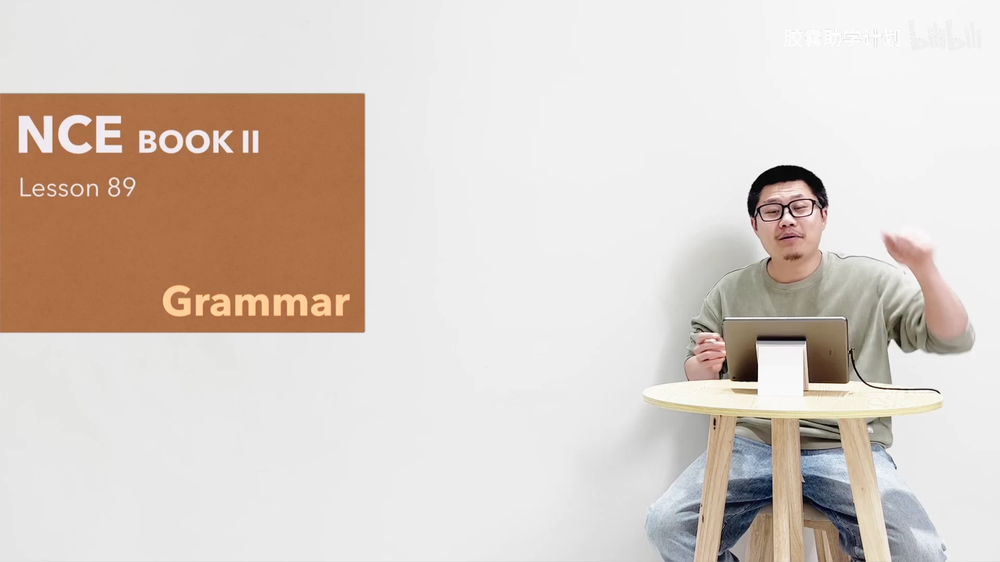

文字识别：NCE / BOOKⅡI / Lesson 89 / Grammar

### 画面 00:00:02

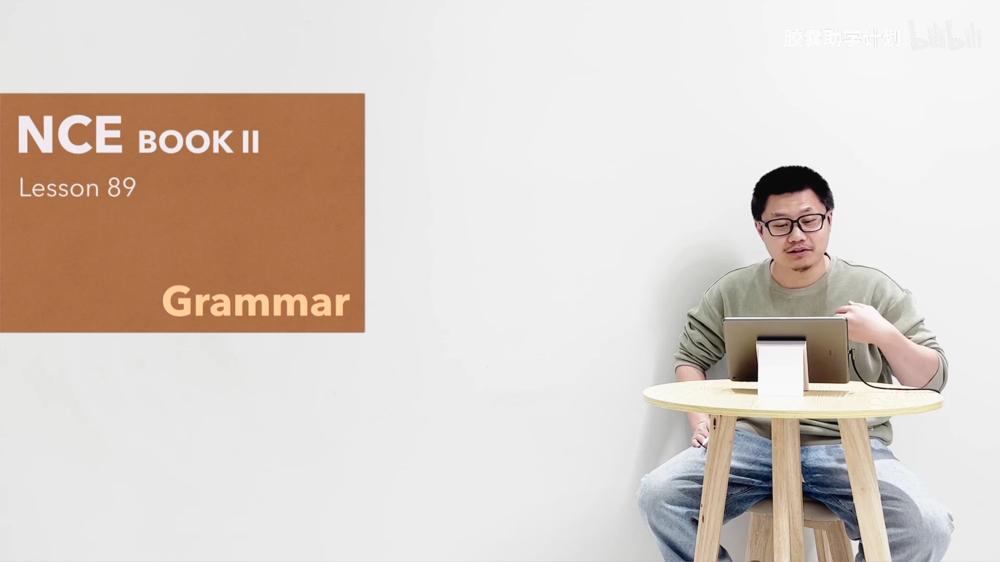

文字识别：NCE / BOOKII / Lesson 89 / Grammar

### 画面 00:00:04

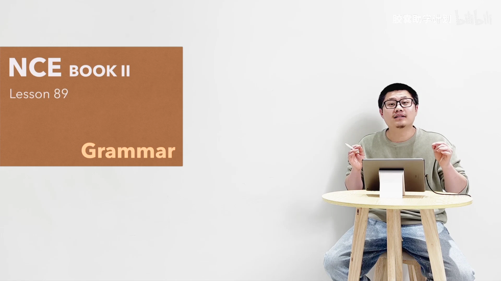

文字识别：NCE / BOOKⅡI / Lesson 89 / Grammar

### 画面 00:00:09

文字识别：Jbitbli / 胶囊助学计划 / •

### 画面 00:00:13

### 画面 00:00:15

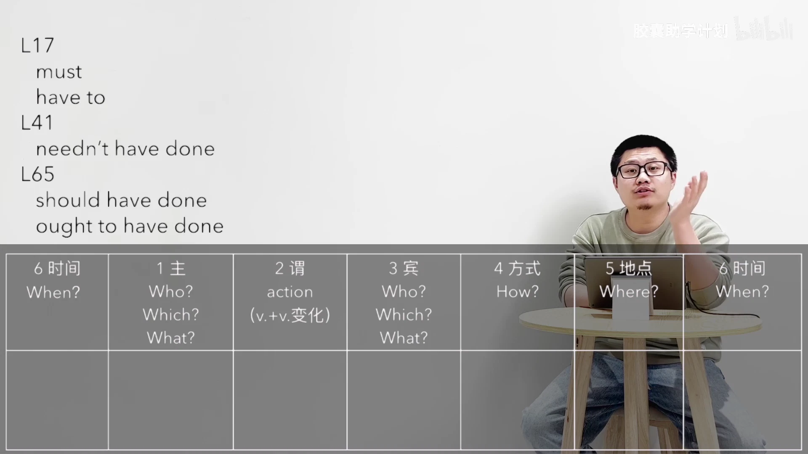

文字识别：毫助字计划 / L17 / must / have to / L41 / needn't have done / L65 / should have done / ought to have done / 6时间 / 1主 / 2谓 / 3宾 / 4方式 / 5地点 / 6时间 / When? / Who? / action / Who? / How? / Where? / When? / Which? / (v.+v.变化) / Which? / What? / What?

## 00:00:30–00:01:00

也好，这个知识点也好，你就要回到那课自己去学啊。本课还是以练代讲。十七课的重点是 must 跟 have to，当然其实还有表推测的 can't，对吧？所以我们实际上有两个啊，must have to，尤其是 must 有两个用法，一个是它的基础用法表必须，另外一个呢是它的一个推测并用法表一定，所以它就会跟 can't 联系起来，包括也会跟十九课的 may 啊 might 这样的单

### 画面 00:00:45

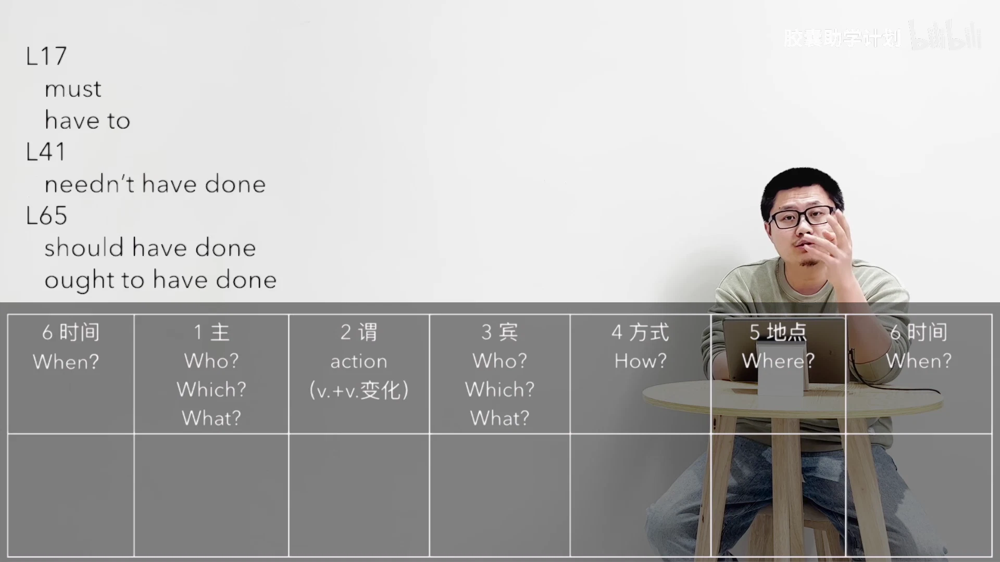

文字识别：L17 / must / have to / L41 / needn't have done / L65 / should have done / ought to have done / 6时间 / 1主 / 2谓 / 3宾 / 4方式 / 5地点 / 6时间 / When? / Who? / action / Who? / How? / Where? / When? / Which? / (v.+v.变化) / Which? / What? / What?

## 00:01:00–00:01:30

词联系起来啊，这是十七、十四课呢。我们重点讲了一个啊，有很多语法书管它叫半情态动词啊。什么？为什么叫半情态动词呢？这个名称倒不是很重要，原因是need这个单词既可以当实义动词、动词去讲，就需要跟want没区别，几乎用法都一致啊，连含义都差不多。另外一个呢，它可以单独当一个情态动词去用，对吧？然后呢，有很多的结构在四十一课我去讲过。我希望

### 画面 00:01:15

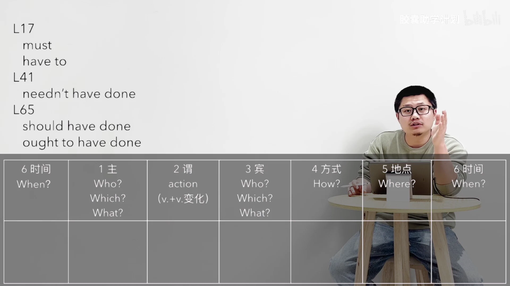

文字识别：毫助字计划 / L17 / must / have to / L41 / needn't have done / L65 / should have done / ought to have done / 6时间 / 1主 / 2谓 / 3宾 / 4方式 / 5地点 / 6时间 / When? / Who? / action / Who? / How? / Where? / When? / Which? / (v.+v.变化) / Which? / What? / What?

## 00:01:30–00:02:00

你哪怕你觉得你记得，你也回去要复习一下。在这里，我重点就提一个结构，needn't have done，叫本不必做某件事情，但做了，对吧？你像四十一课那课他说的，两个人去买帽子嘛，老公老婆去买帽子，呃，老婆嘴欠了一句，对吧？然后他老婆说了一句，You needn't have said that，你本不必那么说的，你非那么说，对吧？就本不必说，但你做了，这是咱四十一课

### 画面 00:01:45

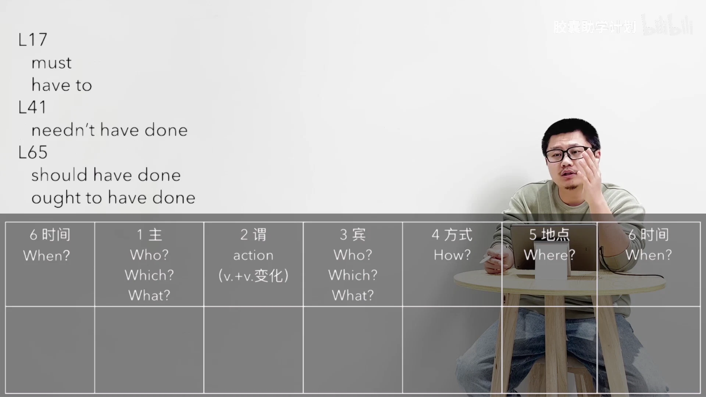

文字识别：喜助字计划 / L17 / must / have to / L41 / needn't have done / L65 / should have done / ought to have done / 6时间 / 1主 / 2谓 / 3宾 / 4方式 / 5地点 / 6时间 / When? / Who? / action / Who? / How? / Where? / When? / Which? / (v.+v.变化) / Which? / What? / What?

## 00:02:00–00:02:30

的。六十五课呢，小象 jumble 那一课，我们又学到了非常重要的两个情态动词，一个是 should，一个是 ought to do，对吧？或者 ought to do，很多人也管它叫情态动词短语。依旧，它的名称并不是最重要的，最重要的是它的用法。should 呢？什么 should do 这些，ought to do 这些，因为过于简单，我就不挨个解释了。肯定就是它的四句型转换，对吧？我们后来做了很多，如果您忘了，还是回去看。在这儿，我只重点强调两个结构，叫 should

### 画面 00:02:15

文字识别：学计划 / L17 / must / have to / L41 / needn't have done / L65 / should have done / ought to have done / 6时间 / 1主 / 2谓 / 3宾 / 4方式 / 5地点 / 6时间 / When? / Who? / action / Who? / How? / Where? / When? / Which? / (v.+v.变化) / Which? / What? / What?

## 00:02:30–00:03:00

have done 跟 ought to have done. Should have done 什么意思？叫做本应该怎么怎么样，但却没有。比如说 you should have helped me，叫你本应该帮我的，这一定指的是过去，对吧？但是当时 you didn't help me. Why？对吧？哎，你当时没帮我，为啥？你当时本应该帮我，于情于理你都应该帮我，为什么没帮？对吧？好，那 ought to have done 跟 should have done 的含义是一样的，我就不再多说了。还是刚才那

### 画面 00:02:45

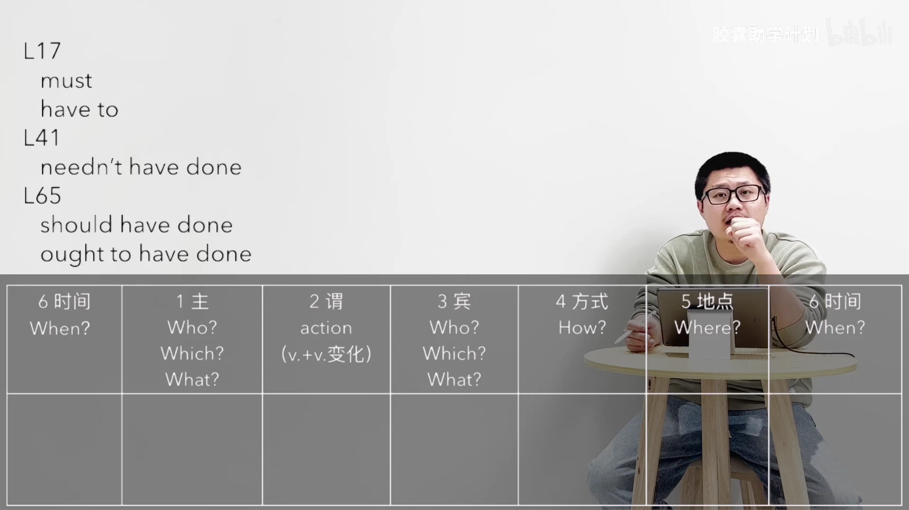

文字识别：囊助学计划 / L17 / must / have to / L41 / needn't have done / L65 / should have done / ought to have done / 6时间 / 1主 / 2谓 / 3宾 / 4方式 / 5地点 / 6时间 / When? / Who? / action / Who? / How? / Where? / When? / Which? / (v.+v.变化) / Which? / What? / What?

## 00:03:00–00:03:30

句话，我这样只是非常笼统的过了一遍，呃，我还是强烈推荐你不妨花点时间回去再看一看，对吧？那我们接下来以练代讲，repetition drill。第一个，张嘴跟我读就完了。Did you have go to the bank? Yes, I did. I had to go to the bank, and I did. 我必须当时必须要去，然后我也去了。I did就是I go to the bank的缩写。Next one, I

### 画面 00:03:10

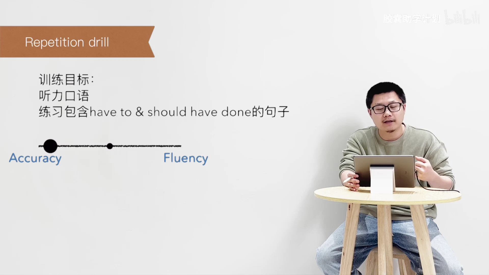

文字识别：Repetition drill / 训练目标： / 听力口语 / 练习包含have to ＆ should have done的句子 / Accuracy / Fluency

### 画面 00:03:12

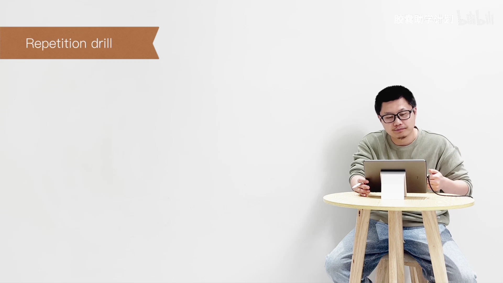

文字识别：助字计划 / Repetition drill

### 画面 00:03:15

文字识别：Repetition drill / (1)T: Did you have to go to the bank?

## 00:03:30–00:04:00

went to the bank.的缩写啊, Did you go to the bank? No, I didn't. I should have gone to the bank, but I didn't. Should have that本应该去，但我没去，对吧? Did he have to call the police? Yes, he did. He had to call the police, and he did. Did he call the police? No, he didn't. He should have called the police, but he didn't.啊，所以其实你像这个but he didn't都

### 画面 00:03:34

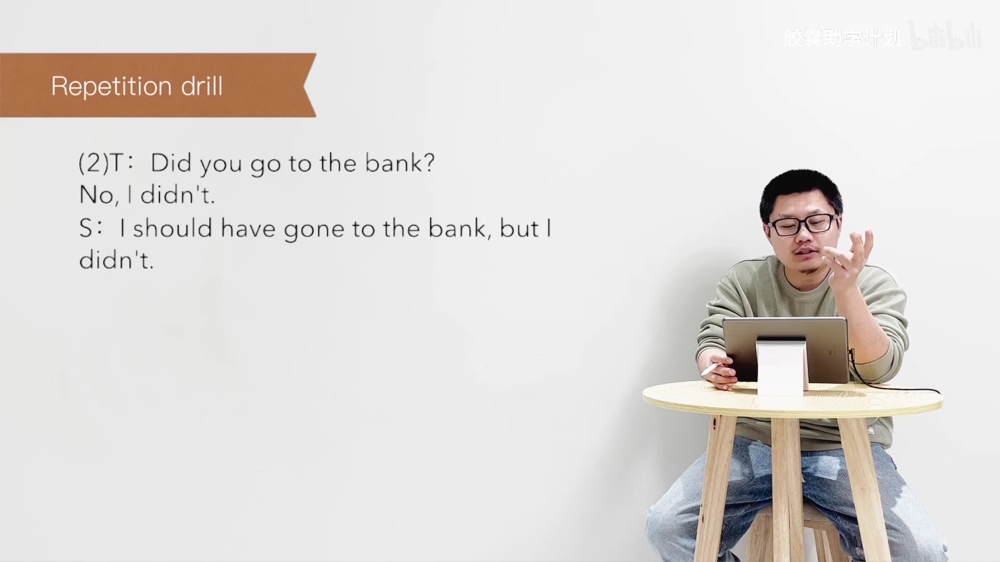

文字识别：Repetition drill / (2)T: Did you go to the bank? / No, I didn't. / S: I should have gone to the bank, but l / didn't.

### 画面 00:03:41

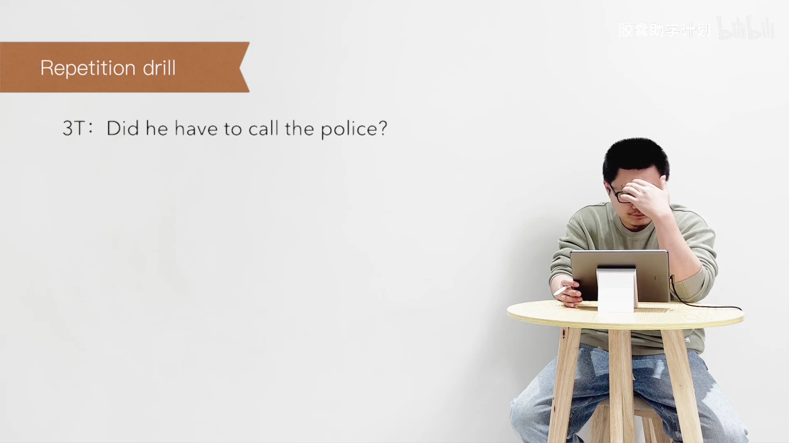

文字识别：Repetition drill / 3T: Did he have to call the police?

### 画面 00:03:53

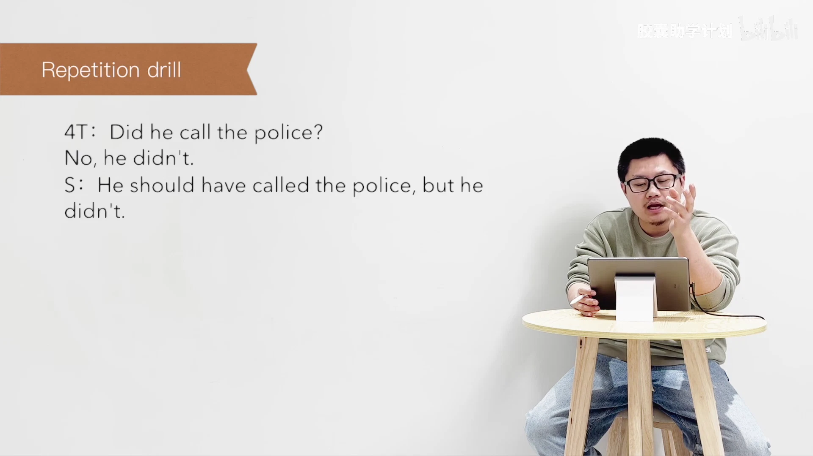

文字识别：Repetition drill / 4T: Did he call the police? / No, he didn't. / S: He should have called the police, but he / didn't.

## 00:04:00–00:04:30

可以不说的。为什么？因为 should have, 但就潜台词就是 he didn't, 对吧？ Next one. Did she go shopping? No, she didn't. She should have gone shopping, but she didn't. Next one. Did he have to ask for permission? Yes, he did. He had to ask for permission, and he did. Did he have to

### 画面 00:04:02

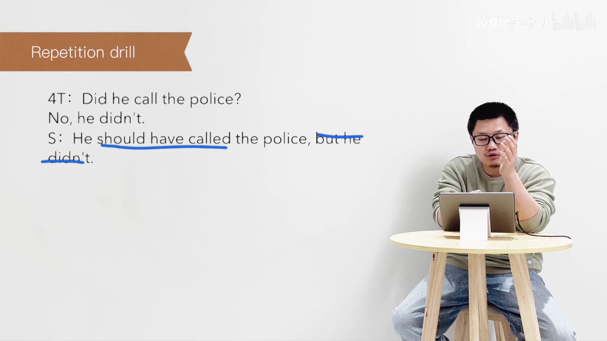

文字识别：Repetition drill / 4T: Did he call the police? / No, he / e didn't. / S：He / : should have called the police, but he / _didn't.

### 画面 00:04:07

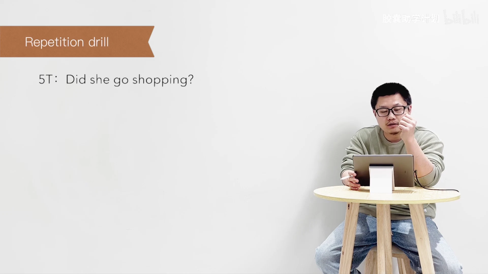

文字识别：Repetition drill / 5T: Did she go shopping?

### 画面 00:04:23

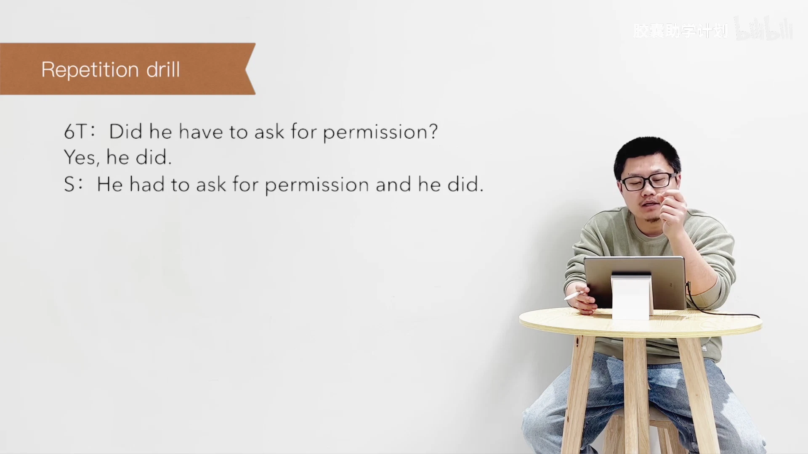

文字识别：Repetition drill / 6T: Did he have to ask for permission? / Yes, he did. / S: He had to ask for permission and he did.

## 00:04:30–00:05:00

work this evening? Yes, he did. He had to work this evening, and he did. Did you send a telegram? No, I didn't. I should have sent a telegram, but I didn't. Next one. Did you buy a new car? No, I didn't. I should have bought a new car, but I didn't. Did you have to buy

### 画面 00:04:38

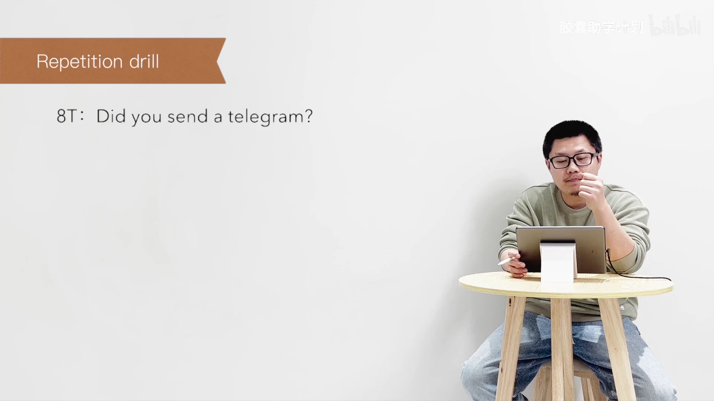

文字识别：Repetition drill / 8T: Did you send a telegram?

## 00:05:00–00:05:30

a new car? Yes, I did. I had to buy a new car, and I did.好，那我们进入下一题 pattern drill 啊，呃，还是往里去填空啊。我们重点还是要看这些句型，它让我们练什么，复习什么。第一个， she needed have washed the dishes. 她本不必把这些碗洗了，但是还是给洗了，对吧？ Needed have done，在复习这个。第二句话说， she had to wash them, or her husband would have been furious with her. 说她当时

### 画面 00:05:02

文字识别：Repetition drill / 10T: Did you have to buy a new car? / Yes, l did. / S: I had to buy a new car and I did.

### 画面 00:05:07

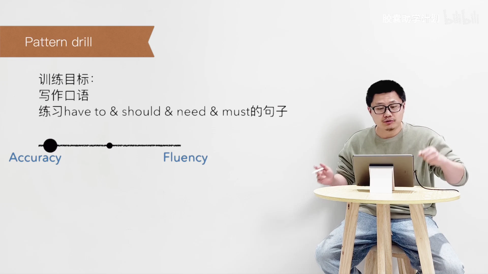

文字识别：Pattern drill / 训练目标： / 写作口语 / 练习have to ＆ should ＆ need ＆ must的句子 / Accuracy / Fluency

### 画面 00:05:09

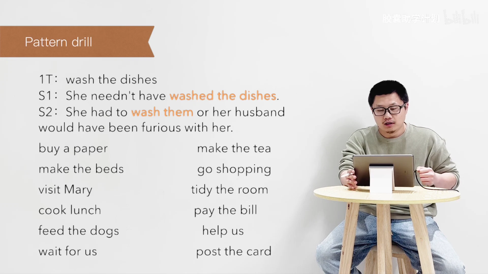

文字识别：Pattern drill / 1T: wash the dishes / S1: She needn't have washed the dishes. / S2: She had to wash them or her husband / would have been furious with her. / buy a paper / make the tea / make the beds / go shopping / visit Mary / tidy the room / cook lunch / pay the bill / feed the dogs / help us / wait for us / post the card

## 00:05:30–00:06:00

不得不写，要不她老公会跟她生气的，是吧？哎，这男人不要也罢啊。我们往里面去带啊。S一S二，好，S一啊，didn't marry typed letters yesterday。说难道她昨天没把这个信打完吗？Did already been typed。注意had been done是吧？哎，过去完成时被动。So she didn't have to type them。这have to哎，复习这个对吧？复习了n个语法吧。

### 画面 00:05:39

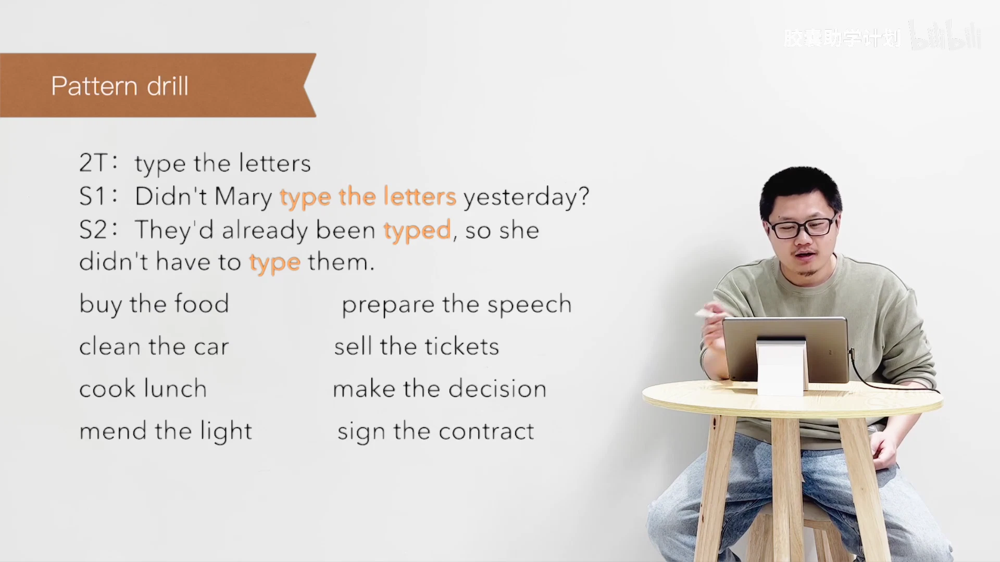

文字识别：Pattern drill / 2T: type the letters / S1: Didn't Mary type the letters yesterday? / S2: They'd already been typed, so she / didn't have to type them. / buy the food / prepare the speech / clean the car / sell the tickets / cook lunch / make the decision / mend the light / sign the contract

## 00:06:00–00:06:30

所以他啊不必去打了。OK，然后往里面去带，这是第二个，第三个。You mustn't read so much, or you will strain your eyes. 好说，你不应该啊，最好不要禁止，甚至是不要读这么多，或者你的眼睛会受伤的。这个 strain your eyes 是一个超纲的短语，我就告诉您什么意思就行了，就是损伤眼睛啊啊。其实我猜，我不告诉您，您结合上下文也能猜出来啊。

### 画面 00:06:05

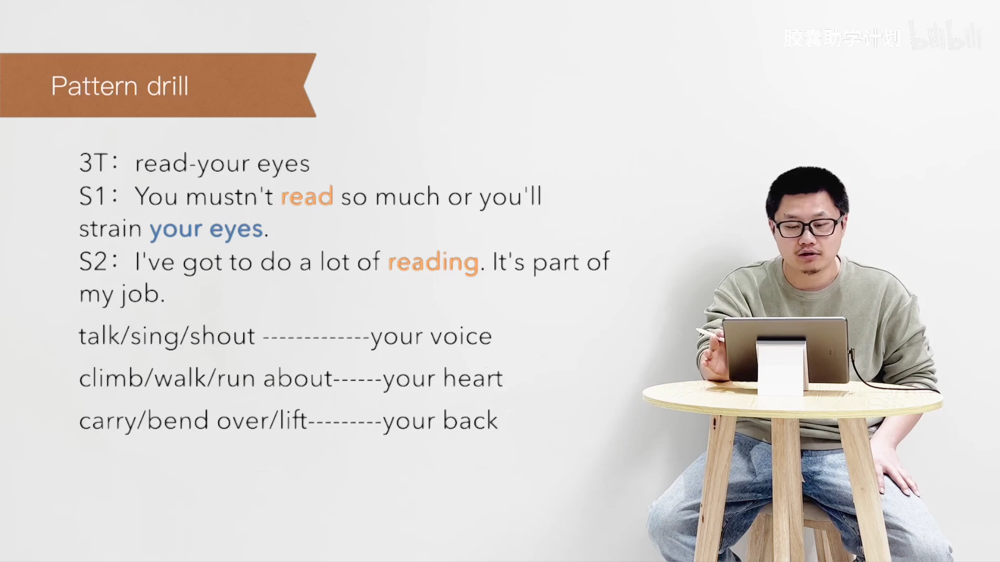

文字识别：Pattern drill / 3T:read-your eyes / S1: You mustn't read so much or you'll / strain your eyes. / S2: I've got to do a lot of reading. It's part of / my job. / talk/sing/shout / t---------yourvoice / climb/walk/run about--your heart / carry/bend over/lif--yourback

## 00:06:30–00:07:00

I've got to do a lot of reading is part of my job. 哎，说 have got to do，对吧？我必须要读很多东西，这是我工作的一部分啊。就像我工作的一部分就是要上课，就要用嗓子，对吧？好，哎，往里面去带。第四个，I can't understand it. He ought to have arrived by now. Ought to have done, should have done，含义一样，本应该到了，意味着就没到啊。He must have been delayed.

### 画面 00:06:35

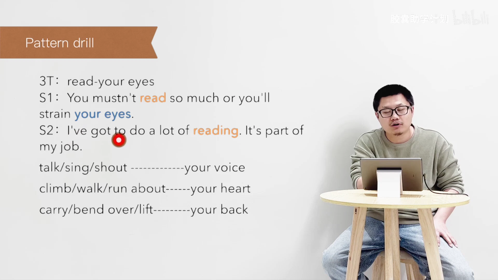

文字识别：Pattern drill / 3T:read-your eyes / S1: You mustn't read so much or you'll / strain your eyes. / S2: I've got to do a lot of reading. It's part of / my job. / talk/sing/shout / t---------yourvoice / climb/walk/run about--your heart / carry/bend over/lif--your back

### 画面 00:06:46

文字识别：Pattern drill / 4T:arrived-delayed / S1: I can't understand it. He ought to have / arrived by now. / S2: He must have been delayed. / got here/been here---kept at theoffice / comeback/r-turned--caughtbythe / police / left home/set out---- / ------taken ill / done thejob/finished--arrested

### 画面 00:06:48

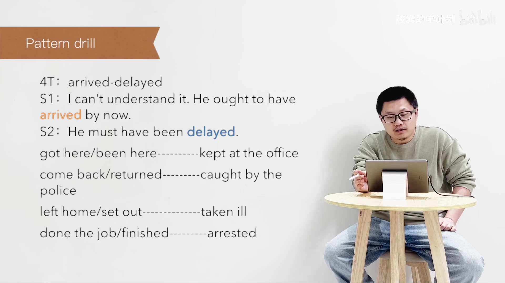

文字识别：Pattern drill / 4T:arrived-delayed / S1: I can't understand it. He ought to have / arrived by now. / S2: He must have been delayed. / got here/been here---kept at theoffice / comeback/r-turned--caughtbythe / police / left home/set out-- / ------taken ill / done thejob/finished--arrested

### 画面 00:06:50

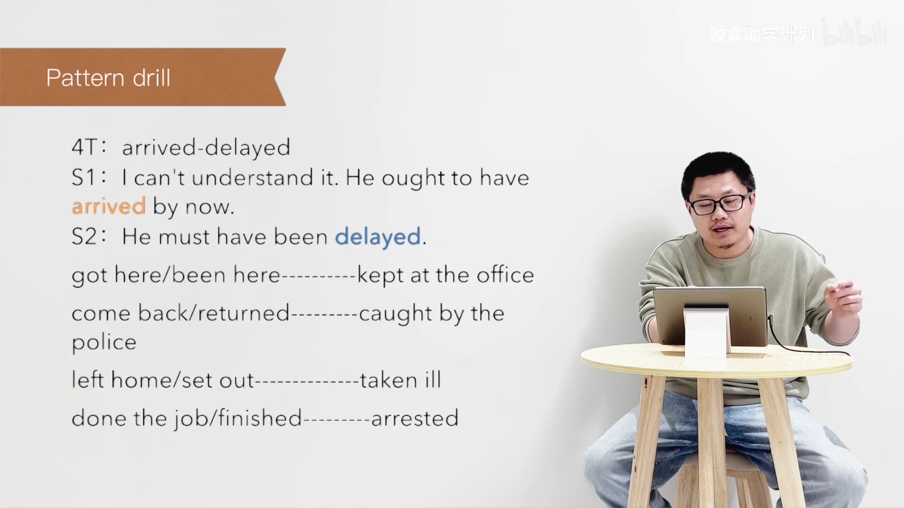

文字识别：Pattern drill / 4T:arrived-delayed / S1: I can't understand it. He ought to have / arrived by now. / S2: He must have been delayed. / got here/been here---keptat theoffice / comeback/r-turned-caughtbythe / police / left home/set out----- / ------taken ill / done thejob/finished--arrested

### 画面 00:06:52

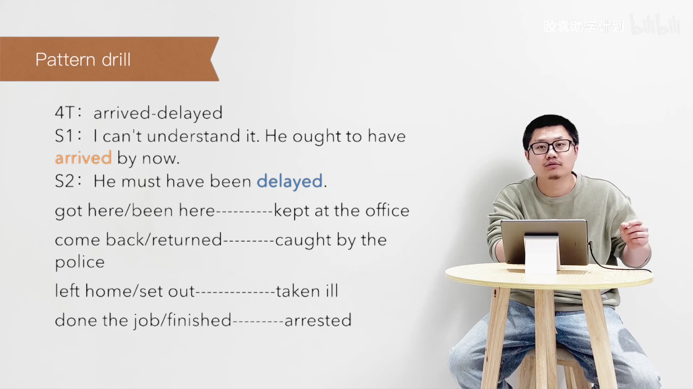

文字识别：Pattern drill / 4T:arrived-delayed / S1: I can't understand it. He ought to have / arrived by now. / S2: He must have been delayed. / got here/been here--kept at theoffice / comeback/r-turned-caughtbythe / police / left home/set out---- / ------taken ill / done thejob/finished--arrested

## 00:07:00–00:07:30

注意这个 must have been done 二十一课，其实它是十七课加二十一课合起来 must have been done。那当时一定是被怎么怎么样了，对吧？他之前一定是被耽误了、延误了。OK，不多说了，然后往里面去带一下这个事儿，结束啊。然后 recap 呢，还是那句话，十七、四十一、六十五。呃，各位在二册，尤其第四单元，我们没有太多新的语法的状态之下，文章也没有那么长，单词相对还好。在进入三

### 画面 00:07:16

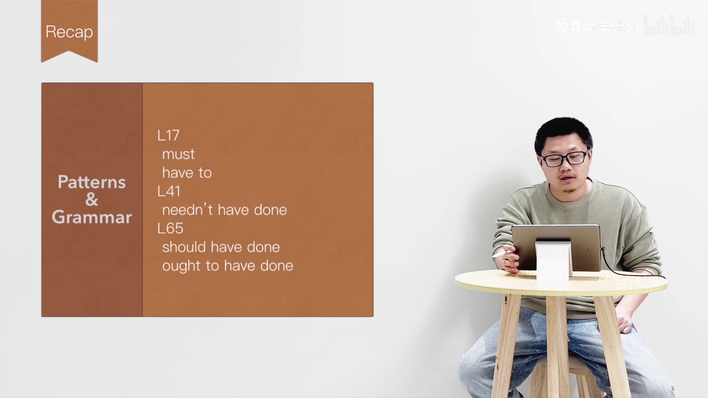

文字识别：Recap / L17 / must / have to / Patterns / L41 / & / needn't have done / Grammar / L65 / should have done / ought to have done

### 画面 00:07:18

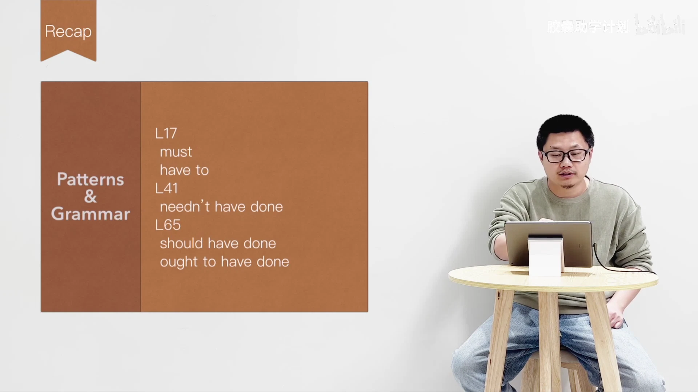

文字识别：Recap / L17 / must / have to / Patterns / L41 / needn't have done / Grammar / L65 / should have / done / ought to have done

### 画面 00:07:20

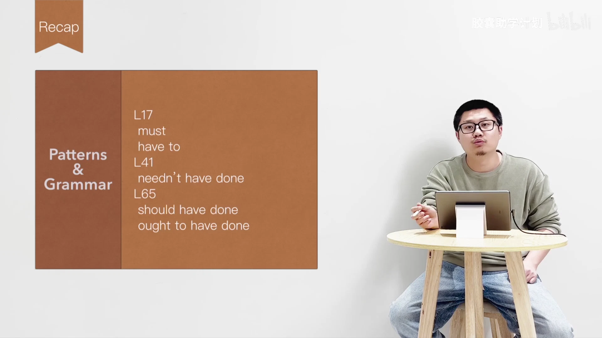

文字识别：Recap / L17 / must / have to / Patterns / L41 / needn't have done / Grammar / L65 / should have done / ought to have done

### 画面 00:07:23

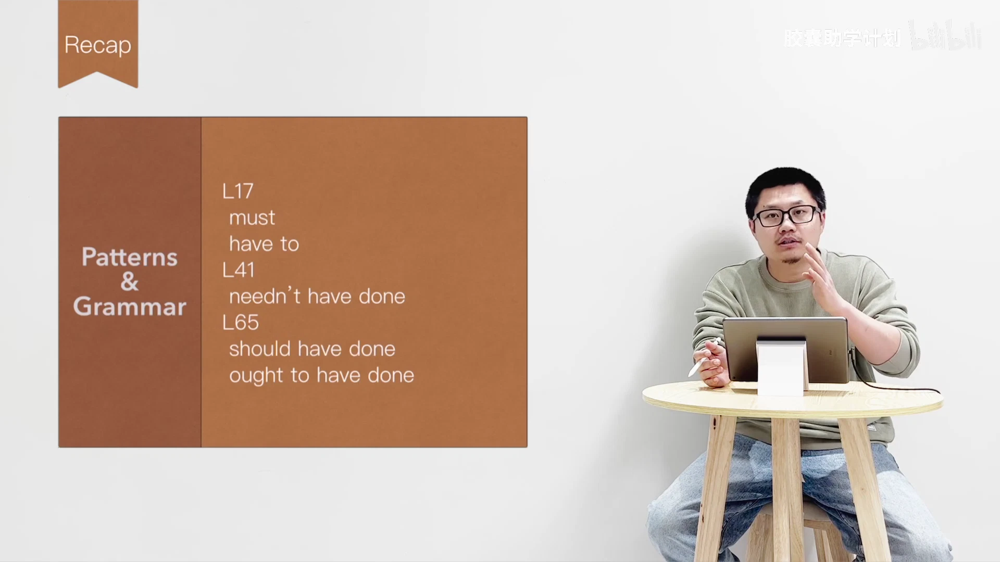

文字识别：Recap / L17 / must / have to / Patterns / L41 / ＆ / needn't have done / Grammar / L65 / should have done / ought to have done

### 画面 00:07:25

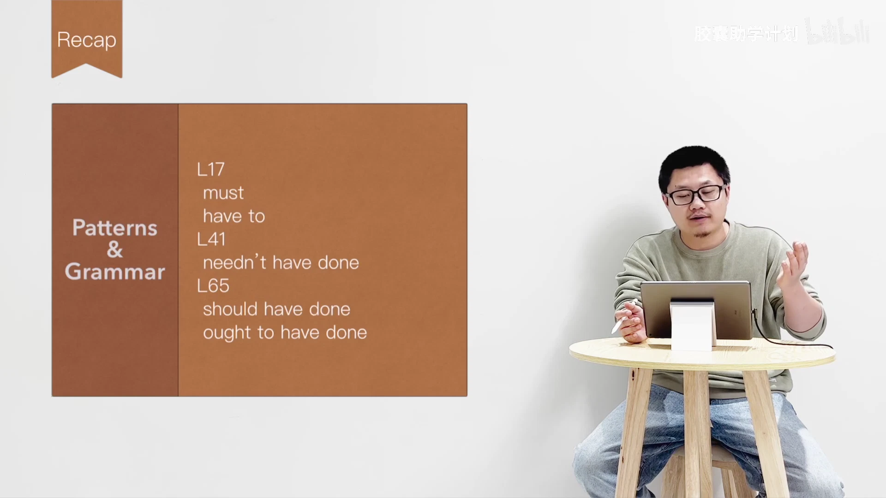

文字识别：Recap / L17 / must / have to / Patterns / L41 / needn't have done / Grammar / L65 / should have done / ought to have done

## 00:07:30–00:08:00

册的时候压力会变得更大，所以现在基础能打多牢就打多牢。我反复说了很多遍了，再强调都不为过。花点时间再去看它，再去看它啊！好，pattern drill 四乘四记得写，然后回忆给自己讲解一下今天那些语法。红皮书呢，初级加中级咱都可以开始做了啊！尽可能还是三册之前都给他至少先写一遍，因为进入三册我们还要再去看它啊。OK，那以上就是本期视频

### 画面 00:07:30

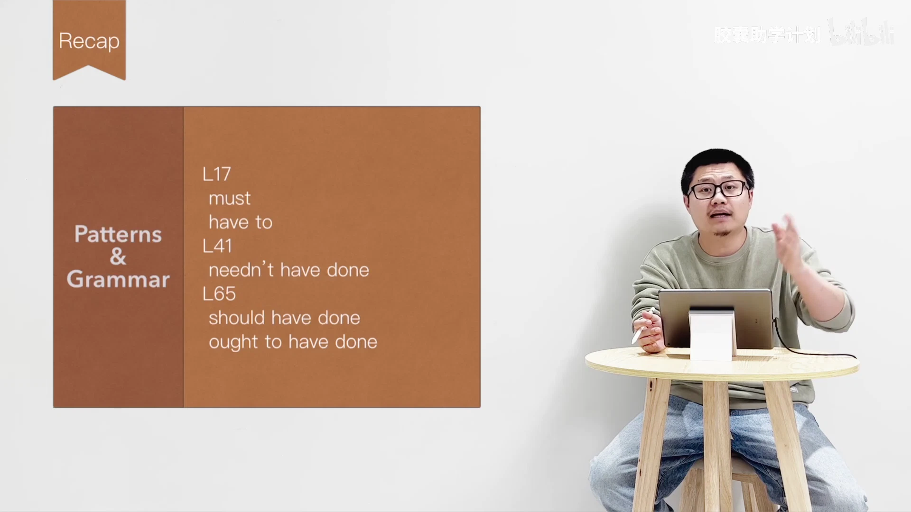

文字识别：Recap / L17 / must / have to / Patterns / L41 / ＆ / needn't have done / Grammar / L65 / should have done / ought to have done

### 画面 00:07:35

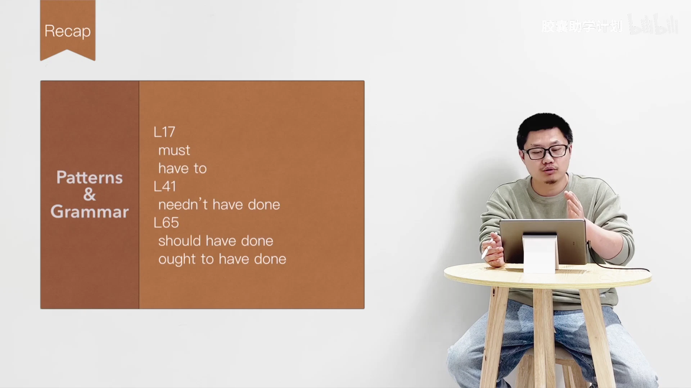

文字识别：Recap / L17 / must / have to / Patterns / L41 / ＆ / needn't have done / Grammar / L65 / should have done / ought to have done

### 画面 00:07:39

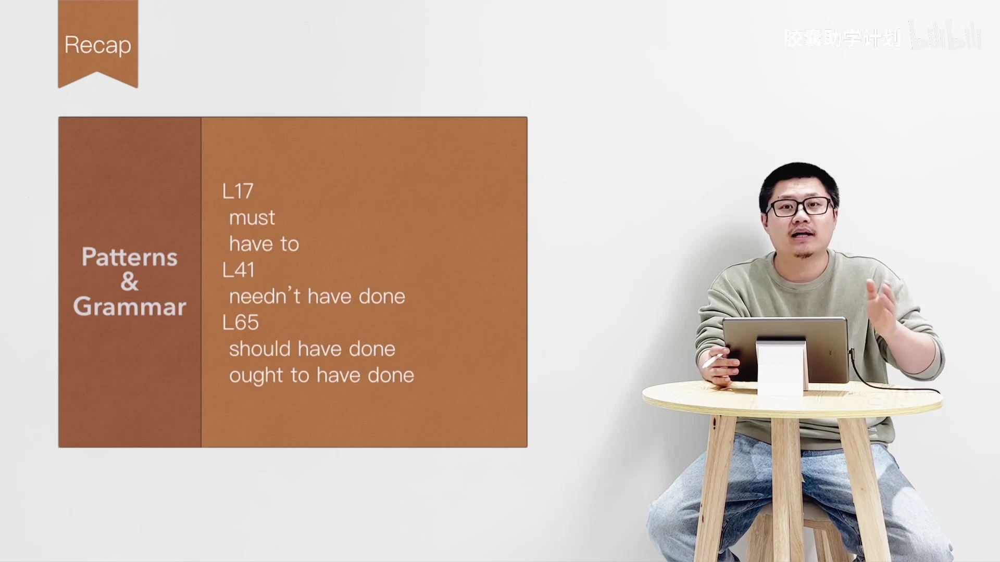

文字识别：Recap / L17 / must / have to / Patterns / L41 / needn't have done / Grammar / L65 / should have done / ought to have done

### 画面 00:07:41

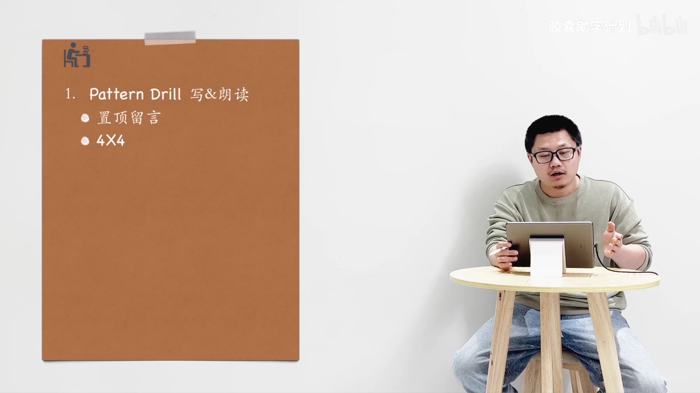

文字识别：1.f / Pattern Drill 写&朗读 / 置顶留言 / 4×4

### 画面 00:07:43

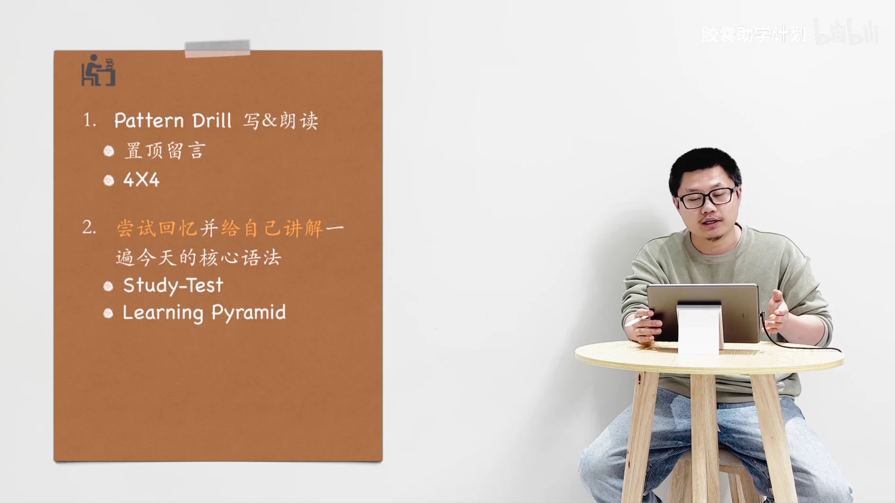

文字识别：1. ↑ / Pattern Drill 写&朗读 / 置顶留言 / 4×4 / 尝试回忆并给自己讲解一 / 遍今天的核心语法 / Study-Test / Learning Pyramid

### 画面 00:07:45

文字识别：Pattern Drill写&朗读 / 1. / 置顶留言 / 4X4 / 尝试回忆并给自己讲解一 / 遍今天的核心语法 / Study-Test / Learning Pyramid

### 画面 00:07:47

文字识别：Pattern Drill写&朗读 / 1. / 置顶留言 / 4×4 / 尝试回忆并给自己讲解一 / 遍今天的核心语法 / Study-Test / Learning Pyramid / 尝试翻阅红皮书（中级） / 通过目录或索引(Index) / 查找到本课语法

### 画面 00:07:50

文字识别：Pattern Drill 写&朗读 / 置顶留言 / 4×4 / 尝试回忆并给自己讲解一 / 遍今天的核心语法 / Study-Test / Learning Pyramid / 尝试翻阅红皮书（中级） / 通过目录或索引(Index) / 查找到本课语法

### 画面 00:07:54

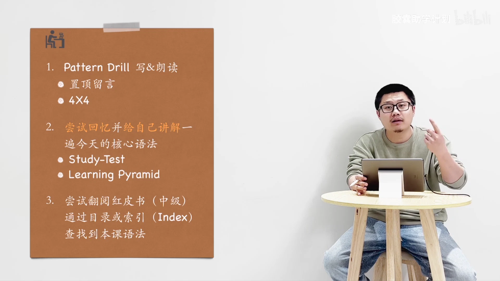

文字识别：Pattern Drill 写&朗读 / 1.f / 置顶留言 / 4×4 / 尝试回忆并给自己讲解一 / 遍今天的核心语法 / Study-Test / Learning Pyramid / 尝试翻阅红皮书（中级） / 通过目录或索引(Index) / 查找到本课语法

### 画面 00:07:56

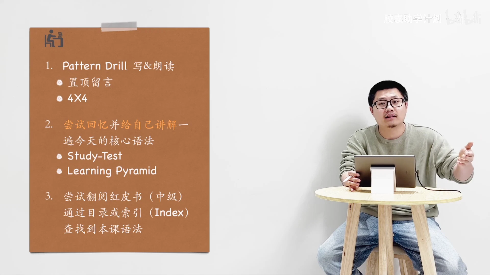

文字识别：1. f / Pattern Drill 写&朗读 / 置顶留言 / 4×4 / 尝试回忆并给自己讲解一 / 遍今天的核心语法 / Study-Test / Learning Pyramid / 尝试翻阅红皮书（中级） / 通过目录或索引(Index) / 查找到本课语法

### 画面 00:07:58

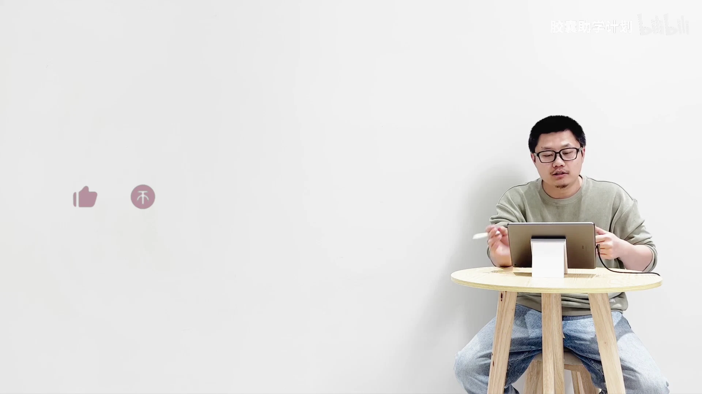

文字识别：助学计划 / 不

## 00:08:00–00:08:23

的全部内容了。如果各位喜欢我们的课程呢，欢迎各位关注、订阅、一键三连，分享给那些需要的朋友，来帮助我们快速成长。See you next time.

### 画面 00:08:03

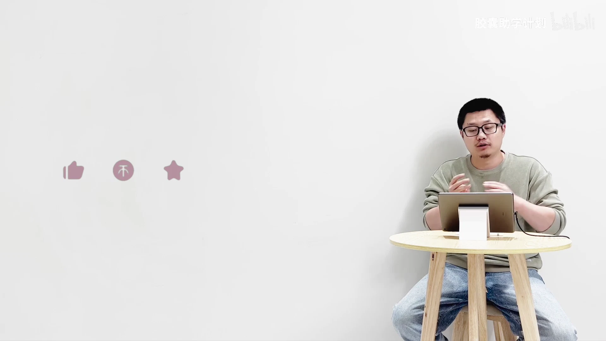

文字识别：臺助字计划 / ￥

### 画面 00:08:06

文字识别：助字计划

### 画面 00:08:08

文字识别：助字计划一

### 画面 00:08:10

### 画面 00:08:12

文字识别：運動字計划 / CAPSULEACADEMY / 胶囊助学计划 / 小红书 / Lecturer / Leo / OE

### 画面 00:08:15

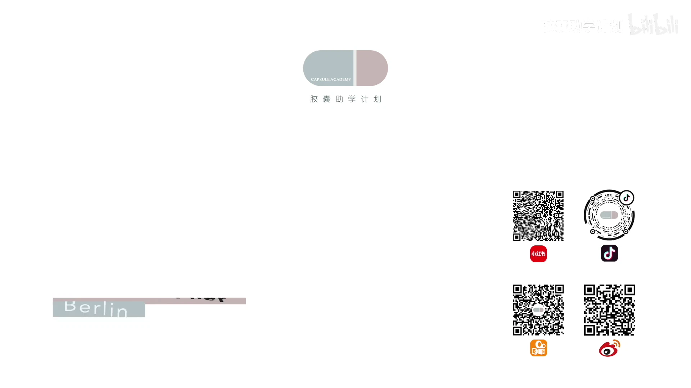

文字识别：聖珈字計切 / CAPSULEACADEMY / 胶囊助学计划 / 小红书 / 品 / Berlin

### 画面 00:08:18

文字识别：CAPSULEACADEMY / 胶囊助学计划 / 『 / 小红书 / Creator / □ / Leo & Berlin / OE

### 画面 00:08:21

文字识别：bilibili / 胶囊助学计划

### 画面 00:08:22

文字识别：bilibili / 胶囊助学计划

