# 089 文章

快速机器解析：语音为单模型转写，未进行独立交叉校对或人工复核；画面每秒采样并按变化选帧，短时文字和标记可能遗漏。截图时间约有 1 秒误差。图片有损压缩；遇到疑点请按时间查看 Google Drive 原视频。

## 00:00:00–00:00:30

Hello everyone, welcome to Capsule Academy. This is Leo. Today we're going to learn New Concept English Book Two Lesson Eighty Nine Story. Hope you gonna enjoy.呃，文章上来，我们先看一下标题，叫 Sleep of the Town 口误，这是我们本课要学会的一个习惯用法，对吧？问的问题是 Who made the only funny joke that evening and why？说谁呀？说

### 画面 00:00:00

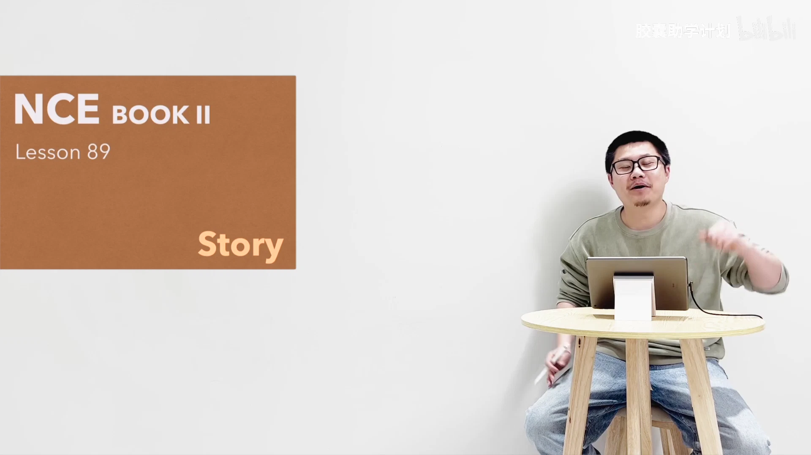

文字识别：NCE / BOOKⅡI / Lesson 89 / Story

### 画面 00:00:02

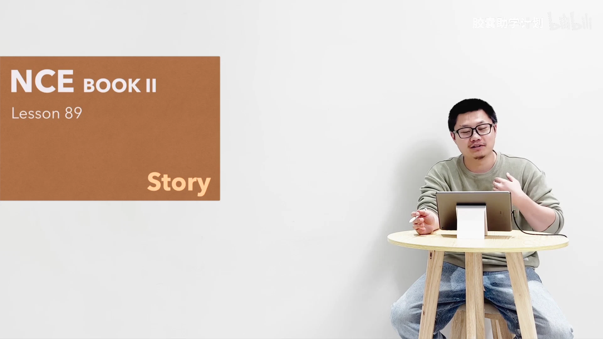

文字识别：NCE / BOOKII / Lesson 89 / Story

### 画面 00:00:09

文字识别：Jbitbli / 胶囊助学计划 / •

### 画面 00:00:13

文字识别：聖助字叶划 / 胶囊助学计划

### 画面 00:00:15

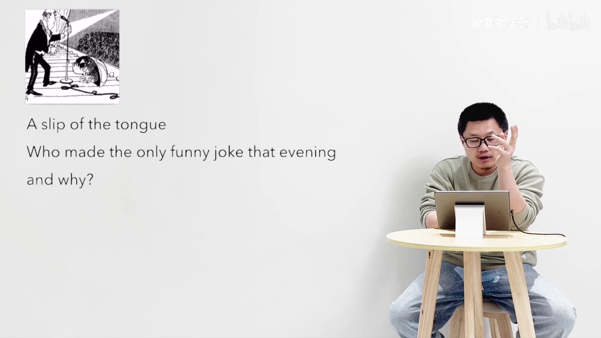

文字识别：A slip of the tongue / Who made the only funny joke that evening / and why?

## 00:00:30–00:01:00

出了那天晚上唯一有趣的一个笑话，或者说一个咒啊，对吧？说那天晚上以及为啥啊？看文章吧。People will do anything to see a free show, even if it is a bad one。这句话其实反过来读的时候翻译更容易翻译啊，但是我们先正着看一下，说人们愿会做任何事

### 画面 00:00:39

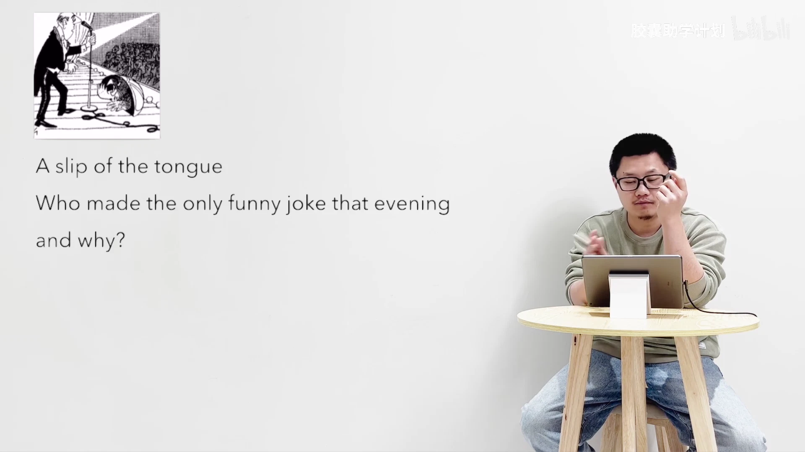

文字识别：A slip of the tongue / Who made the only funny joke that evening / and why?

### 画面 00:00:41

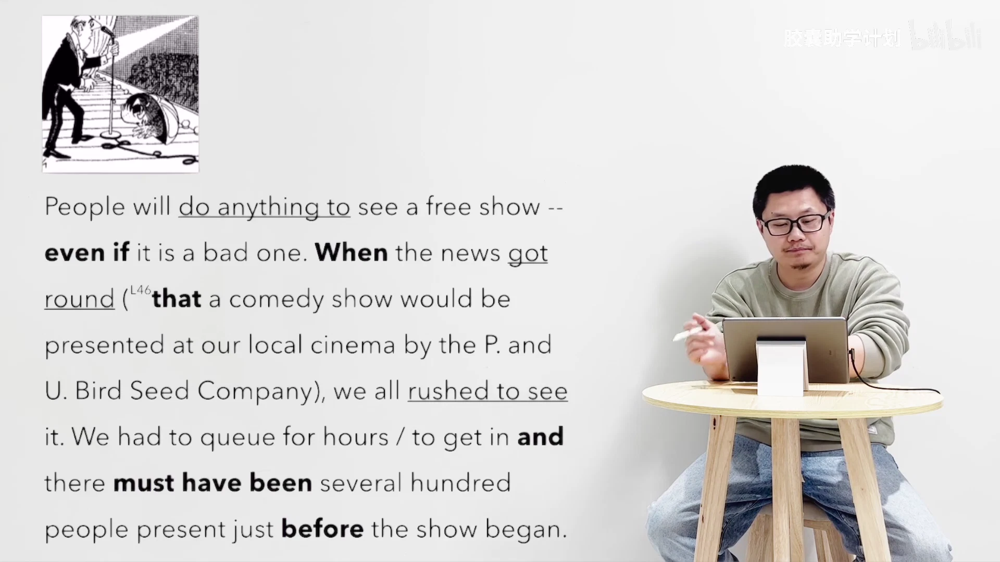

文字识别：People will do anything to see a free show -- / even if it is a bad one. When the news got / round (l4that a comedy show would be / presented at our local cinema by the P. and / U. Bird Seed Company), we all rushed to see / it. We had to queue for hours / to get in and / there must have been several hundred / people present just before the show began.

## 00:01:00–00:01:30

情去看一个免费的演出。这个 do anything to do something 呢？其实你可以把它当做一个习惯用法。什么叫做任何事情呢？就是想方设法，尽全力，对吧？哎，就是就是就是用尽浑身解数啊！ Do anything to do，对吧？比如说啊，当然这个一会儿我们还会造句啊，但我提前先说一个，让各位更容易理解。比如说 I will do anything to help you。啊，我会使尽浑身解数帮助你，

### 画面 00:01:06

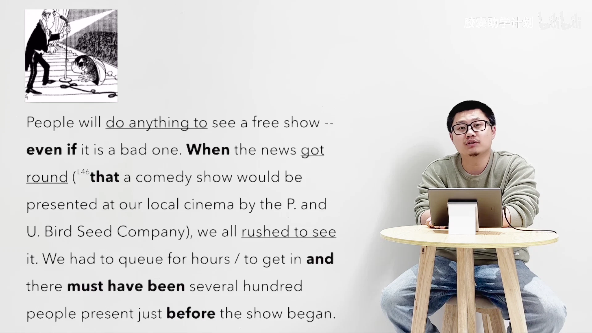

文字识别：People will do anything to see a free show -- / even if it is a bad one. When the news got / round (l4that a comedy show would be / presented at our local cinema by the P. and / U. Bird Seed Company), we all rushed to see / it. We had to queue for hours / to get in and / there must have been several hundred / people present just before the show began.

### 画面 00:01:10

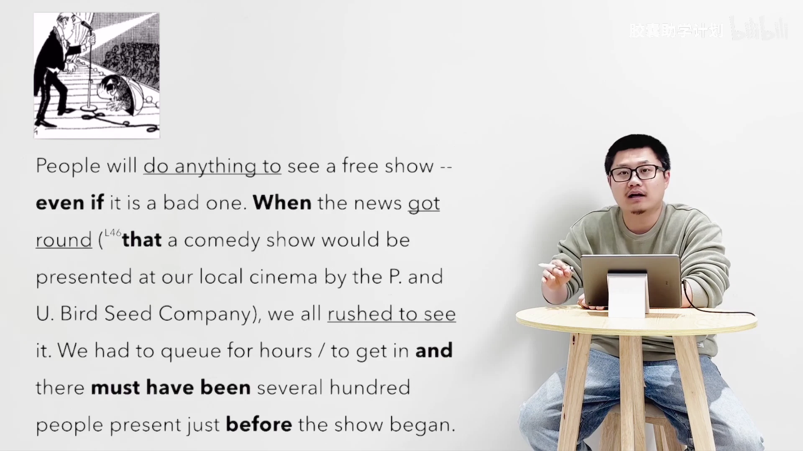

文字识别：People will do anything to see a free show -- / even if it is a bad one. When the news got / round (l4that a comedy show would be / presented at our local cinema by the P. and / U. Bird Seed Company), we all rushed to see / it. We had to queue for hours / to get in and / there must have been several hundred / people present just before the show began.

## 00:01:30–00:02:00

啊！我会尽全力帮助你。Do anything to do something, OK？那 even if 我们见过很多次了。If 这几个单词每次一出来，不管谁出来，我都放在一起说一遍。Even if, even though, although, though，对吧？哎，他们几乎都是一起的，叫做尽管即使。它是一个很烂的 show 啊。这个万指的就是这个 show 啊。所以这句话在翻译的时候呢，其实加一个呃呃，再加一个类似于 but 这样单

### 画面 00:01:36

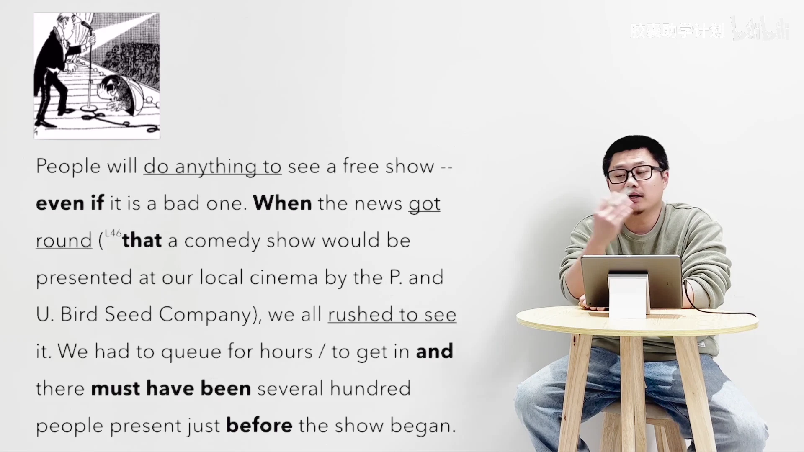

文字识别：People will do anything to see a free show -- / even if it is a bad one. When the news got / round (l4that a comedy show would be / presented at our local cinema by the P. and / U. Bird Seed Company), we all rushed to see / it. We had to queue for hours / to get in and / there must have been several hundred / people present just before the show began.

### 画面 00:01:39

文字识别：People will do anything to see a free show -- / even if it is a bad one. When the news got / round (l4that a comedy show would be / presented at our local cinema by the P. and / U. Bird Seed Company), we all rushed to see / it. We had to queue for hours / to get in and / there must have been several hundred / people present just before the show began.

## 00:02:00–00:02:30

词会好一点，但英文当中不能写哟啊。说尽管它是一个很烂的表演，人但是人们依旧愿意哎，使劲浑身解数就去看这场免费的表演，对吧？就是啊，免费的东西，对吧？就是对于人们有一种很大的吸引力。继续，When the news got around，接这句话，注意力集中啊。That a comedy show would be presented at our local cinema by the P and U

### 画面 00:02:09

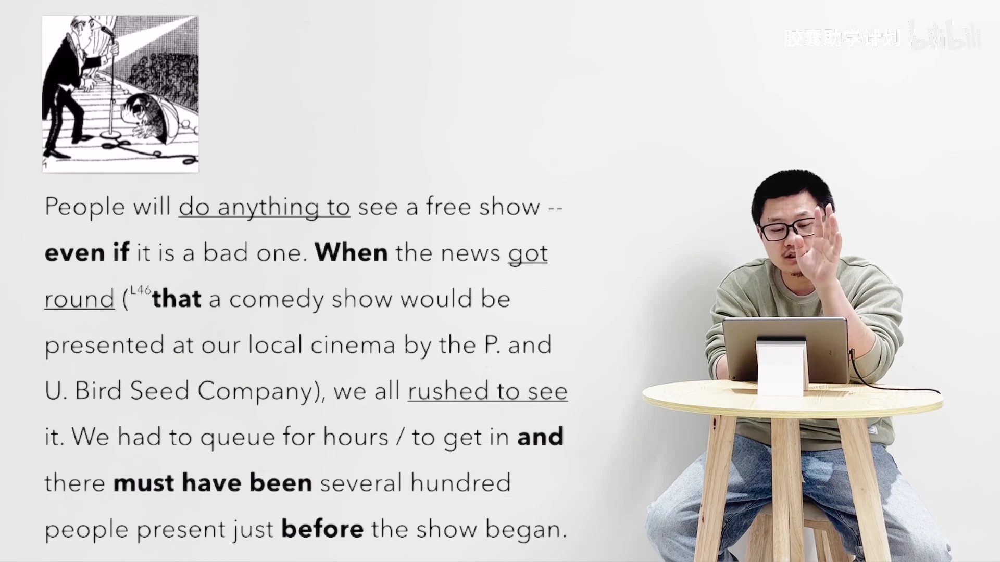

文字识别：People will do anything to see a free show -- / even if it is a bad one. When the news got / round (l4that a comedy show would be / presented at our local cinema by the P. and / U. Bird Seed Company), we all rushed to see / it. We had to queue for hours / to get in and / there must have been several hundred / people present just before the show began.

## 00:02:30–00:03:00

Birdsey Company, we all rush to see it.这句话是真长，嗯，是真的长。那怎么办呢？我们一点一点来吧。而且这句话直接炸一下断句呢，也不是那么容易断。虽然这个地方有一个 that，这个地方有一个逗号，这都提醒了我们。包括这儿有一个问，对吧？这都提醒我们可能是要断句的点。那我们先一点一点来。叫做当这个消息 got round,

### 画面 00:02:39

文字识别：People will do anything to see a free show -- / even if it is a bad one / When the news got / round (l4that a comedy show would be / presented at our local cinema by the P. and / U. Bird Seed Company), we all rushed to see / itJWe had to queue for hours / to get in and / there must have been several hundred / people present just before the show began.

### 画面 00:02:52

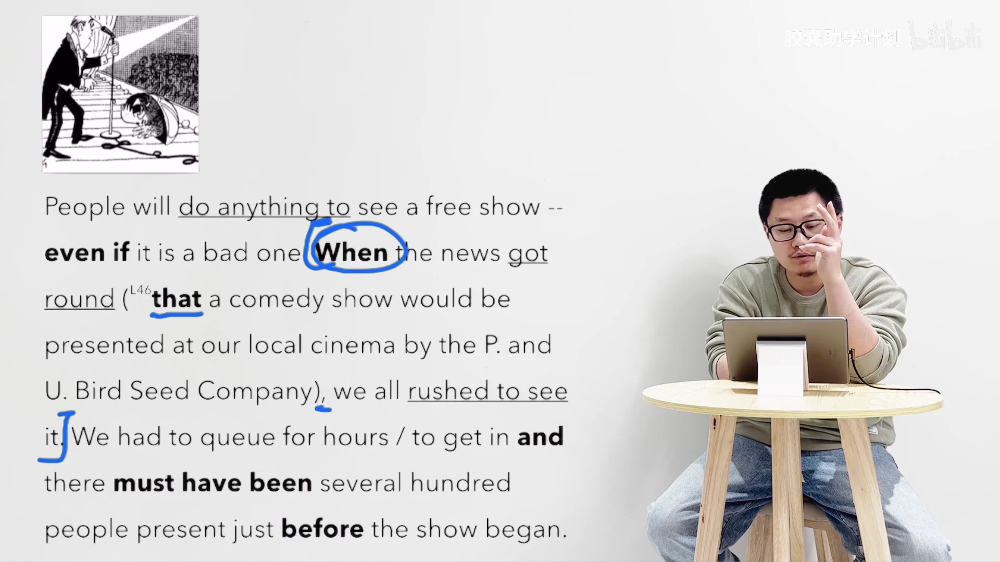

文字识别：People will do anything to see a free show -- / even if it is a bad one / When the news got / round (l4that a comedy show would be / presented at our local cinema by the P. and / U. Bird Seed Company), we all rushed to see / itJWe had to queue for hours / to get in and / there must have been several hundred / people present just before the show began.

## 00:03:00–00:03:30

got round,什么意思呢？就是四散开，消息散开，传播出去啊。这本课我们会当习惯用法去处理啊，叫做当消息传开的时候。好，我们如果只看这儿，因为后边就是逗号了，对吧？然后后边是一个整个大从句，贼长。我们现在想一下，我如果告诉你一句汉语，叫当消息传开的时候，你会问我如下至少两个问题，当然因人而异啊。第一个叫

### 画面 00:03:01

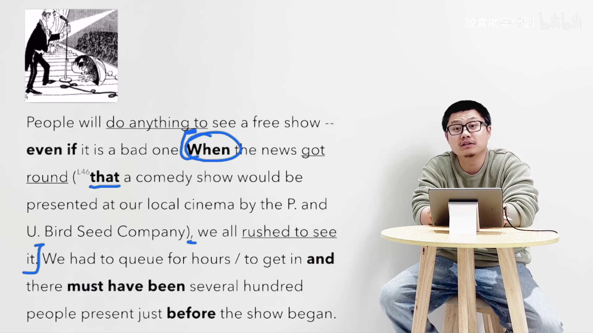

文字识别：People will do anything to see a free show -- / even if it is a bad one / When the news got / round (l4that a comedy show would be / presented at our local cinema by the P. and / U. Bird Seed Company), we all rushed to see / itJWe had to queue for hours / to get in and / there must have been several hundred / people present just before the show began.

### 画面 00:03:03

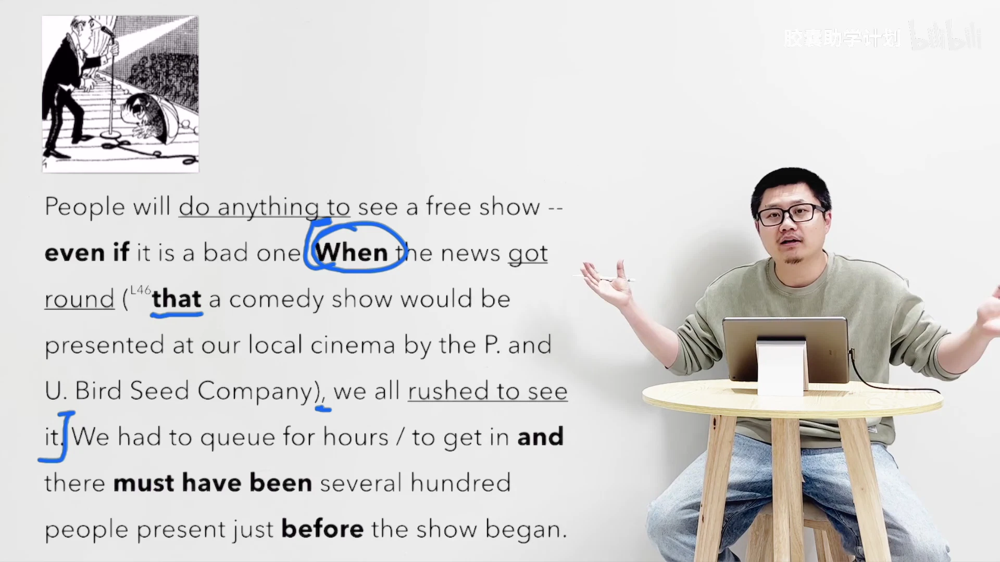

文字识别：People will do anything to see a free show -- / even if it is a bad one / When the news got / round (l4that a comedy show would be / presented at our local cinema by the P. and / U. Bird Seed Company), we all rushed to see / itJWe had to queue for hours / to get in and / there must have been several hundred / people present just before the show began.

### 画面 00:03:14

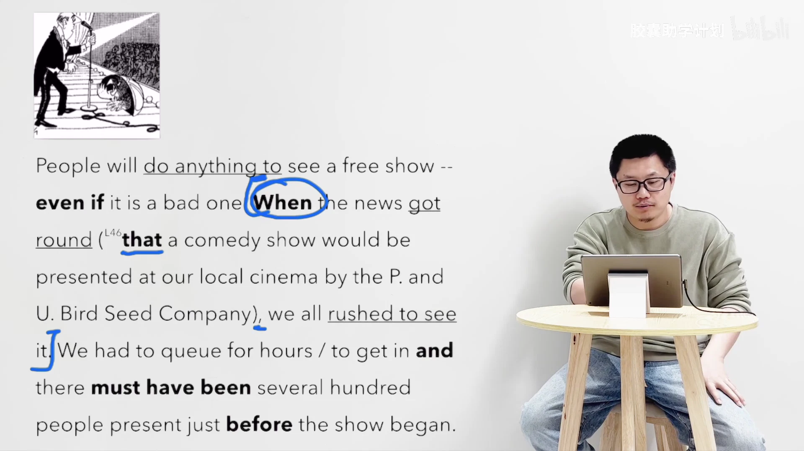

文字识别：People will do anything to see a free show -- / even if it is a bad one / Whenthe news got / round (l4that a comedy show would be / presented at our local cinema by the P. and / U. Bird Seed Company), we all rushed to see / itJWe had to queue for hours / to get in and / there must have been several hundred / people present just before the show began.

## 00:03:30–00:04:00

什么消息？第二个叫传开之后发生了什么？传开之后发生了什么呢？We all rush to see it. 我们都奔跑着过去看它，对吧？哎，为什么用了 rush 而没有用 walk 或者 go went，对吧？它更能表现人们去看一个 free show 的那种决心啊！要免费的，我得赶紧去。哎，就是这种感觉。好，所以现在咱们除了括号，哎，

### 画面 00:03:42

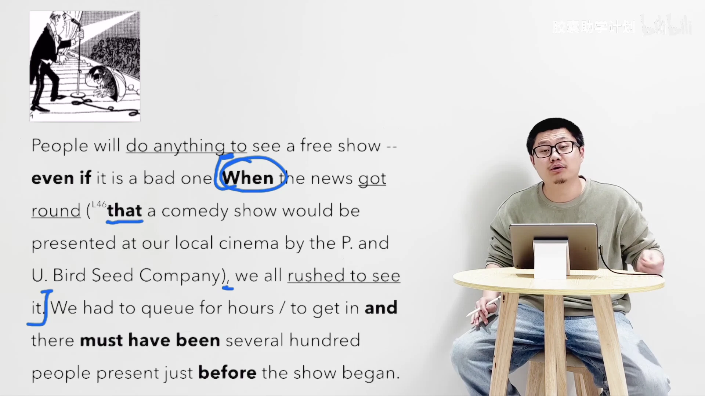

文字识别：People will do anything to see a free show -- / even if it is a bad one / When the news got / round (l4that a comedy show would be / presented at our local cinema by the P. and / U. Bird Seed Company), we all rushed to see / itJWe had to queue for hours / to get in and / there must have been several hundred / people present just before the show began.

### 画面 00:03:44

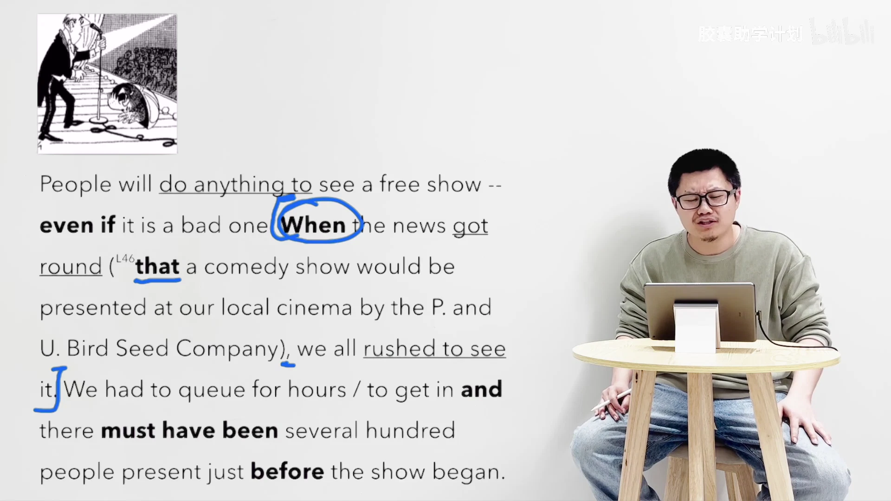

文字识别：People will do anything to see a free show -- / even if it is a bad one( / When the news got / round (l4that a comedy show would be / presented at our local cinema by the P. and / U. Bird Seed Company), we all rushed to see / itJWe had to queue for hours / to get in and / there must have been several hundred / people present just before the show began.

### 画面 00:03:46

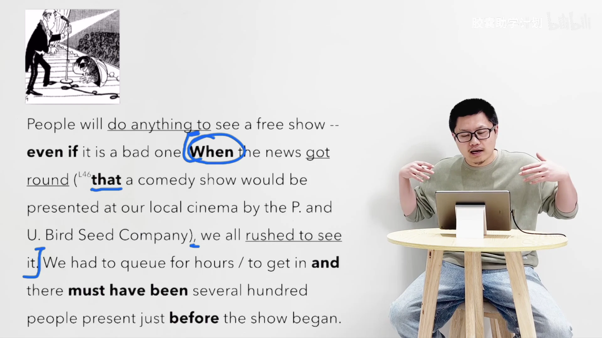

文字识别：People will do anything to see a free show -- / even if it is a bad one / When the news got / round (l4that a comedy show would be / presented at our local cinema by the P. and / U. Bird Seed Company), we all rushed to see / itJWe had to queue for hours / to get in and / there must have been several hundred / people present just before the show began.

### 画面 00:03:49

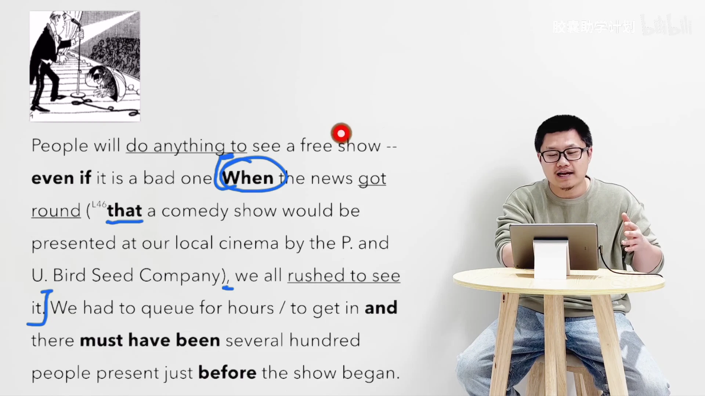

文字识别：People will do anything to see a free show -- / even if it is a bad one / Whenthe news got / round (l4that a comedy show would be / presented at our local cinema by the P. and / U. Bird Seed Company), we all rushed to see / itJWe had to queue for hours / to get in and / there must have been several hundred / people present just before the show began.

### 画面 00:03:53

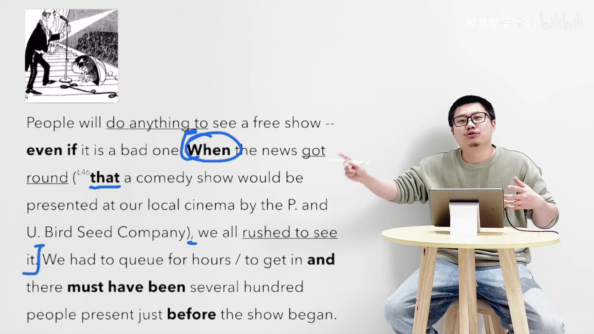

文字识别：People will do anything to see a free show -- / even if it is a bad one( / When the news got / round (l4that a comedy show would be / presented at our local cinema by the P. and / U. Bird Seed Company), we all rushed to see / itJWe had to queue for hours / to get in and / there must have been several hundred / people present just before the show began.

### 画面 00:03:55

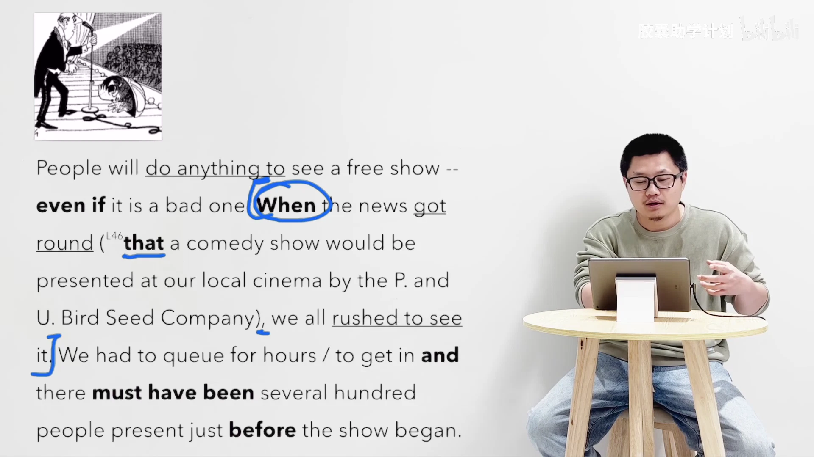

文字识别：People will do anything to see a free show -- / even if it is a bad one / When the news got / round (l4that a comedy show would be / presented at our local cinema by the P. and / U. Bird Seed Company), we all rushed to see / itJWe had to queue for hours / to get in and / there must have been several hundred / people present just before the show began.

## 00:04:00–00:04:30

这个括弧当中标的这个从句，咱现在还不知道是啥以外，句子信息我们已经接收到了。消息四处传开，我们冲过去看这个免费的表演。括号当中到底是什么呢？我们现在也不知道。咱一起再慢慢的走一遍，叫做 a comedy show，一个喜剧 would be presented，将被上演 at our local cinema，地点在我们本地的电影院。哎，by

### 画面 00:04:06

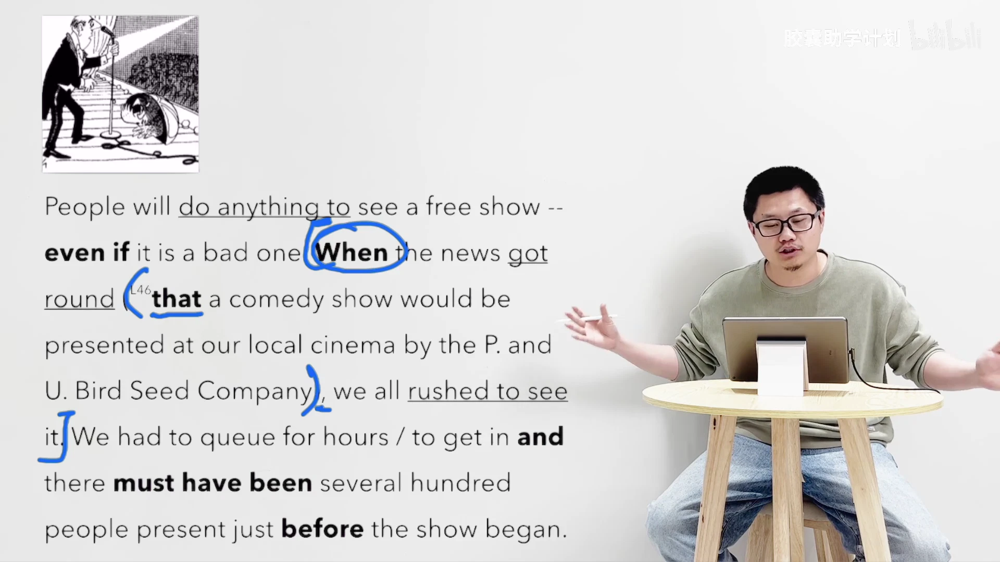

文字识别：People will do anything to see a free show -- / even if it is a bad one / When the news got / L46 / 'that a comedy show would be / round / presented at our local cinema by the P. and / U. Bird Seed Company_.we allrushed to see / itJWe had to queue for hours / to get in and / there must have been several hundred / people present just before the show began.

### 画面 00:04:15

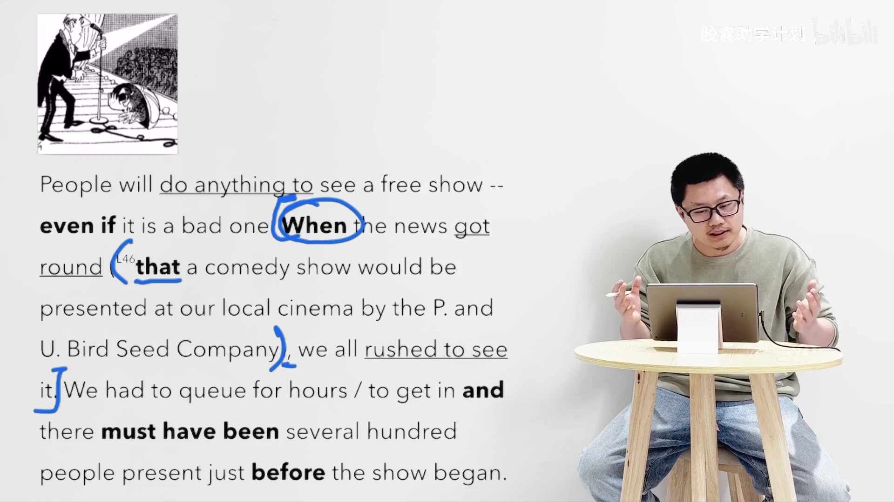

文字识别：People will do anything to see a free show -- / even if it is a bad one / Whenthe news got / L46 / 'that a comedy show would be / round / presented at our local cinema by the P. and / U. Bird Seed CompanyL.we all rushed to see / itJWe had to queue for hours / to get in and / there must have been several hundred / people present just before the show began.

### 画面 00:04:29

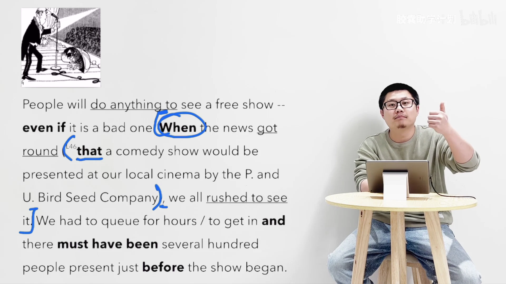

文字识别：People will do anything to see a free show -- / even if it is a bad one / When the news got / 46 / 'that a comedy show would be / round / presented at our local cinema by the P. and / U. Bird Seed Company_.we all rushed to see / itJWe had to queue for hours / to get in and / there must have been several hundred / people present just before the show began.

## 00:04:30–00:05:00

加了由谁？因为前面不是个被动嘛，对吧？你要加上由谁发出的这个动作，由 by 去呃呃加上。背的是谁呢？P and U Bird City Company。好了，实话实说，这地方完全看不懂都没事儿，因为啥呢？你就反正知道是这么个东西，要么是个人，要么是个公司，要么是个组织，对吧？你仔细看，其实 P 点 and U 点，它其实是个缩写，你也不用管它是啥，就 P and U 就完了。然后 Bird City Company BSC 全在大写，就是一个公司

### 画面 00:04:56

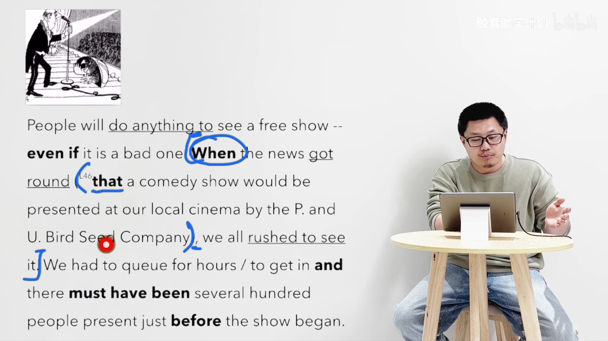

文字识别：People will do anything to see a free show -- / even if it is a bad one / When the news got / round / L46 / 'that a comedy show would be / presented at our local cinema by the P. and / U. Bird See / Company. we allrushed to see / itJWe had to queue for hours / to get in and / there must have been several hundred / people present just before the show began.

## 00:05:00–00:05:30

的名字，依旧是不懂没有问题，懂呢就是您单词量大，听见了吧？Bird鸟，C种子，Company公司，对吧？哎，就是这么一个公司做了这么一个事儿。我们再读一遍这句话，完整的读一遍，叫做一个喜剧将被上演，在我们本地的电影院由一个公司，就是一个公司要在我们本地电影院上映一个哎上演一场喜剧，一个Comedy Show，对

### 画面 00:05:12

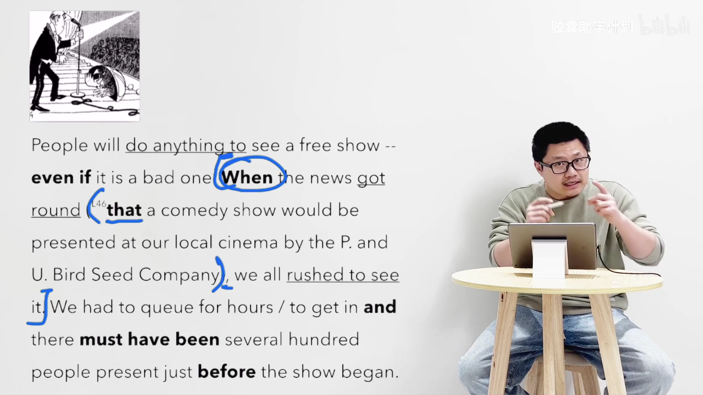

文字识别：People will do anything to see a free show -- / even if it is a bad one / When the news got / L46 / 'that a comedy show would be / round / presented at our local cinema by the P. and / U. Bird Seed Company / ywe all rushed to see / itJWe had to queue for hours / to get in and / there must have been several hundred / people present just before the show began.

### 画面 00:05:14

文字识别：People will do anything to see a free show -- / even if it is a bad one / When the news got / L46 / 'that a comedy show would be / round / presented at Or local cinema by the P. and / U. Bird Seed Company / we all rushed to see / itJWe had to queue for hours / to get in and / there must have been several hundred / people present just before the show began.

## 00:05:30–00:06:00

吧？当然，也许不是一个喜剧吧。 comedy show 可以包含很多的节目。你发没发现后边这句话？首先，我们一般来说想判断它是个什么从句，看看前，看看后，对吧？一般是看看前。前面要是个动词呢，它可能是个宾语从句，对吧？尤其是如果它是这个连接呃，这个动词说的就是这个事儿。前面这个 got round 的呢，基本上跟后边这个连不起来，宾语从句的可能性不太大。接

### 画面 00:05:44

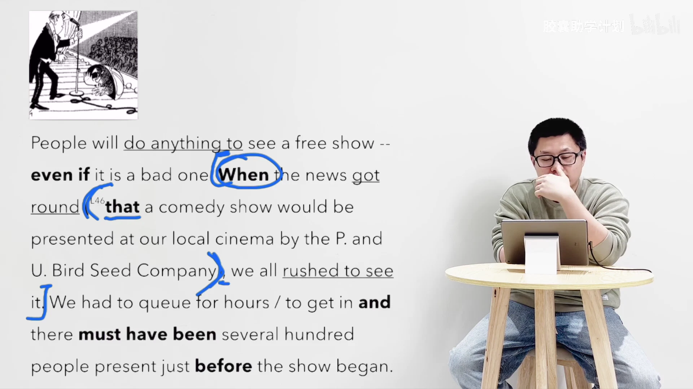

文字识别：People will do anything to see a free show -- / even if it is a bad one / When the news got / round / L46 / 'that a comedy show would be / presented at our local cinema by the P. and / U. Bird Seed Companywe all rushed to see / itJWe had to queue for hours / to get in and / there must have been several hundred / people present just before the show began.

## 00:06:00–00:06:30

下来呢，对于各位来说最熟悉的就是定语从句，而前面它紧挨着的还不是个名词。再然后呢，还有一个这个啊，包括我们如果想判断它是个定语从句呢，这个 that 呢为什么要找前面的名词？因为我希望这个 that 在定语从句当中是充当成分的。然后还有一个呢是各位不常见的，但是四十六课咱们学过啊，叫做同位语从句。同位语从句就是它跟定语从句判断的

### 画面 00:06:14

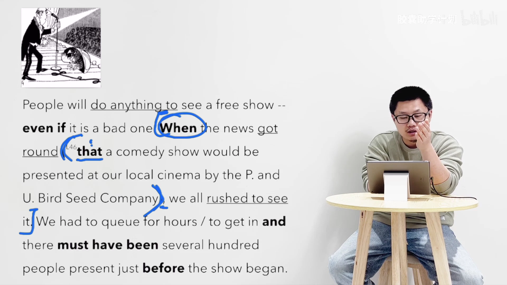

文字识别：People will do anything to see a free show -- / even if it is a bad one / When the news got / round / L46 / 'that a comedy show would be / presented at our local cinema by the P. and / U. Bird Seed Companywe allrushed to see / itJWe had to queue for hours / to get in and / there must have been several hundred / people present just before the show began.

### 画面 00:06:27

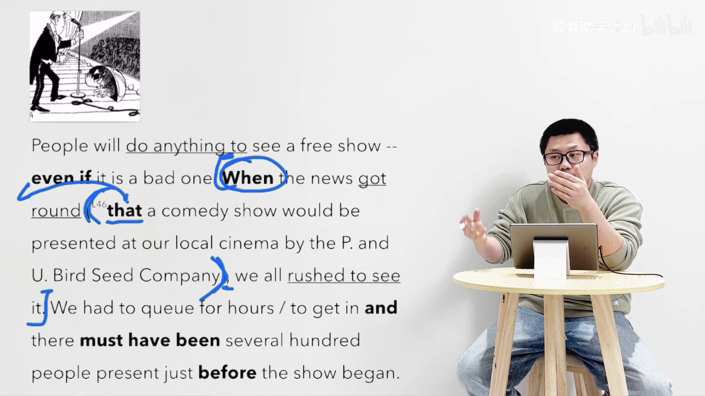

文字识别：People will do anything to see a free show -- / even if it is a bad one / When the news got / Lthat a comedy show would be / round / presented at our local cinema by the P. and / U. Bird Seed Company we all rushed to see / itJWe had to queue for hours / to get in and / there must have been several hundred / people present just before the show began.

### 画面 00:06:29

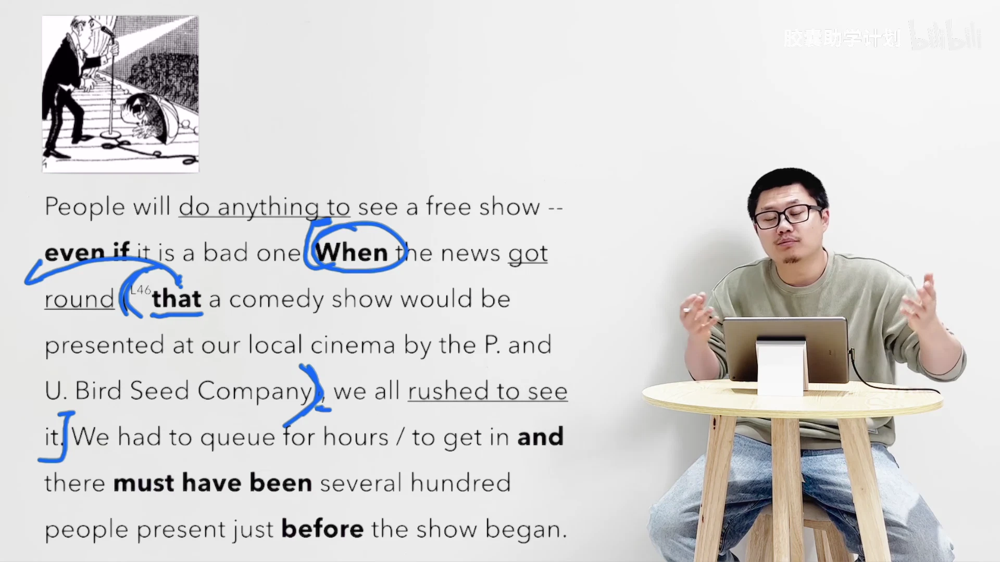

文字识别：People will do anything to see a free show -- / When the news got / even if it is a bad one / that a comedy show would be / round / presented at our local cinema by the P. and / U. Bird Seed Companywe all rushed to see / itJWe had to queue for hours / to get in and / there must have been several hundred / people present just before the show began.

## 00:06:30–00:07:00

一个最基本的差别，就是定语从句这个连接词啊，在句子当中是得充当成分的。换一句话来说，定语从句当中如果把连接词去掉，剩下的不是一个完整的句子。而同位语从句呢，你这个 that 是不充当成分的，后边呢是一个完整的句子。我刚才读了两遍，我希望你意识到后边至少主谓宾是不缺的，对吧？也地点也有是吧？被谁弄的也有，是一个偏向于完整的句子。所以呢，

### 画面 00:06:38

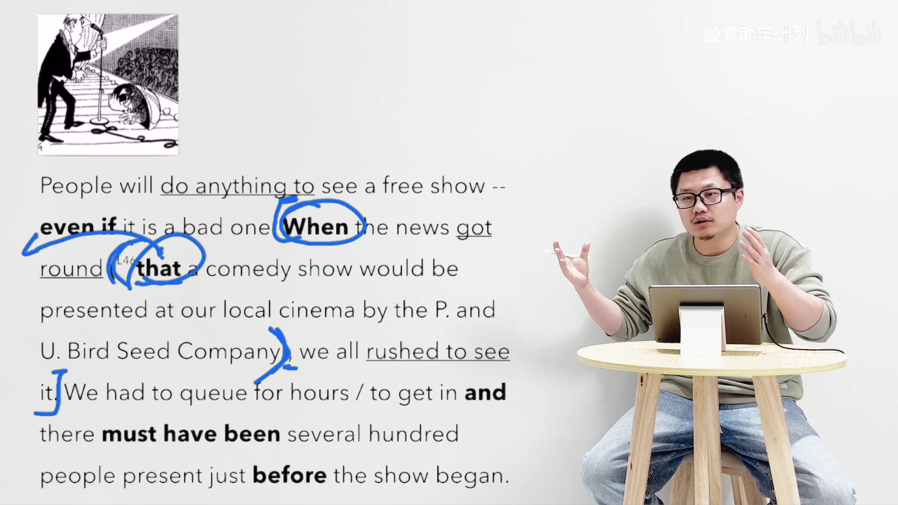

文字识别：People will do anything to see a free show -- / even if it is a bad one / When the news got / round / that  comedy show would be / presented at our local cinema by the P. and / U. Bird Seed Company we all rushed to see / itJWe had to queue for hours / to get in and / there must have been several hundred / people present just before the show began.

### 画面 00:06:43

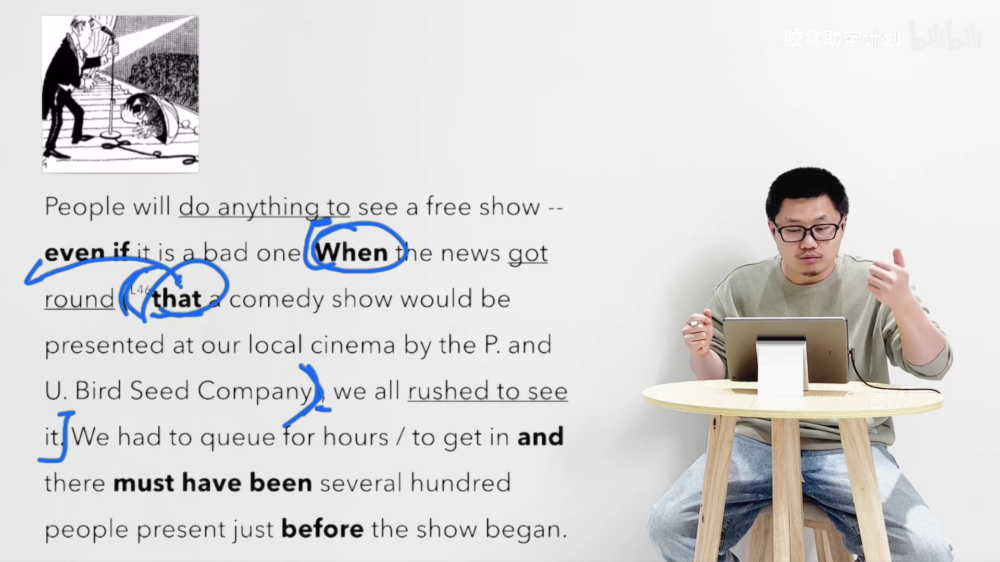

文字识别：People will do anything to see a free show -- / When the news got / even if it is a bad one / round / that  comedy show would be / presented at our local cinema by the P. and / U. Bird Seed Companywe all rushed to see / itJWe had to queue for hours / to get in and / there must have been several hundred / people present just before the show began.

### 画面 00:06:48

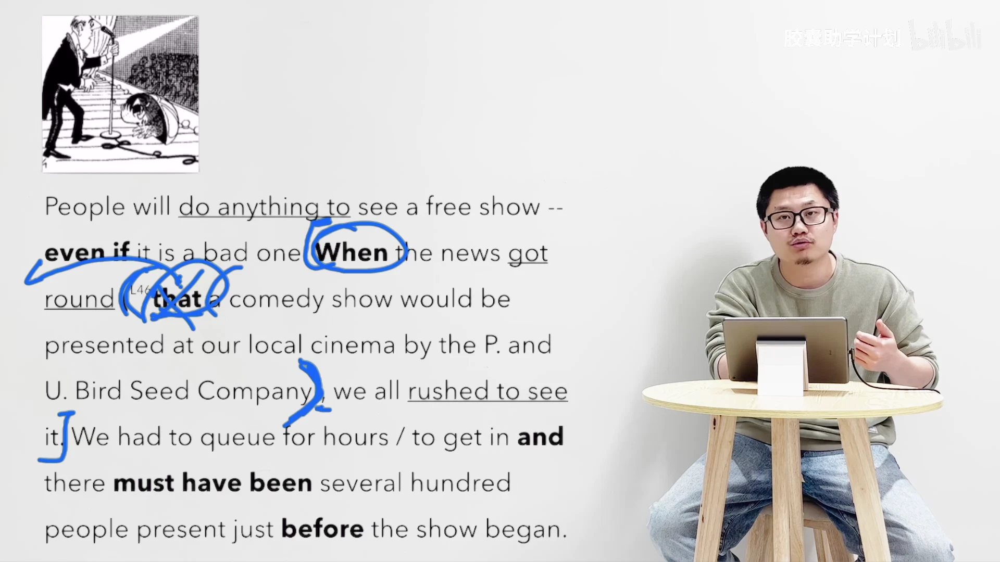

文字识别：People will do anything to see a free show -- / Whenthe news got / even if it is a bad one / tcomedy show would be / round / presented at our local cinema by the P. and / U. Bird Seed Companywe allrushed to see / itJWe had to queue for hours / to get in and / there must have been several hundred / people present just before the show began.

### 画面 00:06:55

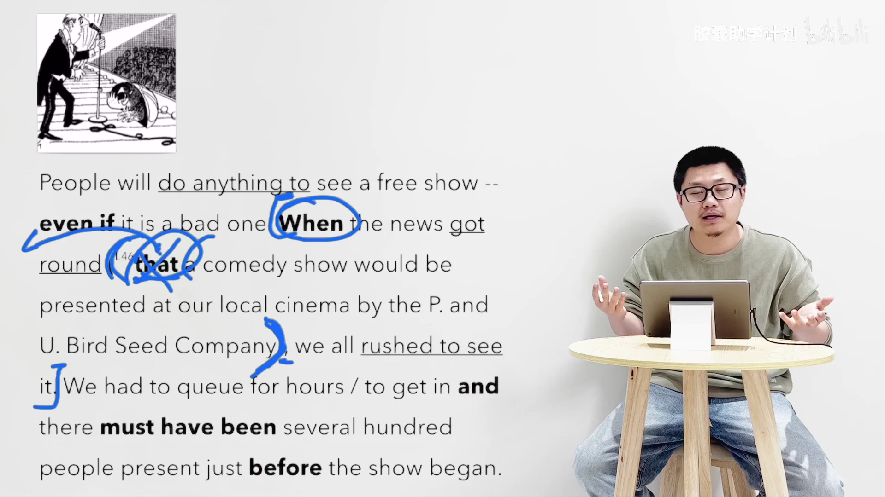

文字识别：People will do anything to see a free show -- / When the news got / even if it is a bad one / t comedy show would be / round / presented at our local cinema by the P. and / U. Bird Seed Companywe allrushed to see / itJWe had to queue for hours / to get in and / there must have been several hundred / people present just before the show began.

### 画面 00:06:58

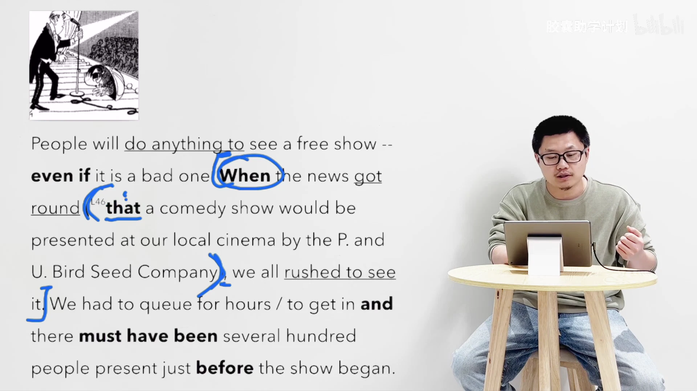

文字识别：People will do anything to see a free show -- / even if it is a bad one / When the news got / round / L46 / 'that a comedy show would be / presented at our local cinema by the P. and / U. Bird Seed Companywe allrushed to see / it We had to queue for hours / to get in and / there must have been several hundred / people present just before the show began.

## 00:07:00–00:07:30

实这个地方我就不卖官司了啊。整个这个实际上是 news 这个单词的同位语，这个地方呢涉及到如下几件事。第一，同位语从句其实前面就是同位的谁的那个单词就那么几个，其实并不多。我们见多了之后，慢慢你以后见到它后边跟个从句，你隐约的就可能就想到同位语了，就形成一种条件反射。比如说 news 是您今天学的第一个，行吧？咱这么去

### 画面 00:07:00

文字识别：People will do anything to see a free show -- / even if it is a bad one / Whenthe news got / round (l4that a comedy show would be / presented at our local cinema by the P. and / U. Bird Seed Company), we all rushed to see / itJWe had to queue for hours / to get in and / there must have been several hundred / people present just before the show began.

### 画面 00:07:03

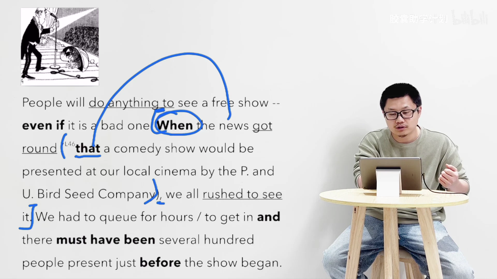

文字识别：People will do anything to see a free show -- / even if it is abad one / When the news got / that a comedy show would be / round / presented at our local cinema by the P. and / U. Bird Seed Company), we allrushed to see / itJWe had to queue for hours / to get in and / there must have been several hundred / people present just before the show began.

### 画面 00:07:05

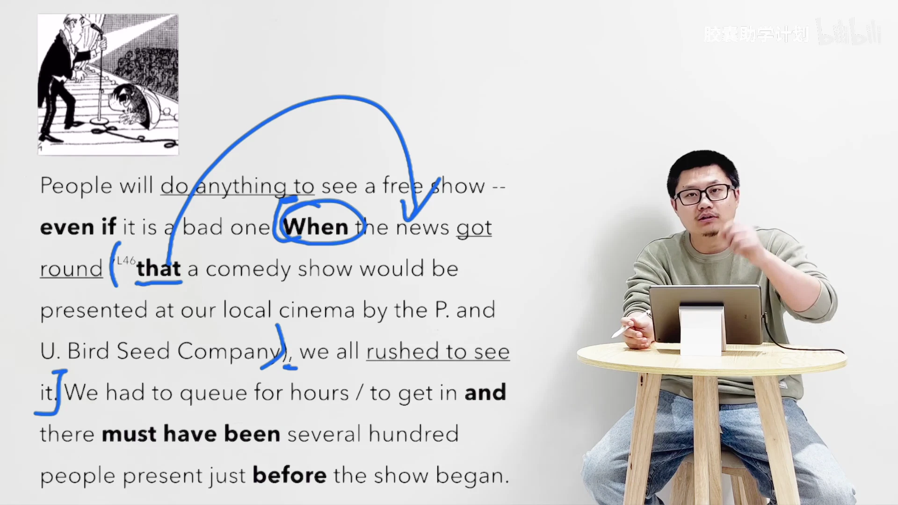

文字识别：People willdo anything to see a fre how - / When the news got / even if it is a bad one / 4that a comedy show would be / round / presented at our local cinema by the P. and / U. Bird Seed Company), we all rushed to see / itJWe had to queue for hours / to get in and / there must have been several hundred / people present just before the show began.

### 画面 00:07:07

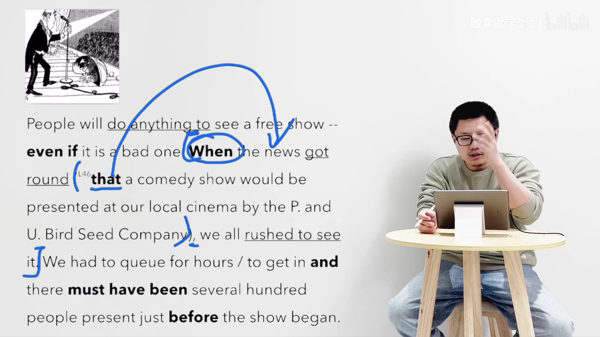

文字识别：People willdo anything to see a fre how - / When the news got / even if it is abad one / that a comedy show would be / round / presented at our local cinema by the P. and / U. Bird Seed Company), we allrushed to see / itJWe had to queue for hours / to get in and / there must have been several hundred / people present just before the show began.

### 画面 00:07:09

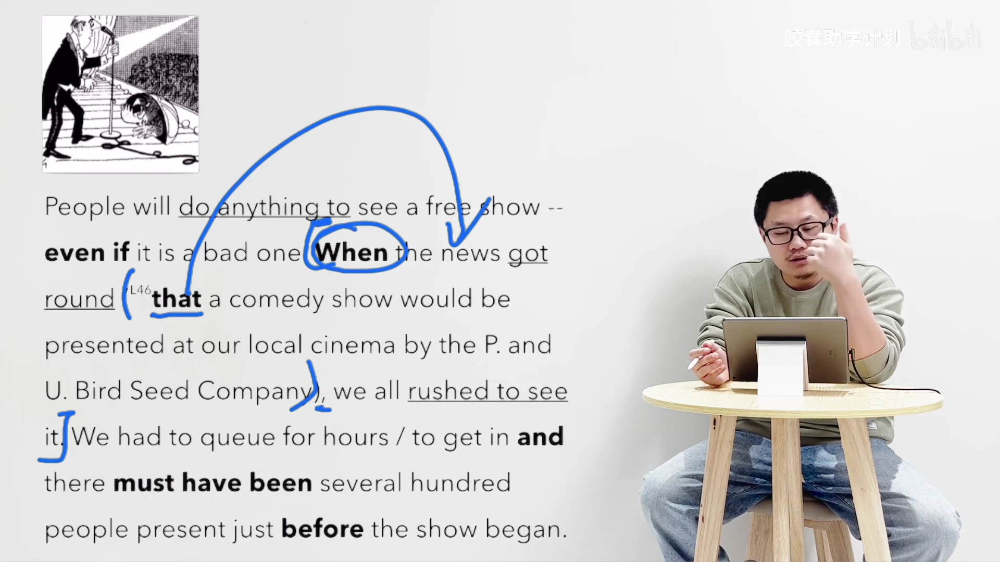

文字识别：People willdo anything to see a fre how - / When the news got / even if it is a bad one / that a comedy show would be / round / presented at our local cinema by the P. and / U. Bird Seed Company), we all rushed to see / itJWe had to queue for hours / to get in and / there must have been several hundred / people present just before the show began.

### 画面 00:07:12

文字识别：People wil do anything to see a fre how- / Whenthe news got / even if it is abad one / 4that a comedy show would be / round / presented at our local cinema by the P. and / U. Bird Seed Company), we all rushed to see / itJWe had to queue for hours / to get in and / there must have been several hundred / people present just before the show began.

## 00:07:30–00:08:00

处理，就是 news 这个单词后边如果跟了一个 that 引导大长从句，八成概率非常的高，很可能就是一个同位语从句。当然不是说不可以是定语从句啊，这个地方要记住。然后接下来呢，后边这个句子确实也不缺成分，那这地方就会有一个很小很小的问题，就是你这个同位语从句为啥没有呃，为啥没有紧紧挨着我这个 news 呢？那我们现在设想一下，如果它紧紧挨住了是什

### 画面 00:07:42

文字识别：People willdo anything to see a fre how - / When the news got / even if it is a bad one / 4that a comedy show would be / round / presented at our local cinema by the P. and / U. Bird Seed Company), we all rushed to see / itJWe had to queue for hours / to get in and / there must have been several hundred / people present just before the show began.

### 画面 00:07:48

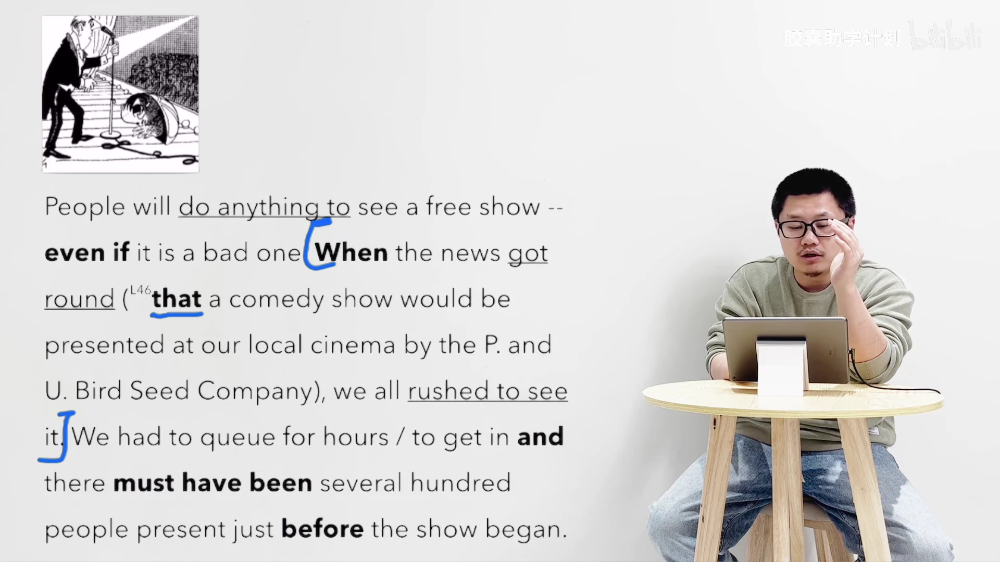

文字识别：People will do anything to see a free show -- / even if it is a bad oneWhen the news got / round (l4'that a comedy show would be / presented at our local cinema by the P. and / U. Bird Seed Company), we all rushed to see / it We had to queue for hours / to get in and / there must have been several hundred / people present just before the show began.

### 画面 00:07:50

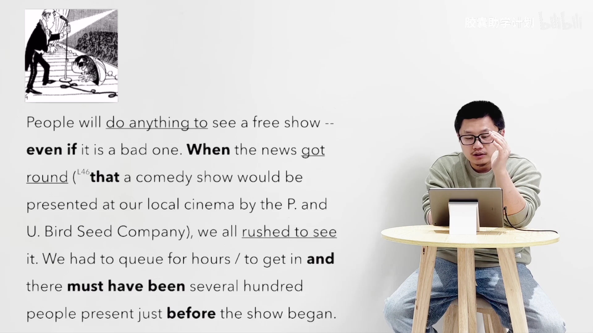

文字识别：People will do anything to see a free show -- / even if it is a bad one. When the news got / round (l4that a comedy show would be / presented at our local cinema by the P. and / U. Bird Seed Company), we all rushed to see / it. We had to queue for hours / to get in and / there must have been several hundred / people present just before the show began.

### 画面 00:07:54

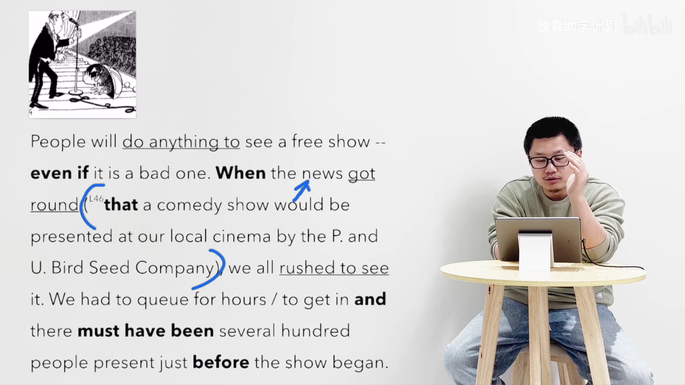

文字识别：People will do anything to see a free show -- / even if it is a bad one. When the news got / (46that a comedy show would be / round / presented at our local cinema by the P. and / U. Bird Seed Company)we all rushed to see / it. We had to queue for hours / to get in and / there must have been several hundred / people present just before the show began.

### 画面 00:07:57

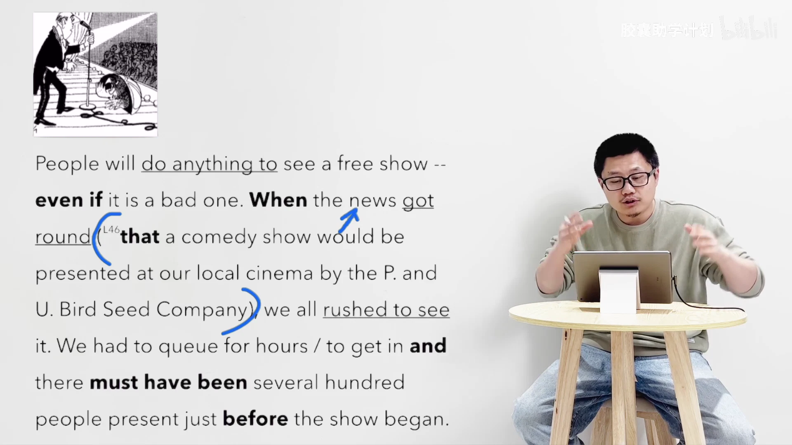

文字识别：People will do anything to see a free show -- / even if it is a bad one. When the news got / (46that a comedy show would be / round / presented at our local cinema by the P. and / U. Bird Seed Company)we all rushed to see / it. We had to queue for hours / to get in and / there must have been several hundred / people present just before the show began.

## 00:08:00–00:08:30

么状态？这个句子就变成叫 When the news,然后 that accomplishment would be blah blah blah blah blah blah,然后最后来个逗号，叫做 got around, got around,会有一种什么感觉呢？我不知道你注没注意到啊？The news got around这两个单词被中间无比长的一个东西给隔开了，会觉得有点怪。所以英语当中，它接受包括定语从句也是，以后我们会见到它接受。如果你的主谓

### 画面 00:08:02

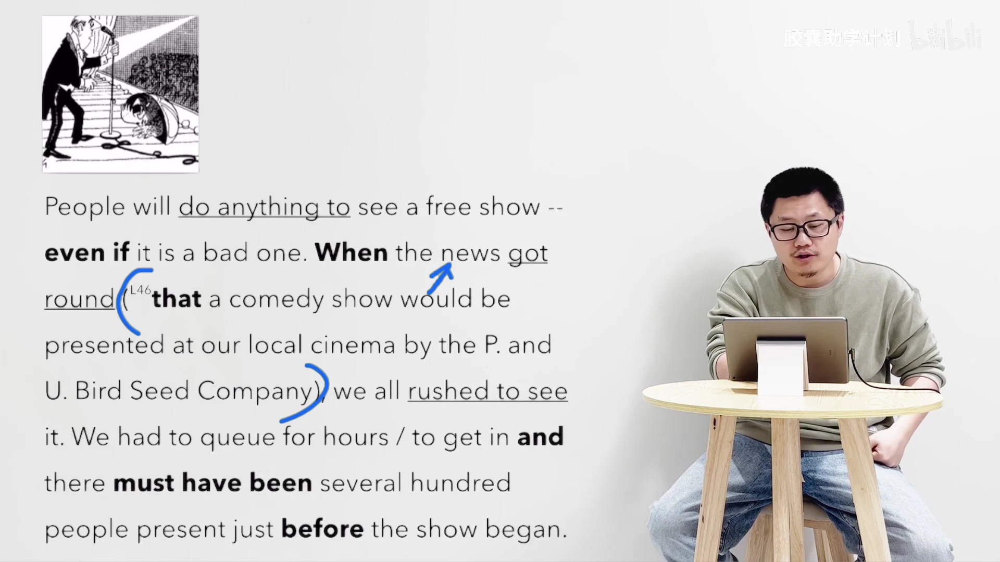

文字识别：People will do anything to see a free show -- / even if it is a bad one. When the news got / (4that a comedy show would be / round / presented at our local cinema by the P. and / U. Bird Seed Company)we all rushed to see / it. We had to queue for hours / to get in and / there must have been several hundred / people present just before the show began.

### 画面 00:08:04

文字识别：People will do anything to see a free show -- / even if it is a bad one. When the news got / (46that a comedy show would be / round / presented at our local cinema by the P. and / U. Bird Seed Company)we all rushed to see / it. We had to queue for hours / to get in and / there must have been several hundred / people present just before the show began.

### 画面 00:08:06

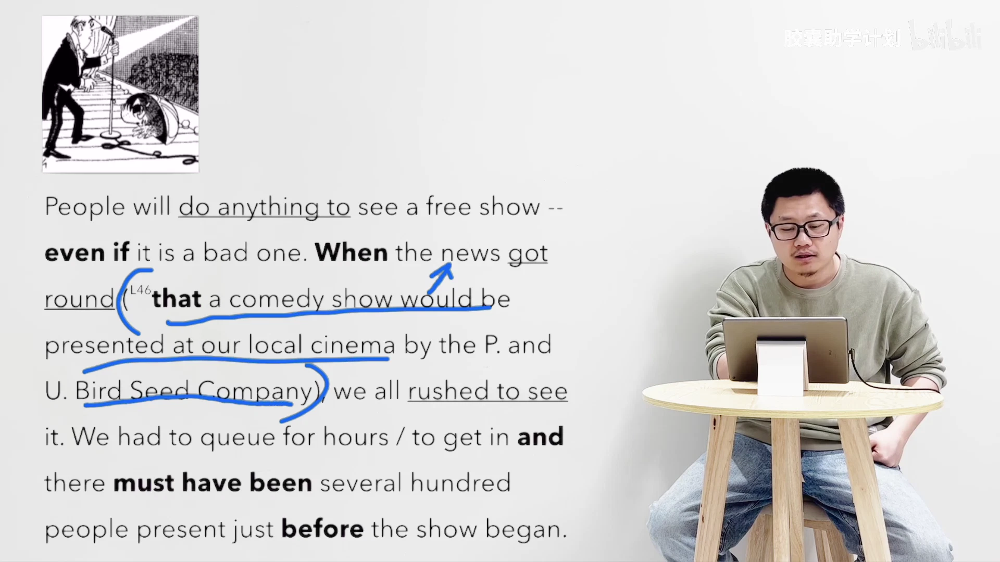

文字识别：People will do anything to see a free show -- / even if it is a bad one. When the news got / (46that a comedy show would be / round / presented at our local cinema by the P. and / U. Bird Seed Company)we all rushed to see / it. We had to queue for hours / to get in and / there must have been several hundred / people present just before the show began.

### 画面 00:08:13

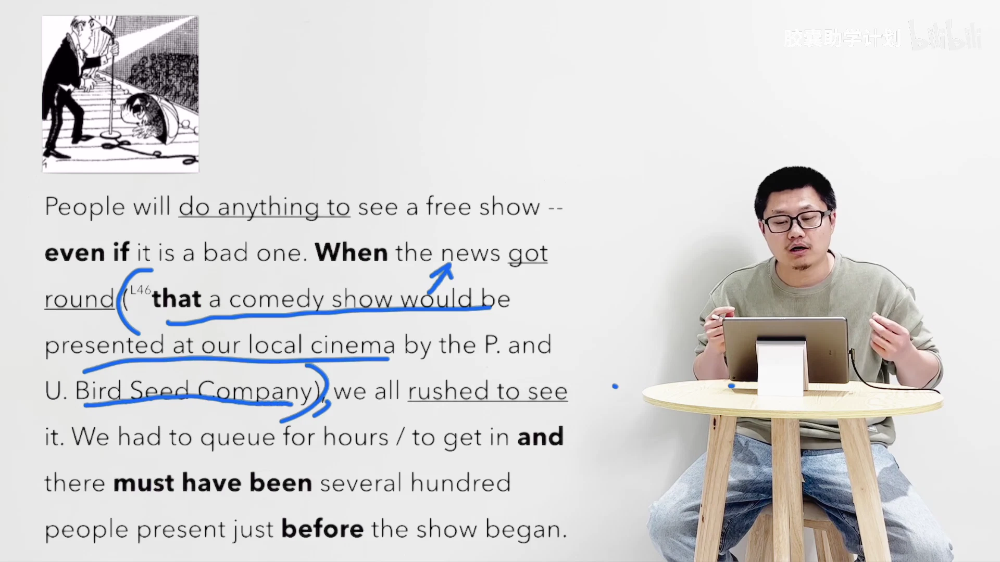

文字识别：People will do anything to see a free show -- / even if it is a bad one. When the news got / (46that a comedy show would be / round / presented at our local cinema by the P. and / U. Bird Seed Company),we all rushed to see / it. We had to queue for hours / to get in and / there must have been several hundred / people present just before the show began.

### 画面 00:08:17

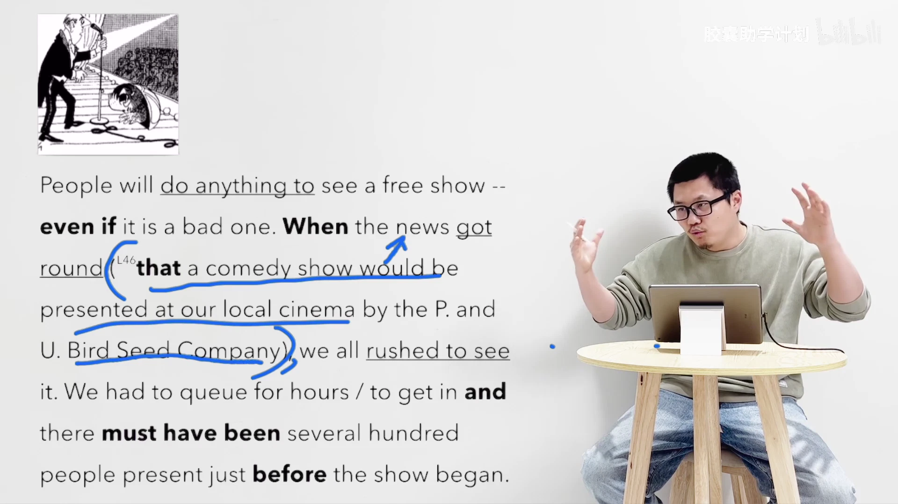

文字识别：People will do anything to see a free show -- / even if it is a bad one. When the news got / (46that a comedy show would be / round / presented at our local cinema by the P. and / U. Bird Seed Company),we all rushed to see / it. We had to queue for hours / to get in and / there must have been several hundred / people present just before the show began.

### 画面 00:08:19

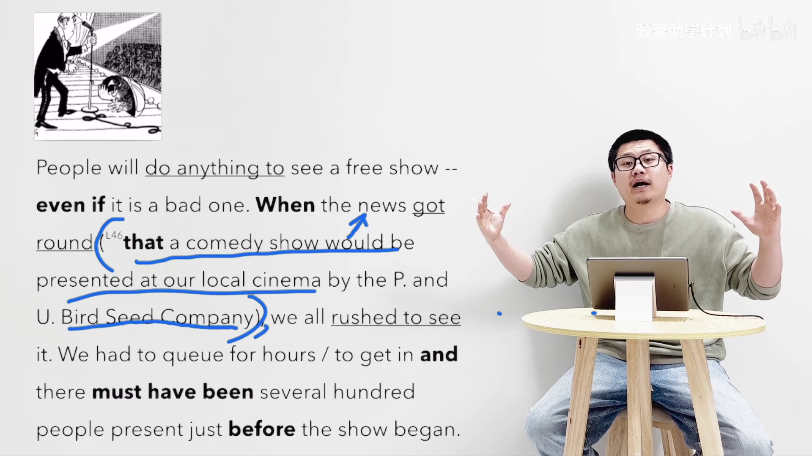

文字识别：People will do anything to see a free show -- / even if it is a bad one. When the news got / (46that a comedy show would be / round / presented at our local cinema by the P. and / U. Bird Seed Company),we all rushed to see / it. We had to queue for hours / to get in and / there must have been several hundred / people present just before the show began.

### 画面 00:08:22

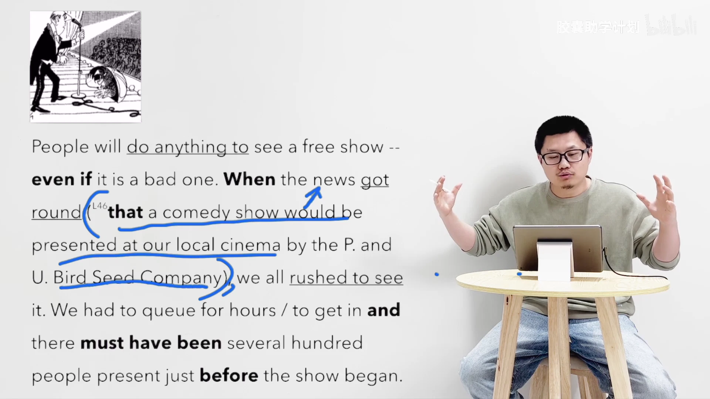

文字识别：People will do anything to see a free show -- / even if it is a bad one. When the news got / (46that a comedy show would be / round / presented at our local cinema by the P. and / U. Bird Seed Company),we all rushed to see / it. We had to queue for hours / to get in and / there must have been several hundred / people present just before the show began.

### 画面 00:08:26

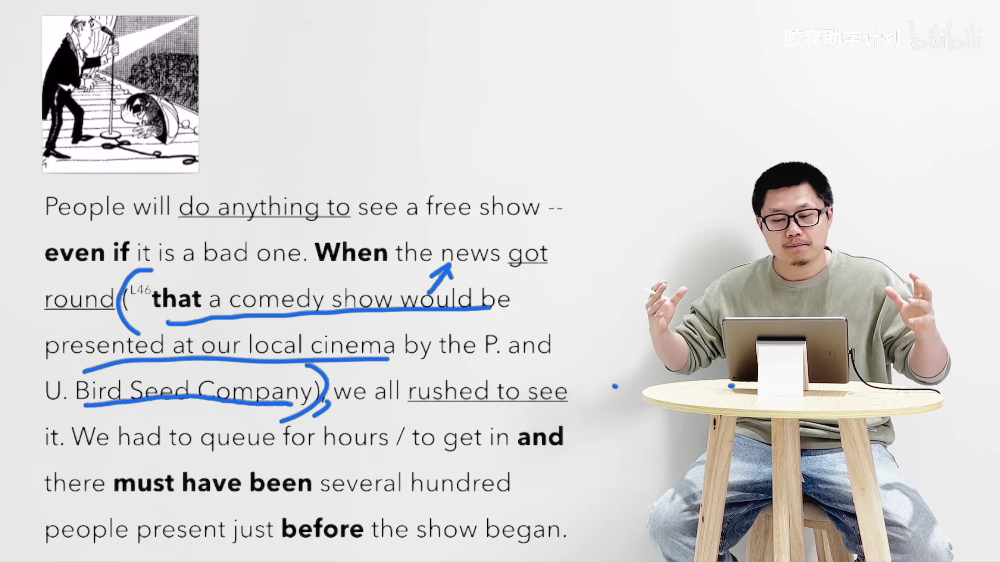

文字识别：People will do anything to see a free show -- / even if it is a bad one. When the news got / (46that a comedy show would be / round / presented at our local cinema by the P. and / U. Bird Seed Company),we all rushed to see / it. We had to queue for hours / to get in and / there must have been several hundred / people present just before the show began.

### 画面 00:08:28

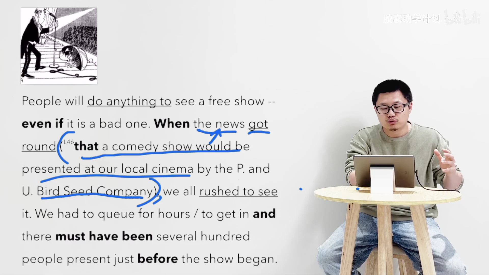

文字识别：People will do anything to see a free show -- / even if it is a bad one. When the news got / (46that a comedy show would be / round / presented at our local cinema by the P. and / U. Bird Seed Company)we all rushed to see / it. We had to queue for hours / to get in and / there must have been several hundred / people present just before the show began.

## 00:08:30–00:09:00

很短，挺好，不能太长啊。你如果也像这么长，那不行。很短，我接受。把我的同位语从句后置一下。新三第一课咱们就会再见到啊，在这先不多说了啊。这个句子我希望我给各位解释清楚了。Let's continue. We had to queue for hours to get in, and there must have been several hundred people present just before the show began. 好，这句话乍一

### 画面 00:08:32

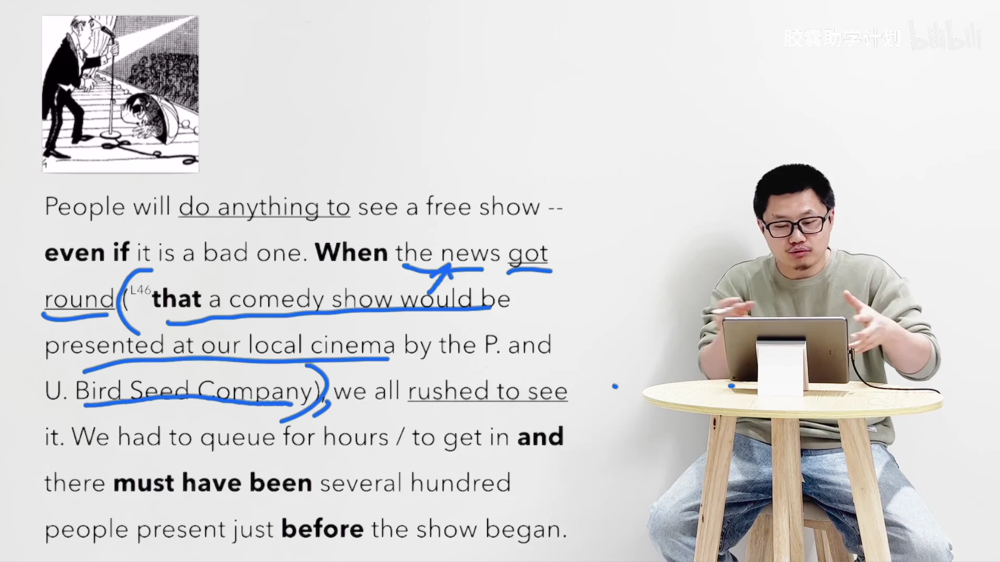

文字识别：People will do anything to see a free show -- / even if it is a bad one. When the news got / (4that a comedy show would be / round / presented at our local cinema by the P. and / U. Bird Seed Company)we all rushed to see / it. We had to queue for hours / to get in and / there must have been several hundred / people present just before the show began.

### 画面 00:08:41

文字识别：People will do anything to see a free show -- / even if it is a bad one. When the news got / (46that a comedy show would be / round / presented at our local cinema by the P. and / U. Bird Seed Company),we all rushed to see / it. We had to queue for hours / to get in and / there must have been several hundred / people present just before the show began.

### 画面 00:08:43

文字识别：People will do anything to see a free show -- / even if it is a bad one. When the news got / (4that a comedy show would be / round / presented at our local cinema by the P. and / U. Bird Seed Company)we all rushed to see / it. We had to queue for hours / to get in and / there must have been several hundred / people present just before the show began.

### 画面 00:08:45

文字识别：People will do anything to see a free show -- / even if it is a bad one. When the news got / round (l4that a comedy show would be / presented at our local cinema by the P. and / U. Bird Seed Company), we all rushed to see / it. We had to queue for hours / to get in and / there must have been several hundred / people present just before the show began.

### 画面 00:08:47

文字识别：People will do anything to see a free show -- / even if it is a bad one. When the news got / round (l4that a comedy show would be / presented at our local cinema by the P. and / U. Bird Seed Company), we all rushed to see / it. We had to queue for hours / to get in and / there must have been several hundred / people present just before the show began.

### 画面 00:08:49

文字识别：People will do anything to see a free show -- / even if it is a bad one. When the news got / round (l4that a comedy show would be / presented at our local cinema by the P. and / U. Bird Seed Company), we all rushed to see / it. We had to queue for hours / to get in and / there must have been several hundred / people present just before the show began.

### 画面 00:08:54

文字识别：People will do anything to see a free show -- / even if it is a bad one. When the news got / round (l4that a comedy show would be / presented at our local cinema by the P. and / U. Bird Seed Company), we all rushed to see / it. We had to queue for hours / to get in and / there must have been several hundred / people present just before the show began.

## 00:09:00–00:09:30

看又贼长。那咱们要做的肯定是如下这几件事儿嘛。这些事儿一定是先干的，对吧？就是啊，我先说一下啊。我们到最后的结果就是，其实不要再画这些东西了。就练到最后的结果，就是从未读到 begin 这个句子就懂了。我不用再去专门再去进行划分了。只不过呢，咱们现在在学习阶段，长难句还没有一个能力，从第一个单词读到最后一个单词就都读懂。所以还是要画一下。

### 画面 00:09:00

文字识别：People will do anything to see a free show -- / even if it is a bad one. When the news got / round (l4that a comedy show would be / presented at our local cinema by the P. and / U. Bird Seed Company), we all rushed to see / it. We had to queue for hours / to get in and / there must have been several hundred / people present just before the show began.

### 画面 00:09:02

文字识别：People will do anything to see a free show -- / even if it is a bad one. When the news got / round (l4that a comedy show would be / presented at our local cinema by the P. and / U. Bird Seed Company), we all rushed to see / it. We had to queue for hours / to get in and / there must have been several hundred / people present justbefora t /  the show began.

### 画面 00:09:04

文字识别：People will do anything to see a free show -- / even if it is a bad one. When the news got / round (l4that a comedy show would be / presented at our local cinema by the P. and / U. Bird Seed Company), we all rushed to see / it. We had to queue for hours / to getinf / and / there must have been several hundred / people present justbefore t /  the show began.

### 画面 00:09:08

文字识别：People will do anything to see a free show -- / even if it is a bad one. When the news got / round (l4that a comedy show would be / presented at our local cinema by the P. and / U. Bird Seed Company), we all rushed to see / it. We had to queue for hours / to getinmf / and / there must have been several hundred / people present justbefor≥ t / the show began.

## 00:09:30–00:10:00

我们先看第一句，说 We had to queue for hours. 我们当时不得不排了几个小时。对，目的是 to get in，去进去。这是第一句话，算是。第二句话，There must have been several hundred people present just ah present. 啊，其实这个 just before 是放到一起的。然后注意这个地方叫做 There must have been，其实是两个语法串到一块儿了。第一个是 there be 句型，第二个是十七课咱学的 must have been。那 There must have been 叫做当时一定是有，

### 画面 00:09:38

文字识别：People will do anything to see a free show -- / even if it is a bad one. When the news got / round (l4that a comedy show would be / presented at our local cinema by the P. and / U. Bird Seed Company), we all rushed to see / it. We had to queue for hours / to getinf / and / there must have been several hundred / people present justbefor≥ the show began.

## 00:10:00–00:10:30

听见了啊？有什么呢？Several hundred people present.有数百个人出席了，或者到达了现场。第三句话叫Just before the show began，恰恰就在这个演出开始之前，就已经来了数百个人了。三句话拿到手没问题。下一句，Unfortunately，the show was one of the dullest we have ever seen.很不幸的是，这个演

### 画面 00:10:08

文字识别：People will do anything to see a free show -- / even if it is a bad one. When the news got / round (l4that a comedy show would be / presented at our local cinema by the P. and / U. Bird Seed Company), we all rushed to see / it. We had to queue for hours / to getin / and / there must have been several hundred / people present justbefor≥ t / the show began.

### 画面 00:10:21

文字识别：Unfortunately, the show was one of the / dullest we have ever seen. Those (who failed / to get in) [41n / 'need not have felt / disappointed, as many of the artistes (who / L65 / 'should have appeared) did not come. The / only funny things (we heard that evening) / came from the advertiser at the beginning of / the programme.

## 00:10:30–00:11:00

出是最无聊的。我们所看过的第八课原句这儿只不过省略了一个单词，叫做 The show was one of the dullest show we have ever seen. 但是没有必要再来一个 show 了，所以直接删掉，对吧？第八课我们学过这个句型，如果您忘了，回去看。在这儿我只多提一句，就是这个 we have ever seen。如果前面咱们给它加个 the show 以及 that，你细想，它其实就是个定语从

### 画面 00:10:51

文字识别：Unfortunately, the show was one of the / dullest we have ever seen. Those (who failed / to get in) [41n / 'need not have felt / disappointed, as many of the artistes (who / L65, / 'should have appeared) did not come. The / only funny things (we heard that evening) / came from the advertiser at the beginning of / the programme.

## 00:11:00–00:11:30

句，只不过咱们当时没有当定语从句去讲，我们直接当个句型去记的，对吧？Continue，下一句，狠活来了，注意力集中。Those who failed to get in need not have felt disappointed, as many of the artists who should have appeared did not come. 如果您现在真的是能做

### 画面 00:11:21

文字识别：Unfortunately, the show was one of the / dullest we have ever seen. Those (who failed / to get in) [41n / 'need not have felt / disappointed, as many of the artistes (who / L65 / 'should have appeared) did not come. The / only funny things (we heard that evening) / came from the advertiser at the beginning of / the programme.

## 00:11:30–00:12:00

到，我从 those 读到 come，哪怕加上我现在这些，对吧？括弧啊，这些玩意儿啊，这些加重符号啊，你基本就能跟下来了。说明您基础真的好。跟不下来呢？哎，别着急，我们一一起来看一下。首先，those 后边直接给了一个 who，给了一个 who 定语从句啊，啥也不想，前面先来一个括弧，左括弧，右括弧从哪画呢？所以换一句话来说，定语从句从哪结束呢？你把整个意思读完，

### 画面 00:11:51

文字识别：Unfortunately, the show was one of the / dullest we have ever seen. ThoseQwho failed / to get in) [4n / 'need not have felt / disappointed, as many of the artistes (who / L65, / 'should have appeared) did not come. The / only funny things (we heard that evening) / came from the advertiser at the beginning of / the programme.

## 00:12:00–00:12:30

完，基本就能，呃，猜出来是吧？就是靠靠这个含义能感觉出来。Those指的就是那些人，就是who啊，那些人fail to get in。你看这儿，首先need not，这个基本上不能再往下连了，为什么？动词的事儿，对吧？其次含义也结束了，叫做那些人没有进去。所以第一个定语从句就在这地方，左括弧右括弧给它画出来了啊。那怎么翻译呢？叫做那些没有进去的人，

### 画面 00:12:21

文字识别：Unfortunately, the show was one of the / dullest we have ever seen. Those (who failed / to get in) [41n / 'need not have felt / disappointed, as many of the artistes (who / L65 / 'should have appeared) did not come. The / only funny things (we heard that evening) / came from the advertiser at the beginning of / the programme.

## 00:12:30–00:13:00

这是主语。接下来 need not have felt disappointed。在这儿要拆开两个，第一个叫做 needn't have done。四十一个咱们学叫本不必但做了。比如说别人家去你家，这个是这个很有意思。别人去你们家送点礼，说哎呀你下回来就来了，不用再拿了。说本不必拿这么多东西的，但是你拿了，对吧？Needn't have done，啊，本不必拿的啊，本不必的。那第二个就是习惯

### 画面 00:12:42

文字识别：Unfortunately, the show was one of the / dullest we have ever seen. Those (who failed / to get in) [41n / 'need not have felt / disappointed, as many of the artistes (who / L65 / 'should have appeared) did not come. The / only funny things (we heard that evening) / came from the advertiser at the beginning of / the programme.

### 画面 00:12:45

文字识别：Unfortunately, the show was one of the / dullest we have ever seen. Those (who failed / to get in) [4n / 'need not have felt / disappointed, as many of the artistes (who / L65 / 'should have appeared) did not come. The / only funny things (we heard that evening) / came from the advertiser at the beginning of / the programme.

## 00:13:00–00:13:30

用法，叫 feel disappointed，感到很失望。所以这句话到这个地方，逗号 as 也告诉你了，逗号告诉你要结束， as 也告诉你要结束了。前半句话的意思就是那些没有进去的人本不必感到很失望，但是他们失望了。 As 单看是不知道什么含义的，但是上下文我看完，我提前告诉您啊，叫因为，因为什么呢？ Many of the artists，这个地方演员的这些人们呢，怎么样了

### 画面 00:13:15

文字识别：Unfortunately, the show was one of the / dullest we have ever seen. Those (who failed / to get in) [41n / 'need not have felt / disappointed, as many of the artistes (who / L65 / 'should have appeared) did not come. The / only funny things (we heard that evening) / came from the advertiser at the beginning of / the programme.

## 00:13:30–00:14:00

呢？Who should have appeared?好了，整个一个定从，但定从当中出现了一个。首先，这个 who 是指代前面这个单词，对吧？叫他们 they should have appeared。六十五课咱们学，本应该出现怎么样，但没出现。哎，因为许多这些 artists 本应该出现的这些 artists 怎么样了呢？Did not come，没有来。所以，我们把整句话再拆一下啊。第一

### 画面 00:13:44

文字识别：Unfortunately, the show was one of the / dullest we have ever seen. Those (who failed / to get in) [41n / 'need not have felt / disappointed, as many of the artistes (who / L65 / 'should have appeared) did not come. The / only funny things (we heard that evening) / came from the advertiser at the beginning of / the programme.

### 画面 00:13:56

文字识别：Unfortunately, the show was one of the / dullest we have ever seen. Those (who failed / to get in) [41n / 'need not have felt / disappointed, as many of the artistes (who / L65 / 'should have appeared) did not come. The / only funny things (we heard that evening) / came from the advertiser at the beginning of / the programme.

### 画面 00:13:58

文字识别：Unfortunately, the show was one of the / dullest we have ever seen. Those (who failed / to get in) [41n / 'need not have felt / disappointed, as many of the artistes (who / L65, / 'should have appeared) did not come. The / only funny things (we heard that evening) / came from the advertiser at the beginning of / the programme.

## 00:14:00–00:14:30

句话叫那些人，哎，我们这样去看。第一句话叫那些人不用感到本不必感到什么呢？失望，但他们感到失望了啊，这是个简单词。第二句话叫做哪些人呢？那些没有进来的人，那些人没有进来，这是第二个信息。第三个信息呢叫做因为许多的这些 artists did not come 没有来，哎，最后一句话叫做这些 artists should have appeared 本应该出现但没

### 画面 00:14:00

文字识别：Unfortunately, the show was one of the / dullest we have ever seen. Those (who failed / to get in) [41n / 'need not have felt / disappointed, as many of the artistes (who / L65 / 'should have appeared) did not come. The / only funny things (we heard that evening) / came from the advertiser at the beginning of / the programme.

### 画面 00:14:04

文字识别：Unfortunately, the show was one of the / dullest we have ever seen. Those (who failed / to get in) / L41 / 'need not have felt / disappointed, as many of the artistes (who / L65 / 'should have appeared) did not come. The / only funny things (we heard that evening) / came from the advertiser at the beginning of / the programme.

### 画面 00:14:11

文字识别：Unfortunately, the show was one of the / dullest we have ever seen. Those (who failed / to getin) / L41 / 'need not have felt / disappointed, as many of the artistes (who / 165 / should have appeared) did not come. The / only funny things (we heard that evening) / came from the advertiser at the beginning of / the programme.

### 画面 00:14:19

文字识别：Unfortunately, the show was one of the / dullest we have ever seen. Those (who failed / to get in) / 'need not have felt / disappointed, as many of the artistes (who / L65 / 'should have appeared) did not come. The / only funny things (we heard that evening) / came from the advertiser at the beginning of / the programme.

### 画面 00:14:22

文字识别：Unfortunately, the show was one of the / dullest we have ever seen. Those (who failed / to get in) / 'need not have felt / disappointed, as many of the artistes (who / L65 / 'should have appeared) did not come. The / only funny things (we heard that evening) / came from the advertiser at the beginning of / the programme.

## 00:14:30–00:15:00

有出现，所以整个这儿到这儿，咱们就读完了。所以其实呢，你作为一个中国人，我们拿这句话也可以简单告诉你一下，为啥英文的长难句读起来会有点别扭？为啥呢？因为首先它语序跟汉语不一样，其次汉语其实一般不会说这么长的话，汉语都会是短句、短句、短句，铿锵有力，把这事儿解释完，解释四句话就完事儿了。英语呢，它直接来了这么这么长的一句话，所以但对于各位来说，

### 画面 00:14:32

文字识别：Unfortunately, the show was one of the / dullest we have ever seen/Those who failed / to get in) / 4 / 'need not have fel / disappointed, as many of the artistes / s who / .65 / should have appeared) / did not come. The / only funny things (we heard that evening) / came from the advertiser at the beginning of / the programme.

### 画面 00:14:37

文字识别：Unfortunately, the show was one of the / dullest we have ever seen. Those who failed / to get in) / 'need not have felt / disappointed, as many of the artistes (who / L65 / 'should have appeared) did not come. The / only funny things (we heard that evening) / came from the advertiser at the beginning of / the programme.

### 画面 00:14:39

文字识别：Unfortunately, the show was one of the / dullest we have ever seen. Those (who failed / to get in) [41n / 'need not have felt / disappointed, as many of the artistes (who / L65, / 'should have appeared) did not come. The / only funny things (we heard that evening) / came from the advertiser at the beginning of / the programme.

### 画面 00:14:50

文字识别：Unfortunately, the show was_one of the / dullest we have ever seen Those (who failed / to get in) [41n / 'need not have felt / disappointed, as many of the artistes (who / L65, / should have appeared) did not come? / The / only funny things (we heard that evening) / came from the advertiser at the beginning of / the programme.

### 画面 00:14:55

文字识别：Unfortunately, the show was one of the / dullest we have ever seen[Those (who failed / to get in) [4n / 'need not have felt / disappointed, as many of the artistes (who / L65 / should have appeared) did not come / The / only funny things (we heard that evening) / came from the advertiser at the beginning of / the programme.

### 画面 00:14:57

文字识别：Unfortunately, the show was_one of the / dullest we have ever seen Those (whcfailed / to get in) / L41 / 'need not have felt / disappointed, as many of the artistes (who / L65 / should have appeared) did not come / The / only funny things (we heard that evening) / came from the advertiser at the beginning of / the programme.

### 画面 00:14:59

文字识别：Unfortunately, the show was one of the / dullest we have ever seen[Those (who failed / to get in) [41n / 'need not have felt / disappointed, as many of the artistes (who / L65 / 'should have appeared) did not come. The / only funny things (we heard that evening) / came from the advertiser at the beginning of / the programme.

## 00:15:00–00:15:30

怎么去读懂它呢？就是刚才我教你那招拆拆拆，拆完了每个信息拿到手，结束。说 the only funny things we heard that evening came from the advertiser at the beginning of the program。这句话就很简单了，就是中间多加了一个小的定从。说唯一有趣的那那个那那些事儿是什么事儿呢？叫我们那天晚上听到的那些事儿，来自于报幕员。时间呢是 at the beginning of the program，在这个呃节目

### 画面 00:15:06

文字识别：Unfortunately, the show was one of the / dullest we have ever seen. Those (who failed / to get in) 41n / 'need not have felt / disappointed, as many of the artistes (who / L65, / 'should have appeared) did not come. The / only funny things (we heard that evening) / came from the advertiser at the beginning of / the programme.

### 画面 00:15:09

文字识别：Unfortunately, the show was one of the / dullest we have ever seen. Those (who failed / to get in) [41n / 'need not have felt / disappointed, as many of the artistes (who / L65 / 'should have appeared) did not come. The / only funny things (we heard that evening) / came from the advertiser at the beginning of / the programme.

### 画面 00:15:29

文字识别：Unfortunately, the show was one of the / dullest we have ever seen. Those (who failed / to get in) [4'n / 'need not have felt / disappointed, as many of the artistes (who / L65, / 'should have appeared) did not come. The / only funny things (we heard that evening) / came from the advertiser at the beginning of / the programme.

## 00:15:30–00:16:00

开始的时候，哎，OK，没什么可说的。这有一个习惯用法叫 at the beginning of，在什么什么开始的时候。Next one, he was obviously very nervous and for some minute stood awkwardly before the microphone. 他呃这个 and 直接告诉你要断句了，对吧？说他很明显特别的紧张。For some minute 有那么几分钟的时间呢，stood awkwardly，非常尴尬的站着。Before

### 画面 00:15:36

文字识别：He was obviously very nervous and for some / minutes stood awkwardly before the / microphone. As soon as he opened his / mouth, everyone burst out laughing. We all / know what the poor man should have said, / but what he actually said was: 'This is the / Poo and Ee Seed Bird Company. Good / ladies, evening and gentlemen!"

### 画面 00:15:38

文字识别：He was obviously very nervous and for some / minutes stood awkwardly before the / microphone. As soon as he opened his / mouth, everyone burst out laughing. We all / know what the poor man should have said, / but what he actually said was: 'This is the / Poo and Ee Seed Bird Company. Good / ladies, evening and gentlemen!"

### 画面 00:15:40

文字识别：He was obviously very nervous and for some / minutes stood awkwardly before the / microphone. As soon as he opened his / mouth, everyone burst out laughing. We all / know what the poor man should have said, / but what he actually said was: 'This is the / Poo and Ee Seed Bird Company. Good / ladies, evening and gentlemen!"

## 00:16:00–00:16:30

the microphone，在这个麦克风前面站着。Continued as soon as he opened his mouth, everyone burst out laughing.一怎么怎么样就怎么怎么样，十四课就学过。他一张开嘴，大家就爆笑，burst out laughing。本课习惯用法的爆笑。这我想问一个问题，如果您不会或者不知道该如何去回答，一定要去重新学一遍四十九课。你相信我，你不亏。问题是，这地方的he可不可以被省略？可不可以把这

### 画面 00:16:10

文字识别：He was obviously very nervous and for some / minutes stood awkwardly before the / microphone. As soon as he opened his / mouth, everyone burst out laughing. We all / know what the poor man should have said, / but what he actually said was: 'This is the / Poo and Ee Seed Bird Company. Good / ladies, evening and gentlemen!"

## 00:16:30–00:17:00

个 opened 变成 opening？如果不会，翻四十九课，没什么说的啊啊。We all know what the poor man should have said, but what he actually said was 后边咱先不看了。我们都知道说，呃，这个可怜的人本应该说的是什么？我们都知道他本应该说嘛，should have done 本应该但

### 画面 00:16:40

文字识别：He was obviously very nervous and for some / minutes stood awkwardly before the / microphone. As soon as he opened his / mouth, everyone burst out laughing. We all / know what the poor man should have said, / but what he actually said was: 'This is the / Poo and Ee Seed Bird Company. Good / ladies, evening and gentlemen!"

## 00:17:00–00:17:30

没有，对吧？但是呢，他实际上说的事情却是什么呢？后边整个这句话叫做This is the P and E Seed Bird Company.它本来不是Bird Seed Company嘛，对吧？然后不是P and U嘛，这是P and E，是吧？我也不知道怎么说的，全全说岔了，全说乱了，是吧？然后本来后边应该说的是Ladies and乡亲们，是吧？你看他说成Ladies and Gentlemen，他现在说成什么了呢？说

### 画面 00:17:10

文字识别：He was obviously very nervous and for some / minutes stood awkwardly before the / microphone. As soon as he opened his / mouth, everyone burst out laughing. We all / know what the poor man should have said, / but what he actually said was: 'This is the / Poo and Ee Seed Bird Company. Good / ladies, evening and gentlemen!"

## 00:17:30–00:18:00

成了 Good ladies, evening and gentlemen. 应该是 Good evening, ladies and gentlemen. 就是语序直接就暴乱了，是吧？就瞎说了，变成 OK。那没什么可说的了。习惯用法，造句。第一个，Do anything to do something. 啊，就是浑使用浑身解数做某事儿。I'll do anything to help you. 我愿意做一切去帮助你啊，我啥都愿意做，为了帮助你。再来，比如说 I will do anything to keep in touch with the artist. 我愿

### 画面 00:17:40

文字识别：习惯用法造句 / do anything to do sth. / the news get around / feel disappointed / at the / beginning of a. / burst out laughing

### 画面 00:17:42

文字识别：习惯用法造句 / do anything to do sth. / the news get around / feel disappointed / at the / beginning of a. / burst out laughing

### 画面 00:17:44

文字识别：网：v.+v.变化 / 习惯用法造句指南 / 四句型转换 / 方式/地点/时间 / 其他习惯用法 / 其他单词+词性 / 原文摘抄+变 / 6123456 / do anything to do sth.

### 画面 00:17:46

文字识别：网：v.+v.变化 / 习惯用法造句指南 / 学计划 / 四句型转换 / 方式/地点/时间 / 其他习惯用法 / 其他单词+词性 / 原文摘抄+变 / 6123456 / do anything to do sth.

### 画面 00:17:50

文字识别：网：v.+v.变化 / 习惯用法造句指南 / 四句型转换 / 方式/地点/时间 / 其他习惯用法 / 其他单词+词性 / 原文摘抄+变 / 6123456 / do anything to do sth. / I'll do anything to help you.

### 画面 00:17:55

文字识别：网：v.+v.变化 / 习惯用法造句指南 / 四句型转换 / 方式/地点/时间 / 其他习惯用法 / 其他单词+词性 / 原文摘抄+变 / 6123456 / do anything to do sth. / I'll do anything to help you. / I'll do anything to keep in touch with the / artist. L88

## 00:18:00–00:18:30

意做一切啊，去和这些艺术家们保持联系。再来, he will do anything to win the election. 他愿意做一切去赢得这个选举。啊，OK。那注意力集中，咱听这电影片段啊。 And when people care about a thing that much, they'll do anything to get what they want. OK. 下一个, the news got around. 哎，这个消息四散传播开来。那你说 story got around 也可以，就是这个事儿，这个

### 画面 00:18:03

文字识别：网：v.+v.变化 / 习惯用法造句指南 / 学计划 / 四句型转换 / 方式/地点/时间 / 其他习惯用法 / 其他单词+词性 / 原文摘抄+变 / 6123456 / do anything to do sth. / I'll do anything to help you. / 'Ill do anything to keep in touch with the / artist. L88 /  He'll do anything to win the election. L83

### 画面 00:18:05

文字识别：网：v.+v.变化 / 习惯用法造句指南 / 四句型转换 / 方式/地点/时间 / 其他习惯用法 / 其他单词+词性 / 原文摘抄+变 / 6123456 / do anything to do sth. / I'll do anything to help you. / I'll do anything to keep in touch with the / artist. L88 /  He'll do anything to win the election. L83

### 画面 00:18:10

文字识别：网：v.+v.变化 / 习惯用法造句指南 / 四句型转换 / 方式/地点/时间 / 其他习惯用法 / 其他单词+词性 / 原文摘抄+变 / 6123456 / do anything to do sth. / I'll do anything to help you. / 'Ill do anything to keep in touch with the / artist. L88 /  He'll do anything to win the election. L83

### 画面 00:18:12

文字识别：And when people care about a thing that much, / they'll do anything to get what they want. / Just Mercy / (2019)

### 画面 00:18:16

文字识别：And when people care about a thing that much, / they'll do anything to get what they want. / Just Mercy / (2019)

### 画面 00:18:18

文字识别：And when people care about a thing that much, / they'll do anything to get what they want. / Just Mercy / (2019)

### 画面 00:18:20

文字识别：And when people care about a thing that much, / they'll do anything to get what they want. / Just Mercy / (2019)

### 画面 00:18:22

文字识别：网：v.+v.变化 / 习惯用法造句指南 / 四句型转换 / 方式/地点/时间 / 其他习惯用法 / 其他单词+词性 / 原文摘抄+变 / 6123456 / the news get around

### 画面 00:18:25

文字识别：网：v.+v.变化 / 习惯用法造句指南 / 囊助字计划 / 四句型转换 / 方式/地点/时间 / 其他习惯用法 / 其他单词+词性 / 原文摘抄+变 / 6123456 / the news get around

### 画面 00:18:28

文字识别：网：v.+v.变化 / 习惯用法造句指南 / 四句型转换 / 方式/地点/时间 / 其他习惯用法 / 其他单词+词性 / 原文摘抄+变 / 6123456 / the news get around /  The story has got around, and everyone / knows about it.

## 00:18:30–00:19:00

事情。注意，story不单纯指的是人类编的啊，什么啊，白马王子啊，白雪公主啊，这个这个这个这个故事啊，它也可以指的是事情，是吧？Got around, everyone knows about it. 大家都知道了。Next one, when the news got around, the bus driver went on strike. 消息四散开的时候，他们就决定罢工了。最后一个, repeat after me. When the news got around, 所以在这里，我不知道各位没注没注意到，你你也可以直接就把它当做一

### 画面 00:18:30

文字识别：网：v.+v.变化 / 习惯用法造句指南 / 四句型转换 / 方式/地点/时间 / 其他习惯用法 / 其他单词+词性 / 原文摘抄+变 / 6123456 / the news get around /  The story has got around, and everyone / knows about it.

### 画面 00:18:42

文字识别：网：v.+v.变化 / 习惯用法造句指南 / 四句型转换 / 方式/地点/时间 / 其他习惯用法 / 其他单词+词性 / 原文摘抄+变 / 6123456 / the news get around /  The story has got around, and everyone / knows about it.

### 画面 00:18:44

文字识别：网：v.+v.变化 / 习惯用法造句指南 / 四句型转换 / 方式/地点/时间 / 其他习惯用法 / 其他单词+词性 / 原文摘抄+变 / 6123456 / the news get around /  The story has got around, and everyone / knows about it. /  When the news got around, the bus driver / Went on strike. L84

### 画面 00:18:46

文字识别：网：v.+v.变化 / 习惯用法造句指南 / 四句型转换 / 方式/地点/时间 / 其他习惯用法 / 其他单词+词性 / 原文摘抄+变 / 6123456 / the news get around /  The story has got around, and everyone / knows about it. /  When the news got around, the bus driver / Went on strike. L84

### 画面 00:18:48

文字识别：网：v.+v.变化 / 习惯用法造句指南 / 四句型转换 / 方式/地点/时间 / 其他习惯用法 / 其他单词+词性 / 原文摘抄+变 / 6123456 / the news get around /  The story has got around, and everyone / knows about it. /  When the news got around, the bus driver / Went on strike. L84

### 画面 00:18:50

文字识别：网：v.+v.变化 / 习惯用法造句指南 / 四句型转换 / 方式/地点/时间 / 其他习惯用法 / 其他单词+词性 / 原文摘抄+变 / 6123456 / the news get around /  The story has got around, and everyone / knows about it. /  When the news got around, the bus driver / Went on strike. L84

### 画面 00:18:52

文字识别：网：v.+v.变化 / 习惯用法造句指南 / 助字计划 / 四句型转换 / 方式/地点/时间 / 其他习惯用法 / 其他单词+词性 / 原文摘抄+变 / 6123456 / the news get around /  The story has got around, and everyone / knows about it. /  When the news got around, the bus driver / Went on strike. L84 /  When the news got around, the students / volunteered to drive the buses. L84

### 画面 00:18:55

文字识别：网：v.+v.变化 / 习惯用法造句指南 / 四句型转换 / 方式/地点/时间 / 其他习惯用法 / 其他单词+词性 / 原文摘抄+变 / 6123456 / the news get around /  The story has got around, and everyone / knows about it. /  When the news got around, the bus driver / Went on strike. L84 /  When the news got around, the students / volunteered to drive the buses. L84

### 画面 00:18:58

文字识别：网：v.+v.变化 / 习惯用法造句指南 / 计划 / 四句型转换 / 方式/地点/时间 / 其他习惯用法 / 其他单词+词性 / 原文摘抄+变 / 6123456 / the news get around /  The story has got around, and everyone / knows about it. /  When the news got around, the bus driver / Went on strike. L84 / When the news got around, the students / volunteered to drive the buses. L84

## 00:19:00–00:19:30

个习惯用法，就是消息四四散散开的时候发生了什么事儿。The students volunteered to drive the buses.哎，volunteered to do something还是八十四课。Next one, feel disappointed,感到失望。He felt disappointed, but he tried to put forward a plan. Put forward plan,提出一个计划。Repeat after me. When things went wrong, everyone felt disappointed.大家都觉得很失望。

### 画面 00:19:00

文字识别：网：v.+v.变化 / 习惯用法造句指南 / 四句型转换 / 方式/地点/时间 / 其他习惯用法 / 其他单词+词性 / 原文摘抄+变 / 6123456 / the news get around /  The story has got around, and everyone / knows about it. /  When the news got around, the bus driver / Went on strike. L84 / When the news got around,the students / volunteered to drive the buses. L84

### 画面 00:19:03

文字识别：网：v.+v.变化 / 习惯用法造句指南 / 四句型转换 / 方式/地点/时间 / 其他习惯用法 / 其他单词+词性 / 原文摘抄+变 / 6123456 / the news get around /  The story has got around, and everyone / knows about it. /  When the news got around, the bus driver / Went on strike. L84 / When the news got around, the students / volunteered to drive the buses. L84

### 画面 00:19:05

文字识别：网：v.+v.变化 / 习惯用法造句指南 / 四句型转换 / 方式/地点/时间 / 其他习惯用法 / 其他单词+词性 / 原文摘抄+变 / 6123456 / the news get around /  The story has got around, and everyone / knows about it. /  When the news got around, the bus driver / Went on strike. L84 / When the news got around,the students / volunteered to drive the buses. L84

### 画面 00:19:10

文字识别：网：v.+v.变化 / 习惯用法造句指南 / 辜助字计划 / 四句型转换 / 方式/地点/时间 / 其他习惯用法 / 其他单词+词性 / 原文摘抄+变 / 6123456 / feel disappointed

### 画面 00:19:14

文字识别：网：v.+v.变化 / 习惯用法造句指南 / 四句型转换 / 方式/地点/时间 / 其他习惯用法 / 其他单词+词性 / 原文摘抄+变 / 6123456 / feel disappointed /  He felt disappointed but he tried to put / forward a plan. L64

### 画面 00:19:16

文字识别：网：v.+v.变化 / 习惯用法造句指南 / 四句型转换 / 方式/地点/时间 / 其他习惯用法 / 其他单词+词性 / 原文摘抄+变 / 6123456 / feel disappointed /  He felt disappointed but he tried to put / forward a plan. L64

### 画面 00:19:20

文字识别：网：v.+v.变化 / 习惯用法造句指南 / 四句型转换 / 方式/地点/时间 / 其他习惯用法 / 其他单词+词性 / 原文摘抄+变 / 6123456 / feel disappointed /  He felt disappointed but he tried to put / forward a plan. L64

### 画面 00:19:22

文字识别：网：v.+v.变化 / 习惯用法造句指南 / 四句型转换 / 方式/地点/时间 / 其他习惯用法 / 其他单词+词性 / 原文摘抄+变 / 6123456 / feel disappointed /  He felt disappointed but he tried to put / forward a plan. L64 /  When things went wrong, everyone felt / disappointed. L71

### 画面 00:19:24

文字识别：网：v.+v.变化 / 习惯用法造句指南 / 四句型转换 / 方式/地点/时间 / 其他习惯用法 / 其他单词+词性 / 原文摘抄+变 / 6123456 / feel disappointed /  He felt disappointed but he tried to put / forward a plan. L64 /  When things went wrong, everyone felt / disappointed. L71

### 画面 00:19:26

文字识别：网：v.+v.变化 / 习惯用法造句指南 / 四句型转换 / 方式/地点/时间 / 其他习惯用法 / 其他单词+词性 / 原文摘抄+变 / 6123456 / feel disappointed /  He felt disappointed but he tried to put / forward a plan. L64 /  When things went wrong, everyone felt / disappointed. L71

## 00:19:30–00:20:00

Next one, he felt disappointed, but he tried to reach an agreement with them.他感觉到很失望，但是他依旧尝试着去和他们达成一个协议，agreement协议，对吧？下一个，at the beginning of在什么什么开始的地方，你想他在六一二三四五六当中怎么样？比如说，we're going to Japan at the beginning of July. Next one, we'll run out of money

### 画面 00:19:30

文字识别：网：v.+v.变化 / 习惯用法造句指南 / 四句型转换 / 方式/地点/时间 / 其他习惯用法 / 其他单词+词性 / 原文摘抄+变 / 6123456 / feel disappointed /  He felt disappointed but he tried to put / forward a plan. L64 /  When things went wrong, everyone felt / disappointed. L71 /  He felt disappointed but he tried to reach / an agreement with them. L84

### 画面 00:19:33

文字识别：网：v.+v.变化 / 习惯用法造句指南 / 四句型转换 / 方式/地点/时间 / 其他习惯用法 / 其他单词+词性 / 原文摘抄+变 / 6123456 / feel disappointed /  He felt disappointed but he tried to put / forward a plan. L64 /  When things went wrong, everyone felt / disappointed. L71 /  He felt disappointed but he tried to reach / an agreement with them. L84

### 画面 00:19:35

文字识别：网：v.+v.变化 / 习惯用法造句指南 / 字计划 / 四句型转换 / 方式/地点/时间 / 其他习惯用法 / 其他单词+词性 / 原文摘抄+变 / 6123456 / feel disappointed /  He felt disappointed but he tried to put / forward a plan. L64 /  When things went wrong, everyone felt / disappointed. L71 /  He felt disappointed but he tried to reach / an agreement with them. L84

### 画面 00:19:37

文字识别：网：v.+v.变化 / 习惯用法造句指南 / 四句型转换 / 方式/地点/时间 / 其他习惯用法 / 其他单词+词性 / 原文摘抄+变 / 6123456 / feel disappointed /  He felt disappointed but he tried to put / forward a plan. L64 /  When things went wrong, everyone felt / disappointed. L71 /  He felt disappointed but he tried to reach / an agreement with them. L84

### 画面 00:19:40

文字识别：网：v.+v.变化 / 习惯用法造句指南 / 四句型转换 / 方式/地点/时间 / 其他习惯用法 / 其他单词+词性 / 原文摘抄+变 / 6123456 / feel disappointed /  He felt disappointed but he tried to put / forward a plan. L64 /  When things went wrong, everyone felt / disappointed. L71 /  He felt disappointed but he tried to reach / an agreement with them. L84

### 画面 00:19:44

文字识别：网：v.+v.变化 / 习惯用法造句指南 / 喜助字计划 / 四句型转换 / 方式/地点/时间 / 其他习惯用法 / 其他单词+词性 / 原文摘抄+变 / 6123456 / at the beginning of a.

### 画面 00:19:46

文字识别：网：v.+v.变化 / 习惯用法造句指南 / 四句型转换 / 方式/地点/时间 / 其他习惯用法 / 其他单词+词性 / 原文摘抄+变 / 6123456 / at the beginning of a.

### 画面 00:19:50

文字识别：网：v.+v.变化 / 习惯用法造句指南 / 四句型转换 / 方式/地点/时间 / 其他习惯用法 / 其他单词+词性 / 原文摘抄+变 / 6123456 / at the beginning of a.

### 画面 00:19:52

文字识别：网：v.+v.变化 / 习惯用法造句指南 / 四句型转换 / 方式/地点/时间 / 其他习惯用法 / 其他单词+词性 / 原文摘抄+变 / 6123456 / at the beginning of a. /  We're going to Japan at the beginning / of July.

### 画面 00:19:55

文字识别：网：v.+v.变化 / 习惯用法造句指南 / 四句型转换 / 方式/地点/时间 / 其他习惯用法 / 其他单词+词性 / 原文摘抄+变 / 6123456 / at the beginning of a. /  We're going to Japan at the beginning / of July.

### 画面 00:19:58

文字识别：网：v.+v.变化 / 习惯用法造句指南 / 四句型转换 / 方式/地点/时间 / 其他习惯用法 / 其他单词+词性 / 原文摘抄+变 / 6123456 / at the beginning of a. /  We're going to Japan at the beginning / of July. /  We'll run out of money at the beginning of / April. L88

## 00:20:00–00:20:30

at the beginning of April. Ran out of, 八二八课咱刚学的，对吧？用尽啊，没了，其实就是没了. At the beginning of the war, they moved to New York. They moved to New York. Very good. Burst out laughing, 大笑啊. In the end, I couldn't control myself and burst out laughing. 啊，我们是专业的，我们不笑。但是呢，我没法控制住，还是笑了. Burst out laughing, 对吧？The moment I walked

### 画面 00:20:00

文字识别：网：v.+v.变化 / 习惯用法造句指南 / 四句型转换 / 方式/地点/时间 / 其他习惯用法 / 其他单词+词性 / 原文摘抄+变 / 6123456 / at the beginning of a. /  We're going to Japan at the beginning / of July. /  We'll run out of money at the beginning of / April. L88

### 画面 00:20:04

文字识别：网：v.+v.变化 / 习惯用法造句指南 / 四句型转换 / 方式/地点/时间 / 其他习惯用法 / 其他单词+词性 / 原文摘抄+变 / 6123456 / at the beginning of a. /  We're going to Japan at the beginning / of July. /  We'll run out of money at the beginning of / April. L88

### 画面 00:20:06

文字识别：网：v.+v.变化 / 习惯用法造句指南 / 子计划 / 四句型转换 / 方式/地点/时间 / 其他习惯用法 / 其他单词+词性 / 原文摘抄+变 / 6123456 / at the beginning of a. /  We're going to Japan at the beginning / of July. /  We'll run out of money at the beginning of / April. L88 / At the beginning of the war, they moved / to New York. L6

### 画面 00:20:10

文字识别：网：v.+v.变化 / 习惯用法造句指南 / 四句型转换 / 方式/地点/时间 / 其他习惯用法 / 其他单词+词性 / 原文摘抄+变 / 6123456 / at the beginning of a. /  We're going to Japan at the beginning / of July. /  We'll run out of money at the beginning of / April. L88 / At the beginning of the war, they moved / to New York. L6

### 画面 00:20:13

文字识别：网：v.+v.变化 / 习惯用法造句指南 / 囊助字计划 / 四句型转换 / 方式/地点/时间 / 其他习惯用法 / 其他单词+词性 / 原文摘抄+变 / 6123456 / burst out laughing

### 画面 00:20:15

文字识别：网：v.+v.变化 / 习惯用法造句指南 / 囊助字计划 / 四句型转换 / 方式/地点/时间 / 其他习惯用法 / 其他单词+词性 / 原文摘抄+变 / 6123456 / burst out laughing

### 画面 00:20:17

文字识别：网：v.+v.变化 / 习惯用法造句指南 / 四句型转换 / 方式/地点/时间 / 其他习惯用法 / 其他单词+词性 / 原文摘抄+变 / 6123456 / burst out laughing /  In the end, I couldn't control myself / and burst out laughing.

### 画面 00:20:20

文字识别：网：v.+v.变化 / 习惯用法造句指南 / 四句型转换 / 方式/地点/时间 / 其他习惯用法 / 其他单词+词性 / 原文摘抄+变 / 6123456 / burst out laughing /  In the end, I couldn't control myself / and burst out laughing.

### 画面 00:20:25

文字识别：网：v.+v.变化 / 习惯用法造句指南 / 四句型转换 / 方式/地点/时间 / 其他习惯用法 / 其他单词+词性 / 原文摘抄+变 / 6123456 / burst out laughing /  In the end, I couldn't control myself / and burst out laughing.

### 画面 00:20:28

文字识别：网：v.+v.变化 / 习惯用法造句指南 / 四句型转换 / 方式/地点/时间 / 其他习惯用法 / 其他单词+词性 / 原文摘抄+变 / 6123456 / burst out laughing /  In the end,I couldn't control myself / and burst out laughing. / The moment I walked into the room, / everyone burst out laughing. L60

## 00:20:30–00:21:00

into the sea, everyone burst out laughing. As soon as一怎么怎么样就怎么怎么样，这个连词要记住。六十课咱学的啊，这个Banaski是吧？那个算命、那个占卜、占卜的这个吉普赛人那课咱学的。When I had finished my story, everyone burst out laughing.这都很简单了。我讲完了之后，大家都笑了。注意力集中，咱听这电影片段。Strangers, oh, I burst out laughing when they did it to

### 画面 00:20:30

文字识别：网：v.+v.变化 / 习惯用法造句指南 / 四句型转换 / 方式/地点/时间 / 其他习惯用法 / 其他单词+词性 / 原文摘抄+变 / 6123456 / burst out laughing /  In the end, I couldn't control myself / and burst out laughing. / The moment I walked into the room, / everyone burst out laughing. L60

### 画面 00:20:35

文字识别：网：v.+v.变化 / 习惯用法造句指南 / 四句型转换 / 方式/地点/时间 / 其他习惯用法 / 其他单词+词性 / 原文摘抄+变 / 6123456 / burst out laughing /  In the end, I couldn't control myself / and burst out laughing. / The moment I walked into the room, / everyone burst out laughing. L60

### 画面 00:20:37

文字识别：网：v.+v.变化 / 习惯用法造句指南 / 四句型转换 / 方式/地点/时间 / 其他习惯用法 / 其他单词+词性 / 原文摘抄+变 / 6123456 / burst out laughing /  In the end, I couldn't control myself / and burst out laughing. / The moment I walked into the room, / everyone burst out laughing. L60

### 画面 00:20:40

文字识别：网：v.+v.变化 / 习惯用法造句指南 / 四句型转换 / 方式/地点/时间 / 其他习惯用法 / 其他单词+词性 / 原文摘抄+变 / 6123456 / burst out laughing /  In the end, I couldn't control myself / and burst out laughing. / The moment I walked into the room, / everyone burst out laughing. L60 /  When I had finished my story, / everyone burst out laughing. L7

### 画面 00:20:44

文字识别：网：v.+v.变化 / 习惯用法造句指南 / 四句型转换 / 方式/地点/时间 / 其他习惯用法 / 其他单词+词性 / 原文摘抄+变 / 6123456 / burst out laughing /  In the end, I couldn't control myself / and burst out laughing. / The moment I walked into the room, / everyone burst out laughing. L60 /  When I had finished my story, / everyone burst out laughing. L7

### 画面 00:20:46

文字识别：网：v.+v.变化 / 习惯用法造句指南 / 四句型转换 / 方式/地点/时间 / 其他习惯用法 / 其他单词+词性 / 原文摘抄+变 / 6123456 / burst out laughing /  In the end, I couldn't control myself / and burst out laughing. / The moment I walked into the room, / everyone burst out laughing. L60 /  When I had finished my story, / everyone burst out laughing. L7

### 画面 00:20:50

文字识别：网：v.+v.变化 / 习惯用法造句指南 / 四句型转换 / 方式/地点/时间 / 其他习惯用法 / 其他单词+词性 / 原文摘抄+变 / 6123456 / burst out laughing /  In the end, I couldn't control myself / and burst out laughing. / The moment I walked into the room, / everyone burst out laughing. L60 /  When I had finished my story, / everyone burst out laughing. L7

### 画面 00:20:53

文字识别：I burst out laughing when they did it to me. / Visions / (2015)

### 画面 00:20:57

文字识别：I burst out laughing when they did it to me. / Visions / (2015)

### 画面 00:20:59

文字识别：I burst out laughing when they did it to me. / Visions / (2015)

## 00:21:00–00:21:30

me. I'm okay. Recap.本课除了文章、习惯用法、造句、文章熟读成诵。呃，置顶留言找重复间隔学习材料。以上就是本期视频的全部内容了。如果各位喜欢我们的课程呢，欢迎各位关注、订阅、一键三连、分享给那些需要的朋友，来帮助我们快速成长。See you next time.

### 画面 00:21:01

文字识别：I burst out laughing when they did it to me. / Visions / (2015)

### 画面 00:21:03

文字识别：Recap / do / anything to do sth. / the / news / get around / Expression / at the / beginning / g of a. / feel /  disappointed / burst / out / laughing

### 画面 00:21:05

文字识别：Recap / do / anything to do sth. / the / news get around / Expression / at the / beginning of a. / feel /  disappointed / burst / outl / laughing

### 画面 00:21:07

文字识别：1. / 习惯用法造句/对话 / 【习惯用法造句指南】 / 每个5句 / 文章跟读至熟读成诵 / 内化单词+语法+习惯用法 / 听力+口语+写作练习

### 画面 00:21:09

文字识别：1. / 习惯用法造句/对话 / 【习惯用法造句指南】 / 每个5句 / 文章跟读至熟读成诵 / 内化单词+语法+习惯用法 / 听力+口语+写作练习 / 3. / 重复间隔（置顶留言）

### 画面 00:21:11

文字识别：1. / 习惯用法造句/对话 / 【习惯用法造句指南】 / 每个5句 / 文章跟读至熟读成诵 / 内化单词+语法+习惯用法 / 听力+口语+写作练习 / 3. / 重复间隔（置顶留言）

### 画面 00:21:13

文字识别：助字计划 / 不

### 画面 00:21:20

文字识别：助字计划一

### 画面 00:21:23

文字识别：助字计划一

### 画面 00:21:25

### 画面 00:21:27

文字识别：聖動字計切 / CAPSULEACADEMY / 胶囊助学计划 / 小红书 / Lecturer / Leo / OE

## 00:21:30–00:21:37

### 画面 00:21:30

文字识别：CAPSULEACADEMY / 胶囊助学计划 / 『 / 小红书 / □ / Editor / OE

### 画面 00:21:33

文字识别：CAPSULEACADEMY / 胶囊助学计划 / 小红书 / Creator / □ / Leo & Berlin / OE

### 画面 00:21:35

文字识别：bilbili / 胶囊助学计划 / 胶囊助学计划 / 小红书 / OE

### 画面 00:21:37

文字识别：bilibili / 胶囊助学计划

